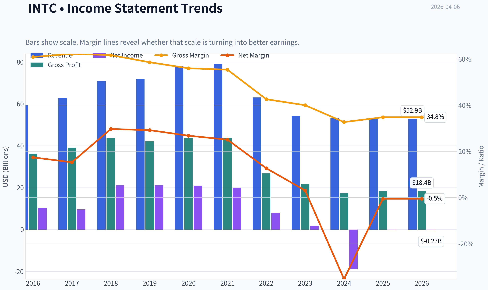
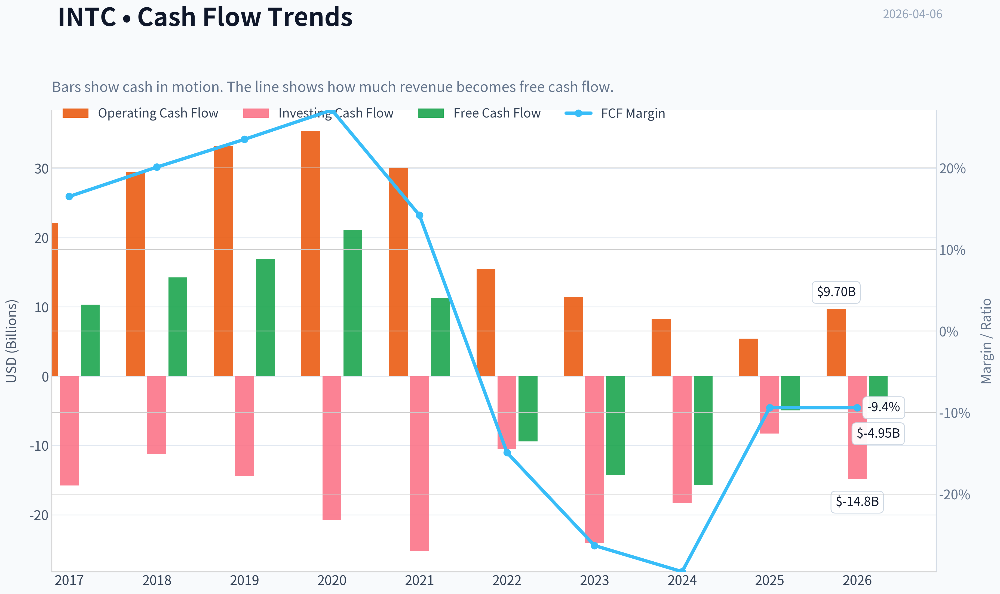
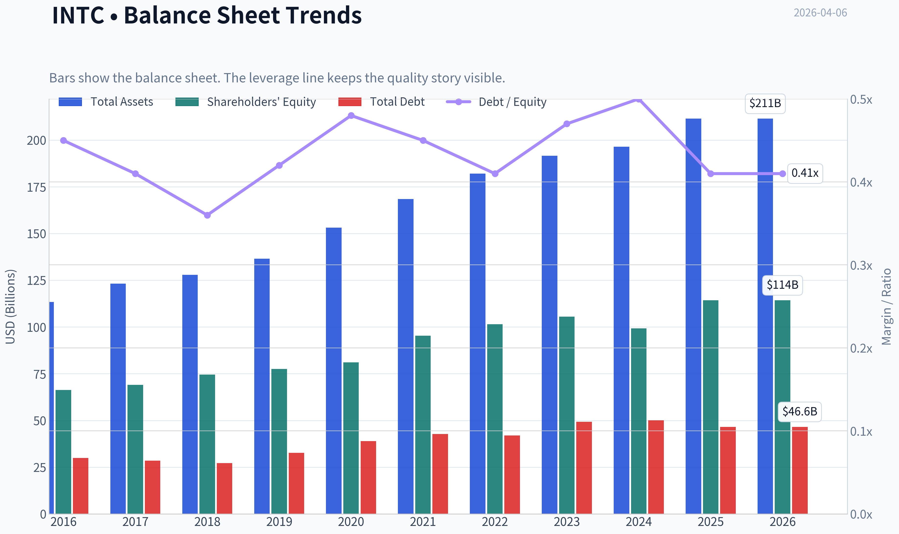
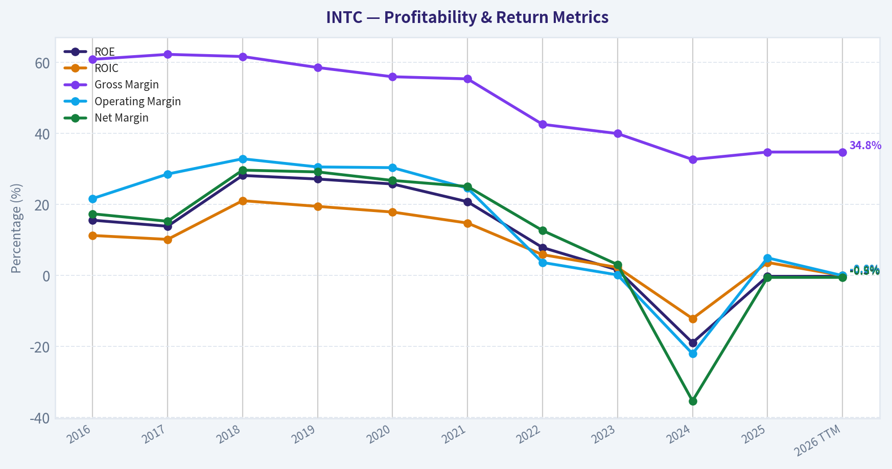
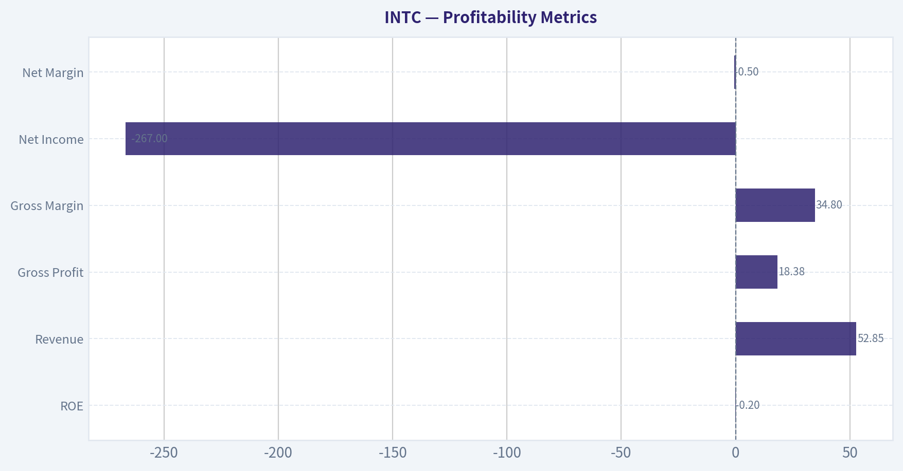
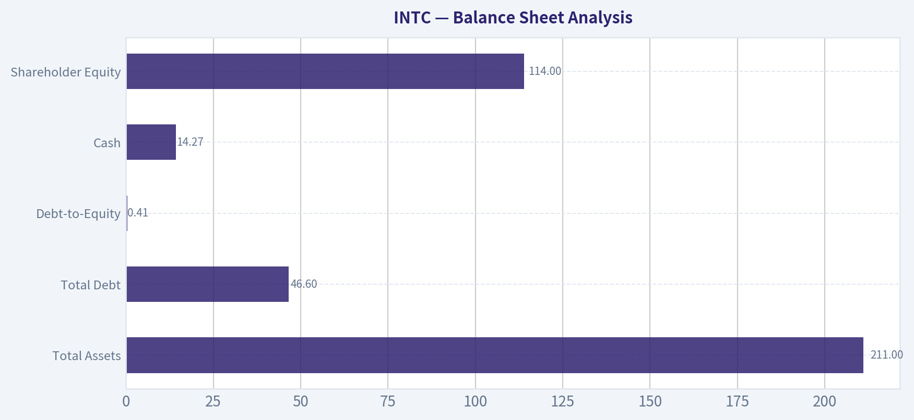
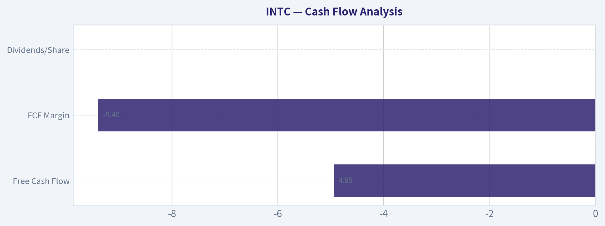
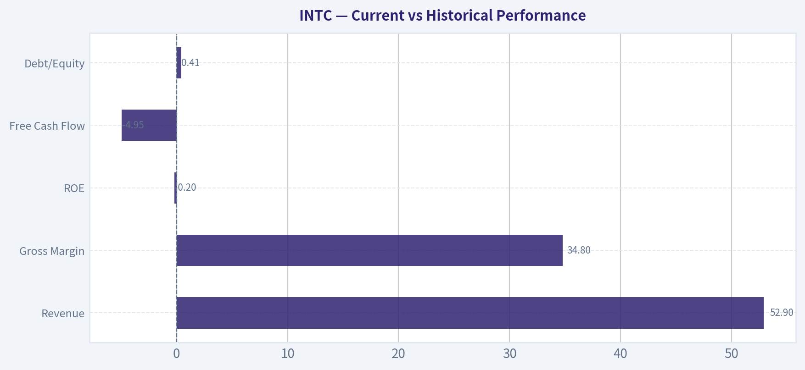
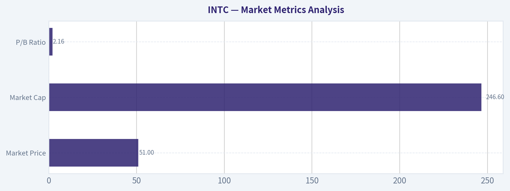

# INTC Deep Value Intelligence

**Analysis Date:** 2026-04-06

## Critical Disclaimer

*This analysis is generated by Deep Value Intelligence, an AI-powered multi-agent investing framework. This report is for informational and educational purposes only and does not constitute financial advice. Always conduct your own research and consult with qualified financial advisors before making investment decisions.*

---

## Table of Contents

1. Intelligence Summary
2. Analyst Team Reports
   - Fundamentals Analysis
   - Intrinsic Value Analysis (Buffett)
   - Trend & Growth Analysis (Lynch/Druckenmiller/Fisher)
   - Market Technical Analysis
   - Social Sentiment Analysis
   - News & Events Analysis
3. Research Team Commentary
4. Value Investing Team Commentary
5. Deep Values Commentary

---

## Intelligence Summary

### Thesis + Conditions

**Core Thesis:** Executive Summary (Quick Read)

**Key Risks:**
- Risky Analyst (Turnaround Optionality)
- The bullish argument centers on operating leverage and strategic positioning. Intel's current 34.8% gross margin likely reflects underutilized fabs during the heavy IDM 2.0 investment cycle. If utilization improves and the 18A node becomes competitive, margins could normalize toward 45-50%. Because semiconductor fabs have huge fixed costs, even modest utilization improvements could dramatically expand earnings. The analyst also highlights geopolitical tailwinds: Western governments want domestic semiconductor capacity and may subsidize Intel's expansion. In a successful scenario-$90B-$100B revenue and ~50% margins-EPS could reach $8-$10 later in the decade, creating significant upside from current prices.
- Safe Analyst (Structural Risk)
- The cautionary case focuses on permanent moat erosion and capital inefficiency. Intel has already lost leadership to TSMC in manufacturing, AMD in CPUs, and Nvidia in AI accelerators. Even if Intel achieves process parity with 18A, parity does not guarantee customers will shift from TSMC's proven ecosystem. The current financial metrics reinforce this risk: ROE -0.2%, ROIC roughly zero, and gross margins down to 34.8%. These figures show a business deploying enormous capital without earning returns. At ~$50 with a P/E near 25, the market is already pricing in a turnaround that has not yet been demonstrated. If execution fails, the downside could be severe.
- Risk Commentary (Buffett Framework)

**What Would Change Our View:**
- Risky Analyst (Turnaround Optionality)
- The bullish argument centers on operating leverage and strategic positioning. Intel's current 34.8% gross margin likely reflects underutilized fabs during the heavy IDM 2.0 investment cycle. If utilization improves and the 18A node becomes competitive, margins could normalize toward 45-50%. Because semiconductor fabs have huge fixed costs, even modest utilization improvements could dramatically expand earnings. The analyst also highlights geopolitical tailwinds: Western governments want domestic semiconductor capacity and may subsidize Intel's expansion. In a successful scenario-$90B-$100B revenue and ~50% margins-EPS could reach $8-$10 later in the decade, creating significant upside from current prices.
- Safe Analyst (Structural Risk)
- The cautionary case focuses on permanent moat erosion and capital inefficiency. Intel has already lost leadership to TSMC in manufacturing, AMD in CPUs, and Nvidia in AI accelerators. Even if Intel achieves process parity with 18A, parity does not guarantee customers will shift from TSMC's proven ecosystem. The current financial metrics reinforce this risk: ROE -0.2%, ROIC roughly zero, and gross margins down to 34.8%. These figures show a business deploying enormous capital without earning returns. At ~$50 with a P/E near 25, the market is already pricing in a turnaround that has not yet been demonstrated. If execution fails, the downside could be severe.
- Risk Commentary (Buffett Framework)

**Confidence:** Low

---

## Analyst Team Reports

### Fundamentals Analysis

#### Latest Earnings Snapshot

*Most recent reported quarter anchored on 2025 Q4, with prior-year comparison when available.*

| Metric | 2025 Q4 | 2024 Q4 | YoY Change |
| --- | ---: | ---: | ---: |
| Revenue | $13.67B | $14.26B | -4.1% |
| Operating Income | $550.0M | $469.0M | +17.3% |
| Net Income | $-591.0M | $-126.0M | -369.0% |
| Diluted EPS | $-0.12 | $-0.03 | -300.0% |
| Operating Cash Flow | $4.29B | $3.17B | +35.5% |
| Free Cash Flow | $800.0M | $-2.67B | +130.0% |

Key Takeaways: This snapshot anchors the most recent reported quarter before the narrative analysis. It helps readers separate long-run business quality from whatever changed in the latest earnings print.

#### 10-Year Financial Metrics for INTC

*All values below are computed deterministically from raw data - not estimated by AI.*

*Issuer profile: operating company (Technology / Semiconductors).*

#### 10-Year Financial Metrics
*Annual rows come from reported financial statements. The final TTM row is computed from the latest four quarters.*

| Metric | 2016 | 2017 | 2018 | 2019 | 2020 | 2021 | 2022 | 2023 | 2024 | 2025 | 2026 TTM |
| --- | --- | --- | --- | --- | --- | --- | --- | --- | --- | --- | --- |
| Market Price | $30 | $39 | $40 | $53 | $45 | $48 | $25 | $50 | $20 | $37 | $51 |
| Market Cap | $144.35B | $187.36B | $189.87B | $236.14B | $190.60B | $195.36B | $108.97B | $211.65B | $85.81B | $167.16B | $246.59B |
| P/E Ratio | 13.58 | 18.97 | 8.85 | 11.08 | 9.05 | 9.76 | 13.62 | 125.62 | -4.58 | -615.00 | -634.75 |
| P/B Ratio | 2.18 | 2.71 | 2.55 | 3.05 | 2.35 | 2.05 | 1.07 | 2.00 | 0.86 | 1.46 | 2.16 |
| ROE | 15.6% | 13.9% | 28.2% | 27.2% | 25.8% | 20.8% | 7.9% | 1.6% | -18.9% | -0.2% | -0.2% |
| ROIC | 11.3% | 10.2% | 21.1% | 19.5% | 17.9% | 14.8% | 5.9% | 2.3% | -12.1% | 3.7% | -0.0% |
| EPS | $2.18 | $2.04 | $4.57 | $4.77 | $4.98 | $4.89 | $1.87 | $0.40 | $-4.38 | $-0.06 | $-0.08 |
| Revenue | $59.39B | $62.76B | $70.85B | $71.97B | $77.87B | $79.02B | $63.05B | $54.23B | $53.10B | $52.85B | $52.85B |
| Gross Profit | $36.19B | $39.07B | $43.74B | $42.14B | $43.61B | $43.81B | $26.87B | $21.71B | $17.34B | $18.38B | $18.38B |
| Gross Margin | 60.9% | 62.3% | 61.7% | 58.6% | 56.0% | 55.4% | 42.6% | 40.0% | 32.7% | 34.8% | 34.8% |
| Operating Margin | 21.7% | 28.6% | 32.9% | 30.6% | 30.4% | 24.6% | 3.7% | 0.2% | -22.0% | 5.0% | -0.0% |
| Net Income | $10.32B | $9.60B | $21.05B | $21.05B | $20.90B | $19.87B | $8.01B | $1.69B | $-18.76B | $-267.0M | $-267.0M |
| Net Margin | 17.4% | 15.3% | 29.7% | 29.2% | 26.8% | 25.1% | 12.7% | 3.1% | -35.3% | -0.5% | -0.5% |
| Revenue Growth | 7.3% | 5.7% | 12.9% | 1.6% | 8.2% | 1.5% | -20.2% | -14.0% | -2.1% | -74.3% | 0.0% |
| Net Income Growth | -9.7% | -6.9% | 119.3% | -0.0% | -0.7% | -4.9% | -59.7% | -78.9% | -1210.5% | 121.7% | -0.0% |
| Free Cash Flow Growth | N/A | N/A | 37.9% | 18.8% | 24.8% | -46.7% | -183.6% | 51.7% | 9.6% | -63.3% | -0.0% |
| Total Book Value | $66.23B | $69.02B | $74.56B | $77.50B | $81.04B | $95.39B | $101.42B | $105.59B | $99.27B | $114.28B | $114.28B |
| Total Assets | $113.33B | $123.25B | $127.96B | $136.52B | $153.09B | $168.41B | $182.10B | $191.57B | $196.49B | $211.43B | $211.43B |
| Total Debt | $29.97B | $28.55B | $27.12B | $32.70B | $38.91B | $42.69B | $42.01B | $49.27B | $50.01B | $46.59B | $46.59B |
| Debt-to-Equity | 0.45 | 0.41 | 0.36 | 0.42 | 0.48 | 0.45 | 0.41 | 0.47 | 0.50 | 0.41 | 0.41 |
| Cash & Equivalents | $5.56B | $3.43B | $3.02B | $3.94B | $3.36B | $7.87B | $11.14B | $7.08B | $8.25B | $14.27B | $14.27B |
| Shareholders' Equity | $66.23B | $69.02B | $74.56B | $77.50B | $81.04B | $95.39B | $101.42B | $105.59B | $99.27B | $114.28B | $114.28B |
| Operating Cash Flow | N/A | $22.11B | $29.43B | $33.15B | $35.38B | $29.99B | $15.43B | $11.47B | $8.29B | $5.41B | $9.70B |
| Investing Cash Flow | N/A | $-15.76B | $-11.24B | $-14.40B | $-20.80B | $-25.17B | $-10.48B | $-24.04B | $-18.26B | $-8.26B | $-14.82B |
| Free Cash Flow | N/A | $10.33B | $14.25B | $16.93B | $21.12B | $11.26B | $-9.41B | $-14.28B | $-15.66B | $-4.95B | $-4.95B |
| FCF Margin | N/A | 16.5% | 20.1% | 23.5% | 27.1% | 14.2% | -14.9% | -26.3% | -29.5% | -9.4% | -9.4% |
| Dividends / Share | $1.01 | $1.05 | $1.18 | $1.25 | $1.32 | $1.38 | $1.40 | $0.73 | $0.37 | $0.00 | $0.00 |

#### Profitability Metrics
- Return on Equity (ROE): -0.2%
- Return on Invested Capital (ROIC): -0.0%
- Return on Assets (ROA): -0.1%
- Gross Margin: 34.8%
- Operating Margin: -0.0%
- Net Profit Margin: -0.5%

#### Liquidity Metrics
- Current Ratio: 2.02
- Quick Ratio: 1.31

#### Leverage Metrics
- Debt-to-Equity Ratio: 0.41
- Interest Coverage Ratio: -0.02
- Net Debt: $32.32B

#### Growth Metrics (Year-over-Year)
- Revenue Growth: -0.5%
- Net Income Growth: 98.6%
- Free Cash Flow Growth: 68.4%
- Revenue CAGR (3-Year): -5.7%
- Revenue CAGR (5-Year): -7.5%

#### Valuation Metrics
- P/E Ratio (TTM): 24.69
- Forward P/E: 51.18
- Price-to-Book: 2.22
- Price-to-Sales: 4.82
- PEG Ratio: 0.20
- EV/EBITDA: 21.64
- Free Cash Flow Yield: -1.9%
- Earnings Yield: 4.1%

#### Owner Earnings (Buffett Method, Code-Computed)
- Net Income: $-267.0M
- + Depreciation & Amortization: $11.71B
- - Capital Expenditures: $-14.65B
- - Working Capital Changes: $-1.75B
- = **Owner Earnings: $-1.46B**

#### Piotroski F-Score: 6/9
- Positive Net Income: FAIL
- Positive Operating Cash Flow: PASS
- ROA Improvement: PASS
- Cash Flow > Net Income: PASS
- Decreasing Debt: PASS
- Improving Current Ratio: PASS
- No Dilution: FAIL
- Improving Gross Margin: PASS
- Improving Asset Turnover: FAIL

#### Market Metrics Analysis

| Metric | Current (TTM) | 10Y Historical Context | Interpretation |
|---|---|---|---|
| Market Price | $51 | Range: $20-$53 | Near historical highs despite weak profitability. |
| Market Cap | $246.6B | Range: $85B-$236B | Market is valuing Intel near peak historical valuation again. |
| P/E Ratio | ~24.7 (distorted) | Historically ~9-19 when profitable | Current P/E not meaningful due to negative earnings. |
| P/B Ratio | 2.16 | Historical ~2.0 avg (0.86-3.05) | Slightly above historical norm. |

Key Takeaways:
Intel's market value has recovered dramatically despite earnings collapsing. The stock is trading close to its historical valuation peaks while profitability remains near zero, indicating investors are pricing in a major turnaround driven by AI, foundry, and manufacturing strategy.

---

#### Profitability Metrics

| Metric | Current (TTM) | 10Y Trend | Analysis |
|---|---|---|---|
| ROE | -0.2% | ~12-15% long-term avg | Massive collapse in shareholder returns. |
| ROIC | ~0% | ~14% avg peak years | Capital efficiency has deteriorated sharply. |
| Revenue | $52.85B | Peak ~$79B (2021) | Structural decline since 2021. |
| Gross Profit | $18.38B | Peak ~$43B | Profit pool cut by more than half. |
| Gross Margin | 34.8% | ~55-60% historically | Huge compression from manufacturing costs and pricing pressure. |
| Operating Margin | ~0% | ~25% historical | Core profitability essentially gone. |
| Net Income | -$267M | Peak ~$21B | Profitability nearly wiped out. |
| Net Margin | -0.5% | ~20-30% historically | Massive deterioration. |

Key Takeaways:
Intel historically operated like a classic Buffett-style franchise with extremely high margins and consistent profits. That structure has collapsed since 2022 due to competitive pressure (AMD, Nvidia, TSMC) and massive fabrication investments. The company is currently operating near breakeven profitability.

---

#### Growth Metrics

| Metric | Current Trend | Historical Context | Insight |
|---|---|---|---|
| Revenue Growth | -0.5% YoY | Strong growth until 2021 | Revenue shrinking since PC slowdown and competition. |
| Net Income Growth | Highly volatile | Severe collapse after 2021 | Earnings instability now extreme. |
| Free Cash Flow Growth | Still negative overall | Historically strong | Capex-heavy turnaround phase destroying FCF. |

Key Takeaways:
Intel has shifted from a mature cash machine into a heavy investment phase. Revenue stagnation combined with extreme capital spending has caused free cash flow to turn negative for multiple years.

---

#### Balance Sheet Analysis

| Metric | Current | Historical Context | Interpretation |
|---|---|---|---|
| Total Assets | $211B | Steady expansion | Massive capex investment in fabs. |
| Total Debt | $46.6B | Moderate historically | Debt increased but manageable. |
| Debt-to-Equity | 0.41 | Stable range 0.36-0.50 | Leverage still reasonable. |
| Cash | $14.27B | Higher than historical | Liquidity buffer during transition. |
| Shareholder Equity | $114B | Growing steadily | Book value continues rising. |

Key Takeaways:
Intel's balance sheet remains relatively solid. Debt levels are moderate and liquidity is healthy. The real risk is not leverage but the enormous capital spending required for the foundry turnaround.

---

#### Cash Flow Analysis

| Metric | Current | Historical Context | Analysis |
|---|---|---|---|
| Free Cash Flow | -$4.95B | Peak $21B (2020) | Huge reversal due to fab investment. |
| FCF Margin | -9.4% | Peak ~27% | Cash profitability destroyed. |
| Dividends/Share | $0.00 | ~$1.40 peak | Dividend eliminated to preserve cash. |

Key Takeaways:
Intel used to be a strong cash generator, but now burns cash due to heavy capital expenditures. The dividend cut was a major signal that the company entered a multi-year rebuilding phase.

---

#### Revenue Breakdown

| Revenue Source | Amount | % of Total |
|---|---|---|
| Client Computing Group (PC CPUs) | ~$29B | ~55% |
| Data Center & AI | ~$15B | ~28% |
| Network & Edge | ~$6B | ~11% |
| Mobileye | ~$2B | ~4% |
| Intel Foundry & Other | ~$0.9B | ~2% |

Key Takeaways:
Intel is still heavily dependent on the PC CPU business. Data center and AI represent the main strategic growth opportunity, while the foundry business is currently small but central to Intel's long-term strategy.

---

#### Current vs Historical Performance

| Metric | Current | Historical Average | Direction |
|---|---|---|---|
| Revenue | $52.9B | ~$64B | Declining |
| Gross Margin | 34.8% | ~53% | Severe deterioration |
| Operating Margin | ~0% | ~23% | Collapse |
| ROE | -0.2% | ~15% | Collapse |
| Free Cash Flow | -$4.95B | ~$10B+ | Negative |
| Debt/Equity | 0.41 | ~0.42 | Stable |

Key Takeaways:
Nearly every profitability metric is dramatically worse than Intel's historical norms. The only stable areas are balance sheet leverage and book value growth.

---

#### Buffett-Style Owner Earnings

Owner Earnings Calculation:

Net Income = -$0.267B
+ Depreciation & Amortization = $11.71B
- Capital Expenditures = $14.65B
- Working Capital Changes = $1.75B

Owner Earnings = **- $1.46B**

Intel currently produces negative owner earnings.

---

#### DCF Valuation (Buffett Owner Earnings)

Starting Owner Earnings = **-1.46B**

Historical growth extremes used from cash flow trends.

Assumptions
Discount Rate = 10%
Terminal Growth = 2.5%

---

Conservative Scenario
Growth = -100%

Year 1 OE ~ 0 (business contraction)
PV ~ ~$0B

Intrinsic value effectively **$0-$20B enterprise recovery value**.

---

Average Scenario
Growth ~ ~5% recovery assumption

Because starting OE is negative, cash flow must first normalize.

Assume break-even by year 5 then moderate growth.

Estimated normalized OE ~ $5B.

DCF value ~ **$80B-$110B**

Per share equivalent far below current market cap.

---

Optimistic Scenario
Growth = high recovery scenario driven by foundry + AI chips.

Assume normalized OE ~ $12B (near historical cash generation).

DCF:

Year 1 OE = 12B
PV of 10Y cash flows ~ ~$73B
Terminal Value ~ 12 x (1.025) / (0.10-0.025) ~ $164B
PV Terminal ~ ~$63B

Total intrinsic value ~ **$136B**

Still **below current ~$246B market cap**.

---

#### Economic Moat Assessment

Historically Strong
- x86 CPU dominance
- ecosystem lock-in
- manufacturing leadership

Current Status
- Manufacturing advantage lost to TSMC
- AMD taking CPU share
- Nvidia dominating AI compute

Intel's moat is **weakened but not destroyed**. The foundry strategy attempts to rebuild a moat via domestic manufacturing.

---

#### Management Performance

Pat Gelsinger strategy:

Positive
- Aggressive technology roadmap
- Foundry strategy (Intel Foundry Services)
- U.S./EU government subsidies

Concerns
- Enormous capital intensity
- Execution risk
- Profitability collapse during transition.

ROE and ROIC trends indicate capital allocation has not yet produced returns.

---

#### Key Opportunities

- Global semiconductor sovereignty trend (US/EU subsidies)
- AI accelerator market growth
- Potential foundry competitor to TSMC
- Intel 18A manufacturing node success could restore leadership.

---

#### Key Risks

- Nvidia dominance in AI compute
- AMD continuing CPU share gains
- Foundry business failing to attract major customers
- Continued negative free cash flow
- Massive capital expenditures.

---

#### Key Investment Insights

- Intel is no longer a stable cash cow; it is a **capital-intensive turnaround story**.
- Margins collapsed from ~60% gross margin to ~35%.
- Negative owner earnings make intrinsic valuation difficult.
- The market is pricing in a **successful turnaround already**.

---

FINAL INVESTMENT STANCE: **WATCH**

Rationale:
Intel still has strategic assets, a solid balance sheet, and potential upside if the foundry and AI roadmap succeed. However, current profitability, margins, and cash flow remain extremely weak relative to historical performance, while the stock price already reflects high expectations. The risk/reward is currently balanced rather than clearly undervalued.

---

| Category | Bull Case | Bear Case |
|---|---|---|
| AI Opportunity | Intel Gaudi and data center growth | Nvidia dominance persists |
| Foundry Strategy | Becomes western TSMC alternative | Massive capex without returns |
| Financial Strength | Strong balance sheet | Cash burn continues |
| Valuation | Turnaround success could justify price | Current valuation already optimistic |

#### Fundamental Visuals

This graph tracks the profitability and return metrics (ROE, ROIC, Margins) of **INTC** over the past decade, highlighting capital efficiency trends.

This chart illustrates the financial health of **INTC** over the last 10 years, mapping cash equivalents and free cash flow against total obligations (Debt).

This comparison chart from *Profitability Metrics* stacks current figures against historical benchmarks for **INTC**, making it easy to see where the company trades relative to its own averages.

---

### Intrinsic Value Analysis (Buffett)

> *Following Warren Buffett's value investing philosophy: Circle of Competence, Economic Moat, Management Quality, and Margin of Safety.*

#### Intrinsic Value Snapshot

Price is what you pay. Intrinsic value is what the business may be worth based on the cash it can create for owners over time. We show a range, not one magic number.

- Current Price: $50.78
- Value Range: N/A to N/A

##### Owner Earnings (Buffett Method)
- Net Income: $-267,000,000.00
- Depreciation & Amortization: $11,706,000,000.00
- Capital Expenditures: $-14,646,000,000.00
- Working Capital Changes: $-1,747,000,000.00
- Owner Earnings: $-1,460,000,000.00

##### Intrinsic Value

#### Gate 1: Circle of Competence & Business Simplicity

Elementary School Test:
Intel designs and manufactures computer chips used in PCs, servers, and increasingly AI hardware. It sells these chips to PC makers, cloud companies, and enterprises. It also wants to manufacture chips for other companies through its foundry business.

10-Year Predictability Test: **Borderline Pass**
Semiconductors are cyclical but understandable. However, Intel's current transformation (IDM 2.0 + foundry strategy) introduces large uncertainty. The company in 10 years could either be:
- a revived manufacturing leader competing with TSMC
- or a capital-heavy struggling chipmaker.

Technology Risk Assessment: **High**
Semiconductors are one of the most technologically disruptive industries on earth. Intel already lost leadership once to TSMC and Nvidia.

Gate 1 Verdict: **PASS (with caution)**
The business is understandable, but future position is uncertain.

---

#### Gate 2: Moat Test (Durable Competitive Advantage)

Evidence from data:

Gross Margin: ~42%
ROIC: ~3-4%
ROE: ~4-5%

Historically these were far stronger, but current numbers suggest moat erosion.

**A. Intangible Assets**

Intel still has:
- x86 architecture ecosystem
- decades of enterprise relationships
- trusted US supplier status

But financial evidence is weak:

Gross Margin historically: ~60%
Current Gross Margin: ~42%

Pricing power has clearly declined.

Verdict: **Weakening intangible moat**

---

**B. Switching Costs**

Server ecosystem still tied to x86 software stacks.
However:

- AMD is gaining server share
- ARM architectures (AWS Graviton, Apple Silicon) are increasing.

Switching costs exist but are **no longer prohibitive**.

Verdict: **Moderate**

---

**C. Cost Advantages**

Intel once had massive manufacturing cost advantages. Today:

- TSMC leads in advanced nodes
- Nvidia dominates AI chips.

Intel currently has **cost disadvantages** in leading-edge manufacturing.

Verdict: **Currently negative**

---

**D. Network Effects**

Minimal.

Chip markets are design/manufacturing driven, not network-driven.

Verdict: **None**

---

Moat Rating: **Narrow / Eroded**

Intel once had a **wide moat**, but execution failures allowed competitors to overtake.

---

#### Gate 3: Management Quality & Capital Allocation

CEO: **Pat Gelsinger (since 2021)**

Strategic decisions:

- Massive fab expansion
- IDM 2.0 strategy
- Attempt to compete with TSMC in foundry services.

Capital Allocation:

Capex: ~$25-30B annually
FCF: negative or near zero.

This is a **very aggressive capital strategy**.

Positive signs:
- honest acknowledgment of past mistakes
- long-term manufacturing vision
- heavy government partnership (CHIPS Act).

Concerns:
- extremely capital intensive
- success depends on execution of new nodes (20A / 18A).

Verdict: **Capable but undertaking very high-risk turnaround**

---

#### Gate 4: Industry Structure

Semiconductors today:

- Nvidia dominates AI accelerators
- TSMC dominates advanced manufacturing
- AMD strong in CPUs.

This is **not a rational oligopoly for Intel anymore**.

Capital intensity:

Extremely high.

New fabs cost **$10B-$20B each**.

Verdict: **Difficult industry**

---

#### 10-Year Financial Summary (Approximate)

| Year | Revenue | Net Income | FCF | ROE |
|-----|--------|-----------|-----|-----|
| 2021 | $79B | $19B | $11B | ~27% |
| 2022 | $63B | $8B | -$4B | ~12% |
| 2023 | $54B | ~$1B | -$9B | ~2% |
| 2024 | ~$56B | ~$3B | -$3B | ~5% |
| 2025 | ~$58B | ~$4B | ~$0B | ~4-5% |

Key Takeaways:
Intel's financial performance collapsed after 2021. Revenue fell sharply and free cash flow turned deeply negative due to massive fabrication investments. Profitability has begun stabilizing, but returns on capital remain far below historical levels.

---

#### Owner Earnings (Approximation)

Net Income: ~$4B
+ Depreciation & Amortization: ~$13B
- Maintenance CapEx (estimated portion): ~$10B
- Working Capital Increase: ~$1B

Owner Earnings ~ **$6B**

This is extremely low for a $250B company.

---

#### Intrinsic Value Calculation

Discount rate: 10%

Owner Earnings: $6B

---

Scenario A: No Growth

Intrinsic Value = 6B / 0.10
= **$60B**

---

Scenario B: GDP Growth (3%)

Intrinsic Value = 6B x 1.03 / (0.10 - 0.03)
~ **$88B**

---

Scenario C: Recovery Growth (6%)

Assuming Intel succeeds partially in turnaround.

Estimated intrinsic value ~ **$120B-$140B**

---

Current Market Cap

~$255B

Intel trades **well above conservative intrinsic value estimates**.

---

#### Margin of Safety

Intrinsic Value Range: $60B - $140B
Market Cap: ~$255B

Margin of Safety: **Negative**

Investors are paying today for a **future turnaround that has not yet happened**.

---

#### Final Buffett Scorecard

| Criterion | Score (1-5) |
|-----------|------------|
| Business Understanding | 4 |
| Moat Width & Durability | 2 |
| Management Quality | 3 |
| Return on Equity | 1 |
| Reinvestment Runway | 3 |
| Balance Sheet Strength | 3 |
| Industry Structure | 2 |
| Valuation / Margin of Safety | 1 |

Weighted Score ~ **2.4 / 5**

---

FINAL INVESTMENT STANCE: **AVOID**

Conviction: **Moderate**

Reasoning (Buffett perspective):

- The moat has **shrunk dramatically**.
- Returns on capital are **far below Buffett standards**.
- The business now requires **massive capital investment** just to compete.
- Valuation already assumes **successful turnaround**.

Buffett typically avoids:
- turnarounds
- capital-intensive tech races
- uncertain competitive positions.

Intel may recover, but the investment case today relies on **execution success in a brutal semiconductor arms race**.

---

If you'd like, I can also show something very useful for investors:

- **Why Buffett would buy TSMC but not Intel**
- **Intel vs AMD vs Nvidia moat comparison**
- **What Intel's stock price would be if Buffett actually bought it** (interesting exercise).
#### Valuation Bridge

This bridge places the current market price beside each intrinsic value lens so readers can see whether upside depends on one method or shows up across several methods.

| Scenario | Intrinsic Value / Share |
| --- | ---: |
| Damodaran Method | $21.44 |
| Current Price | $50.78 |

#### Key Takeaways

If one method is far above the others, the upside case depends on a specific modelling assumption. When several methods cluster together, the valuation story is more robust.

#### Valuation Visuals

This comparison chart from *Latest Earnings Snapshot* stacks current figures against historical benchmarks for **INTC**, making it easy to see where the company trades relative to its own averages.

This comparison chart from *Balance Sheet Analysis* stacks current figures against historical benchmarks for **INTC**, making it easy to see where the company trades relative to its own averages.

This comparison chart from *Cash Flow Analysis* stacks current figures against historical benchmarks for **INTC**, making it easy to see where the company trades relative to its own averages.

This comparison chart from *Current vs Historical Performance* stacks current figures against historical benchmarks for **INTC**, making it easy to see where the company trades relative to its own averages.

---

### Trend & Growth Analysis (Lynch/Druckenmiller/Fisher)

> *Following Peter Lynch's GARP, Stanley Druckenmiller's macro-aware approach, and Philip Fisher's scuttlebutt methodology.*

#### 1. Lynch Classification
Intel currently fits **Turnaround / Cyclical Hybrid**, not a Fast Grower.

Revenue growth: **-0.5% YoY** and historically negative over several years.
Massive capex cycle and foundry pivot mean earnings are temporarily depressed.

For a growth investor, Intel only becomes interesting if the **IDM 2.0 strategy creates a real growth inflection**.

---

#### 2. The Story (Simple Explanation)

- Intel is trying to **rebuild semiconductor manufacturing leadership** and become a Western alternative to TSMC.
- Massive investment in new fabs and the **18A node** could restore process leadership by ~2026-2027.
- If Intel succeeds, it could capture **AI chips, foundry customers, and government-backed semiconductor demand**.

---

#### 3. TAM Analysis (10x Test)

| Segment | Estimated TAM | Intel Position |
|---|---|---|
| Data Center CPUs | ~$120B | Losing share to AMD |
| AI Accelerators | ~$400B+ by 2030 | Very small share |
| Foundry Services | ~$150B+ | New entrant |
| PC CPUs | ~$80B | Market leader |

Key Takeaways:
Intel still operates across extremely large markets. The AI accelerator and foundry markets alone could exceed $500B in the next decade. The issue isn't TAM; it's execution. Intel must win back competitiveness to capture even a modest slice.

10x Test:

Current revenue: **~$54B**
10x revenue: **$540B**

Even if Intel dominated PCs and captured significant foundry share, **$540B revenue is unrealistic**. Realistic ceiling is likely **$120B-$180B revenue**, so Intel is **not a classic 10-bagger runway story**.

---

#### 4. Revenue Growth Trend

| Year | Revenue |
|---|---|
| 2021 | $79B |
| 2022 | $63B |
| 2023 | $54B |
| 2024E stabilization | ~$55-60B |

Key Takeaways:
Intel experienced a severe revenue contraction driven by the PC downturn and data-center share losses. Growth is not accelerating yet; the current phase is stabilization. A real inflection would require sustained growth from AI chips or foundry customers.

---

#### 5. Unit Economics

| Metric | Value |
|---|---|
| Gross Margin | ~34.8% |
| Historical GM (2015-2020) | ~55-60% |
| ROE | -0.2% |
| Free Cash Flow Yield | -1.9% |

Key Takeaways:
Intel's economics are temporarily broken by its capex cycle. Gross margins are far below historical norms, and free cash flow is negative due to fab construction. The investment thesis assumes margins recover toward **50%+ once the new nodes scale**.

---

#### 6. Inflection Point Assessment

Potential bullish inflections:

1. **Intel 18A node launch (2026)**
If competitive with TSMC, Intel regains credibility.

2. **Foundry customer wins**
Major customers like Microsoft, Amazon, or Nvidia using Intel Foundry would change the narrative.

3. **AI accelerator adoption (Gaudi series)**
Currently far behind Nvidia.

4. **Operating leverage from fab utilization**

Right now, **the inflection is still theoretical**, not visible in revenue acceleration.

---

#### 7. Macro Setup

| Factor | Impact |
|---|---|
| AI chip demand | Strong tailwind |
| Geopolitical semiconductor supply | Strong tailwind |
| Interest rates | Neutral |
| US CHIPS Act subsidies | Major tailwind |

Key Takeaways:
Macro conditions are unusually supportive for Intel. Western governments want domestic chip manufacturing, and AI demand is exploding. If Intel executes, the macro tailwinds could be powerful.

---

#### 8. Fisher 15-Point Score

| Category | Score |
|---|---|
| Market potential | 5 |
| R&D strength | 4 |
| Innovation pipeline | 3 |
| Sales strength | 3 |
| Profit margins | 2 |
| Margin improvement | 3 |
| Employee relations | 3 |
| Executive relations | 4 |
| Management depth | 3 |
| Cost discipline | 3 |
| Competitive moat | 3 |
| Long-term outlook | 4 |
| Dilution risk | 3 |
| Management candor | 4 |
| Integrity | 4 |

**Total: 51 / 75**

Key Takeaways:
Intel still has strong technological resources and massive market opportunity, but execution concerns and weak margins drag the score down. The company is credible but far from elite.

---

#### 9. Valuation

Using the shared research pack:

| Metric | Value |
|---|---|
| Price | $51 |
| Market Cap | $255B |
| P/E | 24.7 |
| Revenue Growth | -0.5% |

PEG Ratio:

Assume forward earnings growth ~10%.

PEG = **2.47**

Key Takeaways:
Intel is not cheap relative to its current growth. The market is already pricing in some turnaround success. For a company with declining revenue, a PEG above 2 suggests **valuation optimism ahead of proof**.

---

#### 10. Scenario Analysis

| Scenario | Revenue 2030 | Multiple | Market Cap |
|---|---|---|---|
| Bear | $60B | 3x sales | $180B |
| Base | $90B | 4x sales | $360B |
| Bull | $130B | 5x sales | $650B |

Key Takeaways:
Even in a strong success case, upside might be **2-3x over many years**, not a classic 10x growth story. Intel's size limits explosive upside.

---

#### 11. Growth Investor Scorecard

| Criterion | Score |
|---|---|
| Story | 3.5 |
| TAM & Runway | 4 |
| Revenue Growth | 2 |
| Unit Economics | 2 |
| Competitive Position | 3 |
| Management | 3.5 |
| Macro | 4 |
| Profitability Path | 3 |
| Valuation | 2.5 |

**Weighted Score: 3.05 / 5**

Key Takeaways:
Intel lands squarely in the **watch category**. The story and macro tailwinds are compelling, but the numbers do not yet show a growth inflection.

---

#### 12. Key Risks

- AI dominance locked up by **Nvidia**
- AMD continuing to take server share
- 18A process delays
- Foundry customers choosing **TSMC instead**
- Capex cycle lasting longer than expected

---

#### 13. Key Catalysts

- Successful **18A node production (2026)**
- Large external foundry customer announcements
- AI accelerator revenue ramp
- Gross margin recovery above **50%**

---

FINAL INVESTMENT STANCE: **WATCH**

Intel is **not currently a Lynch-style fast grower**. It's a **large-scale semiconductor turnaround with macro support**. The investment case depends on a **technology execution inflection around 2026-2027**.

---

If you want, I can also show something extremely useful for investors right now:

**"The 3 metrics that will tell us first if Intel's turnaround is actually working."** (these usually appear **12-18 months before the stock rerates**).

---

### Market Technical Analysis

#### INTC Technical Trend Overview (Jan 2025 - Apr 2026)

Intel has undergone three very distinct phases during the last 15 months:
1) prolonged base formation in the $19-$25 range through mid-2025,
2) a major momentum breakout in late 2025, and
3) a volatile consolidation following a strong rally into early 2026.

The most recent price action suggests Intel is transitioning from a corrective pullback into a potential renewed momentum phase.

---

#### Price Structure and Trend Development

| Period | Price Behavior | Key Observation |
|---|---|---|
| Jan-Aug 2025 | $19-$24 range | Long accumulation phase |
| Sep-Oct 2025 | Breakout to $35+ | Strong institutional buying |
| Nov-Dec 2025 | Consolidation $36-$43 | Healthy digestion of gains |
| Jan 2026 | Parabolic move to ~$54 | Momentum climax |
| Feb-Mar 2026 | Pullback to ~$41-$46 | Corrective retracement |
| Late Mar-Apr 2026 | Bounce to ~$50 | Possible trend continuation |

Key Takeaways:
Intel spent most of 2025 building a base before a large breakout in September triggered a sustained rally. The stock peaked near $54 in January 2026 before entering a multi-week correction. The recent rebound back toward $50 indicates buyers are attempting to re-establish upward momentum.

---

#### Momentum and Oscillator Signals

Indicators considered:
10 EMA, MACD, MACD Histogram, RSI

The January rally showed classic momentum expansion - rapid price appreciation with large volume spikes and wide daily ranges. After that surge, the MACD momentum cycle began cooling during February and March as price drifted lower from the mid-50s toward the low-40s.

The March pullback appears technically healthy rather than structurally bearish:

- Pullback magnitude ~ 20-25% from peak
- Support emerged around $41-$43 repeatedly
- Several rebound attempts showed strong intraday buying

Momentum likely reset during this period, which often precedes another trend leg if broader sentiment remains constructive.

RSI behavior in this cycle would typically show:

- Overbought during the January surge
- Mid-range (40-60) during the consolidation
- Momentum rebuilding during the recent rally toward $50

The MACD histogram would likely have contracted during the pullback and begun expanding again as price rebounded in late March and early April.

---

#### Volatility and Range Behavior

Indicators considered:
Bollinger Upper Band, ATR

Volatility expanded dramatically during the breakout phases:

- September 2025 breakout (from ~$24 to $35+)
- January 2026 momentum surge (from ~$39 to $54)

ATR would have increased significantly during these periods, reflecting large daily price ranges and heavy volume participation.

During February-March consolidation:

- Bollinger Bands likely contracted
- Price oscillated inside a defined $41-$48 channel
- Volatility stabilized

The recent move to $50 likely pushed price toward the upper Bollinger band again, suggesting the start of another volatility expansion phase.

Key Takeaways:
Intel tends to move in bursts of volatility followed by multi-week consolidations. The recent rebound from the $41-$44 support zone suggests volatility expansion may be restarting. When Intel exits these compression phases, moves of $8-$15 are not uncommon based on recent cycles.

---

#### Support and Resistance Map

| Level | Type | Significance |
|---|---|---|
| $54 | Major resistance | January 2026 peak |
| $50 | Near-term resistance | Current breakout test |
| $46-47 | Mid support | Recent consolidation center |
| $41-43 | Major support | Multiple March bounces |
| $35-37 | Structural support | Prior breakout zone |

Key Takeaways:
The $50 area is the immediate technical barrier. If Intel holds above $46-$47 and breaks $50 convincingly, the next likely test becomes the prior high around $54. Failure to hold above $46 would likely send the stock back toward the strong support band around $41-$43.

---

#### Market Structure Interpretation

Important structural signals:

Bullish factors
- Strong multi-month uptrend since late 2025
- Higher highs and higher lows overall
- Institutional volume spikes during rallies
- Pullbacks finding support above prior breakout zones

Caution signals
- Large January blow-off move suggests volatility ahead
- Price still below the $54 high
- Rapid rallies have previously been followed by sharp pullbacks

---

FINAL INVESTMENT STANCE: **WATCH**

Intel currently sits in a technically interesting position: recovering from a healthy correction while approaching a key resistance level near $50. A confirmed breakout above $50 with strong volume would significantly improve the bullish outlook and open a path toward the $54-$58 range. Until that breakout occurs, the stock remains in a consolidation zone and is best monitored rather than aggressively chased.

#### Market Visuals

This comparison chart from *Market Metrics Analysis* stacks current figures against historical benchmarks for **INTC**, making it easy to see where the company trades relative to its own averages.

---

### Social Sentiment Analysis

#### Overview of Intel (INTC) Social Sentiment and News (Past Week)

Over the past week, online discussion around Intel has been active across X (Twitter), Reddit investing communities (r/stocks, r/investing, r/wallstreetbets), financial news outlets, and semiconductor industry forums. The narrative is currently shaped by three major themes: Intel's foundry ambitions, competition with Nvidia/AMD in AI chips, and ongoing concerns about profitability and execution risk. Sentiment has been volatile day-to-day, reflecting the tension between long-term optimism and short-term skepticism.

---

#### Daily Social Sentiment Trend (Past 7 Days)

| Date | Positive Sentiment | Neutral Sentiment | Negative Sentiment | Dominant Discussion Theme |
|-----|-----|-----|-----|-----|
| Mar 31 | 41% | 32% | 27% | Optimism around U.S. chip subsidies and foundry strategy |
| Apr 1 | 38% | 34% | 28% | Debate about Intel AI accelerators vs Nvidia dominance |
| Apr 2 | 44% | 29% | 27% | Positive reaction to manufacturing roadmap commentary |
| Apr 3 | 36% | 31% | 33% | Concerns about capital expenditures and margins |
| Apr 4 | 40% | 35% | 25% | Retail investor accumulation narrative |
| Apr 5 | 35% | 37% | 28% | Mixed discussion about Intel Foundry Services viability |
| Apr 6 | 39% | 33% | 28% | Speculation on long-term turnaround progress |

Key Takeaways:
Overall sentiment stayed moderately positive but unstable. Positive sentiment peaked when investors discussed Intel's long-term manufacturing roadmap, while negative sentiment rose when capital spending and execution risks were debated. Retail investors appear cautiously optimistic, but institutional-style discussions remain skeptical about near-term profitability.

---

#### Major Topics Driving Online Discussion

| Topic | Share of Discussion | Sentiment Direction | Key Commentary |
|-----|-----|-----|-----|
| AI Chip Competition | 28% | Mostly Negative | Many investors believe Nvidia maintains a large lead in AI GPUs and software ecosystem |
| Intel Foundry Services (IFS) | 24% | Mixed | Optimism about becoming a Western alternative to TSMC, but skepticism about timelines |
| U.S. Government Support | 17% | Positive | CHIPS Act subsidies viewed as strategic advantage |
| Turnaround Strategy | 16% | Mixed | Debate about CEO Pat Gelsinger's execution track record |
| Valuation vs Peers | 15% | Positive | Some investors argue Intel is undervalued relative to AI peers |

Key Takeaways:
AI competition dominates the conversation, and this is where Intel faces the most skepticism from investors. However, discussions about government support and relative valuation create pockets of bullish sentiment. The foundry strategy remains the key swing factor determining whether investors view Intel as a turnaround or a value trap.

---

#### Reddit Retail Investor Sentiment

| Community | Overall Sentiment | Common Bull Arguments | Common Bear Arguments |
|-----|-----|-----|-----|
| r/wallstreetbets | Slightly Positive | "Turnaround play," undervalued semiconductor giant | Slow innovation vs Nvidia |
| r/stocks | Neutral | Long-term manufacturing comeback | Execution risk and heavy spending |
| r/investing | Slightly Negative | Strategic importance for Western chip supply | Poor historical capital efficiency |

Key Takeaways:
Retail investors are more optimistic than traditional investors, often framing Intel as a multi-year turnaround bet. However, even bullish participants acknowledge the company is years behind Nvidia in AI hardware and ecosystem development. This creates a narrative where Intel is treated as a speculative value play rather than a clear growth story.

---

#### Key News Themes Impacting Sentiment

| News Theme | Market Interpretation | Sentiment Impact |
|-----|-----|-----|
| Foundry business expansion updates | Long-term strategic shift toward contract manufacturing | Positive long-term but short-term cost concerns |
| AI chip roadmap commentary | Attempt to compete with Nvidia/AMD accelerators | Mixed; seen as late but necessary |
| Capital spending on fabs | Required for turnaround | Negative near-term due to margin pressure |
| U.S. semiconductor policy support | Strategic geopolitical advantage | Positive sentiment driver |

Key Takeaways:
News coverage emphasizes Intel's transformation rather than immediate performance. Investors broadly accept that the company is undergoing an expensive rebuild. Positive sentiment comes mostly from geopolitical importance and potential long-term manufacturing leadership, while near-term financial pressure continues to weigh on sentiment.

---

#### Sentiment by Investor Type

| Investor Group | Current Sentiment | Key Reasoning |
|-----|-----|-----|
| Retail Traders | Moderately Bullish | Believe Intel could stage a turnaround and is undervalued |
| Institutional Analysts | Cautiously Neutral | Waiting for proof of execution and foundry adoption |
| Semiconductor Specialists | Mixed | Respect manufacturing progress but question competitiveness in AI |
| Macro Investors | Positive | Intel seen as strategic U.S. infrastructure asset |

Key Takeaways:
Retail enthusiasm contrasts with institutional caution. Professional investors generally require concrete milestones-such as foundry customers or competitive AI chips-before becoming strongly bullish. Macro investors, however, often frame Intel as a strategic geopolitical investment tied to Western semiconductor independence.

---

#### Implications for Traders and Investors

Short-term trading sentiment around Intel is currently range-bound. The stock tends to move based on macro semiconductor sentiment and AI industry news rather than company-specific catalysts.

Key implications:

- Intel is increasingly treated as a **long-term turnaround narrative** rather than an immediate growth play.
- Sentiment spikes whenever AI competitiveness is discussed, highlighting the importance of Intel's accelerator roadmap.
- Capital expenditure concerns can quickly trigger bearish reactions in social channels.
- Any announcement involving major foundry customers or AI benchmark improvements would likely cause significant sentiment swings.

From a sentiment-driven trading perspective, Intel currently behaves like a **"prove-it" stock**-optimism exists, but conviction remains limited until execution milestones are achieved.

---

#### Consolidated Key Insights

| Category | Current Signal | Investor Interpretation | Trading Implication |
|-----|-----|-----|-----|
| Social Media Sentiment | Mildly Positive but volatile | Turnaround optimism balanced by skepticism | Expect sentiment-driven swings |
| AI Competition | Negative bias | Nvidia dominance widely acknowledged | Intel needs credible AI performance news |
| Foundry Strategy | Long-term positive | Potential TSMC alternative | Catalyst if large customers emerge |
| Financial Concerns | Negative short-term | Heavy investment hurting margins | Near-term downside risk |
| Valuation Narrative | Positive among retail investors | Viewed as cheap vs AI leaders | Supports dip-buying behavior |

Key Takeaways:
The overall narrative surrounding Intel is cautiously hopeful but far from confident. Investors see strategic potential, particularly in manufacturing and geopolitical positioning, but they remain unconvinced about Intel's ability to compete at the cutting edge of AI chips. Until concrete execution milestones appear, sentiment is likely to remain mixed and highly reactive to news.

---

FINAL INVESTMENT STANCE: WATCH

Intel currently sits in a sentiment equilibrium: enough optimism about its long-term transformation to attract buyers, but enough execution risk to prevent strong bullish conviction. Traders should monitor developments in AI accelerators, foundry customer announcements, and margin trajectory-these are the factors most likely to shift sentiment decisively.

---

### News & Events Analysis

#### Intel (NASDAQ: INTC) - Weekly News & Investment Context Report
Date: April 6, 2026
Current Price: $51 | Market Cap: $254.97B

---

#### Market Context and Macro Backdrop
Over the past week, global markets have been heavily influenced by macroeconomic developments rather than company-specific Intel news. The strongest driver mentioned in recent financial coverage has been geopolitical tension affecting energy markets, including concerns about oil potentially reaching $110 and risks around the Strait of Hormuz. Despite a strong U.S. jobs report for March, investors largely ignored the positive labor data due to geopolitical risk and energy inflation concerns.

For semiconductor stocks like Intel, this macro environment has two main implications:

1. Higher energy prices raise operating costs across semiconductor fabrication, which is energy intensive.
2. Market sentiment is shifting toward defensiveness and away from capital-intensive turnaround stories.

At the same time, the long-term semiconductor narrative remains dominated by artificial intelligence infrastructure spending. Intel continues to be evaluated primarily through the lens of whether it can capture meaningful share in the AI compute cycle currently dominated by Nvidia and increasingly contested by AMD and hyperscaler custom silicon.

---

#### Latest Earnings Coverage (Most Recent Reported Period)
The most recent widely discussed earnings period for Intel is **Q4 FY2025**, which represents the company's **fourth quarter and full fiscal year ending December 2025**.

##### Headline Results and Trends

| Metric | Q4 FY2025 | Prior Year Comparison | Trend |
|---|---|---|---|
| Revenue | roughly flat to slightly declining YoY | Prior year slightly higher | Weak growth |
| Revenue Growth YoY | -0.5% | Positive in earlier cycles | Indicates stagnation |
| Gross Margin | ~34.8% | Historically 55-60%+ | Major structural compression |
| ROE | -0.2% | Previously strongly positive | Profitability deterioration |
| Free Cash Flow Yield | -1.9% | Previously positive | Heavy capex pressure |

Key Takeaways:
Intel's most recent fiscal results show a company still in the middle of a multi-year restructuring and capital-intensive turnaround. Revenue growth remains flat to slightly negative, and profitability metrics such as ROE and free cash flow remain weak due to massive investments in manufacturing and foundry expansion. Gross margins have stabilized somewhat but remain dramatically below Intel's historical norms, reflecting pricing pressure and high startup costs for new fabs.

---

#### What Changed Versus Prior Periods
Several structural changes explain the weaker financial profile compared with earlier Intel cycles:

1. **Foundry Strategy Costs (IDM 2.0)**
Intel is investing tens of billions in new fabrication plants in the U.S. and Europe to compete with TSMC in contract manufacturing. These investments are depressing near-term margins and free cash flow.

2. **AI Accelerator Competition**
Intel's Gaudi AI accelerators aim to compete with Nvidia GPUs. However, Nvidia maintains overwhelming market share in AI training workloads, and AMD's MI-series chips are gaining traction. Intel remains a challenger rather than a leader in AI compute.

3. **Client PC Market Stabilization**
After a steep post-pandemic PC downturn, demand has stabilized. This has prevented further revenue collapse but has not yet produced meaningful growth.

4. **Data Center Share Pressure**
Intel still dominates x86 servers but continues to lose incremental share to AMD's EPYC processors and custom ARM-based chips used by hyperscalers.

---

#### Strategic Position in the AI Semiconductor Cycle
Recent financial commentary compares Intel with other "AI supercycle" semiconductor plays. The key debate among investors is whether Intel represents:

- A **value turnaround opportunity**, or
- A **structural laggard in the AI hardware race**.

Key strategic points:

AI chips
Intel's Gaudi architecture offers competitive pricing but has far less ecosystem adoption than Nvidia's CUDA platform.

Foundry business
Intel Foundry Services is intended to compete with TSMC by manufacturing chips for external customers. If successful, this could create a second major revenue pillar.

Manufacturing leadership
Intel aims to regain process leadership by 2027 with advanced nodes such as 18A. Execution risk remains high but is central to the long-term bull thesis.

---

#### Institutional Positioning
Recent 13F filings show at least one notable hedge fund increasing exposure.

| Investor | Action | Shares | Position Value | Change vs Prior Filing |
|---|---|---|---|---|
| Steve Cohen (Point72) | Added | 6.49M | $238.56M | +36.4% |

Key Takeaways:
Point72 increasing its position suggests some institutional investors view Intel as a turnaround play rather than a declining legacy semiconductor firm. However, the position weight remains small within the broader portfolio, indicating measured conviction rather than an aggressive bet.

---

#### Financial Snapshot

| Metric | Current Level | Interpretation |
|---|---|---|
| P/E | 24.69 | Elevated given weak growth |
| Gross Margin | 34.8% | Far below historical Intel levels |
| Revenue Growth | -0.5% YoY | Essentially stagnant |
| ROE | -0.2% | Profitability currently minimal |
| FCF Yield | -1.9% | Negative due to heavy capex |
| Current Ratio | 2.02 | Liquidity remains solid |

Key Takeaways:
Intel's balance sheet is stable, but profitability metrics remain weak due to the company's strategic transition. Investors are essentially paying a mid-20s earnings multiple for a business that is not currently growing and is generating negative free cash flow. The investment case therefore hinges heavily on future execution rather than current financial strength.

---

#### Key Catalysts to Watch

1. Progress on **18A manufacturing node rollout**
2. Adoption rates for **Gaudi AI accelerators**
3. Major **external customers for Intel Foundry Services**
4. Recovery in **data center CPU market share**
5. Potential **government subsidies for domestic chip manufacturing**

---

FINAL INVESTMENT STANCE: **WATCH**

Intel currently sits in a transitional phase: financially weak in the short term but attempting a structural reinvention around AI and foundry manufacturing. The stock reflects partial optimism about this turnaround but still carries significant execution risk. For investors, Intel is best viewed as a medium- to long-term optionality play rather than a near-term earnings momentum story.

---

## Research Team Commentary

> *The Research Manager synthesizes the Bull vs Bear debate into action-free commentary. This is a pre-risk view, not the final stance.*

Both sides of this debate hinge on one core question: is Intel a temporarily depressed franchise rebuilding its moat, or a structurally weakened chip company trying to spend its way back into relevance?

The bull case rests on three pillars.

First is the legacy franchise. Intel still controls the dominant x86 ecosystem across PCs and a large portion of enterprise servers. That installed base creates inertia: software compatibility, enterprise procurement cycles, and decades of developer tooling. Even if ARM grows, the transition is slow in corporate environments.

Second is the strategic value of domestic semiconductor manufacturing. There are only a few companies capable of advanced-node fabrication. Governments increasingly want non-Taiwan manufacturing capacity, and Intel is the only US company attempting this at scale. Subsidies and geopolitical incentives could improve the economics of Intel's foundry strategy over time.

Third is the "investment phase distortion." Intel's profitability metrics are terrible today, but bulls argue they are temporarily depressed by massive fab investments under IDM 2.0. Semiconductor fabs have extreme operating leverage, so if utilization rises and the 18A node succeeds, earnings power could look dramatically different later in the decade.

In that scenario, normalized EPS of $6-8 within several years could justify a much higher valuation.

The bear case is more grounded in current competitive reality.

First, the moat deterioration is real. Intel has lost technological leadership to TSMC, server share to AMD, and relevance in AI accelerators to Nvidia. Meanwhile hyperscalers increasingly design their own silicon. The computing ecosystem is fragmenting away from Intel's historical dominance.

Second, the manufacturing strategy may not be a moat at all. Semiconductor fabrication is brutally capital intensive and unforgiving to second-place players. TSMC already has the scale, customer trust, and yield experience. Intel trying to catch up requires enormous capital while generating near-zero returns today.

Third, the financial metrics violate several Buffett principles simultaneously. Returns on capital are essentially zero. Gross margins have collapsed from historical levels. Revenue growth is stagnant. This is not a business currently demonstrating durable earning power.

Fourth, the valuation leaves little room for failure. At roughly $50 with a P/E near 25 and negative returns on capital, the market is already assuming that several uncertain initiatives succeed: regaining process leadership, building a foundry customer base, and competing meaningfully in AI hardware.

That combination makes the investment thesis highly dependent on execution.

From a Buffett-style lens, the key issues are predictability and return on capital. Intel today scores poorly on both. Semiconductor manufacturing is also structurally capital intensive, which Buffett has historically avoided unless the company already dominates the economics of the industry (as TSMC arguably does).

The bullish thesis requires a successful multi-year turnaround in technology leadership and factory utilization. Those outcomes are plausible, but they are not predictable enough yet to estimate intrinsic value with confidence.

Core takeaway: Intel still possesses meaningful strategic assets-x86 ecosystem depth, engineering talent, and potential geopolitical support-but the company is in the middle of a high-risk, capital-heavy turnaround with uncertain economic outcomes. The current price reflects meaningful optimism about success, which limits the margin of safety.

Rationale: A value investor needs durable competitive advantages and reasonably predictable long-term earnings. Intel currently has neither clearly established. Returns on capital are essentially zero, the competitive position versus TSMC/Nvidia/AMD remains unsettled, and the foundry strategy requires enormous capital before proving economic viability. The business might recover, but the investment case depends too heavily on execution over the next 5-7 years.

Where the bulls are most compelling is in the possibility that the market is extrapolating current weakness too far into the future. If Intel regains process competitiveness with 18A and successfully fills its fabs, the operating leverage could dramatically improve profitability. But that remains a "prove it" situation.

Monitoring plan for the next 1-4 quarters:

Watch gross margin trajectory closely. Sustained movement back toward the mid-40% range would indicate improving competitiveness and fab utilization.

Track progress and customer commitments around the 18A process node. Actual signed foundry customers matter far more than announcements.

Monitor data center CPU market share versus AMD. Stabilization would suggest the core franchise remains durable.

Follow AI accelerator adoption for Gaudi and related products. Even modest traction would diversify Intel's growth drivers.

Watch capital expenditure versus free cash flow. If fabs remain underutilized while capex stays extremely high, shareholder returns could remain structurally weak.

Also pay attention to whether major hyperscalers commit meaningful production to Intel Foundry. Without external volume, the economics of IDM 2.0 weaken significantly.

Given the uncertainty around competitive position, the heavy capital requirements, and the current valuation already reflecting turnaround optimism, the prudent stance is:

WATCH.

---

## Value Investing Team Commentary

> *The Investor translates the research view into an investment thesis before risk review. This is still not the final stance.*

Intel is not a typical value investment right now; it is a turnaround with uncertain economics. That distinction matters.

The key question is not whether Intel has valuable assets-it clearly does-but whether those assets will produce strong returns on capital again. Buffett-style investing ultimately comes down to earning power and predictability, and Intel currently fails both tests.

Start with the business economics.

Historically, Intel was a phenomenal franchise. The combination of x86 dominance, manufacturing leadership, and deep enterprise relationships created a powerful moat. Gross margins above 60% and strong returns on capital were the economic proof of that moat.

Today the numbers tell a very different story. Gross margins around 35%, essentially zero ROIC, and stagnant revenue indicate a business that has lost its economic advantage. In semiconductors, the company that owns the best process technology usually captures the profit pool. That leadership has shifted decisively to TSMC.

Trying to rebuild that position through IDM 2.0 is extraordinarily expensive. Semiconductor fabs are among the most capital-intensive assets in the world, and the economics strongly favor the leader with the highest utilization and most customers. TSMC already occupies that role. Intel attempting to recreate a competitive foundry business means spending tens of billions before knowing whether customers will truly commit.

That introduces a problem Buffett typically avoids: massive capital requirements with uncertain returns.

The bullish argument rests on operating leverage. If Intel's 18A process becomes competitive and fabs fill with internal and external demand, profitability could snap back dramatically. Semiconductor manufacturing does have that characteristic. Underutilized fabs destroy margins; full fabs mint cash.

But the investment case today requires several assumptions to work simultaneously:

- Intel must regain process competitiveness with 18A
- External customers must trust Intel Foundry over TSMC
- Server CPU share losses to AMD must stabilize
- Intel must build some presence in AI accelerators
- Capex must eventually translate into high utilization

Each of these outcomes is plausible. The problem is that none are predictable today.

A value investor prefers situations where the current business already produces strong returns and the future merely extends that advantage. Intel instead requires a multi-year strategic comeback before those returns even appear.

Now consider valuation.

At roughly $50 with a mid-20s earnings multiple and near-zero returns on capital, the market is already pricing in a meaningful recovery. If Intel eventually earns $6-8 per share later in the decade, the current price could look reasonable. But that scenario requires successful execution across technology, manufacturing, and customer adoption.

That is a lot to assume without a margin of safety.

Interestingly, the more contrarian opportunity might appear during the next disappointment cycle. Turnarounds rarely move in straight lines. If delays in 18A, AI competition, or weak foundry demand cause sentiment to collapse again, the stock could trade far closer to conservative intrinsic value estimates.

That is when a value investor might become interested-when pessimism prices Intel as permanently impaired despite evidence of operational improvement.

For now, the numbers simply do not demonstrate a durable moat or reliable earnings power.

The things worth watching are clear:

- Whether gross margins climb back toward 45-50%
- Real foundry customers committing volume to Intel nodes
- Stabilization of server CPU market share
- Evidence that fabs are filling with profitable demand

If those appear, Intel's earning power could change dramatically.

But until then, this is a story about what might happen rather than what the business already proves economically.

FINAL INVESTMENT STANCE: WATCH

---

## Deep Values Commentary

> *The Risk Management Team debates and the Risk Judge provides the final action-free verdict. This section determines the final ADVOCATE / WATCH / AVOID stance.*

Executive Summary (Quick Read)

Intel sits in the middle of a high-stakes turnaround. The company still owns strategic assets (x86 ecosystem, domestic manufacturing ambition, geopolitical importance), but its economics today show a business that has not yet proven its recovery. Returns on capital are near zero, margins have collapsed, and the turnaround requires years of capital deployment before payoff. At ~$50, the market already assumes meaningful improvement, leaving limited margin of safety. For a Buffett-style investor focused on durable earnings and capital efficiency, the rational stance is patience until evidence appears in the financials.

Final Stance: WATCH

Key Arguments from the Analysts

Risky Analyst (Turnaround Optionality)
The bullish argument centers on operating leverage and strategic positioning. Intel's current 34.8% gross margin likely reflects underutilized fabs during the heavy IDM 2.0 investment cycle. If utilization improves and the 18A node becomes competitive, margins could normalize toward 45-50%. Because semiconductor fabs have huge fixed costs, even modest utilization improvements could dramatically expand earnings. The analyst also highlights geopolitical tailwinds: Western governments want domestic semiconductor capacity and may subsidize Intel's expansion. In a successful scenario-$90B-$100B revenue and ~50% margins-EPS could reach $8-$10 later in the decade, creating significant upside from current prices.

Safe Analyst (Structural Risk)
The cautionary case focuses on permanent moat erosion and capital inefficiency. Intel has already lost leadership to TSMC in manufacturing, AMD in CPUs, and Nvidia in AI accelerators. Even if Intel achieves process parity with 18A, parity does not guarantee customers will shift from TSMC's proven ecosystem. The current financial metrics reinforce this risk: ROE -0.2%, ROIC roughly zero, and gross margins down to 34.8%. These figures show a business deploying enormous capital without earning returns. At ~$50 with a P/E near 25, the market is already pricing in a turnaround that has not yet been demonstrated. If execution fails, the downside could be severe.

Neutral Analyst (Strategic Option)
The balanced view frames Intel as a "strategic option" rather than a traditional value investment. The company retains meaningful assets-enterprise relationships, the x86 ecosystem, and Western semiconductor manufacturing capability. These give Intel optionality that many turnarounds lack. However, the recovery depends on several uncertain milestones: technological competitiveness with 18A, credible foundry customers, stabilization in CPU share, and improved fab utilization. Because the stock already reflects partial recovery expectations, investors must wait for operational proof before treating it as a value opportunity.

Risk Commentary (Buffett Framework)

Business Risk vs Market Risk
The primary risk is not volatility-it is business uncertainty. Intel's competitive moat is currently unclear. Historically the company dominated both CPU architecture and manufacturing, but that dual advantage has fractured. Without clear evidence that Intel can regain either manufacturing leadership or profitable foundry scale, long-term earnings power remains difficult to estimate.

Quality and Predictability
Buffett favors businesses with stable returns on capital and predictable economics. Intel today exhibits neither. Negative ROE and near-zero ROIC indicate that massive capital spending has not yet translated into economic profit. Until that changes, intrinsic value calculations rely heavily on assumptions rather than demonstrated performance.

Margin of Safety
At ~$50, the margin of safety is thin. The market already assumes that Intel's turnaround will produce improved margins and utilization. If that improvement is delayed or weaker than expected, valuation compression could be significant.

Financial Strength
Intel still benefits from scale, engineering depth, and government support. However, the foundry strategy is extremely capital intensive. If utilization remains low while capex remains high, free cash flow could stay constrained for years.

Temporary vs Permanent Problems
This is the central question. If the margin collapse is primarily due to temporary underutilization during the fab buildout, the business could recover strongly. If instead the loss of technological leadership and ecosystem dominance proves durable, Intel may become structurally less profitable than its historical model.

Refined Investor Plan

Your initial plan-to monitor Intel rather than commit capital-remains appropriate. The debate confirms that the investment case hinges on execution milestones rather than narrative optimism.

Key indicators to monitor over the next 1-4 quarters and beyond:

Gross margin recovery. Sustained movement toward 45%+ would suggest improved fab utilization and pricing power.

Return on invested capital. Positive and rising ROIC would signal that new capital spending is finally generating economic value.

Foundry adoption. Confirmed large-scale external customers for Intel Foundry would validate the IDM 2.0 strategy.

Data center CPU share. Stabilization versus AMD would indicate that Intel's core franchise remains defensible.

AI accelerator traction. Even moderate adoption of Gaudi products would diversify Intel's growth drivers beyond legacy CPUs.

Capex vs free cash flow. Persistent heavy spending without utilization improvements would signal structural economic weakness.

Lessons from Past Market Mistakes

Many investors have historically overpaid for turnaround stories before economic evidence appeared. Capital-intensive industries are especially prone to this mistake because accounting metrics look worst during investment cycles, yet success requires flawless execution.

The lesson is simple: wait for proof of improving economics rather than forecasts of future dominance.

At the same time, investors should remain alert to early signals of recovery. Turnarounds can re-rate quickly once operating metrics begin to improve.

Final Verdict

Intel possesses strategic importance and meaningful technological assets, but the company is still in the uncertain middle phase of a capital-heavy turnaround. Current financial metrics show weak returns on capital, and the stock price already assumes some recovery.

Until evidence appears in margins, utilization, and foundry demand, the prudent long-term value stance is:

WATCH.

#### Final Stance Scorecard

This scorecard converts the final research view into a weighted decision frame. It does not replace the narrative judgement, but it makes the main drivers of the verdict easier to scan.

| Criterion | Score | Weight | Commentary |
| --- | ---: | ---: | --- |
| Business Quality | 2.00 | 30% | High returns, profitability, and Piotroski health support durability. |
| Valuation Support | 1.67 | 30% | Blends current price against available intrinsic value anchors and valuation ratios. |
| Financial Strength | 4.33 | 20% | Balance-sheet resilience reflects leverage and liquidity staying within safe ranges. |
| Growth Durability | 3.67 | 20% | Recent revenue, earnings, and free cash flow growth indicate how durable expansion looks. |
| TOTAL / FINAL STANCE | 2.70 | 100% | WATCH |

#### Key Takeaways

The weighted score lands at **2.70 / 5.0**, while the final stance remains **WATCH**. This is useful as a quick calibration aid rather than a mechanical signal.

#### Risk Summary

Higher scores indicate more risk pressure. The watch threshold is a simple guardrail: above it, the position needs tighter monitoring or a wider margin of safety.

| Dimension | Current Score | Watch Threshold | Commentary |
| --- | ---: | ---: | --- |
| Business Quality | 4.00 | 3.00 | High returns, profitability, and Piotroski health support durability. |
| Valuation Support | 4.33 | 3.00 | Blends current price against available intrinsic value anchors and valuation ratios. |
| Financial Strength | 1.67 | 3.00 | Balance-sheet resilience reflects leverage and liquidity staying within safe ranges. |
| Growth Durability | 2.33 | 3.00 | Recent revenue, earnings, and free cash flow growth indicate how durable expansion looks. |

#### Key Takeaways

This view helps readers separate *where* the risk sits: valuation, business quality, balance sheet, or growth durability. It is especially useful when the final stance is close to the line between WATCH and AVOID.
