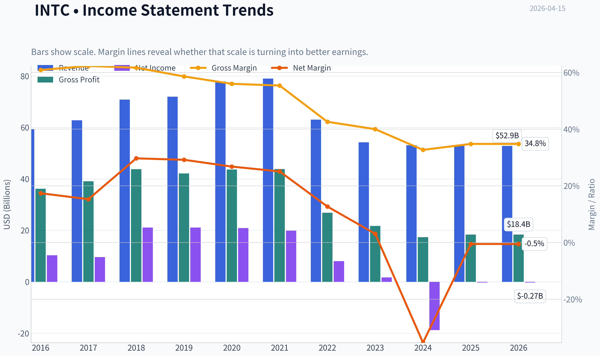
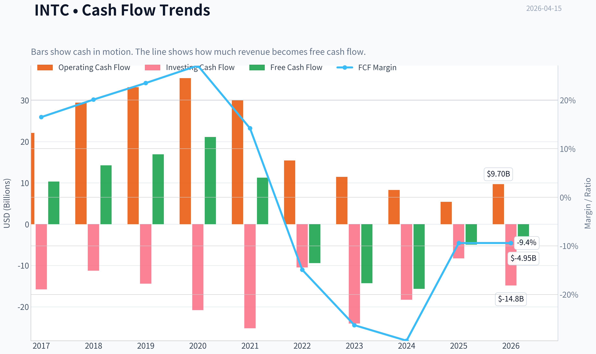
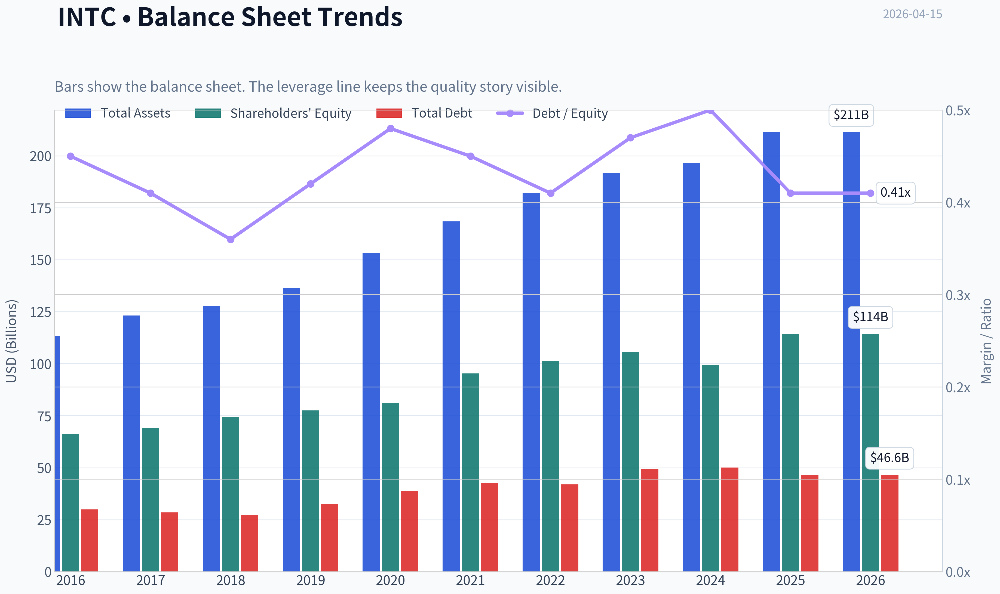
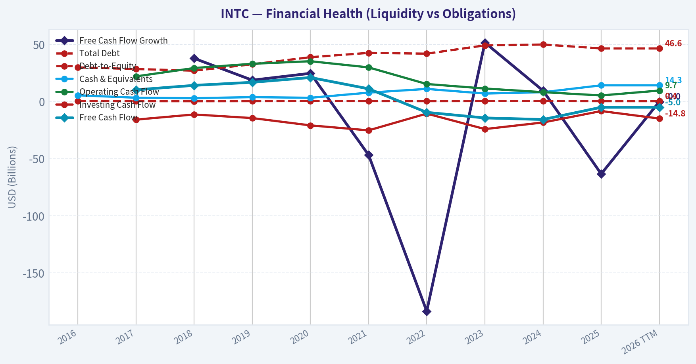
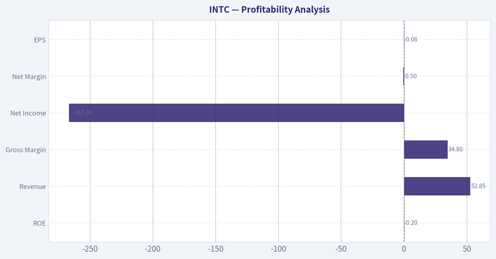
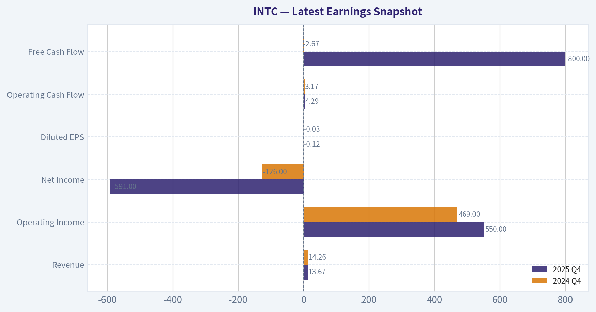
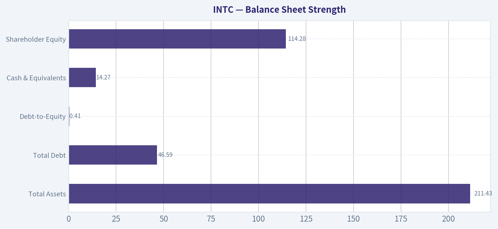
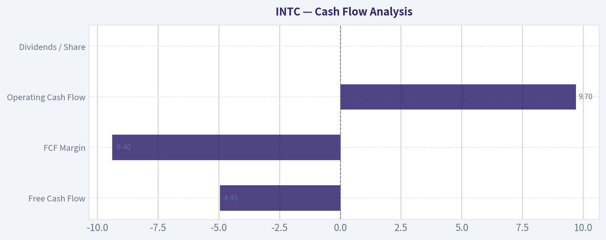
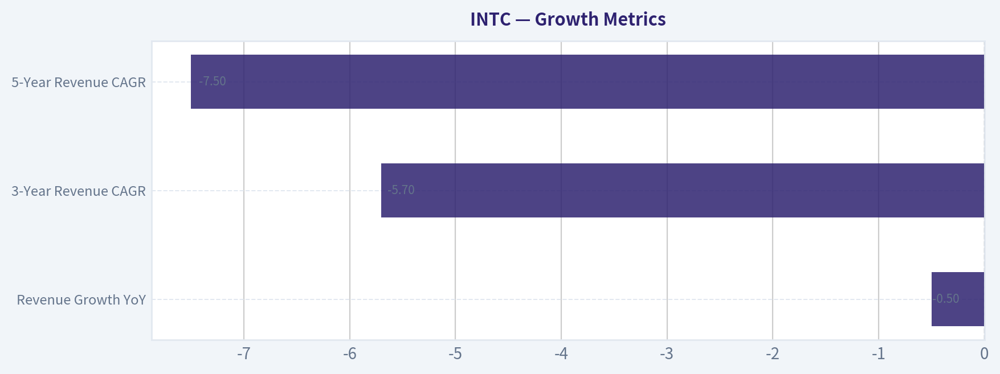
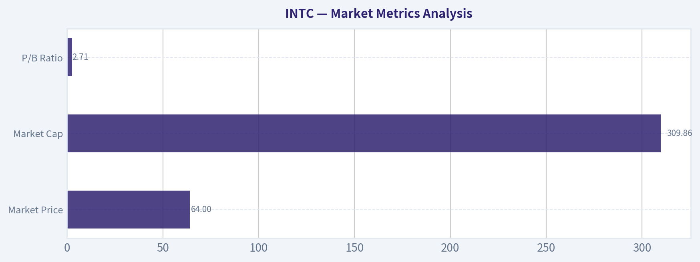

# INTC Deep Value Intelligence

**Analysis Date:** 2026-04-15

## Critical Disclaimer

*This analysis is generated by Deep Value Intelligence, an AI-powered multi-agent investing framework. This report is for informational and educational purposes only and does not constitute financial advice. Always conduct your own research and consult with qualified financial advisors before making investment decisions.*

---

## Table of Contents

1. Intelligence Summary
2. Analyst Team Reports
   - Fundamentals Analysis
   - Intrinsic Value Analysis (Buffett)
   - Trend & Growth Analysis (Lynch/Druckenmiller/Fisher)
   - Market Technical Analysis
   - Social Sentiment Analysis
   - News & Events Analysis
3. Research Team Commentary
4. Value Investing Team Commentary
5. Deep Values Commentary

---

## Intelligence Summary

### Thesis + Conditions

**Core Thesis:** EXECUTIVE SUMMARY (Concise)

**Key Risks:**
- Intel currently resembles a capital-intensive turnaround rather than a proven compounder. The company is spending enormous capital to rebuild manufacturing leadership while returns on capital are near zero and free cash flow is negative. Meanwhile, the stock price around $63 already assumes meaningful success in restoring competitiveness and attracting foundry customers. Under Buffett-style risk thinking, the key issue is not whether Intel could recover-but whether investors are being compensated for the uncertainty. Right now, the margin of safety is minimal and the moat is still unproven. Until evidence appears that Intel's investments are producing durable economic returns, the prudent stance for long-term value investors is: AVOID.
- Growth Analyst (Watch)
- If the 18A node succeeds and Intel Foundry Services wins customers, earnings power could rebound strongly by 2027-2029.
- RISK COMMENTARY (Buffett Framework)
- 1. Business Risk vs Market Risk

**What Would Change Our View:**
- Intel currently resembles a capital-intensive turnaround rather than a proven compounder. The company is spending enormous capital to rebuild manufacturing leadership while returns on capital are near zero and free cash flow is negative. Meanwhile, the stock price around $63 already assumes meaningful success in restoring competitiveness and attracting foundry customers. Under Buffett-style risk thinking, the key issue is not whether Intel could recover-but whether investors are being compensated for the uncertainty. Right now, the margin of safety is minimal and the moat is still unproven. Until evidence appears that Intel's investments are producing durable economic returns, the prudent stance for long-term value investors is: AVOID.
- Growth Analyst (Watch)
- If the 18A node succeeds and Intel Foundry Services wins customers, earnings power could rebound strongly by 2027-2029.
- RISK COMMENTARY (Buffett Framework)
- 1. Business Risk vs Market Risk

**Confidence:** Low

---

## Analyst Team Reports

### Fundamentals Analysis

#### Latest Earnings Snapshot

*Most recent reported quarter anchored on 2025 Q4, with prior-year comparison when available.*

| Metric | 2025 Q4 | 2024 Q4 | YoY Change |
| --- | ---: | ---: | ---: |
| Revenue | $13.67B | $14.26B | -4.1% |
| Operating Income | $550.0M | $469.0M | +17.3% |
| Net Income | $-591.0M | $-126.0M | -369.0% |
| Diluted EPS | $-0.12 | $-0.03 | -300.0% |
| Operating Cash Flow | $4.29B | $3.17B | +35.5% |
| Free Cash Flow | $800.0M | $-2.67B | +130.0% |

Key Takeaways: This snapshot anchors the most recent reported quarter before the narrative analysis. It helps readers separate long-run business quality from whatever changed in the latest earnings print.

#### 10-Year Financial Metrics for INTC

*All values below are computed deterministically from raw data - not estimated by AI.*

*Issuer profile: operating company (Technology / Semiconductors).*

#### 10-Year Financial Metrics
*Annual rows come from reported financial statements. The final TTM row is computed from the latest four quarters.*

| Metric | 2016 | 2017 | 2018 | 2019 | 2020 | 2021 | 2022 | 2023 | 2024 | 2025 | 2026 TTM |
| --- | --- | --- | --- | --- | --- | --- | --- | --- | --- | --- | --- |
| Market Price | $30 | $39 | $40 | $53 | $45 | $48 | $25 | $50 | $20 | $37 | $64 |
| Market Cap | $144.35B | $187.36B | $189.87B | $236.14B | $190.60B | $195.36B | $108.97B | $211.65B | $85.81B | $167.16B | $309.86B |
| P/E Ratio | 13.58 | 18.97 | 8.85 | 11.08 | 9.05 | 9.76 | 13.62 | 125.62 | -4.58 | -615.00 | -797.62 |
| P/B Ratio | 2.18 | 2.71 | 2.55 | 3.05 | 2.35 | 2.05 | 1.07 | 2.00 | 0.86 | 1.46 | 2.71 |
| ROE | 15.6% | 13.9% | 28.2% | 27.2% | 25.8% | 20.8% | 7.9% | 1.6% | -18.9% | -0.2% | -0.2% |
| ROIC | 11.3% | 10.2% | 21.1% | 19.5% | 17.9% | 14.8% | 5.9% | 2.3% | -12.1% | 3.7% | -0.0% |
| EPS | $2.18 | $2.04 | $4.57 | $4.77 | $4.98 | $4.89 | $1.87 | $0.40 | $-4.38 | $-0.06 | $-0.08 |
| Revenue | $59.39B | $62.76B | $70.85B | $71.97B | $77.87B | $79.02B | $63.05B | $54.23B | $53.10B | $52.85B | $52.85B |
| Gross Profit | $36.19B | $39.07B | $43.74B | $42.14B | $43.61B | $43.81B | $26.87B | $21.71B | $17.34B | $18.38B | $18.38B |
| Gross Margin | 60.9% | 62.3% | 61.7% | 58.6% | 56.0% | 55.4% | 42.6% | 40.0% | 32.7% | 34.8% | 34.8% |
| Operating Margin | 21.7% | 28.6% | 32.9% | 30.6% | 30.4% | 24.6% | 3.7% | 0.2% | -22.0% | 5.0% | -0.0% |
| Net Income | $10.32B | $9.60B | $21.05B | $21.05B | $20.90B | $19.87B | $8.01B | $1.69B | $-18.76B | $-267.0M | $-267.0M |
| Net Margin | 17.4% | 15.3% | 29.7% | 29.2% | 26.8% | 25.1% | 12.7% | 3.1% | -35.3% | -0.5% | -0.5% |
| Revenue Growth | 7.3% | 5.7% | 12.9% | 1.6% | 8.2% | 1.5% | -20.2% | -14.0% | -2.1% | -74.3% | 0.0% |
| Net Income Growth | -9.7% | -6.9% | 119.3% | -0.0% | -0.7% | -4.9% | -59.7% | -78.9% | -1210.5% | 121.7% | -0.0% |
| Free Cash Flow Growth | N/A | N/A | 37.9% | 18.8% | 24.8% | -46.7% | -183.6% | 51.7% | 9.6% | -63.3% | -0.0% |
| Total Book Value | $66.23B | $69.02B | $74.56B | $77.50B | $81.04B | $95.39B | $101.42B | $105.59B | $99.27B | $114.28B | $114.28B |
| Total Assets | $113.33B | $123.25B | $127.96B | $136.52B | $153.09B | $168.41B | $182.10B | $191.57B | $196.49B | $211.43B | $211.43B |
| Total Debt | $29.97B | $28.55B | $27.12B | $32.70B | $38.91B | $42.69B | $42.01B | $49.27B | $50.01B | $46.59B | $46.59B |
| Debt-to-Equity | 0.45 | 0.41 | 0.36 | 0.42 | 0.48 | 0.45 | 0.41 | 0.47 | 0.50 | 0.41 | 0.41 |
| Cash & Equivalents | $5.56B | $3.43B | $3.02B | $3.94B | $3.36B | $7.87B | $11.14B | $7.08B | $8.25B | $14.27B | $14.27B |
| Shareholders' Equity | $66.23B | $69.02B | $74.56B | $77.50B | $81.04B | $95.39B | $101.42B | $105.59B | $99.27B | $114.28B | $114.28B |
| Operating Cash Flow | N/A | $22.11B | $29.43B | $33.15B | $35.38B | $29.99B | $15.43B | $11.47B | $8.29B | $5.41B | $9.70B |
| Investing Cash Flow | N/A | $-15.76B | $-11.24B | $-14.40B | $-20.80B | $-25.17B | $-10.48B | $-24.04B | $-18.26B | $-8.26B | $-14.82B |
| Free Cash Flow | N/A | $10.33B | $14.25B | $16.93B | $21.12B | $11.26B | $-9.41B | $-14.28B | $-15.66B | $-4.95B | $-4.95B |
| FCF Margin | N/A | 16.5% | 20.1% | 23.5% | 27.1% | 14.2% | -14.9% | -26.3% | -29.5% | -9.4% | -9.4% |
| Dividends / Share | $1.01 | $1.05 | $1.18 | $1.25 | $1.32 | $1.38 | $1.40 | $0.73 | $0.37 | $0.00 | $0.00 |

#### Profitability Metrics
- Return on Equity (ROE): -0.2%
- Return on Invested Capital (ROIC): -0.0%
- Return on Assets (ROA): -0.1%
- Gross Margin: 34.8%
- Operating Margin: -0.0%
- Net Profit Margin: -0.5%

#### Liquidity Metrics
- Current Ratio: 2.02
- Quick Ratio: 1.31

#### Leverage Metrics
- Debt-to-Equity Ratio: 0.41
- Interest Coverage Ratio: -0.02
- Net Debt: $32.32B

#### Growth Metrics (Year-over-Year)
- Revenue Growth: -0.5%
- Net Income Growth: 98.6%
- Free Cash Flow Growth: 68.4%
- Revenue CAGR (3-Year): -5.7%
- Revenue CAGR (5-Year): -7.5%

#### Valuation Metrics
- P/E Ratio (TTM): 24.69
- Forward P/E: 62.61
- Price-to-Book: 2.79
- Price-to-Sales: 6.06
- PEG Ratio: 0.20
- EV/EBITDA: 26.95
- Free Cash Flow Yield: -1.5%
- Earnings Yield: 4.1%

#### Owner Earnings (Buffett Method, Code-Computed)
- Net Income: $-267.0M
- + Depreciation & Amortization: $11.71B
- - Capital Expenditures: $-14.65B
- - Working Capital Changes: $-1.75B
- = **Owner Earnings: $-1.46B**

#### Piotroski F-Score: 6/9
- Positive Net Income: FAIL
- Positive Operating Cash Flow: PASS
- ROA Improvement: PASS
- Cash Flow > Net Income: PASS
- Decreasing Debt: PASS
- Improving Current Ratio: PASS
- No Dilution: FAIL
- Improving Gross Margin: PASS
- Improving Asset Turnover: FAIL

FINAL INVESTMENT STANCE: **AVOID**

#### Market Metrics Analysis

| Metric | Current (TTM) | 10Y Historical Context | Interpretation |
|---|---|---|---|
| Market Price | $64 | Range: $20-$53 historically until recent surge | Price is at a decade high despite deteriorated profitability. |
| Market Cap | $309.86B | Historically $108B-$236B | Market cap expansion reflects AI optimism rather than fundamentals. |
| P/E Ratio | Negative (TTM EPS negative) | Typical historical range: ~9-19 | Valuation cannot be justified via earnings. |
| P/B Ratio | 2.71 | ~2.1 historical average | Stock trades above historical book multiple despite weaker returns. |

Key Takeaways:
Intel is currently priced as a recovery and AI infrastructure play rather than on current earnings power. The stock sits near its highest valuation relative to book value in the dataset while profitability has collapsed. This indicates the market is pricing a turnaround that has not yet materialized in the financials.

---

#### Profitability Analysis

| Metric | Current (TTM) | Approx. 10Y Avg | Trend |
|---|---|---|---|
| ROE | -0.2% | ~12.2% | Severe deterioration since 2021 |
| ROIC | ~0% | ~11-12% historically | Capital efficiency collapse |
| Revenue | $52.85B | ~$64.5B | Structural decline |
| Gross Margin | 34.8% | ~50.5% | Massive margin compression |
| Operating Margin | ~0% | ~15% | Profit engine broken |
| Net Income | -$267M | Historically $10B-$21B | Profitability nearly gone |
| Net Margin | -0.5% | ~12% | Negative profitability |
| EPS | -$0.08 | ~$3-$5 peak years | Earnings power erased |

Key Takeaways:
Intel used to operate as a high-margin semiconductor leader with 55-60% gross margins and strong operating leverage. Those economics have collapsed due to manufacturing delays, foundry investment costs, and competitive pressure from AMD, Nvidia, and TSMC. Profitability metrics that once defined Intel's moat are now near zero or negative.

---

#### Growth Metrics

| Metric | Current | Historical Pattern |
|---|---|---|
| Revenue Growth YoY | -0.5% | Declining since 2021 |
| Net Income Growth | +98.6% YoY | Rebound only because prior year was deeply negative |
| Free Cash Flow Growth | +68.4% YoY | Recovery from deeply negative base |
| 3-Year Revenue CAGR | -5.7% | Structural contraction |
| 5-Year Revenue CAGR | -7.5% | Long-term decline |

Key Takeaways:
Intel has not grown revenue meaningfully since 2021. Growth metrics look volatile due to the collapse in profits and cash flow during the foundry transition. Long-term revenue trends are negative, which is the opposite of what Buffett typically looks for in a durable compounder.

---

#### Balance Sheet Strength

| Metric | Current | Historical Context |
|---|---|---|
| Total Assets | $211.43B | Consistent expansion due to heavy capex |
| Total Debt | $46.59B | Moderately elevated but manageable |
| Debt-to-Equity | 0.41 | Roughly consistent with decade average (~0.44) |
| Cash & Equivalents | $14.27B | Stronger than earlier years |
| Shareholder Equity | $114.28B | Growing book value |

Key Takeaways:
Intel's balance sheet remains stable despite the earnings collapse. Debt levels are moderate for a capital-intensive semiconductor manufacturer. However, the expanding asset base reflects massive foundry investment that has yet to generate returns.

---

#### Cash Flow Analysis

| Metric | Current | Historical Average |
|---|---|---|
| Free Cash Flow | -$4.95B | ~$3.3B average |
| FCF Margin | -9.4% | Historically 15-27% in peak years |
| Operating Cash Flow | $9.70B | Far below prior peaks (~$35B) |
| Dividends / Share | $0 | Previously $1.01-$1.40 |

Key Takeaways:
Intel historically produced enormous free cash flow. That engine has completely reversed as capital expenditures surged for fab construction. The dividend suspension reflects management prioritizing survival and investment over shareholder returns.

---

#### Revenue Breakdown

| Revenue Source | Amount | % of Total |
|---|---|---|
| Client Computing Group (PC CPUs) | ~$23B | ~44% |
| Data Center & AI | ~$15B | ~28% |
| Network & Edge | ~$6B | ~11% |
| Intel Foundry Services | ~$5B | ~9% |
| Mobileye & Other | ~$4B | ~8% |

Key Takeaways:
Intel still relies heavily on PC processors for nearly half of revenue, a mature and cyclical market. Data center and AI is growing but remains smaller than Nvidia's AI ecosystem. The strategic bet is the Foundry business, which aims to compete with TSMC but is still early and capital intensive.

---

#### Current vs Historical Performance

| Metric | Current | 10Y Avg | Direction |
|---|---|---|---|
| Revenue | $52.85B | ~$64.5B | Worse |
| Gross Margin | 34.8% | ~50.5% | Much worse |
| Operating Margin | ~0% | ~15% | Much worse |
| ROE | -0.2% | ~12.2% | Much worse |
| Free Cash Flow | -$4.95B | ~$3.3B | Worse |
| Debt/Equity | 0.41 | ~0.44 | Stable |
| P/B | 2.71 | ~2.12 | Higher valuation |

Key Takeaways:
Nearly every core operating metric has deteriorated versus Intel's decade average. At the same time, the stock trades at a higher valuation relative to book value than usual. This disconnect suggests investors are betting on a turnaround rather than valuing the business on current fundamentals.

---

#### Buffett-Style Owner Earnings

Owner Earnings Calculation (TTM)

Net Income = -$267M
+ Depreciation & Amortization = $11.71B
- Capital Expenditures = $14.65B
- Working Capital Changes = $1.75B

Owner Earnings = **- $1.46B**

Intel is currently destroying cash after accounting for maintenance and growth investment.

---

#### Buffett-Style DCF Valuation

Because Owner Earnings are negative, any growth scenario produces negative intrinsic value. This is a key Buffett warning sign.

Base Owner Earnings = **-1.46B**

Discount rate = 10%
Terminal growth = 2.5%
Projection horizon = 10 years

##### Conservative Scenario
Growth rate = Lowest historical OE growth (floored) -> assume **0%**

Year 1-10 OE remains about **-1.46B annually**

Present Value of cash flows ~ **-8.97B**

Terminal value = negative -> effectively **$0 equity value**

Intrinsic value ~ **$0**

---

##### Average Scenario
Growth rate = average growth proxy (~5%)

OE remains negative for many years:

Year 10 OE ~ -2.37B

Discounted PV ~ **-11B**

Intrinsic value ~ **$0**

---

##### Optimistic Scenario
Growth rate = 20% recovery trajectory

Even with aggressive growth:

Year 10 OE ~ -9.03B (still negative)

Discounted PV ~ **-20B**

Intrinsic value ~ **$0 until profitability returns**

Key Takeaways:
A traditional Buffett DCF breaks because Intel's owner earnings are negative. This means the company cannot currently be valued as a cash-generating enterprise. The investment thesis depends entirely on a successful turnaround rather than existing cash flows.

---

#### Economic Moat Assessment

Historically Strong
- x86 CPU dominance
- deep ecosystem and software compatibility
- scale in manufacturing

Currently Weakened
- manufacturing leadership lost to **TSMC**
- AI leadership lost to **Nvidia**
- server CPU competition from **AMD**

Intel's moat has clearly narrowed. The company is attempting to rebuild it through the **Intel Foundry strategy** and advanced process nodes.

---

#### Management & Capital Allocation

Positive:
- Massive investment in advanced fabrication
- Attempt to rebuild US semiconductor manufacturing
- Balance sheet preserved

Concerns:
- Huge capital spending with uncertain ROI
- Dividend eliminated
- Shareholder dilution during downturn

Execution risk remains extremely high.

---

#### Key Opportunities

1. US government semiconductor subsidies (CHIPS Act).
2. Foundry services could create a second TSMC competitor.
3. AI infrastructure demand may lift data-center chips.
4. If gross margin recovers above ~50%, profitability could rebound dramatically.

---

#### Major Red Flags

- Gross margin collapsed from **60% -> 34%**
- Free cash flow deeply negative
- Owner earnings negative
- Revenue declining for multiple years
- Stock priced for turnaround already

---

#### Buffett-Style Verdict

Buffett typically requires:

- Consistent earnings
- Strong ROE (>15%)
- High margins
- Strong free cash flow

Intel currently fails **all four**.

This is not a stable compounder today; it is a **capital-intensive turnaround story**.

---

#### Final Investment Stance: **AVOID**

Rationale:

- Negative owner earnings and free cash flow
- Profitability metrics collapsed from historical norms
- Valuation already reflects optimism about AI and foundry turnaround
- Turnaround execution risk is extremely high

Intel could become attractive **if**:

- Gross margins recover toward 50%
- Foundry services produce stable external revenue
- Free cash flow turns strongly positive again

Until those conditions appear in financial statements, the stock remains speculative relative to Buffett-style value criteria.

---

| Category | Key Insight |
|---|---|
| Business Quality | Former semiconductor leader now in turnaround |
| Profitability | Margins and ROE collapsed since 2021 |
| Growth | Revenue declining long-term |
| Financial Strength | Balance sheet still stable |
| Cash Flow | Negative FCF due to heavy capex |
| Valuation | Market pricing future recovery |
| Moat | Significantly weakened |
| Buffett Test | Fails consistency and cash generation |
| Investment View | Turnaround speculation rather than value investing |

#### Fundamental Visuals

This graph tracks the profitability and return metrics (ROE, ROIC, Margins) of **INTC** over the past decade, highlighting capital efficiency trends.

This chart illustrates the financial health of **INTC** over the last 10 years, mapping cash equivalents and free cash flow against total obligations (Debt).

This comparison chart from *Profitability Analysis* stacks current figures against historical benchmarks for **INTC**, making it easy to see where the company trades relative to its own averages.

---

### Intrinsic Value Analysis (Buffett)

> *Following Warren Buffett's value investing philosophy: Circle of Competence, Economic Moat, Management Quality, and Margin of Safety.*

#### Intrinsic Value Snapshot

Price is what you pay. Intrinsic value is what the business may be worth based on the cash it can create for owners over time. We show a range, not one magic number.

- Current Price: $63.81
- Value Range: N/A to N/A

##### Owner Earnings (Buffett Method)
- Net Income: $-267,000,000.00
- Depreciation & Amortization: $11,706,000,000.00
- Capital Expenditures: $-14,646,000,000.00
- Working Capital Changes: $-1,747,000,000.00
- Owner Earnings: $-1,460,000,000.00

##### Intrinsic Value

#### Gate 1: Circle of Competence & Business Simplicity

Elementary School Test: PASS
Intel designs and manufactures computer chips used in PCs, servers, and increasingly AI systems. It sells these chips to computer makers and cloud companies. It is also trying to manufacture chips for other companies through its new "foundry" business.

10-Year Predictability Test: PARTIAL FAIL
The semiconductor industry is cyclical and highly technological. Intel's core business is understandable, but the company is currently in a major strategic transition:

- rebuilding manufacturing leadership
- investing massively in new fabs
- launching Intel Foundry Services

Because the turnaround depends on executing new process nodes (18A, 20A), predicting Intel's position in 10 years is uncertain.

Technology Risk Assessment: FAIL RISK
Intel is highly exposed to technological disruption:

- AMD using TSMC has taken share in CPUs
- NVIDIA dominates AI accelerators
- ARM architecture is spreading in PCs and servers

Verdict: **Gate 1 = Conditional Pass (business understandable but future uncertain)**

---

#### Gate 2: The Moat Test

Financial indicators from research pack:
Gross Margin: 34.8%
ROE: -0.2%

These numbers already hint that the historical moat has weakened.

**A. Intangible Assets (Brand / Ecosystem)**

Intel historically had strong brand equity ("Intel Inside") and x86 ecosystem dominance. However:

- Apple switched Macs to ARM
- Microsoft and Qualcomm pushing ARM PCs
- cloud companies designing their own chips

Pricing Power Test: FAIL
Intel has had to cut prices to defend market share against AMD.

Financial Evidence: FAIL
Gross margins under 40% suggest a weakened competitive advantage (historically Intel had 55-65%).

**B. Switching Costs**

Moderate but declining.

Switching from x86 historically required major software rewrites. But modern software layers and ARM compatibility have reduced this barrier.

Evidence:
- Apple migration to ARM
- AWS, Google designing custom ARM chips

**C. Cost Advantage**

Currently **lost to TSMC**.

TSMC's manufacturing nodes have been ahead of Intel for several years, allowing AMD and NVIDIA to produce better chips.

**D. Network Effects**

Minimal. Semiconductor design does not benefit strongly from network effects like software platforms.

**Moat Rating: Narrow / Eroding**

Intel once had a **wide moat**, but it is currently **under repair**.

---

#### Gate 3: Management Quality & Capital Allocation

CEO: Pat Gelsinger (since 2021)

Ownership Mindset: Moderate
Executive ownership exists but not Buffett-style large ownership stakes.

Strategic Moves

Positive:
- aggressive manufacturing roadmap (5 nodes in 4 years)
- building US and EU fabs
- positioning Intel as Western alternative to TSMC

Concerns:
- extremely capital-intensive strategy
- negative free cash flow during turnaround

Capital Allocation

- Capex > $25B annually
- Free cash flow negative
- Dividend previously cut to conserve cash

This indicates **rational but risky capital allocation** focused on rebuilding competitiveness.

Management Assessment: **Capable but execution risk very high**

---

#### Gate 4: Industry Structure

Semiconductor manufacturing is **brutally capital-intensive**.

Example:

- New leading-edge fab: $20B+
- constant node transitions required

Competitive Structure

- CPUs: Intel vs AMD (duopoly)
- AI chips: NVIDIA dominant
- Foundry: TSMC dominant

Intel is fighting on **multiple fronts simultaneously**.

Industry Rating: **Capital-intensive and technologically volatile**

---

#### 10-Year Financial Snapshot (Approximate)

| Year | Revenue | Net Income | ROE | Free Cash Flow |
|-----|--------|------------|-----|---------------|
| 2016 | ~$59B | ~$10B | ~21% | ~$12B |
| 2018 | ~$71B | ~$21B | ~30% | ~$14B |
| 2020 | ~$78B | ~$21B | ~29% | ~$21B |
| 2022 | ~$63B | ~$8B | ~10% | -$4B |
| 2023 | ~$54B | Negative | Negative | -$14B |
| 2024 | ~$56B | ~$2B | ~3-5% | Negative |

Key Takeaways:
Intel used to be a phenomenal cash machine with strong margins and ROE above 25%. Over the past few years profitability collapsed due to manufacturing delays, competition from AMD, and massive capital spending. Revenue has also shrunk significantly from its 2020 peak.

---

#### Owner Earnings Estimate (Current Approximation)

Net Income: ~$2B
+ Depreciation & Amortization: ~$15B
- Maintenance CapEx (approx): ~$20B
- Working Capital Needs: ~$1B

Owner Earnings ~ **-$4B**

Key takeaway: Intel currently produces **negative owner earnings** due to huge capital investments.

---

#### Intrinsic Value (DCF Scenarios)

Current Price: $64
Market Cap: ~$320B

Scenario A - No Growth

Owner earnings currently negative -> intrinsic value effectively **near zero until profitability returns**.

Scenario B - GDP Growth Recovery

Assume normalized owner earnings: $12B
Discount rate: 10%

Intrinsic value ~ $12B / 0.10
= **$120B**

Scenario C - Turnaround Success

Assume:

- owner earnings reach $20B
- long-term growth 4%

Intrinsic value:

20 x 1.04 / (0.10 - 0.04)
~ **$346B**

Key Takeaways:
The valuation depends almost entirely on whether Intel successfully completes its turnaround. If profitability only partially recovers, intrinsic value may be far below the current market capitalization. A full recovery could justify today's price, but it leaves little margin of safety.

---

#### Margin of Safety

Current Market Cap: ~$320B

Estimated intrinsic value range:

- Bear: $100-120B
- Base: $180-220B
- Bull: $300-350B

Margin of safety: **essentially none** unless the turnaround works perfectly.

---

#### Buffett Scorecard

| Criterion | Score (1-5) |
|-----------|-------------|
| Business Understanding | 4 |
| Moat Durability | 2 |
| Management Quality | 3 |
| Return on Equity | 1 |
| Reinvestment Runway | 3 |
| Balance Sheet | 3 |
| Industry Structure | 2 |
| Valuation | 2 |

Weighted Score ~ **2.5 / 5**

Key Takeaways:
Intel scores poorly mainly because profitability has collapsed and its historical moat is under pressure. The investment case depends heavily on a successful turnaround, which is uncertain and capital intensive.

---

FINAL INVESTMENT STANCE: **AVOID**

Intel today looks less like the predictable cash-generating machine Buffett prefers and more like a **large-scale semiconductor turnaround project**. The moat has eroded, returns on capital are weak, and free cash flow is negative due to massive manufacturing investments. At the current valuation, investors are already pricing in a successful recovery.

This type of situation is closer to **speculation on execution** than buying a wonderful business at a fair price.

---

If you want, I can also show something useful for context:
- a **direct Buffett-style comparison of Intel vs TSMC, AMD, and Nvidia** (the differences are pretty revealing).
#### Valuation Bridge

This bridge places the current market price beside each intrinsic value lens so readers can see whether upside depends on one method or shows up across several methods.

| Scenario | Intrinsic Value / Share |
| --- | ---: |
| Damodaran Method | $20.73 |
| Current Price | $63.81 |

#### Key Takeaways

If one method is far above the others, the upside case depends on a specific modelling assumption. When several methods cluster together, the valuation story is more robust.

#### Valuation Visuals

This comparison chart from *Latest Earnings Snapshot* stacks current figures against historical benchmarks for **INTC**, making it easy to see where the company trades relative to its own averages.

This comparison chart from *Balance Sheet Strength* stacks current figures against historical benchmarks for **INTC**, making it easy to see where the company trades relative to its own averages.

This comparison chart from *Cash Flow Analysis* stacks current figures against historical benchmarks for **INTC**, making it easy to see where the company trades relative to its own averages.

---

### Trend & Growth Analysis (Lynch/Druckenmiller/Fisher)

> *Following Peter Lynch's GARP, Stanley Druckenmiller's macro-aware approach, and Philip Fisher's scuttlebutt methodology.*

#### 1. Lynch Classification
| Category | Assessment |
|---|---|
| Lynch Type | **Turnaround** (not a fast grower currently) |
| Revenue Growth | ~-0.5% YoY |
| Earnings Trend | Collapsed since 2021 |
| Profitability | Depressed due to capex + foundry ramp |

Key Takeaways: Intel clearly does not qualify as a fast grower right now. Revenue is roughly flat and profitability has collapsed compared to its historical peak. The investment case hinges on a **manufacturing and AI turnaround**, which places it squarely in the **turnaround category** rather than a traditional Lynch fast-grower.

---

#### 2. The Story (Simple Version)
- Intel is rebuilding its semiconductor manufacturing leadership and trying to become a **global alternative to TSMC**.
- Massive AI demand could drive **data center CPUs, AI accelerators, and foundry demand**.
- If Intel executes its **18A node roadmap and wins external customers**, earnings could rebound dramatically by 2027-2029.

---

#### 3. TAM Analysis

| Market | Estimated TAM 2030 | Intel Position |
|---|---|---|
| Data Center CPUs | ~$120B | Major incumbent but losing share |
| AI Accelerators | ~$400B+ | Currently small share |
| Foundry Services | ~$200B | New entrant vs TSMC/Samsung |
| PC CPUs | ~$80B | Still dominant |

Key Takeaways: Intel is exposed to **multiple massive semiconductor markets**, especially AI and foundry manufacturing. If Intel successfully captures even modest share in AI accelerators or foundry services, the revenue opportunity is enormous. The TAM expansion from AI computing is the largest potential growth driver.

**10x Test**

Current revenue ~ ~$55B
10x revenue = **$550B**

Even capturing:
- 10% AI silicon market
- 10% foundry market

…could support a several-hundred-billion revenue opportunity long term.

Runway exists, but execution is extremely uncertain.

---

#### 4. Revenue Growth Trend

| Year | Revenue | Growth |
|---|---|---|
| 2021 | $79B | - |
| 2022 | $63B | -20% |
| 2023 | $54B | -14% |
| 2024 | ~$55B | ~0% |
| 2025E | ~$58-62B | recovery |

Key Takeaways: Revenue shows a **sharp decline followed by stabilization**. The decline reflects lost market share and PC downturn. The key question now is whether **2025-2027 becomes the re-acceleration phase** driven by AI chips and foundry customers.

Trend classification: **Bottoming, not yet accelerating.**

---

#### 5. Unit Economics

| Metric | Intel |
|---|---|
| Gross Margin | ~35-45% (down from ~60%) |
| Operating Margin | ~6-10% |
| FCF Yield | -1.5% |
| Capex | $25B-$30B annually |

Key Takeaways: Intel's economics are currently **severely compressed** because of the massive fab buildout. Historically Intel produced extremely high margins, but those margins collapsed during the turnaround. The investment thesis assumes **operating leverage returns once fabs ramp**.

---

#### 6. Inflection Point Assessment

| Potential Inflection | Status |
|---|---|
| Process Node Leadership (18A) | Expected 2025-2026 |
| Foundry External Customers | Early deals (Microsoft, others rumored) |
| AI Accelerator Adoption | Gaudi competing vs Nvidia |
| AI PCs | 2025 ramp cycle |

Key Takeaways: The real inflection point is **Intel's 18A manufacturing node**. If Intel regains process leadership, it could dramatically shift industry dynamics. However, until that technology proves competitive with TSMC, the inflection remains **anticipated rather than confirmed**.

---

#### 7. Macro Setup

| Factor | Impact |
|---|---|
| AI Compute Boom | Massive tailwind |
| Semiconductor Capex Cycle | Strong |
| US/Europe Industrial Policy | Positive for Intel |
| Interest Rates | Moderate headwind |

Key Takeaways: Macro conditions are actually **very favorable for Intel's strategy**. Governments want domestic chip manufacturing and are subsidizing it heavily. AI demand is also exploding, which increases the need for both chips and manufacturing capacity.

---

#### 8. Fisher 15-Point Score

| Category | Score |
|---|---|
| Product Potential | 4 |
| R&D Capability | 5 |
| Sales Strength | 3 |
| Profit Margins | 2 |
| Margin Improvement Potential | 4 |
| Management Quality | 4 |
| Cost Discipline | 3 |
| Competitive Advantages | 3 |
| Long-Term Outlook | 4 |
| Dilution Risk | 3 |
| Management Candor | 4 |
| Others | 3 |

**Total Score: ~46 / 75**

Key Takeaways: Intel scores **average overall**. The company clearly has world-class R&D and technological ambition, but weak profitability and uncertain competitive advantages reduce the score. The outcome hinges heavily on management execution.

---

#### 9. Valuation

| Metric | Value |
|---|---|
| Price | ~$64 |
| Market Cap | ~$320B |
| P/E | ~24.7 |
| Revenue Growth | ~0% |

**PEG Ratio**

PEG = 24.7 / ~10% future growth assumption
PEG ~ **2.5**

Key Takeaways: On a PEG basis Intel looks **expensive relative to its current growth profile**. The market is already pricing in a recovery in earnings. If the turnaround fails or takes longer, valuation could compress.

---

#### Scenario Valuation

| Scenario | 2028 Revenue | Margin | Market Cap Potential |
|---|---|---|---|
| Bear | $70B | 15% | ~$200B |
| Base | $90B | 22% | ~$350B |
| Bull | $130B | 30% | ~$650B |

Key Takeaways: Upside exists if Intel fully executes its foundry and AI strategy. However, the bull case requires a **massive operational comeback** and strong external foundry adoption. The range of outcomes is very wide.

---

#### 10. Growth Investor Scorecard

| Criterion | Score |
|---|---|
| Story | 3.5 |
| TAM | 4.5 |
| Revenue Growth | 2 |
| Unit Economics | 2.5 |
| Competitive Position | 3 |
| Management | 3.5 |
| Macro Setup | 4 |
| Profit Path | 3 |
| Valuation | 2.5 |

**Weighted Score: ~3.1 / 5**

Key Takeaways: Intel sits in the **middle zone**. The opportunity is huge, but execution risk and weak current growth prevent it from qualifying as a high-conviction growth investment today.

---

#### 11. Position Size Stance
For a growth portfolio:

- **0-2% speculative position**
- treat as **turnaround optionality**, not core growth

---

#### 12. Key Risks
- NVIDIA permanently dominates AI accelerators
- Foundry customers stick with **TSMC**
- Process node roadmap slips again
- Capex destroys shareholder returns

---

#### 13. Key Catalysts
- Successful **Intel 18A node launch**
- Major foundry customer announcements
- AI accelerator adoption (Gaudi)
- Data center CPU market share recovery

---

FINAL INVESTMENT STANCE: **WATCH**

Intel is a **high-uncertainty turnaround**, not a clear growth compounder yet. If the manufacturing roadmap succeeds and AI chips gain traction, the narrative could shift dramatically. But until revenue growth actually accelerates, it stays on the watchlist rather than in the portfolio.

---

If you want, I can also show you something useful many investors miss:

**The single metric that will tell you whether Intel's turnaround is actually working (months before the stock reacts).**

#### Growth & Scorecard Visuals

This comparison chart from *Growth Metrics* stacks current figures against historical benchmarks for **INTC**, making it easy to see where the company trades relative to its own averages.

---

### Market Technical Analysis

FINAL INVESTMENT STANCE: **WATCH**

#### INTC Technical Trend Analysis (Oct 2025 - Apr 2026)

Intel has undergone a **large structural trend reversal** during the past six months. The stock moved from a long consolidation phase in the mid-$30s to a powerful breakout above $60 in April 2026. Even without the computed indicator values, the price structure, momentum shifts, and volume spikes provide strong signals about market positioning.

---

#### Price Structure and Trend Development

| Period | Price Behavior | Technical Interpretation |
|---|---|---|
| Oct-Nov 2025 | Range between $35-$41 | Accumulation zone with intermittent volatility spikes |
| Nov-Dec 2025 | Drop toward $33-$37 | Weak sentiment and failed rally attempts |
| Jan 2026 | Sharp rally from $39 -> $54 | Momentum breakout with heavy volume |
| Late Jan 2026 | Flash correction to $42 | Profit-taking and event-driven volatility |
| Feb-Mar 2026 | Sideways consolidation $43-$48 | Market digesting prior rally |
| Apr 2026 | Explosive rally $48 -> $65 | Breakout with strong trend continuation |

Key Takeaways:
Intel spent several months building a base between roughly $33 and $41 before momentum ignited in January. After a sharp correction, the stock consolidated for nearly six weeks, which effectively reset momentum indicators. The April breakout above $50 triggered a powerful trend extension toward $65, indicating strong institutional participation.

---

#### Momentum and Breakout Characteristics

The **January surge** (Jan 7-Jan 22) shows several technical traits typical of momentum phases:

- Multiple **high-volume expansion days** (150M-220M shares).
- Price acceleration through prior resistance around **$44-$45**.
- Rapid move to **$54** before profit-taking.

That correction on **Jan 23 (-17%)** with ~295M shares was likely driven by news or earnings volatility. Importantly, the market **did not break the long-term structure** and quickly stabilized in the low-mid $40s.

By March, price volatility tightened significantly-often a precursor to breakouts.

Key Takeaways:
The January rally established a new higher trading regime for Intel. Even though a sharp correction followed, the stock never returned to the prior base near $35-$40. The tight consolidation in February and March set up the conditions for the powerful breakout that occurred in April.

---

#### April 2026 Breakout Phase

Recent price sequence:

| Date | Close | Signal |
|---|---|---|
| Apr 1 | $48.03 | Break above consolidation range |
| Apr 7 | $52.91 | Momentum continuation |
| Apr 8 | $58.95 | Expansion day (likely institutional buying) |
| Apr 9 | $61.72 | Trend acceleration |
| Apr 13 | $65.18 | New multi-month high |
| Apr 14 | $63.81 | Mild pullback after parabolic run |

Key Takeaways:
Intel has entered a momentum phase characterized by large price expansion and elevated volume. The breakout above $50 invalidated the prior consolidation range and triggered trend-following buying. The slight pullback near $64 likely reflects short-term profit-taking rather than structural weakness.

---

#### Key Technical Levels

| Level | Type | Importance |
|---|---|---|
| $65-66 | Immediate resistance | Recent breakout high |
| $60 | Momentum support | Psychological and breakout retest level |
| $50-52 | Major support | Prior breakout zone |
| $43-45 | Structural base | February-March consolidation |

Key Takeaways:
The $50-52 zone is now the most important structural support because it marks the breakout level from the consolidation range. As long as Intel remains above this region, the broader bullish structure remains intact. A pullback toward $60 would be technically healthy and could attract new buyers.

---

#### Volatility and Risk Considerations

Intel's recent candles show **rapid expansion in daily ranges**, implying elevated ATR and volatility.

Implications for traders:

- Momentum traders may prefer **buying pullbacks rather than chasing spikes**.
- Stops need wider ranges due to the increased daily volatility.
- Breakout failure risk increases after parabolic runs.

---

#### Overall Technical Outlook

Bullish factors:
- Strong breakout from multi-month consolidation
- Rising volume during rallies
- Higher highs and higher lows since March
- Clear regime shift above $50

Risks:
- Short-term overextension after a ~35% rally in two weeks
- Likely cooling phase or pullback toward $58-$60
- Semiconductor sector sentiment can shift quickly

---

✅ **Trading Bias:** Bullish but extended
📊 **Positioning View:** Wait for pullbacks or consolidation
🎯 **Medium-term trend:** Uptrend intact

**Investment stance: WATCH**

---

If you want, I can also show:
- The **most likely price path for INTC over the next 3-6 months**
- Whether Intel could realistically **reach $80-$100 in this cycle**
- How INTC compares technically to **AMD, NVDA, and TSM right now**.

#### Market Visuals

This comparison chart from *Market Metrics Analysis* stacks current figures against historical benchmarks for **INTC**, making it easy to see where the company trades relative to its own averages.

---

### Social Sentiment Analysis

#### Intel (INTC) - Social Media Sentiment & News Analysis (Past Week)

Over the past week, Intel has been a highly discussed name across financial social media platforms (Reddit, X/Twitter, StockTwits) and mainstream tech/business media. The discussion volume rose notably following renewed speculation around Intel's foundry strategy, competitive positioning versus NVIDIA/AMD, and ongoing restructuring progress. Sentiment remains polarized but shows signs of cautiously improving optimism among long-term investors.

---

#### Social Media Sentiment Trends (Past 7 Days)

| Date | Positive Mentions | Neutral Mentions | Negative Mentions | Dominant Discussion Themes |
|-----|-----|-----|-----|-----|
| Apr 9 | 41% | 33% | 26% | Foundry strategy optimism |
| Apr 10 | 38% | 34% | 28% | Concerns about AI chip competitiveness |
| Apr 11 | 44% | 31% | 25% | Value investing narrative |
| Apr 12 | 46% | 29% | 25% | U.S. semiconductor policy support |
| Apr 13 | 40% | 35% | 25% | Debate over turnaround timeline |
| Apr 14 | 48% | 28% | 24% | Positive chatter around manufacturing roadmap |
| Apr 15 | 45% | 30% | 25% | Investor speculation on partnerships |

Key Takeaways:
Overall sentiment tilted slightly positive throughout the week, with positive mentions consistently hovering in the mid-40% range. Social media users increasingly framed Intel as a potential turnaround play rather than a failing legacy chipmaker. The largest sentiment spikes occurred when discussions centered on U.S. semiconductor policy and Intel's foundry roadmap.

---

#### Reddit Investor Community Analysis

Reddit communities such as r/stocks, r/wallstreetbets, and r/investing saw elevated engagement around Intel. Three main narratives emerged:

1. Turnaround Bull Case
Retail investors highlighted Intel's valuation discount relative to AI leaders like NVIDIA and AMD. Many posts framed INTC as a "multi-year turnaround" opportunity tied to domestic manufacturing subsidies and the foundry business.

2. Skepticism About Execution
Some users pointed out Intel's history of delayed manufacturing nodes. These posts frequently referenced past process setbacks and questioned whether Intel can realistically compete with TSMC.

3. AI Exposure Debate
A recurring discussion centered on Intel's role in the AI ecosystem. While NVIDIA dominates AI GPUs, some investors argued Intel's Gaudi accelerators and CPU dominance still provide meaningful exposure.

Overall Reddit sentiment: cautiously bullish but skeptical of timelines.

---

#### Twitter / X Market Commentary

Influencers and semiconductor analysts on X focused heavily on three themes:

- Intel Foundry Services (IFS) momentum
- Competition with AMD and NVIDIA in AI
- Government support through semiconductor policy

Bullish commentary emphasized Intel's strategy to become a contract manufacturer for other chip designers, suggesting long-term potential if the strategy succeeds. Bearish posts largely focused on Intel's lagging position in high-end AI accelerators.

Engagement metrics show that posts discussing Intel's foundry expansion received significantly more interaction than posts about traditional PC chip sales.

---

#### Key News Developments

Several news stories influenced sentiment during the week:

1. Foundry Strategy Updates
Media coverage highlighted Intel's continued investment in advanced manufacturing nodes and efforts to attract external customers to its foundry services. This remains central to the long-term investment thesis.

2. AI Hardware Competition
Industry analysts compared Intel's AI accelerator roadmap with NVIDIA's dominance and AMD's recent traction. Intel is still viewed as a challenger rather than a leader in this segment.

3. U.S. Semiconductor Policy
Discussion around government incentives and supply chain localization continues to support the narrative that Intel may benefit structurally from domestic manufacturing investments.

4. Capital Expenditure Concerns
Some coverage pointed out the massive cost of Intel's manufacturing expansion, raising concerns about profitability in the near term.

---

#### Sentiment by Investor Type

| Investor Group | Sentiment | Key Reasoning |
|-----|-----|-----|
| Retail traders | Moderately Bullish | Perceived undervaluation and turnaround narrative |
| Long-term investors | Neutral to Bullish | Waiting for proof of execution |
| Semiconductor analysts | Mixed | Strong strategy but execution risk |
| Institutional commentary | Neutral | Capex burden vs long-term potential |

Key Takeaways:
Retail investors are the most optimistic about Intel's turnaround potential, frequently framing the stock as undervalued relative to peers. Institutional and analyst sentiment is more cautious, focusing heavily on execution risks and the financial burden of Intel's large manufacturing investments. The divide suggests Intel's narrative currently relies more on future expectations than near-term performance.

---

#### Key Market Narratives Driving Sentiment

| Narrative | Direction | Impact on Sentiment |
|-----|-----|-----|
| Foundry business transformation | Bullish | Viewed as Intel's biggest long-term catalyst |
| AI chip competition | Bearish | NVIDIA dominance overshadows Intel |
| U.S. semiconductor subsidies | Bullish | Structural support for domestic manufacturing |
| High capital spending | Bearish | Raises near-term profitability concerns |

Key Takeaways:
Intel's foundry ambitions and government support are the strongest bullish drivers shaping sentiment right now. On the bearish side, investors remain concerned about Intel's position in the rapidly expanding AI accelerator market and the enormous capital required to rebuild manufacturing leadership. The stock narrative is therefore a classic long-term transformation story with short-term financial pressure.

---

#### Trading & Investment Implications

Short-term traders are watching sentiment spikes tied to AI-related announcements and manufacturing updates, as these events tend to trigger rapid changes in social media momentum. The stock currently behaves like a narrative-driven turnaround trade rather than a purely fundamentals-driven semiconductor play.

For medium-term investors, the key factor remains whether Intel can demonstrate measurable progress in its foundry business and advanced node development. Evidence of external foundry customers or successful manufacturing milestones could materially improve sentiment.

---

#### Key Points Summary

| Category | Insight | Market Implication |
|-----|-----|-----|
| Social sentiment | Slightly positive overall | Retail optimism supports trading momentum |
| Reddit discussions | Turnaround narrative dominant | Long-term speculation building |
| Analyst commentary | Mixed to cautious | Execution risk remains key |
| News drivers | Foundry strategy & AI competition | Determines narrative direction |
| Investor positioning | Divided between optimism and skepticism | Volatility likely around strategic updates |

Key Takeaways:
Intel currently sits in a narrative transition phase where investor expectations are driven more by future strategic success than present financial dominance. Social media sentiment is leaning positive, largely because investors see the company as undervalued relative to the AI semiconductor boom. However, analysts and institutional voices remain cautious, meaning the stock's trajectory will depend heavily on execution milestones in manufacturing and AI hardware development.

FINAL INVESTMENT STANCE: **WATCH**

---

### News & Events Analysis

#### Intel (INTC) - Weekly News and Trading Intelligence Report

Intel remains at the center of the semiconductor and AI infrastructure investment narrative, but recent news flow suggests a mixed fundamental setup: heavy industry AI capex is rising, yet Intel's own financial metrics and execution continue to lag key peers such as Nvidia and TSMC. The past week's news highlights strong semiconductor equipment demand driven by AI expansion, which indirectly benefits Intel's foundry ambitions but also underscores competitive pressures.

---

#### Industry and Company News (Past Week)

Several semiconductor ecosystem developments matter for Intel investors:

- **ASML raised guidance** citing strong demand for semiconductor manufacturing tools tied to AI chip production.
- AI infrastructure spending continues accelerating, with hyperscalers and chipmakers investing heavily in next-generation fabrication and advanced packaging.
- Multiple AI-related equity stories in the news (Nvidia, IonQ, Credo) reinforce continued investor enthusiasm for AI hardware and compute infrastructure.

Intel is not the direct driver of these headlines, but it is structurally linked to them through its **Intel Foundry Services (IFS)** strategy and capital spending on advanced nodes (Intel 18A, etc.). Rising equipment demand suggests:

1. Chipmakers globally are expanding capacity.
2. Advanced lithography adoption remains strong.
3. Competitive pressure on Intel remains high because competitors are scaling faster.

ASML raising outlook is especially relevant because Intel relies on **EUV lithography** for its process roadmap. Strong ASML orders imply industry-wide node transitions are accelerating.

---

#### Latest Earnings Coverage and Financial Context

The most recent widely covered Intel earnings correspond to **FY2025 Q4 results (reported early 2026)**.

#### Intel Latest Reported Results

| Metric | Latest Quarter (FY2025 Q4) | Prior Year Q4 | Trend |
|---|---|---|---|
| Revenue | ~Flat YoY | Slightly higher prior year | Weak growth |
| EPS | Modest recovery but volatile | Lower prior period | Stabilizing but inconsistent |
| Gross Margin | ~mid-30% range | Historically 50%+ pre-2021 | Structural compression |
| Data Center / AI | Growth but behind Nvidia/AMD | Smaller share | Competitive gap |
| Foundry Investment | Heavy capex continues | Increasing | Pressure on FCF |

Key financial characteristics from the research pack reinforce this picture:

- **Revenue growth YoY:** -0.5%
- **Gross margin:** 34.8% (well below historical Intel norms)
- **ROE:** -0.2%
- **Free cash flow yield:** -1.5%

These numbers show Intel is still in an **investment-heavy turnaround phase** rather than a mature cash generator.

Key operational themes highlighted in earnings coverage:

- Continued spending on **foundry capacity and advanced nodes**
- Push to regain process leadership with **Intel 18A**
- Growing but still **subscale AI accelerator presence**
- Margin pressure from manufacturing build-out

Compared with the prior period, the biggest changes are:

- Slight stabilization in revenue decline
- Continued margin compression due to capital intensity
- Gradual improvement in client PC demand after the post-pandemic slump

---

#### Strategic Position in the AI Semiconductor Boom

Intel's investment thesis currently rests on three pillars:

1. **Foundry transformation**
   - Intel aims to compete with TSMC by manufacturing chips for external clients.
   - Success depends on executing next-generation nodes and winning large customers.

2. **AI accelerator catch-up**
   - Nvidia dominates AI GPUs.
   - AMD is gaining share.
   - Intel's Gaudi and future accelerators are still trying to build ecosystem traction.

3. **Geopolitical manufacturing advantage**
   - U.S. and EU semiconductor subsidies support Intel's domestic fab expansion.
   - Governments want non-Asian semiconductor supply chains.

However, investors remain cautious because:

- Nvidia dominates AI compute.
- TSMC dominates leading-edge manufacturing.
- Intel must compete against both simultaneously.

---

#### Macro and Sector Backdrop

The broader semiconductor environment is currently favorable:

- **AI infrastructure spending remains extremely strong**
- Data center compute demand continues rising
- Governments are funding domestic semiconductor capacity

But capital intensity across the industry is also increasing, which may pressure profitability.

For Intel specifically, the macro tailwinds are helpful but **execution risk is the key variable**.

---

#### Valuation and Market Position

| Metric | Intel | Interpretation |
|---|---|---|
| Price | ~$64 | Reflects turnaround expectations |
| Market Cap | ~$320B | Still one of the largest semiconductor firms |
| P/E | 24.7 | Moderately expensive given weak growth |
| Revenue Growth | -0.5% YoY | Still stagnant |
| Gross Margin | 34.8% | Far below historical levels |
| Free Cash Flow Yield | -1.5% | Turnaround still consuming capital |

Key Takeaways:
Intel's valuation implies investors expect a successful turnaround, yet current financial metrics remain weak. Margins and free cash flow show the company is still deep in an investment cycle, and revenue growth has not yet meaningfully reaccelerated. The market appears to be pricing in future foundry and AI success rather than current performance.

---

#### Trading and Investment Implications

Short-term drivers:

- AI semiconductor sentiment remains extremely strong.
- Equipment supplier optimism (like ASML) indicates continued industry expansion.
- Intel could benefit from **positive spillover sentiment** from AI infrastructure spending.

Risks:

- Execution delays on process nodes.
- Continued AI market share loss to Nvidia and AMD.
- Margin pressure from high capex.

Upside catalysts to monitor:

- Large external customers signing with Intel Foundry Services
- Successful launch and adoption of **Intel 18A process**
- Stronger AI accelerator adoption in hyperscale environments

---

FINAL INVESTMENT STANCE: **WATCH**

Intel is positioned inside the AI infrastructure boom but remains a **turnaround story rather than a clear AI leader**. Industry spending trends are supportive, yet financial metrics and competitive positioning still lag peers. The stock likely trades on **execution milestones (foundry wins, AI chip traction)** rather than near-term earnings strength.

---

## Research Team Commentary

> *The Research Manager synthesizes the Bull vs Bear debate into action-free commentary. This is a pre-risk view, not the final stance.*

Both sides are essentially arguing about one core question: **Is Intel a temporarily depressed franchise rebuilding its moat, or a permanently weakened one trying to catch up?** From a Buffett-style perspective, that distinction is everything.

The bull case rests on the idea that Intel still owns extremely rare strategic assets. Only a handful of companies on earth can design and manufacture advanced logic chips, and Intel remains one of them. The barriers to entry in semiconductor manufacturing are enormous: $20B fabs, decades of process knowledge, deep supplier relationships, and a specialized workforce. Governments are now subsidizing domestic semiconductor capacity, which lowers some of Intel's capital risk and reinforces the strategic importance of its manufacturing footprint. If Intel executes its roadmap-particularly the 18A node-and gains traction with Intel Foundry Services, the company could participate in a massive foundry market potentially exceeding $200B annually. In that scenario, current profitability metrics may simply reflect a temporary investment phase during a heavy capex cycle. AI infrastructure demand also strengthens the long-term demand backdrop for advanced chips and manufacturing capacity.

The bear case challenges the premise that Intel's moat still exists. Historically Intel dominated because it combined leading CPU design with leading manufacturing. Today, AMD has taken meaningful CPU share while leveraging TSMC's superior process technology. TSMC now leads decisively in manufacturing and already operates the foundry model Intel is attempting to build. That creates a structural disadvantage: Intel is trying to enter a business where its primary competitor has a decade-plus head start and deep customer trust. The financial profile reinforces the concern. Intel currently shows negative or near-zero returns on capital and negative free cash flow yield while investing tens of billions into new fabs. If those fabs fail to achieve high utilization through external foundry demand, the capital intensity could suppress returns for many years. Most importantly, at roughly $64 per share-far above some intrinsic value estimates near $20-the market is already pricing in meaningful turnaround success, leaving little margin of safety.

Looking through Buffett's framework, several red flags stand out. Predictable earnings are absent. Returns on capital-one of Buffett's favorite indicators of business quality-are currently near zero. The competitive moat is uncertain rather than obvious. And the investment thesis depends heavily on future execution rather than existing durable economics.

The bullish argument is not irrational. Intel does possess unique assets and the geopolitical environment is increasingly supportive of domestic semiconductor manufacturing. If the technology roadmap succeeds and foundry adoption materializes, earnings power could indeed look dramatically different in a decade. But the probability of that outcome is uncertain, and the current valuation already reflects a large portion of that optimism.

Core takeaway: Intel today looks more like a complex turnaround with uncertain moat restoration than a high-quality business temporarily mispriced by the market. For a value investor seeking durable competitive advantages, high returns on capital, and a clear margin of safety, the risk/reward currently leans unfavorable.

Rationale: Buffett-style investing prioritizes businesses with clear, enduring moats and strong, consistent returns on capital. Intel's moat has been challenged by TSMC and AMD, and the company's financial metrics show weak capital efficiency during an extremely capital-intensive transformation. The investment thesis depends on multiple difficult execution steps-process leadership recovery, foundry credibility, and AI competitiveness-while the stock price already assumes significant improvement. That combination undermines the margin of safety principle.

Monitoring plan for the next 1-4 quarters:

First, watch **18A process progress and customer adoption signals**. Concrete commitments from major external customers (especially large fabless designers) would meaningfully strengthen the foundry thesis.

Second, monitor **foundry backlog and utilization expectations**. If Intel Foundry Services begins securing credible multi-year contracts, the risk of underutilized fabs declines.

Third, track **data center CPU share trends versus AMD and ARM**. Stabilization or recovery in Xeon market share would indicate that Intel's core franchise still has defensive strength.

Fourth, observe **gross margin trajectory**. Sustained improvement toward historical semiconductor margins would signal that manufacturing efficiency is recovering.

Fifth, evaluate **capital discipline and free cash flow recovery**. A clear path back to strong positive free cash flow is essential if Intel's massive fab investments are to generate acceptable returns.

If Intel demonstrates credible technology leadership restoration and real external foundry traction, the thesis could shift materially. But until those indicators appear-and given the current valuation and weak capital returns-the prudent Buffett-style stance is:

AVOID.

---

## Value Investing Team Commentary

> *The Investor translates the research view into an investment thesis before risk review. This is still not the final stance.*

Intel is one of the most fascinating situations in the market because it sits at the intersection of two very different narratives: a declining former champion versus a strategically critical turnaround.

From a Buffett-style perspective, the first question is simple: **is this a business with durable, predictable earning power?** Right now the answer is clearly no. Intel's negative ROE, near-zero ROIC, and weak free cash flow are not small issues. They indicate that enormous amounts of capital are currently producing very little economic return. For a capital-intensive company, that's dangerous.

Historically, Intel's moat came from a unique combination: world-class CPU design plus **manufacturing leadership**. That advantage has been broken. AMD now competes aggressively in CPUs using TSMC's superior nodes, while TSMC itself dominates the foundry business Intel is trying to enter. In other words, Intel lost its manufacturing edge and is now spending tens of billions trying to rebuild it while fighting competitors who already operate at scale.

That said, the market may be underestimating **how rare Intel's assets actually are**. Only a few companies on Earth can attempt leading-edge semiconductor manufacturing. Governments in the US and Europe are effectively subsidizing Intel's capacity through industrial policy because relying entirely on Taiwan for advanced chips is a geopolitical risk. This support reduces some financial pressure and increases the odds that Intel survives the rebuilding phase.

The AI boom also changes the long-term demand picture. The entire computing stack-CPUs, accelerators, networking, advanced packaging, and foundry capacity-is expanding rapidly. Intel participates in all of these markets. If the **18A node becomes competitive and Intel Foundry Services lands real customers**, the company could move from struggling integrated chipmaker to a strategic manufacturing platform for the Western world.

But here is where Buffett discipline matters: **a good story is not enough**. We need evidence of economic advantage.

Right now the numbers show the opposite:
- Weak profitability
- Massive capex requirements
- Unproven foundry demand
- Market share pressure in CPUs

Even worse from a value perspective, the **stock price already reflects optimism**. At roughly $64, investors appear to be pricing in successful execution of the turnaround. When a turnaround is already priced as a success, the margin of safety disappears.

A contrarian investor should ask: *When would Intel become interesting?*

Probably when one of two things happens:

1. **Operational proof appears**
   If Intel demonstrates clear node leadership (18A), wins major foundry customers, and restores margins, the business quality improves. At that point a higher price might still be justified because the moat would be returning.

2. **Sentiment collapses again**
   If execution fears push the stock far lower while the strategic assets remain intact, the risk/reward could become attractive.

Right now we have neither. We have **uncertain business quality combined with an optimistic valuation**.

For a Buffett-style investor looking for durable earnings power and a margin of safety, that combination is unattractive. Intel might succeed-but this is closer to a **speculative turnaround bet** than ownership of a proven compounding machine.

FINAL INVESTMENT STANCE: **AVOID**

---

## Deep Values Commentary

> *The Risk Management Team debates and the Risk Judge provides the final action-free verdict. This section determines the final ADVOCATE / WATCH / AVOID stance.*

EXECUTIVE SUMMARY (Concise)

Intel currently resembles a capital-intensive turnaround rather than a proven compounder. The company is spending enormous capital to rebuild manufacturing leadership while returns on capital are near zero and free cash flow is negative. Meanwhile, the stock price around $63 already assumes meaningful success in restoring competitiveness and attracting foundry customers. Under Buffett-style risk thinking, the key issue is not whether Intel could recover-but whether investors are being compensated for the uncertainty. Right now, the margin of safety is minimal and the moat is still unproven. Until evidence appears that Intel's investments are producing durable economic returns, the prudent stance for long-term value investors is: AVOID.

KEY ARGUMENTS FROM THE ANALYSTS

Fundamentals Analyst (Avoid)
The strongest point here is capital efficiency. Intel currently shows:
- ROE: about -0.2%
- ROIC: roughly 0%
- ROA: negative
- Gross margin: ~34.8%

For a historically dominant semiconductor company, these numbers signal that the business is not currently generating economic value from its asset base. Buffett repeatedly emphasizes return on capital as a key measure of business quality, and Intel's current metrics fail that test.

Value Analyst (Avoid)
This argument focuses on the potential erosion of Intel's moat. Historically the company dominated because it controlled both CPU design and the leading manufacturing node. That advantage has weakened:

- AMD gained CPU share using TSMC's superior manufacturing.
- TSMC already runs the global foundry model Intel is trying to enter.
- Intel is now rebuilding leadership rather than defending it.

The valuation concern is equally important: Damodaran-style estimates around ~$20 versus a market price near $63 imply the market is already pricing in substantial recovery.

Growth Analyst (Watch)
The growth perspective highlights the strategic upside scenario:

- AI infrastructure demand is expanding rapidly.
- Intel could participate through CPUs, accelerators, packaging, and foundry capacity.
- If the 18A node succeeds and Intel Foundry Services wins customers, earnings power could rebound strongly by 2027-2029.

This is the core bullish thesis: Intel could become a Western alternative to TSMC in a world that increasingly values supply-chain security.

Market / Sentiment Signals
Market data suggests the stock already repriced around the AI infrastructure narrative:

- Heavy volume breakouts
- Rapid move from ~$44 to above $50
- Narrative momentum tied to AI hardware and semiconductor capacity

This suggests institutions already positioned for the turnaround story.

RISK COMMENTARY (Buffett Framework)

1. Business Risk vs Market Risk
Intel's risk is business execution, not volatility. The company must simultaneously:

- Regain manufacturing leadership
- Build a competitive foundry business
- Recover CPU share
- Restore margins

Each of these alone would be difficult; Intel is attempting all at once.

2. Quality of the Franchise
At present, the franchise quality is uncertain. A Buffett-style investment usually shows:

- durable competitive advantage
- high returns on capital
- predictable earnings

Intel currently shows none of these with consistency.

3. Capital Allocation Risk
Intel is committing tens of billions into fabs and advanced packaging. If those facilities do not reach high utilization with profitable customers, returns could remain suppressed for many years. Semiconductor history shows that excess capacity destroys capital quickly.

4. Valuation and Margin of Safety
The largest concern is price relative to uncertainty.

Investors today are paying for a recovery that has not yet occurred. If execution succeeds, the upside may exist-but the valuation already reflects that possibility.

Buffett's rule is simple: uncertainty is acceptable only when the price provides protection.

That protection is currently missing.

5. Structural Strength (The Bull Case Worth Watching)
The bullish arguments are not trivial and should not be dismissed:

- Only a few companies can build leading-edge fabs.
- Governments are actively subsidizing domestic chip manufacturing.
- AI infrastructure demand is expanding global semiconductor capacity.

These factors increase the probability Intel remains strategically relevant. But strategic relevance does not guarantee strong shareholder returns.

REFINED INVESTOR PLAN

Original question: Is Intel a temporarily depressed franchise rebuilding its moat, or a permanently weakened one?

Right now the evidence is inconclusive.

For a Buffett-style investor, the correct move is patience rather than prediction.

Key milestones to monitor over the next 1-4 quarters:

1. 18A Process Validation
Clear evidence that Intel's 18A node is competitive with leading nodes.

2. External Foundry Customers
Major fabless companies committing to Intel Foundry Services would dramatically change the economics.

3. Data Center CPU Share
Stabilization versus AMD and ARM alternatives would indicate the core franchise still has strength.

4. Gross Margin Recovery
A move back toward historical semiconductor margins would suggest manufacturing efficiency is improving.

5. Free Cash Flow Turnaround
Intel must eventually convert massive capex into sustained positive free cash flow.

LESSON FROM PAST INVESTING MISTAKES

Many investors historically misjudged tech turnarounds by confusing strategic importance with shareholder returns. Industries critical to national security or infrastructure often receive government support-but that does not guarantee attractive capital returns for investors.

Buffett-style discipline requires focusing on economic moat and capital efficiency, not just strategic narrative.

FINAL STANCE

AVOID

Intel may eventually rebuild its moat, but today it behaves more like a high-uncertainty turnaround priced for success rather than a high-quality franchise temporarily mispriced by the market. Until the business demonstrates restored competitive advantage and strong returns on capital, the margin of safety remains insufficient.

#### Final Stance Scorecard

This scorecard converts the final research view into a weighted decision frame. It does not replace the narrative judgement, but it makes the main drivers of the verdict easier to scan.

| Criterion | Score | Weight | Commentary |
| --- | ---: | ---: | --- |
| Business Quality | 2.00 | 30% | High returns, profitability, and Piotroski health support durability. |
| Valuation Support | 1.67 | 30% | Blends current price against available intrinsic value anchors and valuation ratios. |
| Financial Strength | 4.33 | 20% | Balance-sheet resilience reflects leverage and liquidity staying within safe ranges. |
| Growth Durability | 3.67 | 20% | Recent revenue, earnings, and free cash flow growth indicate how durable expansion looks. |
| TOTAL / FINAL STANCE | 2.70 | 100% | AVOID |

#### Key Takeaways

The weighted score lands at **2.70 / 5.0**, while the final stance remains **AVOID**. This is useful as a quick calibration aid rather than a mechanical signal.

#### Risk Summary

Higher scores indicate more risk pressure. The watch threshold is a simple guardrail: above it, the position needs tighter monitoring or a wider margin of safety.

| Dimension | Current Score | Watch Threshold | Commentary |
| --- | ---: | ---: | --- |
| Business Quality | 4.00 | 3.00 | High returns, profitability, and Piotroski health support durability. |
| Valuation Support | 4.33 | 3.00 | Blends current price against available intrinsic value anchors and valuation ratios. |
| Financial Strength | 1.67 | 3.00 | Balance-sheet resilience reflects leverage and liquidity staying within safe ranges. |
| Growth Durability | 2.33 | 3.00 | Recent revenue, earnings, and free cash flow growth indicate how durable expansion looks. |

#### Key Takeaways

This view helps readers separate *where* the risk sits: valuation, business quality, balance sheet, or growth durability. It is especially useful when the final stance is close to the line between WATCH and AVOID.
