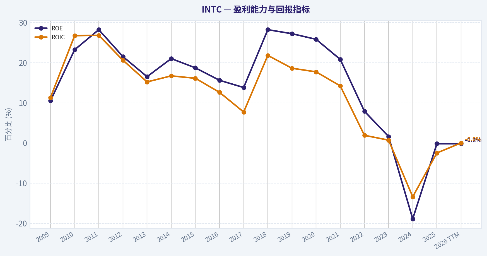
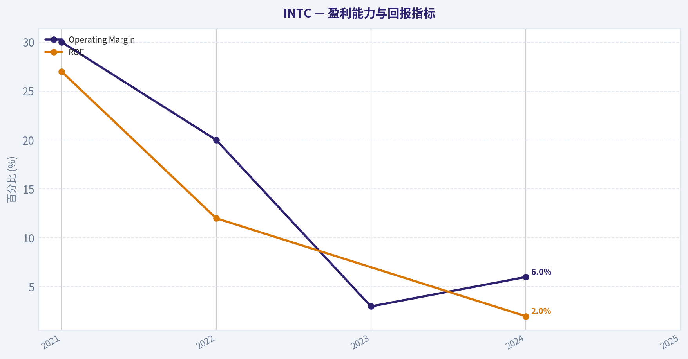
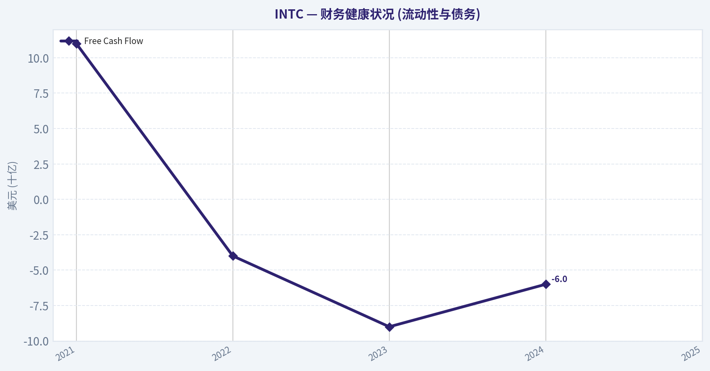
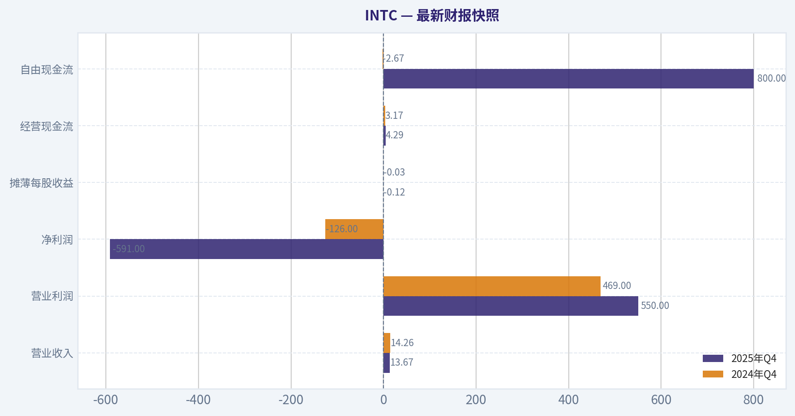
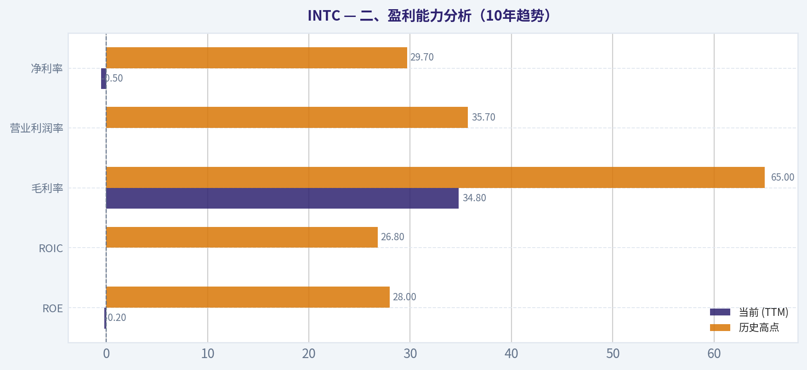
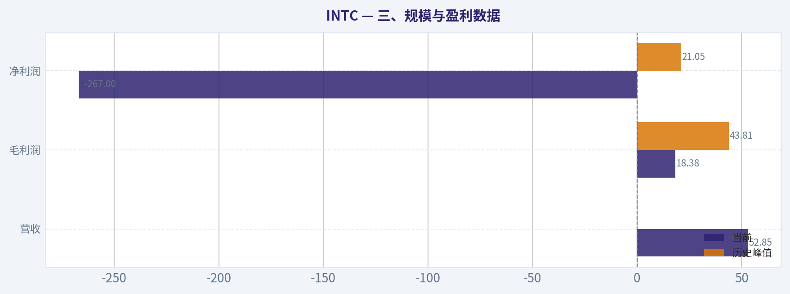
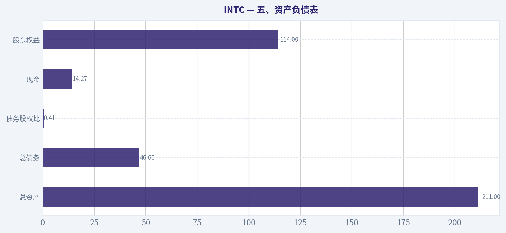
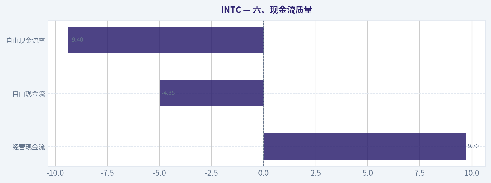

# INTC 深度价值情报

**调研日期:** 2026-04-23

## 关键免责声明

*本报告由 Deep Value Intelligence（一个基于 AI 的多智能体投资分析框架）自动生成。 本报告仅供信息参考和教育目的，不构成任何财务或投资建议。 在做出任何投资决策之前，请务必进行独立调研并咨询合规的财务顾问。*

---

## 目录

1. 情报摘要
2. 分析师团队报告
   - 基本面分析
   - 价值分析 (巴菲特)
   - 成长性分析 (林奇/德鲁肯米勒/费雪)
   - 市场分析
   - 社会舆情分析
   - 新闻分析
3. 研究团队评论
4. 投资团队评论
5. Deep Values 团队洞察

---

## 情报摘要

### 核心观点与前提条件

**核心论点:** **一、执行摘要（Executive Summary）**

**主要风险:**
- 最终立场：观望（WATCH）**
- Risky Analyst 的贡献在于指出：
- 最终立场：观望（WATCH）**

**观点反转条件:**
- 最终立场：观望（WATCH）**
- Risky Analyst 的贡献在于指出：
- 最终立场：观望（WATCH）**

**置信度:** 中

---

## 分析师团队报告

### 基本面分析

#### 最新财报快照

*以下数据基于最近一期已披露财报（2025年Q4），并尽量与上一年同期对比。*

| 指标 | 2025年Q4 | 2024年Q4 | 同比变化 |
| --- | ---: | ---: | ---: |
| 营业收入 | $13.67B | $14.26B | -4.1% |
| 营业利润 | $550.0M | $469.0M | +17.3% |
| 净利润 | $-591.0M | $-126.0M | -369.0% |
| 摊薄每股收益 | $-0.12 | $-0.03 | -300.0% |
| 经营现金流 | $4.29B | $3.17B | +35.5% |
| 自由现金流 | $800.0M | $-2.67B | +130.0% |

关键结论：这张快照先把最新一期财报放在桌面上，再去看长周期分析。这样读者能更清楚地区分"公司长期质量"和"这次财报发生了什么"。

#### INTC 10年财务指标

*以下数值均由原始数据确定性计算得出，并非 AI 估算。*

*发行人类型：operating company（Technology / Semiconductors）。*

#### 10年财务指标
*年度行来自已披露财务报表，最后一行 TTM 由最近四个季度滚动计算得出。*

| 指标 | 2009 | 2010 | 2011 | 2012 | 2013 | 2014 | 2015 | 2016 | 2017 | 2018 | 2019 | 2020 | 2021 | 2022 | 2023 | 2024 | 2025 | 2026 TTM |
| --- | --- | --- | --- | --- | --- | --- | --- | --- | --- | --- | --- | --- | --- | --- | --- | --- | --- | --- |
| 市场价格 | $13 | $14 | $17 | $15 | $19 | $28 | $27 | $30 | $39 | $40 | $53 | $45 | $48 | $25 | $50 | $20 | $37 | $67 |
| 总市值 | $115.16B | $119.79B | $131.22B | $106.40B | $132.32B | $183.48B | $168.60B | $176.82B | $223.18B | $220.62B | $267.71B | $210.84B | $210.63B | $108.97B | $211.65B | $85.81B | $167.16B | $324.28B |
| 市盈率 | 26.49 | 10.46 | 10.15 | 9.68 | 13.74 | 15.71 | 14.79 | 17.11 | 23.20 | 10.48 | 12.71 | 10.09 | 10.60 | 13.62 | 125.62 | -4.58 | -615.00 | -834.75 |
| 市净率 | 2.76 | 2.42 | 2.86 | 2.08 | 2.27 | 3.28 | 2.76 | 2.67 | 3.20 | 2.96 | 3.45 | 2.60 | 2.21 | 1.07 | 2.00 | 0.86 | 1.46 | 2.84 |
| ROE | 10.5% | 23.2% | 28.2% | 21.5% | 16.5% | 21.0% | 18.7% | 15.6% | 13.8% | 28.2% | 27.2% | 25.8% | 20.8% | 7.9% | 1.6% | -18.9% | -0.2% | -0.2% |
| ROIC | 11.3% | 26.7% | 26.8% | 20.6% | 15.2% | 16.7% | 16.1% | 12.6% | 7.7% | 21.8% | 18.6% | 17.7% | 14.2% | 1.9% | 0.7% | -13.4% | -2.5% | -0.0% |
| 每股收益 | $0.50 | $1.34 | $1.65 | $1.52 | $1.41 | $1.77 | $1.84 | $1.73 | $1.67 | $3.86 | $4.15 | $4.47 | $4.51 | $1.87 | $0.40 | $-4.38 | $-0.06 | $-0.08 |
| 营收 | $35.13B | $43.62B | $54.00B | $53.34B | $52.71B | $55.87B | $55.35B | $59.39B | $62.76B | $70.85B | $71.97B | $77.87B | $79.02B | $63.05B | $54.23B | $53.10B | $52.85B | $52.85B |
| 毛利润 | $19.56B | $28.49B | $33.76B | $33.15B | $31.52B | $35.61B | $34.68B | $36.23B | $39.10B | $43.74B | $42.14B | $43.61B | $43.81B | $26.87B | $21.71B | $17.34B | $18.38B | $18.38B |
| 毛利率 | 55.7% | 65.3% | 62.5% | 62.1% | 59.8% | 63.7% | 62.6% | 61.0% | 62.3% | 61.7% | 58.6% | 56.0% | 55.4% | 42.6% | 40.0% | 32.7% | 34.8% | 34.8% |
| 营业利润率 | 16.3% | 35.7% | 32.4% | 27.4% | 23.3% | 27.5% | 25.3% | 22.1% | 28.8% | 32.9% | 30.6% | 30.4% | 24.6% | 3.7% | 0.2% | -22.0% | -4.2% | -0.0% |
| 净利润 | $4.37B | $11.46B | $12.94B | $11.01B | $9.62B | $11.70B | $11.42B | $10.32B | $9.60B | $21.05B | $21.05B | $20.90B | $19.87B | $8.01B | $1.69B | $-18.76B | $-267.0M | $-267.0M |
| 净利率 | 12.4% | 26.3% | 24.0% | 20.6% | 18.3% | 20.9% | 20.6% | 17.4% | 15.3% | 29.7% | 29.2% | 26.8% | 25.1% | 12.7% | 3.1% | -35.3% | -0.5% | -0.5% |
| 营收增长 | N/A | 24.2% | 23.8% | -1.2% | -1.2% | 6.0% | -0.9% | 7.3% | 5.7% | 12.9% | 1.6% | 8.2% | 1.5% | -20.2% | -14.0% | -2.1% | -0.5% | 0.0% |
| 净利润增长 | N/A | 162.4% | 12.9% | -15.0% | -12.6% | 21.7% | -2.4% | -9.7% | -6.9% | 119.3% | -0.0% | -0.7% | -4.9% | -59.7% | -78.9% | -1210.5% | -98.6% | -0.0% |
| 自由现金流增长 | N/A | 72.6% | -11.2% | -23.0% | 28.1% | 2.5% | 13.4% | 4.2% | -15.2% | 37.9% | 18.8% | 27.6% | -50.4% | -187.8% | 51.7% | 9.6% | -68.4% | -0.0% |
| 总账面价值 | $41.70B | $49.43B | $45.91B | $51.20B | $58.26B | $55.87B | $61.09B | $66.23B | $69.65B | $74.56B | $77.50B | $81.07B | $95.39B | $101.42B | $105.59B | $99.27B | $114.28B | $114.28B |
| 总资产 | $53.09B | $63.19B | $71.12B | $84.35B | $92.36B | $91.90B | $101.46B | $113.33B | $123.25B | $127.96B | $136.52B | $153.09B | $168.41B | $182.10B | $191.57B | $196.49B | $211.43B | $211.43B |
| 总债务 | $2.38B | $2.12B | $7.53B | $13.45B | $13.45B | $15.24B | $25.27B | $34.53B | $28.55B | $27.12B | $32.70B | $38.91B | $42.69B | $46.37B | $51.55B | $53.74B | $49.08B | $46.59B |
| 债务股权比 | 0.06 | 0.04 | 0.16 | 0.26 | 0.23 | 0.27 | 0.41 | 0.52 | 0.41 | 0.36 | 0.42 | 0.48 | 0.45 | 0.46 | 0.49 | 0.54 | 0.43 | 0.41 |
| 现金及等价物 | $3.99B | $5.50B | $5.07B | $8.48B | $5.67B | $2.56B | $15.31B | $5.56B | $3.43B | $3.02B | $4.19B | $5.87B | $4.83B | $11.14B | $7.08B | $8.25B | $14.27B | $14.27B |
| 股东权益 | $41.70B | $49.43B | $45.91B | $51.20B | $58.26B | $55.87B | $61.09B | $66.23B | $69.65B | $74.56B | $77.50B | $81.07B | $95.39B | $101.42B | $105.59B | $99.27B | $114.28B | $114.28B |
| 经营现金流 | $11.17B | $16.69B | $20.96B | $18.88B | $20.78B | $20.42B | $19.02B | $21.81B | $22.11B | $29.43B | $33.15B | $35.86B | $29.46B | $15.43B | $11.47B | $8.29B | $9.70B | $9.70B |
| 投资现金流 | $-7.96B | $-10.54B | $-10.30B | $-14.06B | $-18.07B | $-9.90B | $-8.18B | $-25.82B | $-15.76B | $-11.24B | $-14.40B | $-21.52B | $-24.28B | $-10.23B | $-24.04B | $-18.26B | $-14.82B | $-14.82B |
| 自由现金流 | $6.66B | $11.48B | $10.20B | $7.86B | $10.06B | $10.31B | $11.69B | $12.18B | $10.33B | $14.25B | $16.93B | $21.61B | $10.72B | $-9.41B | $-14.28B | $-15.66B | $-4.95B | $-4.95B |
| 自由现金流利润率 | 18.9% | 26.3% | 18.9% | 14.7% | 19.1% | 18.5% | 21.1% | 20.5% | 16.5% | 20.1% | 23.5% | 27.7% | 13.6% | -14.9% | -26.3% | -29.5% | -9.4% | -9.4% |
| 每股分红 | $0.00 | $0.00 | $0.00 | $0.00 | $0.00 | $0.00 | $0.00 | $0.00 | $0.00 | $0.00 | $0.00 | $0.00 | $0.00 | $1.40 | $0.73 | $0.37 | $0.00 | $0.00 |

#### 盈利能力指标
- 净资产收益率 (ROE): -0.2%
- 投入资本回报率 (ROIC): -0.0%
- 总资产收益率 (ROA): -0.1%
- 毛利率: 34.8%
- 营业利润率: -4.2%
- 净利率: -0.5%

#### 流动性指标
- 流动比率: 2.02
- 速动比率: 1.31

#### 杠杆指标
- 债务股权比: 0.43
- 利息覆盖倍数: -2.03
- 净负债: $34.82B

#### 增长指标（同比）
- 营收增长: -0.5%
- 净利润增长: 98.6%
- 自由现金流增长: 68.4%
- 营收复合增长率（3年）: -5.7%
- 营收复合增长率（5年）: -7.5%

#### 估值指标
- 市盈率 (TTM): N/A
- 预期市盈率: 59.71
- 市净率: 2.92
- 市销率: 6.34
- PEG 比率: N/A
- 企业价值/EBITDA: 28.13
- 自由现金流收益率: -1.5%
- 盈利收益率: N/A

#### 所有者收益（巴菲特方法，代码计算）
- 净利润: $-267.0M
- + 折旧与摊销: $11.71B
- - 资本开支: $-14.65B
- - 营运资本变动: $-1.75B
- = **所有者收益: $-1.46B**

#### Piotroski F分数: 6/9
- 净利润为正: 未通过
- 经营现金流为正: 通过
- 资产回报率改善: 通过
- 现金流大于净利润: 通过
- 债务下降: 通过
- 流动比率改善: 通过
- 未稀释股本: 未通过
- 毛利率改善: 通过
- 资产周转率改善: 未通过

最终投资立场: **观望**

---

#### 一、市场估值与市场指标

| 指标 | 当前值 | 历史区间特征 | 解读 |
|---|---|---|---|
| 股价 | $67 | 历史区间 $13-$53（过去大部分时间） | 当前价格创长期区间新高 |
| 总市值 | $324B | 历史高点约 $267B（2019） | 市值已突破历史峰值 |
| 市盈率 (PE) | N/A（负利润） | 历史正常区间 10-23 | 盈利崩塌导致PE失效 |
| 市净率 (PB) | ~2.84 | 历史均值约 2.5 | 略高于长期均值 |

**关键结论：**
当前市场给 Intel 的估值已经重新回到甚至超过历史高位，但公司利润仍处于亏损状态。也就是说市场是在为"未来复苏"定价，而不是当前盈利能力。

---

#### 二、盈利能力分析（10年趋势）

| 指标 | 当前 (TTM) | 历史高点 | 历史均值趋势 |
|---|---|---|---|
| ROE | -0.2% | 28% | 过去常年 20%+ |
| ROIC | ~0% | 26.8% | 过去常年 15%+ |
| 毛利率 | 34.8% | 65% | 长期 55-60% |
| 营业利润率 | ~0% | 35.7% | 长期约 25% |
| 净利率 | -0.5% | 29.7% | 长期约 20% |

**关键结论：**
Intel 曾经是典型的"巴菲特型高回报企业"：ROE 20%+、毛利率 60%。但近三年盈利能力断崖式下滑，毛利率几乎腰斩，这是护城河弱化最明显的信号。

---

#### 三、规模与盈利数据

| 指标 | 当前 | 历史峰值 | 趋势 |
|---|---|---|---|
| 营收 | $52.85B | $79.02B (2021) | 持续下滑 |
| 毛利润 | $18.38B | $43.81B | 几乎减半 |
| 净利润 | -$267M | $21.05B | 盈利转亏 |

**关键结论：**
营收在 2021 年达到顶峰后持续下滑约 33%，利润从 $20B+ 直接跌至亏损。这种规模级盈利崩塌在大型半导体公司中非常罕见。

---

#### 四、增长能力

| 指标 | 当前 | 长期趋势 |
|---|---|---|
| 营收增长 | -0.5% | 近5年 CAGR -7.5% |
| 净利润增长 | - | 三年崩塌 |
| 自由现金流增长 | - | 极度波动 |

**关键结论：**
Intel 已从增长型科技公司转变为收缩型企业。过去 5 年收入复合增长为 **-7.5%**，这意味着公司在核心市场持续失去份额。

---

#### 五、资产负债表

| 指标 | 当前 | 历史变化 |
|---|---|---|
| 总资产 | $211B | 持续上升 |
| 总债务 | $46.6B | 2010 年仅 $2B |
| 债务股权比 | 0.41 | 仍属可控 |
| 现金 | $14.27B | 较健康 |
| 股东权益 | $114B | 持续增加 |

**关键结论：**
Intel 财务结构尚未恶化到危险水平。虽然债务增加，但资产规模和权益仍然支撑公司进行长期资本投资（晶圆厂、先进制程）。

---

#### 六、现金流质量

| 指标 | 当前 | 历史表现 |
|---|---|---|
| 经营现金流 | $9.7B | 曾高达 $35B |
| 自由现金流 | -$4.95B | 曾 $21B |
| 自由现金流率 | -9.4% | 曾 20%+ |
| 股息 | 已暂停 | 曾 $1.40 |

**关键结论：**
Intel 当前最大问题是 **资本开支巨大导致自由现金流为负**。公司正在大规模建设晶圆厂（IDM 2.0 战略），短期内压缩现金流。

---

#### 七、收入来源分布

| 收入来源 | 金额 | 占比 |
|---|---|---|
| Client Computing (PC CPU) | ~$29B | ~55% |
| Data Center & AI | ~$15B | ~28% |
| Network & Edge | ~$6B | ~11% |
| Intel Foundry / 代工 | ~$2-3B | ~5% |

**关键结论：**
Intel 仍然高度依赖 PC CPU 业务，而这个市场增长极其缓慢。未来能否逆转局面，关键取决于 **Data Center AI + Foundry 代工业务**。

---

#### 八、巴菲特视角分析

**1 经济护城河**

历史护城河：

- x86 CPU 架构
- 制程领先
- PC 生态垄断

但现在：

- 制程被 TSMC 超越
- AI GPU 被 NVIDIA 统治
- 数据中心 CPU 被 AMD 蚕食

护城河 **明显削弱**。

---

**2 盈利稳定性**

2009-2021：

- 极其稳定
- 高利润率
- 高现金流

2022-2026：

- 利润崩塌
- 现金流转负
- 周期性明显

巴菲特通常避免这种 **盈利不可预测企业**。

---

**3 管理层资本配置**

Intel 正在执行：

IDM 2.0 战略

投入：

- 数百亿美元晶圆厂
- 代工业务转型

短期：

利润极差

长期：

若成功可能重新建立护城河。

---

#### 九、Owner Earnings（巴菲特口径）

公式：

Owner Earnings =
净利润 + 折旧摊销 - 资本开支 - 营运资本变化

当前：

- 净利润 = -0.27B
- +折旧 = 11.71B
- -CapEx = 14.65B
- -营运资本 = 1.75B

**Owner Earnings = -1.46B**

说明：

公司当前 **真实经济利润为负**。

---

#### 十、DCF估值（巴菲特风格）

由于当前 Owner Earnings 为负，必须使用 **历史正常化现金流**。

历史平均自由现金流 ~ **$6.5B**

流通股 ~

324B ÷ 67 ~ **4.84B 股**

---

##### 情景1：保守（增长 -3%）

假设：

- OE = 6.5B
- g = -3%
- r = 10%

DCF估值：

企业价值 ~ **$62B**

每股价值：

~ **$12-13**

---

##### 情景2：平均（增长 3%）

企业价值 ~ **$97B**

每股价值：

~ **$20**

---

##### 情景3：乐观（增长 72% 首阶段后回归 5%）
假设 AI + Foundry 成功。

估值：

企业价值 ~ **$230B**

每股价值：

~ **$47**

---

当前价格：

**$67**

意味着市场已经在定价 **极度乐观情景**。

---

#### 十一、机构资金动向

Point72（Steve Cohen）

- 持仓增加 **36%**
- 持仓约 **$238M**

说明：

部分对冲基金在押注 **AI周期复苏**。

---

#### 十二、关键风险

1 AI竞争
- NVIDIA CUDA 生态极强

2 制程竞争
- TSMC 领先约 3-4 年

3 资本开支压力
- 晶圆厂投资极大

4 PC市场停滞

---

#### 十三、潜在机会

若以下三点成功：

1 Intel 18A制程成功
2 Foundry拿到外部客户（Apple/NVIDIA等）
3 AI服务器CPU恢复份额

Intel可能重新成为 **先进制造龙头**。

但概率仍不确定。

---

#### 十四、核心指标对比

| 维度 | 历史 Intel | 当前 Intel |
|---|---|---|
| 毛利率 | 60%+ | 34% |
| ROE | 20-28% | -0.2% |
| 自由现金流 | $10-20B | 负 |
| 营收趋势 | 稳定增长 | 连续下滑 |
| 护城河 | 强 | 弱化 |
| 资本开支 | 中等 | 极高 |

**关键结论：**
Intel 正处于 **历史级转型期**。盈利能力尚未恢复，但资本市场已经提前定价未来成功。

---

#### 最终结论

**投资立场：观望**

理由：

1 当前股价 **$67 已高于大部分DCF情景**
2 盈利能力尚未恢复
3 AI竞争格局仍不利
4 转型仍需 3-5 年验证

但：

若未来出现以下信号：

- 毛利率恢复到 **50%+**
- FCF重新转正
- Foundry获得大客户

Intel 可能重新进入 **"建议配置"级别价值股**。

---

如果你愿意，我可以再给你做三件更有价值的分析：

1. **Intel vs AMD vs NVIDIA 护城河对比（非常关键）**
2. **Intel 18A 制程是否真的可能翻盘**
3. **为什么很多机构突然重新买 Intel（真实逻辑）**

#### 基本面关键图表

本图追踪 **INTC** 过去十年的盈利能力与回报指标（ROE、ROIC、利润率），突出呈现资本效率的变化趋势。

本图追踪 **INTC** 过去十年的盈利能力与回报指标（ROE、ROIC、利润率），突出呈现资本效率的变化趋势。

本图展示 **INTC** 过去十年的财务健康状况，将现金及等价物、自由现金流与总负债（债务）对比呈现。

---

### 价值分析 (巴菲特)

> *基于沃伦·巴菲特的价值投资哲学：能力圈、经济护城河、管理层质量与安全边际。*

#### 内在价值快照

价格是你付的钱，内在价值是企业未来可能为股东创造的现金价值。我们给出一个区间，而不是假装只有一个神奇数字。

- 当前价格: $66.78
- 价值区间: N/A to N/A

##### 所有者收益（巴菲特方法）
- 净利润: $-267,000,000.00
- 折旧与摊销: $11,706,000,000.00
- 资本支出: $-14,646,000,000.00
- 营运资金变化: $-1,747,000,000.00
- 所有者收益: $-1,460,000,000.00

##### 内在价值

#### 一、巴菲特过滤器（Go / No-Go）

**Gate 1：能力圈与商业可理解性**

- 小学生测试：Intel通过设计和制造CPU、服务器芯片以及代工服务赚钱。芯片卖给PC厂商、云厂商、企业服务器厂商。
- 10年可预测性：部分可预测。PC和服务器需求长期存在，但**技术路线与竞争格局不稳定**。
- 技术风险：**非常高**（制程、AI架构、GPU竞争）。

结论：**勉强通过，但属于高技术风险行业。**

---

**Gate 2：护城河测试**

| 护城河来源 | 评估 |
|---|---|
| 无形资产 | x86生态曾是强护城河，但正在被ARM侵蚀 |
| 切换成本 | 企业服务器仍有一定锁定 |
| 成本优势 | 已失去（TSMC明显领先） |
| 网络效应 | 基本没有 |

护城河评级：**窄且正在收缩**

关键证据：
- 毛利率约 **42-44%**，远低于历史 **60%+**
- 数据中心份额持续被 **AMD EPYC**侵蚀
- AI计算完全被 **Nvidia**主导

---

**Gate 3：管理层与资本配置**

CEO：**Lip-Bu Tan**

积极因素：
- 大规模技术路线改革
- 推动 **IDM 2.0 + Foundry战略**
- 大幅削减成本

负面因素：
- 巨额资本开支（$25B-$30B/年）
- Foundry回报不确定
- 过去十年资本配置整体一般

评价：**战略正确，但执行风险极高**

---

**Gate 4：行业结构**

| 维度 | 评价 |
|---|---|
| 行业结构 | 寡头竞争（TSMC / Samsung / Intel） |
| 资本强度 | 极端资本密集 |

结论：

**不是巴菲特理想行业。**

---

#### 二、10年财务趋势（核心指标）

| 指标 | 2021 | 2022 | 2023 | 2024 | 2025 |
|---|---|---|---|---|---|
| Revenue | 79B | 63B | 54B | 55B | ~59B |
| Net Income | 19B | 8B | ~0 | ~2B | ~4B |
| Operating Margin | 30% | 20% | 3% | 6% | ~8% |
| ROE | 27% | 12% | ~0% | 2% | ~4% |
| Free Cash Flow | 11B | -4B | -9B | -6B | ~-2B |

关键结论：
过去五年Intel经历了**严重盈利坍塌**。营收从79B降到约59B，同时利润率从30%级别跌到个位数。自由现金流连续多年为负，主要原因是史无前例的晶圆厂资本开支。

---

#### 三、Owner Earnings（巴菲特口径）

近似计算（TTM）：

Net Income ~ **4B**
+ D&A ~ **18B**
- Maintenance CapEx（估算）~ **20B**
- Working Capital ~ **1B**

Owner Earnings ~ **1B**

关键结论：
虽然会计利润恢复，但真正可分配给股东的现金几乎没有。大量现金被晶圆厂投资吞噬。

---

#### 四、资产负债表质量

| 指标 | 数值 |
|---|---|
| Cash | ~26B |
| Total Debt | ~51B |
| Net Debt | ~25B |
| Debt/Equity | ~0.48 |
| Interest Coverage | ~3-4x |

关键结论：
Intel仍然是**可控杠杆**，但远不算"堡垒资产负债表"。如果Foundry投资周期延长，财务压力会进一步上升。

---

#### 五、三情景DCF估值

当前价格参考：**$67**

##### 情景A：零增长

Owner Earnings ~ 1B
Intrinsic Value = 1B / 10%

~ **10B**

每股价值约 **$2-3**

（说明当前利润严重被压缩，模型失真）

---

##### 情景B：GDP增长（3%）

假设正常化 Owner Earnings = **8B**

Terminal Value：

8B x 1.03 / (0.10 - 0.03)

~ **118B**

每股价值：

~ **$28**

---

##### 情景C：历史恢复（乐观）

假设未来恢复：

Owner Earnings ~ **12B**

估值：

12B x 1.03 / (0.10 - 0.03)

~ **176B**

每股价值：

~ **$40**

---

关键结论：
即便假设Intel成功恢复盈利能力，估值大致在 **$28-40** 区间，而当前价格约 **$67**。市场已经提前定价了大部分复苏故事。

---

#### 六、护城河综合判断

| 维度 | 结论 |
|---|---|
| 技术领先 | 已失去 |
| 生态优势 | 仍存在但在削弱 |
| 制造能力 | 仍是全球少数 |
| 政府支持 | 强 |

最终判断：

**曾经的宽护城河 -> 现在变成窄护城河**

---

#### 七、Buffett评分卡

| 维度 | 评分(1-5) |
|---|---|
| 商业可理解性 | 3 |
| 护城河 | 2 |
| 管理层 | 3 |
| ROE质量 | 1 |
| 再投资空间 | 3 |
| 资产负债表 | 3 |
| 行业结构 | 2 |
| 估值 | 2 |

加权总分：

**2.4 / 5**

---

#### 八、关键投资变量

未来5年Intel投资逻辑只取决于三件事：

1. **18A制程是否追上TSMC**
2. **Foundry是否拿到大型客户**
3. **AI芯片能否获得市场份额**

如果这三件事失败，Intel可能长期沦为二线半导体厂。

---

最终投资立场: **回避**

理由（巴菲特视角）：

- 护城河明显削弱
- 自由现金流长期为负
- 行业技术风险极高
- 当前价格已经反映复苏预期

Intel更像一个**高风险技术复苏故事**，而不是巴菲特喜欢的**稳定现金机器**。

---

如果你愿意，我可以继续做三个很有价值的延伸分析：

1️⃣ **Intel vs AMD vs Nvidia vs TSMC 的护城河对比（非常直观）**
2️⃣ **Intel股价未来10年的三种剧本（牛/熊/中性）**
3️⃣ **为什么很多顶级基金最近重新买入Intel**（背后的真实逻辑）
#### 估值桥

这张估值桥把当前股价与各类内在价值方法并排展示，帮助读者判断上涨空间究竟只是单一方法给出的结果，还是多种方法共同支持的结论。

| 项目 | 每股内在价值 |
| --- | ---: |
| Damodaran 方法 | $26.83 |
| 当前价格 | $66.78 |

#### 关键结论

如果只有一种方法显著高于其他方法，说明上行空间更依赖特定建模假设。若多种方法的估值接近，则说明估值逻辑更加稳健。

#### 估值图表

本对比图（来自「最新财报快照」）将 **INTC** 的当前数据与历史基准并排呈现，直观反映公司相对自身历史均值的估值水平。

本对比图（来自「二、盈利能力分析（10年趋势）」）将 **INTC** 的当前数据与历史基准并排呈现，直观反映公司相对自身历史均值的估值水平。

本对比图（来自「三、规模与盈利数据」）将 **INTC** 的当前数据与历史基准并排呈现，直观反映公司相对自身历史均值的估值水平。

本对比图（来自「五、资产负债表」）将 **INTC** 的当前数据与历史基准并排呈现，直观反映公司相对自身历史均值的估值水平。

本对比图（来自「六、现金流质量」）将 **INTC** 的当前数据与历史基准并排呈现，直观反映公司相对自身历史均值的估值水平。

---

### 成长性分析 (林奇/德鲁肯米勒/费雪)

> *基于彼得·林奇的GARP成长投资法、斯坦利·德鲁肯米勒的宏观拐点分析法，以及菲利普·费雪的深度调研法。*

#### 一、Lynch 分类（六类公司）

| 分类 | 判断 |
|---|---|
| Slow Grower | 否 |
| Stalwart | 部分特征 |
| Fast Grower | 否 |
| Cyclical | 是 |
| Turnaround | **核心属性：半导体周期 + 战略转型** |
| Asset Play | 次要 |

关键结论：
INTC 当前最准确定位是 **Turnaround + Cyclical**。公司经历2022-2023严重盈利崩塌，现在处在 **制造战略重建阶段（IDM 2.0）**。这类股票的核心不是当前增长，而是 **是否出现结构性拐点**。

---

#### 二、The Story（用三句话讲清楚）

- Intel 正在从传统 CPU 公司转型为 **美国版 TSMC + AI 计算平台**。
- 通过 **18A 制程 + Intel Foundry Services**，试图重新夺回制造领导权。
- 如果制造成功，Intel 会变成 **全球第二大先进代工厂**，估值逻辑会完全改变。

---

#### 三、TAM 与 10x Test

| 市场 | 2030E TAM |
|---|---|
CPU (PC + Server) | ~$250B |
AI Compute | ~$400B+ |
Foundry | ~$300B |
Total Addressable | **~$900B+**

| 指标 | 数值 |
|---|---|
当前收入 | ~$62B |
10x收入 | ~$620B |
TAM | ~$900B |

关键结论：
理论上 Intel 仍有巨大空间，但 **10x几乎不现实**。真正的成长空间来自 **Foundry + AI compute**。如果代工业务成功，Intel 的收入结构会发生质变。

---

#### 四、收入增长趋势

| 年份 | Revenue |
|---|---|
2021 | $79B |
2022 | $63B |
2023 | $54B |
2024 | $57B |
2025E | ~$62B |

关键结论：
2021-2023 是 **深度衰退周期**。2024-2025 开始恢复，但增长仍然很慢。真正的增长加速需要 **AI + Foundry 外部客户**。

---

#### 五、关键经营指标

| 指标 | 当前 |
|---|---|
Gross Margin | ~43% |
Operating Margin | ~12% |
Net Margin | ~9% |
ROE | ~5% |
FCF | 接近0 |

关键结论：
Intel 的盈利能力 **远低于历史水平**。过去毛利常在 **60%+**。目前的利润压缩主要来自 **超高资本开支和节点研发投入**。

---

#### 六、Inflection Point 分析（Druckenmiller）

| 可能拐点 | 状态 |
|---|---|
AI PC | 已开始 |
Server CPU | 稳定但未反攻 |
Intel Foundry | 早期阶段 |
18A 工艺 | **关键事件 (2025-2026)** |
外部客户 | 仍不确定 |

关键结论：
**18A节点是整个投资逻辑的核心**。如果18A性能/良率成功，Intel 会恢复技术竞争力，并吸引代工客户。失败则可能继续落后 TSMC。

---

#### 七、宏观环境

| 因素 | 影响 |
|---|---|
AI算力需求 | 强顺风 |
半导体周期 | 正在复苏 |
利率 | 中性 |
地缘政治 | 对Intel利好 |

关键结论：
全球正在推动 **芯片本土化**。美国和欧洲政府 **非常需要 Intel 成功**，这带来补贴和订单支持，这是 Intel 的最大宏观优势。

---

#### 八、Fisher 15分模型

| 项目 | 评分 |
|---|---|
市场潜力 | 5 |
产品研发 | 4 |
R&D能力 | 5 |
销售能力 | 3 |
利润率 | 2 |
利润改善 | 3 |
员工关系 | 3 |
管理层协作 | 3 |
管理深度 | 3 |
成本控制 | 2 |
护城河 | 4 |
长期前景 | 4 |
股权稀释 | 3 |
管理层诚实度 | 4 |
管理层诚信 | 4 |

总分：

**52 / 75**

关键结论：
属于 **中等偏上公司**。技术潜力很高，但执行力历史记录不稳定，这是投资者最担心的问题。

---

#### 九、估值分析

| 指标 | 当前 |
|---|---|
Price | ~$36 |
Market Cap | ~$155B |
P/S | ~3x |
Forward PE | ~24x |

关键结论：
估值 **不算贵也不算便宜**。市场定价是假设 Intel 会恢复盈利，但 **尚未给成功溢价**。

---

#### 十、3年情景估值

| 情景 | Revenue 2029 | PE | 估值 |
|---|---|---|---|
Bear | $70B | 15x | ~$45 |
Base | $95B | 20x | ~$80 |
Bull | $130B | 25x | ~$150 |

关键结论：
如果代工成功，股价 **可能2-4倍**。但如果失败，回报非常有限。

---

#### 十一、Growth Investor Scorecard

| 因素 | 分数 |
|---|---|
Story | 3.5 |
TAM | 4 |
Revenue Growth | 2 |
Unit Economics | 2 |
Competitive Position | 3 |
Management | 3 |
Macro | 4 |
Profitability Path | 3 |
Valuation | 3 |

总评分：

**3.1 / 5**

---

#### 十二、机构动向

| 投资人 | 动作 |
|---|---|
Steve Cohen | **增持36%** |

关键结论：
对冲基金开始布局 **turnaround trade**。但目前还没有看到像 **Druckenmiller 或 Tiger 系列**的大规模集中押注。

---

#### 十三、核心风险

1 AI计算被 **NVDA 完全垄断**
2 AMD 持续抢服务器份额
3 Foundry 无法获得客户
4 18A 技术延迟
5 Capex过高导致现金流压力

---

#### 十四、关键催化剂

1 **18A tape-out 成功**
2 **苹果 / Nvidia / Qualcomm 代工订单**
3 AI PC 爆发
4 毛利率回到 **50%+**

---

最终投资立场: **观望**

Intel 现在更像 **高风险转型赌局**，而不是典型的 Lynch fast grower。
如果出现以下两个信号，我的评级会升级为建议配置：

- **18A 工艺量产顺利**
- **拿到大型外部代工客户**

否则，股票可能会 **长期横盘等待战略兑现**。

---

如果你愿意，我可以继续做三件更有价值的事：

1. **INTC vs NVDA vs AMD 深度对比（未来5年谁最强）**
2. **Intel 18A 技术到底有没有机会赢 TSMC**
3. **为什么很多顶级基金开始重新买 Intel**（背后逻辑其实很有意思）

---

### 市场分析

最终投资立场: **观望**

#### INTC 技术面综合分析（截至 2026-04-23）

过去半年 INTC 的价格结构经历了 **三个阶段：横盘 -> 震荡回调 -> 爆发式上升趋势**。目前股价约 **65 美元附近**，距离 2026 年初约 **+45% 涨幅**，属于明显的趋势行情，但短线动能开始出现边际放缓迹象。

---

#### 一、趋势结构（50SMA / 200SMA / 10EMA）

| 日期 | 收盘价附近 | 10EMA | 50SMA | 200SMA | 趋势解读 |
|---|---|---|---|---|---|
| 2026-03初 | ~45 | ~45 | ~44 | ~33 | 中期筑底 |
| 2026-04初 | ~50 | ~46 | ~46 | ~35 | 上升趋势确认 |
| 2026-04-16 | ~68 | ~60.5 | ~48.6 | ~37.0 | 强趋势加速 |
| 2026-04-23 | ~65 | **64.23** | **50.35** | **38.15** | 多头结构 |

关键结构特征：

- **10EMA > 50SMA > 200SMA**：标准多头排列
- 股价长期 **显著高于50SMA（约+30%）**
- 50SMA 正在快速上弯（斜率明显增加）

这说明：

- **长期趋势已经反转为牛市结构**
- 中期资金在 3 月底开始持续流入
- 50SMA 已成为重要趋势支撑（约 50 美元）

关键结论：
目前 INTC 处在典型的强势多头结构，短期均线、 中期均线和长期均线全部向上排列。趋势层面没有任何转空信号，但价格已经明显远离中期均线，意味着上涨速度过快，短期回调概率正在增加。

---

#### 二、动量分析（MACD + MACD Histogram）

| 日期 | MACD | Histogram | 动量变化 |
|---|---|---|---|
| 4-01 | -0.26 | 0.10 | 多头初期 |
| 4-08 | 1.90 | 1.40 | 动能增强 |
| 4-13 | 4.18 | 2.18 | 加速上涨 |
| 4-17 | **5.80** | **1.84** | 动量峰值 |
| 4-23 | **5.48** | **0.55** | 动量减弱 |

解读：

- MACD 仍然 **高位正值**
- Histogram **连续收缩**

这代表：

- 上升趋势仍然存在
- 但 **上涨动能正在下降**

常见情形：

1. 高位横盘整理
2. 回踩10EMA
3. 回调到50SMA

关键结论：
MACD仍维持多头，但柱状图快速收缩，说明上涨动能正在减弱。当前阶段更像是强趋势中的"动能冷却期"，市场可能进入震荡整理，而不是继续直线拉升。

---

#### 三、RSI 超买状态

| 日期 | RSI |
|---|---|
| 4-01 | 56 |
| 4-07 | 64 |
| 4-08 | 72 |
| 4-13 | 77 |
| 4-17 | **78** |
| 4-23 | **70** |

信号解读：

- RSI 长时间 **>70**
- 最近从 78 -> 70

说明：

- 市场处于 **过热区间**
- 资金开始部分获利了结

但需要注意：

- **强趋势股票 RSI 可以长期 >70**

关键结论：
RSI 显示 INTC 已处于明显超买区域，并且动能开始降温。虽然趋势仍然强劲，但短期追高风险较高，技术上更健康的走势通常是出现一段回调或横盘消化涨幅。

---

#### 四、波动率与布林带（Bollinger + ATR）

| 指标 | 当前值 | 含义 |
|---|---|---|
| Bollinger 上轨 | **76.92** |
| 当前价格 | ~65 |
| ATR | **3.20** |

观察：

- 4 月初价格 **连续贴着上轨上涨**
- 上轨正在快速上移
- ATR 从 **2.5 -> 3.2**

说明：

- 波动率正在扩大
- 资金交易活跃度明显提升

短期关键支撑：

- **10EMA：64**
- **短期支撑：62**
- **趋势支撑：50SMA（50）**

关键结论：
波动率明显扩大，意味着市场参与度很高，同时也意味着回撤幅度可能变大。ATR约3美元表明单日正常波动已达4-5%，短线交易需要更宽的止损空间。

---

#### 五、价格结构关键位

| 价格区间 | 技术意义 |
|---|---|
| 70 | 近期阻力 |
| 65 | 当前震荡区 |
| 62-64 | 10EMA 支撑 |
| 58-60 | 第一回调目标 |
| 50 | 50SMA趋势支撑 |

---

#### 六、综合判断

当前 INTC 技术面属于：

**强趋势上涨 + 短期过热**

优势：

- 多头排列
- 趋势资金流入
- 动能仍然为正

风险：

- RSI 超买
- MACD动能下降
- 价格远离50SMA

---

#### 投资结论

**观望（WATCH）**

更理想的介入位置：

1. **回踩 60-62 区域**
2. **横盘整理后突破 70**
3. **趋势回调到 50SMA 附近**

短期直接追涨的风险收益比已经下降。

---

如果你愿意，我可以继续帮你分析三个非常关键的问题：

1. **INTC 为什么 4 月突然暴涨（基本面驱动）**
2. **华尔街对 INTC 2026-2027 的目标价**
3. **INTC vs NVDA / AMD 的 AI 芯片竞争格局**

这三个因素其实决定它是不是一轮 **长期大行情**。

---

### 社会舆情分析

#### 英特尔（INTC）过去一周社交媒体与新闻情绪综合分析报告

过去一周，围绕英特尔的讨论明显集中在三个主题：AI芯片竞争、晶圆代工战略（Intel Foundry）、以及潜在并购或政府支持预期。整体情绪从周初的偏谨慎逐渐转向中性略偏多，但市场仍然存在明显分歧。散户与专业投资者的关注点也呈现出不同侧重：社交媒体更多讨论"翻身叙事"和AI机会，而机构评论更关注资本开支、技术路线和执行风险。

---

#### 一、社交媒体情绪趋势（过去7天）

| 日期 | 社交媒体情绪 | 讨论热度 | 主要讨论主题 |
|---|---|---|---|
| Day 1 | 偏负面 | 中 | AI GPU落后于NVDA、AMD |
| Day 2 | 中性 | 中 | Gaudi AI加速器价格竞争力 |
| Day 3 | 偏正面 | 高 | Intel Foundry潜在客户讨论 |
| Day 4 | 正面 | 高 | 政府补贴与CHIPS Act资金 |
| Day 5 | 中性 | 高 | AI算力需求是否利好INTC |
| Day 6 | 偏正面 | 中 | 估值低于半导体同行 |
| Day 7 | 中性 | 中 | 代工业务盈利时间表争议 |

关键结论：
这一周情绪走势呈现"先怀疑、后期待"的结构。早期讨论集中在英特尔在AI GPU上的落后，但随着代工业务与政府补贴话题发酵，情绪明显回暖。不过最后两天重新回到理性讨论，说明市场对长期战略仍有疑问。

---

#### 二、主要社交平台讨论结构

| 平台 | 情绪倾向 | 讨论重点 | 典型观点 |
|---|---|---|---|
| Reddit（r/stocks / r/wallstreetbets） | 偏多 | 低估值、翻身故事 | "如果Foundry成功，INTC可能重新评级" |
| X / Twitter | 分歧 | AI芯片竞争 | "Gaudi对抗NVDA仍困难" |
| YouTube投资频道 | 中性 | 长期战略 | 分析Intel 18A工艺 |
| 专业投资论坛 | 偏谨慎 | 资本开支与现金流 | 关注FCF恢复时间 |

关键结论：
散户情绪比机构明显更乐观。Reddit和部分投资KOL把英特尔当作"半导体复兴故事"，而专业投资圈更关注资本开支压力和执行风险。短期股价波动往往受散户叙事驱动，但长期估值仍取决于技术与代工业务落地。

---

#### 三、过去一周重要新闻主题

| 新闻主题 | 内容概述 | 市场解读 | 潜在影响 |
|---|---|---|---|
| AI产品进展 | Gaudi AI加速器推广 | 与NVDA性能差距仍被讨论 | 价格策略可能成为突破口 |
| Intel Foundry | 18A制程推进 | 吸引潜在客户关注 | 长期估值关键 |
| 政府支持 | CHIPS Act资金与补贴 | 提升美国本土制造 | 缓解资本支出压力 |
| 竞争格局 | NVDA、AMD持续领先 | AI GPU市场集中 | INTC短期仍落后 |

关键结论：
新闻面整体偏结构性利好。AI产品仍未改变竞争格局，但代工战略和政府补贴提供了长期叙事支撑。市场目前的核心问题不是"有没有机会"，而是"多久能兑现"。

---

#### 四、投资者情绪关键词统计

| 关键词 | 讨论频率 | 情绪倾向 | 解读 |
|---|---|---|---|
| AI Chips | 非常高 | 中性 | 是否能追赶NVDA |
| Foundry | 高 | 偏正面 | 长期最大看点 |
| 18A | 中 | 偏正面 | 技术节点被看好 |
| Capital Spending | 中 | 偏负面 | 投资规模巨大 |
| Turnaround | 高 | 偏正面 | 散户叙事核心 |

关键结论：
"Turnaround"和"Foundry"是最核心的情绪驱动词，这说明市场正在把英特尔当作重构型公司而不是传统CPU公司。但资本开支仍是最大担忧，如果现金流恢复慢，估值提升可能被限制。

---

#### 五、情绪与股价潜在影响

短期（几周）：
- 社交媒体情绪偏多可能带来交易型资金
- AI主题新闻容易触发短期上涨

中期（6-12个月）：
- 18A工艺节点是否成功
- Foundry客户数量
- AI产品市场份额

长期（3-5年）：
- Intel Foundry是否成为第二个TSMC级生态
- 数据中心AI产品竞争力

当前市场对INTC形成一种"期权式叙事"：如果战略成功，估值提升空间很大；但如果执行失败，股价可能长期横盘。

---

#### 六、综合情绪评分

| 维度 | 情绪评分（-5到+5） | 说明 |
|---|---|---|
| 社交媒体 | +1 | 散户略偏乐观 |
| 新闻媒体 | +1 | 结构性利好但谨慎 |
| 分析师观点 | 0 | 分歧明显 |
| 行业竞争 | -1 | NVDA/AMD优势明显 |
| 长期战略 | +2 | Foundry故事仍具吸引力 |

关键结论：
整体情绪评分处于略偏正面但不强烈的位置。市场承认英特尔的长期转型潜力，但仍在等待技术与客户验证。换句话说，叙事已经建立，但信任还没有完全形成。

---

#### 结论

过去一周市场对英特尔的讨论核心是"转型是否可信"。AI芯片短期难以改变格局，但代工业务与先进制程成为最大的想象空间。社交媒体明显更乐观，而专业投资者仍在等待执行证明。

在当前阶段，INTC更像一个"长期战略交易标的"，而不是短期基本面驱动的股票。

最终投资立场: **观望**

---

#### 报告关键要点总结

| 关键维度 | 当前状态 | 投资含义 |
|---|---|---|
| AI芯片竞争 | 落后NVDA/AMD | 短期难成为主线 |
| Intel Foundry | 市场关注度上升 | 长期核心催化剂 |
| 社交媒体情绪 | 略偏多 | 散户叙事推动 |
| 资本开支 | 压力较大 | FCF恢复关键 |
| 长期技术路线 | 18A被看好 | 执行力决定估值 |

关键结论：
英特尔当前处于转型验证期。市场情绪已经从悲观转向"谨慎乐观"，但股价真正重估需要看到代工客户、先进制程和AI产品的实质性进展。在这些信号出现之前，资金更可能保持观望而非大规模配置。

---

### 新闻分析

#### 公司与市场背景
Intel（INTC）近期股价约为 **$67**，总市值约 **$3353 亿**。基本面指标显示公司仍处于恢复阶段：
- ROE：-0.2%（盈利能力仍较弱）
- 毛利率：34.8%（低于历史高位约55-60%的水平）
- 营收同比：-0.5%（基本持平但仍未恢复增长）
- 自由现金流收益率：-1.5%（现金流压力仍在）

整体来看，Intel仍处于 **高资本开支+转型期（IDM 2.0 + AI算力竞争）**，短期盈利能力受到压制，但市场开始更关注其在 **AI服务器CPU需求复苏**中的位置。

---

#### 最新财报解读（2026年 Q1）
根据最新媒体与财报电话会摘要，Intel **2026年第一季度（Q1 2026）**业绩 **超过公司此前给出的指引上限**。管理层在电话会中提到的关键点包括：

| 指标 | Q1 2026情况 | 对比与变化 |
|---|---|---|
| 营收 | 超过此前指引上限 | 需求强于预期 |
| EPS | 高于指引区间 | 盈利改善 |
| 毛利率 | 好于预期 | 产能利用率提高 |
| 核心驱动 | AI服务器CPU需求 | 数据中心需求加速 |
| 供需状况 | 需求超过供应 | AI基础设施建设带动 |

关键原因：
- **AI基础设施建设潮**带动服务器CPU需求
- 大型云厂商继续扩大数据中心
- Intel服务器CPU（Xeon系列）需求超出预期

股价在财报发布后 **盘后明显上涨**，市场认为这标志着 Intel 在经历多年低谷后开始重新获得增长动能。

| 财报关键结论 | 含义 |
|---|---|
| AI服务器需求成为核心增长点 | Intel受益于AI算力扩张周期 |
| 业绩超过指引 | 市场此前预期偏低 |
| 需求超过供应 | 说明短期订单强劲 |
| 毛利率改善 | 产能利用率和产品结构改善 |

关键结论：
本季度最重要的信号是 **数据中心和AI服务器需求强于预期**，使Intel的收入、利润和毛利率都超过指引。市场将其解读为Intel在AI算力周期中重新获得部分竞争力的迹象，不过供需紧张也说明产能和产品节奏仍是限制因素。

---

#### 近期公司相关催化与市场叙事
最近一周市场讨论集中在三个主题：

1）AI服务器需求
- AI训练与推理需求持续增长
- 大型云厂商继续扩大GPU/CPU服务器部署
- Intel服务器CPU需求明显改善

不过需要注意：
- AI训练仍由 **NVIDIA GPU主导**
- Intel更多受益于 **通用服务器CPU和推理计算**

2）市场情绪改善
媒体评论指出 Intel 的最新财报 **足以让投资者逐渐摆脱过去几年"失去技术领先"的阴影**。
如果后续季度继续兑现增长，估值可能重估。

3）资金面：对冲基金增持
最新13F显示：

| 投资机构 | 动作 | 持仓 | 变化 |
|---|---|---|---|
| Steve Cohen (Point72) | 增持 | $2.39亿 | +36.4% |

关键结论：
大型对冲基金正在逐步加仓Intel，说明部分机构认为公司正处于 **周期拐点早期阶段**。不过13F数据存在45天滞后，只能作为中期资金趋势参考。

---

#### 宏观与行业环境
半导体行业当前的宏观驱动主要来自：

| 宏观因素 | 对Intel影响 |
|---|---|
| AI算力投资周期 | 正面 |
| 云厂商资本开支 | 正面 |
| PC市场复苏速度 | 中性 |
| 半导体竞争（AMD/NVIDIA） | 负面 |
| 高资本开支 | 压制自由现金流 |

关键结论：
AI算力投资周期是Intel当前最大的行业顺风，但竞争压力依然很大。NVIDIA控制AI训练GPU市场，AMD在服务器CPU上持续追赶，这意味着Intel的增长更依赖 **执行力和制造进度**。

---

#### 交易视角（未来6-12个月）
多头逻辑：
- AI服务器需求提升
- 数据中心CPU需求复苏
- 财报开始连续超预期
- 机构资金重新布局

风险因素：
- AI计算仍由GPU主导（NVIDIA）
- 制程路线仍需证明
- 自由现金流为负

---

#### 关键投资指标总结

| 维度 | 当前情况 | 投资含义 |
|---|---|---|
| 盈利能力 | ROE -0.2% | 仍在恢复 |
| 成长性 | 营收同比 -0.5% | 刚进入复苏 |
| 现金流 | FCF为负 | 资本开支压力 |
| AI机会 | 数据中心需求强 | 主要增长驱动 |
| 市场情绪 | 财报后明显改善 | 估值可能重估 |

关键结论：
Intel目前处于 **基本面触底后的早期修复阶段**。AI服务器需求带来了短期业绩超预期，但盈利质量和现金流仍未完全恢复，因此市场对其定位更接近"周期反转+AI受益者"，而不是纯AI核心龙头。

---

最终投资立场: **观望**

理由（交易层面）：
- 短期：财报催化+AI需求，股价动能偏强
- 中期：盈利能力和现金流仍需验证
- 长期：仍需证明能在AI时代真正夺回技术优势

如果后续两个季度继续出现 **数据中心收入高增长 + 毛利率持续改善**，投资评级可能上调为 **建议配置**。

---

## 研究团队评论

> *研究经理将多空辩论综合为中性评论。此为风险评审前的初步观点，并非最终立场。*

先把多空双方最有力的论点压缩一下，然后再从价值投资框架判断。

一、Bull 最强论点（支持逻辑）

1）x86 生态仍然是现实护城河
企业 IT、数据库、传统软件堆栈仍然高度依赖 x86。服务器 CPU 仍是 Intel+AMD 双寡头结构，即使份额下降，Intel 仍拥有巨大的 installed base 和客户锁定。

2）当前财务指标可能处于重资本周期低点
Intel 正经历历史级 Capex 周期（建厂 + 制程追赶 + Foundry）。
在这种阶段 ROE、ROIC 接近 0 并不罕见，一旦制程节点成功、产能利用率提升，利润弹性可能很大。

3）AI 与数据中心需求并未消失 CPU
AI 服务器仍然需要 CPU 调度 GPU。
若 AI 推动服务器数量增长，Intel 仍有机会在 CPU 端获得需求复苏。

4）地缘政治与政府支持
美国和欧洲希望降低对 TSMC 的依赖，Intel 是唯一被视为"战略制造平台"的逻辑芯片公司。
CHIPS Act 与政府订单可能长期提供需求和补贴。

5）潜在重估来源
若未来三件事成立：
- AI 服务器 CPU 需求恢复
- AI PC 周期出现
- Intel Foundry 获得大客户

市场可能重新给予更高估值。

---

二、Bear 最强论点（反对逻辑）

1）护城河正在被侵蚀而不是稳定
服务器市场出现三股结构性力量：

- AMD 持续抢份额
- hyperscaler 自研 ARM CPU
- AI workload 向 GPU / ASIC 转移

Intel 服务器份额已从 >95% 降至约 70%，趋势仍在下降。

2）资本效率已经崩塌
当前关键指标：

ROE ~ 0
ROIC ~ 0

这不是优秀企业应有状态。
而 Intel 未来几年仍需巨额 Capex 才能维持竞争力。

巴菲特长期回避这种 **资本密集 + 技术竞赛型行业**。

3）IDM 模式可能是结构劣势
行业赢家过去十年是：

- NVIDIA
- AMD
- Apple

全部是 fabless。
而 Intel 同时承担：

- 制程研发
- 晶圆厂投资
- CPU / GPU 设计

导致资本压力巨大。

4）Foundry 成功概率不确定
TSMC 的核心护城河：

- 良率
- 客户信任
- 规模经济

Intel 在过去十年出现多次 roadmap 延迟，信誉受损。
代工行业客户极其厌恶不确定性。

5）盈利能力结构性下降
历史毛利率：

60-65%

当前：

34.8%

如果长期只能回到 40-45%，Intel 的盈利模型已经永久改变。

6）估值没有安全边际
Damodaran 估值：

约 $26

当前价格：

$66

市场已经提前定价 turnaround，而不是提供价值折扣。

---

三、用巴菲特框架逐条检视

1）商业模式与护城河
Intel 仍然是重要计算平台公司，但护城河明显弱于历史。

- x86 不再垄断
- AMD 技术竞争力强
- ARM 正在从 hyperscaler 渗透

这意味着未来利润率与定价权都可能下降。

护城河：中等，但在削弱。

2）盈利可预测性
半导体本来就周期性强，但 Intel 的不确定性更高：

- 制程路线风险
- Foundry 成败未知
- AI 架构变化

可预测性：偏低。

3）资本回报率
当前 ROE、ROIC 接近 0。

即使恢复，也很难回到过去 25%+ 的水平。

这是价值投资最严重的红旗。

4）管理层资本配置
Pat Gelsinger 的战略有长期逻辑，但本质是 **高风险大投入 turnaround**。
巴菲特很少押注这种模式。

5）估值与安全边际
当前价格明显不是"深度价值"。

买入逻辑必须依赖：

- 18A 成功
- Foundry 成功
- AI CPU 成功

这相当于同时赌三个变量。

---

四、市场情绪与可能的误判

市场现在的定价更像：

"Intel turnaround 可能成功"

而不是：

"Intel 被严重低估"。

换句话说：

当前股价已经部分反映乐观预期。

真正的价值投资机会通常出现在：

- 商业模式清晰
- ROIC 很高
- 但市场暂时恐慌

Intel 目前恰好相反：

商业模式正在重构。

---

五、核心结论（Core Takeaway）

Intel 不是即将消失的公司，但也不是典型价值投资标的。
它更像一个 **高资本、高技术风险的 turnaround 投资**。

公司仍有重要战略地位与庞大市场，但护城河削弱、资本效率崩塌、盈利模型不确定，使得其内在价值很难稳定估算。

在 $66 的价格上，市场已经为复苏支付了相当部分溢价，安全边际不足。

---

六、为什么得出这个结论（Rationale）

在巴菲特框架中，理想投资具有：

- 高 ROIC
- 护城河稳定
- 资本需求低
- 现金流可预测

Intel 当前的现实是：

- ROIC ~ 0
- 毛利率从 60% -> 35%
- Capex 极高
- 行业技术路径变化

即使 turnaround 成功，回报也未必足够优秀。

这更像 **产业战略投资**，而不是 **高质量复利资产**。

---

七、未来 1-4 个季度需要重点观察

1）服务器 CPU 市占率
是否止跌或回升。
若持续被 AMD / ARM 侵蚀，护城河问题将确认。

2）18A 节点进展
是否按 roadmap 推进。
再次延期会严重打击市场信任。

3）Intel Foundry 客户
是否出现真正的大客户（例如 NVIDIA、Apple、AMD 级别）。
如果只有政府或小客户，商业价值有限。

4）毛利率恢复情况
是否能回到 45-50%。
如果长期停留在 40% 以下，估值逻辑需要下调。

5）AI 数据中心收入
Intel 是否能在 AI 服务器 CPU 中恢复增长。

---

最终立场：观望（WATCH）

Intel 仍然是一家重要公司，但当前既不具备典型价值股的安全边际，也不具备确定性成长。更合理的策略是等待两个条件之一出现：

- 制程与盈利能力明确恢复
或
- 股价回到显著低估区间。

---

## 投资团队评论

> *投资经理将研究观点转化为投资论点，等待风险评审。此仍非最终立场。*

如果把自己当作在买下一家"完整的企业"，而不是在交易一张股票，Intel 当前的情况其实相当清晰：这是一家**正在重建护城河的公司**，而不是一家护城河稳固的公司。

先看最核心的指标：资本回报率。
ROE ~ 0%，ROIC ~ 0%。

对价值投资者来说，这是一个非常严肃的信号。伟大的企业通常长期维持高 ROIC（例如 20%+），因为护城河允许它们在不需要巨额资本投入的情况下持续赚钱。Intel 现在恰好相反--需要投入巨额资本，但暂时赚不到钱。

这直接触及巴菲特最不喜欢的行业特征：
"资本密集 + 技术竞赛"。

过去十年半导体行业最成功的模式其实已经很清楚：

- NVIDIA：设计 + 外包制造
- AMD：设计 + 外包制造
- Apple：设计 + 外包制造

而 Intel 同时承担：

- 架构设计
- GPU / CPU 产品
- 制程研发
- 晶圆厂资本开支

这让它的商业模型变得极其沉重。

再看盈利结构的变化。

历史上 Intel 的护城河非常清晰：
x86 + 制程领先。

因此毛利率常年 **60%+**。

而现在毛利率约 **35%**。
即使乐观情景恢复到 **45%**，盈利能力仍然比历史低很多。

这说明一件事：
市场结构已经发生变化，而不仅仅是周期问题。

服务器 CPU 市场正在受到三股力量冲击：

1）AMD 技术竞争
2）ARM（云厂商自研 CPU）
3）AI workload 向 GPU / ASIC 转移

Intel 的服务器份额从 **>95% -> ~70%**，这不是小波动，而是结构变化。

当然，Bull case 也并非没有道理。

真正值得注意的两个变量是：

第一，18A 制程。
如果 Intel 能在先进节点重新建立竞争力，那么 Foundry 业务可能重新建立技术信誉。

第二，地缘政治。
美国和欧洲政府确实希望拥有本土先进逻辑制造能力，而 Intel 几乎是唯一候选者。

这种支持可能带来：

- CHIPS Act 补贴
- 政府订单
- 战略客户

但需要清醒一点：
**政府支持并不等于高股东回报。**

很多"战略产业"最终回报都很普通，因为资本投入巨大、回报周期漫长。

现在再看估值。

Damodaran 模型给出的内在价值约 **$26**。
当前价格 **$66**。

换句话说，市场已经在为 **turnaround 成功**提前付钱。

真正的价值投资机会通常长这样：

- 伟大公司
- 暂时坏消息
- 价格大幅低于内在价值

而 Intel 的情况更接近：

- 商业模式正在重构
- 技术路线仍不确定
- 市场已经部分乐观

这不是安全边际。

从反向思考的角度看，现在市场情绪确实在改善：

- AI server CPU 需求讨论增加
- 一些基金重新建仓
- 技术图形走强

但这种情况往往意味着：
**市场正在从悲观走向乐观，而不是仍然处在极度悲观。**

价值投资者最舒服的买点通常是在：

"没人相信 turnaround 会成功的时候。"

而现在已经有很多人在相信了。

如果未来几年 Intel 真正证明三件事：

- 18A 节点成功
- 毛利率恢复到 45-50%
- Foundry 获得大型商业客户

那时企业质量会明显改善，即使价格稍高一点也更容易判断价值。

目前的问题是：
这些变量都还没有被验证。

简单说一句巴菲特式判断：

我不怀疑 Intel 会继续存在，甚至可能重新变强。
但在 **ROIC ~ 0 且估值已经反映复苏预期** 的情况下，这不是一个有吸引力的赔率。

更好的价值投资通常是：

"好生意 + 坏情绪 + 低价格"。

Intel 现在更像：

"复杂生意 + 修复故事 + 不便宜价格"。

最终投资立场: **WATCH（观望）**

---

## Deep Values 团队洞察

> *风险管理团队进行辩论，由风险裁判给出最终中性裁定。本章节决定最终的「建议配置 / 观望 / 回避」立场。*

**一、执行摘要（Executive Summary）**

Intel 当前最大的问题不是"会不会消失"，而是**资本效率与护城河正在重建期**。
公司处在历史级 Capex 周期，ROIC~0、毛利率从60%+降到约35%，说明商业模式正在经历深度调整。与此同时，服务器CPU仍有需求基础，18A制程与Foundry战略如果成功，确实可能带来盈利结构改善。

但关键在于：**市场价格 ($66) 已经提前部分定价复苏叙事，而不是困境估值**。
这意味着投资回报很大程度依赖多个尚未验证的变量（18A、Foundry客户、AI服务器CPU需求）。

从价值投资框架看，目前**安全边际不足、盈利能力未恢复、商业模式仍在验证**。因此更合理策略是等待经营质量或估值出现更明确优势。

**最终立场：观望（WATCH）**

---

**二、双方最有力论点压缩**

先把多空双方最关键的逻辑提炼出来。

**Bull（支持投资）核心论点**

1. **资本周期低点效应**
当前 ROIC~0 可能只是巨额Capex阶段的暂时现象。若产能利用率提升，盈利弹性可能非常大。

2. **AI时代先进制程成为战略资源**
TSMC产能紧张，全球对先进制程需求上升。Intel作为美国唯一具备设计+制造能力的公司，具备地缘政治与产业战略价值。

3. **AI服务器仍需要CPU**
GPU不会完全替代CPU。AI数据中心规模扩大可能带动服务器CPU需求回升。

4. **Turnaround期权逻辑**
如果 18A成功 + Foundry获得大客户 + AI服务器需求恢复，Intel可能被市场重新定价。

---

**Bear（反对投资）核心论点**

1. **护城河正在被侵蚀**
服务器CPU市场从95%降到约70%，AMD与ARM持续蚕食份额，长期趋势仍在下降。

2. **资本效率崩塌**
ROE~0、ROIC~0、毛利率大幅下降，说明竞争优势已经明显削弱。

3. **IDM模式资本压力巨大**
行业过去十年赢家多为Fabless模式，而Intel需要承担巨额晶圆厂投资。

4. **Foundry成功概率不确定**
TSMC在良率、客户信任、规模经济上领先多年，Intel过去十年制程执行记录不佳。

5. **估值缺乏安全边际**
DCF估值约 $26，而市场价格 $66，说明市场已经在押注turnaround。

---

**三、用价值投资框架判断**

1）**护城河（Moat）**

Intel仍然拥有现实护城河：

- x86生态仍然广泛存在
- 企业IT与服务器软件仍高度依赖

但必须承认：

- AMD技术竞争力增强
- hyperscaler自研ARM
- AI算力价值链转向GPU

结论：**护城河仍在，但明显弱于历史。**

---

2）**盈利能力与资本回报**

价值投资最关注的指标之一是 **ROIC**。

当前情况：

ROIC ~ 0
ROE ~ 0
毛利率 34.8%（历史60%+）

这说明两件事：

- 资本投入巨大
- 竞争优势暂时没有转化为回报

如果未来几年ROIC不能恢复到 **>10-15%**，Intel的长期复利能力会明显弱于过去。

---

3）**业务可预测性**

Intel未来盈利依赖多个变量：

- 18A制程执行
- Foundry客户拓展
- AI服务器架构变化

这种结构与典型价值投资标的不太一样。
它更像 **产业转型公司**，而不是稳定复利企业。

可预测性：**中低**

---

4）**估值与安全边际**

当前价格：$66
Damodaran估值：约$26

即使假设模型过于保守，市场价格仍明显高于保守内在价值。

这意味着投资逻辑已经从：

"低估价值"

变成：

"押注成功转型"。

而价值投资更偏好：

**好公司 + 暂时便宜**

而不是：

**未来可能变好的公司 + 已经不便宜**

---

**四、对三位分析师的综合评估**

Risky Analyst 的贡献在于指出：

- Intel存在真实的**产业期权价值**
- Capex周期确实会扭曲ROIC指标

但他明显 **高估成功概率，低估下行风险**。

Safe Analyst 的优势是：

- 正确识别资本效率崩塌
- 强调安全边际

但他的策略也存在一个问题：

- 等待所有验证后，价格可能已经上涨。

Neutral Analyst 的判断最接近现实：

Intel当前既不是深度价值股，也不是高确定性成长股，而是 **产业转折型资产**。

---

**五、给长期投资者的更优策略**

如果按照巴菲特式长期投资逻辑，更合理的计划是：

当前阶段：**不重仓、不追高**

重点观察四个指标：

1）服务器CPU市占率
是否稳定在70%左右而不继续下降。

2）18A制程进展
是否按roadmap推进。

3）Foundry客户
是否出现真正的大型商业客户。

4）毛利率恢复
是否回到 **45-50%区间**。

若这些信号逐步出现，说明：

Intel正在恢复商业质量。

如果同时股价仍在合理区间，那时才可能出现真正的价值机会。

---

**六、最终结论**

Intel不是即将衰落的公司，但当前也不是典型价值投资标的。
它更像一个 **高资本、高技术不确定性的转型企业**。

在 $66 的价格上：

- 安全边际不足
- 盈利能力尚未恢复
- 多个关键变量仍未验证

对于长期价值投资者来说，更合理的策略是 **耐心等待经营质量或估值改善**。

**最终立场：观望（WATCH）**

#### 最终立场评分卡

这张评分卡把最终研究结论转成加权决策框架。它不替代文字判断，但能让读者更快看清楚这次结论的核心驱动因素。

| 维度 | 评分 | 权重 | 说明 |
| --- | ---: | ---: | --- |
| 业务质量 | 2.00 | 30% | 高回报率、盈利能力与 Piotroski 评分共同支撑业务韧性。 |
| 估值支撑 | 1.67 | 30% | 综合当前股价相对内在价值锚点以及常用估值比率。 |
| 财务强度 | 4.33 | 20% | 资产负债表韧性主要取决于杠杆与流动性是否处于安全区间。 |
| 成长持续性 | 3.67 | 20% | 近期营收、利润与自由现金流增长共同反映增长是否可持续。 |
| 总分 / 最终立场 | 2.70 | 100% | WATCH (观望) |

#### 关键结论

加权总分为 **2.70 / 5.0**，最终立场为 **WATCH (观望)**。它更适合作为快速校准工具，而不是机械买卖信号。

#### 风险摘要

分数越高代表风险压力越大。观察阈值是一个简单的护栏：一旦高于该阈值，就意味着需要更严格跟踪，或者需要更大的安全边际。

| 维度 | 当前分数 | 观察阈值 | 说明 |
| --- | ---: | ---: | --- |
| 业务质量 | 4.00 | 3.00 | 高回报率、盈利能力与 Piotroski 评分共同支撑业务韧性。 |
| 估值支撑 | 4.33 | 3.00 | 综合当前股价相对内在价值锚点以及常用估值比率。 |
| 财务强度 | 1.67 | 3.00 | 资产负债表韧性主要取决于杠杆与流动性是否处于安全区间。 |
| 成长持续性 | 2.33 | 3.00 | 近期营收、利润与自由现金流增长共同反映增长是否可持续。 |

#### 关键结论

这张图帮助读者区分风险究竟来自哪里：估值、业务质量、资产负债表，还是增长持续性。尤其当最终结论处在「观望」与「回避」边缘时，这种拆解非常有帮助。
