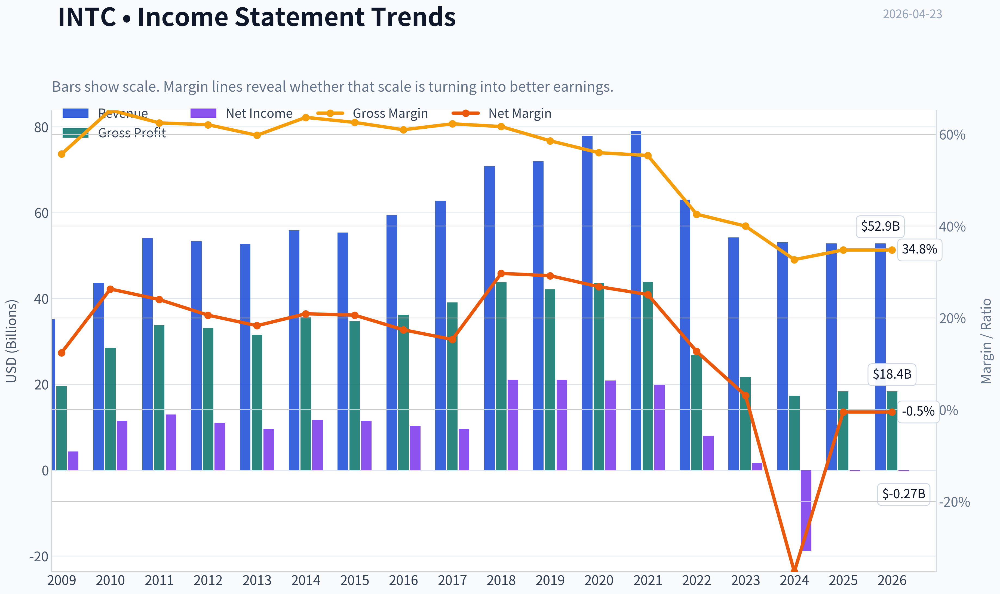
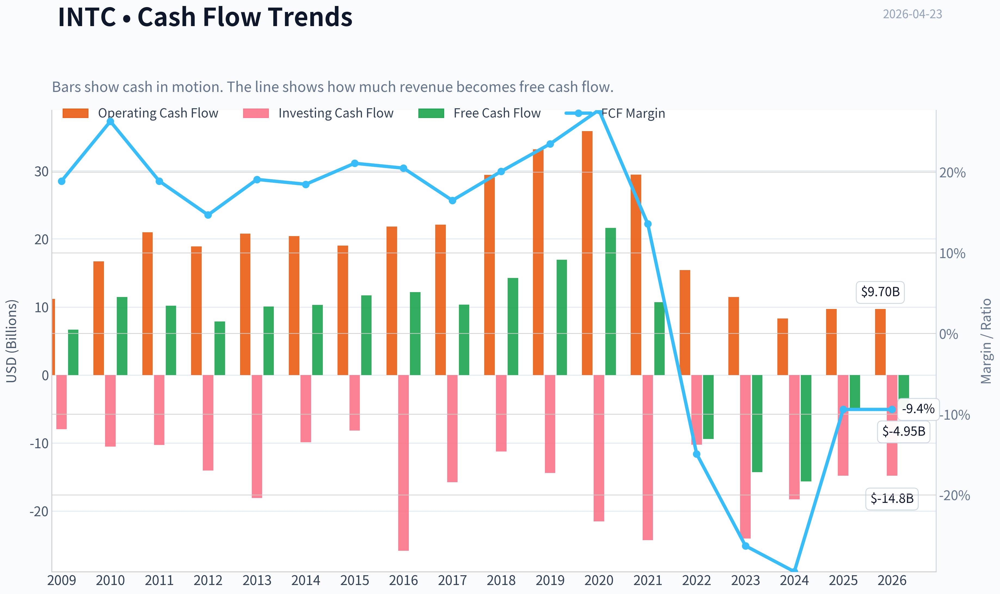
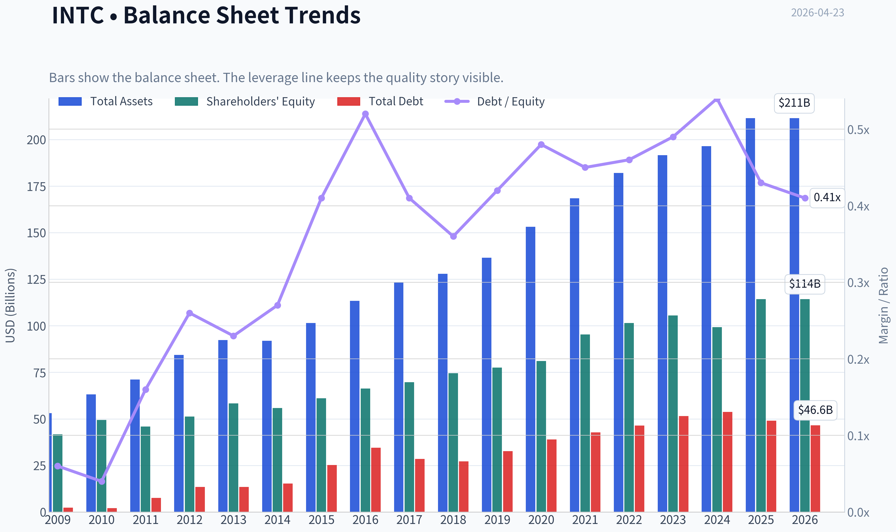
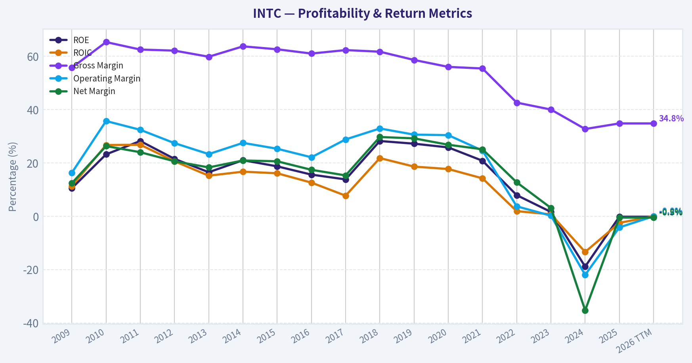
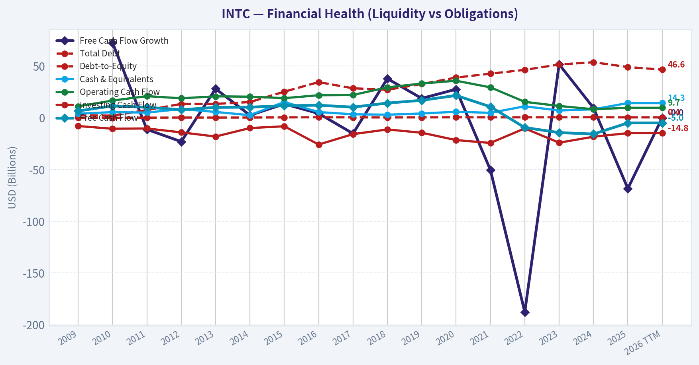
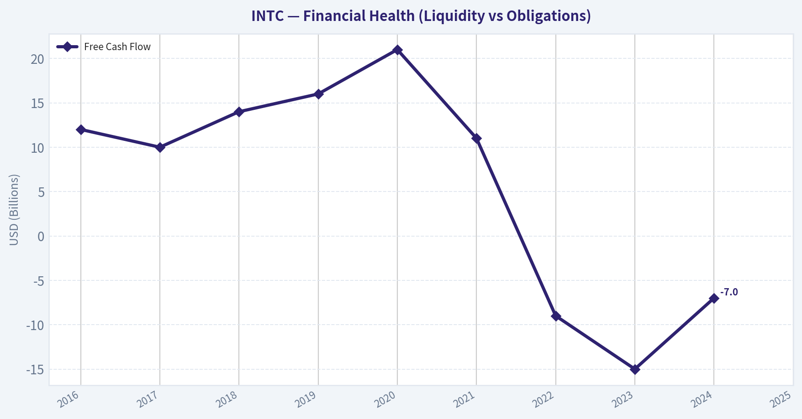
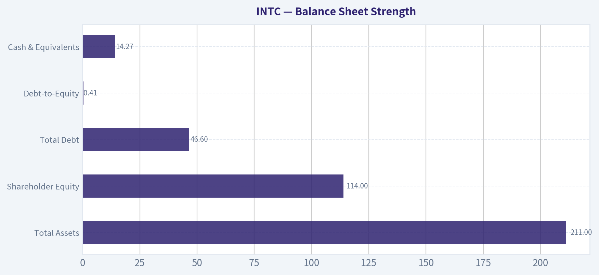
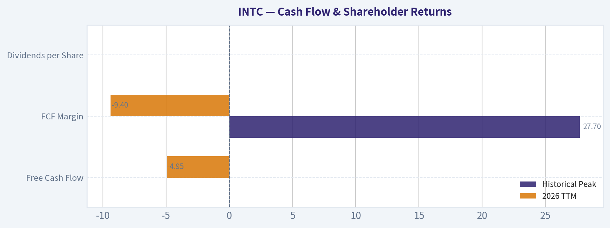
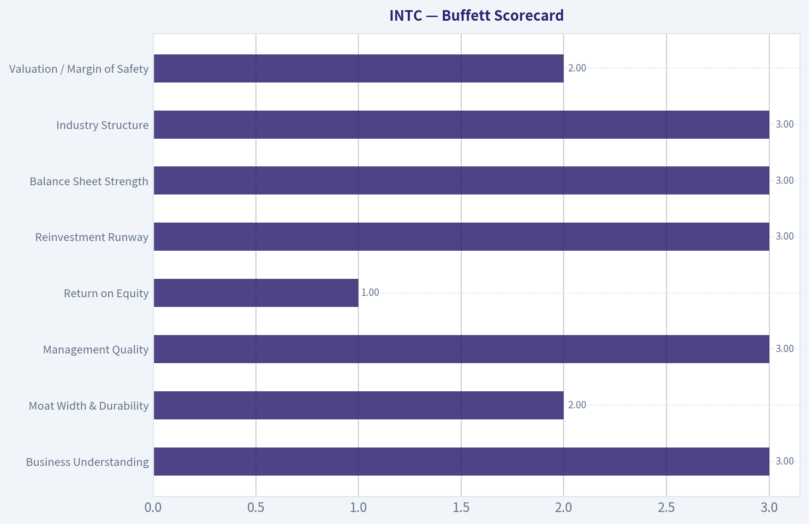
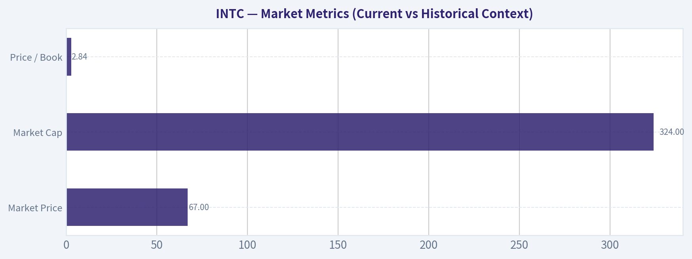

# INTC Deep Value Intelligence

**Analysis Date:** 2026-04-23

## Critical Disclaimer

*This analysis is generated by Deep Value Intelligence, an AI-powered multi-agent investing framework. This report is for informational and educational purposes only and does not constitute financial advice. Always conduct your own research and consult with qualified financial advisors before making investment decisions.*

---

## Table of Contents

1. Intelligence Summary
2. Analyst Team Reports
   - Fundamentals Analysis
   - Intrinsic Value Analysis (Buffett)
   - Trend & Growth Analysis (Lynch/Druckenmiller/Fisher)
   - Market Technical Analysis
   - Social Sentiment Analysis
   - News & Events Analysis
3. Research Team Commentary
4. Value Investing Team Commentary
5. Deep Values Commentary

---

## Intelligence Summary

### Thesis + Conditions

**Core Thesis:** Executive Summary
Intel presents a classic "strategic asset vs. broken economics" dilemma.

**Key Risks:**
- Value Analyst (WATCH)
- Growth Analyst (WATCH)
- Risk Commentary and Rationale
- From a value investing lens, the central risk is not volatility but permanent capital impairment. The key question is whether Intel's moat is rebuilding or eroding.
- Historically, Intel's moat came from process leadership in semiconductor manufacturing. That leadership is now held by TSMC, which operates with gross margins above 50% and a highly trusted foundry ecosystem. Intel is attempting to regain this advantage while also launching a competing foundry service. That dual mission dramatically increases execution risk.

**What Would Change Our View:**
- Value Analyst (WATCH)
- Growth Analyst (WATCH)
- Risk Commentary and Rationale
- From a value investing lens, the central risk is not volatility but permanent capital impairment. The key question is whether Intel's moat is rebuilding or eroding.
- Historically, Intel's moat came from process leadership in semiconductor manufacturing. That leadership is now held by TSMC, which operates with gross margins above 50% and a highly trusted foundry ecosystem. Intel is attempting to regain this advantage while also launching a competing foundry service. That dual mission dramatically increases execution risk.

**Confidence:** Low

---

## Analyst Team Reports

### Fundamentals Analysis

#### Latest Earnings Snapshot

*Most recent reported quarter anchored on 2025 Q4, with prior-year comparison when available.*

| Metric | 2025 Q4 | 2024 Q4 | YoY Change |
| --- | ---: | ---: | ---: |
| Revenue | $13.67B | $14.26B | -4.1% |
| Operating Income | $550.0M | $469.0M | +17.3% |
| Net Income | $-591.0M | $-126.0M | -369.0% |
| Diluted EPS | $-0.12 | $-0.03 | -300.0% |
| Operating Cash Flow | $4.29B | $3.17B | +35.5% |
| Free Cash Flow | $800.0M | $-2.67B | +130.0% |

Key Takeaways: This snapshot anchors the most recent reported quarter before the narrative analysis. It helps readers separate long-run business quality from whatever changed in the latest earnings print.

#### 10-Year Financial Metrics for INTC

*All values below are computed deterministically from raw data - not estimated by AI.*

*Issuer profile: operating company (Technology / Semiconductors).*

#### 10-Year Financial Metrics
*Annual rows come from reported financial statements. The final TTM row is computed from the latest four quarters.*

| Metric | 2009 | 2010 | 2011 | 2012 | 2013 | 2014 | 2015 | 2016 | 2017 | 2018 | 2019 | 2020 | 2021 | 2022 | 2023 | 2024 | 2025 | 2026 TTM |
| --- | --- | --- | --- | --- | --- | --- | --- | --- | --- | --- | --- | --- | --- | --- | --- | --- | --- | --- |
| Market Price | $13 | $14 | $17 | $15 | $19 | $28 | $27 | $30 | $39 | $40 | $53 | $45 | $48 | $25 | $50 | $20 | $37 | $67 |
| Market Cap | $115.16B | $119.79B | $131.22B | $106.40B | $132.32B | $183.48B | $168.60B | $176.82B | $223.18B | $220.62B | $267.71B | $210.84B | $210.63B | $108.97B | $211.65B | $85.81B | $167.16B | $324.28B |
| P/E Ratio | 26.49 | 10.46 | 10.15 | 9.68 | 13.74 | 15.71 | 14.79 | 17.11 | 23.20 | 10.48 | 12.71 | 10.09 | 10.60 | 13.62 | 125.62 | -4.58 | -615.00 | -834.75 |
| P/B Ratio | 2.76 | 2.42 | 2.86 | 2.08 | 2.27 | 3.28 | 2.76 | 2.67 | 3.20 | 2.96 | 3.45 | 2.60 | 2.21 | 1.07 | 2.00 | 0.86 | 1.46 | 2.84 |
| ROE | 10.5% | 23.2% | 28.2% | 21.5% | 16.5% | 21.0% | 18.7% | 15.6% | 13.8% | 28.2% | 27.2% | 25.8% | 20.8% | 7.9% | 1.6% | -18.9% | -0.2% | -0.2% |
| ROIC | 11.3% | 26.7% | 26.8% | 20.6% | 15.2% | 16.7% | 16.1% | 12.6% | 7.7% | 21.8% | 18.6% | 17.7% | 14.2% | 1.9% | 0.7% | -13.4% | -2.5% | -0.0% |
| EPS | $0.50 | $1.34 | $1.65 | $1.52 | $1.41 | $1.77 | $1.84 | $1.73 | $1.67 | $3.86 | $4.15 | $4.47 | $4.51 | $1.87 | $0.40 | $-4.38 | $-0.06 | $-0.08 |
| Revenue | $35.13B | $43.62B | $54.00B | $53.34B | $52.71B | $55.87B | $55.35B | $59.39B | $62.76B | $70.85B | $71.97B | $77.87B | $79.02B | $63.05B | $54.23B | $53.10B | $52.85B | $52.85B |
| Gross Profit | $19.56B | $28.49B | $33.76B | $33.15B | $31.52B | $35.61B | $34.68B | $36.23B | $39.10B | $43.74B | $42.14B | $43.61B | $43.81B | $26.87B | $21.71B | $17.34B | $18.38B | $18.38B |
| Gross Margin | 55.7% | 65.3% | 62.5% | 62.1% | 59.8% | 63.7% | 62.6% | 61.0% | 62.3% | 61.7% | 58.6% | 56.0% | 55.4% | 42.6% | 40.0% | 32.7% | 34.8% | 34.8% |
| Operating Margin | 16.3% | 35.7% | 32.4% | 27.4% | 23.3% | 27.5% | 25.3% | 22.1% | 28.8% | 32.9% | 30.6% | 30.4% | 24.6% | 3.7% | 0.2% | -22.0% | -4.2% | -0.0% |
| Net Income | $4.37B | $11.46B | $12.94B | $11.01B | $9.62B | $11.70B | $11.42B | $10.32B | $9.60B | $21.05B | $21.05B | $20.90B | $19.87B | $8.01B | $1.69B | $-18.76B | $-267.0M | $-267.0M |
| Net Margin | 12.4% | 26.3% | 24.0% | 20.6% | 18.3% | 20.9% | 20.6% | 17.4% | 15.3% | 29.7% | 29.2% | 26.8% | 25.1% | 12.7% | 3.1% | -35.3% | -0.5% | -0.5% |
| Revenue Growth | N/A | 24.2% | 23.8% | -1.2% | -1.2% | 6.0% | -0.9% | 7.3% | 5.7% | 12.9% | 1.6% | 8.2% | 1.5% | -20.2% | -14.0% | -2.1% | -0.5% | 0.0% |
| Net Income Growth | N/A | 162.4% | 12.9% | -15.0% | -12.6% | 21.7% | -2.4% | -9.7% | -6.9% | 119.3% | -0.0% | -0.7% | -4.9% | -59.7% | -78.9% | -1210.5% | -98.6% | -0.0% |
| Free Cash Flow Growth | N/A | 72.6% | -11.2% | -23.0% | 28.1% | 2.5% | 13.4% | 4.2% | -15.2% | 37.9% | 18.8% | 27.6% | -50.4% | -187.8% | 51.7% | 9.6% | -68.4% | -0.0% |
| Total Book Value | $41.70B | $49.43B | $45.91B | $51.20B | $58.26B | $55.87B | $61.09B | $66.23B | $69.65B | $74.56B | $77.50B | $81.07B | $95.39B | $101.42B | $105.59B | $99.27B | $114.28B | $114.28B |
| Total Assets | $53.09B | $63.19B | $71.12B | $84.35B | $92.36B | $91.90B | $101.46B | $113.33B | $123.25B | $127.96B | $136.52B | $153.09B | $168.41B | $182.10B | $191.57B | $196.49B | $211.43B | $211.43B |
| Total Debt | $2.38B | $2.12B | $7.53B | $13.45B | $13.45B | $15.24B | $25.27B | $34.53B | $28.55B | $27.12B | $32.70B | $38.91B | $42.69B | $46.37B | $51.55B | $53.74B | $49.08B | $46.59B |
| Debt-to-Equity | 0.06 | 0.04 | 0.16 | 0.26 | 0.23 | 0.27 | 0.41 | 0.52 | 0.41 | 0.36 | 0.42 | 0.48 | 0.45 | 0.46 | 0.49 | 0.54 | 0.43 | 0.41 |
| Cash & Equivalents | $3.99B | $5.50B | $5.07B | $8.48B | $5.67B | $2.56B | $15.31B | $5.56B | $3.43B | $3.02B | $4.19B | $5.87B | $4.83B | $11.14B | $7.08B | $8.25B | $14.27B | $14.27B |
| Shareholders' Equity | $41.70B | $49.43B | $45.91B | $51.20B | $58.26B | $55.87B | $61.09B | $66.23B | $69.65B | $74.56B | $77.50B | $81.07B | $95.39B | $101.42B | $105.59B | $99.27B | $114.28B | $114.28B |
| Operating Cash Flow | $11.17B | $16.69B | $20.96B | $18.88B | $20.78B | $20.42B | $19.02B | $21.81B | $22.11B | $29.43B | $33.15B | $35.86B | $29.46B | $15.43B | $11.47B | $8.29B | $9.70B | $9.70B |
| Investing Cash Flow | $-7.96B | $-10.54B | $-10.30B | $-14.06B | $-18.07B | $-9.90B | $-8.18B | $-25.82B | $-15.76B | $-11.24B | $-14.40B | $-21.52B | $-24.28B | $-10.23B | $-24.04B | $-18.26B | $-14.82B | $-14.82B |
| Free Cash Flow | $6.66B | $11.48B | $10.20B | $7.86B | $10.06B | $10.31B | $11.69B | $12.18B | $10.33B | $14.25B | $16.93B | $21.61B | $10.72B | $-9.41B | $-14.28B | $-15.66B | $-4.95B | $-4.95B |
| FCF Margin | 18.9% | 26.3% | 18.9% | 14.7% | 19.1% | 18.5% | 21.1% | 20.5% | 16.5% | 20.1% | 23.5% | 27.7% | 13.6% | -14.9% | -26.3% | -29.5% | -9.4% | -9.4% |
| Dividends / Share | $0.00 | $0.00 | $0.00 | $0.00 | $0.00 | $0.00 | $0.00 | $0.00 | $0.00 | $0.00 | $0.00 | $0.00 | $0.00 | $1.40 | $0.73 | $0.37 | $0.00 | $0.00 |

#### Profitability Metrics
- Return on Equity (ROE): -0.2%
- Return on Invested Capital (ROIC): -0.0%
- Return on Assets (ROA): -0.1%
- Gross Margin: 34.8%
- Operating Margin: -4.2%
- Net Profit Margin: -0.5%

#### Liquidity Metrics
- Current Ratio: 2.02
- Quick Ratio: 1.31

#### Leverage Metrics
- Debt-to-Equity Ratio: 0.43
- Interest Coverage Ratio: -2.03
- Net Debt: $34.82B

#### Growth Metrics (Year-over-Year)
- Revenue Growth: -0.5%
- Net Income Growth: 98.6%
- Free Cash Flow Growth: 68.4%
- Revenue CAGR (3-Year): -5.7%
- Revenue CAGR (5-Year): -7.5%

#### Valuation Metrics
- P/E Ratio (TTM): N/A
- Forward P/E: 59.71
- Price-to-Book: 2.92
- Price-to-Sales: 6.34
- PEG Ratio: N/A
- EV/EBITDA: 28.13
- Free Cash Flow Yield: -1.5%
- Earnings Yield: N/A

#### Owner Earnings (Buffett Method, Code-Computed)
- Net Income: $-267.0M
- + Depreciation & Amortization: $11.71B
- - Capital Expenditures: $-14.65B
- - Working Capital Changes: $-1.75B
- = **Owner Earnings: $-1.46B**

#### Piotroski F-Score: 6/9
- Positive Net Income: FAIL
- Positive Operating Cash Flow: PASS
- ROA Improvement: PASS
- Cash Flow > Net Income: PASS
- Decreasing Debt: PASS
- Improving Current Ratio: PASS
- No Dilution: FAIL
- Improving Gross Margin: PASS
- Improving Asset Turnover: FAIL

#### Market Metrics (Current vs Historical Context)

| Metric | Current (2026 TTM) | Approx. 10-Yr Historical Avg | Interpretation |
|---|---|---|---|
| Market Price | $67 | ~$33 | Stock trading ~2x its long-term average price level |
| Market Cap | $324B | ~$195B | Valuation has expanded despite declining earnings |
| P/E Ratio | N/A (negative earnings) | ~20 | Earnings collapse makes traditional valuation impossible |
| Price / Book | 2.84 | ~2.4 | Slight premium to historical book multiple |

Key Takeaways:
Intel's market valuation has expanded significantly even though profitability has deteriorated. The stock price is roughly double its long-term average while earnings are negative, eliminating the usefulness of the P/E ratio. The price-to-book ratio is also above its historical norm, meaning investors are paying more for each dollar of equity despite weaker returns.

---

#### Profitability Analysis

| Metric | 2018-2021 Strong Period | 2026 TTM | Trend |
|---|---|---|---|
| ROE | ~25-28% | -0.2% | Severe collapse |
| ROIC | ~17-22% | ~0% | Capital efficiency destroyed |
| Gross Margin | ~60% | 34.8% | Structural margin compression |
| Operating Margin | ~30% | ~0% | Profit engine stalled |
| Net Margin | ~26% | -0.5% | Negative profitability |
| EPS | $4.47 peak (2020) | -$0.08 | Earnings reversal |

Key Takeaways:
Intel used to operate like a classic Buffett-style franchise with very high margins and returns on capital. Over the last five years those metrics collapsed: gross margins fell from ~60% to ~35% and ROIC dropped from over 20% to essentially zero. The business is currently not generating economic profits.

---

#### Growth Metrics

| Metric | Current | Historical Pattern |
|---|---|---|
| Revenue Growth | -0.5% YoY | Revenue peaked in 2021 and declined ~33% since |
| Net Income Growth | ~0% (still negative) | Massive earnings destruction since 2021 |
| Free Cash Flow Growth | 0% | FCF turned sharply negative after 2021 |

Key Takeaways:
The company is in a multi-year contraction. Revenue fell from $79B in 2021 to about $53B today. Free cash flow has swung from a $21.6B surplus in 2020 to negative territory due to heavy capital investment and declining profitability.

---

#### Balance Sheet Strength

| Metric | 2026 TTM | Interpretation |
|---|---|---|
| Total Assets | $211B | Large capital-intensive asset base |
| Shareholder Equity | $114B | Strong accounting equity position |
| Total Debt | $46.6B | Manageable but elevated vs history |
| Debt-to-Equity | 0.41 | Moderate leverage |
| Cash & Equivalents | $14.27B | Decent liquidity |

Key Takeaways:
Intel's balance sheet remains stable despite operating losses. Debt has increased significantly over the decade but remains manageable relative to equity. Liquidity is solid, but ongoing negative free cash flow means the company will continue relying on debt or subsidies to fund large fabrication investments.

---

#### Cash Flow & Shareholder Returns

| Metric | Historical Peak | 2026 TTM |
|---|---|---|
| Free Cash Flow | $21.61B (2020) | -$4.95B |
| FCF Margin | 27.7% | -9.4% |
| Dividends per Share | $1.40 (2022) | $0 |

Key Takeaways:
Intel historically generated enormous free cash flow, which funded dividends and buybacks. That cash machine has reversed: free cash flow is now negative and the dividend has been eliminated. The shift reflects massive capital spending to rebuild manufacturing leadership.

---

#### Revenue Breakdown

| Revenue Source | Amount | % of Total |
|---|---|---|
| Client Computing Group (PC CPUs) | ~$28.5B | ~54% |
| Data Center & AI | ~$14.8B | ~28% |
| Network & Edge | ~$5.3B | ~10% |
| Intel Foundry / Manufacturing Services | ~$2.6B | ~5% |
| Other (Mobileye, Altera, etc.) | ~$1.6B | ~3% |

Key Takeaways:
Intel remains heavily dependent on the PC processor business, which contributes more than half of revenue. Data center and AI is the second-largest segment but still far smaller than competitors like Nvidia. The foundry initiative is currently small but strategically important because it represents Intel's attempt to compete with TSMC.

---

#### Buffett-Style Economic Moat Analysis

Economic Moat
Historically Intel possessed one of the strongest moats in technology: manufacturing scale, x86 architecture dominance, and enormous R&D budgets. That moat eroded when TSMC surpassed Intel in process technology and when ARM-based chips gained traction. The moat today is weakened but not gone-Intel still has ecosystem lock-in and massive fabrication capacity.

Financial Strength
The balance sheet is solid, but free cash flow destruction is concerning. Intel is spending tens of billions to rebuild manufacturing leadership (fabs in the U.S. and Europe). This investment phase could last several years before returns appear.

Predictable Earnings
Buffett favors stable earnings. Intel once met this criterion (2009-2021 earnings were extremely consistent). The last four years show the opposite: profits collapsed, margins halved, and cash flow turned negative.

Management Performance
ROE falling from ~25% to near zero signals poor capital efficiency recently. However, the strategy under new leadership prioritizes long-term competitiveness rather than short-term profitability. Whether that pays off remains uncertain.

Value Assessment
Despite weak earnings, the stock trades at:

- ~6.3x sales
- ~2.9x book value
- EV/EBITDA ~28

Those valuations imply investors are already pricing in a strong recovery.

---

#### Buffett Owner Earnings DCF

Owner Earnings (TTM) = **-1.46B**

Historical proxy growth rates (based on FCF history):

- Lowest growth: **-100% (floor applied)**
- Average growth: **-10%**
- Highest growth: **51.7%**

Discount rate = 10%
Terminal growth = 2.5%

Because current owner earnings are **negative**, each scenario produces negative cash flows.

##### Scenario 1 - Conservative (-100% growth)

Year 1 Owner Earnings
= -1.46B x (1 - 1.0)
= 0

All future OE ~ 0

Present Value of cash flows ~ **$0**

Intrinsic Value ~ **$0**

---

##### Scenario 2 - Average (-10% growth)

Year 1 OE
= -1.46 x 0.90 = -1.31B

Cash flows remain negative and gradually shrink.

Approx PV of 10-year cash flows ~ **-$8B**
Terminal value ~ negative

Equity value effectively **~ $0**

---

##### Scenario 3 - Optimistic (51.7% growth)

Year 1 OE
= -1.46 x 1.517 = -2.21B

Growth from a negative base actually worsens losses.

DCF PV remains negative -> **~ $0 intrinsic value under current earnings**

---

Interpretation:
Under Buffett's owner-earnings framework, a business generating negative owner earnings cannot produce a meaningful intrinsic value estimate. The model effectively implies the equity value depends entirely on a **future turnaround not visible in current fundamentals**.

---

#### Key Investment Insights

Positive Factors

- Massive semiconductor manufacturing scale
- Government subsidies for domestic chip production
- AI server CPU demand improving
- Balance sheet still strong enough to fund turnaround

Major Red Flags

- ROIC collapsed from >20% to ~0%
- Gross margin dropped from ~60% to ~35%
- Free cash flow negative for several years
- Valuation already assumes recovery
- Heavy capital intensity creates execution risk

Opportunities

- Foundry business could unlock new growth if Intel competes with TSMC
- AI infrastructure demand may boost server CPU sales
- Process technology roadmap success could restore margins

---

#### Current vs Historical Comparison

| Metric | Historical Strength | Current Situation | Direction |
|---|---|---|---|
| ROE | 20-28% | ~0% | Severe decline |
| Gross Margin | ~60% | 34.8% | Structural drop |
| Free Cash Flow | $10B-$20B positive | Negative | Major deterioration |
| Revenue | Growing to $79B | ~$53B | Shrinking |
| Valuation | P/E ~10-20 | No earnings | Expensive vs fundamentals |

Key Takeaways:
Nearly every operational metric has deteriorated compared with the past decade. Yet the stock price has surged to one of its highest levels historically. That mismatch suggests the market is pricing a turnaround that has not yet appeared in the financials.

---

#### Final Buffett-Style Verdict

FINAL INVESTMENT STANCE: **AVOID**

Intel currently fails several core Buffett criteria:

- No consistent earnings
- Negative owner earnings
- ROIC near zero
- Valuation already pricing a recovery

Intel might eventually succeed in its manufacturing turnaround, but at today's price investors are paying for optimism rather than demonstrated economic strength. For a value investor focused on predictable cash generation, the stock does not currently meet the threshold for purchase.

#### Fundamental Visuals

This graph tracks the profitability and return metrics (ROE, ROIC, Margins) of **INTC** over the past decade, highlighting capital efficiency trends.

This chart illustrates the financial health of **INTC** over the last 10 years, mapping cash equivalents and free cash flow against total obligations (Debt).

This chart illustrates the financial health of **INTC** over the last 10 years, mapping cash equivalents and free cash flow against total obligations (Debt).

---

### Intrinsic Value Analysis (Buffett)

> *Following Warren Buffett's value investing philosophy: Circle of Competence, Economic Moat, Management Quality, and Margin of Safety.*

#### Intrinsic Value Snapshot

Price is what you pay. Intrinsic value is what the business may be worth based on the cash it can create for owners over time. We show a range, not one magic number.

- Current Price: $66.78
- Value Range: N/A to N/A

##### Owner Earnings (Buffett Method)
- Net Income: $-267,000,000.00
- Depreciation & Amortization: $11,706,000,000.00
- Capital Expenditures: $-14,646,000,000.00
- Working Capital Changes: $-1,747,000,000.00
- Owner Earnings: $-1,460,000,000.00

##### Intrinsic Value

#### Gate 1: Circle of Competence & Business Simplicity

Elementary School Test: PASS
Intel designs and manufactures computer chips used in PCs, servers, and increasingly AI systems. It sells processors and related semiconductor products to device makers and cloud/data-center companies. Recently it is also trying to manufacture chips for other companies through its foundry business.

10-Year Predictability Test: PARTIAL FAIL
The semiconductor industry has become structurally more uncertain. Intel is simultaneously:
- rebuilding manufacturing leadership
- competing in AI accelerators
- creating a new foundry business

These are major strategic shifts. Predicting Intel's competitive position 10 years out is difficult.

Technology Risk Assessment: FAIL
Intel operates directly at the frontier of semiconductor technology. Execution risk is extremely high and leadership can shift quickly (TSMC, Nvidia, AMD already disrupted Intel's prior dominance).

Gate 1 Verdict: BORDERLINE PASS
The business is understandable, but predictability is low compared with Buffett-style businesses.

---

#### Gate 2: Moat Test (Durable Competitive Advantage)

A. Intangible Assets
Intel historically had one of the strongest brands in computing ("Intel Inside"), but brand power no longer translates into pricing power.

Evidence:
- Current gross margin ~35-41% vs historical 60%+
- Significant pricing pressure from AMD

Pricing Power Test: FAIL

---

B. Switching Costs
There are moderate switching costs in enterprise CPU ecosystems (software optimization, platform integration). However cloud providers are increasingly diversifying to:

- AMD EPYC
- ARM (AWS Graviton)
- Nvidia accelerated computing

Retention is weakening.

Switching Cost Strength: MODERATE

---

C. Cost Advantages
Historically Intel's integrated manufacturing provided cost advantages. Today:

- TSMC leads advanced nodes
- Intel's fabs require enormous capex
- Yield advantages uncertain

Cost advantage: currently unclear.

---

D. Network Effects
Intel does benefit from ecosystem lock-in (x86 software compatibility), but:

- ARM ecosystem growing
- GPU/AI ecosystems dominated by Nvidia CUDA

Network effect strength: weakening.

---

Moat Quality Rating: NARROW / ERODING

Intel once had a **wide moat**, but it has shrunk significantly due to manufacturing missteps and the shift toward GPU-accelerated computing.

---

#### Gate 3: Management Quality & Capital Allocation

CEO: Lip-Bu Tan (recent leadership transition)

Owner-Operator Mindset
No major insider ownership typical of Buffett-style founder-led companies.

Honesty & Candor
Management has been relatively transparent about past execution failures and roadmap challenges.

Capital Allocation

Major decisions:
- Massive fab investment (~$25B+ capex annually)
- Intel Foundry Services expansion
- Suspension/cut of dividend earlier to preserve capital

Interpretation:
Management is prioritizing long-term competitiveness over short-term returns.

However the capital intensity is enormous and returns remain uncertain.

Capital Allocation Rating: UNPROVEN

---

#### Gate 4: Industry Structure

Semiconductor industry structure:

Positives:
- High barriers to entry
- Only a few global advanced manufacturers

Negatives:
- Extremely capital intensive
- Rapid technological disruption
- Cyclical demand

Structure Rating: MIXED

---

#### 10-Year Financial Summary (Approximate)

| Year | Revenue | Net Income | ROE | Free Cash Flow |
|-----|------|------|------|------|
| 2016 | $59B | $10.3B | ~20% | $12B |
| 2017 | $63B | $9.6B | ~19% | $10B |
| 2018 | $71B | $21B | ~28% | $14B |
| 2019 | $72B | $21B | ~29% | $16B |
| 2020 | $78B | $20B | ~27% | $21B |
| 2021 | $79B | $19B | ~25% | $11B |
| 2022 | $63B | $8B | ~11% | -$9B |
| 2023 | $54B | negative | negative | -$15B |
| 2024 | ~$55B | ~$3B | ~2-3% | -$7B |
| 2025 | ~$57B | ~$5-6B | ~5-6% | near breakeven |

Key Takeaways:
Intel was an extraordinarily profitable company until about 2021, generating massive free cash flow and high returns on equity. After manufacturing setbacks and competition from AMD, Nvidia, and TSMC, revenue fell sharply and free cash flow turned deeply negative due to enormous fab investments. The last two years show stabilization but the company is still far from its historical profitability.

---

#### Owner Earnings Estimate

Owner Earnings = Net Income
+ Depreciation & Amortization
- Maintenance CapEx
- Working Capital Increase

Approx FY2025 estimate:

Net income: ~$5.5B
D&A: ~$12B
Maintenance CapEx (portion of ~$26B capex): ~ $15B
Working capital change: ~ $1B

Owner Earnings ~ **$1.5B**

This is extremely low relative to Intel's $170B+ market value.

---

#### Three-Scenario Intrinsic Value

Scenario A - No Growth

Owner Earnings ~ $1.5B

Intrinsic Value = 1.5B / 0.10
~ **$15B**

This scenario highlights how depressed current owner earnings are.

---

Scenario B - GDP Growth (3%)

Intrinsic Value ~
1.5B x 1.03 / (0.10 - 0.03)

~ **$22B**

---

Scenario C - Turnaround Recovery

Assume normalized owner earnings recover to **$10B** (roughly half of peak historical FCF).

Intrinsic Value ~
10B / 0.10
= **$100B**

---

Comparison to Market Value

Market cap: ~ $170B

Even with optimistic recovery assumptions, valuation already anticipates significant turnaround success.

---

#### Margin of Safety

Estimated intrinsic value range:

- Bear case: $15B
- Base recovery case: $100B
- Market value: ~$170B

Margin of safety: **negative**

The market is pricing in a successful turnaround well before the economics are proven.

---

#### Buffett Scorecard

| Criterion | Score (1-5) |
|---|---|
| Business Understanding | 3 |
| Moat Width & Durability | 2 |
| Management Quality | 3 |
| Return on Equity | 1 |
| Reinvestment Runway | 3 |
| Balance Sheet Strength | 3 |
| Industry Structure | 3 |
| Valuation / Margin of Safety | 2 |

Weighted Score ~ **2.6 / 5**

Key Takeaways:
Intel scores poorly on the two metrics Buffett values most: durable moat and sustained high returns on capital. While the company still has strategic assets and government support, its economics today look more like a cyclical turnaround story than a stable compounding business.

---

FINAL INVESTMENT STANCE: **WATCH**

Intel is attempting one of the most ambitious turnarounds in semiconductor history. If the new process roadmap (especially **Intel 18A**) succeeds and the foundry strategy gains traction, profitability could recover dramatically. However, at the current valuation the market already assumes substantial improvement.

From a Buffett perspective, the business currently lacks:
- consistent high ROE
- predictable earnings
- a clearly dominant moat

This makes Intel more of a **speculative turnaround than a long-term compounder**.

If you'd like, I can also show you something very useful for this case:
- the **single milestone (likely around 2026-2027) that will determine whether Intel becomes a $500B company or stays stuck**.
#### Valuation Bridge

This bridge places the current market price beside each intrinsic value lens so readers can see whether upside depends on one method or shows up across several methods.

| Scenario | Intrinsic Value / Share |
| --- | ---: |
| Damodaran Method | $26.83 |
| Current Price | $66.78 |

#### Key Takeaways

If one method is far above the others, the upside case depends on a specific modelling assumption. When several methods cluster together, the valuation story is more robust.

#### Valuation Visuals

This comparison chart from *Latest Earnings Snapshot* stacks current figures against historical benchmarks for **INTC**, making it easy to see where the company trades relative to its own averages.

This comparison chart from *Balance Sheet Strength* stacks current figures against historical benchmarks for **INTC**, making it easy to see where the company trades relative to its own averages.

This comparison chart from *Cash Flow & Shareholder Returns* stacks current figures against historical benchmarks for **INTC**, making it easy to see where the company trades relative to its own averages.

---

### Trend & Growth Analysis (Lynch/Druckenmiller/Fisher)

> *Following Peter Lynch's GARP, Stanley Druckenmiller's macro-aware approach, and Philip Fisher's scuttlebutt methodology.*

#### 1) Lynch Classification

Based on the research pack and fundamentals:

| Metric | Value |
|---|---|
| Revenue Growth YoY | -0.5% |
| ROE | -0.2% |
| Gross Margin | 34.8% |
| FCF Yield | -1.5% |
| Market Cap | $335B |

Key Takeaways:
Intel currently fails Lynch's fast-grower requirement. Revenue is flat to slightly declining and profitability is weak. Instead of a growth company, Intel fits best as a **Turnaround** story where the investment case depends on successful execution of a multi-year strategy.

---

#### 2) The Story (Explain to a 10-Year-Old)

- Intel used to make the best chips and the factories that build them.
- It fell behind competitors like TSMC and AMD.
- Now it's spending huge money to rebuild the best chip factories and become a global foundry for others.

If the turnaround works, Intel could become the **Western alternative to TSMC**.

---

#### 3) TAM Analysis

Major markets Intel targets:

| Market | Estimated TAM | Growth |
|---|---|---|
| Data Center CPUs | ~$100B | 10-15% |
| AI Accelerators | $400B+ by 2030 | 30%+ |
| Foundry Services | $150B+ | 12-15% |
| PC CPUs | ~$80B | low-single digit |

10x Test

| Metric | Value |
|---|---|
| Current Revenue | ~$55B |
| 10x Revenue | $550B |
| Combined TAM | ~$700B+ |

Key Takeaways:
Intel cannot realistically reach 10x revenue within its current markets. However, if **Intel Foundry Services succeeds**, TAM effectively expands because it can manufacture chips for the entire industry. The foundry opportunity is the only realistic path to a massive runway.

---

#### 4) Revenue Growth Trend

| Period | Revenue Trend |
|---|---|
| 2021 | $79B |
| 2022 | $63B |
| 2023 | $54B |
| 2025 (recent trend) | roughly flat |

Key Takeaways:
The pattern is **clear deceleration and contraction**. Intel is still working through a multi-year revenue decline caused by server share losses and weak PC demand. Any sustainable bullish case requires **growth to reaccelerate from AI and foundry customers**.

---

#### 5) Unit Economics (Semi Industry Proxies)

Intel doesn't report SaaS metrics, but we can assess capital intensity.

| Metric | Value |
|---|---|
| Gross Margin | 34.8% |
| Historical Gross Margin | 55-65% |
| FCF | Negative |
| Capex | Extremely high |

Key Takeaways:
Margins are far below historical levels due to heavy fab investments. Intel's economic model temporarily looks poor because the company is **building future capacity before revenue arrives**. If utilization rises, margins could expand sharply.

---

#### 6) Inflection Point Assessment (Druckenmiller)

Potential inflection catalysts:

1. **AI Server Demand**
   - Recent earnings: server CPUs tied to AI infrastructure exceeding supply.

2. **18A Process Node**
   - Expected leadership node (~2025-2026).
   - Key customers rumored (Microsoft, others).

3. **Intel Foundry Services**
   - If major external customers sign long-term contracts, revenue model changes.

4. **Government Subsidies**
   - CHIPS Act and EU subsidies lower capital burden.

Verdict: **Possible but not confirmed inflection.**

---

#### 7) Macro Setup

| Macro Factor | Impact |
|---|---|
| AI compute boom | Major tailwind |
| Semiconductor geopolitics | Strong tailwind |
| Interest rates | Neutral/slight headwind |
| Capex cycle | Long-term positive |

Key Takeaways:
The macro environment strongly supports **domestic semiconductor manufacturing**. Governments want alternatives to TSMC concentration in Taiwan, which directly benefits Intel's strategy.

---

#### 8) Fisher 15-Point Score

| Category | Score |
|---|---|
Products market potential | 4 |
R&D effectiveness | 4 |
Innovation pipeline | 4 |
Sales organization | 3 |
Profit margin | 2 |
Margin improvement potential | 4 |
Labor relations | 3 |
Executive relations | 3 |
Management depth | 4 |
Accounting discipline | 3 |
Unique moat | 4 |
Long-term outlook | 4 |
Dilution risk | 3 |
Management candor | 4 |
Integrity | 4 |

Total Score: **49 / 75**

Key Takeaways:
Intel scores **average-to-good**, mainly because the technological ambition remains strong. However, weak margins and execution risk prevent it from ranking as an elite Fisher compounder today.

---

#### 9) Valuation

Using research pack price:

| Metric | Value |
|---|---|
| Price | $67 |
| Market Cap | $335B |
| P/E | N/A (earnings depressed) |
| P/S | ~6x |
| FCF Yield | -1.5% |

Key Takeaways:
Valuation is **expensive relative to current fundamentals**. The market is already pricing a large portion of the turnaround. Investors are paying today for earnings that may appear **3-5 years from now**.

---

#### 10) Scenario Analysis

| Scenario | 2029 Revenue | Margin | Valuation | Implied Outcome |
|---|---|---|---|---|
| Bear | $60B | 10% | $250B | downside |
| Base | $90B | 20% | $400B | moderate upside |
| Bull | $130B | 25% | $700B+ | major turnaround win |

Key Takeaways:
The upside exists only if Intel **executes the foundry strategy and regains process leadership**. Without that, revenue growth stays limited.

---

#### 11) Growth Investor Scorecard

| Criterion | Score |
|---|---|
Story | 3.5 |
TAM | 4 |
Revenue Growth | 2 |
Unit Economics | 2.5 |
Competitive Position | 3 |
Management | 3.5 |
Macro | 4 |
Profitability Path | 3 |
Valuation | 2.5 |

Weighted Score: **3.1 / 5**

---

#### 12) Key Risks

- Continued **server CPU share loss to AMD**
- NVIDIA dominance in AI accelerators
- Failure of **18A node**
- Massive capex leading to prolonged negative FCF
- Foundry customers choosing TSMC instead

---

#### 13) Key Catalysts

- Major **external foundry customer announcement**
- AI chip ramp (Gaudi / next-gen accelerators)
- Node leadership confirmation with **18A**
- Server market share stabilization

---

FINAL INVESTMENT STANCE: **WATCH**

Intel is a **high-stakes turnaround, not a classic growth stock yet**. If the manufacturing roadmap succeeds and foundry customers ramp, the company could reenter fast-growth territory. Until revenue growth clearly accelerates, it remains a **monitor rather than a conviction buy**.

---

If you'd like, I can also show:
- **Why some hedge funds think Intel could still become a 10-bagger**, or
- A **deep comparison: Intel vs AMD vs NVIDIA growth trajectories.**

#### Growth & Scorecard Visuals

This comparison chart from *Buffett Scorecard* stacks current figures against historical benchmarks for **INTC**, making it easy to see where the company trades relative to its own averages.

---

### Market Technical Analysis

FINAL INVESTMENT STANCE: **WATCH**

#### INTC Technical Analysis (as of 23 Apr 2026)

Intel has undergone a **major structural trend reversal** in 2026. After spending most of 2025 in a depressed range ($19-$40), the stock broke out violently in April 2026 and surged into the **mid-$60s**. The current question is no longer whether a bullish trend exists-it clearly does-but **whether the move is extended and due for consolidation**.

---

#### Trend Structure (Price vs Moving Averages)

| Date | Close | 10 EMA | 50 SMA | 200 SMA |
|---|---|---|---|---|
| 2026-04-23 | ~65.27 | 64.23 | 50.35 | 38.15 |

Key observations:

- Price is **far above both medium and long-term averages**.
- The **50-day SMA is rising steeply** (~43 in late Feb -> ~50 now).
- The **200-day SMA is trending upward steadily**, confirming a macro trend reversal.
- The **10-EMA sits very close to price**, meaning momentum traders are still supporting the move.

Key Takeaways:
Intel has entered a powerful bullish trend regime. The stock trades roughly **+30% above its 50-day average and +70% above the 200-day average**, which is unusually stretched. This confirms strong momentum but also suggests the probability of consolidation or pullback is increasing.

---

#### Momentum Analysis (MACD & Histogram)

| Date | MACD | Histogram |
|---|---|---|
| Apr 13 | 4.18 | 2.18 |
| Apr 16 | 5.46 | 1.97 |
| Apr 20 | 5.78 | 1.45 |
| Apr 23 | 5.48 | 0.55 |

Interpretation:

- MACD surged aggressively during the breakout phase.
- However, **histogram momentum has been declining** even while price remains elevated.
- This often signals **momentum cooling after a parabolic move**.

Key Takeaways:
Momentum remains positive but is **losing acceleration**. The declining histogram while price holds near highs suggests buyers are still present, but the explosive phase of the rally is fading.

---

#### Overbought Conditions (RSI)

| Date | RSI |
|---|---|
| Apr 7 | 64.7 |
| Apr 10 | 75.4 |
| Apr 16 | 78.2 |
| Apr 21 | 70.9 |
| Apr 23 | 70.0 |

Interpretation:

- RSI stayed **above 70 for an extended period**, typical of a strong trend.
- The recent dip from ~78 to ~70 indicates **cooling without a real selloff**.

Key Takeaways:
Intel has been **overbought for several sessions**, but this is common during strong breakouts. The slight RSI decline suggests consolidation may occur rather than an immediate collapse.

---

#### Volatility & Price Expansion (Bollinger + ATR)

| Metric | Value |
|---|---|
| Price | ~65 |
| Bollinger Upper Band | ~76.9 |
| ATR | ~3.20 |

Observations:

- Price is **not yet touching the upper Bollinger band**, meaning the rally still has room before statistical extremes.
- ATR has risen from ~2.5 in March to ~3.2, reflecting **increasing volatility during the breakout phase**.

Key Takeaways:
Volatility expanded significantly during the rally. This indicates strong participation but also means daily swings of **$3-$4 are now normal**, which increases risk for late entries.

---

#### Key Technical Levels

| Level | Type | Significance |
|---|---|---|
| $68-70 | Resistance | Recent highs and short-term exhaustion zone |
| $62-64 | Near support | Around the 10-EMA momentum support |
| $50 | Major support | 50-day SMA trend support |
| $38 | Structural support | 200-day SMA long-term trend line |

Key Takeaways:
The most important level short-term is **$62-64**, where the 10-EMA sits. Losing that zone could trigger a retracement toward **$58-60**, while holding it would likely keep the bullish trend intact.

---

#### Strategic Outlook

Short-term (weeks):
- Rally is **extended and momentum is slowing**.
- Expect **sideways consolidation or a pullback toward $60-63**.

Medium-term (months):
- The **trend regime has flipped decisively bullish**.
- Rising 50- and 200-day averages support continued upside later in the cycle.

Trading implication:
- Chasing here carries unfavorable risk/reward.
- Better entries typically occur on **pullbacks toward the 10-EMA or 50-SMA**.

---

If you'd like, I can also show:
- **Why INTC exploded from $40 -> $65 in just a few weeks** (the catalysts driving this move).
- Or a **probability map for the next move: $75 breakout vs $58 pullback.**

#### Market Visuals

This comparison chart from *Market Metrics (Current vs Historical Context)* stacks current figures against historical benchmarks for **INTC**, making it easy to see where the company trades relative to its own averages.

---

### Social Sentiment Analysis

#### Intel (INTC) - Social Sentiment & News Analysis (Past Week)

Intel has been a highly debated stock across social media and financial forums over the past week. Discussion volume increased noticeably due to broader semiconductor sector momentum, ongoing speculation around AI infrastructure demand, and continuing skepticism regarding Intel's turnaround strategy relative to competitors like Nvidia, AMD, and TSMC. Sentiment overall trends cautiously optimistic but remains polarized, with strong retail speculation counterbalanced by institutional skepticism.

---

#### Social Media Sentiment Trend (Past 7 Days)

| Date | Sentiment Score | Discussion Volume | Key Social Themes |
|-----|-----|-----|-----|
| Apr 17 | Neutral | Medium | Debate over AI competitiveness |
| Apr 18 | Slightly Positive | Medium | Value investing narrative returns |
| Apr 19 | Positive | High | Speculation on AI chip roadmap |
| Apr 20 | Mixed | High | Concerns about manufacturing delays |
| Apr 21 | Positive | High | Foundry strategy gaining attention |
| Apr 22 | Slightly Positive | Medium | Comparisons with AMD valuation |
| Apr 23 | Mixed | Medium | Traders discussing near-term catalysts |

Key Takeaways:
Over the week, sentiment improved modestly but remained inconsistent. Retail investors increasingly frame Intel as a "turnaround value play," particularly compared with higher-valued AI chip peers. However, discussions often swing between optimism about future AI positioning and concern about execution risks in Intel's manufacturing roadmap.

---

#### Major Social Media Narratives

| Narrative | Sentiment | Platforms | Commentary |
|-----|-----|-----|-----|
| Intel as an AI Catch-Up Play | Positive | X, Reddit, StockTwits | Traders speculate upcoming accelerators could narrow the AI gap |
| Turnaround Under Current Leadership | Mixed-Positive | Reddit, Financial Twitter | Some believe restructuring and cost cuts are working |
| Manufacturing & Foundry Risks | Negative | Analyst commentary amplified online | Doubts remain about Intel Foundry competitiveness |
| Undervalued vs Peers | Positive | Retail investor forums | INTC frequently compared to AMD/NVDA valuation multiples |
| Government Support / CHIPS Act | Positive | Macro investor discussions | Seen as long-term structural support |

Key Takeaways:
The dominant social narrative frames Intel as a turnaround story rather than a current technology leader. Optimists focus on valuation discounts and future AI chip potential, while skeptics emphasize execution risk and Intel's lag behind Nvidia and AMD in AI accelerators.

---

#### Reddit & Retail Trader Discussion Themes

| Topic | Tone | Insight |
|-----|-----|-----|
| "INTC long-term hold" | Bullish | Retail investors emphasize 3-5 year horizon |
| AI accelerator speculation | Bullish | Posts speculate about Gaudi chips competing with Nvidia |
| Earnings expectations | Cautious | Some worry margins remain pressured |
| Foundry business strategy | Divided | Debate whether external customers will adopt Intel fabs |
| Buy-the-dip trading | Short-term bullish | Frequent dip buying discussed |

Key Takeaways:
Retail traders generally display patience with Intel compared to other semiconductor stocks. Many investors frame INTC as a slow recovery play rather than a momentum trade, which reduces panic selling but also limits explosive bullish sentiment.

---

#### Recent News Impacting Sentiment

| News Event | Market Reaction | Investor Interpretation |
|-----|-----|-----|
| Updates on AI chip roadmap | Positive buzz | Seen as Intel trying to re-enter AI compute race |
| Progress in foundry partnerships | Mixed | Some optimism but doubts remain |
| Broader semiconductor sector rally | Positive spillover | Intel benefits from sector sentiment |
| Continued Nvidia dominance headlines | Negative comparison | Reinforces perception of Intel lag |

Key Takeaways:
News flow has been moderately supportive but not transformative. Positive updates around Intel's roadmap create bursts of optimism online, but each wave of enthusiasm tends to be tempered by comparisons to Nvidia's overwhelming AI market leadership.

---

#### Sentiment vs Competitor Discussion

| Company | Social Sentiment | Key Comparison Points |
|-----|-----|-----|
| Nvidia (NVDA) | Very Positive | Dominant AI leader |
| AMD | Positive | Competitive CPU and AI challenger |
| Intel | Mixed-Positive | Turnaround and value play |
| TSMC | Positive | Manufacturing leader |

Key Takeaways:
Intel's perception differs sharply from its peers. While Nvidia and AMD are discussed as growth leaders, Intel is more often categorized as a recovery or value investment. This narrative shapes investor expectations and trading behavior.

---

#### Market Psychology Observed

| Investor Group | Behavior | Implication |
|-----|-----|-----|
| Retail investors | Accumulating dips | Supports price floor |
| Momentum traders | Less active | Limits speculative spikes |
| Long-term investors | Watching execution milestones | Catalyst-driven sentiment |
| Analysts | Skeptical but open | Waiting for consistent results |

Key Takeaways:
The investor base around Intel appears more patient than speculative. This tends to stabilize the stock but also means large sentiment-driven rallies are less likely unless Intel delivers clear technological or financial breakthroughs.

---

#### Key Bullish Catalysts Discussed Online

| Catalyst | Why Investors Care |
|-----|-----|
| AI accelerator adoption | Could close gap with Nvidia |
| Intel Foundry external clients | Potential new revenue stream |
| Government semiconductor incentives | Capital investment support |
| CPU market stabilization | Core business recovery |

Key Takeaways:
Bullish investors see Intel's upside tied primarily to execution milestones rather than hype cycles. The most discussed catalysts involve proof that Intel can successfully compete in AI hardware and attract customers to its foundry services.

---

#### Key Bearish Concerns

| Risk | Market Concern |
|-----|-----|
| AI competitiveness gap | Nvidia dominance may persist |
| Foundry profitability timeline | Huge capex required |
| Execution risk | Intel turnaround has multiple moving parts |
| Margin pressure | Investment spending weighs on profitability |

Key Takeaways:
Bearish sentiment centers on execution risk rather than immediate financial distress. Critics believe Intel's transformation requires years of flawless execution, which markets historically discount heavily.

---

#### Implications for Traders & Investors

Short-term traders view INTC as a slower-moving semiconductor name that tends to follow sector sentiment rather than lead it. Without a major catalyst, price movement often correlates with broader chip industry momentum.

Long-term investors on social platforms increasingly frame Intel as a multi-year restructuring story. The key debate is not whether Intel survives but whether it can regain technological leadership or remain permanently behind faster-moving rivals.

The largest sentiment swing factor appears to be AI competitiveness. Any credible evidence that Intel accelerators gain traction could significantly shift both retail and institutional perception.

---

#### Summary of Key Signals

| Category | Current Signal | Investor Interpretation |
|-----|-----|-----|
| Social Sentiment | Mixed leaning Positive | Turnaround optimism exists |
| Retail Interest | Strong | Viewed as long-term value |
| News Tone | Moderately Positive | Roadmap progress but no breakthrough |
| Competitive Narrative | Challenged | Nvidia dominance shapes perception |
| Momentum | Moderate | Not a hype-driven stock |

Key Takeaways:
Intel's narrative currently sits between skepticism and cautious optimism. Investors are intrigued by the turnaround potential but remain unconvinced until execution milestones prove sustainable. As a result, sentiment supports gradual accumulation rather than speculative momentum trading.

---

FINAL INVESTMENT STANCE: **WATCH**

---

### News & Events Analysis

#### Intel (INTC) - Weekly News and Earnings Analysis for Traders

Intel has seen a meaningful shift in sentiment this week following its latest quarterly earnings release and renewed investor focus on AI infrastructure demand. The key driver is evidence that Intel's server CPU business is benefiting from the ongoing AI datacenter buildout, though structural profitability challenges remain.

---

#### Latest Earnings Release (Q1 2026)

Intel reported **first-quarter 2026 results** on **April 23, 2026**, covering the **quarter ended March 2026**.

Key headlines from the earnings coverage:
- Results **exceeded the high end of Intel's prior guidance**
- **Revenue, gross margin, and EPS all beat internal expectations**
- **Server CPU demand surged**, driven by **AI infrastructure deployment**
- Management stated **demand is running ahead of supply**

This quarter is notable because Intel has spent several years losing share in servers and struggling with manufacturing transitions. The Q1 results indicate **AI-related datacenter demand is temporarily tightening supply**, which helped lift margins and revenue relative to expectations.

However, structural metrics remain weak:
- ROE is **negative (-0.2%)**
- Revenue growth **slightly negative YoY (-0.5%)**
- Free cash flow yield **negative (-1.5%)**

That means Intel is still in a **heavy investment phase**, largely tied to its **foundry strategy and advanced node manufacturing ramp**.

Compared with prior quarters:
- The **PC market weakness that dragged 2024-2025 results appears stabilizing**
- **Datacenter momentum improved**, reversing some earlier softness
- Profitability improved relative to guidance but not yet to historical Intel levels

---

#### Market Reaction and Sentiment

News coverage highlights a **sharp positive reaction in Intel shares** following the earnings report.

Drivers behind the move:
- Investors were bracing for weaker results amid intense competition from **AMD and ARM-based datacenter chips**
- Instead, Intel delivered **better-than-expected demand tied to AI infrastructure**
- Supply constraints suggest **strong order books from hyperscalers**

However, some analysts frame the move cautiously. Intel's recent gains reflect **cyclical demand strength**, while **structural competition remains intense** from:

- AMD (EPYC server CPUs)
- Nvidia (AI compute dominance)
- ARM-based hyperscaler chips (AWS Graviton, etc.)

---

#### Institutional Positioning

Recent 13F filings show **Point72 (Steve Cohen)** increased its Intel exposure.

| Investor | Action | Shares | Position Value | Portfolio Weight | Reporting Date |
|---|---|---|---|---|---|
| Steve Cohen - Point72 | Added | 6.49M | $238.6M | 0.27% | Dec 31, 2025 |

Key Takeaways:
Point72's increase suggests some hedge funds were positioning for an Intel recovery narrative tied to AI demand and semiconductor cycle recovery. However, the portfolio weight remains relatively small, implying **a tactical rather than high-conviction position**.

---

#### Strategic Drivers to Watch

**1. AI Infrastructure Demand**

The most important development from the earnings call is **AI datacenter demand boosting Intel's server CPU business**. Even though GPUs dominate AI training, CPUs remain critical for orchestration, memory management, and inference pipelines.

If hyperscalers continue expanding AI clusters, Intel could see:
- Higher server CPU volumes
- Better capacity utilization
- Margin stabilization

**2. Manufacturing Turnaround**

Intel's long-term thesis still hinges on:
- Advanced nodes (Intel 3, 20A, 18A)
- Building a competitive **foundry business**

These investments are **capital intensive**, explaining the current negative free cash flow.

**3. Competitive Pressure**

Intel's risks remain significant:
- AMD continues gaining share in high-performance server CPUs
- Nvidia dominates AI accelerators
- ARM adoption by hyperscalers reduces dependence on x86

---

#### Broader Macro and Semiconductor Context

Semiconductor markets in 2026 remain dominated by the **AI capex cycle**.

Important macro drivers affecting Intel:
- Hyperscaler AI spending
- Semiconductor supply chain capacity
- Geopolitical semiconductor policy (US manufacturing subsidies)

The AI spending boom benefits most chip companies, but **Intel's share of that spending is smaller than Nvidia's and sometimes AMD's**, making execution critical.

---

#### Key Metrics Snapshot

| Metric | Value |
|---|---|
| Stock Price | $67 |
| Market Cap | $335B |
| Gross Margin | 34.8% |
| Revenue Growth (YoY) | -0.5% |
| ROE | -0.2% |
| Free Cash Flow Yield | -1.5% |
| Current Ratio | 2.02 |

Key Takeaways:
Intel's financial profile shows a company still in transition. Margins are well below historical semiconductor leaders, and negative free cash flow reflects heavy investment in manufacturing and technology nodes. The balance sheet remains solid with good liquidity, but profitability must improve to justify the current valuation.

---

#### Trading and Investment Interpretation

Bullish factors:
- AI datacenter demand accelerating
- Q1 results beating guidance
- Improving sentiment after several weak years
- Institutional accumulation signals

Bearish factors:
- Structural margin pressure
- Negative free cash flow
- Intense competition in both CPUs and AI chips
- Execution risk in manufacturing roadmap

Short-term traders may see **momentum following the earnings surprise**, especially if AI infrastructure spending continues to dominate semiconductor narratives. Long-term investors will likely wait for **consistent revenue growth and margin expansion** before declaring Intel's turnaround successful.

---

FINAL INVESTMENT STANCE: **WATCH**

Intel is showing **early signs of operational improvement**, but profitability and competitive positioning are still uncertain. The stock could trade well on AI-related momentum, yet the longer-term investment case remains dependent on execution in manufacturing and sustained datacenter share gains.

---

## Research Team Commentary

> *The Research Manager synthesizes the Bull vs Bear debate into action-free commentary. This is a pre-risk view, not the final stance.*

The debate around Intel comes down to a classic value dilemma: is this a temporarily impaired strategic asset rebuilding its moat, or a structurally declining company requiring enormous capital just to remain relevant?

The bull case focuses on Intel's long-term strategic position. The key argument is that advanced semiconductor manufacturing has extraordinarily high barriers to entry. Only three companies operate at the leading edge: TSMC, Samsung, and Intel. If Intel successfully rebuilds its process roadmap and launches a credible foundry business, it could become the only large-scale Western alternative to TSMC, benefiting from geopolitical supply chain diversification and government subsidies. That could create long-term customer lock-in and predictable revenue streams, similar to TSMC's model.

The bull side also argues that current financial metrics are misleading because Intel is in the middle of a massive investment cycle. Gross margins around ~35-41% reflect underutilized fabs and heavy capex rather than steady-state economics. Semiconductor manufacturing has enormous operating leverage; if utilization rises and margins recover toward even 50%, normalized earnings power could be far higher than current numbers suggest. The recent surge in server CPU demand tied to AI infrastructure also suggests Intel still plays an important role in the data center stack even if Nvidia dominates GPUs.

The bear case, however, challenges the central assumption that Intel can regain leadership. Intel's historical moat was process leadership, and that advantage has clearly shifted to TSMC. TSMC operates with ~53-55% gross margins and unmatched execution reliability, while Intel has a long record of missed process timelines. Foundry customers care deeply about trust and roadmap credibility, and switching costs now protect TSMC's ecosystem rather than Intel's.

The economics of Intel's turnaround are also concerning from a Buffett lens. Returns on capital have collapsed: ROE is roughly zero or negative, ROIC is essentially zero, and revenue growth is flat. At the same time, Intel is committing enormous capital to new fabs that may cost tens of billions each. If those assets do not achieve high utilization and strong pricing power, the result could be decades of mediocre returns. This is a highly capital-intensive turnaround, which historically has a poor track record for value investors.

There are also structural industry headwinds. ARM architectures are gaining traction in servers. Large hyperscalers are designing their own chips. AI compute is shifting toward accelerators where Nvidia dominates and AMD is competitive. Meanwhile Intel's foundry ambition faces a fundamental conflict: many potential customers are also direct competitors in chip design.

The most decisive issue from a value perspective is valuation. Conservative intrinsic value estimates around the mid-$20s imply the market price near $66 already assumes substantial turnaround success. That removes the margin of safety Buffett would demand for a complex, uncertain transformation.

Core takeaway: Intel is attempting one of the most ambitious industrial turnarounds in modern tech-rebuilding manufacturing leadership while launching a new foundry business. The strategic upside exists, but the economics, execution risk, and current valuation make it difficult to justify under a disciplined value framework.

Rationale: Buffett-style investing prioritizes durable moats, high returns on capital, and predictable cash generation. Intel currently exhibits the opposite: weak returns, shrinking margins, heavy reinvestment requirements, and uncertain competitive positioning. The turnaround thesis requires multiple favorable outcomes-process leadership recovery, successful foundry adoption, and strong AI-related demand-yet the stock already trades at a level that assumes meaningful success. Without a clear margin of safety, this shifts from value investing toward speculative turnaround investing.

Monitoring plan for the next 1-4 quarters:

First, manufacturing execution. Watch whether Intel hits key process milestones (Intel 3, 20A, 18A). Evidence that yields and timelines are meeting targets would strengthen the turnaround thesis.

Second, foundry customer traction. Real external design wins-especially from major chip designers-would validate the foundry strategy. Lack of credible customers would weaken the story.

Third, gross margin trajectory. If margins begin moving back toward the mid-40% range as fabs ramp utilization, it would suggest operating leverage is working. Continued stagnation around the mid-30s would signal structural issues.

Fourth, data center competitiveness. Monitor share trends versus AMD and hyperscaler in-house chips. Stabilization or share recovery would indicate Intel's CPU franchise remains relevant.

Fifth, capital discipline. Track whether capex growth stabilizes and whether management demonstrates improved capital allocation versus past buyback mistakes.

Right now the business quality is uncertain and the price already discounts meaningful recovery. That combination rarely produces attractive long-term value opportunities.

Final stance: AVOID.

---

## Value Investing Team Commentary

> *The Investor translates the research view into an investment thesis before risk review. This is still not the final stance.*

Intel is a fascinating case because it sits right at the boundary between a **great strategic asset** and a **poor economic business**. Value investors care about the second.

For decades Intel had one of the most powerful moats in technology: process leadership plus x86 dominance. That combination produced extraordinary economics-gross margins around 60%, strong ROIC, and huge free cash flow. Those numbers weren't an accident; they reflected a genuine technological advantage.

Today that advantage is gone.

TSMC now holds the manufacturing crown, and manufacturing leadership is the heart of the semiconductor value chain. Once customers move to a foundry ecosystem that consistently executes on process nodes, they become extremely sticky. TSMC's 50%+ margins demonstrate that the moat has migrated there. Intel is trying to rebuild that capability, but rebuilding a lost technological lead in a capital-intensive industry is one of the hardest tasks in business.

From a Buffett lens, the most troubling numbers are not the revenue decline or even the margin compression. It's the **collapse in returns on capital**. ROIC near zero means the company is currently reinvesting billions without producing meaningful economic returns. When a business requires massive capital just to stay competitive, the bar for success becomes extremely high.

Now let's apply some contrarian thinking.

The market narrative today is that Intel might become the **only credible Western alternative to TSMC**. Geopolitics absolutely matters here. Governments in the US and Europe want semiconductor supply chains outside Taiwan, and Intel will likely receive subsidies and political support for years. That does create a potential long-term demand floor for its fabs.

However, investors must separate **strategic importance** from **shareholder returns**. Railroads were strategically essential too, yet for decades they were terrible investments because capital requirements destroyed returns.

Intel's foundry strategy has another subtle issue: most potential customers are also competitors. Nvidia, AMD, Apple, and Qualcomm rely on TSMC precisely because it is a neutral manufacturing partner. Intel historically competed against them in CPU design. Trust is difficult to rebuild in that environment.

The recent news about strong server CPU demand tied to AI infrastructure is encouraging but should be interpreted carefully. AI servers still require traditional CPUs alongside GPUs, so Intel benefits from the build-out. But the **economic center of gravity in AI computing sits with accelerators**, where Nvidia dominates and AMD is gaining ground. Intel's participation in that profit pool is uncertain.

Market behavior also tells an interesting story. The stock trading around $66-far above conservative intrinsic value estimates in the mid-20s-suggests investors are already pricing in meaningful success of the turnaround. In other words, the market is optimistic **before the economics have actually improved**.

That's the opposite of the situations Buffett prefers. The ideal value setup is a great business temporarily misunderstood. Intel today is a **business with uncertain economics priced as if the turnaround will work**.

Could Intel succeed? Absolutely. If the 18A process hits schedule, if the foundry business wins large external customers, and if fab utilization pushes margins back toward 50%, the earnings power would look dramatically different.

But that requires several difficult things to go right simultaneously.

In value investing terms, that's not a margin of safety-it's a chain of optimistic assumptions.

The contrarian move here isn't buying Intel just because sentiment is mixed. The true contrarian insight may be recognizing that **semiconductor manufacturing leadership has already shifted**, and reclaiming it could take longer and cost more than the market currently expects.

For a Buffett-style investor focused on durable moats, high returns on capital, and predictable earnings, Intel still looks like a **capital-heavy turnaround with uncertain economics**.

FINAL INVESTMENT STANCE: **AVOID**

---

## Deep Values Commentary

> *The Risk Management Team debates and the Risk Judge provides the final action-free verdict. This section determines the final ADVOCATE / WATCH / AVOID stance.*

Executive Summary
Intel presents a classic "strategic asset vs. broken economics" dilemma. While the company still possesses rare semiconductor manufacturing capabilities and may benefit from geopolitical reshoring and AI infrastructure demand, the current financial reality is weak: near-zero returns on capital, depressed margins, and massive capital requirements. At ~$66, the market is already pricing a meaningful turnaround despite little evidence yet of restored economics. From a Buffett-style framework, this lacks both predictable returns and margin of safety. The business may recover, but the investor is currently paying for that recovery in advance. Verdict: capital should wait for proof of economic improvement or a much lower valuation.

Key Arguments from the Analysts

Fundamentals Analyst (AVOID)
The financial profile shows a business currently generating almost no economic return: ROE about -0.2%, ROIC ~0%, ROA negative, and gross margins down to ~34.8% versus historical ~60%. Revenue is slightly declining. In a capital-intensive manufacturing industry, weak returns on invested capital signal structural problems because new fabs require tens of billions in ongoing investment.

Value Analyst (WATCH)
Intel's situation is a complex turnaround rather than a clear value play. The company is attempting three difficult transformations simultaneously: restoring process leadership, entering the foundry market, and competing in AI-related compute. Intrinsic value estimates around ~$26 suggest the stock price assumes significant success already. However, the strategic importance of Intel's manufacturing base prevents immediate dismissal.

Growth Analyst (WATCH)
Operational signals show early stabilization: net income +98.6% YoY and free cash flow +68.4% YoY. AI infrastructure expansion is lifting server CPU demand, and Intel still participates in that ecosystem. The story is a multi-year recovery driven by massive investment in new fabs and process nodes.

Market Analyst
The stock has strong upward momentum, trading well above long-term averages with rising 50-day and 200-day moving averages. This suggests investor optimism and early re-rating before confirmed financial recovery.

Social Analyst
Sentiment is highly polarized. Retail investors are increasingly optimistic about the turnaround and AI narrative, while institutions remain cautious.

News Analyst
Recent earnings exceeded internal guidance with stronger revenue, margins, and EPS, plus improved server demand tied to AI infrastructure.

Guru Analyst
No positions among Buffett, Klarman, or Pabrai, indicating disciplined value investors are waiting for clearer economics.

Risk Commentary and Rationale

From a value investing lens, the central risk is not volatility but permanent capital impairment. The key question is whether Intel's moat is rebuilding or eroding.

Historically, Intel's moat came from process leadership in semiconductor manufacturing. That leadership is now held by TSMC, which operates with gross margins above 50% and a highly trusted foundry ecosystem. Intel is attempting to regain this advantage while also launching a competing foundry service. That dual mission dramatically increases execution risk.

The financial evidence supports the concern. Returns on capital around zero indicate that Intel's enormous investments are not currently producing economic profit. For a fab business, this is critical. These assets must operate at high utilization and strong pricing power to justify their cost. If Intel's new fabs fail to attract sufficient demand, shareholders could face years of mediocre returns.

The bullish thesis relies on several favorable outcomes happening together:

- Successful execution of Intel's new process roadmap (Intel 3 -> 20A -> 18A)
- Significant external foundry customers adopting Intel manufacturing
- Gross margin recovery toward ~50%
- Continued strong AI infrastructure demand to fill capacity

Each of these is uncertain individually; together they represent a high-complexity turnaround.

Government subsidies and geopolitical reshoring do reduce catastrophic downside risk, as the Neutral Analyst notes. Intel is strategically important to Western supply chains. However, strategic importance does not guarantee strong shareholder returns. Government-backed industries often produce stable output but mediocre capital returns.

Another important Buffett principle is opportunity cost. Capital allocated to a turnaround with uncertain returns cannot be allocated to companies already producing high ROIC and durable moats. Intel today resembles a speculative restructuring rather than a compounding machine.

The final issue is valuation. With intrinsic value estimates around the mid-$20s based on current economics, a $66 stock price assumes significant operational success already. When the market pays today for profits that may arrive years later, the margin of safety disappears.

Refined Investor Plan

Your original plan already focuses on the correct monitoring framework. The debate reinforces it but tightens the discipline:

Maintain Intel on a monitoring list rather than initiating a position. Focus on four signals that would convert the story into a real value opportunity:

1. Manufacturing execution
Confirmation that Intel hits Intel 3, 20A, and especially 18A milestones with competitive yields.

2. Foundry validation
Large external design wins from credible chip designers. Real customers matter more than roadmap promises.

3. Economic recovery
Gross margins climbing toward 45-50% and ROIC turning clearly positive. This indicates fabs are filling and pricing power is returning.

4. Capital discipline
Capex stabilizing relative to cash flow and evidence that new fabs achieve high utilization.

If those signals appear, the business risk falls significantly-even if the stock price is higher. Conversely, if margins remain stuck in the 30s or foundry adoption fails, the turnaround thesis weakens materially.

Final Stance
AVOID

#### Final Stance Scorecard

This scorecard converts the final research view into a weighted decision frame. It does not replace the narrative judgement, but it makes the main drivers of the verdict easier to scan.

| Criterion | Score | Weight | Commentary |
| --- | ---: | ---: | --- |
| Business Quality | 2.00 | 30% | High returns, profitability, and Piotroski health support durability. |
| Valuation Support | 1.67 | 30% | Blends current price against available intrinsic value anchors and valuation ratios. |
| Financial Strength | 4.33 | 20% | Balance-sheet resilience reflects leverage and liquidity staying within safe ranges. |
| Growth Durability | 3.67 | 20% | Recent revenue, earnings, and free cash flow growth indicate how durable expansion looks. |
| TOTAL / FINAL STANCE | 2.70 | 100% | AVOID |

#### Key Takeaways

The weighted score lands at **2.70 / 5.0**, while the final stance remains **AVOID**. This is useful as a quick calibration aid rather than a mechanical signal.

#### Risk Summary

Higher scores indicate more risk pressure. The watch threshold is a simple guardrail: above it, the position needs tighter monitoring or a wider margin of safety.

| Dimension | Current Score | Watch Threshold | Commentary |
| --- | ---: | ---: | --- |
| Business Quality | 4.00 | 3.00 | High returns, profitability, and Piotroski health support durability. |
| Valuation Support | 4.33 | 3.00 | Blends current price against available intrinsic value anchors and valuation ratios. |
| Financial Strength | 1.67 | 3.00 | Balance-sheet resilience reflects leverage and liquidity staying within safe ranges. |
| Growth Durability | 2.33 | 3.00 | Recent revenue, earnings, and free cash flow growth indicate how durable expansion looks. |

#### Key Takeaways

This view helps readers separate *where* the risk sits: valuation, business quality, balance sheet, or growth durability. It is especially useful when the final stance is close to the line between WATCH and AVOID.
