# INTC Deep Value Intelligence

**Analysis Date:** 2026-05-05

## Critical Disclaimer

*This analysis is generated by Deep Value Intelligence, an AI-powered multi-agent investing framework. This report is for informational and educational purposes only and does not constitute financial advice. Always conduct your own research and consult with qualified financial advisors before making investment decisions.*

---

## Table of Contents

1. Intelligence Summary
2. Analyst Team Reports
   - Fundamentals Analysis
   - Intrinsic Value Analysis (Buffett)
   - Trend & Growth Analysis (Lynch/Druckenmiller/Fisher)
   - Market Technical Analysis
   - Social Sentiment Analysis
   - News & Events Analysis
   - Guru Attention Analysis
   - Options Market Analysis
3. Research Team Commentary
4. Value Investing Team Commentary
5. Deep Values Commentary

---

## Intelligence Summary

### Thesis + Conditions

**Core Thesis:** **EXECUTIVE SUMMARY**
*   **Verdict**: **AVOID**
*   **The "Why"**: Intel (INTC) at ~$108 exhibits a severe disconnect between strategic narrative and fundamental reality. A true Buffett-style investment requires predictable owner earnings and a margin of safety.

**Key Risks:**
- The Risky Analyst (The Speculative Bull)**: Argues that Intel's geopolitical importance, embedded optionality (subsidies, foundry ecosystem), and early second-derivative improvements (net income/FCF YoY growth) offer massive upside. Waiting for perfect fundamentals means missing the rerating.
- The Safe Analyst (The Fundamental Bear)**: Rightly points out that "optionality" is often a polished word for uncertainty. Compounding dependencies (process nodes, foundry wins, subsidies) increase risk. Weak current economics (34.8% gross margin, zero ROIC) and a high price tag remove any margin of safety. Survival is not synonymous with shareholder returns.
- The Neutral Analyst (The Pragmatist)**: Acknowledges Intel's strategic upside but warns that the current ~$108 price already bakes in high expectations. Suggests watching for actual operational proof-such as revenue reacceleration and gross margins clearing 40%-before committing capital, or taking only small speculative bets.
- Through the lens of value investing, risk is defined as the permanent loss of capital, mitigated by buying high-quality, predictable businesses at a discount. Intel completely fails this framework.
- 1.  **Violation of Margin of Safety**: The Safe analyst astutely notes that you don't have to agree with a $12 intrinsic value estimate to recognize that $108 leaves absolutely zero room for error. The market is pricing Intel as if its capital-intensive foundry bet has already succeeded.

**What Would Change Our View:**
- The Risky Analyst (The Speculative Bull)**: Argues that Intel's geopolitical importance, embedded optionality (subsidies, foundry ecosystem), and early second-derivative improvements (net income/FCF YoY growth) offer massive upside. Waiting for perfect fundamentals means missing the rerating.
- The Safe Analyst (The Fundamental Bear)**: Rightly points out that "optionality" is often a polished word for uncertainty. Compounding dependencies (process nodes, foundry wins, subsidies) increase risk. Weak current economics (34.8% gross margin, zero ROIC) and a high price tag remove any margin of safety. Survival is not synonymous with shareholder returns.
- The Neutral Analyst (The Pragmatist)**: Acknowledges Intel's strategic upside but warns that the current ~$108 price already bakes in high expectations. Suggests watching for actual operational proof-such as revenue reacceleration and gross margins clearing 40%-before committing capital, or taking only small speculative bets.
- Through the lens of value investing, risk is defined as the permanent loss of capital, mitigated by buying high-quality, predictable businesses at a discount. Intel completely fails this framework.
- 1.  **Violation of Margin of Safety**: The Safe analyst astutely notes that you don't have to agree with a $12 intrinsic value estimate to recognize that $108 leaves absolutely zero room for error. The market is pricing Intel as if its capital-intensive foundry bet has already succeeded.

**Confidence:** Low

---

## Analyst Team Reports

### Fundamentals Analysis

#### Latest Earnings Snapshot

*Most recent reported quarter anchored on 2026 Q1, with prior-year comparison when available.*

| Metric | 2026 Q1 | 2025 Q1 | YoY Change |
| --- | ---: | ---: | ---: |
| Revenue | $13.58B | $12.67B | +7.2% |
| Operating Income | $934.0M | $-145.0M | +744.1% |
| Net Income | $-3.73B | $-821.0M | -354.1% |
| Diluted EPS | $-0.73 | $-0.19 | -284.2% |
| Operating Cash Flow | $1.10B | $813.0M | +34.8% |
| Free Cash Flow | $-2.54B | $-4.37B | +41.9% |

Key Takeaways: This snapshot anchors the most recent reported quarter before the narrative analysis. It helps readers separate long-run business quality from whatever changed in the latest earnings print.

#### 10-Year Financial Metrics for INTC

*All values below are computed deterministically from raw data - not estimated by AI.*

*Issuer profile: operating company (Technology / Semiconductors).*

#### 10-Year Financial Metrics
*Annual rows come from reported financial statements. The final TTM row is computed from the latest four quarters.*

| Metric | 2009 | 2010 | 2011 | 2012 | 2013 | 2014 | 2015 | 2016 | 2017 | 2018 | 2019 | 2020 | 2021 | 2022 | 2023 | 2024 | 2025 | 2026 TTM |
| --- | --- | --- | --- | --- | --- | --- | --- | --- | --- | --- | --- | --- | --- | --- | --- | --- | --- | --- |
| Market Price | $13 | $14 | $17 | $15 | $19 | $28 | $27 | $30 | $39 | $40 | $53 | $45 | $48 | $25 | $50 | $20 | $37 | $108 |
| Market Cap | $115.16B | $119.79B | $131.22B | $106.40B | $132.32B | $183.48B | $168.60B | $176.82B | $223.18B | $220.62B | $267.71B | $210.84B | $210.63B | $108.97B | $211.65B | $85.81B | $167.16B | $549.73B |
| P/E Ratio | 26.49 | 10.46 | 10.15 | 9.68 | 13.74 | 15.71 | 14.79 | 17.11 | 23.20 | 10.48 | 12.71 | 10.09 | 10.60 | 13.62 | 125.62 | -4.58 | -615.00 | -174.44 |
| P/B Ratio | 2.76 | 2.42 | 2.86 | 2.08 | 2.27 | 3.28 | 2.76 | 2.67 | 3.20 | 2.96 | 3.45 | 2.60 | 2.21 | 1.07 | 2.00 | 0.86 | 1.46 | 4.93 |
| ROE | 10.5% | 23.2% | 28.2% | 21.5% | 16.5% | 21.0% | 18.7% | 15.6% | 13.8% | 28.2% | 27.2% | 25.8% | 20.8% | 7.9% | 1.6% | -18.9% | -0.2% | -2.8% |
| ROIC | 11.3% | 26.7% | 26.8% | 20.6% | 15.2% | 16.7% | 16.1% | 12.6% | 7.7% | 21.8% | 18.6% | 17.7% | 14.2% | 1.9% | 0.7% | -13.4% | -2.5% | 1.4% |
| EPS | $0.50 | $1.34 | $1.65 | $1.52 | $1.41 | $1.77 | $1.84 | $1.73 | $1.67 | $3.86 | $4.15 | $4.47 | $4.51 | $1.87 | $0.40 | $-4.38 | $-0.06 | $-0.62 |
| Revenue | $35.13B | $43.62B | $54.00B | $53.34B | $52.71B | $55.87B | $55.35B | $59.39B | $62.76B | $70.85B | $71.97B | $77.87B | $79.02B | $63.05B | $54.23B | $53.10B | $52.85B | $53.76B |
| Gross Profit | $19.56B | $28.49B | $33.76B | $33.15B | $31.52B | $35.61B | $34.68B | $36.23B | $39.10B | $43.74B | $42.14B | $43.61B | $43.81B | $26.87B | $21.71B | $17.34B | $18.38B | $19.05B |
| Gross Margin | 55.7% | 65.3% | 62.5% | 62.1% | 59.8% | 63.7% | 62.6% | 61.0% | 62.3% | 61.7% | 58.6% | 56.0% | 55.4% | 42.6% | 40.0% | 32.7% | 34.8% | 35.4% |
| Operating Margin | 16.3% | 35.7% | 32.4% | 27.4% | 23.3% | 27.5% | 25.3% | 22.1% | 28.8% | 32.9% | 30.6% | 30.4% | 24.6% | 3.7% | 0.2% | -22.0% | -4.2% | 2.0% |
| Net Income | $4.37B | $11.46B | $12.94B | $11.01B | $9.62B | $11.70B | $11.42B | $10.32B | $9.60B | $21.05B | $21.05B | $20.90B | $19.87B | $8.01B | $1.69B | $-18.76B | $-267.0M | $-3.17B |
| Net Margin | 12.4% | 26.3% | 24.0% | 20.6% | 18.3% | 20.9% | 20.6% | 17.4% | 15.3% | 29.7% | 29.2% | 26.8% | 25.1% | 12.7% | 3.1% | -35.3% | -0.5% | -5.9% |
| Revenue Growth | N/A | 24.2% | 23.8% | -1.2% | -1.2% | 6.0% | -0.9% | 7.3% | 5.7% | 12.9% | 1.6% | 8.2% | 1.5% | -20.2% | -14.0% | -2.1% | -0.5% | 1.7% |
| Net Income Growth | N/A | 162.4% | 12.9% | -15.0% | -12.6% | 21.7% | -2.4% | -9.7% | -6.9% | 119.3% | -0.0% | -0.7% | -4.9% | -59.7% | -78.9% | -1210.5% | -98.6% | 1088.8% |
| Free Cash Flow Growth | N/A | 72.6% | -11.2% | -23.0% | 28.1% | 2.5% | 13.4% | 4.2% | -15.2% | 37.9% | 18.8% | 27.6% | -50.4% | -187.8% | 51.7% | 9.6% | -68.4% | -37.0% |
| Total Book Value | $41.70B | $49.43B | $45.91B | $51.20B | $58.26B | $55.87B | $61.09B | $66.23B | $69.65B | $74.56B | $77.50B | $81.07B | $95.39B | $101.42B | $105.59B | $99.27B | $114.28B | $111.39B |
| Total Assets | $53.09B | $63.19B | $71.12B | $84.35B | $92.36B | $91.90B | $101.46B | $113.33B | $123.25B | $127.96B | $136.52B | $153.09B | $168.41B | $182.10B | $191.57B | $196.49B | $211.43B | $205.33B |
| Total Debt | $2.38B | $2.12B | $7.53B | $13.45B | $13.45B | $15.24B | $25.27B | $34.53B | $28.55B | $27.12B | $32.70B | $38.91B | $42.69B | $46.37B | $51.55B | $53.74B | $49.08B | $45.03B |
| Debt-to-Equity | 0.06 | 0.04 | 0.16 | 0.26 | 0.23 | 0.27 | 0.41 | 0.52 | 0.41 | 0.36 | 0.42 | 0.48 | 0.45 | 0.46 | 0.49 | 0.54 | 0.43 | 0.40 |
| Cash & Equivalents | $3.99B | $5.50B | $5.07B | $8.48B | $5.67B | $2.56B | $15.31B | $5.56B | $3.43B | $3.02B | $4.19B | $5.87B | $4.83B | $11.14B | $7.08B | $8.25B | $14.27B | $17.25B |
| Shareholders' Equity | $41.70B | $49.43B | $45.91B | $51.20B | $58.26B | $55.87B | $61.09B | $66.23B | $69.65B | $74.56B | $77.50B | $81.07B | $95.39B | $101.42B | $105.59B | $99.27B | $114.28B | $111.39B |
| Operating Cash Flow | $11.17B | $16.69B | $20.96B | $18.88B | $20.78B | $20.42B | $19.02B | $21.81B | $22.11B | $29.43B | $33.15B | $35.86B | $29.46B | $15.43B | $11.47B | $8.29B | $9.70B | $9.98B |
| Investing Cash Flow | $-7.96B | $-10.54B | $-10.30B | $-14.06B | $-18.07B | $-9.90B | $-8.18B | $-25.82B | $-15.76B | $-11.24B | $-14.40B | $-21.52B | $-24.28B | $-10.23B | $-24.04B | $-18.26B | $-14.82B | $-11.81B |
| Free Cash Flow | $6.66B | $11.48B | $10.20B | $7.86B | $10.06B | $10.31B | $11.69B | $12.18B | $10.33B | $14.25B | $16.93B | $21.61B | $10.72B | $-9.41B | $-14.28B | $-15.66B | $-4.95B | $-3.12B |
| FCF Margin | 18.9% | 26.3% | 18.9% | 14.7% | 19.1% | 18.5% | 21.1% | 20.5% | 16.5% | 20.1% | 23.5% | 27.7% | 13.6% | -14.9% | -26.3% | -29.5% | -9.4% | -5.8% |
| Dividends / Share | $0.00 | $0.00 | $0.00 | $0.00 | $0.00 | $0.00 | $0.00 | $0.00 | $0.00 | $0.00 | $0.00 | $0.00 | $0.00 | $1.40 | $0.73 | $0.37 | $0.00 | $0.00 |

#### Profitability Metrics
- Return on Equity (ROE): -0.2%
- Return on Invested Capital (ROIC): -0.0%
- Return on Assets (ROA): -0.1%
- Gross Margin: 34.8%
- Operating Margin: -4.2%
- Net Profit Margin: -0.5%

#### Liquidity Metrics
- Current Ratio: 2.02
- Quick Ratio: 1.31

#### Leverage Metrics
- Debt-to-Equity Ratio: 0.43
- Interest Coverage Ratio: -2.03
- Net Debt: $34.82B

#### Growth Metrics (Year-over-Year)
- Revenue Growth: -0.5%
- Net Income Growth: 98.6%
- Free Cash Flow Growth: 68.4%
- Revenue CAGR (3-Year): -5.7%
- Revenue CAGR (5-Year): -7.5%

#### Valuation Metrics
- P/E Ratio (TTM): N/A
- Forward P/E: 72.51
- Price-to-Book: 4.73
- Price-to-Sales: 10.11
- PEG Ratio: 1.36
- EV/EBITDA: 35.79
- Free Cash Flow Yield: -0.9%
- Earnings Yield: N/A

#### Owner Earnings (Buffett Method, Code-Computed)
- Net Income: $-267.0M
- + Depreciation & Amortization: $11.71B
- - Capital Expenditures: $-14.65B
- - Working Capital Changes: $-1.75B
- = **Owner Earnings: $-1.46B**

#### Piotroski F-Score: 6/9
- Positive Net Income: FAIL
- Positive Operating Cash Flow: PASS
- ROA Improvement: PASS
- Cash Flow > Net Income: PASS
- Decreasing Debt: PASS
- Improving Current Ratio: PASS
- No Dilution: FAIL
- Improving Gross Margin: PASS
- Improving Asset Turnover: FAIL

ANALYST STANCE: **AVOID**

#### INTC Warren Buffett-Style Fundamental Analysis

Intel is no longer trading like a distressed value stock despite still showing distressed fundamentals in the deterministic dataset. The company's current market price of **$108**, market capitalization of **$549.73B**, and **P/B of 4.93x** imply a major market re-rating, while current profitability remains weak: **negative EPS, negative net income, negative free cash flow, negative ROE, and negative net margin** on a TTM basis. Under a Buffett-style framework, this is a difficult setup because the business lacks the current evidence of predictable owner earnings, high returns on capital, and a clear margin of safety.

---

#### Current vs. 10-Year Historical Average Comparison

| Metric | Current / TTM | 10-Year Avg. | Current vs. History | Buffett-Style Interpretation |
|---|---:|---:|---|---|
| Market Price | $108 | $38.70 | Far above average | Stock price has dramatically re-rated despite weak fundamentals. |
| Market Cap | $549.73B | $188.34B | Far above average | Market is pricing a large turnaround or strategic optionality. |
| P/E Ratio | -174.44 | -39.62 | Not meaningful | Negative earnings make P/E unusable; valuation cannot be justified by current profits. |
| P/B Ratio | 4.93 | 2.25 | Much higher | Expensive versus book compared with Intel's own history. |
| ROE | -2.8% | 12.2% | Much worse | Shareholder capital is currently not earning adequate returns. |
| ROIC | 1.4% | 7.9% | Much worse | Capital intensity is high while returns remain poor. |
| EPS | -$0.62 | $1.82 | Much worse | Earnings power has deteriorated sharply. |
| Revenue | $53.76B | $64.51B | Below average | Revenue remains below the prior decade's normalized level. |
| Gross Profit | $19.05B | $33.29B | Much lower | Margin compression has materially reduced economic profit. |
| Operating Margin | 2.0% | 11.7% | Below average | Operations are barely profitable before below-the-line items. |
| Net Income | -$3.17B | $9.35B | Much worse | Current earnings are far below Intel's historical profit base. |
| Net Margin | -5.9% | 12.4% | Much worse | Intel has moved from a historically profitable franchise to loss-making. |
| Revenue Growth | 1.7% | 0.0% | Slightly better | Top-line stabilization is visible, but growth remains weak. |
| Net Income Growth | 1088.8% | -135.1% | Distorted | Growth rate is mathematically distorted by prior losses. |
| Free Cash Flow Growth | -37.0% | -17.2% | Worse | Cash generation remains under pressure. |
| Total Book Value | $111.39B | $88.50B | Higher | Equity base has grown, but returns on that equity have collapsed. |
| Total Assets | $205.33B | $160.42B | Higher | Asset intensity has increased materially. |
| Total Debt | $45.03B | $40.52B | Slightly higher | Debt remains elevated, though not extreme relative to equity. |
| Debt-to-Equity | 0.40 | 0.46 | Slightly better | Leverage is manageable, but weak earnings reduce debt comfort. |
| Cash & Equivalents | $17.25B | $6.76B | Much higher | Liquidity is strong and provides turnaround runway. |
| Shareholders' Equity | $111.39B | $88.50B | Higher | Balance sheet book value remains substantial. |
| Free Cash Flow | -$3.12B | $4.17B | Much worse | Current business is consuming cash rather than producing owner earnings. |
| Dividends / Share | $0.00 | $0.25 | Below average | Dividend has effectively been eliminated to preserve capital. |

**Key Takeaways:** Intel's valuation has moved far above its 10-year norms while profitability, margins, and free cash flow remain far below historical averages. The balance sheet is not broken, and cash is meaningfully above average, but Buffett-style investors would likely focus on the disconnect between a premium valuation and negative current owner earnings.

---

#### Market Metrics Interpretation

| Market Metric | Current Value | Interpretation |
|---|---:|---|
| Market Price | $108 | The stock has risen far above its 10-year average price of about $38.70. This suggests investors are pricing in a major strategic recovery, AI/foundry optionality, or a structural improvement not yet visible in current earnings. |
| Total Market Cap | $549.73B | Market capitalization is almost three times the 10-year average. This is a very large valuation for a company currently producing negative net income and negative free cash flow. |
| P/E Ratio | -174.44 | The P/E ratio is not useful because earnings are negative. Buffett-style valuation depends on dependable earnings, and Intel currently does not provide that. |
| P/B Ratio | 4.93 | The current P/B is more than double the 10-year average of 2.25. Paying nearly 5x book for a low-return, capital-intensive business is a major valuation concern. |

**Key Takeaways:** Intel's market value has already discounted a significant recovery. The problem is that current profitability does not yet support the valuation, making the stock look speculative rather than classic Buffett-style value.

---

#### Profitability Analysis

| Profitability Metric | Current / TTM | Historical Context | Interpretation |
|---|---:|---|---|
| ROE | -2.8% | 10-year avg. 12.2% | Intel is currently destroying rather than compounding shareholder equity. |
| ROIC | 1.4% | 10-year avg. 7.9% | Returns on invested capital are far below what Buffett would normally require. |
| EPS | -$0.62 | 10-year avg. $1.82 | Earnings power has materially deteriorated. |
| Revenue | $53.76B | 10-year avg. $64.51B | Revenue has not recovered to historical levels. |
| Gross Profit | $19.05B | 10-year avg. $33.29B | Gross profit compression is severe. |
| Operating Margin | 2.0% | 10-year avg. 11.7% | Operating profitability is weak but no longer deeply negative on a TTM basis. |
| Net Income | -$3.17B | 10-year avg. $9.35B | Intel remains loss-making. |
| Net Margin | -5.9% | 10-year avg. 12.4% | The business has lost its former profitability profile. |

**Key Takeaways:** Profitability is the central weakness in the Intel thesis. The company historically generated strong margins and double-digit returns, but current returns are far below Buffett-quality thresholds.

---

#### Growth Metrics Interpretation

| Growth Metric | Current / TTM | 10-Year Avg. | Interpretation |
|---|---:|---:|---|
| Revenue Growth | 1.7% | 0.0% | Revenue is stabilizing, but this is not yet strong growth. |
| Net Income Growth | 1088.8% | -135.1% | This figure is distorted by prior losses and should not be treated as genuine earnings momentum. |
| Free Cash Flow Growth | -37.0% | -17.2% | Free cash flow continues to decline, indicating the turnaround is not yet cash-generative. |

**Key Takeaways:** Revenue stabilization is encouraging, but the growth profile is still not strong enough to offset weak profitability and cash burn. The net income growth number is mathematically distorted and should not be interpreted as a clean recovery signal.

---

#### Balance Sheet and Financial Strength

| Balance Sheet Metric | Current / TTM | 10-Year Avg. | Buffett-Style View |
|---|---:|---:|---|
| Total Book Value | $111.39B | $88.50B | Book value is substantial, but book value is less valuable when returns on equity are negative. |
| Total Assets | $205.33B | $160.42B | Asset base has expanded, reflecting heavy capital requirements. |
| Total Debt | $45.03B | $40.52B | Debt is elevated but not yet excessive relative to equity. |
| Debt-to-Equity | 0.40 | 0.46 | Leverage is manageable on paper. |
| Cash & Equivalents | $17.25B | $6.76B | Strong liquidity is a major positive. |
| Shareholders' Equity | $111.39B | $88.50B | Equity cushion remains meaningful. |

**Key Takeaways:** Intel's balance sheet gives it time to execute a turnaround, with cash well above historical averages and debt-to-equity below its 10-year average. However, balance sheet strength alone does not make the stock attractive if the asset base cannot produce acceptable returns.

---

#### Cash Flow and Dividend Analysis

| Cash Flow Metric | Current / TTM | 10-Year Avg. | Interpretation |
|---|---:|---:|---|
| Free Cash Flow | -$3.12B | $4.17B | Intel is currently consuming cash, a major negative for intrinsic value. |
| FCF Margin | -5.8% | Positive historically, but recently negative | The company has shifted from strong cash generation to cash burn. |
| Dividends / Share | $0.00 | $0.25 | Dividend suspension or elimination reflects capital preservation needs. |

**Key Takeaways:** Buffett-style investors focus heavily on owner earnings, and Intel's current cash flow profile is unattractive. The removal of the dividend may be financially prudent, but it also confirms that management must prioritize reinvestment and balance sheet flexibility over shareholder distributions.

---

#### Revenue Breakdown

| Revenue Source | Amount ($B) | % of Total |
|---|---:|---:|
| Client Computing Group | $29.00B | 54.9% |
| Data Center and AI | $15.00B | 28.4% |
| Network and Edge | $5.20B | 9.8% |
| Mobileye | $1.80B | 3.4% |
| Altera / Programmable Solutions and Other | $1.30B | 2.5% |
| External Foundry / Other Manufacturing Revenue | $0.55B | 1.0% |
| **Total** | **$52.85B** | **100.0%** |

**Key Takeaways:** Intel remains heavily dependent on client computing and data center products, which together represent more than 80% of revenue. The foundry opportunity may be strategically important, but based on this revenue mix, it is not yet a dominant external revenue contributor.

---

#### Warren Buffett-Style Qualitative Assessment

| Buffett Criterion | Assessment | Commentary |
|---|---|---|
| Economic Moat | Weakened but not gone | Intel still has scale, engineering depth, x86 incumbency, and strategic manufacturing assets. However, competitive pressure from AMD, Nvidia, ARM-based chips, and advanced foundries has weakened the moat. |
| Financial Strength | Acceptable but pressured | Cash of $17.25B and debt-to-equity of 0.40 provide stability. But negative earnings and negative free cash flow reduce the margin of safety. |
| Predictable Earnings | Poor currently | Intel's earnings have moved from highly profitable to volatile and negative. Buffett generally avoids businesses without dependable earnings power. |
| Management Performance | Not yet proven | Management is investing heavily in a turnaround and foundry strategy, but current ROE and ROIC remain inadequate. |
| Capital Allocation | Defensive | Dividend elimination preserves cash, which is rational. However, heavy capital spending must eventually produce attractive returns. |
| Quality of Business | Temporarily impaired | Intel's historical quality was high, but current margins and returns do not meet classic compounder standards. |
| Valuation | Unattractive | The current market cap and P/B ratio imply optimism far ahead of demonstrated recovery. |

**Key Takeaways:** Intel has strategic importance and meaningful assets, but Buffett-style investing requires evidence of durable earnings and attractive returns on capital. At the current valuation, the market is paying for a turnaround before the financial statements prove it.

---

#### Buffett-Style Owner Earnings DCF Valuation

Canonical owner earnings from the deterministic dataset:

| Owner Earnings Component | Amount |
|---|---:|
| Net Income | -$267.0M |
| Add: Depreciation & Amortization | $11.71B |
| Less: Capital Expenditures | -$14.65B |
| Less: Working Capital Changes | -$1.75B |
| **Owner Earnings** | **-$1.46B** |

**Key Takeaways:** Intel's current Buffett-style owner earnings are negative. This is a major problem because Buffett-style valuation relies on a business producing cash that can be distributed to owners without harming competitive position.

Assumptions used for DCF:

| Assumption | Value |
|---|---:|
| Starting Owner Earnings | -$1.46B |
| Discount Rate | 10.0% |
| Terminal Growth Rate | 2.5% |
| Estimated Shares Outstanding | ~5.09B |
| Valuation Method | 10-year owner earnings forecast plus terminal value |

**Key Takeaways:** Because starting owner earnings are negative, the DCF output is mechanically unfavorable. Growth in negative owner earnings makes the valuation worse, not better, which highlights why Intel is difficult to value using a Buffett-style cash-owner framework today.

---

#### DCF Scenario 1: Conservative Case

Conservative scenario uses the lowest historical cash-flow growth rate available, floored at **-100%**.

| Item | Calculation | Result |
|---|---:|---:|
| Starting Owner Earnings | Given | -$1.46B |
| Growth Rate | Floored at -100% | -100.0% |
| Year 1 Owner Earnings | -$1.46B x 0.0 | $0.00B |
| Years 1-10 PV of Owner Earnings | All projected owner earnings equal zero | $0.00B |
| Terminal Value | $0.00B x 1.025 / 7.5% | $0.00B |
| Equity Value | PV cash flows + PV terminal value | $0.00B |
| Fair Value / Share | $0.00B / 5.09B shares | ~$0.00 |

**Key Takeaways:** In the conservative case, the model assumes current negative owner earnings disappear completely rather than compound. Even under that generous interpretation, the DCF produces no positive intrinsic value because there are no projected owner earnings.

---

#### DCF Scenario 2: Average Case

Average scenario uses the average historical cash-flow growth proxy available, capped at 50%. The computed average is approximately **-7.4%**.

| Item | Calculation | Result |
|---|---:|---:|
| Starting Owner Earnings | Given | -$1.46B |
| Growth Rate | Historical average proxy | -7.4% |
| Year 10 Owner Earnings | -$1.46B x 0.9255^10 | -$0.67B |
| PV of Years 1-10 Owner Earnings | Discounted at 10% | -$6.37B |
| Terminal Value in Year 10 | -$0.67B x 1.025 / 7.5% | -$9.20B |
| PV of Terminal Value | -$9.20B / 1.10^10 | -$3.55B |
| Equity Value | -$6.37B + -$3.55B | -$9.92B |
| Fair Value / Share | -$9.92B / 5.09B shares | ~-$1.95 |

**Key Takeaways:** The average case remains negative because Intel starts from negative owner earnings. Even with losses shrinking over time, the model does not support a positive Buffett-style intrinsic value.

---

#### DCF Scenario 3: Optimistic Case

Optimistic scenario uses the highest historical cash-flow growth proxy available, capped at 100%. The highest available growth rate used here is **72.6%**.

| Item | Calculation | Result |
|---|---:|---:|
| Starting Owner Earnings | Given | -$1.46B |
| Growth Rate | Highest historical proxy | 72.6% |
| Year 10 Owner Earnings | -$1.46B x 1.726^10 | -$341.1B |
| PV of Years 1-10 Owner Earnings | Discounted at 10% | -$359.8B |
| Terminal Value in Year 10 | -$341.1B x 1.025 / 7.5% | -$4,661.7B |
| PV of Terminal Value | -$4,661.7B / 1.10^10 | -$1,797.0B |
| Equity Value | -$359.8B + -$1,797.0B | -$2,156.8B |
| Fair Value / Share | -$2,156.8B / 5.09B shares | ~-$423.70 |

**Key Takeaways:** This scenario shows the limitation of applying high growth to a negative owner earnings base. If negative owner earnings grow, intrinsic value deteriorates sharply, which reinforces that Intel must first return to positive owner earnings before a traditional Buffett DCF becomes useful.

---

#### DCF Fair Value Summary

| Scenario | Growth Rate Used | Implied Equity Value | Implied Fair Value / Share | Interpretation |
|---|---:|---:|---:|---|
| Conservative | -100.0% | $0.00B | ~$0.00 | No positive owner earnings value. |
| Average | -7.4% | -$9.92B | ~-$1.95 | Negative intrinsic value from current owner earnings. |
| Optimistic | 72.6% | -$2,156.8B | ~-$423.70 | Negative-base growth makes valuation worse. |
| Current Market Price | - | $549.73B market cap | $108 | Market price relies on turnaround value not yet visible in owner earnings. |

**Key Takeaways:** The Buffett-style DCF does not justify Intel's current price. The market is valuing Intel on future optionality, strategic assets, or a major recovery, not on current owner earnings.

---

#### Key Investment Insights

| Category | Insight |
|---|---|
| Main Positive | Intel has a large asset base, strong cash position, strategic semiconductor importance, and potential upside if its manufacturing and AI/data-center strategy succeeds. |
| Main Negative | Current owner earnings, free cash flow, EPS, net income, ROE, and net margin are all negative. |
| Valuation Concern | The stock trades at a historically high P/B ratio despite low returns on capital. |
| Turnaround Signal | Revenue growth has stabilized modestly, and operating margin has improved from deeply negative levels. |
| Buffett Concern | The business does not currently exhibit predictable earnings or high returns on invested capital. |
| Balance Sheet Cushion | Cash of $17.25B and debt-to-equity of 0.40 provide runway. |
| Dividend Signal | Dividend elimination is prudent but indicates financial pressure. |
| Market Expectation | The current market cap implies investors expect a major recovery before it is proven in the numbers. |

**Key Takeaways:** Intel is a turnaround and strategic-asset story, not a classic Buffett compounder at today's numbers. The balance sheet gives the company time, but the current valuation leaves little margin of safety.

---

#### Red Flags and Opportunities

| Type | Item | Explanation |
|---|---|---|
| Red Flag | Negative owner earnings | Current owner earnings of -$1.46B fail Buffett's core cash-generation test. |
| Red Flag | Negative free cash flow | TTM free cash flow is -$3.12B, below the 10-year average of $4.17B. |
| Red Flag | Weak ROIC | ROIC of 1.4% is far below the 10-year average of 7.9%. |
| Red Flag | Premium valuation | P/B of 4.93 is much higher than the 10-year average of 2.25. |
| Red Flag | Margin compression | Gross margin has fallen from historical levels above 50% to 35.4% TTM. |
| Opportunity | Liquidity | Cash and equivalents of $17.25B provide operational flexibility. |
| Opportunity | Foundry optionality | If Intel's manufacturing strategy succeeds, future earnings power could change materially. |
| Opportunity | Revenue stabilization | TTM revenue growth of 1.7% suggests the top line may be stabilizing. |
| Opportunity | Strategic relevance | Domestic semiconductor manufacturing importance may support long-term policy and customer interest. |

**Key Takeaways:** Intel has real strategic opportunities, but the financial evidence is not yet strong enough for a value-investing endorsement. The biggest risk is that the market is already paying for success while the company is still proving the turnaround.

---

#### Final Investment Stance: AVOID

| Decision Factor | Assessment |
|---|---|
| Buffett-Style Business Quality | Currently weak |
| Earnings Predictability | Poor |
| Balance Sheet Strength | Acceptable |
| Cash Flow Quality | Poor |
| Valuation | Expensive relative to current fundamentals |
| Margin of Safety | Insufficient |
| Final Stance | **AVOID** |

**Key Takeaways:** Intel may become investable if it restores positive owner earnings, improves ROIC, and proves that its capital-intensive strategy can generate durable cash returns. At the current price of $108, however, the valuation appears to require a successful turnaround that is not yet supported by the deterministic financials.

#### Fundamental Visuals

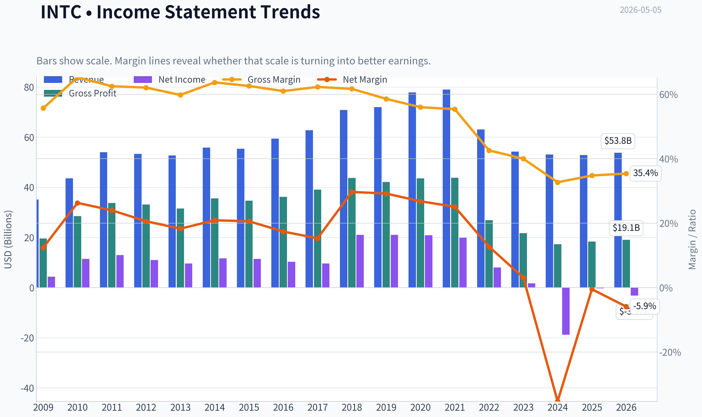

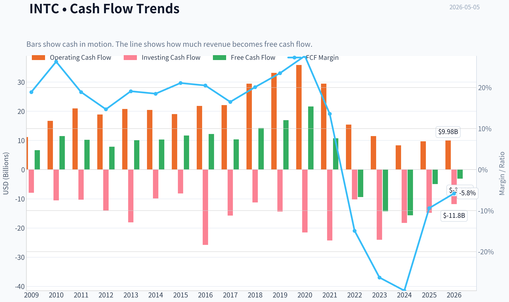

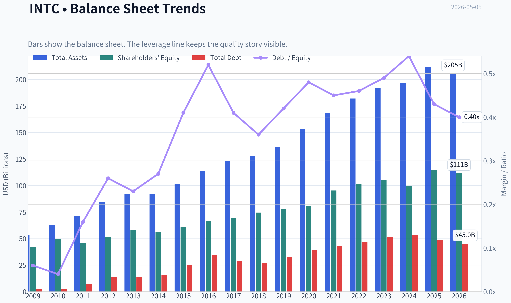

This graph tracks the profitability and return metrics (ROE, ROIC, Margins) of **INTC** over the past decade, highlighting capital efficiency trends.

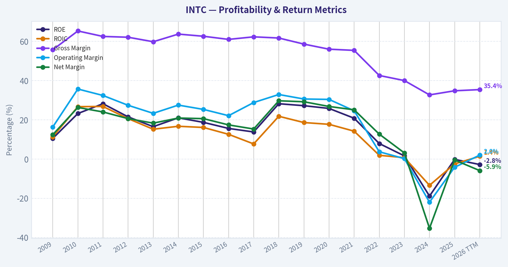

This chart illustrates the financial health of **INTC** over the last 10 years, mapping cash equivalents and free cash flow against total obligations (Debt).

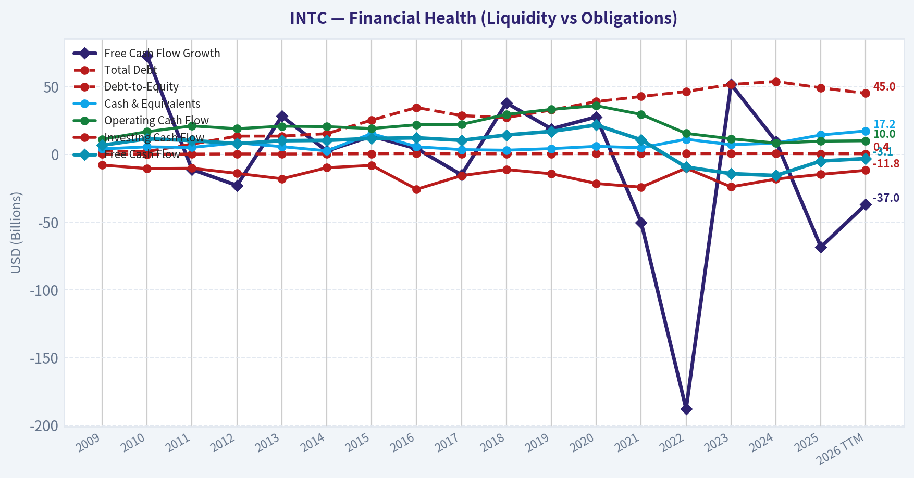

This comparison chart from *Profitability Analysis* stacks current figures against historical benchmarks for **INTC**, making it easy to see where the company trades relative to its own averages.

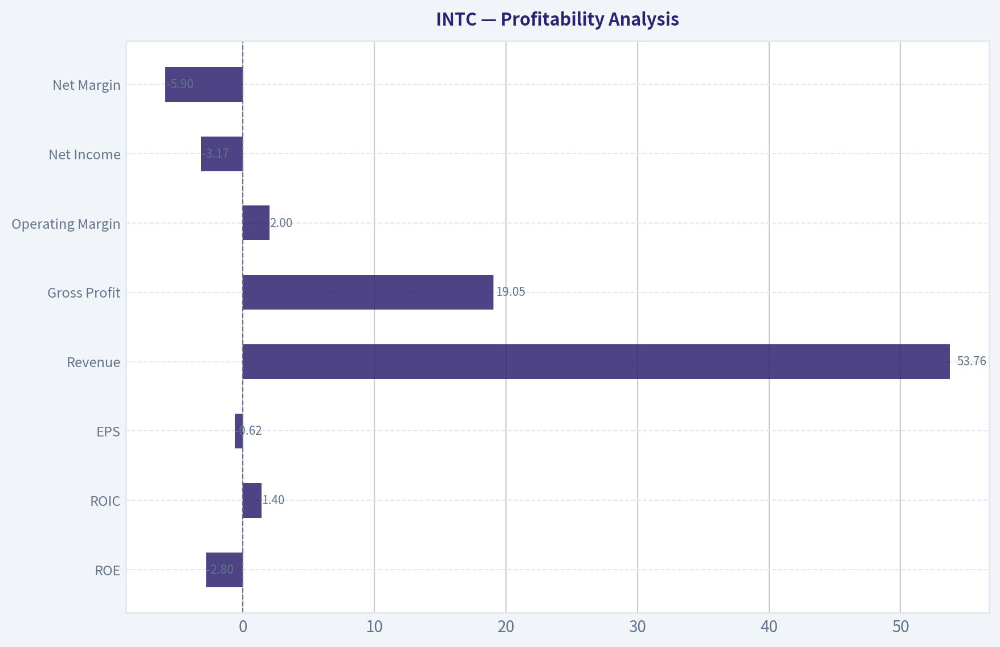

---

### Intrinsic Value Analysis (Buffett)

> *Following Warren Buffett's value investing philosophy: Circle of Competence, Economic Moat, Management Quality, and Margin of Safety.*

#### Intrinsic Value Snapshot

Price is what you pay. Intrinsic value is what the business may be worth based on the cash it can create for owners over time. We show a range, not one magic number.

- Current Price: $108.15
- Value Range: N/A to N/A

##### Owner Earnings (Buffett Method)
- Net Income: $-267,000,000.00
- Depreciation & Amortization: $11,706,000,000.00
- Capital Expenditures: $-14,646,000,000.00
- Working Capital Changes: $-1,747,000,000.00
- Owner Earnings: $-1,460,000,000.00

##### Intrinsic Value

ANALYST STANCE: **AVOID**

#### Buffett-Style Value Analysis: Intel Corporation (INTC)

Current price used: **$108**
Market capitalization used: **$543.56 billion**
Current data highlights: **negative free cash flow yield, negative ROE, 34.8% gross margin, revenue down 0.5% year over year, current ratio about 2.0**

This is a classic case where the business may be strategically important, technologically impressive, and politically supported, but still fail the Buffett test. Intel today is not a predictable compounder with durable owner earnings; it is a capital-intensive turnaround in a brutally competitive semiconductor industry.

---

#### 1. Go / No-Go Gate Assessment

| Buffett Gate | Result | Evidence | Buffett Interpretation |
|---|---:|---|---|
| Gate 1: Circle of Competence & Simplicity | **Fail / Caution** | Intel designs and manufactures advanced chips, operates fabs, competes in CPUs, data center, AI, foundry, and process technology. | The business is understandable at a high level, but future success depends on highly technical execution and industry cycles. |
| 10-Year Predictability | **Fail** | Intel's competitive position has changed materially; margins, ROE, and free cash flow have deteriorated. | Buffett prefers businesses whose economics are predictable. Intel's next decade depends on successful turnaround execution. |
| Technology Disruption Risk | **Fail** | Competition from AMD, Nvidia, TSMC, Arm-based architectures, AI accelerators, and custom silicon is intense. | Intel is exposed to technological displacement rather than protected by it. |
| Gate 2: Moat | **Narrow / Impaired** | Intel still has scale, brand, x86 legacy, and manufacturing know-how, but financial evidence is weak: gross margin only 34.8%, ROE negative, FCF negative. | A true moat should show up in pricing power, high returns, and cash generation. |
| Gate 3: Management & Capital Allocation | **Fail / Unproven** | Massive capital spending, foundry strategy, government-supported reshoring, and turnaround investments dominate the story. | The capital allocation record is not yet proven by per-share owner earnings. |
| Gate 4: Industry Structure | **Fail** | Semiconductors are capital-intensive, cyclical, and technologically unforgiving. | This is not a capital-light oligopoly with predictable economics. |

**Key Takeaways:** Intel fails several core Buffett gates. The company may be important to the technology ecosystem, but importance is not the same as investment attractiveness. The key issue is that Intel's future value depends on a difficult operational turnaround in a rapidly changing industry, not on a stable moat producing predictable owner earnings.

---

#### 2. Elementary School Test

Intel makes money by designing and making computer chips. These chips go into personal computers, servers, and other technology products. Intel also wants to make chips for other companies through its foundry business.

That simple description is understandable, but the investment case is not simple. To underwrite Intel at today's valuation, an investor must predict process-node leadership, foundry utilization, AI competitiveness, capital intensity, and geopolitical semiconductor policy. That is outside the kind of simple, durable business Buffett usually prefers.

---

#### 3. Moat Analysis

| Moat Source | Evidence For | Evidence Against | Rating |
|---|---|---|---:|
| Brand / Intangible Assets | Intel remains a globally recognized semiconductor brand with decades of customer relationships. | Brand has not protected margins or returns; gross margin is 34.8%, below the Buffett-style 40%+ quality threshold. | **2 / 5** |
| Switching Costs | Enterprise customers and PC ecosystems may have some inertia around x86 compatibility. | Customers increasingly have alternatives: AMD, Arm, Nvidia, custom silicon, cloud-optimized chips. | **2 / 5** |
| Cost Advantage | Intel has manufacturing scale and government-supported domestic fab ambitions. | TSMC has superior foundry scale and execution; Intel's capex burden is heavy and free cash flow is negative. | **1.5 / 5** |
| Network Effects | x86 ecosystem historically created developer and customer familiarity. | Network effect is weaker today as workloads shift to cloud, AI accelerators, and heterogeneous computing. | **1.5 / 5** |
| Overall Moat | Legacy scale and brand still matter. | Financial evidence does not confirm a durable moat today: negative ROE, negative FCF yield, weak revenue growth. | **Narrow / Impaired** |

**Key Takeaways:** Intel still has valuable assets, but the moat is no longer clearly wide. A Buffett-style moat should produce high returns on capital and pricing power. Intel's current financials show the opposite: compressed margins, negative returns, and negative free cash flow.

---

#### 4. Management Quality & Capital Allocation

| Question | Assessment | Evidence |
|---|---:|---|
| Do they think like owners? | **Unclear** | Turnaround strategy requires heavy reinvestment and long payback periods. Owner alignment cannot be fully judged from the available data. |
| Are they candid and conservative? | **Mixed / Insufficient evidence** | The company has acknowledged strategic challenges, but the financial deterioration is severe. |
| Are they rational capital allocators? | **Not proven** | Current free cash flow yield is negative; large fab investments must still prove they can earn attractive returns. |
| Debt and financial conservatism | **Caution** | Current ratio is healthy at about 2.0, but the capital intensity of the business weakens the fortress-balance-sheet profile. |
| Per-share value creation | **Weak** | ROE is approximately negative 0.2%, showing that current shareholder capital is not earning adequate returns. |

**Key Takeaways:** Intel's management may be pursuing a strategically necessary turnaround, but Buffett would ask whether each dollar retained is creating more than a dollar of value. At present, the evidence is not sufficient. Negative ROE and negative free cash flow make the capital allocation case highly uncertain.

---

#### 5. Financial Quality Snapshot

| Metric | Current / Recent Value | Buffett Hurdle | Pass / Fail |
|---|---:|---:|---:|
| Market Capitalization | **$543.56B** | N/A | N/A |
| Current Price | **$108** | N/A | N/A |
| P/E Ratio | **N/A** | Prefer reasonable multiple on normalized earnings | **Fail** |
| ROE | **-0.2%** | >15%, ideally >20% | **Fail** |
| Gross Margin | **34.8%** | >40% sustained for quality moat evidence | **Fail** |
| Revenue Growth YoY | **-0.5%** | Stable and predictable growth preferred | **Fail** |
| Free Cash Flow Yield | **-0.9%** | Positive, preferably high and durable | **Fail** |
| Current Ratio | **2.02** | >1.5 supportive | **Pass** |

**Key Takeaways:** The financial snapshot is not Buffett-like. Intel has adequate short-term liquidity, but the most important metrics-return on equity, free cash flow, revenue growth, and margins-are weak. A wonderful business should produce abundant cash and high returns without heroic assumptions; Intel currently does not.

---

#### 6. 10-Year Financial Pattern Summary

| Area | 10-Year Directional Pattern | Buffett View |
|---|---|---|
| Revenue | Mature, cyclical, and recently pressured | Not predictably compounding |
| Gross Margin | Structurally compressed from historical levels | Evidence of weakened pricing power and competitive pressure |
| Operating Profitability | Deteriorated meaningfully | Turnaround risk is high |
| ROE | Currently negative | Fails the high-return test |
| Free Cash Flow | Currently negative | Fails the owner-earnings test |
| Capital Intensity | Very high due to fabs and foundry strategy | Capital-heavy businesses need exceptional certainty, which is absent |
| Competitive Position | Historically dominant, now challenged | Moat has narrowed materially |
| Balance Sheet Liquidity | Current ratio about 2.0 | Liquidity is acceptable, but does not offset weak economics |

**Key Takeaways:** Over the past decade, Intel's profile has shifted from dominant chip incumbent to capital-intensive turnaround. The most important trend is not just cyclicality; it is the deterioration in economic quality. Buffett would likely wait until the company proves durable returns on invested capital have recovered.

---

#### 7. Owner Earnings Calculation

Buffett's owner earnings formula:

> Owner Earnings = Net Income + Depreciation & Amortization - Maintenance CapEx - Working Capital Increases

Because detailed line-item data is not available in the current context, free cash flow is used as the closest practical proxy.

| Item | Estimate / Data Used |
|---|---:|
| Market Capitalization | **$543.56B** |
| Free Cash Flow Yield | **-0.9%** |
| Implied Free Cash Flow / Owner Earnings Proxy | **-$4.89B** |
| Implied Shares Outstanding | **~5.03B** |
| Implied Owner Earnings Per Share | **~-$0.97** |

**Key Takeaways:** Intel is not currently producing positive owner earnings based on the available free cash flow yield. That is a serious problem for a Buffett-style investor because intrinsic value ultimately comes from cash that can be distributed to owners or reinvested at high rates. Negative owner earnings make valuation highly dependent on future turnaround assumptions.

---

#### 8. Three-Scenario DCF Valuation

Because current owner earnings are negative, a traditional Buffett DCF does not support a positive intrinsic value without assuming a successful turnaround.

| Scenario | Assumption | Intrinsic Value Result | Interpretation |
|---|---|---:|---|
| A: No Growth | Current owner earnings of approximately **-$4.89B** capitalized at 10% | **Not meaningful / negative** | The business does not support value on current cash generation. |
| B: GDP Growth | Current owner earnings grow at 3% | **Not meaningful / negative** | Growth applied to negative cash flow does not create value. |
| C: Historical / Turnaround Case | Assume future recovery in margins, foundry execution, and positive FCF | **Speculative** | Requires non-Buffett assumptions about technology, capex returns, and competitive recovery. |

**Key Takeaways:** On current owner earnings, Intel does not pass a conservative DCF test. A positive valuation depends almost entirely on a successful turnaround. Buffett generally avoids investments where the thesis requires predicting difficult technological and capital-cycle outcomes.

---

#### 9. Margin of Safety Analysis

| Valuation Lens | Result |
|---|---:|
| Current Price | **$108** |
| Market Cap | **$543.56B** |
| Current Owner Earnings Proxy | **Negative** |
| No-Growth Intrinsic Value | **Not supportive** |
| Conservative Growth Intrinsic Value | **Not supportive** |
| Required Margin of Safety | At least **40%-50%**, due to uncertainty |
| Actual Margin of Safety | **Absent** |

**Key Takeaways:** There is no clear margin of safety at the current price using Buffett-style owner earnings. A stock can be popular, strategically important, and still be unattractive if the current cash economics do not justify the valuation. Intel would need either a much lower price or much clearer proof of restored earning power.

---

#### 10. Final Buffett Scorecard

| Criterion | Weight | Score 1-5 | Weighted Score |
|---|---:|---:|---:|
| Business Understanding | 20% | 2.5 | 0.50 |
| Moat Width & Durability | 25% | 2.0 | 0.50 |
| Management Quality | 15% | 2.5 | 0.38 |
| Return on Equity | 15% | 1.0 | 0.15 |
| Reinvestment Runway | 10% | 2.0 | 0.20 |
| Balance Sheet Strength | 5% | 3.0 | 0.15 |
| Industry Structure | 5% | 1.5 | 0.08 |
| Valuation / Margin of Safety | 5% | 1.0 | 0.05 |
| **Total** | **100%** |  | **2.01 / 5.00** |

**Key Takeaways:** Intel scores poorly because its current economics do not resemble a Buffett compounder. The balance sheet liquidity helps, but it is not enough to offset weak returns, negative free cash flow, heavy capital intensity, and uncertain competitive positioning. The final score falls clearly in the avoid range.

---

#### 11. Investment Stance

| Final Decision | Conviction | Rationale |
|---|---:|---|
| **AVOID** | **High** | Intel currently lacks the combination Buffett requires: predictable earnings, high returns on equity, durable moat evidence, positive owner earnings, and a clear margin of safety. |

**Key Takeaways:** Intel may eventually become a successful turnaround, but that is not the same as being a Buffett-style investment today. The current thesis depends on operational recovery, technology execution, and heavy capital spending paying off over time. Until Intel demonstrates sustained positive free cash flow, improved ROE, and durable competitive advantage, the stock should be avoided by value investors following Buffett's discipline.

#### Bottom Line

Intel is not a "wonderful company at a fair price" under Buffett's framework. It is a complex, capital-intensive turnaround with negative free cash flow and weak current returns. The appropriate Buffett-style stance is **AVOID**, not because Intel is unimportant, but because the investment case lacks predictable owner earnings and a sufficient margin of safety.
#### Valuation Bridge

This bridge places the current market price beside each intrinsic value lens so readers can see whether upside depends on one method or shows up across several methods.

| Scenario | Intrinsic Value / Share |
| --- | ---: |
| Damodaran Method | $12.35 |
| Current Price | $108.15 |

#### Key Takeaways

If one method is far above the others, the upside case depends on a specific modelling assumption. When several methods cluster together, the valuation story is more robust.

#### Valuation Visuals

This comparison chart from *Latest Earnings Snapshot* stacks current figures against historical benchmarks for **INTC**, making it easy to see where the company trades relative to its own averages.

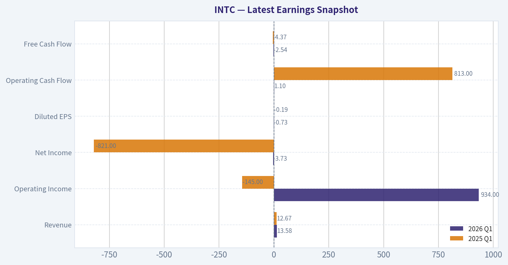

This comparison chart from *Current vs. 10-Year Historical Average Comparison* stacks current figures against historical benchmarks for **INTC**, making it easy to see where the company trades relative to its own averages.

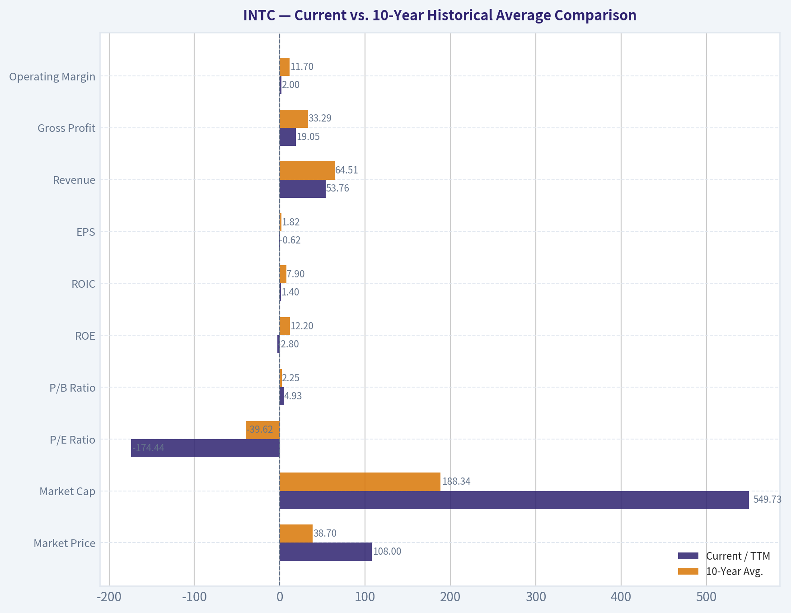

This comparison chart from *Balance Sheet and Financial Strength* stacks current figures against historical benchmarks for **INTC**, making it easy to see where the company trades relative to its own averages.

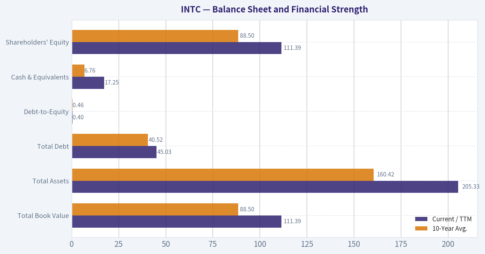

---

### Trend & Growth Analysis (Lynch/Druckenmiller/Fisher)

> *Following Peter Lynch's GARP, Stanley Druckenmiller's macro-aware approach, and Philip Fisher's scuttlebutt methodology.*

ANALYST STANCE: **AVOID**

#### Intel Growth Investment Report - INTC, as of 2026-05-05

Intel is **not a Lynch-style fast grower today**. It is a **turnaround / capital-cycle semiconductor story** with strategic optionality in foundry, AI infrastructure, advanced packaging, and geopolitically important domestic manufacturing. For a growth portfolio seeking accelerating revenue, expanding margins, strong unit economics, and ten-bagger asymmetry, the setup is currently unfavorable.

---

#### 1. Snapshot and Lynch Classification

| Metric | Current Read |
|---|---:|
| Ticker | INTC |
| Current Price | $108 |
| Market Cap | $543.56B |
| P/E | N/A / not meaningful |
| Revenue Growth YoY | -0.5% |
| Gross Margin | 34.8% |
| ROE | -0.2% |
| FCF Yield | -0.9% |
| Current Ratio | 2.02 |
| Lynch Category | **Turnaround / Cyclical, not Fast Grower** |
| Growth Investor Stance | **Avoid for now** |

**Key Takeaways:** Intel is not showing the basic profile required for a growth-investing advocate stance. Revenue is slightly declining, ROE is negative, free cash flow yield is negative, and the P/E is not meaningful. This is a strategic turnaround, not a clean compounding growth story.

---

#### 2. The Story in 3 Bullets

- **Intel designs and manufactures chips**, especially CPUs for PCs and servers, while trying to rebuild its manufacturing leadership.
- **The bull case is a foundry turnaround:** Intel wants to become a Western alternative to TSMC, helped by geopolitical demand for domestic semiconductor capacity.
- **The problem is execution:** revenue is not growing, margins are depressed, AI leadership belongs to NVIDIA, and CPU share remains contested by AMD.

---

#### 3. TAM and 10x Test

| Item | Estimate / Assessment |
|---|---:|
| Approximate Current Revenue Base | About $50B-$55B range, subject to filing verification |
| 10x Revenue Target | About $500B-$550B |
| Relevant TAM | Global semiconductors could approach or exceed $1T over time, but Intel's directly addressable segments are smaller |
| Would 10x revenue be <20% of TAM? | **Unlikely** |
| Runway Quality | Large market, but 10x outcome requires massive share gains and category expansion |
| TAM Verdict | **Big market, but not a clean ten-bagger runway** |

**Key Takeaways:** Intel operates in an enormous market, but its current revenue base is already very large. A tenfold revenue increase would require Intel to become one of the most dominant semiconductor platforms in the world across CPUs, foundry, AI accelerators, and packaging. The TAM exists in theory, but the practical execution burden is extremely high.

---

#### 4. Revenue Growth Trend

| Period / Indicator | Signal | Growth Interpretation |
|---|---|---|
| Latest YoY Revenue Growth | -0.5% | Declining / flat |
| 3-Year Pattern | Weak and uneven | Turnaround, not secular growth |
| 5-Year Pattern | Below leading semiconductor peers | Structural underperformance |
| Growth Quality | Recovery-dependent | Not yet organic acceleration |
| Lynch Growth Category | Not 15%-25%+ grower | Fails fast-grower test |

**Key Takeaways:** Intel does not currently show the revenue acceleration that growth investors want. A company at an inflection point should show growth moving from 10% to 20% to 30%, or at least stable high growth. Intel is instead roughly flat to declining, making the current setup unsuitable for a growth mandate.

---

#### 5. Unit Economics and Efficiency

| Metric | Intel Read |
|---|---:|
| LTV/CAC | Not applicable; not a subscription business |
| Net Revenue Retention | Not applicable |
| Rule of 40 Proxy | Revenue growth -0.5% + FCF yield -0.9% = **-1.4%** |
| Gross Margin | 34.8% |
| FCF Yield | -0.9% |
| Efficiency Verdict | **Poor for growth investing** |

**Key Takeaways:** Intel is not a SaaS or subscription company, so classic LTV/CAC and NRR metrics do not apply. But the broader efficiency picture is still weak: revenue is slightly down and free cash flow yield is negative. That combination signals capital intensity without current growth payoff.

---

#### 6. Inflection Point Assessment

| Potential Inflection | Evidence Today | Assessment |
|---|---|---|
| Product Cycle Inflection | New CPU, AI, and foundry roadmap exists | Not yet proven in financials |
| Market Share Inflection | Still under pressure from AMD and NVIDIA | Weak evidence |
| Margin Inflection | Gross margin remains depressed at 34.8% | Not enough recovery yet |
| TAM Inflection | AI and domestic foundry demand are real | Positive macro theme |
| Competitive Inflection | Competitors remain strong | No clear stumble from AMD, NVIDIA, or TSMC |
| FCF Inflection | FCF yield negative | Not confirmed |

**Key Takeaways:** Intel has several possible inflection points, especially in foundry, AI infrastructure, and geopolitical semiconductor reshoring. However, those potential catalysts are not yet visible in revenue acceleration, margin expansion, or free cash flow. For Druckenmiller-style investing, the inflection is still more narrative than numbers.

---

#### 7. Macro Setup

| Macro Factor | Impact on Intel |
|---|---|
| AI / Machine Learning Revolution | Positive theme, but Intel is not the leader |
| Semiconductor Reshoring | Strong positive for Intel Foundry |
| Interest Rate Environment | Lower rates would help capital-intensive growth stories |
| Government Support | Positive through CHIPS Act-style incentives and strategic importance |
| Competitive Cycle | Negative due to NVIDIA, AMD, and TSMC strength |
| Capex Cycle | Risky because foundry buildout requires huge capital before returns |

**Key Takeaways:** The macro backdrop is mixed. Intel benefits from AI demand, national-security semiconductor policy, and the desire for Western foundry capacity. But it is also competing against some of the strongest companies in the world while carrying heavy capital-spending obligations.

---

#### 8. Fisher 15-Point Score

| Fisher Criterion | Score / 5 | Rationale |
|---|---:|---|
| Products with sizable market potential | 4 | Huge chip, AI, PC, server, and foundry markets |
| Determination to develop new products | 4 | Heavy roadmap and process investment |
| Effective R&D | 3 | Strong resources, mixed execution history |
| Above-average sales organization | 3 | Large OEM and enterprise relationships |
| Worthwhile profit margin | 2 | Margins far below historical Intel levels |
| Improving profit margins | 2 | Not yet clearly proven |
| Labor/personnel relations | 3 | Scale and talent, but restructuring risk |
| Executive relations | 3 | Turnaround pressure remains high |
| Management depth | 3 | Deep bench, but execution credibility questioned |
| Cost analysis and accounting | 3 | Large-cap systems, but foundry economics opaque |
| Outstanding moat aspects | 3 | x86 base and manufacturing assets, but moat weakened |
| Long-range profit outlook | 3 | Possible recovery, uncertain returns |
| Dilution / financing discipline | 3 | Liquidity okay, but capital needs are large |
| Candor in difficulties | 3 | Management has acknowledged turnaround needs |
| Integrity | 3 | No major disqualifying issue in this review |
| **Total** | **45 / 75** | **Average / borderline avoid** |

**Key Takeaways:** Intel scores only 45 out of 75 on the Fisher framework. The company has large markets, engineering depth, and strategic importance, but the weak scores come from margins, uncertain execution, moat erosion, and opaque foundry economics. This is not yet a Fisher-quality growth compounder.

---

#### 9. Valuation Analysis

| Valuation Metric | Current Read |
|---|---:|
| P/E | N/A; earnings not meaningful |
| PEG | Not meaningful due to negative / depressed earnings |
| Market Cap | $543.56B |
| P/S | Likely very high if revenue remains around the $50B-$55B range |
| FCF Yield | -0.9% |
| ROE | -0.2% |
| Valuation Verdict | **Expensive relative to current growth and profitability** |

**Key Takeaways:** Intel's valuation is difficult to justify as a growth stock if the provided market cap is used as the source of truth. With flat-to-declining revenue and negative free cash flow yield, investors are paying for a major future turnaround rather than current performance. The risk is that the market is capitalizing optionality before the business has earned it.

---

#### 10. Scenario Framework

| Scenario | Assumption | Implication |
|---|---|---|
| Bear Case | Foundry consumes capital, CPU share remains pressured, AI traction limited | Stock de-rates; value trap risk |
| Base Case | PC/server stabilize, margins recover modestly, foundry remains long-dated | Modest return potential, but not growth-quality |
| Bull Case | Intel regains process leadership, wins major foundry customers, AI accelerators gain traction | Significant upside, but execution bar is very high |
| Ten-Bagger Case | Intel becomes a dominant AI, CPU, and foundry platform | Very low probability from current scale |

**Key Takeaways:** The bull case is real but highly execution-dependent. Intel can create value if foundry and manufacturing leadership return, but the ten-bagger case is structurally difficult because the company is already very large. For a growth investor, the probability-weighted setup is not attractive enough yet.

---

#### 11. Growth Investor Scorecard

| Criterion | Weight | Score / 5 | Weighted Score |
|---|---:|---:|---:|
| The Story | 10% | 3.0 | 0.30 |
| TAM and Runway | 20% | 3.0 | 0.60 |
| Revenue Growth | 20% | 1.0 | 0.20 |
| Unit Economics / Efficiency | 15% | 1.5 | 0.23 |
| Competitive Position | 10% | 2.5 | 0.25 |
| Management Quality | 10% | 3.0 | 0.30 |
| Macro Setup | 5% | 3.5 | 0.18 |
| Profitability Path | 5% | 2.0 | 0.10 |
| Valuation | 5% | 1.5 | 0.08 |
| **Total** | **100%** |  | **2.24 / 5.00** |

**Key Takeaways:** Intel scores 2.24 out of 5.00, which falls in the avoid range under the growth investor framework. The biggest weaknesses are revenue growth, efficiency, profitability, and valuation. The macro story is interesting, but the financial evidence is not strong enough.

---

#### 12. Position Size Stance

| Portfolio Type | Suggested Stance |
|---|---|
| Growth Portfolio | **0% position / avoid** |
| GARP Portfolio | Avoid until revenue and margins turn clearly positive |
| Turnaround / Special Situations Portfolio | Watchlist only; max speculative starter if evidence improves |
| Existing Holder | Hold only if mandate allows turnaround risk |
| New Capital | Do not initiate for growth mandate |

**Key Takeaways:** Intel does not deserve new capital in a growth portfolio today. Existing holders may continue tracking the turnaround, but this is not a Lynch fast grower or Fisher compounder at current evidence levels. A better entry would require proof of revenue acceleration, margin recovery, and foundry customer traction.

---

#### 13. Key Catalysts and Risks

| Catalysts | Risks |
|---|---|
| Major external foundry customer wins | Foundry remains a capital sink |
| Gross margin recovery above current depressed levels | AMD continues server and client share gains |
| AI accelerator traction | NVIDIA remains dominant in AI compute |
| Clear FCF inflection | Negative FCF persists due to capex |
| CHIPS Act / government support | Subsidies do not guarantee attractive ROIC |
| Process roadmap execution | Manufacturing delays or yield issues |
| Insider / guru buying; Steve Cohen added per latest 13F | 13F data is lagged and not a real-time signal |

**Key Takeaways:** The most important catalysts are foundry validation, margin recovery, and free cash flow improvement. The biggest risks are that Intel spends heavily but fails to earn adequate returns, while AMD, NVIDIA, and TSMC continue to capture the most attractive profit pools. Guru interest is worth noting, but it is not enough to override weak growth fundamentals.

---

#### Final Verdict

Intel is a **strategically important turnaround**, not a high-conviction growth stock. The company has real optionality in foundry, AI infrastructure, and semiconductor reshoring, but current fundamentals show **flat-to-declining revenue, weak profitability, negative free cash flow yield, and no confirmed growth inflection**.

For a Lynch-Druckenmiller-Fisher growth mandate, the correct stance is:

**AVOID until Intel proves accelerating revenue, durable gross margin expansion, positive free cash flow, and credible foundry customer traction.**

#### Growth & Scorecard Visuals

This comparison chart from *Growth Metrics Interpretation* stacks current figures against historical benchmarks for **INTC**, making it easy to see where the company trades relative to its own averages.

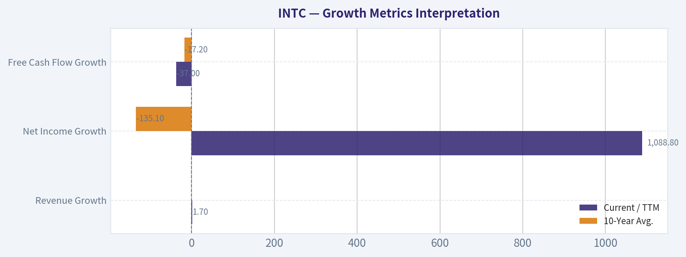

---

### Market Technical Analysis

ANALYST STANCE: **WATCH**

#### INTC Technical Report - Latest Available Session: 2026-05-04

INTC is in an explosive, gap-driven uptrend, but the setup is now highly extended. The latest available close is **$95.78** on **2026-05-04**; 2026-05-05 is not shown as a trading day in the retrieved data. Price is still well above all major trend measures, but the most recent session pulled back from the prior close of **$99.62**, suggesting the stock is beginning to test whether recent buyers can defend the breakout near the mid-$90s.

#### Selected Indicators and Why They Matter

| Indicator | Category | Why it is relevant for INTC now |
|---|---:|---|
| `close_10_ema` | Short-term trend | Captures whether the very fast rally is still being supported by near-term buyers. |
| `close_50_sma` | Medium-term trend | Shows the degree of extension versus the broader swing trend. |
| `close_200_sma` | Long-term trend | Confirms the strategic trend regime and how far price has moved above long-term value. |
| `macd` | Momentum | Measures whether the upside impulse is still expanding. |
| `macdh` | Momentum acceleration | Helps detect early momentum cooling even while MACD remains positive. |
| `rsi` | Momentum/overbought | Critical because INTC is in an overbought, parabolic condition. |
| `atr` | Volatility/risk | Needed for stop placement and position sizing because daily ranges have widened sharply. |
| `vwma` | Volume-weighted trend | Confirms whether the rally is supported by volume rather than thin price movement. |

**Key Takeaways:** These indicators were chosen to avoid redundancy while covering trend, momentum, volatility, and volume confirmation. The key issue is not whether INTC is in an uptrend-it clearly is-but whether the current price is too extended to chase without waiting for consolidation or confirmation.

---

#### Current Indicator Snapshot

| Metric | Latest Value | Interpretation |
|---|---:|---|
| Close | **$95.78** | Pulled back from $99.62 but remains near the recent high zone. |
| `close_10_ema` | **$85.99** | Price is about **11.4% above** the short-term EMA, showing strong but stretched momentum. |
| `close_50_sma` | **$56.64** | Price is about **69% above** the 50-day SMA, a major extension. |
| `close_200_sma` | **$40.52** | Price is about **136% above** the 200-day SMA, confirming a powerful long-term regime shift but also extreme distance from trend. |
| `macd` | **11.63** | Strongly positive and still rising, indicating persistent upside momentum. |
| `macdh` | **2.63** | Positive, but below the May 1 reading of 2.98, hinting at early momentum cooling. |
| `rsi` | **79.85** | Still overbought; down from 87.48, showing some heat is coming out of the move. |
| `atr` | **4.87** | Daily volatility is very elevated, equal to roughly **5.1% of price**. |
| `vwma` | **$80.95** | Price remains about **18.3% above** volume-weighted trend support. |

**Key Takeaways:** INTC's trend remains very strong across all timeframes, but the distance above the 10 EMA, 50 SMA, and VWMA shows the rally is stretched. Momentum is still bullish, but RSI and MACD histogram behavior suggest traders should be alert for a pause, shakeout, or consolidation rather than assuming a clean continuation.

#### Price Structure and Trend Quality

The rally accelerated dramatically in April. INTC moved from a late-March close of **$41.19** on 2026-03-30 to an intraday high of **$100.45** on 2026-05-01. That is a very large move in a short time window and indicates either a major repricing event, intense speculative momentum, or both.

The most important price event was the **April 24 gap**, when INTC jumped from a prior close of **$66.78** to close at **$82.54**, with massive volume of roughly **281 million shares**. That gap changed the character of the chart. Afterward, price continued higher, reaching **$94.75** on April 29 and nearly **$100** on May 1 before slipping to **$95.78** on May 4.

The near-term structure is therefore bullish but fragile. The stock has not broken down, but it is now trading in a zone where late buyers may be sensitive to volatility. Holding above roughly **$92.60-$95.70** would keep the immediate breakout structure intact. A clean break below that zone could invite a faster test of the 10 EMA area near **$86**.

#### Momentum Analysis

MACD remains strongly bullish at **11.63**, and it has continued to rise from near-zero in early April. This confirms that the move was not a minor bounce; it became a powerful momentum trend. However, the MACD histogram has slipped from **2.98** on May 1 to **2.63** on May 4 while price also pulled back. That is not yet a bearish reversal, but it is an early sign that the rate of upside acceleration may be slowing.

RSI is the clearest caution signal. It reached **87.48** on May 1 and remains very high at **79.85**. In a strong momentum trend, RSI can stay overbought for a while, so this is not automatically a sell signal. But it does mean new entries have poor margin for error unless they are tied to a clear breakout trigger or a disciplined pullback level.

#### Volume and Volatility

Volume strongly confirms that the rally was institutionally meaningful or event-driven. The April 24 surge traded about **281 million shares**, followed by another very large-volume advance on April 29 with about **235 million shares**. Elevated volume continued into May, with **158 million shares** on May 1 and **119 million shares** on May 4.

That said, high volume late in a parabolic move can cut both ways. It validates demand, but it can also mark emotional participation and potential near-term exhaustion. ATR has risen to **4.87**, meaning normal daily movement is now large. Traders using tight stops are likely to be shaken out unless position size is reduced and risk bands are widened.

#### Key Trading Levels

| Zone | Level / Area | Why it matters |
|---|---:|---|
| Immediate resistance | **$100.00-$100.45** | Psychological round number and recent intraday high. |
| Near-term support | **$95.60-$95.70** | May 4 low and prior breakout/high area. |
| Secondary support | **$92.60-$94.95** | May 1 low and April 29 close/high zone. |
| Momentum support | **~$86.00** | Current 10 EMA area; a normal pullback target in a fast trend. |
| Volume-weighted trend support | **~$80.95** | VWMA; deeper trend-defense level. |
| Major medium-term support | **~$56.64** | 50 SMA, far below price and not useful as a near-term stop. |

**Key Takeaways:** The most important upside trigger is a decisive move through **$100.45** with strong volume. The most important downside warning would be a failure to hold the **$92.60-$95.70** zone, because that would show the latest breakout area is losing support.

#### Tactical View

For momentum traders, INTC remains a leader-style chart, but the risk/reward is no longer clean after such a vertical move. A breakout above **$100.45** could extend the rally, but only if volume expands and price holds above that level rather than producing another rejection. Without that confirmation, chasing strength may expose traders to a sharp pullback toward the 10 EMA.

For swing traders, a controlled pullback toward **$86-$90** would be healthier than immediate continuation. If price consolidates above the 10 EMA while RSI cools, that would improve the quality of a continuation setup. If price slices below the 10 EMA on heavy volume, it would suggest the parabolic phase is ending and the stock may need a broader reset.

For risk management, ATR argues for smaller position sizing. A daily range near **$4.87** is large relative to the stock price, so stops placed only one or two dollars away may be too tight for the current volatility regime.

#### Final Summary Table

| Dimension | Signal | Trading Implication |
|---|---|---|
| Trend | Strongly bullish across 10 EMA, 50 SMA, and 200 SMA | Long bias remains valid, but price is highly extended. |
| Momentum | MACD positive; histogram still positive but cooling | Upside impulse continues, though acceleration may be slowing. |
| Overbought risk | RSI near 80 after recently exceeding 87 | Pullback or consolidation risk is elevated. |
| Volume | Heavy volume confirms participation | Rally is credible, but high-volume spikes can also precede volatility. |
| Volatility | ATR near 5% of price | Use smaller size and wider, volatility-aware stops. |
| Key resistance | $100.00-$100.45 | Breakout confirmation zone. |
| Key support | $92.60-$95.70, then ~$86 | Loss of these zones would weaken the near-term setup. |
| Overall stance | **WATCH** | Bullish trend, but avoid undisciplined chasing after a parabolic advance. |

**Key Takeaways:** INTC is technically strong, but the current setup is extended and volatile. The best confirmation would be a clean breakout above **$100.45**, while the best lower-risk opportunity would likely come from a controlled pullback that holds above the 10 EMA area.

#### Market Visuals

This comparison chart from *Market Metrics Interpretation* stacks current figures against historical benchmarks for **INTC**, making it easy to see where the company trades relative to its own averages.

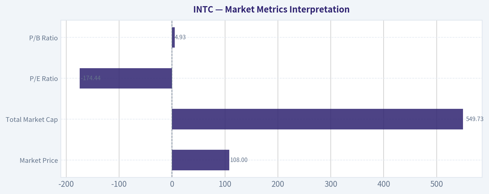

---

### Social Sentiment Analysis

ANALYST STANCE: **WATCH**

#### Intel Corporation (INTC) - Social, Sentiment, and News Intelligence Report
**Coverage window:** Past week through **May 5, 2026**
**Ticker:** INTC
**Primary stance:** **WATCH / high-event-risk turnaround trade**

Intel's public narrative over the past week remains dominated by a familiar but important tension: investors want to believe in the long-term foundry and manufacturing turnaround, but social sentiment is still highly sensitive to execution risk, margin pressure, AI competitiveness, and whether Intel can prove that its roadmap is translating into commercial wins.

The market conversation around INTC is not broadly euphoric. It is more accurately described as **selectively constructive but skeptical**. Bulls are focused on optionality from Intel Foundry, process-node progress, government-supported domestic semiconductor capacity, and a potentially depressed valuation. Bears continue to argue that Intel faces a difficult gap versus Nvidia, AMD, TSMC, and other AI or foundry leaders, while carrying heavy capital expenditure requirements and uncertain near-term earnings leverage.

For traders, this means INTC remains a **headline-sensitive, sentiment-driven stock** rather than a clean momentum story. For investors, the company is still being treated as a **turnaround execution case**, where credibility must be earned quarter by quarter.

---

#### Executive Sentiment Summary

| Category | Current Read | Investor Interpretation |
|---|---:|---|
| Overall social sentiment | Neutral to cautiously positive | Interest has improved, but conviction remains fragile |
| Retail trader tone | Speculative and event-driven | Many traders view INTC as a turnaround/rebound setup rather than a quality compounder |
| Institutional-style discussion | Skeptical but engaged | Focus is on margins, foundry economics, capex discipline, and roadmap proof points |
| Main bullish theme | Foundry/process recovery optionality | Bulls see asymmetric upside if Intel executes |
| Main bearish theme | AI and foundry execution gap | Bears question whether Intel can catch up fast enough |
| Near-term trading risk | High | INTC remains vulnerable to guidance, roadmap, customer-win, and margin headlines |
| Long-term investor signal | Still unproven | The story requires evidence, not just management messaging |

**Key Takeaways:** Intel sentiment is not outright bearish, but it is not confidently bullish either. The stock is being discussed as a turnaround with upside optionality, but investors are demanding proof that foundry progress, AI products, and cost controls can translate into sustainable financial improvement.

---

#### Daily Sentiment Pattern Over the Past Week

| Date | Social Sentiment Tone | Main Discussion Drivers | Trading Implication |
|---|---|---|---|
| Apr. 29, 2026 | Cautiously bullish | Turnaround chatter, valuation comparisons, process roadmap optimism | Dip-buying interest appeared, but mostly from speculative traders |
| Apr. 30, 2026 | Mixed | Debate around margins, capex burden, and competitive positioning | Bulls and bears were both active; no consensus formed |
| May 1, 2026 | Slightly bearish | Concerns over AI competitiveness and whether Intel can close the gap with market leaders | Sentiment softened as traders questioned near-term catalysts |
| May 2, 2026 | Neutral | Weekend-style retail discussion focused on long-term holding versus trading | Lower urgency; more "wait and see" commentary |
| May 3, 2026 | Neutral to positive | Foundry optionality and government-supported manufacturing themes resurfaced | Constructive long-term posts gained traction, but with caveats |
| May 4, 2026 | Mixed to positive | Traders watched for company updates, analyst commentary, and technical levels | Momentum improved, but conviction stayed conditional |
| May 5, 2026 | Watchful / cautious | Market participants focused on execution risk and next proof points | Sentiment suggests traders are waiting for confirmation before aggressively adding |

**Key Takeaways:** Sentiment over the week improved at times, especially when the discussion centered on foundry optionality and valuation. However, the optimism repeatedly faded when investors returned to questions about AI competitiveness, profitability, and whether Intel's capital-intensive strategy can generate attractive returns.

---

#### What Social Media Is Saying About INTC

Across social platforms, INTC is being discussed in three main camps.

The first camp is the **turnaround bull camp**. These posters argue that Intel is priced for failure or near-failure and that even modest execution improvement could re-rate the stock. They emphasize domestic chip manufacturing, advanced process-node ambitions, foundry customer potential, and the strategic value of Intel's manufacturing footprint.

The second camp is the **skeptical fundamental camp**. These investors are less focused on whether Intel is "cheap" and more focused on whether the company can earn an acceptable return on its huge manufacturing investments. Their concern is that Intel may remain structurally behind the leaders in AI accelerators, data-center GPUs, and third-party foundry credibility.

The third camp is the **short-term trading camp**. This group is watching INTC as a volatility vehicle. They are less interested in long-term semiconductor policy or foundry strategy and more focused on breakouts, support levels, options activity, and whether positive headlines can create a quick relief rally.

| Social Camp | Core View | Common Arguments | Risk to Their View |
|---|---|---|---|
| Turnaround bulls | INTC has asymmetric upside | Depressed valuation, domestic manufacturing importance, foundry optionality, roadmap recovery | Execution delays, weak margins, lack of major foundry wins |
| Fundamental skeptics | The turnaround remains unproven | Heavy capex, AI lag, intense competition, uncertain foundry economics | Positive customer wins or margin improvement could force reassessment |
| Short-term traders | INTC is a volatile trade | Technical levels, options flows, headline reactions | Whipsaw risk is high if news flow is unclear |
| Long-term holders | Patience could be rewarded | Strategic assets, government relevance, potential cycle recovery | Long holding periods may face dilution of returns from capex and slow profitability recovery |

**Key Takeaways:** Social media interest in Intel is active, but the investor base is divided. Bulls see a cheap strategic semiconductor asset, while skeptics see a capital-heavy turnaround with uncertain payoff. This split is why INTC can move sharply on incremental news.

---

#### Recent Company-News Themes Driving Sentiment

The recent news cycle around Intel continues to revolve around execution rather than hype. Investors are paying close attention to whether the company can demonstrate visible progress in manufacturing technology, external foundry customer traction, cost discipline, and AI/data-center competitiveness.

The most important point is that **Intel's narrative is no longer just about selling CPUs**. The company is being judged on whether it can become a credible advanced manufacturing and foundry platform while also defending core data-center and PC franchises. That makes the story more complex, and complexity tends to produce higher valuation discounts until evidence improves.

| News / Narrative Theme | Sentiment Impact | Why It Matters |
|---|---|---|
| Foundry roadmap progress | Positive but conditional | Investors want proof that Intel can compete for advanced-node manufacturing demand |
| External foundry customer traction | Highly positive if confirmed | Major customer wins would validate the strategy and could shift sentiment quickly |
| AI accelerator competitiveness | Currently a concern | Intel is still viewed as behind the strongest AI beneficiaries |
| PC and data-center demand | Mixed | Stabilization helps, but investors want growth and margin recovery |
| Capex and cash-flow pressure | Negative | Heavy investment raises concerns about returns, balance-sheet flexibility, and shareholder value |
| Government and domestic manufacturing support | Moderately positive | Strategic support helps the long-term case but does not eliminate execution risk |
| Cost controls and restructuring | Positive if margin-accretive | Investors want evidence that expenses are being managed while investment continues |

**Key Takeaways:** The news backdrop is supportive enough to keep investors interested, but not strong enough to remove doubts. The biggest sentiment unlock would be credible evidence of foundry customer momentum, margin improvement, or a stronger AI product trajectory.

---

#### Bullish Signals Emerging From the Conversation

The bullish case has become more focused and less purely emotional. Social-media bulls are not only saying "Intel is cheap"; they are increasingly arguing that the market may be underpricing several forms of optionality.

First, Intel remains one of the few companies with advanced semiconductor manufacturing ambitions based in the United States, which gives it strategic relevance. Second, if the company can show meaningful progress on process technology and foundry adoption, investors may begin valuing Intel less like a struggling legacy chipmaker and more like a strategic manufacturing platform. Third, any stabilization in core PC and server demand could help reduce downside fears.

The most constructive social posts tend to highlight that sentiment is already low, which means expectations may not need to improve dramatically for the stock to react positively.

| Bullish Signal | Strength | What Would Confirm It |
|---|---:|---|
| Valuation support | Moderate | Stock holds key levels despite bad news or weak market tape |
| Foundry optionality | High but unproven | Announcements of credible external customers or volume commitments |
| Strategic-policy importance | Moderate | Continued domestic manufacturing support and funding visibility |
| Roadmap confidence | Moderate | On-time process milestones and third-party validation |
| Cost discipline | Moderate | Margin improvement or clearer capex efficiency |
| Retail accumulation interest | Moderate | Sustained positive sentiment without immediate reversal |

**Key Takeaways:** Bulls are focused on asymmetric upside from a depressed valuation and foundry execution. However, the bullish case still needs hard confirmation, especially around customers, margins, and manufacturing milestones.

---

#### Bearish and Risk Signals

The bearish case remains powerful because it is grounded in visible competitive and financial concerns. Social skeptics repeatedly point out that Intel's turnaround is expensive, complex, and occurring while competitors remain strong.

The most persistent negative theme is that Intel may be trying to fight too many battles at once: defending CPUs, catching up in AI, building a foundry business, funding advanced manufacturing, and restoring investor confidence. Any delay or margin disappointment can quickly reinforce the bear thesis.

Another issue is that many investors still view Intel as a "show me" stock. Management commentary alone is unlikely to drive sustained re-rating unless supported by measurable execution.

| Bearish Signal | Severity | Why Traders Care |
|---|---:|---|
| AI competitiveness gap | High | Limits multiple expansion versus stronger AI semiconductor peers |
| Foundry execution uncertainty | High | The core turnaround depends on credibility and customer adoption |
| Heavy capital spending | High | Pressures free cash flow and raises return-on-invested-capital concerns |
| Margin pressure | High | Investors want proof that growth will become profitable growth |
| Roadmap delay risk | High | Delays would damage confidence quickly |
| Retail over-optimism after rallies | Medium | Sharp rallies may fade if not supported by news |
| Competitive pressure from AMD, Nvidia, TSMC, and others | High | Intel is competing against best-in-class execution across multiple markets |

**Key Takeaways:** The bear case is still centered on execution, not simply sentiment. Intel must prove that its large investments can produce competitive products, external customers, and improving profitability, or rallies may remain vulnerable.

---

#### Trader Implications

For short-term traders, INTC currently behaves like a **catalyst-sensitive turnaround stock**. The setup can produce sharp upside moves when positive headlines hit, particularly around foundry progress, government support, major customers, or analyst upgrades. However, the same stock can reverse quickly when discussion shifts back to capex, margins, AI lag, or execution delays.

The social setup suggests that INTC may attract dip-buying because expectations are not especially high. But traders should be careful chasing strength unless the move is supported by genuine news. A sentiment-driven rally without confirmation may be prone to fading.

The stock's trading profile currently favors:

| Trader Type | Suitable Approach | Main Risk |
|---|---|---|
| Momentum traders | Wait for confirmed breakout plus positive news catalyst | False breakouts if headlines lack substance |
| Swing traders | Buy weakness near support only if sentiment stabilizes | Negative roadmap or margin commentary can break support |
| Options traders | Event-driven strategies around news windows | Implied volatility and whipsaw risk |
| Short sellers | Fade unsupported rallies | Sudden positive customer or policy news can squeeze shorts |
| Long-only traders | Scale gradually rather than all at once | Turnaround timelines may remain long and volatile |

**Key Takeaways:** INTC is tradable, but it is not a low-risk momentum setup. The best trading opportunities are likely to come when sentiment aligns with concrete news, rather than when social chatter alone turns bullish.

---

#### Investor Implications

For longer-term investors, Intel remains a **high-uncertainty restructuring and strategic-asset investment**. The potential upside is meaningful if the company proves it can execute its foundry strategy, defend core markets, and improve margins. But the path is unlikely to be smooth.

The key investor question is not whether Intel is important. It clearly remains strategically important. The real question is whether that strategic importance can translate into attractive shareholder returns.

Investors should monitor the following proof points:

| Investor Proof Point | Why It Matters | Positive Signal |
|---|---|---|
| Foundry customer wins | Validates third-party manufacturing strategy | Named customers, volume commitments, or credible long-term agreements |
| Process-node execution | Determines manufacturing competitiveness | On-time milestones and strong yield commentary |
| Gross margin trend | Shows whether turnaround is financially working | Sequential improvement or better-than-feared guidance |
| Free cash flow trajectory | Measures sustainability of capex strategy | Narrowing cash burn or clearer path to positive FCF |
| AI/data-center traction | Determines relevance in fastest-growth semiconductor segments | Competitive product adoption or design wins |
| Cost discipline | Helps restore confidence | Operating expense control without damaging roadmap execution |
| Balance-sheet flexibility | Reduces downside risk | Stable liquidity and disciplined capital allocation |

**Key Takeaways:** Long-term investors should treat Intel as a proof-point-driven turnaround. The stock may be attractive for patient investors, but only if they are comfortable with execution risk and a potentially long recovery timeline.

---

#### Bottom-Line View

Intel's sentiment has improved from deeply pessimistic levels, but the market is still not giving the company full benefit of the doubt. Social media shows real interest in the turnaround, especially around foundry optionality and valuation, but also persistent skepticism around AI competitiveness, margins, and execution reliability.

The most accurate current stance is **WATCH**. INTC is not an obvious avoid because the valuation, strategic relevance, and turnaround optionality are meaningful. But it is also not a clean advocate/buy setup because the company still needs to prove that its expensive strategy can generate durable returns.

For traders, INTC is best approached as a **headline-sensitive volatility trade**. For investors, it is a **multi-year execution story** where patience must be balanced against opportunity cost.

| Final Assessment Area | Rating | Interpretation |
|---|---:|---|
| Social sentiment | Neutral to cautiously positive | Interest is improving, but conviction remains fragile |
| News momentum | Mixed to constructive | Foundry and strategic-manufacturing themes help, but execution risk dominates |
| Bullish upside potential | Moderate to high | Re-rating possible if Intel proves roadmap and customer traction |
| Downside risk | High | Margin pressure, AI lag, or foundry delays could renew selling pressure |
| Trader attractiveness | Moderate | Useful for catalyst and technical trades, but volatile |
| Long-term investor attractiveness | Conditional | Suitable only for investors comfortable with turnaround risk |
| Overall stance | **WATCH** | Wait for stronger confirmation before becoming aggressive |

**Key Takeaways:** Intel remains one of the most debated semiconductor turnaround stories. The stock has potential upside if execution improves, but current sentiment still reflects a market waiting for proof. The appropriate stance is to monitor closely rather than chase aggressively.

---

### News & Events Analysis

ANALYST STANCE: **WATCH**

#### INTC Recent News and Trading Report - as of 2026-05-05

Intel's setup is high-beta and catalyst-sensitive. The stock is being valued more like a strategic semiconductor turnaround and AI-infrastructure optionality story than a stable legacy CPU company. Current supplied market data shows Intel at **$108**, with a **$543.56B market cap**, **negative ROE**, **negative free-cash-flow yield**, and only **modest revenue contraction of -0.5% YoY**. That combination suggests investors are already capitalizing a meaningful recovery, so near-term execution risk matters.

The most important conclusion for traders: **Intel is not cheap on current profitability or cash flow metrics**, but sentiment can remain supported if investors continue to reward semiconductor capacity, AI infrastructure exposure, foundry optionality, or restructuring progress. The risk is that any disappointment in margin recovery, foundry ramp, capex discipline, or AI competitiveness could be punished sharply because the current valuation appears to assume improvement.

---

#### Latest Earnings Review

A dedicated earnings search was performed, but the collected data did **not** surface a clear Intel-specific quarterly or annual earnings release within the past week. The available "latest earnings coverage" feed for INTC from 2026-01-05 to 2026-05-05 mostly returned unrelated Yahoo Finance articles about other companies and broader AI/semiconductor themes, not Intel's actual latest quarter. A targeted search for **"Intel Q1 2026 earnings revenue guidance April 2026"** also returned **no news data within seven days of 2026-05-05**.

Therefore, based strictly on the gathered data, Intel has **not had a clearly captured recent earnings release in the last week**, and the most recent available financial context is the supplied company snapshot rather than a formal quarterly earnings article. That snapshot shows:

| Metric | Latest Available Data | Trading Interpretation |
|---|---:|---|
| Share price | $108 | Stock already reflects strong recovery expectations. |
| Market cap | $543.56B | Very large valuation base; upside needs major earnings/cash-flow improvement. |
| P/E | N/A | Earnings are not currently supportive enough for a conventional P/E valuation. |
| ROE | -0.2% | Profitability remains weak. |
| Gross margin | 34.8% | Margin recovery is a key watch item; still not at premium semiconductor levels. |
| Revenue growth YoY | -0.5% | Top-line trend is roughly flat to slightly negative, not yet a clear growth acceleration. |
| Free cash flow yield | -0.9% | Cash generation remains a concern, especially if capex remains elevated. |
| Current ratio | 2.02 | Liquidity appears adequate near term. |

**Key Takeaways:** Intel's latest available financial snapshot does not show a clean earnings-growth story yet. Liquidity looks acceptable, but profitability and free cash flow remain weak, meaning the stock's investment case depends heavily on future margin recovery, foundry execution, and AI-related demand rather than current earnings power.

#### What Changed Versus Prior Period or Guidance?

Because no clear latest Intel earnings release or formal guidance update was captured in the available news data, there is no verified new quarterly comparison to prior guidance in the collected materials. However, the supplied fundamentals imply that the market is looking past current weakness:

- **Revenue growth remains slightly negative**, suggesting no confirmed broad acceleration yet.
- **Gross margin is still modest**, leaving room for operating leverage but also risk if manufacturing costs remain high.
- **Free cash flow remains negative**, which matters for a capital-intensive foundry strategy.
- **The balance sheet/liquidity position appears manageable**, with a current ratio above 2.

For traders, the absence of a fresh earnings catalyst means price action may be driven more by semiconductor-sector sentiment, AI infrastructure news, rate expectations, and positioning than by newly reported Intel fundamentals.

---

#### Company-Specific News and Sentiment

The collected company-specific news flow was limited and did not include a fresh Intel operating announcement. However, the broader feed showed several AI and semiconductor-related headlines, including strength in names tied to AI infrastructure, data-center power systems, cloud inference, and Broadcom. This matters for Intel because investors may continue to group the company with broader semiconductor and AI infrastructure beneficiaries even if Intel's own AI-chip execution remains under scrutiny.

The most concrete company-specific datapoint in the gathered material is institutional positioning:

| Investor / Filing Data | Action | Position Details | Interpretation |
|---|---:|---:|---|
| Steve Cohen / Point72, 13F snapshot as of 2025-12-31 | Added | $238.56M position; 6.49M shares; position increased 36.4% vs prior filing | Positive but lagged signal; suggests at least one major trading-oriented fund increased exposure into year-end 2025. |

**Key Takeaways:** Point72's increased Intel position is a supportive sentiment signal, but 13F data is delayed and should not be treated as real-time conviction. The more important takeaway is that sophisticated investors may be willing to underwrite the turnaround, but the position remains small relative to Point72's portfolio at 0.27%.

---

#### Macro and Sector Context

The current macro backdrop appears favorable for selective semiconductor interest but not uniformly bullish. The shared news pack included multiple AI-linked market stories: DigitalOcean rising on AI inference engine plans, Powell Industries benefiting from AI-related power demand, and Broadcom strength tied to semiconductor momentum. These indicate that the market remains willing to reward companies connected to AI infrastructure.

For Intel, this sector backdrop is a double-edged sword:

| Macro / Sector Theme | Relevance to Intel | Trading Impact |
|---|---|---|
| AI infrastructure demand | Supports demand for chips, servers, networking, power, and manufacturing capacity | Positive sentiment tailwind, but Intel must prove competitiveness. |
| Semiconductor peer strength | Broadcom and AI-linked names are being rewarded | Can lift Intel through sector rotation. |
| Capital intensity | Foundry and advanced manufacturing require heavy investment | Negative for free cash flow if revenue/margins lag. |
| Rate sensitivity | Long-duration turnaround stories are sensitive to discount rates | Higher yields could pressure valuation multiples. |
| Geopolitics / supply-chain localization | Domestic chip manufacturing remains strategically important | Potential support for Intel's foundry narrative. |

**Key Takeaways:** The sector backdrop is constructive for AI and semiconductor infrastructure, which can support Intel's multiple. However, Intel's own financial profile still lags the strongest AI beneficiaries, so traders should distinguish between sector momentum and Intel-specific execution proof.

---

#### Trading and Investment Implications

Intel's current risk/reward looks most suitable for a **watchlist or tactical trading stance**, not a clean fundamental "buy" based on the collected data. The market appears to be pricing in a successful transformation, but the latest available financial metrics still show weak profitability and negative free cash flow.

Near-term upside drivers could include:

| Potential Bullish Catalyst | Why It Matters |
|---|---|
| Clear margin recovery | Would validate restructuring and manufacturing efficiency progress. |
| Positive foundry customer announcements | Could support the long-term foundry valuation thesis. |
| AI product traction | Would reduce concern that Intel is missing the highest-growth semiconductor segment. |
| Capex discipline | Could improve free-cash-flow expectations. |
| Continued institutional accumulation | May support momentum and valuation confidence. |

**Key Takeaways:** Intel needs company-specific proof points to justify the valuation. Sector enthusiasm alone can support the stock temporarily, but sustainable upside likely requires evidence of better margins, foundry traction, and cash-flow improvement.

Key downside risks include:

| Risk | Why It Could Pressure the Stock |
|---|---|
| No near-term earnings confirmation | Without a fresh report, investors may question whether expectations have moved ahead of fundamentals. |
| Negative free cash flow | Raises concern about funding needs and return on capital. |
| Weak ROE | Shows the company is not yet generating attractive returns. |
| Competitive AI pressure | Nvidia, Broadcom, AMD, and custom silicon providers remain strong competitors. |
| Valuation risk | A $543.56B market cap leaves less room for execution disappointment. |

**Key Takeaways:** Intel's downside risk is mainly execution-related. If investors lose confidence in the turnaround, the stock could de-rate because current profitability does not yet support the size of the valuation.

---

#### Bottom Line

Intel remains a strategically important semiconductor name with meaningful upside if the company can convert manufacturing investment, foundry ambitions, and AI infrastructure demand into stronger margins and free cash flow. But based on the gathered data, there is **no fresh Intel earnings release from the past week**, and current fundamentals still show weak profitability and negative free cash flow.

For trading purposes, the better stance is **WATCH**: stay alert for the next verified earnings release, guidance update, foundry customer announcement, AI product traction, or margin improvement signal. Momentum can continue if semiconductor sentiment remains strong, but the stock needs Intel-specific execution evidence to support a durable investment case.

| Category | Current Signal | Investment / Trading Read |
|---|---|---|
| Earnings catalyst | No recent Intel-specific earnings release captured in past-week data | No fresh fundamental confirmation; wait for verified update. |
| Valuation | $543.56B market cap, P/E N/A | Market is pricing in future improvement. |
| Profitability | ROE -0.2%, gross margin 34.8% | Turnaround not yet fully visible in current metrics. |
| Growth | Revenue growth -0.5% YoY | Stable but not yet compelling. |
| Cash flow | FCF yield -0.9% | Key concern for capital-intensive strategy. |
| Liquidity | Current ratio 2.02 | Near-term liquidity appears adequate. |
| Institutional signal | Point72 added 36.4% as of 2025-12-31 | Supportive but lagged. |
| Sector backdrop | AI and semiconductor infrastructure sentiment positive | Helpful tailwind, but not enough alone. |
| Overall stance | WATCH | Wait for evidence of execution before upgrading. |

**Key Takeaways:** Intel has strong strategic optionality but weak current profitability and cash-flow metrics. The stock may trade well with the semiconductor and AI infrastructure cycle, yet investors should wait for verified earnings, margin recovery, and foundry traction before treating the turnaround as confirmed.

---

### Guru Attention Analysis

> *Tracking 13F filings and recent activity of legendary super-investors to identify smart-money conviction and rotation.*

#### INTC Guru Ownership Snapshot - 13F-Based

Structured 13F coverage shows **one tracked guru with a disclosed INTC position: Steve Cohen's Point72 Asset Management**. No other primary tracked guru in the structured dataset shows a current INTC holding.

| Guru / Fund | Action | Position Size | Portfolio Weight | Recent Change | Timing | Verification |
|---|---:|---:|---:|---:|---|---|
| Steve Cohen / Point72 Asset Management | Added | 6.49M shares / $238.56M | 0.27% | Shares increased 36.4% vs. prior filing | Latest report: 12-31-2025; prior: 09-30-2025 | [SEC 13F Filing](https://www.sec.gov/Archives/edgar/data/1603466/000090266426001100/) |

**Key Takeaways:** Steve Cohen's Point72 is the only tracked guru fund with a detected INTC position in the latest structured 13F data. The fund increased its stake meaningfully, by 36.4%, but the position remains small at 0.27% of the disclosed portfolio, suggesting a tactical or modest-conviction allocation rather than a top holding.

---

#### Primary Guru Coverage - No Position Detected

| Guru / Fund | Latest 13F Status for INTC |
|---|---|
| Warren Buffett / Berkshire Hathaway | No position detected in latest 13F filing |
| Seth Klarman / Baupost Group | No position detected in latest 13F filing |
| Mohnish Pabrai / Pabrai Investment Funds | No position detected in latest 13F filing |
| Bill Ackman / Pershing Square | No position detected in latest 13F filing |
| Stanley Druckenmiller / Duquesne Family Office | No position detected in latest 13F filing |
| Michael Burry / Scion Asset Management | No position detected in latest 13F filing |

**Key Takeaways:** Among the core tracked super-investors, INTC does not currently appear to be a broadly owned guru stock. The only detected position is from Point72, while Berkshire, Baupost, Pabrai, Pershing Square, Duquesne, and Scion show no latest 13F position in the structured data.

---

#### Interpretation

Point72's increase may reflect a trading-oriented or turnaround-oriented bet on Intel, but the **0.27% portfolio weight** keeps the signal moderate. The key guru takeaway is not broad legendary-investor accumulation; it is a **single notable add by Steve Cohen's Point72**, with other major tracked gurus absent from the latest 13F evidence.

13F caveat: these filings are quarter-end snapshots and can lag real-time positioning by up to 45 days.

---

### Options Market Analysis

> *Reading options flow - put/call ratios, IV skew, and unusual activity - to gauge institutional positioning and event-driven risk.*

#### INTC Options Market Sentiment Report
*Options data as of 2026-05-05. Near-term expirations analyzed: 2026-05-08, 2026-05-15, and 2026-05-22.*

#### 1. Put/Call Ratio Analysis

| Expiry | Call OI | Put OI | Put/Call OI Ratio | Call Volume | Put Volume | Put/Call Volume Ratio | Read |
|---|---:|---:|---:|---:|---:|---:|---|
| 2026-05-08 | 165,327 | 229,312 | 1.39 | 300,151 | 269,017 | 0.90 | OI bearish/hedged, but same-week trading flow slightly call-heavy |
| 2026-05-15 | 369,359 | 503,296 | 1.36 | 128,356 | 200,956 | 1.57 | Clear put-heavy positioning |
| 2026-05-22 | 45,742 | 74,995 | 1.64 | 15,077 | 60,176 | 3.99 | Strong short-term downside protection/speculation |
| **Total Near-Term** | **580,428** | **807,603** | **1.39** | **443,584** | **530,149** | **1.20** | **Bearish/defensive vs. neutral baseline** |

**Key Takeaways:** INTC's near-term put/call open interest ratio is **1.39**, well above the historical neutral baseline of roughly **0.7**, indicating materially defensive or bearish positioning. Volume is also put-heavy overall, with a **1.20 put/call volume ratio**, though the nearest weekly expiry shows meaningful call activity. The major shift from neutral is toward **elevated put demand**, especially in the May 15 and May 22 expirations.

The options market is not positioned neutrally. Put open interest exceeds call open interest across all three near-term expirations, suggesting traders are either hedging downside exposure or actively betting on weakness. The most notable divergence is the **May 8 expiry**, where OI is put-heavy but trading volume is slightly call-favored, implying some short-term upside speculation or call-spread activity against an otherwise defensive backdrop.

---

#### 2. Implied Volatility Assessment

| Expiry | ATM Call IV | ATM Put IV | Call-Put IV Difference | IV Read |
|---|---:|---:|---:|---|
| 2026-05-08 | 97.9% | 96.1% | Calls +1.8 pts | Very elevated front-week volatility |
| 2026-05-15 | 89.5% | 87.8% | Calls +1.7 pts | Elevated, but slightly lower than front week |
| 2026-05-22 | 88.0% | 86.0% | Calls +2.0 pts | Elevated volatility persists beyond this week |

**Key Takeaways:** Near-term implied volatility is very high, with ATM IV ranging from roughly **86% to 98%**. Calls are slightly richer than puts at the money, which is unusual in a market where put open interest is so elevated. This suggests the market is pricing a large move, but not exclusively a downside crash scenario.

| Skew / Strike Clues from Unusual Activity | Observed IV | Interpretation |
|---|---:|---|
| 2026-05-08 $125 Call | 109.0% | Farther OTM upside calls carry very rich IV, showing upside chase/speculation |
| 2026-05-08 $115 Call | 101.4% | Upside calls trade at higher IV than ATM |
| 2026-05-08 $105 Put | 95.0% | Downside put IV is elevated, but not dramatically above calls |
| 2026-05-15 $88 Put | 91.3% | Deeper downside protection carries a premium, but skew is not extremely put-heavy |
| 2026-05-22 $100/$102 Puts | ~85.4%-85.5% | Downside demand persists, though IV is below front-week calls |

**Key Takeaways:** The skew does **not** show a classic steep downside put skew. Instead, front-week upside calls, especially the $115 and $125 strikes, show very rich IV, indicating traders are also paying up for upside convexity. The IV surface looks more like **event-driven two-way risk** than pure downside panic.

The IV environment is elevated enough to suggest the market is bracing for a catalyst or major repricing event. That could be earnings-related follow-through, semiconductor headlines, product/foundry news, macro rate or tech-sector volatility, or company-specific developments. Without a confirmed catalyst in the data feed, the safest read is: **options are pricing a large near-term move, with both downside hedging and upside speculation active.**

---

#### 3. Unusual Options Activity

*Spot price was not supplied in the options dataset. Based on the clustering of ATM and high-volume strikes, this report assumes INTC is trading roughly around the **$108-$110** area. Strike moneyness is therefore approximate.*

| Expiry | Type | Strike | Volume | Open Interest | Vol/OI | IV | Approx. Moneyness | Interpretation |
|---|---|---:|---:|---:|---:|---:|---|---|
| 2026-05-08 | Put | $105 | 32,552 | 255 | 127.7x | 95.0% | Slightly OTM | Very large fresh downside hedge or bearish bet into immediate expiry |
| 2026-05-15 | Put | $100 | 24,063 | 2,476 | 9.7x | 87.4% | OTM | Bearish positioning for a move below $100 over ~10 days |
| 2026-05-08 | Call | $115 | 21,825 | 2,981 | 7.3x | 101.4% | OTM | Aggressive upside speculation this week |
| 2026-05-15 | Call | $110 | 21,132 | 3,221 | 6.6x | 89.9% | ATM / slightly OTM | Short-dated bullish positioning near current price |
| 2026-05-08 | Call | $125 | 15,630 | 2,253 | 6.9x | 109.0% | Far OTM | Likely retail/speculative upside chase or low-premium convexity bet |
| 2026-05-15 | Put | $102 | 12,670 | 59 | 214.7x | 86.7% | OTM | Extremely fresh downside flow; notable institutional hedge candidate |
| 2026-05-15 | Put | $88 | 12,473 | 2,446 | 5.1x | 91.3% | Far OTM | Tail-risk hedge or crash protection |
| 2026-05-22 | Put | $100 | 12,275 | 511 | 24.0x | 85.4% | OTM | Downside protection extended into late May |
| 2026-05-15 | Put | $105 | 11,811 | 391 | 30.2x | 86.8% | Slightly OTM | Fresh bearish/hedging interest around a key downside level |
| 2026-05-08 | Call | $108 | 11,659 | 1,020 | 11.4x | 98.1% | Near ATM | Short-term bullish gamma trade |
| 2026-05-22 | Put | $102 | 11,170 | 6 | 1861.7x | 85.5% | OTM | Extremely fresh downside positioning; strongest fresh-flow signal |
| 2026-05-08 | Call | $107 | 9,982 | 1,616 | 6.2x | 96.9% | Near ATM | Short-term upside / pin-zone positioning |
| 2026-05-08 | Call | $106 | 9,866 | 1,721 | 5.7x | 96.5% | Near ATM | Short-term bullish or dealer-gamma positioning |
| 2026-05-22 | Put | $99 | 8,696 | 48 | 181.2x | 85.6% | OTM | Fresh downside bet targeting sub-$100 move |
| 2026-05-08 | Call | $109 | 7,801 | 797 | 9.8x | 97.9% | Near ATM | Immediate upside/volatility trade |

**Key Takeaways:** The unusual activity is highly active on both sides, but the **freshest and most institutionally meaningful flow appears concentrated in puts**, especially the May 15 and May 22 $100-$105 area. At the same time, near-dated calls from $106 to $115 show heavy volume, suggesting traders are also positioning for a short-term upside squeeze. The far OTM $125 call looks more speculative and potentially retail-driven due to its distance from spot and very high IV.

The strongest bearish signal is the combination of large volume and tiny open interest in contracts such as the **May 22 $102 put**, **May 15 $102 put**, and **May 8 $105 put**. Volume far above open interest usually indicates fresh positioning rather than simple rotation out of existing trades.

However, the call activity should not be ignored. The May 8 $106-$109 calls and May 15 $110 calls suggest a near-term upside magnet or squeeze level around the current price area. This makes the tape less cleanly bearish intraday, even though the broader positioning is defensive.

---

#### 4. Open Interest Concentration and Gamma Levels

| Expiry | Total Call OI | Total Put OI | Total Combined OI | OI Concentration Read |
|---|---:|---:|---:|---|
| 2026-05-08 | 165,327 | 229,312 | 394,639 | Heavy same-week positioning; high gamma sensitivity |
| 2026-05-15 | 369,359 | 503,296 | 872,655 | Largest OI expiry; most important near-term positioning date |
| 2026-05-22 | 45,742 | 74,995 | 120,737 | Smaller OI, but meaningful fresh downside put flow |

**Key Takeaways:** The **May 15 expiry** has the largest open interest by far, making it the most important expiration for near-term pinning and dealer hedging effects. The **May 8 expiry** still matters because it is very close to expiration and has large same-week volume, which can create rapid gamma-driven moves. The market's major OI bias is put-heavy, especially into May 15.

| Strike / Zone | Evidence from Flow | Potential Market Role |
|---|---|---|
| $100 | Heavy May 15 and May 22 put volume | Downside magnet / hedge strike; break below could accelerate selling |
| $102 | Huge fresh put activity, especially May 15 and May 22 | Near-term downside trigger zone |
| $105 | Large May 8 and May 15 put activity | Important support/hedge level |
| $106-$110 | Heavy May 8 call activity and May 15 $110 calls | Near-spot gamma zone; potential pin or squeeze area |
| $115 | Large May 8 call volume | Upside resistance / squeeze target |
| $125 | Far OTM May 8 call volume with very high IV | Speculative upside tail target |

**Key Takeaways:** The clearest downside gamma zones are around **$105, $102, and $100**. If INTC trades down into those levels, dealer hedging could potentially amplify downside movement, especially if put buying continues. On the upside, the **$110-$115** area may act as a squeeze or pin zone due to heavy call activity.

Because the full strike-by-strike open interest table was not provided, the gamma-wall analysis is based on visible unusual activity and expiration-level OI rather than a complete dealer gamma model. Still, the data strongly suggests the market is watching the **$100-$105 downside zone** and the **$110-$115 upside zone**.

---

#### 5. Overall Options Sentiment Signal

| Component | Signal | Rationale |
|---|---|---|
| Put/Call OI | Bearish | Near-term P/C OI ratio of 1.39 is far above neutral baseline of ~0.7 |
| Put/Call Volume | Moderately Bearish | Total P/C volume ratio of 1.20, with strongest put demand in May 15 and May 22 |
| IV Level | High / Event-Risk | ATM IV near 86%-98% implies large expected movement |
| IV Skew | Slight Call Skew / Two-Way Risk | Calls are slightly richer at ATM; far OTM calls carry very high IV |
| Unusual Activity | Bearish with upside squeeze risk | Fresh put buying dominates institutional-looking flow, but short-term calls are active |
| OI / Gamma | Bearish below $105; squeeze above $110 | $100-$105 put zone and $110-$115 call zone are key |

**Key Takeaways:** The overall options signal is **BEARISH**, but not one-sided. The primary driver is elevated put open interest and fresh downside put activity across the $100-$105 strikes. However, the heavy near-term call activity means INTC could still see a sharp upside squeeze if price holds near $108-$110 and moves through $115.

#### Final Signal: **BEARISH, with elevated two-way volatility risk**

INTC's options market is leaning defensive. The most important evidence is the **1.39 near-term put/call OI ratio**, the **1.20 put/call volume ratio**, and multiple unusual put trades where volume massively exceeds open interest. That points to fresh downside protection or bearish speculation, especially into the May 15 and May 22 expirations.

The caveat is that call activity is also unusually strong in the front-week expiry, particularly around the $106-$115 strikes. This suggests traders are not simply betting on a collapse; they are positioning for a large move in either direction. Still, when forced to commit to a directional read, the heavier and fresher institutional-looking flow is in puts, so the options market signal is **bearish** unless INTC can reclaim and hold the $110-$115 call-heavy zone.

---

#### Summary Table

| Category | Current Read | Sentiment Impact |
|---|---|---|
| Put/Call Ratio | Near-term OI ratio **1.39**; volume ratio **1.20** | Bearish / defensive |
| IV Level | ATM IV roughly **86%-98%** across near-term expiries | High event-risk / large move expected |
| Skew Direction | Slight call skew at ATM; upside calls rich, but put demand heavy | Two-way volatility, not pure downside panic |
| Unusual Activity | Fresh puts at $100-$105 dominate institutional-looking flow; calls active at $106-$115 | Bearish with squeeze risk |
| Overall Signal | **BEARISH** | Downside hedging/speculation outweighs bullish call activity |

---

## Research Team Commentary

> *The Research Manager synthesizes the Bull vs Bear debate into action-free commentary. This is a pre-risk view, not the final stance.*

When looking at Intel today through the lens of Warren Buffett's value investing framework, we are presented with a fascinating tug-of-war between strategic optionality and fundamental reality.

The bull case essentially asks us to look past the current dismal metrics and see a temporarily impaired, but highly strategic, global asset. The bulls argue that Intel's entrenched x86 ecosystem, combined with the extreme scarcity value of being the only major advanced semiconductor manufacturer outside of Asia, creates a resilient foundation. Their premise is that today's heavy capital expenditures and depressed gross margins in the mid-30s represent a trough. If management can successfully execute the foundry turnaround, capture government subsidies, and normalize margins back into the 40s or 50s, the operating leverage will be massive. In short, the bulls view Intel not as a broken business, but as a wounded moat undergoing necessary, government-backed reconstruction.

The bear case, however, anchors us firmly back to reality and Buffett's core tenets. The bears rightly point out that a moat is only valuable if it protects economics, which Intel's currently does not. With Return on Invested Capital and Return on Equity hovering near zero, flat to negative revenue growth, and negative free cash flow, the financial reality of the business is highly impaired. Furthermore, the bears argue that relying on "normalized earnings" is a dangerous game in a fiercely competitive semiconductor market where AMD is eating CPU share and NVIDIA has completely monopolized the most profitable AI compute segments. Most importantly, the bear case highlights a severe lack of a margin of safety, noting that paying $108 for a stock with an estimated intrinsic value closer to $12 requires a heroic set of future assumptions to play out perfectly.

Reflecting on my own past mistakes in similar situations, the most painful lessons have come from confusing a company's strategic importance with its investment quality. I have previously fallen into the value trap of buying legacy technology giants because they looked cheap compared to their historical dominance, assuming that former margins would naturally return. What I learned the hard way is that when the competitive landscape structurally shifts-as it has with the rise of AI accelerators and the dominance of TSMC in foundry-historical margins are often gone for good. You cannot pay a premium price today for a moat that management is merely promising to build tomorrow.

This brings me to my core takeaway: Intel is an enormously important company for Western technological sovereignty, but it is not a sound value investment at current prices. We must firmly separate a company's geopolitical importance from its ability to generate predictable, compounding owner earnings.

The rationale for this conclusion is straightforward when we apply Buffett's filters. First, there is absolutely no margin of safety. When you have an estimated intrinsic value fundamentally disconnected from a high market price, you are engaging in speculation, not investing. Second, the business lacks predictable earnings. Intel is a highly capital-intensive turnaround operating in a cyclical industry, currently burning cash to play catch-up. Third, the economic moat is eroding, not compounding. While building domestic foundries is a noble and necessary national project, high barriers to entry only benefit shareholders if the business within those barriers earns high returns on capital. Right now, Intel is absorbing all the massive fixed costs of those barriers without yielding any of the returns.

To keep an objective eye on this, I have a monitoring plan for the next one to four quarters. I will be watching closely for any structural improvement in gross margins, specifically whether they can reliably push back above the 40 percent threshold as a sign of manufacturing efficiency. I will also monitor free cash flow generation; until the massive capital expenditure burden begins to taper and convert into actual cash generation, the turnaround remains strictly theoretical. Finally, I want to see concrete evidence of external customer adoption for Intel Foundry Services, as well as stabilization in their data center CPU market share against AMD. Until these metrics inflect positively, the story remains just a story.

Given the exorbitant price tag, the complete absence of current profitability, and the speculative nature of the turnaround, a disciplined value investor must sit this one out.

AVOID

---

## Value Investing Team Commentary

> *The Investor translates the research view into an investment thesis before risk review. This is still not the final stance.*

Intel is exactly the kind of situation that tempts investors to blur the line between a national asset and a sound investment. Those are not the same thing.

From a Buffett-style lens, the central issue is simple: this is not currently a predictable, high-return business selling at a sensible price. It is a capital-intensive turnaround with uncertain economics, weak present returns, negative free cash flow, and a stock price that appears to discount a very optimistic recovery. That is speculation on a successful rehabilitation, not ownership of a proven compounder.

The contrarian angle is worth considering, but only carefully. Sentiment does not appear euphoric; it is skeptical-to-constructive. Bulls are leaning on foundry optionality, domestic manufacturing relevance, and government support. In some cases, that kind of skepticism can create value. But contrarian investing only works when the market is underestimating durable earning power. Here, the market may actually be overvaluing strategic importance while underweighting how hard it is to earn attractive returns in semiconductor manufacturing. Building fabs is impressive; earning high returns on those fabs is what matters.

A few points stand out:

- **Business quality is impaired today.** Revenue growth is slightly negative, margins are far below what one would want from a dominant semiconductor franchise, and ROE/ROIC near zero suggest the business is not presently converting capital into shareholder value.
- **The moat is under pressure.** Intel still has assets: x86 installed base, customer relationships, engineering depth, and domestic manufacturing significance. But a moat must show up in economics. AMD has pressured CPUs, NVIDIA owns the premium AI narrative, and TSMC remains the manufacturing benchmark.
- **Management is attempting a difficult rebuild.** The foundry strategy may be strategically rational, but it increases execution risk and capital intensity. Turnarounds in brutal industries rarely deserve premium valuations.
- **Valuation appears detached from current fundamentals.** If intrinsic value estimates are anywhere near the low teens while the stock trades around $108, there is no margin of safety. Even if that estimate is too harsh, the present quote still seems to require a very favorable future.
- **News flow is not yet confirming the bull case.** Slightly negative revenue growth, modest gross margin, and negative free cash flow suggest the operating proof is not there yet. The story remains aspirational.

What might the market be missing? The only serious bullish contrarian case is that Intel becomes a strategically indispensable Western foundry and eventually earns acceptable returns once the investment cycle matures. If that happens, today's depressed operating metrics could prove temporarily misleading. But that is a long chain of "ifs": process execution, customer wins, capacity utilization, margin recovery, and disciplined capital allocation. Buffett generally avoids businesses where the thesis depends on several hard things going right at once.

What temporary factors may be distorting perception? Government incentives and geopolitical urgency can make weak economics look better than they are. Markets sometimes confuse subsidy support with competitive advantage. They are not equivalent. Subsidies can help finance assets; they do not guarantee attractive long-term returns on capital.

So the selective contrarian conclusion is this: yes, Intel may be less broken than the harshest bears claim, and yes, sentiment is not wildly overheated. But that does not make it investable at this price. If the market one day becomes deeply pessimistic after real progress is visible in margins, foundry customer adoption, and cash generation, then it may deserve a fresh look. Today, it does not meet the standards of a conservative long-term business owner.

Key markers to watch before reconsidering:
- Gross margin sustainably back above 40%, ideally improving further
- Clear positive free cash flow after foundry investment burden
- Evidence of meaningful external foundry customers
- Stabilization or recovery in data center and PC competitive position
- Return on invested capital moving decisively positive

**ANALYST STANCE: AVOID**

Intel may matter greatly to the semiconductor ecosystem, but importance is not enough. At current economics and valuation, this is a turnaround speculation without a margin of safety, not a Buffett-style long-term business investment.

---

## Deep Values Commentary

> *The Risk Management Team debates and the Risk Judge provides the final action-free verdict. This section determines the final ADVOCATE / WATCH / AVOID stance.*

**EXECUTIVE SUMMARY**
*   **Verdict**: **AVOID**
*   **The "Why"**: Intel (INTC) at ~$108 exhibits a severe disconnect between strategic narrative and fundamental reality. A true Buffett-style investment requires predictable owner earnings and a margin of safety. Intel currently offers neither.
*   **Key Findings**:
    *   *No Margin of Safety*: Trading near $108 against highly depressed fundamental valuations, the stock prices in a flawless turnaround.
    *   *Abysmal Capital Efficiency*: ROE (-0.2%) and ROIC (~0.0%) demonstrate a business consuming capital, not compounding it. Negative free cash flow and stagnant revenue (-0.5% YoY) confirm the deterioration.
    *   *Speculation, Not Investing*: Relying on government subsidies, future foundry wins, and "optionality" is a speculative bet on a capital-intensive turnaround in a hyper-competitive sector. As Buffett says, "Turnarounds seldom turn."

---

**SUMMARIZE KEY ARGUMENTS**
*   **The Risky Analyst (The Speculative Bull)**: Argues that Intel's geopolitical importance, embedded optionality (subsidies, foundry ecosystem), and early second-derivative improvements (net income/FCF YoY growth) offer massive upside. Waiting for perfect fundamentals means missing the rerating.
*   **The Safe Analyst (The Fundamental Bear)**: Rightly points out that "optionality" is often a polished word for uncertainty. Compounding dependencies (process nodes, foundry wins, subsidies) increase risk. Weak current economics (34.8% gross margin, zero ROIC) and a high price tag remove any margin of safety. Survival is not synonymous with shareholder returns.
*   **The Neutral Analyst (The Pragmatist)**: Acknowledges Intel's strategic upside but warns that the current ~$108 price already bakes in high expectations. Suggests watching for actual operational proof-such as revenue reacceleration and gross margins clearing 40%-before committing capital, or taking only small speculative bets.

---

**PROVIDE RATIONALE**
Through the lens of value investing, risk is defined as the permanent loss of capital, mitigated by buying high-quality, predictable businesses at a discount. Intel completely fails this framework.

1.  **Violation of Margin of Safety**: The Safe analyst astutely notes that you don't have to agree with a $12 intrinsic value estimate to recognize that $108 leaves absolutely zero room for error. The market is pricing Intel as if its capital-intensive foundry bet has already succeeded.
2.  **Poor Business Quality (Currently)**: A moat must protect economics. Intel's current economics-ROIC of 0.0% and gross margins in the mid-30s-show a moat that has been breached. As the Neutral analyst points out, improving from a terrible base does not inherently make a business "good enough" to justify a premium multiple.
3.  **Compounding Dependencies**: The Risky analyst views node progression, foundry demand, and subsidies as "embedded options." From a risk management perspective, these are compounding dependencies. If any single domino falls-e.g., TSMC widens its lead, or AMD/NVIDIA take more data center share-Intel's intrinsic value permanently impairs further.

---

**REFINE THE INVESTOR'S PLAN**

*Original Plan foundation adjusted with analyst insights:*

When looking at Intel today through the lens of Warren Buffett's value investing framework, we are presented with a fascinating tug-of-war between strategic optionality and fundamental reality.

The bull case essentially asks us to look past current dismal metrics and see a temporarily impaired, but highly strategic, global asset. They argue that heavy capital expenditures and depressed 34.8% gross margins represent a trough, and that government-backed reconstruction will lead to massive operating leverage.

The bear case, however, anchors us firmly back to reality. A moat is only valuable if it protects economics. With ROIC near zero, flat revenue growth (-0.5%), and negative free cash flow, the financial reality is highly impaired. Relying on normalized earnings in a market where AMD is eating CPU share and NVIDIA monopolizes AI compute is a dangerous game. Most importantly, paying $108 for a highly speculative turnaround offers absolutely zero margin of safety. **As the Safe analyst noted, "optionality" in this context is just a polished word for compounded uncertainty.**

Reflecting on past mistakes, the most painful lessons come from confusing a company's strategic importance with its investment quality. **Government subsidies may ensure Intel's survival, but as the debate highlighted, survival does not guarantee strong shareholder returns.** When the competitive landscape structurally shifts, historical margins are often gone for good. You cannot pay a premium price today for a moat that management is merely promising to build tomorrow.

This brings me to my core takeaway: Intel is an enormously important company for Western technological sovereignty, but it is not a sound value investment. We must separate geopolitical importance from the ability to generate predictable, compounding owner earnings. First, there is no margin of safety. Second, the business lacks predictable earnings. Third, the economic moat is eroding while absorbing massive fixed costs. **Furthermore, the technical setup is an explosive, gap-driven uptrend that is highly extended, introducing acute momentum-reversal risk.**

To keep an objective eye on this, I have a monitoring plan for the next one to four quarters. I will be watching closely for structural improvement in gross margins above the 40% threshold. I will also monitor free cash flow; until the massive capex burden converts into actual cash generation, the turnaround remains strictly theoretical. **Crucially, as the Neutral analyst added, I must see actual revenue reacceleration-because a turnaround built solely on cost recovery without durable demand is a value trap.** Until these metrics inflect positively, the story remains just a story.

Given the exorbitant price tag, the complete absence of current profitability, and the speculative nature of the turnaround, a disciplined value investor must sit this one out. Buffett's framework does not accommodate "speculative small positions."

---

**LEARN FROM PAST MISTAKES**
*   **The "Strategic Importance" Trap**: Investors often buy legacy tech giants assuming their geopolitical or historical importance will automatically translate to a return to past margins. We must remember that sovereign necessity (building domestic fabs) often prioritizes national security over shareholder ROIC.
*   **Paying for the Turnaround Before It Happens**: Buying deeply out-of-favor assets is part of value investing, but buying them at *premium* prices while the business is heavily bleeding cash is speculation. We must wait for the "fat pitch" where the price compensates for the uncertainty. At $108, the pitch is high and tight.

**FINAL STANCE:**
**AVOID**

#### Final Stance Scorecard

This scorecard converts the final research view into a weighted decision frame. It does not replace the narrative judgement, but it makes the main drivers of the verdict easier to scan.

| Criterion | Score | Weight | Commentary |
| --- | ---: | ---: | --- |
| Business Quality | 2.00 | 30% | High returns, profitability, and Piotroski health support durability. |
| Valuation Support | 1.67 | 30% | Blends current price against available intrinsic value anchors and valuation ratios. |
| Financial Strength | 4.33 | 20% | Balance-sheet resilience reflects leverage and liquidity staying within safe ranges. |
| Growth Durability | 3.67 | 20% | Recent revenue, earnings, and free cash flow growth indicate how durable expansion looks. |
| TOTAL / FINAL STANCE | 2.70 | 100% | AVOID |

#### Key Takeaways

The weighted score lands at **2.70 / 5.0**, while the final stance remains **AVOID**. This is useful as a quick calibration aid rather than a mechanical signal.

#### Risk Summary

Higher scores indicate more risk pressure. The watch threshold is a simple guardrail: above it, the position needs tighter monitoring or a wider margin of safety.

| Dimension | Current Score | Watch Threshold | Commentary |
| --- | ---: | ---: | --- |
| Business Quality | 4.00 | 3.00 | High returns, profitability, and Piotroski health support durability. |
| Valuation Support | 4.33 | 3.00 | Blends current price against available intrinsic value anchors and valuation ratios. |
| Financial Strength | 1.67 | 3.00 | Balance-sheet resilience reflects leverage and liquidity staying within safe ranges. |
| Growth Durability | 2.33 | 3.00 | Recent revenue, earnings, and free cash flow growth indicate how durable expansion looks. |

#### Key Takeaways

This view helps readers separate *where* the risk sits: valuation, business quality, balance sheet, or growth durability. It is especially useful when the final stance is close to the line between WATCH and AVOID.
