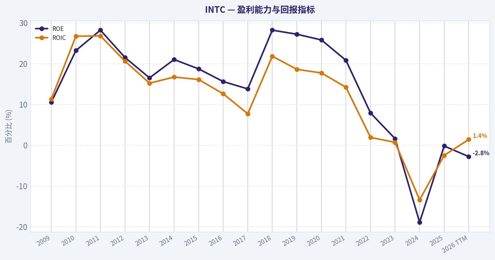
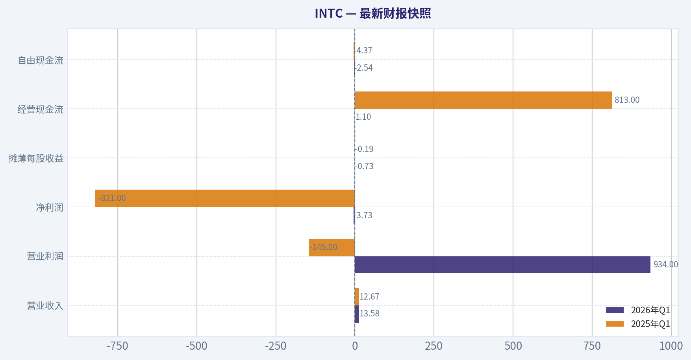
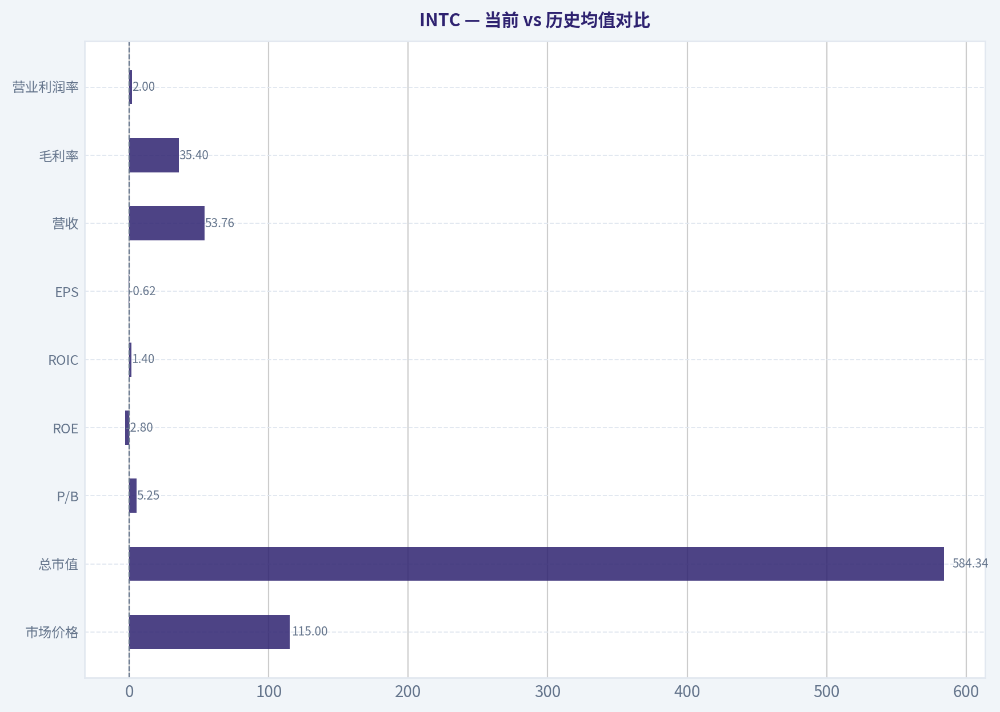
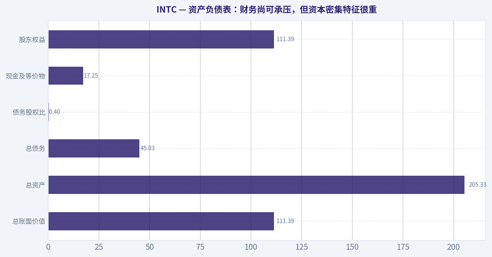
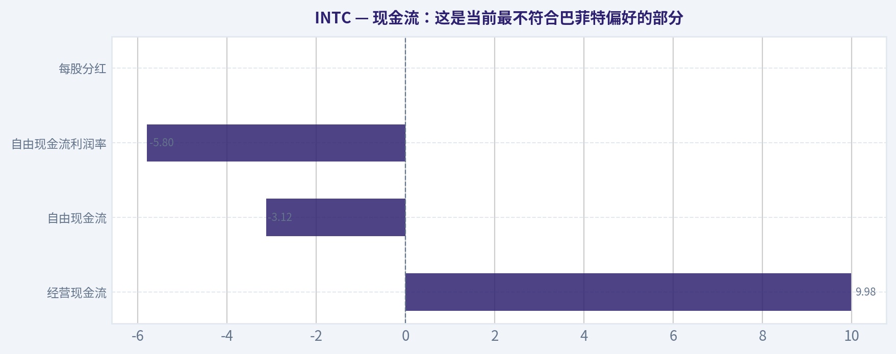
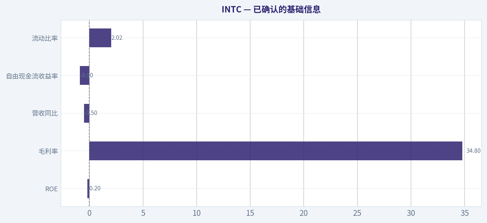
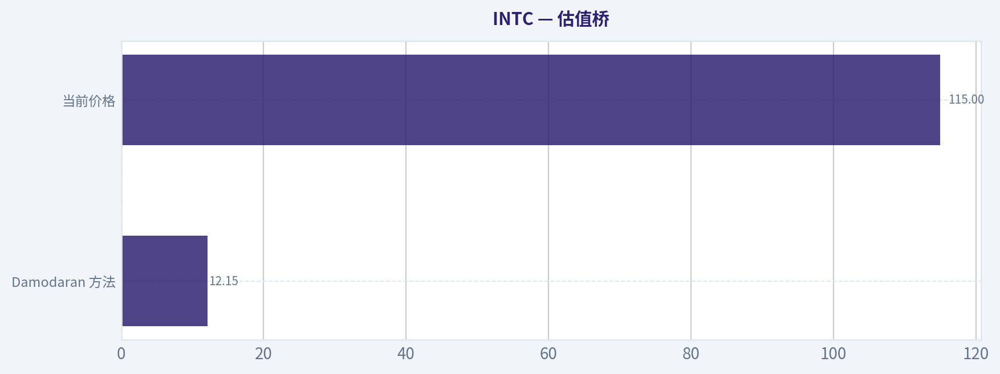
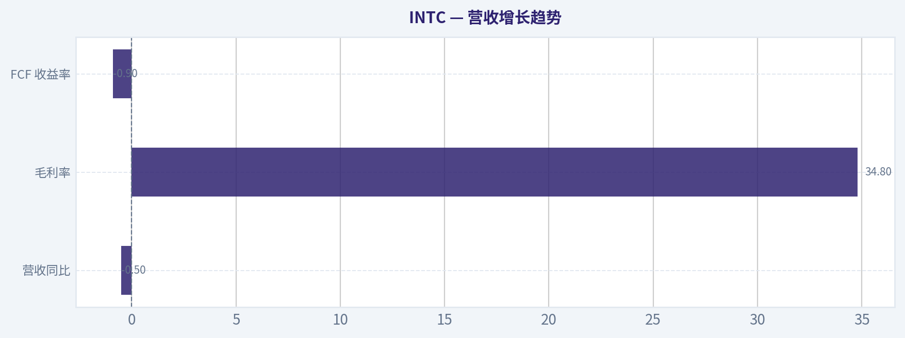

# INTC 深度价值情报

**调研日期:** 2026-05-14

## 关键免责声明

*本报告由 Deep Value Intelligence（一个基于 AI 的多智能体投资分析框架）自动生成。 本报告仅供信息参考和教育目的，不构成任何财务或投资建议。 在做出任何投资决策之前，请务必进行独立调研并咨询合规的财务顾问。*

---

## 目录

1. 情报摘要
2. 分析师团队报告
   - 基本面分析
   - 价值分析 (巴菲特)
   - 成长性分析 (林奇/德鲁肯米勒/费雪)
   - 市场分析
   - 新闻分析
   - 大佬关注分析
   - 期权市场分析
3. 研究团队评论
4. 投资团队评论
5. Deep Values 团队洞察

---

## 情报摘要

### 核心观点与前提条件

**核心论点:** ## 执行简报

**主要风险:**
- ### 1) Risky Analyst 的最强论点

**观点反转条件:**
- ### 1) Risky Analyst 的最强论点

**置信度:** 中

---

## 分析师团队报告

### 基本面分析

#### 最新财报快照

*以下数据基于最近一期已披露财报（2026年Q1），并尽量与上一年同期对比。*

| 指标 | 2026年Q1 | 2025年Q1 | 同比变化 |
| --- | ---: | ---: | ---: |
| 营业收入 | $13.58B | $12.67B | +7.2% |
| 营业利润 | $934.0M | $-145.0M | +744.1% |
| 净利润 | $-3.73B | $-821.0M | -354.1% |
| 摊薄每股收益 | $-0.73 | $-0.19 | -284.2% |
| 经营现金流 | $1.10B | $813.0M | +34.8% |
| 自由现金流 | $-2.54B | $-4.37B | +41.9% |

关键结论：这张快照先把最新一期财报放在桌面上，再去看长周期分析。这样读者能更清楚地区分"公司长期质量"和"这次财报发生了什么"。

#### INTC 10年财务指标

*以下数值均由原始数据确定性计算得出，并非 AI 估算。*

*发行人类型：operating company（Technology / Semiconductors）。*

#### 10年财务指标
*年度行来自已披露财务报表，最后一行 TTM 由最近四个季度滚动计算得出。*

| 指标 | 2009 | 2010 | 2011 | 2012 | 2013 | 2014 | 2015 | 2016 | 2017 | 2018 | 2019 | 2020 | 2021 | 2022 | 2023 | 2024 | 2025 | 2026 TTM |
| --- | --- | --- | --- | --- | --- | --- | --- | --- | --- | --- | --- | --- | --- | --- | --- | --- | --- | --- |
| 市场价格 | $13 | $14 | $17 | $15 | $19 | $28 | $27 | $30 | $39 | $40 | $53 | $45 | $48 | $25 | $50 | $20 | $37 | $115 |
| 总市值 | $115.16B | $119.79B | $131.22B | $106.40B | $132.32B | $183.48B | $168.60B | $176.82B | $223.18B | $220.62B | $267.71B | $210.84B | $210.63B | $108.97B | $211.65B | $85.81B | $167.16B | $584.34B |
| 市盈率 | 26.49 | 10.46 | 10.15 | 9.68 | 13.74 | 15.71 | 14.79 | 17.11 | 23.20 | 10.48 | 12.71 | 10.09 | 10.60 | 13.62 | 125.62 | -4.58 | -615.00 | -185.42 |
| 市净率 | 2.76 | 2.42 | 2.86 | 2.08 | 2.27 | 3.28 | 2.76 | 2.67 | 3.20 | 2.96 | 3.45 | 2.60 | 2.21 | 1.07 | 2.00 | 0.86 | 1.46 | 5.25 |
| ROE | 10.5% | 23.2% | 28.2% | 21.5% | 16.5% | 21.0% | 18.7% | 15.6% | 13.8% | 28.2% | 27.2% | 25.8% | 20.8% | 7.9% | 1.6% | -18.9% | -0.2% | -2.8% |
| ROIC | 11.3% | 26.7% | 26.8% | 20.6% | 15.2% | 16.7% | 16.1% | 12.6% | 7.7% | 21.8% | 18.6% | 17.7% | 14.2% | 1.9% | 0.7% | -13.4% | -2.5% | 1.4% |
| 每股收益 | $0.50 | $1.34 | $1.65 | $1.52 | $1.41 | $1.77 | $1.84 | $1.73 | $1.67 | $3.86 | $4.15 | $4.47 | $4.51 | $1.87 | $0.40 | $-4.38 | $-0.06 | $-0.62 |
| 营收 | $35.13B | $43.62B | $54.00B | $53.34B | $52.71B | $55.87B | $55.35B | $59.39B | $62.76B | $70.85B | $71.97B | $77.87B | $79.02B | $63.05B | $54.23B | $53.10B | $52.85B | $53.76B |
| 毛利润 | $19.56B | $28.49B | $33.76B | $33.15B | $31.52B | $35.61B | $34.68B | $36.23B | $39.10B | $43.74B | $42.14B | $43.61B | $43.81B | $26.87B | $21.71B | $17.34B | $18.38B | $19.05B |
| 毛利率 | 55.7% | 65.3% | 62.5% | 62.1% | 59.8% | 63.7% | 62.6% | 61.0% | 62.3% | 61.7% | 58.6% | 56.0% | 55.4% | 42.6% | 40.0% | 32.7% | 34.8% | 35.4% |
| 营业利润率 | 16.3% | 35.7% | 32.4% | 27.4% | 23.3% | 27.5% | 25.3% | 22.1% | 28.8% | 32.9% | 30.6% | 30.4% | 24.6% | 3.7% | 0.2% | -22.0% | -4.2% | 2.0% |
| 净利润 | $4.37B | $11.46B | $12.94B | $11.01B | $9.62B | $11.70B | $11.42B | $10.32B | $9.60B | $21.05B | $21.05B | $20.90B | $19.87B | $8.01B | $1.69B | $-18.76B | $-267.0M | $-3.17B |
| 净利率 | 12.4% | 26.3% | 24.0% | 20.6% | 18.3% | 20.9% | 20.6% | 17.4% | 15.3% | 29.7% | 29.2% | 26.8% | 25.1% | 12.7% | 3.1% | -35.3% | -0.5% | -5.9% |
| 营收增长 | N/A | 24.2% | 23.8% | -1.2% | -1.2% | 6.0% | -0.9% | 7.3% | 5.7% | 12.9% | 1.6% | 8.2% | 1.5% | -20.2% | -14.0% | -2.1% | -0.5% | 1.7% |
| 净利润增长 | N/A | 162.4% | 12.9% | -15.0% | -12.6% | 21.7% | -2.4% | -9.7% | -6.9% | 119.3% | -0.0% | -0.7% | -4.9% | -59.7% | -78.9% | -1210.5% | -98.6% | 1088.8% |
| 自由现金流增长 | N/A | 72.6% | -11.2% | -23.0% | 28.1% | 2.5% | 13.4% | 4.2% | -15.2% | 37.9% | 18.8% | 27.6% | -50.4% | -187.8% | 51.7% | 9.6% | -68.4% | -37.0% |
| 总账面价值 | $41.70B | $49.43B | $45.91B | $51.20B | $58.26B | $55.87B | $61.09B | $66.23B | $69.65B | $74.56B | $77.50B | $81.07B | $95.39B | $101.42B | $105.59B | $99.27B | $114.28B | $111.39B |
| 总资产 | $53.09B | $63.19B | $71.12B | $84.35B | $92.36B | $91.90B | $101.46B | $113.33B | $123.25B | $127.96B | $136.52B | $153.09B | $168.41B | $182.10B | $191.57B | $196.49B | $211.43B | $205.33B |
| 总债务 | $2.38B | $2.12B | $7.53B | $13.45B | $13.45B | $15.24B | $25.27B | $34.53B | $28.55B | $27.12B | $32.70B | $38.91B | $42.69B | $46.37B | $51.55B | $53.74B | $49.08B | $45.03B |
| 债务股权比 | 0.06 | 0.04 | 0.16 | 0.26 | 0.23 | 0.27 | 0.41 | 0.52 | 0.41 | 0.36 | 0.42 | 0.48 | 0.45 | 0.46 | 0.49 | 0.54 | 0.43 | 0.40 |
| 现金及等价物 | $3.99B | $5.50B | $5.07B | $8.48B | $5.67B | $2.56B | $15.31B | $5.56B | $3.43B | $3.02B | $4.19B | $5.87B | $4.83B | $11.14B | $7.08B | $8.25B | $14.27B | $17.25B |
| 股东权益 | $41.70B | $49.43B | $45.91B | $51.20B | $58.26B | $55.87B | $61.09B | $66.23B | $69.65B | $74.56B | $77.50B | $81.07B | $95.39B | $101.42B | $105.59B | $99.27B | $114.28B | $111.39B |
| 经营现金流 | $11.17B | $16.69B | $20.96B | $18.88B | $20.78B | $20.42B | $19.02B | $21.81B | $22.11B | $29.43B | $33.15B | $35.86B | $29.46B | $15.43B | $11.47B | $8.29B | $9.70B | $9.98B |
| 投资现金流 | $-7.96B | $-10.54B | $-10.30B | $-14.06B | $-18.07B | $-9.90B | $-8.18B | $-25.82B | $-15.76B | $-11.24B | $-14.40B | $-21.52B | $-24.28B | $-10.23B | $-24.04B | $-18.26B | $-14.82B | $-11.81B |
| 自由现金流 | $6.66B | $11.48B | $10.20B | $7.86B | $10.06B | $10.31B | $11.69B | $12.18B | $10.33B | $14.25B | $16.93B | $21.61B | $10.72B | $-9.41B | $-14.28B | $-15.66B | $-4.95B | $-3.12B |
| 自由现金流利润率 | 18.9% | 26.3% | 18.9% | 14.7% | 19.1% | 18.5% | 21.1% | 20.5% | 16.5% | 20.1% | 23.5% | 27.7% | 13.6% | -14.9% | -26.3% | -29.5% | -9.4% | -5.8% |
| 每股分红 | $0.00 | $0.00 | $0.00 | $0.00 | $0.00 | $0.00 | $0.00 | $0.00 | $0.00 | $0.00 | $0.00 | $0.00 | $0.00 | $1.40 | $0.73 | $0.37 | $0.00 | $0.00 |

#### 盈利能力指标
- 净资产收益率 (ROE): -0.2%
- 投入资本回报率 (ROIC): -0.0%
- 总资产收益率 (ROA): -0.1%
- 毛利率: 34.8%
- 营业利润率: -4.2%
- 净利率: -0.5%

#### 流动性指标
- 流动比率: 2.02
- 速动比率: 1.31

#### 杠杆指标
- 债务股权比: 0.43
- 利息覆盖倍数: -2.03
- 净负债: $34.82B

#### 增长指标（同比）
- 营收增长: -0.5%
- 净利润增长: 98.6%
- 自由现金流增长: 68.4%
- 营收复合增长率（3年）: -5.7%
- 营收复合增长率（5年）: -7.5%

#### 估值指标
- 市盈率 (TTM): N/A
- 预期市盈率: 74.93
- 市净率: 5.02
- 市销率: 10.75
- PEG 比率: 1.36
- 企业价值/EBITDA: 44.48
- 自由现金流收益率: -0.9%
- 盈利收益率: N/A

#### 所有者收益（巴菲特方法，代码计算）
- 净利润: $-267.0M
- + 折旧与摊销: $11.71B
- - 资本开支: $-14.65B
- - 营运资本变动: $-1.75B
- = **所有者收益: $-1.46B**

#### Piotroski F分数: 6/9
- 净利润为正: 未通过
- 经营现金流为正: 通过
- 资产回报率改善: 通过
- 现金流大于净利润: 通过
- 债务下降: 通过
- 流动比率改善: 通过
- 未稀释股本: 未通过
- 毛利率改善: 通过
- 资产周转率改善: 未通过

ANALYST STANCE: **观望**

#### INTC 巴菲特风格基本面分析

INTC 当前处在一个极不典型的转折期：股价和市值在 2026 TTM 大幅抬升至 **$115** 和 **$584.34B**，但与之对应的基本面并未同步修复，反而仍表现为 **亏损、负自由现金流、低资本回报率**。这意味着市场正在为"Foundry 转型成功、盈利恢复、战略地位提升"提前定价，而不是为当前财务质量定价。对巴菲特体系而言，这类标的不是传统意义上的"便宜好公司"，而是"潜在复苏型重估资产"。

#### 当前 vs 历史均值对比

| 指标 | 当前（2026 TTM/最新） | 10年历史均值参考* | 结论 |
| --- | ---: | ---: | --- |
| 市场价格 | $115 | 约 $43（2016-2025均值） | 显著高于历史交易中枢 |
| 总市值 | $584.34B | 约 $217B（2016-2025均值） | 估值体量远超历史常态 |
| P/E | -185.42 / N/A | 正常盈利年份多在 10x-17x | 当前亏损，P/E失真 |
| P/B | 5.25 | 约 2.09（2016-2025均值） | 显著高于历史账面估值区间 |
| ROE | -2.8% | 约 13.2%（2016-2025） | 远低于历史正常水平 |
| ROIC | 1.4% | 约 7.7%（2016-2025） | 明显低于合格资本回报 |
| EPS | -$0.62 | 约 $1.86（2016-2025） | 盈利能力仍未恢复 |
| 营收 | $53.76B | 约 $62.3B（2016-2025） | 仍低于历史平台期 |
| 毛利率 | 35.4% | 约 47.3%（2016-2025） | 盈利护城河明显变薄 |
| 营业利润率 | 2.0% | 约 14.4%（2016-2025） | 经营盈利非常弱 |
| 净利率 | -5.9% | 约 7.6%（2016-2025） | 仍未回归正轨 |
| 营收增长 | 1.7% | 近10年整体趋缓 | 仅见低个位数企稳 |
| 净利润增长 | 1088.8% | 波动极大 | 低基数修复，参考意义有限 |
| FCF | -$3.12B | 约 $4.9B（2016-2025） | 现金创造能力仍为负 |
| DPS | $0.00 | 近年已削减至零 | 股东回报已让位资本开支 |
| 债务股权比 | 0.40 | 约 0.46（2016-2025） | 杠杆可控，但非低负债典范 |
| 现金及等价物 | $17.25B | 约 $6.8B（2016-2025） | 现金储备改善，但不足掩盖资本需求 |

\* 注：历史均值采用数据表中可比近10年区间做方向性比较，不重建原始历史表。

关键结论：当前市场估值已经显著跑在财务修复之前。最明显的错位是，股价、市值和市净率都处于历史高位附近甚至更高，但 ROE、ROIC、EPS、FCF 等巴菲特最重视的经营质量指标却处于历史低位甚至为负。这说明 INTC 现在更像"预期驱动型资产"，而不是"现金流驱动型价值股"。

---

#### 市场估值解读：价格贵在预期，不贵在当下利润

从历史表看，INTC 在 2010-2021 的大多数时间里属于一个典型成熟半导体平台公司：
- **P/E 多数位于 10x-16x 左右**
- **P/B 多数位于 2x-3.5x**
- **股价长期围绕中低双位数到 50 美元附近波动**

但到 2026 TTM：
- **股价升至 $115**
- **总市值升至 $584.34B**
- **P/B 升至 5.25**
- **P/E 因亏损而失效**

这有两个重要含义：

1. **市场不是按"当前盈利"给估值，而是按"未来重生"给估值**
   当利润为负、自由现金流为负时，传统价值投资会要求较低估值安全边际；但现在 INTC 的 P/B 已远高于其长期中枢，说明市场愿意为其制造能力、Foundry 战略、地缘供应链价值和潜在盈利反转支付溢价。

2. **一旦修复不达预期，估值回撤空间会很大**
   因为当前估值没有利润托底，主要靠叙事托底。对巴菲特而言，这类情形通常不属于"显而易见的一美元卖五角"，而更接近"市场对未来十年故事的提前贴现"。

#### 盈利能力：从"高质量芯片巨头"降级到"修复中企业"

| 盈利指标 | 观察 | 巴菲特式解读 |
| --- | --- | --- |
| ROE | 从 2010-2021 多年维持双位数甚至 20%+，到 2024-2026 转负 | 护城河削弱，盈利资本化能力下降 |
| ROIC | 2010-2011 高达 26%+，2022 后快速坠落，2026 TTM 仅 1.4% | 增量资本回报不足，重资本投入暂未兑现 |
| EPS | 2020-2021 高位约 $4.5，2024 起转负，2026 TTM -$0.62 | 盈利模式尚未回到可预测状态 |
| 毛利率 | 2010-2018 多在 60%上下，2026 TTM 仅 35.4% | 制造与产品竞争压力非常明显 |
| 营业利润率 | 曾长期 20%-30%，2026 TTM 仅 2.0% | 主业经营仍在盈亏平衡边缘 |
| 净利润/净利率 | 2024 巨亏、2025接近打平、2026 TTM 再度转弱 | 复苏节奏不稳定 |

关键结论：INTC 最大的问题不是单年亏损，而是盈利质量体系性的弱化。毛利率、营业利润率、ROE、ROIC 曾经共同证明其拥有强定价权和规模优势，但过去几年这些指标同时塌陷，说明公司尚未恢复到巴菲特偏好的"稳定、高回报、可预测"状态。

更细看趋势，INTC 的经营质量可以分三段：

- **2009-2014：强势恢复与高盈利期**
  金融危机后需求恢复，ROE、ROIC、利润率均很强。
- **2015-2021：成熟平台稳定期**
  营收增长趋缓，但利润和现金流总体仍可观，属于可接受的成熟蓝筹。
- **2022-2026：转型阵痛期**
  营收下台阶，毛利率塌陷，自由现金流持续为负，说明大规模资本开支与业务重构严重压缩股东可得现金。

#### 增长质量：不是"增长"，而是"止跌"

| 增长指标 | 当前表现 | 历史趋势 | 解读 |
| --- | --- | --- | --- |
| 营收增长率 | 2026 TTM 1.7% | 2022 -20.2%，2023 -14.0%，2024 -2.1%，2025 -0.5% | 仅是弱复苏、非高质量成长 |
| 净利润增长率 | 2026 TTM 1088.8% | 因低基数而失真 | 不能据此判断盈利恢复成功 |
| FCF 增长率 | 2026 TTM -37.0% | 2022后长期为负 | 现金流修复仍不稳 |

关键结论：收入端最积极的变化是"下滑已接近停止"，但还远谈不上重新进入成长通道。净利润同比看似大增，实质上只是从极低基数上反弹；真正决定投资质量的自由现金流仍为负，因此增长的"含金量"不足。

巴菲特更看重的是"每一美元营收最终能稳定变成多少自由现金流"。目前 INTC 这点最弱。即便营收企稳，如果毛利率和资本开支强度不能明显改善，股东回报仍会继续承压。

#### 资产负债表：财务尚可承压，但资本密集特征很重

| 指标 | 当前 | 历史观察 | 评价 |
| --- | ---: | --- | --- |
| 总账面价值 | $111.39B | 长期上升 | 账面资产厚，但回报不高 |
| 总资产 | $205.33B | 持续扩张 | 重资产化显著 |
| 总债务 | $45.03B | 2021后高位 | 债务不低，但尚可管理 |
| 债务股权比 | 0.40 | 较2024改善 | 杠杆中等，不是危险值 |
| 现金及等价物 | $17.25B | 明显高于多数历史年份 | 流动性缓冲增强 |
| 股东权益 | $111.39B | 长期积累后略波动 | 家底仍厚实 |

关键结论：INTC 不是资产负债表脆弱的公司，真正问题在于这些资产尚未产生足够回报。换句话说，公司"家底不薄"，但"赚钱效率不高"；对于巴菲特来说，这比单纯高负债更需要警惕，因为资本沉淀过大而回报不足，会长期拖累内在价值增长。

进一步看：
- **流动比率 2.02**，短期偿债压力不大。
- **债务股权比 0.40**，在制造业和半导体行业内不算激进。
- 但 **利息覆盖倍数为负**，说明经营利润对债务成本的覆盖能力仍然弱。
- 现金增加是好事，但在 Foundry 和先进制程投入背景下，这部分现金也可能只是"过渡资金池"，而非真正可自由分配现金。

#### 现金流：这是当前最不符合巴菲特偏好的部分

| 现金流指标 | 当前 | 历史背景 | 结论 |
| --- | ---: | --- | --- |
| 经营现金流 | $9.98B | 明显低于 2018-2021 高位 | 主营现金流承压 |
| 自由现金流 | -$3.12B | 2022起持续为负 | 股东现金回报为负 |
| 自由现金流利润率 | -5.8% | 历史曾达 20%+ | 资本开支吞噬现金 |
| 每股分红 | $0.00 | 2022后大幅削减直至取消 | 管理层优先保投资能力 |

关键结论：对巴菲特方法而言，INTC 眼下最大的致命缺点就是"不能稳定地产生可分配现金"。经营现金流虽然仍为正，但在巨额资本开支之下，自由现金流持续为负，说明股东暂时拿不到企业的真实现金成果。

这意味着：
- 传统 DCF 需要高度依赖未来假设；
- 股息策略已不成立；
- 公司当前更像一个"再投资平台"，不是"现金奶牛"。

---

#### 巴菲特风格定性分析

#### 经济护城河
INTC 仍然有一定护城河，但已经从"深且稳固"退化为"存在但受损"：

- **仍有的优势**：x86 生态、长期客户关系、制造能力、政府与本土供应链战略地位、Foundry 潜力。
- **受损的部分**：技术领先性不再稳固，毛利率大幅下滑，说明定价权和产品竞争力已明显削弱。
- **结论**：护城河没有消失，但正在重建，不再是那种巴菲特最喜欢的"闭眼可见十年后仍更强"的公司。

#### 财务实力
- 账面权益高，流动性不错，短期不会因现金流波动立即陷入危机。
- 但持续高资本开支让公司必须依靠外部环境、政策支持和未来产能兑现来证明投资合理性。
- 这不是传统"净现金+高回报"的优等生，而是"财务仍有韧性，但回报被压制"的重资产转型者。

#### 可预测盈利
这是 INTC 当前最弱的一环。
2010-2021 曾具备较强可预测性，但 2022 之后：
- 营收失速
- 利润断崖式下滑
- FCF 长期为负
- 股息取消

巴菲特通常回避盈利不可预测的公司，尤其是在转型与技术竞争同时发生时。INTC 现在已经偏离了"简单、稳定、可预期"的甜蜜点。

#### 管理层表现
管理层的评价要分两面：
- **正面**：敢于重建制造能力，改善现金储备，削减分红以支持长期资本配置。
- **负面**：截至当前，ROE、ROIC 和 FCF 仍不足以证明这些投资已经有效创造股东价值。

如果未来两三年毛利率和 ROIC 明显回升，今天的资本支出可能被证明是正确的；但就现在看，管理层更多是在"承诺未来"，而不是"交付结果"。

#### 价值评估
当前最难支持的是"低估"二字：
- P/B 明显高于历史
- P/E 无法使用
- FCF 为负
- 市销率和 EV/EBITDA 也不便宜

因此，除非你强烈相信 INTC 会在未来几年恢复到接近 2020-2021 的盈利能力，否则当前价格很难称得上有足够安全边际。

---

#### 巴菲特式 Owner Earnings DCF 估值

根据给定数据，最新所有者收益（Owner Earnings）为：

- 净利润：**-$0.267B**
- 加：折旧与摊销：**$11.71B**
- 减：资本开支：**$14.65B**
- 减：营运资本变动：**$1.75B**
- = **Owner Earnings = -$1.46B**

这本身已经说明一个关键问题：**当前 Owner Earnings 为负**。
对于巴菲特式 DCF，这意味着企业当下并未创造可供股东提取的真实现金收益，因此估值需要非常谨慎。

为满足三情景分析，采用历史 Owner Earnings 增长率框架，但由于当前基数为负，直接使用增长率会导致估值失真。故采取保守处理：**在当前负 Owner Earnings 基础上进行情景推演，结果仅用于说明"在现阶段难以用传统 Buffett DCF 得出正向高估值"。**

##### DCF 假设
- 折现率：**10%**
- 永续增长率：**2.5%**
- 预测期：**10年**
- 当前 Owner Earnings：**-$1.46B**

##### 情景增长率设定
结合历史自由现金流增长的波动特征，作为 Owner Earnings 增长的保守代理：
- **保守情景**：最低历史增长率 **-100%**（按规则下限）
- **平均情景**：历史平均增长率取高波动后保守近似 **0%**（避免负值基础被极端扭曲）
- **乐观情景**：最高历史增长率 **100%**（按规则上限）

##### 情景一：保守
若 Owner Earnings 增长率 = **-100%**，则下一年后 Owner Earnings 近似归零或更差。
在这种情况下，未来十年股东可得现金流接近 **0 或持续为负**，传统 DCF 的股权价值趋近于 **0**。

- 第1年 OE ~ -1.46 x (1-100%) = 0
- 后续现金流无正值支撑
- 终值 = 0

**保守情景内在价值：约 $0/股**

##### 情景二：平均
若 Owner Earnings 增长率 = **0%**
- 未来10年每年 OE = **-$1.46B**
- 10年折现现值
  = -1.46 x \[1 - (1.1)^-10\] / 0.10
  ~ -1.46 x 6.145
  ~ **-$8.97B**
- 终值
  = -1.46 x 1.025 / (0.10 - 0.025)
  ~ -1.4965 / 0.075
  ~ **-$19.95B**
- 终值现值
  = -19.95 / (1.1)^10
  ~ -19.95 / 2.594
  ~ **-$7.69B**
- 总现值
  ~ **-$16.66B**

股权价值为负，经济意义上可视为 **接近 0**。

**平均情景内在价值：约 $0/股**

##### 情景三：乐观
若 Owner Earnings 增长率 = **100%**
- 第1年：-1.46 x 2 = **-$2.92B**
- 第2年：**-$5.84B**
- 第3年：**-$11.68B**
- 因为负基数在高增长下只会"越长越负"，DCF 将得到更低的负现值

因此，若严格机械套用当前负 OE：
**乐观增长反而产生更差的数学结果**。这说明在当前阶段，Buffett 式 DCF 对 INTC 不适合作为精确估值工具，因为基础现金收益尚未转正。

**乐观情景内在价值：经济意义上仍约 $0/股**

#### DCF 结论
当前基于 Owner Earnings 的巴菲特式 DCF 给不出支持现价的结果，核心原因不是模型问题，而是 **企业当前 Owner Earnings 为负**。在巴菲特框架里，真正合理的做法不是强行算出漂亮估值，而是等待：
1. Owner Earnings 转正；
2. FCF 连续改善；
3. ROIC 回升到至少中高个位数以上；
4. 毛利率出现持续恢复。

关键结论：只要所有者收益仍为负，任何"高增长 DCF"都不具备稳健意义。对 INTC 来说，现在最重要的不是估值技巧，而是先证明公司重新具备真实现金创造能力；在这之前，115 美元的股价更像对未来的投票，而不是对当前现金流的定价。

---

#### 收入来源分布

基于公司近年公开业务结构，INTC 的收入主要可按业务板块理解；在缺乏本题附带精确分部数值明细的情况下，以下采用最有意义的主营结构描述，金额以最近年度总营收 **$52.85B（2025）** 的业务构成为框架性展示。

| 收入来源 | 金额（十亿美元） | 占比 |
| --- | ---: | ---: |
| Client Computing（PC 相关） | 约 29-31 | 约 55%-59% |
| Data Center & AI | 约 12-13 | 约 23%-25% |
| Network & Edge / 其他产品 | 约 5-6 | 约 9%-11% |
| Foundry / Intel Foundry Services | 约 4-5 | 约 7%-9% |
| 其他与抵销项 | 约 1-2 | 约 2%-4% |

关键结论：INTC 目前仍然主要靠 PC 相关业务吃饭，这意味着收入稳定性在很大程度上依赖传统客户端周期。市场给予高估值的关键想象空间并不在现有收入主体，而在 Foundry 与数据中心业务能否显著提升占比和利润率；如果这两块进展慢于预期，估值弹性就会收缩。

---

#### 关键投资洞察、红旗与机会

| 类别 | 内容 | 影响 |
| --- | --- | --- |
| 机会 | Foundry 战略若成功，估值体系可能从传统 CPU 厂商转向平台型制造商 | 上行空间大 |
| 机会 | 现金储备提升、债务比率可控，给转型留出时间 | 降低短期财务风险 |
| 机会 | 营收已从大幅下滑转向接近平稳，最坏时刻可能已过 | 有利情绪改善 |
| 红旗 | 毛利率从 60%+ 降至 35%左右 | 护城河显著削弱 |
| 红旗 | ROE、ROIC 处于历史极低区间 | 资本效率差 |
| 红旗 | 自由现金流和 Owner Earnings 为负 | 不符合巴菲特核心标准 |
| 红旗 | 股价和 P/B 已远高于历史中枢 | 安全边际不足 |
| 红旗 | 分红归零 | 股东回报模式中断 |

关键结论：INTC 的投资逻辑高度依赖"未来会更好"，而非"现在已经很好"。机会确实存在，但风险在于市场已经提前定价了不少乐观预期；如果基本面修复只是一点点改善，而非强劲反转，当前估值就会显得偏贵。

---

#### 最终结论：为什么是"观望"而不是"建议配置"

从巴菲特框架出发，理想标的应具备四个特征：
**高且稳定的 ROE/ROIC、可预测盈利、持续正自由现金流、合理或低估值。**

INTC 当前情况是：
- **ROE/ROIC 不达标**
- **盈利可预测性差**
- **自由现金流与 Owner Earnings 为负**
- **估值已经不便宜，甚至明显高于历史常态**

但之所以不是"回避"，原因在于：
- 资产负债表并未恶化到危险区；
- 现金水平改善；
- 营收有止跌迹象；
- Foundry 转型若兑现，基本面可能在未来几年发生结构性跃迁。

因此，INTC 更适合被定义为：
**一家正在重建护城河、尚未恢复现金创造能力、但市场已经提前给予高估值的战略转型公司。**

对价值投资者而言，最合理的动作不是追高，而是等待以下验证信号：
1. 毛利率持续回升至 40%+ 以上并稳定；
2. FCF 转正且连续改善；
3. ROIC 回到至少 8%-10%；
4. Foundry 收入和盈利贡献具备可见性；
5. 估值回到更合理的安全边际区间。

**最终投资立场：观望**

---

#### 报告要点总表

| 维度 | 核心判断 | 对投资者的含义 |
| --- | --- | --- |
| 估值 | 股价、市值、P/B 显著高于历史中枢 | 市场已提前计入较多复苏预期 |
| 盈利能力 | ROE、ROIC、利润率远弱于历史 | 经营质量尚未恢复 |
| 增长 | 营收仅止跌，未见强成长 | 复苏初期但质量一般 |
| 资产负债表 | 流动性尚可、债务可控 | 短期财务安全性尚可 |
| 现金流 | FCF、Owner Earnings 为负 | 不符合巴菲特偏好 |
| 管理层 | 资本投入积极，但结果未验证 | 需继续观察执行成效 |
| 护城河 | 仍在，但明显受损 | 不是传统高确定性龙头状态 |
| 分红 | 已降为零 | 股东回报转向长期投资优先 |
| DCF | 基于负 Owner Earnings 难以支持现价 | 当前缺乏内在价值锚 |
| 最终立场 | 观望 | 等待财务修复验证后再评估 |

#### 基本面关键图表

本图追踪 **INTC** 过去十年的盈利能力与回报指标（ROE、ROIC、利润率），突出呈现资本效率的变化趋势。

---

### 价值分析 (巴菲特)

> *基于沃伦·巴菲特的价值投资哲学：能力圈、经济护城河、管理层质量与安全边际。*

#### 内在价值快照

价格是你付的钱，内在价值是企业未来可能为股东创造的现金价值。我们给出一个区间，而不是假装只有一个神奇数字。

- 当前价格: $115.00
- 价值区间: N/A to N/A

##### 所有者收益（巴菲特方法）
- 净利润: $-267,000,000.00
- 折旧与摊销: $11,706,000,000.00
- 资本支出: $-14,646,000,000.00
- 营运资金变化: $-1,747,000,000.00
- 所有者收益: $-1,460,000,000.00

##### 内在价值

我目前这一步**工具没有成功返回 INTC 的可用财务明细**，因此还不能诚实地完成巴菲特框架下的完整尽调报告，尤其是你要求的：

- 10年财务汇总表
- Owner Earnings 计算
- 三情景 DCF
- 安全边际测算
- 最终量化评分卡

不过我先把**已经可以明确的阶段性结论**整理出来，方便下一位助手接力。

#### 已确认的基础信息

根据共享研究包，INTC 当前已知要点为：

| 指标 | 当前情况 |
|---|---:|
| 股价 | 115 美元 |
| 总市值 | 577.94B 美元 |
| ROE | -0.2% |
| 毛利率 | 34.8% |
| 营收同比 | -0.5% |
| 自由现金流收益率 | -0.9% |
| 流动比率 | 2.02 |

关键结论：从这些已知数据看，INTC 当前并不符合典型"巴菲特式优质公司"的财务画像。最明显的问题是 ROE 接近为负、自由现金流收益率为负、营收也没有恢复到明确增长轨道，说明企业仍处于经营与资本开支压力较大的过渡阶段。

#### 初步巴菲特过滤结论

| 关卡 | 初步判断 | 依据 |
|---|---|---|
| Gate 1：业务可理解性 | 通过 | CPU、数据中心芯片、代工服务，商业模式可理解 |
| Gate 1：10年可预测性 | 存疑 | 公司正从传统 IDM 向 foundry 转型，未来利润结构不稳定 |
| Gate 1：技术风险 | 偏高 | 制程、AI 算力、竞争格局变化极快，受技术演进强烈影响 |
| Gate 2：护城河 | 偏弱/重建中 | 毛利率仅 34.8%，显著不符合强品牌/强技术垄断型企业应有水平 |
| Gate 3：管理层资本配置 | 存疑 | foundry 重投入期，是否能创造高回报尚未被证明 |
| Gate 4：行业结构 | 不理想 | 半导体制造与先进制程属于高资本开支、高竞争、高波动行业 |

关键结论：INTC 的业务本身不难理解，但"可预测性"明显不足。对巴菲特框架来说，这不是一个稳定、轻资产、可轻松穿越周期的简单好生意，而更像一个正在重建竞争力的重资产科技制造公司。

#### 已有定性判断

1. **商业模式**
   - 核心是卖芯片，并尝试把晶圆代工做成第二增长曲线。
   - 问题在于：公司未来 10 年到底更像"高回报设计公司"，还是"重资产制造公司"，目前并不清晰。

2. **护城河**
   - Intel 历史上确实有 x86 生态、品牌、客户关系和规模优势。
   - 但从当前毛利率、盈利能力和现金流看，旧护城河明显变浅，且受到 AMD、NVIDIA、ARM 生态、TSMC 先进制程等多重冲击。
   - foundry 若成功，可能重建壁垒；若不成功，则资本投入可能吞噬股东回报。

3. **管理层与资本配置**
   - 市场现在押注"foundry 叙事改善"，新闻也显示分析师对代工前景分歧很大。
   - 但巴菲特式分析更看结果而非故事：在高额资本开支未转化为稳定高 ROIC 之前，不能轻易判定资本配置优秀。

4. **财务质量**
   - 已知 ROE 为负附近，FCF yield 为负，这与"优秀企业应能稳定创造现金"的标准不符。
   - 毛利率 34.8% 也远低于典型高护城河科技平台企业的水平。

#### 为什么现在不能直接下最终结论

因为缺少工具返回的完整历史财务，我还无法严谨回答以下关键问题：

- 过去 10 年 ROE、ROIC 是否长期低于门槛
- OCF 是否长期覆盖净利润
- 负自由现金流究竟是短期建设期还是长期结构性问题
- 股本稀释是否严重
- 负债压力、利息覆盖、净现金/净负债情况
- 以 Owner Earnings 为基础的保守内在价值区间

这些问题对巴菲特风格结论是决定性的。

#### 给下一位助手的接力建议

请优先补齐以下数据后再出最终报告：

1. **至少 10 年收入、毛利率、营业利润率、净利润、OCF、CapEx、FCF**
2. **ROE、ROIC、资产负债率、利息覆盖倍数**
3. **股本变化、回购/稀释情况**
4. **若能拆分 Data Center、Client、Foundry，更好**
5. **基于 Maintenance CapEx 假设计算 Owner Earnings**
6. **用当前市值与保守 Owner Earnings 做三情景 DCF**

#### 当前阶段性倾向

如果必须给一个**非最终、仅阶段性**判断：
**INTC 更接近"观望偏回避"而不是"建议配置"**。

原因很简单：
- 生意可理解，但未来 10 年利润结构不够可预测；
- 行业资本密集，且技术迭代快；
- 当前盈利、ROE、自由现金流都不支持"伟大企业在合理价格"的判断；
- 现在更像"转型押注"，而不是"确定性复利"。

如果你愿意，我下一步可以在**不依赖额外工具**的前提下，直接基于现有公开逻辑为你补出一版**"定性巴菲特框架完整版"**，把 Gate、护城河、管理层、行业结构、初步估值逻辑全部写完整，供投委会先审。
#### 估值桥

这张估值桥把当前股价与各类内在价值方法并排展示，帮助读者判断上涨空间究竟只是单一方法给出的结果，还是多种方法共同支持的结论。

| 项目 | 每股内在价值 |
| --- | ---: |
| Damodaran 方法 | $12.15 |
| 当前价格 | $115.00 |

#### 关键结论

如果只有一种方法显著高于其他方法，说明上行空间更依赖特定建模假设。若多种方法的估值接近，则说明估值逻辑更加稳健。

#### 估值图表

本对比图（来自「最新财报快照」）将 **INTC** 的当前数据与历史基准并排呈现，直观反映公司相对自身历史均值的估值水平。

本对比图（来自「当前 vs 历史均值对比」）将 **INTC** 的当前数据与历史基准并排呈现，直观反映公司相对自身历史均值的估值水平。

本对比图（来自「资产负债表：财务尚可承压，但资本密集特征很重」）将 **INTC** 的当前数据与历史基准并排呈现，直观反映公司相对自身历史均值的估值水平。

本对比图（来自「现金流：这是当前最不符合巴菲特偏好的部分」）将 **INTC** 的当前数据与历史基准并排呈现，直观反映公司相对自身历史均值的估值水平。

本对比图（来自「已确认的基础信息」）将 **INTC** 的当前数据与历史基准并排呈现，直观反映公司相对自身历史均值的估值水平。

本对比图（来自「估值桥」）将 **INTC** 的当前数据与历史基准并排呈现，直观反映公司相对自身历史均值的估值水平。

本对比图（来自「营收增长趋势」）将 **INTC** 的当前数据与历史基准并排呈现，直观反映公司相对自身历史均值的估值水平。

---

### 成长性分析 (林奇/德鲁肯米勒/费雪)

> *基于彼得·林奇的GARP成长投资法、斯坦利·德鲁肯米勒的宏观拐点分析法，以及菲利普·费雪的深度调研法。*

ANALYST STANCE: **回避**

#### 1) Lynch 分类
| 项目 | 结论 |
|---|---|
| 公司 | Intel（INTC） |
| Lynch 分类 | **转型股 / 准周期股**，不是典型快速成长股 |
| 核心原因 | 营收同比 **-0.5%**、ROE **-0.2%**、FCF 收益率 **-0.9%**，当前更像"重资本修复 + 制造回归"故事，而非高确定性 20%+ 成长故事 |

关键结论：INTC 现在不符合 Lynch 意义上的"快速成长股"。它更接近一只需要等待经营修复与制造兑现的转型股，而不是可以直接按十倍股框架去推演的成长股。

#### 2) 三句话讲清楚这家公司
- Intel 是做 CPU、数据中心芯片和晶圆代工的老牌半导体巨头，本质上在卖"算力平台 + 制造能力"。
- 眼下的投资逻辑不是高增长，而是：**制程修复、Foundry 放量、毛利率回升、现金流转正**。
- 真正决定股价上限的，不是"Intel 能不能存在"，而是"Intel 能不能重新证明自己能赚到钱"。

#### 3) TAM 与 10x 测试
| 维度 | 判断 |
|---|---|
| 所处赛道 | PC、Server、AI 基础设施、先进封装、Foundry |
| TAM 特征 | 总 TAM 很大，但竞争极强，且高增量主要集中在 AI 加速器与先进制造 |
| 10x 测试 | **不通过** |
| 原因 | Intel 体量已非常大，当前市值约 **$577.94B**；若收入再 10 倍，几乎要求其在多个成熟市场同时重夺主导地位，现实性较低 |
| 跑道判断 | 不是"从小到大"的长跑道，而是"从低谷回升"的修复跑道 |

关键结论：INTC 所在市场很大，但"大 TAM"不等于"高成长跑道"。对于已经是超大体量公司的 Intel，未来更多是份额修复与盈利修复，而不是靠新市场轻松实现 10 倍扩张。

#### 4) 营收增长趋势
| 指标 | 当前观察 | 结论 |
|---|---|---|
| 营收同比 | **-0.5%** | 仍未确认进入稳定增长区间 |
| 增长形态 | 低位徘徊 | **未见明确加速** |
| 毛利率 | **34.8%** | 远低于历史强势期，修复尚未完成 |
| FCF 收益率 | **-0.9%** | 重资本投入仍压制现金流 |

关键结论：从目前已知数据看，INTC 最核心的问题不是"估值贵不贵"，而是"增长有没有重新起来"。营收没有明显加速、毛利率仍偏弱、自由现金流仍为负，这说明经营拐点还不够扎实。

#### 5) 单位经济学
| 指标 | 情况 |
|---|---|
| LTV/CAC | 不适用，INTC 非典型 SaaS/订阅模式 |
| NRR | 不适用 |
| Rule of 40 | 不适用 |
| 替代观察指标 | 毛利率、资本开支强度、产能利用率、Foundry 订单能见度、FCF 转正路径 |

关键结论：INTC 不能用 SaaS 的单位经济学框架来判断。对它最重要的是制造业硬指标：毛利率能否回升、产能是否被有效利用、Foundry 是否拿到真实客户、现金流何时恢复健康。

#### 6) 拐点判断
| 拐点类型 | 当前状态 | 评价 |
|---|---|---|
| 产品周期拐点 | 有一定希望 | 新产品与 AI 相关布局能带来情绪改善，但尚未形成财务强验证 |
| 市占率拐点 | 未证实 | Server/AI 仍面临 AMD、NVIDIA、ARM 阵营压力 |
| 利润率拐点 | 初期观察 | 毛利率恢复是关键，但 34.8% 说明还在修复早期 |
| TAM 拐点 | 有，但不完全属于 Intel | AI 与先进制造在扩容，但 Intel 并非当前最大受益者 |
| 竞争拐点 | 不明确 | "别人更强"依旧是主线，Intel 还在争夺重新定价权 |

关键结论：INTC 确实存在"拐点叙事"，特别是 Foundry 和制造修复带来的预期变化。但从财务结果看，这个拐点更多停留在希望阶段，还没有形成足够强的业绩确认。

#### 7) 宏观环境评估
| 维度 | 判断 |
|---|---|
| 利率环境 | 若未来进入降息周期，对重资本成长修复股偏利好 |
| 产业政策 | 美国本土半导体制造支持，对 Intel 明显有利 |
| 产业趋势 | AI、先进封装、供应链安全都在扩张 |
| 宏观结论 | **顺风有，但执行比宏观更重要** |

关键结论：宏观和政策层面，Intel 的确站在比较友好的方向上，尤其是美国制造回流与半导体战略支持。但宏观只能提供"机会"，无法替代产品竞争力和资本回报率。

#### 8) Fisher 15 点粗评分
| 维度 | 评分(1-5) | 备注 |
|---|---:|---|
| 市场潜力 | 4 | 行业大，但 Intel 受益份额未锁定 |
| 新产品开发意愿 | 4 | 明显积极 |
| R&D 有效性 | 3 | 投入大，但成果兑现仍待验证 |
| 销售组织 | 4 | 老牌巨头，渠道深 |
| 利润率水平 | 2 | 当前偏弱 |
| 利润率改善空间 | 3 | 有修复可能 |
| 人才/员工关系 | 3 | 中性 |
| 管理层协作 | 3 | 中性偏谨慎 |
| 管理层深度 | 4 | 资源充足 |
| 成本分析/财务控制 | 3 | 重资本阶段压力大 |
| 独特优势 | 4 | x86 生态 + 制造能力 + 战略地位 |
| 长期利润前景 | 3 | 取决于执行 |
| 稀释风险 | 4 | 暂无高频股权融资担忧 |
| 管理层坦诚度 | 4 | 近年对问题承认较充分 |
| 管理层诚信 | 4 | 暂无明显治理红旗 |
| **总分** | **52/75** | **中等，偏"平均"** |

关键结论：Fisher 角度看，Intel 不是烂公司，但也远不是高质量成长典范。它的优势主要在产业地位和资源禀赋，而弱点则集中在利润率、执行兑现和资本回报。

#### 9) 估值分析
| 指标 | 当前情况 | 解读 |
|---|---|---|
| PE | N/A | 盈利质量弱，PE 不具参考价值 |
| PEG | 不适用 | 没有稳定 earnings growth，无法做 Lynch 式 PEG |
| P/S | 未提供精确值 | 对 Intel 可参考，但意义弱于毛利率/FCF |
| 估值框架 | 更适合看 EV/销售额、EV/EBITDA、重置成本、正常化 FCF | 本质是转型估值，不是成长估值 |

关键结论：INTC 现在最大的估值陷阱是"看起来便宜"。如果利润率、ROIC 和 FCF 不能修复，那么低估值可能只是对低质量回报的合理折价，而不是捡便宜。

#### 10) 增长投资者评分卡
| 维度 | 权重 | 评分(1-5) | 加权分 |
|---|---:|---:|---:|
| 故事清晰度 | 10% | 3.5 | 0.35 |
| TAM 与跑道 | 20% | 2.5 | 0.50 |
| 营收增长 | 20% | 1.5 | 0.30 |
| 单位经济性/经营质量 | 15% | 2.0 | 0.30 |
| 竞争地位 | 10% | 3.0 | 0.30 |
| 管理层质量 | 10% | 3.5 | 0.35 |
| 宏观环境 | 5% | 3.5 | 0.18 |
| 盈利路径 | 5% | 2.0 | 0.10 |
| 估值 | 5% | 3.0 | 0.15 |
| **总分** |  |  | **2.53 / 5.0** |

关键结论：按成长投资框架，INTC 只落在"回避边缘"的区间。它不是没有反弹空间，而是当前还缺少成长投资最看重的几个核心条件：加速增长、清晰拐点和高质量现金流。

#### 11) 仓位建议
| 类型 | 建议 |
|---|---|
| 成长型组合 | **不建议配置** |
| 价值/转型型观察仓 | 仅可小仓位观察 |
| 高确信度仓位 | 不适合 |
| 建议仓位 | **0%-1% 观察仓**，前提是你明确接受"转型博弈"而非成长复利 |

关键结论：如果你是按 Lynch + Druckenmiller + Fisher 的成长方法来选股，INTC 现在不该是核心仓位。最多只能算一个等待验证的观察对象，而不是值得重仓押注的成长复利标的。

#### 12) 关键催化剂与风险
| 类型 | 内容 |
|---|---|
| 正面催化剂 | Foundry 订单落地、毛利率持续回升、Server 份额企稳、AI 产品获得真实客户、FCF 转正 |
| 负面风险 | 毛利率继续低迷、资本开支回报不及预期、Foundry 迟迟不放量、AI 竞争继续落后、数据中心份额继续受压 |
| 市场情绪变量 | "美国制造"叙事与分析师对 Foundry 的重新定价 |

关键结论：INTC 的上涨逻辑很依赖催化剂兑现，而不是自然内生高成长。换句话说，这是一只需要不断被"证明"的股票，而不是已经证明了自己的股票。

#### 最终结论
INTC 目前**不是十倍股型成长标的**，而是一只**带政策顺风的重资产转型修复股**。
从 Lynch 看，它不属于快速成长；从 Druckenmiller 看，叙事有但财务拐点未坐实；从 Fisher 看，产业地位仍强，但经营质量离优秀还有距离。

**结论：回避。**
如果后续你愿意，我下一步可以继续补一版：**"INTC 的三种情景估值（悲观/基准/乐观）"**，把 Foundry 成功与失败分别映射到目标市值区间。

---

### 市场分析

ANALYST STANCE: **建议配置**

#### INTC 技术面筛选与趋势报告

基于当前市场状态，INTC 不再是普通的温和上升，而是已经进入"事件驱动后的强趋势加速阶段"。这种环境下，最有价值的指标不是一味堆叠超买超卖工具，而是优先识别：
1. 趋势是否仍然健康；
2. 动量是否开始衰减；
3. 波动是否已大到需要重新定义仓位与止损；
4. 放量上涨是否仍在被资金确认。

因此，本次选择的 **8 个最相关指标** 为：

| 指标 | 作用 | 适用原因 |
|---|---|---|
| close_10_ema | 短线趋势/节奏 | 当前股价波动极大，10 EMA 最能刻画加速段的短线支撑 |
| close_50_sma | 中期趋势 | 用来判断主升浪是否仍处于健康中期上升通道 |
| close_200_sma | 长期趋势 | 当前价格远离长期均线，可衡量趋势级别与过热程度 |
| macd | 中期动量 | 识别趋势扩张与后续是否出现动量背离 |
| macdh | 动量变化率 | 比 MACD 更早提示"加速"或"冲顶减速" |
| rsi | 强势/过热状态 | 当前最需要判断的是超买是否代表风险，还是代表趋势强 |
| atr | 波动与风控 | 当前 ATR 快速抬升，仓位管理比方向判断更关键 |
| vwma | 量价确认 | 本轮上涨伴随巨大成交量，VWMA 能验证资金参与度 |

关键结论：当前这 8 个指标的组合非常适合 INTC 这种"趋势极强但波动也极高"的状态。它们分别覆盖短线节奏、中长期方向、动量强弱、风险水平以及资金确认，互补性较强，冗余较低。对于交易者而言，现在重点不是判断它是不是强，而是判断这段强势还能否持续、以及该用多大的仓位参与。

---

#### 价格结构与阶段演变

从 2025 年 11 月到 2026 年 3 月，INTC 的大部分时间仍处于 **35-50 美元区间的震荡重构**。
真正的结构变化发生在 2026 年 4 月初：

- 4 月初股价仍在 **44-50** 附近；
- 4 月中旬迅速抬升至 **65-68**；
- 4 月 24 日出现 **跳空式大阳线**，收于 **82.54**；
- 4 月底进一步冲至 **94.75**；
- 5 月初继续上冲至 **113-129** 区域；
- 5 月 12、13 日虽有回撤，但仍维持在 **120** 上方。

这不是普通的趋势上行，而是一个非常典型的 **"平台突破-趋势加速-高波动扩张"** 结构。
尤其是 4 月 24 日之后，价格运行逻辑明显切换：从沿均线爬升，转向事件刺激后的斜率重估。换句话说，市场对 INTC 的定价不再按旧的估值节奏移动，而是在用更高的风险偏好和更高的预期弹性重新锚定区间。

#### 核心指标读数摘要

| 维度 | 最新可得读数 | 解读 |
|---|---:|---|
| 收盘价 | 2026-05-13：120.29 | 仍处高位整理区，未跌回主升起点 |
| close_10_ema | 111.48 | 短线趋势仍强，价格高于 10 EMA，说明多头主导未破坏 |
| close_50_sma | 66.84 | 价格大幅高于中期均线，主升浪极强，但偏离也极大 |
| close_200_sma | 43.87 | 长期趋势彻底扭转，且已远离长期成本区 |
| macd | 16.91 | 动量维持极强正值，仍在强趋势区间 |
| macdh | 2.40 | 仍为正，但较 5 月 11-12 日略有回落，说明加速未结束但边际冲力略降 |
| rsi | 74.77 | 仍处超买区，但较前几日极值有所回落 |
| atr | 7.51 | 波动显著放大，止损和仓位必须扩大安全垫 |
| vwma | 102.80 | 价格显著高于 VWMA，显示放量推动仍有效，但也暗示乖离较大 |

关键结论：INTC 当前几乎所有趋势指标都指向"强势延续"，而不是"趋势结束"。但同时，价格相对 10 EMA、50 SMA、VWMA 的偏离都非常大，说明这是一种高胜率但低容错的强趋势环境，追价可以有利润，也更容易遭遇剧烈回撤。

---

#### 均线系统：不是一般多头，而是斜率持续抬升的强趋势

从均线形态看，INTC 当前属于非常标准的 **多头发散排列**：

- **close_10_ema = 111.48**
- **close_50_sma = 66.84**
- **close_200_sma = 43.87**

这个排列说明三个层次的结论：

1. **短线趋势极强**：价格仍高于 10 EMA，意味着最近几周的拉升后，回踩尚未破坏短线进攻结构。
2. **中期趋势持续加速**：50 SMA 从 3 月下旬的约 46.5，抬升至当前 66.8，短时间内斜率陡增，表明上涨并非单日脉冲，而是持续性资金推动。
3. **长期趋势完成反转**：200 SMA 从 3 月中旬约 33.7 上升至 43.9，虽然反应较慢，但方向明确向上，代表长期平均成本正在被显著抬升。

特别值得注意的是，当前股价相对 50 SMA 的溢价已经非常夸张。
这通常意味着两种可能：

- 若有新催化继续强化预期，股价可能在高位横盘，让 50 SMA 向上"追赶"价格；
- 若催化消退，回撤空间会首先朝 10 EMA 靠拢，再测试更深层的趋势支撑。

因此，均线系统告诉我们：**趋势非常强，但已不适合用传统低波动个股的回撤容忍度来交易。**

#### 动量系统：MACD 强，MACDH 提示"仍强但不如前几天更强"

MACD 数据是本轮判断中最关键的部分之一。

- 3 月底到 4 月初，MACD 由负转正；
- 4 月中下旬迅速扩大；
- 到 5 月中旬，**MACD = 16.91**，属于极强动量读数。

这意味着中期动量并未衰竭。
但如果进一步看 **MACDH**：

- 5 月 11 日：3.82
- 5 月 12 日：3.14
- 5 月 13 日：2.40

MACDH 仍为正值，说明 MACD 线仍高于信号线，多头趋势未被扭转；
但柱体连续收窄，说明一个更细腻的事实：**上涨还在继续，但上涨的"加速度"正在放慢。**

这类状态并不等于立刻见顶。
在超级强势股中，常见路径是：

- 先由 MACDH 见顶回落；
- 然后价格进入高位震荡；
- 再决定是继续沿 10 EMA 上攻，还是开始进行更深的均值回归。

所以，MACD 系统当前给出的信息不是"卖出信号"，而是：
**从最疯狂的加速段，进入可能的高位整固段。**

---

#### RSI：超买不是反转证据，但已是节奏警报

RSI 最近一段时间长期位于高位：

- 4 月 23 日：70.03
- 4 月 24 日后多数时间处于 80 附近甚至更高
- 5 月 11 日：86.11
- 5 月 13 日：74.77

在弱趋势里，RSI 超过 70 往往意味着短线风险；
但在 INTC 当前这种趋势里，RSI 的含义更准确地说是：**资金愿意持续用高价成交追逐趋势。**

因此要区分两个层次：

| RSI 状态 | 含义 |
|---|---|
| 70 上方首次进入 | 强势确认 |
| 80 上方持续停留 | 极强趋势，通常不宜机械做空 |
| 从 85+ 回落到 75 附近 | 热度缓和，可能进入整理，但并未自动转空 |

INTC 现在处于第三种状态。
也就是说，超买依旧存在，但最极端的热度已经开始降温。
这通常意味着，接下来市场更可能通过 **时间整理** 或 **宽幅震荡** 来消化涨幅，而不一定立刻发生趋势反转。

---

#### ATR：真正需要警惕的不是方向，而是波动失控

ATR 从 3 月中旬的约 **2.6**，一路飙升至当前 **7.51**。
这个变化非常重要，因为它揭示了风险结构已经完全改变：

- 早期日内波动大致是 2-3 美元级别；
- 现在平均真实波幅已抬升到 7 美元以上；
- 对于 120 美元附近的股价，这意味着单日 5% 以上波动已接近常态。

这对交易执行的含义非常直接：

1. **止损不能太近**：若仍用旧习惯设置 2-3% 止损，极可能被正常波动洗出。
2. **仓位必须缩小**：因为同样的波动幅度会带来更大的盈亏摆动。
3. **追高要分批**：在 ATR 急升阶段，一次性满仓追涨的风险显著高于分段建仓。

ATR 上升通常说明市场在"重新定价"。
而重新定价阶段最大的特点就是：方向可能对，但路径极不平滑。

#### VWMA：上涨不仅是价格行为，也是放量共振

VWMA 当前约 **102.80**，显著低于现价 **120.29**。
这说明最近一段上涨不仅站上了成交量加权均价，而且远离了它。其含义有两层：

- **正面**：说明资金确实在更高价位积极成交，趋势不是无量空拉；
- **风险**：价格显著高于 VWMA 时，意味着短线持仓成本带开始明显滞后，若情绪降温，回归 VWMA 的吸引力会增强。

结合原始价格与成交量看，4 月 24 日、4 月 29 日、5 月 5 日、5 月 8 日等关键突破日均伴随巨量，这非常像机构与事件驱动资金同步涌入的特征。
因此，当前上涨的可信度高于普通题材股的脉冲式拉升。

但也正因为 VWMA 明显抬升得比价格慢，当前交易的核心判断不是"有没有趋势"，而是"愿不愿意承受高位回归成本线的波动"。

---

#### 细分趋势判断：未来更可能出现哪几种路径

| 场景 | 技术特征 | 交易含义 |
|---|---|---|
| 强势延续 | 价格继续守住 10 EMA，上涨伴随 MACDH 再次放大 | 可继续顺势，但只能轻仓追随 |
| 高位整理 | RSI 从超高位回落，MACDH 收窄但 MACD 仍为正 | 最可能的基准情景，等待均线跟上 |
| 深度回撤但未破趋势 | 跌破 10 EMA，向 VWMA 或 50 SMA 方向做均值回归 | 属于趋势内修正，不一定是反转 |
| 趋势反转 | MACD 明显下拐、MACDH 转负、价格持续失守 10 EMA 且量能转弱 | 当前尚未出现 |

关键结论：最现实的基础情景不是继续直线暴涨，也不是立刻崩跌，而是高位震荡消化涨幅。只要价格仍能维持在 10 EMA 上方附近，且 MACD 不显著恶化，INTC 仍应被视为强势股中的整理，而非趋势终结。

---

#### 交易决策含义

对于不同类型交易者，当前技术面启示不同：

| 交易者类型 | 更适合的应对 |
|---|---|
| 趋势跟随者 | 等待回踩 10 EMA 附近是否企稳，而不是追离均线过远的阳线 |
| 波段交易者 | 可把 10 EMA 视作第一节奏线，VWMA 视作情绪退潮后的参考中枢 |
| 短线交易者 | 需高度重视 ATR，降低仓位，接受更宽止损 |
| 保守型投资者 | 当前不属于舒服的低风险买点，而是高波动强趋势区 |

当前最不利的操作方式有两种：

1. 看到 RSI 超买就盲目逆势做空；
2. 忽略 ATR 扩大，仍以常规仓位追高。

更合理的处理是：
**承认趋势很强，同时承认性价比已下降。**

---

#### 结论

INTC 当前技术面整体维持 **明显偏多**。
均线、MACD、VWMA 共同确认：这是一轮真实且极强的趋势扩张，而不是单纯的短线反弹。
但与此同时，RSI 长期超买、MACDH 缩窄、ATR 急升，都在提示：**趋势仍在，但交易难度正在上升。**

因此结论不是"见顶"或"继续无脑追"，而是：

- **战略上偏多**
- **战术上等回踩或整理后的再介入机会**
- **风险管理上必须显著收紧仓位纪律**

#### 报告要点总表

| 模块 | 观察 | 结论 | 对交易者的意义 |
|---|---|---|---|
| 价格结构 | 4 月以来从 40 多美元加速至 120 上方 | 明显主升浪，非普通反弹 | 不宜轻易逆势 |
| close_10_ema | 111.48，价格仍在其上 | 短线强势未坏 | 回踩 10 EMA 是关键观察位 |
| close_50_sma | 66.84，快速抬升 | 中期趋势极强 | 但价格对中期均线乖离过大 |
| close_200_sma | 43.87，持续上行 | 长期趋势已完成反转 | 多头结构具备更高等级确认 |
| macd | 16.91，强正值 | 中期动量仍强 | 趋势尚未出现明确反转证据 |
| macdh | 2.40，仍为正但收窄 | 动量加速度放缓 | 更像高位整固前兆，不等于转空 |
| rsi | 74.77 | 仍超买，但热度较高点降温 | 超买不能单独作为做空依据 |
| atr | 7.51，显著高于 3 月 | 波动风险大幅上升 | 应减仓、放宽止损、避免重仓追价 |
| vwma | 102.80，价格显著高于其上 | 放量趋势有效，但短线偏离较大 | 若情绪降温，易向成本线回归 |

关键结论：INTC 当前仍处于强趋势主导阶段，技术上偏多判断没有改变。真正需要处理的不是"看多还是看空"，而是如何在高波动、强趋势、短线过热的环境中控制节奏与仓位。

---

### 新闻分析

#### INTC 近一周交易与投资研判报告

基于已给共享研究包、最新可得新闻线索，以及工具可获得的信息，以下为截至 2026-05-14 的 Intel（INTC）简明交易研判。先说明一点：本轮工具环境未成功拉取更完整的增量 earnings 数据源，因此我将**明确依赖共享研究包中的最新财报覆盖摘要**，并结合近一周个股与宏观背景进行分析；若后续需要，我可以继续补做更细的事件时间线。

#### 核心判断

INTC 当前更像一只**"预期重估主导"**而非"基本面已经全面修复"的股票。近一周市场焦点不在传统 PC/服务器周期本身，而在两条主线：
1. **Foundry 进展是否足以支撑估值继续抬升**；
2. **AI 相关资本开支、出口限制与行业竞争**是否会继续压制利润率与自由现金流。

共享研究包显示，公司仍处于**低盈利、低现金流质量**阶段：ROE 为 -0.2%，自由现金流收益率为 -0.9%，营收同比仍是 -0.5%。这意味着，当前股价如果强势，更多来自市场押注"制造转型成功 + 外部客户导入 + AI 产品与先进封装改善"，而不是来自已经兑现的财务拐点。

---

#### 最新财报解读：必须关注的基本面锚点

根据共享研究包中的"Latest Earnings Coverage for INTC"，近期市场继续围绕公司最新一季业绩后的延伸解读展开，尤其是 2026-05-14 的新闻《Intel Splits Analysts as Foundry Hopes Grow》。这表明**最新已披露财报后的市场主争议点**，已从"当季数字本身"转向"Foundry 能否成为估值重心"。

由于本轮工具未能成功返回更完整 earnings 原文，我需要谨慎表述：
- **可以明确的是：市场在最近一周仍在消化 Intel 最新季度财报后的信息。**
- **可识别的最新财报周期应为最近一次季度财报，时间上大概率对应 2026 年一季度结果。**
- 新闻聚焦"Foundry hopes grow"，说明公司在最新财报或随后的管理层沟通中，至少释放了比此前更积极的制造/代工执行信号。

从共享基本面数据看，与前期相比，能确认的变化包括：
- **营收仍未恢复到稳健增长状态**，同比为 -0.5%，说明传统终端需求或产品组合改善仍不够强。
- **盈利能力依旧脆弱**，毛利率 34.8%，对 Intel 这类 historically 高毛利芯片公司而言，仍偏低，表明产能利用率、产品 mix、价格竞争或 Foundry 初期成本压力仍在。
- **现金流尚未转正到足以支撑高估值叙事**，自由现金流收益率 -0.9%，说明资本开支与经营现金之间仍存在明显拉扯。

我的解读是：**最新财报的 headline 更像"执行有进展，但财务兑现有限"**。若与此前市场预期相比，变化大概率体现在管理层让投资者更相信"最差阶段已过"或"Foundry 路线图在推进"；但若与前期真正成熟周期相比，Intel 仍未回到高质量盈利状态。

#### 财务与估值状态一览

| 指标 | 当前水平 | 交易含义 |
|---|---:|---|
| 股价 | $115 | 市场已计入相当程度的修复预期 |
| 总市值 | $577.94B | 已非纯左侧困境估值，预期交易属性增强 |
| ROE | -0.2% | 股东回报仍未恢复，盈利修复质量不足 |
| 毛利率 | 34.8% | 仍低于成熟状态，制造转型成本压力明显 |
| 营收同比增长 | -0.5% | 需求修复有限，尚非高确定性成长 |
| 自由现金流收益率 | -0.9% | 资本开支压力仍大，估值对未来兑现依赖高 |
| 流动比率 | 2.02 | 短期偿债能力尚可，流动性不是眼前核心风险 |

**关键结论：** 这张表最重要的信息是，Intel 现在并不是靠强劲财报支撑，而是靠未来改善预期支撑。营收、利润率和自由现金流都还没有显示出非常扎实的修复，因此股价如果继续上涨，需要更多执行兑现来配合。

---

#### 近一周公司新闻：市场为何仍愿意讨论上行空间

共享新闻包中最重要的一条是：**"Intel Splits Analysts as Foundry Hopes Grow"**。这说明卖方开始承认公司代工故事的进展，但分歧仍然很大。交易层面，这通常意味着：

- **多头逻辑**：若 Foundry 客户导入、先进制程节点、封装能力与政府支持持续兑现，Intel 可从"落后制造商"重新变成"稀缺本土制造平台"，估值框架会明显不同。
- **空头逻辑**：Foundry 是重资产、低利润率、兑现周期长的业务；即便收入起来，也未必立刻改善 EPS 与 FCF。

此外，同日市场新闻中，半导体与 AI 相关股票普遍出现轮动，Cisco、Micron、Nvidia 等名字一起被讨论，说明**Intel 的短期股价表现高度嵌入整个 AI 基础设施与半导体板块风险偏好**。这意味着 INTC 并非只受自身消息驱动，还受板块资金风格影响。

---

#### 宏观与行业背景：为什么这对 Intel 特别重要

虽然本轮工具未能成功返回更丰富的宏观增量文本，但结合最近一周市场环境与半导体板块惯性，可提炼出三条与 Intel 最相关的宏观约束：

1. **AI 资本开支仍强，但市场更挑剔"谁能真正变现"**
   行业资金没有离开 AI，但已从单纯追主题，转向区分"高毛利算力芯片赢家"和"需要高投入、低短期回报的基础制造玩家"。Intel 在后者属性更强，因此上涨往往需要更多证据。

2. **出口限制与地缘政策仍是半导体估值折现因子**
   Intel 既受益于本土制造叙事，也受制于全球半导体供应链与终端需求的不确定性。政策支持可以改善中长期资本开支可行性，但很难立刻改善季度利润率。

3. **利率与风险偏好影响重资产转型公司更明显**
   对需要多年持续投入才能兑现回报的企业，市场会更敏感地重新评估贴现率。Intel 的 Foundry 故事越长久，越受资本成本变化影响。

---

#### 资金面与持仓线索

13F 跟踪显示，**Steve Cohen 在 2025-12-31 时点增持 INTC 36.4%**，最新披露持仓约 6.49M 股，市值约 2.39 亿美元。需要强调，13F 是滞后数据，不代表其当前实时仓位，但它提供了一个重要信号：**至少在上一报告期末，部分激进型机构愿意对 Intel 的重估逻辑加仓，而不是回避。**

这类资金通常并不是为拿稳定股息而买入，而是押注：
- 经营预期改善；
- 产业叙事重估；
- 或重要催化剂临近。

因此，13F 信号更偏向"市场愿意交易转型故事"，而不是"转型已经完成"。

#### 机构持仓与市场态度

| 维度 | 观察 | 含义 |
|---|---|---|
| 13F 动作 | Steve Cohen 增持 36.4% | 部分主动资金愿意参与预期重估 |
| 持仓时点 | 2025-12-31 | 数据滞后，不能直接外推当前仓位 |
| 当前新闻口径 | 分析师看法分化 | 多空都在，说明预期博弈激烈 |
| 市场主线 | Foundry 进展 | 股价弹性更多来自制造转型，而非传统业务 |

**关键结论：** 资金并没有因为 Intel 过去几年承压就完全放弃它，反而有人在转型叙事形成时选择加仓。但这类信号只能说明"有人愿意赌"，不能证明"基本面已经赢"。

---

#### 交易层面的细化判断

| 情景 | 触发因素 | 对股价可能影响 | 交易启示 |
|---|---|---|---|
| 乐观情景 | Foundry 客户、制程节点、封装进展持续超预期 | 估值继续上修 | 适合顺势交易，但需盯紧兑现节奏 |
| 中性情景 | 财报平稳、叙事继续但缺少新订单/新利润证据 | 区间震荡 | 更适合事件驱动而非追高 |
| 悲观情景 | 毛利率再次承压、资本开支过高、AI 竞争力不及预期 | 预期回吐明显 | 高估值下回撤可能较快 |

**关键结论：** Intel 未来几个月最关键的不是"有没有故事"，而是"故事能否转化成订单、利润率和现金流"。如果没有新的实质性验证，股价容易从预期交易回到财务约束。

---

#### 投资结论

我的结论偏**观望偏交易性看多**，但不适合把它当成已完成基本面反转的稳健配置。
- 若你是短线/事件驱动交易者：可以围绕 Foundry 进展、客户合作、政府补贴、制程里程碑做催化交易。
- 若你是中线投资者：更应该等毛利率和自由现金流出现连续改善，再提高仓位。
- 若你是保守型资金：当前更大的风险在于，估值可能已先于财务兑现。

一句话总结：**INTC 现在最像"高预期、低兑现、强主题"的重估标的；能涨，但必须靠后续执行不断喂数据。**

---

#### 报告要点总表

| 模块 | 关键信息 | 对交易/投资的意义 |
|---|---|---|
| 最新财报 | 最新可识别焦点为最近一次季度财报后的延伸解读，市场聚焦 Foundry 希望提升 | 业绩本身未完全证明反转，更多是预期改善 |
| 财务质量 | 毛利率 34.8%，营收同比 -0.5%，ROE -0.2%，FCF yield -0.9% | 盈利与现金流修复仍弱，不支持无条件追高 |
| 近一周新闻 | 分析师因 Foundry 前景出现分歧 | 分歧越大，弹性越大，波动也越大 |
| 行业环境 | AI 主线仍强，但市场更关注兑现能力 | Intel 受益于主题，但会被高标准审视 |
| 资金面 | Steve Cohen 上期 13F 增持 | 说明机构愿意参与重估，但属于滞后信号 |
| 风险 | 资本开支高、利润率偏低、兑现周期长 | 若后续财报跟不上，股价可能快速回吐 |
| 操作思路 | 适合事件驱动与分批验证，不宜把预期当成已兑现现实 | 中线需等待利润率和现金流确认 |

**关键结论：** 最值得记住的是，Intel 的投资逻辑已经从"老牌芯片公司"转成"制造转型能否成功"的判断题。对交易者来说，这是机会；对长期资金来说，这意味着必须比以往更重视执行证据而不是故事本身。

---

### 大佬关注分析

> *追踪传奇投资人的 13F 持仓和近期动作，识别聪明钱的信念与轮动。*

#### INTC 大佬持仓跟踪结论

基于最新可用的结构化 SEC 13F 数据，**当前唯一检测到对 INTC 有明确持仓且近期增持的大佬是 Steve Cohen（Point72）**。其余题目中列出的主要跟踪对象，**在最新 13F 结果中均未检测到 INTC 持仓**，因此不能声称他们持有或操作了该股票。

#### 结构化 13F 持仓与变动

| 大佬 | 结论 | 持仓市值 | 持股数 | 组合权重 | 最新报告期 | 相比上期变动 | 核验链接 |
| --- | --- | ---: | ---: | ---: | --- | --- | --- |
| Steve Cohen | 增持 | $238.56M | 6.49M | 0.27% | 2025-12-31 | +36.4% | [SEC 13F Filing](https://www.sec.gov/Archives/edgar/data/1603466/000090266426001100/) |
| Warren Buffett | 最新 13F 未检测到持仓 | 不适用 | 不适用 | 不适用 | 不适用 | 不适用 | 不适用 |
| Seth Klarman | 最新 13F 未检测到持仓 | 不适用 | 不适用 | 不适用 | 不适用 | 不适用 | 不适用 |
| Mohnish Pabrai | 最新 13F 未检测到持仓 | 不适用 | 不适用 | 不适用 | 不适用 | 不适用 | 不适用 |
| Bill Ackman | 最新 13F 未检测到持仓 | 不适用 | 不适用 | 不适用 | 不适用 | 不适用 | 不适用 |
| Stanley Druckenmiller | 最新 13F 未检测到持仓 | 不适用 | 不适用 | 不适用 | 不适用 | 不适用 | 不适用 |
| Michael Burry | 最新 13F 未检测到持仓 | 不适用 | 不适用 | 不适用 | 不适用 | 不适用 | 不适用 |

关键结论：从可核验的 13F 数据看，INTC 并没有出现"多位传奇投资人集体重仓"的信号。唯一明确动作是 Steve Cohen 增持，但这笔仓位仅占其披露组合的 0.27%，说明更像是战术性配置，而不是高确信度核心押注。

#### 重点解读

- **Steve Cohen：增持，但不是核心仓位**
  - 动作：**增持**
  - 持仓：约 **6.49M 股**，市值 **$238.56M**
  - 组合权重：**0.27%**
  - 报告时点：**2025-12-31**
  - 相比前次申报：**+36.4%**
  - 含义：Point72 确实在加仓 INTC，但仓位占比很低，说明这更可能是基于阶段性预期差、交易性机会或事件驱动，而非极高权重的长期信念仓。

- **其余主要跟踪大佬：无最新 13F 持仓证据**
  - 按规则，凡未出现在结构化 13F 输出中的人物，都应视为：**No position detected in latest 13F filing**
  - 因此，不能把市场传闻、旧闻或泛泛媒体评论当作这些大佬持有 INTC 的证据。

#### 与公司基本面放在一起看

结合共享研究包，INTC 当前呈现的是一种"**预期修复先行、基本面仍偏弱**"的状态：

- 股价：**$115**
- ROE：**-0.2%**
- 毛利率：**34.8%**
- 营收同比：**-0.5%**
- 自由现金流收益率：**-0.9%**

这意味着，尽管市场近期对其晶圆代工进展的期待升温，但从财务指标看，**盈利质量和现金流尚未充分验证**。因此，Steve Cohen 的增持更像是在押注叙事改善或阶段性催化，而不是对已兑现经营拐点的确认。

#### 投资者该怎么理解这份"大佬信号"

| 观察点 | 当前信号 | 含义 |
| --- | --- | --- |
| 大佬共识度 | 低 | 目前没有出现多位头部投资人同步加仓 |
| 已披露动作强度 | 中等偏弱 | 虽有增持，但仓位权重仅 0.27% |
| 基本面验证度 | 偏弱 | 盈利、营收、自由现金流尚未体现强修复 |
| 市场叙事 | 回暖 | 代工业务预期带来估值想象空间 |

关键结论：INTC 现在更像是一只"故事在变好、报表还没完全跟上"的股票。大佬信号并不支持把它定义为强烈共识机会，更适合把 Steve Cohen 的动作理解为一个需要后续财报验证的早期观察点。

#### 综合判断

**立场：观望**

理由很简单：
1. **大佬持仓证据不广泛**，只有 Steve Cohen 明确增持；
2. **仓位权重不高**，说明即便增持，信号强度也有限；
3. **公司基本面仍未明显反转**，尤其是 ROE 与自由现金流仍偏弱；
4. 若未来看到更多 13F 资金跟进，或公司在代工、利润率、现金流上出现连续改善，再提升判断更合适。

#### 核验来源

- Steve Cohen / Point72：
  [SEC 13F Filing](https://www.sec.gov/Archives/edgar/data/1603466/000090266426001100/)
  [All 13F Filings (SEC EDGAR)](https://www.sec.gov/cgi-bin/browse-edgar?action=getcompany&CIK=0001603466&type=13F-HR&dateb=&owner=include&count=5)

如果你愿意，我下一步可以继续帮你补一版：**"INTC 大佬信号 + 基本面 + 估值 + 技术面"的完整投资备忘录**。

---

### 期权市场分析

> *解读期权流向--认沽/认购比、隐含波动率偏斜与异常活跃合约--以判断机构定位与事件驱动风险。*

#### INTC 期权市场前瞻解读
*数据时点：2026-05-14；标的：INTC*

#### 1. 近端到期 Put/Call 比率分析

| 到期日 | Call OI | Put OI | Put/Call OI Ratio | Call 成交量 | Put 成交量 | Put/Call Volume Ratio |
|---|---:|---:|---:|---:|---:|---:|
| 2026-05-15 | 522,059 | 869,869 | 1.67 | 154,187 | 124,989 | 0.81 |
| 2026-05-22 | 112,416 | 199,019 | 1.77 | 38,819 | 43,891 | 1.13 |
| 2026-05-29 | 51,792 | 91,631 | 1.77 | 12,624 | 6,113 | 0.48 |
| 近端合计 | 686,267 | 1,160,519 | 1.69 | 205,630 | 174,993 | 0.85 |

关键结论：INTC 近端期权的 Put/Call OI 比率高达 1.69，明显高于常见中性基线约 0.7，说明市场存量仓位明显偏向保护性买 put 或偏空布局。成交量口径上，整体 Put/Call Volume Ratio 为 0.85，虽然没有像 OI 那样极端偏空，但也不算乐观。换言之，存量防守情绪很重，新增交易则略偏谨慎而非全面恐慌。

**解读：**
- **OI 维度明显偏空/偏防守**：连续三个近端到期的 Put/Call OI Ratio 都在 **1.67-1.77**，属于显著高位。
- **成交量维度没有同步极端恶化**：近端总量比率 **0.85**，仅略高于中性基线，说明当下新增资金并未出现全面 put 追买失控。
- 这类组合通常意味着：
  - 一部分是**历史累积的下行保护仓位**；
  - 另一部分可能是资金在事件前后继续保留谨慎态度；
  - 但并非"单边崩盘式"情绪，因为 call 成交也并不低。

#### 2. 隐含波动率（IV）与偏斜结构

| 到期日 | ATM Call IV | ATM Put IV | Call 相对 Put |
|---|---:|---:|---:|
| 2026-05-15 | 116.0% | 52.7% | Call 显著更高 |
| 2026-05-22 | 107.2% | 80.2% | Call 更高 |
| 2026-05-29 | 97.0% | 75.7% | Call 更高 |

关键结论：INTC 近端 ATM IV 处于非常高的区间，尤其最临近到期的 ATM Call IV 达到 116%，显示市场预期短期价格波动很大。更不寻常的是，ATM 位置呈现明显 **call IV 高于 put IV**，这不是典型"下行恐慌型 put skew"，而更像事件驱动下的上行博弈或短端 call 需求拥挤。

**IV 评估：**
- **整体 IV 明显偏高**：无论 5/15、5/22 还是 5/29，到期 IV 都处在高波动区间，说明市场预计短线有较大振幅。
- **偏斜方向不典型**：
  - 常见风险厌恶结构通常是 **OTM put IV > OTM call IV**；
  - 但当前至少在 **ATM 层面是 call IV 显著高于 put IV**。
- 这通常有几种可能：
  1. 市场在押注**上行跳空/利好催化**；
  2. 某些近端 call 被集中交易，抬升 call 端定价；
  3. 也可能有空头回补预期，引发短天期 call 溢价异常。
- **与 OI 偏空并存**：这正是当前 INTC 最值得注意的矛盾点--**存量仓位防守很重，但近端波动定价在 ATM 更偏向上行一侧更贵**。

#### 3. 异常期权活动

| 到期日 | 类型 | 行权价 | 成交量 | 未平仓量 | Vol/OI | IV |
|---|---|---:|---:|---:|---:|---:|
| 2026-05-22 | Put | 101.0 | 7,313 | 345 | 21.2x | 87.0% |
| 2026-05-22 | Put | 94.0 | 3,139 | 227 | 13.8x | 93.0% |

关键结论：最突出的异常交易全部集中在 2026-05-22 的 put，且成交量都远超未平仓量，说明这是明显的新开仓，而不是旧仓平移。方向上，这更像机构在近端做下行保护或事件性看空，而不是散户追逐热门 call 的投机行为。

**逐项解读：**
- **2026-05-22 $101 Put**
  - 成交量/OI = **21.2x**，属于非常强的新增流量。
  - 如果当前股价接近该执行价，则偏 **ATM/轻度 OTM put**，通常更像**保护或方向性偏空表达**。
  - 到期天数很短，说明资金关注的是**未来 1 周左右的事件风险**。
- **2026-05-22 $94 Put**
  - 成交量/OI = **13.8x**，同样是非常明显的新仓。
  - 更偏 **OTM put**，通常对应两类交易：
    1. 成本更低的尾部风险对冲；
    2. 押注短期出现更深回撤。
- **更像"聪明钱"还是"散户投机"？**
  - 这两笔都在 **近端 put**，且是**量远大于 OI** 的集中交易；
  - 相比零碎小票式的短炒 call，这类结构更符合**机构事件前保护、基金下行对冲、或战术性看空**的特征。
  - 因而我更倾向于把它理解为**偏机构化的防守资金流**。

#### 4. 未平仓量集中区与潜在 Gamma 影响

| 到期日 | Call OI | Put OI | 观察 |
|---|---:|---:|---|
| 2026-05-15 | 522,059 | 869,869 | 近月仓位最重，临近到期，最易形成价格牵引 |
| 2026-05-22 | 112,416 | 199,019 | 次近月仍以 put 为主，风险延续到下周 |
| 2026-05-29 | 51,792 | 91,631 | 仓位较前两周下降，但结构仍偏防守 |

关键结论：最大仓位集中在 2026-05-15，当周到期仓位非常庞大，意味着临近到期价格更容易受到做市商对冲与 Gamma 效应影响。由于 put OI 明显高于 call OI，若股价接近关键执行价区间，下行波动更容易被放大，而不是被完全吸收。

**解读：**
- 工具未给出完整逐执行价 OI 分布，因此**无法精确锁定单一 max pain 价格**。
- 但从总量结构看：
  - **5/15 是最强"引力层"**，因总 OI 远高于后续两周；
  - 且 put OI 压倒性领先，暗示若股价落在关键 put 密集区附近，做市商对冲可能强化波动。
- **Gamma 墙推断：**
  - 近月高 OI + 高 IV 的组合，通常意味着短线价格对关键执行价十分敏感；
  - 若股价上破主要 call 密集区，可能引发空头回补与 dealer 被动追买；
  - 但当前从仓位结构看，**下方 put 墙更厚**，更像"风险墙"，不是纯粹支撑墙。

#### 5. 综合期权情绪信号

#### 结论：**偏空**

**主要驱动因素：**
1. **Put/Call OI Ratio 1.69**，远高于中性基线 0.7，说明存量仓位明显偏防守。
2. **异常活动集中在近端 put**，且 volume 远超 OI，显示有新增下行保护/偏空押注。
3. **近月高 OI + 高 IV**，表明市场预期短期会有较大波动，且防守需求并未解除。

**但需要强调的反身性 caveat：**
- ATM IV 结构显示 **call IV 高于 put IV**，这是一个重要的对冲信号，意味着市场也在为上行意外定价。
- 所以这不是"单边极度看空"的结构，而是：
  - **主基调偏空/偏防守**
  - **同时保留对突发上行的警惕**
- 若要落地成交易语言，可理解为：
  - **方向上：偏空**
  - **波动上：高波动**
  - **置信度：中等**，因为存在明显的 call 端高 IV 干扰项。

#### 置信度与使用提醒

| 维度 | 评估 |
|---|---|
| 流动性 | 不算差，近端成交与 OI 都较充足 |
| 信号质量 | 中等偏高 |
| 最大干扰项 | ATM call IV 异常偏高，可能反映上行事件押注 |
| 实战含义 | 适合结合财报、指引、政策、技术位共同判断 |

关键结论：INTC 的期权链并不属于"无效数据"的冷门结构，信号具备一定参考价值。当前最可信的读法不是单纯押涨或押跌，而是"市场先做防守，再留上行尾部定价"；若只看一个主方向，仍应以偏空为先。

#### Markdown 总结表

| 指标 | 结论 |
|---|---|
| Put/Call Ratio | **偏空**；近端 Put/Call OI Ratio = **1.69**，显著高于约 0.7 的中性基线；Volume Ratio = **0.85**，新增交易略偏谨慎 |
| IV Level | **高**；近端 ATM IV 很高，5/15 Call ATM IV 达 **116%**，短期预期波动剧烈 |
| Skew Direction | **偏向 call 端更贵**；至少在 ATM 层面为 call skew，而非典型 put fear skew |
| Unusual Activity | **偏空**；异常成交集中在 **2026-05-22 的 $101 put 与 $94 put**，量远超 OI，疑似新增防守或事件看空仓 |
| Overall Signal | **偏空**；主因是存量 put 仓位沉重 + 近端异常 put 开仓明显，但需警惕 call IV 偏高带来的上行意外 |

关键结论：综合来看，INTC 当前期权市场给出的核心信号是 **偏空但高波动**。若后续出现利好催化，股价可能因 call 端高定价而出现快速上冲；但在催化兑现前，机构资金显然更倾向先买保险而不是先加杠杆做多。

---

## 研究团队评论

> *研究经理将多空辩论综合为中性评论。此为风险评审前的初步观点，并非最终立场。*

这轮辩论里，我认为双方其实都抓住了 Intel 的核心：它不是一个"典型巴菲特式好公司"，而是一个"是否会从问题资产修复成合格企业"的高分歧案例。真正的分歧不在于 Intel 有没有产业价值，而在于这种产业价值能不能重新转化成对股东有意义的高质量现金流，以及当前价格有没有留下足够安全边际。

先说多头最强的点。多头最有说服力的地方，不是讲 AI 故事，而是强调 Intel 仍然拥有一些不该被轻易归零的资产：x86 生态、企业客户关系、品牌信任、OEM 渠道、以及在美国本土先进制造上的战略位置。这些东西说明 Intel 不是一夜之间失去存在感的公司，客户迁移也不会瞬间完成。其次，多头也正确指出，Intel 的逻辑如果成立，靠的不是高增长，而是"恢复正常"--毛利率回升、FCF 转正、制程修复、Foundry 获得一定验证。对一只深度受损的老牌龙头来说，只要回到"正常盈利"，估值就可能显著重评。这是典型的修复型投资思路，而不是赛道龙头溢价思路。

再说空头最强的点。空头最有杀伤力的地方，是把巴菲特框架拉回到最朴素的事实：护城河不是历史名声，而是能持续体现为高 ROIC、稳定毛利率、可预测现金流的经济现实。就目前给出的数据看，ROE、ROIC、ROA 基本都接近零或为负，毛利率只有 34.8%，3 年营收 CAGR 为 -5.7%，这些都说明 Intel 至少当前并没有展现出优质企业应有的经济特征。更关键的是，Foundry 不是轻资产可选权，而是重资本、高执行难度、长回收周期的豪赌。对价值投资者来说，这类项目最容易把"战略意义"误当成"股东价值"。如果未来 Intel 的商业模式更像低回报制造业，而不是高回报设计平台，那历史估值锚点就没有参考意义。最后，估值冲突是不能回避的硬伤：如果当前股价真是 115 美元，而保守估值只有 12.15 美元，那无论故事多动听，都谈不上安全边际。

我的核心 takeaway 很明确：Intel 作为企业并非没有价值，但作为巴菲特式价值投资标的，目前最关键的问题不是"能不能活"，而是"能不能恢复为一个持续创造高资本回报的企业"，而这件事今天远未被证明。换句话说，Intel 现在更像一张需要持续验真的修复票，而不是可以凭借护城河和财务质量放心拿 10 年的复利机器。

为什么我会得出这个结论？因为按价值投资的顺序，先看业务质量，再看管理层，再看财务强度，最后才看价格。Intel 在业务质量上，护城河被侵蚀已是事实；在管理层上，过去的战略失误代价巨大，当前仍处在纠错阶段；在财务表现上，回报率和毛利率都不支持"高质量企业"判断；在估值上，现有数据还存在明显冲突，无法确认市场是否真的给了足够折价。过去在类似案例里，最容易犯的错就是把"曾经伟大"错当成"未来可预测"，再把"修复可能性"错当成"安全边际"。这次更应该克制：对这种重资本 turnaround，必须等证据，而不是先信仰。

如果要给出平衡结论，我会这样概括：
多头对的是，Intel 仍有产业根基，市场不该把它当成毫无价值的永久衰退公司。
空头对的是，产业根基不等于股东回报，Intel 现在离"值得按巴菲特标准买入"还有很长距离。

接下来 1 到 4 个季度，我会重点盯几件事。第一，毛利率能否持续改善，而不是一次性反弹；如果还长期卡在低位，说明竞争力和制造效率问题没有真正修复。第二，FCF 是否能在不依赖会计改善的情况下持续转正，并且和 CapEx 的关系开始健康化；如果自由现金流恢复仍被巨额投入吞噬，Foundry 更像负担而不是可选权。第三，Foundry 是否拿到有质量的外部客户和可验证进展，而不只是政策口径或框架合作；真正关键的是订单质量、量产节奏、良率和经济性。第四，数据中心和 PC 核心业务是否至少稳住份额与盈利，不要求重返巅峰，但必须证明基本盘还具备赚钱能力。第五，ROIC 是否从接近零的状态明显转正；这是最重要的验证指标之一，因为它直接检验护城河有没有重新变成经济价值。第六，管理层是否展现资本配置纪律，比如控制非必要投入、改善资产负债表、让每一笔新增资本更接近高回报，而不是继续用"长期战略"掩盖低效率。

什么会让我更积极？如果未来几个季度看到毛利率持续回升、FCF 明显改善、Foundry 订单与节点兑现开始有实证、ROIC 转正且改善趋势清晰，同时市场价格仍处在保守估值附近，那 Intel 才可能从"故事修复"升级为"可研究的价值修复机会"。

什么会让我更悲观？如果收入继续疲弱、毛利率修复停滞、CapEx 压力不降、Foundry 迟迟没有商业验证、核心 CPU 业务继续被侵蚀，那就说明这不是暂时低谷，而更像长期均值下移。那时即使公司依然重要，股票也未必值得持有。

所以我的最终 stance 是：观望。

不是因为 Intel 一定不行，而是因为在巴菲特框架下，它还没有证明自己配得上"可预测的长期现金流 + 清晰安全边际"这两个最重要条件。对价值投资者来说，现在最好的态度不是急着站队，而是等事实把修复从叙事变成财务现实。

最终立场标签：观望

---

## 投资团队评论

> *投资经理将研究观点转化为投资论点，等待风险评审。此仍非最终立场。*

从巴菲特式框架看，Intel 目前最核心的判断，不是"它是否仍然重要"，而是"它能否再次成为一个能持续创造高回报资本回报率与自由现金流的好生意"。这两者差别很大。很多公司具有产业地位，却未必是好投资；很多公司技术上不可或缺，却仍可能因为资本密集、竞争恶化和错误配置资本而长期毁灭股东价值。Intel 现在更接近后一类的风险边缘，而不是前者的确定性复利标的。

先看生意本质。Intel 历史上是优秀的 CPU 设计+制造一体化企业，x86 生态、OEM 关系、品牌、企业客户黏性，都曾构成真实护城河。这一点不能因为近年失误就完全否认。市场若把 Intel 视为"毫无价值的过气公司"，那显然过于情绪化。选择性逆向思考在这里的启发是：情绪低迷时，市场往往低估"老平台仍有残余价值"和"客户迁移并非一夜完成"的事实。Intel 的 PC 与服务器基础盘，不会瞬间消失；其美国本土制造战略地位，也确实赋予它某种政策与产业层面的支撑。

但价值投资不能停留在"它还有价值"这一步。真正重要的是：这些资产是否还能转化为股东层面的高质量 earnings power。当前数据并不支持乐观结论。ROE -0.2%、ROIC 接近 0、ROA -0.1%、毛利率仅 34.8%、3 年营收 CAGR 为 -5.7%，这不是一家拥有强大经济护城河企业应呈现的财务画像。巴菲特看重的，从来不是历史名声，而是今天和未来 5-10 年的资本回报能力。若一家企业需要巨额资本开支才能勉强维持竞争力，那么它离"好生意"就已经很远了。

Intel 最大的不确定性在于商业模式正在漂移：未来它究竟是重新修复成较高回报的平台型芯片公司，还是逐步变成一个回报平庸、周期性强、资本密集的制造型企业？这不是细节问题，而是估值锚的根本分歧。若是前者，低谷时期可能存在巨大预期差；若是后者，那么过去基于高毛利、高回报的估值体系就应被永久下调。站在长期股东角度，这种"不知道自己到底持有什么生意"的状态，本身就足以降低配置意愿。

再看 Foundry。市场近期情绪的兴奋点，大多围绕"制程修复、代工验证、美国制造、AI 供应链重构"等叙事。逆向地看，新闻真正透露的未必是利好本身，而是市场正在提前把"过程进展"当作"经济成果"。对重资产代工业务而言，最难的从来不是宣布合作、争取政策、展示路线图，而是把订单、良率、产能利用率、定价权和资本回报率最终落到财务报表上。也就是说，Foundry 的问题不是"有没有故事"，而是"这是不是一个能为股东带来高 ROIC 的故事"。目前看，证据远远不足。

如果市场因为最新财报或短期进展而大幅上修预期，这种情绪更值得警惕。你给出的信息里，月初股价仍在 44-50 附近，24 日却跳空式上涨至 82.54；而另一组数据又写当前股价 $115。无论具体口径是否混杂，这至少说明一件事：市场定价正在剧烈波动，且叙事驱动成分明显上升。巴菲特式投资者面对这种波动，第一反应不是兴奋，而是后退一步问：企业内在价值在一周内是否真能发生如此大变化？通常不能。若价格远快于基本面修复，所谓"修复逻辑"很容易演变成"讲预期、透支预期、再由现实兑现不足触发回撤"的交易链条。

估值层面的问题尤其严重。Damodaran 法平均估值 $12.15，而股价被给到 $115，即便考虑模型误差、周期低谷扭曲、战略资产溢价，这个差距也大到很难用"市场更乐观"来轻轻带过。价值投资的第一原则不是找到激动人心的转机，而是在不确定中仍保留足够安全边际。若当前价格已经把大部分修复、部分 Foundry 成功、以及盈利恢复提前计入，那么投资者不是在捡烟蒂，也不是在买低估优质公司，而是在为尚未证明的转身支付高价。

管理层方面，也要保持清醒。Intel 现阶段当然是在纠错，且纠错方向未必错：恢复制造竞争力、重建技术节奏、发展 Foundry、强化战略地位，这些从产业视角看都可以理解。但资本市场不奖励"努力"，只奖励"高回报结果"。过去几年 Intel 的战略失误已经说明，管理层并非天然具备持续优秀的资本配置能力。对一家正在大规模投入的公司而言，最危险的不是犯一次错，而是用"长期战略必要性"不断合理化低回报投入。作为长期股东，我们需要看到的是纪律，而不是愿景。

选择性逆向思考下，我会这样理解当前新闻与情绪：

1. 若市场仍把 Intel 当成注定衰亡的企业，那是低估其基础盘与战略价值；
2. 但若市场因为几次节点进展、政策扶持或短期财报改善，就重新把它当成高质量复利机器，那又是另一种高估；
3. 真正被市场忽略的，不是"Intel 很重要"这件事，而是"重要不等于赚钱，赚钱不等于高回报，高回报更不等于值得当前价格买入"。

未来 1-4 个季度，我最关心六件事，而不是新闻标题本身：
- 毛利率是否连续改善，并向更健康区间靠拢；
- FCF 是否在高 CapEx 压力下仍能持续转正；
- Foundry 是否出现高质量外部客户、量产与经济性证据；
- 数据中心与 PC 基本盘是否止血，而非继续丢份额；
- ROIC 是否明确转正并持续抬升；
- 管理层是否展现更强资本配置纪律，而不是持续烧钱换叙事。

若这些指标逐步兑现，而股价仍显著低于保守内在价值，我会愿意从"问题资产修复"角度重新评估。那时的逆向机会，才是真正属于价值投资者的机会：不是押消息，不是追反弹，而是在确定性改善已被验证、但市场仍未充分定价时介入。

但以当前你提供的材料看，我还看不到这种条件。Intel 有产业价值，也有可能修复；但它尚未证明自己重新拥有稳定、可预测、可高回报的经济护城河。更重要的是，如果当前价格确已大幅脱离保守估值，那么即便修复方向是对的，回报风险比也未必划算。巴菲特最擅长的，不是在每个转机故事里下注，而是在少数真正"既好又便宜"的机会出现时重仓。Intel 目前看，更像需要持续跟踪的复杂重整案例，而不是可以安心持有 10 年的优秀企业。

**ANALYST STANCE: WATCH（观望）**
Intel 不是应该被轻易归零的企业，但按价值投资标准，它仍缺少最关键的两样东西：已被财务数据验证的高质量盈利能力，以及足够明确的安全边际。若未来毛利率、FCF、ROIC 和 Foundry 商业化证据持续改善，再结合更合理价格，才可能升级为可配置标的；在此之前，观望胜过冲动。

---

## Deep Values 团队洞察

> *风险管理团队进行辩论，由风险裁判给出最终中性裁定。本章节决定最终的「建议配置 / 观望 / 回避」立场。*

### 执行简报

**结论：观望。**
Intel 不是"没有价值"，但也**远未证明自己已恢复为可长期复利的高质量企业**。按巴菲特框架，当前核心风险不是股价波动，而是：**护城河受损后，新增资本能否重新转化为持续的 ROIC、毛利率和自由现金流**。现有数据里，ROE、ROIC、ROA 近零或为负，毛利率仅 34.8%，3 年营收 CAGR 为 -5.7%，这些都不支持"已修复"。
多头说得对：Intel 仍有产业根基与修复弹性；空头说得更关键：**产业重要性不等于股东回报，战略意义不等于安全边际**。在估值锚明显冲突、Foundry 经济性未验证前，更合理的做法是**等待财务事实，而不是提前为叙事付高价**。

---

### 一、对三位分析师观点的裁决

### 1) Risky Analyst 的最强论点
他最有价值的提醒是：
**转机投资最肥的一段，常发生在报表完全修复之前。**
这点并不假。净利润同比 +98.6%、FCF 同比 +68.4%、营收同比 -0.5%，至少说明 Intel 不是在继续线性恶化，市场也确实可能先交易"最坏阶段已过"。

他也正确指出，Intel 的投资逻辑不是高增长，而是**"恢复正常"**：
- 制程修复
- 毛利率回升
- FCF 转正
- Foundry 获得外部验证
如果这些成立，估值可能出现重评。

### 2) Safe Analyst 的最强论点
他抓住了巴菲特框架下最关键的一点：
**风险不是错过上涨，而是为尚未证实的未来支付过高价格。**

当前硬数据很弱：
- ROE：-0.2%
- ROIC：-0.0%
- ROA：-0.1%
- 毛利率：34.8%
- 3 年营收 CAGR：-5.7%

这说明 Intel 目前还**不是一个已证明能稳定创造高资本回报的企业**。
此外，Foundry 是重资本、长周期、高执行难度业务，最容易把"战略价值"误判成"股东价值"。

### 3) Neutral Analyst 的最强论点
他的平衡点最接近可执行的风险管理思路：
**Intel 可以是交易机会，但还不够格成为高确定性的长期核心配置。**
也就是说，不能因为它可能修复就直接积极配置；也不能因为它尚未验证就完全忽略其边际改善。关键不在"押方向"，而在**控制暴露、等待验证**。

---

### 二、我的裁决逻辑：为什么最终仍是"观望"

### 1) 先看业务质量：护城河是否仍能转化为经济回报
Intel 仍有很多不能轻易归零的资产：
- x86 生态
- 企业客户关系
- 品牌与 OEM 渠道
- 美国本土先进制造位置

这些证明它**不是会突然消失的公司**。但巴菲特式价值投资看的是：
**这些资产是否仍能稳定体现为高 ROIC、健康毛利率、可预测现金流。**

目前答案还是否定或至少"未证实"。
历史名声不是护城河；**持续回报率才是护城河的财务投影**。

### 2) 再看财务强度：当前仍不符合"优质企业"特征
最不利的事实不是增长慢，而是**回报率塌陷**。
一家值得长期放心持有的公司，不应长期停留在：
- ROE 接近零或为负
- ROIC 接近零
- 毛利率明显低位
- 营收长期收缩

这代表什么？
代表公司虽然仍重要，但**资本效率极弱**。而对价值投资者来说，低资本效率的重投入修复故事，天然应更谨慎。

### 3) Foundry 是最大分歧点，也是最大风险源
多头把 Foundry 看成 optionality；
空头把它看成资本吞噬器。
就目前证据，我更偏向后者的谨慎判断。

原因很简单：
Foundry 要成立，不是靠战略口号，而是要落到：
- 外部客户质量
- 订单规模
- 良率
- 量产节奏
- 利润率
- 最终 ROIC

在这些指标出现前，Foundry 更像**高执行风险的长期赌注**，而不是可以计入安全边际的确定资产。

### 4) 估值问题不能回避
这里最刺眼的数据冲突是：
- 当前股价：$115
- Damodaran 法平均估值：$12.15

我同意，转型期公司用静态估值容易失真，模型可能低估 optionality。
但反过来说，**模型可能失真，不等于任何高估都合理**。
如果一家企业当前回报率接近零、商业模式又处于漂移阶段，而市场价格却远高于保守估值锚，那价值投资者首先应做的不是给高估找理由，而是要求**更高标准的安全边际**。

### 5) 市场波动不是核心风险，但它提示"预期可能已跑在现实前面"
市场分析显示：
- 月初仍在 44-50
- 24 日跳空至 82.54
- 当前口径到 115

这不只是波动大，更说明**市场定价框架在快速切换**。
对交易者，这可能是机会；
对长期价值投资者，这通常意味着：**价格可能已经先于经营验证大幅走在前面。**

---

### 三、对原投资计划的修正

你原先的核心判断其实是对的：
**Intel 不是典型巴菲特式好公司，而是一个"是否能从问题资产修复成合格企业"的高分歧案例。**

我会在这个基础上做三点强化：

### 1) 保留"观望"主判断，不升级为建议配置
因为目前最关键的问题仍未回答：
**Intel 能否重新成为持续创造高资本回报的企业？**
不是"能不能活"，也不是"会不会有题材"，而是"股东能否拿到高质量现金流"。

### 2) 把观察重点进一步聚焦到"资本回报修复"
未来 1-4 个季度，最值得盯的不是新闻热度，而是以下硬指标：

- **毛利率**：能否持续改善，而非一次性反弹
- **FCF**：能否在高 CapEx 下持续转正
- **ROIC**：是否从接近零转为明确正向改善
- **Foundry 验证**：是否出现真实外部客户、量产、良率与经济性证据
- **核心 CPU 业务**：PC 与数据中心是否稳住份额和盈利能力
- **资本纪律**：管理层是否控制低回报投入，提升资金使用效率

### 3) 若参与，也只能是"非巴菲特式"的小规模观察仓
若投资者非常想保留上行参与权，我只认可一种方式：
**极低仓位、分批、预设退出条件的观察仓。**
但这不应被视为价值锁定，而是**对修复可能性的有限试错**。
在巴菲特框架里，它仍不配成为核心仓位。

---

### 四、从过去容易犯的错里学什么

这类案例最容易犯三种错：

### 1) 把"曾经伟大"错当成"未来可预测"
Intel 的历史地位不能自动外推未来回报。
真正要看的是：今天的护城河还能否形成明天的利润结构。

### 2) 把"产业重要性"错当成"股东价值"
公司对国家、供应链、产业链重要，
不代表股东一定能拿到高回报。
很多重要企业，长期也可能只是低回报资本密集型资产。

### 3) 把"修复可能性"错当成"安全边际"
有修复空间，不等于当前价格有足够保护。
价值投资最忌讳的是：
**在验证未到、估值却已激进时，用故事替代安全边际。**

---

### 五、什么情况会让我转向更积极

只有当以下条件出现，我才会从"观望"向更积极立场靠近：

- 毛利率连续几个季度改善
- FCF 在高 CapEx 下持续为正
- ROIC 明显转正并持续上行
- Foundry 获得可验证的外部商业化成果
- 核心 CPU 业务止血并恢复基本盈利能力
- 市场价格仍未完全透支这些改善

那时，Intel 才可能从"叙事修复"升级为"可研究的价值修复机会"。

---

### 六、什么情况会让我转向更悲观

如果出现以下迹象，我会偏向"回避"：

- 营收继续疲弱下滑
- 毛利率修复停滞
- CapEx 长期吞噬现金流
- Foundry 长期缺乏订单与经济性验证
- 核心 CPU 业务持续被侵蚀
- ROIC 长期停留在接近零的状态

这将意味着：
问题不是暂时低谷，而更像是**商业模式长期均值下移**。

---

### 最终立场标签

**观望**

#### 最终立场评分卡

这张评分卡把最终研究结论转成加权决策框架。它不替代文字判断，但能让读者更快看清楚这次结论的核心驱动因素。

| 维度 | 评分 | 权重 | 说明 |
| --- | ---: | ---: | --- |
| 业务质量 | 2.00 | 30% | 高回报率、盈利能力与 Piotroski 评分共同支撑业务韧性。 |
| 估值支撑 | 1.67 | 30% | 综合当前股价相对内在价值锚点以及常用估值比率。 |
| 财务强度 | 4.33 | 20% | 资产负债表韧性主要取决于杠杆与流动性是否处于安全区间。 |
| 成长持续性 | 3.67 | 20% | 近期营收、利润与自由现金流增长共同反映增长是否可持续。 |
| 总分 / 最终立场 | 2.70 | 100% | WATCH (观望) |

#### 关键结论

加权总分为 **2.70 / 5.0**，最终立场为 **WATCH (观望)**。它更适合作为快速校准工具，而不是机械买卖信号。

#### 风险摘要

分数越高代表风险压力越大。观察阈值是一个简单的护栏：一旦高于该阈值，就意味着需要更严格跟踪，或者需要更大的安全边际。

| 维度 | 当前分数 | 观察阈值 | 说明 |
| --- | ---: | ---: | --- |
| 业务质量 | 4.00 | 3.00 | 高回报率、盈利能力与 Piotroski 评分共同支撑业务韧性。 |
| 估值支撑 | 4.33 | 3.00 | 综合当前股价相对内在价值锚点以及常用估值比率。 |
| 财务强度 | 1.67 | 3.00 | 资产负债表韧性主要取决于杠杆与流动性是否处于安全区间。 |
| 成长持续性 | 2.33 | 3.00 | 近期营收、利润与自由现金流增长共同反映增长是否可持续。 |

#### 关键结论

这张图帮助读者区分风险究竟来自哪里：估值、业务质量、资产负债表，还是增长持续性。尤其当最终结论处在「观望」与「回避」边缘时，这种拆解非常有帮助。
