# INTC Deep Value Intelligence

**Analysis Date:** 2026-09-29

## Critical Disclaimer

*This analysis is generated by Deep Value Intelligence, an AI-powered multi-agent investing framework. Education & research only - not financial advice, not a financial advisor.*

---

## Table of Contents

1. Intelligence Summary
2. Analyst Team Reports
   - Fundamentals Analysis
   - Intrinsic Value Analysis (Buffett)
   - Trend & Growth Analysis (Lynch/Druckenmiller/Fisher)
   - Market Technical Analysis
   - Options Market Analysis
3. Research Team Commentary
4. Value Investing Team Commentary
5. Deep Values Commentary

---

## Intelligence Summary

### Thesis + Conditions

**Core Thesis:** ## Executive Briefing

**Key Risks:**
- Core risk:** Investors are already paying for a large recovery from **34.8% gross margin, near-zero ROIC, slightly declining revenue, and negative free cash flow**.
- ### Risky Analyst: Right about the inflection, too optimistic about its economics
- The risky analyst's strongest observation is that Intel's trailing results may represent the maximum-investment phase rather than normalized earning power. In a fabrication business with large fixed costs, improvements in yields, utilization, product mix, and capital intensity could make cash flow recover much faster than revenue.

**Confidence:** Low

---

## Analyst Team Reports

### Fundamentals Analysis

#### Latest Earnings Snapshot

*Most recent reported quarter anchored on 2026 Q2, with prior-year comparison when available.*

| Metric | 2026 Q2 | 2025 Q2 | YoY Change |
| --- | ---: | ---: | ---: |
| Revenue | $16.13B | $12.86B | +25.4% |
| Operating Income | $1.97B | $-1.29B | +252.9% |
| Net Income | $-11.03B | $-2.92B | -278.1% |
| Diluted EPS | $-2.16 | $-0.67 | -222.4% |
| Operating Cash Flow | $7.01B | $2.05B | +241.8% |
| Free Cash Flow | $4.45B | $-1.50B | +396.7% |

Key Takeaways: This snapshot anchors the most recent reported quarter before the narrative analysis. It helps readers separate long-run business quality from whatever changed in the latest earnings print.

#### 17-Year Financial Metrics for INTC

*All values below are computed deterministically from raw data - not estimated by AI.*

*Issuer profile: operating company (Technology / Semiconductors).*

#### 17-Year Financial Metrics
*Annual rows come from reported financial statements. The final TTM row is computed from the latest four quarters.*

| Metric | 2009 | 2010 | 2011 | 2012 | 2013 | 2014 | 2015 | 2016 | 2017 | 2018 | 2019 | 2020 | 2021 | 2022 | 2023 | 2024 | 2025 | 2026 TTM |
| --- | --- | --- | --- | --- | --- | --- | --- | --- | --- | --- | --- | --- | --- | --- | --- | --- | --- | --- |
| Market Price | $13 | $14 | $17 | $15 | $19 | $28 | $27 | $30 | $39 | $40 | $53 | $45 | $48 | $25 | $50 | $20 | $37 | $118 |
| Market Cap | $115.16B | $119.79B | $131.22B | $106.40B | $132.32B | $183.48B | $168.60B | $176.82B | $223.18B | $220.62B | $267.71B | $210.84B | $210.63B | $108.97B | $211.65B | $85.81B | $167.16B | $604.01B |
| P/E Ratio | 26.49 | 10.46 | 10.15 | 9.68 | 13.74 | 15.71 | 14.79 | 17.11 | 23.20 | 10.48 | 12.71 | 10.09 | 10.60 | 13.62 | 125.62 | -4.58 | -615.00 | -56.09 |
| P/B Ratio | 2.76 | 2.42 | 2.86 | 2.08 | 2.27 | 3.28 | 2.76 | 2.67 | 3.20 | 2.96 | 3.45 | 2.60 | 2.21 | 1.07 | 2.00 | 0.86 | 1.46 | 6.90 |
| ROE | 10.5% | 23.2% | 28.2% | 21.5% | 16.5% | 21.0% | 18.7% | 15.6% | 13.8% | 28.2% | 27.2% | 25.8% | 20.8% | 7.9% | 1.6% | -18.9% | -0.2% | -12.9% |
| ROIC | 11.3% | 26.7% | 26.8% | 20.6% | 15.2% | 16.9% | 16.6% | 13.6% | 8.2% | 22.1% | 19.0% | 18.2% | 14.7% | 2.0% | 0.7% | -13.6% | -2.6% | 3.9% |
| EPS | $0.50 | $1.34 | $1.65 | $1.52 | $1.41 | $1.77 | $1.84 | $1.73 | $1.67 | $3.86 | $4.15 | $4.47 | $4.51 | $1.87 | $0.40 | $-4.38 | $-0.06 | $-2.11 |
| Revenue | $35.13B | $43.62B | $54.00B | $53.34B | $52.71B | $55.87B | $55.35B | $59.39B | $62.76B | $70.85B | $71.97B | $77.87B | $79.02B | $63.05B | $54.23B | $53.10B | $52.85B | $57.03B |
| Gross Profit | $19.56B | $28.49B | $33.76B | $33.15B | $31.52B | $35.61B | $34.68B | $36.23B | $39.10B | $43.74B | $42.14B | $43.61B | $43.81B | $26.87B | $21.71B | $17.34B | $18.38B | $22.02B |
| Gross Margin | 55.7% | 65.3% | 62.5% | 62.1% | 59.8% | 63.7% | 62.6% | 61.0% | 62.3% | 61.7% | 58.6% | 56.0% | 55.4% | 42.6% | 40.0% | 32.7% | 34.8% | 38.6% |
| Operating Margin | 16.3% | 35.7% | 32.4% | 27.4% | 23.3% | 27.5% | 25.3% | 22.1% | 28.8% | 32.9% | 30.6% | 30.4% | 24.6% | 3.7% | 0.2% | -22.0% | -4.2% | 7.6% |
| Net Income | $4.37B | $11.46B | $12.94B | $11.01B | $9.62B | $11.70B | $11.42B | $10.32B | $9.60B | $21.05B | $21.05B | $20.90B | $19.87B | $8.01B | $1.69B | $-18.76B | $-267.0M | $-11.29B |
| Net Margin | 12.4% | 26.3% | 24.0% | 20.6% | 18.3% | 20.9% | 20.6% | 17.4% | 15.3% | 29.7% | 29.2% | 26.8% | 25.1% | 12.7% | 3.1% | -35.3% | -0.5% | -19.8% |
| Revenue Growth | N/A | 24.2% | 23.8% | -1.2% | -1.2% | 6.0% | -0.9% | 7.3% | 5.7% | 12.9% | 1.6% | 8.2% | 1.5% | -20.2% | -14.0% | -2.1% | -0.5% | 7.9% |
| Net Income Growth | N/A | 162.4% | 12.9% | -15.0% | -12.6% | 21.7% | -2.4% | -9.7% | -6.9% | 119.3% | -0.0% | -0.7% | -4.9% | -59.7% | -78.9% | -1210.5% | -98.6% | 4128.1% |
| Free Cash Flow Growth | N/A | 72.6% | -11.2% | -23.0% | 28.1% | 2.5% | 13.4% | 4.2% | -15.2% | 37.9% | 18.8% | 27.6% | -50.4% | -187.8% | 51.7% | 9.6% | -68.4% | -157.2% |
| Total Book Value | $41.70B | $49.43B | $45.91B | $51.20B | $58.26B | $55.87B | $61.09B | $66.23B | $69.65B | $74.56B | $77.50B | $81.07B | $95.39B | $101.42B | $105.59B | $99.27B | $114.28B | $87.54B |
| Total Assets | $53.09B | $63.19B | $71.12B | $84.35B | $92.36B | $91.90B | $101.46B | $113.33B | $123.25B | $127.96B | $136.52B | $153.09B | $168.41B | $182.10B | $191.57B | $196.49B | $211.43B | $202.44B |
| Total Debt | $2.22B | $2.12B | $7.33B | $13.45B | $13.45B | $13.65B | $22.67B | $25.28B | $26.81B | $26.36B | $29.00B | $36.40B | $38.10B | $42.05B | $49.27B | $50.01B | $46.59B | $50.54B |
| Debt-to-Equity | 0.05 | 0.04 | 0.16 | 0.26 | 0.23 | 0.24 | 0.37 | 0.38 | 0.38 | 0.35 | 0.37 | 0.45 | 0.40 | 0.41 | 0.47 | 0.50 | 0.41 | 0.58 |
| Cash & Equivalents | $3.99B | $5.50B | $5.07B | $8.48B | $5.67B | $2.56B | $15.31B | $5.56B | $3.43B | $3.02B | $4.19B | $5.87B | $4.83B | $11.14B | $7.08B | $8.25B | $14.27B | $12.87B |
| Shareholders' Equity | $41.70B | $49.43B | $45.91B | $51.20B | $58.26B | $55.87B | $61.09B | $66.23B | $69.65B | $74.56B | $77.50B | $81.07B | $95.39B | $101.42B | $105.59B | $99.27B | $114.28B | $87.54B |
| Operating Cash Flow | $11.17B | $16.69B | $20.96B | $18.88B | $20.78B | $20.42B | $19.02B | $21.81B | $22.11B | $29.43B | $33.15B | $35.86B | $29.46B | $15.43B | $11.47B | $8.29B | $9.70B | $14.94B |
| Investing Cash Flow | $-7.96B | $-10.54B | $-10.30B | $-14.06B | $-18.07B | $-9.90B | $-8.18B | $-25.82B | $-15.76B | $-11.24B | $-14.40B | $-21.52B | $-24.28B | $-10.23B | $-24.04B | $-18.26B | $-14.82B | $-13.48B |
| Free Cash Flow | $6.66B | $11.48B | $10.20B | $7.86B | $10.06B | $10.31B | $11.69B | $12.18B | $10.33B | $14.25B | $16.93B | $21.61B | $10.72B | $-9.41B | $-14.28B | $-15.66B | $-4.95B | $2.83B |
| FCF Margin | 18.9% | 26.3% | 18.9% | 14.7% | 19.1% | 18.5% | 21.1% | 20.5% | 16.5% | 20.1% | 23.5% | 27.7% | 13.6% | -14.9% | -26.3% | -29.5% | -9.4% | 5.0% |
| Dividends / Share | $0.00 | $0.00 | $0.00 | $0.00 | $0.00 | $0.00 | $0.00 | $0.00 | $0.00 | $0.00 | $0.00 | $0.00 | $0.00 | $1.40 | $0.73 | $0.37 | $0.00 | $0.00 |

#### Profitability Metrics
- Return on Equity (ROE): -0.2%
- Return on Invested Capital (ROIC): -0.0%
- Return on Assets (ROA): -0.1%
- Gross Margin: 34.8%
- Operating Margin: -4.2%
- Net Profit Margin: -0.5%

#### Liquidity Metrics
- Current Ratio: 2.02
- Quick Ratio: 1.31

#### Leverage Metrics
- Debt-to-Equity Ratio: 0.41
- Interest Coverage Ratio: -2.03
- Net Debt: $9.17B

#### Growth Metrics (Year-over-Year)
- Revenue Growth: -0.5%
- Net Income Growth: 98.6%
- Free Cash Flow Growth: 68.4%
- Revenue CAGR (3-Year): -5.7%
- Revenue CAGR (5-Year): -7.5%

#### Valuation Metrics
- P/E Ratio (TTM): N/A
- Forward P/E: 57.39
- Price-to-Book: 6.82
- Price-to-Sales: 10.97
- PEG Ratio: 1.36
- EV/EBITDA: 36.92
- Free Cash Flow Yield: -0.8%
- Earnings Yield: N/A

#### Owner Earnings (Buffett Method, Code-Computed)
- Net Income: $-267.0M
- + Depreciation & Amortization: $11.71B
- - Capital Expenditures: $-14.65B
- - Working Capital Changes: $-1.75B
- = **Owner Earnings: $1.48B**

#### Intrinsic Value (Code-Computed)
- Current Price: $118
- **Headline Intrinsic Value (business-model routed): $12**
  Business model: cyclical - Damodaran FCFF (cyclical)
  Model spread (min-max across DCFs): $1 - $12
  Margin of safety vs. price (headline): -903.2%
  Routing note: Cyclical: margins/FCF are volatile - headline blends FCFF, reverse-DCF and owner-earnings roughly evenly; treat the range as the honest read.
- Buffett Method (Owner Earnings):
  Conservative: $-7
  Average: $-5
  Optimistic: $-2
- Cash Flow Method (FCF):
  Conservative: $-3
  Average: $1
  Optimistic: $11
- Damodaran FCFF (WACC + margins + reinvestment):
  Conservative: $4
  Average: $12
  Optimistic: $18
  Monte Carlo band (P10-P90): $7 - $15 (median $11)
  P(intrinsic value > price): 0.0%
- Reverse-DCF: price implies ~115.3%/yr owner-earnings growth for 10y; trailing 3y was -42.2%, 5y -25.9%.

#### Piotroski F-Score: 6/9
- Positive Net Income: FAIL
- Positive Operating Cash Flow: PASS
- ROA Improvement: PASS
- Cash Flow > Net Income: PASS
- Decreasing Debt: PASS
- Improving Current Ratio: PASS
- No Dilution: FAIL
- Improving Gross Margin: PASS
- Improving Asset Turnover: FAIL

ANALYST STANCE: **AVOID**

#### Executive Summary

Intel's latest fundamentals do not support the current $118 share price. Revenue remains below its 2021 peak, profitability is deeply impaired, free cash flow has only recently returned to positive territory, and leverage has increased relative to equity. The stock's valuation requires an extraordinary turnaround: the supplied reverse DCF indicates approximately **115.3% annual owner-earnings growth for ten years**, versus trailing three- and five-year owner-earnings growth of approximately **-42.2% and -25.9%**.

The deterministic dataset reports a current market price of **$118**, market capitalization of **$604.01 billion**, negative earnings, and a headline intrinsic value of approximately **$12**. The model-based intrinsic-value range is approximately **$1-$12**, with a Damodaran FCFF Monte Carlo range of **$7-$15**. Even the optimistic model outputs imply substantial downside.

#### Market Metrics

| Metric | Current | Historical comparison | Interpretation |
|---|---:|---:|---|
| Market Price | $118 | Shown-period average: approximately $35.4; average excluding current TTM: approximately $30.6 | The current price is an extreme outlier relative to the historical series. |
| Market Capitalization | $604.01B | Historical average: approximately $176B | The market is valuing Intel at a scale far above its historical earnings and cash-flow profile. |
| P/E Ratio | -56.09 | Positive-earnings historical average through 2022: approximately 13.5 | Not meaningful because current earnings are negative. |
| P/B Ratio | 6.90 | Historical average: approximately 2.5 | For a semiconductor manufacturer, book value has more relevance than for an asset-light software business, but this multiple is still not a sufficient valuation anchor because current returns on capital are weak. |

**Key Takeaways:** Intel's price and market capitalization have risen far faster than its operating performance. The current P/E cannot be used because earnings are negative, while the high P/B ratio is difficult to justify alongside negative ROE and very low ROIC. Cash-flow-based valuation is therefore the more important test.

#### Profitability and Operating Performance

| Metric | Current | Shown-period average | Historical interpretation |
|---|---:|---:|---|
| ROE | -12.9% | 13.8% | A major deterioration from historically positive returns; recent years have been negative or near zero. |
| ROIC | 3.9% | 12.2% | Below the historical norm and below a level that would demonstrate strong value creation. |
| EPS | -$2.11 | Not economically meaningful as a simple average | EPS peaked at $4.51 in 2021 before collapsing into losses. |
| Revenue | $57.03B | Approximately $58.5B | Revenue is slightly below the shown-period average and well below the $79.02B 2021 peak. |
| Gross Profit | $22.02B | Approximately $34.0B | Gross profit remains materially below its earlier high despite a recent recovery. |
| Gross Margin | 38.6% | 54.2% | The margin has recovered from 32.7% in 2024 but remains far below the 55%-65% range common in much of the earlier decade. |
| Operating Margin | 7.6% | 19.0% | The TTM recovery is significant from -22.0% in 2024, but still below the historical norm. |
| Net Income | -$11.29B | Approximately $5.7B | The current loss is a severe reversal from consistently profitable years through 2021. |
| Net Margin | -19.8% | Approximately 8%-10% historically, based on the reported earnings and revenue series | The current loss margin indicates that the turnaround remains incomplete. |

**Key Takeaways:** Intel is showing operational stabilization, but not yet durable profitability. Gross margin has improved from its trough, and the TTM operating margin is positive, but ROE remains negative and ROIC is only 3.9%. For Buffett-style investing, a rebound in one period is less important than proof that high returns can persist through a full competitive and capital-investment cycle.

#### Growth Metrics

| Metric | Current TTM | Historical pattern | Interpretation |
|---|---:|---|---|
| Revenue Growth | 7.9% reported TTM growth metric; the annual row shows 7.9% | Revenue fell from $79.02B in 2021 to $52.85B in 2025 before the TTM recovery | The percentage rebound is occurring from a depressed base and has not restored prior revenue levels. |
| Net Income Growth | 4,128.1% in the annual dataset; latest coverage also reports a recovery from a very weak base | Extremely distorted by losses and near-zero comparison figures | This percentage is not a reliable measure of economic growth. |
| Free Cash Flow Growth | -157.2% in the annual row; the latest summary reports 68.4% year-over-year improvement | FCF moved from deeply negative levels to $2.83B | The direction has improved, but the level remains modest relative to Intel's valuation. |
| Revenue CAGR, 3-year | -5.7% | Negative | Intel has contracted over the recent medium term. |
| Revenue CAGR, 5-year | -7.5% | Negative | The recent decline is not merely a one-year fluctuation. |

**Key Takeaways:** Intel's latest growth rates are heavily affected by depressed comparison periods. The more meaningful indicators are the negative three- and five-year revenue CAGRs and the large decline from the 2021 revenue peak. A credible investment case requires sustained growth, not simply a mathematically large rebound from losses.

#### Balance Sheet and Financial Strength

| Metric | Current | Historical comparison | Interpretation |
|---|---:|---:|---|
| Total Book Value | $87.54B | Historical high: $114.28B in 2025 | Book value declined materially in the TTM period. |
| Total Assets | $202.44B | Historical high: $211.43B in 2025 | Intel remains highly asset-intensive, reflecting manufacturing and foundry investment. |
| Total Debt | $50.54B | $2.22B in 2009; $46.59B in 2025 | Debt has risen substantially over the long term. |
| Debt-to-Equity | 0.58 | Historical average: approximately 0.32 | Leverage is above the long-term norm. |
| Cash and Equivalents | $12.87B | Historical average: approximately $7.1B | Cash is substantial, but it is outweighed by total debt and ongoing capital requirements. |
| Shareholders' Equity | $87.54B | Historical high: $114.28B in 2025 | Equity has contracted despite continued capital investment. |
| Net Debt | $9.17B | Current summary | Net debt is manageable in isolation, but the weak earnings base and high reinvestment needs reduce financial flexibility. |
| Current Ratio | 2.02 | Current | Liquidity is sound; the dataset does not flag this metric as meaningless. |
| Quick Ratio | 1.31 | Current | Short-term liquidity appears adequate. |
| Interest Coverage | -2.03 | Current | Negative coverage is a major warning sign because current operating earnings do not comfortably cover interest expense. |

**Key Takeaways:** Intel is liquid, but liquidity should not be confused with financial strength. The company has meaningful cash and a current ratio above two, yet debt-to-equity is elevated and interest coverage is negative. The key balance-sheet risk is not immediate solvency; it is the need to fund a capital-intensive turnaround while operating returns remain weak.

#### Cash Flow and Capital Allocation

| Metric | Current | Historical comparison | Interpretation |
|---|---:|---:|---|
| Operating Cash Flow | $14.94B | Historical average: approximately $20.0B | Cash generation has improved from recent lows but remains below the stronger years. |
| Free Cash Flow | $2.83B | Shown-period average: approximately $5.7B; 2020 peak: $21.61B | FCF is positive again but still modest and volatile. |
| FCF Margin | 5.0% | Historical average approximately 14%-18% | Cash conversion remains far below historical standards. |
| Owner Earnings | $1.48B | Current code-computed figure | Depreciation and amortization of $11.71B is largely absorbed by $14.65B of capital expenditures and working-capital investment. |
| Dividends per Share | $0.00 | $1.40 in 2022, declining to zero by 2025 | Dividend suspension preserves cash but also signals pressure on capital allocation and shareholder returns. |
| FCF Yield | -0.8% in the shared valuation pack | Historically positive in stronger periods | The stock price is not supported by current free-cash-flow yield. |

**Key Takeaways:** Intel's cash flow has recovered from the 2022-2025 collapse, but the recovery is not yet adequate for a $604 billion equity valuation. Capital expenditures consume most operating cash flow, leaving only $1.48 billion of code-computed owner earnings. The dividend suspension is financially prudent, but it removes an important component of shareholder return.

#### Revenue Breakdown

The deterministic dataset provides consolidated revenue but does not provide a validated latest-year segment table. Because Intel's reported segment definitions and intersegment eliminations can make segment figures non-additive, the most defensible canonical presentation is consolidated revenue rather than invented segment estimates.

| Revenue Source | Amount ($B) | % of Total |
|---|---:|---:|
| Consolidated Intel revenue, latest TTM | $57.03B | 100.0% |
| Validated product-line or geographic detail in deterministic dataset | Not provided | Not determinable |

**Key Takeaways:** The available canonical data confirms $57.03 billion of consolidated TTM revenue but does not support a precise segment allocation. Intel's economically important areas include client computing, data center and AI, network and edge, and foundry operations, but their latest contributions should not be estimated here without validated segment reporting and reconciliation.

#### Buffett-Style Economic Assessment

##### Economic Moat

Intel historically possessed a powerful moat based on x86 ecosystem leadership, scale, manufacturing expertise, customer relationships, and switching costs in enterprise computing. However, the moat has weakened:

- Advanced manufacturing execution has been inconsistent.
- Competitors such as AMD have taken share in important CPU markets.
- Nvidia has captured much of the economics of accelerated AI computing.
- TSMC and other foundry partners have demonstrated stronger leading-edge manufacturing execution.
- Intel's foundry strategy requires large capital commitments before customer economics are proven.

Intel still has strategic assets, including its installed base, architecture, manufacturing infrastructure, government support potential, and relevance to domestic semiconductor supply chains. Nevertheless, these are not yet translating into consistently high returns on capital. The moat should be classified as **under pressure and unproven in its current form**, rather than durable and fully intact.

##### Financial Strength

The balance sheet is not distressed on a conventional liquidity basis. Cash is $12.87 billion, the current ratio is 2.02, and net debt is reported at $9.17 billion. However, the company remains capital intensive, debt has increased substantially over the decade, and interest coverage is negative.

A Buffett-style investor would focus on whether Intel can fund its manufacturing and foundry ambitions without repeated borrowing, dilution, asset sales, or further reductions in shareholder distributions. The Piotroski score of 6 out of 9 is moderately constructive, but it is not enough to offset negative earnings and weak returns on invested capital.

##### Predictability of Earnings

Intel's earnings were relatively predictable from 2009 through 2021, with positive net income each year and generally strong margins. Predictability deteriorated sharply afterward:

- Net income fell from $19.87 billion in 2021 to $8.01 billion in 2022.
- Net income declined to $1.69 billion in 2023.
- The company reported a $18.76 billion loss in 2024.
- The latest TTM net loss is $11.29 billion.
- FCF became negative from 2022 through 2025 before returning to $2.83 billion.

This is not the earnings consistency Buffett typically seeks. The business may recover, but the evidence currently supports a turnaround speculation rather than a predictable compounder.

##### Management and Capital Allocation

Management is attempting a difficult strategic reset involving manufacturing, foundry services, AI positioning, product competitiveness, and substantial capital expenditure. The positive elements include improving gross margin, positive TTM operating margin, reduced debt from the 2024 peak, and renewed operating cash flow.

The negative elements are more material for valuation:

- ROE is -12.9%.
- ROIC is only 3.9%.
- Shareholder equity has declined.
- The dividend has been eliminated.
- The company has not yet demonstrated that incremental capital expenditures will earn attractive returns.
- The model reports a dilution-related Piotroski failure.

Management performance should therefore be judged as **high potential but not yet proven**. Strategic ambition is not equivalent to value creation.

#### Valuation and Owner-Earnings DCF

The code-computed owner-earnings starting point is:

- Net income: **-$0.267B**
- Add depreciation and amortization: **+$11.71B**
- Less capital expenditures: **-$14.65B**
- Less working-capital changes: **-$1.75B**
- Owner earnings: **$1.48B**

Using the deterministic market capitalization and price implies approximately:

\[
\text{Shares outstanding} \approx \frac{\$604.01B}{\$118} = 5.12B
\]

Thus current owner earnings per share are approximately:

\[
\frac{\$1.48B}{5.12B} \approx \$0.29
\]

The following hand DCF uses a 10% discount rate and 2.5% terminal growth. It is a sanity check rather than a replacement for the supplied model-based valuation.

##### Conservative Scenario

Assume owner earnings grow at 3% annually for ten years, reflecting a GDP-like rate and no successful high-growth transformation.

\[
PV(\text{years 1-10}) =
1.48 \times \frac{1-(1.03/1.10)^{10}}{0.10-0.03}
\approx \$11.8B
\]

Terminal value:

\[
TV_{10} =
\frac{1.48 \times 1.03^{10} \times 1.025}{0.10-0.025}
\approx \$26.5B
\]

Discounted terminal value:

\[
PV(TV) \approx \frac{26.5}{1.10^{10}} \approx \$10.2B
\]

Total equity value before adjustments:

\[
\$11.8B+\$10.2B=\$22.0B
\]

Per-share value:

\[
\frac{\$22.0B}{5.12B} \approx \$4.30
\]

##### Average Scenario

Assume owner earnings grow at 8% annually for ten years, reflecting a meaningful recovery but not a return to Intel's strongest historical economics.

\[
PV(\text{years 1-10}) =
1.48 \times \frac{1-(1.08/1.10)^{10}}{0.10-0.08}
\approx \$12.4B
\]

Terminal value:

\[
TV_{10} =
\frac{1.48 \times 1.08^{10} \times 1.025}{0.10-0.025}
\approx \$43.7B
\]

Discounted terminal value:

\[
PV(TV) \approx \$16.8B
\]

Total equity value:

\[
\$12.4B+\$16.8B=\$29.2B
\]

Per-share value:

\[
\frac{\$29.2B}{5.12B} \approx \$5.70
\]

##### Optimistic Scenario

Assume owner earnings grow 15% for years 1-3, 10% for years 4-6, and 5% for years 7-10, fading toward the 2.5% terminal rate. This assumes successful product execution, foundry progress, and materially improved cash returns.

Approximate owner earnings by year are:

\[
\$1.70B,\ \$1.96B,\ \$2.25B,\ \$2.48B,\ \$2.72B,\ \$3.00B,\ \$3.15B,\ \$3.30B,\ \$3.47B,\ \$3.64B
\]

The present value of these ten annual cash flows is approximately **$16.1 billion**. The terminal value, based on approximately $3.64 billion in year ten and 2.5% terminal growth, contributes approximately **$19.2 billion in present value**.

Total equity value:

\[
\$16.1B+\$19.2B=\$35.3B
\]

Per-share value:

\[
\frac{\$35.3B}{5.12B} \approx \$6.90
\]

| DCF Scenario | Owner-earnings assumption | Estimated equity value | Estimated value per share | Discount to current price |
|---|---|---:|---:|---:|
| Conservative | 3% annual growth for 10 years; 2.5% terminal growth | $22.0B | $4.30 | Approximately 96% |
| Average | 8% annual growth for 10 years; 2.5% terminal growth | $29.2B | $5.70 | Approximately 95% |
| Optimistic | 15% / 10% / 5% fading growth path; 2.5% terminal growth | $35.3B | $6.90 | Approximately 94% |
| Supplied model-based range | Owner Earnings / FCF / Damodaran FCFF models | $1-$12 per share | $1-$12 | Approximately 90%-99% |

**Key Takeaways:** Even a favorable hand-built recovery case produces a value below $7 per share, compared with the current $118 price. The supplied Damodaran FCFF model is more generous, with a headline value near $12 and a Monte Carlo band of $7-$15, but it still indicates extreme overvaluation. The valuation conclusion is robust across methods: Intel needs an exceptionally successful transformation to justify the current price.

#### Key Investment Insights, Risks, and Opportunities

| Category | Insight |
|---|---|
| Principal opportunity | A successful foundry buildout, improved process technology, stronger AI and data-center products, or major government-supported demand could materially improve future earnings. |
| Turnaround signal | Gross margin improved from 32.7% in 2024 to 38.6% TTM, while operating margin moved from -22.0% to 7.6%. |
| Principal risk | The current price discounts a dramatic and sustained turnaround that is not supported by present owner earnings or recent growth history. |
| Competitive risk | AMD, Nvidia, TSMC, and specialized chip providers continue to pressure Intel's product and manufacturing economics. |
| Capital intensity risk | Large capital expenditures may continue consuming operating cash flow for years. |
| Balance-sheet risk | Debt-to-equity of 0.58 and negative interest coverage reduce flexibility if the turnaround takes longer than expected. |
| Shareholder-return risk | The dividend has been suspended, and the dataset indicates a dilution-related Piotroski failure. |
| Earnings-quality risk | Net income and FCF growth rates are distorted by prior losses and low comparison bases. |
| Valuation risk | Reverse DCF requires approximately 115.3% annual owner-earnings growth for ten years. |
| Monitoring opportunity | A more attractive case would require several years of positive FCF, ROIC sustainably above the cost of capital, revenue growth above industry growth, and evidence that foundry investments earn acceptable returns. |

**Key Takeaways:** Intel offers substantial upside only if several difficult strategic initiatives succeed simultaneously. The current price creates very little margin of safety, while the downside is exposed to continued execution delays, capital overruns, competitive losses, or additional shareholder dilution. The opportunity is better treated as a turnaround watchlist position than as a value investment today.

#### Final Investment Stance

**AVOID at $118.**

Intel retains strategically important assets and could eventually rebuild a meaningful competitive position. However, Buffett-style investing requires a durable moat, predictable earnings, strong returns on capital, conservative financing, and a purchase price below conservative intrinsic value. Intel currently fails several of those tests:

- Negative TTM ROE and net income.
- ROIC of only 3.9%, versus a shown-period average near 12.2%.
- Revenue below its 2021 peak and negative recent multi-year CAGRs.
- FCF only $2.83 billion after years of negative FCF.
- Negative interest coverage.
- Suspended dividend.
- Headline intrinsic value near $12 versus a $118 market price.
- Reverse-DCF growth requirement of approximately 115.3% annually for ten years.

A future reassessment could be warranted if Intel demonstrates sustained positive FCF, materially improved ROIC, stable or rising revenue, successful foundry customer economics, and a valuation closer to cash-flow-based intrinsic value. Until then, the risk-reward profile is unfavorable.

| Final Point | Assessment |
|---|---|
| Business quality | Strategically important, but moat currently under pressure |
| Earnings predictability | Weak after the 2022-2026 deterioration |
| Financial strength | Adequate liquidity, but elevated leverage and negative interest coverage |
| Capital allocation | Turnaround investment is large; shareholder distributions have been reduced to zero |
| Current valuation | Extremely demanding |
| DCF range | Approximately $1-$12 from supplied models; approximately $4-$7 from hand DCF |
| Margin of safety | None at the current price |
| Suitable investor profile | Speculative turnaround investor, not conservative value investor |
| Final stance | **AVOID** |

#### Fundamental Visuals

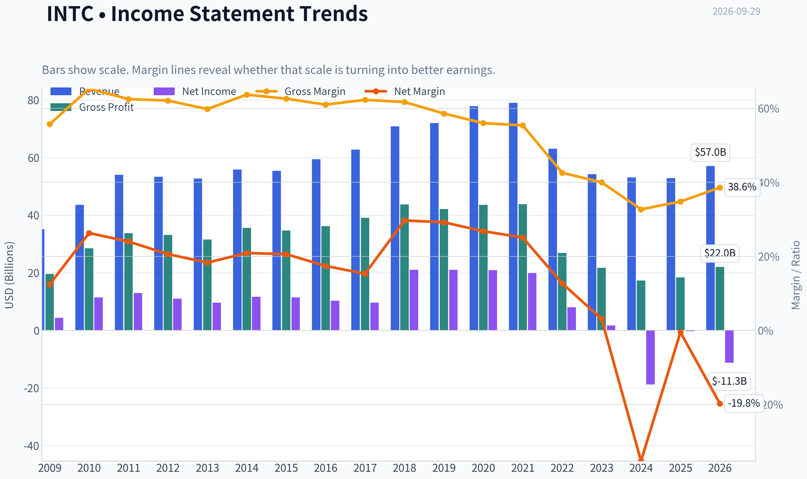

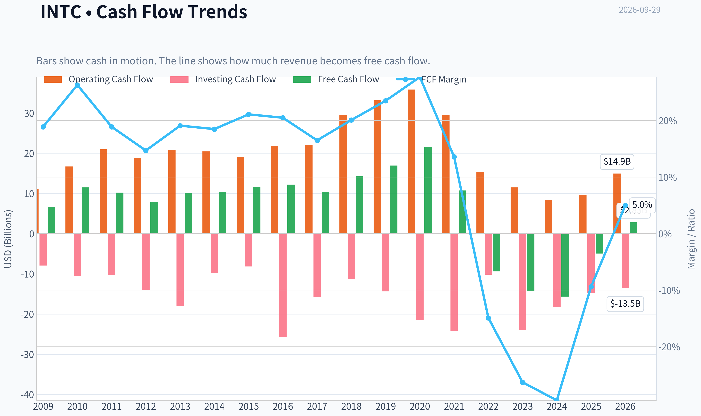

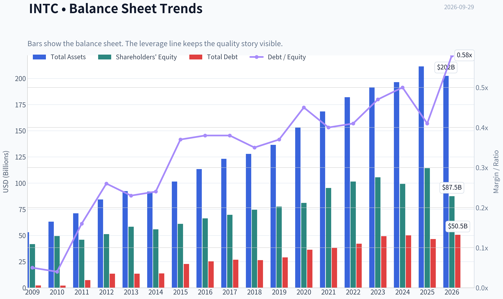

This graph tracks the profitability and return metrics (ROE, ROIC, Margins) of **INTC** over the past decade, highlighting capital efficiency trends.

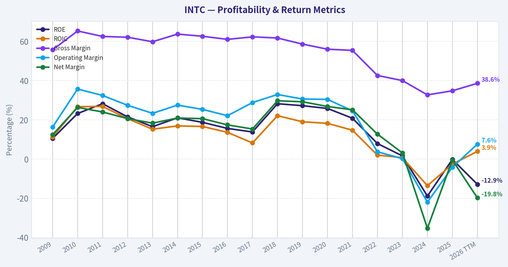

This chart illustrates the financial health of **INTC** over the last 10 years, mapping cash equivalents and free cash flow against total obligations (Debt).

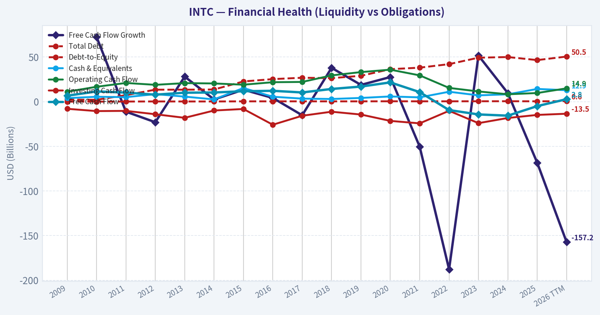

This comparison chart from *Profitability and Operating Performance* stacks current figures against historical benchmarks for **INTC**, making it easy to see where the company trades relative to its own averages.

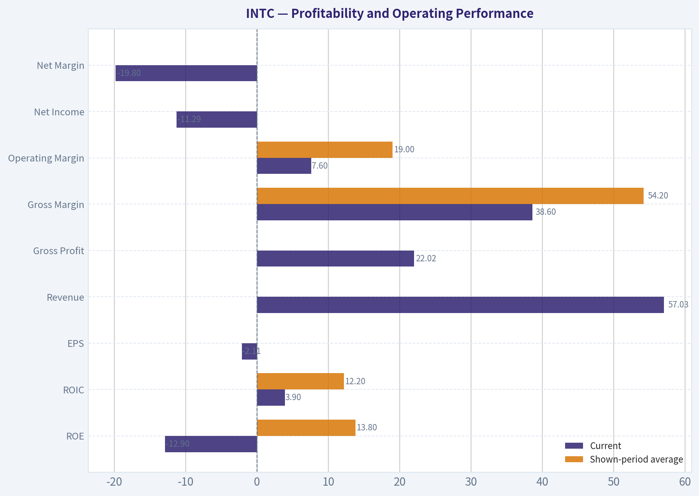

---

### Intrinsic Value Analysis (Buffett)

> *Following Warren Buffett's value investing philosophy: Circle of Competence, Economic Moat, Management Quality, and Margin of Safety.*

#### Intrinsic Value Snapshot

Price is what you pay. Intrinsic value is what the business may be worth based on the cash it can create for owners over time. We show a range, not one magic number.

- Current Price: $118.26
- Value Range (conservative to optimistic across both DCF methods): $-7.22 to $11.10

##### Owner Earnings (Buffett Method)
- Net Income: $-267,000,000.00
- Depreciation & Amortization: $11,706,000,000.00
- Capital Expenditures: $-14,646,000,000.00
- Working Capital Changes: $-1,747,000,000.00
- Owner Earnings: $1,480,000,000.00

##### Intrinsic Value
###### Buffett Method
Uses owner earnings. Stricter, and usually more conservative.
- Conservative: $-7.22
- Average: $-4.82
- Optimistic: $-2.20
- Discount Rate: 10.0%

###### Cash Flow Method
Uses free cash flow. Better for companies spending heavily today to grow tomorrow.
- Conservative: $-3.02
- Average: $0.65
- Optimistic: $11.10
- Discount Rate: 10.0%

ANALYST STANCE: **AVOID**

#### Executive View

Intel remains a strategically important semiconductor company, but the investment case currently depends on a highly uncertain manufacturing turnaround, renewed product competitiveness, and successful participation in artificial intelligence and foundry markets. The financial evidence is poor: negative ROE, negative free cash flow yield, declining revenue, weak historical growth, and an intrinsic-value range far below the current share price.

At $118 per share and a $625.1 billion market capitalization, the stock price appears to discount an extraordinary turnaround. This is not a sufficiently attractive risk-reward profile for a Buffett-style long-term investment.

#### 1. Factor Scorecard

| Factor | Score | Assessment |
|---|---:|---|
| Circle of competence and simplicity | 2/5 | Intel's basic model is understandable, but the investment thesis now involves CPUs, AI accelerators, advanced process technology, and contract manufacturing. Ten-year predictability is low. |
| Durable competitive advantage | 2/5 | Intel retains valuable intellectual property, customer relationships, and manufacturing know-how, but its historical process and product advantages have weakened. |
| Management and capital allocation | 2/5 | The company is attempting a major strategic repair, but years of execution setbacks and heavy capital spending have not yet produced adequate shareholder returns. |
| Industry structure | 2/5 | Semiconductors can support strong businesses, but Intel faces intense competition from AMD, Nvidia, TSMC, Samsung, and ARM-based architectures. The manufacturing business is highly capital intensive. |

**Gate 5 hard floor:** **Not demonstrably tripped.** The available information shows worsening earnings and cash-flow economics, but does not establish a solvency red line such as interest coverage below 1x or distress-zone Altman Z-score. This prevents an automatic financial-distress conclusion, but it does not make the equity attractive.

**Key Takeaways:** Intel scores poorly because the business has become less predictable while its former advantages have weakened. The company may recover operationally, but the current share price requires substantially more confidence than the financial record supports.

#### 2. Moat Analysis

| Moat source | Evidence | Assessment |
|---|---|---|
| Intangible assets | Strong semiconductor patents, x86 ecosystem, engineering expertise, and enterprise relationships | Still valuable, but not clearly widening |
| Switching costs | Corporate customers have compatibility and qualification costs when changing platforms | Meaningful, but reduced by AMD, ARM, and cloud-provider alternatives |
| Cost advantage | Historical scale and integrated manufacturing were advantages | Recent manufacturing delays and high capital requirements have weakened this edge |
| Network effects | x86 software compatibility creates ecosystem benefits | Real but mature; ecosystem strength does not guarantee processor leadership |

Intel's moat is best characterized as **narrow to moderate and under pressure**, rather than wide and widening. Gross margin of 34.8% is also below the level typically associated with an exceptionally powerful semiconductor franchise.

#### 3. Management Quality and Capital Allocation

Intel's management is attempting a difficult transformation: rebuilding leading-edge manufacturing, competing in third-party foundry services, and repositioning the company for AI-related demand. That strategy could create substantial long-term value if executed successfully.

However, Buffett-style analysis must judge results as well as intentions. The existing record includes:

- Negative ROE of approximately 0.2%.
- Negative free cash flow yield of approximately 0.8%.
- Large capital requirements with uncertain returns.
- Revenue still declining year over year.
- A strategic pivot whose economic payoff remains unproven.

Management deserves credit for confronting the company's problems, but the evidence does not yet demonstrate superior capital allocation or reliable value creation per dollar retained.

#### 4. Financial Summary

| Metric | Latest available result |
|---|---:|
| Share price | $118 |
| Market capitalization | $625.06 billion |
| Revenue growth, year over year | -0.5% |
| Gross margin | 34.8% |
| ROE | -0.2% |
| Free cash flow yield | -0.8% |
| Current ratio | 2.02x |
| Trailing three-year growth trend | -42.2% |
| Trailing five-year growth trend | -25.9% |
| Headline intrinsic value | $11.80 per share |
| Reverse-DCF price-implied growth | Approximately 115.3% annually for 10 years |

**Key Takeaways:** The financial profile is inconsistent with a high-quality compounder: returns on equity are negative, free cash flow is negative relative to market value, and historical growth has been deeply negative. The current ratio is reasonably strong, but liquidity does not compensate for poor operating economics.

#### 5. Owner Earnings Calculation

A precise owner-earnings calculation requires separating maintenance capital expenditures from growth capital expenditures. Intel's current negative cash-flow profile makes that distinction especially important because much of its spending is directed toward rebuilding manufacturing capacity.

Using the available free-cash-flow yield as a market-value proxy:

| Owner-earnings component | Approximate result |
|---|---:|
| Market capitalization | $625.06 billion |
| Implied free cash flow from -0.8% yield | Approximately -$5.0 billion |
| Maintenance capex adjustment | Not separately identifiable |
| Normalized owner earnings | Negative or highly uncertain |
| Owner-earnings model value per share | -$4.82 |

**Key Takeaways:** Intel is not currently producing dependable positive owner earnings. Until free cash flow turns sustainably positive and capital spending generates attractive returns, intrinsic value should be based on conservative normalized economics rather than management's long-term ambitions.

#### 6. Three-Scenario DCF Valuation

| Scenario | Method | Value per share |
|---|---|---:|
| A: No growth | 10% discount rate applied to current owner earnings economics | Approximately negative; owner-earnings model indicates -$4.82 |
| B: GDP growth | 3% long-term growth assumption | Not supportable from current negative owner earnings |
| C: Historical growth / turnaround | Uses a portion of historical growth, adjusted for a possible recovery | Highly sensitive and unreliable; FCFF model indicates $11.80 |
| Cross-check: FCF model | Cash-flow-based valuation | $0.65 |
| Current share price | Market price | $118.00 |

The research valuation range is therefore approximately **negative $4.82 to $11.80 per share**, compared with a current price of $118.

**Key Takeaways:** Every conservative cash-flow approach produces a value dramatically below the market price. A credible valuation would require a substantial and sustained turnaround in margins, free cash flow, and capital returns before the stock could approach its current quotation.

#### 7. Margin of Safety Analysis

| Measure | Result |
|---|---:|
| Current price | $118.00 |
| Headline intrinsic value | $11.80 |
| Margin of safety versus headline value | Approximately -902% |
| Owner-earnings model value | -$4.82 |
| FCF model value | $0.65 |
| Quality-adjusted required margin of safety | At least 25-40% for this risk profile |

Intel is not a wide-moat, high-ROIC, highly predictable compounder today. Therefore, it would require a substantial discount to conservative intrinsic value, not a premium based on a turnaround narrative.

The reverse DCF is particularly concerning: the market price implies approximately **115% annual growth for ten years**, while Intel's trailing three- and five-year growth rates are negative. Even allowing for a major recovery, that implied expectation is extraordinarily demanding.

#### 8. Final Buffett Scorecard

| Criterion | Weight | Score | Weighted contribution |
|---|---:|---:|---:|
| Moat width and durability | 25% | 2.0 | 0.50 |
| Valuation and margin of safety | 20% | 1.0 | 0.20 |
| Capital returns versus WACC | 15% | 1.0 | 0.15 |
| Business understanding and predictability | 12% | 2.0 | 0.24 |
| Management quality and capital allocation | 12% | 2.0 | 0.24 |
| Reinvestment runway | 8% | 3.0 | 0.24 |
| Balance-sheet strength | 4% | 3.0 | 0.12 |
| Industry structure | 4% | 2.0 | 0.08 |
| **Total** | **100%** |  | **1.77/5.00** |

**Key Takeaways:** Intel has a potentially valuable reinvestment runway, but runway alone is not enough. The company currently lacks the combination of high returns, durable advantages, predictable cash generation, and reasonable valuation required for a Buffett-style investment.

#### 9. Investment Stance

**AVOID - High conviction.**

Intel could become a successful turnaround, particularly if its manufacturing roadmap and foundry strategy begin delivering economically attractive returns. But at $118, the market already appears to price in an exceptional outcome. A more suitable entry point would require both:

1. Clear evidence of sustained positive free cash flow and improving ROIC; and
2. A share price offering a substantial discount to conservative, normalized intrinsic value.

Until those conditions appear, Intel is better treated as a speculative turnaround than as a high-quality long-term compounder.
#### Valuation Bridge

This bridge places the current market price beside each intrinsic value lens so readers can see whether upside depends on one method or shows up across several methods.

| Scenario | Intrinsic Value / Share |
| --- | ---: |
| Buffett Method | $-4.82 |
| Cash Flow Method | $0.65 |
| Damodaran Method | $11.80 |
| Current Price | $118.26 |

#### Key Takeaways

If one method is far above the others, the upside case depends on a specific modelling assumption. When several methods cluster together, the valuation story is more robust.

#### Valuation Visuals

This comparison chart from *Latest Earnings Snapshot* stacks current figures against historical benchmarks for **INTC**, making it easy to see where the company trades relative to its own averages.

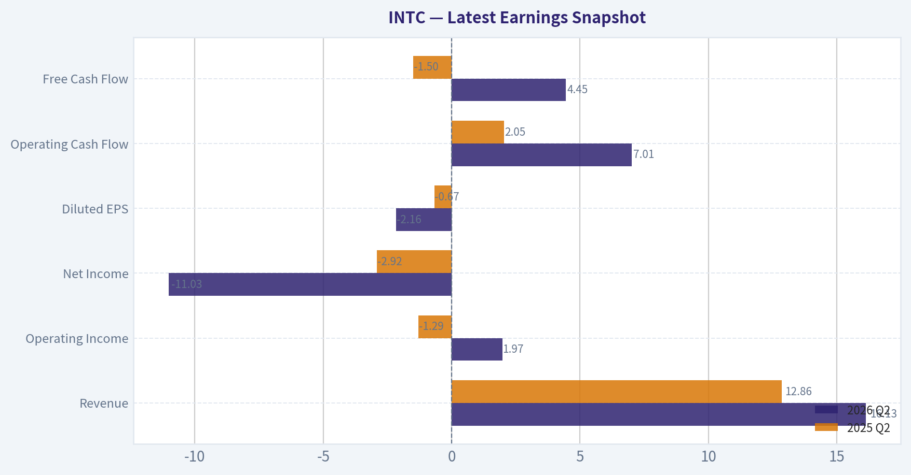

This comparison chart from *Balance Sheet and Financial Strength* stacks current figures against historical benchmarks for **INTC**, making it easy to see where the company trades relative to its own averages.

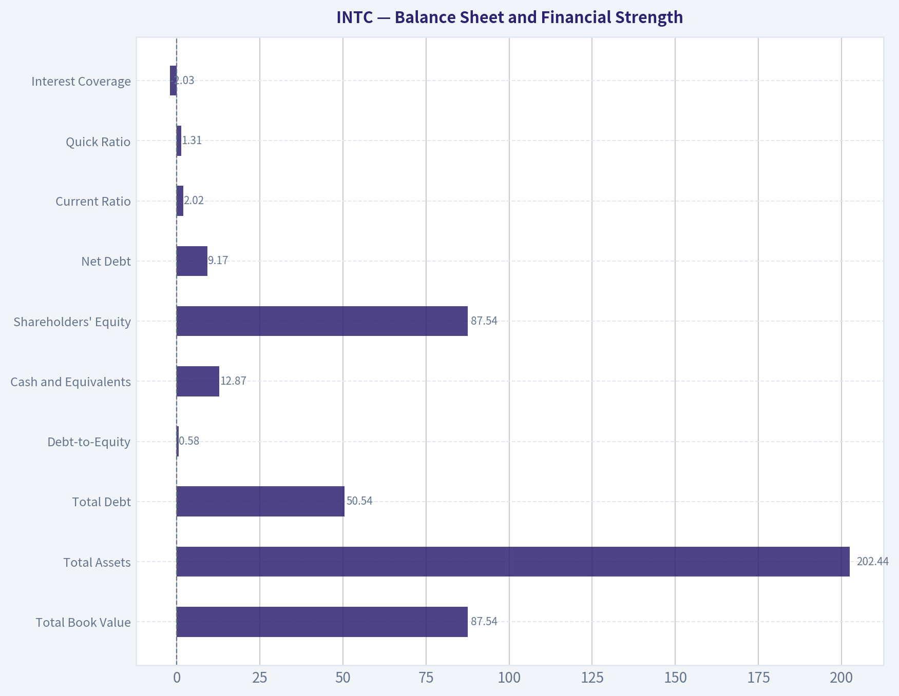

This comparison chart from *Cash Flow and Capital Allocation* stacks current figures against historical benchmarks for **INTC**, making it easy to see where the company trades relative to its own averages.

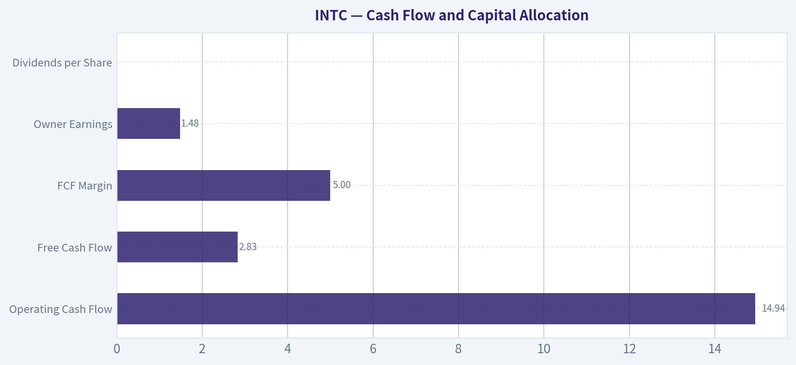

The following chart maps the **INTC** Owner Earnings DCF valuation scenarios (Conservative, Average, Optimistic) to visually represent the margin of safety based on intrinsic value calculations.

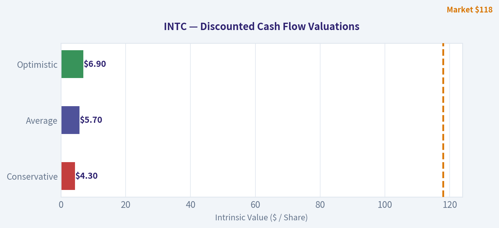

---

### Trend & Growth Analysis (Lynch/Druckenmiller/Fisher)

> *Following Peter Lynch's GARP, Stanley Druckenmiller's macro-aware approach, and Philip Fisher's scuttlebutt methodology.*

ANALYST STANCE: **AVOID**

#### 1. Lynch Classification

**Cyclical turnaround/speculative asset play - not currently a fast grower.**

Intel is attempting a major manufacturing and product turnaround, but its recent revenue history, profitability, and valuation do not support classification as a Lynch fast grower. The stock has already risen dramatically, while the underlying business remains loss-making and cash-flow constrained.

#### 2. The Story in Three Bullets

- Intel is rebuilding its semiconductor manufacturing advantage and expanding its foundry business, while defending its x86 CPU franchise against AMD, Nvidia, and ARM-based competitors.
- AI at the edge, data-center infrastructure, and domestic semiconductor manufacturing create large secular opportunities.
- The investment case depends on future execution, not current fundamentals: manufacturing yields, foundry customers, AI accelerator adoption, and a return to sustainable profitability.

#### 3. TAM and 10x Test

Intel participates in several very large markets: CPUs, data-center silicon, AI accelerators, semiconductor foundry services, networking, and edge computing. However, the relevant question is not whether the TAM is large; it is whether Intel can convert that TAM into profitable share.

| Item | Assessment |
|---|---:|
| Current revenue | Approximately $57B TTM |
| 10x revenue target | Approximately $570B |
| Overall semiconductor TAM | Multi-trillion-dollar opportunity over time |
| Can revenue reach 10x while remaining below 20% of TAM? | Yes, theoretically |
| Practical constraint | Manufacturing execution, competition, capital intensity, and profitability |
| TAM quality | Large and expanding, but highly competitive |

**Key Takeaways:** Intel has enough theoretical market room to grow tenfold, especially if foundry and AI businesses succeed. But the 10x test is not sufficient by itself: Intel must first prove that incremental revenue can generate attractive returns on enormous manufacturing investments.

#### 4. Revenue Growth Trend

| Period | Revenue | Growth |
|---|---:|---:|
| 2021 | $79.0B | +1.5% |
| 2022 | $63.1B | -20.2% |
| 2023 | $54.2B | -14.0% |
| 2024 | $53.1B | -2.1% |
| 2025 | $52.9B | -0.5% |
| 2026 TTM | $57.0B | Approximately +7.9% versus prior TTM |

**Key Takeaways:** Revenue appears to be stabilizing after a severe multi-year contraction, and the latest TTM data show a possible recovery. However, this is a recovery from a depressed base, not yet a demonstrated 20%-25% secular growth trajectory. The reported latest-year growth rate is also not fully consistent across data sources, so confirmation through several quarters is essential.

#### 5. Unit Economics and Operating Efficiency

| Metric | Intel | Interpretation |
|---|---:|---|
| Gross margin | 34.8% reported; 38.6% TTM series | Well below historical levels near 55%-65% |
| Operating margin | -4.2% reported; 7.6% TTM series | Recovery underway, but not yet robust |
| Net margin | -0.5% reported; approximately -19.8% TTM series | Profitability remains impaired |
| Free cash flow | Approximately $2.8B TTM | Positive in the latest period, but volatile |
| FCF margin | Approximately 5.0% TTM | Modest for a capital-intensive semiconductor company |
| LTV/CAC | Not disclosed/applicable | Product and semiconductor model rather than SaaS |
| NRR | Not disclosed/applicable | Not a subscription business |
| Rule of 40 | Not meaningful | Revenue growth and FCF margin are not SaaS-style metrics |
| Interest coverage | Approximately -2.0x | Warning sign while operating income remains weak |

**Key Takeaways:** Intel's main unit-economic problem is not customer acquisition; it is capital intensity and inadequate returns on manufacturing investment. Margins are improving from crisis levels, but they remain far below historical norms and do not yet justify the current valuation.

#### 6. Inflection Point Assessment

| Potential Inflection | Current Evidence | Assessment |
|---|---|---|
| Product cycle | AI PC, data-center CPUs, edge AI | Positive but competitive |
| Market share | No clear sustained share gain established | Unproven |
| Margin inflection | Operating margin improving from deeply negative levels | Early positive |
| TAM expansion | Foundry, AI, edge computing, domestic fabrication | Strong |
| Competitive inflection | Nvidia and AMD remain powerful; ARM continues expanding | Negative/uncertain |
| Cash-flow inflection | FCF recovered to positive TTM | Encouraging but not durable yet |

**Key Takeaways:** Intel may be at an operational inflection point, but not yet at a confirmed earnings inflection point. The most important evidence would be multiple quarters of accelerating revenue, improving gross margins, positive operating income, and foundry customer wins without excessive dilution or debt.

#### 7. Macro Setup

Intel benefits from several favorable secular themes:

- AI infrastructure and edge AI.
- Onshoring and strategic semiconductor manufacturing.
- Government incentives for domestic chip production.
- Long-term growth in cloud, networking, and computing.

The macro risks are substantial:

- Semiconductor cyclicality.
- High interest rates or rising real yields, which pressure long-duration growth and capital-intensive projects.
- Excess industry capacity.
- Weak enterprise or PC demand.
- Geopolitical and supply-chain disruption.

**Assessment:** The secular macro backdrop is favorable, but Intel's execution and capital-spending cycle make the stock more cyclical than a typical secular growth investment.

#### 8. Fisher's 15-Point Score

| Fisher Criterion | Score / 5 | Comment |
|---|---:|---|
| Market potential | 4 | Large semiconductor and foundry markets |
| New-product determination | 4 | Significant AI, process, and foundry initiatives |
| R&D effectiveness | 3 | Strong resources, mixed execution history |
| Sales organization | 3 | Established enterprise relationships |
| Worthwhile margins | 2 | Current margins are weak |
| Improving margins | 3 | Recovery visible, but incomplete |
| Labor/personnel relations | 3 | No decisive edge identified |
| Executive relations | 3 | Management transition and execution scrutiny |
| Management depth | 3 | Deep organization, but execution gaps |
| Cost analysis/accounting | 3 | Capital allocation remains a concern |
| Outstanding moat | 3 | x86 ecosystem and manufacturing assets, but eroding |
| Long-range profit outlook | 3 | Potentially strong, highly execution-dependent |
| Dilution risk | 2 | Heavy capital needs and strategic financing risk |
| Management candor | 3 | Turnaround challenges have been acknowledged |
| Management integrity | 3 | No decisive negative conclusion from available data |
| **Total** | **45 / 75** | **Average** |

**Key Takeaways:** Intel scores well on market potential and willingness to invest in new products, but poorly on current margins, capital requirements, and demonstrated execution. A score of 45 places Intel at the bottom of the "average" category rather than in Fisher's high-quality growth range.

#### 9. Valuation Analysis

| Valuation Measure | Intel | Interpretation |
|---|---:|---|
| Current price | Approximately $118 |
| Market capitalization | Approximately $625B |
| Forward P/E | 57.4x | Expensive for a cyclical turnaround |
| P/S | 11.0x | Very high for a semiconductor company with weak margins |
| PEG | 1.36x | Misleading because earnings are depressed and growth is not proven |
| EV/EBITDA | 36.9x | Elevated |
| FCF yield | Approximately -0.8% | Poor current cash-flow support |
| Model-based intrinsic value | Approximately $12 headline; $7-$15 Monte Carlo range | Far below market price |
| Reverse DCF implication | Approximately 115% annual owner-earnings growth for 10 years | Extremely demanding |

**Key Takeaways:** Intel's valuation discounts a highly successful turnaround and leaves little room for execution mistakes. The PEG ratio looks superficially reasonable, but it is unreliable when earnings are negative or recovering from an unusually depressed base. At approximately 11 times sales and roughly 57 times forward earnings, the market is pricing Intel as a proven growth winner rather than a turnaround still needing validation.

##### Illustrative Scenario Analysis

| Scenario | Revenue in 2031 | Net Margin | Implied Net Income | Illustrative P/E | Implied Value |
|---|---:|---:|---:|---:|---:|
| Bear | $65B | 5% | $3.3B | 15x | $35-$45 |
| Base | $90B | 10% | $9.0B | 20x | $90-$115 |
| Bull | $125B | 15% | $18.8B | 25x | $180-$230 |

**Key Takeaways:** A bullish outcome can support substantial upside, but it requires simultaneous success in revenue growth, margins, foundry execution, and competitive positioning. The base case does not clearly support the current price, while the bear case implies severe downside.

#### 10. Growth Investor Scorecard

| Criterion | Weight | Score / 5 | Weighted Contribution |
|---|---:|---:|---:|
| Story clarity | 10% | 3.5 | 0.35 |
| TAM and runway | 20% | 4.0 | 0.80 |
| Revenue growth | 20% | 2.0 | 0.40 |
| Unit economics | 15% | 1.5 | 0.23 |
| Competitive position | 10% | 2.5 | 0.25 |
| Management quality | 10% | 2.5 | 0.25 |
| Macro setup | 5% | 3.5 | 0.18 |
| Profitability path | 5% | 2.5 | 0.13 |
| Valuation | 5% | 1.0 | 0.05 |
| **Total** | **100%** |  | **2.64 / 5.00** |

**Key Takeaways:** Intel has a compelling strategic story and a large TAM, but weak recent growth, low returns, high capital intensity, and extreme valuation overwhelm those positives. The score falls in the **AVOID** range for a new growth investment.

#### 11. Position-Size Stance

**New position: 0%.**

For an existing holder, Intel could be treated as a small speculative turnaround position, generally **0%-1%**, only if the investor has a strong view on U.S. semiconductor policy, foundry execution, and manufacturing recovery. It should not be sized like a proven fast grower.

#### 12. Key Catalysts and Risks

| Catalysts | Risks |
|---|---|
| Sustained revenue reacceleration above 15% | Revenue stagnation or renewed decline |
| Major external foundry customer wins | Foundry losses, delays, or poor yields |
| Gross margin recovery toward 45%-50% | Persistent margin compression |
| Competitive AI accelerator or CPU success | Nvidia, AMD, ARM, and custom silicon share gains |
| Positive FCF sustained through heavy capex | Further cash burn, debt, or dilution |
| Government support and domestic manufacturing demand | Subsidy dependence and geopolitical disruption |

**Key Takeaways:** The stock needs proof, not merely announcements. The strongest buy signal would be a combination of accelerating revenue, rising gross margins, sustained positive free cash flow, and credible foundry customer adoption. Until that evidence appears, the current price offers an unfavorable risk-reward profile.

#### Bottom Line

Intel may eventually become an important domestic semiconductor and foundry platform, but at approximately $118 the market appears to be pricing in an exceptionally successful turnaround. The business is not yet a Lynch fast grower, Fisher quality compounder, or Druckenmiller-style asymmetric opportunity. **Wait for fundamental confirmation; do not initiate at the current valuation.**

---

### Market Technical Analysis

#### INTC Technical Analysis - September 29, 2026

The latest available trading session is September 28, 2026, when INTC closed at **$116.03**. September 29 is not listed as a trading day in the retrieved data, so the analysis uses September 28 as the effective observation date.

The selected indicators are:

- **close_10_ema**
- **close_50_sma**
- **close_200_sma**
- **macd**
- **rsi**
- **boll_ub**
- **boll_lb**
- **atr**

This combination covers short-, medium-, and long-term trend, momentum, overbought or oversold conditions, volatility bands, and risk management without relying on several highly redundant momentum indicators.

#### Trend structure

INTC remains in a powerful long-term uptrend. The September 28 close of **$116.03** was approximately:

- **0.2% above the 10-day EMA of $115.85**
- **16.6% above the 50-day SMA of $99.47**
- **45.8% above the 200-day SMA of $79.58**

The ordering of the averages-price above the 10-day EMA, the 10-day EMA above the 50-day SMA, and the 50-day SMA above the 200-day SMA-continues to represent a strongly bullish trend hierarchy.

However, the short-term trend has weakened sharply from its recent high. INTC closed at **$127.39 on September 24** before falling to **$116.03 on September 28**, a decline of roughly **8.9%** in two sessions. The close is now almost exactly at the 10-day EMA, meaning the stock is at an important near-term decision point. Holding around the EMA would suggest that the pullback is a normal consolidation within a broader advance. A decisive break below it would increase the probability of a deeper retracement toward the 50-day SMA near **$99.47**.

The 50-day SMA is still rising, but it has not yet fully recovered from its decline earlier in the period. This indicates that the intermediate-term trend has turned constructive but remains less stable than the exceptionally strong long-term structure. The 200-day SMA is rising steadily, reinforcing the view that the primary trend remains positive rather than merely a short-lived rebound.

#### Momentum and MACD

The MACD reading was **6.80** on September 28, down from **7.17 on September 25**, but still substantially above zero. This is an important distinction:

- The positive MACD level confirms that medium-term momentum remains bullish.
- The recent decline in MACD indicates that upside momentum has started to cool.
- A positive but falling MACD often appears during an orderly pullback, but it can become a warning if the decline continues and the MACD approaches its signal line or crosses below it.

MACD had improved dramatically from negative readings at the beginning of September. It moved from approximately **-3.48 on August 31** to positive territory by September 10 and continued rising through September 25. That transition confirms a meaningful momentum reversal in favor of the bulls. The latest softening should therefore be interpreted as a loss of acceleration rather than definitive evidence of a bearish trend reversal.

#### RSI and momentum condition

The RSI stood at **58.5** on September 28, down from **66.9 on September 25** and from readings above 70 earlier in the week.

This decline is technically constructive in one respect: it has reduced the immediate overbought pressure. RSI had reached approximately **73 on September 24**, indicating that the market had become extended after the sharp rally. The move back toward 58.5 means that some excess has been released without the indicator entering bearish or oversold territory.

The current RSI profile is therefore neutral-to-bullish:

- It is no longer overbought.
- It remains above the midpoint level of 50.
- It has not yet signaled deeply oversold conditions that would imply a high-confidence reversal opportunity.

For continuation traders, a recovery in RSI above 60 while price holds the 10-day EMA would improve the case for another attempt at the September high. Conversely, RSI falling below 50 alongside a break under the 10-day EMA would indicate that short-term momentum has shifted more decisively to the sellers.

#### Bollinger Bands and price location

On September 28, the Bollinger upper band was approximately **$131.23**, while the lower band was approximately **$80.51**. The implied middle band, calculated as the midpoint of the two reported bands, was approximately **$105.87**.

INTC's close at **$116.03** was:

- About **$15.20 below the upper band**
- About **$10.16 above the middle band**
- Roughly **20% of the way down from the upper band toward the middle band**

The stock was trading near or above the upper Bollinger Band during the surge toward $127.39. The subsequent pullback has moved price back inside the bands, reducing the immediate breakout-extension risk. Nevertheless, price remains above the middle band, which is generally supportive of a bullish bias.

The wide distance between the upper and lower bands reflects exceptionally elevated volatility. This means that Bollinger Band signals should not be interpreted mechanically. A move toward the upper band does not necessarily mean an immediate reversal, because strongly trending stocks can ride the upper band. Likewise, a retreat toward the middle band would represent a normal volatility adjustment unless accompanied by deterioration in the moving-average and momentum structure.

#### Volatility and risk management

ATR was approximately **$6.41** on September 28, compared with about **$5.12 on September 4**. At the latest closing price, ATR represented roughly **5.5% of the share price**, which is very high for a single-day average trading range.

This has several practical implications:

- Position sizes should be smaller than usual.
- Stops placed too tightly may be triggered by ordinary daily noise.
- A one-ATR move is approximately $6.40, so a stop based on only one or two dollars would likely be vulnerable to random volatility.
- Traders should distinguish between a close below support and an intraday violation, since intraday swings are unusually large.

The recent price action confirms this risk. INTC has experienced repeated large daily ranges and abrupt directional reversals. A bullish setup is therefore more attractive on a controlled pullback or a confirmed breakout than after chasing a sharp gap or momentum spike.

#### Key support and resistance areas

The immediate support zone is the **$114-$116 area**, consisting of the September 28 low near $114.71 and the 10-day EMA near $115.85. A successful hold here would preserve the short-term bullish structure.

The next important support is near the **$105-$108 area**, corresponding broadly to the September 17-18 consolidation region and the rising short-term trend structure. Below that, the 50-day SMA near **$99.47** becomes the more significant medium-term reference point.

On the upside, the first resistance area is approximately **$123-$127**, covering the recent closing range and the September 24 high of $127.39. A decisive close above $127.39 would signal renewed strength and could reopen the path toward the upper Bollinger Band near **$131.23**. However, because the stock has recently experienced an abrupt pullback from that area, a breakout should ideally be accompanied by expanding volume and improving MACD or RSI rather than occurring on weakening momentum.

#### Trading interpretation

The technical picture is best described as **long-term bullish, intermediate-term constructive, but short-term corrective and volatile**.

Bullish continuation would be supported by:

1. Price holding the $114-$116 area.
2. The 10-day EMA remaining above the 50-day SMA.
3. RSI stabilizing above 50 and turning higher.
4. MACD remaining positive and beginning to rise again.
5. A close above $127.39 accompanied by strong participation.

Caution would be warranted if:

1. INTC closes decisively below the 10-day EMA.
2. RSI falls below 50.
3. MACD continues declining toward a bearish crossover.
4. Price moves toward the $105-$108 area with expanding downside volume.
5. The 50-day SMA near $99.47 is threatened.

Overall, the current pullback has relieved some overbought pressure but has not yet damaged the broader trend. The risk-reward profile is less favorable for chasing the stock immediately after its earlier surge. A disciplined trader may prefer either confirmation of support near the current price or a confirmed breakout above $127.39, while using ATR-aware position sizing and stops.

| Indicator / Area | Latest reading | Interpretation | Practical implication |
|---|---:|---|---|
| Latest close | $116.03 | Below recent high but still strongly above major averages | Short-term pullback within a broader uptrend |
| 10-day EMA | $115.85 | Price is almost exactly at short-term trend support | Holding this level would preserve near-term bullish structure |
| 50-day SMA | $99.47 | Rising intermediate-term benchmark | Important downside reference if the pullback deepens |
| 200-day SMA | $79.58 | Rising long-term trend benchmark | Primary trend remains firmly bullish |
| MACD | 6.80 | Positive, but down from 7.17 | Bullish momentum remains, though upside acceleration is fading |
| RSI | 58.5 | Neutral-to-bullish after retreat from overbought territory | Momentum has cooled without becoming bearish |
| Bollinger upper band | $131.23 | Near-term volatility ceiling and breakout reference | A move above $127.39 could target the upper band |
| Bollinger lower band | $80.51 | Wide downside volatility boundary | Shows how unusually broad the current trading range is |
| ATR | $6.41 | Very high daily volatility, about 5.5% of price | Use smaller positions and avoid excessively tight stops |
| Key support | $114-$116 | Immediate support around recent low and 10-day EMA | A hold favors consolidation and renewed upside |
| Key resistance | $123-$127 | Recent trading ceiling and September 24 high | Breakout confirmation requires a decisive close above $127.39 |

**Key Takeaways:** INTC's primary trend remains strongly bullish because price is well above both the 50-day and 200-day moving averages. Short-term momentum has cooled after the stock became overbought, but RSI remains above 50 and MACD is still positive. The $114-$116 area is the immediate test: holding it would support renewed upside, while a sustained break below it could expose the stock to a deeper retracement toward the $105-$108 region or the 50-day average near $99.47.

#### Market Visuals

This comparison chart from *Market Metrics* stacks current figures against historical benchmarks for **INTC**, making it easy to see where the company trades relative to its own averages.

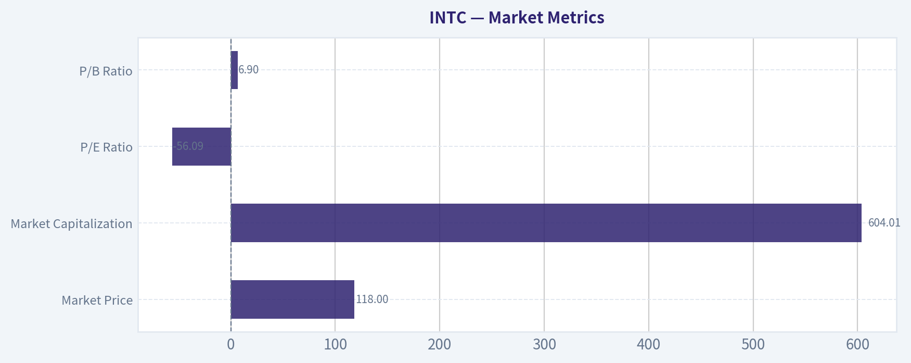

---

### Options Market Analysis

> *Reading options flow - put/call ratios, IV skew, and unusual activity - to gauge institutional positioning and event-driven risk.*

ANALYST STANCE: **BULLISH**

#### INTC Options Market Snapshot

Data is as of September 29, 2026, covering expirations from September 30 through October 5. The near-term options market shows strong call participation by volume, although open interest remains more balanced because the October 2 expiration carries substantial put positioning.

| Metric | Near-Term Reading | Interpretation |
|---|---:|---|
| Total call open interest | 215,172 | Slightly exceeds put OI |
| Total put open interest | 191,280 | Meaningful downside protection remains |
| Put/call OI ratio | 0.89 | Above the approximately 0.70 neutral baseline |
| Put/call volume ratio | 0.35 | Strongly call-dominated trading activity |
| Most call-heavy expiration | Sep. 30 | Put/call OI ratio of 0.48 |
| Most put-heavy expiration | Oct. 2 | Put/call OI ratio of 1.07 |

**Key Takeaways:** The volume ratio is the clearest bullish signal, with calls trading at nearly three times put volume. However, the 0.89 open-interest ratio is above the historical neutral level, indicating that existing put protection remains fairly substantial. This combination suggests bullish near-term speculation layered over a meaningful hedging base.

#### Put/Call Ratio by Expiration

| Expiration | Call OI | Put OI | Put/Call OI Ratio | Call Volume | Put Volume | Put/Call Volume Ratio |
|---|---:|---:|---:|---:|---:|---:|
| Sep. 30, 2026 | 63,982 | 30,922 | 0.48 | 56,212 | 22,243 | 0.40 |
| Oct. 2, 2026 | 143,163 | 153,746 | 1.07 | 52,328 | 16,346 | 0.31 |
| Oct. 5, 2026 | 8,027 | 6,612 | 0.82 | 5,320 | 1,358 | 0.26 |
| **Total** | **215,172** | **191,280** | **0.89** | **113,860** | **39,947** | **0.35** |

**Key Takeaways:** September 30 positioning is distinctly call-heavy, while October 2 has slightly more puts than calls by open interest. Trading flow is call-dominated across every listed expiration, which points to bullish short-term activity despite the more defensive open-interest structure.

#### Implied Volatility Assessment

| Expiration | Call ATM IV | Put ATM IV | Put Premium to Call IV | Assessment |
|---|---:|---:|---:|---|
| Sep. 30, 2026 | 37.3% | 72.6% | +35.3 percentage points | Very steep downside skew |
| Oct. 2, 2026 | 56.0% | 74.7% | +18.7 percentage points | Elevated put skew |
| Oct. 5, 2026 | 51.1% | 63.4% | +12.3 percentage points | Moderate-to-steep put skew |

The supplied data includes ATM call and put IV, but not separate out-of-the-money volatility points. Therefore, the put-versus-call IV differential is being used as a proxy for skew.

**Key Takeaways:** Put IV is materially higher than call IV at every expiration, especially for the September 30 contracts. This indicates strong demand for downside protection or a market premium for near-term downside risk. Overall IV is elevated for such short-dated options, suggesting event or headline sensitivity, although no specific catalyst was provided and earnings timing cannot be verified from the data.

#### Unusual Options Activity

The data identifies contracts where volume exceeds five times open interest, a useful indication of potentially fresh positioning.

| Expiration | Type | Strike | Volume | Open Interest | Volume/OI | IV | Moneyness |
|---|---|---:|---:|---:|---:|---:|---|
| Oct. 2, 2026 | Call | $128 | 20,169 | 2,769 | 7.3x | 65.1% | Cannot determine; spot price not provided |
| Sep. 30, 2026 | Call | $117 | 15,264 | 1,386 | 11.0x | 40.8% | Cannot determine; spot price not provided |

**Key Takeaways:** Both unusual contracts are calls, and each has volume far above existing open interest, consistent with fresh bullish speculation or aggressive upside positioning. The $117 call has the stronger volume-to-open-interest ratio, while the $128 call has the larger absolute volume and higher IV. Whether these are ITM, ATM, or OTM cannot be determined because the current INTC share price was not included.

#### Open Interest Concentration and Gamma Considerations

| Expiration | Call OI | Put OI | Total OI | Positioning Implication |
|---|---:|---:|---:|---|
| Sep. 30, 2026 | 63,982 | 30,922 | 94,904 | Call-heavy near-term positioning |
| Oct. 2, 2026 | 143,163 | 153,746 | 296,909 | Largest concentration; slightly put-heavy |
| Oct. 5, 2026 | 8,027 | 6,612 | 14,639 | Low relative concentration |

The October 2 expiration contains roughly 73% of the combined open interest across the three expirations, making it the primary near-term positioning zone. However, strike-level open interest was not supplied, so specific max-pain levels, gamma walls, and likely price-pinning strikes cannot be identified.

**Key Takeaways:** October 2 is the dominant expiration and should exert the greatest influence on near-term hedging and price behavior. The balance between large call and put positions could create a pinning effect if INTC trades near heavily populated strikes, but the missing strike-level data prevents a precise gamma-wall assessment.

#### Overall Options Sentiment

**Signal: BULLISH, with elevated downside-risk hedging.**

The primary bullish driver is the very low 0.35 put/call volume ratio combined with two unusually active call contracts showing volume between 7.3 and 11 times open interest. This points to fresh upside speculation or directional call buying.

The main caveat is the elevated put IV across all expirations and the total put/call OI ratio of 0.89, above the approximately 0.70 neutral baseline. That indicates investors are paying heavily for downside protection, so the bullish flow may represent speculative upside trades against a hedged or risk-conscious backdrop rather than a uniformly bullish institutional consensus.

The options activity is not thin: listed near-term volume is substantial, particularly for the September 30 and October 2 expirations. Confidence is therefore moderate, but it is reduced by the lack of current share price, strike-level OI, trade-side information, and a confirmed catalyst calendar.

#### Summary

| Category | Reading |
|---|---|
| Put/Call Ratio | OI ratio 0.89, above neutral; volume ratio 0.35, strongly call-heavy |
| IV Level | Elevated, particularly in puts with very short expirations |
| Skew Direction | Strong put skew; put ATM IV exceeds call IV by 12.3 to 35.3 percentage points |
| Unusual Activity | Fresh-looking call activity at $117 and $128, with volume/OI of 11.0x and 7.3x |
| Overall Signal | **BULLISH**, tempered by significant downside hedging and elevated put IV |

**Key Takeaways:** INTC's near-term options flow leans bullish because call volume dominates and unusual activity is concentrated in calls. Nevertheless, the steep put IV skew signals considerable demand for protection and meaningful downside-event risk. The best overall read is bullish but hedged, rather than an unqualified risk-on signal.

---

## Research Team Commentary

> *The Research Manager synthesizes the Bull vs Bear debate into action-free commentary. This is a pre-risk view, not the final stance.*

Core takeaway: Intel may be undergoing a genuine operating and market-perception inflection, but at $118 the stock offers insufficient evidence-based margin of safety for a value investor to advocate a new long-term position. The business retains valuable x86, manufacturing, packaging, and domestic-supply assets, while improving demand and strong price momentum warn against assuming the rally must reverse. Nevertheless, investors are already paying for a substantial recovery from negative free cash flow and near-zero returns on capital. My stance is WATCH, not AVOID, because the turnaround is plausible and the trend remains constructive; it is not ADVOCATE because the valuation requires too many unproven improvements.

The strongest bull argument is that Intel's trailing financial statements may be capturing the maximum-investment phase rather than its normalized earning power. Its x86 installed base, enterprise compatibility, OEM relationships, engineering expertise, advanced packaging, and strategically important domestic fabrication capacity have real value. These advantages do not restore the historical monopoly, but they could support a durable business if Intel stabilizes CPU share and becomes a credible second-source foundry.

The operating leverage is also meaningful. Semiconductor fabrication carries high fixed costs, so better yields, utilization, product mix, and external volume could drive margins and cash flow considerably faster than revenue. Stronger AI-server CPU demand matters because Intel can benefit from AI infrastructure without defeating Nvidia in accelerators. The stock's position above its 10-, 50-, and 200-day averages, together with elevated call volume, indicates that the market is treating recent improvement as more than a temporary bounce.

The bull's reverse DCF provides a useful reframe. At $118, the price reportedly implies approximately $12.4 of free cash flow per share by year ten. That is not necessarily impossible for a semiconductor company with Intel's scale. A successful outcome near $16 could support materially higher value under favorable assumptions. The market may still be underestimating how quickly earnings recover if several underutilized assets begin producing acceptable returns.

The strongest bear argument, however, is that this is no longer a cheap way to obtain that optionality. Intel currently has roughly zero ROIC, negative free cash flow, 34.8% gross margin, and slightly declining revenue. Moving from approximately negative $0.94 of free cash flow per share to positive $12.4 requires a major transformation, not merely stabilization.

That transformation depends on a chain of favorable outcomes: competitive products, stable CPU share, better process yields, higher fabrication utilization, external foundry customers, substantial margin expansion, lower capital intensity, and ultimately ROIC above the cost of capital. Failure at one or two critical links could materially reduce normalized cash flow.

The valuation is especially sensitive to assumptions. In the bull's analysis, $16 of year-ten free cash flow supports about $153 using a 9% discount rate, but only approximately $125 using 10%. A one-percentage-point increase in the required return therefore eliminates most of the modeled upside. That is not a robust margin of safety for a capital-intensive turnaround. The DCF is also illustrative and lacks a detailed annual cash-flow bridge, net-debt reconciliation, and timing analysis. If cash-flow recovery arrives later than assumed, present value would be lower.

Intel's manufacturing barriers should not be confused with a proven shareholder moat. Fabs can be strategically valuable while earning inadequate returns. TSMC has scale, yield experience, and established customer trust; AMD shares the x86 ecosystem; ARM and custom silicon challenge selected workloads; and Nvidia captures much of the premium AI profit pool. Intel does not have to defeat all of them, but it must generate attractive returns while competing with them.

From a Buffett perspective, Intel cannot yet receive the smaller 10%-15% margin-of-safety requirement appropriate for a predictable, wide-moat compounder. Its current economics and execution risk call for a substantially larger cushion. The approximately 23% discount to the bull's optimistic $153 valuation is inadequate when that valuation depends on favorable execution and a relatively low discount rate. At the same time, the reverse DCF hurdle appears demanding rather than obviously impossible, so the evidence does not support a categorical AVOID based solely on valuation.

The prior Intel mistake is important, but the correct lesson is not to chase every turnaround after momentum proves strong. The earlier analysis underestimated earnings revisions, marginal improvement, and the power of a trend-driven rerating. This time, those signals deserve explicit weight. Intel is nearly 19% above its 50-day average and 48% above its 200-day average, with bullish short-term options activity. That argues against treating weak trailing metrics as a near-term price ceiling.

But the stock is now around $118 rather than approximately $67. The operational thesis may be similar, while the valuation hurdle has risen dramatically. Momentum confirms that investors believe the inflection; it does not establish the eventual level of owner earnings. Options volume over expirations measured in days has little relevance to ten-year intrinsic value. The previous mistake should make us more open to the turnaround, not less disciplined about the price.

For a new value-oriented position, I would wait for either stronger operating confirmation or a materially better entry price. For an existing holder, the evidence supports retaining some exposure while tying position size to execution milestones rather than automatically exiting because the stock looks extended. Intel is best understood as a credible but unproven turnaround, not yet an emerging compounder.

Over the next one to four quarters, the first thing to monitor is gross margin. One strong quarter is insufficient; repeated expansion would indicate that product mix, pricing, yields, or utilization are improving. Stagnation near 35% or renewed deterioration would weaken the operating-leverage thesis.

Second, watch free cash flow after all fabrication expenditures, not adjusted earnings alone. The thesis becomes materially stronger if Intel establishes a credible path to sustained positive free cash flow without relying on indefinitely elevated subsidies or asset sales. Continued cash consumption accompanied by rising capital requirements would be a major warning.

Third, follow foundry evidence at the level of binding customer commitments, production volume, economics, and utilization. Customer interest or qualification announcements are not enough. Intel must demonstrate that external business can improve incremental ROIC rather than merely fill fabs with low-return volume.

Fourth, track process-roadmap execution and manufacturing yields. Delays, poor yields, or another costly node transition would undermine both product competitiveness and foundry credibility. On-time milestones and improving yields would support the bull's nonlinear margin-recovery case.

Fifth, monitor data-center and client market share, AI-server CPU demand, and pricing. Strong unit demand is helpful, but the critical question is whether that demand produces revenue growth and margin expansion. Participation in AI infrastructure without attractive economics would not satisfy the valuation.

Finally, compare forward free-cash-flow estimates with the reverse-DCF hurdle. If estimates rise enough to make $12.4 of year-ten FCF per share a conservative rather than optimistic outcome, the stock could become an ADVOCATE even without a large price decline. Conversely, if estimates flatten while the share price keeps rising, the valuation would move toward AVOID territory.

Intel has real strategic assets, improving sentiment, and potentially powerful operating leverage. It also has unproven capital returns and a price that already anticipates a substantial recovery. The sensible response is neither to dismiss the trend nor to pay today for an optimistic destination without adequate evidence.

Final stance: WATCH.

---

## Value Investing Team Commentary

> *The Investor translates the research view into an investment thesis before risk review. This is still not the final stance.*

### Investment Commentary

Intel appears to be in a genuine operating and perception inflection, but the distinction between an improving business and an attractive investment is crucial. At approximately **$118**, investors are no longer purchasing turnaround optionality cheaply; they are paying in advance for a substantial restoration of profitability, free cash flow, and manufacturing competitiveness.

### The credible bull case

Trailing financial results may represent Intel's maximum-investment phase rather than normalized economics. The company retains meaningful assets:

- A large x86 installed base and deep enterprise compatibility
- Strong OEM and customer relationships
- Advanced packaging and semiconductor engineering expertise
- Strategically important domestic manufacturing capacity
- Exposure to AI servers, edge computing, and data-center infrastructure

Because fabrication has high fixed costs, improvements in yields, utilization, and product mix could produce disproportionate margin and cash-flow gains. Intel also does not need to defeat Nvidia in accelerators to benefit from AI infrastructure spending. Higher server demand can support its CPU, connectivity, and packaging businesses.

The market is clearly recognizing this possibility. The shares are roughly **2% above the 10-day average, 19% above the 50-day average, and 48% above the 200-day average**. Heavy call volume reinforces the positive near-term sentiment. The lesson from Intel's earlier rally is that weak trailing metrics should not automatically override improving estimates, operating momentum, and a confirmed rerating.

### What the market may be getting right

The bearish consensus may still be too anchored to Intel's recent losses and poor capital returns. If manufacturing yields and utilization improve together, free cash flow could recover much faster than revenue. A turnaround often looks least attractive in trailing financial statements immediately before fixed-cost leverage becomes visible.

The reverse-DCF hurdle of approximately **$12.40 in year-ten free cash flow per share** is demanding, but not inherently impossible for a company with Intel's scale. If normalized free cash flow eventually approaches the stated bull scenario of $16 per share, today's price could still produce an acceptable return.

This makes a categorical AVOID inappropriate. Intel is not necessarily a structurally doomed business, and the trend may continue while the financial statements catch up with revised expectations.

### What bullish sentiment may be overlooking

Intel's strategic importance does not guarantee attractive shareholder returns. A fabrication network can be technologically valuable, politically supported, and still fail to earn its cost of capital. Current economics remain weak:

- ROIC and ROE are approximately zero or slightly negative
- Free cash flow remains negative
- Gross margin is only 34.8%
- Revenue is slightly declining
- Capital requirements remain substantial

The implied transformation requires several linked successes: competitive products, stable market share, timely process execution, improving yields, higher utilization, external foundry customers, gross-margin expansion, and lower capital intensity. Intel does not have to win everywhere, but too many parts of that chain remain unproven.

Competition compounds the challenge. TSMC has superior foundry scale, yield experience, and customer trust. AMD remains a capable x86 competitor, ARM and custom silicon threaten selected workloads, and Nvidia captures much of the AI industry's premium economics. Intel's assets therefore represent valuable optionality, not yet a demonstrated wide-moat compounder.

### Valuation and margin of safety

The valuation offers insufficient protection for the present level of execution risk. The cited bull-case value is approximately:

- **$153 at a 9% required return**
- **$125 at a 10% required return**

At $118, that represents a 23% discount to the favorable 9% case but only about a **6% discount** to the 10% case. A one-percentage-point change in the discount rate eliminates most of the modeled upside. Delays in the cash-flow recovery would further reduce present value.

A predictable, high-ROIC compounder might justify buying at a 10%-15% discount to conservatively estimated value. Intel does not yet merit that treatment. As a capital-intensive turnaround with near-zero returns on capital, it needs a substantially larger margin of safety-closer to the range appropriate for a lower-visibility or cyclical business. The current price does not provide it.

The selective contrarian conclusion is therefore two-sided:

- **Contrarian against the bears:** Trailing losses may understate Intel's recovery potential, and strong momentum should not be interpreted as proof that a reversal is imminent.
- **Contrarian against the bulls:** Strong price action and strategic importance do not establish owner earnings, and short-dated call activity has little bearing on ten-year intrinsic value.

### What would change the stance

Intel could become attractive without a major price decline if operating evidence materially improves. The most important milestones are:

1. **Sustained gross-margin expansion**, rather than a one-quarter improvement.
2. **Positive free cash flow after full fabrication capital expenditures**, not merely adjusted earnings.
3. **Binding and economically attractive foundry volume**, including evidence of improving utilization and incremental ROIC.
4. **On-time process-roadmap execution and better yields.**
5. **Stable or improving data-center and client share with disciplined pricing.**
6. **Forward cash-flow estimates that make the $12.40 year-ten reverse-DCF hurdle conservative rather than optimistic.**

For a new long-term investor, the prudent course is to wait for either stronger evidence or a materially better valuation. An existing owner with a low cost basis could reasonably retain measured exposure while monitoring execution, rather than selling solely because the shares are technically extended. Momentum argues against reflexive bearishness, but it does not provide the margin of safety required to advocate a fresh position.

**ANALYST STANCE: WATCH** - Intel has credible turnaround potential, valuable strategic assets, and strong market momentum, so an outright AVOID would be excessively dismissive. Nevertheless, at $118 the valuation already assumes substantial operational success while free cash flow, margins, and returns on capital remain unproven. Wait for better evidence or a more favorable price rather than paying today for an optimistic destination.

---

## Deep Values Commentary

> *The Risk Management Team debates and the Risk Judge provides the final action-free verdict. This section determines the final ADVOCATE / WATCH / AVOID stance.*

#### Final Stance Scorecard

This scorecard converts the final research view into a weighted decision frame. It does not replace the narrative judgement, but it makes the main drivers of the verdict easier to scan.

| Criterion | Score | Weight | Commentary |
| --- | ---: | ---: | --- |
| Business Quality | 2.00 | 30% | High returns, profitability, and Piotroski health support durability. |
| Valuation Support | 1.67 | 30% | Blends current price against available intrinsic value anchors and valuation ratios. |
| Financial Strength | 4.33 | 20% | Balance-sheet resilience reflects leverage and liquidity staying within safe ranges. |
| Growth Durability | 3.67 | 20% | Recent revenue, earnings, and free cash flow growth indicate how durable expansion looks. |
| TOTAL / FINAL STANCE | 2.70 | 100% | WATCH |

#### Key Takeaways

The weighted score lands at **2.70 / 5.0**, while the final stance remains **WATCH**. This is useful as a quick calibration aid rather than a mechanical signal.

#### Risk Summary

Higher scores indicate more risk pressure. The watch threshold is a simple guardrail: above it, the position needs tighter monitoring or a wider margin of safety.

| Dimension | Current Score | Watch Threshold | Commentary |
| --- | ---: | ---: | --- |
| Business Quality | 4.00 | 3.00 | High returns, profitability, and Piotroski health support durability. |
| Valuation Support | 4.33 | 3.00 | Blends current price against available intrinsic value anchors and valuation ratios. |
| Financial Strength | 1.67 | 3.00 | Balance-sheet resilience reflects leverage and liquidity staying within safe ranges. |
| Growth Durability | 2.33 | 3.00 | Recent revenue, earnings, and free cash flow growth indicate how durable expansion looks. |

#### Key Takeaways

This view helps readers separate *where* the risk sits: valuation, business quality, balance sheet, or growth durability. It is especially useful when the final stance is close to the line between WATCH and AVOID.
