# INTC Deep Value Intelligence

**Analysis Date:** 2026-11-21

## Critical Disclaimer

*This analysis is generated by Deep Value Intelligence, an AI-powered multi-agent investing framework. Education & research only - not financial advice, not a financial advisor.*

---

## Table of Contents

1. Intelligence Summary
2. Analyst Team Reports
   - Fundamentals Analysis
   - Intrinsic Value Analysis (Buffett)
   - Trend & Growth Analysis (Lynch/Druckenmiller/Fisher)
   - Market Technical Analysis
   - Options Market Analysis
3. Research Team Commentary
4. Value Investing Team Commentary
5. Deep Values Commentary

---

## Intelligence Summary

### Thesis + Conditions

**Core Thesis:** Intel retains strategically scarce assets-x86 expertise, advanced packaging, domestic manufacturing capacity, intellectual property, and customer relationships. Those assets create genuine turnaround optionality, especially if improved yields and external foundry volume raise factory utilization.

**Key Risks:**
- Intel retains strategically scarce assets-x86 expertise, advanced packaging, domestic manufacturing capacity, intellectual property, and customer relationships. Those assets create genuine turnaround optionality, especially if improved yields and external foundry volume raise factory utilization.
- There is no supplied evidence of immediate solvency distress. The principal risk is instead **permanent capital impairment through overpayment for an unproven, capital-intensive recovery**.
- This is legitimate optionality. The risky case is also right that waiting for fully normalized ROIC would miss some of the informational change associated with a turnaround.

**Confidence:** Low

---

## Analyst Team Reports

### Fundamentals Analysis

#### Latest Earnings Snapshot

*Most recent reported quarter anchored on 2026 Q3, with prior-year comparison when available.*

| Metric | 2026 Q3 | 2025 Q3 | YoY Change |
| --- | ---: | ---: | ---: |
| Revenue | $16.51B | $13.65B | +20.9% |
| Operating Income | $2.58B | $858.0M | +200.2% |
| Net Income | $3.32B | $4.06B | -18.3% |
| Diluted EPS | $0.60 | $0.90 | -33.3% |
| Operating Cash Flow | $5.08B | $2.55B | +99.6% |
| Free Cash Flow | $1.06B | $121.0M | +774.4% |

Key Takeaways: This snapshot anchors the most recent reported quarter before the narrative analysis. It helps readers separate long-run business quality from whatever changed in the latest earnings print.

#### 17-Year Financial Metrics for INTC

*All values below are computed deterministically from raw data - not estimated by AI.*

*Issuer profile: operating company (Technology / Semiconductors).*

#### 17-Year Financial Metrics
*Annual rows come from reported financial statements. The final TTM row is computed from the latest four quarters.*

| Metric | 2009 | 2010 | 2011 | 2012 | 2013 | 2014 | 2015 | 2016 | 2017 | 2018 | 2019 | 2020 | 2021 | 2022 | 2023 | 2024 | 2025 | 2026 TTM |
| --- | --- | --- | --- | --- | --- | --- | --- | --- | --- | --- | --- | --- | --- | --- | --- | --- | --- | --- |
| Market Price | $13 | $14 | $17 | $15 | $19 | $28 | $27 | $30 | $39 | $40 | $53 | $45 | $48 | $25 | $50 | $20 | $37 | $51 |
| Market Cap | $115.16B | $119.79B | $131.22B | $106.40B | $132.32B | $183.48B | $168.60B | $176.82B | $223.18B | $220.62B | $267.71B | $210.84B | $210.64B | $108.97B | $211.65B | $85.81B | $167.16B | $272.14B |
| P/E Ratio | 26.49 | 10.46 | 10.15 | 9.68 | 13.74 | 15.71 | 14.79 | 17.11 | 23.20 | 10.48 | 12.71 | 10.09 | 10.60 | 13.62 | 125.62 | -4.58 | -615.00 | -21.28 |
| P/B Ratio | 2.76 | 2.42 | 2.86 | 2.08 | 2.27 | 3.28 | 2.76 | 2.67 | 3.20 | 2.96 | 3.45 | 2.60 | 2.21 | 1.07 | 2.00 | 0.86 | 1.46 | 2.37 |
| ROE | 10.5% | 23.2% | 28.2% | 21.5% | 16.5% | 21.0% | 18.7% | 15.6% | 13.8% | 28.2% | 27.2% | 25.8% | 20.8% | 7.9% | 1.6% | -18.9% | -0.2% | -10.5% |
| ROIC | 11.3% | 26.7% | 26.8% | 20.6% | 15.2% | 16.9% | 16.6% | 13.6% | 8.2% | 22.1% | 19.0% | 18.2% | 14.7% | 2.0% | 0.7% | -13.6% | -2.6% | 4.8% |
| EPS | $0.50 | $1.34 | $1.65 | $1.52 | $1.41 | $1.77 | $1.84 | $1.73 | $1.67 | $3.86 | $4.15 | $4.47 | $4.51 | $1.87 | $0.40 | $-4.38 | $-0.06 | $-2.41 |
| Revenue | $35.13B | $43.62B | $54.00B | $53.34B | $52.71B | $55.87B | $55.35B | $59.39B | $62.76B | $70.85B | $71.97B | $77.87B | $79.02B | $63.05B | $54.23B | $53.10B | $52.85B | $59.89B |
| Gross Profit | $19.56B | $28.49B | $33.76B | $33.15B | $31.52B | $35.61B | $34.68B | $36.23B | $39.10B | $43.74B | $42.14B | $43.61B | $43.81B | $26.87B | $21.71B | $17.34B | $18.38B | $23.89B |
| Gross Margin | 55.7% | 65.3% | 62.5% | 62.1% | 59.8% | 63.7% | 62.6% | 61.0% | 62.3% | 61.7% | 58.6% | 56.0% | 55.4% | 42.6% | 40.0% | 32.7% | 34.8% | 39.9% |
| Operating Margin | 16.3% | 35.7% | 32.4% | 27.4% | 23.3% | 27.5% | 25.3% | 22.1% | 28.8% | 32.9% | 30.6% | 30.4% | 24.6% | 3.7% | 0.2% | -22.0% | -4.2% | 10.1% |
| Net Income | $4.37B | $11.46B | $12.94B | $11.01B | $9.62B | $11.70B | $11.42B | $10.32B | $9.60B | $21.05B | $21.05B | $20.90B | $19.87B | $8.01B | $1.69B | $-18.76B | $-267.0M | $-12.03B |
| Net Margin | 12.4% | 26.3% | 24.0% | 20.6% | 18.3% | 20.9% | 20.6% | 17.4% | 15.3% | 29.7% | 29.2% | 26.8% | 25.1% | 12.7% | 3.1% | -35.3% | -0.5% | -20.1% |
| Revenue Growth | N/A | 24.2% | 23.8% | -1.2% | -1.2% | 6.0% | -0.9% | 7.3% | 5.7% | 12.9% | 1.6% | 8.2% | 1.5% | -20.2% | -14.0% | -2.1% | -0.5% | 13.3% |
| Net Income Growth | N/A | 162.4% | 12.9% | -15.0% | -12.6% | 21.7% | -2.4% | -9.7% | -6.9% | 119.3% | -0.0% | -0.7% | -4.9% | -59.7% | -78.9% | -1210.5% | -98.6% | 4406.4% |
| Free Cash Flow Growth | N/A | 72.6% | -11.2% | -23.0% | 28.1% | 2.5% | 13.4% | 4.2% | -15.2% | 37.9% | 18.8% | 27.6% | -50.4% | -187.8% | 51.7% | 9.6% | -68.4% | -176.1% |
| Total Book Value | $41.70B | $49.43B | $45.91B | $51.20B | $58.26B | $55.87B | $61.09B | $66.23B | $69.65B | $74.56B | $77.50B | $81.07B | $95.39B | $101.42B | $105.59B | $99.27B | $114.28B | $114.91B |
| Total Assets | $53.09B | $63.19B | $71.12B | $84.35B | $92.36B | $91.90B | $101.46B | $113.33B | $123.25B | $127.96B | $136.52B | $153.09B | $168.41B | $182.10B | $191.57B | $196.49B | $211.43B | $228.57B |
| Total Debt | $2.22B | $2.12B | $7.33B | $13.45B | $13.45B | $13.65B | $22.67B | $25.28B | $26.81B | $26.36B | $29.00B | $36.40B | $38.10B | $42.05B | $49.27B | $50.01B | $46.59B | $50.13B |
| Debt-to-Equity | 0.05 | 0.04 | 0.16 | 0.26 | 0.23 | 0.24 | 0.37 | 0.38 | 0.38 | 0.35 | 0.37 | 0.45 | 0.40 | 0.41 | 0.47 | 0.50 | 0.41 | 0.44 |
| Cash & Equivalents | $3.99B | $5.50B | $5.07B | $8.48B | $5.67B | $2.56B | $15.31B | $5.56B | $3.43B | $3.02B | $4.19B | $5.87B | $4.83B | $11.14B | $7.08B | $8.25B | $14.27B | $21.85B |
| Shareholders' Equity | $41.70B | $49.43B | $45.91B | $51.20B | $58.26B | $55.87B | $61.09B | $66.23B | $69.65B | $74.56B | $77.50B | $81.07B | $95.39B | $101.42B | $105.59B | $99.27B | $114.28B | $114.91B |
| Operating Cash Flow | $11.17B | $16.69B | $20.96B | $18.88B | $20.78B | $20.42B | $19.02B | $21.81B | $22.11B | $29.43B | $33.15B | $35.86B | $29.46B | $15.43B | $11.47B | $8.29B | $9.70B | $17.47B |
| Investing Cash Flow | $-7.96B | $-10.54B | $-10.30B | $-14.06B | $-18.07B | $-9.90B | $-8.18B | $-25.82B | $-15.76B | $-11.24B | $-14.40B | $-21.52B | $-24.28B | $-10.23B | $-24.04B | $-18.26B | $-14.82B | $-26.82B |
| Free Cash Flow | $6.66B | $11.48B | $10.20B | $7.86B | $10.06B | $10.31B | $11.69B | $12.18B | $10.33B | $14.25B | $16.93B | $21.61B | $10.72B | $-9.41B | $-14.28B | $-15.66B | $-4.95B | $3.77B |
| FCF Margin | 18.9% | 26.3% | 18.9% | 14.7% | 19.1% | 18.5% | 21.1% | 20.5% | 16.5% | 20.1% | 23.5% | 27.7% | 13.6% | -14.9% | -26.3% | -29.5% | -9.4% | 6.3% |
| Dividends / Share | $0.00 | $0.00 | $0.00 | $0.00 | $0.00 | $0.00 | $0.00 | $0.00 | $0.00 | $0.00 | $0.00 | $0.00 | $0.00 | $1.40 | $0.73 | $0.37 | $0.00 | $0.00 |

#### Profitability Metrics
- Return on Equity (ROE): -0.2%
- Return on Invested Capital (ROIC): -0.0%
- Return on Assets (ROA): -0.1%
- Gross Margin: 34.8%
- Operating Margin: -4.2%
- Net Profit Margin: -0.5%

#### Liquidity Metrics
- Current Ratio: 2.02
- Quick Ratio: 1.31

#### Leverage Metrics
- Debt-to-Equity Ratio: 0.41
- Interest Coverage Ratio: -2.03
- Net Debt: $9.17B

#### Growth Metrics (Year-over-Year)
- Revenue Growth: -0.5%
- Net Income Growth: 98.6%
- Free Cash Flow Growth: 68.4%
- Revenue CAGR (3-Year): -5.7%
- Revenue CAGR (5-Year): -7.5%

#### Valuation Metrics
- P/E Ratio (TTM): N/A
- Forward P/E: 28.64
- Price-to-Book: 2.37
- Price-to-Sales: 4.55
- PEG Ratio: 1.36
- EV/EBITDA: 14.91
- Free Cash Flow Yield: -1.8%
- Earnings Yield: N/A

#### Owner Earnings (Buffett Method, Code-Computed)
- Net Income: $-267.0M
- + Non-cash, non-recurring items excluded (fair-value changes on convertibles/derivatives/SAFEs, impairments): $515.0M
- + Depreciation & Amortization: $11.71B
- - Capital Expenditures: $-14.65B
- + Working Capital (cash-flow statement; negative = cash tied up): $-1.75B
- = **Owner Earnings: $-2.67B**

#### Intrinsic Value (DeepValues app - SEC filings pipeline)
- **Intrinsic value (DeepValues app, the headline): $2.37** - Free cash flow DCF, method fcf-ttm-v2, as of 2026-11-21 (FY2025)
  Range (conservative - optimistic): $0.05 - $11.94
  Margin of safety vs. price: -2060.5% (price $51.28)
  Discount rate 9.1%, terminal growth 4.5% (CAPM: 10Y 4.92% + β 1.00 x ERP 4.20% (as of 2026-11-20; beta not_available_assumed_1.0))
- Owner Earnings (Buffett): N/A - Normal spending on equipment is more than this business earns, so there are no owner earnings left to value
- Free cash flow DCF: $0.05 / $2.37 / $11.94 (conservative / base / optimistic) ← headline
- Damodaran two-stage FCFF: $6.14 / $18.51 / $29.55 (conservative / base / optimistic)
  This is THE intrinsic value: quote it as the intrinsic value and measure margin of safety against it. Any DVI scenario figures elsewhere are a secondary cross-check, not the value.

#### DVI scenario model (secondary cross-check - NOT the intrinsic value)
DVI's own Yahoo-based scenarios, shown only as a sensitivity check. Do not quote these as the intrinsic value; the intrinsic value is the DeepValues app value above.
- Current Price: $51
- DVI scenario value (business-model routed): $11
  Business model: cyclical - weighted blend [Damodaran FCFF + owner-earnings DCF] (cyclical)
  Model spread (min-max across DCFs): $6 - $15
  Margin of safety vs. price (headline): -365.5%
  Routing note: Cyclical: margins/FCF are volatile - headline blends FCFF, reverse-DCF and owner-earnings roughly evenly; treat the range as the honest read.
- Buffett Method (Owner Earnings):
  Conservative: $1
  Average: $6
  Optimistic: $52
- Cash Flow Method (FCF):
  Conservative: $6
  Average: $11
  Optimistic: $24
- Damodaran FCFF (WACC + margins + reinvestment):
  Conservative: $6
  Average: $15
  Optimistic: $22
  Monte Carlo band (P10-P90): $9 - $18 (median $13)
  P(intrinsic value > price): 0.0%
- Reverse-DCF: price implies ~59.9%/yr owner-earnings growth for 10y; trailing 3y was N/A, 5y N/A.

#### Piotroski F-Score: 6/9
- Positive Net Income: FAIL
- Positive Operating Cash Flow: PASS
- ROA Improvement: PASS
- Cash Flow > Net Income: PASS
- Decreasing Debt: PASS
- Improving Current Ratio: PASS
- No Dilution: FAIL
- Improving Gross Margin: PASS
- Improving Asset Turnover: FAIL

ANALYST STANCE: **Bearish**

#### Executive Summary

Intel is a strategically important semiconductor manufacturer with substantial assets, engineering capabilities, and potential exposure to artificial-intelligence and domestic-fabrication growth. However, the deterministic dataset shows a severe deterioration in profitability and cash economics since 2021.

The current TTM figures are especially weak: revenue is $59.89 billion, net income is negative $12.03 billion, free cash flow is only $3.77 billion after several years of negative FCF, ROE is negative, operating margin is 10.1% but net margin is negative 20.1%, and Buffett-style owner earnings are negative $2.67 billion. The canonical DeepValues intrinsic value is **$2.37 per share**, compared with the deterministic market price of **$51**, implying that the market price is far above cash-flow-supported value.

This is a turnaround and capital-intensive manufacturing case rather than a conventional Buffett compounder. The evidence does not support the current valuation without a very substantial and sustained improvement in margins, capital efficiency, and free cash flow.

#### Market Metrics and Valuation

| Metric | Current / TTM | 2016-2025 Average | Interpretation |
|---|---:|---:|---|
| Market Price | $51 | $38.70 | About 32% above the 2016-2025 average |
| Market Cap | $272.14B | $188.34B | Well above the recent-decade average despite much weaker profitability |
| P/E Ratio | -21.28 / not meaningful | Approximately 13.97 using profitable years only | Negative earnings make the current P/E unusable |
| P/B Ratio | 2.37 | 2.25 | Near the recent-decade average, but book value is not a reliable standalone valuation anchor here |
| Price-to-Sales | 4.55 | Not available from the canonical historical table | High relative to the company's currently depressed margins |
| FCF Yield | -1.8% | Not meaningful over the full period | Negative or weak FCF undermines earnings-based valuation |

**Key Takeaways:** Intel's market capitalization is substantially above its recent-decade average even though revenue remains below its 2019-2021 peak and profitability is dramatically weaker. The negative P/E and negative FCF yield make traditional earnings multiples unreliable. P/B is not automatically a cheapness signal for a capital-intensive semiconductor manufacturer because book assets may not earn acceptable returns; cash-flow valuation is more important.

#### Profitability and Operating Performance

| Metric | Current / TTM | 2016-2025 Average | Historical Significance |
|---|---:|---:|---|
| ROE | -10.5% in the deterministic TTM row; latest summary approximately -0.2% | 10.2% | Far below the decade norm |
| ROIC | 4.8% in the TTM row; latest summary approximately 0% | 8.2% | Still inadequate for a highly capital-intensive business |
| EPS | -$2.41 | Positive in most earlier years | Earnings power has not yet normalized |
| Revenue | $59.89B | $64.51B | Below the recent-decade average |
| Gross Profit | $23.89B | Approximately $31.79B | Recovery from the trough, but still well below prior levels |
| Gross Margin | 39.9% | 50.5% | Roughly 10.6 percentage points below the decade average |
| Operating Margin | 10.1% | 14.7% | Current TTM improved from 2024, but remains below the decade norm |
| Net Income | -$12.03B | Approximately $9.35B | Major deviation from historical profitability |
| Net Margin | -20.1% | 12.4% | Severe deterioration |

**Key Takeaways:** Intel's central problem is not merely slower revenue growth; it is the collapse in returns generated from a much larger asset base. Gross margin has fallen from roughly 55%-63% during much of the earlier decade to 39.9% TTM, while net income has shifted from multibillion-dollar profits to a large loss. The recent operating-margin improvement is encouraging but has not yet translated into positive net income or durable owner earnings.

#### Growth and Cash-Flow Trends

| Metric | Current / TTM | Historical Comparison | Interpretation |
|---|---:|---:|---|
| Revenue Growth | 13.3% in the detailed TTM row; latest summary reports -0.5% YoY | 2016-2025 average approximately -0.3% | Growth measurement is affected by the depressed prior-year base |
| Net Income Growth | 4,406.4% in the detailed row; latest summary reports 98.6% | Highly distorted by prior-year losses | Not economically meaningful because the base is negative |
| Free Cash Flow Growth | -176.1% in the detailed row; latest summary reports 68.4% | Extremely volatile | Recovery from negative FCF does not establish normalized cash generation |
| Free Cash Flow | $3.77B | 2016-2025 average approximately $4.17B | Near the decade average only because several prior years were strongly negative |
| FCF Margin | 6.3% | Approximately 8.2% for 2016-2025 | Below the historical average and far below the 2018-2020 period |
| Dividends per Share | $0.00 | Approximately $0.25 for 2016-2025 | Dividend suspension reflects capital-preservation pressure |

**Key Takeaways:** The apparent growth rates are heavily distorted by weak comparison periods and should not be treated as evidence of a restored earnings trajectory. Free cash flow has improved from deeply negative levels, but $3.77 billion is not enough to comfortably support Intel's capital requirements, debt obligations, and strategic foundry investments. Dividend suspension is consistent with management prioritizing liquidity and reinvestment.

#### Balance Sheet and Financial Strength

| Metric | Current / TTM | 2016-2025 Average | Assessment |
|---|---:|---:|---|
| Total Book Value | $114.91B | Approximately $86.98B | Book value has grown, but returns on it have deteriorated |
| Total Assets | $228.57B | Approximately $155.73B | Asset base has expanded substantially |
| Total Debt | $50.13B | Approximately $36.99B | Debt is materially above the recent-decade average |
| Debt-to-Equity | 0.44 | 0.41 | Slightly above average, but not extreme in isolation |
| Cash and Equivalents | $21.85B | Approximately $6.76B | Stronger liquidity than the decade average |
| Shareholders' Equity | $114.91B | Approximately $86.98B | Large equity base provides some balance-sheet support |
| Current Ratio | 2.02 | Not provided historically | Adequate short-term liquidity |
| Quick Ratio | 1.31 | Not provided historically | Reasonable liquid coverage |
| Net Debt | $9.17B | Not available historically | Gross debt is partly offset by cash |
| Interest Coverage | -2.03 | Not available historically | Negative coverage is a material warning sign |

**Key Takeaways:** Intel has meaningful liquidity, with $21.85 billion of cash and a current ratio above 2.0. Nevertheless, the balance sheet has expanded alongside a much larger capital base and higher debt, while interest coverage is negative because current operating results are insufficient to cover interest expense. Financial strength is therefore acceptable for a large industrial technology company but not yet strong by Buffett's preferred standard of consistently self-funding operations.

#### Revenue Breakdown

The deterministic dataset provides total company revenue but does not provide a current fiscal-year segment allocation. Therefore, the table below reports the available total and identifies the principal business categories without inventing segment amounts.

| Revenue Source | Amount ($B) | % of Total |
|---|---:|---:|
| Total reported company revenue, 2025 | $52.85B | 100.0% |
| Client computing products | Not disclosed in deterministic dataset | Not determinable |
| Data-center and AI products | Not disclosed in deterministic dataset | Not determinable |
| Network and edge products | Not disclosed in deterministic dataset | Not determinable |
| Intel Foundry and manufacturing services | Not disclosed in deterministic dataset | Not determinable |
| Mobileye and other businesses | Not disclosed in deterministic dataset | Not determinable |

**Key Takeaways:** Intel's latest reported total revenue in the deterministic annual data is $52.85 billion, but the dataset does not contain a defensible current segment split. The economically important issue is the mix between higher-margin product businesses and lower-margin or investment-heavy manufacturing and foundry activities. Without reliable segment profitability and capital-allocation data, consolidated revenue growth alone provides limited evidence of value creation.

#### Buffett-Style Business Quality Assessment

**Economic moat:** Intel retains important advantages: x86 ecosystem relevance, large-scale semiconductor design expertise, manufacturing know-how, customer relationships, intellectual property, and strategic importance to the United States and its supply-chain policy. However, the moat has weakened. Competitive pressure from AMD, Nvidia, Arm-based processors, and specialized accelerators has reduced Intel's historical pricing power and market share advantages.

**Business durability:** Semiconductor demand is durable, but individual architectures and manufacturing processes become obsolete quickly. Intel's business is therefore durable at the industry level but less predictable at the company level than a consumer-staples or software compounder.

**Predictable earnings:** The 2009-2021 record showed generally positive earnings and strong cash generation. Since 2022, the pattern has become much less reliable: revenue declined sharply, margins collapsed, FCF became deeply negative, and net income turned negative. This fails Buffett's preferred test of stable and predictable earnings.

**Management and capital allocation:** The company has invested heavily in fabs and process technology. That spending could create long-term strategic value, but the current data show that incremental capital has not yet generated acceptable returns. ROIC averaged approximately 8.2% from 2016-2025 but declined to low single digits or negative levels recently. Dividend suspension is financially rational under the circumstances, but it also confirms that distributable cash has become scarce.

**Quality of business:** Intel has valuable assets and strategic relevance, but a very high fixed-cost structure, heavy capital expenditure, cyclical demand, execution risk, and intense competition reduce the quality and predictability of current owner earnings.

#### DCF and Owner-Earnings Valuation

The deterministic owner-earnings calculation is:

| Owner-Earnings Component | Amount |
|---|---:|
| Net income | -$0.267B |
| Non-cash and non-recurring adjustments | +$0.515B |
| Depreciation and amortization | +$11.710B |
| Capital expenditures | -$14.650B |
| Working-capital adjustment | -$1.750B |
| Calculated owner earnings | **-$2.670B** |

**Key Takeaways:** Intel currently generates negative Buffett-style owner earnings because normal capital expenditures exceed operating cash generation after working-capital requirements. A conventional owner-earnings DCF starting from negative $2.67 billion does not produce a meaningful positive intrinsic value without assuming a successful turnaround; this is precisely why the dataset flags owner earnings as unavailable for valuation.

A mechanical owner-earnings framework would use:

\[
PV = \sum_{t=1}^{5}\frac{OE_t}{(1+r)^t}
+\frac{OE_5(1+g)}{(r-g)(1+r)^5}
\]

Using a roughly 10% discount rate and 2.5% terminal growth:

| Scenario | Owner-Earnings Assumption | Resulting Interpretation |
|---|---|---|
| Conservative | Owner earnings remain negative and decline toward -$0.0B to -$2.7B | No meaningful positive equity value under the model |
| Average | Owner earnings recover gradually toward breakeven | Value depends almost entirely on unproven margin and capex normalization |
| Optimistic | Owner earnings recover materially and compound during the explicit forecast period, then fade toward 2.5% | Positive value is possible, but highly sensitive to execution and reinvestment assumptions |

Because the starting owner-earnings figure is negative, the stronger canonical cash-flow model is the DeepValues free-cash-flow DCF supplied in the dataset:

| DCF Scenario | Intrinsic Value per Share | Difference from $51 Price |
|---|---:|---:|
| Conservative | $0.05 | -99.9% |
| Base case | **$2.37** | -95.4% |
| Optimistic | $11.94 | -76.6% |
| Damodaran FCFF cross-check, base | $18.51 | -63.7% |
| Damodaran FCFF cross-check, optimistic | $29.55 | -42.1% |

**Key Takeaways:** The required headline intrinsic value is **$2.37 per share**, with a modeled range of $0.05 to $11.94. Even the separate optimistic FCFF cross-check of $29.55 remains below the deterministic $51 market price. The reverse DCF indicates that the market price implies approximately 59.9% annual owner-earnings growth for ten years, an exceptionally demanding assumption given Intel's recent negative owner earnings and five-year revenue CAGR of approximately -7.5%.

#### Current Versus Historical Averages

| Category | Current / TTM | 2016-2025 Average | Deviation and Meaning |
|---|---:|---:|---|
| Revenue | $59.89B | $64.51B | 7% below average |
| Gross margin | 39.9% | 50.5% | 10.6 percentage points below average |
| Operating margin | 10.1% | 14.7% | 4.6 percentage points below average |
| Net margin | -20.1% | 12.4% | 32.5 percentage points below average |
| ROE | Negative | 10.2% | Current returns are materially impaired |
| ROIC | 4.8% detailed TTM measure | 8.2% | Below historical capital productivity |
| Free cash flow | $3.77B | $4.17B | Near average but much less reliable |
| Total debt | $50.13B | $36.99B | 35% above average |
| Cash and equivalents | $21.85B | $6.76B | More than three times average |
| Debt-to-equity | 0.44 | 0.41 | Slightly elevated |
| Dividends per share | $0.00 | $0.25 | Distribution capacity has deteriorated |
| Market cap | $272.14B | $188.34B | 44% above average despite weaker economics |

**Key Takeaways:** Intel's current valuation is being supported by expectations of a major turnaround rather than by current operating performance. Revenue, margins, and returns on capital are below historical norms, while debt and market capitalization are above historical averages. The unusually high cash balance provides time for restructuring, but liquidity alone does not establish that the invested capital will earn acceptable returns.

#### Key Investment Insights, Red Flags, and Opportunities

| Area | Evidence | Implication |
|---|---|---|
| Turnaround opportunity | TTM gross profit, operating margin, and FCF improved from recent troughs | A successful process and product recovery could materially improve intrinsic value |
| AI and data-center exposure | Intel remains exposed to data-center, AI, and advanced manufacturing demand | Strategic relevance could support long-term revenue recovery |
| Manufacturing optionality | Foundry investments may create a new revenue stream | Requires large capital spending and carries execution risk |
| Margin risk | Gross margin of 39.9% versus a 50.5% decade average | Recovery must be substantial to justify current valuation |
| Capital intensity | Capex of $14.65B exceeded owner earnings | Growth investments currently consume rather than release cash |
| Earnings risk | Net income of -$12.03B and negative net margin | Current earnings cannot support a conventional P/E valuation |
| Interest coverage | -2.03 | Debt servicing depends on liquidity and future recovery |
| Competitive risk | AMD, Nvidia, Arm ecosystem, and custom silicon | Market-share recovery is not assured |
| Valuation risk | $51 price versus $2.37 canonical intrinsic value | Large gap requires exceptional execution |
| Dividend policy | Dividend currently $0.00 | Income support is absent while restructuring continues |

**Key Takeaways:** The opportunity is a potentially valuable strategic turnaround involving AI, domestic semiconductor capacity, and advanced manufacturing. The red flags are more immediate: negative owner earnings, weak returns on capital, high capital intensity, negative interest coverage, and a valuation far above cash-flow-based estimates. The investment case therefore depends on future execution rather than demonstrated present economics.

#### Final Stance

**Bearish - valuation evidence does not support the current $51 market price.**

This stance is based on valuation and business-quality evidence, not on a short-term forecast. Intel has strategic assets and a plausible turnaround pathway, but the current dataset does not show the stable, high-return, cash-generative economics normally required for a Buffett-style investment. The canonical intrinsic value of $2.37, the $0.05-$11.94 DCF range, negative owner earnings, and reverse-DCF growth requirement collectively indicate that the market price embeds highly optimistic assumptions.

A change in stance would require evidence of sustained positive owner earnings, durable gross-margin recovery, positive ROIC well above the cost of capital, improved interest coverage, and a valuation more closely aligned with normalized cash generation.

#### Key Points Summary

| Key Point | Conclusion |
|---|---|
| Current price | $51 deterministic market price |
| Market capitalization | $272.14B |
| Earnings quality | Negative TTM net income and EPS |
| Cash generation | $3.77B FCF but negative $2.67B owner earnings |
| Profitability | ROE negative; ROIC materially below historical levels |
| Balance sheet | Strong cash liquidity but higher debt and negative interest coverage |
| Competitive position | Strategically important, but facing substantial execution and competitive pressure |
| Canonical intrinsic value | **$2.37 per share** |
| Canonical DCF range | $0.05-$11.94 per share |
| Main opportunity | Successful AI, foundry, and manufacturing turnaround |
| Main risk | Capital spending fails to generate adequate returns |
| Final stance | **Bearish** |

**Key Takeaways:** Intel has meaningful strategic optionality, but the current market price requires a turnaround much stronger than the present cash-flow evidence supports. The decisive concerns are negative owner earnings, weak returns on capital, and a large gap between market price and canonical intrinsic value.

#### Fundamental Visuals

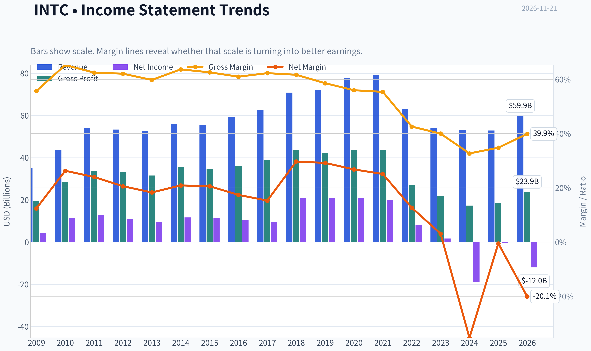

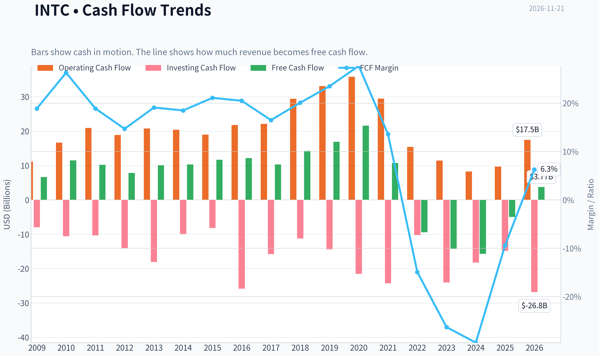

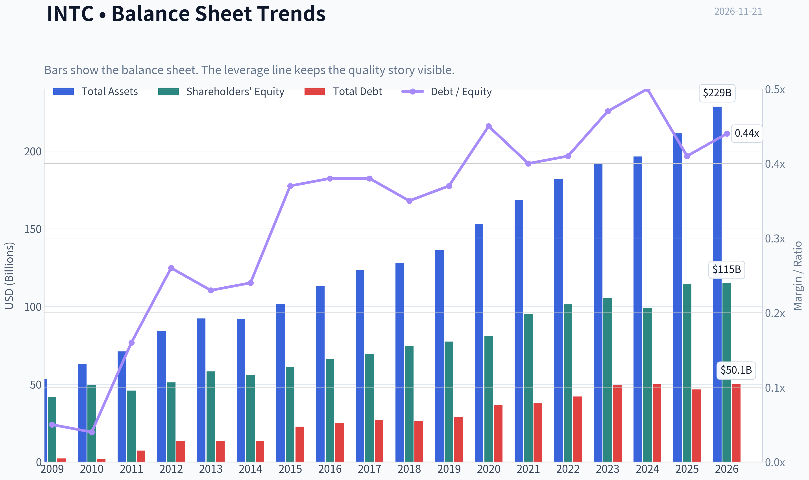

This graph tracks the profitability and return metrics (ROE, ROIC, Margins) of **INTC** over the past decade, highlighting capital efficiency trends.

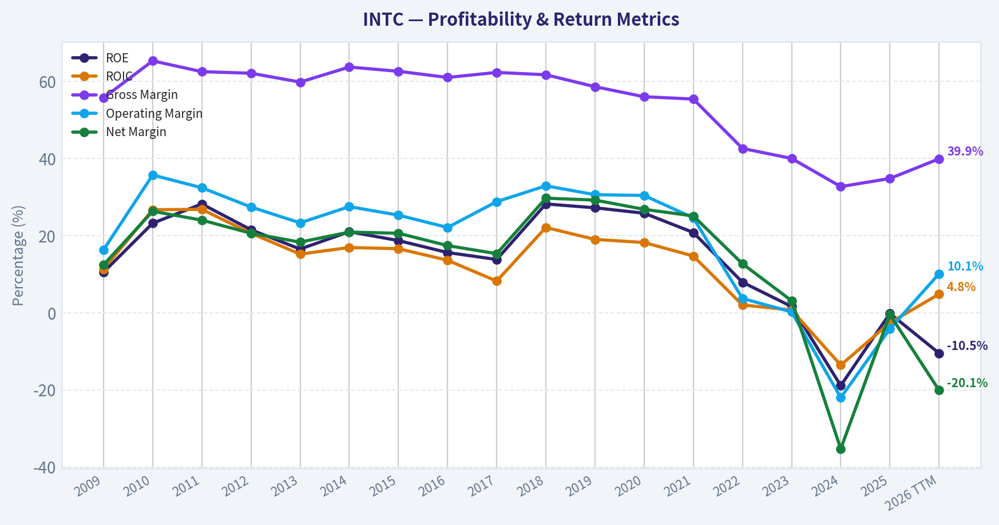

This chart illustrates the financial health of **INTC** over the last 10 years, mapping cash equivalents and free cash flow against total obligations (Debt).

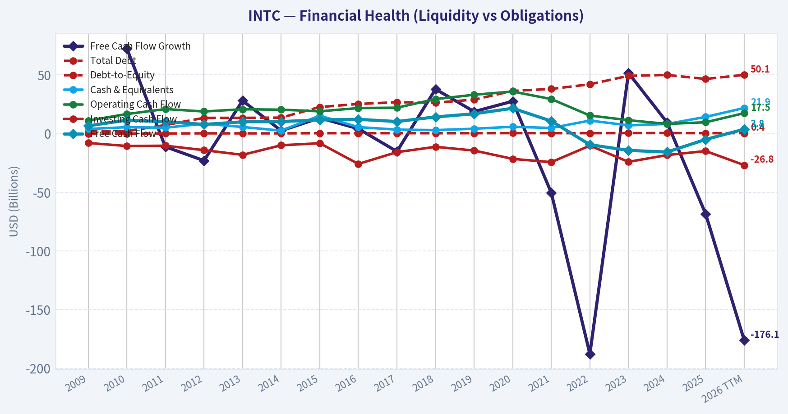

This comparison chart from *Profitability and Operating Performance* stacks current figures against historical benchmarks for **INTC**, making it easy to see where the company trades relative to its own averages.

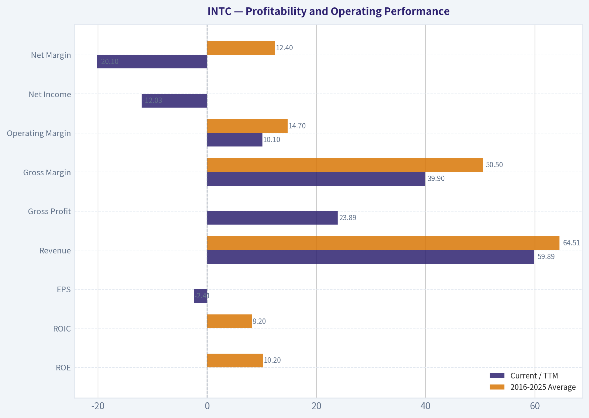

---

### Intrinsic Value Analysis (Buffett)

> *Following Warren Buffett's value investing philosophy: Circle of Competence, Economic Moat, Management Quality, and Margin of Safety.*

#### Intrinsic Value Snapshot

Price is what you pay. Intrinsic value is what the business may be worth based on the cash it can create for owners over time. We show a range, not one magic number.

- Current Price: $51.28
- Value Range (conservative to optimistic across both DCF methods): $0.05 to $11.94

##### Owner Earnings (Buffett Method)
- Net Income: $-267,000,000.00
- Depreciation & Amortization: $11,706,000,000.00
- Capital Expenditures: $-14,646,000,000.00
- Working Capital Changes: $-1,747,000,000.00
- Owner Earnings: $-2,671,100,000.00

##### Intrinsic Value
###### Cash Flow Method
Uses free cash flow. Better for companies spending heavily today to grow tomorrow.
- Conservative: $0.05
- Average: $2.37
- Optimistic: $11.94
- Discount Rate: 9.1%

ANALYST STANCE: **Bearish**

#### Executive Summary

Intel remains a strategically important semiconductor manufacturer, but the current evidence does not support a valuation near $51 per share. The business combines declining or stagnant revenue, negative return on equity, negative free cash flow, heavy capital requirements, and an uncertain manufacturing turnaround. Its DeepValues intrinsic value is **$2.37 per share**, with a conservative-to-optimistic range of **$0.05 to $11.94**.

The Gate 5 financial-distress floor is **not tripped** because the available data does not establish both deteriorating fundamentals and a specific solvency red line such as interest coverage below 1x. However, the weighted quality and valuation score is very weak.

#### Factor Scorecard

| Factor | Score | Evidence |
|---|---:|---|
| 1. Circle of Competence & Simplicity | 2/5 | Intel designs and manufactures chips, but the economics are complicated by foundry execution, fabrication-node transitions, geopolitical policy, and intense competition. |
| 2. Durable Competitive Advantage | 2/5 | Scale, manufacturing know-how, x86 intellectual property, and strategic relevance remain meaningful. However, gross margin is only 34.8%, technology leadership has been challenged, and the moat appears narrow and under pressure. |
| 3. Management & Capital Allocation | 2/5 | The turnaround requires very large capital commitments while free cash flow remains negative. The strategic opportunity is substantial, but evidence of value creation from retained capital is not yet convincing. |
| 4. Industry Structure | 2/5 | Semiconductors have attractive long-term demand but are highly competitive, cyclical, and capital intensive. Returns depend heavily on execution and sustained technology leadership. |

**Gate 5 status: Not tripped.** The company is financially stressed from a cash-generation perspective, but the supplied evidence does not establish a formal solvency failure.

**Key Takeaways:** Intel has a recognizable business and valuable strategic assets, but its competitive position and economic predictability have weakened. The main concern is not whether Intel can remain important to the semiconductor industry; it is whether it can earn adequate returns on the enormous capital required to regain leadership.

#### Financial Summary

| Metric | Latest value |
|---|---:|
| Current price | $51.00 |
| Market capitalization | $272.55 billion |
| Revenue growth, year over year | -0.5% |
| Gross margin | 34.8% |
| ROE | -0.2% |
| P/E | N/A |
| FCF yield | -1.8% |
| Current ratio | 2.02 |
| Owner earnings | N/A |
| DeepValues intrinsic value | $2.37 |

**Key Takeaways:** Intel is not currently producing the economics expected from a high-quality compounder. Negative ROE and negative FCF yield indicate that accounting profitability and cash generation are inadequate relative to the company's valuation, while the 2.02 current ratio provides some short-term liquidity support.

#### Moat Analysis

**Intangible assets:** Intel retains important processor architecture, manufacturing expertise, patents, customer relationships, and government relevance. These assets are valuable, but the gross margin of 34.8% is below the 40% level typically associated with a powerful and durable pricing moat.

**Switching costs:** Large enterprise, cloud, and infrastructure customers face meaningful qualification and compatibility costs when changing processors. Nevertheless, customers have credible alternatives from AMD, Nvidia, Arm-based designs, and custom silicon. Switching costs therefore provide protection but not customer captivity.

**Cost advantages:** Intel historically benefited from scale and integrated design-manufacturing capabilities. That advantage has weakened because manufacturing delays and large fabrication investments have pressured economics. A cost advantage must be demonstrated through superior returns, not merely through physical scale.

**Network effects:** Intel benefits indirectly from the x86 software ecosystem, but its network effects are weaker than those of dominant software or platform businesses. The ecosystem does not prevent customers from adopting alternative architectures where performance, energy efficiency, or cost justify a change.

**Moat rating: Narrow and pressured - 2/5.**

#### Management and Capital Allocation

Intel's strategic challenge requires simultaneous investment in process technology, manufacturing capacity, product competitiveness, and foundry customers. That creates a difficult capital-allocation environment: spending less risks technological irrelevance, while spending more can destroy shareholder value if utilization and returns do not improve.

The key test is whether each dollar of new fabrication investment ultimately produces returns above the cost of capital. Current negative free cash flow, negative ROE, and the absence of positive owner earnings indicate that this test has not yet been demonstrated. Turnaround commentary and external investor interest are not substitutes for sustained per-share cash-flow improvement.

**Management score: 2/5.**

#### Owner Earnings Calculation

| Component | Result |
|---|---:|
| Net income | Not supplied in the research pack |
| Depreciation and amortization | Not supplied |
| Maintenance capital expenditures | Not separately identified |
| Working-capital investment | Not separately identified |
| Owner earnings | **N/A** |

The research pack states that normal equipment spending exceeds what the business earns, leaving no owner earnings available for valuation. This is a central Buffett-style concern: a company may report revenue and possess valuable assets, yet still generate little or no distributable cash after maintaining its competitive position.

**Key Takeaways:** Intel's owner earnings are currently not positive on the supplied methodology. Until maintenance spending falls substantially or operating cash generation improves, conventional earnings multiples provide little analytical value.

#### Three-Scenario DCF Valuation

The requested owner-earnings scenarios cannot produce meaningful positive values because owner earnings are reported as **N/A**. Applying the formulas mechanically to a non-positive or undefined owner-earnings figure would create false precision.

| Scenario | Method | Result |
|---|---|---:|
| A: No growth | Owner earnings ÷ 10% | Not meaningful because owner earnings are N/A |
| B: GDP growth | 3% growth with 10% discount rate | Not meaningful because owner earnings are N/A |
| C: Historical growth | 50%-75% of historical growth, capped at 10% | Not meaningful because owner earnings are N/A |
| DeepValues FCF DCF, conservative | Secondary valuation reference | $0.05 |
| DeepValues FCF DCF, base | **Headline intrinsic value** | **$2.37** |
| DeepValues FCF DCF, optimistic | Secondary valuation reference | $11.94 |

The DeepValues headline uses a 9.1% discount rate and 4.5% terminal growth rate. Its separate Damodaran FCFF cross-check produces a higher base figure of $18.51, but that is not the designated intrinsic value for this analysis.

**Key Takeaways:** The primary valuation model is constrained by Intel's weak current cash economics. Even the optimistic FCF range remains far below the $51 market price, while the headline intrinsic value of $2.37 implies that the market is pricing in a major and highly successful turnaround.

#### Margin of Safety Analysis

| Measure | Value |
|---|---:|
| Current price | $51.00 |
| Headline intrinsic value | $2.37 |
| Price premium to headline intrinsic value | Approximately 2,052% |
| Conventional implied downside to intrinsic value | Approximately 95.4% |
| Research-pack reported margin of safety | -2,060.5% |

The research pack reports a margin of safety of **-2,060.5%** using its stated convention. On a conventional intrinsic-value comparison, $51 is approximately **21.5 times** the $2.37 headline value. The valuation therefore requires a turnaround that is not merely successful operationally, but sufficiently profitable to overcome years of heavy capital expenditure and competitive pressure.

**Key Takeaways:** Intel does not meet the quality-scaled margin-of-safety standard. A narrow, execution-dependent moat would normally require a substantial discount, whereas the current valuation reflects a very optimistic outcome.

#### Final Buffett Scorecard

| Criterion | Weight | Score | Weighted contribution |
|---|---:|---:|---:|
| Moat width and durability | 25% | 2/5 | 0.50 |
| Valuation and margin of safety | 20% | 1/5 | 0.20 |
| Capital returns versus WACC | 15% | 1/5 | 0.15 |
| Business understanding and predictability | 12% | 2/5 | 0.24 |
| Management quality and capital allocation | 12% | 2/5 | 0.24 |
| Reinvestment runway | 8% | 2/5 | 0.16 |
| Balance-sheet strength | 4% | 2/5 | 0.08 |
| Industry structure | 4% | 2/5 | 0.08 |
| **Total** | **100%** |  | **1.65/5** |

**Key Takeaways:** Intel scores poorly because its large reinvestment needs are not currently producing attractive shareholder returns. The company may possess strategic value and turnaround potential, but the present evidence does not show a wide moat, durable high ROIC, or adequate valuation support.

#### Investment Stance

**Bearish - High conviction.**

Intel is not a financially distressed company under the defined hard-floor test, and its strategic assets could support a future recovery. However, the combination of negative owner earnings, negative ROE, negative FCF yield, pressured margins, capital intensity, and a market price vastly above the headline intrinsic value makes the current valuation unsupported by demonstrated economics.
#### Valuation Bridge

This bridge places the current market price beside each intrinsic value lens so readers can see whether upside depends on one method or shows up across several methods.

| Scenario | Intrinsic Value / Share |
| --- | ---: |
| Cash Flow Method | $2.37 |
| Damodaran Method | $18.51 |
| Current Price | $51.28 |

#### Key Takeaways

If one method is far above the others, the upside case depends on a specific modelling assumption. When several methods cluster together, the valuation story is more robust.

#### Valuation Visuals

This comparison chart from *Latest Earnings Snapshot* stacks current figures against historical benchmarks for **INTC**, making it easy to see where the company trades relative to its own averages.

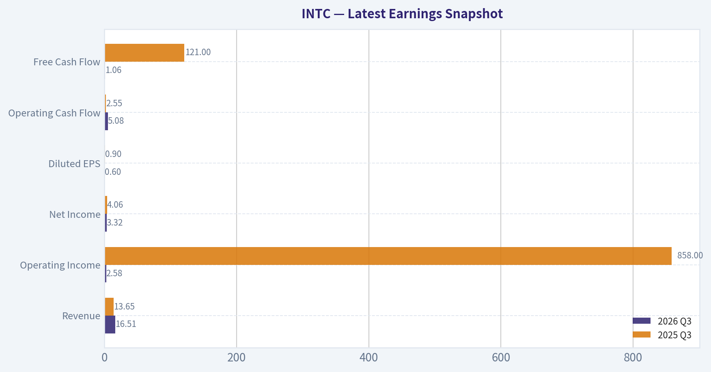

This comparison chart from *Balance Sheet and Financial Strength* stacks current figures against historical benchmarks for **INTC**, making it easy to see where the company trades relative to its own averages.

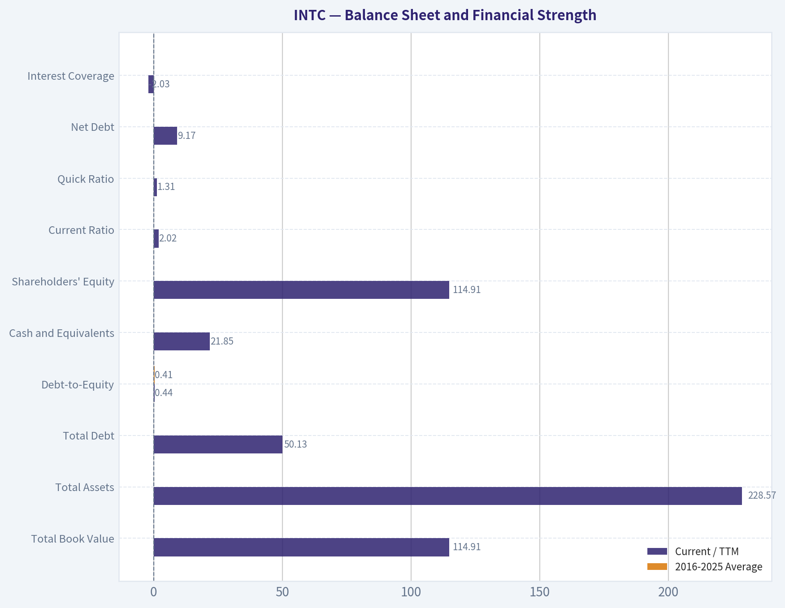

This comparison chart from *DCF and Owner-Earnings Valuation* stacks current figures against historical benchmarks for **INTC**, making it easy to see where the company trades relative to its own averages.

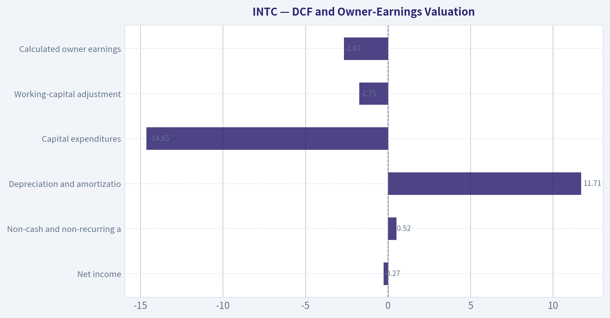

The following chart maps the **INTC** Owner Earnings DCF valuation scenarios (Conservative, Average, Optimistic) to visually represent the margin of safety based on intrinsic value calculations.

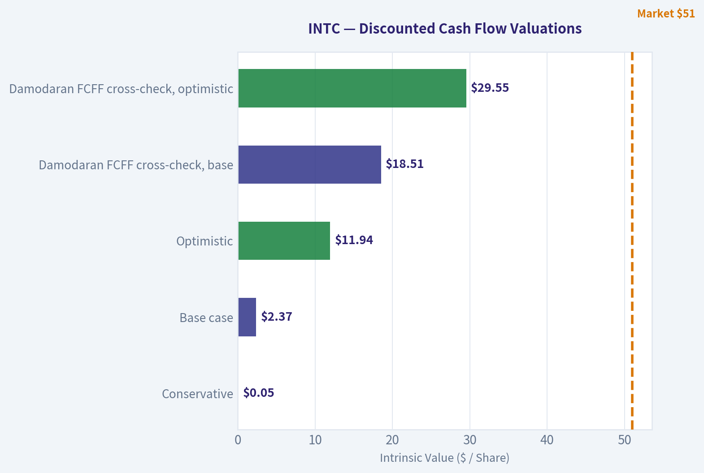

---

### Trend & Growth Analysis (Lynch/Druckenmiller/Fisher)

> *Following Peter Lynch's GARP, Stanley Druckenmiller's macro-aware approach, and Philip Fisher's scuttlebutt methodology.*

ANALYST STANCE: **Bearish**

#### 1. Lynch Classification

**Turnaround candidate, not currently a fast grower.** Intel has substantial assets, technological capability, and strategic importance, but current revenue growth, free cash flow, and returns on capital do not meet the requirements of a high-quality growth company.

#### 2. The Story in Three Bullets

- Intel is attempting to rebuild process technology leadership while expanding its contract-manufacturing, or foundry, business.
- The company participates in large secular markets: data centers, artificial intelligence, personal computers, networking, and semiconductor manufacturing.
- The potential upside depends on successful execution of a capital-intensive turnaround; the present financial evidence does not yet confirm a durable growth inflection.

#### 3. Core Financial Snapshot

| Metric | Intel |
|---|---:|
| Share price | $51 |
| Market capitalization | $272.55 billion |
| Revenue growth, year over year | -0.5% |
| Gross margin | 34.8% |
| P/E ratio | Not meaningful |
| ROE | -0.2% |
| FCF yield | -1.8% |
| Current ratio | 2.02 |
| Estimated price-to-sales ratio* | Approximately 5.1x |

\*Approximate, using annual revenue near $53 billion.

**Key Takeaways:** Intel is valued like a company with meaningful future improvement, while current revenue is essentially flat and free cash flow is negative. The balance sheet has reasonable short-term liquidity, but profitability and capital efficiency remain weak.

#### 4. TAM and the 10x Test

| Area | Assessment |
|---|---|
| Current annual revenue | Approximately $53 billion |
| Ten-times revenue case | Approximately $530 billion |
| Relevant long-term markets | Semiconductors, AI infrastructure, foundry, networking, PCs, automotive and edge computing |
| Broad market runway | Large and still expanding |
| Can Intel reach 10x revenue while remaining below 20% share? | Possible in the broad semiconductor ecosystem, but not demonstrated |
| Main constraint | Execution, manufacturing competitiveness, customer adoption and capital intensity |

**Key Takeaways:** Intel's addressable market is large enough to support a theoretical ten-times revenue outcome. However, the relevant question is not market size alone; Intel must regain technological credibility and win external foundry customers. The TAM is attractive, but the company's current market position does not yet validate the long-term scenario.

#### 5. Revenue Growth Trend

| Period or indicator | Reading | Interpretation |
|---|---:|---|
| Latest year-over-year revenue growth | -0.5% | Stabilization, not growth acceleration |
| Recent business pattern | Weak to flat | Recovery remains incomplete |
| Growth classification | Below fast-grower threshold | Not a 15-25% growth company |
| Revenue quality | Dependent on product cycles and execution | Some cyclicality remains |
| Confirmed inflection | Not yet established | Requires multiple quarters of accelerating growth |

**Key Takeaways:** The latest result is better described as stabilization than acceleration. A genuine Druckenmiller-style inflection would require sustained revenue growth, improving product mix, and evidence that foundry and AI-related demand are becoming material contributors.

#### 6. Unit Economics and Operating Efficiency

| Metric | Intel assessment |
|---|---|
| LTV/CAC | Not disclosed or not meaningful for this manufacturing model |
| Net revenue retention | Not applicable |
| Rule of 40 | Not achieved; revenue growth is approximately -0.5% and FCF margin is negative |
| Gross margin | 34.8%, below the level expected from a dominant, highly differentiated semiconductor platform |
| Free cash flow | Negative |
| Capital intensity | Very high due to manufacturing and fabrication investment |

**Key Takeaways:** Intel is not primarily a subscription business, so SaaS metrics such as NRR and LTV/CAC are limited. The more important measures are gross margin, utilization, operating leverage, and free cash flow; these currently show an investment-heavy turnaround rather than a scalable growth engine.

#### 7. Inflection Point Assessment

| Potential inflection | Current evidence | Status |
|---|---|---|
| Product cycle | New CPU and accelerator roadmaps are important, but financial impact is not yet established | Unconfirmed |
| Foundry expansion | Large strategic opportunity with substantial execution risk | Early stage |
| AI exposure | Potentially significant, but Intel remains behind leading accelerator platforms | Unconfirmed |
| Margin inflection | Gross margin remains pressured | Not visible |
| Market-share inflection | No current evidence of sustained share gains | Not visible |
| Cash-flow inflection | Negative FCF and high capital spending | Not visible |

**Key Takeaways:** Intel has several possible catalysts, but most remain prospective rather than proven. The strongest potential inflection is successful foundry adoption combined with competitive products; the financial statements have not yet confirmed that this process is working at scale.

#### 8. Macro Setup

- **Secular trend:** Favorable exposure to AI infrastructure, cloud computing, semiconductor localization, and supply-chain diversification.
- **Interest rates:** The 10-year Treasury yield cited in the research pack is 4.92%, which remains a valuation and capital-cost headwind for a long-duration turnaround.
- **Industry cycle:** Semiconductor demand can recover sharply, but industry cycles can obscure company-specific execution.
- **Geopolitical support:** Government incentives and strategic demand for domestic semiconductor manufacturing are supportive.
- **Druckenmiller signal:** Stanley Druckenmiller's latest reported 13F showed an exit, while Steve Cohen increased his disclosed position. These are lagging, quarter-end observations and are not substitutes for operating evidence.

**Key Takeaways:** The macro backdrop is mixed. Semiconductor localization and AI create favorable long-term demand, but elevated rates and intense competition make a capital-intensive turnaround harder to value. The reported investor actions are contradictory and should be treated as secondary evidence.

#### 9. Fisher's 15-Point Assessment

| Fisher criterion | Score / 5 | Rationale |
|---|---:|---|
| Sufficient market potential | 5 | Very large semiconductor and foundry markets |
| Determination to develop products | 4 | Significant roadmap and manufacturing investment |
| Effective R&D | 3 | Strong historical capability, recent execution setbacks |
| Sales organization | 3 | Large customer base, but external foundry traction is unproven |
| Worthwhile profit margin | 2 | Current margins are weak for the industry |
| Improving profit margins | 2 | Improvement is not yet established |
| Labor and personnel relations | 3 | No decisive advantage evident |
| Executive relations | 3 | Major strategic changes create execution complexity |
| Management depth | 3 | Experienced organization, but transition risk is high |
| Cost analysis and accounting | 3 | No clear current advantage |
| Outstanding moat characteristics | 4 | Manufacturing assets, ecosystem, IP and strategic importance |
| Long-range profit outlook | 3 | Potentially strong, but highly execution-dependent |
| Dilution risk | 3 | Capital requirements and financing needs are relevant risks |
| Management candor | 3 | Strategic challenges have been acknowledged |
| Management integrity | 3 | No specific integrity issue identified in the supplied data |
| **Total** | **47 / 75** | **Average** |

**Key Takeaways:** Intel scores well on market potential and strategic assets but poorly on current margins and demonstrated execution. A score of 47 out of 75 reflects a company with meaningful optionality, not a proven Fisher-quality compounder.

#### 10. Valuation Analysis

| Measure | Result | Interpretation |
|---|---:|---|
| Current P/E | Not meaningful | Earnings are not a reliable valuation anchor |
| Forward PEG cited in coverage | Approximately 0.50 | Based on forward estimates, which carry high turnaround risk |
| Approximate P/S | 5.1x | Demanding for a company with flat revenue and negative FCF |
| Free cash flow DCF, conservative | $0.05 per share | Extremely unfavorable |
| Free cash flow DCF, base | $2.37 per share | Far below the current price |
| Free cash flow DCF, optimistic | $11.94 per share | Still below the current price |
| Damodaran FCFF range | $6.14-$29.55 per share | More generous, but below the current price even in the optimistic case |
| Headline intrinsic value | $2.37 per share | Implies substantial overvaluation at approximately $51 |

**Key Takeaways:** The forward PEG appears attractive only if the turnaround estimates are achieved. Cash-flow-based valuation is much less supportive: the headline intrinsic value is $2.37, compared with approximately $51, and even the optimistic supplied DCF values remain below the market price.

#### 11. Valuation Sensitivity

The following simplified sensitivity uses approximately $53 billion of revenue and excludes the effects of net debt, cash, dilution, taxes and future capital spending.

| Revenue CAGR over three years | Revenue in year three | 3x sales value | 5x sales value | 7x sales value |
|---:|---:|---:|---:|---:|
| 0% | $53B | $159B | $265B | $371B |
| 10% | $71B | $213B | $355B | $497B |
| 20% | $92B | $276B | $460B | $644B |

**Key Takeaways:** At current revenue and a 5x sales multiple, the simplified equity-value proxy is approximately $265 billion, close to Intel's current $272.55 billion market capitalization. To justify materially greater value, Intel would need both strong revenue growth and a sustained premium multiple, despite current negative free cash flow and substantial execution risk.

#### 12. Growth Investor Scorecard

| Criterion | Weight | Score / 5 | Weighted contribution |
|---|---:|---:|---:|
| Story clarity | 10% | 3.5 | 0.35 |
| TAM and runway | 20% | 4.0 | 0.80 |
| Revenue growth | 20% | 1.5 | 0.30 |
| Unit economics | 15% | 1.5 | 0.23 |
| Competitive position | 10% | 3.0 | 0.30 |
| Management quality | 10% | 3.0 | 0.30 |
| Macro setup | 5% | 3.5 | 0.18 |
| Profitability path | 5% | 2.0 | 0.10 |
| Valuation | 5% | 1.5 | 0.08 |
| **Total** | **100%** |  | **2.64 / 5.00** |

**Key Takeaways:** Intel's large TAM and strategic importance are not enough to offset weak growth, negative free cash flow and demanding valuation. The score of 2.64 out of 5 falls below the threshold for a high-conviction growth setup.

#### 13. Key Catalysts and Risks

| Catalysts | Risks |
|---|---|
| Successful execution of new manufacturing nodes | Further process delays or yield problems |
| Major external foundry customers | Foundry customers remain limited or unprofitable |
| Competitive AI, server and PC products | Nvidia, AMD, TSMC and other competitors retain technological advantages |
| Gross-margin recovery | Persistent margin pressure from underutilization and mix |
| Government incentives and strategic partnerships | High capital spending and negative free cash flow |
| Revenue acceleration over several quarters | Semiconductor cycle recovery fails to translate into Intel share gains |

**Key Takeaways:** The main catalysts are operational and measurable: accelerating revenue, improving gross margin, external foundry wins and a return to positive free cash flow. The central risks are equally clear: execution failure, continued competitive disadvantage and capital spending that does not generate adequate returns.

#### 14. Bottom Line

Intel is a **large-TAM, high-risk turnaround**, not a confirmed fast-growing compounder. The company could create substantial value if it regains process leadership and establishes a profitable foundry business, but the current data show flat revenue, negative cash generation and weak returns on capital. At approximately $51 per share, the supplied intrinsic-value estimates do not support the present valuation.

---

### Market Technical Analysis

ANALYST STANCE: **Neutral**

#### INTC technical analysis

Intel Corporation (INTC) closed at **$51.28 on November 20, 2026**, the latest trading session available. November 21 was not a trading day. The technical picture is dominated by a sharp breakdown, persistent trend weakness, unusually high volatility, and an oversold momentum reading that has not yet developed into a confirmed reversal.

#### Price action and trend structure

INTC's recent price behavior shows a material deterioration across every major timeframe:

- The stock fell from **$92.07 on October 29 to $65.76 on October 30**, a one-session decline of approximately **28.6%**.
- From the October 30 close to November 20, the stock declined a further **22.0%**.
- Relative to the October 29 close, the latest price is lower by approximately **44.3%**.
- The November 20 session also showed renewed pressure, with a high of $56.48 and a low of $51.10 before closing near the lower end of the daily range.

This is not merely a short-term pullback. The price is substantially below both the medium-term and long-term moving averages. The **50-day SMA is $90.22**, while the **200-day SMA is $87.55**. Both averages are above the current price, and the 50-day average is declining sharply. That combination indicates broad trend damage rather than an isolated loss of short-term momentum.

The 10-day EMA is **$57.48**, also above the latest close. The distance between the price and the 10-day EMA is smaller than the distance from the longer averages, but the fact that price remains below all three averages confirms that selling pressure extends from the immediate timeframe through the broader trend.

#### Momentum: deeply weak, but with limited early improvement

The RSI is **28.03**, below the conventional 30 oversold threshold. RSI also spent much of early November in the low-to-mid 20s, showing that the decline has been forceful and persistent rather than a single isolated down day.

An oversold RSI does not, by itself, establish a durable bottom. In a strong downtrend, RSI can remain below 30 while price continues to weaken. The current reading therefore signals **extreme downside momentum**, but not confirmed recovery.

The MACD remains materially negative at **-10.39**. However, it has improved from approximately **-12.61 on November 9** and **-11.19 on November 16**. This means downside momentum has moderated somewhat from its most intense level. The improvement is worth monitoring, but it is occurring well below zero and while price remains below all key moving averages. Consequently, it is better interpreted as a possible deceleration in selling pressure than as evidence of a completed trend reversal.

#### Volatility and Bollinger positioning

ATR is **$5.24**, equivalent to roughly **10.2% of the latest closing price**. This is a very large daily trading range relative to the share price and indicates that technical signals carry substantial noise and gap risk.

The Bollinger Bands are extremely wide:

- Upper band: **$94.52**
- Lower band: **$35.29**

INTC's close at $51.28 is much nearer the lower band than the upper band. The price is not currently below the lower band, so the latest reading is not an extreme downside breach on this measure. Still, its position in the lower portion of a very wide band structure confirms that the stock remains under heavy distribution pressure.

The wide bands also show that volatility expanded dramatically after the late-October break. Although ATR has eased from approximately $6.97 on October 30 to $5.24 currently, volatility remains elevated. A lower ATR after a major selloff can reflect stabilization, but it can also simply represent a consolidation phase within a damaged trend.

#### Interpretation and valuation implications

The indicators present a nuanced but predominantly negative configuration:

1. **Trend confirmation is bearish.** Price is below the 10-day EMA, 50-day SMA, and 200-day SMA.
2. **Momentum is severely weakened.** RSI is oversold, and MACD remains deeply negative.
3. **There is a limited constructive detail.** MACD has become less negative, suggesting that the rate of deterioration has slowed from its early-November extreme.
4. **A reversal is not technically confirmed.** The price has not reclaimed the short-term EMA, and the long-term averages remain far overhead.
5. **Risk is unusually high.** ATR and Bollinger Band width indicate large expected price movement and substantial uncertainty.

From a valuation perspective, the technical evidence indicates that the market is assigning a substantial uncertainty discount to INTC relative to its recent trading history. The data do not establish whether that discount is justified or excessive because valuation requires fundamental information such as earnings, cash flow, balance-sheet strength, capital spending, and forward expectations. Technically, there is not yet sufficient evidence to claim that the market has fully recognized or rejected that uncertainty.

#### Selected indicators

The eight selected indicators are complementary: three moving averages define trend across time horizons; MACD measures directional momentum; RSI identifies momentum exhaustion; ATR measures realized volatility; and both Bollinger Bands describe the stock's position within its current volatility regime.

| Indicator | Latest value | Recent direction or condition | Interpretation for INTC |
|---|---:|---|---|
| Close | $51.28 | Down sharply from $92.07 on Oct. 29 | Price structure remains decisively damaged |
| 10 EMA | $57.48 | Declining rapidly | Short-term trend remains bearish; price is below the EMA |
| 50 SMA | $90.22 | Falling from $102.46 on Oct. 22 | Medium-term trend is strongly negative |
| 200 SMA | $87.55 | Slowly rising, but far above price | Long-term average has not yet reflected the full decline; price is well below it |
| MACD | -10.39 | Less negative than -12.61 on Nov. 9 | Selling momentum has moderated, but momentum remains bearish |
| RSI | 28.03 | Below 30 | Oversold conditions indicate intense weakness, not a confirmed reversal |
| ATR | $5.24 | Down from $6.97 on Oct. 30 | Volatility has eased but remains exceptionally high at about 10% of price |
| Bollinger Bands | Upper $94.52; lower $35.29 | Very wide band range | Price is in the lower portion of a highly volatile distribution regime |

**Key Takeaways:** INTC remains in a broad bearish trend, with the latest price below all three selected moving averages and close to the lower portion of its wide Bollinger range. RSI is oversold and MACD has improved modestly, but those early signs of stabilization do not yet outweigh the persistent trend weakness. The technical evidence supports a **Neutral** stance because volatility and downside damage remain high, while confirmation of a durable recovery is absent.

#### Market Visuals

This comparison chart from *Market Metrics and Valuation* stacks current figures against historical benchmarks for **INTC**, making it easy to see where the company trades relative to its own averages.

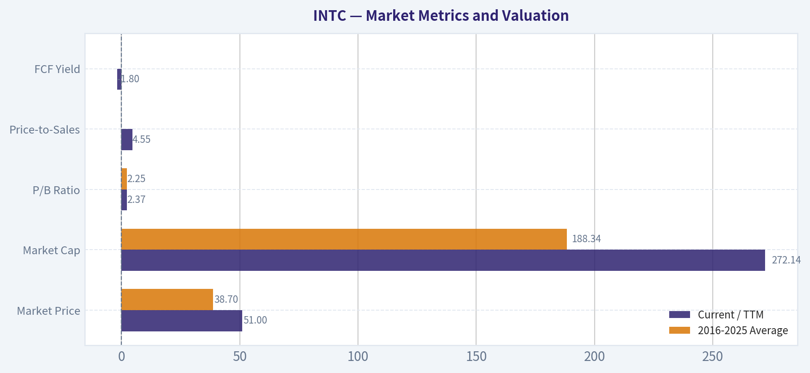

---

### Options Market Analysis

> *Reading options flow - put/call ratios, IV skew, and unusual activity - to gauge institutional positioning and event-driven risk.*

ANALYST STANCE: **BULLISH**

#### INTC Options Market Overview

Data is available for the three near-term expirations from November 27 through December 11, 2026. The apparent at-the-money area is near the $52 strike, based on the concentration of unusual activity, although the feed does not provide an explicit current share price.

| Expiration | Days to Expiry | Call OI | Put OI | Put/Call OI | Call Volume | Put Volume | Put/Call Volume | ATM Call IV | ATM Put IV |
|---|---:|---:|---:|---:|---:|---:|---:|---:|---:|
| Nov. 27, 2026 | 6 | 109,848 | 67,628 | 0.62 | 126,835 | 72,898 | 0.57 | 122.6% | 115.8% |
| Dec. 4, 2026 | 13 | 49,564 | 20,464 | 0.41 | 32,500 | 6,584 | 0.20 | 106.8% | 103.6% |
| Dec. 11, 2026 | 20 | 45,653 | 13,737 | 0.30 | 4,134 | 4,994 | 1.21 | 100.4% | 98.3% |
| **Total / Overall** | - | **205,065** | **101,829** | **0.50** | **163,469** | **84,476** | **0.52** | - | - |

**Key Takeaways:** The aggregate put/call OI ratio of 0.50 is materially below the approximately 0.70 neutral baseline, indicating call-heavy near-term exposure. Volume is also call-dominant overall, although the December 11 expiration shows a modest put-volume imbalance. The strongest bullish skew is concentrated in the November 27 and December 4 expirations.

#### Put/Call Ratio Analysis

The overall OI ratio of 0.50 represents roughly 29% fewer puts than would be implied by a 0.70 neutral ratio. The volume ratio of 0.52 similarly indicates substantially greater call activity than put activity.

This pattern can reflect bullish speculation, upside hedging, or covered-call activity. Because the data does not identify whether trades were executed at the bid or ask, the call-heavy ratios cannot be classified with certainty as outright call buying. Still, the combination of low put/call ratios and large fresh call volume supports a bullish directional read.

#### Implied Volatility Assessment

| Expiration | ATM Call IV | ATM Put IV | Put-minus-Call IV | Interpretation |
|---|---:|---:|---:|---|
| Nov. 27 | 122.6% | 115.8% | -6.8 percentage points | Extremely elevated IV; calls trade richer near ATM |
| Dec. 4 | 106.8% | 103.6% | -3.2 percentage points | Very elevated IV; modest call premium |
| Dec. 11 | 100.4% | 98.3% | -2.1 percentage points | Very elevated IV; broadly balanced skew |

**Key Takeaways:** Near-term IV is exceptionally high, ranging from approximately 100% to 123%, signaling substantial expected movement or event risk. The available ATM data shows calls carrying slightly higher IV than puts, which is the opposite of a conventional downside-fear skew. The feed does not provide a confirmed earnings date or other catalyst, so the source of this elevated volatility cannot be verified from the supplied data.

The OTM activity also shows some downside volatility premium: the November 27 $48 put has 122.9% IV, while the $43 put has 138.9% IV. This indicates that tail-risk protection remains expensive even though the aggregate market is call-heavy.

#### Unusual Options Activity

| Expiration | Contract | Strike | Approx. Moneyness* | Volume | OI | Volume/OI | IV | Implied Read |
|---|---|---:|---|---:|---:|---:|---:|---|
| Nov. 27 | Call | $53 | Near ATM / slightly OTM | 19,697 | 334 | 59.0x | 116.7% | Very large fresh upside speculation |
| Nov. 27 | Call | $57 | OTM | 14,095 | 2,479 | 5.7x | 107.1% | Bullish upside exposure |
| Nov. 27 | Call | $54 | Near ATM / OTM | 11,864 | 506 | 23.4x | 113.6% | Fresh upside demand |
| Nov. 27 | Put | $52 | Near ATM | 10,933 | 1,272 | 8.6x | 114.6% | Near-term hedge or bearish speculation |
| Dec. 4 | Call | $58 | OTM | 7,618 | 623 | 12.2x | 96.1% | Bullish extension beyond the front week |
| Dec. 4 | Call | $61 | OTM | 7,091 | 315 | 22.5x | 93.3% | Higher-conviction upside lottery-style activity |
| Nov. 27 | Put | $51 | Near ATM | 6,465 | 1,089 | 5.9x | 114.4% | Downside hedge or bearish bet |
| Nov. 27 | Put | $48 | OTM | 3,314 | 486 | 6.8x | 122.9% | Tail-risk protection |
| Dec. 11 | Put | $47 | OTM | 1,115 | 107 | 10.4x | 105.0% | Longer-dated downside hedge |
| Nov. 27 | Call | $52 | Near ATM | 934 | 81 | 11.5x | 119.0% | Fresh near-ATM upside activity |
| Nov. 27 | Put | $43 | Deep OTM | 734 | 23 | 31.9x | 138.9% | Small-volume tail hedge or speculative downside trade |

\*Exact current share price was not supplied; moneyness is estimated relative to the apparent $52 area indicated by the chain.

**Key Takeaways:** The largest unusual trades are calls, particularly the November 27 $53 call with volume nearly 59 times existing open interest. The December 4 $58 and $61 calls extend the bullish activity beyond the immediate expiration, while puts at $52, $51, and $48 show that downside hedging is also active. The largest call volumes and high volume-to-OI ratios suggest fresh directional interest, but trade-side data is unavailable, so institutional execution cannot be confirmed; far-out-of-the-money contracts may also include retail speculation.

#### Open Interest Concentration and Gamma Levels

| Expiration | Highest Available Aggregate OI | Call/Put OI Structure | Potential Market Effect |
|---|---:|---|---|
| Nov. 27 | 177,476 combined contracts | 109,848 calls versus 67,628 puts | Largest near-term gamma exposure; potential pinning around heavily traded strikes |
| Dec. 4 | 70,028 combined contracts | 49,564 calls versus 20,464 puts | Call-heavy structure may reinforce upside sensitivity |
| Dec. 11 | 59,390 combined contracts | 45,653 calls versus 13,737 puts | Lower total OI, but still materially call-heavy |
| **All listed expirations** | **306,894 contracts** | **205,065 calls versus 101,829 puts** | Broad call concentration across the near-term curve |

**Key Takeaways:** The November 27 expiration contains the largest concentration of open interest and is therefore the most relevant for near-term pinning and gamma effects. Aggregate call OI is substantially larger than put OI across every listed expiration. Exact strike-level OI was not provided, so a precise gamma wall, maximum-pain strike, or dominant pinning level cannot be identified.

#### Overall Options Sentiment

The overall signal is **BULLISH**, driven primarily by:

1. A 0.50 aggregate put/call OI ratio versus a 0.70 neutral baseline.
2. A 0.52 aggregate put/call volume ratio.
3. Large fresh call activity at the November 27 $53 and $54 strikes.
4. Additional upside call activity at the December 4 $58 and $61 strikes.
5. Slightly richer ATM call IV than put IV across all three expirations.

The principal caveat is that implied volatility is extremely elevated, and downside hedges are still visible at the $52, $51, $48, $47, and $43 puts. This is therefore a bullish but high-risk, event-sensitive options configuration rather than a low-volatility conviction signal. The options data supports stronger upside speculation than downside speculation, while the elevated volatility implies that the market is assigning substantial uncertainty to short-term valuation.

#### Summary

| Category | Assessment |
|---|---|
| Put/Call Ratio | Bullish: 0.50 OI ratio and 0.52 volume ratio, both below the 0.70 neutral baseline |
| IV Level | Extremely elevated: approximately 100%-123% ATM IV |
| Skew Direction | Mild call skew near ATM, with expensive downside tail puts farther OTM |
| Unusual Activity | Dominated by fresh near-term and one-to-three-week upside calls, alongside meaningful downside hedges |
| Overall Signal | **BULLISH**, with high event-risk and volatility caveats |

**Key Takeaways:** INTC options flow is directionally bullish because calls dominate both open interest and volume, and the largest unusual contracts favor upside strikes. Elevated IV and active downside puts indicate that the bullish outlook is accompanied by substantial expected volatility and hedging demand. Confidence is moderate rather than high because execution direction, exact spot price, strike-level OI, and any confirming catalyst are not available.

---

## Research Team Commentary

> *The Research Manager synthesizes the Bull vs Bear debate into action-free commentary. This is a pre-risk view, not the final stance.*

Core Takeaway: Intel retains rare strategic assets and meaningful turnaround optionality, but it is not presently demonstrating the economics of a durable compounder. At $51.28, the valuation appears to capitalize a successful manufacturing and foundry recovery before that recovery is evident in revenue, margins, free cash flow, or returns on capital. The strongest conclusion is not that Intel lacks value, but that the supplied evidence does not support the market valuation.

The best bull argument is Intel's combination of x86 relevance, engineering expertise, advanced manufacturing infrastructure, intellectual property, customer relationships, and geopolitical importance. Very few companies could plausibly become a large-scale Western leading-edge foundry. If Intel achieves competitive process technology, improves yields, attracts substantial external volume, and raises factory utilization, the fixed-cost structure could create significant operating leverage. Government incentives may also reduce part of the investment burden. Meanwhile, switching costs, lengthy qualification cycles, and process-learning effects could develop into a durable moat once customers move into high-volume production.

That upside should not be dismissed merely because Intel is capital intensive or currently unprofitable. Semiconductor turnarounds involve long investment and qualification cycles, so present free cash flow can understate future earning power. The stock's roughly 44% decline from the cited October 29 level may also indicate that some optimism has already been removed.

The bear case is nevertheless much stronger on the available evidence. Revenue is declining slightly, gross margin is only 34.8%, free cash flow is negative, and ROE, ROA, and ROIC are approximately zero or negative. Intel is therefore consuming substantial capital without yet earning an adequate return on it. Its historical moat has weakened, while the proposed replacement moat-an external foundry with competitive technology, yields, reliability, and customer trust-is still unproven.

This distinction matters in a Buffett framework. Intel's factories and strategic importance are assets, but an asset becomes a shareholder moat only when it produces durable cash returns. Government support may preserve domestic manufacturing capacity without necessarily producing attractive returns for shareholders. Likewise, exposure to AI, data centers, and networking is not equivalent to profitable participation; Intel must demonstrate competitive products, software adoption, pricing power, and sustained volume.

The valuation gap reinforces the concern. The DeepValues estimate of $2.37 is about one twenty-second of the $51.28 market price, while even the optimistic $11.94 estimate is less than one-quarter of it. That model output should not be treated as precise because turnaround cash flows and temporarily elevated capital expenditures can distort a conventional DCF. Even so, the discrepancy is too large to dismiss without an alternative cash-flow case showing how Intel reaches materially higher margins and sustainable free cash flow.

A reverse-DCF interpretation is more useful than relying solely on the $2.37 figure. The current price seemingly requires multiple favorable outcomes: timely process-node execution, higher yields, meaningful external foundry customers, improved utilization, recovery in product competitiveness, stronger gross margins, and positive free cash flow. These outcomes are possible, but several must occur together. For a currently low-return, capital-intensive business, Buffett's quality-scaled framework would require a substantial margin of safety. Instead, the valuation appears to price in a considerable portion of the hoped-for transformation.

The sharp share-price decline does not change that conclusion by itself. A lower quotation creates value only if it falls below conservative normalized cash flows. Similarly, fresh call activity and below-neutral put/call ratios indicate speculative optimism or event positioning, not improved intrinsic value. The market may be anticipating a catalyst, but options data provide no evidence about foundry yields, customer commitments, or long-term returns on invested capital.

Rationale: Intel is better understood as a high-risk industrial and technological turnaround than as a proven high-ROIC technology compounder. Its upside is real because the assets are unusually difficult to replicate, but management is still required to convert technical capability and strategic relevance into commercial volume and cash returns. The burden of proof is especially high because much of the spending may be catch-up investment rather than value-creating expansion.

There is no evidence in the supplied material of immediate solvency distress, and the lack of detailed debt, liquidity, and interest-coverage data prevents a stronger conclusion on financial risk. The negative assessment instead rests on weak business economics and insufficient valuation support. Intel could execute well and still produce disappointing shareholder economics if the required capital base is too large, pricing is competitive, or utilization remains inadequate.

The key analytical mistake to guard against is treating "could become" as "already is." A famous franchise can retain strategic relevance after losing its former economic advantages. Likewise, a factory can be technologically impressive but financially burdensome. Future analysis should therefore give more weight to verified production, customer volume, and cash returns than to road maps, subsidies, announced partnerships, or the size of the end market.

Monitoring Plan: Over the next one to four quarters, the most important evidence will be whether Intel's operational milestones begin translating into financial results.

First, process execution should be measured through disclosed yield progress, on-time node milestones, customer tape-outs, and movement from qualification into commercial production. Road-map reaffirmations alone would be weak evidence; high-volume manufacturing and external customer adoption would be materially stronger.

Second, foundry performance should be evaluated through external revenue growth, binding customer commitments, prepayments where disclosed, utilization, segment losses, and a credible path to profitability. Internal Intel product volume should not be confused with independent validation of the foundry offering.

Third, gross margin should improve sustainably from 34.8%. One quarter driven by mix, inventory adjustments, or accounting effects would not establish a turnaround. Consecutive improvement accompanied by better utilization and product competitiveness would be more persuasive.

Fourth, free cash flow should progress toward breakeven after accounting for capital expenditures. Improvement caused only by deferred spending, asset sales, subsidies, or working-capital timing would be lower-quality evidence than improvement driven by operating cash generation.

Fifth, ROIC should begin moving clearly above zero, with management demonstrating that incremental capital produces economic returns rather than merely maintaining competitiveness. This is the decisive long-term test.

Finally, balance-sheet liquidity, net debt, financing costs, share issuance, and remaining capital commitments require close attention. The thesis would strengthen with externally validated foundry demand, improving margins, positive cash conversion, and rising returns on capital. It would weaken with process delays, limited external volume, persistent foundry losses, continued negative free cash flow, or greater reliance on financing to sustain the investment program.

Final stance: Bearish

---

## Value Investing Team Commentary

> *The Investor translates the research view into an investment thesis before risk review. This is still not the final stance.*

Intel presents a genuine strategic asset base but currently weak shareholder economics. The distinction is important: national importance, engineering expertise, x86 relevance, and manufacturing infrastructure do not automatically constitute an investable moat unless they produce durable cash returns.

### Business quality and moat

Intel still operates in strategically significant markets, including personal computing, data centers, networking, artificial intelligence, and semiconductor manufacturing. Its installed customer relationships, intellectual property, process know-how, and domestic manufacturing footprint would be difficult and expensive to replicate.

The prospective foundry business also has theoretical moat characteristics. Semiconductor customers face long qualification cycles, substantial switching costs, and high reliability requirements. If Intel achieves competitive process technology and attracts sustained external production volume, those features could eventually support a meaningful manufacturing franchise.

However, that moat is prospective rather than demonstrated. The relevant question is not whether Intel owns advanced factories, but whether those factories can generate attractive returns after depreciation, research spending, expansion capital, and customer-acquisition costs. Current ROIC near zero, negative free cash flow, and gross margin of 34.8% indicate that the assets are not yet earning Buffett-quality economics.

### Financial evidence

The supplied financial metrics show a business still in transition:

- Revenue growth is approximately negative 0.5%.
- Gross margin is materially below what would normally support a premium technology valuation.
- ROE, ROA, and ROIC are approximately zero or negative.
- Free cash flow remains negative.
- Capital requirements are unusually high and may remain elevated for several years.

A turnaround can justify temporarily weak cash flow, but only when there is credible evidence that the spending is building future earning power. At present, the data do not yet demonstrate that incremental capital is producing attractive incremental returns. The risk is that Intel spends heavily merely to remain technologically relevant rather than to create economic value.

### Valuation and reverse-DCF implications

At the supplied price of $51.28, the market appears to be discounting several successful outcomes at once: timely process execution, improving yields, stronger product competitiveness, meaningful external foundry demand, greater factory utilization, improving margins, and eventual positive free cash flow.

Any one of these outcomes is plausible. The difficulty is that the valuation seems to require substantial success across nearly all of them. For a low-return, capital-intensive business with an unproven turnaround, that leaves limited tolerance for delays or execution shortfalls.

The DeepValues estimate of $2.37, with a stated range of $0.05 to $11.94, should not be treated as a precise measure of intrinsic value. Conventional models can undervalue a turnaround when current capital expenditure is unusually high and future normalized earnings differ substantially from present results. Nevertheless, even the optimistic supplied estimate is far below the market quotation. That gap is too large to dismiss without a highly credible alternative scenario showing a durable recovery in margins, cash generation, and returns on capital.

A quality-scaled margin of safety is particularly important here. Intel is not yet comparable to a proven, high-ROIC compounder that can justify a relatively modest discount to intrinsic value. The business requires a much wider margin of safety because its future economics depend on several unverified operational milestones.

### Selective contrarian interpretation

The sharp share-price decline may indicate that some optimism has already been removed. That is the strongest contrarian point. Markets can be overly pessimistic toward complex semiconductor turnarounds, and Intel's strategic importance could create long-term optionality that a narrow trailing-financial analysis misses.

Yet falling prices do not establish undervaluation. The market may be reassessing the probability, timing, and cost of the manufacturing recovery rather than abandoning a valuable business for irrational reasons. Likewise, call-heavy options activity may reflect event speculation or short-term enthusiasm, but it provides no evidence regarding yields, customer commitments, utilization, or long-term free cash flow.

Government support is another area where sentiment can mislead. Subsidies may reduce the cost of maintaining domestic production capacity, but they do not guarantee attractive shareholder returns. Public policy can preserve strategic infrastructure even when the economics remain mediocre. The decisive evidence must therefore come from commercial execution and cash returns, not from the size of government incentives or the importance of the industry.

### What would change the assessment

The most valuable evidence would be sustained rather than promotional:

- Verified process-node execution and improving yields.
- Customer tape-outs progressing into high-volume production.
- Rising external foundry revenue, not merely internal manufacturing activity.
- Improving utilization and narrowing foundry losses.
- Gross-margin expansion sustained across several reporting periods.
- Free cash flow approaching breakeven through operating improvement rather than asset sales, deferred spending, or working-capital timing.
- ROIC moving clearly above zero while capital expenditures remain substantial.
- Stable liquidity without excessive reliance on additional financing or shareholder dilution.

The central analytical risk is confusing strategic relevance with economic durability. Intel may eventually rebuild a valuable manufacturing franchise, but the current evidence supports possibility more strongly than probability.

**ANALYST STANCE: Bearish** - The supplied evidence indicates that Intel is a high-risk, capital-intensive turnaround whose $51.28 valuation appears to assume substantial execution success before durable improvements in margins, free cash flow, and ROIC are visible. Its strategic assets create real optionality, but they do not yet provide sufficient confirmation of intrinsic value or a quality-scaled margin of safety.

---

## Deep Values Commentary

> *The Risk Management Team debates and the Risk Judge provides the final action-free verdict. This section determines the final Bullish / Neutral / Bearish stance.*

#### Final Stance Scorecard

This scorecard converts the final research view into a weighted decision frame. It does not replace the narrative judgement, but it makes the main drivers of the verdict easier to scan.

| Criterion | Score | Weight | Commentary |
| --- | ---: | ---: | --- |
| Business Quality | 2.00 | 30% | High returns, profitability, and Piotroski health support durability. |
| Valuation Support | 1.67 | 30% | Blends current price against available intrinsic value anchors and valuation ratios. |
| Financial Strength | 4.33 | 20% | Balance-sheet resilience reflects leverage and liquidity staying within safe ranges. |
| Growth Durability | 3.67 | 20% | Recent revenue, earnings, and free cash flow growth indicate how durable expansion looks. |
| TOTAL / FINAL STANCE | 2.70 | 100% | Bearish |

#### Key Takeaways

The weighted score lands at **2.70 / 5.0**, while the final stance remains **Bearish**. This is useful as a quick calibration aid rather than a mechanical signal.

#### Risk Summary

Higher scores indicate more risk pressure. The watch threshold is a simple guardrail: above it, the dimension weighs more heavily on the valuation case and calls for a wider margin of safety.

| Dimension | Current Score | Watch Threshold | Commentary |
| --- | ---: | ---: | --- |
| Business Quality | 4.00 | 3.00 | High returns, profitability, and Piotroski health support durability. |
| Valuation Support | 4.33 | 3.00 | Blends current price against available intrinsic value anchors and valuation ratios. |
| Financial Strength | 1.67 | 3.00 | Balance-sheet resilience reflects leverage and liquidity staying within safe ranges. |
| Growth Durability | 2.33 | 3.00 | Recent revenue, earnings, and free cash flow growth indicate how durable expansion looks. |

#### Key Takeaways

This view helps readers separate *where* the risk sits: valuation, business quality, balance sheet, or growth durability. It is especially useful when the final stance is close to the line between Neutral and Bearish.
