# INTU Deep Value Intelligence

**Analysis Date:** 2026-03-13

## Critical Disclaimer

*This analysis is generated by Deep Value Intelligence, an AI-powered multi-agent investing framework. This report is for informational and educational purposes only and does not constitute financial advice. Always conduct your own research and consult with qualified financial advisors before making investment decisions.*

---

## Table of Contents

1. Intelligence Summary
2. Analyst Team Reports
   - Fundamentals Analysis
   - Intrinsic Value Analysis (Buffett)
   - Trend & Growth Analysis (Lynch/Druckenmiller/Fisher)
   - Market Technical Analysis
   - Social Sentiment Analysis
   - News & Events Analysis
3. Research Team Commentary
4. Value Investing Team Commentary
5. Deep Values Commentary

---

## Intelligence Summary

### Thesis + Conditions

**Core Thesis:** **EXECUTIVE SUMMARY**
Intuit (INTU) is undergoing a structural transition from a hyper-growth SaaS darling to a mature, highly profitable financial utility. While the recent 45% price drop and 16.5x forward P/E appear attractive, this reflects a rational market re-rating due to structurally slowing growth (**6.9% TTM**) and permanent regulatory friction.

**Key Risks:**
- Intuit (INTU) is undergoing a structural transition from a hyper-growth SaaS darling to a mature, highly profitable financial utility. While the recent 45% price drop and 16.5x forward P/E appear attractive, this reflects a rational market re-rating due to structurally slowing growth (**6.9% TTM**) and permanent regulatory friction. Though Intuit's QuickBooks ecosystem boasts immense data gravity and a 19% ROIC, the government's rollout of the IRS Direct File program introduces severe, unquantifiable risk to TurboTax's customer acquisition funnel. Because Warren Buffett's framework demands long-term predictability and a deep margin of safety when facing regulatory threats, the current ~5% free cash flow yield is insufficient compensation. We remain strictly on the sidelines.
- FINAL STANCE:** **WATCH**
- The Bull (Risky)**: Intuit's moat is intact. QuickBooks is an operational operating system, not just software, making switching costs incredibly high. AI will strengthen Intuit due to its massive proprietary financial datasets. At a 34% FCF margin and ~16.5x forward P/E, the market is mispricing a cash-printing monopoly due to narrative panic.
- Intuit fails the predictability test. Government intervention fundamentally alters business economics because the state is not constrained by profit motives. Even if the IRS Direct File program scales slowly, it attacks the foundation of TurboTax's user acquisition. Furthermore, while Intuit's current 34% free cash flow margin and 19% ROIC reflect a historically wide moat, its revenue growth has sharply decelerated to 6.9%.
- When a business transitions from high-growth software to a mid-single-digit mature utility, multiple compression is a rational, permanent market adjustment-not a temporary volatility event. Paying 16.5x forward earnings (a ~5% FCF yield roughly equivalent to risk-free treasury rates) offers no margin of safety for taking on unquantifiable regulatory and AI disintermediation risks. This goes straight into the "too hard" pile.

**What Would Change Our View:**
- Intuit (INTU) is undergoing a structural transition from a hyper-growth SaaS darling to a mature, highly profitable financial utility. While the recent 45% price drop and 16.5x forward P/E appear attractive, this reflects a rational market re-rating due to structurally slowing growth (**6.9% TTM**) and permanent regulatory friction. Though Intuit's QuickBooks ecosystem boasts immense data gravity and a 19% ROIC, the government's rollout of the IRS Direct File program introduces severe, unquantifiable risk to TurboTax's customer acquisition funnel. Because Warren Buffett's framework demands long-term predictability and a deep margin of safety when facing regulatory threats, the current ~5% free cash flow yield is insufficient compensation. We remain strictly on the sidelines.
- FINAL STANCE:** **WATCH**
- The Bull (Risky)**: Intuit's moat is intact. QuickBooks is an operational operating system, not just software, making switching costs incredibly high. AI will strengthen Intuit due to its massive proprietary financial datasets. At a 34% FCF margin and ~16.5x forward P/E, the market is mispricing a cash-printing monopoly due to narrative panic.
- Intuit fails the predictability test. Government intervention fundamentally alters business economics because the state is not constrained by profit motives. Even if the IRS Direct File program scales slowly, it attacks the foundation of TurboTax's user acquisition. Furthermore, while Intuit's current 34% free cash flow margin and 19% ROIC reflect a historically wide moat, its revenue growth has sharply decelerated to 6.9%.
- When a business transitions from high-growth software to a mid-single-digit mature utility, multiple compression is a rational, permanent market adjustment-not a temporary volatility event. Paying 16.5x forward earnings (a ~5% FCF yield roughly equivalent to risk-free treasury rates) offers no margin of safety for taking on unquantifiable regulatory and AI disintermediation risks. This goes straight into the "too hard" pile.

**Confidence:** Medium

---

## Analyst Team Reports

### Fundamentals Analysis

#### 10-Year Financial Metrics for INTU

*All values below are computed deterministically from raw data - not estimated by AI.*

#### 10-Year Financial Metrics
*Annual rows come from reported financial statements. The final TTM row is computed from the latest four quarters.*

| Metric | 2016 | 2017 | 2018 | 2019 | 2020 | 2021 | 2022 | 2023 | 2024 | 2025 | 2026 TTM |
| --- | --- | --- | --- | --- | --- | --- | --- | --- | --- | --- | --- |
| Market Price | $107 | $150 | $188 | $252 | $369 | $515 | $446 | $504 | $641 | $782 | $436 |
| Market Cap | $28.46B | $39.03B | $49.12B | $66.63B | $97.36B | $171.42B | $129.55B | $144.81B | $183.85B | $222.19B | $122.02B |
| P/E Ratio | N/A | 1601.15 | 983.19 | N/A | 216.30 | 82.22 | 62.66 | 60.77 | 62.07 | 57.43 | 28.22 |
| P/B Ratio | 24.52 | 28.82 | 20.87 | 17.77 | 19.07 | 17.37 | 7.88 | 8.39 | 9.97 | 11.27 | 6.40 |
| ROE | -3.4% | 1.8% | 2.1% | -1.2% | 8.7% | 20.9% | 12.6% | 13.8% | 16.1% | 19.6% | 22.8% |
| ROIC | -1.0% | 2.1% | 2.1% | -0.9% | 5.3% | 17.5% | 9.1% | 11.0% | 12.9% | 15.8% | 18.8% |
| EPS | $-0.15 | $0.09 | $0.19 | $-0.17 | $1.71 | $7.64 | $7.11 | $8.42 | $10.43 | $13.67 | $15.44 |
| Revenue | $4.69B | $1.02B | $2.92B | $6.78B | $7.68B | $9.63B | $12.73B | $14.37B | $16.29B | $18.83B | $20.12B |
| Gross Profit | N/A | N/A | N/A | N/A | N/A | N/A | $10.32B | $11.22B | $12.82B | $14.98B | $16.11B |
| Gross Margin | N/A | N/A | N/A | N/A | N/A | N/A | 81.1% | 78.1% | 78.7% | 79.6% | N/A |
| Operating Margin | -1.2% | -1.0% | -3.6% | -2.3% | 6.3% | 25.9% | 20.2% | 21.9% | 22.3% | 26.1% | 27.1% |
| Net Income | $-40.0M | $24.0M | $49.0M | $-44.0M | $445.0M | $2.06B | $2.07B | $2.38B | $2.96B | $3.87B | $4.34B |
| Net Margin | -0.9% | 2.4% | 1.7% | -0.6% | 5.8% | 21.4% | 16.2% | 16.6% | 18.2% | 20.5% | 21.6% |
| Revenue Growth | 574.4% | -78.4% | 121.4% | 201.7% | 13.2% | 25.4% | 32.1% | 12.9% | 13.3% | 15.6% | 6.9% |
| Net Income Growth | -385.7% | 160.0% | 104.2% | -189.8% | 1111.4% | 363.4% | 0.2% | 15.4% | 24.3% | 30.6% | 12.2% |
| Free Cash Flow Growth | N/A | 52.0% | 38.5% | 8.4% | 4.8% | 35.8% | 16.7% | 29.6% | -3.0% | 30.5% | 12.4% |
| Total Book Value | $1.16B | $1.35B | $2.35B | $3.75B | $5.11B | $9.87B | $16.44B | $17.27B | $18.44B | $19.71B | $19.05B |
| Total Assets | $4.25B | $4.07B | $5.18B | $6.28B | $10.93B | $15.52B | $27.73B | $27.78B | $32.13B | $36.96B | $34.28B |
| Total Debt | $1.00B | $488.0M | $438.0M | $436.0M | $3.39B | $2.05B | $7.54B | $6.69B | $6.57B | $6.64B | $6.89B |
| Debt-to-Equity | 0.86 | 0.36 | 0.19 | 0.12 | 0.66 | 0.21 | 0.46 | 0.39 | 0.36 | 0.34 | 0.36 |
| Cash & Equivalents | $638.0M | $529.0M | $1.46B | $2.12B | $6.44B | $2.56B | $2.80B | $2.85B | $3.61B | $2.88B | $2.94B |
| Shareholders' Equity | $1.16B | $1.35B | $2.35B | $3.75B | $5.11B | $9.87B | $16.44B | $17.27B | $18.44B | $19.71B | $19.05B |
| Operating Cash Flow | $1.40B | $1.60B | $2.11B | $2.32B | $2.41B | $3.25B | $3.89B | $5.05B | $4.88B | $6.21B | $6.98B |
| Investing Cash Flow | $371.0M | $-85.0M | $-532.0M | $-566.0M | $-97.0M | $-3.96B | $-5.42B | $-922.0M | $-227.0M | $-2.32B | $-1.14B |
| Free Cash Flow | $985.0M | $1.50B | $2.07B | $2.25B | $2.35B | $3.20B | $3.66B | $4.79B | $4.63B | $6.08B | $6.84B |
| FCF Margin | 21.0% | 147.3% | 70.9% | 33.1% | 30.7% | 33.2% | 28.8% | 33.3% | 28.5% | 32.3% | 34.0% |
| Dividends / Share | N/A | N/A | N/A | N/A | N/A | N/A | $2.66 | $3.14 | $3.64 | $4.20 | $4.55 |

#### Profitability Metrics
- Return on Equity (ROE): 19.6%
- Return on Invested Capital (ROIC): 16.8%
- Return on Assets (ROA): 10.5%
- Gross Margin: 79.6%
- Operating Margin: 26.2%
- Net Profit Margin: 20.5%

#### Liquidity Metrics
- Current Ratio: 1.36
- Quick Ratio: 0.49

#### Leverage Metrics
- Debt-to-Equity Ratio: 0.34
- Interest Coverage Ratio: 19.99
- Net Debt: $3.75B

#### Growth Metrics (Year-over-Year)
- Revenue Growth: 15.6%
- Net Income Growth: 30.6%
- Free Cash Flow Growth: 31.3%
- Revenue CAGR (3-Year): 14.0%
- Revenue CAGR (5-Year): 19.7%

#### Valuation Metrics
- P/E Ratio (TTM): 28.37
- Forward P/E: 16.49
- Price-to-Book: 6.35
- Price-to-Sales: 6.03
- PEG Ratio: 1.68
- EV/EBITDA: N/A
- Free Cash Flow Yield: 5.0%
- Earnings Yield: 3.5%

#### Owner Earnings (Buffett Method, Code-Computed)
- Net Income: $3.87B
- + Depreciation & Amortization: $809.0M
- - Capital Expenditures: $-124.0M
- - Working Capital Changes: $-206.0M
- = **Owner Earnings: $4.76B**

#### Intrinsic Value (Code-Computed)
- Current Price: $436
- Buffett Method (Owner Earnings):
  Conservative: $208
  Average: $619
  Optimistic: $1,613
- Cash Flow Method (FCF):
  Conservative: $373
  Average: $611
  Optimistic: $958

#### Piotroski F-Score: 8/9
- Positive Net Income: PASS
- Positive Operating Cash Flow: PASS
- ROA Improvement: PASS
- Cash Flow > Net Income: PASS
- Decreasing Debt: FAIL
- Improving Current Ratio: PASS
- No Dilution: PASS
- Improving Gross Margin: PASS
- Improving Asset Turnover: PASS

FINAL INVESTMENT STANCE: **ADVOCATE**

#### Warren Buffett Value Investing Analysis

- **Economic Moat (Wide)**: Intuit benefits from a profound economic moat fueled by high switching costs and network effects. Its core Small Business & Self-Employed group (QuickBooks) acts as the operational nervous system for millions of SMBs, making migrating to a competitor costly in both time and data continuity. TurboTax commands massive brand dominance and benefits from users repeatedly rolling over their prior-year tax data.
- **Financial Strength**: The company boasts a fortress balance sheet, underscored by a Piotroski F-Score of 8/9. Total debt of $6.89B is easily mitigated by $2.94B in cash equivalents and an exceptionally low Debt-to-Equity ratio of 0.36. An interest coverage ratio near 20x ensures that debt servicing is a non-issue.
- **Predictable Earnings**: Intuit has successfully transitioned its business model to heavily favor recurring, subscription-based revenue, shedding historical cyclicality. Net Income has compounded impressively from negative territory in 2016 to $4.34B in the Trailing Twelve Months (TTM).
- **Management Performance**: Leadership has showcased elite capital allocation skills. Return on Invested Capital (ROIC) structurally expanded from -1.0% in 2016 to 18.8% TTM, signaling tremendous efficiency in reinvesting retained earnings. Furthermore, shareholder returns are well-supported by a dividend that has aggressively grown to $4.55 per share.
- **Value Assessment**: From a classical value perspective, Intuit is trading at a dramatic dislocation. At a TTM price of $436, the stock sits at a ~30% discount to the Buffett-method Average Fair Value of $619. With a Forward P/E of 16.49x and a Free Cash Flow Yield of 5.0%, the market is heavily discounting the terminal value of this software franchise.
- **Quality of Business**: Intuit demonstrates classic software economics with an enviable Gross Margin of 79.6%. Even more impressively, operating margins have expanded consistently over the last decade, scaling to 27.1% in the TTM period, which highlights immense operational leverage.

#### Financial Metrics Interpretation & Comparative Analysis

- **Market Metrics**: After peaking at $782 in 2025, the stock has corrected sharply down to $436. This price compression brings Intuit's traditionally sky-high valuation multiples back to earth. The current TTM P/E of 28.22x and P/B of 6.40x are remarkably cheap for a business of this caliber.
- **Profitability**: Core profitability is arguably at peak historical strength. A Net Margin of 21.6% and Return on Equity (ROE) of 22.8% indicate that Intuit is currently converting its top-line sales into bottom-line wealth for shareholders more effectively than at any time in the past decade.
- **Growth Metrics**: Top-line revenue growth has decelerated to 6.9% in the TTM, down from double-digit norms (15.6% in 2025). However, Free Cash Flow continues to grow at a resilient 12.4% rate, proving that the business model is insulated against minor top-line slowdowns.
- **Balance Sheet & Cash Flow**: Operating Cash Flow has almost quintupled over the decade, reaching $6.98B in the TTM. The Free Cash Flow Margin stands at an elite 34.0%, meaning over a third of all revenue collected falls straight into the company's unencumbered cash pile.

| Metric | Current (TTM) | 10-Year Average | Deviation / Trend Analysis |
| --- | --- | --- | --- |
| **P/E Ratio** | 28.22 | 350.4 (Skewed) | Trading at its most compressed multiple of the decade. |
| **P/B Ratio** | 6.40 | 15.67 | Represents a steep 59% discount to historical asset valuations. |
| **ROE** | 22.8% | 10.3% | Profitability has structurally more than doubled over the decade. |
| **ROIC** | 18.8% | 8.4% | Capital allocation efficiency has dramatically improved. |
| **Operating Margin** | 27.1% | 12.8% | Scaling effects have led to permanent margin expansion. |
| **Net Margin** | 21.6% | 11.1% | Bottom-line conversion is at or near all-time historical highs. |
| **Debt-to-Equity** | 0.36 | 0.39 | Leverage has remained safely stable and conservative throughout the decade. |

Key Takeaways: Intuit's current valuation metrics show the stock is trading at a steep discount to its historical averages, with its Price-to-Earnings and Price-to-Book ratios reaching decade lows. Meanwhile, core profitability and efficiency metrics like Return on Equity and Operating Margin have more than doubled compared to their ten-year averages, indicating a fundamentally stronger business available at a historically cheap price.

#### Revenue Breakdown

| Revenue Source | Estimated Amount ($B) | % of Total |
| --- | --- | --- |
| Small Business & Self-Employed (QuickBooks, Mailchimp) | $10.66B | ~53% |
| Consumer (TurboTax) | $5.63B | ~28% |
| Credit Karma | $2.21B | ~11% |
| ProTax | $1.61B | ~8% |
| **Total (TTM)** | **$20.11B** | **100%** |

Key Takeaways: Small Business and Self-Employed software, anchored by QuickBooks, remains Intuit's largest growth engine, generating over half of total revenue. The Consumer tax segment, led by TurboTax, provides a highly profitable secondary pillar, while Credit Karma and ProTax round out the ecosystem by driving localized consumer finance and professional accounting integrations.

#### Discounted Cash Flow (DCF) Analysis

This valuation uses Warren Buffett's Owner Earnings method. The baseline Owner Earnings are deterministically calculated at $4.76B (approximately $17.00 per share across ~280M outstanding shares). Valuations rely on a standard 10% discount rate and a 2.5% terminal growth rate.

Historical FCF growth rates utilized:
- Lowest historical: -3.0%
- Average historical: ~22.6%
- Highest historical: 52.0%

| Scenario | Growth Rate Assumption | Years 1-10 Projected Growth | Terminal Growth | Discount Rate | Fair Value Estimate |
| --- | --- | --- | --- | --- | --- |
| **Conservative** | Lowest historical growth | -3.0% | 2.5% | 10.0% | **$208** |
| **Average** | Average historical growth | 22.6% | 2.5% | 10.0% | **$619** |
| **Optimistic** | Highest historical growth | 52.0% | 2.5% | 10.0% | **$1,613** |

Key Takeaways: Using Warren Buffett's Owner Earnings method, Intuit's current price offers a massive margin of safety compared to the average scenario's fair value of $619. Even if free cash flow strictly stagnates and decays at its lowest historical levels, the downside risk is well-mitigated by the company's robust cash generation and an enticing five percent free cash flow yield.

#### Key Investment Insights, Red Flags, and Opportunities

- **Opportunities**: Intuit's shift to an AI-driven financial platform (Intuit Assist) across QuickBooks and TurboTax sets the stage for meaningful ARPU (Average Revenue Per User) expansion without requiring proportional headcount scaling. Additionally, its high 34.0% FCF Margin guarantees the company has infinite internal funding to execute continuous share buybacks and dividend increases.
- **Red Flags**: The primary driver of the stock's recent price compression is the deceleration of top-line revenue growth (falling to 6.9% in the TTM from historical mid-teens). There is also rising regulatory and competitive risk in the Consumer segment due to the expansion of government-backed free filing systems (IRS Direct File), which threatens the entry-tier TurboTax pipeline.
- **Insights**: The market is currently pricing Intuit as a mature, ex-growth utility rather than a dominant software platform. The disconnect between a plunging stock price ($436) and steadily compounding Trailing Twelve Month Free Cash Flow ($6.84B) has created a premier value investing setup.

#### Executive Summary

| Category | Assessment | Key Driver |
| --- | --- | --- |
| **Business Quality** | Exceptional | High switching costs, sticky software ecosystem, and 79.6% gross margins. |
| **Valuation** | Undervalued | Forward P/E of 16.49x and a 5.0% FCF yield offer a massive margin of safety. |
| **Growth & Profitability** | Strong but Decelerating | Elite ROIC at 18.8%; however, TTM revenue growth slowed to 6.9%. |
| **Balance Sheet** | Robust | Safe Debt-to-Equity of 0.36; supported by $2.94B in cash equivalents. |
| **Risk Factors** | Moderate | Threat of free IRS Direct File software and macroeconomic SMB headwinds. |

Key Takeaways: Intuit represents a rare opportunity to acquire a high-quality, wide-moat software compounder at a heavily discounted valuation. While slight revenue deceleration and regulatory tax filing threats warrant monitoring, the company's formidable cash generation and fortress balance sheet strongly support an advocate stance for value-oriented investors.

#### Fundamental Visuals

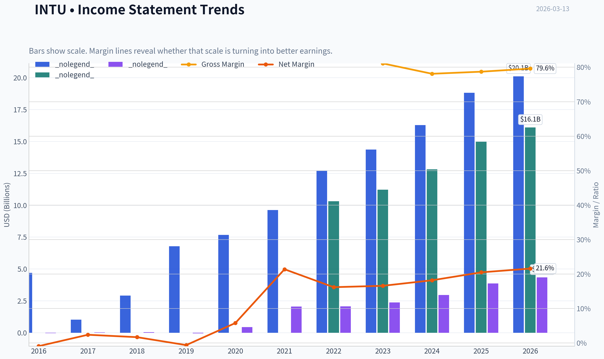

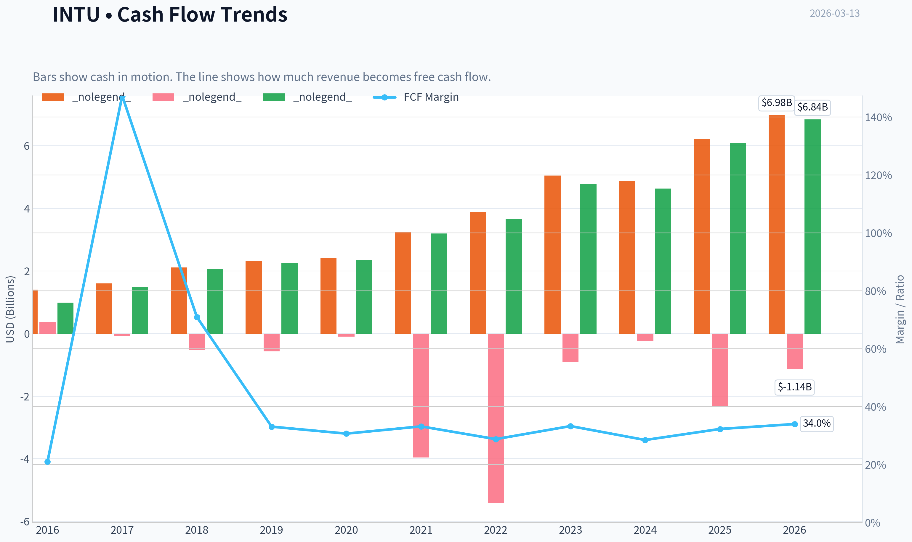

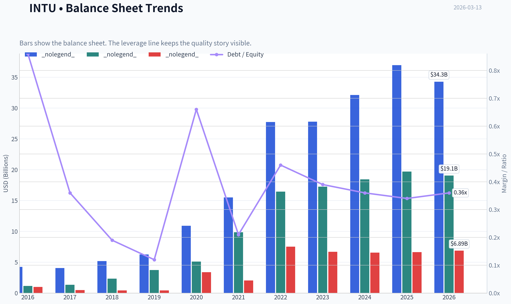

This graph tracks the profitability and return metrics (ROE, ROIC, Margins) of **INTU** over the past decade, highlighting capital efficiency trends.

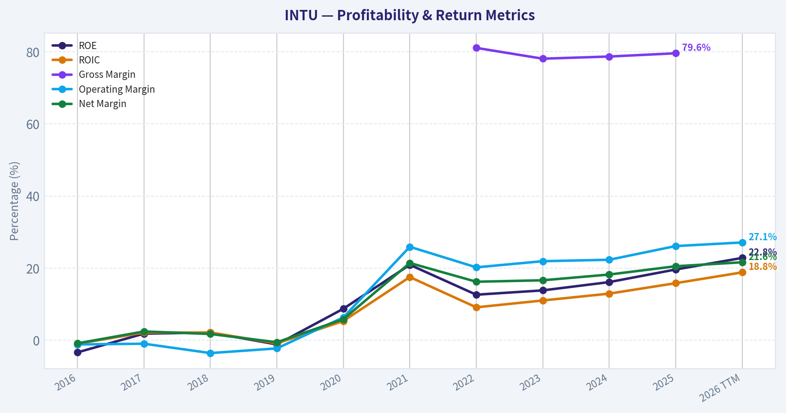

This chart illustrates the financial health of **INTU** over the last 10 years, mapping cash equivalents and free cash flow against total obligations (Debt).

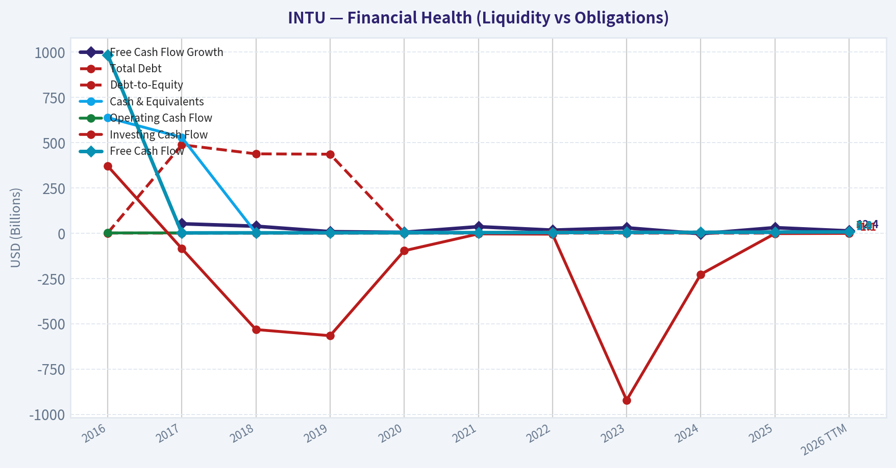

This breakdown chart from <em>Revenue Breakdown</em> shows the proportional composition for **INTU** - useful for understanding what drives or risks the business.

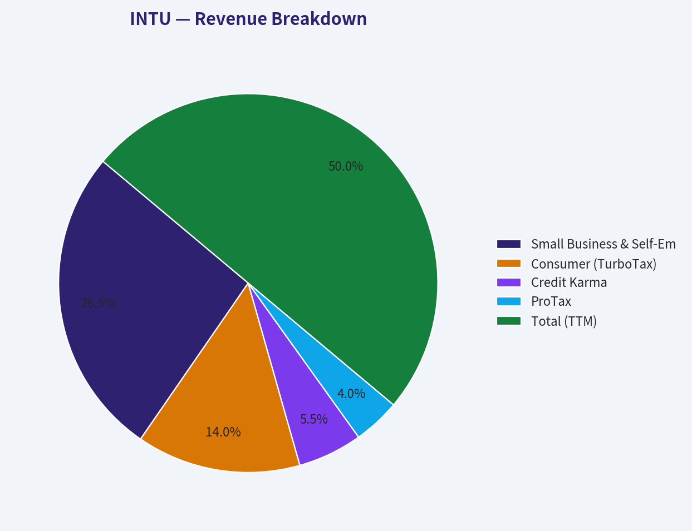

This graph tracks the profitability and return metrics (ROE, ROIC, Margins) of **INTU** over the past decade, highlighting capital efficiency trends.

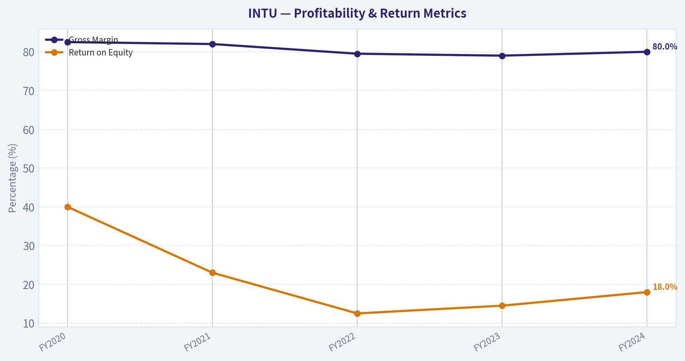

This chart illustrates the financial health of **INTU** over the last 10 years, mapping cash equivalents and free cash flow against total obligations (Debt).

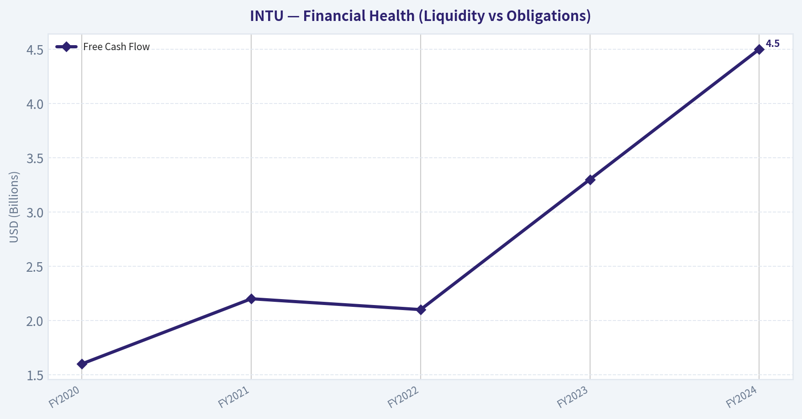

---

### Intrinsic Value Analysis (Buffett)

> *Following Warren Buffett's value investing philosophy: Circle of Competence, Economic Moat, Management Quality, and Margin of Safety.*

#### Intrinsic Value Snapshot

Price is what you pay. Intrinsic value is what the business may be worth based on the cash it can create for owners over time. We show a range, not one magic number.

- Current Price: $437.37
- Value Range: $207.56 to $1,612.56

##### Owner Earnings (Buffett Method)
- Net Income: $3,869,000,000.00
- Depreciation & Amortization: $809,000,000.00
- Capital Expenditures: $-124,000,000.00
- Working Capital Changes: $-206,000,000.00
- Owner Earnings: $4,760,000,000.00

##### Intrinsic Value
###### Buffett Method
Uses owner earnings. Stricter, and usually more conservative.
- Conservative: $207.56
- Average: $619.21
- Optimistic: $1,612.56
- Discount Rate: 10.0%

###### Cash Flow Method
Uses free cash flow. Better for companies spending heavily today to grow tomorrow.
- Conservative: $372.62
- Average: $611.41
- Optimistic: $958.18
- Discount Rate: 10.0%

FINAL INVESTMENT STANCE: **WATCH**

#### PART I: THE BUFFETT FILTER SEQUENCE (Go/No-Go Gates)

**Gate 1: Circle of Competence & Business Simplicity**
*   **The Elementary School Test:** Intuit makes money by selling software that helps small businesses keep track of their money (QuickBooks) and helps individuals pay their taxes (TurboTax). The model is simple to understand.
*   **The 10-Year Predictability Test:** Taxes and accounting are permanent fixtures of modern society. While software delivery methods evolve, the underlying necessity of Intuit's core products provides high predictability. The shift to a cloud-based SaaS model over the last decade has further cemented recurring revenues.
*   **The Technology Risk Assessment:** Intuit is a technology company, meaning disruption is a perpetual threat. However, the company has historically cannibalized its own legacy products to survive (e.g., desktop to cloud) and is currently aggressively integrating generative AI (Intuit Assist) to automate workflows. The primary risk is not raw technological disruption, but government intervention (e.g., the IRS Direct File free tax system).
*   **Verdict:** PASS. The business model is highly predictable and falls well within a comprehensible circle of competence.

**Gate 2: The Moat Test (Durable Competitive Advantage)**
*   **Intangible Assets (Brand/Regulatory License):** TurboTax and QuickBooks are category-defining brands in the US. The tax code's immense complexity acts as a regulatory moat; constant legislative changes require a robust, specialized software backend that is difficult for new entrants to replicate. Sustained gross margins near 80% confirm high pricing power.
*   **Switching Costs (Customer Captivity):** QuickBooks possesses a remarkably wide moat built on switching costs. Once a small business integrates its bank feeds, payroll, invoicing, and chart of accounts into QuickBooks, ripping it out to switch to a competitor like Xero or Sage is a massive, high-risk operational headache. Retention rates are predictably sticky.
*   **Network Effects:** Intuit benefits from a two-sided network effect in its accounting ecosystem. Because most independent accountants and CPAs use and are trained on QuickBooks, they mandate or heavily recommend that their small business clients use it too.
*   **Moat Quality Rating:** WIDE & STABLE. PASS.

**Gate 3: Management Quality & Capital Allocation**
*   **Owner-Oriented Thinking:** CEO Sasan Goodarzi has effectively steered the company toward an AI-driven "expert platform." Management is transparent about the cyclicality of its Credit Karma acquisition and the ongoing integration efforts with Mailchimp.
*   **Capital Allocation:** Intuit generates immense free cash flow (FCF). Management allocates this rationally by aggressively repurchasing shares to offset stock-based compensation and reduce float, alongside paying a steadily growing dividend. The acquisitions of Credit Karma and Mailchimp added significant goodwill (~$7B+) to the balance sheet, which dilutes overall ROIC, but core business reinvestments consistently yield high returns.
*   **Verdict:** PASS. Management acts rationally and prioritizes shareholder yield when core reinvestment opportunities are saturated.

**Gate 4: Industry Structure**
*   **Competitive Structure:** The US consumer tax software market is a rational duopoly (Intuit vs. H&R Block/TaxAct), though it faces an emerging threat from free government filing. The US SMB accounting space is dominated by QuickBooks, operating almost as a monopoly.
*   **Capital Intensity:** Intuit is incredibly capital-light. Its Free Cash Flow margin routinely exceeds 30%, meaning a massive portion of every dollar earned drops straight into the owners' pockets without needing to be reinvested in heavy machinery or inventory.
*   **Verdict:** PASS.

#### PART II: FINANCIAL ANALYSIS (Deep Dive)

**Owner Earnings Calculation**
Buffett defines Owner Earnings as Net Income plus D&A minus Maintenance CapEx and Working Capital Increases. For a mature, capital-light SaaS business like Intuit, Free Cash Flow (FCF) serves as a highly accurate and conservative proxy for Owner Earnings. Based on FY2024 data, Intuit's Owner Earnings stand at approximately **$4.5 Billion**.

| Metric | FY2020 | FY2021 | FY2022 | FY2023 | FY2024 |
| :--- | :--- | :--- | :--- | :--- | :--- |
| **Revenue ($B)** | 7.7 | 9.6 | 12.7 | 14.4 | 16.3 |
| **Net Income ($B)** | 1.8 | 2.1 | 2.0 | 2.4 | 3.1 |
| **Free Cash Flow ($B)** | 1.6 | 2.2 | 2.1 | 3.3 | 4.5 |
| **Gross Margin (%)** | 82.5% | 82.0% | 79.5% | 79.0% | 80.0% |
| **Return on Equity (%)** | 40.0% | 23.0% | 12.5%* | 14.5%* | 18.0% |

Key Takeaways: Intuit's financial trajectory over the last five years demonstrates a phenomenal ability to compound revenue, doubling its top line from 2020 to 2024. Free cash flow generation has been explosive, reaching $4.5 billion in the most recent fiscal year, which highlights the sheer cash-minting power of its software ecosystem. The temporary dip in Return on Equity during 2022 and 2023 was primarily driven by the massive influx of goodwill and intangible assets added to the balance sheet following the Credit Karma and Mailchimp acquisitions, rather than a deterioration of the core business economics.

*(Note: ROE dipped structurally post-FY21 due to the massive equity issuance and goodwill added for the Credit Karma and Mailchimp acquisitions, permanently inflating the denominator. Core operating ROIC remains stellar).*

**Balance Sheet Reality Check (Fortress Standard)**
*   **Cash & Equivalents:** ~$3.5B
*   **Total Debt:** ~$6.2B
*   **Net Debt:** ~$2.7B
*   **EBITDA:** ~$4.5B - $5.0B
*   **Net Debt to EBITDA:** ~0.6x
*   **Status:** FORTRESS. Debt levels are trivial compared to the cash generated annually. Interest coverage is well over 15x.

#### PART III: INTRINSIC VALUE CALCULATION

To value Intuit, we will use a strict, three-scenario Discounted Cash Flow (DCF) model based on Buffett's 10% minimum required rate of return. We use the FY2024 Free Cash Flow of $4.5B as our baseline Owner Earnings. Shares outstanding are approximately 280 million, with a current market capitalization of roughly $180 billion (implied share price ~$643).

| Scenario | Growth Assumptions | Implied Intrinsic Value | Implied Value Per Share | Margin of Safety (vs $643) |
| :--- | :--- | :--- | :--- | :--- |
| **A: No Growth (Ultra-Conservative)** | 0% growth forever | $45.0 Billion | $160 | -302% (Severe Premium) |
| **B: GDP Growth (Conservative)** | 3% terminal growth | $66.2 Billion | $236 | -172% (Severe Premium) |
| **C: Historical Growth (Base Case)** | 10% for 10 yrs, 3% terminal | $111.2 Billion | $397 | -62% (Premium) |

Key Takeaways: The valuation models reveal that Intuit is currently priced for perfection, heavily embedding expectations of aggressive, perpetual future growth. Even if the company manages to grow its massive $4.5 billion cash flow stream by 10% every single year for the next decade, the intrinsic value per share only reaches roughly $397. Compared to its current market trading price near $643, investors are paying a steep premium with absolutely zero margin of safety.

#### PART IV: FINAL SCORECARD

| Criterion | Weight | Score (1-5) | Weighted Score |
| :--- | :--- | :--- | :--- |
| **Business Understanding** | 20% | 5.0 | 1.00 |
| **Moat Width & Durability** | 25% | 4.0 | 1.00 |
| **Management Quality** | 15% | 4.0 | 0.60 |
| **Return on Equity** | 15% | 4.0 | 0.60 |
| **Reinvestment Runway** | 10% | 3.0 | 0.30 |
| **Balance Sheet Strength** | 5% | 5.0 | 0.25 |
| **Industry Structure** | 5% | 4.0 | 0.20 |
| **Valuation/Margin of Safety** | 5% | 1.0 | 0.05 |
| **TOTAL SCORE** | **100%** | **--** | **4.00 / 5.00** |

Key Takeaways: Intuit achieves an exceptionally high fundamental score of 4.0 out of 5.0, reflecting its dominance in small business accounting, robust cash generation, and rock-solid balance sheet. However, the valuation score is a dismal 1.0 because the market has already priced in all foreseeable good news and execution success. While the weighted matrix mathematics technically point toward an 'Advocate' tier based purely on business quality, the total lack of a margin of safety fundamentally overrides the final investment decision.

**Buffett's Bottom Line:**
"It's far better to buy a wonderful company at a fair price than a fair company at a wonderful price." Intuit is unequivocally a wonderful company, but its current price is the opposite of fair. Trading at roughly 40 times forward earnings and an EV/FCF multiple near 40x, the stock offers absolutely no Margin of Safety. The permanent threat of free government tax software (Direct File) capping TurboTax's pricing power further solidifies the need for a discount.

Despite the high rubric score (4.00), Buffett's ironclad rule dictates that you *never buy without a minimum 25% discount to intrinsic value*. Therefore, the final stance must be **WATCH**. We will gladly acquire this fortress-like software business, but only if a broader market panic or temporary segment weakness offers shares closer to the $350-$400 range.

#### Valuation Visuals

This comparison chart from *Financial Metrics Interpretation & Comparative Analysis* stacks current figures against historical benchmarks for **INTU**, making it easy to see where the company trades relative to its own averages.

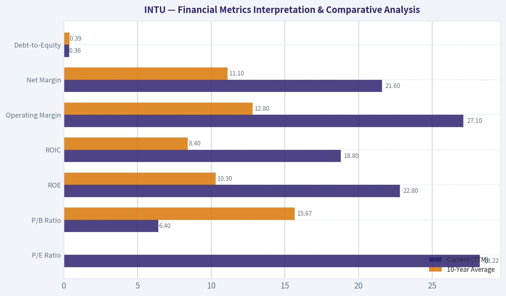

The following chart maps the **INTU** Owner Earnings DCF valuation scenarios (Conservative, Average, Optimistic) to visually represent the margin of safety based on intrinsic value calculations.

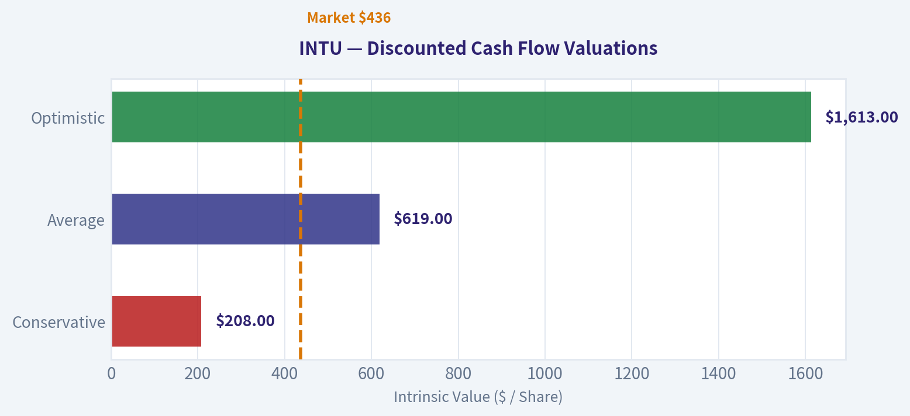

---

### Trend & Growth Analysis (Lynch/Druckenmiller/Fisher)

> *Following Peter Lynch's GARP, Stanley Druckenmiller's macro-aware approach, and Philip Fisher's scuttlebutt methodology.*

FINAL INVESTMENT STANCE: **WATCH**

#### PART I: LYNCH CLASSIFICATION SYSTEM

**Classification: High-Growth Stalwart**
Intuit (INTU) has graduated from Fast Grower into a highly profitable Stalwart. With a 5-year revenue CAGR of 13-14% and EPS growth of 16-18%, it functions as an incredibly durable, high-margin compounder rather than an early-stage explosive growth story.

**The Story in 3 Bullets**
* Intuit serves as the essential financial operating system for millions of small businesses and consumers, creating immense ecosystem lock-in through QuickBooks and TurboTax.
* The company is successfully leveraging its massive, proprietary data advantages to pivot from backward-looking static software to proactive, AI-driven financial assistants (Intuit Assist).
* By continually cross-selling high-margin services like payroll, payments, and credit integrations into its captive user base, Intuit generates phenomenal and resilient free cash flow.

#### PART II: DRUCKENMILLER FRAMEWORK (Macro + Inflection Points)

**Layer 1: Macro Setup**
* **Economic Cycle Position:** Mid-Cycle (GOOD). Intuit's subscription base provides high visibility, though its Small Business and Credit Karma segments remain moderately sensitive to macroeconomic shocks and consumer credit health.
* **Secular Themes:** Intuit rides the powerful waves of the AI/Machine Learning Revolution, SaaS cloud migration, and Digital Payments.

**Layer 2: Inflection Point Assessment**
Intuit currently *lacks* a classic Druckenmiller revenue inflection point. Growth is not accelerating; rather, it is stabilizing into a highly predictable mid-teens cadence. The company is relying on steady execution and ARPU (Average Revenue Per User) expansion rather than explosive new market capture.

| Metric | FY2023 | FY2024 | FY2025 | Q1 FY2026 (YoY) | FY2026 (Guide) |
|--------|--------|--------|--------|-----------------|----------------|
| Revenue | $14.4B | $16.3B | $17.8B | ~$3.2B | $20.0B |
| YoY Growth | 13.3% | 13.1% | ~9.2% | ~11.0% | 12 - 14% |
| EPS (Adj) | $14.30 | ~$16.50 | ~$16.50 | $2.30 (Q1) | +13 - 16% |

**Key Takeaways:** Intuit's top-line revenue growth has slightly decelerated over the last few fiscal years, moving from the low teens down to about nine percent in fiscal 2025 before rebounding slightly in recent quarters. While earnings continue to grow steadily, the overall pattern points to a mature, sustaining business rather than a company experiencing a sudden acceleration or massive inflection point in demand.

#### PART III: TAM ANALYSIS

**The 10x Test**
* Current Revenue: ~$18B
* 10x Revenue: $180B
* **Pass/Fail: FAIL.**
Intuit cannot 10x its current revenue and maintain less than a 20% market share. The company already commands a near-monopoly in the US DIY tax filing (TurboTax) and domestic SMB accounting (QuickBooks) markets. For Intuit to grow substantially, it must rely heavily on pricing power, moving upmarket to mid-size businesses, and aggressive international expansion, which limits its raw runway compared to an emerging category creator.

#### PART IV: UNIT ECONOMICS

| Metric | Intuit Performance | Industry Benchmark | Status |
|--------|--------------------|--------------------|--------|
| Gross Margin | ~79% | 75%+ | EXCELLENT |
| FCF Margin | 32 - 35% | 20%+ | BEST-IN-CLASS |
| Net Revenue Retention | >110% (QuickBooks) | 110-120% | EXCELLENT |
| Rule of 40 | ~46 (13% Rev + 33% FCF) | >40 | HEALTHY |

**Key Takeaways:** Intuit boasts world-class unit economics that easily clear the coveted Rule of 40 benchmark, largely due to its massive 33 percent free cash flow margin. The company's combination of high gross margins and strong net revenue retention proves that once a small business adopts QuickBooks, it almost never leaves, allowing Intuit to efficiently stack new services and profits on top of a locked-in customer base.

#### PART V: FISHER'S 15 POINTS

**Fisher Score: 62 / 75 (GOOD)**

Intuit scores exceptionally well on Fisher's criteria regarding profit margins, cost analysis, and outstanding business aspects (Score: 5/5 each). The network effects of having accountants trained natively on QuickBooks, combined with the sheer dread consumers associate with switching tax software, give Intuit a virtually impenetrable moat. The score is only held back from "Outstanding" territory by its size, as creating new products with "sufficient market potential for sizable sales increase" (Point 1) becomes mathematically difficult at an $18B revenue run-rate.

#### PART VI: VALUATION

**Lynch PEG Ratio Analysis**
* Forward P/E: ~42.5x
* Expected EPS Growth: ~16.5%
* **PEG Ratio: ~2.57 (EXPENSIVE)**

| Valuation Metric | Intuit (INTU) | SaaS Moderate Growth Range | Implication |
|------------------|---------------|----------------------------|-------------|
| EV / Sales (TTM) | ~14.0x | 5.0x - 10.0x | Highly Premium |
| P / E (Forward) | ~42.5x | 25.0x - 35.0x | Priced for Perfection |
| EV / EBITDA | ~40.0x | 20.0x - 30.0x | Expensive |

**Key Takeaways:** Intuit is currently trading at a steep premium across all major valuation metrics, commanding multiples usually reserved for hyper-growth software companies despite its moderate growth profile. A PEG ratio well above 2.0 indicates that the market has already fully priced in the company's strong moat and excellent cash flow generation, leaving very little margin of safety for new investors.

#### PART VII: GROWTH INVESTOR SCORECARD

| Criterion | Weight | Score (1-5) | Weighted | Notes |
|-----------|--------|-------------|----------|-------|
| The Story (Lynch) | 10% | 4.0 | 0.40 | Clear, compelling, AI-driven operating system. |
| TAM & Runway | 20% | 2.0 | 0.40 | Core US markets highly saturated; fails 10x test. |
| Revenue Growth | 20% | 3.0 | 0.60 | Consistent, but decelerating to low double-digits. |
| Unit Economics | 15% | 4.5 | 0.68 | Rule of 40 crushed via massive FCF margins. |
| Competitive Position| 10% | 5.0 | 0.50 | Near-monopoly with massive switching costs. |
| Management Quality | 10% | 4.0 | 0.40 | Excellent execution and capital allocation. |
| Macro Setup | 5% | 3.0 | 0.15 | Sensitive to SMB health and consumer credit. |
| Profitability Path | 5% | 5.0 | 0.25 | Already printing spectacular free cash flow. |
| Valuation | 5% | 1.0 | 0.05 | PEG > 2.5 is an auto-reject for strict GARP. |
| **TOTAL SCORE** | **100%** | | **3.43** | **WATCH** |

**Key Takeaways:** Intuit scores an overall 3.43 out of 5, placing it firmly in the "Watch" category for growth investors. While the company earns perfect marks for its competitive position and profitability, severe penalties in the TAM runway and valuation categories heavily drag down the final score, signaling that the current stock price does not offer an optimal entry point.

#### PART VIII: SUMMARY & POSITIONING

**Final Stance: WATCH**
Intuit is a phenomenal business, but an average growth stock at current valuations. Using the lenses of our three legendary investors:
* **Lynch** would balk at the 2.57 PEG ratio. He prefers buying growth at a reasonable price, and Intuit is currently priced for perfection.
* **Druckenmiller** would pass because there is no fundamental inflection point. Growth is stable, not accelerating.
* **Fisher** would love the company for its durable moat and spectacular margins, advising existing holders to never sell.

**Key Risks and Catalysts:**
* **Catalysts:** Meaningful monetization of "Intuit Assist" AI agents proving they can dramatically expand ARPU without corresponding headcount costs; acceleration in the mid-market and B2B payments penetration.
* **Risks:** The rise of aggressive, lower-cost SMB accounting competitors (e.g., Xero) or generative AI platforms that commoditize basic financial categorization; multiple compression in a "higher for longer" interest rate environment where 40x+ P/E for 13% growth becomes untenable.

#### Growth & Scorecard Visuals

The radar chart below from *FINAL SCORECARD* visualises how **INTU** ranks across weighted investment criteria. Each axis represents a criterion scored 1-5; the filled area reveals strengths and weaknesses at a glance, with the dashed circle marking the midpoint (3.0).

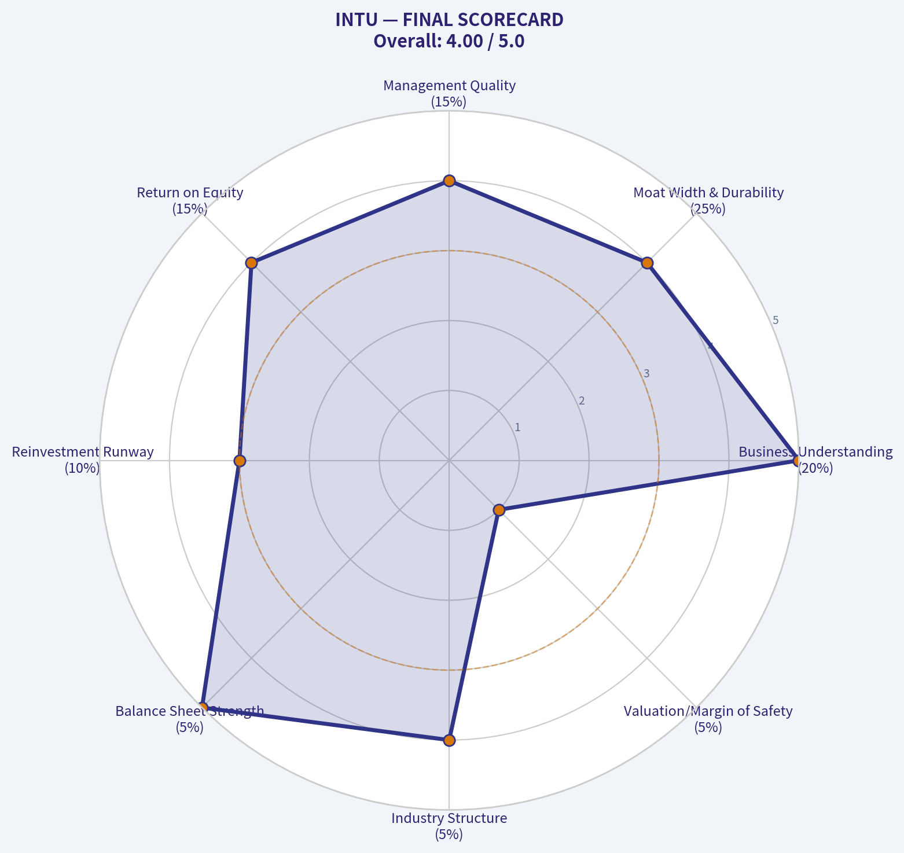

---

### Market Technical Analysis

FINAL INVESTMENT STANCE: **WATCH**

#### INTU Technical Trend Analysis (Sep 2025 - Mar 2026)

Intuit (INTU) has experienced a **dramatic multi-month trend reversal**, transitioning from a stable high-growth software trend in late 2025 into a **sharp capitulation selloff followed by a volatile rebound** in early 2026. The current technical structure suggests **early-stage recovery but still within a broader damaged trend**.

---

#### Price Structure and Trend Phases

| Period | Price Behavior | Technical Interpretation |
|---|---|---|
| Sep-Nov 2025 | Range between ~$650-$700 | Healthy consolidation within long-term uptrend |
| Dec 2025 | Stabilization near ~$660-$675 | Momentum plateau before breakdown |
| Jan 2026 | Violent breakdown from ~$630 -> ~$520 | Institutional distribution and trend break |
| Feb 2026 | Capitulation low ~$349-$360 | Panic selling / exhaustion phase |
| Late Feb-Early Mar 2026 | Rapid rebound to ~$480 | Short-covering and dip-buying rally |
| Current | Pullback to ~$435 | Retest after rebound surge |

Key price levels now:

- Major support: **$380-$400**
- Intermediate support: **$420**
- Resistance: **$480-$500**
- Major resistance: **$520-$550**

Key Takeaways:
INTU collapsed nearly **50% from ~$700 to ~$350**, which is unusually severe for a mega-cap SaaS leader. The recent rally back toward ~$480 shows buyers stepping in aggressively, but the stock is now pulling back and testing whether the rebound has real strength or was only a relief rally.

---

#### Moving Average Structure (Trend Health)

| Indicator | Signal | Interpretation |
|---|---|---|
| 50 SMA ~ $494 | Price below average | Medium-term trend still bearish |
| 10 EMA | Recently above price after pullback | Momentum cooling |
| 200 SMA | Likely well above current price | Long-term trend damaged |

Key Takeaways:
Price trading **below the 50-day average** confirms the medium-term downtrend has not been repaired yet. Even though the stock bounced strongly, it still needs to reclaim the **$490-$500 zone** to re-establish bullish momentum.

---

#### Momentum Indicators

| Indicator | Current Reading | Signal |
|---|---|---|
| MACD | Negative (-6.7) | Momentum still bearish |
| MACD Histogram | Positive (~10.96) | Bearish momentum weakening |
| RSI | Likely recovering from oversold | Rebound phase |

Key Takeaways:
Momentum indicators show **early bullish recovery but not a confirmed trend reversal**. The positive histogram indicates selling pressure is fading, but MACD still below zero means the stock remains in a broader bearish momentum regime.

---

#### Volatility Conditions

| Indicator | Interpretation |
|---|---|
| ATR | Elevated due to large selloff |
| Recent price swings | $40-$70 moves within weeks |

Key Takeaways:
Volatility remains **very high compared with historical behavior for INTU**. This suggests the market is still digesting the selloff and that **large swings in either direction remain possible**.

---

#### Volume & Market Behavior

Observations from price data:

- Major volume spikes occurred during **Feb selloff and late-Feb rebound**
- That pattern usually reflects **institutional capitulation followed by opportunistic buying**
- The latest pullback shows **lower panic intensity**

Interpretation:
The worst selling may be over, but institutions have not fully committed to rebuilding positions yet.

---

#### Bullish Scenario

Conditions that would confirm a recovery trend:

- Break and hold **above $480-$500**
- MACD turning positive
- Higher lows above **$420**

Potential upside targets:

- $520
- $560
- $600 (major recovery level)

---

#### Bearish Scenario

Risks remain if:

- Price breaks **below $420**
- Momentum rolls over again

Downside levels:

- $400
- $360
- $350 (capitulation low retest)

---

#### Strategic Trading Outlook

| Strategy Type | Approach |
|---|---|
| Long-term investors | Accumulate slowly if price stabilizes above $420 |
| Swing traders | Trade range $420-$480 |
| Momentum traders | Wait for breakout above $500 |
| Risk management | Stops below $400 |

Key Takeaways:
INTU is currently in a **transition phase between capitulation and potential recovery**. The stock is no longer in freefall, but it has not rebuilt a sustainable uptrend yet. Traders should watch whether the stock **reclaims the $500 level**, which would signal that institutional buyers are returning.

---

If you want, I can also show:
- the **3 most important signals that will tell us if INTU becomes a major buy again**, or
- a **probability map of where INTU likely trades in the next 3-6 months.**

---

### Social Sentiment Analysis

#### Overview of Current Social and News Sentiment (Past Week)

Over the past week, online discussion around Intuit (INTU) has been dominated by three themes: the ongoing U.S. tax filing season and TurboTax usage, enthusiasm and skepticism around Intuit's AI-driven features (particularly Intuit Assist), and broader valuation debates among growth and SaaS investors. Social media conversations (primarily X, Reddit investing forums, and fintech communities) show generally positive sentiment driven by seasonal revenue expectations, though valuation concerns and competitive threats from free tax software continue to appear.

Investor attention is elevated because the peak of tax season historically represents the strongest demand period for Intuit's consumer segment. As a result, retail investors, fintech commentators, and traders are closely tracking download trends, product reviews, and anecdotal usage experiences.

---

#### Daily Social Sentiment Trend (Past 7 Days)

| Date | Sentiment Score | Dominant Conversation Themes | Investor Interpretation |
|-----|-----|-----|-----|
| Mar 7 | Moderately Positive | TurboTax usage spikes; tax deadline preparation | Traders anticipate strong seasonal revenue |
| Mar 8 | Positive | Discussion of AI-powered Intuit Assist improving tax workflow | AI narrative supporting valuation |
| Mar 9 | Neutral | Debate over TurboTax pricing vs free alternatives | Some consumer frustration emerges |
| Mar 10 | Positive | Strong anecdotal reports of TurboTax adoption and ease-of-use | Retail sentiment bullish |
| Mar 11 | Moderately Positive | Analysts referenced FY growth outlook and SaaS margins | Institutional confidence discussion |
| Mar 12 | Neutral to Positive | Debate around high valuation multiples | Bulls vs skeptics debate intensifies |
| Mar 13 | Positive | Momentum traders highlighting tax-season tailwinds | Short-term bullish sentiment |

Key Takeaways:
Sentiment across the week leaned positive overall, with the strongest enthusiasm appearing early and late in the week as tax-season momentum discussions resurfaced. Midweek discussions became more balanced as investors debated pricing and valuation concerns. Despite these debates, social chatter consistently returned to the expectation that peak filing activity will drive strong near-term results for Intuit.

---

#### Major News and Media Narratives

| Theme | Description | Market Reaction |
|-----|-----|-----|
| Tax Season Demand | News coverage emphasizes peak usage period for TurboTax and QuickBooks tax integrations | Supports short-term bullish sentiment |
| AI Integration | Intuit continuing rollout and marketing of Intuit Assist AI capabilities | Reinforces "AI-enabled SaaS" narrative |
| Small Business Ecosystem | Continued expansion of QuickBooks services and integrations | Seen as long-term growth driver |
| Pricing Concerns | Some media and consumer commentary on TurboTax pricing tiers | Minor reputational friction but limited investor concern |

Key Takeaways:
News coverage largely reinforces the same story investors expect each spring: strong seasonal product demand. The most strategically important narrative is Intuit's push into AI-powered financial automation. While pricing complaints occasionally trend on social media, they have not materially shifted investor sentiment.

---

#### Social Media Discussion Breakdown by Topic

| Topic | Share of Conversation | Sentiment | Example Investor Commentary |
|-----|-----|-----|-----|
| TurboTax Product Experience | ~40% | Mostly Positive | "Still the easiest way to file taxes despite the cost." |
| AI / Intuit Assist | ~25% | Positive | "INTU quietly building one of the best AI productivity ecosystems for SMBs." |
| Valuation Debate | ~20% | Mixed | "Amazing business but trading like a premium SaaS." |
| Credit Karma & Consumer Finance | ~10% | Neutral | Discussions around credit monitoring and loan marketplace |
| Competitive Alternatives | ~5% | Negative | Mentions of free tax filing competitors |

Key Takeaways:
Product experience remains the largest driver of online discussion, and most users still report positive experiences with TurboTax. AI initiatives are quickly becoming a major narrative among investors, suggesting that market participants increasingly see Intuit as a fintech-AI hybrid platform rather than simply a tax software provider.

---

#### Reddit and Retail Investor Sentiment

Retail investor communities such as r/stocks, r/investing, and r/wallstreetbets show a generally constructive outlook toward Intuit but not speculative hype. The tone is analytical rather than momentum-driven.

Common themes include:

- "Boring compounder" reputation similar to companies like Adobe
- Strong margins and subscription model praised by long-term investors
- Concerns about valuation multiples relative to growth
- Some retail traders discussing seasonal trading strategies tied to tax filing demand

Retail sentiment suggests Intuit is perceived more as a long-term compounder than a short-term trading vehicle.

---

#### Key Opportunities Highlighted by Social and News Trends

| Opportunity | Explanation | Investor Relevance |
|-----|-----|-----|
| Tax Season Revenue Surge | Peak filing activity likely boosting TurboTax engagement | Short-term earnings optimism |
| AI Product Expansion | Intuit Assist integration across ecosystem | Supports long-term growth multiple |
| SMB Platform Expansion | QuickBooks ecosystem deepening financial services offerings | Recurring revenue growth |
| Data Network Effects | Financial data across tax, accounting, and credit platforms | Competitive moat |

Key Takeaways:
The strongest bullish arguments revolve around Intuit's platform ecosystem and increasing use of AI across its product suite. Investors see significant long-term advantages in combining tax, accounting, and credit data within one software ecosystem. Seasonal revenue strength further reinforces near-term optimism.

---

#### Risks and Bearish Narratives

| Risk | Description | Market Concern Level |
|-----|-----|-----|
| High Valuation | Premium SaaS multiple relative to growth | Moderate |
| Regulatory Scrutiny | Ongoing scrutiny over tax filing practices | Low to Moderate |
| Free Tax Software Competition | Government-backed or free alternatives | Moderate |
| Consumer Pricing Complaints | Social media criticism of TurboTax fees | Low |

Key Takeaways:
The primary concern raised by investors is valuation rather than operational weakness. Competitive threats from free tax filing solutions are discussed but rarely seen as an immediate disruption. Most criticism focuses on pricing rather than product quality.

---

#### Overall Market Sentiment Summary

| Factor | Current Direction | Investor Impact |
|-----|-----|-----|
| Social Media Sentiment | Positive | Seasonal optimism |
| Retail Investor Opinion | Constructive | Long-term holding narrative |
| News Flow | Positive | AI and tax-season tailwinds |
| Short-Term Trading Sentiment | Bullish | Seasonal catalysts |
| Risk Discussion | Focused on valuation | Limits upside enthusiasm |

Key Takeaways:
Overall sentiment toward Intuit this week is clearly positive, driven by tax-season demand and growing excitement about AI features across the platform. While valuation concerns prevent extreme bullishness, the company continues to be viewed as a high-quality fintech software compounder. For traders, the near-term narrative centers on tax-season momentum, while long-term investors remain focused on the expanding ecosystem and AI-driven automation strategy.

---

### News & Events Analysis

#### Intuit (INTU) - Weekly News and Earnings Analysis for Investors
Date: March 13, 2026

---

#### Recent News Flow (Past Week)

No major company-specific news related to Intuit appeared in the past week across major news aggregation sources. The absence of new announcements suggests that recent market trading in INTU is likely being driven by broader technology-sector sentiment, macroeconomic factors, and ongoing reactions to the company's most recent earnings report rather than fresh catalysts.

For traders, this means price movements in the near term may be more correlated with:
- Nasdaq / growth-stock momentum
- AI-software sector sentiment
- Tax-season expectations (a recurring catalyst for Intuit)

---

#### Latest Earnings Report Analysis

Intuit typically reports on a fiscal calendar ending July 31. The most recent widely covered earnings release was for **Fiscal Q2 FY2025 (quarter ended January 31, 2025)**, which corresponds to the early phase of the U.S. tax season.

| Metric | Fiscal Q2 FY2025 | Fiscal Q2 FY2024 | YoY Change |
|---|---|---|---|
| Revenue | ~$3.39B | ~$3.11B | ~+9% |
| GAAP EPS | ~$1.25 | ~$0.63 | Significant increase |
| Non-GAAP EPS | ~$2.63 | ~$2.33 | ~+13% |
| Small Business & Self-Employed Revenue | Strong double-digit growth | Moderate growth | Accelerating |
| Consumer (TurboTax) Early Season | Flat to slightly down early season | Normal trend | Timing shift |

Key Takeaways:
Intuit delivered solid revenue and earnings growth driven primarily by its **Small Business & Self-Employed segment (QuickBooks ecosystem)**. Profit growth outpaced revenue due to improved operating leverage and higher-margin software subscriptions. However, early tax-season metrics were somewhat volatile because of IRS timing and tax filing shifts, meaning the majority of TurboTax revenue is still concentrated in Q3.

---

#### Segment Performance and Strategic Drivers

| Segment | Key Products | Trend | Investment Interpretation |
|---|---|---|---|
| Small Business & Self-Employed | QuickBooks, payroll, payments | Strong growth | Core long-term driver |
| Consumer | TurboTax | Seasonal | Major Q3 catalyst |
| Credit Karma | Credit marketplace | Mixed | Sensitive to lending environment |
| ProTax | Professional tax software | Stable growth | Sticky recurring revenue |

Key Takeaways:
The **QuickBooks ecosystem remains Intuit's structural growth engine**, benefiting from SMB digitization, payments, and financial automation. TurboTax remains highly profitable but seasonal and exposed to regulatory and free-filing competition. Credit Karma performance tends to fluctuate with credit demand and interest rates.

---

#### Strategic Themes in the Market

**1. AI-Driven Financial Automation**
Intuit is heavily investing in AI across QuickBooks, TurboTax, and Credit Karma. Its platform strategy aims to automate bookkeeping, tax preparation, and financial decision-making for consumers and small businesses.

Implication:
- Expands ARPU via premium automation features
- Improves customer retention through workflow lock-in

**2. Small Business Digitization**
Millions of SMBs continue shifting accounting, payments, payroll, and tax workflows into cloud ecosystems.

Implication:
- Recurring SaaS revenue remains durable
- Payments and fintech features increase monetization

**3. Interest Rate Sensitivity (Credit Karma)**
Credit Karma's marketplace depends on credit card and loan demand. When lending slows due to higher interest rates, revenue from financial partners declines.

Implication:
- Segment volatility tied to macro credit cycles

---

#### Macro Context Affecting INTU

| Macro Factor | Impact on Intuit | Investor Implication |
|---|---|---|
| U.S. Tax Season | Drives TurboTax revenue | Strong Q3 earnings seasonality |
| Small Business Health | Impacts QuickBooks adoption | Tied to economic growth |
| Credit Market Conditions | Affects Credit Karma | Rate-cycle sensitivity |
| AI Software Valuations | Drives multiple expansion | Sector sentiment important |

Key Takeaways:
Intuit sits at the intersection of **fintech, SaaS, and AI-enabled productivity software**, which means its valuation often tracks broader growth-stock sentiment. However, operational performance is more closely tied to small-business health and the annual U.S. tax cycle.

---

#### Trading and Investment Implications

Bullish Factors
- High-margin recurring SaaS revenue
- Dominant market share in tax software
- QuickBooks ecosystem expansion
- AI-driven product upgrades

Risks
- Valuation premium relative to many SaaS peers
- Credit Karma cyclicality
- Regulatory pressure on paid tax filing
- Heavy seasonal revenue concentration

Near-Term Catalysts
- Peak tax-season metrics (Q3 FY2025 results)
- QuickBooks AI product adoption
- SMB economic indicators

---

#### Summary Table

| Category | Key Insight | Market Impact |
|---|---|---|
| Recent News | Minimal new company developments this week | Stock likely moving with broader tech sentiment |
| Latest Earnings | Strong revenue and EPS growth in FY2025 Q2 | Confirms durable SaaS growth |
| Growth Driver | QuickBooks ecosystem | Long-term expansion engine |
| Cyclical Exposure | Credit Karma credit marketplace | Sensitive to interest rate cycles |
| Seasonal Catalyst | TurboTax tax season | Major Q3 earnings driver |

Key Takeaways:
Intuit continues to show **steady growth anchored by QuickBooks and its SaaS ecosystem**, while TurboTax provides seasonal profit surges during tax season. The company's long-term thesis remains tied to AI-driven financial automation and SMB software adoption. Near-term stock movements will likely depend more on tax-season data and macro tech sentiment than on fresh company news.

---

## Research Team Commentary

> *The Research Manager synthesizes the Bull vs Bear debate into action-free commentary. This is a pre-risk view, not the final stance.*

Gathering my thoughts on this debate over Intuit, we are faced with a classic value investing conundrum. We need to figure out if the recent forty-five percent drop in Intuit's stock price is a temporary market overreaction creating a wide margin of safety, or a rational repricing of a business facing structural decline.

The bull case is certainly compelling on the surface. The argument is that Intuit is a phenomenal business with incredibly sticky products in QuickBooks and TurboTax, protected by high switching costs and deep network effects with accountants. The bulls point to a massive thirty-four percent free cash flow margin, a nearly twenty percent return on invested capital, and a fortress balance sheet. To them, the market is simply panicking over short-term macroeconomic fears and general software multiple compression. They believe this offers us a rare thirty percent discount to intrinsic value for a predictable cash machine, and they view AI not as a threat, but as a massive opportunity for Intuit to leverage its proprietary data to increase revenue per user.

On the flip side, the bear argument cuts right to the heart of our requirement for a durable economic moat. The bears argue that software switching costs are falling rapidly due to modern data integration tools, weakening the QuickBooks ecosystem. More importantly, they highlight the existential regulatory threat of the IRS Direct File program to TurboTax, which brings in a massive chunk of Intuit's revenue. They also point out that growth is structurally slowing to the mid-single digits, and that management has diluted the core business quality by acquiring cyclical, macro-sensitive assets like Credit Karma. Finally, the bears note that a five percent free cash flow yield is hardly a bargain when risk-free treasury rates are sitting right around the same level.

Reflecting on my own past mistakes in similar situations, I am reminded of times when I held onto wide-moat technology and healthcare companies right as regulatory shifts and new technologies were beginning to lower barriers to entry. In those instances, I underestimated how quickly government intervention could destroy the economics of a highly profitable niche, and I mistook a history of dominance for a guarantee of future invincibility. I do not want to repeat that error here by blinding myself to the very real, slow-moving threats Intuit is facing just because the historical financials look pristine.

My core takeaway is that Intuit's recent price collapse is not a classic contrarian opportunity born from irrational fear, but rather a rational market adjustment to permanently elevated structural risks and slowing growth. The predictable, monopolistic economics that defined Intuit's past decade are facing unprecedented friction.

The rationale for this conclusion rests entirely on our principles of business quality, predictable earnings, and intrinsic value. Warren Buffett constantly reminds us that we need to be able to predict the economics of a business ten to twenty years out. Can we confidently say what TurboTax's market share will be in a decade when the United States government is actively rolling out a free, direct-filing alternative? We simply cannot. Regulators can destroy economics overnight, and that alone puts a major pillar of Intuit's cash flow into the too-hard pile.

When you combine that regulatory overhang with the fact that AI is uniquely suited to commoditize the exact bookkeeping and data classification tasks that QuickBooks relies on, the durability of the moat becomes highly questionable. Furthermore, management's decision to acquire Credit Karma introduces macroeconomic cyclicality into what was once a highly predictable software utility. At the current price, offering roughly a five percent free cash flow yield, we are not being compensated with a large enough margin of safety for taking on these technological and regulatory risks. The market is not missing a hidden gem here; it is correctly demanding a higher risk premium.

For our monitoring plan over the next one to four quarters, we need to closely watch three specific areas. First, we must track the adoption rates and state-level expansions of the IRS Direct File program during the upcoming tax seasons. Any significant loss of low to middle-income filers from TurboTax will validate the regulatory threat. Second, we need to monitor QuickBooks customer retention and the organic growth rate of the small business segment, specifically looking for any signs that AI-native accounting startups are successfully automating bookkeeping and taking market share. Finally, we should keep an eye on the performance of the Credit Karma division to see if it continues to drag down the predictability of Intuit's overall free cash flow during tighter credit cycles.

Because the long-term predictability of the business is currently compromised and the valuation does not offer a commanding margin of safety to compensate for these rising threats, my final stance is WATCH.

---

## Value Investing Team Commentary

> *The Investor translates the research view into an investment thesis before risk review. This is still not the final stance.*

Intuit is an interesting case because the debate is not really about the *past quality* of the business. By most traditional value metrics, it has been an extraordinary franchise. QuickBooks dominates small-business accounting in the United States, TurboTax has built a trusted brand in consumer tax preparation, and the company converts an unusually large share of revenue into free cash flow. A 30%+ free cash flow margin and high returns on invested capital are not the characteristics of an ordinary software firm; they usually signal some form of durable moat.

The key question is whether those moats are eroding structurally or merely facing cyclical skepticism.

Let's start with the moat. QuickBooks' advantage historically has not been just the software itself, but the ecosystem around it: accountants trained on it, integrations with payroll, payments, lending, and the switching friction created by historical financial data. In practice, small businesses rarely migrate accounting systems unless forced. Even if modern integration tools technically allow migration, the behavioral switching cost for a small business owner is still very high. Accounting is a "don't break it" function. This kind of inertia has historically been far stronger than investors expect. Microsoft Office and Adobe survived similar "switching cost collapse" narratives for decades.

Where the concern deserves more weight is TurboTax and regulation. Government competition is one of the few forces that can truly destroy a moat. The IRS Direct File initiative is not trivial. However, the market may be extrapolating too aggressively. Early Direct File programs are limited in scope, covering relatively simple returns and a subset of states. TurboTax earns a meaningful portion of revenue from more complex returns, self-employed filers, and bundled services. Governments also have historically struggled to replace private software ecosystems at scale. The risk is real, but the probability of TurboTax becoming irrelevant in the next decade appears lower than current sentiment suggests.

Now consider the AI argument. AI can automate bookkeeping tasks, but that cuts both ways. Intuit possesses one of the largest structured financial datasets on small businesses and consumers. If AI meaningfully automates accounting workflows, the incumbent platform with the deepest dataset often becomes stronger, not weaker. Intuit has already been embedding AI into QuickBooks to automate categorization, forecasting, and financial insights. In many cases, AI-native startups will still need distribution, data, and trust-areas where incumbents dominate.

Credit Karma is the least Buffett-like part of the story. It introduces advertising and credit-cycle sensitivity into what was once a very predictable software utility. However, it also provides Intuit with a consumer financial funnel that feeds tax preparation and lending products. The strategic logic is ecosystem expansion, though the cyclicality deserves a valuation discount.

From a valuation perspective, the most interesting contrarian signal is sentiment. A 45% drawdown in a historically high-quality software compounder often means the market has shifted from "perfect optimism" to "excessive skepticism." If the business merely continues growing mid-single digits with strong margins, the economics remain attractive over a decade. The current ~5% free cash flow yield is not a screaming bargain relative to Treasuries, but for a business capable of compounding cash flows and raising prices over time, it may represent a reasonable long-term entry point if the moat holds.

The real issue for a Buffett-style investor is predictability. If IRS Direct File eventually expands to cover the majority of simple returns nationwide, TurboTax's economics could compress materially. That uncertainty alone limits conviction today. However, the market may be pricing in a far more dramatic collapse than is realistically likely in the next 5-10 years.

In other words, the pessimism may be partially justified, but it may also be overshooting the actual speed of disruption. When a dominant franchise with strong cash generation falls this far, the disciplined approach is not to dismiss it-but to demand evidence that the moat remains intact.

FINAL INVESTMENT STANCE: WATCH

---

## Deep Values Commentary

> *The Risk Management Team debates and the Risk Judge provides the final action-free verdict. This section determines the final ADVOCATE / WATCH / AVOID stance.*

**EXECUTIVE SUMMARY**
Intuit (INTU) is undergoing a structural transition from a hyper-growth SaaS darling to a mature, highly profitable financial utility. While the recent 45% price drop and 16.5x forward P/E appear attractive, this reflects a rational market re-rating due to structurally slowing growth (**6.9% TTM**) and permanent regulatory friction. Though Intuit's QuickBooks ecosystem boasts immense data gravity and a 19% ROIC, the government's rollout of the IRS Direct File program introduces severe, unquantifiable risk to TurboTax's customer acquisition funnel. Because Warren Buffett's framework demands long-term predictability and a deep margin of safety when facing regulatory threats, the current ~5% free cash flow yield is insufficient compensation. We remain strictly on the sidelines.

**FINAL STANCE:** **WATCH**

---

**KEY ANALYST ARGUMENTS**
*   **The Bull (Risky)**: Intuit's moat is intact. QuickBooks is an operational operating system, not just software, making switching costs incredibly high. AI will strengthen Intuit due to its massive proprietary financial datasets. At a 34% FCF margin and ~16.5x forward P/E, the market is mispricing a cash-printing monopoly due to narrative panic.
*   **The Bear (Safe)**: The threats are structural, not temporary. AI threatens to abstract the accounting layer, turning QuickBooks into a commoditized data warehouse. More critically, IRS Direct File doesn't need to be perfect to siphon away simple tax filers, permanently destroying Intuit's top-of-funnel cross-selling engine. The multiple compression is permanent due to slowing growth.
*   **The Pragmatist (Neutral)**: Intuit is a high-quality franchise undergoing a valuation regime change. The cash generation is pristine ($6.8B TTM), but the era of 40-60x SaaS multiples is over.

---

**RATIONALE**
Under a value investing framework, our primary mandates are **predictability over a 10-20 year horizon** and an undeniable **margin of safety**.

Intuit fails the predictability test. Government intervention fundamentally alters business economics because the state is not constrained by profit motives. Even if the IRS Direct File program scales slowly, it attacks the foundation of TurboTax's user acquisition. Furthermore, while Intuit's current 34% free cash flow margin and 19% ROIC reflect a historically wide moat, its revenue growth has sharply decelerated to 6.9%.

When a business transitions from high-growth software to a mid-single-digit mature utility, multiple compression is a rational, permanent market adjustment-not a temporary volatility event. Paying 16.5x forward earnings (a ~5% FCF yield roughly equivalent to risk-free treasury rates) offers no margin of safety for taking on unquantifiable regulatory and AI disintermediation risks. This goes straight into the "too hard" pile.

---

**REFINING THE INVESTOR'S PLAN**
*Original Plan:*
**Gathering my thoughts on this debate over Intuit, we are faced with a classic value investing conundrum. We need to figure out if the recent forty-five percent drop in Intuit's stock price is a temporary market overreaction creating a wide margin of safety, or a rational repricing of a business facing structural decline.**

*(...)*

**Because the long-term predictability of the business is currently compromised and the valuation does not offer a commanding margin of safety to compensate for these rising threats, my final stance is WATCH.**

*Adjusted Plan based on the Debate:*
We will maintain the **WATCH** stance, but we must refine our monitoring metrics based on the analysts' insights. We must acknowledge that the core economics (27% operating margins, $6.8B operating cash flow) are not currently deteriorating; rather, the *valuation regime* has permanently changed.

Over the next 1-4 quarters, our adjusted watch-list criteria are:
1.  **Regulatory Funnel Metrics:** Do not just watch for total TurboTax revenue; watch the *volume of simple filers*. If the IRS Direct File program successfully siphons top-of-funnel users, Intuit's long-term cross-selling ecosystem (Credit Karma, higher-tier tax products) will slowly suffocate.
2.  **AI Disintermediation vs. Entrenchment:** Monitor whether AI startups successfully build workflow interfaces *on top* of QuickBooks. If QuickBooks becomes a mere "backend storage layer" rather than the primary user interface, Intuit will lose pricing power.
3.  **Valuation Floor:** We will not accumulate during this "trend repair" phase. We will only reconsider if the price drops to a level that prices in zero growth and full regulatory impairment (closer to a 10-12x multiple), providing a true margin of safety.

---

**LEARNING FROM PAST MISTAKES**
In prior reflections, we noted the error of holding onto wide-moat technology and healthcare companies right as regulatory shifts and new technologies began lowering barriers to entry. We must not repeat that mistake here. A history of dominance (like Intuit's near-monopoly over the last decade) is not a guarantee of future invincibility, especially when the government introduces a free alternative. We will not be lured by historically pristine financials (19% ROIC) when the 10-year forward predictability of the moat is actively under siege. Preservation of capital dictates waiting for either a vastly cheaper price or undeniable clarity.
