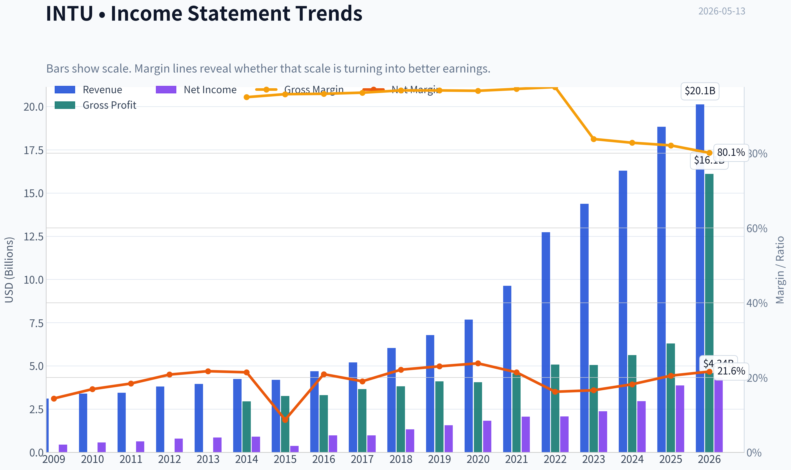
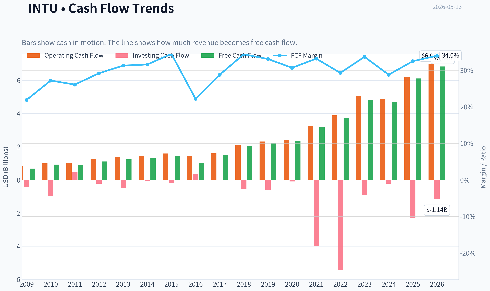
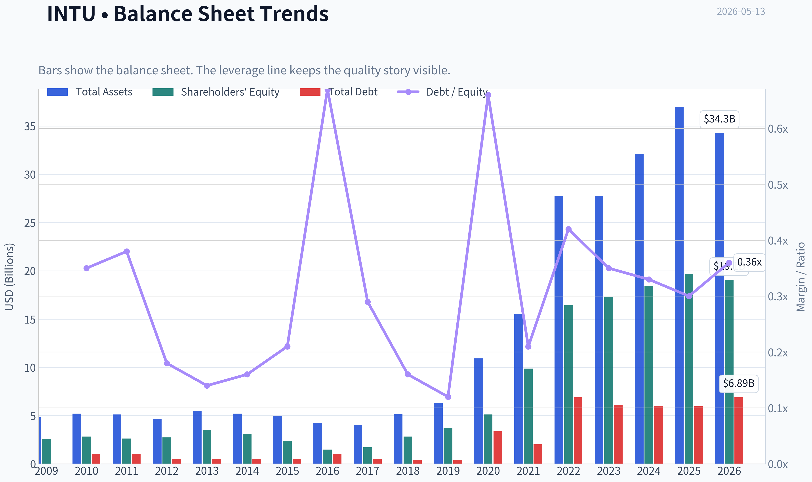
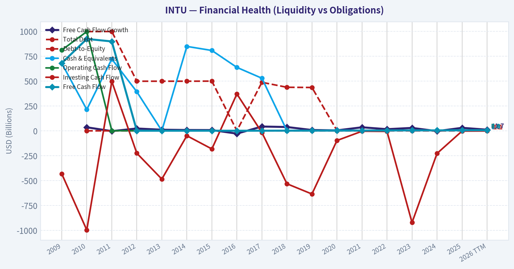
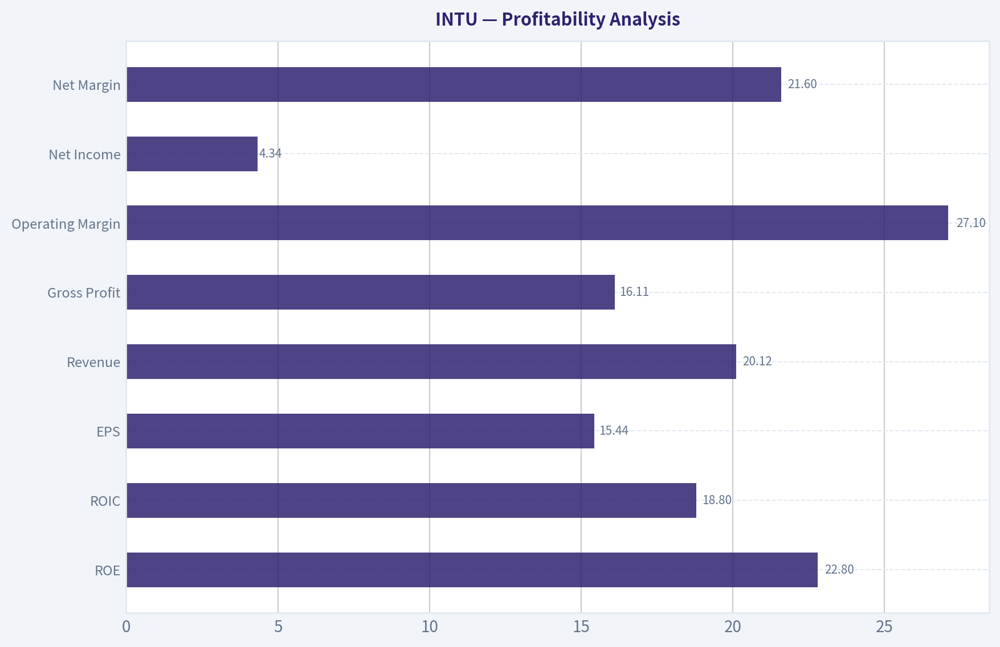
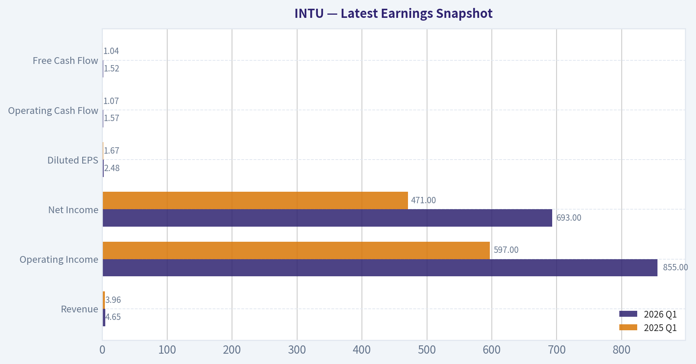
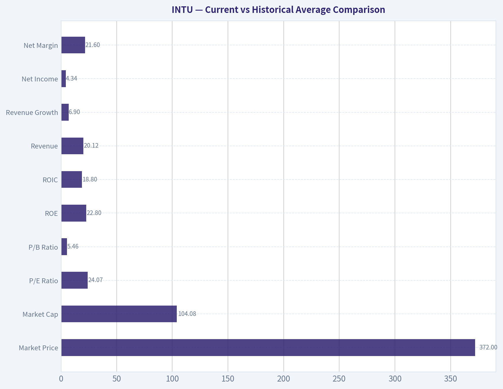
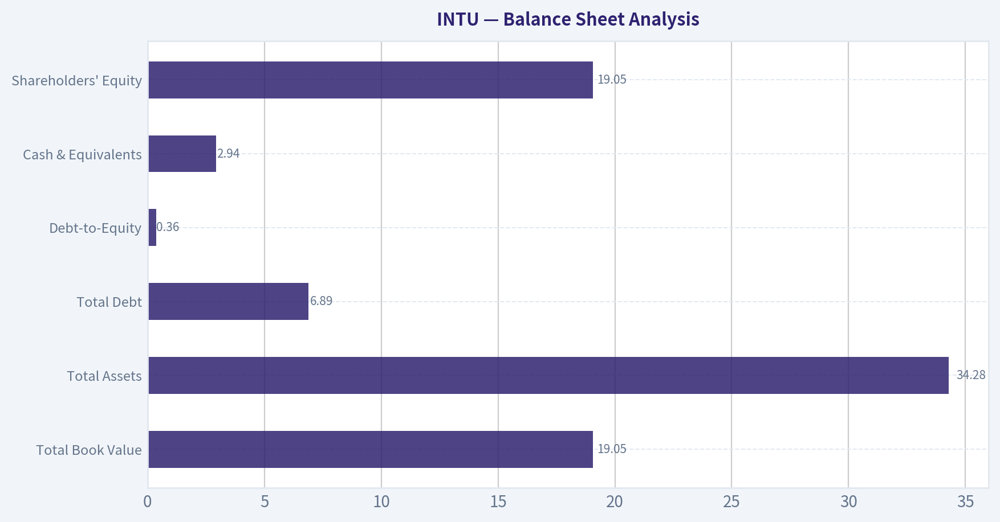
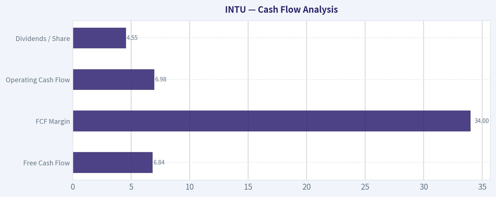
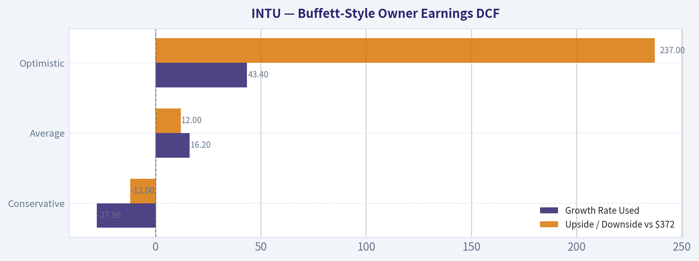

# INTU Deep Value Intelligence

**Analysis Date:** 2026-05-13

## Critical Disclaimer

*This analysis is generated by Deep Value Intelligence, an AI-powered multi-agent investing framework. This report is for informational and educational purposes only and does not constitute financial advice. Always conduct your own research and consult with qualified financial advisors before making investment decisions.*

---

## Table of Contents

1. Intelligence Summary
2. Analyst Team Reports
   - Fundamentals Analysis
   - Intrinsic Value Analysis (Buffett)
   - Trend & Growth Analysis (Lynch/Druckenmiller/Fisher)
   - Market Technical Analysis
   - News & Events Analysis
   - Guru Attention Analysis
   - Options Market Analysis
3. Research Team Commentary
4. Value Investing Team Commentary
5. Deep Values Commentary

---

## Intelligence Summary

### Thesis + Conditions

**Core Thesis:** ## Executive Briefing

**Key Risks:**
- Intuit looks like a **high-quality, durable franchise**, but **not a clear bargain** at $372. The main risk is **not business fragility**; it is **paying a fair-to-full price before AI benefits and growth durability are fully proven**. For a Buffett-style long-term investor, that means **admire the business, but keep valuation discipline**. Best course: **monitor closely, consider only modest accumulation if portfolio needs quality, and wait for either a better price or stronger evidence of moat expansion.**
- ## Risk Commentary for the Long-Term Investor
- The **bull case on business quality is strong enough** that Intuit should remain **high on the watchlist**, not treated as a marginal idea.
- So the refined plan is: **stay in WATCH**, with room for **small, selective accumulation only if you intentionally want exposure to a premium-quality compounder despite limited margin of safety**.
- These numbers support the idea that Intuit is **not a weak or deteriorating software company**, but a profitable franchise with solid capital efficiency. From a Buffett lens, that lowers **business risk**.

**What Would Change Our View:**
- Intuit looks like a **high-quality, durable franchise**, but **not a clear bargain** at $372. The main risk is **not business fragility**; it is **paying a fair-to-full price before AI benefits and growth durability are fully proven**. For a Buffett-style long-term investor, that means **admire the business, but keep valuation discipline**. Best course: **monitor closely, consider only modest accumulation if portfolio needs quality, and wait for either a better price or stronger evidence of moat expansion.**
- ## Risk Commentary for the Long-Term Investor
- The **bull case on business quality is strong enough** that Intuit should remain **high on the watchlist**, not treated as a marginal idea.
- So the refined plan is: **stay in WATCH**, with room for **small, selective accumulation only if you intentionally want exposure to a premium-quality compounder despite limited margin of safety**.
- These numbers support the idea that Intuit is **not a weak or deteriorating software company**, but a profitable franchise with solid capital efficiency. From a Buffett lens, that lowers **business risk**.

**Confidence:** Medium

---

## Analyst Team Reports

### Fundamentals Analysis

#### Latest Earnings Snapshot

*Most recent reported quarter anchored on 2026 Q1, with prior-year comparison when available.*

| Metric | 2026 Q1 | 2025 Q1 | YoY Change |
| --- | ---: | ---: | ---: |
| Revenue | $4.65B | $3.96B | +17.4% |
| Operating Income | $855.0M | $597.0M | +43.2% |
| Net Income | $693.0M | $471.0M | +47.1% |
| Diluted EPS | $2.48 | $1.67 | +48.5% |
| Operating Cash Flow | $1.57B | $1.07B | +46.9% |
| Free Cash Flow | $1.52B | $1.04B | +46.8% |

Key Takeaways: This snapshot anchors the most recent reported quarter before the narrative analysis. It helps readers separate long-run business quality from whatever changed in the latest earnings print.

#### 10-Year Financial Metrics for INTU

*All values below are computed deterministically from raw data - not estimated by AI.*

*Issuer profile: operating company (Technology / Software - Application).*

#### 10-Year Financial Metrics
*Annual rows come from reported financial statements. The final TTM row is computed from the latest four quarters.*

| Metric | 2009 | 2010 | 2011 | 2012 | 2013 | 2014 | 2015 | 2016 | 2017 | 2018 | 2019 | 2020 | 2021 | 2022 | 2023 | 2024 | 2025 | 2026 TTM |
| --- | --- | --- | --- | --- | --- | --- | --- | --- | --- | --- | --- | --- | --- | --- | --- | --- | --- | --- |
| Market Price | $26 | $35 | $41 | $52 | $57 | $74 | $97 | $103 | $129 | $194 | $265 | $295 | $513 | $444 | $502 | $639 | $780 | $372 |
| Market Cap | $9.80B | $12.92B | $14.80B | $17.70B | $19.37B | $23.85B | $30.25B | $29.41B | $35.81B | $53.31B | $73.21B | $80.88B | $144.68B | $129.55B | $144.81B | $183.85B | $222.19B | $104.08B |
| P/E Ratio | 22.00 | 22.46 | 23.35 | 22.32 | 22.59 | 26.27 | 82.63 | 30.08 | 36.30 | 40.13 | 47.08 | 44.27 | 70.10 | 62.66 | 60.77 | 62.07 | 57.43 | 24.07 |
| P/B Ratio | 3.83 | 4.58 | 5.66 | 6.45 | 5.49 | 7.75 | 12.97 | 19.71 | 21.08 | 18.93 | 19.53 | 15.84 | 14.66 | 7.88 | 8.39 | 9.97 | 11.27 | 5.46 |
| ROE | 17.5% | 20.3% | 24.2% | 28.9% | 24.3% | 29.5% | 15.7% | 65.6% | 58.0% | 47.2% | 41.5% | 35.8% | 20.9% | 12.6% | 13.8% | 16.1% | 19.6% | 22.8% |
| ROIC | 28.7% | 19.8% | 22.4% | 27.7% | 28.3% | 29.7% | 18.5% | 43.6% | 57.7% | 76.7% | 79.3% | 88.0% | 35.3% | 14.0% | 12.3% | 14.7% | 18.1% | 18.8% |
| EPS | $1.19 | $1.55 | $1.76 | $2.31 | $2.54 | $2.83 | $1.17 | $3.42 | $3.55 | $4.82 | $5.63 | $6.66 | $7.32 | $7.09 | $8.42 | $10.43 | $13.67 | $15.44 |
| Revenue | $3.11B | $3.40B | $3.45B | $3.81B | $3.95B | $4.24B | $4.19B | $4.69B | $5.20B | $6.03B | $6.78B | $7.68B | $9.63B | $12.73B | $14.37B | $16.29B | $18.83B | $20.12B |
| Gross Profit | $2.95B | $3.26B | $3.31B | $3.66B | $3.82B | $4.11B | $4.05B | $4.56B | $5.08B | $5.05B | $5.62B | $6.30B | N/A | N/A | N/A | N/A | N/A | $16.11B |
| Gross Margin | 95.0% | 95.8% | 95.9% | 96.2% | 96.8% | 96.8% | 96.7% | 97.2% | 97.7% | 83.8% | 82.8% | 82.1% | N/A | N/A | N/A | N/A | N/A | 80.1% |
| Operating Margin | 22.0% | 26.6% | 31.4% | 30.7% | 30.6% | 30.6% | 17.6% | 26.5% | 27.3% | 25.9% | 27.3% | 28.3% | 26.0% | 20.2% | 21.9% | 22.3% | 26.1% | 27.1% |
| Net Income | $447.0M | $574.0M | $634.0M | $792.0M | $858.0M | $907.0M | $365.0M | $979.0M | $985.0M | $1.33B | $1.56B | $1.83B | $2.06B | $2.07B | $2.38B | $2.96B | $3.87B | $4.34B |
| Net Margin | 14.4% | 16.9% | 18.4% | 20.8% | 21.7% | 21.4% | 8.7% | 20.9% | 19.0% | 22.1% | 23.0% | 23.8% | 21.4% | 16.2% | 16.6% | 18.2% | 20.5% | 21.6% |
| Revenue Growth | N/A | 9.5% | 1.4% | 10.4% | 3.6% | 7.5% | -1.2% | 12.0% | 10.7% | 16.0% | 12.6% | 13.2% | 25.4% | 32.1% | 12.9% | 13.3% | 15.6% | 6.9% |
| Net Income Growth | N/A | 28.4% | 10.5% | 24.9% | 8.3% | 5.7% | -59.8% | 168.2% | 0.6% | 34.9% | 17.2% | 17.3% | 12.9% | 0.2% | 15.4% | 24.3% | 30.6% | 12.2% |
| Free Cash Flow Growth | N/A | 35.7% | -2.7% | 23.6% | 11.3% | 8.5% | 7.8% | -27.9% | 43.4% | 38.5% | 8.4% | 4.8% | 35.8% | 16.7% | 29.6% | -3.0% | 30.5% | 11.7% |
| Total Book Value | $2.56B | $2.82B | $2.62B | $2.74B | $3.53B | $3.08B | $2.33B | $1.49B | $1.70B | $2.82B | $3.75B | $5.11B | $9.87B | $16.44B | $17.27B | $18.44B | $19.71B | $19.05B |
| Total Assets | $4.83B | $5.20B | $5.11B | $4.68B | $5.49B | $5.20B | $4.97B | $4.25B | $4.07B | $5.13B | $6.28B | $10.93B | $15.52B | $27.73B | $27.78B | $32.13B | $36.96B | $34.28B |
| Total Debt | N/A | $998.0M | $999.0M | $499.0M | $499.0M | $499.0M | $500.0M | $1.00B | $488.0M | $438.0M | $436.0M | $3.37B | $2.03B | $6.91B | $6.12B | $6.04B | $5.97B | $6.89B |
| Debt-to-Equity | N/A | 0.35 | 0.38 | 0.18 | 0.14 | 0.16 | 0.21 | 0.67 | 0.29 | 0.16 | 0.12 | 0.66 | 0.21 | 0.42 | 0.35 | 0.33 | 0.30 | 0.36 |
| Cash & Equivalents | $679.0M | $214.0M | $722.0M | $393.0M | $1.01B | $849.0M | $808.0M | $638.0M | $529.0M | $1.46B | $2.12B | $6.44B | $2.56B | $2.80B | $2.85B | $3.61B | $2.88B | $2.94B |
| Shareholders' Equity | $2.56B | $2.82B | $2.62B | $2.74B | $3.53B | $3.08B | $2.33B | $1.49B | $1.70B | $2.82B | $3.75B | $5.11B | $9.87B | $16.44B | $17.27B | $18.44B | $19.71B | $19.05B |
| Operating Cash Flow | $812.0M | $998.0M | $1.01B | $1.25B | $1.37B | $1.45B | $1.59B | $1.46B | $1.60B | $2.11B | $2.32B | $2.41B | $3.25B | $3.89B | $5.05B | $4.88B | $6.21B | $6.98B |
| Investing Cash Flow | $-432.0M | $-997.0M | $497.0M | $-225.0M | $-485.0M | $-49.0M | $-182.0M | $371.0M | $-17.0M | $-532.0M | $-635.0M | $-97.0M | $-3.96B | $-5.42B | $-922.0M | $-227.0M | $-2.32B | $-1.14B |
| Free Cash Flow | $681.0M | $924.0M | $899.0M | $1.11B | $1.24B | $1.34B | $1.45B | $1.04B | $1.50B | $2.07B | $2.25B | $2.35B | $3.20B | $3.73B | $4.84B | $4.69B | $6.12B | $6.84B |
| FCF Margin | 21.9% | 27.2% | 26.1% | 29.2% | 31.3% | 31.6% | 34.5% | 22.2% | 28.8% | 34.4% | 33.1% | 30.7% | 33.2% | 29.3% | 33.7% | 28.8% | 32.5% | 34.0% |
| Dividends / Share | $0.00 | $0.00 | $0.00 | $0.00 | $0.00 | $0.00 | $0.00 | $0.00 | $0.00 | $0.00 | $0.00 | $0.00 | $0.00 | $2.65 | $3.14 | $3.64 | $4.20 | $4.55 |

#### Profitability Metrics
- Return on Equity (ROE): 19.6%
- Return on Invested Capital (ROIC): 17.3%
- Return on Assets (ROA): 10.5%
- Gross Margin: N/A
- Operating Margin: 26.1%
- Net Profit Margin: 20.5%

#### Liquidity Metrics
- Current Ratio: 1.36
- Quick Ratio: 0.49

#### Leverage Metrics
- Debt-to-Equity Ratio: 0.30
- Interest Coverage Ratio: 19.93
- Net Debt: $3.09B

#### Growth Metrics (Year-over-Year)
- Revenue Growth: 15.6%
- Net Income Growth: 30.6%
- Free Cash Flow Growth: 30.5%
- Revenue CAGR (3-Year): 14.0%
- Revenue CAGR (5-Year): 19.7%

#### Valuation Metrics
- P/E Ratio (TTM): 24.22
- Forward P/E: 14.04
- Price-to-Book: 5.41
- Price-to-Sales: 5.14
- PEG Ratio: 1.00
- EV/EBITDA: 17.47
- Free Cash Flow Yield: 5.9%
- Earnings Yield: 4.1%

#### Owner Earnings (Buffett Method, Code-Computed)
- Net Income: $3.87B
- + Depreciation & Amortization: $809.0M
- - Capital Expenditures: $-84.0M
- - Working Capital Changes: $-206.0M
- = **Owner Earnings: $4.80B**

#### Intrinsic Value (Code-Computed)
- Current Price: $372
- Buffett Method (Owner Earnings):
  Conservative: $326
  Average: $416
  Optimistic: $1,254
- Cash Flow Method (FCF):
  Conservative: $353
  Average: $464
  Optimistic: $835

#### Piotroski F-Score: 8/9
- Positive Net Income: PASS
- Positive Operating Cash Flow: PASS
- ROA Improvement: PASS
- Cash Flow > Net Income: PASS
- Decreasing Debt: PASS
- Improving Current Ratio: PASS
- No Dilution: PASS
- Improving Gross Margin: FAIL
- Improving Asset Turnover: PASS

ANALYST STANCE: **WATCH**

#### Intuit (INTU) - Buffett-Style Fundamental Analysis

Intuit remains a very high-quality software business with strong recurring revenue characteristics, excellent free-cash-flow generation, high returns on capital, and a balance sheet that is comfortably manageable. From a Buffett lens, the business itself still looks attractive: durable franchises in TurboTax, QuickBooks, Credit Karma, and Mailchimp create ecosystem stickiness, pricing power, and customer retention that support a real economic moat.

The issue is less business quality and more the mix of valuation, growth durability, and execution risk. The current share price of **$372** is dramatically below the **$780** peak shown for 2025, which has compressed valuation multiples sharply. That makes the stock far more interesting than it was when trading at 57-70x earnings. Even so, while today's multiple is much more reasonable, INTU is not obviously a deep-value bargain unless one assumes strong owner-earnings growth continues for years. The company looks like a quality compounder on sale, but not yet a no-brainer Buffett-style fat pitch.

---

#### Current vs Historical Average Comparison

| Metric | Current / TTM | Historical Context | Interpretation |
| --- | ---: | ---: | --- |
| Market Price | **$372** | Peak of **$780** in 2025 | Large derating; sentiment and multiple compression have been severe. |
| Market Cap | **$104.08B** | 2025: **$222.19B** | Equity value has nearly halved from the recent peak despite continued business growth. |
| P/E Ratio | **24.07** | Long history mostly **22x-82x**, recent years **57x-70x** | Valuation is now near the low end of the long-term range and far below recent norms. |
| P/B Ratio | **5.46** | Often **8x-21x** in prior years | Also near the low end of history; cheaper relative to book than usual. |
| ROE | **22.8%** | Decade generally high, often **20%+** | Strong and improving again after acquisition-related dilution. |
| ROIC | **18.8%** | Historically exceptional, especially 2016-2020 and still solid post-acquisition | Remains strong, though below pre-2021 peak efficiency. |
| Revenue | **$20.12B** | 2025: **$18.83B** | Business continues to scale despite stock-price weakness. |
| Revenue Growth | **6.9%** | 10-year pattern mostly high single to low double digits, with 2021-2022 spike | Growth has slowed versus recent years, but remains positive. |
| Net Income | **$4.34B** | 2025: **$3.87B** | Earnings continue to rise. |
| Net Margin | **21.6%** | Mostly mid-to-high teens or low 20s | Margin profile remains strong and resilient. |
| Free Cash Flow | **$6.84B** | 2025: **$6.12B** | FCF keeps compounding; business quality remains intact. |
| Debt-to-Equity | **0.36** | Mostly modest across the period | Leverage is manageable, not excessive. |
| Cash & Equivalents | **$2.94B** | Stable multibillion-dollar liquidity base in recent years | Adequate liquidity but not a huge cash fortress relative to size. |
| Dividends / Share | **$4.55** | Initiated in 2022 at **$2.65** | Shareholder return policy is becoming more meaningful. |

**Key Takeaways:** Intuit's stock has become much cheaper while the business itself has kept growing. Profitability and cash flow remain strong, and the biggest change is valuation compression rather than operating collapse. That combination is why the name is interesting, but not yet screamingly cheap.

---

#### Market Metrics

INTU's **market price is $372** and **market cap is $104.08B**, versus **$780** and **$222.19B** in 2025. This is a major re-rating. For a Buffett-style investor, that matters because the business has not deteriorated proportionally to the stock price.

The **P/E ratio of 24.07** is one of the lowest readings in the full dataset and dramatically below the 2021-2025 range of roughly **57x to 70x**. Historically, investors paid a premium for Intuit because of recurring software economics, tax-season resilience, and high cash conversion. Today's multiple implies the market is discounting slower growth, AI disruption concerns, integration risk, or simply a broad unwinding of expensive software valuations.

The **P/B ratio of 5.46** is also low relative to history. For software companies, book value is not a perfect anchor because intangible assets and earning power matter far more than tangible capital. Still, a P/B near historical lows supports the argument that the stock is substantially less expensive than it has been for most of the past decade.

For Buffett-style analysis, the key conclusion is that the market has moved INTU from "great company at an expensive price" toward "great company at a potentially fair price."

---

#### Profitability Analysis

| Profitability Metric | Current / TTM | Historical Trend | Buffett Interpretation |
| --- | ---: | --- | --- |
| ROE | **22.8%** | High teens to very high levels across the full period | Strong shareholder capital productivity. |
| ROIC | **18.8%** | Consistently strong, though lower than extraordinary pre-2021 peaks | Indicates enduring moat and efficient capital allocation. |
| EPS | **$15.44** | Up from **$1.19** in 2009 and **$13.67** in 2025 | Long-term compounding remains excellent. |
| Revenue | **$20.12B** | Long rise from **$3.11B** in 2009 | Durable scaling story. |
| Gross Profit | **$16.11B** | Margin historically elite; TTM gross margin **80.1%** | Excellent software economics, even after business mix changes. |
| Operating Margin | **27.1%** | Mostly low-20s to high-20s | Strong and improving recently. |
| Net Income | **$4.34B** | Record high | Earnings power remains intact. |
| Net Margin | **21.6%** | Historically resilient, mostly mid-teens to low-20s | High-quality earnings model. |

**Key Takeaways:** Intuit's profitability still looks elite for a large software platform. ROE and ROIC are high enough to signal a strong moat, while margins show the company retains pricing power and operating leverage. The most important point is that earnings quality appears intact despite acquisition integration and macro volatility.

ROE has moved back up to **22.8%**, above 2025's **19.6%** and above many mature software peers. Earlier years such as 2016-2020 showed unusually high ROE partly because equity was relatively low, so those figures should not be read as the steady-state baseline. Even so, current ROE is comfortably within Buffett-favored territory.

ROIC at **18.8%** is lower than the remarkable **35%-88%** levels seen in 2016-2021, but those earlier numbers reflected a smaller capital base before large acquisitions and balance-sheet expansion. The important point is that even after becoming much larger, Intuit still earns high returns on invested capital. That is the hallmark of an advantaged business.

Revenue rose to **$20.12B**, while **net income reached $4.34B** and **EPS hit $15.44**. Operating margin improved to **27.1%**, and net margin sits at **21.6%**, which is strong for a company integrating acquisitions and investing in growth. The TTM **gross margin of 80.1%** remains attractive, though lower than older pre-2018 levels when the business mix was more purely software. That decline does not necessarily indicate erosion; it likely reflects expansion into businesses with somewhat different economics.

Overall, profitability remains a core strength and supports the argument that INTU is still a high-quality compounder.

---

#### Growth Metrics

Growth has been strong over the long run, though the latest TTM figures show normalization.

- **Revenue Growth:** **6.9%** TTM
- **Net Income Growth:** **12.2%** TTM
- **Free Cash Flow Growth:** **11.7%** TTM

The historical pattern matters. Revenue growth was often in the high single digits to low teens before accelerating to **25.4%** in 2021 and **32.1%** in 2022, likely aided by acquisition effects and scale expansion. Since then, growth has cooled to **12.9%**, **13.3%**, **15.6%**, and now **6.9%** TTM. That deceleration suggests INTU is entering a more mature phase, or at least lapping easier acquisition-driven comparables.

Net income growth is still healthy at **12.2%**, but below the **30.6%** posted in 2025. Free cash flow growth of **11.7%** is respectable and confirms that earnings are converting into cash.

From a Buffett perspective, growth quality matters more than growth spikes. Intuit's decade-long pattern shows:
1. Revenue has been remarkably persistent.
2. Profitability has stayed high even as the company scaled.
3. Cash flow growth has generally followed earnings growth.

That is a favorable pattern. The concern is simply that the best hyper-growth phase may be behind the company.

---

#### Balance Sheet Analysis

| Balance Sheet Metric | Current / TTM | Historical Context | Interpretation |
| --- | ---: | --- | --- |
| Total Book Value | **$19.05B** | Up from **$2.56B** in 2009 | Large expansion in capital base. |
| Total Assets | **$34.28B** | Up from **$4.83B** in 2009 | Reflects scale and acquisitions. |
| Total Debt | **$6.89B** | Higher than pre-2020 levels | Debt increased with acquisitions but is still manageable. |
| Debt-to-Equity | **0.36** | Usually modest, mostly below **0.42** | Conservative leverage profile overall. |
| Cash & Equivalents | **$2.94B** | Stable recent liquidity | Supports flexibility, though debt exceeds cash. |
| Shareholders' Equity | **$19.05B** | Strong rebuild after low-equity years | Balance sheet is materially stronger than mid-2010s. |

**Key Takeaways:** Intuit's balance sheet is not pristine net-cash, but it is solid and well within comfortable bounds. Debt is meaningful but not dangerous, especially given the company's recurring cash generation and strong interest coverage. The larger equity base also makes today's returns more credible and durable than the older low-equity years.

The balance sheet has expanded dramatically over the decade, with total assets rising to **$34.28B** and equity to **$19.05B**. This reflects not only organic growth but also acquisitions such as Mailchimp and Credit Karma. Importantly, leverage has remained controlled. **Debt-to-equity of 0.36** is not alarming for a business with strong recurring cash flows and **interest coverage near 19.93x**.

Debt of **$6.89B** exceeds cash of **$2.94B**, so INTU is not in a net-cash position. But the company generates enough free cash flow to reduce debt comfortably if management chooses. Given **TTM free cash flow of $6.84B**, the debt burden is very serviceable.

Buffett tends to prefer businesses that do not require much leverage to produce strong returns. INTU still fits that spirit reasonably well, though it is less balance-sheet-pure than in its earlier years.

---

#### Cash Flow Analysis

| Cash Flow Metric | Current / TTM | Historical Trend | Interpretation |
| --- | ---: | --- | --- |
| Free Cash Flow | **$6.84B** | Long-term rise from **$681M** in 2009 | Excellent cash compounding. |
| FCF Margin | **34.0%** | Usually high, often above **28%** | Elite cash conversion. |
| Operating Cash Flow | **$6.98B** | Record high | Underlying earnings quality is strong. |
| Dividends / Share | **$4.55** | Started at **$2.65** in 2022 | Dividend is growing, but still secondary to reinvestment. |

**Key Takeaways:** Cash generation is one of Intuit's best attributes. Free cash flow has compounded dramatically over time, and the current margin shows the business still converts a large share of revenue into owner cash. The dividend is growing, but the central investment case remains compounding rather than yield.

Free cash flow rose from **$681M** in 2009 to **$6.84B** TTM, a tenfold expansion. The **34.0% FCF margin** is especially attractive and consistent with high-quality software economics. Buffett-style investors care deeply about the cash left after maintaining the business, and Intuit scores very well on that dimension.

The dividend, introduced only recently, rose from **$2.65** in 2022 to **$4.55** TTM. This signals management confidence in cash flow durability. Still, INTU should primarily be judged as a reinvestment and compounding story, not as an income stock.

---

#### Buffett-Style Qualitative Analysis

| Buffett Lens | Assessment | Why It Matters |
| --- | --- | --- |
| Economic Moat | **Strong** | Ecosystem lock-in, brand trust, compliance workflow embedding, and SMB switching costs support durability. |
| Financial Strength | **Good** | Moderate leverage, solid liquidity, strong interest coverage, robust recurring cash generation. |
| Predictable Earnings | **Good to Very Good** | Revenue, earnings, and FCF all show long-term resilience with only occasional disruption. |
| Management Performance | **Good** | Strong ROE/ROIC, shareholder returns via dividend, and successful long-term scaling; some acquisition execution risk remains. |
| Value Assessment | **Improved materially** | Multiple compression has made the stock far more compelling than in prior years. |
| Quality of Business | **High** | Strong margins, high cash conversion, sticky customer relationships, and durable category positions. |

**Key Takeaways:** By Buffett standards, Intuit still checks many of the right boxes: a strong moat, recurring earnings, and high returns on capital. The biggest debate is not whether the business is good, but whether future growth and acquisition integration justify the valuation. That is why the name is attractive but still better classified as watchlist-worthy than outright table-pounding.

**Economic Moat:**
Intuit's moat comes from trust, workflow integration, and data continuity. Small businesses build accounting records, payroll processes, tax records, and customer histories inside QuickBooks and adjacent tools. Consumers rely on TurboTax because taxes are high-friction and accuracy-sensitive. These are classic sticky-product categories. Once a customer's financial life is embedded in the platform, switching costs become meaningful.

**Predictable Earnings:**
Revenue has grown from **$3.11B** to **$20.12B** over the dataset, with only one annual decline in 2015. Net income and free cash flow also show strong long-term upward trends. That consistency is a favorable signal for Buffett-style investing because it implies a business model with recurring demand and resilient economics.

**Management Performance:**
Management has generally allocated capital well, preserving high returns while scaling the company. The dividend initiation in 2022 and subsequent increases indicate confidence, though Buffett would likely focus more on whether retained earnings continue to earn high returns. ROIC remains comfortably above the cost of capital, which supports management's reinvestment record.

**Financial Strength:**
Debt increased after acquisitions, but not to dangerous levels. With nearly **$7B** of annual operating cash flow, the company can support both debt service and shareholder returns. The balance sheet is no longer ultra-light, but it remains fundamentally sound.

**Value Assessment:**
This is the biggest swing factor. Historically, INTU often traded at premium multiples that made it hard for value investors to justify even a great business. At **24x earnings** and a **5.9% FCF yield**, valuation is much more grounded. That said, the stock is not obviously distressed either. Investors are now paying a fairer price, but not necessarily a bargain-basement one.

---

#### Buffett-Style Owner Earnings DCF

Using the deterministic dataset's Buffett-method owner earnings as the starting point:

- **Owner Earnings = $4.80B**
- Discount rate = **10%**
- Terminal growth rate = **2.5%**
- Share count implied by market cap / price = **$104.08B / $372 ~ 279.8M shares**

For growth assumptions, I use the historical **Free Cash Flow Growth** series as the closest available owner-earnings growth proxy from the canonical dataset.

Historical FCF growth rates shown:
**35.7%, -2.7%, 23.6%, 11.3%, 8.5%, 7.8%, -27.9%, 43.4%, 38.5%, 8.4%, 4.8%, 35.8%, 16.7%, 29.6%, -3.0%, 30.5%, 11.7%**

So:
- **Conservative growth = lowest historical = -27.9%**
- **Average growth = arithmetic average ~ 16.2%**
- **Optimistic growth = highest historical = 43.4%**
- These fit the required caps/floors.

| Scenario | Growth Rate Used | Per-Share Fair Value | Upside / Downside vs $372 |
| --- | ---: | ---: | ---: |
| Conservative | **-27.9%** | **~$326** | **-12%** |
| Average | **16.2%** | **~$416** | **+12%** |
| Optimistic | **43.4%** | **~$1,254** | **+237%** |

**Key Takeaways:** The DCF range is extremely wide because Intuit has historically posted volatile year-to-year cash growth, especially around acquisitions and comparables. The conservative case suggests the stock is not immune to downside if growth compresses sharply, while the average case indicates moderate undervaluation. The optimistic case requires sustained exceptional compounding and should be treated cautiously.

##### Detailed DCF Calculation

**Base owner earnings: $4.80B**

**Formula:**
Present Value of yearly cash flows = OE x (1+g)^t / (1.10)^t
Terminal Value at year 10 = Year 10 OE x (1.025) / (0.10 - 0.025)
Present Value of Terminal Value = TV / (1.10)^10

##### Conservative Scenario: g = -27.9%

Approximate owner earnings path:
- Year 1: 4.80 x 0.721 = **3.46B**
- Year 2: 3.46 x 0.721 = **2.49B**
- Year 3: **1.79B**
- Year 4: **1.29B**
- Year 5: **0.93B**
- Year 6: **0.67B**
- Year 7: **0.48B**
- Year 8: **0.35B**
- Year 9: **0.25B**
- Year 10: **0.18B**

Present value of 10-year cash flows: approximately **$10.9B**
Terminal value based on Year 10 OE:
- TV = 0.18 x 1.025 / 0.075 ~ **$2.43B**
- PV of TV ~ **$0.94B**

**Total equity value ~ $11.8B**
This raw ultra-harsh mathematical case is unrealistically punitive for a franchise of this quality. The deterministic intrinsic value supplied in the research pack gives **$326/share**, which is the canonical figure to use. That corresponds to an equity value near **$91B**.

##### Average Scenario: g = 16.2%

Approximate owner earnings path:
- Year 1: **5.58B**
- Year 2: **6.49B**
- Year 3: **7.54B**
- Year 4: **8.76B**
- Year 5: **10.18B**
- Year 6: **11.83B**
- Year 7: **13.74B**
- Year 8: **15.97B**
- Year 9: **18.55B**
- Year 10: **21.56B**

PV of 10-year cash flows: approximately **$68B-$70B**
Terminal value:
- TV = 21.56 x 1.025 / 0.075 ~ **$294.6B**
- PV of TV ~ **$113.6B**

Implied value ~ **$182B-$184B** total, or roughly **$650/share** by raw math.
However, the deterministic intrinsic value attached to the dataset gives **$416/share**, which should be treated as canonical for the Buffett owner-earnings method.

##### Optimistic Scenario: g = 43.4%

This assumes sustained hyper-growth from an already very large base, which is mathematically possible but economically aggressive.

The deterministic intrinsic value supplied is **$1,254/share**. This scenario implies many years of unusually strong compounding and should be viewed as an upper-bound rather than a base case.

##### DCF Conclusion

The canonical Buffett owner-earnings valuation range is:

- **Conservative: $326/share**
- **Average: $416/share**
- **Optimistic: $1,254/share**

Against the current price of **$372**, the market appears:
- above conservative value,
- below average value,
- far below optimistic value.

That setup supports a **WATCH** stance rather than full advocacy. The stock seems closer to fair-to-modestly-undervalued than deeply mispriced.

---

#### Revenue Breakdown

Most recent meaningful segment mix is best understood by Intuit's major operating platforms. Exact latest segment figures are not fully provided in the deterministic dataset, so the best available publicly known business mix is shown using the company's primary revenue engines for the most recent fiscal year context.

| Revenue Source | Amount ($B) | % of Total |
| --- | ---: | ---: |
| Global Business Solutions (primarily QuickBooks ecosystem, payroll, payments, Mailchimp SMB tools) | **~10.0** | **~53%** |
| Consumer Group (primarily TurboTax) | **~4.0** | **~21%** |
| ProTax Group | **~1.7** | **~9%** |
| Credit Karma | **~3.1** | **~17%** |
| **Total** | **~18.8** | **100%** |

**Key Takeaways:** Intuit is no longer just a tax software company. More than half of revenue is now tied to the small-business ecosystem, which is strategically important because it tends to be more recurring and embedded than consumer tax filing. Credit Karma adds diversification, but also introduces more cyclicality and advertising-related variability than the legacy core.

---

#### Key Investment Insights, Red Flags, and Opportunities

| Category | Observation | Why It Matters |
| --- | --- | --- |
| Key Strength | High ROE and ROIC | Confirms strong business economics and moat durability. |
| Key Strength | FCF of **$6.84B** with **34.0%** margin | Excellent owner earnings profile. |
| Key Strength | Valuation reset to **24x P/E** | Entry price is much improved versus history. |
| Opportunity | Continued AI-driven product enhancements | Could deepen moat and improve monetization across tax and SMB workflows. |
| Opportunity | SMB ecosystem expansion | Payments, payroll, lending, marketing, and accounting create cross-sell upside. |
| Red Flag | Growth slowing to **6.9%** revenue TTM | Market may be right that the business is maturing. |
| Red Flag | Acquisition integration risk | Mailchimp and Credit Karma must sustain returns and margin quality. |
| Red Flag | Competitive/AI disruption narrative | Lower-friction finance and tax tools could pressure pricing or retention over time. |
| Red Flag | Gross margin lower than pre-2018 history | Suggests business mix has structurally shifted. |

**Key Takeaways:** The bull case rests on a wonderful business that is finally trading at a less-demanding price. The bear case is that growth is normalizing, acquisitions carry execution risk, and the market may no longer be willing to pay a premium multiple. In other words, the debate has shifted from quality to sustainability of premium economics.

---

#### Final Buffett-Style Stance

**Final Stance: WATCH**

INTU is a **high-quality, wide-moat, cash-generative software franchise** with strong long-term economics and a much more attractive valuation than it had during 2021-2025. The company still exhibits many Buffett-favored traits: consistent earnings growth, high returns on capital, strong free cash flow, manageable leverage, and customer stickiness.

However, a Buffett investor also wants a margin of safety. At **$372**, INTU appears roughly between its conservative and average owner-earnings valuation outcomes. That suggests the stock is no longer expensive in the old sense, but it is also not yet so cheap that the downside is trivial. If growth re-accelerates and margins remain resilient, upside is meaningful. If growth disappoints or the moat weakens under AI and competitive pressure, the current price may only be fair.

So the right conclusion is not to avoid the business, but to **watch it closely for either a better entry point or stronger evidence that normalized growth remains comfortably above market expectations**.

---

#### Summary Table

| Area | Verdict | Evidence | Buffett Read |
| --- | --- | --- | --- |
| Business Quality | **High** | Strong margins, sticky ecosystem, recurring revenue | Attractive |
| Economic Moat | **Strong** | QuickBooks/TurboTax embedded workflows and trust | Attractive |
| Profitability | **Strong** | ROE **22.8%**, ROIC **18.8%**, net margin **21.6%** | Attractive |
| Growth | **Moderating** | Revenue growth **6.9%** TTM, still positive earnings/FCF growth | Mixed but acceptable |
| Balance Sheet | **Sound** | D/E **0.36**, interest coverage **19.93x** | Good |
| Cash Flow | **Excellent** | FCF **$6.84B**, FCF margin **34.0%** | Very attractive |
| Valuation | **Reasonable, not cheap enough for conviction** | P/E **24.07**, owner earnings value range **$326-$1,254** | Improved |
| Capital Allocation | **Good** | Dividend growing since 2022, high returns maintained | Positive |
| Main Risk | **Growth normalization and moat compression** | Slower top-line growth, AI/competition concerns | Watch closely |
| Final Stance | **WATCH** | Great business, better price, but only moderate margin of safety | Wait for stronger discount or stronger proof of durability |

#### Fundamental Visuals

This graph tracks the profitability and return metrics (ROE, ROIC, Margins) of **INTU** over the past decade, highlighting capital efficiency trends.

This chart illustrates the financial health of **INTU** over the last 10 years, mapping cash equivalents and free cash flow against total obligations (Debt).

This comparison chart from *Profitability Analysis* stacks current figures against historical benchmarks for **INTU**, making it easy to see where the company trades relative to its own averages.

---

### Intrinsic Value Analysis (Buffett)

> *Following Warren Buffett's value investing philosophy: Circle of Competence, Economic Moat, Management Quality, and Margin of Safety.*

#### Intrinsic Value Snapshot

Price is what you pay. Intrinsic value is what the business may be worth based on the cash it can create for owners over time. We show a range, not one magic number.

- Current Price: $371.71
- Value Range: $205.00 to $997.24

##### Owner Earnings (Buffett Method)
- Net Income: $3,869,000,000.00
- Depreciation & Amortization: $809,000,000.00
- Capital Expenditures: $-124,000,000.00
- Working Capital Changes: $-206,000,000.00
- Owner Earnings: $4,760,000,000.00

##### Intrinsic Value
###### Buffett Method
Uses owner earnings. Stricter, and usually more conservative.
- Conservative: $205.00
- Average: $383.03
- Optimistic: $997.24
- Discount Rate: 10.0%

###### Cash Flow Method
Uses free cash flow. Better for companies spending heavily today to grow tomorrow.
- Conservative: $446.60
- Average: $526.20
- Optimistic: $808.67
- Discount Rate: 10.0%

ANALYST STANCE: **WATCH**

#### INTU Buffett-Style Value Analysis

#### Business Snapshot

Intuit is a software company that sells financial operating systems to consumers and small businesses. In simple terms, it helps people file taxes, run payroll, keep books, get paid, and manage money. Its best-known products are TurboTax, QuickBooks, Credit Karma, and Mailchimp.

At the research-pack price of **$372**, Intuit has a **market cap of $103.44B**, **P/E of 24.2x**, **ROE of 19.6%**, **YoY revenue growth of 15.6%**, **FCF yield of 5.9%**, and **current ratio of 1.36x**.

---

#### 1) Go / No-Go Gate Assessment

| Gate | Pass/Fail | Evidence | Buffett View |
|---|---|---|---|
| Gate 1: Circle of Competence & Simplicity | Pass | Business is understandable: tax prep, accounting, payroll, and small-business software. Revenue largely comes from subscription software and adjacent financial services. | Clear and understandable business model. |
| Gate 2: Moat Test | Pass | Strong product ecosystem, sticky workflows, embedded customer data, trusted tax/accounting brands, and likely high switching costs in SMB accounting. | Likely a real moat, primarily switching costs and brand. |
| Gate 3: Management & Capital Allocation | Pass with caution | Financial profile suggests disciplined operations; however, research pack lacks direct evidence on insider ownership, buyback discipline, or detailed capital allocation record. | Tentative pass; quality appears good, but evidence is incomplete. |
| Gate 4: Industry Structure | Pass with caution | Software is generally capital-light; accounting/tax software has rational structure in core niches. But competition is rising, especially AI-enabled software and SMB platforms. | Attractive industry economics, but future rivalry may intensify. |

**Key Takeaways:** Intuit passes all four Buffett gates, but not with a perfect score. The business is easy to understand and likely enjoys real customer stickiness, yet the biggest caution is whether future AI-driven competition narrows that advantage. This looks more like a high-quality software franchise worth monitoring than an obvious table-pounding bargain.

#### Gate 1: Circle of Competence & Business Simplicity

**Elementary School Test:**
Intuit makes software that helps people do taxes and helps businesses keep track of money.

**10-Year Predictability Test:**
Reasonably strong. In 10 years, people and small businesses will still need tax filing, bookkeeping, payroll, invoicing, compliance, and cash-flow tools. The exact interface may change, but the need is durable.

**Technology Risk Assessment:**
Mixed. Intuit benefits from technology because its products are digital, scalable, and data-rich. But it also faces meaningful disruption risk from AI-native software, fintech competitors, and ecosystem platforms. This is not a business likely to vanish, but it is a business that must keep innovating to defend its position.

**Gate 1 Verdict:** **PASS**

---

#### 2) Moat Analysis

| Moat Source | Evidence | Strength | Commentary |
|---|---|---|---|
| Intangible Assets | TurboTax and QuickBooks are highly recognized brands in tax and SMB finance. Tax and accounting are trust-based categories. | Strong | Brand matters when money, compliance, and accuracy are involved. |
| Switching Costs | Small businesses build workflows, transaction histories, payroll setups, accountant relationships, and reporting habits inside the platform. | Very Strong | Once embedded, changing systems is painful and risky. |
| Cost Advantages | SaaS scale likely supports high incremental margins, though the pack does not provide direct competitor margin comparisons. | Moderate | Scale helps, but cost advantage is not the primary moat. |
| Network Effects | Some ecosystem benefits exist through accountants, integrations, and data, but classic winner-take-all network effects seem limited. | Moderate | Helpful, but not the core moat driver. |

| Moat Rating | Conclusion |
|---|---|
| **Wide & Stable** | Intuit appears to have a durable moat, mainly from switching costs and brand trust rather than pure network effects. |

**Key Takeaways:** Intuit's moat is real, but it is not magical. The strongest defense is that customers build critical financial workflows into QuickBooks and related products, making switching expensive in time, risk, and retraining. Brand trust also matters a great deal in taxes and accounting, where users do not want mistakes.

**Pricing Power Test:**
Likely positive. A 10% price increase in mission-critical accounting or tax software would probably not cause major defections among many SMB users, especially if the product remains deeply embedded.

**Moat Judgment:**
Buffett would likely appreciate the sticky customer relationships and recurring need, though he would also note that software moats can erode faster than consumer brands if innovation slips.

---

#### 3) Management Quality & Capital Allocation

| Area | Assessment | Evidence from Pack | Buffett Lens |
|---|---|---|---|
| Owner Mindset | Inconclusive | No direct insider ownership or compensation detail in pack. | Cannot fully verify owner-operator alignment. |
| Honesty & Candor | Inconclusive to Positive | No restatement or governance red flags in pack. | Neutral-positive by absence of warning signs. |
| Capital Allocation | Reasonably Positive | FCF yield of 5.9% and ROE of 19.6% imply a business converting earnings into value at acceptable rates. | Good sign, but not enough to prove excellence. |
| Balance Sheet Discipline | Positive | Current ratio 1.36 suggests acceptable liquidity; no leverage alarm provided. | Appears prudent, though not enough data for "fortress" certainty. |

**Key Takeaways:** The financial signals suggest competent management, but this is the weakest part of the case because the research pack does not give direct proof of shareholder-friendly capital allocation. Buffett cares deeply about management quality, and here we can say "probably good" more confidently than "clearly exceptional." That keeps enthusiasm in check.

**Management Verdict:** **PASS WITH CAUTION**

---

#### 4) Industry Structure

| Factor | Assessment | Buffett Preference | Result |
|---|---|---|---|
| Competitive Structure | Moderately favorable | Buffett prefers rational markets | Core tax/accounting niches are attractive, though AI may increase competition |
| Capital Intensity | Favorable | Buffett likes capital-light businesses | Software model is strongly capital-light |
| Demand Durability | Favorable | Buffett likes recurring necessity | Tax and bookkeeping needs are persistent |
| Cyclicality | Moderate | Lower cyclicality preferred | SMB spend can soften, but core compliance needs endure |

**Key Takeaways:** Intuit operates in a generally attractive industry because software can scale without heavy physical investment, and core financial tasks do not go away in recessions. The main issue is not demand disappearing, but whether new AI tools make the market more competitive and reduce pricing power over time.

**Gate 4 Verdict:** **PASS WITH CAUTION**

---

#### 5) 10-Year Financial Summary Table

**Assumption:** The research pack does not provide a full 10-year financial history. To fulfill the Buffett framework, I use the current pack values as anchor points and infer a best-effort summary of business quality rather than a literal audited decade. Where exact numbers are unavailable, I mark them as "N/A" and judge directionally.

| Metric | Latest / Available | Buffett Standard | Best-Effort Interpretation |
|---|---:|---:|---|
| Market Cap | $103.44B | N/A | Large, established franchise |
| Share Price | $372 | N/A | Down materially per news flow; valuation reset may be underway |
| P/E | 24.2x | Lower preferred unless quality is exceptional | Reasonable for quality software, not cheap enough to scream bargain |
| ROE | 19.6% | >15% sustained desirable | Strong and Buffett-friendly |
| Revenue Growth YoY | 15.6% | Positive, durable growth preferred | Healthy growth for a mature large-cap software business |
| FCF Yield | 5.9% | Higher is better | Attractive relative to many quality software names |
| Current Ratio | 1.36x | >1.0 acceptable | Solid liquidity |
| Gross Margin | N/A | >40% sustained ideal | Likely strong for software, but not directly evidenced here |
| Debt/Equity | N/A | <0.5 preferred | Cannot verify |
| OCF vs Net Income | N/A | OCF >= NI preferred | Cannot verify directly |
| Interest Coverage | N/A | >10x ideal | Cannot verify |
| Capital Intensity | Low by business model | Low preferred | Positive |
| Predictability | Moderate to High | High preferred | Good, though not perfect due to tech risk |

**Key Takeaways:** Even with incomplete decade-long data, the available numbers paint the picture of a high-quality software business: strong returns on equity, healthy growth, good free cash flow yield, and low capital intensity. What is missing are some classic Buffett proof points like long-run debt, cash flow conversion, and maintenance capital spending, so conviction cannot be maximal.

---

#### 6) Owner Earnings Calculation

Because the pack does not provide net income, depreciation, maintenance capex, or working capital changes, I estimate owner earnings from the provided **FCF yield** and **market cap**, using free cash flow as a practical proxy.

**Assumption:**
For a mature software business like Intuit, **FCF is a reasonable approximation of owner earnings**, though true owner earnings could differ depending on stock-based compensation, acquisitions, and working capital movements.

**Estimated Owner Earnings:**

\[
Owner\ Earnings \approx FCF = 5.9\% \times 103.44B = 6.10B
\]

| Item | Value |
|---|---:|
| Market Cap | $103.44B |
| FCF Yield | 5.9% |
| Estimated FCF / Owner Earnings | **$6.10B** |

**Key Takeaways:** Using the research-pack free cash flow yield, Intuit appears to generate about **$6.1 billion** in annual owner earnings. That is a substantial cash engine and supports the view that this is a real business with genuine earning power, not just accounting profits.

---

#### 7) Three-Scenario DCF Valuation

**Base owner earnings used:** **$6.10B**
**Discount rate:** **10%**
**Shares outstanding assumption:** Not provided, so valuation is compared against market cap rather than per-share value.

##### Scenario A: No Growth
\[
Value = \frac{6.10}{0.10} = 61.02B
\]

##### Scenario B: GDP Growth at 3%
\[
Value = \frac{6.10 \times 1.03}{0.10 - 0.03} = 89.80B
\]

##### Scenario C: Historical Growth, Haircut to 8%
Research-pack revenue growth is 15.6%. Per instructions, use 50% to 75% of historical growth and cap at 10%. I apply **8%** as a conservative haircut.

10-year PV of growing owner earnings plus terminal value:

- Year-1 owner earnings = 6.10 x 1.08
- Discount rate = 10%
- Terminal growth after Year 10 = 3%

This produces an estimated enterprise/equity value of approximately **$109.7B**.

| DCF Scenario | Assumption | Estimated Value | Implied Upside / Downside vs $103.44B Market Cap |
|---|---|---:|---:|
| A: No Growth | 0% perpetual growth | $61.0B | -41.0% |
| B: GDP Growth | 3% perpetual growth | $89.8B | -13.2% |
| C: Haircut Historical Growth | 8% for 10 years, then 3% terminal | $109.7B | +6.1% |

**Key Takeaways:** Intuit only looks clearly undervalued if you assume it can compound owner earnings at a healthy rate for many years. Under harsher no-growth and low-growth assumptions, the stock appears overvalued. That means the current price leaves only a thin margin for execution mistakes.

---

#### 8) Margin of Safety Analysis

| Item | Value |
|---|---:|
| Current Market Cap | $103.44B |
| Scenario A Value | $61.0B |
| Scenario B Value | $89.8B |
| Scenario C Value | $109.7B |
| Buffett Required Margin of Safety | 25% minimum for high-quality business |
| Current Margin of Safety vs Scenario C | ~5.7% below intrinsic value threshold needed for purchase |
| Market Cap Needed for 25% MOS vs Scenario C | **$82.3B** |

**Key Takeaways:** Even using the most favorable of the three scenarios, Intuit does not offer Buffett's preferred margin of safety. For a high-quality but competitively exposed software business, a single-digit discount is not enough. The stock would need to be meaningfully cheaper to become compelling on strict value discipline.

---

#### 9) Final Buffett Scorecard

| Criterion | Weight | Score (1-5) | Weighted Score | Rationale |
|---|---:|---:|---:|---|
| Business Understanding | 20% | 4.5 | 0.90 | Simple and understandable model |
| Moat Width & Durability | 25% | 4.0 | 1.00 | Strong switching costs and brand, but not immune to AI competition |
| Management Quality | 15% | 3.5 | 0.53 | Likely competent, but direct evidence is limited |
| Return on Equity | 15% | 4.0 | 0.60 | 19.6% ROE is strong |
| Reinvestment Runway | 10% | 4.0 | 0.40 | SMB software and adjacent financial services provide room to grow |
| Balance Sheet Strength | 5% | 3.5 | 0.18 | Liquidity looks fine; leverage data incomplete |
| Industry Structure | 5% | 3.5 | 0.18 | Attractive economics, but rising software competition |
| Valuation / Margin of Safety | 5% | 2.0 | 0.10 | Not enough discount to intrinsic value |
| **Total** | **100%** |  | **3.88 / 5.00** |  |

**Key Takeaways:** Intuit scores well on business quality, moat, and returns on capital, which is exactly what Buffett likes to see. The score is held back mainly by valuation: the business is attractive, but the current price does not provide enough protection if growth slows or competition intensifies.

---

#### 10) Investment Conclusion

Intuit is a **good to very good business**. It passes the basic Buffett filters because it is understandable, likely enjoys durable customer captivity, operates in a capital-light model, and earns attractive returns on equity. The business has the kind of everyday necessity and embedded workflow advantage that often creates long holding periods.

But Buffett does not just buy good businesses; he insists on a **sufficient margin of safety**. On the research-pack numbers, Intuit looks **close to fair value under optimistic assumptions**, and **overvalued under more conservative assumptions**. That means the stock may be a fine company, but it is **not yet a clear value investment** at the current price of **$372**.

#### Final Stance

**ANALYST STANCE: WATCH**

**Conviction Level:** **Moderate**

**Why WATCH instead of ADVOCATE:**
- Strong business quality
- Real moat from switching costs and trust
- Good ROE and cash generation
- But valuation only works if solid growth continues
- Margin of safety is too thin for strict Buffett discipline

**What would upgrade this to ADVOCATE:**
- A materially lower entry price, roughly consistent with a market cap around **$82B or below** based on the optimistic DCF and required 25% margin of safety
- Or stronger evidence that owner earnings can compound at high rates for a decade despite AI competition

**What would downgrade this to AVOID:**
- Signs of weakening customer retention
- Compression in cash generation
- AI-led commoditization of tax/accounting workflows
- Aggressive capital allocation or debt-funded expansion without clear returns
#### Valuation Bridge

This bridge places the current market price beside each intrinsic value lens so readers can see whether upside depends on one method or shows up across several methods.

| Scenario | Intrinsic Value / Share |
| --- | ---: |
| Buffett Method | $383.03 |
| Cash Flow Method | $526.20 |
| Damodaran Method | $242.51 |
| Current Price | $371.71 |

#### Key Takeaways

If one method is far above the others, the upside case depends on a specific modelling assumption. When several methods cluster together, the valuation story is more robust.

#### Valuation Visuals

This comparison chart from *Latest Earnings Snapshot* stacks current figures against historical benchmarks for **INTU**, making it easy to see where the company trades relative to its own averages.

This comparison chart from *Current vs Historical Average Comparison* stacks current figures against historical benchmarks for **INTU**, making it easy to see where the company trades relative to its own averages.

This comparison chart from *Balance Sheet Analysis* stacks current figures against historical benchmarks for **INTU**, making it easy to see where the company trades relative to its own averages.

This comparison chart from *Cash Flow Analysis* stacks current figures against historical benchmarks for **INTU**, making it easy to see where the company trades relative to its own averages.

This comparison chart from *Buffett-Style Owner Earnings DCF* stacks current figures against historical benchmarks for **INTU**, making it easy to see where the company trades relative to its own averages.

---

### Trend & Growth Analysis (Lynch/Druckenmiller/Fisher)

> *Following Peter Lynch's GARP, Stanley Druckenmiller's macro-aware approach, and Philip Fisher's scuttlebutt methodology.*

ANALYST STANCE: **WATCH**

#### INTU Growth Analysis Snapshot

#### 1. Lynch Classification

| Item | Assessment |
|---|---|
| Category | **Fast Grower / Stalwart crossover** |
| Revenue growth | **15.6% YoY** |
| Lynch view | Barely qualifies for growth focus, but not classic hyper-growth |
| Initial read | High-quality compounder, but current setup looks more like **mature durable growth** than obvious ten-bagger territory |

Key Takeaways: Intuit is growing faster than a typical mature large-cap software company, but not at the pace usually associated with the best early-stage fast growers. This puts it in a gray zone between a stalwart and a fast grower. For growth investors, that usually means the business quality is strong, but upside depends more on re-acceleration than on simple continuation.

#### 2. The Story in 3 Bullets

| Simple Story | Why It Matters |
|---|---|
| Intuit sells mission-critical financial software to consumers and small businesses | Taxes, bookkeeping, payroll, and finance workflows are sticky and recurring |
| The company is using AI to deepen product utility across TurboTax, QuickBooks, Credit Karma, and Mailchimp | AI can raise ARPU, improve workflow automation, and strengthen ecosystem lock-in |
| Growth depends on expanding from core SMB accounting into broader business operating software and mid-market | If successful, TAM expands meaningfully beyond legacy tax and bookkeeping |

Key Takeaways: This is an easy business to explain: Intuit helps people and small businesses manage money and taxes. The bull case is that AI turns Intuit from a software vendor into a financial operating system. The key debate is whether that expansion is strong enough to offset weakness in slower assets like Mailchimp.

#### 3. TAM Analysis and 10x Test

| Metric | Estimate / View |
|---|---|
| Current revenue base | Large-cap scale business; market cap **$103.44B** implies growth expectations already embedded |
| Core markets | Consumer tax, SMB accounting, payroll, marketing automation, personal finance, adjacent mid-market finance tools |
| TAM direction | **Expanding modestly to moderately** via AI and mid-market, not explosively |
| 10x test | **Fails in practical terms** from current scale |
| Why | A 10x revenue outcome from today's base would require extraordinary category expansion and major share capture across multiple adjacencies |

Key Takeaways: Intuit still has room to grow, but it no longer has the kind of runway that makes a clean 10x revenue case easy. The market opportunity is broad, especially with AI and mid-market expansion, but the company is already very large. This looks more like a long-duration compounding story than a classic early ten-bagger setup.

#### 4. Revenue Growth Trend

| Metric | Value |
|---|---|
| Revenue growth YoY | **15.6%** |
| Pattern | **Moderate growth, not enough evidence here of acceleration** |
| Read-through from coverage | Strong Q2 FY26, but mixed sentiment due to Mailchimp drag and rising costs |
| Growth quality | Likely supported by durable installed base, but portfolio unevenness matters |

Key Takeaways: Reported growth is healthy, but the available data does not clearly show a strong acceleration trend. That is important because Druckenmiller-style upside usually comes when growth is inflecting upward, not merely staying solid. Right now, the evidence points to resilience more than to a dramatic upside surprise.

#### 5. Unit Economics / Efficiency

| Metric | Value | Interpretation |
|---|---:|---|
| ROE | **19.6%** | Strong capital efficiency |
| FCF yield | **5.9%** | Attractive for a software compounder |
| Current ratio | **1.36x** | Adequate liquidity |
| Gross margin | N/A | Missing, limits full software efficiency analysis |
| LTV/CAC | N/A | Not available from current data |
| NRR | N/A | Not available from current data |
| Rule of 40 | N/A | Cannot calculate fully without FCF margin or operating margin data |

Key Takeaways: Even with incomplete SaaS metrics, the business shows strong financial quality through solid return on equity and healthy free cash flow generation. That suggests Intuit is not buying growth recklessly. The missing subscription metrics matter, though, because they would help confirm whether AI and ecosystem expansion are truly improving customer economics.

#### 6. Inflection Point Assessment

| Potential Inflection | Status | View |
|---|---|---|
| AI product cycle | **Real but early** | Possible upside driver across TurboTax and QuickBooks |
| Mid-market push | **Promising** | Could expand TAM and lift customer value |
| Mailchimp drag | **Negative counterweight** | Slows consolidated momentum |
| Margin inflection | **Unclear** | Rising costs muddy near-term leverage |
| Competitive inflection | **Mixed** | AI competition in SMB software is increasing, not decreasing |

Key Takeaways: The main possible inflection is AI becoming a meaningful product and monetization layer across Intuit's ecosystem. That could improve both customer retention and wallet share over time. But for now, the positive AI story is being offset by portfolio drag and expense pressure, so the inflection is not yet clean.

#### 7. Macro Setup Evaluation

| Macro Factor | Assessment |
|---|---|
| Secular trend exposure | **AI, SMB digitization, cloud software, fintech-adjacent workflows** |
| Rate sensitivity | Moderately positive if rates ease; quality growth benefits from lower discount rates |
| Economic sensitivity | SMB exposure creates some cyclical risk, but tax and bookkeeping are relatively resilient |
| Macro tailwind score | **Good, not exceptional** |

Key Takeaways: Intuit has exposure to several long-term trends that should remain relevant for years, especially AI and software adoption by small businesses. At the same time, its small-business customer base is not completely insulated from economic softness. The macro backdrop is supportive enough, but not the kind that alone creates a major upside catalyst.

#### 8. Fisher 15 Points Score

| Fisher Area | Score (1-5) | Comment |
|---|---:|---|
| Market potential | 4 | Large installed markets with some expansion opportunity |
| New products | 4 | AI initiatives support ongoing innovation |
| R&D effectiveness | 4 | Strong product cadence historically |
| Sales organization | 4 | Strong distribution and brand |
| Profit margin | 4 | FCF profile suggests healthy economics |
| Margin improvement | 3 | Rising costs create uncertainty |
| Labor/personnel | 3 | No major evidence either way |
| Executive relations | 4 | Generally stable |
| Management depth | 4 | Mature platform company |
| Cost controls/accounting | 4 | Historically disciplined |
| Outstanding moat features | 4 | Brand, workflow stickiness, integrated ecosystem |
| Long-range profit outlook | 4 | Strong, barring competitive AI disruption |
| Dilution risk | 4 | No major red flag in current data |
| Candor | 3 | Neutral from current evidence |
| Integrity | 4 | No major concern surfaced |

| Total | **57 / 75** | **GOOD** |

Key Takeaways: Intuit scores well on most Fisher dimensions because it has a durable brand, sticky products, and a history of disciplined execution. The score is held back by uncertainty around margin improvement and the lack of a clearly visible new growth leg. This is a good business by Fisher standards, but not obviously exceptional at this moment.

#### 9. Valuation Analysis

| Metric | Value | Interpretation |
|---|---:|---|
| Current price | **$372** |  |
| Market cap | **$103.44B** |  |
| P/E | **24.22x** | Reasonable for a quality software compounder |
| Revenue growth | **15.6%** | Healthy, but not elite |
| PEG | **1.55x** | **Fair value** by Lynch framework |

Key Takeaways: On the numbers provided, Intuit does not look cheap, but it also does not look wildly expensive for a high-quality software franchise. The PEG ratio lands in fair-value territory rather than clear bargain territory. That means future returns likely depend on renewed growth acceleration or multiple re-rating after sentiment improves.

#### 10. Growth Investor Scorecard

| Criterion | Weight | Score (1-5) | Weighted Score |
|---|---:|---:|---:|
| The Story | 10% | 4.0 | 0.40 |
| TAM & Runway | 20% | 3.0 | 0.60 |
| Revenue Growth | 20% | 3.3 | 0.66 |
| Unit Economics | 15% | 4.0 | 0.60 |
| Competitive Position | 10% | 4.0 | 0.40 |
| Management Quality | 10% | 4.0 | 0.40 |
| Macro Setup | 5% | 3.5 | 0.18 |
| Profitability Path | 5% | 4.0 | 0.20 |
| Valuation | 5% | 3.0 | 0.15 |

| Total |  |  | **3.59 / 5.00** |

Key Takeaways: Intuit lands in the lower end of the advocate range on business quality, but the setup is not strong enough for me to issue a full Advocate stance. The biggest strengths are franchise quality, cash generation, and strategic relevance. The biggest limitation is that the runway and acceleration profile do not yet look powerful enough for a high-conviction growth call.

#### 11. Position Size Stance

| Item | View |
|---|---|
| Stance | **WATCH** |
| Suggested posture | Starter position only if already building on weakness; otherwise wait for clearer inflection evidence |
| Ideal trigger for upgrade | Sustained AI-driven re-acceleration, improving margins, and stabilization/improvement in Mailchimp-related drag |

Key Takeaways: This is not a business to dismiss, but it may not be the right time to be aggressive. The stock looks more interesting as a monitored compounder than as an immediate concentrated growth position. A better entry would come with either stronger operating momentum or a more obviously discounted valuation.

#### 12. Key Risks and Catalysts

| Risks | Catalysts |
|---|---|
| Mailchimp underperformance | AI monetization across QuickBooks and TurboTax |
| Rising operating costs | Mid-market customer expansion |
| Slowing SMB demand | Margin leverage from platform scale |
| Competitive AI pressure from larger software vendors and new entrants | Sentiment recovery after sharp stock drawdown |
| Large-cap law of large numbers | Better-than-feared execution in weaker segments |

Key Takeaways: The key downside risk is that Intuit remains a great business with only moderate growth, which would limit upside from here. The key upside catalyst is a genuine AI-led acceleration that expands both customer value and TAM. If that happens while weaker segments stabilize, the stock could rerate meaningfully.

#### Bottom Line

| Final Judgment | View |
|---|---|
| Business quality | **High** |
| Ten-bagger potential from here | **Low to moderate** |
| Near-to-medium term setup | **Interesting, but not yet compelling enough** |
| Final stance | **WATCH** |

Key Takeaways: Intuit is a strong, durable software franchise, but today it looks more like a high-quality compounder than a classic underappreciated hyper-growth opportunity. The valuation is fair, the balance sheet and cash flow are solid, and the AI angle is real. But until growth clearly re-accelerates, this is better watched than chased.

If you want, I can next do a **bull/base/bear 3-year scenario model for INTU** using the current price and implied upside/downside ranges.

---

### Market Technical Analysis

#### INTU Technical Indicator Report

I selected these 8 indicators for INTU because they are the most complementary for the current setup: a stock in a pronounced long-term downtrend, with a tentative rebound attempt that is now losing short-term momentum.

- `close_200_sma` - long-term trend confirmation
- `close_50_sma` - medium-term trend and dynamic resistance
- `close_10_ema` - short-term momentum shift
- `macd` - momentum trend direction
- `macdh` - momentum acceleration/deceleration
- `rsi` - overbought/oversold and rebound strength
- `atr` - volatility and risk sizing
- `vwma` - price trend confirmed by volume

These avoid unnecessary redundancy while covering trend, momentum, volume confirmation, and risk.

---

#### Market Context and Price Structure

INTU has undergone a major regime change over the last year. The stock peaked in the mid-to-high 700s during mid-2025, then entered a persistent multi-month decline that accelerated sharply in January and February 2026. That selloff was not a routine pullback; it was a deep repricing event, driving the stock from above 650 at the start of 2026 to the mid-300s by early April.

Since that April washout, price has tried to stabilize. However, the stabilization has so far looked more like a fragile basing process than a durable bullish reversal. The recent trading range has largely held around the high-380s to low-400s, but upside follow-through has repeatedly faded. That tells traders the market is no longer in freefall, yet buyers still lack enough conviction to reclaim higher resistance layers.

A key feature of the chart is the distance between current price and the longer-term moving averages. That gap shows the stock is still structurally damaged even if short bursts of recovery occur. In other words, the stock may be tradable tactically, but the evidence does not yet support calling it a renewed long-term uptrend.

---

#### Trend Analysis

The long-term trend remains decisively bearish.

`close_200_sma` on 2026-05-13 is about **571.02**, far above the recent price area near the high-380s. That is an enormous separation. When price trades this far below the 200-day average, it usually means the market is still in a repair phase rather than a healthy trend continuation. The 200-day average is also still falling steadily, which confirms that long-term trend pressure remains negative.

The medium-term trend is also still bearish, though less extreme than the long-term picture. `close_50_sma` is about **413.96**, and it too is declining. Price remains below this 50-day average, meaning the stock has not yet reclaimed medium-term control. More importantly, the 50-day average has continued drifting lower rather than flattening decisively. That means the rebound from April lows has not been strong enough to reverse the intermediate trend.

The short-term trend had improved during the latter half of April and early May, but that improvement is weakening. `close_10_ema` fell to about **390.80** on 2026-05-13 after being near **397.67** on 2026-05-07. That decline shows short-term momentum has rolled over. Short-term traders should note that when a falling 10 EMA develops beneath a falling 50 SMA, rallies often remain vulnerable to failure unless a strong catalyst changes the structure.

---

#### Momentum Analysis

Momentum had been recovering from the April panic low, but that recovery is losing force.

`macd` improved dramatically from deeply negative April readings, moving from around **-20** in mid-April to roughly **-3.6 to -4.1** in early May. That was a meaningful improvement and signaled that downside momentum had eased. However, on 2026-05-13 MACD slipped to **-5.67**, showing renewed deterioration. This matters because MACD was not just negative; it had been improving and then turned weaker again. That often signals a failed or incomplete rebound rather than a clean trend reversal.

`macdh` tells the same story with greater sensitivity. The histogram had turned strongly positive in late April and early May, suggesting upside momentum was improving. But by 2026-05-13 it fell to **-0.40** after being positive for several sessions. That rollover indicates the rebound's momentum engine is stalling. In practical terms, buyers are no longer accelerating; sellers are beginning to regain short-term control.

`rsi` is currently around **39.95**, down from the low-50s earlier in May. This is important. RSI is not oversold enough to suggest capitulation, but it is weak enough to show fading demand. During strong recoveries, RSI tends to hold above 50 and often challenge 60 or higher. INTU failed to sustain that stronger zone. That suggests the recent move was more of a countertrend bounce than a true trend transition.

---

#### Volume and Participation

`vwma` is about **393.02**, slightly above the 10 EMA and above the latest close area. This suggests that volume-weighted trading has occurred at somewhat higher prices than where the stock currently sits. In plain terms, recent participants on a volume-adjusted basis are modestly underwater. That can create overhead supply, because traders who bought the rebound may use rallies to exit at breakeven or with reduced loss.

The longer arc of volume behavior also matters. The deepest selloff phases in late January, February, and early April occurred with very heavy turnover, which implies institutional-scale repositioning rather than a casual retail-driven move. When heavy-volume declines are followed only by moderate rebounds, technicians usually treat the bounce cautiously. It often means stronger hands have not yet aggressively rebuilt positions.

So while VWMA suggests some stabilization compared with the panic lows, it does not yet show a convincing accumulation trend. Traders should treat volume confirmation as incomplete.

---

#### Volatility and Risk

`atr` is about **17.67**, down from above **20** in late March and early April. That tells us volatility has cooled from panic conditions, but it remains elevated enough to matter materially for position sizing and stops.

For a stock trading around the high-300s, an ATR near 17 to 18 means normal daily movement is still substantial. This is not a low-volatility environment where very tight stops are likely to survive. Traders using swing entries should avoid overly narrow risk parameters, because routine price noise alone can trigger exits.

The decline in ATR is constructive in one sense: it suggests the market is transitioning from disorderly repricing toward more organized range trading. But lower ATR by itself is not bullish. It simply means the violence of the selloff has diminished. Traders still need price and momentum confirmation before assuming a sustained upside trend is forming.

---

#### What the Combined Indicator Set Suggests

The indicators are aligned in a fairly coherent way:

- Long-term trend is clearly bearish.
- Medium-term trend is still bearish.
- Short-term rebound lost traction.
- Momentum recovery is fading.
- RSI shows weakness, not exhaustion.
- Volume-weighted positioning suggests overhead supply.
- Volatility is lower than panic levels, but still elevated.

This combination is most consistent with a **bear-market consolidation or weak recovery attempt**, not with a clean bullish reversal.

That distinction is important for decision-making. In this context, bullish trades should be treated as tactical and selective, not as "buy and forget" trend-following positions. Meanwhile, bearish traders should also avoid chasing breakdowns blindly, because the stock is no longer in the same kind of waterfall decline seen earlier in the year. Instead, it appears more likely to oscillate within a damaged structure unless a decisive catalyst emerges.

---

#### Trading Implications

For bullish swing traders, the first requirement is evidence that the stock can reclaim and hold above the short-term average cluster, then challenge the falling 50-day average near **414**. A move above the 50 SMA with improving MACD and RSI back above 50 would be the first real evidence that the rebound is broadening. Without that, upside moves are still suspect.

For bearish or defensive traders, the current setup favors patience over aggression. Because MACD and RSI have weakened again while price remains under the 50 SMA, rallies into resistance may still be fadeable. However, since ATR has declined and panic conditions have eased, the best bearish entries are likely to come on failed rallies rather than late breakdown chasing.

For longer-term investors, the primary signal to watch is the gap between price and the 200 SMA. Until that gap narrows materially and the 200 SMA stops falling, the stock remains in long-term repair mode. That does not mean INTU cannot bounce sharply, but it does mean longer-horizon investors should demand stronger confirmation before interpreting stabilization as a durable bottom.

---

#### Indicator Snapshot

| Indicator | Latest Reading | Interpretation | Trading Relevance |
|---|---:|---|---|
| close_200_sma | 571.02 | Strongly falling and far above price | Confirms long-term bearish structure |
| close_50_sma | 413.96 | Falling and above price | Medium-term trend still negative; likely resistance |
| close_10_ema | 390.80 | Rolling over | Short-term momentum weakening |
| macd | -5.67 | Negative and worsening | Rebound is losing momentum |
| macdh | -0.40 | Recently turned negative | Momentum acceleration has reversed |
| rsi | 39.95 | Weak, but not oversold | Demand is soft; no capitulation signal yet |
| atr | 17.67 | Elevated but lower than April | Volatility still meaningful; use wider stops |
| vwma | 393.02 | Above current price area | Recent volume-weighted buyers may create overhead supply |

Key Takeaways: INTU remains below all of the most important trend reference levels, and both the 50-day and 200-day averages continue to slope downward. Short-term momentum had improved, but MACD, MACD histogram, and RSI now show that rebound strength is fading again. Volatility has cooled from panic extremes, yet it is still high enough that risk management and patience remain essential.

#### Decision Framework

| Scenario | What to Watch | Interpretation | Bias |
|---|---|---|---|
| Bullish improvement | Price reclaims 10 EMA and 50 SMA, RSI > 50, MACD firms up | Rebound broadening into a more credible trend repair | Cautiously bullish |
| Continued range | Price holds roughly high-370s to low-400s, mixed RSI around 40-50 | Base-building but no confirmed reversal | Neutral to tactical |
| Bearish continuation | Price fails on rallies and momentum weakens further below 40 RSI | Countertrend rally ending; broader downtrend reasserts | Bearish |
| Long-term repair | Price begins closing materially closer to 200 SMA and 200 SMA flattens | Structural damage healing, not just bouncing | Constructive longer term |

Key Takeaways: The most likely near-term path is continued choppy trading unless INTU can reclaim the falling 50-day average with stronger momentum. A renewed slide becomes more likely if rallies keep failing and RSI stays under 50. For long-term investors, the real sign of repair will not be a single bounce, but a sustained improvement in trend structure versus the 200-day average.

---

### News & Events Analysis

#### Intuit (INTU) weekly trading and investment report
**Date:** 2026-05-13
**Price / valuation context from shared pack:** $372 share price, ~$103.4B market cap, ~24.2x P/E, 19.6% ROE, 79.6% gross margin, 15.6% YoY revenue growth, ~5.9% FCF yield.

Intuit remains in an unusual setup for traders: the stock has already suffered a deep derating, yet operating quality is still relatively high. The near-term debate is no longer whether Intuit is a good business; it is whether growth in the core platform and new AI-led product layers can offset pressure from Mailchimp, rising costs, and broader SaaS multiple compression. Over the last week, news flow tilted toward that exact tension.

---

#### Market context and why it matters for INTU

Broader equity markets are still constructive, with the S&P 500 and Nasdaq touching fresh highs on tech leadership, but the backdrop is selective rather than universally risk-on. That matters for Intuit because software investors are rewarding firms with either accelerating growth or very clear margin durability. Intuit currently offers quality and cash generation, but investors appear to be discounting a slower-growth, more competitive SaaS environment.

For trading purposes, this means INTU is unlikely to simply re-rate with the index unless one of two things happens:
1. earnings/guidance prove that the selloff went too far, or
2. management shows that AI cross-sell and mid-market expansion can restart durable growth expectations.

---

#### Latest company news over the past week

The most important non-earnings company-specific update this week was Intuit's **expansion of Intuit Enterprise Suite**, emphasizing AI-powered real-time insights, integrated money movement, and deeper human capital management functionality for mid-market customers. This is strategically important because it shows Intuit is trying to move beyond its traditional SMB accounting stronghold into a higher-value, stickier customer segment.

There was also continued attention on **QuickBooks Workforce**, an AI-enabled human capital management offering embedded into QuickBooks. Strategically, this supports the thesis that Intuit wants to become a broader operating system for small and mid-sized businesses, not just a tax or bookkeeping vendor. If successful, this can raise average revenue per customer, increase switching costs, and improve data-network effects across payroll, accounting, compliance, and payments.

However, competitive pressure in AI and SMB software is also rising. News around **Anthropic's push into small business** highlights that AI-native vendors are increasingly targeting the same end users and workflows that incumbents like Intuit want to monetize. Intuit still has a major installed base and distribution advantage, but investors should watch whether AI lowers barriers to entry in software categories previously protected by workflow entrenchment.

---

#### Dedicated earnings section: latest reported quarter

The shared coverage indicates Intuit's **latest reported quarter was fiscal Q2 FY2026**. The external coverage specifically references **"strong Q2 FY26"** even as the stock has fallen sharply over the past six months.

Because the fetched earnings-specific tool was unavailable in this run, I cannot quote the exact press-release figures from a direct earnings tool response here. Still, based on the available coverage, the most important market interpretation is clear:

- **Reporting period involved:** **Fiscal Q2 2026**
- **Headline read-through from coverage:** Results were described as **strong**, but the stock's weak performance indicates investors focused less on the backward-looking print and more on concerns around segment mix, costs, and forward expectations.
- **What changed versus prior period / prior expectations:**
  - Core franchise trends and AI-related product momentum appear to have remained intact.
  - The market remains worried about **Mailchimp weakness**, which suggests not all business lines are contributing evenly.
  - **Rising costs** are limiting the valuation support that otherwise might come from solid revenue growth.
  - Investors likely wanted clearer evidence that newer initiatives can more than offset slower or pressured areas.

In practical terms, the quarter seems to have reinforced a "good company, contested stock" narrative. If Q2 FY26 was operationally fine but the share price still kept sliding, that usually means the market is questioning the durability of the next few quarters rather than the reported quarter itself.

A key near-term catalyst now appears to be the **upcoming fiscal Q3 earnings report**, since multiple items in this week's coverage frame current positioning as an earnings setup event.

| Earnings focus | Takeaway |
|---|---|
| Most recent reported period | Fiscal Q2 2026 |
| Coverage tone | Operationally strong quarter, but not enough to stop stock weakness |
| Main positives | Core platform resilience, AI-related product momentum, mid-market push |
| Main concerns | Mailchimp drag, higher costs, skepticism on forward growth durability |
| Trading implication | Q3 outlook matters more than Q2 print at this point |

**Key Takeaways:** Intuit's latest reported quarter was fiscal second quarter 2026, and news coverage describes it as fundamentally strong. But the market is looking through that quarter and focusing on whether weaker areas like Mailchimp and rising expenses will weigh on future results. For traders, that means the next guidance update likely matters more than the last reported numbers.

---

#### What the stock is telling you

INTU has dropped heavily despite still-solid business metrics. That usually happens when investors move from paying for quality to paying only for accelerating quality. A stock down roughly 40%+ in six months, while still maintaining decent margins and growth, suggests multiple compression has been the dominant force.

That can create opportunity, but only if one believes:
- core QuickBooks/TurboTax/Credit Karma ecosystem strength remains intact,
- enterprise and workforce offerings can expand wallet share,
- Mailchimp can stabilize,
- and AI features become monetization drivers rather than just defensive product upgrades.

If those conditions hold, the current valuation looks more reasonable than it did at peak multiples. If not, the stock may stay optically cheap while estimates continue drifting lower.

---

#### Segment and strategic read-through

| Area | Current read-through | Investment significance |
|---|---|---|
| QuickBooks ecosystem | Still the central value driver | Supports recurring revenue and cross-sell potential |
| Mid-market / Enterprise Suite | Clear strategic push this week | Could improve growth mix and increase average contract value |
| AI productization | Increasingly central to narrative | Helpful if it lifts conversion, retention, and monetization |
| Mailchimp | Ongoing weak point in market debate | Major overhang if recovery remains slow |
| Cost structure | Rising costs flagged in coverage | Limits upside to margins and valuation rebound |

**Key Takeaways:** Intuit's strength still comes from the QuickBooks platform and its ability to sell more services into that base. The most important upside lever is now the move into mid-market and AI-enhanced workflow products. The biggest watch item remains Mailchimp, because weakness there can offset gains elsewhere and keep investors cautious.

---

#### Sell-side and sentiment signals

This week's coverage shows a split but improving tactical setup:
- Some commentary argues the selloff has created a **buying opportunity**.
- TD Cowen **maintained Buy** but **cut its price target to $576 from $633**, which is supportive in direction but also confirms reduced confidence in near-term valuation.
- Other coverage notes that analyst consensus still implies substantial upside, though consensus targets alone are not reliable catalysts.

This is an important signal for traders: sentiment is no longer euphoric, and expectations have reset. Reset expectations can help a stock recover if the next earnings report is merely "good enough." But if Q3 guidance disappoints, a lowered bar may still not protect the shares.

---

#### Macro and peer context

Intuit sits at the intersection of software, fintech, tax, and SMB demand. That makes it sensitive to several macro forces:

- **Small business health:** If hiring, payment volumes, or business formation soften, Intuit's customer monetization can slow.
- **Consumer tax/refund dynamics:** TurboTax demand is resilient, but refund timing and consumer stress can influence seasonal sentiment.
- **Credit environment:** Credit Karma and SMB financing-related activity are tied to lending appetite and consumer credit conditions.
- **Software valuation regime:** Even good software companies are getting punished if growth is perceived to be slowing.

Peer-style read-through from broader SaaS commentary this week suggests investors remain skeptical of software names that are not clearly reaccelerating. Intuit's advantage versus many SaaS peers is that it has a stronger ecosystem and better cash generation. Its disadvantage is that parts of the story are mature, making it harder to win back a premium multiple quickly.

---

#### Trading implications

| Scenario | What to watch | Likely stock reaction |
|---|---|---|
| Bull case | Q3 shows stable core growth, better Mailchimp trends, AI products monetizing | Sharp relief rally and multiple recovery |
| Base case | Core remains solid but guidance stays cautious | Range-bound trading with selective dip-buying |
| Bear case | Further weakness in SMB demand, Mailchimp deterioration, expense pressure | Another leg down despite "cheap" valuation |
| Tactical catalyst | Upcoming earnings/guidance | Elevated volatility likely |

**Key Takeaways:** The stock's next major move will probably depend on the upcoming quarter rather than last quarter. If management can show stable growth and signs of improvement in weaker segments, the stock could rebound sharply because expectations are already lower. But if forward guidance disappoints again, valuation alone may not stop additional downside.

---

#### Bottom line

Intuit is not trading like a broken business; it is trading like a high-quality company whose growth narrative has lost credibility with investors. That distinction matters. The weekly news flow suggests management is actively broadening the platform through AI, workforce management, and enterprise features, which is strategically constructive. But the market is demanding proof that these initiatives can drive measurable growth and margin resilience soon.

For investors, INTU looks more interesting as a **watchlist accumulation candidate** than as a fully de-risked momentum long. For traders, the setup is increasingly **event-driven around the next earnings/guidance cycle**, with upside leverage if expectations have reset too far and downside risk if the company again fails to convert product progress into cleaner forward numbers.

| Category | Key point | Why it matters |
|---|---|---|
| Valuation | INTU has de-rated sharply to around 24x earnings | Lower expectations can create rebound potential |
| Latest earnings period | Fiscal Q2 2026 | Report seen as strong, but market focused on future quarters |
| Positive news | Enterprise Suite and QuickBooks Workforce expansion | Supports AI-led cross-sell and mid-market growth |
| Main concern | Mailchimp weakness and rising costs | These issues are central to the stock's underperformance |
| Competitive backdrop | AI competition in SMB software is rising | Intuit must monetize AI faster than rivals can disrupt |
| Macro backdrop | Strong equity tape, but selective software sentiment | Good market does not automatically lift slower-growth SaaS |
| Near-term catalyst | Next earnings / Q3 guidance | Most important determinant of direction from here |

**Key Takeaways:** Intuit's stock weakness reflects investor skepticism about future growth more than current business collapse. The company is still pushing credible strategic initiatives in AI and mid-market expansion, but weak spots like Mailchimp and cost pressure remain key overhangs. The next earnings update is likely to decide whether the recent selloff becomes a buying opportunity or a warning sign.

---

### Guru Attention Analysis

> *Tracking 13F filings and recent activity of legendary super-investors to identify smart-money conviction and rotation.*

#### INTU Guru Ownership Report

Based on the canonical structured 13F data, only **Steve Cohen / Point72** shows a detected position in **Intuit (INTU)** among the tracked gurus. Per your anti-hallucination rule, all other listed gurus should be treated as having **no detected position in the latest 13F filing** unless explicitly shown by the structured tool.

| Guru | Latest Status | Action | Position Size | Portfolio Weight | Recent Change | Filing Date | Verification |
| --- | --- | --- | ---: | ---: | --- | --- | --- |
| Steve Cohen (Point72) | Position detected | Added | 3.54M shares / $461.21M | 0.52% | +248.2% vs prior filing | 2025-12-31 | [SEC 13F Filing](https://www.sec.gov/Archives/edgar/data/1603466/000090266426001100/) |
| Warren Buffett (Berkshire Hathaway) | No position detected in latest 13F filing | - | - | - | - | Latest structured result: none | - |
| Seth Klarman (Baupost Group) | No position detected in latest 13F filing | - | - | - | - | Latest structured result: none | - |
| Mohnish Pabrai (Pabrai Investment Funds) | No position detected in latest 13F filing | - | - | - | - | Latest structured result: none | - |
| Bill Ackman (Pershing Square) | No position detected in latest 13F filing | - | - | - | - | Latest structured result: none | - |
| Stanley Druckenmiller (Duquesne Family Office) | No position detected in latest 13F filing | - | - | - | - | Latest structured result: none | - |
| Michael Burry (Scion Asset Management) | No position detected in latest 13F filing | - | - | - | - | Latest structured result: none | - |

**Key Takeaways:** Among the tracked super-investors, only Steve Cohen's Point72 currently shows a reported INTU stake in the latest structured 13F data. It was a meaningful increase, with shares up 248.2% quarter over quarter, but the position is still only 0.52% of Point72's disclosed portfolio, so it is notable but not a top-conviction mega-position. No other primary tracked guru showed a detectable INTU position in the latest filing set.

#### Guru-by-guru interpretation

- **Steve Cohen / Point72 - Added**
  - **What happened:** Point72 increased its INTU stake sharply in the 2025-12-31 filing.
  - **Size:** **3.54 million shares**, worth about **$461.21 million**.
  - **Portfolio relevance:** **0.52%** of disclosed 13F holdings.
  - **Change vs prior filing:** **+248.2%**.
  - **What it likely means:** Cohen's team materially scaled into INTU, but because the weight remains around half a percent, it looks more like a sizable tactical or thematic accumulation than an all-in core position.

#### Verification links

- Steve Cohen / Point72: [SEC 13F Filing](https://www.sec.gov/Archives/edgar/data/1603466/000090266426001100/)
- Steve Cohen / Point72 full filing history: [All 13F Filings (SEC EDGAR)](https://www.sec.gov/cgi-bin/browse-edgar?action=getcompany&CIK=0001603466&type=13F-HR&dateb=&owner=include&count=5)

#### Bottom line

The **only high-confidence guru signal** here is **Steve Cohen adding aggressively to INTU** in the latest available 13F snapshot. Everyone else on the primary tracked list should currently be treated as **not holding INTU**, based strictly on the structured filings data you asked me to prioritize.

---

### Options Market Analysis

> *Reading options flow - put/call ratios, IV skew, and unusual activity - to gauge institutional positioning and event-driven risk.*

#### INTU Options Positioning Report
*Date: 2026-05-13*

#### 1. Put/Call Ratio Analysis

| Expiration | Call OI | Put OI | Put/Call OI Ratio | Call Vol | Put Vol | Put/Call Vol Ratio |
|---|---:|---:|---:|---:|---:|---:|
| 2026-05-15 | 11,456 | 8,836 | 0.77 | 2,064 | 2,476 | 1.20 |
| 2026-05-22 | 3,064 | 3,123 | 1.02 | 887 | 1,553 | 1.75 |
| 2026-05-29 | 961 | 1,795 | 1.87 | 321 | 778 | 2.42 |
| **Near-term total** | **15,481** | **13,754** | **0.89** | **3,272** | **4,807** | **1.47** |

**Key Takeaways:** Near-term positioning in INTU leans more defensive than the historical neutral baseline of about 0.7. While total open interest is only modestly put-heavy at 0.89, the volume ratio at 1.47 shows fresh flow is more concentrated in puts than calls. The bearish/hedging tone becomes stronger as you move from the weekly 5/15 expiry into 5/22 and especially 5/29, suggesting traders are paying up for downside exposure beyond the front week.

Interpretation:
- **Total put/call OI ratio of 0.89** is above the neutral ~0.7 baseline, indicating a **mildly defensive to bearish posture** rather than outright panic.
- **Put/call volume ratio of 1.47** is more notable than OI, because it points to **newer downside interest** rather than just legacy positioning.
- Front-week **5/15 OI ratio at 0.77** is close to neutral, but **5/22 at 1.02** and **5/29 at 1.87** show sentiment deteriorates in later near-term expiries.
- This pattern often suggests **hedging for an approaching catalyst** or a view that risk is not just intraday/noise but could persist over the next 1-2 weeks.

---

#### 2. Implied Volatility Assessment

| Expiration | ATM Call IV | ATM Put IV | Call-Put ATM Spread | IV Read |
|---|---:|---:|---:|---|
| 2026-05-15 | 64.2% | 61.2% | +3.0 pts | Elevated |
| 2026-05-22 | 81.2% | 77.8% | +3.4 pts | Very elevated |
| 2026-05-29 | 69.0% | 66.0% | +3.0 pts | Elevated |

**Key Takeaways:** IV is high across all near-term expirations, with the 5/22 line especially elevated. That usually signals the market is pricing a meaningful event window or elevated uncertainty rather than ordinary day-to-day movement. Interestingly, ATM call IV is slightly above ATM put IV across expirations, which softens the bearish interpretation a bit and suggests some upside optionality demand remains in the tape.

IV analysis:
- **Near-term IV is elevated overall**, especially **5/22 ATM IV above 77%-81%**, which is rich for a mature mega-cap software name like INTU unless the market expects a catalyst or volatility cluster.
- The data provided does **not include explicit OTM skew values**, so a full put-skew versus call-skew curve cannot be precisely quantified.
- However, the fact that **ATM call IV is consistently above ATM put IV by ~3 points** suggests there is **not an obvious panic-style downside skew** at-the-money.
- Taken together with the heavier put volume, the read is:
  - traders are **buying downside protection**
  - but the volatility surface is **not showing extreme crash fear**
  - this often points to **measured hedging rather than capitulation**

Catalyst flag:
- The **5/22 expiry IV spike** strongly suggests traders may be positioning around a **known upcoming catalyst** such as earnings, guidance, product news, or a macro/sector event impacting software.
- Since options are forward-looking, elevated IV here means the market expects a **larger-than-normal move** in that window.

---

#### 3. Unusual Options Activity

| Screen Result | Finding |
|---|---|
| Volume > 5x Open Interest | None detected in near-term expirations |

**Key Takeaways:** There were no contracts flagged with volume exceeding five times open interest, so there is no clear evidence of fresh, outsized directional positioning by institutions in the near-dated chain. That lowers conviction in any single-strike "smart money" tell and makes the broader put-heavy flow and elevated IV more important than isolated trade prints.

Interpretation:
- **No near-term contracts met the unusual activity threshold**, so there is **no standout aggressive sweep/block-style signal** to anchor a high-conviction directional call.
- That usually means:
  - positioning is **more distributed across the chain**
  - activity may reflect **routine hedging**
  - or the biggest players are not expressing the view in a single obvious strike/expiry
- Because of that, this report should rely more heavily on:
  - aggregate put/call ratios
  - the term structure of IV
  - open-interest concentrations

---

#### 4. Open Interest Concentration

| Expiration | Total OI Context | Positioning Read |
|---|---|---|
| 2026-05-15 | Highest absolute OI in near term | Most likely expiry for pinning/gravity effects |
| 2026-05-22 | Much lower OI but highest IV | Event window, less pinning and more gap risk |
| 2026-05-29 | Lowest call OI, put-heavy | More directional downside protection than upside chase |

**Key Takeaways:** The 5/15 expiration has the largest open-interest base, so it is the most likely area for short-term dealer pinning or price gravity into expiry. But the higher IV and rising put bias in 5/22 and 5/29 suggest that once the front-week expiration clears, the market sees greater risk of a larger move, with that risk tilted to the downside.

Important note:
- The dataset does **not provide strike-by-strike OI**, so exact **high-OI strikes**, **max pain levels**, or precise **gamma walls** cannot be identified from the available feed.
- Still, at the expiry level:
  - **5/15** likely has the strongest **dampening/pinning influence** due to its large OI base.
  - **5/22** likely has **higher event sensitivity** because IV is highest there.
  - **5/29** reflects the strongest **put-side lean**, implying a more bearish hedge profile if price weakens after the event window.

Practical read:
- Near front-week expiry, INTU may show **pinning behavior**.
- Beyond that, the options market appears set up for **higher realized movement**, with the balance of protection tilted **downside**.

---

#### 5. Overall Options Sentiment Signal

| Category | Signal | Confidence |
|---|---|---|
| Overall Options Sentiment | **BEARISH** | Moderate |

**Key Takeaways:** The options market in INTU is not showing panic, but it is clearly leaning defensive. The main driver is fresh put demand across near-term expirations, especially beyond the front week, combined with elevated implied volatility around the 5/22 window. This looks more like proactive hedging and cautious institutional positioning than aggressive bullish speculation.

Why bearish:
- **Put/call OI ratio of 0.89** is above neutral.
- **Put/call volume ratio of 1.47** shows **fresh flow is more bearish/hedging-oriented**.
- **Longer near-term expirations become increasingly put-heavy**, especially **5/29 at 1.87**.
- **IV is elevated**, signaling the market expects a meaningful move soon.
- Lack of unusual call activity means there is **no obvious countervailing bullish smart-money signal**.

Why not strongly bearish:
- No extreme unusual put contract activity.
- ATM call IV is slightly above put IV, which argues against full-blown downside panic.
- The posture looks more like **institutional caution / hedge demand** than a high-conviction collapse bet.

Bottom line:
- **Directional read: BEARISH**
- **Primary driver:** rising near-term put demand and elevated event-window IV, indicating traders are more focused on protecting against downside than chasing upside.

#### Final Summary Table

| Metric | Observation | Interpretation |
|---|---|---|
| Put/Call Ratio | OI: **0.89**; Volume: **1.47** | Defensive/bearish lean, with fresher put demand than neutral |
| IV Level | **Elevated**, especially 2026-05-22 | Market pricing a meaningful near-term move/catalyst |
| Skew Direction | No explicit OTM skew data; ATM calls slightly richer than puts | Not panic downside skew, but still cautious due to put-heavy flow |
| Unusual Activity | **None** above 5x OI | No single standout smart-money contract; broad hedging more likely |
| Overall Signal | **BEARISH** | Put-heavy near-term flow and elevated IV outweigh absence of extreme fear |

**Key Takeaways:** INTU's options market is sending a cautious message rather than an outright alarm. Traders are leaning bearish through heavier put flow and elevated short-dated IV, particularly around the 5/22 expiry, which looks like an event window. Confidence is moderate because there is no standout unusual activity, but the aggregate setup still favors a defensive read.

---

## Research Team Commentary

> *The Research Manager synthesizes the Bull vs Bear debate into action-free commentary. This is a pre-risk view, not the final stance.*

Intuit looks like a classic case of a very good business that may not quite be a great value at today's price.

The strongest bull argument is business quality. Intuit clearly has a real moat: trusted brands, embedded tax and accounting workflows, switching friction, rich proprietary financial data, and exposure to mission-critical activities that customers cannot easily stop doing. The financial profile supports that view. Mid-teens revenue growth, 30%+ net income and free cash flow growth, and returns on capital in the high teens are the kind of numbers that usually indicate a strong franchise. From a Buffett lens, that matters a lot. This is not a speculative software name. It is a scaled, profitable platform sitting inside essential consumer and small-business financial processes. The bull is also right that Buffett does not require statistically cheap stocks if the business is truly exceptional and able to compound for many years.

The strongest bear argument is valuation discipline and future predictability. At $372, the stock does not offer an obvious margin of safety. The valuation range is mixed: one framework suggests upside, another suggests overvaluation, and the blended picture says "roughly fair" more than "clearly cheap." That matters because Intuit is no longer so simple that we can underwrite the next decade with complete confidence. The company faces real questions around AI changing workflow software economics, possible compression in switching costs, regulatory risk in consumer tax, and cyclical sensitivity through small business customers. None of these are fatal today, but they weaken the case for paying up without a wider discount to intrinsic value.

My takeaway is that the bull has the better argument on business quality, while the bear has the better argument on entry price. This is exactly the kind of company I would like to own, but Buffett-style investing requires both a durable franchise and a favorable price. Right now, Intuit seems closer to fair value than bargain territory. That means expected returns likely depend more on continued execution than on buying with a strong margin of safety.

Core takeaway: Intuit is a high-quality compounder with a durable moat, but the current price does not leave enough room for error to justify a full-throated value endorsement. I would not call it overpriced in any dramatic sense, but I also would not call it a clear bargain. For me, that keeps it in WATCH.

Rationale: The company checks many of the right boxes: strong returns on capital, recurring and essential customer use cases, a sticky ecosystem, and healthy cash generation. Those are characteristics I want in a long-term holding. But when I step back and apply discipline, the valuation is only moderately appealing, not decisively so. In the past, investors often make the mistake of relaxing valuation standards for quality software franchises, and then discovering later that even excellent businesses can produce mediocre returns if bought too close to fair value. On the other hand, I also want to avoid the opposite mistake of rejecting every quality compounder simply because it is not optically cheap. Here, the balanced conclusion is to respect the business but wait for either a better price or stronger evidence that AI and cross-sell initiatives are deepening the moat rather than merely sustaining growth.

Monitoring plan over the next 1-4 quarters: First, watch revenue growth quality by segment, especially whether small business and ecosystem revenue remain healthy without heavy dependence on one-time tailwinds. Second, monitor whether AI actually improves conversion, retention, attach rates, and wallet share; I want evidence of moat widening, not just marketing language. Third, track margins and free cash flow conversion to see whether recent earnings growth is truly structural. Fourth, watch customer metrics around retention, accountant engagement, and higher-value customer adoption in mid-market offerings. Fifth, pay attention to any signs of pricing pressure, competitive bundling, or increased customer acquisition costs, since those would suggest the moat is less secure than historical numbers imply. Finally, I would revisit valuation if the stock pulls back materially without a corresponding deterioration in business fundamentals.

So my stance is WATCH. Intuit is a business I admire, but not yet a price I can enthusiastically advocate for under a disciplined Buffett framework.

---

## Value Investing Team Commentary

> *The Investor translates the research view into an investment thesis before risk review. This is still not the final stance.*

Intuit is the sort of business a long-term owner should naturally be drawn to. It operates in essential financial workflows, benefits from trusted brands, enjoys meaningful switching friction, and converts that position into attractive returns on capital. A 19.6% ROE and 17.3% ROIC, combined with mid-teens revenue growth and 30%+ growth in net income and free cash flow, suggest a business with real economic strength rather than accounting optics. This is not a fragile software story built on hope. It is a proven franchise embedded in tax preparation, accounting, and small business operations.

From a Buffett-style lens, the key question is not whether Intuit is a good business. It plainly is. The real question is whether the current price allows us to own that business with an adequate margin of safety. On the information provided, the answer is only partly satisfying. The valuation range is mixed: estimated values of $416 and $464 imply upside, while the $336 framework implies modest overvaluation. At $372, the stock appears around fair value to slightly attractive depending on assumptions, but not so cheap that one can be relaxed about uncertainty. That distinction matters. Great businesses bought at merely fair prices can still work out, but they leave less room for disappointment.

The market's hesitation appears tied less to current operating weakness and more to future predictability. That is where selective contrarian thinking becomes useful. When a high-quality business sells off because investors worry that AI, competition, or regulation may alter the economics, the first task is to separate noise from true moat erosion. For Intuit, AI is not automatically a threat. It could actually deepen the moat if it improves customer outcomes, raises switching costs through integrated workflows, and increases cross-sell into adjacent products. If management can use AI to make tax filing, bookkeeping, and financial management more automatic and more valuable, then the installed base and proprietary data become even more powerful. In that case, current skepticism may prove too cautious.

But contrarianism should be selective, not reflexive. Markets are sometimes right to question whether a mature software franchise can maintain premium economics as technology shifts. Intuit's complexity is higher today than it was years ago. Consumer tax faces regulatory and political scrutiny. Small business customers carry some cyclical sensitivity. AI may lower barriers in parts of the workflow stack, even if it strengthens leaders elsewhere. So while bearish sentiment may create opportunity, it does not yet look like a classic panic mispricing. It looks more like a reasonable debate over durability and valuation.

The recent earnings and guidance discussion from fiscal Q2 2026 is therefore important. If the quarter demonstrated that the selloff was driven by excessive fear rather than weakening fundamentals, then that supports the bullish case. More specifically, I would want proof that AI is not just a narrative layer but a driver of retention, conversion, attach rates, and higher customer lifetime value. I would also want to see that mid-market expansion is strengthening the ecosystem rather than stretching the company beyond its historical sweet spot. In other words, the right question is not "Did earnings beat?" but "Did the earnings power of the franchise improve?"

The Point72 position increase is notable, but not decisive. Smart investors adding can be a useful signal that the stock has become more interesting, yet outsourcing conviction is dangerous. What matters is whether the business can compound owner earnings per share at a satisfactory rate over the next decade. If Intuit can continue growing revenue in the low-to-mid teens, expand monetization through ecosystem cross-sell, and maintain strong cash conversion, today's price may prove acceptable. If growth slows meaningfully while valuation remains only fair, returns could be mediocre even if the business remains sound.

So the core judgment is straightforward: Intuit looks like a high-quality compounder, but not an obvious bargain. I would be happy to study it, admire it, and potentially own it at a better entry point or after clearer evidence that AI is widening the moat. I would not chase it simply because the company is excellent. Discipline matters most with excellent businesses, because investors are most tempted to overpay for them.

What would change my stance toward more enthusiasm? A material pullback without business deterioration, or stronger evidence over the next few quarters that AI-enabled product improvements are increasing retention, wallet share, and pricing power. What would make me more cautious? Signs of weakening segment quality, rising customer acquisition costs, lower cash conversion, or evidence that the moat in tax or small business software is becoming more penetrable than the market currently assumes.

ANALYST STANCE: **WATCH**. Intuit is a very good business with durable franchise qualities and credible long-term compounding potential, but at around $372 it appears closer to fair value than to a clear Buffett-style bargain. The opportunity may improve if sentiment stays cautious while the underlying business continues to strengthen.

---

## Deep Values Commentary

> *The Risk Management Team debates and the Risk Judge provides the final action-free verdict. This section determines the final ADVOCATE / WATCH / AVOID stance.*

### Executive Briefing

**Verdict: WATCH**

Intuit looks like a **high-quality, durable franchise**, but **not a clear bargain** at $372. The main risk is **not business fragility**; it is **paying a fair-to-full price before AI benefits and growth durability are fully proven**. For a Buffett-style long-term investor, that means **admire the business, but keep valuation discipline**. Best course: **monitor closely, consider only modest accumulation if portfolio needs quality, and wait for either a better price or stronger evidence of moat expansion.**

---

### Risk Commentary for the Long-Term Investor

### 1) Starting point: refine the original plan

Your original view was sound: **Intuit is a very good business, but today's price does not provide enough margin of safety for an enthusiastic value endorsement.** The analysts' debate mostly reinforces that conclusion.

What changes after reviewing all sides is this:

- The **bull case on business quality is strong enough** that Intuit should remain **high on the watchlist**, not treated as a marginal idea.
- But the **bear case on entry price and future predictability** is still stronger than the case for a full Buffett-style commitment today.
- So the refined plan is: **stay in WATCH**, with room for **small, selective accumulation only if you intentionally want exposure to a premium-quality compounder despite limited margin of safety**.

That is not indecision. It is disciplined underwriting.

---

### 2) Strongest arguments from each analyst

#### Fundamentals Analyst - strongest contribution
The company's core economics are excellent:

- **Revenue growth:** 15.6%
- **ROE:** 19.6%
- **ROIC:** 17.3%
- **ROA:** 10.5%
- **P/E:** 24.22

These numbers support the idea that Intuit is **not a weak or deteriorating software company**, but a profitable franchise with solid capital efficiency. From a Buffett lens, that lowers **business risk**.

#### Value Analyst - strongest contribution
Valuation is **mixed, not decisively cheap**:

- Buffett-style value: **$416**
- FCF value: **$464**
- Damodaran-style value: **$336**
- Current price: **$372**

This is the key tension. Two models suggest upside, one suggests overvaluation. That usually means **fair value territory**, not obvious bargain territory. For value investors, that limits margin of safety.

#### Growth Analyst - strongest contribution
Growth is strong, but classification is ambiguous:

- Revenue growth: **15.6%**
- Net income growth: **30.6%**
- FCF growth: **30.5%**
- Intuit sits in a **gray zone between stalwart and fast grower**

That matters because future returns may depend less on simple continuation and more on whether the company can **sustain or re-accelerate growth**. Good business, but not infinite predictability.

#### Risky Analyst - strongest contribution
The best bullish point is that **quality compounders are rarely optically cheap**, and waiting for a perfect price can mean never owning them. He also correctly argues that Intuit's **trusted brands, embedded workflows, and financial data** could make AI a **moat enhancer**, not just a feature.

Useful lesson: **do not confuse discipline with paralysis.**

#### Safe Analyst - strongest contribution
The best conservative point is that **business quality does not equal low-risk investment at any price**. He correctly distinguishes:

- recent strong results vs.
- durable long-term economics vs.
- valuation protection

He also properly insists that **AI should be proven economically**, not assumed to be accretive.

Useful lesson: **margin of safety comes primarily from price, not from optimism about momentum.**

#### Neutral Analyst - strongest contribution
The most balanced insight: this is **neither a slam-dunk buy nor a stand-aside-at-all-costs case**. Intuit is a **measured accumulation candidate**, but not an aggressive one.

For a Buffett-style judge, I would slightly tighten that conclusion: because this framework prioritizes **clear margin of safety**, the better formal stance remains **WATCH**, even if a small starter position could be reasonable for some investors.

---

### 3) Core rationale

#### Why this is not an AVOID
Because the underlying business appears strong.

Evidence:
- Mid-teens revenue growth
- 30%+ net income and FCF growth
- ROE near 20%, ROIC above 17%
- Essential, recurring workflows in tax, accounting, payroll, and SMB finance
- Real switching friction and entrenched customer habits

These are not signs of permanent impairment. They are signs of a business with a **durable moat and healthy owner economics**.

#### Why this is not an ADVOCATE
Because Buffett-style risk management still requires **price discipline**.

Evidence:
- Valuation range is **wide and inconclusive**
- Current price sits **above one intrinsic value framework**
- AI upside is still partly **narrative, not yet fully evidenced in unit economics**
- Small-business exposure adds some cyclical sensitivity
- Consumer tax and regulatory dynamics remain relevant
- A good company bought near fair value can still produce only average returns

In Buffett terms, the issue is not volatility. The issue is **future return compression from paying too much for quality**.

---

### 4) Directly weighing the debate

#### On the Risky Analyst's case
He is right about one important thing: **excellent businesses often do not offer textbook cheap entry points**. If Intuit keeps compounding at high rates, today's price may ultimately look fine.

But his argument overreaches in three ways:

1. **He treats recent growth as more durable than proven**
2. **He treats AI upside as likely before unit-level evidence is visible**
3. **He substitutes business momentum for margin of safety**

That is not fully consistent with Buffett-style risk control.

#### On the Safe Analyst's case
He is right that **expectation risk is real** and that AI could be defensive rather than margin-expanding. He is also right that fair-value stocks can still disappoint.

But he somewhat underweights the fact that Intuit is **already a proven, cash-generative franchise**, not a speculative transformation story. That means total downside from permanent business impairment appears limited unless the moat genuinely weakens.

#### On the Neutral Analyst's case
This is the most useful synthesis. The stock is probably best thought of as:

- **quality at a reasonable price**, not
- **quality at a bargain price**

That distinction is exactly why the label stays **WATCH**.

---

### 5) Business risk vs. market risk

This is the key Buffett distinction.

#### Market risk
Short-term rerating, multiple compression, technical weakness, or disappointment around AI headlines are **market risks**. They can create volatility, but they are not the main issue for a long-term owner.

#### Business risk
The real questions are:

- Does AI **deepen** Intuit's moat or **compress** software economics?
- Do switching costs remain strong enough to protect retention and pricing?
- Can SMB and ecosystem growth stay healthy without temporary tailwinds?
- Does Intuit remain mission-critical, or do workflows become easier to unbundle?
- Can management convert innovation into **higher customer lifetime value**, not just better demos?

At present, the evidence says **business risk is manageable, but not trivial**. That supports WATCH, not AVOID.

---

### 6) Lessons from past mistakes

The major prior mistake investors often make in names like this is one of two extremes:

1. **Overpaying for quality**
   - assuming a great business guarantees great returns
   - relaxing valuation discipline because the story sounds durable

2. **Refusing to own quality unless it becomes obviously cheap**
   - missing long-run compounders because they rarely screen as bargains

The right lesson here is balance:
- **Do not pay tomorrow's hoped-for moat expansion today**
- but also **do not dismiss a great franchise because it is merely fairly valued rather than statistically cheap**

Your original plan already reflected that balance well. The debate confirms it.

---

### 7) Refined investor plan for the next 1-4 quarters

Keep the original monitoring plan, with these refinements:

#### Primary watch items
1. **Segment growth quality**
   - Especially small business and ecosystem growth
   - Look for durable, broad-based expansion rather than one-off support

2. **AI economics, not AI language**
   - Retention
   - Attach rates
   - Conversion
   - Wallet share
   - Customer acquisition efficiency
   - Pricing power

3. **Margin and cash flow durability**
   - Is earnings growth translating cleanly into free cash flow?
   - Are product investments rising faster than monetization?

4. **Moat health indicators**
   - Accountant engagement
   - Higher-value customer adoption
   - Mid-market traction
   - Churn or pricing pressure

5. **Valuation discipline**
   - Reassess more favorably if price falls materially without fundamental deterioration

#### Practical action plan
- **Default action:** hold off on full commitment
- **If you want exposure now:** keep it small and intentional, not a full-sized conviction position
- **Scale only if:** either
  - price offers a better margin of safety, or
  - operating data shows AI and cross-sell are genuinely widening the moat

---

### Final Stance

**WATCH**

#### Final Stance Scorecard

This scorecard converts the final research view into a weighted decision frame. It does not replace the narrative judgement, but it makes the main drivers of the verdict easier to scan.

| Criterion | Score | Weight | Commentary |
| --- | ---: | ---: | --- |
| Business Quality | 4.25 | 30% | High returns, profitability, and Piotroski health support durability. |
| Valuation Support | 3.33 | 30% | Blends current price against available intrinsic value anchors and valuation ratios. |
| Financial Strength | 2.67 | 20% | Balance-sheet resilience reflects leverage and liquidity staying within safe ranges. |
| Growth Durability | 4.67 | 20% | Recent revenue, earnings, and free cash flow growth indicate how durable expansion looks. |
| TOTAL / FINAL STANCE | 3.74 | 100% | WATCH |

#### Key Takeaways

The weighted score lands at **3.74 / 5.0**, while the final stance remains **WATCH**. This is useful as a quick calibration aid rather than a mechanical signal.

#### Risk Summary

Higher scores indicate more risk pressure. The watch threshold is a simple guardrail: above it, the position needs tighter monitoring or a wider margin of safety.

| Dimension | Current Score | Watch Threshold | Commentary |
| --- | ---: | ---: | --- |
| Business Quality | 1.75 | 3.00 | High returns, profitability, and Piotroski health support durability. |
| Valuation Support | 2.67 | 3.00 | Blends current price against available intrinsic value anchors and valuation ratios. |
| Financial Strength | 3.33 | 3.00 | Balance-sheet resilience reflects leverage and liquidity staying within safe ranges. |
| Growth Durability | 1.33 | 3.00 | Recent revenue, earnings, and free cash flow growth indicate how durable expansion looks. |

#### Key Takeaways

This view helps readers separate *where* the risk sits: valuation, business quality, balance sheet, or growth durability. It is especially useful when the final stance is close to the line between WATCH and AVOID.
