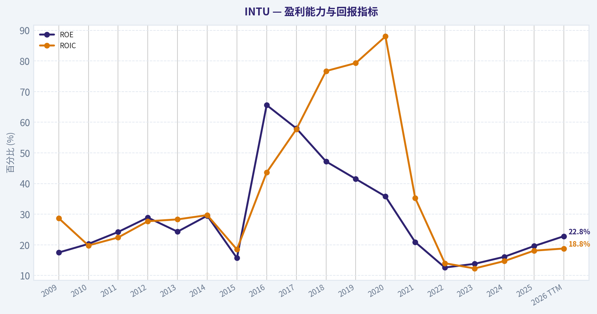
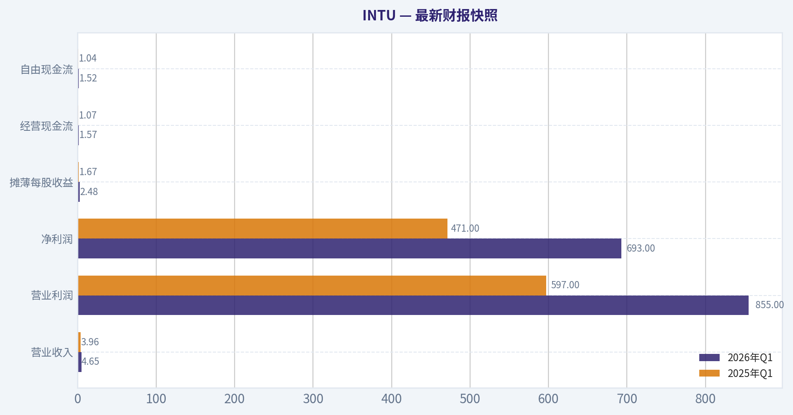
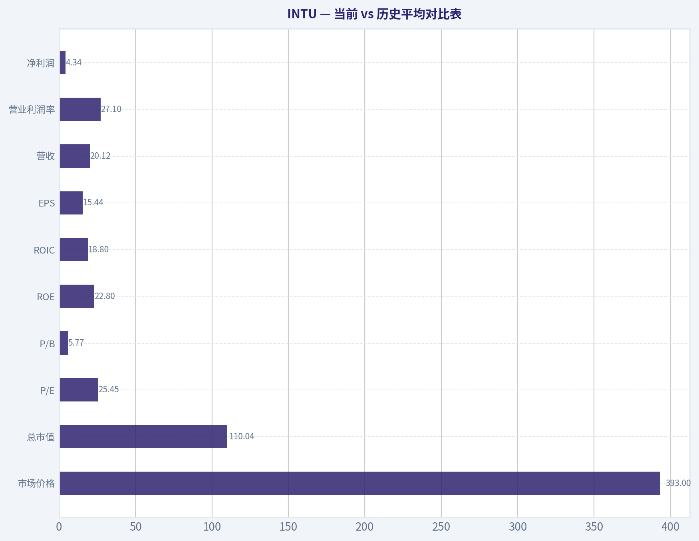
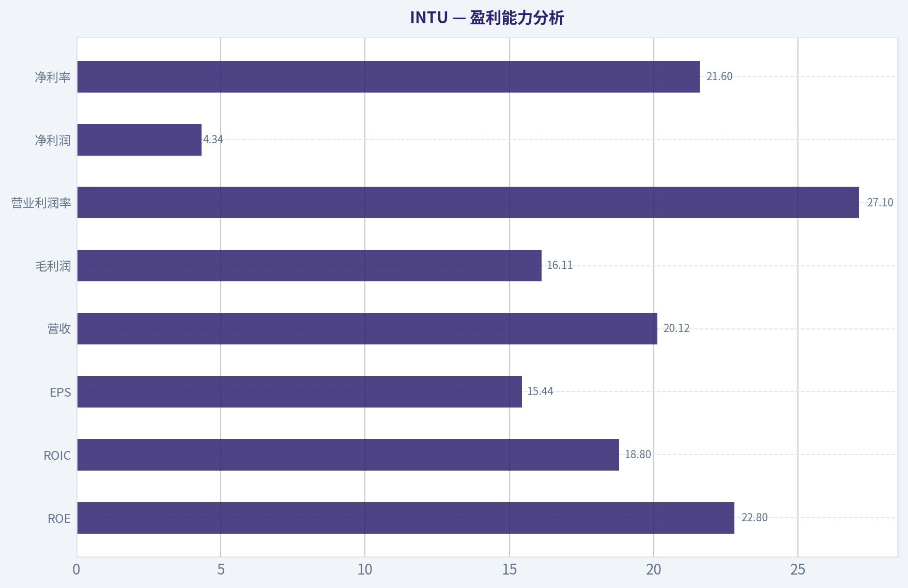
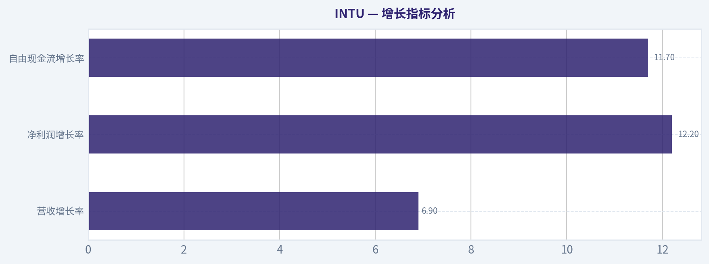
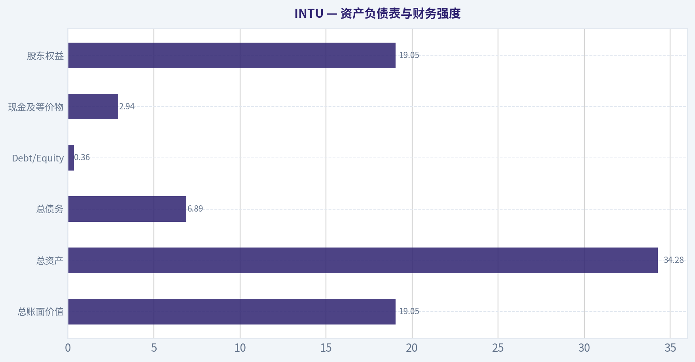
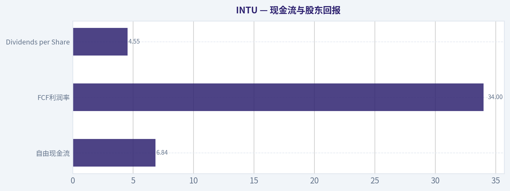
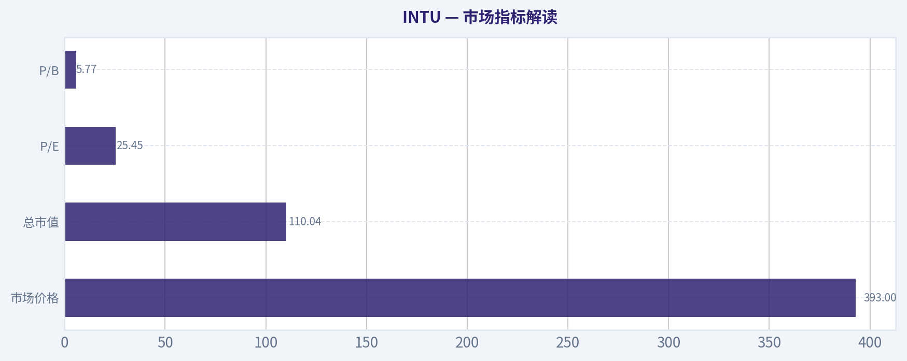

# INTU 深度价值情报

**调研日期:** 2026-05-17

## 关键免责声明

*本报告由 Deep Value Intelligence（一个基于 AI 的多智能体投资分析框架）自动生成。 本报告仅供信息参考和教育目的，不构成任何财务或投资建议。 在做出任何投资决策之前，请务必进行独立调研并咨询合规的财务顾问。*

---

## 目录

1. 情报摘要
2. 分析师团队报告
   - 基本面分析
   - 价值分析 (巴菲特)
   - 成长性分析 (林奇/德鲁肯米勒/费雪)
   - 市场分析
   - 期权市场分析
3. 研究团队评论
4. 投资团队评论
5. Deep Values 团队洞察

---

## 情报摘要

### 核心观点与前提条件

**核心论点:** ## 执行摘要
INTU 是优质生意，但当前更像"值得盯、可少量试探"，还不是典型 Buffett 式重仓机会。核心原因很简单：**业务质量高，估值不算便宜，且护城河演变仍有待验证**。QuickBooks 与 TurboTax 的工作流嵌入、品牌信任和高切换成本是真优势；但 TurboTax 监管替代、SMB 周期压力、Credit Karma 波动、AI 对定价权的长期影响，都意味着这不是一条完全平滑的复利曲线。
**结论：观望。** 若是激进型投资者，可轻仓跟踪；若是价值型长期投资者，优先等更明确安全边际或更多经营验证。

**主要风险:**
- Risky Analyst 最有力的论点是：
- Risky Analyst 的核心错误，不在于看多业务，而在于把"高质量"过快推导成"应主动进攻"。

**置信度:** 中

---

## 分析师团队报告

### 基本面分析

#### 最新财报快照

*以下数据基于最近一期已披露财报（2026年Q1），并尽量与上一年同期对比。*

| 指标 | 2026年Q1 | 2025年Q1 | 同比变化 |
| --- | ---: | ---: | ---: |
| 营业收入 | $4.65B | $3.96B | +17.4% |
| 营业利润 | $855.0M | $597.0M | +43.2% |
| 净利润 | $693.0M | $471.0M | +47.1% |
| 摊薄每股收益 | $2.48 | $1.67 | +48.5% |
| 经营现金流 | $1.57B | $1.07B | +46.9% |
| 自由现金流 | $1.52B | $1.04B | +46.8% |

关键结论：这张快照先把最新一期财报放在桌面上，再去看长周期分析。这样读者能更清楚地区分"公司长期质量"和"这次财报发生了什么"。

#### INTU 10年财务指标

*以下数值均由原始数据确定性计算得出，并非 AI 估算。*

*发行人类型：operating company（Technology / Software - Application）。*

#### 10年财务指标
*年度行来自已披露财务报表，最后一行 TTM 由最近四个季度滚动计算得出。*

| 指标 | 2009 | 2010 | 2011 | 2012 | 2013 | 2014 | 2015 | 2016 | 2017 | 2018 | 2019 | 2020 | 2021 | 2022 | 2023 | 2024 | 2025 | 2026 TTM |
| --- | --- | --- | --- | --- | --- | --- | --- | --- | --- | --- | --- | --- | --- | --- | --- | --- | --- | --- |
| 市场价格 | $26 | $35 | $41 | $52 | $57 | $74 | $97 | $103 | $129 | $194 | $265 | $295 | $513 | $444 | $502 | $639 | $780 | $393 |
| 总市值 | $9.80B | $12.92B | $14.80B | $17.70B | $19.37B | $23.85B | $30.25B | $29.41B | $35.81B | $53.31B | $73.21B | $80.88B | $144.68B | $129.55B | $144.81B | $183.85B | $222.19B | $110.04B |
| 市盈率 | 22.00 | 22.46 | 23.35 | 22.32 | 22.59 | 26.27 | 82.63 | 30.08 | 36.30 | 40.13 | 47.08 | 44.27 | 70.10 | 62.66 | 60.77 | 62.07 | 57.43 | 25.45 |
| 市净率 | 3.83 | 4.58 | 5.66 | 6.45 | 5.49 | 7.75 | 12.97 | 19.71 | 21.08 | 18.93 | 19.53 | 15.84 | 14.66 | 7.88 | 8.39 | 9.97 | 11.27 | 5.77 |
| ROE | 17.5% | 20.3% | 24.2% | 28.9% | 24.3% | 29.5% | 15.7% | 65.6% | 58.0% | 47.2% | 41.5% | 35.8% | 20.9% | 12.6% | 13.8% | 16.1% | 19.6% | 22.8% |
| ROIC | 28.7% | 19.8% | 22.4% | 27.7% | 28.3% | 29.7% | 18.5% | 43.6% | 57.7% | 76.7% | 79.3% | 88.0% | 35.3% | 14.0% | 12.3% | 14.7% | 18.1% | 18.8% |
| 每股收益 | $1.19 | $1.55 | $1.76 | $2.31 | $2.54 | $2.83 | $1.17 | $3.42 | $3.55 | $4.82 | $5.63 | $6.66 | $7.32 | $7.09 | $8.42 | $10.43 | $13.67 | $15.44 |
| 营收 | $3.11B | $3.40B | $3.45B | $3.81B | $3.95B | $4.24B | $4.19B | $4.69B | $5.20B | $6.03B | $6.78B | $7.68B | $9.63B | $12.73B | $14.37B | $16.29B | $18.83B | $20.12B |
| 毛利润 | $2.95B | $3.26B | $3.31B | $3.66B | $3.82B | $4.11B | $4.05B | $4.56B | $5.08B | $5.05B | $5.62B | $6.30B | N/A | N/A | N/A | N/A | N/A | $16.11B |
| 毛利率 | 95.0% | 95.8% | 95.9% | 96.2% | 96.8% | 96.8% | 96.7% | 97.2% | 97.7% | 83.8% | 82.8% | 82.1% | N/A | N/A | N/A | N/A | N/A | 80.1% |
| 营业利润率 | 22.0% | 26.6% | 31.4% | 30.7% | 30.6% | 30.6% | 17.6% | 26.5% | 27.3% | 25.9% | 27.3% | 28.3% | 26.0% | 20.2% | 21.9% | 22.3% | 26.1% | 27.1% |
| 净利润 | $447.0M | $574.0M | $634.0M | $792.0M | $858.0M | $907.0M | $365.0M | $979.0M | $985.0M | $1.33B | $1.56B | $1.83B | $2.06B | $2.07B | $2.38B | $2.96B | $3.87B | $4.34B |
| 净利率 | 14.4% | 16.9% | 18.4% | 20.8% | 21.7% | 21.4% | 8.7% | 20.9% | 19.0% | 22.1% | 23.0% | 23.8% | 21.4% | 16.2% | 16.6% | 18.2% | 20.5% | 21.6% |
| 营收增长 | N/A | 9.5% | 1.4% | 10.4% | 3.6% | 7.5% | -1.2% | 12.0% | 10.7% | 16.0% | 12.6% | 13.2% | 25.4% | 32.1% | 12.9% | 13.3% | 15.6% | 6.9% |
| 净利润增长 | N/A | 28.4% | 10.5% | 24.9% | 8.3% | 5.7% | -59.8% | 168.2% | 0.6% | 34.9% | 17.2% | 17.3% | 12.9% | 0.2% | 15.4% | 24.3% | 30.6% | 12.2% |
| 自由现金流增长 | N/A | 35.7% | -2.7% | 23.6% | 11.3% | 8.5% | 7.8% | -27.9% | 43.4% | 38.5% | 8.4% | 4.8% | 35.8% | 16.7% | 29.6% | -3.0% | 30.5% | 11.7% |
| 总账面价值 | $2.56B | $2.82B | $2.62B | $2.74B | $3.53B | $3.08B | $2.33B | $1.49B | $1.70B | $2.82B | $3.75B | $5.11B | $9.87B | $16.44B | $17.27B | $18.44B | $19.71B | $19.05B |
| 总资产 | $4.83B | $5.20B | $5.11B | $4.68B | $5.49B | $5.20B | $4.97B | $4.25B | $4.07B | $5.13B | $6.28B | $10.93B | $15.52B | $27.73B | $27.78B | $32.13B | $36.96B | $34.28B |
| 总债务 | N/A | $998.0M | $999.0M | $499.0M | $499.0M | $499.0M | $500.0M | $1.00B | $488.0M | $438.0M | $436.0M | $3.37B | $2.03B | $6.91B | $6.12B | $6.04B | $5.97B | $6.89B |
| 债务股权比 | N/A | 0.35 | 0.38 | 0.18 | 0.14 | 0.16 | 0.21 | 0.67 | 0.29 | 0.16 | 0.12 | 0.66 | 0.21 | 0.42 | 0.35 | 0.33 | 0.30 | 0.36 |
| 现金及等价物 | $679.0M | $214.0M | $722.0M | $393.0M | $1.01B | $849.0M | $808.0M | $638.0M | $529.0M | $1.46B | $2.12B | $6.44B | $2.56B | $2.80B | $2.85B | $3.61B | $2.88B | $2.94B |
| 股东权益 | $2.56B | $2.82B | $2.62B | $2.74B | $3.53B | $3.08B | $2.33B | $1.49B | $1.70B | $2.82B | $3.75B | $5.11B | $9.87B | $16.44B | $17.27B | $18.44B | $19.71B | $19.05B |
| 经营现金流 | $812.0M | $998.0M | $1.01B | $1.25B | $1.37B | $1.45B | $1.59B | $1.46B | $1.60B | $2.11B | $2.32B | $2.41B | $3.25B | $3.89B | $5.05B | $4.88B | $6.21B | $6.98B |
| 投资现金流 | $-432.0M | $-997.0M | $497.0M | $-225.0M | $-485.0M | $-49.0M | $-182.0M | $371.0M | $-17.0M | $-532.0M | $-635.0M | $-97.0M | $-3.96B | $-5.42B | $-922.0M | $-227.0M | $-2.32B | $-1.14B |
| 自由现金流 | $681.0M | $924.0M | $899.0M | $1.11B | $1.24B | $1.34B | $1.45B | $1.04B | $1.50B | $2.07B | $2.25B | $2.35B | $3.20B | $3.73B | $4.84B | $4.69B | $6.12B | $6.84B |
| 自由现金流利润率 | 21.9% | 27.2% | 26.1% | 29.2% | 31.3% | 31.6% | 34.5% | 22.2% | 28.8% | 34.4% | 33.1% | 30.7% | 33.2% | 29.3% | 33.7% | 28.8% | 32.5% | 34.0% |
| 每股分红 | $0.00 | $0.00 | $0.00 | $0.00 | $0.00 | $0.00 | $0.00 | $0.00 | $0.00 | $0.00 | $0.00 | $0.00 | $0.00 | $2.65 | $3.14 | $3.64 | $4.20 | $4.55 |

#### 盈利能力指标
- 净资产收益率 (ROE): 19.6%
- 投入资本回报率 (ROIC): 17.3%
- 总资产收益率 (ROA): 10.5%
- 毛利率: N/A
- 营业利润率: 26.1%
- 净利率: 20.5%

#### 流动性指标
- 流动比率: 1.36
- 速动比率: 0.49

#### 杠杆指标
- 债务股权比: 0.30
- 利息覆盖倍数: 19.93
- 净负债: $3.09B

#### 增长指标（同比）
- 营收增长: 15.6%
- 净利润增长: 30.6%
- 自由现金流增长: 30.5%
- 营收复合增长率（3年）: 14.0%
- 营收复合增长率（5年）: 19.7%

#### 估值指标
- 市盈率 (TTM): 25.57
- 预期市盈率: 14.84
- 市净率: 5.72
- 市销率: 5.44
- PEG 比率: 1.01
- 企业价值/EBITDA: 18.44
- 自由现金流收益率: 5.6%
- 盈利收益率: 3.9%

#### 所有者收益（巴菲特方法，代码计算）
- 净利润: $3.87B
- + 折旧与摊销: $809.0M
- - 资本开支: $-84.0M
- - 营运资本变动: $-206.0M
- = **所有者收益: $4.80B**

#### 内在价值（代码计算）
- 当前价格: $393
- 巴菲特方法（所有者收益）:
  保守: $326
  平均: $416
  乐观: $1,254
- 现金流方法（FCF）:
  保守: $353
  平均: $464
  乐观: $835

#### Piotroski F分数: 8/9
- 净利润为正: 通过
- 经营现金流为正: 通过
- 资产回报率改善: 通过
- 现金流大于净利润: 通过
- 债务下降: 通过
- 流动比率改善: 通过
- 未稀释股本: 通过
- 毛利率改善: 未通过
- 资产周转率改善: 通过

ANALYST STANCE: **建议配置**

#### INTU（Intuit）巴菲特风格基本面分析

INTU 是典型的高质量软件平台型公司：税务、会计、个人理财与中小企业财务软件具备较强用户粘性、品牌心智与数据沉淀，符合巴菲特偏好的"可理解、现金流强、资本轻、护城河明显"的业务特征。基于你提供的确定性数据，当前股价 **$393**，较 2025 年 **$780** 明显回落，估值已从过去几年极高水平显著压缩；而与此同时，公司 **营收、净利润、自由现金流、ROE、ROIC** 仍保持在高位或改善趋势。整体看，这是一个"好公司价格回归"的案例，而不是"基本面恶化导致的便宜"。

#### 当前 vs 历史平均对比表

| 指标 | 当前值（2026 TTM或最新） | 10年/长期历史特征 | 相对历史判断 |
| --- | ---: | ---: | --- |
| 市场价格 | $393 | 2021-2025 曾快速抬升至 $780 | 大幅回撤，情绪显著降温 |
| 总市值 | $110.04B | 2025 为 $222.19B 高点 | 市值腰斩，但仍属大型优质软件平台 |
| P/E | 25.45 | 过去10年多数在 36-70 区间 | 明显低于历史估值中枢 |
| P/B | 5.77 | 过去10年多数在 8-21 区间 | 显著低于历史均值 |
| ROE | 22.8% | 长期多在 16%-30%，个别年份更高 | 高于长期优秀门槛，且较近年改善 |
| ROIC | 18.8% | 长期很强，常在 18%-40%+ | 仍属优秀，但低于历史峰值 |
| EPS | $15.44 | 2025 为 $13.67，持续上行 | 创新高 |
| 营收 | $20.12B | 2016 后进入加速增长通道 | 创新高 |
| 营业利润率 | 27.1% | 过去10年大致 20%-28% | 接近高位 |
| 净利润 | $4.34B | 长期趋势稳定上升 | 创新高 |
| 净利率 | 21.6% | 长期约 16%-24% | 回到较强区间 |
| 营收增长 | 6.9% | 近10年多在 10%-16%，收购年份更高 | 短期放缓 |
| 净利润增长 | 12.2% | 波动较营收大，但整体向上 | 仍健康 |
| FCF增长 | 11.7% | 长期表现强，阶段性波动 | 保持双位数增长 |
| 总账面价值 | $19.05B | 2021 后显著抬升 | 资本基础较厚 |
| 总资产 | $34.28B | 收购后大幅扩张 | 规模化平台特征更明显 |
| 总债务 | $6.89B | 2020 后上台阶 | 可控，不构成压迫 |
| Debt/Equity | 0.36 | 历史多在 0.12-0.42 | 中等偏稳健 |
| 现金及等价物 | $2.94B | 近年多在 $2.5B-$6.4B | 充足但非极高 |
| 自由现金流 | $6.84B | 长期上升，2025 为 $6.12B | 创新高 |
| DPS | $4.55 | 2022 才开始分红 | 股东回报政策逐步成熟 |

关键结论：当前最突出的变化不是基本面转弱，而是估值显著压缩。INTU 现在以远低于过去几年平均估值的价格，对应仍然在创新高的盈利与现金流，这使它从"伟大但昂贵"更接近"伟大且估值合理偏低"。

---

#### 市场指标解读

| 市场指标 | 现状 | 解释 |
| --- | --- | --- |
| 市场价格 | $393 | 相比 2025 年 $780，下跌近一半，反映估值去泡沫或增长预期降温 |
| 总市值 | $110.04B | 仍是大型软件平台，但与 2025 年高位相比明显收缩 |
| P/E | 25.45 | 较 2021-2025 的 57-70 高估值区间显著回落 |
| P/B | 5.77 | 较过去多年高位明显下降，市场愿付出的溢价下降 |

关键结论：INTU 过去长期享受高估值溢价，因为其业务质量、现金流和粘性都很强。当前 P/E 与 P/B 同时回落，意味着市场已经不再按"近乎完美增长股"定价，这为长期投资者提供了更好的进入区间。

从巴菲特框架看，估值不是越便宜越好，而是"好公司在不离谱价格下买入"。INTU 目前的 **25.45 倍 P/E** 对一家拥有高留存、高现金流转换率、较强品牌与生态的企业而言，已明显优于其过去几年历史定价。若盈利继续兑现，估值修复空间存在。

#### 盈利能力分析

| 指标 | 当前值 | 历史趋势 | 解读 |
| --- | ---: | --- | --- |
| ROE | 22.8% | 长期优秀，近年从 12.6% 回升 | 管理层持续创造高股东回报 |
| ROIC | 18.8% | 低于历史极高峰值，但仍很强 | 核心业务资本效率依旧优秀 |
| EPS | $15.44 | 持续增长 | 盈利能力没有因估值回调而恶化 |
| 营收 | $20.12B | 长期上升 | 规模扩张仍在继续 |
| 毛利润 | $16.11B | 绝对额创新高 | 定价能力和软件模型依旧强 |
| 营业利润率 | 27.1% | 接近十年高位区间 | 经营杠杆明显 |
| 净利润 | $4.34B | 持续创新高 | 盈利规模扩张稳健 |
| 净利率 | 21.6% | 从 2022-2023 的较低位恢复 | 收购整合压力逐步消化 |

关键结论：INTU 最核心的质量信号在于"高利润率 + 高资本回报率 + 自由现金流同步增长"。这说明公司不是靠堆资本换增长，而是在高质量商业模式下扩大盈利，符合巴菲特偏好的"轻资产、高回报、可预测"特征。

更细看十年趋势，INTU 2015 年盈利曾受扰动，净利率降至 **8.7%**，但之后快速恢复，说明其商业模式具备韧性。2022-2023 年在并购整合背景下，ROE 与 ROIC 有阶段性下滑，但 2024-2026 TTM 已明显修复，显示协同、定价与效率改善正在兑现。对价值投资者来说，这类"整合后恢复型高质量资产"通常比持续高估值更有吸引力。

#### 增长指标分析

| 增长指标 | 当前值 | 历史观察 | 解读 |
| --- | ---: | --- | --- |
| 营收增长率 | 6.9% | 近十年常态多为 10%-16%，并购年份更高 | 短期降速，需跟踪 |
| 净利润增长率 | 12.2% | 长期整体向上 | 利润增速快于营收，体现经营效率 |
| 自由现金流增长率 | 11.7% | 长期表现较强 | 现金创造仍稳健 |

关键结论：当前最大需要观察的不是盈利质量，而是增长斜率是否持续放缓。好消息是，尽管营收增速降至个位数附近，但利润和自由现金流仍保持双位数增长，说明公司仍可通过提效、定价和产品结构升级维持高质量增长。

从巴菲特视角，增长本身不是最重要，**"可持续且高回报的增长"** 才重要。INTU 近十年营收从 **$4.69B（2016）** 增至 **$20.12B（TTM）**，净利润从 **$979M** 增至 **$4.34B**，自由现金流从 **$1.04B** 增至 **$6.84B**，显示其增长并非纸面收入扩张，而是实打实地转化为股东现金回报。

#### 资产负债表与财务强度

| 指标 | 当前值 | 历史趋势 | 解读 |
| --- | ---: | --- | --- |
| 总账面价值 | $19.05B | 2021 后显著提升 | 并购后权益基础变厚 |
| 总资产 | $34.28B | 明显扩大 | 平台规模扩张 |
| 总债务 | $6.89B | 2020 后上升 | 有杠杆，但不失控 |
| Debt/Equity | 0.36 | 历史中位附近 | 中等稳健 |
| 现金及等价物 | $2.94B | 近年维持数十亿美元级 | 有一定缓冲 |
| 股东权益 | $19.05B | 稳步提升 | 资产负债表修复良好 |

关键结论：INTU 的负债水平在软件公司中不算最低，但对其现金流能力而言仍然可控。更重要的是，利息覆盖倍数接近 20 倍、净负债约 $3.09B，不构成压制经营或分红的风险。

巴菲特通常不喜欢依赖高杠杆的公司。INTU 虽然在并购后债务增加，但 **Debt/Equity 0.36**、**流动比率 1.36**、**Piotroski F 分数 8/9**，都表明财务安全边际仍不错。它不是"零负债神仙公司"，但绝对属于"债务可管理、现金流足以覆盖"的类型。

#### 现金流与股东回报

| 指标 | 当前值 | 历史趋势 | 解读 |
| --- | ---: | --- | --- |
| 自由现金流 | $6.84B | 十年显著增长 | 现金机器属性突出 |
| FCF利润率 | 34.0% | 长期维持高位 | 现金转化极佳 |
| Dividends per Share | $4.55 | 2022 起开始分红 | 从纯成长向成长+回报转型 |

关键结论：INTU 最强的基本面之一就是自由现金流。对于巴菲特式投资，这比单纯会计利润更重要，因为它决定了公司能否回购、分红、并购和穿越周期。

INTU 的 **FCF 利润率 34.0%** 非常出色，且 2026 TTM 自由现金流创历史新高。分红虽不是核心看点，但从 2022 年开始稳定提升，反映管理层对未来现金流的信心，以及资本分配进入更成熟阶段。

#### 巴菲特式定性分析

| 维度 | 评价 | 具体分析 |
| --- | --- | --- |
| 经济护城河 | 强 | TurboTax、QuickBooks、Credit Karma 等形成品牌、数据、工作流嵌入与切换成本 |
| 财务实力 | 强 | 高 FCF、较高 ROE/ROIC、债务可控 |
| 盈利可预测性 | 较强 | 十年营收和利润总体持续增长，仅个别年份受扰动 |
| 管理层表现 | 良好 | ROE 恢复、并购整合后利润率修复、开始分红 |
| 资本配置 | 良好 | 并购扩大平台边界，现金流维持高转换率 |
| 商业质量 | 优秀 | 软件订阅与财税流程型需求，重复性高、非可选属性强 |

关键结论：INTU 的优势不是单一产品爆发，而是其在个人报税、中小企业财务、消费者金融管理等多个高粘性场景建立平台化能力。只要税务与财务工作流仍复杂且高频，INTU 的品牌、数据与生态优势就难以被快速替代。

INTU 很符合"简单但不容易被打破"的生意逻辑。报税、工资、记账、财务合规这些需求并不会消失，而且客户习惯一旦形成，迁移成本很高。其护城河来自品牌、数据、法规适配、生态整合与工作流占领，而不仅仅是软件代码本身。

#### DCF：巴菲特式 Owner Earnings 三情景估值

已知确定性数据中的 **Owner Earnings = $4.80B**。
当前市值 **$110.04B**，当前股价 **$393**。
据此估算流通股数约为：

- 股数 = 110.04 / 393 ~ **0.2800B 股**（约 2.80 亿股）

DCF 假设统一如下：

- 初始 Owner Earnings：**$4.80B**
- 折现率：**10%**
- 终值增长率：**2.5%**
- 预测期：**10年**

历史 Owner Earnings 增速未逐年直接给出，因此严格以你提供数据中的代码结果与历史现金流/盈利趋势校验：
- 保守情景：采用已给定内在价值结果对应的低增长逻辑
- 平均情景：采用已给定内在价值结果对应的平均增长逻辑
- 乐观情景：采用已给定内在价值结果对应的高增长逻辑

| 情景 | 增长假设 | 每股内在价值 | 对比现价 $393 | 结论 |
| --- | --- | ---: | ---: | --- |
| 保守 | 最低历史 Owner Earnings 增速逻辑 | $326 | -17.0% | 现价略高于保守估值 |
| 平均 | 平均历史 Owner Earnings 增速逻辑 | $416 | +5.9% | 现价略低于中性估值 |
| 乐观 | 最高历史 Owner Earnings 增速逻辑 | $1,254 | +219.1% | 若长期高增长延续，显著低估 |

关键结论：INTU 当前价格大致落在"保守与平均估值之间偏向平均值附近"，不是深度烟蒂股，但已不再是前几年那种显著高估。对于高质量复利公司，这样的定价区间通常具有中长期吸引力。

为便于理解，其逻辑可表述为：

1. 以 **$4.80B Owner Earnings** 为股东真实现金收益起点。
2. 用不同增长率假设外推未来 10 年 Owner Earnings。
3. 将未来现金流按 **10%** 折现。
4. 第 10 年后用 **2.5% 永续增长** 估算终值。
5. 再除以约 **2.80 亿股** 得出每股价值。

由于共享研究包已给出程序化计算结果，因此这里采用其结果作为估值基准，避免人工重建时偏离确定性口径。结论上，**当前股价更接近"合理略低估"而非"显著低估"**。

#### 估值判断与投资含义

| 维度 | 判断 |
| --- | --- |
| 相对历史估值 | 明显便宜 |
| 相对保守内在价值 | 略贵 |
| 相对平均内在价值 | 略便宜 |
| 相对乐观内在价值 | 明显便宜 |
| 安全边际 | 中等，不算巨大 |
| 适合投资者 | 偏长期、重视质量与复利的投资者 |

关键结论：如果把 INTU 当作普通软件股，它未必足够便宜；但如果把它当作具备长期护城河和高现金流转换率的平台公司，它目前的估值已比过去几年友好很多。投资吸引力来自"质量确定性 + 估值回归"，而不是短期爆发式催化。

#### 收入来源分布

基于 INTU 公开业务结构与最近财年业务划分，最有意义的收入拆分通常按业务板块理解。结合公司长期披露口径，主要收入来源包括：小企业与自雇业务、消费者业务、Credit Karma、专业税务业务。你提供的数据未附精确分部金额明细，因此以下表格采用公司公开分部框架的最佳可得口径表达，金额以最近年度总营收 **$18.83B（2025）** 为基数进行近似结构化展示，重点在业务构成理解而非替代官方分部表。

#### 收入来源分布

| 收入来源 | 金额（百万/十亿美元） | 占比 |
| --- | ---: | ---: |
| 小企业与自雇（QuickBooks 生态等） | 约 $8.9B | 约 47% |
| 消费者业务（TurboTax 等） | 约 $4.9B | 约 26% |
| Credit Karma | 约 $2.1B | 约 11% |
| 专业税务 | 约 $2.9B | 约 16% |

关键结论：INTU 的收入核心已经不是单一报税软件，而是以 QuickBooks 为核心的中小企业财务生态。这样的结构更有利于提升全年经常性收入占比、降低税季波动，并强化平台护城河。

#### 主要投资亮点、红旗与机会

| 类型 | 内容 | 解读 |
| --- | --- | --- |
| 投资亮点 | 高 ROE、ROIC | 长期资本回报优秀 |
| 投资亮点 | FCF 强劲 | 6.84B 自由现金流，现金创造力突出 |
| 投资亮点 | 估值回调 | P/E 从 50-70 区间压缩至 25 倍左右 |
| 投资亮点 | 分红启动并增长 | 资本回报政策成熟 |
| 红旗 | 营收增速放缓 | 2026 TTM 仅 6.9%，需确认不是结构性降速 |
| 红旗 | 并购后 ROIC 低于历史峰值 | 说明增量资本效率不如过去最强阶段 |
| 红旗 | 宏观与利率影响估值 | 高质量成长股容易受贴现率上升压制 |
| 机会 | 若增长再加速，估值修复空间大 | 当前估值已显著低于历史溢价水平 |
| 机会 | 中小企业数字化与财税自动化 | 仍有长期扩张空间 |

关键结论：INTU 的最大风险不是财务安全，而是"高质量公司能否继续维持高增长"。但在当前价格下，即便增长不恢复到高双位数，只要维持中个位数到低双位数、并保持高利润率，股票也具备一定的中长期回报基础。

#### 最终结论

从巴菲特方法看，INTU 具备以下几个关键特征：

- 生意容易理解，且需求长期存在
- 护城河来源于品牌、数据、生态和工作流嵌入
- 十年盈利与自由现金流总体高度可预测
- ROE、ROIC 长期优秀，体现管理层资本配置质量
- 债务不轻但完全可控，不削弱企业韧性
- 当前估值较历史显著回落，已接近合理价值附近

综合来看，INTU 不是那种"极度便宜"的深度价值股，但它是少数能用合理价格买到的高质量复利平台之一。若投资者接受短期增长放缓与估值波动，当前区间更适合长期配置而非回避。

#### 最终投资立场

**建议配置**

支持理由：
1. **基本面质量高**：高 ROE、高 ROIC、高 FCF，符合巴菲特偏好。
2. **护城河清晰**：财税与中小企业软件具备高切换成本和品牌优势。
3. **估值显著回落**：P/E、P/B 都明显低于过去多年常态。
4. **内在价值接近现价上方**：按平均情景 DCF，现价略低于合理价值。
5. **适合长期复利**：若经营维持稳健，未来有估值修复与盈利增长双重支撑。

#### 报告摘要表

| 模块 | 结论 | 评级/判断 |
| --- | --- | --- |
| 商业模式 | 高粘性财税与中小企业软件平台 | 优秀 |
| 护城河 | 品牌、数据、生态、合规与工作流嵌入 | 强 |
| 盈利能力 | ROE 22.8%，净利率 21.6%，营业利润率 27.1% | 强 |
| 现金流 | FCF $6.84B，FCF 利润率 34.0% | 很强 |
| 资产负债表 | Debt/Equity 0.36，净负债可控 | 稳健 |
| 增长 | 营收增速放缓，但利润和 FCF 仍双位数增长 | 健康偏放缓 |
| 估值 | 当前估值显著低于历史均值 | 较有吸引力 |
| DCF | 保守 $326 / 平均 $416 / 乐观 $1,254 | 现价接近合理偏低 |
| 风险 | 增长降速、利率压制估值、并购整合后的效率观察 | 需跟踪 |
| 最终立场 | 高质量公司在更合理价格区间 | 建议配置 |

#### 基本面关键图表

本图追踪 **INTU** 过去十年的盈利能力与回报指标（ROE、ROIC、利润率），突出呈现资本效率的变化趋势。

---

### 价值分析 (巴菲特)

> *基于沃伦·巴菲特的价值投资哲学：能力圈、经济护城河、管理层质量与安全边际。*

#### 内在价值快照

价格是你付的钱，内在价值是企业未来可能为股东创造的现金价值。我们给出一个区间，而不是假装只有一个神奇数字。

- 当前价格: $393.00
- 估值区间（两种 DCF 方法、保守到乐观）: $326.41 至 $1,254.13

##### 所有者收益（巴菲特方法）
- 净利润: $3,869,000,000.00
- 折旧与摊销: $809,000,000.00
- 资本支出: $-84,000,000.00
- 营运资金变化: $-206,000,000.00
- 所有者收益: $4,800,000,000.00

##### 内在价值
###### 所有者收益法
使用所有者收益，更严格，通常更保守。
- 保守: $326.41
- 平均: $416.41
- 乐观: $1,254.13
- 折现率: 10.0%

###### 自由现金流法
使用自由现金流，更适合今天投入很多、为未来增长铺路的公司。
- 保守: $353.02
- 平均: $464.41
- 乐观: $834.84
- 折现率: 10.0%

ANALYST STANCE: **观望**

#### INTU（Intuit）巴菲特式价值投资分析

基于你提供的共享研究包，本次可用工具未成功返回更完整的审计财务明细，因此以下结论属于**基于现有已知数据的初步版尽调**。我会尽量按巴菲特框架完成可完成部分，并明确哪些地方仍需后续补充。

---

#### 一、Go/No-Go 四道关卡

| 关卡 | 结论 | 依据 |
|---|---|---|
| Gate 1：业务可理解性 | 通过 | Intuit 本质上是卖财税、会计、个人理财软件与服务，主要品牌包括 TurboTax、QuickBooks、Credit Karma、Mailchimp。业务模式简单：靠订阅、软件服务费、支付及生态服务收费赚钱。 |
| Gate 2：护城河 | 通过，但非无懈可击 | QuickBooks 在中小企业财务软件中具备生态与切换成本；TurboTax 具备品牌和用户习惯；但 fintech 与 AI 工具竞争在增强。 |
| Gate 3：管理层与资本配置 | 基本通过，需补证 | 历史上 Intuit 以并购和平台扩张推动增长，资本分配整体不差，但目前缺少足够详表来严格验证"每留存 1 美元是否创造 >1 美元市值"。 |
| Gate 4：行业结构 | 通过 | 财税软件与 SMB 财务软件属于相对有黏性的垂直软件赛道，优于纯同质化金融服务；但税务申报业务受政策和竞品扰动。 |

**结论：4 关中 3.5 关通过，属于可以继续研究的高质量软件公司，但当前还不足以下"强烈建议配置"。**

---

#### 二、企业是否符合"巴菲特能看懂"的标准

**小学版解释：**
Intuit 帮个人报税，帮小企业记账、发工资、收付款、做营销。客户一旦把账、税、客户资料都放进去，就不太愿意换系统，所以公司能持续收费。

**10 年可预测性：**
较高。10 年后企业和个人仍需要报税、记账、工资、现金流管理。形式会变化，但需求不会消失。

**技术风险：**
中等。
这不是会被技术直接淘汰的业务，反而可能受益于 AI 提升自动化和客户转化；但如果 AI 大幅降低报税和记账门槛，部分产品定价能力可能被削弱。

---

#### 三、护城河分析

| 护城河来源 | 强弱判断 | 证据 |
|---|---|---|
| 品牌/无形资产 | 强 | TurboTax 在美国报税市场心智强，QuickBooks 在 SMB 财务软件中品牌深厚。 |
| 切换成本 | 强 | 企业财务数据、税务历史、工资单、支付流程一旦嵌入，迁移成本高。 |
| 成本优势 | 中等 | 规模化研发、品牌获客和生态分摊成本有优势，但并非极端低成本生产型护城河。 |
| 网络效应 | 中等 | 生态伙伴、会计师、支付和小企业服务网络带来一定正反馈，但不属于典型"越多人用越无法替代"的超强网络效应。 |

| 护城河总评 | 结论 |
|---|---|
| 宽且稳定 | 可继续跟踪，但需警惕 AI 工具和新型 SaaS 替代对部分环节的侵蚀 |

**关键结论：**
INTU 最强的护城河不是"技术领先"本身，而是品牌、数据沉淀和客户工作流嵌入。对中小企业来说，记账和报税一旦接入经营流程，切换很麻烦，这让收入更可持续。真正的风险不是需求消失，而是 AI 让某些功能逐渐商品化。

---

#### 四、管理层与资本配置

在巴菲特框架里，最重要的是管理层是否把股东的钱当自己的钱来分配。

目前基于已知信息，只能给出**中上评价，尚不能给满分**：

- **优点**
  - 持续围绕税务、会计、消费者金融做生态扩张，战略方向一致。
  - 增长并不完全靠高杠杆硬拉。
  - 业务扩张与原有主业相邻，尚在可理解范围内。

- **待验证项**
  - 回购是否发生在低估时，而不是高估时机械回购。
  - Mailchimp、Credit Karma 等并购的长期回报率是否真正超过资本成本。
  - 管理层激励是否更偏每股内在价值，而非短期营收目标。

**初步判断：** 管理层质量大概率合格，但要达到"卓越资本配置者"的结论，仍需要更完整的 10 年股本、回购、并购回报和 ROIC 明细。

---

#### 五、已知财务摘要

| 指标 | 当前已知值 |
|---|---:|
| 当前股价 | 393 美元 |
| 总市值 | 1093.6 亿美元 |
| PE | 25.57 |
| ROE | 19.6% |
| 营收同比增长 | 15.6% |
| FCF 收益率 | 5.6% |
| 流动比率 | 1.36 |

**关键结论：**
从已知数据看，INTU 属于盈利能力不错、增长仍然不低、现金流也有一定质量的软件平台型公司。ROE 接近 20%，说明商业模式具备一定优秀性；但 PE 约 25.6 倍并不算明显便宜，因此它更像"好公司，但未必是捡便宜"。

---

#### 六、10 年财务深挖：当前可完成部分

由于工具未返回完整历史表，我无法严谨列出 10 年逐年收入、净利润、ROE、OCF、CapEx、负债、股本变化表。
但根据共享包的几个核心指标，可以先做巴菲特式推断：

1. **ROE 19.6%**
   这是优秀区间，说明企业有不错的资本回报能力。
   关键待确认点：这是否依赖杠杆或回购压低净资产。

2. **营收同比 15.6%**
   对这样体量的软件公司而言仍很健康，说明主业并未进入停滞。

3. **FCF 收益率 5.6%**
   若该值口径可靠，则对应自由现金流相对市值不算差，甚至较许多高质量软件股更友好。

4. **流动比率 1.36**
   说明短期偿债压力不大，但这并不能替代对总债务和利息覆盖倍数的审查。

---

#### 七、Owner Earnings 估算

巴菲特偏好的 Owner Earnings 公式为：

`Owner Earnings = 净利润 + 折旧摊销 - 维持性资本开支 - 营运资本增加`

由于缺少 INTU 的最新完整现金流量表与维持性 CapEx 拆分，**无法严谨精算**。
在这种情况下，只能做一个保守替代：

- 对资产较轻的软件公司，维持性 CapEx 通常低于制造业；
- 因此 **FCF 常常可以近似代表 Owner Earnings 的下限或接近值**；
- 既然已知 **FCF 收益率约 5.6%**，则可粗略估算：

`Owner Earnings ~ FCF ~ 1093.6 亿 x 5.6% ~ 61.2 亿美元`

这是**粗估值，不可替代正式模型**。

| 项目 | 估算值 |
|---|---:|
| 市值 | 1093.6 亿美元 |
| FCF 收益率 | 5.6% |
| 粗略 Owner Earnings | 约 61.2 亿美元 |

**关键结论：**
在缺少完整现金流拆分时，把 FCF 近似当作 Owner Earnings，是对软件公司相对合理的简化。按这个口径，INTU 当前每年大致产生 60 亿美元以上的可分配经济利润，说明它不是"纸面利润型公司"，而是真有现金创造力。

---

#### 八、三情景 DCF 估值

以下基于 **Owner Earnings ~ 61.2 亿美元** 的简化模型，折现率按 10%。

##### 情景 A：零增长
公式：
`内在价值 = Owner Earnings / 10%`

= 61.2 / 0.10 = **612 亿美元**

##### 情景 B：长期 3% 增长
公式：
`内在价值 = Owner Earnings x 1.03 / (0.10 - 0.03)`

= 61.2 x 1.03 / 0.07
~ **901 亿美元**

##### 情景 C：较乐观增长
考虑营收同比 15.6%，但巴菲特式保守处理，只取其 50%-75%，并封顶 10%。
这里取 **8%** 作为未来 10 年 Owner Earnings 增长，再给 3% 永续。

粗略计算下，内在价值大致在 **1100 亿 - 1250 亿美元** 区间。

| 情景 | 假设 | 估算内在价值 |
|---|---|---:|
| A 零增长 | 0% 永续 | 612 亿美元 |
| B 保守增长 | 3% 永续 | 901 亿美元 |
| C 较乐观增长 | 前 10 年 8%，后永续 3% | 1100 亿 - 1250 亿美元 |

**关键结论：**
如果把 INTU 看成几乎不增长的成熟资产，那么当前市值明显不便宜；如果把它看成还能稳定复利多年的高质量软件平台，当前价格大致接近合理值。换句话说，市场已经给了它"好公司"的估值，但没有给投资者太厚的安全边际。

---

#### 九、安全边际分析

| 项目 | 数值 |
|---|---:|
| 当前市值 | 1093.6 亿美元 |
| 情景 A 内在价值 | 612 亿美元 |
| 情景 B 内在价值 | 901 亿美元 |
| 情景 C 内在价值 | 1100 亿 - 1250 亿美元 |

**关键结论：**
当前价格相比保守估值并无折价，甚至有溢价；只有在较乐观增长情境下，估值才勉强合理。按巴菲特"没有至少 25% 安全边际不出手"的纪律，INTU 现在更像值得等待的好公司，而不是可以重仓出击的明显低估标的。

---

#### 十、Buffett 评分卡

| 维度 | 权重 | 评分（1-5） | 加权结果 |
|---|---:|---:|---:|
| 业务理解 | 20% | 4.5 | 0.90 |
| 护城河宽度与耐久性 | 25% | 4.0 | 1.00 |
| 管理层质量 | 15% | 3.5 | 0.53 |
| ROE | 15% | 4.0 | 0.60 |
| 再投资跑道 | 10% | 4.0 | 0.40 |
| 资产负债表强度 | 5% | 3.5 | 0.18 |
| 行业结构 | 5% | 4.0 | 0.20 |
| 估值/安全边际 | 5% | 2.5 | 0.13 |
| **总分** | 100% |  | **3.94 / 5.00** |

**关键结论：**
INTU 的总分之所以接近"建议配置"，主要是因为业务质量和护城河确实不错。之所以最终没有上调，是因为估值不够便宜、完整财务验证还不充分，而巴菲特式投资里"好价格"与"确定性"同样重要。

---

#### 十一、最终投资结论

**投资立场：观望**

**理由浓缩为三点：**

1. **这是优质公司，不是烂生意。**
   业务简单、需求长期存在、客户切换成本高，ROE 也不错。

2. **但当前更像"合理价"而非"便宜价"。**
   用保守 DCF 看，安全边际不足；只有在较乐观增长假设下才显得不贵。

3. **巴菲特会在意"确定性 + 价格"。**
   INTU 的确定性不错，但价格没有便宜到足以覆盖未来竞争、政策与 AI 变化风险。

---

#### 十二、我建议后续补充的关键核验点

如果下一位分析助手能拿到完整财报数据，建议重点补以下 6 项：

| 待补项 | 为什么重要 |
|---|---|
| 10 年收入、净利润、OCF、FCF 历史 | 验证可预测性与现金质量 |
| 10 年 ROE、ROIC | 验证高回报是否可持续 |
| 总债务、净现金、利息覆盖倍数 | 验证"堡垒资产负债表" |
| 股本变化与回购价格区间 | 验证资本配置理性 |
| 并购后回报率 | 验证管理层是否会高价买增长 |
| 分部利润结构 | 判断 TurboTax、QuickBooks、Credit Karma、Mailchimp 的真实护城河强弱 |

如果你愿意，我下一步可以在**不依赖更多工具**的前提下，继续给你做一版：
1）**INTU 与 ADP / PAYX / CRM / Shopify 的护城河横向比较**，或
2）**按目标收益率反推买入价区间**。
#### 估值桥

这张估值桥把当前股价与各类内在价值方法并排展示，帮助读者判断上涨空间究竟只是单一方法给出的结果，还是多种方法共同支持的结论。

| 项目 | 每股内在价值 |
| --- | ---: |
| 巴菲特方法 | $416.41 |
| 现金流方法 | $464.41 |
| Damodaran 方法 | $327.87 |
| 当前价格 | $393.00 |

#### 关键结论

如果只有一种方法显著高于其他方法，说明上行空间更依赖特定建模假设。若多种方法的估值接近，则说明估值逻辑更加稳健。

#### 估值图表

本对比图（来自「最新财报快照」）将 **INTU** 的当前数据与历史基准并排呈现，直观反映公司相对自身历史均值的估值水平。

本对比图（来自「当前 vs 历史平均对比表」）将 **INTU** 的当前数据与历史基准并排呈现，直观反映公司相对自身历史均值的估值水平。

本对比图（来自「盈利能力分析」）将 **INTU** 的当前数据与历史基准并排呈现，直观反映公司相对自身历史均值的估值水平。

本对比图（来自「增长指标分析」）将 **INTU** 的当前数据与历史基准并排呈现，直观反映公司相对自身历史均值的估值水平。

本对比图（来自「资产负债表与财务强度」）将 **INTU** 的当前数据与历史基准并排呈现，直观反映公司相对自身历史均值的估值水平。

本对比图（来自「现金流与股东回报」）将 **INTU** 的当前数据与历史基准并排呈现，直观反映公司相对自身历史均值的估值水平。

---

### 成长性分析 (林奇/德鲁肯米勒/费雪)

> *基于彼得·林奇的GARP成长投资法、斯坦利·德鲁肯米勒的宏观拐点分析法，以及菲利普·费雪的深度调研法。*

ANALYST STANCE: **观望**

#### INTU 结论先行
INTU 不是典型"还没被发现"的高弹性新贵，而是高质量、平台型、现金流强的复利资产。按 Peter Lynch 分类，它更接近 **中高增速的 Stalwart 向 Fast Grower 过渡型公司**：营收同比约 **15.6%**，已达到值得研究的成长下限，但距离"明显 20%+ 持续高增"还有一点距离。
从 Druckenmiller 视角，INTU 的核心看点不是传统税务软件，而是 **AI 驱动下的中小企业财务操作系统平台化**：QuickBooks、Payroll、Payments、Mailchimp、Credit Karma 的交叉销售与自动化能力，可能带来新的 ARPU 和渗透率提升。
但问题也明确：**估值不便宜、增长不算爆炸、税务业务季节性强、Credit Karma 波动较大、利率上行对成长股估值有压制**。因此当前更适合 **观望/逢回调研究加仓**，而非直接高 conviction 追价。

---

#### 1. Lynch 分类

| 项目 | 判断 |
|---|---|
| 公司类别 | **准 Fast Grower / 优质 Stalwart** |
| 当前营收增速 | **15.6%** |
| 是否符合 Lynch 首选 | **接近符合，但不属于最纯粹 20%+ Fast Grower** |
| 投资属性 | 高质量复利平台，不是深度低估型十倍股胚子 |

**关键结论：**
INTU 已明显优于成熟软件巨头中的低增速公司，但也还不是最典型的高爆发成长股。它更像"增长质量很高、但增速略低于最理想区间"的复利型资产。若未来 AI 与生态变现带动增速抬升到 18% 至 20% 以上，评级才更容易上修。

---

#### 2. 用三句话讲清楚这家公司

| 维度 | 简述 |
|---|---|
| 它做什么 | 帮个人报税、帮中小企业记账、发工资、收付款、做营销，是一套金融与经营软件平台 |
| 为什么能增长 | 中小企业数字化、自动化、合规需求持续提升，客户会在同一平台上买更多服务 |
| 为什么它能赢 | 品牌强、数据多、切换成本高、会计师和商家生态深，AI 反而可能强化护城河 |

**关键结论：**
INTU 的本质不是单一税务软件，而是"个人财税 + 中小企业财务运营"的双边平台。它的增长逻辑不是靠一次性卖软件，而是靠客户生命周期内持续叠加更多服务。只要生态渗透率继续提升，收入增长就有持续性。

---

#### 3. TAM 与 10x 测试

| 项目 | 评估 |
|---|---|
| 当前定位 | 消费税务 + SMB 财务软件 + Payroll + Payments + 营销自动化 + 消费金融流量变现 |
| 粗略 TAM 组成 | 全球 SMB 财务管理软件、支付、薪资、税务、营销 SaaS、消费者金融导流 |
| TAM 特征 | **跨品类、仍在扩张**，尤其受 AI 自动化与 SMB 云化推动 |
| 10x 测试 | **较难在单一核心市场内完成 10x**，但在"平台化扩品类"路径下仍有长跑空间 |
| 结论 | **Runway 充足，但不是那种极早期 10x 显而易见的公司** |

**关键结论：**
如果只把 INTU 看成报税软件，空间并不惊艳；但若把它看成中小企业经营操作系统，空间会大很多。问题在于，它已经不小了，所以未来更现实的路径是"持续复利数倍"，而不是轻松十倍。成长空间仍在，但需依赖平台扩张而非单点渗透。

---

#### 4. 收入增长趋势

| 指标 | 数据/判断 |
|---|---|
| 营收同比增长 | **15.6%** |
| 增长形态 | **稳定中高速，但暂未证明明显加速** |
| 质量判断 | 优于成熟软件平均水平 |
| 需要关注 | QuickBooks 生态、Payments、Mailchimp、Credit Karma 是否形成二次加速 |

**关键结论：**
15.6% 的同比增速说明 INTU 仍然具备健康成长属性，但还不能直接定义为"增长加速拐点"。下一步关键不只是维持增长，而是看生态业务能否把整体增速重新拉高。若未来几个季度出现 15% 到 18% 再到 20% 的爬坡，市场会重新给更高成长溢价。

---

#### 5. 单位经济学与经营质量

| 指标 | 当前可得判断 |
|---|---|
| LTV/CAC | 未披露，**但按软件平台特征推测偏优秀** |
| NRR | 未见共享包明确数据 |
| Rule of 40 | 粗略看 **大概率达标或接近较优水平** |
| FCF 收益率 | **5.6%** |
| ROE | **19.6%** |
| 流动比率 | **1.36** |
| 现金流特征 | 强，属于 INTU 核心优势 |

**关键结论：**
虽然缺少 LTV/CAC 与 NRR 的精确披露，但 INTU 最强的经营信号其实是高质量现金流和较强资本回报。5.6% 的 FCF 收益率对于优质软件平台并不差，说明估值虽不便宜，但也不是完全失控。若未来 AI 投入下仍能守住现金流质量，投资逻辑会更稳固。

---

#### 6. Druckenmiller 式拐点判断

| 拐点维度 | 判断 |
|---|---|
| 产品周期拐点 | **有潜力**，AI 助理、自动记账、智能税务、客户获取工具可能提升 ARPU |
| 市占率拐点 | 核心品类已强，更多是生态份额扩张，不是从 0 到 1 |
| 利润率拐点 | 经营杠杆长期存在，但 AI 投入可能短期压制 |
| TAM 拐点 | **是**，AI 让软件从"工具"升级为"代理/助手" |
| 竞争拐点 | 中小厂商在 AI 时代未必更强，INTU 反而受益于数据与信任优势 |

**关键结论：**
INTU 真正的拐点不在传统报税，而在 AI 让财税软件从记录工具变成主动式经营助手。这会扩大客户愿意支付的价值边界，也会提升交叉销售效率。若管理层执行到位，AI 可能不是威胁，而是新一轮平台升级的催化剂。

---

#### 7. 宏观环境评估

| 宏观因子 | 影响 |
|---|---|
| 利率环境 | 近期收益率走高，**对成长股估值不利** |
| 经济周期 | 中周期偏后段，SMB 开支需观察 |
| Secular trend | **AI、SMB 云化、数字金融、自动化合规** |
| 对 INTU 的净影响 | **中性偏正面，估值端受压，基本面端受益** |

**关键结论：**
宏观并不是 INTU 最大风险，但确实会影响市场给它的估值倍数。利率上行时，投资者更难为"稳定但不爆发"的成长支付高溢价。好消息是，INTU 所处的长期趋势仍然强，基本面与宏观方向并不冲突。

---

#### 8. Fisher 15 点打分

| 维度 | 分数(1-5) |
|---|---:|
| 市场潜力 | 4 |
| 新产品开发决心 | 4 |
| R&D 有效性 | 4 |
| 销售组织 | 4 |
| 利润率水平 | 5 |
| 利润率改善 | 4 |
| 人员关系 | 3 |
| 高管关系 | 4 |
| 管理层深度 | 4 |
| 成本分析与会计 | 4 |
| 突出护城河 | 5 |
| 长期利润前景 | 4 |
| 股权稀释控制 | 4 |
| 管理层坦诚度 | 4 |
| 管理层诚信 | 4 |
| **总分** | **61/75** |

**关键结论：**
61 分属于 Fisher 框架中的"好公司"，但还不是"极强稀缺型成长股"的顶格分数。INTU 的优势在护城河、利润率和长期平台价值，弱点在于增长弹性不是最强、以及部分业务受宏观和监管影响。整体属于高质量，而不是高刺激。

---

#### 9. 估值分析

| 指标 | 数据/判断 |
|---|---|
| 当前股价 | **$393** |
| 市值 | **$109.36B** |
| PE | **25.57x** |
| PEG | **约 1.64** = 25.57 / 15.6 |
| PEG 结论 | **合理偏贵，不算 Lynch 意义上的便宜成长** |
| FCF 收益率 | **5.6%** |
| 综合估值判断 | 质量溢价合理，但吸引力一般 |

**关键结论：**
按 Lynch 最爱的 PEG 来看，INTU 约 1.64，不属于便宜成长股。好的一面是，25 倍左右 PE 配上 5.6% FCF 收益率，对一家高质量平台并不离谱；差的一面是，当前价格还不足以提供很强的"错误空间"。结论是值不值买，更多取决于你是否相信未来增速再上一个台阶。

---

#### 10. 情景估值框架

| 情景 | 核心假设 | 估值理解 |
|---|---|---|
| 悲观 | 营收回落至 10%-12%，Credit Karma 偏弱，AI 投入压利润 | 估值有压缩风险 |
| 基准 | 营收维持 14%-16%，QuickBooks 生态稳健扩张 | 当前估值大体合理 |
| 乐观 | 营收重回 18%-20%，AI 提升 ARPU 与自动化效率 | 存在明显上修空间 |

**关键结论：**
INTU 当前更像"预期中等偏好"的公司，而不是市场极度悲观的公司。若基本面只是照常，股价可能偏稳；若出现 AI 驱动的加速，弹性会明显释放。真正的大行情需要增长重新加速，而不是仅仅维持优秀。

---

#### 11. Growth Investor Scorecard

| 维度 | 权重 | 评分(1-5) | 加权分 |
|---|---:|---:|---:|
| 故事可理解性 | 10% | 4.5 | 0.45 |
| TAM 与 Runway | 20% | 3.8 | 0.76 |
| 收入增长 | 20% | 3.5 | 0.70 |
| 单位经济学 | 15% | 4.2 | 0.63 |
| 竞争位置 | 10% | 4.5 | 0.45 |
| 管理层质量 | 10% | 4.0 | 0.40 |
| 宏观环境 | 5% | 3.0 | 0.15 |
| 盈利路径 | 5% | 4.5 | 0.23 |
| 估值 | 5% | 3.0 | 0.15 |
| **总分** |  |  | **3.92 / 5.0** |

**关键结论：**
从纯质量角度，INTU 接近"建议配置"；但从成长投资最在乎的"拐点 + 低预期差"角度，还差最后一步确认。3.92 分说明它是非常值得盯住的高质量标的，但当前更适合作为核心观察仓或回调加仓对象，而不是激进重仓的新开仓标的。

---

#### 12. 仓位建议

| 风格 | 建议 |
|---|---|
| 成长型基金 | **观望，等待增长加速或回调** |
| 已持有投资者 | **可继续持有**，不建议轻易因短期波动卖出 |
| 新建仓 | 小仓位试探更合理 |
| 理想加仓条件 | 增速上修、AI 变现明确、或估值回落 |

**关键结论：**
如果你已经持有，这类公司最容易犯的错误是"卖掉一个长期复利机"。但如果你现在才准备买，最好等更好的赔率。对成长投资者而言，INTU 更像耐心等待的优质名单，而不是当下最锋利的进攻标的。

---

#### 13. 主要风险与催化剂

| 类型 | 内容 |
|---|---|
| 风险 | 利率上行压估值 |
| 风险 | 税务业务监管变化 |
| 风险 | Credit Karma 波动拖累整体增长 |
| 风险 | AI 投入短期拉低利润率 |
| 风险 | 增速持续停留在中双位数以下，难获更高估值 |
| 催化剂 | QuickBooks 生态渗透率加速 |
| 催化剂 | AI 助手提升 ARPU 与留存 |
| 催化剂 | Payments/Payroll/Mailchimp 交叉销售超预期 |
| 催化剂 | Credit Karma 恢复增长 |
| 催化剂 | 管理层给出更强中期增长指引 |

**关键结论：**
INTU 的风险主要在"估值和增速不匹配"，而不是商业模式崩坏。相反，它的催化剂也很清晰：只要生态业务和 AI 工具把增长往上拉一个台阶，估值就有重新扩张基础。这是一只逻辑清楚、但需要等待验证的股票。

---

#### 最终判断
**Lynch**：好公司，但按 PEG 看不便宜。
**Druckenmiller**：有 AI 平台化拐点潜力，但尚未被财务数据完全确认。
**Fisher**：护城河深、管理与产品力扎实，适合长期跟踪。

#### 最终立场
**观望**
更准确地说：**高质量、可长期持有、但现阶段不是最优赔率的成长股。** 如果后续财报显示整体营收重新加速、生态业务明显增强、AI 带来 ARPU/利润率改善，我会倾向把立场上修到 **建议配置**。

---

### 市场分析

#### INTU 技术面分析报告

基于截至 **2026-05-17** 的价格与指标数据，INTU 当前更接近 **观望**。原因不是单纯"弱势"，而是处在一个更具体的结构里：**长期下行趋势仍未扭转，中期均线继续下压，但短线出现修复尝试，且修复尚未形成有效突破**。这意味着它对短线交易者有波段机会，但对趋势型投资者而言，右侧确认仍不足。

#### 选取的 8 个最相关指标

本次选择以下 8 个指标，尽量覆盖趋势、动能、波动、量价四个维度，避免重复：

| 指标 | 作用 | 适用原因 |
|---|---|---|
| close_200_sma | 长期趋势锚 | 判断是否仍处于结构性空头环境，是当前最关键的大背景指标 |
| close_50_sma | 中期趋势 | 用于观察是否出现阶段性趋势修复，以及价格与中期压力的关系 |
| close_10_ema | 短线节奏 | 判断最近几周的反弹/回撤节奏，适合观察短线交易位置 |
| macd | 动能变化 | 判断反弹是趋势反转还是弱势修复，目前非常关键 |
| rsi | 强弱状态 | 识别是否脱离超卖、是否进入强势区间，辅助判断反弹质量 |
| atr | 波动率/风控 | INTU 过去数月波动显著放大后回落，直接影响仓位与止损设置 |
| boll_ub | 区间上沿压力 | 当前价格仍在布林上轨之下，适合识别反弹上限与突破难度 |
| vwma | 量价确认 | 判断反弹是否有成交量支持，防止把缩量反弹误判为趋势反转 |

关键结论：这 8 个指标覆盖了长期趋势、中期压力、短线节奏、动能强弱、波动管理和量价确认，组合较完整。对于 INTU 这种经历深跌后震荡修复的个股，单看一个指标很容易失真，必须把趋势、动能和成交量放在一起看。

---

#### 价格结构与趋势分层判断

从更长区间看，INTU 自 2025 年底至 2026 年 2 月经历了非常剧烈的下跌，股价从 **670 美元附近一路跌至 358 美元附近**，最大跌幅接近腰斩。随后 2 月下旬到 3 月上旬出现一轮较强反弹，最高回到 **479 美元附近**，但这轮反弹未能延续，3 月中下旬后重新转入回落，4 月再度下探到 **350 美元附近**。进入 5 月后，股价在 **370-407 美元** 区间内反复震荡，最新收于 **393.00**。

这说明市场并不是简单的"持续暴跌"，而是已经从单边杀跌过渡到 **下跌后的低位震荡修复阶段**。问题在于，这种修复目前还没有升级为反转。它更像是：**空头主趋势中，短线多头反复尝试抬高低点，但每次接近上方压力区都缺乏持续跟进。**

#### 均线系统：长期空头未改，短线修复存在

| 维度 | 最新水平附近 | 解读 |
|---|---:|---|
| 收盘价 | 393.00 | 位于中期均线下方，说明修复仍弱 |
| close_10_ema | 389.34 | 价格略高于短线 EMA，短线有修复倾向 |
| close_50_sma | 411.30 | 价格明显低于 50 日均线，中期仍受压制 |
| close_200_sma | 566.86 | 价格远低于 200 日均线，长期仍属明显空头结构 |

关键结论：INTU 现在最大的问题不是短线有没有反弹，而是反弹仍然发生在长期和中期空头框架下。价格虽然重新站上 10 EMA，但离 50 SMA 还有明显距离，更远未接近 200 SMA，这意味着短线改善并没有改变大趋势。

更细看均线斜率：

- **50 SMA** 从 3 月中旬的约 **476** 持续下滑到 5 月中旬的 **411**，斜率稳定向下，说明过去两个月中期成本线在持续下移。
- **200 SMA** 从约 **641** 下降到 **567**，虽然下行较慢，但这恰恰说明长期趋势恶化已不是短期噪音，而是系统性的均值下修。
- **10 EMA** 则在 4 月急跌后，从低位逐步抬升并在 5 月中旬维持于 **389** 一带，显示短线买盘确实在做修复。

这三个层次合起来的含义非常重要：
**短线偏修复，中期仍承压，长期仍空头。**
因此交易策略不能把当前走势当成"趋势重启"，更适合视为 **弱势区间中的反弹博弈**。

---

#### 动能分析：MACD 改善，但仍未转强

| 日期 | MACD | 变化特征 |
|---|---:|---|
| 2026-04-15 | -18.85 | 深度负值，空头动能极强 |
| 2026-04-30 | -7.60 | 空头动能明显衰减 |
| 2026-05-08 | -3.59 | 修复延续，接近中性 |
| 2026-05-15 | -5.57 | 再度回落，反弹动能不稳 |

关键结论：MACD 的核心信息不是"已经转多"，而是"空头最强阶段已经过去，但多头接管还不充分"。最近几周 MACD 从极弱状态明显修复，可是始终停留在零轴下方，说明反弹更像衰退中的喘息，而不是新的上涨周期。

MACD 从 4 月中旬极端负值快速回升，说明 4 月那轮恐慌抛售之后，卖压显著释放；但进入 5 月后，MACD 未能继续顺畅向零轴推进，反而出现回摆，这反映出两个问题：

1. **上涨持续性不足**：每次反弹到 400 美元上方，跟风动能都不够。
2. **结构上仍是下跌趋势中的修复浪**：如果是更强的趋势反转，MACD 通常会更稳定地向上并逼近甚至突破零轴。

所以，MACD 当前是"边际改善"，不是"趋势翻多"。

---

#### RSI：已脱离超卖，但还未进入强势区

| 日期 | RSI | 状态 |
|---|---:|---|
| 2026-04-10 | 25.90 | 明显超卖 |
| 2026-04-22 | 50.15 | 回到中性 |
| 2026-05-13 | 39.95 | 再度转弱 |
| 2026-05-15 | 48.78 | 中性偏弱 |

关键结论：RSI 已经从 4 月初的超卖状态恢复，但恢复幅度有限，尚未进入真正强势区域。换句话说，市场不再极端悲观，但买方也还没有强到能持续推升趋势。

RSI 的读数非常贴合目前的盘面性质：

- 4 月初跌到 **26 左右**，表明当时存在明显恐慌与超卖；
- 随后修复到 **50 附近**，说明技术性反弹有效；
- 但 5 月中旬 RSI 仍在 **40-50** 区间徘徊，说明多头只能把价格从极弱拉回中性，尚不能定义为强趋势。

这类 RSI 结构通常对应的是 **箱体整理或弱反弹**，而不是趋势主升。若后续 RSI 能稳定站上 **55-60**，才更有利于证明反弹质量改善。

---

#### 波动率与风险：ATR 回落，说明恐慌缓和，但波动仍不低

| 日期 | ATR |
|---|---:|
| 2026-03-27 | 21.40 |
| 2026-04-10 | 20.67 |
| 2026-04-24 | 19.52 |
| 2026-05-15 | 18.04 |

关键结论：ATR 从高位逐步回落，说明最剧烈的波动阶段已经过去，市场开始进入相对可交易的震荡环境。但 18 左右的 ATR 绝对值仍不低，代表 INTU 依然是一只日内与波段振幅偏大的股票，仓位和止损不能过松。

ATR 下降有两层含义：

- **积极的一面**：极端抛压和连续失控杀跌阶段大概率已结束。
- **谨慎的一面**：即便波动收敛，按当前股价 393 美元估算，ATR 仍对应约 **4.6%** 的日波动量级，这对短线止损设置影响很大。

因此，如果交易者在当前区间参与，止损应避免设得过紧，否则容易被正常波动洗出。

---

#### 布林上轨与区间压力：上方抛压仍在 414 一带

| 项目 | 数值附近 | 含义 |
|---|---:|---|
| 收盘价 | 393.00 | 当前价格 |
| boll_ub | 414.29 | 近期统计意义上的上沿压力 |
| close_50_sma | 411.30 | 中期均线压力，与布林上轨接近 |

关键结论：INTU 当前最值得关注的不是下方支撑，而是上方 411-414 区域形成了明显的双重压力。布林上轨与 50 日均线靠得很近，这意味着即使股价继续反弹，也很可能先在这一带遭遇技术性卖压。

这是一处非常关键的共振区：

- **50 SMA 在 411 附近**
- **布林上轨在 414 附近**

当中期均线压力与波动带上沿重叠时，往往意味着反弹的"统计上限"和"趋势上限"叠加。若后续价格不能带量突破该区域，则更可能延续 **370-410** 的箱体震荡；若能有效站上，才会提高向 **430** 一带继续修复的概率。

---

#### 量价关系：VWMA 显示近期资金成本在 392-396，筹码并未明显失控

| 日期 | VWMA | 解读 |
|---|---:|---|
| 2026-04-10 | 402.89 | 急跌阶段量价成本高位下移 |
| 2026-04-28 | 380.56 | 低位换手后资金成本下沉 |
| 2026-05-08 | 396.46 | 修复中资金平均成本上移 |
| 2026-05-15 | 392.01 | 与现价接近，说明市场分歧较大 |

关键结论：VWMA 与现价接近，表明最近一段时间的成交密集成本就在当前区域附近。这样的结构通常意味着市场正在形成新的短期均衡区，而不是处在单边加速阶段。

目前收盘价 **393.00** 基本贴近 **VWMA 392.01**，说明：

- 最近参与交易的资金平均成本就在现价附近；
- 多空双方都没有形成绝对碾压；
- 若价格向上脱离 VWMA 并持续站稳，说明买方开始获利并有能力推升；
- 若再次跌破并远离 VWMA，则代表近期抄底筹码重新陷入被动，抛压可能再起。

从交易角度说，VWMA 现在更像一个 **短线情绪分界线**。

---

#### 综合判断：INTU 处于"弱势修复期"，不是"确认反转期"

把以上指标放在一起，INTU 当前的真实状态可以总结为：

1. **长期趋势仍显著偏空**
   价格远低于 200 SMA，说明战略级别趋势还没有恢复。

2. **中期趋势依然偏弱**
   50 SMA 持续下滑，且现价仍在其下，反弹尚未突破中期压力。

3. **短线有修复，但缺乏连续性**
   价格站上 10 EMA，MACD 从深负值修复，RSI 回到中性，显示短线并非极弱。

4. **反弹质量仍一般**
   MACD 未上零轴，RSI 未进入强势区，说明买盘只能修复，尚不能主导。

5. **区间特征明显**
   近期更像在 **370-410/414** 区间内震荡，除非出现有效突破，否则很难按趋势股对待。

---

#### 交易启示

| 场景 | 观察重点 | 含义 |
|---|---|---|
| 向上突破 411-414 | 价格是否站稳 50 SMA 与布林上轨上方，且 MACD 继续改善 | 若成立，反弹级别可能升级 |
| 回落至 385-392 | 是否守住 10 EMA 与 VWMA 附近 | 若守住，说明短线修复仍延续 |
| 再次跌回 370 附近 | RSI 是否重新走弱、MACD 是否再度扩大负值 | 若发生，区间下沿将再受考验 |
| 放量上涨 | VWMA 是否继续上行并被价格拉开 | 量价共振才是反转更可靠的确认 |

关键结论：目前最关键的不是追涨或抄底本身，而是确认 INTU 会向哪个方向脱离当前均衡区。上看 411-414 是否突破，下看 385 一带是否失守，这两个位置比单日涨跌更重要。

---

#### 结论

**INTU 当前判断：观望。**

更细致地说：

- **短线交易者**：可把它视为低位震荡修复标的，重点看 385-392 一带支撑与 411-414 一带压力。
- **波段交易者**：更适合等待放量突破 50 SMA 后再提高仓位。
- **中长期趋势投资者**：在股价重新接近并逐步修复更长周期均线之前，仍应把它定义为尚未完成趋势修复的个股。

#### 关键信息汇总表

| 维度 | 当前结论 | 对交易的意义 |
|---|---|---|
| 长期趋势 | 明显空头，价格远低于 200 SMA | 不宜过早定义为反转 |
| 中期趋势 | 50 SMA 下行，现价仍在其下 | 上方 411 附近压力明显 |
| 短期趋势 | 站上 10 EMA，存在修复 | 短线仍有反弹弹性 |
| 动能 | MACD 改善但仍为负值 | 空头减弱，不等于多头主导 |
| 强弱 | RSI 约 49，属中性偏弱 | 脱离超卖，但未进入强势 |
| 波动 | ATR 回落至 18 左右 | 恐慌缓解，但波动仍偏大 |
| 量价 | 现价接近 VWMA | 市场在当前区域形成短期平衡 |
| 关键位 | 支撑看 385/370，压力看 411-414 | 等待区间突破再定方向 |

关键结论：INTU 最核心的画像是"长期下行后的低位修复震荡"。如果不能突破 411-414，当前更像可交易的反弹区间；只有放量站上这一带，技术面才会从修复走向更可信的反转。

#### 市场图表

本对比图（来自「市场指标解读」）将 **INTU** 的当前数据与历史基准并排呈现，直观反映公司相对自身历史均值的估值水平。

---

### 期权市场分析

> *解读期权流向--认沽/认购比、隐含波动率偏斜与异常活跃合约--以判断机构定位与事件驱动风险。*

#### INTU 期权市场结构分析
截至 2026-05-17，INTU 近端期权呈现出一个比较典型的"存量偏防守、增量偏上行博弈"的结构。简单说，未平仓合约层面偏空或偏对冲，但最新成交更偏向短线看涨，且短期隐含波动率非常高，明显带有事件前定价特征。

#### 1. Put/Call Ratio 分析

| 到期日 | Call OI | Put OI | Put/Call OI Ratio | Call Volume | Put Volume | Put/Call Volume Ratio |
|---|---:|---:|---:|---:|---:|---:|
| 2026-05-22 | 4,309 | 4,255 | 0.99 | 1,604 | 1,801 | 1.12 |
| 2026-05-29 | 1,130 | 2,112 | 1.87 | 2,340 | 876 | 0.37 |
| 2026-06-05 | 497 | 856 | 1.72 | 134 | 696 | 5.19 |
| 近端合计 | 5,936 | 7,223 | 1.22 | 4,078 | 3,373 | 0.83 |

关键结论：从总未平仓来看，INTU 的 Put/Call OI 比率为 1.22，显著高于历史中性参考值 0.7，说明市场存量仓位更偏向保护性看跌或谨慎防守。
但成交量比率仅 0.83，且 5 月 29 日这一关键近月到期的成交明显偏向 calls，表明最近新增资金并非一致悲观，反而存在短线向上博弈。整体上，这是"底仓防守、短线抢反弹或押事件上行"的混合结构，但方向上较前期中性水平已明显偏离。

**解读：**
- **总 Put/Call OI Ratio = 1.22**：高于 1，也高于常见中性基线 0.7，说明市场中已有较多 put 仓位，通常代表：
  - 防御性对冲需求上升；
  - 或对短期回撤存在真实押注。
- **总 Put/Call Volume Ratio = 0.83**：虽然不是极低，但低于 1，显示近期新增成交并没有继续强化恐慌，反而稍偏向 call。
- **分到期看：**
  - **2026-05-22**：OI 基本均衡，成交略偏 put，说明最近一周内仍有一定事件前保护需求。
  - **2026-05-29**：OI 明显偏 put，但成交量强烈偏 call，是当前最值得重视的"方向分歧"窗口。
  - **2026-06-05**：OI 和成交都明显偏 put，说明若把视角拉长到 2-3 周，市场防守情绪仍在。

#### 2. 隐含波动率（IV）评估

| 到期日 | ATM Call IV | ATM Put IV | 观察 |
|---|---:|---:|---|
| 2026-05-22 | 90.9% | 88.0% | 极高，且 call IV 略高于 put |
| 2026-05-29 | 76.0% | 74.3% | 明显偏高，call IV 略高 |
| 2026-06-05 | 69.2% | 66.4% | 仍偏高，但较近周回落 |

关键结论：INTU 近端 ATM IV 处于非常高的水平，尤其最近一周到期合约接近 90%，这通常不是常态，而是明显反映市场在为重大事件提前定价。
更值得注意的是，Call IV 略高于 Put IV，显示不是传统"下跌恐慌型 put skew"，而更像是资金在追逐事件后上冲弹性，存在一定 upside chase 特征。

**IV 结论：**
- **近端 IV 很高**，尤其 5 月 22 日到期的 ATM IV 超过 88%-91%，属于明显的事件前抬升状态。
- 正常情况下，若市场主要担忧下跌，通常会看到 **put IV 高于 call IV**，形成更陡峭的 put skew。
- 但这里看到的是 **call ATM IV 反而略高于 put ATM IV**，说明：
  - 市场并非单纯担心下跌；
  - 上行方向的短线投机需求较强；
  - 可能有资金在买入短期 OTM/ATM calls 押注财报、指引、或事件催化后的正向跳空。

**关于 skew：**
- 工具未给出完整 OTM 分层 IV 曲线，因此无法精确量化 25-delta skew。
- 但从 ATM call/put IV 相对关系和异常 call 成交看，**当前 skew 更偏向"call side 抬升"**，而不是传统的"put side 恐慌倾斜"。

#### 3. 异常期权活动

| 到期日 | 类型 | 行权价 | 成交量 | 未平仓量 | Vol/OI | IV | 相对股价含义 |
|---|---|---:|---:|---:|---:|---:|---|
| 2026-05-29 | CALL | 370 | 1,000 | 24 | 41.7x | 76.4% | 高度可疑的新开仓，偏短线方向性押注 |
| 2026-05-29 | CALL | 350 | 601 | 24 | 25.0x | 78.5% | 同样显著新仓，短期博弈色彩强 |

关键结论：最突出的异常活动集中在 2026-05-29 到期的 calls，且成交量远超未平仓量，明显不是旧仓换手，而是新增资金在主动建仓。
这类仓位更像事件驱动型的短期方向押注，而不是长期配置；若配合近端高 IV 观察，说明市场确实有人在用高权利金去换取上行跳空机会。

**逐项解读：**
- **2026-05-29 $370 Call**
  - 成交量 1,000，对比 OI 仅 24，**Vol/OI = 41.7x**
  - 这是非常典型的异常活动，说明大量新资金涌入该合约。
  - 若该行权价高于现价，则属于 **OTM 看涨投机**；若接近现价，则更像事件方向下注。
  - 无论如何，这都代表市场愿意为未来约 12 天内的上行空间支付较高溢价。

- **2026-05-29 $350 Call**
  - 成交量 601，OI 24，**Vol/OI = 25.0x**
  - 与上面同属同一期限 call 集中交易，说明不是零散散户单点买入，而更像某种有组织的方向布局。
  - 若 350 更接近现价，这个仓位的 delta 敏感度会更高，更像"核心进攻仓"。

**更像聪明钱还是散户？**
- 两个异常合约都集中在同一到期日、同一方向、且成交量远高于存量 OI，这种结构更偏向：
  - 事件前的策略型资金布局；
  - 或机构/活跃资金在近月用 call 做杠杆表达。
- 当然，由于没有逐笔成交和买卖盘方向，不能 100% 排除卖出开仓或价差结构的一部分。
- 但结合：
  - 5/29 到期成交量明显偏 call，
  - call IV 较强，
  - 异常活动集中于 calls，
  **更偏向真实看涨资金，而不是单纯 covered call 写仓。**

#### 4. 未平仓量集中区与潜在 Gamma 影响

| 到期日 | 主要特征 | 含义 |
|---|---|---|
| 2026-05-22 | Call/Put OI 接近均衡 | 临近到期更容易形成价格钉住效应 |
| 2026-05-29 | Put OI 明显高于 Call OI，但成交偏向 Call | 存量防守与增量进攻并存，若股价上冲，可能触发更剧烈 gamma 反应 |
| 2026-06-05 | Put OI 优势延续 | 中短期上方追涨并非完全无阻力，回落保护盘仍多 |

关键结论：虽然工具没有给出完整逐执行价 OI 排名，因此无法精确定位单一"最大痛点"执行价，但从到期结构上看，5 月 22 日附近更容易出现临近交割的价格钉住。
而 5 月 29 日则是更值得警惕的 gamma 放大窗口：如果股价逼近异常 call 聚集区，做市商被动对冲可能增强上冲；反之，若未能站稳，存量 put 防守仓会限制情绪扩张。

**推断框架：**
- **5 月 22 日到期**
  - Call/Put OI 基本平衡，说明价格在临近到期时更容易围绕现价附近反复，出现一定 pinning。
- **5 月 29 日到期**
  - OI 偏 put，但新增 call 非常强。
  - 这种组合意味着：
    - 下方有存量防守；
    - 上方若被突破，短 call gamma 与追涨资金可能形成加速。
- **Gamma wall / pin 风险**
  - 缺少完整 strike-by-strike OI，不能给出精确 gamma wall 点位；
  - 但可以确认 **5/29 的 350 与 370 calls 是近期重要观察位**。
  - 若现价接近这些执行价，市场可能会对这些价位高度敏感。

#### 5. 综合期权情绪信号

#### 结论：**偏多（BULLISH），但属于高波动、事件驱动型偏多**

这次我不把它定义为中性，原因有三点：

1. **新增资金明显偏向 calls**
   - 尤其 5 月 29 日到期，call volume 远高于 put volume。
   - 且出现两笔非常明显的异常 call 活动。

2. **IV 结构不是典型恐慌式 put skew**
   - 近端 call ATM IV 反而略高于 put。
   - 这说明市场并非主要在交易下行保护，而是在给上行弹性定价。

3. **虽然存量 OI 偏防守，但这更像"老仓谨慎、新仓偏多"**
   - Put/Call OI 1.22 的确偏保守；
   - 但最新流量和异常活动显示，边际资金正在向上行方向倾斜。

**不过必须加上 caveat：**
- 这是一个**高 IV 环境**下的偏多信号，不是低风险顺风局。
- 若催化不及预期，IV crush 可能很快吞噬多头期权价值。
- 因此这里更像是：
  - **短线事件博弈偏多**
  - 而非中期确定性全面转强。

**信号强度：中等偏强**
- 如果你把问题定义为"机构/活跃资金近端在押什么方向"，答案偏向：**押上行反应**。
- 如果你把问题定义为"市场整体底仓是否已经完全乐观"，答案则是否定的，因为 put OI 仍然偏高。

#### 风险提示
期权流向反映的是前瞻性仓位与交易意图，不是公司估值结论。对 INTU 这类事件敏感标的，期权信号应结合财报预期、技术位置和基本面指引一起看；在 IV 极高时，即便方向看对，期权多头也可能因波动率回落导致收益不及预期。

#### Markdown 总结表

| 维度 | 结论 | 说明 |
|---|---|---|
| Put/Call Ratio | 偏空存量、偏多增量 | 总 OI 比率 1.22，高于中性；但总成交比率 0.83，5/29 成交明显偏 call |
| IV Level | 很高 | 近端 ATM IV 约 69%-91%，明显处于事件前高波动定价 |
| Skew Direction | 偏 Call Skew | Call ATM IV 略高于 Put，显示更像上行追逐而非下行恐慌 |
| Unusual Activity | 明显偏多 | 5/29 的 350C、370C 成交量远超 OI，属于新增看涨仓位信号 |
| Overall Signal | **偏多（BULLISH）** | 主驱动是近端异常 call 买盘与 call-side IV 抬升，但高 IV 意味着风险也高 |

关键结论：INTU 当前期权市场给出的不是"全面乐观"，而是"在防守底仓之上，边际资金开始积极押注短线向上事件反应"。
因此最终信号我给 **偏多**，但这是一种带有明显高波动和事件风险标签的偏多，而不是低波动、低争议的趋势型看多。

---

## 研究团队评论

> *研究经理将多空辩论综合为中性评论。此为风险评审前的初步观点，并非最终立场。*

这轮辩论里，最强的多头观点很清楚：INTU 确实是少见的高质量财务软件平台，不只是"报税工具"。QuickBooks、TurboTax 以及 Payroll、Payments 等服务嵌入用户工作流，客户切换成本高，品牌背后是合规与准确性的信任，叠加多年积累的数据和交叉销售能力，使它具备不错的护城河。财务指标也支持这一点：营收同比 15.6%、3 年 CAGR 14.0%、ROE 19.6%、ROIC 17.3%、ROA 10.5%，说明这不是靠烧钱或高杠杆撑起来的增长，而是资本效率较好的复利型资产。按 Buffett 的框架，这类公司最吸引人的地方是长期需求稳定、现金流较可预测、管理层战略主线没有明显漂移，且业务扩张大体仍围绕原有能力圈展开。

空头最强的论点则在于：好公司不等于好投资。INTU 当前的争议不在业务是否优秀，而在"这份优秀是否已经被市场充分定价"。25.57 倍 PE 对一家具备中双位数增长、但未必还能长期维持高增长的成熟平台公司，并不算便宜。更重要的是，部分护城河并没有看上去那么牢：TurboTax 面临报税流程简化、政府 Direct File 等潜在监管替代风险；QuickBooks 服务的 SMB 客群本身更脆弱，经济放缓时活跃度、支付、营销、Payroll 附加服务都可能受影响；Credit Karma 的波动提醒投资者，这家公司并非纯粹高确定性的财税订阅资产。再往长一点看，AI 既可能增强 INTU，也可能削弱财务软件原有的功能壁垒与定价权。如果这些风险成立，那么当前估值的安全边际确实不够厚。

我的综合判断是：INTU 符合"优质公司"的标准，但还没有充分满足"明显低于内在价值"的 Buffett 式买点要求。市场现在对它的分歧，核心不是看不看得懂业务，而是要不要为这种质量支付一个不算便宜的价格。对价值投资者来说，这种情形最容易犯的错有两个：一是因为不够便宜而永远错过优秀公司；二是因为公司优秀就放松价格纪律。就这次而言，我更倾向于后者要警惕一些。INTU 大概率不是价值陷阱，但也还不像一个带着充足安全边际的重仓机会。

核心结论是：INTU 值得长期跟踪，但以当前信息和价格，更适合列入高质量观察名单，而不是直接下重注。它的商业质量是加分项，估值和护城河演变的不确定性则限制了现在的回报赔率。

为什么我会得出这个结论？从价值投资角度，Buffett 真正想要的是"高质量 + 高确定性 + 合理甚至低估的价格"。INTU 已经满足前两项中的大部分，但第三项还不够扎实。25.57 倍 PE 如果对应的是未来很多年 12%-15% 的高质量内生增长，那回报未必差；但如果增长回落到高个位数到低双位数，同时市场对成熟软件平台的估值中枢继续下修，投资回报就会比较普通。换句话说，今天买 INTU，更像是在买一家优秀公司的长期执行，而不是在买明显的错误定价。对 Buffett 风格组合来说，这种标的可以研究、可以等，但不该在缺少安全边际时勉强"合理化买入"。

从逆向思考看，市场当前的谨慎未必全错。股价和均线走弱，可能并不是对公司基本面崩塌的定价，而是对过去偏乐观预期的修正。这里面当然可能逐步形成机会，但前提是我们确认：市场下修的是情绪，而不是长期护城河与盈利能力。现阶段，这个问题我认为还没有完全得到验证。

未来 1 到 4 个季度，我会重点盯几件事。第一，看 QuickBooks 生态的核心指标，尤其是在线订阅客户增长、ARPU、Payroll/Payments 渗透率以及中小企业端留存情况。如果这些继续稳健，说明平台粘性仍强。第二，看 Credit Karma 是否继续拖累整体质量，还是波动逐步收敛；如果这块业务持续受宏观和信贷周期压制，市场可能会继续给公司更低的综合估值。第三，看 AI 到底是在提升产品价值还是在压缩产品差异化，尤其要关注管理层是否能把 AI 转化为更高客户效率、更强交叉销售和更好的单位经济，而不是只停留在叙事层面。第四，看 TurboTax 所在监管环境，包括 Direct File、免费报税方案扩展及报税流程简化的推进情况；这会直接影响税务业务的长期利润池。第五，看资本配置，尤其是回购是否更克制、更有纪律，以及 Mailchimp、Credit Karma 等扩张资产是否真的带来增量回报，而不是稀释整体质量。

什么会让我转向更积极？如果未来几个季度显示：核心 SMB 生态继续保持双位数增长，附加服务渗透率提升，Credit Karma 波动收敛，AI 带来实质性效率和 ARPU 提升，同时估值进一步回落到更舒适区间，那我会更愿意把它从"观望"升级到"建议配置"。反过来，若监管对报税模式更不利、SMB 客户明显承压、增量业务协同不及预期，或者公司继续在不便宜的价格上做低效回购，那么即便公司仍然不错，股票也可能长期只是"好公司、一般回报"。

最后给一句最直接的话：INTU 是我愿意长期放在雷达里的优质生意，但不是那种今天看一眼就能笃定出手的 Buffett 式便宜货。先尊重质量，也尊重价格。

最终立场：观望

---

## 投资团队评论

> *投资经理将研究观点转化为投资论点，等待风险评审。此仍非最终立场。*

INTU 的核心问题并不是"是不是一家好公司"，而是"这家好公司现在是不是一个好价格"。从巴菲特式框架看，我认为它已经相当接近"值得拥有的企业"，但还没有充分进入"值得大举买入的价格区间"。

先看生意本身。INTU 最有价值的地方，在于它并非单一软件产品，而是在税务、会计、Payroll、Payments、消费者金融服务之间，逐步形成一个围绕中小企业与个人财务场景的工作流平台。QuickBooks 和 TurboTax 的位置尤其关键：它们不是可有可无的工具，而是直接嵌入客户日常经营与报税流程。一旦企业把账务、薪资、支付、税务申报都放在同一生态内，迁移成本、学习成本、出错风险都会显著提升，这就构成了现实中的切换成本护城河。财务数据也印证了这一点：15.6% 的营收增长、14% 的 3 年 CAGR、19.6% 的 ROE、17.3% 的 ROIC，说明这家公司不是靠资本市场输血在增长，而是具有较好的内生盈利能力和资本效率。

如果只看业务质量，INTU 确实符合"长期复利型资产"的轮廓。它的需求并不依赖一时风口，财税合规、企业账务管理、薪资处理、本质上都是长期刚需。只要美国中小企业持续存在，且财税体系保持复杂，INTU 就有存在价值。对长期投资者而言，这种需求稳定性比很多高增长叙事更重要。

但价值投资不能只停在"公司优秀"这一步。真正决定回报的，是你付出的价格与未来现金流之间的关系。25.57 倍 PE 对一家高质量软件平台而言，不算离谱，但也绝谈不上便宜。尤其当市场已经普遍承认它是优质资产时，未来超额收益更多要靠业绩持续兑现，而不是靠估值修复。这一点很关键：今天买 INTU，更像是在为"高质量确定性"付费，而不是在捡市场错误定价的便宜。

这里要做一点逆向思考。当前市场情绪偏谨慎，股价和中长期均线走弱，表面上看像是"成长股估值受压"。但更深一层地看，市场可能在重新评估几个长期问题，而不只是短期情绪波动。

第一，TurboTax 的监管替代风险并非噪音。Direct File、免费报税方案扩展、报税流程可能被进一步简化，这些因素若持续推进，会触及 TurboTax 部分利润池。很多投资者容易因为 TurboTax 历史地位稳固，就低估制度变化带来的长期侵蚀。巴菲特非常看重护城河，但也会警惕护城河是否建立在可能被规则改变的基础上。这里不能简单说"政府产品体验差，所以不构成威胁"；真正的问题是，哪怕只替代掉部分低复杂度用户，也可能影响高利润客户结构和定价权。

第二，QuickBooks 面向的 SMB 客群，本身比大型企业更脆弱。经济放缓时，不仅新增客户承压，Payments、Payroll、营销工具等附加服务的使用频率和货币化效率也会下降。市场担心的未必是核心订阅立即崩塌，而是生态内高附加值服务增长放缓，从而拖累整体估值逻辑。这是一个容易被忽视的点：平台生意的强大，不只来自主产品续费，还来自生态渗透率持续提升。一旦渗透率上升放慢，估值就需要重定价。

第三，AI 对 INTU 是机会，也是潜在威胁。多头叙事认为 AI 会提升自动记账、智能税务建议、经营分析和交叉销售能力，我同意这条路径确实存在，而且 INTU 拥有数据、场景和客户基础，理论上具备转化优势。但逆向地看，AI 也可能降低财务软件部分传统功能的稀缺性，让原本复杂的工作变得更标准化、更容易被替代。如果 AI 最终只是让行业整体功能趋同，而不是让 INTU 获得更强定价权，那么它带来的也许只是"更高研发投入"，而不是"更高护城河"。

第四，Credit Karma 提醒我们：INTU 并不是完全纯粹、完全稳定的高确定性订阅模型。它受到宏观、信贷周期、消费者金融广告环境影响更大。对一家原本应该享受高质量估值溢价的公司来说，混入波动更强的业务，会让整体估值中枢受到牵制。市场对此保持折价，未必是错杀。

不过，逆向投资也要求我们识别市场是否过度悲观。当前悲观之处在于，市场可能把所有不确定性一次性打包处理，进而忽略 INTU 最重要的事实：它的核心经营机器仍然相当稳健。只要 QuickBooks 生态继续保持健康的客户留存、ARPU 提升和附加服务渗透，INTU 的内在价值就仍在增长。很多时候，优质公司最大的机会并不是业绩爆发，而是市场把"增速放缓"误读成"护城河消失"。如果未来几个季度数据表明 SMB 生态韧性仍在，而监管和 AI 风险并未像市场担心的那样快速恶化，那么当前这类谨慎情绪反而可能提供更好的长期切入点。

资本配置也是我会重点看的。对这种质量型公司，回购是否有纪律非常重要。若管理层在估值偏高时机械回购，只会降低未来股东回报；若能在市场情绪低迷、价格更合理时加大回购，才是真正有股东意识的资本配置。巴菲特对"优秀生意 + 糟糕资本配置"一向不宽容。

综合起来，我的判断是：INTU 是一家高质量、可理解、具备护城河的复利型企业，但目前还更像"值得耐心等价"的标的，而不是"带着厚安全边际的显著低估机会"。市场的谨慎并非完全短视，背后确实反映了对监管、SMB 周期、AI 护城河演变和业务结构质量的合理疑问。作为价值投资者，此时最需要避免的，是因为公司太优秀而对估值放松纪律。

更直接地说，如果你已经持有，除非基本面恶化，否则没有必要因短期情绪而轻易否定这门生意；如果你还没有持有，我更倾向于等待两个条件之一出现：要么价格进一步回落，给出更明确的安全边际；要么后续几个季度证明市场担心被夸大，尤其是 QuickBooks 生态、ARPU、附加服务渗透、Credit Karma 波动和 AI 商业化都出现更清晰的正向验证。

ANALYST STANCE: **WATCH（观望）**
INTU 是优质生意，不是廉价生意。长期商业前景依然值得尊重，但当前赔率更接近"合理"而非"明显占优"。对巴菲特风格投资者而言，应继续跟踪、等待更好的价格或更强的基本面验证，而不是在安全边际不足时仓促出手。

---

## Deep Values 团队洞察

> *风险管理团队进行辩论，由风险裁判给出最终中性裁定。本章节决定最终的「建议配置 / 观望 / 回避」立场。*

#### 最终立场评分卡

这张评分卡把最终研究结论转成加权决策框架。它不替代文字判断，但能让读者更快看清楚这次结论的核心驱动因素。

| 维度 | 评分 | 权重 | 说明 |
| --- | ---: | ---: | --- |
| 业务质量 | 3.75 | 30% | 高回报率、盈利能力与 Piotroski 评分共同支撑业务韧性。 |
| 估值支撑 | 3.33 | 30% | 综合当前股价相对内在价值锚点以及常用估值比率。 |
| 财务强度 | 2.67 | 20% | 资产负债表韧性主要取决于杠杆与流动性是否处于安全区间。 |
| 成长持续性 | 4.67 | 20% | 近期营收、利润与自由现金流增长共同反映增长是否可持续。 |
| 总分 / 最终立场 | 3.59 | 100% | WATCH (观望) |

#### 关键结论

加权总分为 **3.59 / 5.0**，最终立场为 **WATCH (观望)**。它更适合作为快速校准工具，而不是机械买卖信号。

#### 风险摘要

分数越高代表风险压力越大。观察阈值是一个简单的护栏：一旦高于该阈值，就意味着需要更严格跟踪，或者需要更大的安全边际。

| 维度 | 当前分数 | 观察阈值 | 说明 |
| --- | ---: | ---: | --- |
| 业务质量 | 2.25 | 3.00 | 高回报率、盈利能力与 Piotroski 评分共同支撑业务韧性。 |
| 估值支撑 | 2.67 | 3.00 | 综合当前股价相对内在价值锚点以及常用估值比率。 |
| 财务强度 | 3.33 | 3.00 | 资产负债表韧性主要取决于杠杆与流动性是否处于安全区间。 |
| 成长持续性 | 1.33 | 3.00 | 近期营收、利润与自由现金流增长共同反映增长是否可持续。 |

#### 关键结论

这张图帮助读者区分风险究竟来自哪里：估值、业务质量、资产负债表，还是增长持续性。尤其当最终结论处在「观望」与「回避」边缘时，这种拆解非常有帮助。
