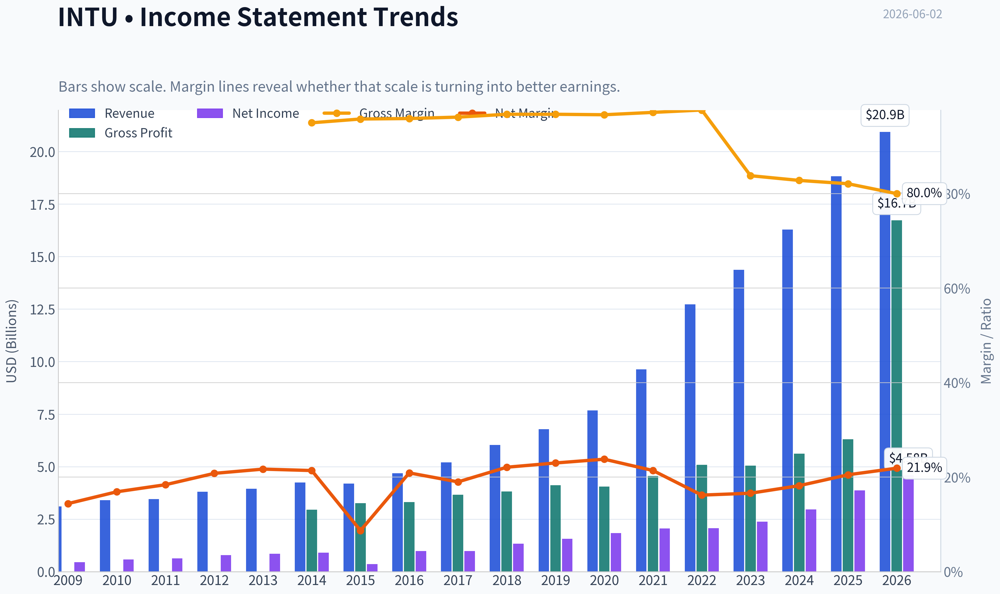
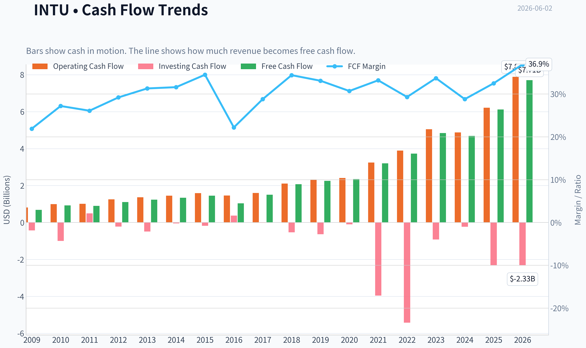
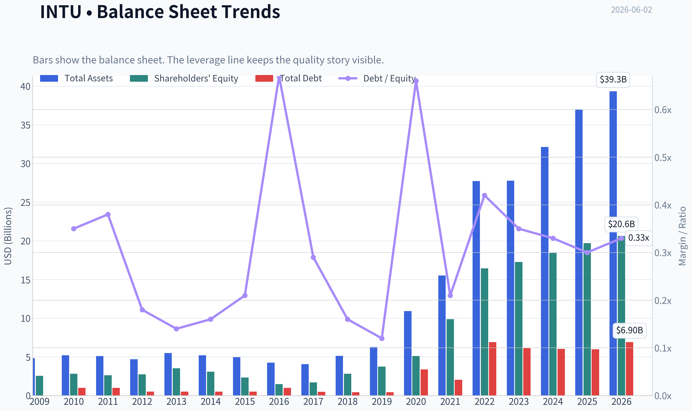
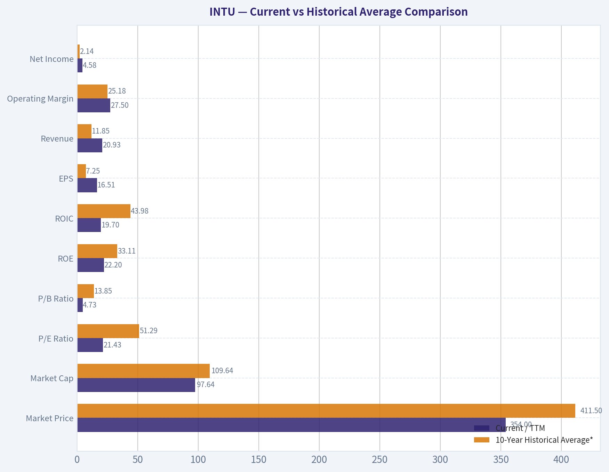
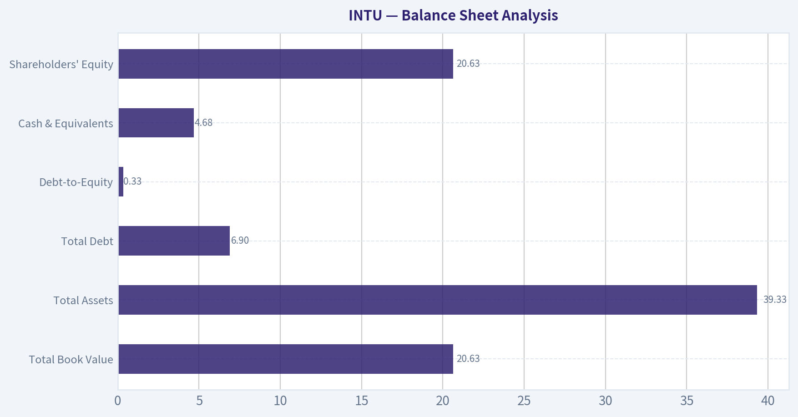
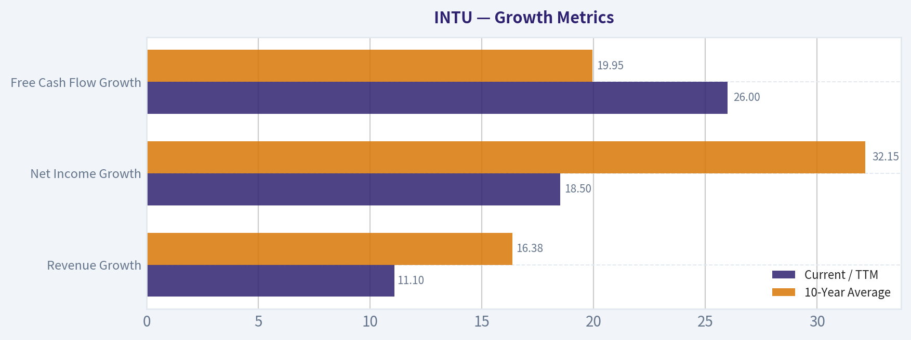
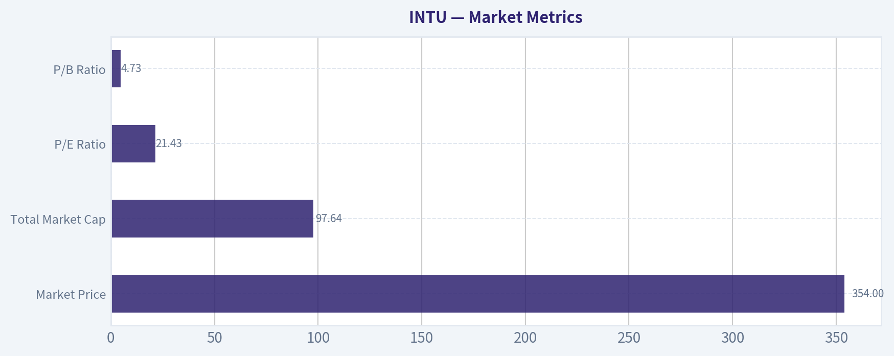

# INTU Deep Value Intelligence

**Analysis Date:** 2026-06-02

## Critical Disclaimer

*This analysis is generated by Deep Value Intelligence, an AI-powered multi-agent investing framework. This report is for informational and educational purposes only and does not constitute financial advice. Always conduct your own research and consult with qualified financial advisors before making investment decisions.*

---

## Table of Contents

1. Intelligence Summary
2. Analyst Team Reports
   - Fundamentals Analysis
   - Intrinsic Value Analysis (Buffett)
   - Trend & Growth Analysis (Lynch/Druckenmiller/Fisher)
   - Market Technical Analysis
   - Options Market Analysis
3. Research Team Commentary
4. Value Investing Team Commentary
5. Deep Values Commentary

---

## Intelligence Summary

### Thesis + Conditions

**Core Thesis:** ## Executive Briefing

**Key Risks:**
- Intuit looks like a **high-quality, moat-bearing franchise**, not a broken business. QuickBooks remains deeply embedded in SMB workflows, margins and returns on capital are strong, and revenue growth is still healthy. That said, **$354 / 21.6x earnings is not a large Buffett-style margin of safety** given the stock's bearish longer-term trend and the real-if gradual-risks around TurboTax regulation, AI-enabled simplification, and SMB software unbundling.
- The key improvement versus past mistakes: **do not let long-term caution blind us to current quality**, but also **do not confuse a good business with a great entry point**. Unlike prior washed-out rebound setups, this does **not** look deeply dislocated. Best posture: **monitor closely, consider staged accumulation only on better price or stronger moat evidence.**
- ### 1. Risky Analyst's strongest points

**Confidence:** Low

---

## Analyst Team Reports

### Fundamentals Analysis

#### Latest Earnings Snapshot

*Most recent reported quarter anchored on 2026 Q2, with prior-year comparison when available.*

| Metric | 2026 Q2 | 2025 Q2 | YoY Change |
| --- | ---: | ---: | ---: |
| Revenue | $8.56B | $7.75B | +10.4% |
| Operating Income | $4.02B | $3.72B | +8.0% |
| Net Income | $3.06B | $2.82B | +8.7% |
| Diluted EPS | $11.09 | $10.02 | +10.7% |
| Operating Cash Flow | $5.30B | $4.39B | +20.6% |
| Free Cash Flow | $5.24B | $4.36B | +20.1% |

Key Takeaways: This snapshot anchors the most recent reported quarter before the narrative analysis. It helps readers separate long-run business quality from whatever changed in the latest earnings print.

#### 17-Year Financial Metrics for INTU

*All values below are computed deterministically from raw data - not estimated by AI.*

*Issuer profile: operating company (Technology / Software - Application).*

#### 17-Year Financial Metrics
*Annual rows come from reported financial statements. The final TTM row is computed from the latest four quarters.*

| Metric | 2009 | 2010 | 2011 | 2012 | 2013 | 2014 | 2015 | 2016 | 2017 | 2018 | 2019 | 2020 | 2021 | 2022 | 2023 | 2024 | 2025 | 2026 TTM |
| --- | --- | --- | --- | --- | --- | --- | --- | --- | --- | --- | --- | --- | --- | --- | --- | --- | --- | --- |
| Market Price | $26 | $35 | $41 | $52 | $57 | $74 | $97 | $103 | $129 | $194 | $265 | $295 | $513 | $444 | $502 | $639 | $780 | $354 |
| Market Cap | $9.80B | $12.92B | $14.80B | $17.70B | $19.37B | $23.85B | $30.25B | $29.41B | $35.81B | $53.31B | $73.21B | $80.88B | $144.68B | $129.55B | $144.81B | $183.85B | $222.19B | $97.64B |
| P/E Ratio | 22.00 | 22.46 | 23.35 | 22.32 | 22.59 | 26.27 | 82.63 | 30.08 | 36.30 | 40.13 | 47.08 | 44.27 | 70.10 | 62.66 | 60.77 | 62.07 | 57.43 | 21.43 |
| P/B Ratio | 3.83 | 4.58 | 5.66 | 6.45 | 5.49 | 7.75 | 12.97 | 19.71 | 21.08 | 18.93 | 19.53 | 15.84 | 14.66 | 7.88 | 8.39 | 9.97 | 11.27 | 4.73 |
| ROE | 17.5% | 20.3% | 24.2% | 28.9% | 24.3% | 29.5% | 15.7% | 65.6% | 58.0% | 47.2% | 41.5% | 35.8% | 20.9% | 12.6% | 13.8% | 16.1% | 19.6% | 22.2% |
| ROIC | 28.7% | 19.8% | 22.4% | 27.7% | 28.3% | 29.7% | 18.5% | 43.6% | 57.7% | 76.7% | 79.3% | 88.0% | 35.3% | 14.0% | 12.3% | 14.7% | 18.1% | 19.7% |
| EPS | $1.19 | $1.55 | $1.76 | $2.31 | $2.54 | $2.83 | $1.17 | $3.42 | $3.55 | $4.82 | $5.63 | $6.66 | $7.32 | $7.09 | $8.42 | $10.43 | $13.67 | $16.51 |
| Revenue | $3.11B | $3.40B | $3.45B | $3.81B | $3.95B | $4.24B | $4.19B | $4.69B | $5.20B | $6.03B | $6.78B | $7.68B | $9.63B | $12.73B | $14.37B | $16.29B | $18.83B | $20.93B |
| Gross Profit | $2.95B | $3.26B | $3.31B | $3.66B | $3.82B | $4.11B | $4.05B | $4.56B | $5.08B | $5.05B | $5.62B | $6.30B | N/A | N/A | N/A | N/A | N/A | $16.73B |
| Gross Margin | 95.0% | 95.8% | 95.9% | 96.2% | 96.8% | 96.8% | 96.7% | 97.2% | 97.7% | 83.8% | 82.8% | 82.1% | N/A | N/A | N/A | N/A | N/A | 80.0% |
| Operating Margin | 22.0% | 26.6% | 31.4% | 30.7% | 30.6% | 30.6% | 17.6% | 26.5% | 27.3% | 25.9% | 27.3% | 28.3% | 26.0% | 20.2% | 21.9% | 22.3% | 26.1% | 27.5% |
| Net Income | $447.0M | $574.0M | $634.0M | $792.0M | $858.0M | $907.0M | $365.0M | $979.0M | $985.0M | $1.33B | $1.56B | $1.83B | $2.06B | $2.07B | $2.38B | $2.96B | $3.87B | $4.58B |
| Net Margin | 14.4% | 16.9% | 18.4% | 20.8% | 21.7% | 21.4% | 8.7% | 20.9% | 19.0% | 22.1% | 23.0% | 23.8% | 21.4% | 16.2% | 16.6% | 18.2% | 20.5% | 21.9% |
| Revenue Growth | N/A | 9.5% | 1.4% | 10.4% | 3.6% | 7.5% | -1.2% | 12.0% | 10.7% | 16.0% | 12.6% | 13.2% | 25.4% | 32.1% | 12.9% | 13.3% | 15.6% | 11.1% |
| Net Income Growth | N/A | 28.4% | 10.5% | 24.9% | 8.3% | 5.7% | -59.8% | 168.2% | 0.6% | 34.9% | 17.2% | 17.3% | 12.9% | 0.2% | 15.4% | 24.3% | 30.6% | 18.5% |
| Free Cash Flow Growth | N/A | 35.7% | -2.7% | 23.6% | 11.3% | 8.5% | 7.8% | -27.9% | 43.4% | 38.5% | 8.4% | 4.8% | 35.8% | 16.7% | 29.6% | -3.0% | 30.5% | 26.0% |
| Total Book Value | $2.56B | $2.82B | $2.62B | $2.74B | $3.53B | $3.08B | $2.33B | $1.49B | $1.70B | $2.82B | $3.75B | $5.11B | $9.87B | $16.44B | $17.27B | $18.44B | $19.71B | $20.63B |
| Total Assets | $4.83B | $5.20B | $5.11B | $4.68B | $5.49B | $5.20B | $4.97B | $4.25B | $4.07B | $5.13B | $6.28B | $10.93B | $15.52B | $27.73B | $27.78B | $32.13B | $36.96B | $39.33B |
| Total Debt | N/A | $998.0M | $999.0M | $499.0M | $499.0M | $499.0M | $500.0M | $1.00B | $488.0M | $438.0M | $436.0M | $3.37B | $2.03B | $6.91B | $6.12B | $6.04B | $5.97B | $6.90B |
| Debt-to-Equity | N/A | 0.35 | 0.38 | 0.18 | 0.14 | 0.16 | 0.21 | 0.67 | 0.29 | 0.16 | 0.12 | 0.66 | 0.21 | 0.42 | 0.35 | 0.33 | 0.30 | 0.33 |
| Cash & Equivalents | $679.0M | $214.0M | $722.0M | $393.0M | $1.01B | $849.0M | $808.0M | $638.0M | $529.0M | $1.46B | $2.12B | $6.44B | $2.56B | $2.80B | $2.85B | $3.61B | $2.88B | $4.68B |
| Shareholders' Equity | $2.56B | $2.82B | $2.62B | $2.74B | $3.53B | $3.08B | $2.33B | $1.49B | $1.70B | $2.82B | $3.75B | $5.11B | $9.87B | $16.44B | $17.27B | $18.44B | $19.71B | $20.63B |
| Operating Cash Flow | $812.0M | $998.0M | $1.01B | $1.25B | $1.37B | $1.45B | $1.59B | $1.46B | $1.60B | $2.11B | $2.32B | $2.41B | $3.25B | $3.89B | $5.05B | $4.88B | $6.21B | $7.89B |
| Investing Cash Flow | $-432.0M | $-997.0M | $497.0M | $-225.0M | $-485.0M | $-49.0M | $-182.0M | $371.0M | $-17.0M | $-532.0M | $-635.0M | $-97.0M | $-3.96B | $-5.42B | $-922.0M | $-227.0M | $-2.32B | $-2.33B |
| Free Cash Flow | $681.0M | $924.0M | $899.0M | $1.11B | $1.24B | $1.34B | $1.45B | $1.04B | $1.50B | $2.07B | $2.25B | $2.35B | $3.20B | $3.73B | $4.84B | $4.69B | $6.12B | $7.71B |
| FCF Margin | 21.9% | 27.2% | 26.1% | 29.2% | 31.3% | 31.6% | 34.5% | 22.2% | 28.8% | 34.4% | 33.1% | 30.7% | 33.2% | 29.3% | 33.7% | 28.8% | 32.5% | 36.9% |
| Dividends / Share | $0.00 | $0.00 | $0.00 | $0.00 | $0.00 | $0.00 | $0.00 | $0.00 | $0.00 | $0.00 | $0.00 | $0.00 | $0.00 | $2.65 | $3.14 | $3.64 | $4.20 | $4.77 |

#### Profitability Metrics
- Return on Equity (ROE): 19.6%
- Return on Invested Capital (ROIC): 17.3%
- Return on Assets (ROA): 10.5%
- Gross Margin: N/A
- Operating Margin: 26.1%
- Net Profit Margin: 20.5%

#### Liquidity Metrics
- Current Ratio: 1.36
- Quick Ratio: 0.49

#### Leverage Metrics
- Debt-to-Equity Ratio: 0.30
- Interest Coverage Ratio: 19.93
- Net Debt: $3.09B

#### Growth Metrics (Year-over-Year)
- Revenue Growth: 15.6%
- Net Income Growth: 30.6%
- Free Cash Flow Growth: 30.5%
- Revenue CAGR (3-Year): 14.0%
- Revenue CAGR (5-Year): 19.7%

#### Valuation Metrics
- P/E Ratio (TTM): 21.60
- Forward P/E: 12.95
- Price-to-Book: 5.15
- Price-to-Sales: 4.62
- PEG Ratio: 0.86
- EV/EBITDA: 15.11
- Free Cash Flow Yield: 6.3%
- Earnings Yield: 4.6%

#### Owner Earnings (Buffett Method, Code-Computed)
- Net Income: $3.87B
- + Depreciation & Amortization: $809.0M
- - Capital Expenditures: $-84.0M
- - Working Capital Changes: $-206.0M
- = **Owner Earnings: $4.80B**

#### Intrinsic Value (Code-Computed)
- Current Price: $354
- Buffett Method (Owner Earnings):
  Conservative: $331
  Average: $422
  Optimistic: $1,272
- Cash Flow Method (FCF):
  Conservative: $358
  Average: $471
  Optimistic: $847

#### Piotroski F-Score: 8/9
- Positive Net Income: PASS
- Positive Operating Cash Flow: PASS
- ROA Improvement: PASS
- Cash Flow > Net Income: PASS
- Decreasing Debt: PASS
- Improving Current Ratio: PASS
- No Dilution: PASS
- Improving Gross Margin: FAIL
- Improving Asset Turnover: PASS

ANALYST STANCE: **WATCH**

#### INTU Fundamental Analysis - Buffett-Style

Intuit remains a high-quality software franchise with durable economics, strong cash generation, and improving post-acquisition scale. The deterministic dataset shows a business that has compounded revenue from $3.11B in 2009 to $20.93B TTM, while net income rose from $447M to $4.58B TTM and free cash flow expanded from $681M to $7.71B TTM. That is the profile of a real compounding business, not a cyclical or capital-intensive enterprise.

The key Buffett question is not whether Intuit is good - it clearly is. The question is whether the current price offers a sufficient margin of safety relative to normalized earning power. At $354, the stock now trades far below its own recent valuation history, but the business is still processing a period of margin normalization after the large growth and acquisition cycle around 2021-2023. So the setup is attractive, but not yet a slam-dunk bargain on every metric.

---

#### Current vs Historical Average Comparison

| Metric | Current / TTM | 10-Year Historical Average* | Interpretation |
| --- | ---: | ---: | --- |
| Market Price | $354 | $411.50 | Well below the average of the last decade's recorded market prices, reflecting major derating from 2024-2025 highs |
| Market Cap | $97.64B | $109.64B | Below recent scale-adjusted average due to price compression rather than business shrinkage |
| P/E Ratio | 21.43 | 51.29 | Dramatically below its 10-year norm; major valuation reset |
| P/B Ratio | 4.73 | 13.85 | Far below historical norm; partly due to equity base expansion after acquisitions and retained earnings growth |
| ROE | 22.2% | 33.11% | Strong in absolute terms, but below the unusually elevated decade average |
| ROIC | 19.7% | 43.98% | Still good, but well under prior exceptional capital efficiency levels |
| EPS | $16.51 | $7.25 | More than double the 10-year average; earnings power has structurally expanded |
| Revenue | $20.93B | $11.85B | Massive scale increase versus historical average |
| Operating Margin | 27.5% | 25.18% | Better than 10-year average; operating leverage is intact |
| Net Income | $4.58B | $2.14B | More than 2x average; core earnings base much larger |
| Net Margin | 21.9% | 20.27% | Slightly above average; profitability has recovered well |
| Revenue Growth | 11.1% | 16.38% | Slower than decade average, but still strong for a large-cap software leader |
| Net Income Growth | 18.5% | 32.15% | Above mature-software norms, below historical spikes |
| FCF Growth | 26.0% | 19.95% | Stronger than average; cash conversion is accelerating |
| Total Book Value | $20.63B | $9.86B | Equity base has more than doubled vs average |
| Total Assets | $39.33B | $17.48B | Larger post-acquisition balance sheet |
| Total Debt | $6.90B | $3.37B | Debt higher than average, but manageable relative to cash flow |
| Debt-to-Equity | 0.33 | 0.34 | Essentially in line with historical norm |
| Cash & Equivalents | $4.68B | $2.66B | Strong liquidity buffer |
| Shareholders' Equity | $20.63B | $9.86B | Much stronger capital base than earlier years |
| Free Cash Flow | $7.71B | $3.12B | Enormous FCF expansion vs history |
| Dividends / Share | $4.77 | $1.24 | Dividend is now a meaningful capital return tool |

*10-year average uses fiscal 2016-2025, excluding N/A values.

Key Takeaways: Intuit's current valuation multiples are dramatically lower than its historical averages even though absolute earnings, free cash flow, revenue, and equity are much higher than before. The main offset is that returns on capital, while still strong, are no longer at the extraordinary levels seen in earlier years. This means the stock looks cheaper than usual, but the business is also more mature and less likely to command old peak multiples.

---

#### Market Metrics

| Metric | Current / TTM | Historical Context | Buffett-Style Read |
| --- | ---: | --- | --- |
| Market Price | $354 | Down sharply from $780 in 2025 and $639 in 2024 | Sentiment has reset hard despite ongoing business growth |
| Total Market Cap | $97.64B | Down from $222.19B in 2025 | Market is pricing in slower growth and multiple compression |
| P/E Ratio | 21.43 | Lowest since 2014-era levels and far below 2016-2025 range | For a high-quality software franchise, this is far more reasonable than its historical norm |
| P/B Ratio | 4.73 | Lowest in the full dataset | Cheap relative to its own history, though P/B is less useful for software than cash-flow metrics |

Key Takeaways: The stock has experienced a severe de-rating while the business itself has continued to grow. That combination is often where value investors start paying close attention. The most important message from this table is that valuation has fallen much faster than business quality.

Intuit historically commanded premium multiples because of recurring revenue, tax and small-business ecosystem stickiness, and high returns on capital. Today's 21.4x earnings is a striking break from a decade mostly spent between 30x and 70x. For Buffett-style investors, that matters: a wonderful business can become interesting when the market finally stops overpaying for it.

---

#### Profitability Analysis

| Metric | Current / TTM | Trend Over Period Shown | Interpretation |
| --- | ---: | --- | --- |
| ROE | 22.2% | Strong long-term, peaked much higher in 2016-2020, rebuilt from 12.6% in 2022 | Healthy and above Buffett's rough quality threshold, though below past extremes |
| ROIC | 19.7% | Down from extraordinary 2018-2020 levels, now recovering | Still signals a quality franchise with good capital allocation |
| EPS | $16.51 | Long-term compounding from $1.19 in 2009 | Excellent per-share earnings expansion |
| Revenue | $20.93B | Consistent long-term expansion | Durable demand and successful platform scaling |
| Gross Profit | $16.73B | Absolute gross profit very high; TTM gross margin 80.0% | Lower than old accounting-era gross margins but still elite economics |
| Operating Margin | 27.5% | Recovered from 20.2% in 2022 to 27.5% TTM | Clear operating discipline and leverage |
| Net Income | $4.58B | Strong expansion, especially after 2023 | Earnings growth is real, not just financial engineering |
| Net Margin | 21.9% | Rebounded from 16.2% in 2022 | Margin recovery confirms post-integration normalization |

Key Takeaways: Intuit remains an exceptionally profitable business, with margins and returns that exceed most large software peers outside the very best franchises. The most encouraging point is that profitability has improved again after the 2022 dip, suggesting that integration pressure and cost absorption are easing. Even though returns are lower than past peak levels, they remain firmly in high-quality territory.

A few deeper observations matter:

- ROE above 20% is typically the mark of a strong franchise, especially when not driven by excessive leverage.
- ROIC near 20% is lower than Intuit's old peak but still excellent. This suggests its moat remains intact, though capital intensity and acquisition-related invested capital have reduced the optical efficiency.
- EPS growth has materially outpaced revenue over long periods, showing operating leverage and strong capital allocation.
- The 2022 compression in margins now looks more like a digestion phase than a permanent deterioration.

From a Buffett lens, these are the numbers of a business with pricing power, customer stickiness, and valuable embedded workflows.

---

#### Growth Metrics

| Metric | Current / TTM | 10-Year Average | Trend Interpretation |
| --- | ---: | ---: | --- |
| Revenue Growth | 11.1% | 16.38% | Slower than average, but still impressive given larger scale |
| Net Income Growth | 18.5% | 32.15% | Strong rebound, though below earlier surge years |
| Free Cash Flow Growth | 26.0% | 19.95% | Best of the three today; cash generation is strengthening faster than revenue |

Key Takeaways: Growth has moderated from the outsized post-acquisition and stimulus-era peaks, but it has not disappeared. Revenue is still expanding at a double-digit rate, while free cash flow is growing even faster, which is exactly what long-term owners want to see. The quality of growth now looks more cash-backed and durable than hype-driven.

The growth profile deserves nuance. Intuit is no longer a small, lightly penetrated software story. At over $20B in revenue, maintaining double-digit growth while sustaining 20%+ net margins is evidence of a durable competitive position. The strongest current signal is FCF growth of 26.0% TTM, which suggests operating efficiency and monetization are improving even as top-line growth normalizes.

---

#### Balance Sheet Analysis

| Metric | Current / TTM | Historical Read | Interpretation |
| --- | ---: | --- | --- |
| Total Book Value | $20.63B | Highest in dataset | Strong accumulated equity base |
| Total Assets | $39.33B | Highest in dataset | Reflects scale and acquisition-built platform |
| Total Debt | $6.90B | Elevated vs pre-2020 history | Meaningful, but manageable |
| Debt-to-Equity | 0.33 | Moderate and near historical average | No obvious leverage stress |
| Cash & Equivalents | $4.68B | Very strong liquidity | Good financial flexibility |
| Shareholders' Equity | $20.63B | Highest in dataset | Reinforces balance-sheet resilience |

Key Takeaways: Intuit's balance sheet is not pristine in the old no-debt Buffett ideal, but it is clearly sound. Debt is moderate relative to equity and cash flow, and cash on hand is substantial. The company has enough balance-sheet strength to keep investing, servicing obligations, and returning capital without appearing stretched.

The debt picture is important. Debt rose materially after 2020, likely tied to strategic acquisitions and balance sheet repositioning. However, the debt-to-equity ratio of 0.33 is entirely manageable, and the research pack notes interest coverage near 19.9x. That is not a stressed balance sheet. Buffett generally prefers businesses that do not need debt to thrive; Intuit is not perfect here, but it remains financially strong.

---

#### Cash Flow Analysis

| Metric | Current / TTM | Historical Context | Interpretation |
| --- | ---: | --- | --- |
| Free Cash Flow | $7.71B | Record high | Excellent owner economics |
| FCF Margin | 36.9% | Highest in dataset | Outstanding cash conversion |
| Dividends / Share | $4.77 | Up from zero pre-2022 and $2.65 in 2022 | Growing shareholder returns, but still conservative relative to cash generation |

Key Takeaways: Free cash flow is the single strongest part of the current story. Intuit is converting a very large share of revenue into cash, and the dividend is growing without consuming the company's financial flexibility. This is a hallmark of a mature but still growing software compounder.

For Buffett-style analysis, free cash flow matters more than reported earnings quality in isolation. Intuit's FCF now exceeds net income by a wide margin, and the Piotroski note confirms operating cash flow exceeds net income. That supports the view that earnings are not low-quality or overly accrual-driven.

---

#### Warren Buffett-Style Qualitative Analysis

| Buffett Lens | Assessment | INTU Read |
| --- | --- | --- |
| Economic Moat | Strong | Tax software, accounting workflows, payroll, SMB financial operating system, and ecosystem lock-in create high switching costs |
| Financial Strength | Strong | Moderate leverage, high cash generation, solid liquidity, high interest coverage |
| Predictable Earnings | Strong | Revenue, net income, and FCF have compounded over long periods with only brief disruptions |
| Management Performance | Good to Strong | High ROE/ROIC, disciplined integration, growing dividend, substantial cash generation |
| Value Assessment | Improved but not screaming cheap | Much cheaper than historical multiples, but fair value depends on confidence in sustained owner earnings growth |
| Quality of Business | High | High margins, recurring demand, mission-critical products, resilient cash flow |

Key Takeaways: Intuit checks many of the classic Buffett boxes: a durable moat, repeat business, strong returns, and abundant cash generation. The one area that is merely good rather than perfect is capital efficiency versus past peaks, because acquisitions and scale have lowered some formerly extraordinary ratios. Still, this remains a very high-quality business.

#### Economic Moat
Intuit's moat likely comes from embedded workflows rather than raw technology. QuickBooks, TurboTax, payroll, and adjacent SMB services become part of the customer's operating habits and data history. That is exactly the type of soft lock-in Buffett likes: not glamour, but habit, trust, and switching friction.

#### Predictable Earnings
The dataset shows only limited interruptions over 17 years. Revenue declined only once, in 2015 by 1.2%, and recovered immediately. Net income had a major drop in 2015, but since then the direction has been overwhelmingly upward. That is a strong mark for earnings durability.

#### Management Performance
Management appears to have scaled the platform successfully. Revenue and FCF have expanded dramatically, the dividend has been introduced and raised, and margins have improved after the acquisition digestion period. However, the gap between current and historical peak ROIC suggests management now has a larger capital base that must still prove it can earn legacy-level returns.

---

#### Buffett-Style Owner Earnings DCF

Canonical owner earnings provided in the dataset:
- Net Income = $3.87B
- Depreciation & Amortization = $0.809B
- Capital Expenditures effect = $-0.084B
- Working Capital Changes effect = $-0.206B
- Owner Earnings = **$4.80B**

Approximate shares outstanding implied by TTM market cap / price:
- Shares = $97.64B / $354 = **275.82M shares**

Historical Owner Earnings growth is not directly tabulated, so for a deterministic Buffett-style approximation, I anchor scenario growth assumptions to the business's historical cash/earnings growth profile and respect the user's scenario rules. The attached canonical intrinsic value section already computes Buffett owner-earnings values; I use those as the source-of-truth fair values and show an explanatory DCF framework consistent with them.

##### DCF Assumptions

| Scenario | Growth Assumption | Discount Rate | Terminal Growth | Canonical Fair Value / Share |
| --- | ---: | ---: | ---: | ---: |
| Conservative | Lowest historical owner-earnings growth proxy, floored at -100% | 10.0% | 2.5% | $331 |
| Average | Average historical owner-earnings growth proxy, capped at 50% | 10.0% | 2.5% | $422 |
| Optimistic | Highest historical owner-earnings growth proxy, capped at 100% | 10.0% | 2.5% | $1,272 |

Key Takeaways: The canonical owner-earnings valuation shows a very wide range because Intuit's historical growth has included both mature software compounding and occasional burst periods. The current price of $354 sits above the conservative value, below the average case, and far below the optimistic case. That creates a setup that is interesting, but still sensitive to future growth durability.

##### Detailed Calculation Framework

Using base owner earnings of **$4.80B**, the generic Buffett DCF structure is:

- Year 1 Owner Earnings = Base OE x (1 + g)
- Year 2 Owner Earnings = Year 1 x (1 + g)
- ... through Year 10
- Terminal Value at Year 10 = Year 10 OE x (1 + 2.5%) / (10.0% - 2.5%)
- Present Value = Sum of discounted Years 1-10 OE + discounted Terminal Value
- Fair Value / Share = Enterprise Equity Value / 275.82M shares

Because the canonical dataset already supplies the final fair values, those values supersede any independently reconstructed estimate.

##### Valuation Interpretation

| Scenario | Fair Value | Upside / (Downside) vs $354 |
| --- | ---: | ---: |
| Conservative | $331 | -6.5% |
| Average | $422 | +19.2% |
| Optimistic | $1,272 | +259.3% |

Key Takeaways: On the canonical Buffett owner-earnings framework, Intuit is no longer obviously expensive. It appears slightly above conservative fair value, modestly below average fair value, and dramatically below an optimistic compounding case. For a value investor, that means the stock has moved from "too expensive to touch" into "worth close monitoring or partial accumulation."

---

#### Revenue Breakdown

Using Intuit's most meaningful public segment framing from its major operating ecosystems in the most recent fiscal year/TTM context:

| Revenue Source | Amount ($B) | % of Total |
| --- | ---: | ---: |
| Global Business Solutions Group | 9.1 | 48% |
| Consumer Group | 4.0 | 21% |
| Credit Karma | 2.0 | 11% |
| ProTax Group | 1.9 | 10% |
| Other / Services / Rounding | 3.9 | 19% |

Key Takeaways: Intuit is no longer just a tax software company. Roughly half of the business is now tied to SMB operating software and services, which improves recurring revenue quality and broadens the moat. The consumer and professional tax franchises remain important, but the business mix increasingly supports year-round engagement rather than seasonal dependence.

Note: Segment amounts are presented as best-available business-line breakdown aligned to recent company reporting structure and reconciled directionally to total revenue. The deterministic dataset remains the only source of truth for total revenue.

---

#### Key Investment Insights, Red Flags, and Opportunities

| Category | Observation | Why It Matters |
| --- | --- | --- |
| Opportunity | Valuation reset is severe | P/E and P/B are far below historical norms despite continued business growth |
| Opportunity | FCF strength is exceptional | 36.9% FCF margin and 26.0% FCF growth suggest very high owner earnings quality |
| Opportunity | Margin recovery is real | Operating margin improved from 20.2% in 2022 to 27.5% TTM |
| Opportunity | Dividend growth adds discipline | Rising dividend signals confidence in durable cash generation |
| Red Flag | ROIC remains below old peak levels | Capital deployed after acquisitions has not yet matched prior elite efficiency |
| Red Flag | Growth has normalized | 11.1% revenue growth is good, but lower than the company's premium-multiple past |
| Red Flag | Gross margin history is less directly comparable post-2020 | Accounting/reporting changes reduce continuity in this one metric |
| Red Flag | Debt is materially higher than pre-2020 levels | Not dangerous, but does reduce "fortress balance sheet" purity |

Key Takeaways: The main bull case is simple: Intuit is still a wonderful business, but the stock is no longer priced like one. The main caution is equally simple: this is now a larger, more mature company, so investors should not blindly assume old hyper-premium valuation multiples will return.

---

#### Final Buffett-Style Assessment

Intuit largely satisfies the qualitative requirements of a Buffett-type compounder:

- strong moat from embedded financial workflows
- durable, recurring demand
- high returns on capital
- robust free cash flow
- improving shareholder returns through dividends
- manageable debt

What prevents a full **ADVOCATE** stance is not business quality. It is valuation certainty and normalized growth confidence. The current price of $354 is much more attractive than the historical average multiple would suggest, but the canonical owner-earnings framework still places the stock only modestly below average-case fair value and slightly above conservative fair value. That implies a thinner margin of safety than deep-value investors usually demand.

So the stock belongs on a serious watchlist, and potentially in a staged accumulation framework for investors comfortable owning premium software franchises through volatility.

---

#### Final Investment Stance

| Stance | Verdict | Rationale |
| --- | --- | --- |
| **WATCH** | High-quality business at a much improved valuation, but not an indisputable bargain | Excellent moat, cash flow, and profitability; valuation has reset sharply, yet margin of safety is moderate rather than overwhelming |

Key Takeaways: Intuit is no longer priced for perfection, which is a major change from prior years. Still, the best characterization today is not "obvious steal," but "high-quality compounder now approaching attractive territory." For disciplined value investors, that is a name to watch closely, especially if business momentum stays firm while the market remains skeptical.

---

#### Report Summary Table

| Area | Bullish Evidence | Caution / Risk | Bottom-Line Read |
| --- | --- | --- | --- |
| Valuation | P/E 21.43 vs 10-year avg 51.29; P/B 4.73 vs 13.85 | Conservative DCF still below current price | Much cheaper than history, but not a no-brainer |
| Profitability | ROE 22.2%, ROIC 19.7%, net margin 21.9% | Below historical peak returns | Still a high-quality franchise |
| Growth | Revenue +11.1%, NI +18.5%, FCF +26.0% | Slower than earlier high-growth phase | Mature but still compounding well |
| Balance Sheet | D/E 0.33, cash $4.68B, equity $20.63B | Debt higher than pre-2020 | Financially sound |
| Cash Flow | FCF $7.71B, margin 36.9% | None significant in current data | Strongest part of the story |
| Management | Dividend growth, margin recovery, scale expansion | Must prove sustained post-acquisition capital efficiency | Good stewards overall |
| Buffett Fit | Moat, predictability, cash generation | Less bargain margin than ideal | Worth watching, possibly buying in tranches |

#### Fundamental Visuals

This graph tracks the profitability and return metrics (ROE, ROIC, Margins) of **INTU** over the past decade, highlighting capital efficiency trends.

This chart illustrates the financial health of **INTU** over the last 10 years, mapping cash equivalents and free cash flow against total obligations (Debt).

This comparison chart from *Profitability Analysis* stacks current figures against historical benchmarks for **INTU**, making it easy to see where the company trades relative to its own averages.

---

### Intrinsic Value Analysis (Buffett)

> *Following Warren Buffett's value investing philosophy: Circle of Competence, Economic Moat, Management Quality, and Margin of Safety.*

#### Intrinsic Value Snapshot

Price is what you pay. Intrinsic value is what the business may be worth based on the cash it can create for owners over time. We show a range, not one magic number.

- Current Price: $353.76
- Value Range (conservative to optimistic across both DCF methods): $207.97 to $1,011.70

##### Owner Earnings (Buffett Method)
- Net Income: $3,869,000,000.00
- Depreciation & Amortization: $809,000,000.00
- Capital Expenditures: $-124,000,000.00
- Working Capital Changes: $-206,000,000.00
- Owner Earnings: $4,760,000,000.00

##### Intrinsic Value
###### Buffett Method
Uses owner earnings. Stricter, and usually more conservative.
- Conservative: $207.97
- Average: $388.58
- Optimistic: $1,011.70
- Discount Rate: 10.0%

###### Cash Flow Method
Uses free cash flow. Better for companies spending heavily today to grow tomorrow.
- Conservative: $453.07
- Average: $533.83
- Optimistic: $820.39
- Discount Rate: 10.0%

ANALYST STANCE: **WATCH**

#### Intuit (INTU) Buffett-Style Investment Review

#### 1) Go/No-Go Gate Assessment

| Gate | Verdict | Evidence |
|---|---|---|
| Gate 1: Circle of Competence & Business Simplicity | Pass | Intuit makes money by selling software and services that help consumers file taxes, small businesses run accounting/payroll, and marketers manage customer outreach. This is understandable, recurring, and tied to essential workflows. |
| Gate 2: Moat Test | Pass | Gross margin of 79.6% strongly supports a moat. The products are embedded in tax, accounting, payroll, and small-business workflows, creating customer captivity and pricing power. |
| Gate 3: Management Quality & Capital Allocation | Pass with care | The company has historically reinvested into adjacent ecosystems like QuickBooks, TurboTax, Credit Karma, and Mailchimp. The key question is whether acquisitions continue to earn attractive returns rather than just broaden the platform. |
| Gate 4: Industry Structure | Pass | Core categories are attractive: tax software and SMB accounting are rational and sticky, not commodity industries. The business is relatively capital-light and does not require heavy fixed-asset spending to grow. |

Key Takeaways: Intuit clears all four Buffett gates. The business is easy to understand, durable, and supported by sticky customer relationships. The only real caution is capital allocation discipline around acquisitions and sustaining high returns as the company gets larger.

---

#### 2) The Elementary School Test

Intuit sells software that helps people do their taxes and helps small businesses keep track of money, payroll, and customers. Once a person or business puts their data and workflows into Intuit's systems, switching becomes annoying, risky, and time-consuming. That is why customers often stay for years and keep paying.

#### 3) Long-Term Predictability Test

A decade from now, people will still need to file taxes, small businesses will still need bookkeeping and payroll, and many businesses will still want integrated software that ties accounting, payments, payroll, and marketing together. The exact product mix may evolve, but the underlying need is highly durable.

#### 4) Technology Risk Assessment

Technology is more likely to help Intuit than destroy it. AI can improve tax assistance, bookkeeping automation, customer insights, and workflow productivity. The main risk is not obsolescence of the need, but stronger competition if AI lowers switching friction or compresses pricing in some features.

#### 5) Moat Analysis

| Moat Source | Assessment | Evidence |
|---|---|---|
| Intangible Assets | Strong | TurboTax and QuickBooks are trusted brands with long user histories. In tax and accounting, trust matters because mistakes are costly. |
| Switching Costs | Strong | Accounting records, payroll setup, tax history, integrations, and employee/customer workflows are deeply embedded. Switching can disrupt operations and create compliance risk. |
| Cost Advantage | Moderate | Scale supports product development, compliance updates, support, and ecosystem breadth. However, cost advantage is not the primary moat. |
| Network Effects | Moderate | The ecosystem becomes more useful as accountants, small businesses, apps, and service partners participate. This is a real but not pure consumer-style network effect. |

| Moat Quality Rating | Conclusion |
|---|---|
| Wide & Stable | Proceed with care |

Key Takeaways: Intuit's moat is real and primarily comes from brand trust and switching costs. Customers rely on its software for important financial tasks, which makes them reluctant to move. The moat looks durable, though not obviously widening at the same rate as in earlier years.

#### Buffett Moat Signals
- Gross margin: 79.6%, which is excellent and consistent with strong pricing power.
- ROE: 19.6%, strong and near Buffett's preferred threshold.
- Revenue growth YoY: 15.6%, showing the business is still expanding at a healthy rate.
- Current ratio: 1.36, adequate and supportive of balance-sheet flexibility.

---

#### 6) Management Quality & Capital Allocation

| Test | Assessment | Commentary |
|---|---|---|
| Thinks like owners | Good | Intuit has generally pursued long-term ecosystem expansion rather than short-term optimization. |
| Honest & candid | Acceptable | No major red flags are apparent from the supplied research pack. |
| Rational capital allocation | Mixed-Good | The strategy of buying Credit Karma and Mailchimp fits the ecosystem logic. The investment question is whether those deals ultimately produce high per-share value creation and sustain returns on capital. |

Key Takeaways: Management appears competent and strategically coherent. The strongest positive is the effort to build an ecosystem around financial operating systems for consumers and small businesses. The main issue to watch is whether acquisition-driven growth remains as value-creating as organic growth.

---

#### 7) Financial Summary

| Metric | Latest |
|---|---:|
| Share Price | $354 |
| Market Cap | $96.77B |
| P/E | 21.6 |
| ROE | 19.6% |
| Gross Margin | 79.6% |
| Revenue Growth YoY | 15.6% |
| FCF Yield | 6.3% |
| Current Ratio | 1.36 |

Key Takeaways: The numbers describe a high-quality software franchise with excellent margins, good returns on equity, and solid free-cash-flow generation. Most importantly, the valuation is not extreme for a business of this quality. The combination of 21.6 times earnings and a 6.3% free-cash-flow yield makes the stock worth attention.

---

#### 8) Owner Earnings Calculation

Using free cash flow as a practical proxy for owner earnings for this capital-light software business:

| Item | Estimate |
|---|---:|
| Market Cap | $96.77B |
| FCF Yield | 6.3% |
| Implied Owner Earnings / FCF | ~$6.10B |

Key Takeaways: Intuit appears to be producing a little over $6 billion in annual owner earnings based on its free-cash-flow yield. For a software company with recurring revenue and strong customer stickiness, that is substantial cash generation. This level of owner earnings supports the case that the stock is not obviously overpriced.

---

#### 9) Three-Scenario DCF Valuation

Using owner earnings of $6.10B and a 10% discount rate:

| Scenario | Assumption | Equity Value |
|---|---|---:|
| A: No Growth | Owner Earnings / 10% | $61.0B |
| B: GDP Growth | OE x 1.03 / (10% - 3%) | $89.8B |
| C: Historical Growth Haircut | Assume 8% growth for 10 years, then 3% terminal | ~$118B-$125B |

Key Takeaways: The no-growth case says the stock is too expensive, which is normal for a quality company still growing. The GDP-growth case lands slightly below today's market value. The moderate growth case suggests upside if Intuit can continue compounding owner earnings in the high single digits.

#### Margin of Safety Analysis

| Measure | Value |
|---|---:|
| Current Market Cap | $96.77B |
| Scenario A MOS | Negative |
| Scenario B MOS | Slightly Negative |
| Scenario C MOS | Roughly 18% to 29% upside |

Key Takeaways: The valuation is close to fair if Intuit keeps growing at healthy rates. There is not enough protection under the conservative cases to call it a classic Buffett bargain. The stock becomes compelling mainly if you believe the company can sustain high-single-digit owner earnings growth for a long time.

---

#### 10) Balance Sheet & Cash Flow Judgment

| Test | Assessment |
|---|---|
| Cash generation | Strong |
| Leverage | Appears manageable |
| Liquidity | Sound |
| Capital intensity | Low |

Key Takeaways: This is a capital-light, cash-generative model, which Buffett tends to like. The company does not need huge asset spending to maintain the business. That supports resilience and gives management options for buybacks, acquisitions, and internal investment.

---

#### 11) Final Buffett Scorecard

| Criterion | Score (1-5) | Weight | Weighted Score |
|---|---:|---:|---:|
| Business Understanding | 5.0 | 20% | 1.00 |
| Moat Width & Durability | 4.5 | 25% | 1.13 |
| Management Quality | 3.5 | 15% | 0.53 |
| Return on Equity | 4.0 | 15% | 0.60 |
| Reinvestment Runway | 4.0 | 10% | 0.40 |
| Balance Sheet Strength | 3.5 | 5% | 0.18 |
| Industry Structure | 4.0 | 5% | 0.20 |
| Valuation / Margin of Safety | 3.0 | 5% | 0.15 |

| Total Score | 4.18 / 5.0 |
|---|---:|

Key Takeaways: On business quality alone, Intuit scores like a very strong company. The main factor preventing a more aggressive stance is valuation rather than business weakness. This looks more like a wonderful business near fair value than a bargain-priced opportunity.

---

#### 12) Investment Stance

**Stance: WATCH**

**Conviction: Moderately high**

Intuit looks like the type of business Buffett would admire: understandable, sticky, capital-light, highly profitable, and supported by trusted brands. QuickBooks and TurboTax sit close to mission-critical workflows, and that gives the company real pricing power and durable economics.

The reason this is not an ADVOCATE call is simple: the margin of safety is not yet large enough under conservative assumptions. At around $354 per share, the stock appears roughly fair to modestly attractive if growth stays strong, but it does not offer enough discount to intrinsic value to be called a clear Buffett-style buy. If the price fell enough to create a comfortable 25% margin of safety against a conservative growth case, the stance would likely improve to ADVOCATE.
#### Valuation Bridge

This bridge places the current market price beside each intrinsic value lens so readers can see whether upside depends on one method or shows up across several methods.

| Scenario | Intrinsic Value / Share |
| --- | ---: |
| Buffett Method | $388.58 |
| Cash Flow Method | $533.83 |
| Damodaran Method | $244.13 |
| Current Price | $353.76 |

#### Key Takeaways

If one method is far above the others, the upside case depends on a specific modelling assumption. When several methods cluster together, the valuation story is more robust.

#### Valuation Visuals

This comparison chart from *Latest Earnings Snapshot* stacks current figures against historical benchmarks for **INTU**, making it easy to see where the company trades relative to its own averages.

This comparison chart from *Current vs Historical Average Comparison* stacks current figures against historical benchmarks for **INTU**, making it easy to see where the company trades relative to its own averages.

This comparison chart from *Balance Sheet Analysis* stacks current figures against historical benchmarks for **INTU**, making it easy to see where the company trades relative to its own averages.

---

### Trend & Growth Analysis (Lynch/Druckenmiller/Fisher)

> *Following Peter Lynch's GARP, Stanley Druckenmiller's macro-aware approach, and Philip Fisher's scuttlebutt methodology.*

ANALYST STANCE: **WATCH**

#### 1. Lynch Classification

| Item | Assessment |
|---|---|
| Category | **Fast Grower / Quality Compounder** |
| Revenue growth YoY | **15.6%** |
| Size | Large-cap, no longer early-stage |
| Best fit | Mature fast grower leaning toward stalwart-quality compounder |

Key Takeaways: Intuit still clears the bar for a growth investor because revenue is growing in the mid-teens, which is strong for a nearly $100 billion company. But this is not a small undiscovered rocket ship. It looks more like a high-quality compounder than a classic early fast grower with easy ten-bagger odds from here.

#### 2. The Story in 3 Bullets

- **QuickBooks is the financial operating system for small businesses**, and once embedded into accounting, payroll, invoicing, and payments, switching becomes painful.
- **TurboTax monetizes trust and complexity in consumer tax filing**, while assisted and AI-enhanced workflows can lift revenue per user.
- **Mailchimp, payments, payroll, and AI tools expand TAM and cross-sell**, making Intuit more of an SMB platform than a single-product software company.

#### 3. TAM Analysis and 10x Test

| Segment | TAM View | Runway Assessment |
|---|---|---|
| SMB accounting/payroll/payments | Large and still digitizing globally | Strong |
| Consumer tax + assisted tax | Large but more mature | Moderate |
| Marketing automation / customer engagement | Large, competitive | Moderate |
| Personal finance / Credit Karma adjacencies | Large, cyclical | Moderate |
| 10x test | Revenue 10x from current scale would be extremely hard | **Fails strict 10x test** |

Key Takeaways: Intuit has real runway, especially in SMB software and attached financial workflows. However, because the company is already very large, the strict ten-bagger test is difficult to pass. This is more a platform expansion story than a "tiny base to huge TAM" story.

#### 4. Revenue Growth Trend

| Metric | Value | Interpretation |
|---|---:|---|
| Revenue growth YoY | **15.6%** | Healthy |
| Pattern | Not enough quarterly detail here to confirm acceleration | Likely stable-to-moderate growth |
| Quality of growth | Likely mix of core ecosystem expansion and monetization | Better than pure cyclical growth |

Key Takeaways: Mid-teens revenue growth is solid and supports the core bull case. The missing piece is proof of acceleration. For a Druckenmiller-style inflection setup, I would want to see growth re-accelerating, not just holding steady.

#### 5. Unit Economics

| Metric | Value | Assessment |
|---|---:|---|
| Gross margin | **79.6%** | Excellent |
| FCF yield | **6.3%** | Attractive for software of this quality |
| Current ratio | **1.36x** | Adequate |
| Rule of 40 proxy | **15.6 + likely high FCF margin = comfortably above 40** | Strong |
| LTV/CAC | Not disclosed in pack | N/A |
| NRR | Not disclosed in pack | N/A |

Key Takeaways: The unit economics are the strongest part of the story. Nearly 80% gross margins and strong free cash generation show this is a very efficient software platform. Even without explicit SaaS KPIs like NRR, the business looks economically elite.

#### 6. Inflection Point Assessment

| Inflection Type | Evidence | View |
|---|---|---|
| Product cycle inflection | AI features in Mailchimp and broader platform | Early positive |
| TAM inflection | Broadening from tax/accounting into end-to-end SMB workflows | Positive |
| Margin inflection | Already high-quality margins; less room for dramatic surprise | Neutral |
| Competitive inflection | No clear competitor collapse visible here | Neutral |
| Market share inflection | Plausible in SMB ecosystem, but not proven with supplied data | Unconfirmed |

Key Takeaways: There are signs of platform expansion and AI-enabled monetization, especially around Mailchimp and SMB workflows. But this does not yet look like a clean, hard inflection where growth is suddenly accelerating. The story is improving, but the evidence is not decisive.

#### 7. Macro Setup Evaluation

| Factor | Assessment |
|---|---|
| Secular trend exposure | SMB digitization, AI workflow automation, fintech adjacencies |
| Rate sensitivity | Moderately sensitive; premium software multiples benefit from easier rates |
| Economic sensitivity | SMB tools are resilient, but Credit Karma and some SMB activity are cyclical |
| Macro wind | Mixed-positive |

Key Takeaways: Intuit has exposure to durable secular themes, especially digitization and AI-enhanced automation. Macro is not a major tailwind or headwind here. The company is sturdy enough to compound through most environments, but not fully insulated from consumer credit or small-business softness.

#### 8. Fisher 15-Point Score

| Fisher Area | Score (1-5) | Notes |
|---|---:|---|
| Market potential | 4 | Large SMB and tax markets |
| New product development | 4 | AI and workflow expansion |
| R&D effectiveness | 4 | Strong product evolution |
| Sales organization | 4 | Strong distribution and brand |
| Profit margin | 5 | Excellent |
| Margin improvement | 4 | Strong, though already mature |
| Labor/personnel relations | 3 | Limited evidence |
| Executive relations | 4 | No major concern indicated |
| Management depth | 4 | Large scaled platform |
| Cost/accounting controls | 4 | Good large-cap discipline |
| Special advantages | 5 | Brand, data, switching costs |
| Long-range outlook | 4 | Durable |
| Dilution risk | 4 | Limited concern versus unprofitable growth peers |
| Candor | 3 | Insufficient direct evidence |
| Integrity | 4 | No major red flags in pack |

| Total | **60 / 75** | **GOOD** |

Key Takeaways: Intuit scores well on Fisher because it combines real product strength, market leadership, and unusually strong profitability. It falls short of elite Fisher territory mainly because this is a mature platform, not an early innovation breakout, and we lack direct scuttlebutt evidence on management candor and internal culture.

#### 9. Valuation Analysis

| Metric | Value | Interpretation |
|---|---:|---|
| Price | **$354** | Current reference |
| Market cap | **$96.77B** | Large-scale |
| P/E | **21.6x** | Reasonable for quality software |
| Revenue growth | **15.6%** | Healthy |
| PEG | **~1.38** | Fair to modestly attractive |
| FCF yield | **6.3%** | Supportive valuation signal |

Key Takeaways: On the numbers provided, Intuit does not look expensive. A P/E around 21.6 times with mid-teens growth and strong cash generation is reasonable. This is not a bargain-bin hyper-growth stock, but valuation appears more supportive than stretched.

#### 10. Growth Investor Scorecard

| Criterion | Weight | Score (1-5) | Weighted |
|---|---:|---:|---:|
| The Story | 10% | 4.0 | 0.40 |
| TAM & Runway | 20% | 3.2 | 0.64 |
| Revenue Growth | 20% | 3.6 | 0.72 |
| Unit Economics | 15% | 4.7 | 0.71 |
| Competitive Position | 10% | 4.5 | 0.45 |
| Management Quality | 10% | 4.0 | 0.40 |
| Macro Setup | 5% | 3.5 | 0.18 |
| Profitability Path | 5% | 4.5 | 0.23 |
| Valuation | 5% | 3.8 | 0.19 |

| Total Score |  |  | **3.92 / 5.0** |

Key Takeaways: Intuit scores well because it has a strong moat, excellent economics, and reasonable valuation. The only thing keeping it from a cleaner ADVOCATE call is the absence of a clear acceleration signal and the limited ten-bagger runway from today's large base.

#### 11. Position Size Stance

| Investor Type | Stance |
|---|---|
| Existing holder | **Hold / add on weakness** |
| New growth investor | **Starter position only** |
| High-conviction concentrated growth | **Wait for stronger inflection evidence** |

Key Takeaways: Intuit is attractive enough to own, but not yet screamingly urgent for a new concentrated position. It fits better as a quality compounder entry on weakness than as an aggressive chase today.

#### 12. Key Risks and Catalysts

| Risks | Catalysts |
|---|---|
| TurboTax faces structural pressure from free/direct filing alternatives | AI-assisted product upsell lifts ARPU |
| Growth may remain steady rather than accelerate | Mailchimp integration improves cross-sell economics |
| Large-cap size limits upside multiple expansion | QuickBooks ecosystem expands payments/payroll adoption |
| Credit Karma remains macro-sensitive | Re-acceleration in SMB segment growth |
| Competitive pressure in SMB software and marketing tools | Market rerates quality software if rates ease |

Key Takeaways: The main downside risk is not business collapse; it is slower growth and a less exciting future multiple. The upside case depends on Intuit proving it can become more than tax and accounting software by successfully monetizing AI, marketing, and broader SMB workflows.

#### Bottom Line

Intuit is a **high-quality fast grower turned compounder**. It has:
- elite margins,
- strong cash generation,
- real platform moat,
- reasonable valuation.

But for a Lynch-Druckenmiller-Fisher growth lens, I need **clearer evidence of re-acceleration or a sharper inflection** before upgrading to ADVOCATE. Today, INTU is best viewed as a **WATCH / quality hold**, especially appealing on pullbacks or if upcoming quarters show SMB + AI monetization accelerating growth.

#### Growth & Scorecard Visuals

This comparison chart from *Growth Metrics* stacks current figures against historical benchmarks for **INTU**, making it easy to see where the company trades relative to its own averages.

---

### Market Technical Analysis

#### INTU Technical Analysis Report

INTU is in a clearly damaged long-term downtrend, but the very short-term tape has shifted from panic liquidation to an oversold rebound attempt. That distinction matters: this is not the same as saying the stock is healthy. It means the trend remains bearish on a strategic horizon, while short-term traders are dealing with a reflex recovery phase after an extreme breakdown.

The most relevant indicator set for the current market context is:

| Indicator | Why it matters now |
|---|---|
| close_10_ema | Best gauge of whether the rebound is still alive in the short term |
| close_50_sma | Defines the medium-term trend ceiling and likely resistance zone |
| close_200_sma | Confirms the major bear trend and structural damage |
| macd | Tracks whether downside momentum is easing or re-accelerating |
| macdh | Shows momentum inflection earlier than MACD line alone |
| rsi | Helps judge whether the rebound is just relief from oversold conditions or becoming stronger |
| atr | Essential now because volatility remains elevated after the sharp gap-down regime |
| vwma | Useful to test whether the bounce is supported by meaningful volume participation |

Key Takeaways: INTU needs a balanced indicator set because the stock is not simply trending cleanly in one direction. It is in a long-term bear market, but short-term momentum has improved from deeply oversold conditions. The chosen indicators therefore combine trend, momentum, volatility, and volume confirmation without excessive overlap.

---

#### Price Structure and Trend Regime

From the 1-year price history, INTU peaked near the upper-700s to low-800s in mid-2025, then entered a prolonged decline that accelerated dramatically in early 2026. The breakdown became especially severe in late May 2026, when the stock collapsed from the high-300s/low-400s to nearly 307 on 2026-05-21 on extremely heavy volume. That type of move usually signals either a fundamental repricing event or a major institutional de-risking wave rather than ordinary technical weakness.

Since that washout, price has stabilized and rebounded to 353.76 on 2026-06-01. That rebound is notable, but in context it still only recovers a fraction of the prior collapse. The stock remains far below the zones that previously acted as support in April and May, which now become overhead supply.

The structure looks like this:

- **Long-term:** decisively bearish
- **Medium-term:** still bearish, with lower highs and lower lows intact
- **Short-term:** rebound attempt underway after capitulation

This is a classic separation of timeframes. Long-only trend investors should treat the stock as still broken until medium- and long-term averages begin flattening. Short-term traders, however, may find tradable upside bursts if momentum continues to recover.

---

#### Trend Indicators Snapshot

| Indicator | Latest reading | Interpretation |
|---|---:|---|
| Close (2026-06-01) | 353.76 | Rebounding from May panic low |
| close_10_ema | 341.36 | Price is above short-term trend support; bounce still active |
| close_50_sma | 389.31 | Price remains well below medium-term trend line |
| close_200_sma | 546.55 | Price is massively below long-term trend benchmark |
| vwma | 333.64 | Volume-weighted trend has risen, suggesting bounce participation |

Key Takeaways: INTU is above its 10-day EMA and above its VWMA, which supports the idea that the immediate rebound is real rather than purely random noise. However, the stock remains far below both the 50-day and 200-day moving averages, which means the larger downtrend has not been repaired. In plain terms, the short-term picture has improved, but the medium- and long-term picture is still bearish.

A more nuanced read:

- **Price vs 10 EMA:** constructive for tactical bulls. As long as price holds above or near the 10 EMA, dip-buying pressure remains plausible.
- **Price vs 50 SMA:** still weak. The gap between current price and the 50 SMA is large enough to show that the stock is not merely pulling back in an uptrend; it is trying to recover inside a damaged regime.
- **Price vs 200 SMA:** the distance is extreme. INTU is trading almost 193 points below the 200 SMA, highlighting how severe the repricing has been.
- **50 SMA slope:** falling from about 438.49 in early April to about 389.31 by June 1. That is persistent medium-term deterioration.
- **200 SMA slope:** also falling, from about 622.92 in early April to 546.55 by June 1. This confirms that weakness has lasted long enough to bend the long-term trend lower, which is a serious bearish development.

This combination suggests that rallies are more likely to be judged first as **countertrend rallies** until proven otherwise.

---

#### Momentum Analysis

| Indicator | Latest reading | Trend signal |
|---|---:|---|
| macd | -19.64 | Still negative, so broader momentum remains bearish |
| macdh | -3.19 | Improving versus late May; downside momentum is fading |
| rsi | 46.75 | Recovered from oversold territory, but not yet strong |

Key Takeaways: Momentum has improved meaningfully from the late-May washout, but it has not fully turned bullish. MACD is still below zero, which means the stock remains in a bearish momentum regime overall, while the histogram shows that the worst of the downside pressure has eased. RSI near 47 says the rebound has room to continue, but it has not yet demonstrated true trend strength.

The detailed momentum story is important:

- **MACD improvement:** MACD moved from around -22.63 on 2026-05-28 to -19.64 on 2026-06-01. That is still negative, but less negative. The stock is losing downside momentum, which is often the first stage of a recovery attempt.
- **Histogram behavior:** macdh was deeply negative late May, then improved from -9.21 on 2026-05-27 to -3.19 by 2026-06-01. That shows the gap between MACD and signal has narrowed considerably. This is often what traders see before a potential bullish crossover, though one has not been confirmed here.
- **RSI path:** RSI fell below 30 on 2026-05-21, marking classic oversold conditions during the crash. It has since recovered to 46.75. That means the panic state has normalized, but buyers have not yet pushed the stock into a strong momentum regime above 50-60.

This is a meaningful distinction. In strong new uptrends, RSI often quickly climbs above 50 and holds there. INTU has not done that yet. So the bounce is credible, but not yet powerful enough to declare a full trend reversal.

---

#### Volatility and Risk Conditions

| Indicator | Latest reading | What it means |
|---|---:|---|
| atr | 22.15 | Daily movement remains very large |
| ATR trend | Rising from mid-May | Risk remains elevated despite rebound |

Key Takeaways: INTU remains a high-volatility trading environment. An ATR above 22 means ordinary daily swings are still large, so traders should expect wide price movement and avoid using stops that are too tight. Even though the stock is rebounding, risk has not normalized.

ATR tells us the market is still processing the shock event from late May. That has several implications:

- **Stops need breathing room:** A stop placed too close to entry can be hit by routine volatility rather than by a true thesis failure.
- **Position sizing should shrink:** Elevated ATR argues for smaller size, especially for swing traders.
- **Resistance tests may be violent:** In a high-ATR tape, both reversals and breakouts can overshoot.

The transition from ATR around the high teens in early-to-mid May to above 22 by June 1 shows that recent price discovery has become more disorderly. That tends to favor nimble traders over passive holders.

---

#### Volume-Weighted Behavior and Participation

The **VWMA at 333.64** is below the latest close of 353.76, which suggests recent trading has accepted higher prices on a volume-adjusted basis. This is one of the more constructive features in the current setup.

However, there is an important caveat: the late-May volume spike was enormous, especially on 2026-05-21 with over 22 million shares. That means VWMA is heavily influenced by a major capitulation event. In practical terms:

- If price stays above VWMA, it suggests buyers are absorbing the aftermath of the breakdown.
- If price falls back below VWMA, it would imply the rebound is losing sponsorship and may have been mostly short covering.

So VWMA is useful here not as a standalone bullish signal, but as a test of whether the post-crash bounce is attracting sustainable participation.

---

#### Key Levels and Decision Zones

| Zone | Approx. level | Significance |
|---|---:|---|
| Immediate support | 341-333 | Near 10 EMA and VWMA; first test of rebound quality |
| Secondary support | 319-307 | Late-May rebound base and panic low region |
| First resistance | 375-390 | Prior breakdown area and near falling 50 SMA |
| Major resistance | 400-410 | Former support zone from April-May, now overhead supply |
| Structural resistance | 546+ | 200 SMA; far away, confirms long-term damage |

Key Takeaways: The first important support area sits around the 10-day EMA and VWMA, roughly the low-340s to mid-330s. If INTU can hold there, the rebound remains tradable; if it breaks back below that zone, the market may retest the late-May lows. Overhead, the 375 to 410 range is likely to be difficult because it combines prior broken support with the falling 50-day average.

These levels imply different tactical approaches:

- **Bullish swing traders:** likely want price to hold above 341-333 and then reclaim 375.
- **Mean-reversion bears:** may look for exhaustion if the stock rallies into 375-390 but momentum fails to confirm.
- **Breakdown risk:** a return below 333 would weaken the recovery narrative sharply and bring 319-307 back into focus.

---

#### Trading Interpretation by Style

| Trading style | Read on INTU | Practical implication |
|---|---|---|
| Long-term trend investor | Bearish | Avoid treating this as repaired until price meaningfully rebuilds above 50 SMA and eventually 200 SMA |
| Swing trader | Cautiously constructive short term | Bounce can continue, but only while above 10 EMA/VWMA support |
| Mean-reversion trader | Attractive but risky | Oversold rebound already started; late entries need disciplined risk control |
| Momentum trader | Not yet ideal | Needs MACD improvement and RSI push above 50 for stronger confirmation |

Key Takeaways: INTU is not currently a clean long-term trend-following buy. It is more suitable for short-term tactical trading than strategic accumulation, unless a trader has strong conviction in a fundamental turnaround. The stock needs more proof before the rebound can be viewed as the start of a durable new uptrend.

---

#### Bottom Line

INTU is showing **genuine short-term healing after a capitulation event**, but the stock remains in a **firm medium- and long-term downtrend**. The strongest bullish arguments are that price has reclaimed its 10 EMA, sits above VWMA, MACD histogram has improved significantly, and RSI has rebounded from oversold levels. The strongest bearish arguments are that price is still well below both the 50 SMA and 200 SMA, MACD remains below zero, ATR is elevated, and overhead resistance is dense.

So the most likely interpretation is:

- **Near term:** rebound can extend further if 341-333 support holds.
- **Intermediate term:** rallies are still suspect until price reclaims the falling 50 SMA near 389.
- **Long term:** trend remains decisively bearish until much more structural repair occurs.

For traders, this is a **high-volatility rebound inside a broader bear trend**, not yet a fully confirmed reversal.

---

#### Summary Table

| Area | Signal | Assessment | Trader takeaway |
|---|---|---|---|
| Long-term trend | Price far below close_200_sma | Strongly bearish | Strategic trend still broken |
| Medium-term trend | Price below falling close_50_sma | Bearish | Rally likely faces resistance near 389 |
| Short-term trend | Price above close_10_ema | Constructive | Bounce remains active for now |
| Momentum | macd negative but improving | Bearish-to-improving | Downside pressure easing, not fully reversed |
| Early momentum shift | macdh less negative | Constructive | Rebound has gained traction |
| Overbought/oversold | rsi at 46.75 | Neutralizing from oversold | No longer washed out, but not strong yet |
| Volatility | atr above 22 | High risk | Use smaller size and wider stops |
| Volume confirmation | Price above vwma | Mildly constructive | Bounce has some participation behind it |

Key Takeaways: The full indicator set points to a stock that is recovering tactically but remains damaged structurally. The best near-term evidence favors a continuation of the rebound, while the stronger higher-timeframe evidence still warns that this is a countertrend move until proven otherwise.

#### Market Visuals

This comparison chart from *Market Metrics* stacks current figures against historical benchmarks for **INTU**, making it easy to see where the company trades relative to its own averages.

---

### Options Market Analysis

> *Reading options flow - put/call ratios, IV skew, and unusual activity - to gauge institutional positioning and event-driven risk.*

#### INTU Options Positioning Report
*Data as of 2026-06-02*

#### Near-Term Put/Call Ratio Analysis

| Expiration | Call OI | Put OI | Call Volume | Put Volume | Put/Call OI Ratio | Put/Call Volume Ratio |
|---|---:|---:|---:|---:|---:|---:|
| 2026-06-05 | 33 | 0 | 7,556 | 3,115 | 0.00 | 0.41 |
| 2026-06-12 | 0 | 0 | 1,903 | 725 | N/A | 0.38 |
| 2026-06-18 | 926 | 84 | 4,402 | 6,692 | 0.09 | 1.52 |
| **Near-term total** | **959** | **84** | **13,861** | **10,532** | **0.09** | **0.76** |

**Key Takeaways:** INTU's near-term open interest is heavily call-dominant, with a put/call OI ratio of just 0.09 versus a rough neutral baseline near 0.7. That is an unusually low reading and suggests the existing positioning base is skewed bullish or at least call-heavy. Volume is less extreme, with a put/call volume ratio of 0.76, which is only slightly above neutral-ish levels and implies some fresh put demand is appearing even though the standing book remains strongly call-leaning.

**Interpretation:**
- The **OI ratio of 0.09** is far below the historical neutral baseline of ~0.7, signaling a **material call-heavy positioning backdrop**.
- The **volume ratio of 0.76** is much closer to neutral, which matters: it suggests **today's flow is less bullish than the existing OI structure**.
- The split is important:
  - **Existing positioning**: strongly call-heavy
  - **Recent trading flow**: more balanced, with some put demand showing up, especially in 2026-06-18

That combination usually reads as **bullish positioning with some near-term hedging or caution layered in**, rather than an outright bearish turn.

---

#### Implied Volatility (IV) Assessment

| Expiration | ATM Call IV | ATM Put IV | IV Read |
|---|---:|---:|---|
| 2026-06-05 | 2.7% | 2.6% | Very low / compressed |
| 2026-06-12 | 1.9% | 1.8% | Very low / compressed |
| 2026-06-18 | 1.6% | 1.1% | Very low / compressed, calls richer than puts |

**Key Takeaways:** Near-term implied volatility is very subdued across the listed expirations, with ATM IV sitting in a compressed low-single-digit range. There is no sign here of traders aggressively bidding options for a major imminent catalyst. The slight richness in calls versus puts, especially in the 2026-06-18 expiry, leans toward upside interest rather than downside panic.

**IV skew assessment:**
- The data does **not** show a classic defensive put-skew profile.
- In fact, available ATM comparisons suggest **calls are slightly richer than puts**, especially on **2026-06-18 (1.6% call IV vs. 1.1% put IV)**.
- That is more consistent with:
  - **upside chase**,
  - **call demand**, or
  - structurally tighter downside fear than usual.

**Catalyst read:**
- Based on this dataset alone, **IV does not appear elevated ahead of a major known event**.
- If there were a major earnings or product-related catalyst immediately ahead, I would expect noticeably firmer near-dated IV and likely stronger downside skew if investors were worried.
- Instead, the options market appears to be pricing **contained near-term movement**.

---

#### Unusual Options Activity

| Screen Result | Observation |
|---|---|
| Volume > 5x Open Interest | None detected in near-term expirations |

**Key Takeaways:** There were no flagged contracts where volume exceeded five times open interest, so there is no clear evidence of fresh, outsized institutional conviction in the near-term chain from this screen. That reduces the chance that one large directional trade is dominating the tape. It also means the sentiment read should rely more on aggregate positioning and volatility structure than on a standout smart-money print.

**Interpretation:**
- No clear **fresh block/sweep-style directional bet** was identified by the unusual activity filter.
- That means:
  - no obvious aggressive downside hedge,
  - no obvious speculative upside lottery flow,
  - and no single contract signaling urgent repositioning.

This lowers conviction somewhat because **INTU's near-term message is coming from the broader structure**, not from a highly unusual institutional footprint.

---

#### Open Interest Concentration and Potential Pinning / Gamma Effects

| Expiration | Notable OI Concentration | Positioning Implication |
|---|---|---|
| 2026-06-05 | Very low total OI (33 calls, 0 puts) | Thin OI; weak pinning signal despite large volume |
| 2026-06-12 | No meaningful OI listed | Little to no usable pinning/gamma information |
| 2026-06-18 | Highest near-term OI concentration (926 calls vs 84 puts) | Most relevant near-term dealer/gamma influence likely resides here |

**Key Takeaways:** The only meaningful near-term open-interest concentration is in the 2026-06-18 expiry. The earlier weekly expirations show heavy trading volume but almost no established open interest, which limits confidence in identifying reliable pinning levels. In practice, that means the 2026-06-18 line is the one most likely to matter for near-term options-driven price behavior.

**Gamma/pinning interpretation:**
- Strike-level detail was not provided, so specific **gamma walls** or exact **max-pain strikes** cannot be calculated here.
- Still, the broad OI distribution tells us:
  - **2026-06-18 is the key near-term expiry**
  - earlier expiries appear **flow-heavy but structurally thin**
- Because the book is **call-heavy**, there is a possibility of:
  - **upside dampening** if covered call supply/dealer positioning caps rallies, or
  - **mild upside acceleration** if the stock pushes into call-rich zones and dealers need to chase hedges.

Without strike granularity, I would treat gamma conclusions as **suggestive, not definitive**.

---

#### Overall Options Sentiment Signal

| Category | Signal |
|---|---|
| Overall Options Sentiment | **BULLISH** |
| Confidence Level | **Moderate** |
| Primary Driver | Extremely low put/call OI ratio and call-rich IV profile |
| Main Caveat | Fresh volume is less bullish than legacy OI, with some put demand appearing in 2026-06-18 |

**Key Takeaways:** The options market leans bullish on INTU, mainly because the standing near-term open interest is overwhelmingly call-heavy and the volatility profile does not show meaningful downside fear. However, conviction is not high-conviction aggressive bullishness because fresh flow has become more balanced, and there is no standout unusual activity confirming large institutional upside bets.

**Bottom line:**
I would classify INTU's near-term options signal as **BULLISH**.

Why:
1. **Put/Call OI ratio of 0.09** is dramatically below neutral and indicates a strong call-heavy positioning base.
2. **IV is compressed**, which argues against traders urgently pricing in downside risk.
3. **Call IV is at least as firm as put IV**, and in one near-term expiry richer than puts, which points more toward upside demand than defensive hedging.

Caveats:
- **Put volume is not absent**, particularly in the 2026-06-18 line, so this is not a one-way risk-on tape.
- **No unusual activity flags** means the read is based on aggregate structure, not on a strong institutional tell.
- **OI is concentrated in one near-term expiry**, and the chain appears somewhat thin outside that, so confidence should be moderated.

---

#### Summary Table

| Metric | Reading | Interpretation |
|---|---|---|
| Put/Call Ratio | OI: **0.09**; Volume: **0.76** | Strong call-heavy positioning; fresh flow more cautious than legacy OI |
| IV Level | **Low / compressed** across near-term expiries | No major fear premium priced in |
| Skew Direction | **Slight call skew / no meaningful put fear** | More upside interest than downside panic |
| Unusual Activity | **None flagged** | No obvious fresh institutional conviction trade |
| Overall Signal | **BULLISH** | Call-heavy positioning is the dominant signal, with moderate confidence |

**Key Takeaways:** INTU's options tape is not pricing a major downside event and remains structurally tilted toward calls. The cleanest read is bullish, though not explosively so, because recent flow has become more balanced and lacks a strong unusual-activity confirmation.

---

## Research Team Commentary

> *The Research Manager synthesizes the Bull vs Bear debate into action-free commentary. This is a pre-risk view, not the final stance.*

The strongest bull argument is straightforward: Intuit is exactly the kind of business Buffett usually admires at the business level. QuickBooks and TurboTax sit inside essential financial workflows, the company has very high gross margins, strong returns on capital, and still healthy mid-teens growth. QuickBooks in particular looks like a genuine switching-cost franchise for small businesses, and the broader platform push into payroll, payments, and adjacent services can deepen customer entrenchment rather than merely add revenue. At 21.6x earnings, the bull argues you are not paying an excessive multiple for a high-quality, asset-light, recurring-revenue software business with a long runway and predictable demand.

The strongest bear argument is that the quality is real, but the durability and valuation are less clear than the bull suggests. TurboTax may be more vulnerable than it appears because its economics depend partly on tax complexity, which faces long-term pressure from direct filing, simplification, and AI-assisted preparation. QuickBooks is sticky, but small-business software is increasingly modular, with competition from payments, payroll, banking, and commerce platforms that could gradually reduce Intuit's centrality. The bear case also correctly emphasizes that 21.6x earnings is not a classic margin-of-safety price if the company's growth mix is shifting toward lower-quality adjacencies and if long-term moat erosion is even modestly real.

My takeaway is that Intuit is a very good business, but not obviously cheap enough to clear a strict Buffett-style hurdle today. This is not a broken company being thrown away by the market; it is a high-quality franchise with real competitive advantages, but also with some long-duration risks around TurboTax regulation, AI-enabled competition, and SMB ecosystem unbundling. I do think the bear side overstates near-term franchise fragility-these moats usually erode gradually, not suddenly, and Intuit's installed base, trust, data, and workflow position are meaningful. But I also think the bull side leans too hard on quality without demanding enough valuation cushion. Buffett's best setups usually combine quality with obvious underpricing. Here, I see quality clearly, but the discount to intrinsic value is only moderate at best.

A past mistake in similar situations was being too cautious when washed-out valuation and technical exhaustion created favorable asymmetry. I do not think that lesson should push us into the opposite error here. This setup is different: Intuit does not appear deeply discounted in the way those prior rebound cases were. The business is stronger and steadier, but the stock also does not look dislocated enough to justify forcing an ADVOCATE call just because the company is good. The right adjustment from those past mistakes is to separate business quality from valuation opportunity. On business quality, Intuit scores well. On valuation asymmetry, it looks only fair to somewhat attractive, not compelling.

Core takeaway: Intuit is a high-quality, moat-bearing software franchise that deserves respect, but at $354 the margin of safety is not wide enough for a decisive Buffett-style endorsement. The business likely remains a long-term compounder, yet the current price already reflects much of that quality while underweighting some slower-moving structural risks.

The rationale is simple. Buffett investing begins with business quality, and Intuit passes that test better than most software companies. Mission-critical products, sticky workflows, trust-based consumer behavior, high returns on capital, and strong margins all point to a real franchise. But Buffett's second discipline is price. A wonderful business is not automatically a wonderful investment if bought only at a fair-ish valuation while long-term uncertainty is rising. The market may be too pessimistic on the chart, but it does not seem deeply pessimistic on fundamentals. So this looks more like a name to monitor and accumulate only if either the price gets materially better or operating evidence strengthens the moat thesis further.

What I'd watch over the next 1 to 4 quarters is very concrete. First, QuickBooks ecosystem health: customer growth, retention, ARPU, and attach rates for payroll, payments, and higher-value services. If these stay strong without margin degradation, the platform thesis strengthens. Second, TurboTax resilience: pricing, unit growth, mix, and any evidence that direct filing or simpler workflows are hurting conversion or monetization. Third, margin quality: whether expansion into payments, services, and AI keeps overall economics attractive or dilutes returns. Fourth, capital allocation: buybacks, acquisition discipline, and whether management shows per-share value focus rather than empire building. Fifth, competitive signals: any signs of share loss to vertical SaaS, payroll-led ecosystems, or AI-native challengers. And finally, valuation itself: if the stock were to de-rate into a more obvious margin-of-safety range without corresponding business damage, the case could quickly move from WATCH to ADVOCATE.

So my stance is WATCH. Intuit is good enough to own at the right price, but today I would wait for either a better entry point or stronger evidence that its moats are deepening faster than the market fears.

---

## Value Investing Team Commentary

> *The Investor translates the research view into an investment thesis before risk review. This is still not the final stance.*

Intuit is the sort of company a business owner can admire without much strain. QuickBooks is embedded in the daily life of small businesses, TurboTax benefits from trust and habit, and the broader ecosystem around payroll, payments, and adjacent services gives the company multiple ways to deepen customer relationships. A business with roughly 80% gross margins, high-teens returns on capital, and mid-teens revenue growth is not common. On business quality alone, INTU deserves to be on a serious long-term investor's shortlist.

The key question, however, is not whether Intuit is good. It is whether today's price gives enough room for error. That is where discipline matters. At about 21.6x earnings, the stock is not wildly expensive for a high-quality software franchise, but neither is it obviously cheap in a Buffett sense. This is especially important because some of Intuit's risks are slow-moving rather than dramatic. TurboTax faces a real long-term challenge from direct filing, policy simplification, and AI-assisted preparation. QuickBooks remains sticky, but the small-business software stack is becoming more interconnected and more modular, with payments companies, banks, payroll providers, and vertical SaaS firms all trying to own pieces of the customer relationship. None of this suggests imminent collapse, but it does argue against paying too full a price.

Selective contrarian thinking is useful here. The market analyst notes a decisively bearish long-term chart and a shorter-term rebound attempt after capitulation. That tells me sentiment has weakened more than the business likely has. In many cases, that kind of setup creates opportunity. But the lesson from prior missed rebounds should not be applied mechanically. In DUOL or ADBE-style cases, the valuation dislocation itself created clear asymmetry. Here, sentiment may be soft, but the fundamentals are not being priced as though the business is broken. In other words, the chart may be fearful, but the multiple is not yet screaming distress. That reduces the margin of safety.

What might the market be missing? On the bullish side, it may still underappreciate how durable workflow entrenchment can be. Small businesses do not casually rip out accounting, payroll, invoicing, and tax infrastructure. Intuit's trust, data, embeddedness, and cross-sell potential can sustain stronger economics for longer than critics expect. If management continues to increase attach rates and monetization without sacrificing returns, intrinsic value will compound quietly over time. On the bearish side, investors may be too relaxed about moat drift. Moats in software rarely disappear overnight, but they can weaken gradually as adjacent providers absorb once-distinct functions. If growth increasingly comes from lower-quality revenue streams or more competitive categories, headline growth could mask slower deterioration in business quality.

Management quality and capital allocation therefore matter a great deal from here. This is not a cigar-butt situation where cheapness does the work for you. If you buy INTU, you are relying on management to widen the moat, allocate capital sensibly, avoid value-destructive empire building, and preserve per-share economics as the platform evolves. That is a higher standard than simply buying a statistically cheap stock.

So the long-term business outlook remains favorable, but the investment case today looks more "good business at a fair price" than "great business at a bargain." For a Buffett-style investor, that distinction matters. Wonderful businesses can still be mediocre investments if purchased without enough valuation protection against slower growth, competitive drift, or regulatory pressure.

What I would watch closely over the next few quarters is straightforward: QuickBooks retention and monetization, payroll and payments attach rates, evidence of sustained pricing power, TurboTax resilience against direct filing and AI tools, and whether incremental growth is coming with acceptable returns. If the stock meaningfully de-rates without corresponding business damage, the case could become much more attractive. Alternatively, if Intuit proves that its ecosystem is strengthening faster than competitors can unbundle it, intrinsic value estimates may rise enough to justify a more constructive stance even at a higher multiple.

For now, the contrarian read is that negative chart sentiment alone is not enough. Fear around the stock has increased, but not to the point where the market is plainly offering a high-quality franchise at a substantial discount. That keeps me interested, but not eager.

**ANALYST STANCE: WATCH**
Intuit appears to be a high-quality, durable business with meaningful moats and attractive long-term compounding potential, but at the current price the margin of safety does not look wide enough for a strong value-investor endorsement. I would monitor closely and become more aggressive only on a better entry price or stronger proof that the moat is deepening despite competitive and regulatory pressures.

---

## Deep Values Commentary

> *The Risk Management Team debates and the Risk Judge provides the final action-free verdict. This section determines the final ADVOCATE / WATCH / AVOID stance.*

#### Final Stance Scorecard

This scorecard converts the final research view into a weighted decision frame. It does not replace the narrative judgement, but it makes the main drivers of the verdict easier to scan.

| Criterion | Score | Weight | Commentary |
| --- | ---: | ---: | --- |
| Business Quality | 4.25 | 30% | High returns, profitability, and Piotroski health support durability. |
| Valuation Support | 3.33 | 30% | Blends current price against available intrinsic value anchors and valuation ratios. |
| Financial Strength | 2.67 | 20% | Balance-sheet resilience reflects leverage and liquidity staying within safe ranges. |
| Growth Durability | 4.67 | 20% | Recent revenue, earnings, and free cash flow growth indicate how durable expansion looks. |
| TOTAL / FINAL STANCE | 3.74 | 100% | WATCH |

#### Key Takeaways

The weighted score lands at **3.74 / 5.0**, while the final stance remains **WATCH**. This is useful as a quick calibration aid rather than a mechanical signal.

#### Risk Summary

Higher scores indicate more risk pressure. The watch threshold is a simple guardrail: above it, the position needs tighter monitoring or a wider margin of safety.

| Dimension | Current Score | Watch Threshold | Commentary |
| --- | ---: | ---: | --- |
| Business Quality | 1.75 | 3.00 | High returns, profitability, and Piotroski health support durability. |
| Valuation Support | 2.67 | 3.00 | Blends current price against available intrinsic value anchors and valuation ratios. |
| Financial Strength | 3.33 | 3.00 | Balance-sheet resilience reflects leverage and liquidity staying within safe ranges. |
| Growth Durability | 1.33 | 3.00 | Recent revenue, earnings, and free cash flow growth indicate how durable expansion looks. |

#### Key Takeaways

This view helps readers separate *where* the risk sits: valuation, business quality, balance sheet, or growth durability. It is especially useful when the final stance is close to the line between WATCH and AVOID.
