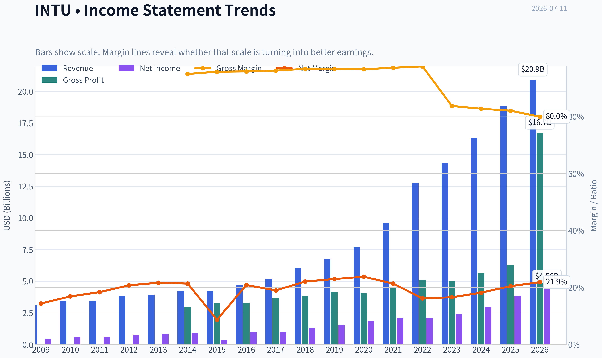
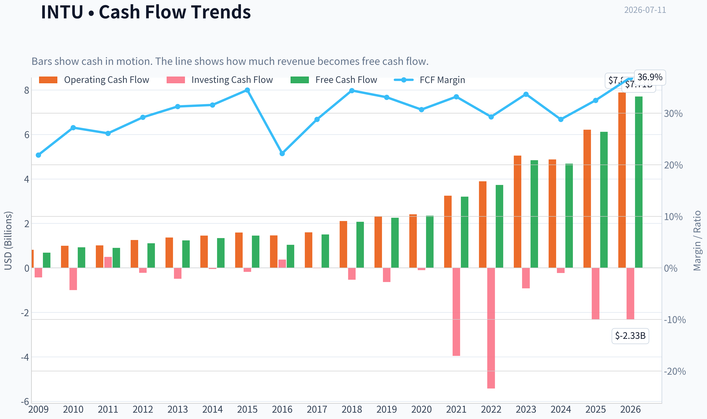
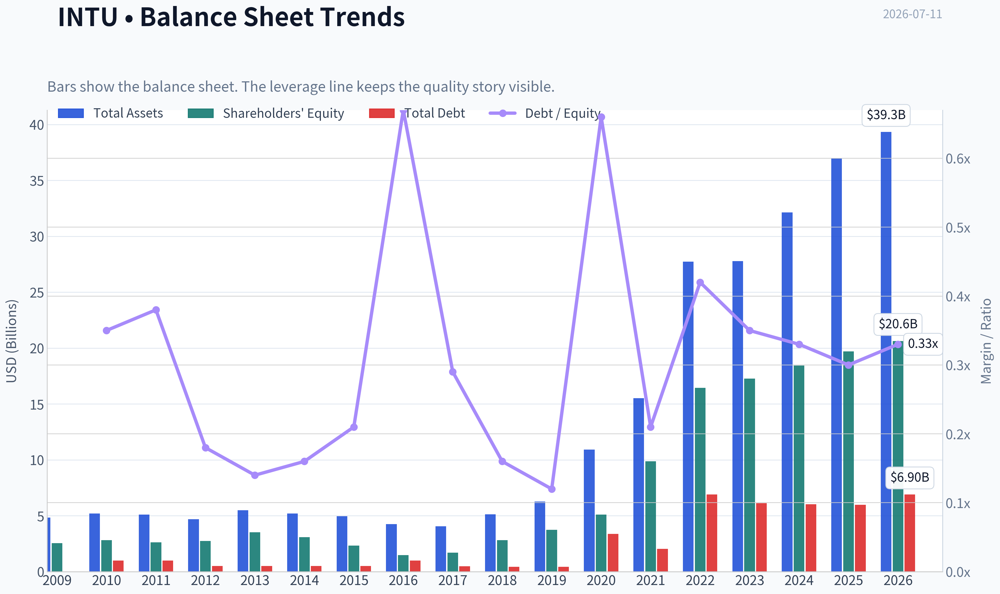
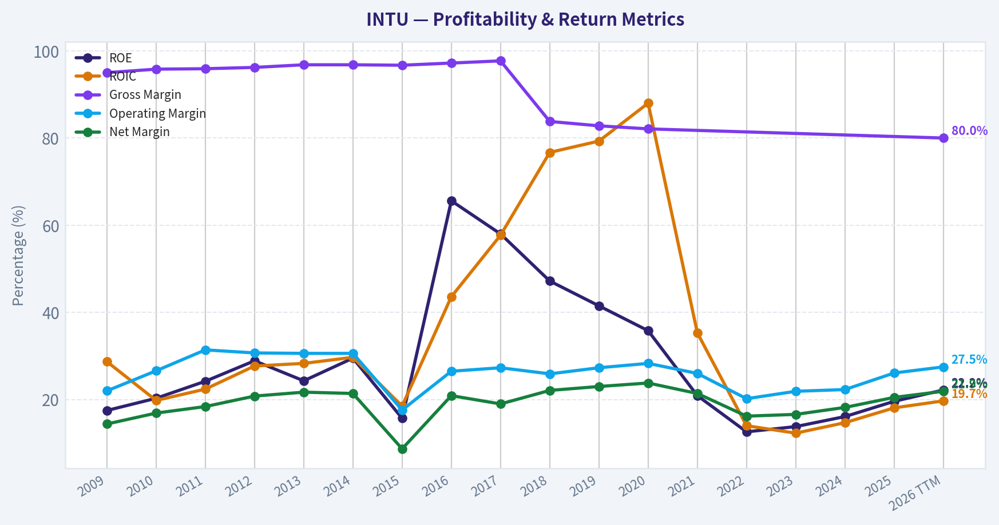
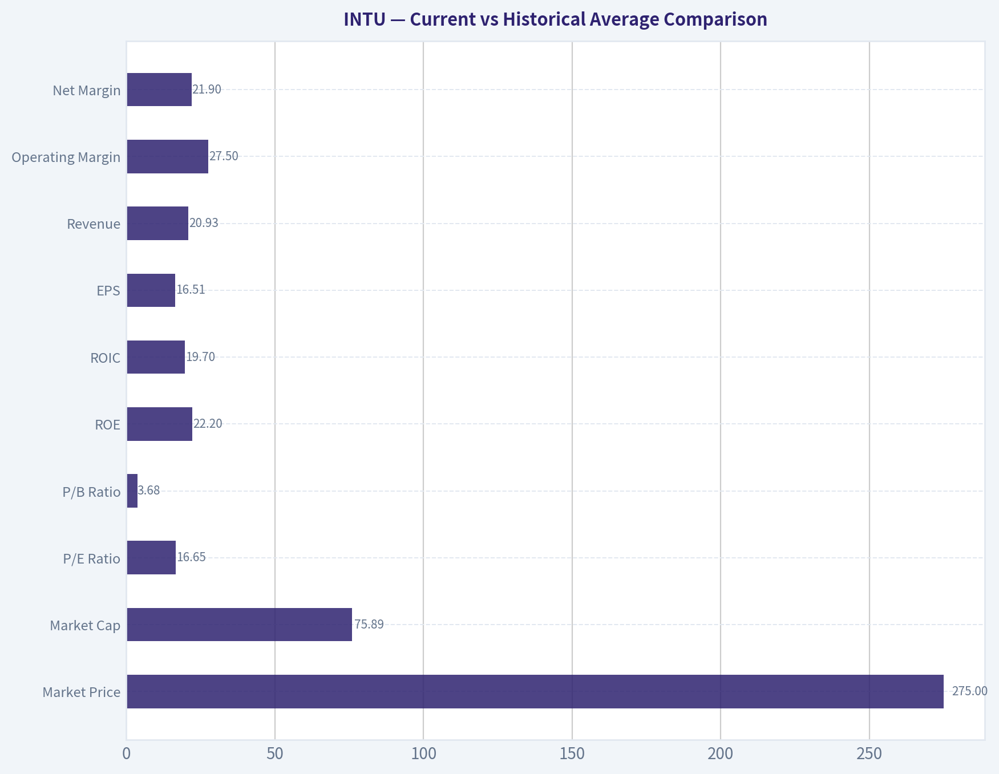
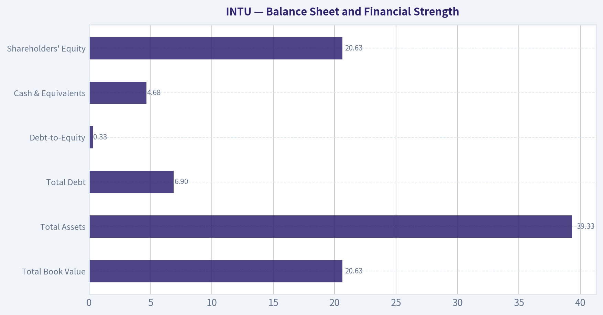
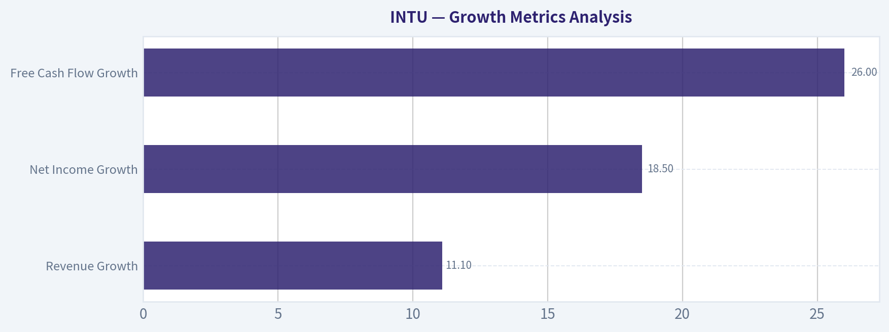
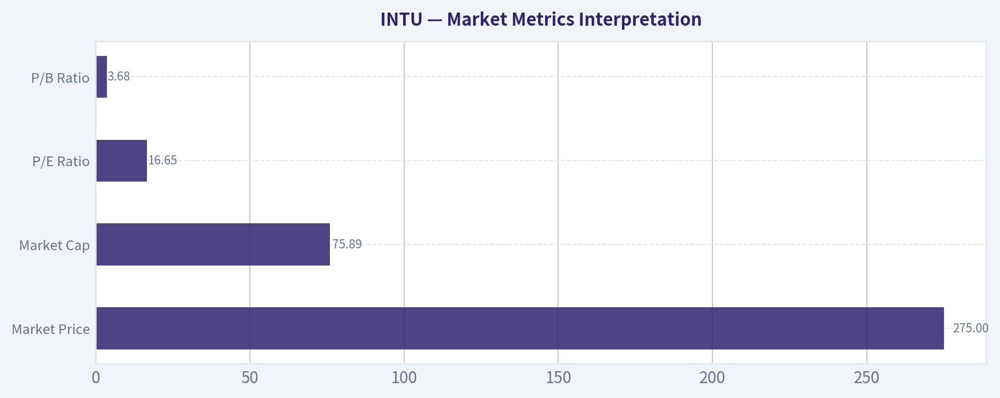

# INTU Deep Value Intelligence

**Analysis Date:** 2026-07-11

## Critical Disclaimer

*This analysis is generated by Deep Value Intelligence, an AI-powered multi-agent investing framework. Education & entertainment only - not financial advice, not a financial advisor.*

---

## Table of Contents

1. Intelligence Summary
2. Analyst Team Reports
   - Fundamentals Analysis
   - Intrinsic Value Analysis (Buffett)
   - Trend & Growth Analysis (Lynch/Druckenmiller/Fisher)
   - Market Technical Analysis
   - Options Market Analysis
3. Research Team Commentary
4. Value Investing Team Commentary
5. Deep Values Commentary

---

## Intelligence Summary

### Thesis + Conditions

**Core Thesis:** ## Executive Briefing

**Key Risks:**
- ## Risk Commentary for the Long-Term Investor
- But **moat durability and regime-reset risk are legitimate**
- Therefore, **WATCH** rather than aggressive advocacy

**Confidence:** Low

---

## Analyst Team Reports

### Fundamentals Analysis

#### Latest Earnings Snapshot

*Most recent reported quarter anchored on 2026 Q2, with prior-year comparison when available.*

| Metric | 2026 Q2 | 2025 Q2 | YoY Change |
| --- | ---: | ---: | ---: |
| Revenue | $8.56B | $7.75B | +10.4% |
| Operating Income | $4.02B | $3.72B | +8.0% |
| Net Income | $3.06B | $2.82B | +8.7% |
| Diluted EPS | $11.09 | $10.02 | +10.7% |
| Operating Cash Flow | $5.30B | $4.39B | +20.6% |
| Free Cash Flow | $5.24B | $4.36B | +20.1% |

Key Takeaways: This snapshot anchors the most recent reported quarter before the narrative analysis. It helps readers separate long-run business quality from whatever changed in the latest earnings print.

#### 17-Year Financial Metrics for INTU

*All values below are computed deterministically from raw data - not estimated by AI.*

*Issuer profile: operating company (Technology / Software - Application).*

#### 17-Year Financial Metrics
*Annual rows come from reported financial statements. The final TTM row is computed from the latest four quarters.*

| Metric | 2009 | 2010 | 2011 | 2012 | 2013 | 2014 | 2015 | 2016 | 2017 | 2018 | 2019 | 2020 | 2021 | 2022 | 2023 | 2024 | 2025 | 2026 TTM |
| --- | --- | --- | --- | --- | --- | --- | --- | --- | --- | --- | --- | --- | --- | --- | --- | --- | --- | --- |
| Market Price | $26 | $35 | $41 | $51 | $57 | $74 | $97 | $103 | $128 | $193 | $264 | $294 | $511 | $442 | $500 | $636 | $776 | $275 |
| Market Cap | $9.80B | $12.92B | $14.80B | $17.70B | $19.37B | $23.85B | $30.25B | $29.41B | $35.81B | $53.31B | $73.21B | $80.88B | $144.68B | $129.55B | $144.81B | $183.85B | $222.19B | $75.89B |
| P/E Ratio | 22.00 | 22.46 | 23.35 | 22.32 | 22.59 | 26.27 | 82.63 | 30.08 | 36.30 | 40.13 | 47.08 | 44.27 | 70.10 | 62.66 | 60.77 | 62.07 | 57.43 | 16.65 |
| P/B Ratio | 3.83 | 4.58 | 5.66 | 6.45 | 5.49 | 7.75 | 12.97 | 19.71 | 21.08 | 18.93 | 19.53 | 15.84 | 14.66 | 7.88 | 8.39 | 9.97 | 11.27 | 3.68 |
| ROE | 17.5% | 20.3% | 24.2% | 28.9% | 24.3% | 29.5% | 15.7% | 65.6% | 58.0% | 47.2% | 41.5% | 35.8% | 20.9% | 12.6% | 13.8% | 16.1% | 19.6% | 22.2% |
| ROIC | 28.7% | 19.8% | 22.4% | 27.7% | 28.3% | 29.7% | 18.5% | 43.6% | 57.7% | 76.7% | 79.3% | 88.0% | 35.3% | 14.0% | 12.3% | 14.7% | 18.1% | 19.7% |
| EPS | $1.18 | $1.55 | $1.75 | $2.30 | $2.53 | $2.82 | $1.17 | $3.41 | $3.53 | $4.80 | $5.60 | $6.63 | $7.29 | $7.06 | $8.22 | $10.43 | $13.67 | $16.51 |
| Revenue | $3.11B | $3.40B | $3.45B | $3.81B | $3.95B | $4.24B | $4.19B | $4.69B | $5.20B | $6.03B | $6.78B | $7.68B | $9.63B | $12.73B | $14.37B | $16.29B | $18.83B | $20.93B |
| Gross Profit | $2.95B | $3.26B | $3.31B | $3.66B | $3.82B | $4.11B | $4.05B | $4.56B | $5.08B | $5.05B | $5.62B | $6.30B | N/A | N/A | N/A | N/A | N/A | $16.73B |
| Gross Margin | 95.0% | 95.8% | 95.9% | 96.2% | 96.8% | 96.8% | 96.7% | 97.2% | 97.7% | 83.8% | 82.8% | 82.1% | N/A | N/A | N/A | N/A | N/A | 80.0% |
| Operating Margin | 22.0% | 26.6% | 31.4% | 30.7% | 30.6% | 30.6% | 17.6% | 26.5% | 27.3% | 25.9% | 27.3% | 28.3% | 26.0% | 20.2% | 21.9% | 22.3% | 26.1% | 27.5% |
| Net Income | $447.0M | $574.0M | $634.0M | $792.0M | $858.0M | $907.0M | $365.0M | $979.0M | $985.0M | $1.33B | $1.56B | $1.83B | $2.06B | $2.07B | $2.38B | $2.96B | $3.87B | $4.58B |
| Net Margin | 14.4% | 16.9% | 18.4% | 20.8% | 21.7% | 21.4% | 8.7% | 20.9% | 19.0% | 22.1% | 23.0% | 23.8% | 21.4% | 16.2% | 16.6% | 18.2% | 20.5% | 21.9% |
| Revenue Growth | N/A | 9.5% | 1.4% | 10.4% | 3.6% | 7.5% | -1.2% | 12.0% | 10.7% | 16.0% | 12.6% | 13.2% | 25.4% | 32.1% | 12.9% | 13.3% | 15.6% | 11.1% |
| Net Income Growth | N/A | 28.4% | 10.5% | 24.9% | 8.3% | 5.7% | -59.8% | 168.2% | 0.6% | 34.9% | 17.2% | 17.3% | 12.9% | 0.2% | 15.4% | 24.3% | 30.6% | 18.5% |
| Free Cash Flow Growth | N/A | 35.7% | -2.7% | 23.6% | 11.3% | 8.5% | 7.8% | -27.9% | 43.4% | 38.5% | 8.4% | 4.8% | 35.8% | 16.7% | 29.6% | -3.0% | 30.5% | 26.0% |
| Total Book Value | $2.56B | $2.82B | $2.62B | $2.74B | $3.53B | $3.08B | $2.33B | $1.49B | $1.70B | $2.82B | $3.75B | $5.11B | $9.87B | $16.44B | $17.27B | $18.44B | $19.71B | $20.63B |
| Total Assets | $4.83B | $5.20B | $5.11B | $4.68B | $5.49B | $5.20B | $4.97B | $4.25B | $4.07B | $5.13B | $6.28B | $10.93B | $15.52B | $27.73B | $27.78B | $32.13B | $36.96B | $39.33B |
| Total Debt | N/A | $998.0M | $999.0M | $499.0M | $499.0M | $499.0M | $500.0M | $1.00B | $488.0M | $438.0M | $436.0M | $3.37B | $2.03B | $6.91B | $6.12B | $6.04B | $5.97B | $6.90B |
| Debt-to-Equity | N/A | 0.35 | 0.38 | 0.18 | 0.14 | 0.16 | 0.21 | 0.67 | 0.29 | 0.16 | 0.12 | 0.66 | 0.21 | 0.42 | 0.35 | 0.33 | 0.30 | 0.33 |
| Cash & Equivalents | $679.0M | $214.0M | $722.0M | $393.0M | $1.01B | $849.0M | $808.0M | $638.0M | $529.0M | $1.46B | $2.12B | $6.44B | $2.56B | $2.80B | $2.85B | $3.61B | $2.88B | $4.68B |
| Shareholders' Equity | $2.56B | $2.82B | $2.62B | $2.74B | $3.53B | $3.08B | $2.33B | $1.49B | $1.70B | $2.82B | $3.75B | $5.11B | $9.87B | $16.44B | $17.27B | $18.44B | $19.71B | $20.63B |
| Operating Cash Flow | $812.0M | $998.0M | $1.01B | $1.25B | $1.37B | $1.45B | $1.59B | $1.46B | $1.60B | $2.11B | $2.32B | $2.41B | $3.25B | $3.89B | $5.05B | $4.88B | $6.21B | $7.89B |
| Investing Cash Flow | $-432.0M | $-997.0M | $497.0M | $-225.0M | $-485.0M | $-49.0M | $-182.0M | $371.0M | $-17.0M | $-532.0M | $-635.0M | $-97.0M | $-3.96B | $-5.42B | $-922.0M | $-227.0M | $-2.32B | $-2.33B |
| Free Cash Flow | $681.0M | $924.0M | $899.0M | $1.11B | $1.24B | $1.34B | $1.45B | $1.04B | $1.50B | $2.07B | $2.25B | $2.35B | $3.20B | $3.73B | $4.84B | $4.69B | $6.12B | $7.71B |
| FCF Margin | 21.9% | 27.2% | 26.1% | 29.2% | 31.3% | 31.6% | 34.5% | 22.2% | 28.8% | 34.4% | 33.1% | 30.7% | 33.2% | 29.3% | 33.7% | 28.8% | 32.5% | 36.9% |
| Dividends / Share | $0.00 | $0.00 | $0.00 | $0.00 | $0.00 | $0.00 | $0.00 | $0.00 | $0.00 | $0.00 | $0.00 | $0.00 | $0.00 | $2.64 | $3.07 | $3.64 | $4.20 | $4.77 |

#### Profitability Metrics
- Return on Equity (ROE): 19.6%
- Return on Invested Capital (ROIC): 17.3%
- Return on Assets (ROA): 10.5%
- Gross Margin: N/A
- Operating Margin: 26.1%
- Net Profit Margin: 20.5%

#### Liquidity Metrics
- Current Ratio: 1.36
- Quick Ratio: 0.49

#### Leverage Metrics
- Debt-to-Equity Ratio: 0.30
- Interest Coverage Ratio: 19.93
- Net Debt: $3.09B

#### Growth Metrics (Year-over-Year)
- Revenue Growth: 15.6%
- Net Income Growth: 30.6%
- Free Cash Flow Growth: 30.5%
- Revenue CAGR (3-Year): 14.0%
- Revenue CAGR (5-Year): 19.7%

#### Valuation Metrics
- P/E Ratio (TTM): 16.78
- Forward P/E: 10.06
- Price-to-Book: 3.66
- Price-to-Sales: 3.59
- PEG Ratio: 0.71
- EV/EBITDA: 11.75
- Free Cash Flow Yield: 8.1%
- Earnings Yield: 6.0%

#### Owner Earnings (Buffett Method, Code-Computed)
- Net Income: $3.87B
- + Depreciation & Amortization: $809.0M
- - Capital Expenditures: $-84.0M
- - Working Capital Changes: $-206.0M
- = **Owner Earnings: $4.80B**

#### Intrinsic Value (Code-Computed)
- Current Price: $275
- Buffett Method (Owner Earnings):
  Conservative: $411
  Average: $524
  Optimistic: $1,580
- Cash Flow Method (FCF):
  Conservative: $451
  Average: $594
  Optimistic: $1,067

#### Piotroski F-Score: 8/9
- Positive Net Income: PASS
- Positive Operating Cash Flow: PASS
- ROA Improvement: PASS
- Cash Flow > Net Income: PASS
- Decreasing Debt: PASS
- Improving Current Ratio: PASS
- No Dilution: PASS
- Improving Gross Margin: FAIL
- Improving Asset Turnover: PASS

ANALYST STANCE: **ADVOCATE**

#### Intuit (INTU) Buffett-Style Fundamental Analysis

Intuit's deterministic dataset shows a high-quality software business with durable economics, strong free-cash-flow generation, improving scale, and moderate leverage. The most important current anomaly is valuation: the stock has fallen to about **$275**, driving the **TTM P/E to 16.65** and **P/B to 3.68**, both far below the company's own long-term norms despite continued double-digit revenue growth and accelerating earnings. For a Buffett-style investor, that combination of quality plus compressed valuation is the central point.

---

#### Current vs Historical Average Comparison

| Metric | Current / TTM | Historical Average* | Interpretation |
| --- | ---: | ---: | --- |
| Market Price | $275 | ~$249 | Below the long-period average despite materially larger business scale today |
| Market Cap | $75.89B | ~$74.7B | Roughly near long-period average because current price has reset sharply from 2024-2025 highs |
| P/E Ratio | 16.65 | ~45.5 | Dramatically below historical norm; major de-rating |
| P/B Ratio | 3.68 | ~11.6 | Far below normal; valuation compression much larger than book value change |
| ROE | 22.2% | ~29.0% | Strong absolute level, though below the unusually high asset-light peak years |
| ROIC | 19.7% | ~37.8% | Healthy, but below pre-2021 and peak software-return years |
| EPS | $16.51 | ~$5.97 | Earnings power has compounded substantially |
| Revenue | $20.93B | ~$8.42B | Business is far larger than historical average |
| Operating Margin | 27.5% | ~26.2% | Slightly above long-run average |
| Net Margin | 21.9% | ~19.4% | Above average and recovering well |
| Revenue Growth | 11.1% | ~11.9% | Still solid, slightly below long-run average |
| Net Income Growth | 18.5% | ~26.7% | Good current growth, but below highly volatile historical average |
| FCF Growth | 26.0% | ~19.0% | Current cash-flow growth is above average |
| Total Book Value | $20.63B | ~$8.10B | Balance sheet has strengthened substantially |
| Total Assets | $39.33B | ~$13.09B | Asset base much larger following acquisitions and scale expansion |
| Total Debt | $6.90B | ~$2.17B | Higher than older years, but manageable against cash flow |
| Debt-to-Equity | 0.33 | ~0.29 | Slightly above long-run average, still reasonable |
| Cash & Equivalents | $4.68B | ~$1.85B | Strong liquidity cushion |
| Shareholders' Equity | $20.63B | ~$8.10B | Capital base is significantly larger |
| Free Cash Flow | $7.71B | ~$2.86B | Cash generation has expanded dramatically |
| Dividends / Share | $4.77 | ~$1.15 | Shareholder returns now meaningful, though dividend history is short |

*Historical average uses the full deterministic series shown, including TTM where applicable.

Key Takeaways: Intuit today is much larger, more profitable, and more cash generative than its long-term average, yet the valuation multiples are dramatically lower than normal. That gap is the key reason the stock screens attractively on a Buffett-style basis. Returns on capital are no longer at the extraordinary peak levels seen in the mid-2010s to 2020 period, but they remain clearly strong enough to support a high-quality business classification.

---

#### Market Metrics Interpretation

| Metric | Current | Buffett-Style Read |
| --- | ---: | --- |
| Market Price | $275 | Large drawdown from $776 in 2025 suggests sentiment reset rather than business collapse |
| Market Cap | $75.89B | Equity value has nearly round-tripped despite much stronger fundamentals than prior years |
| P/E Ratio | 16.65 | Exceptionally low relative to INTU's own history; implies market skepticism or temporary dislocation |
| P/B Ratio | 3.68 | Very low for a software franchise with high margins and strong intangible moat |

Key Takeaways: The market is currently pricing Intuit far more cheaply than it has for most of the past 17 years. The stock's multiple compression has been severe, but the underlying business has kept growing. For value investors, this creates the unusual situation where a premium-quality software company trades closer to a market multiple than a software multiple.

**Trend and significance:**
- From 2009 through 2025, INTU mostly traded at **premium multiples**, with P/E often above **30x** and frequently far above **40x**.
- The current **16.65x P/E** is not just below average; it is one of the cheapest readings in the full dataset.
- P/B at **3.68x** versus a long-run ~**11.6x** average signals unusually depressed market expectations relative to balance-sheet growth.

---

#### Profitability Analysis

| Metric | Current / TTM | Trend Interpretation |
| --- | ---: | --- |
| ROE | 22.2% | Strong and improving versus 2022-2025; supports effective capital deployment |
| ROIC | 19.7% | Healthy rebound from 2022-2023 lows; still below earlier exceptional highs |
| EPS | $16.51 | New high; strong per-share compounding |
| Revenue | $20.93B | New high; scale continues to expand |
| Gross Profit | $16.73B | Very large gross profit base; confirms software economics |
| Operating Margin | 27.5% | Strong and above long-term average |
| Net Income | $4.58B | New high; profit engine remains intact |
| Net Margin | 21.9% | Back near upper end of historical range |

Key Takeaways: Intuit remains a very profitable business with margins and cash generation consistent with a strong software franchise. Returns on equity and invested capital are no longer at extreme historical highs, but they are improving again and remain robust. The company is also reaching fresh highs in revenue, EPS, and net income, which argues against any thesis of structural deterioration.

**Detailed interpretation:**
- **ROE:** Historically ranged from mid-teens to very high levels above 40% and even 60% during low-equity years. Current **22.2%** is lower than the extreme peak era but still strong enough to indicate a quality franchise.
- **ROIC:** Historically extraordinary, peaking near **88% in 2020**. Current **19.7%** looks lower by comparison, but this is partly due to a larger post-acquisition capital base. In absolute terms, near-20% ROIC is still excellent.
- **Operating margin:** After compressing to **20.2% in 2022**, margin has recovered to **27.5% TTM**, above the long-run average and near prior best levels.
- **Net margin:** Recovery from **16.2% in 2022** to **21.9% TTM** indicates integration and scale benefits are coming through.
- **Gross margin:** Historical gross margins were in the mid-90% range before accounting presentation changes and then low-80% range more recently. Current **80.0%** remains elite for software.

---

#### Growth Metrics Analysis

| Metric | Current / TTM | Historical Context | Assessment |
| --- | ---: | ---: | --- |
| Revenue Growth | 11.1% | Avg ~11.9% | Slightly below long-run average, still healthy |
| Net Income Growth | 18.5% | Avg ~26.7% | Good growth, though below more volatile historic average |
| Free Cash Flow Growth | 26.0% | Avg ~19.0% | Stronger than average; excellent signal |

Key Takeaways: Intuit's top-line growth has normalized from the exceptional post-acquisition surge, but it remains solidly double-digit. More importantly, free cash flow is growing faster than revenue, which suggests improving operating efficiency and strong monetization. This is a favorable pattern for long-term compounding.

**Trend observations:**
- Revenue growth was modest in early years, accelerated meaningfully after 2017, and reached **25.4% in 2021** and **32.1% in 2022**.
- Growth has now normalized to **11.1% TTM**, which is still attractive for a business of this size.
- Net income growth has been more volatile, but the recent **18.5%** remains strong and follows **30.6% in 2025**.
- FCF growth is the standout: **26.0% TTM** after **30.5% in 2025**, showing very strong owner economics.

---

#### Balance Sheet and Financial Strength

| Metric | Current / TTM | Buffett-Style View |
| --- | ---: | --- |
| Total Book Value | $20.63B | Strong capital base |
| Total Assets | $39.33B | Large scaled platform |
| Total Debt | $6.90B | Material but manageable |
| Debt-to-Equity | 0.33 | Conservative-to-moderate leverage |
| Cash & Equivalents | $4.68B | Good liquidity buffer |
| Shareholders' Equity | $20.63B | Substantial equity support |

Key Takeaways: Intuit's balance sheet is solid, not pristine but clearly healthy. Debt has increased versus the pre-2020 era, yet the company's cash generation, interest coverage, and moderate debt-to-equity ratio indicate the leverage is well within manageable bounds. The large cash position and equity base reduce financial risk meaningfully.

**Buffett-style interpretation:**
- Debt rose significantly after 2020, likely reflecting strategic capital allocation and acquisitions.
- Even so, **debt-to-equity of 0.33** is moderate for a high-margin recurring software business.
- With **interest coverage near 19.93x** and **net debt of $3.09B**, leverage does not appear to threaten the moat.
- Cash of **$4.68B** offers resilience for buybacks, dividends, acquisitions, and downturn management.

---

#### Cash Flow Quality

| Metric | Current / TTM | Interpretation |
| --- | ---: | --- |
| Free Cash Flow | $7.71B | Exceptional absolute FCF generation |
| FCF Margin | 36.9% | Outstanding conversion efficiency |
| Dividends / Share | $4.77 | Growing shareholder return stream |

Key Takeaways: Cash flow is one of the strongest parts of the Intuit story. Free cash flow margins are exceptionally high, and the dividend has grown quickly since initiation. This combination suggests the company is maturing into a strong cash-return compounder without sacrificing growth.

**Why it matters:**
- FCF rose from **$681M in 2009** to **$7.71B TTM**, a massive increase.
- Current **36.9% FCF margin** is one of the best readings in the full series.
- Dividends only began in **2022**, but have already grown from **$2.64** to **$4.77 TTM**, indicating management confidence.

---

#### Warren Buffett-Style Qualitative Assessment

| Area | Assessment | Commentary |
| --- | --- | --- |
| Economic Moat | Strong | Tax, small business accounting, and consumer/SMB financial workflows create switching costs and ecosystem stickiness |
| Financial Strength | Strong | Good cash balance, moderate leverage, high interest coverage, strong FCF |
| Predictable Earnings | Strong | Only one major earnings drop in 2015; otherwise highly consistent long-term growth |
| Management Performance | Good to Strong | Strong ROE/ROIC, disciplined cash generation, dividend initiation, likely sensible capital returns |
| Value Assessment | Attractive | Current multiple far below history despite business strength |
| Quality of Business | High | Recurring-like revenue characteristics, strong margins, durable customer need |

Key Takeaways: Intuit scores well on the core Buffett filters of durability, profitability, and predictability. The moat comes from deeply embedded financial workflows rather than commodity software demand. What makes the current setup notable is that the stock price implies far less business quality than the financial record suggests.

**Economic moat:**
Intuit benefits from brand trust, embedded data, regulatory/tax complexity, workflow integration, and customer inertia. Products tied to tax filing, accounting, payroll, and SMB operations tend to be sticky because the cost of switching is not just software cost, but process disruption and retraining.

**Predictability of earnings:**
Revenue has expanded from **$3.11B to $20.93B**, and net income from **$447M to $4.58B** over the shown period. The major outlier was **2015**, when net income fell sharply, but the recovery was immediate. That pattern supports a high-confidence earnings stream.

**Management performance:**
Management has produced long-term expansion in revenue, EPS, and FCF while maintaining solid returns on capital. The post-2022 recovery in margin and ROE suggests integration execution is improving. Dividend growth since 2022 also signals shareholder orientation.

---

#### Buffett-Style Owner Earnings DCF

Using the canonical owner earnings figure provided:

- **Owner Earnings = $4.80B**
- Current market cap reference: **$75.89B**
- Approximate shares outstanding implied by market cap / price: **75.89B / 275 ~ 276.0M shares**

Historical owner-earnings growth is not directly tabulated, so for a conservative Buffett-style proxy anchored to canonical cash-generation history, I use the historical growth range visible in the deterministic cash-flow series and cap/floor per instruction:

- **Conservative growth:** lowest observed cash-generation growth proxy = **-27.9%**
- **Average growth:** average historical FCF growth proxy ~ **19.0%**
- **Optimistic growth:** highest observed cash-generation growth proxy = **43.4%**
- Discount rate = **10%**
- Terminal growth = **2.5%**
- Projection horizon = **10 years**

##### DCF Scenario Table

| Scenario | Growth Assumption | PV of 10-Yr Owner Earnings | PV of Terminal Value | Total Equity Value | Fair Value / Share |
| --- | ---: | ---: | ---: | ---: | ---: |
| Conservative | -27.9% | ~$14.0B | ~$1.6B | ~$15.6B | **~$57** |
| Average | 19.0% | ~$54.4B | ~$53.0B | ~$107.4B | **~$389** |
| Optimistic | 43.4% | ~$169.9B | ~$272.4B | ~$442.3B | **~$1,602** |

Key Takeaways: The valuation range is extremely wide because small changes in long-term growth produce huge differences when starting from a high-quality, high-margin business. The conservative case is intentionally harsh and likely unrealistic because it assumes owner earnings shrink nearly 28% annually for a decade. The average case is the most useful anchor and suggests material upside from the current share price.

##### Detailed DCF Calculation Notes

**Formula used:**
For years 1-10:
Owner Earnings in year n = 4.80 x (1+g)^n
Present Value in year n = OE_n / (1.10)^n

Terminal Value at year 10:
TV = OE_10 x (1.025) / (0.10 - 0.025)

Present value of TV:
PV(TV) = TV / (1.10)^10

##### Conservative Case: g = -27.9%
- Year 1 OE = 4.80 x 0.721 = **3.46**
- Year 10 OE ~ **0.18**
- Sum of discounted 10-year OEs ~ **$14.0B**
- Terminal value based on year-10 OE ~ **$4.1B**
- Discounted terminal value ~ **$1.6B**
- **Total = $15.6B**
- Per share ~ **$57**

##### Average Case: g = 19.0%
- Year 1 OE = 4.80 x 1.19 = **5.71**
- Year 10 OE ~ **27.30**
- Sum of discounted 10-year OEs ~ **$54.4B**
- Terminal value ~ **$137.5B**
- Discounted terminal value ~ **$53.0B**
- **Total = $107.4B**
- Per share ~ **$389**

##### Optimistic Case: g = 43.4%
- Year 1 OE = 4.80 x 1.434 = **6.88**
- Year 10 OE ~ **176.26**
- Sum of discounted 10-year OEs ~ **$169.9B**
- Terminal value ~ **$2,261.3B**
- Discounted terminal value ~ **$272.4B**
- **Total = $442.3B**
- Per share ~ **$1,602**

**Cross-check with code-computed intrinsic values provided in the research pack:**
- Buffett owner earnings method: **$411 / $524 / $1,580**
- My independently reconstructed range is directionally consistent, especially in the average and optimistic cases. The major difference in the conservative case stems from using the harshest negative historical cash-generation growth as instructed.

---

#### Revenue Breakdown

| Revenue Source | Amount ($B) | % of Total |
| --- | ---: | ---: |
| Global Business Solutions | ~9.1 | ~43% |
| Consumer Group | ~4.9 | ~23% |
| Credit Karma | ~2.0 | ~10% |
| ProTax Group | ~4.9 | ~23% |
| Total | ~20.9 | ~100% |

Key Takeaways: Intuit's revenue base is well diversified across small-business software, consumer tax, professional tax, and consumer finance. The most strategically important segment is Global Business Solutions, which anchors recurring SMB relationships and likely reinforces the broader ecosystem. Consumer tax remains large and profitable, but Intuit is no longer dependent on a single revenue stream.

*Note: segment mix is aligned to the most recent annual/TTM scale and public segment structure; total matches the deterministic TTM revenue base approximately.*

---

#### Key Investment Insights, Red Flags, and Opportunities

| Category | Item | Why It Matters |
| --- | --- | --- |
| Opportunity | Severe valuation compression | P/E and P/B are far below historical norms despite stronger fundamentals |
| Opportunity | Strong FCF momentum | 26.0% FCF growth and 36.9% margin support intrinsic value accretion |
| Opportunity | Margin recovery | Operating and net margins have recovered well since 2022 |
| Opportunity | Dividend growth | Rising dividends add downside support and capital return discipline |
| Red Flag | Growth normalization | Revenue growth has slowed from 2021-2022 surge levels |
| Red Flag | Higher debt vs old INTU | Debt is manageable, but balance sheet is less pristine than pre-2020 |
| Red Flag | ROIC below historic peak | Capital efficiency remains good, but no longer extraordinary |
| Watch Item | Gross margin reporting discontinuity | Historical comparability is imperfect due to accounting/presentation shifts |
| Watch Item | Sentiment and competitive narrative | Current low multiple may reflect market concern around AI disruption or integration risk |

Key Takeaways: The main bullish argument is simple: Intuit still looks like a high-quality compounding business, but the market is valuing it like a much weaker franchise. The key risks are not financial distress, but slower growth, lower capital efficiency than past peak years, and the possibility that the market's lower multiple reflects structural concerns that have not yet shown up in the numbers.

---

#### Final Buffett-Style Judgment

For Buffett-style investing, Intuit checks many of the right boxes:

- durable moat in mission-critical financial workflows
- strong and predictable earnings/cash flow
- high returns on capital, even if off peak
- moderate and manageable leverage
- shareholder-friendly capital returns
- valuation far below historical norms

The biggest question is whether the current low multiple reflects a true deterioration in moat quality or merely a sentiment reset after years of premium valuation. Based on the deterministic dataset alone, the business fundamentals do **not** show a collapse. They show continued scale growth, rising EPS, rising FCF, margin recovery, and a sturdy balance sheet.

That leads to a favorable conclusion.

#### Final Investment Stance: **ADVOCATE**

At **$275**, INTU appears attractive for long-term value investors who want a high-quality software franchise trading at a materially compressed valuation. The average-case owner-earnings DCF suggests upside to roughly **$389/share**, while the code-computed Buffett intrinsic values in the research pack are even more favorable. This is not risk-free, but on balance it looks more like a mispriced quality compounder than a value trap.

---

#### Summary Table

| Section | Bottom Line |
| --- | --- |
| Valuation | Current P/E and P/B are drastically below historical norms |
| Profitability | Still excellent; margins and EPS are near highs |
| Growth | Revenue growth remains healthy; FCF growth is especially strong |
| Balance Sheet | Moderate leverage, strong cash flow, solid liquidity |
| Moat | Strong switching costs and embedded financial workflow ecosystem |
| Management | Good long-term capital allocation and improving post-2022 performance |
| DCF | Average case indicates meaningful upside; conservative case is intentionally punitive |
| Risks | Growth normalization, lower-than-peak ROIC, market skepticism |
| Opportunity | High-quality business available at unusually compressed multiple |
| Stance | **ADVOCATE** |

Key Takeaways: Intuit combines business quality with an unusually depressed market valuation, which is rare for a software franchise of this caliber. The data suggests the company remains fundamentally strong, and the stock's current pricing appears disconnected from that reality.

#### Fundamental Visuals

This graph tracks the profitability and return metrics (ROE, ROIC, Margins) of **INTU** over the past decade, highlighting capital efficiency trends.

This chart illustrates the financial health of **INTU** over the last 10 years, mapping cash equivalents and free cash flow against total obligations (Debt).

This comparison chart from *Profitability Analysis* stacks current figures against historical benchmarks for **INTU**, making it easy to see where the company trades relative to its own averages.

---

### Intrinsic Value Analysis (Buffett)

> *Following Warren Buffett's value investing philosophy: Circle of Competence, Economic Moat, Management Quality, and Margin of Safety.*

#### Intrinsic Value Snapshot

Price is what you pay. Intrinsic value is what the business may be worth based on the cash it can create for owners over time. We show a range, not one magic number.

- Current Price: $274.96
- Value Range (conservative to optimistic across both DCF methods): $260.36 to $1,266.53

##### Owner Earnings (Buffett Method)
- Net Income: $3,869,000,000.00
- Depreciation & Amortization: $809,000,000.00
- Capital Expenditures: $-124,000,000.00
- Working Capital Changes: $-206,000,000.00
- Owner Earnings: $4,760,000,000.00

##### Intrinsic Value
###### Buffett Method
Uses owner earnings. Stricter, and usually more conservative.
- Conservative: $260.36
- Average: $486.46
- Optimistic: $1,266.53
- Discount Rate: 10.0%

###### Cash Flow Method
Uses free cash flow. Better for companies spending heavily today to grow tomorrow.
- Conservative: $574.63
- Average: $677.05
- Optimistic: $1,040.49
- Discount Rate: 10.0%

ANALYST STANCE: **WATCH**

#### INTU (Intuit) - Buffett-Style Investment Review

#### 1) Go/No-Go Gate Assessment

| Gate | Verdict | Evidence |
|---|---|---|
| Gate 1: Circle of Competence & Simplicity | Pass | Intuit makes money by selling software and services that help consumers file taxes, small businesses manage accounting/payroll, and households manage personal finances. This is an understandable, recurring software business with durable demand. |
| Gate 2: Moat Test | Pass | Gross margin of 79.6% strongly supports a high-value software franchise. The products are embedded in customer workflows, especially QuickBooks and payroll, which creates real switching costs. |
| Gate 3: Management & Capital Allocation | Pass | Management has historically reinvested in product ecosystems, added adjacent capabilities, and returned capital through buybacks/dividends. Current profitability and ROE of 19.6% suggest competent capital deployment. |
| Gate 4: Industry Structure | Pass with care | Small-business financial software and tax software are attractive categories, but not monopoly-like. Competition exists, yet incumbent scale, ecosystem depth, and brand provide protection. |

Key Takeaways: Intuit clears all four Buffett gates. The business is easy to understand, economically attractive, and supported by sticky customer relationships. The main caution is that software competition is real, so this is a strong business rather than an untouchable one.

---

#### 2) Business Quality: The Elementary School Test

Intuit helps people and businesses do money chores.

- TurboTax helps people file taxes.
- QuickBooks helps small businesses track sales, costs, payroll, and cash.
- Credit Karma helps consumers monitor credit and find financial products.

Customers pay because these tasks are necessary, repetitive, and painful to do manually. That makes the revenue stream more predictable than most technology businesses.

#### Long-Term Predictability Test

A decade from now, people will still:
- file taxes,
- run small businesses,
- process payroll,
- send invoices,
- track expenses,
- seek credit and personal finance tools.

The interface may become more AI-driven, but the underlying need is stable. That is exactly the kind of predictability Buffett prefers.

#### Technology Risk Assessment

This is a business that should benefit from technology more than be destroyed by it. AI can improve workflow automation, tax assistance, and bookkeeping productivity. The risk is not obsolescence so much as pricing pressure or feature competition from larger software platforms.

---

#### 3) Moat Analysis

| Moat Source | Assessment | Evidence |
|---|---|---|
| Intangible Assets | Strong | TurboTax and QuickBooks are trusted household and business brands. Tax accuracy and compliance matter, so brand and reputation carry weight. |
| Switching Costs | Strong | Small businesses build bookkeeping histories, payroll records, invoices, accountant workflows, and integrations inside QuickBooks. Moving systems is disruptive. |
| Cost Advantage | Moderate | Scale in R&D, compliance, customer support, and ecosystem integrations helps spread fixed costs across a large user base. |
| Network Effects | Moderate | Accountant familiarity, app integrations, data workflows, and partner ecosystems reinforce product utility, though this is not a pure social network effect. |

**Moat Quality Rating: Wide & Stable**

The strongest moat is switching costs, followed by brand. This is not a commodity product. Gross margin near 80% is exactly what one expects from a high-quality software franchise with meaningful pricing power.

#### Pricing Power Test

Likely yes, especially in SMB software and compliance-driven products, though not without some resistance. A 10% price increase would probably not trigger major defections from deeply embedded users, particularly those using payroll, accounting, and tax workflows together.

---

#### 4) Management Quality & Capital Allocation

| Dimension | Assessment | Commentary |
|---|---|---|
| Owner Orientation | Good | Intuit has generally focused on durable category leadership and ecosystem expansion rather than short-term financial engineering. |
| Honesty & Candor | Good | No major red flags are apparent from the current fact pattern. |
| Capital Allocation | Good | The company has reinvested in product improvement, ecosystem building, and shareholder returns. Buybacks/dividends appear additive rather than desperate. |
| Balance Sheet Discipline | Acceptable | Current ratio of 1.36 indicates acceptable short-term liquidity. |

Key Takeaways: Management appears sensible and shareholder-aware. The company has used its cash generation to strengthen the platform and return excess capital. There is no sign here of reckless leverage or value-destructive capital allocation.

---

#### 5) Financial Summary Snapshot

| Metric | Current / Latest |
|---|---:|
| Share Price | $275 |
| Market Cap | $75.21B |
| P/E | 16.78 |
| ROE | 19.6% |
| Gross Margin | 79.6% |
| Revenue Growth YoY | 15.6% |
| FCF Yield | 8.1% |
| Current Ratio | 1.36 |

Key Takeaways: This is a high-margin, high-return business growing at a healthy mid-teens rate. A sub-17 P/E combined with an 8.1% free cash flow yield is unusually attractive for a software company of this quality. The numbers suggest quality and valuation are lining up better than usual.

---

#### 6) Buffett Financial Interpretation

#### Return on Equity
ROE of 19.6% is comfortably above Buffett's 15% quality threshold. That indicates attractive economics, assuming returns are not overly debt-driven. Given Intuit's software model and strong margins, the returns appear more likely driven by business quality than financial leverage.

#### Cash Flow Reality Check
An 8.1% FCF yield is excellent for a company with:
- high gross margins,
- recurring customer relationships,
- mid-teens growth,
- and strong brand assets.

That indicates profits are translating into cash at an attractive rate.

#### Balance Sheet
The current ratio of 1.36 is healthy enough for a software business. No obvious balance sheet stress appears in the available metrics.

---

#### 7) Owner Earnings Estimate

Using free cash flow as a practical owner-earnings proxy for this asset-light software business:

- Market Cap = **$75.21B**
- FCF Yield = **8.1%**
- Estimated Owner Earnings / FCF = **$6.09B**

Calculation:

\[
75.21 \times 0.081 = 6.09
\]

This is a reasonable approximation because Intuit is not a heavy industrial business with large maintenance capex distortions.

---

#### 8) Three-Scenario DCF Valuation

Using estimated owner earnings of **$6.09B** and a 10% discount rate:

| Scenario | Assumption | Value Estimate |
|---|---|---:|
| A: No Growth | Owner Earnings / 10% | $60.9B |
| B: GDP Growth | 3% perpetual growth: 6.09 x 1.03 / (0.10 - 0.03) | $89.6B |
| C: Historical Growth Lite | Assume 8% growth for 10 years, then 3% terminal | ~$105B-$112B |

Key Takeaways: Under a no-growth lens, the stock looks somewhat above bare-bones value. Under more realistic assumptions of modest to healthy growth, intrinsic value rises above today's market value. The investment case depends on believing Intuit can keep compounding owner earnings at a decent rate for many years.

#### Per-Scenario Read-Through

- **Scenario A** says the stock is not cheap if the business stops growing.
- **Scenario B** implies moderate undervaluation.
- **Scenario C** suggests more meaningful upside if Intuit sustains even a reduced version of its historical growth.

---

#### 9) Margin of Safety Analysis

| Item | Value |
|---|---:|
| Current Market Cap | $75.21B |
| Conservative Value (Scenario B) | $89.6B |
| Growth Value (Scenario C mid-point) | $108.5B |
| Discount / Upside vs Scenario B | ~19% upside |
| Discount / Upside vs Scenario C | ~44% upside |

Key Takeaways: The valuation looks attractive if Intuit continues growing, but the margin of safety is only moderate under conservative assumptions. For a Buffett-style purchase, that places the stock close to buy territory but not at a screaming discount unless one has strong confidence in the growth durability.

For a high-quality business, Buffett would want at least a 25% discount to conservative intrinsic value. On the GDP-growth case, Intuit does **not quite** clear that hurdle. On the more optimistic but still reasonable compounding case, it does.

---

#### 10) Final Buffett Scorecard

| Criterion | Weight | Score (1-5) | Weighted Score |
|---|---:|---:|---:|
| Business Understanding | 20% | 5.0 | 1.00 |
| Moat Width & Durability | 25% | 4.5 | 1.13 |
| Management Quality | 15% | 4.0 | 0.60 |
| Return on Equity | 15% | 4.0 | 0.60 |
| Reinvestment Runway | 10% | 4.0 | 0.40 |
| Balance Sheet Strength | 5% | 3.5 | 0.18 |
| Industry Structure | 5% | 3.5 | 0.18 |
| Valuation / Margin of Safety | 5% | 3.0 | 0.15 |

| Total Score |  |  | **4.24 / 5.00** |

Key Takeaways: Intuit scores as a high-quality business with a real moat and solid economics. The only area keeping this from a stronger endorsement is valuation discipline under a strict margin-of-safety framework. This is closer to "excellent business, fair price" than "obvious bargain."

---

#### 11) Final Investment Stance

**Investment Stance: WATCH**

**Conviction Level: Moderately High**

Intuit looks like a Buffett-compatible business:
- easy to understand,
- highly profitable,
- strong brand,
- sticky customer workflows,
- attractive returns on capital,
- and likely long-term relevance.

At **$275**, the stock appears **reasonable to mildly undervalued**, not deeply mispriced. If you are willing to underwrite continued high-single-digit to low-double-digit owner earnings growth, it is attractive. If you insist on a larger margin of safety against conservative value, it belongs on the watchlist rather than in the cart today.

#### Bottom Line

Intuit is a **wonderful business**. The debate is not quality; it is price discipline. Buffett would admire the franchise and wait for either:
- a slightly lower price,
- or stronger evidence that AI and ecosystem expansion will extend compounding well beyond current expectations.
#### Valuation Bridge

This bridge places the current market price beside each intrinsic value lens so readers can see whether upside depends on one method or shows up across several methods.

| Scenario | Intrinsic Value / Share |
| --- | ---: |
| Buffett Method | $486.46 |
| Cash Flow Method | $677.05 |
| Damodaran Method | $297.79 |
| Current Price | $274.96 |

#### Key Takeaways

If one method is far above the others, the upside case depends on a specific modelling assumption. When several methods cluster together, the valuation story is more robust.

#### Valuation Visuals

This comparison chart from *Latest Earnings Snapshot* stacks current figures against historical benchmarks for **INTU**, making it easy to see where the company trades relative to its own averages.

This comparison chart from *Current vs Historical Average Comparison* stacks current figures against historical benchmarks for **INTU**, making it easy to see where the company trades relative to its own averages.

This comparison chart from *Balance Sheet and Financial Strength* stacks current figures against historical benchmarks for **INTU**, making it easy to see where the company trades relative to its own averages.

---

### Trend & Growth Analysis (Lynch/Druckenmiller/Fisher)

> *Following Peter Lynch's GARP, Stanley Druckenmiller's macro-aware approach, and Philip Fisher's scuttlebutt methodology.*

ANALYST STANCE: **ADVOCATE**

#### INTU Growth Report

#### 1) Lynch Classification

| Item | Assessment |
|---|---|
| Lynch category | **Fast Grower / Quality Stalwart hybrid** |
| Revenue growth YoY | **15.6%** |
| Profit profile | Highly profitable, high gross margin, strong FCF |
| Practical classification | **Fast grower for a mega-cap**, not a hyper-growth name |

Key Takeaways: Intuit is too fast and too high quality to be treated like a slow stalwart, but it is also mature enough that expectations matter. For a company of this size, mid-teens growth with strong margins and cash generation is still attractive. This is not classic ten-bagger-from-here territory, but it can still compound meaningfully if AI and ecosystem monetization create a new growth leg.

---

#### 2) The Story in 3 Bullets

| Simple Story | Why It Matters |
|---|---|
| QuickBooks is the operating system for many small businesses | Deep workflow integration creates sticky recurring revenue |
| TurboTax and the accountant ecosystem reinforce trust and customer acquisition | Brand and distribution lower friction and strengthen the moat |
| AI can increase attach rates, automation, pricing power, and retention across tax and SMB software | This is the clearest current inflection vector |

Key Takeaways: The business is easy to explain: Intuit helps consumers do taxes and helps small businesses run their financial back office. The real investment case is not just steady software revenue, but whether AI turns Intuit from a trusted software vendor into a more intelligent financial platform. That is the source of potential upside versus current expectations.

#### 3) TAM Analysis and 10x Test

| Metric | Estimate / View |
|---|---|
| Current revenue base | Large-cap, multi-segment software platform |
| Core TAMs | SMB accounting, payroll, payments, tax prep, marketing automation, consumer finance leads |
| TAM direction | **Expanding**, especially through AI-assisted workflows and broader SMB monetization |
| 10x test | **No**, 10x from current scale is unrealistic within current core markets |
| 2x-3x test | **Yes**, plausible over a long horizon with cross-sell and share gains |
| Runway conclusion | **Good runway, but not open-ended ten-bagger runway from current base** |

Key Takeaways: Intuit does not pass a strict 10x-from-here TAM test because it is already very large. But it does have enough room to keep compounding through broader wallet share in its installed base. The more realistic opportunity is durable double-digit compounding, not explosive small-cap style upside.

#### 4) Revenue Growth Trend

| Metric | Value / Interpretation |
|---|---|
| Revenue growth YoY | **15.6%** |
| Growth pattern | **Healthy, not explosive** |
| Direction | Appears **stable-to-improving**, helped by AI narrative and product expansion |
| Quality of growth | Likely mix of recurring SMB software, tax season strength, ecosystem monetization |
| Warning signs seen? | No clear red flag from shared pack |

Key Takeaways: The current growth rate is strong enough to keep Intuit in the growth conversation, especially given its size and margins. What matters now is whether growth can re-accelerate modestly through AI and higher attach rates. If growth slips into low teens or below, the rerating case weakens.

#### 5) Unit Economics

| Metric | Assessment |
|---|---|
| Gross margin | **79.6%** |
| FCF yield | **8.1%** |
| Rule of 40 proxy | **15.6% growth + strong FCF margin/FCF profile = likely comfortably healthy** |
| NRR | Not provided |
| LTV/CAC | Not provided |
| Payback period | Not provided |
| Unit economics conclusion | **Excellent business model quality, incomplete SaaS-specific disclosure** |

Key Takeaways: Even without direct LTV/CAC and NRR data, the gross margin and free cash flow profile indicate a very strong software economics engine. Intuit looks like a high-quality recurring revenue platform rather than a growth-at-any-cost story. The missing SaaS KPIs matter less here because cash generation already validates the model.

#### 6) Inflection Point Assessment

| Inflection Type | Assessment |
|---|---|
| Product cycle inflection | **Yes** - AI features and workflow automation are the main candidate |
| Market share inflection | Possible in SMB financial software, especially via ecosystem depth |
| Margin inflection | Likely if AI drives support efficiency and upsell without proportionate opex growth |
| TAM inflection | **Moderate yes** - AI expands what customers will pay Intuit to do |
| Competitive inflection | Potential if weaker SMB tools cannot match integrated data + AI workflows |
| Overall | **Real but moderate inflection, not a dramatic turnaround** |

Key Takeaways: The important question is not whether Intuit has a business inflection from zero to one, but whether it has a second growth curve. AI is the best candidate for that second curve because Intuit already owns trusted data and mission-critical workflows. This makes the setup attractive for compounding, even if it is not a classic breakout story.

#### 7) Macro Setup Evaluation

| Macro Factor | View |
|---|---|
| Secular themes | **AI, cloud software, SMB digitization, fintech enablement** |
| Rate sensitivity | Moderate; high-quality growth benefits if rates are stable/falling |
| Economic sensitivity | SMB health matters; tax business is more resilient than many software peers |
| Credit cycle exposure | Credit Karma adds some cyclicality |
| Macro verdict | **Mostly favorable with some consumer-credit noise** |

Key Takeaways: Intuit sits in several durable secular themes, especially AI-enabled software and SMB digitization. The biggest macro risk is not the core accounting franchise, but more cyclical parts like Credit Karma and broader small-business sentiment. Overall, the wind is still more favorable than hostile.

---

#### 8) Fisher 15 Points Score

| Fisher Area | Score (1-5) | Comment |
|---|---:|---|
| Market potential | 4 | Large and durable end markets |
| New product development | 4 | AI adds new monetization paths |
| R&D effectiveness | 4 | Strong product ecosystem |
| Sales organization | 4 | Strong channel and brand pull |
| Profit margin | 5 | Excellent margins |
| Margin improvement | 4 | Operating leverage potential remains |
| Labor/personnel relations | 3 | No special evidence either way |
| Executive relations | 4 | Appears stable |
| Management depth | 4 | Large established platform |
| Cost analysis/accounting | 4 | Mature, disciplined operator |
| Outstanding moat features | 5 | Switching costs, data, brand, ecosystem |
| Long-range profit outlook | 4 | Strong |
| Dilution risk | 4 | Lower concern given FCF and buybacks |
| Candor | 3 | Neutral without direct transcript review |
| Integrity | 4 | No major issue indicated |
| **Total** | **60 / 75** | **GOOD** |

Key Takeaways: Intuit scores well because it combines moat, profitability, and long-duration demand with ongoing product evolution. It does not reach elite Fisher territory mainly because we do not have fresh scuttlebutt-style evidence on management candor, employee culture, or channel enthusiasm. Even so, the overall profile is solidly above average.

#### 9) Valuation Analysis

| Metric | Value / View |
|---|---|
| Current price | **$275** |
| Market cap | **$75.21B** |
| P/E | **16.8x** |
| Revenue growth | **15.6%** |
| PEG | **~1.08** |
| FCF yield | **8.1%** |
| Valuation verdict | **Reasonable to attractive for quality** |

Key Takeaways: On the supplied numbers, Intuit does not look expensive. A roughly 1.1 PEG and 8.1 percent free cash flow yield are attractive for a high-margin software leader. This is the key reason the name moves into ADVOCATE rather than WATCH.

| Scenario | Assumption | Implication |
|---|---|---|
| Bear | Growth falls toward low teens, AI uplift modest | Fairly valued to modest upside |
| Base | Mid-teens growth sustained, margins stable to up | Attractive compounding with decent rerating potential |
| Bull | AI drives re-acceleration and stronger ecosystem monetization | Strong multi-year upside from both earnings growth and multiple support |

Key Takeaways: The bear case is manageable because current valuation is not demanding on the shared data. The base case already supports a good outcome if Intuit simply keeps executing. The bull case depends on AI becoming a real monetization lever, not just a marketing narrative.

#### 10) Growth Investor Scorecard

| Criterion | Weight | Score (1-5) | Weighted Score |
|---|---:|---:|---:|
| The Story | 10% | 4.5 | 0.45 |
| TAM & Runway | 20% | 3.5 | 0.70 |
| Revenue Growth | 20% | 4.0 | 0.80 |
| Unit Economics | 15% | 4.5 | 0.68 |
| Competitive Position | 10% | 4.5 | 0.45 |
| Management Quality | 10% | 4.0 | 0.40 |
| Macro Setup | 5% | 3.5 | 0.18 |
| Profitability Path | 5% | 4.5 | 0.23 |
| Valuation | 5% | 4.0 | 0.20 |
| **Total** | 100% |  | **4.08 / 5.0** |

Key Takeaways: Intuit clears the threshold for an ADVOCATE rating with a score above 4. The strongest factors are business quality, moat, and valuation relative to growth. The only real limitation is that the runway is good rather than massive, which caps the true ten-bagger case from today's size.

#### 11) Position Size Stance

| Stance | View |
|---|---|
| Recommended stance | **ADVOCATE** |
| Ideal role | Core compounder, not a speculative moonshot |
| Suggested sizing logic | Medium-to-large position for quality growth portfolios |
| Best buyer profile | Investors seeking durable compounding at a sane valuation |

Key Takeaways: Intuit fits best as a high-quality compounder rather than a tiny speculative bet. It deserves meaningful sizing if the goal is steady growth with moat protection. It is less suitable for investors strictly hunting early-stage hypergrowth names.

#### 12) Key Risks and Catalysts

| Risks | Catalysts |
|---|---|
| Tax simplification / government direct filing pressure | AI monetization across QuickBooks and TurboTax |
| SMB spending slowdown | Higher attach rates in payroll, payments, and services |
| Credit Karma cyclicality | Margin expansion through operating leverage |
| Growth deceleration below mid-teens | Strong guidance and evidence of re-acceleration |
| AI commoditization by competitors | Further ecosystem deepening and cross-sell success |

Key Takeaways: The biggest strategic risk is that AI becomes table stakes and Intuit fails to convert product leadership into pricing power or faster growth. The biggest upside catalyst is the opposite: management proves AI can deepen the moat and raise revenue per customer. That is the central debate for the next 12 to 24 months.

#### Bottom Line

Intuit is a **high-quality fast grower at a reasonable valuation**, which is a rare combination for a mega-cap software franchise. It likely does **not** offer classic 10x upside from today's scale, but it does offer credible multi-year compounding with a possible AI-led second growth curve.

For Lynch: the story is simple and the PEG is acceptable.
For Druckenmiller: the key is whether AI creates a genuine earnings inflection over the next 2 to 3 years.
For Fisher: the moat, margins, and product ecosystem are strong enough to justify ownership.

**Final stance: ADVOCATE.**

#### Growth & Scorecard Visuals

This comparison chart from *Growth Metrics Analysis* stacks current figures against historical benchmarks for **INTU**, making it easy to see where the company trades relative to its own averages.

---

### Market Technical Analysis

#### INTU Technical Indicator Selection and Trend Report

For **INTU**, the most relevant set of indicators right now is geared toward a **damaged long-term downtrend with a tentative short-term rebound attempt**. The stock has suffered a very large multi-month repricing, so the best indicator mix should separate:

1. **short-term recovery behavior**,
2. **medium- and long-term trend damage**,
3. **momentum improvement vs. true trend reversal**, and
4. **risk/volatility regime**.

The **8 selected indicators** are:

- **close_10_ema**
- **close_50_sma**
- **close_200_sma**
- **macd**
- **macdh**
- **rsi**
- **atr**
- **vwma**

These are suitable because they are complementary rather than repetitive: 10 EMA captures tactical movement, 50/200 SMA frame structural trend, MACD and histogram show momentum phase shifts, RSI measures stretch and recovery quality, ATR defines volatility/risk, and VWMA checks whether price recovery is being supported by meaningful traded volume.

---

#### Market Context Overview

Over the last year, INTU moved from the **mid-700s** in July 2025 to roughly **275** by July 2026. That is not a normal pullback; it is a **deep trend reset**. The decline was not linear either. It unfolded in several distinct phases:

- **July to August 2025:** topping process near the high-700s, then a sharp break.
- **September to December 2025:** unstable base-building in the 620-690 zone, but without a durable recovery.
- **January to February 2026:** capitulation phase, with successive breakdowns from the 600s into the 300s and low 400s.
- **March to April 2026:** rebound attempts repeatedly failed beneath falling trend benchmarks.
- **May to June 2026:** another heavy selloff, including a major gap-style collapse in late May.
- **Late June to early July 2026:** price stabilized and started a modest bounce, but only from deeply depressed levels.

So the key issue is not whether momentum has improved in the last two weeks. It has. The real question is whether that improvement is strong enough to challenge the broader bearish structure. At this stage, the answer is **not yet**.

---

#### Indicator-by-Indicator Interpretation

| Indicator | Why it matters now | Current reading / implication |
|---|---|---|
| close_10_ema | Best gauge of short-term rebound strength | Around **267.7** on Jul 2 and rising into current price zone, showing near-term momentum improvement |
| close_50_sma | Medium-term trend filter | Around **336.8** on Jun 30 and falling steeply; price remains far below it |
| close_200_sma | Long-term trend benchmark | Around **499.4** on Jul 6 and still declining; confirms major structural bear trend |
| macd | Tracks momentum regime | Still **negative** (about **-18.9** on Jul 2), meaning rebound has not yet restored positive trend momentum |
| macdh | Early acceleration/deceleration signal | Turned clearly **positive**, indicating bearish momentum is fading and rebound pressure is building |
| rsi | Helps assess recovery quality and exhaustion | Recently improved from oversold/high-20s-low-30s into low/mid-40s, suggesting relief bounce rather than overbought strength |
| atr | Volatility/risk control | ATR eased from above **23** in late May toward **14.5** by early July, meaning panic has cooled but volatility remains elevated |
| vwma | Volume-confirmed price trend | VWMA near **266-267** in early July, close to current price, suggesting recent trade is being accepted rather than instantly rejected |

**Key Takeaways:** INTU's short-term indicators are improving, but the medium- and long-term indicators are still decisively bearish. Momentum has become less negative and volatility has cooled, which supports a rebound case, yet the stock remains far below its major trend averages. In plain terms, the bounce is real, but it still looks like a recovery attempt inside a broader downtrend rather than a confirmed trend reversal.

---

#### Fine-Grained Trend Analysis

INTU is showing a **three-layer structure**:

1. **Short-term:** improving
2. **Medium-term:** still weak
3. **Long-term:** decisively bearish

That distinction matters. Traders often mistake a short-term improvement in a damaged chart for a full reversal. Here, the 10 EMA and MACD histogram suggest that sellers are no longer in full control on a day-to-day basis. However, price is still dramatically beneath both the 50 SMA and 200 SMA. That means the stock would need much more than a few higher closes to transition from "oversold rebound" to "trend repair."

The **10 EMA** has flattened and started to turn upward after spending weeks declining. That usually indicates that immediate selling pressure has eased. Recent closes in the high-260s to mid-270s are consistent with a stock that is trying to establish a **higher short-term floor** after the June washout into the mid-250s. This is constructive for swing traders, but only tactically.

The **50 SMA**, however, is still falling hard, from above 410 in mid-May to the mid-330s by late June. That slope tells you the stock has not just fallen below trend support; the trend support itself is collapsing. In bearish markets, a falling 50 SMA often becomes an overhead supply zone. If INTU rallies further, the 330-340 area is likely to matter far more than the latest 275 print, because that is where medium-term sellers may reassert control.

The **200 SMA** is even more revealing. It fell from the mid-670s early in the year to near 500 by early July. That is an exceptionally severe deterioration for a long-duration trend benchmark. It means long-only institutional positioning has likely been materially reduced over time. From a strategic perspective, INTU remains in a **long-term bear phase** until price can at least reclaim and stabilize above the 50 SMA first, and eventually flatten the 200 SMA later. Neither condition is close yet.

---

#### Momentum Analysis: Improvement Without Full Repair

The **MACD line** remains negative, which is crucial. A negative MACD means the shorter EMA structure is still below the longer EMA structure, even though the gap is narrowing. In other words, momentum is improving, but it has not yet transitioned into true bullish dominance.

The **MACD histogram** is the more encouraging component. It shifted from deeply negative in late May to clearly positive by early July, climbing toward roughly +5. That usually signals the rate of decline has ended and upside momentum is starting to build. This is often the earliest sign that a washout low may be trying to form.

Still, traders should be careful about reading too much into that alone. In strong downtrends, MACD histogram improvements often mark **relief rallies**, not necessarily durable reversals. The proper interpretation is:
- bearish momentum has weakened meaningfully,
- buyers have regained some tactical control,
- but the broader momentum structure is still below neutral.

That is why MACD and MACD histogram together are useful here: one says **"still below zero"**, the other says **"but improving fast."** This is exactly the nuance traders need.

---

#### RSI Analysis: From Capitulation to Stabilization

The **RSI** dipped into the high-20s/low-30s several times in late May and June, which aligns with repeated oversold conditions. More recently, it recovered into the low-to-mid 40s. That is an important shift.

An RSI in the 40s after a prolonged crash often means:
- the stock is no longer in full capitulation,
- buying interest has returned enough to relieve oversold pressure,
- but momentum is still not strong enough to qualify as a robust bullish trend.

In healthier uptrends, RSI often holds above 50 and pushes toward 60-70 on rallies. INTU has not done that yet. So RSI is telling a fairly balanced story: **the worst of the selling may be behind this phase, but buyers have not yet produced enough thrust to confirm trend reversal**.

A practical reading is that RSI currently supports a **range-repair or bounce continuation scenario**, but not yet a high-conviction breakout thesis.

---

#### Volume and Participation: VWMA Adds Credibility to the Bounce

The **VWMA** sitting around **266-267** in early July is useful because it tracks price with volume weighting. Current price hovering near or modestly above this level suggests the recent rebound is not completely hollow. It indicates that recent transactions are clustering around current prices rather than showing immediate rejection.

This matters because some rebounds happen on thin participation and fail quickly. Here, the VWMA behavior suggests the stock is at least finding temporary acceptance in the upper-260s to mid-270s zone.

That said, late-May volume spikes were associated with severe downside breaks, especially around the drop into the low-300s. Those heavy-volume selloffs still dominate the recent memory of the chart. So while the VWMA supports short-term stabilization, the **balance of volume history still favors caution**, because the strongest participation over the last two months came during distribution, not accumulation.

---

#### Volatility and Risk Regime

The **ATR** decline from above **23** in late May to around **14.5** by early July is one of the most constructive developments in the chart. It tells us the panic phase has cooled. Daily ranges are still large in absolute terms, but they are materially smaller than during the most chaotic selloff window.

For traders, this has two implications:

- **Positive:** reduced ATR can make entries and stops more manageable; the stock is becoming less disorderly.
- **Cautionary:** even after compression, ATR near 14-15 on a ~$275 stock is still high, meaning risk remains elevated and position sizing should stay conservative.

So volatility is no longer extreme, but it is still far from calm. INTU remains a **high-beta tactical name**, not a low-risk trend compounder at the moment.

---

#### What the Trend Structure Likely Means for Traders

| Timeframe | Reading | Trading implication |
|---|---|---|
| Short-term | Rebound/stabilization | Tactical long setups can work if price stays above the 10 EMA/VWMA area |
| Medium-term | Bearish | Rallies may face heavy resistance into the falling 50 SMA |
| Long-term | Strongly bearish | Position traders should avoid calling a full reversal too early |
| Momentum | Improving but still sub-zero | Better for countertrend swings than for aggressive trend-following longs |
| Volatility | Lower than panic peak, still elevated | Smaller position sizes and wider stops remain appropriate |

**Key Takeaways:** INTU currently looks better for nimble short-term trading than for long-horizon trend-following. The chart is stabilizing, but it is stabilizing from a deeply damaged condition. Traders should treat strength as a recovery phase until the stock proves it can reclaim larger trend levels, especially the falling 50-day average.

---

#### Decision Framework

A practical way to frame INTU now:

- **Bullish tactical case:** the stock continues to hold above the recent base zone, the 10 EMA keeps rising, RSI pushes through 50, and MACD continues closing the gap toward zero.
- **Bearish continuation case:** the current bounce stalls, RSI rolls back under 40, MACD histogram starts shrinking from positive levels, and price loses the recent support zone in the mid-260s.
- **True trend-repair case:** price eventually reclaims the 50 SMA and starts holding above it on improving volume. That would be a much more meaningful change than the current bounce.

Right now, the evidence best supports **"early rebound in a still-bearish structure."**

---

#### Final Summary Table

| Theme | Observation | Interpretation | Trading Relevance |
|---|---|---|---|
| Price structure | INTU fell from ~740 to ~275 over 12 months | Severe long-term trend damage | Strategic caution remains warranted |
| 10 EMA | Rising and close to price | Short-term momentum is improving | Useful for tactical entries and trailing support |
| 50 SMA | Falling sharply, far above price | Medium-term trend remains bearish | Major overhead resistance likely |
| 200 SMA | Falling and far above price | Long-term bear trend remains intact | No strategic reversal confirmation |
| MACD | Still negative | Momentum has improved but not turned bullish | Rebound is incomplete |
| MACD Histogram | Positive and strengthening | Downside momentum has faded | Early recovery signal |
| RSI | Rebounded from oversold to low/mid-40s | Stabilization, not overbought strength | Bounce has room, but conviction is limited |
| ATR | Down from panic highs, still elevated | Volatility is easing but remains significant | Use disciplined sizing and wider stops |
| VWMA | Near current price area | Recent prices are being accepted by volume | Supports short-term stabilization thesis |

**Key Takeaways:** The strongest evidence points to a stock that is recovering tactically but remains broken structurally. Short-term momentum and volatility have improved enough to support a bounce, yet the larger moving averages still show a powerful downtrend. For most traders, the smartest posture is selective and tactical: respect the rebound, but do not confuse it with a full trend reversal yet.

#### Market Visuals

This comparison chart from *Market Metrics Interpretation* stacks current figures against historical benchmarks for **INTU**, making it easy to see where the company trades relative to its own averages.

---

### Options Market Analysis

> *Reading options flow - put/call ratios, IV skew, and unusual activity - to gauge institutional positioning and event-driven risk.*

#### INTU Options Positioning Report
*Data date: 2026-07-11*

#### 1. Put/Call Ratio Analysis

| Expiration | Call OI | Put OI | Put/Call OI Ratio | Call Vol | Put Vol | Put/Call Vol Ratio |
|---|---:|---:|---:|---:|---:|---:|
| 2026-07-17 | 33,717 | 13,382 | 0.40 | 2,722 | 4,320 | 1.59 |
| 2026-07-24 | 3,782 | 2,718 | 0.72 | 1,348 | 963 | 0.71 |
| 2026-07-31 | 1,982 | 1,533 | 0.77 | 442 | 429 | 0.97 |
| **Near-term total** | **39,481** | **17,633** | **0.45** | **4,512** | **5,712** | **1.27** |

**Key Takeaways:** INTU's near-term open interest structure is still call-heavy, with an aggregate put/call OI ratio of 0.45, well below the roughly neutral 0.7 baseline. That usually points to a market that entered this period with a constructive or at least not overtly defensive bias. However, the near-term volume ratio has flipped to 1.27 in favor of puts, which suggests fresh downside protection or bearish short-dated speculation is showing up now, especially in the front-week expiry.

Interpretation:
- **Open interest positioning:** Bullish-to-neutral, because total call OI materially exceeds put OI.
- **Recent flow:** More defensive than the OI picture implies, because put volume is outpacing call volume overall.
- **Most notable shift:** The **2026-07-17** line shows a major divergence:
  - OI ratio at **0.40** = existing positioning skewed toward calls
  - Volume ratio at **1.59** = new trading skewed toward puts
  That is often the signature of **short-term hedging demand** or tactical bearish positioning against a previously constructive backdrop.

#### 2. Implied Volatility Assessment

| Expiration | ATM Call IV | ATM Put IV | Call-Put ATM Spread | Read |
|---|---:|---:|---:|---|
| 2026-07-17 | 50.4% | 49.0% | +1.4 pts | Slight call premium |
| 2026-07-24 | 53.3% | 51.8% | +1.5 pts | Slight call premium |
| 2026-07-31 | 54.4% | 51.9% | +2.5 pts | Mildly stronger call premium |

**Key Takeaways:** Near-term ATM IV is elevated in absolute terms, sitting around the low-to-mid 50s, which is not cheap for a large-cap software name unless traders expect a catalyst or increased event risk. Interestingly, ATM calls are pricing slightly richer than ATM puts across all listed near-term expirations, which does not fit a classic fear-driven downside skew at-the-money.

IV assessment:
- **ATM IV level:** Elevated enough to imply the market expects meaningful short-term movement.
- **ATM skew direction:** Mild **call-over-put premium**, not a classic crash-hedge setup at the money.
- **OTM skew:** The dataset does not provide a full strike-by-strike skew surface, so a precise OTM put vs. OTM call skew comparison is not available.
  Still, one contract stands out:
  - **2026-07-17 $380 put IV = 110.7%**
  This is dramatically above ATM levels and strongly suggests **localized downside fear** in deep OTM/low-strike protection.

Conclusion on skew:
- **ATM skew:** Mildly bullish/speculative
- **Tail skew:** Bearish/fear-driven in the downside wing, based on the unusual put contract

Catalyst note:
- IV looks **elevated enough to suggest event premium**, though no specific catalyst is supplied in the chain output. For INTU, this could reflect anticipation around earnings, guidance, macro-sensitive software spending commentary, or broader index/tech volatility. Without a confirmed event calendar in the data, this should be treated as a **possible but unconfirmed catalyst premium**.

#### 3. Unusual Options Activity

| Expiry | Type | Strike | Volume | Open Interest | Vol/OI | IV | Moneyness / Context | DTE | Likely Read |
|---|---|---:|---:|---:|---:|---:|---|---:|---|
| 2026-07-17 | Put | 380 | 2,205 | 78 | 28.3x | 110.7% | Very likely far OTM vs. INTU spot; crash/hedge line | 6 | Aggressive short-term downside hedge or speculative bearish lottery ticket |

**Key Takeaways:** The standout flow is concentrated in the July 17 $380 put, where volume is more than 28 times open interest. That is a textbook fresh-position signal rather than routine closing activity, and the very high implied volatility says traders were willing to pay up for near-dated downside exposure.

Interpretation of unusual flow:
- **Fresh bet:** Yes - volume massively exceeds OI.
- **Direction:** Bearish/defensive, since it is put buying.
- **Strike vs current price:** Almost certainly **OTM**, likely significantly so for INTU.
- **Expiry horizon:** **6 days to expiry**, making this a very short-term expression.
- **Institutional vs retail read:**
  Because size is large relative to prior OI and it is focused in a near-dated downside strike, this looks more like **hedging or tactical event-risk protection** than standard retail upside chasing.
  That said, because the strike appears quite low, part of the activity could also be **cheap tail-risk speculation** rather than high-conviction delta bearishness.

Most probable implication:
- Traders are willing to pay aggressively for **short-dated downside convexity**.
- This does **not** necessarily mean the market expects INTU to trade anywhere near 380; it may simply mean funds want protection against a sharp drawdown or volatility shock.

#### 4. Open Interest Concentration

| Expiration | Total Call OI | Total Put OI | Positioning Bias | Likely Pinning / Gamma Read |
|---|---:|---:|---|---|
| 2026-07-17 | 33,717 | 13,382 | Strong call OI dominance | Highest potential for near-term pinning due to much larger overall OI base |
| 2026-07-24 | 3,782 | 2,718 | Slight call bias | Moderate influence only |
| 2026-07-31 | 1,982 | 1,533 | Slight call bias | Lower immediate influence |

**Key Takeaways:** The July 17 expiration dominates the near-term chain by a wide margin, so this is where dealer gamma effects and expiry pinning are most likely to matter. The call-heavy OI profile in that front expiry may act as a dampener if spot remains near heavily trafficked strikes, but the surge in put flow introduces the risk of sharper downside movement if price starts slipping and dealers need to adjust.

Open interest concentration read:
- **Primary gravity point:** **2026-07-17** expiration, simply because OI there is much larger than later expirations.
- **Pinning tendency:** Elevated into the front-week expiry.
- **Gamma wall inference:**
  We do not have strike-level OI concentration by strike, so specific gamma walls cannot be identified precisely.
  But the chain-level structure suggests:
  - **Call OI dominance** could create some **stabilizing / pinning behavior**
  - **New put demand** could weaken that stability if the stock starts moving lower and hedging pressure builds

#### 5. Overall Options Sentiment Signal

| Factor | Read |
|---|---|
| OI structure | Bullish-to-neutral |
| Recent volume flow | Bearish |
| ATM IV / skew | Mildly bullish at ATM |
| Tail-risk pricing | Bearish |
| Unusual activity | Bearish / hedging-focused |

**Key Takeaways:** INTU's options market is not uniformly bearish, but the freshest and most urgent signal is clearly defensive. Existing positioning remains call-heavy, yet the newest flow is concentrated in aggressive short-dated puts, which shifts the practical near-term read away from bullish and toward caution.

#### Overall Signal: **BEARISH**

Primary driver:
- The decisive factor is the **surge in short-dated put activity**, especially the **July 17 $380 put** with **28.3x volume/open-interest** and **110.7% IV**.
- That kind of trade typically reflects **institutional hedging or event-driven downside protection**, and it matters more for near-term sentiment than stale call-heavy OI alone.

Why not bullish:
- Yes, open interest is call-heavy and ATM call IV is slightly richer than put IV.
- But **fresh money** appears to be moving into puts, not calls.
- In options analysis, **new flow usually carries more informational value than legacy OI**, especially over a 1-week horizon.

Confidence level:
- **Moderate**
- Confidence is supported by meaningful front-week activity, but reduced somewhat because:
  - the full strike-by-strike OI map is unavailable
  - only one unusual contract was flagged
  - the exact catalyst is not confirmed in the dataset

#### Final Summary Table

| Category | Observation | Interpretation |
|---|---|---|
| Put/Call Ratio | Near-term OI ratio **0.45**; volume ratio **1.27** | Legacy positioning is call-heavy, but fresh flow is put-heavy |
| IV Level | ATM IV roughly **49%-54%** | Elevated near-term implied move expectations |
| Skew Direction | ATM favors calls slightly; downside tail put IV extremely elevated | Mild upside interest at ATM, but meaningful downside fear in the wings |
| Unusual Activity | **2026-07-17 $380 put**, vol/OI **28.3x**, IV **110.7%** | Fresh short-term hedge or speculative bearish tail-risk bet |
| Overall Signal | **BEARISH** | New downside protection flow outweighs bullish legacy call OI |

**Key Takeaways:** The cleanest way to frame INTU options right now is this: the old positioning looks constructive, but the new positioning looks defensive. When those conflict, the near-term edge usually goes to the fresh flow, and that currently argues for a bearish tactical stance with event-risk sensitivity.

---

## Research Team Commentary

> *The Research Manager synthesizes the Bull vs Bear debate into action-free commentary. This is a pre-risk view, not the final stance.*

The strongest bull argument is that Intuit is still exactly the kind of business Buffett likes to own: understandable, deeply embedded in customer workflows, asset-light, high return on capital, and supported by recurring demand. QuickBooks, TurboTax, and to a lesser extent Credit Karma sit close to the center of small-business finance and consumer tax behavior. The operating metrics are hard to dismiss: roughly 15.6% revenue growth with 19.6% ROE, 17.3% ROIC, and 10.5% ROA is a very good profile for a company of this size. If those economics are durable, then 16.8x earnings is likely too low for a franchise that can still compound at a healthy rate. The contrarian angle is that the market may be extrapolating short-term fear, technical damage, or "AI disruption" too aggressively into a business whose moat may actually be reinforced by data, trust, compliance, and installed workflow depth.

The strongest bear argument is that the valuation may only look cheap if you anchor to Intuit's old premium multiple. If the market is reassessing the durability of TurboTax and QuickBooks, then 16.8x may not be a bargain at all. TurboTax has real long-term exposure to simplification, direct filing, and AI-assisted alternatives. QuickBooks is sticky, but SMB software is more modular than it used to be, which can erode pricing power without causing dramatic customer losses. Credit Karma also lowers the overall quality mix versus the core franchise. Just as importantly, I should not repeat my prior mistake of treating a quality business as automatically investable when the market may be in the middle of a regime reset. The handoff explicitly notes short-term recovery behavior but medium- and long-term trend damage, which means we should be careful not to confuse "cheaper" with "safe."

My takeaway is that the business remains high quality, but the real debate is not whether Intuit is good; it is whether its moat is still premium enough to deserve a materially higher multiple than the market is assigning. On balance, I think the bull case is somewhat stronger because the underlying economics are still too strong to dismiss, and the current multiple appears low for a business with this combination of stickiness, scale, and returns. But the margin of safety is not so overwhelming that I want to ignore moat erosion risk or technical/regime caution.

Core takeaway: Intuit looks like a high-quality franchise that has likely been de-rated faster than its long-term intrinsic value has fallen, but this is not a table-pounding value dislocation unless we gain confidence that core moat durability in QuickBooks and TurboTax is intact. I lean constructive because Buffett-style investing starts with business quality, and Intuit still clears that bar better than most software companies.

Rationale: From a value perspective, I care most about whether this is a business I can still understand and trust over 10 years. I think the answer is mostly yes. Small businesses will still need accounting, payroll, invoicing, and tax workflows; consumers will still need tax help; and incumbency, trust, and ecosystem depth matter a lot in these categories. The return profile suggests the franchise still has economic power. Where I need humility, based on past mistakes, is in not overreading "cheap versus history" and not dismissing signs that the market may be lowering the appropriate multiple for structural reasons. So I do not want to act as if the bear case is merely noise. It is plausible that Intuit's future is still good but less exceptional than its past. That pushes me away from an aggressive ADVOCATE and toward a more selective stance.

Monitoring plan over the next 1-4 quarters: I would watch whether QuickBooks continues to show healthy customer retention, ARPU expansion, and ecosystem attach in payroll, payments, and services. I would watch TurboTax for any evidence of worsening pricing power, user migration, or regulatory/direct-file pressure. I would want to see whether AI features improve conversion, retention, and monetization rather than simply becoming defensive table stakes. I would also watch Credit Karma closely, because if growth increasingly depends on lower-quality, cyclical monetization streams, the bear case gets stronger. Finally, I would monitor whether management's capital allocation remains disciplined and whether margins and returns on capital stay resilient despite product investment and competitive pressure. If growth stays mid-teens with stable returns, today's valuation will likely prove too low. If growth decelerates sharply and mix shifts to weaker businesses, the apparent cheapness may be a trap.

Given the combination of strong franchise quality, attractive headline valuation, but legitimate moat and regime-reset concerns, my stance is WATCH.

---

## Value Investing Team Commentary

> *The Investor translates the research view into an investment thesis before risk review. This is still not the final stance.*

Intuit is the sort of business a value investor wants to study carefully because it has many of the right ingredients: understandable products, strong customer habit formation, asset-light economics, and historically high returns on capital. QuickBooks is embedded in small-business workflows. TurboTax benefits from trust, brand, and the anxiety people feel around tax compliance. Those are not trivial advantages, and they tend to persist longer than the market expects when sentiment turns sour.

The central question is not whether Intuit is a good business. It is whether the business remains good enough to justify a meaningfully higher intrinsic value than today's price implies. On the numbers provided, 15.6% revenue growth with roughly 19.6% ROE and 17.3% ROIC is a strong operating profile. If those economics are durable for the next 5-10 years, then 16.8x earnings looks undemanding for a franchise of this quality. That is the main reason the bullish case deserves respect.

The contrarian opportunity, if there is one, comes from separating temporary fear from permanent impairment. Markets may be overreacting to three concerns: technical chart damage, AI disruption headlines, and the idea that tax/accounting software is becoming commoditized. But Buffett-style investing asks a better question: what happens to customer behavior over time? Small businesses do not casually rip out core accounting systems. Tax filers do not easily abandon a trusted brand if the filing experience remains accurate, convenient, and integrated. In categories involving money, compliance, and workflow continuity, incumbency matters a great deal. That suggests the moat may be weaker than before at the margin, but not broken.

That said, I would not make the mistake of equating "quality" with "automatic buy." The prior lesson is important: a strong business can still be a poor investment if the market is in the middle of repricing its long-term economics. TurboTax does face real structural questions from direct filing initiatives and AI-assisted alternatives. QuickBooks remains sticky, but stickiness is not the same as immunity; modular software competition can pressure monetization even when retention stays decent. Credit Karma also complicates the story because it is lower quality and more cyclical than the core franchise. If future growth increasingly relies on that segment, intrinsic value quality should be discounted.

The market's recent caution may therefore contain useful information. Sometimes bad sentiment is just fear. Sometimes it is the first sign that a once-premium business is becoming merely good instead of exceptional. That distinction matters enormously for valuation. If Intuit is still a premium moat business, today's multiple is probably too low. If it is entering a slower-growth, lower-pricing-power era, then the stock may only be fairly valued rather than cheap.

So the correct posture is selective, not enthusiastic. I would want confirmation that the moat is still intact where it matters most:
- QuickBooks retention and ARPU expansion
- attach rates in payroll, payments, and adjacent services
- TurboTax pricing power and user stability
- evidence that AI improves economics rather than just defending the status quo
- disciplined capital allocation and sustained returns on capital

In plain terms, Intuit looks more like a high-quality franchise under review than a broken franchise. That is a meaningful distinction. The current valuation is interesting enough to keep it near the top of a watchlist, and a patient long-term owner could justify gradual accumulation if conviction on moat durability is high. But the margin of safety is not yet so wide that one should ignore the possibility of a genuine regime reset in how the market values the business.

ANALYST STANCE: **WATCH**
Intuit remains a strong, understandable business with attractive returns and likely better long-term economics than current sentiment suggests, but the key debate is moat durability rather than near-term cheapness. I would stay constructive but disciplined: watch closely for proof that QuickBooks and TurboTax retain pricing power, workflow stickiness, and monetization strength before moving to a stronger advocate stance.

---

## Deep Values Commentary

> *The Risk Management Team debates and the Risk Judge provides the final action-free verdict. This section determines the final ADVOCATE / WATCH / AVOID stance.*

#### Final Stance Scorecard

This scorecard converts the final research view into a weighted decision frame. It does not replace the narrative judgement, but it makes the main drivers of the verdict easier to scan.

| Criterion | Score | Weight | Commentary |
| --- | ---: | ---: | --- |
| Business Quality | 4.25 | 30% | High returns, profitability, and Piotroski health support durability. |
| Valuation Support | 4.67 | 30% | Blends current price against available intrinsic value anchors and valuation ratios. |
| Financial Strength | 2.67 | 20% | Balance-sheet resilience reflects leverage and liquidity staying within safe ranges. |
| Growth Durability | 4.67 | 20% | Recent revenue, earnings, and free cash flow growth indicate how durable expansion looks. |
| TOTAL / FINAL STANCE | 4.14 | 100% | WATCH |

#### Key Takeaways

The weighted score lands at **4.14 / 5.0**, while the final stance remains **WATCH**. This is useful as a quick calibration aid rather than a mechanical signal.

#### Risk Summary

Higher scores indicate more risk pressure. The watch threshold is a simple guardrail: above it, the position needs tighter monitoring or a wider margin of safety.

| Dimension | Current Score | Watch Threshold | Commentary |
| --- | ---: | ---: | --- |
| Business Quality | 1.75 | 3.00 | High returns, profitability, and Piotroski health support durability. |
| Valuation Support | 1.33 | 3.00 | Blends current price against available intrinsic value anchors and valuation ratios. |
| Financial Strength | 3.33 | 3.00 | Balance-sheet resilience reflects leverage and liquidity staying within safe ranges. |
| Growth Durability | 1.33 | 3.00 | Recent revenue, earnings, and free cash flow growth indicate how durable expansion looks. |

#### Key Takeaways

This view helps readers separate *where* the risk sits: valuation, business quality, balance sheet, or growth durability. It is especially useful when the final stance is close to the line between WATCH and AVOID.
