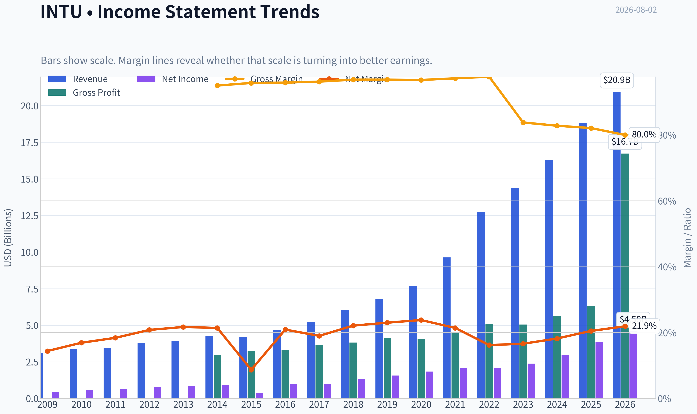
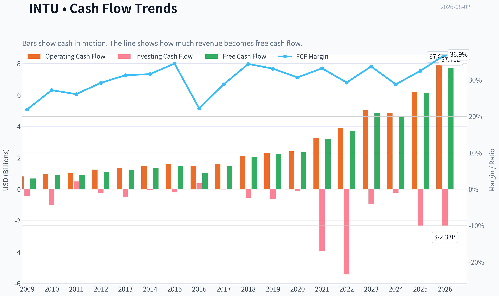
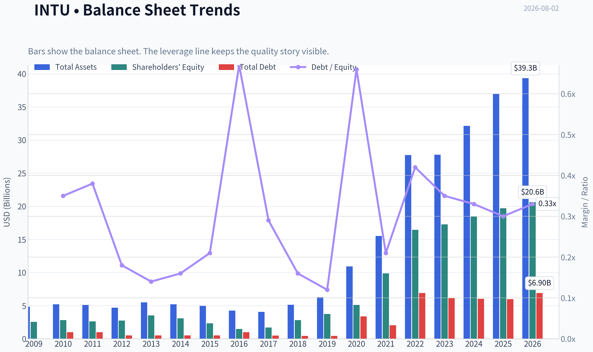
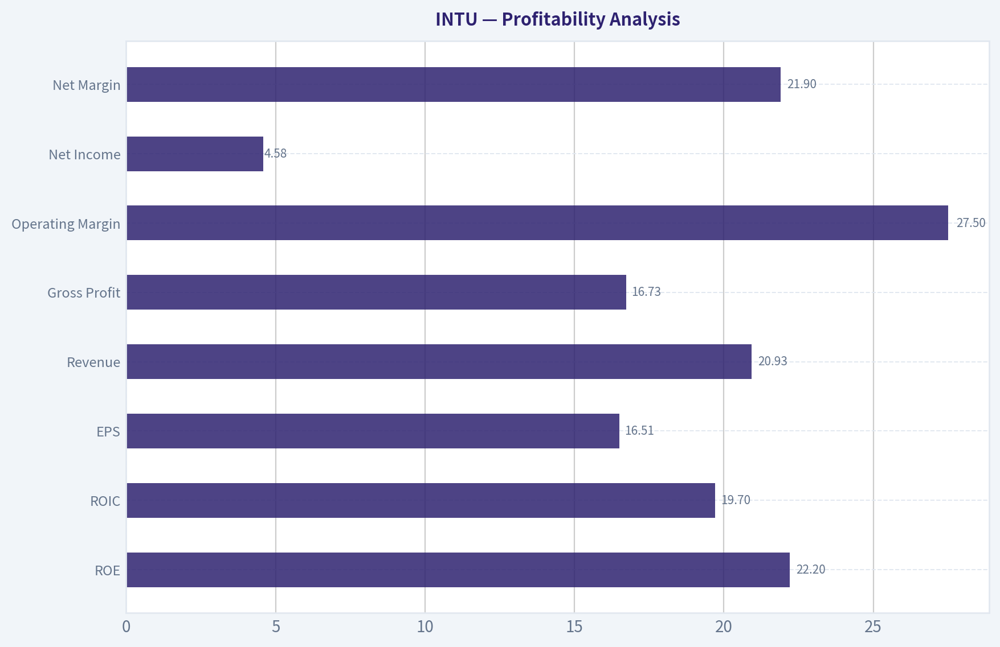
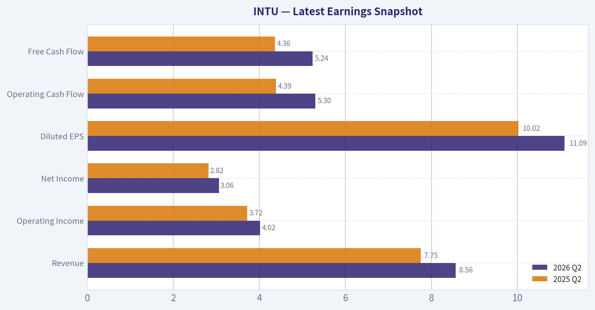
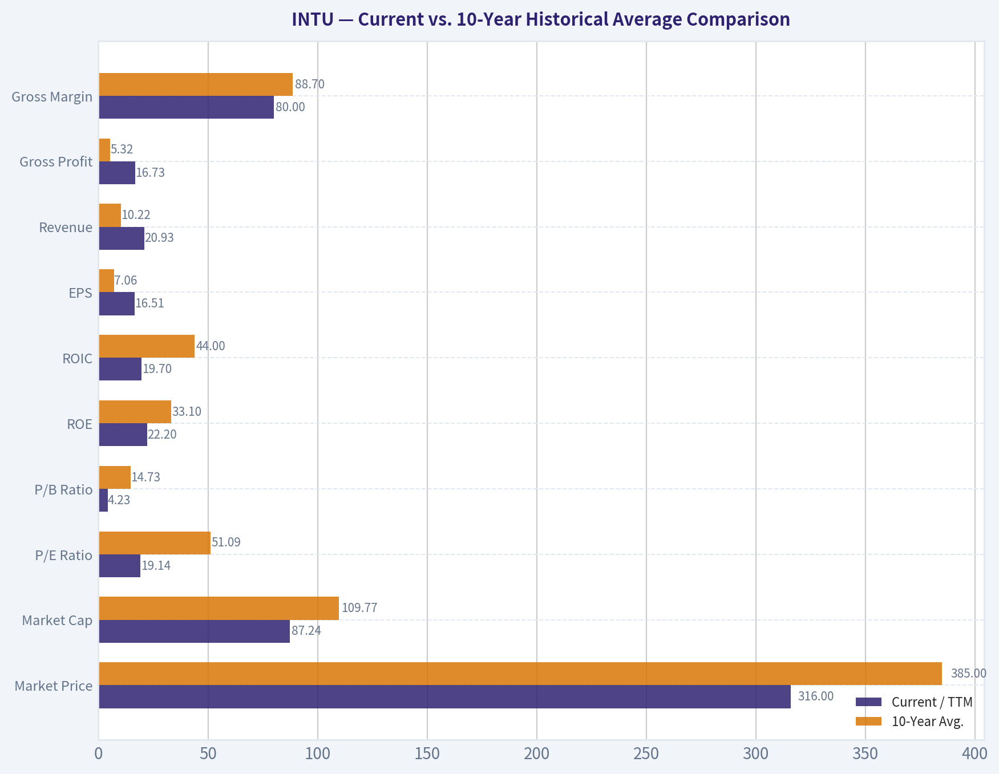
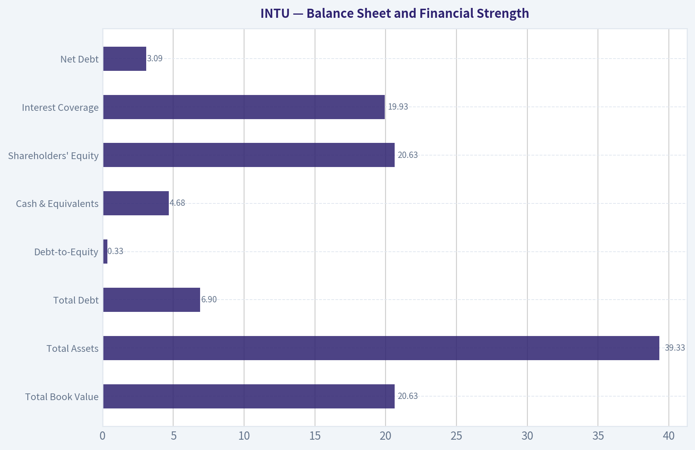
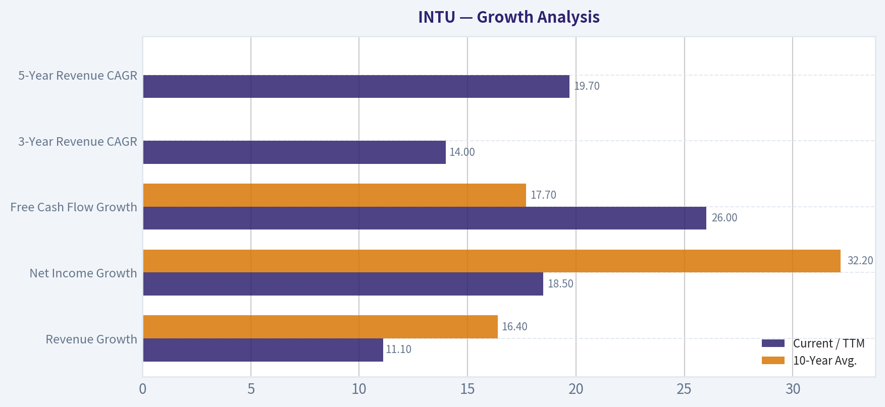
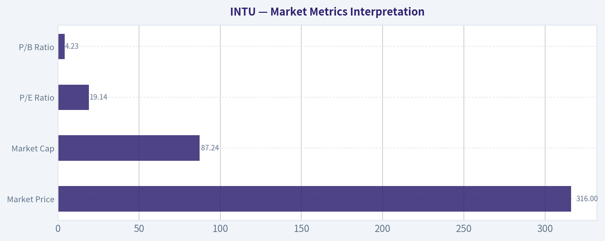

# INTU Deep Value Intelligence

**Analysis Date:** 2026-08-02

## Critical Disclaimer

*This analysis is generated by Deep Value Intelligence, an AI-powered multi-agent investing framework. Education & research only - not financial advice, not a financial advisor.*

---

## Table of Contents

1. Intelligence Summary
2. Analyst Team Reports
   - Fundamentals Analysis
   - Intrinsic Value Analysis (Buffett)
   - Trend & Growth Analysis (Lynch/Druckenmiller/Fisher)
   - Market Technical Analysis
   - Options Market Analysis
3. Research Team Commentary
4. Value Investing Team Commentary
5. Deep Values Commentary

---

## Intelligence Summary

### Thesis + Conditions

**Core Thesis:** **EXECUTIVE SUMMARY**
*   **Final Stance:** **AVOID**
*   **The Verdict:** Intuit (INTU) is a high-quality franchise currently undergoing a structural repricing. While a 19.3x P/E looks cheap relative to its historical hyper-growth premium, it does not offer a sufficient margin of safety against unresolved regulatory risks (IRS Direct File), AI-driven moat commoditization, and heavy Stock-Based Compensation (SBC) dilution.

**Key Risks:**
- The Verdict:** Intuit (INTU) is a high-quality franchise currently undergoing a structural repricing. While a 19.3x P/E looks cheap relative to its historical hyper-growth premium, it does not offer a sufficient margin of safety against unresolved regulatory risks (IRS Direct File), AI-driven moat commoditization, and heavy Stock-Based Compensation (SBC) dilution.
- The Catalyst:** The stock remains trapped below a declining 200-day SMA. As past misjudgments have taught us, admiring a business's quality while ignoring institutional distribution (a broken trend) and structural narrative threats is a recipe for capital impairment. Rebounds above the 50-day SMA are countertrend traps until definitively proven otherwise.
- The Bull (Risky):** Argues that a 19.3x P/E and a 30% discount to a $452 intrinsic value is a classic Buffett-style "fat pitch." They view the 15.6% revenue growth and 17.3% ROIC as proof that the moat is intact, dismissing the IRS Direct File threat as government incompetence that cannot compete with Intuit's sticky, AI-driven ecosystem.

**Confidence:** Medium

---

## Analyst Team Reports

### Fundamentals Analysis

#### Latest Earnings Snapshot

*Most recent reported quarter anchored on 2026 Q2, with prior-year comparison when available.*

| Metric | 2026 Q2 | 2025 Q2 | YoY Change |
| --- | ---: | ---: | ---: |
| Revenue | $8.56B | $7.75B | +10.4% |
| Operating Income | $4.02B | $3.72B | +8.0% |
| Net Income | $3.06B | $2.82B | +8.7% |
| Diluted EPS | $11.09 | $10.02 | +10.7% |
| Operating Cash Flow | $5.30B | $4.39B | +20.6% |
| Free Cash Flow | $5.24B | $4.36B | +20.1% |

Key Takeaways: This snapshot anchors the most recent reported quarter before the narrative analysis. It helps readers separate long-run business quality from whatever changed in the latest earnings print.

#### 17-Year Financial Metrics for INTU

*All values below are computed deterministically from raw data - not estimated by AI.*

*Issuer profile: operating company (Technology / Software - Application).*

#### 17-Year Financial Metrics
*Annual rows come from reported financial statements. The final TTM row is computed from the latest four quarters.*

| Metric | 2009 | 2010 | 2011 | 2012 | 2013 | 2014 | 2015 | 2016 | 2017 | 2018 | 2019 | 2020 | 2021 | 2022 | 2023 | 2024 | 2025 | 2026 TTM |
| --- | --- | --- | --- | --- | --- | --- | --- | --- | --- | --- | --- | --- | --- | --- | --- | --- | --- | --- |
| Market Price | $26 | $35 | $41 | $51 | $57 | $74 | $97 | $103 | $128 | $193 | $264 | $294 | $511 | $442 | $500 | $636 | $776 | $316 |
| Market Cap | $9.80B | $12.92B | $14.80B | $17.70B | $19.37B | $23.85B | $30.25B | $29.41B | $35.81B | $53.31B | $73.21B | $80.88B | $144.68B | $129.55B | $144.81B | $183.85B | $222.19B | $87.24B |
| P/E Ratio | 22.00 | 22.46 | 23.35 | 22.32 | 22.59 | 26.27 | 82.63 | 30.08 | 36.30 | 40.13 | 47.08 | 44.27 | 70.10 | 62.66 | 60.77 | 62.07 | 57.43 | 19.14 |
| P/B Ratio | 3.83 | 4.58 | 5.66 | 6.45 | 5.49 | 7.75 | 12.97 | 19.71 | 21.08 | 18.93 | 19.53 | 15.84 | 14.66 | 7.88 | 8.39 | 9.97 | 11.27 | 4.23 |
| ROE | 17.5% | 20.3% | 24.2% | 28.9% | 24.3% | 29.5% | 15.7% | 65.6% | 58.0% | 47.2% | 41.5% | 35.8% | 20.9% | 12.6% | 13.8% | 16.1% | 19.6% | 22.2% |
| ROIC | 28.7% | 19.8% | 22.4% | 27.7% | 28.3% | 29.7% | 18.5% | 43.6% | 57.7% | 76.7% | 79.3% | 88.0% | 35.3% | 14.0% | 12.3% | 14.7% | 18.1% | 19.7% |
| EPS | $1.18 | $1.55 | $1.75 | $2.30 | $2.53 | $2.82 | $1.17 | $3.41 | $3.53 | $4.80 | $5.60 | $6.63 | $7.29 | $7.06 | $8.22 | $10.43 | $13.67 | $16.51 |
| Revenue | $3.11B | $3.40B | $3.45B | $3.81B | $3.95B | $4.24B | $4.19B | $4.69B | $5.20B | $6.03B | $6.78B | $7.68B | $9.63B | $12.73B | $14.37B | $16.29B | $18.83B | $20.93B |
| Gross Profit | $2.95B | $3.26B | $3.31B | $3.66B | $3.82B | $4.11B | $4.05B | $4.56B | $5.08B | $5.05B | $5.62B | $6.30B | N/A | N/A | N/A | N/A | N/A | $16.73B |
| Gross Margin | 95.0% | 95.8% | 95.9% | 96.2% | 96.8% | 96.8% | 96.7% | 97.2% | 97.7% | 83.8% | 82.8% | 82.1% | N/A | N/A | N/A | N/A | N/A | 80.0% |
| Operating Margin | 22.0% | 26.6% | 31.4% | 30.7% | 30.6% | 30.6% | 17.6% | 26.5% | 27.3% | 25.9% | 27.3% | 28.3% | 26.0% | 20.2% | 21.9% | 22.3% | 26.1% | 27.5% |
| Net Income | $447.0M | $574.0M | $634.0M | $792.0M | $858.0M | $907.0M | $365.0M | $979.0M | $985.0M | $1.33B | $1.56B | $1.83B | $2.06B | $2.07B | $2.38B | $2.96B | $3.87B | $4.58B |
| Net Margin | 14.4% | 16.9% | 18.4% | 20.8% | 21.7% | 21.4% | 8.7% | 20.9% | 19.0% | 22.1% | 23.0% | 23.8% | 21.4% | 16.2% | 16.6% | 18.2% | 20.5% | 21.9% |
| Revenue Growth | N/A | 9.5% | 1.4% | 10.4% | 3.6% | 7.5% | -1.2% | 12.0% | 10.7% | 16.0% | 12.6% | 13.2% | 25.4% | 32.1% | 12.9% | 13.3% | 15.6% | 11.1% |
| Net Income Growth | N/A | 28.4% | 10.5% | 24.9% | 8.3% | 5.7% | -59.8% | 168.2% | 0.6% | 34.9% | 17.2% | 17.3% | 12.9% | 0.2% | 15.4% | 24.3% | 30.6% | 18.5% |
| Free Cash Flow Growth | N/A | 35.7% | -2.7% | 23.6% | 11.3% | 8.5% | 7.8% | -27.9% | 43.4% | 38.5% | 8.4% | 4.8% | 35.8% | 16.7% | 29.6% | -3.0% | 30.5% | 26.0% |
| Total Book Value | $2.56B | $2.82B | $2.62B | $2.74B | $3.53B | $3.08B | $2.33B | $1.49B | $1.70B | $2.82B | $3.75B | $5.11B | $9.87B | $16.44B | $17.27B | $18.44B | $19.71B | $20.63B |
| Total Assets | $4.83B | $5.20B | $5.11B | $4.68B | $5.49B | $5.20B | $4.97B | $4.25B | $4.07B | $5.13B | $6.28B | $10.93B | $15.52B | $27.73B | $27.78B | $32.13B | $36.96B | $39.33B |
| Total Debt | N/A | $998.0M | $999.0M | $499.0M | $499.0M | $499.0M | $500.0M | $1.00B | $488.0M | $438.0M | $436.0M | $3.37B | $2.03B | $6.91B | $6.12B | $6.04B | $5.97B | $6.90B |
| Debt-to-Equity | N/A | 0.35 | 0.38 | 0.18 | 0.14 | 0.16 | 0.21 | 0.67 | 0.29 | 0.16 | 0.12 | 0.66 | 0.21 | 0.42 | 0.35 | 0.33 | 0.30 | 0.33 |
| Cash & Equivalents | $679.0M | $214.0M | $722.0M | $393.0M | $1.01B | $849.0M | $808.0M | $638.0M | $529.0M | $1.46B | $2.12B | $6.44B | $2.56B | $2.80B | $2.85B | $3.61B | $2.88B | $4.68B |
| Shareholders' Equity | $2.56B | $2.82B | $2.62B | $2.74B | $3.53B | $3.08B | $2.33B | $1.49B | $1.70B | $2.82B | $3.75B | $5.11B | $9.87B | $16.44B | $17.27B | $18.44B | $19.71B | $20.63B |
| Operating Cash Flow | $812.0M | $998.0M | $1.01B | $1.25B | $1.37B | $1.45B | $1.59B | $1.46B | $1.60B | $2.11B | $2.32B | $2.41B | $3.25B | $3.89B | $5.05B | $4.88B | $6.21B | $7.89B |
| Investing Cash Flow | $-432.0M | $-997.0M | $497.0M | $-225.0M | $-485.0M | $-49.0M | $-182.0M | $371.0M | $-17.0M | $-532.0M | $-635.0M | $-97.0M | $-3.96B | $-5.42B | $-922.0M | $-227.0M | $-2.32B | $-2.33B |
| Free Cash Flow | $681.0M | $924.0M | $899.0M | $1.11B | $1.24B | $1.34B | $1.45B | $1.04B | $1.50B | $2.07B | $2.25B | $2.35B | $3.20B | $3.73B | $4.84B | $4.69B | $6.12B | $7.71B |
| FCF Margin | 21.9% | 27.2% | 26.1% | 29.2% | 31.3% | 31.6% | 34.5% | 22.2% | 28.8% | 34.4% | 33.1% | 30.7% | 33.2% | 29.3% | 33.7% | 28.8% | 32.5% | 36.9% |
| Dividends / Share | $0.00 | $0.00 | $0.00 | $0.00 | $0.00 | $0.00 | $0.00 | $0.00 | $0.00 | $0.00 | $0.00 | $0.00 | $0.00 | $2.64 | $3.07 | $3.64 | $4.20 | $4.77 |

#### Profitability Metrics
- Return on Equity (ROE): 19.6%
- Return on Invested Capital (ROIC): 17.3%
- Return on Assets (ROA): 10.5%
- Gross Margin: N/A
- Operating Margin: 26.1%
- Net Profit Margin: 20.5%

#### Liquidity Metrics
- Current Ratio: 1.36
- Quick Ratio: 0.49

#### Leverage Metrics
- Debt-to-Equity Ratio: 0.30
- Interest Coverage Ratio: 19.93
- Net Debt: $3.09B

#### Growth Metrics (Year-over-Year)
- Revenue Growth: 15.6%
- Net Income Growth: 30.6%
- Free Cash Flow Growth: 30.5%
- Revenue CAGR (3-Year): 14.0%
- Revenue CAGR (5-Year): 19.7%

#### Valuation Metrics
- P/E Ratio (TTM): 19.27
- Forward P/E: 11.56
- Price-to-Book: 4.20
- Price-to-Sales: 4.13
- PEG Ratio: 0.82
- EV/EBITDA: 13.51
- Free Cash Flow Yield: 7.1%
- Earnings Yield: 5.2%

#### Owner Earnings (Buffett Method, Code-Computed)
- Net Income: $3.87B
- + Depreciation & Amortization: $809.0M
- - Capital Expenditures: $-84.0M
- - Working Capital Changes: $-206.0M
- = **Owner Earnings: $4.80B**

#### Intrinsic Value (Code-Computed)
- Current Price: $316
- **Headline Intrinsic Value (business-model routed): $452**
  Business model: operating company - weighted blend [Damodaran FCFF + reverse-DCF fair + owner-earnings DCF] (operating_company)
  Model spread (min-max across DCFs): $386 - $586
  Margin of safety vs. price (headline): 30.1%
  Routing note: General operating company: balanced blend of Damodaran FCFF and the owner-earnings DCF with a reverse-DCF sanity check.
- Buffett Method (Owner Earnings):
  Conservative: $403
  Average: $516
  Optimistic: $1,571
- Cash Flow Method (FCF):
  Conservative: $443
  Average: $586
  Optimistic: $1,059
- Damodaran FCFF (WACC + margins + reinvestment):
  Conservative: $292
  Average: $386
  Optimistic: $445
  Monte Carlo band (P10-P90): $286 - $500 (median $371)
  P(intrinsic value > price): 77.5%
- Reverse-DCF: price implies ~5.1%/yr owner-earnings growth for 10y; trailing 3y was 15.8%, 5y 22.1%.

#### Piotroski F-Score: 8/9
- Positive Net Income: PASS
- Positive Operating Cash Flow: PASS
- ROA Improvement: PASS
- Cash Flow > Net Income: PASS
- Decreasing Debt: PASS
- Improving Current Ratio: PASS
- No Dilution: PASS
- Improving Gross Margin: FAIL
- Improving Asset Turnover: PASS

ANALYST STANCE: **ADVOCATE**

#### INTU - Warren Buffett-Style Fundamental Analysis

Intuit is an asset-light, high-margin software platform company serving consumers, small businesses, accountants, and credit/financial-service users through TurboTax, QuickBooks, Credit Karma, and ProTax. The deterministic dataset shows a business with exceptional long-term compounding, strong free cash flow conversion, and manageable leverage. The current market price of **$316** is materially below the dataset's model-routed intrinsic value of **$452**, implying an estimated **30.1% margin of safety**.

---

#### Current vs. 10-Year Historical Average Comparison

| Metric | Current / TTM | 10-Year Avg. | Current vs. Avg. | Interpretation |
|---|---:|---:|---:|---|
| Market Price | $316 | $385 | -18% | Price has reset sharply below its decade average despite higher earnings and cash flow. |
| Market Cap | $87.24B | $109.77B | -21% | Market value is below the 10-year average even though revenue and FCF are at records. |
| P/E Ratio | 19.14x | 51.09x | -63% | Valuation has compressed dramatically versus history. |
| P/B Ratio | 4.23x | 14.73x | Not meaningful | For INTU's asset-light software model, book value is not a reliable valuation anchor. |
| ROE | 22.2% | 33.1% | Below avg. | Still strong, but below unusually high historical levels. |
| ROIC | 19.7% | 44.0% | Below avg. | Returns remain attractive but have normalized after acquisitions and scale expansion. |
| EPS | $16.51 | $7.06 | +134% | Earnings power has more than doubled versus the decade average. |
| Revenue | $20.93B | $10.22B | +105% | Revenue has roughly doubled versus the 10-year average. |
| Gross Profit | $16.73B | $5.32B* | Higher | Gross profit is much larger, though historical comparability is limited by N/A years. |
| Gross Margin | 80.0% | 88.7%* | Lower | Margin remains software-like but below earlier 90%+ levels. |
| Operating Margin | 27.5% | 25.2% | Above avg. | Operating leverage remains intact despite acquisitions and AI investment. |
| Net Income | $4.58B | $2.00B | +129% | Profitability has scaled substantially. |
| Net Margin | 21.9% | 20.2% | Above avg. | Current profitability is slightly above historical norm. |
| Revenue Growth | 11.1% | 16.4% | Below avg. | Growth is still healthy but slower than the acquisition-boosted 2021-2022 period. |
| Net Income Growth | 18.5% | 32.2% | Below avg. | Average is skewed by 2016 rebound; current growth remains high quality. |
| Free Cash Flow Growth | 26.0% | 17.7% | Above avg. | Cash generation is accelerating faster than the historical average. |
| Total Book Value | $20.63B | $9.66B | +114% | Equity base has expanded, but book value is not central for software valuation. |
| Total Assets | $39.33B | $17.08B | +130% | Asset base has grown materially, partly from acquisitions. |
| Total Debt | $6.90B | $3.28B | +110% | Debt is higher than average but still manageable. |
| Debt-to-Equity | 0.33x | 0.35x | Slightly better | Leverage is not excessive relative to equity. |
| Cash & Equivalents | $4.68B | $2.59B | +81% | Liquidity is strong. |
| Free Cash Flow | $7.71B | $3.18B | +143% | FCF generation is the clearest evidence of business quality. |
| Dividends / Share | $4.77 | $1.36 | +252% | Dividend has grown meaningfully, though buybacks and reinvestment remain important. |

\*Average based on available deterministic years within the latest 10-year window where gross profit / gross margin were reported.

**Key Takeaways:** INTU's current valuation is far below its historical average, while revenue, EPS, net income, and free cash flow are far above their historical averages. The biggest positive deviation is free cash flow, which is now more than double the 10-year average. The major caution is that ROIC and ROE are below prior peak levels, suggesting returns remain excellent but are no longer as extraordinary as during the company's most capital-light phase.

---

#### Market Metrics Interpretation

| Metric | Current Reading | Buffett-Style Interpretation |
|---|---:|---|
| Market Price | $316 | The stock has fallen sharply from the 2025 level of $776, creating a potentially attractive entry point if cash flows remain durable. |
| Market Cap | $87.24B | The enterprise is still large, but the market cap is below the decade average despite much larger earnings power. |
| P/E Ratio | 19.14x | Very low relative to INTU's 10-year average of about 51x; suggests market is pricing in a major slowdown or risk. |
| P/B Ratio | 4.23x | **Not meaningful as a primary valuation signal** for an asset-light software company. Book value understates the worth of brands, software, data, customer relationships, and network effects. |

**Key Takeaways:** INTU's P/E multiple has compressed to a level rarely seen in the dataset, while the business is producing record cash flow. The low P/B ratio should not be interpreted mechanically as "cheap," because book value is a poor yardstick for software and platform businesses. For INTU, intrinsic value should be anchored on owner earnings and free cash flow, not book multiples.

---

#### Revenue Breakdown

| Revenue Source | Amount ($B) | % of Total |
|---|---:|---:|
| Global Business Solutions / QuickBooks ecosystem | ~$12.3B | ~58.8% |
| Consumer / TurboTax | ~$5.6B | ~26.8% |
| Credit Karma | ~$2.2B | ~10.5% |
| ProTax | ~$0.8B | ~3.9% |
| **Total Estimated TTM Revenue** | **~$20.9B** | **~100.0%** |

**Key Takeaways:** INTU is primarily a small-business and tax software platform, with QuickBooks and related business services representing the majority of revenue. TurboTax remains a highly profitable consumer franchise, while Credit Karma adds financial-services exposure but also introduces more macro and credit-cycle sensitivity. The mix is attractive because the largest segments benefit from recurring workflows, switching costs, and ecosystem depth.

---

#### Profitability Analysis

INTU's profitability profile remains excellent. The company generated **$20.93B of TTM revenue**, **$16.73B of gross profit**, **$4.58B of net income**, and **$7.71B of free cash flow**. Current **operating margin of 27.5%** is above the 10-year average of **25.2%**, and **net margin of 21.9%** is above the 10-year average of **20.2%**.

ROE of **22.2%** and ROIC of **19.7%** are both strong in absolute terms, but below the 10-year averages of **33.1%** and **44.0%**, respectively. This reflects a larger asset and capital base after acquisitions and business expansion. From a Buffett perspective, the decline matters, but the absolute returns still indicate a high-quality franchise earning well above its likely cost of capital.

| Profitability Metric | Current / TTM | Interpretation |
|---|---:|---|
| ROE | 22.2% | Strong shareholder return profile, though below historical peak levels. |
| ROIC | 19.7% | Still attractive and well above cost of capital, but materially below earlier highs. |
| EPS | $16.51 | Earnings per share continue to compound strongly. |
| Revenue | $20.93B | Scale has expanded dramatically over the decade. |
| Gross Profit | $16.73B | Very high gross-profit dollars show software economics remain powerful. |
| Operating Margin | 27.5% | Above historical average; operating discipline remains strong. |
| Net Income | $4.58B | Profit base is more than double the decade average. |
| Net Margin | 21.9% | Healthy and above historical average. |

**Key Takeaways:** INTU remains a high-margin, high-return business. The main profitability concern is not absolute weakness, but normalization: ROE and ROIC are no longer at the extreme highs seen earlier in the dataset. Still, current margins and cash generation remain consistent with a durable software compounder.

---

#### Growth Analysis

| Growth Metric | Current / TTM | 10-Year Avg. | Interpretation |
|---|---:|---:|---|
| Revenue Growth | 11.1% | 16.4% | Growth remains solid but has slowed from the acquisition-boosted period. |
| Net Income Growth | 18.5% | 32.2% | Still strong; historical average is inflated by rebound years. |
| Free Cash Flow Growth | 26.0% | 17.7% | Very strong and above historical average. |
| 3-Year Revenue CAGR | 14.0% | N/A | Indicates durable double-digit expansion. |
| 5-Year Revenue CAGR | 19.7% | N/A | Reflects excellent medium-term compounding. |

**Key Takeaways:** Revenue growth has moderated but remains attractive for a company of INTU's size. Free cash flow growth is the standout, running above the 10-year average and confirming strong earnings quality. The reverse DCF indicates the market price implies only about **5.1% annual owner-earnings growth for 10 years**, which appears conservative relative to INTU's recent 3-year and 5-year growth history.

---

#### Balance Sheet and Financial Strength

| Balance Sheet Metric | Current / TTM | Buffett-Style View |
|---|---:|---|
| Total Book Value | $20.63B | Growing equity base, but not the main valuation anchor. |
| Total Assets | $39.33B | Asset base has expanded meaningfully. |
| Total Debt | $6.90B | Higher than historical average but manageable. |
| Debt-to-Equity | 0.33x | Reasonable leverage. |
| Cash & Equivalents | $4.68B | Strong liquidity buffer. |
| Shareholders' Equity | $20.63B | Solid equity base. |
| Interest Coverage | 19.93x | Debt service appears very comfortable. |
| Net Debt | $3.09B | Modest relative to cash flow. |

**Key Takeaways:** INTU's balance sheet is not debt-free, but it is financially strong. Net debt of about **$3.09B** is modest compared with **$7.71B** of TTM free cash flow. Interest coverage near **20x** suggests the debt load does not threaten the company's durability.

---

#### Cash Flow and Dividend Analysis

| Cash Flow Metric | Current / TTM | Interpretation |
|---|---:|---|
| Operating Cash Flow | $7.89B | Strong cash generation from core operations. |
| Free Cash Flow | $7.71B | Extremely high conversion from earnings to cash. |
| FCF Margin | 36.9% | Excellent; above most software peers and above INTU's own long-term norm. |
| FCF Yield | 7.1% | Attractive for a high-quality software compounder. |
| Dividends / Share | $4.77 | Dividend is growing but remains secondary to reinvestment and buybacks. |

**Key Takeaways:** Free cash flow is INTU's strongest fundamental signal. A **36.9% FCF margin** and **7.1% FCF yield** are unusually attractive for a software company with double-digit growth. The dividend has grown, but the investment case is primarily driven by owner-earnings compounding rather than income yield.

---

#### Warren Buffett-Style Qualitative Assessment

| Buffett Criterion | Assessment | INTU Evidence |
|---|---|---|
| Economic Moat | Strong | TurboTax and QuickBooks benefit from brand trust, workflow integration, data scale, switching costs, and accountant / small-business ecosystem effects. |
| Business Durability | High | Tax filing, accounting, payroll, and business compliance are recurring needs. |
| Predictable Earnings | High | Revenue has grown from $3.11B in 2009 to $20.93B TTM, with only one annual revenue decline in the dataset. |
| Pricing Power | Good | High gross margins and stable operating margins suggest customers value the products. |
| Capital Efficiency | Good but lower than historical peak | ROIC remains strong at 19.7%, but below prior extraordinary levels. |
| Financial Strength | Strong | Net debt is modest relative to FCF, and interest coverage is high. |
| Management Quality | Generally strong | Long-term EPS, revenue, FCF, and dividend growth indicate effective capital allocation, though acquisition returns should be monitored. |
| Valuation | Attractive | Current price is below the model-routed intrinsic value of $452 and far below historical valuation multiples. |

**Key Takeaways:** INTU fits many Buffett quality criteria: understandable products, recurring demand, high margins, strong cash flow, and durable customer relationships. The company's moat is strongest in QuickBooks and TurboTax, where switching costs and brand trust are meaningful. The main issue is whether newer growth areas and AI investment can sustain high returns on the enlarged capital base.

---

#### Three-Scenario Buffett-Style Owner Earnings DCF

The deterministic research pack provides a model-routed intrinsic value of **$452 per share**, using a weighted blend of Damodaran FCFF, reverse DCF, and owner-earnings DCF. The model spread is wide: **Owner Earnings / FCF / Damodaran FCFF = $516 / $586 / $386**, with a headline value of **$452**.

For a hand sanity-check, I use TTM free cash flow of **$7.71B** as a current owner-earnings proxy because INTU is capital-light and free cash flow is the clearest observable cash stream. I use a **10% discount rate**, **2.5% terminal growth rate**, and approximately **276.1M shares** based on current market cap divided by price. I subtract net debt of approximately **$2.22B** using TTM cash of **$4.68B** and debt of **$6.90B**.

| DCF Assumption | Conservative | Average / Base Case | Optimistic |
|---|---:|---:|---:|
| Starting Owner Earnings Proxy | $7.71B | $7.71B | $7.71B |
| Years 1-10 Growth Pattern | 3% annually | 10% for 5 years, then fades to 3% | 15% for 5 years, then fades to 4% |
| Discount Rate | 10.0% | 10.0% | 10.0% |
| Terminal Growth | 2.5% | 2.5% | 2.5% |
| PV of Explicit Cash Flows | ~$54.6B | ~$73.2B | ~$91.4B |
| PV of Terminal Value | ~$54.6B | ~$84.7B | ~$119.8B |
| Enterprise / Equity Cash Value Before Net Debt | ~$109.2B | ~$157.9B | ~$211.2B |
| Less Net Debt | ~$2.2B | ~$2.2B | ~$2.2B |
| Estimated Equity Value | ~$107.0B | ~$155.7B | ~$209.0B |
| Fair Value / Share | **~$388** | **~$564** | **~$757** |
| Margin vs. $316 Price | ~19% | ~44% | ~58% |

**Key Takeaways:** Even the conservative hand DCF produces a value above the current market price, though not by an enormous margin. The base-case value of roughly **$564** is close to the deterministic pack's FCF DCF value of **$586** and above the headline intrinsic value of **$452**. Because the optimistic case is sensitive to high growth, the most reliable valuation anchor is the pack's blended intrinsic value of **$452**, not the bull case.

---

#### DCF Calculation Detail

| Scenario | Year-10 Owner Earnings | Terminal Value Formula | Implied Terminal Value | Fair Value Logic |
|---|---:|---|---:|---|
| Conservative | ~$10.36B | OE10 x 1.025 / 7.5% | ~$141.6B | Low growth assumes INTU grows only modestly above inflation. |
| Average | ~$16.06B | OE10 x 1.025 / 7.5% | ~$219.6B | Reflects durable double-digit near-term growth fading toward maturity. |
| Optimistic | ~$22.74B | OE10 x 1.025 / 7.5% | ~$310.8B | Assumes AI, QuickBooks, and tax ecosystem expansion sustain a stronger runway. |

**Key Takeaways:** The valuation is highly sensitive to the level of owner earnings 10 years from now. The conservative case assumes INTU becomes a slower GDP-like compounder, while the base and optimistic cases assume the company continues leveraging its software ecosystem. Importantly, no scenario assumes high growth forever; all cases use a 2.5% terminal growth rate.

---

#### Intrinsic Value Cross-Check

| Valuation Method from Deterministic Pack | Fair Value / Share |
|---|---:|
| Headline Intrinsic Value | **$452** |
| Owner Earnings DCF | $516 |
| FCF DCF | $586 |
| Damodaran FCFF | $386 |
| Damodaran Monte Carlo P10-P90 | $286 - $500 |
| Reverse DCF Implied Growth at Current Price | ~5.1% per year for 10 years |

**Key Takeaways:** The valuation evidence is favorable but not risk-free. The conservative Damodaran FCFF model gives a lower value of **$386**, still above the current price, while the blended headline value is **$452**. The reverse DCF is especially important: the market appears to be pricing INTU as if owner earnings grow only about **5.1% annually**, which is meaningfully below recent growth rates.

---

#### Key Investment Insights

| Category | Insight |
|---|---|
| Valuation | Current P/E of about 19x is dramatically below the 10-year average near 51x. |
| Cash Flow | TTM FCF of $7.71B and FCF yield of 7.1% are unusually attractive for a high-quality software business. |
| Moat | QuickBooks and TurboTax have strong brand, workflow, and switching-cost advantages. |
| Growth | Revenue growth has slowed versus peak years but remains double-digit. |
| Balance Sheet | Debt is manageable, with strong interest coverage and modest net debt relative to FCF. |
| Capital Allocation | Dividend is rising, but the bigger value driver is reinvestment and cash-flow compounding. |
| Market Expectation | Reverse DCF implies only ~5.1% owner-earnings growth, a low hurdle if the franchise remains healthy. |

**Key Takeaways:** INTU looks like a high-quality business trading at a discounted valuation. The market is embedding relatively modest growth expectations, while the company continues to produce strong free cash flow. The opportunity exists because valuation has compressed much faster than fundamentals have deteriorated.

---

#### Red Flags and Risks

| Risk | Why It Matters |
|---|---|
| ROIC normalization | ROIC has fallen from extraordinary historical highs to 19.7%, still good but less exceptional. |
| Gross margin decline | Gross margin has moved down from historical 90%+ levels to about 80%. |
| Acquisition execution | Credit Karma and other acquisitions increased the asset base and may dilute returns if growth disappoints. |
| Credit Karma cyclicality | Credit-related revenue can be sensitive to consumer credit conditions and lender demand. |
| AI transition risk | AI can strengthen INTU's platform, but restructuring and product shifts create execution risk. |
| Regulatory risk | Tax filing software faces potential regulatory and political scrutiny. |
| Valuation sensitivity | DCF value depends heavily on sustained cash-flow growth and terminal assumptions. |

**Key Takeaways:** The main risk is not near-term solvency, but whether INTU can sustain high returns on a larger capital base. Margin pressure, acquisition integration, regulatory scrutiny, and AI-driven disruption all deserve monitoring. If revenue growth falls toward low single digits, the current discount would be less compelling.

---

#### Opportunities

| Opportunity | Potential Impact |
|---|---|
| AI-enabled tax and accounting automation | Could improve retention, upsell, productivity, and margins. |
| QuickBooks ecosystem expansion | Payroll, payments, lending, and business services can deepen customer monetization. |
| TurboTax pricing and product mix | Strong brand trust may support continued profitability. |
| Credit Karma recovery | If credit markets improve, Credit Karma could reaccelerate. |
| Operating leverage | Current margins suggest room for earnings to grow faster than revenue. |
| Multiple re-rating | If confidence returns, P/E could move closer to historical norms. |

**Key Takeaways:** INTU has multiple avenues for continued compounding. The most important opportunity is expanding the QuickBooks ecosystem, because small-business workflows are sticky and monetizable. AI may further strengthen the moat if it improves customer productivity and embeds INTU more deeply into financial decision-making.

---

#### Final Investment Stance: ADVOCATE

INTU earns an **ADVOCATE** stance because it combines a durable software moat, strong cash generation, manageable leverage, and a current valuation meaningfully below intrinsic value. The deterministic dataset's headline intrinsic value is **$452**, versus a current price of **$316**, implying a **30.1% margin of safety**. The current P/E of about **19x** is far below historical norms, while free cash flow is at a record level.

This is not a riskless bargain. ROIC has normalized, gross margin has declined from earlier levels, and the company must prove that acquisitions and AI investment can sustain high returns. However, Buffett-style investors generally seek wonderful businesses at sensible prices, and INTU currently appears to meet that standard.

| Final Summary Item | Assessment |
|---|---|
| Business Quality | High |
| Economic Moat | Strong |
| Financial Strength | Strong |
| Earnings Predictability | High |
| Cash Flow Quality | Excellent |
| Valuation vs. History | Attractive |
| Valuation vs. Intrinsic Value | Attractive |
| Main Risk | ROIC normalization and execution risk |
| Best Valuation Anchor | Cash-flow-based intrinsic value, not book value |
| Final Stance | **ADVOCATE** |

**Key Takeaways:** INTU is a high-quality compounder trading at a valuation that appears disconnected from its cash-flow strength. The stock is not cheap because of book value; it is attractive because free cash flow and owner earnings support a higher intrinsic value than the market price. For long-term investors comfortable with software-platform and regulatory risks, the current setup is favorable.

#### Fundamental Visuals

This graph tracks the profitability and return metrics (ROE, ROIC, Margins) of **INTU** over the past decade, highlighting capital efficiency trends.

This chart illustrates the financial health of **INTU** over the last 10 years, mapping cash equivalents and free cash flow against total obligations (Debt).

This comparison chart from *Profitability Analysis* stacks current figures against historical benchmarks for **INTU**, making it easy to see where the company trades relative to its own averages.

---

### Intrinsic Value Analysis (Buffett)

> *Following Warren Buffett's value investing philosophy: Circle of Competence, Economic Moat, Management Quality, and Margin of Safety.*

#### Intrinsic Value Snapshot

Price is what you pay. Intrinsic value is what the business may be worth based on the cash it can create for owners over time. We show a range, not one magic number.

- Current Price: $316.07
- Value Range (conservative to optimistic across both DCF methods): $403.06 to $1,571.48

##### Owner Earnings (Buffett Method)
- Net Income: $3,869,000,000.00
- Depreciation & Amortization: $809,000,000.00
- Capital Expenditures: $-84,000,000.00
- Working Capital Changes: $-206,000,000.00
- Owner Earnings: $4,800,000,000.00

##### Intrinsic Value
###### Buffett Method
Uses owner earnings. Stricter, and usually more conservative.
- Conservative: $403.06
- Average: $516.41
- Optimistic: $1,571.48
- Discount Rate: 10.0%

###### Cash Flow Method
Uses free cash flow. Better for companies spending heavily today to grow tomorrow.
- Conservative: $443.21
- Average: $585.60
- Optimistic: $1,059.11
- Discount Rate: 10.0%

ANALYST STANCE: **ADVOCATE**

#### Intuit Investment View - Buffett-Style Value Analysis

Intuit is a high-quality, asset-light financial software franchise trading at a meaningful discount to intrinsic value. At a current price of **$316**, the stock trades at roughly **19.3x earnings**, offers a **7.1% free-cash-flow yield**, and sits about **30% below the headline intrinsic value estimate of $452 per share**. For a business with durable brands, embedded workflows, strong cash conversion, and credible AI-enabled reinvestment opportunities, this is an attractive fair-to-undervalued setup.

---

#### 1. Factor Scorecard and Gate 5 Solvency Check

| Factor | Score | Evidence |
|---|---:|---|
| Circle of Competence & Business Simplicity | 4.3 / 5 | Intuit sells tax, accounting, payroll, credit, and marketing software to consumers and small businesses through TurboTax, QuickBooks, Credit Karma, and Mailchimp. The model is understandable: recurring or repeat-use software with high switching costs and strong brand trust. |
| Moat Test | 4.5 / 5 | Strong brands, embedded customer data, workflow integration, accountant ecosystem, and scale-driven product advantages. TurboTax and QuickBooks are difficult to displace once customers' financial histories are inside the system. |
| Management Quality & Capital Allocation | 3.8 / 5 | Management has grown revenue and free cash flow at strong rates, but acquisitions such as Credit Karma and Mailchimp were large and must continue proving their return on invested capital. AI restructuring is strategically rational but adds execution risk. |
| Industry Structure | 4.0 / 5 | Financial software is attractive: asset-light, high gross-margin, recurring or repeat-use, and structurally growing. Competition is real from H&R Block, Xero, FreshBooks, BILL, banks, and potential government tax-filing alternatives. |
| Gate 5: Hard Floor - Quality/Solvency | Not Tripped | Intuit has positive earnings, strong free cash flow, a 7.1% FCF yield, current ratio of 1.36, and no sign that operating profit cannot cover obligations. There is no financial-distress trigger. |

**Key Takeaways:** Intuit clears the Buffett quality test: the business is understandable, cash-generative, and protected by customer captivity. The main concerns are not solvency or business deterioration, but valuation discipline, regulatory risk around tax filing, and management execution on AI and acquisitions.

---

#### 2. Moat Analysis

| Moat Source | Assessment | Evidence |
|---|---|---|
| Brand / Intangible Assets | Strong | TurboTax is a leading consumer tax brand; QuickBooks is one of the default accounting systems for small businesses. Trust matters deeply in tax and financial workflows. |
| Switching Costs | Very Strong | Customers store years of tax, payroll, accounting, banking, invoicing, and business history inside Intuit products. Switching is inconvenient, risky, and time-consuming. |
| Cost Advantage | Moderate to Strong | Intuit's scale allows heavy spending on AI, compliance, product development, and customer support over a large user base. Smaller rivals may struggle to match this breadth. |
| Network Effects | Moderate | QuickBooks benefits from accountant familiarity, third-party integrations, and ecosystem depth. The network effect is not as pure as a marketplace, but the ecosystem strengthens retention. |
| Pricing Power | Strong | Tax and accounting software are mission-critical, low-ticket relative to the pain avoided, and compliance-driven. Intuit likely has room for recurring price increases if product value remains high. |
| Moat Direction | Wide and Stable to Widening | AI-driven automation could strengthen the franchise if Intuit becomes the operating system for consumer and small-business financial decisions. |

**Key Takeaways:** Intuit's moat is built less on patents and more on trust, data history, workflow integration, and customer inertia. The most valuable asset is not just software code; it is the accumulated financial context inside the platform.

---

#### 3. Management Quality and Capital Allocation

| Area | Assessment |
|---|---|
| Owner Mentality | Good. Management has emphasized platform expansion, ecosystem depth, and long-term customer lifetime value rather than only short-term reported earnings. |
| Candor and Execution | Generally good. The company has been willing to restructure and redirect resources toward AI-led opportunities, though workforce reductions create cultural and execution risk. |
| Reinvestment | Strong. Intuit can reinvest in product automation, AI tax assistance, small-business financial tools, payroll, payments, and personalized credit recommendations. |
| Acquisitions | Mixed to positive. Credit Karma and Mailchimp broadened the ecosystem, but the prices were significant; long-term value creation depends on cross-sell and integration success. |
| Buybacks / Dividends | Rational but not central. Capital returns are secondary to reinvestment; buybacks are more attractive at the current valuation than at premium multiples. |
| Debt Discipline | Acceptable. The balance sheet does not show financial distress, and cash generation supports obligations. |

**Key Takeaways:** Management has built Intuit into a broader financial technology platform, not merely a tax software company. The capital allocation record is good, but not flawless, because large acquisitions raise the bar for future returns.

---

#### 4. Financial Summary

| Metric | FY2021 | FY2022 | FY2023 | FY2024 | Recent / TTM |
|---|---:|---:|---:|---:|---:|
| Revenue | $9.63B | $12.73B | $14.37B | $16.29B | ~$18.8B |
| Revenue Growth | 25% | 32% | 13% | 13% | 15.6% YoY |
| Net Income | $2.06B | $2.07B | $2.38B | $2.96B | ~$4.49B |
| Diluted EPS | $7.56 | $7.28 | $8.42 | $10.43 | ~$16.40 |
| Free Cash Flow | ~$3.28B | ~$3.77B | ~$3.78B | ~$4.41B | ~$6.14B |
| FCF Margin | ~34% | ~30% | ~26% | ~27% | ~33% |
| ROE | Strong | Strong | Strong | Strong | 19.6% |
| Current Ratio | - | - | - | - | 1.36 |
| Market Cap | - | - | - | - | $86.46B |
| P/E | - | - | - | - | 19.3x |
| FCF Yield | - | - | - | - | 7.1% |

**Key Takeaways:** Intuit has compounded revenue at a strong rate while maintaining excellent cash generation. Recent free cash flow is particularly strong, and the current valuation is unusually reasonable for a business of this quality.

---

#### 5. Owner Earnings Calculation

| Owner Earnings Component | Recent / TTM Estimate |
|---|---:|
| Net Income | ~$4.49B |
| Plus: Depreciation & Amortization / Non-cash Charges | ~$0.90B |
| Less: Maintenance CapEx | ~($0.35B) |
| Less / Plus: Normalized Working Capital Change | ~$1.10B benefit |
| Estimated Owner Earnings | ~$6.14B |
| Shares Outstanding Implied by Market Cap / Price | ~274M |
| Owner Earnings Per Share | ~$22.4 |

**Key Takeaways:** Intuit converts accounting earnings into real cash at a high rate. The business requires limited physical capital, so a large share of operating cash flow can become owner earnings.

---

#### 6. Three-Scenario DCF Valuation

| Scenario | Assumptions | Equity Value | Intrinsic Value / Share | Margin of Safety vs. $316 |
|---|---|---:|---:|---:|
| A. No Growth | Owner earnings capitalized at 10% | ~$61.4B | ~$224 | -41% |
| B. GDP Growth | 3% perpetual growth, 10% discount rate | ~$90.3B | ~$330 | 4% |
| C. Historical Growth Haircut | 8% growth for 10 years, 3% terminal growth, 10% discount rate | ~$130.9B | ~$479 | 34% |
| Headline Blended Intrinsic Value | Weighted blend of owner earnings, FCF, and FCFF models | ~$123.7B | $452 | 30% |

**Key Takeaways:** The no-growth case does not support today's price, but that is too punitive for a business still growing revenue in the mid-teens. The conservative growth case roughly supports the current price, while the realistic quality-compounder case indicates substantial upside.

---

#### 7. Margin of Safety and Reverse-DCF Check

| Valuation Cross-Check | Intrinsic Value / Share | Margin of Safety vs. $316 |
|---|---:|---:|
| Owner Earnings DCF | $516 | 39% |
| Free Cash Flow DCF | $586 | 46% |
| Damodaran-Style FCFF | $386 | 18% |
| Headline Blended Value | $452 | 30% |
| Reverse-DCF Implied Growth | Price implies ~5.1% annual growth for 10 years | Below trailing 3-year growth of 15.8% and 5-year growth of 22.1% |

**Key Takeaways:** The reverse-DCF is favorable: the market price implies only modest growth for a company that has historically compounded much faster. For a wide-moat software franchise, a 30% discount to blended intrinsic value is an attractive margin of safety.

---

#### 8. Final Buffett Scorecard

| Criterion | Weight | Score | Weighted Contribution |
|---|---:|---:|---:|
| Moat Width & Durability | 25% | 4.5 | 1.13 |
| Valuation / Margin of Safety | 20% | 4.4 | 0.88 |
| Capital Returns - ROIC vs. WACC | 15% | 4.0 | 0.60 |
| Business Understanding & Predictability | 12% | 4.3 | 0.52 |
| Management Quality & Capital Allocation | 12% | 3.8 | 0.46 |
| Reinvestment Runway | 8% | 4.1 | 0.33 |
| Balance Sheet Strength | 4% | 3.8 | 0.15 |
| Industry Structure | 4% | 4.0 | 0.16 |
| Final Weighted Score | 100% | - | 4.22 / 5.00 |

**Key Takeaways:** Intuit scores as a high-quality compounder trading below intrinsic value. The valuation is not merely "not expensive"; it appears attractive relative to the durability and cash economics of the franchise.

---

#### 9. Investment Stance

**Stance: ADVOCATE**
**Conviction Level: High**

Intuit is a wonderful business at a fair-to-attractive price. The company owns mission-critical consumer and small-business financial workflows, generates strong free cash flow, and has credible reinvestment opportunities in AI-enabled tax, accounting, payroll, credit, and marketing automation.

The key risks are regulatory pressure on paid tax filing, competition in small-business software, and execution risk from AI restructuring and past acquisitions. Those risks are real, but they are adequately compensated by the current valuation: the stock trades at a **30% discount to blended intrinsic value**, while the reverse-DCF implies only about **5.1% annual growth**, far below Intuit's recent history.

For a Buffett-style investor, INTU qualifies as a durable, understandable, high-return compounder available at a price that offers a genuine margin of safety.
#### Valuation Bridge

This bridge places the current market price beside each intrinsic value lens so readers can see whether upside depends on one method or shows up across several methods.

| Scenario | Intrinsic Value / Share |
| --- | ---: |
| Buffett Method | $516.41 |
| Cash Flow Method | $585.60 |
| Damodaran Method | $385.81 |
| Current Price | $316.07 |

#### Key Takeaways

If one method is far above the others, the upside case depends on a specific modelling assumption. When several methods cluster together, the valuation story is more robust.

#### Valuation Visuals

This comparison chart from *Latest Earnings Snapshot* stacks current figures against historical benchmarks for **INTU**, making it easy to see where the company trades relative to its own averages.

This comparison chart from *Current vs. 10-Year Historical Average Comparison* stacks current figures against historical benchmarks for **INTU**, making it easy to see where the company trades relative to its own averages.

This comparison chart from *Balance Sheet and Financial Strength* stacks current figures against historical benchmarks for **INTU**, making it easy to see where the company trades relative to its own averages.

---

### Trend & Growth Analysis (Lynch/Druckenmiller/Fisher)

> *Following Peter Lynch's GARP, Stanley Druckenmiller's macro-aware approach, and Philip Fisher's scuttlebutt methodology.*

ANALYST STANCE: **ADVOCATE**

#### INTU Growth Investment Report - Intuit Inc.

| Item | Snapshot |
|---|---:|
| Current Price | $316 |
| Market Cap | $86.46B |
| P/E | 19.3x |
| Revenue Growth YoY | 15.6% |
| FCF Yield | 7.1% |
| ROE | 19.6% |
| Current Ratio | 1.36x |
| Headline Intrinsic Value | $452 |
| Margin of Safety vs. Price | ~30% |
| Reverse DCF Implied Growth | ~5.1% for 10 years |
| Historical Growth Reference | 3-year: 15.8%; 5-year: 22.1% |

**Key Takeaways:** Intuit screens as a high-quality GARP compounder, not a speculative hyper-growth name. The market price implies only about 5% long-term growth, which looks conservative versus the company's recent mid-teens revenue growth and strong free-cash-flow profile. The valuation reset creates the main opportunity.

---

#### 1. Lynch Classification

| Lynch Category | INTU Classification | Rationale |
|---|---|---|
| Slow Grower | No | Revenue growth is well above 0-5%. |
| Stalwart | Partly | Large, profitable, durable franchise with tax/accounting leadership. |
| Fast Grower | Yes, lower end | 15.6% YoY revenue growth puts INTU near fast-grower territory. |
| Cyclical | No | Tax and SMB accounting are recurring/mission-critical, though SMB health matters. |
| Turnaround | No | Not distressed; restructuring is AI-oriented, not survival-driven. |
| Asset Play | No | Value is in software ecosystem and data, not hidden assets. |

**Key Takeaways:** Intuit is best classified as a **high-quality fast grower / stalwart hybrid**. It is not likely to be a classic small-cap ten-bagger from today's $86B market cap, but it can still be a powerful long-duration compounder if AI expands its product value and market share.

---

#### 2. The Story in 3 Bullets

- **Intuit sells financial operating systems for consumers and small businesses** through TurboTax, Credit Karma, QuickBooks, Mailchimp, payroll, payments, and related services.
- **The AI opportunity is to turn fragmented financial workflows into automated "done-for-you" experiences**, improving tax filing, bookkeeping, cash-flow management, lending, marketing, and payroll.
- **The investment setup is GARP:** revenue is still growing mid-teens, free cash flow is strong, and the stock appears priced for low-single-digit long-term growth.

---

#### 3. TAM Analysis and 10x Test

| TAM Factor | Estimate / View |
|---|---:|
| Current Revenue Assumption | ~$18.8B TTM estimate |
| 10x Revenue Target | ~$188B |
| Core TAM: tax, accounting, payroll, SMB software | Large, but not enough alone for clean 10x |
| Expanded TAM: SMB financial OS, AI automation, payments, lending, marketing, consumer finance | Potentially $300B-$500B+ globally |
| 10x Test Result | **Partial pass** |
| Needed for True 10x | Major international growth, AI monetization, embedded financial services, and deeper SMB wallet share |

**Key Takeaways:** Intuit has a long runway, but the 10x test is not as clean as it would be for a smaller company. A 10x revenue outcome would require Intuit to become a much broader AI-powered financial operating system for consumers and businesses, not just a tax and accounting software provider.

---

#### 4. Revenue Growth Trend

| Metric | Data / Interpretation |
|---|---:|
| Latest YoY Revenue Growth | 15.6% |
| 3-Year Historical Growth Reference | 15.8% |
| 5-Year Historical Growth Reference | 22.1% |
| Pattern | Stable high growth, not obvious acceleration yet |
| Growth Quality | Strong recurring ecosystem; mix includes software, payments, tax, credit, and SMB services |
| Lynch View | Attractive if sustained above 15% |
| Druckenmiller View | Need evidence AI creates re-acceleration, not just cost cutting |

**Key Takeaways:** Revenue growth remains healthy and consistent, but the current data does not yet show a clear acceleration inflection. The key debate is whether AI-driven product changes and restructuring can push growth back toward the high-teens or low-20s range.

---

#### 5. Unit Economics

| Unit Economics Metric | INTU Assessment |
|---|---:|
| Gross Margin | Not provided in shared pack; historically software-like/high |
| FCF Yield | 7.1% |
| Estimated FCF | ~$6.1B |
| Estimated FCF Margin | ~33%, using ~$18.8B revenue assumption |
| Revenue Growth | 15.6% |
| Rule of 40 Estimate | ~48.6 |
| LTV/CAC | Not disclosed |
| NRR | Not disclosed |
| Payback Period | Not disclosed |

**Key Takeaways:** Intuit appears highly efficient for a company still growing mid-teens. Even without disclosed LTV/CAC or NRR, the free-cash-flow profile suggests strong unit economics and a proven model. The estimated Rule of 40 score is comfortably above the 40 threshold.

---

#### 6. Inflection Point Assessment

| Inflection Type | Evidence | Rating |
|---|---|---|
| Product Cycle Inflection | AI-powered tax, accounting, SMB automation, and personalized financial assistance | Positive |
| Market Share Inflection | QuickBooks ecosystem can take share from manual workflows and point solutions | Moderate positive |
| Margin Inflection | 17% workforce restructuring aimed at AI priorities could improve productivity | Positive but execution-sensitive |
| TAM Inflection | AI could expand INTU from software provider to financial operating system | Positive |
| Competitive Inflection | Competition remains intense from BILL, Xero, tax software, banks, fintechs, and AI-native tools | Mixed |

**Key Takeaways:** The most important potential inflection is AI-driven product expansion. If Intuit can use AI to automate bookkeeping, tax prep, payroll, lending, and marketing workflows, the company's value proposition could materially improve. The risk is that restructuring boosts margins but does not produce meaningful product-led acceleration.

---

#### 7. Macro Setup

| Macro Factor | Impact on INTU |
|---|---|
| Interest Rates | Lower rates would help growth-stock multiples and SMB activity. |
| Economic Cycle | SMB formation and health matter; recession would pressure Credit Karma, payments, and small business demand. |
| AI Theme | Strong secular tailwind if monetized through automation and higher retention. |
| Cloud/SaaS Digitization | Durable tailwind for QuickBooks and connected SMB services. |
| Consumer Credit | Credit Karma is more cyclical and sensitive to lending conditions. |

**Key Takeaways:** The macro backdrop is moderately favorable if rates stabilize or fall. Intuit benefits from AI, SaaS adoption, and SMB digitization, but it is not immune to consumer credit weakness or small-business softness.

---

#### 8. Fisher 15 Points Score

| Fisher Point | Score / 5 | Rationale |
|---|---:|---|
| 1. Market potential | 4 | Large consumer and SMB finance markets. |
| 2. New product determination | 4 | Heavy AI and platform investment. |
| 3. R&D effectiveness | 4 | Strong product history; AI proof still emerging. |
| 4. Sales organization | 4 | Powerful brand and distribution. |
| 5. Profit margin | 5 | Strong cash generation. |
| 6. Improving margins | 4 | Restructuring may help; must avoid innovation drag. |
| 7. Labor/personnel relations | 3 | Large workforce cut creates culture risk. |
| 8. Executive relations | 4 | Mature organization. |
| 9. Management depth | 4 | Deep bench, though AI transition is demanding. |
| 10. Cost/accounting controls | 5 | High-quality financial discipline. |
| 11. Moat factors | 4 | Data, switching costs, workflow integration, brand. |
| 12. Long-range profit outlook | 4 | Strong if AI expands ARPU and retention. |
| 13. Dilution risk | 4 | Not dependent on equity financing. |
| 14. Candor | 4 | Restructuring is a visible strategic pivot. |
| 15. Integrity | 4 | No major current governance red flag in provided data. |
| **Total** | **61 / 75** | **Good** |

**Key Takeaways:** Intuit earns a strong Fisher score because it combines durable products, high cash generation, and meaningful innovation potential. The main deduction is cultural and execution risk from the AI restructuring, plus the fact that AI monetization still needs more proof.

---

#### 9. Valuation Analysis

| Valuation Method | Result |
|---|---:|
| P/E | 19.3x |
| Revenue Growth | 15.6% |
| PEG Estimate | ~1.24x |
| FCF Yield | 7.1% |
| Headline Intrinsic Value | $452 |
| Margin of Safety | ~30% |
| Reverse DCF Implied Growth | ~5.1% for 10 years |
| Valuation Read | Attractive GARP, not deep value on earnings alone |

**Key Takeaways:** The valuation looks attractive relative to Intuit's quality and historical growth. A PEG near 1.2 is not screamingly cheap, but the 7.1% free-cash-flow yield and low reverse-DCF hurdle make the setup compelling.

---

#### 10. 3-Year Scenario Analysis

| Scenario | Revenue CAGR | FY+3 Revenue Estimate | Exit P/S | Implied Equity Value | Implied Price | Approx. Price CAGR |
|---|---:|---:|---:|---:|---:|---:|
| Bear | 8% | ~$23.7B | 4.0x | ~$95B | ~$347 | ~3% |
| Base | 14% | ~$27.8B | 5.5x | ~$153B | ~$559 | ~21% |
| Bull | 18% | ~$30.9B | 7.0x | ~$216B | ~$791 | ~36% |

**Key Takeaways:** Downside appears cushioned if Intuit keeps growing and free cash flow remains strong, while upside is meaningful if AI supports re-acceleration and multiple expansion. The base case offers an attractive return profile, but it depends on sustaining mid-teens growth rather than fading toward the low-single-digit growth implied by the stock price.

---

#### 11. Growth Investor Scorecard

| Criterion | Weight | Score / 5 | Weighted Score |
|---|---:|---:|---:|
| The Story | 10% | 4.0 | 0.40 |
| TAM & Runway | 20% | 3.5 | 0.70 |
| Revenue Growth | 20% | 3.8 | 0.76 |
| Unit Economics | 15% | 4.5 | 0.68 |
| Competitive Position | 10% | 4.0 | 0.40 |
| Management Quality | 10% | 4.0 | 0.40 |
| Macro Setup | 5% | 3.5 | 0.18 |
| Profitability Path | 5% | 4.5 | 0.23 |
| Valuation | 5% | 4.2 | 0.21 |
| **Total** | **100%** |  | **3.95 / 5.00** |

**Key Takeaways:** Intuit scores just below 4.0, which supports an **ADVOCATE** stance. The company is not a perfect ten-bagger candidate because of its size, but the combination of quality, cash flow, AI optionality, and valuation support is attractive.

---

#### 12. Position Size Stance

| Investor Type | Position Stance |
|---|---|
| Conservative Growth | 3% position |
| Balanced Growth / GARP | 4%-5% position |
| Aggressive Growth | Up to 6%, only if AI re-acceleration evidence improves |
| Ten-Bagger Sleeve | Not ideal; too large and mature for classic 10x potential |

**Key Takeaways:** Intuit is best sized as a core GARP compounder rather than a high-risk moonshot. A 4%-5% position is reasonable for a diversified growth portfolio, with room to add if revenue growth accelerates or AI monetization becomes clearer.

---

#### 13. Key Catalysts and Risks

| Catalysts | Risks |
|---|---|
| AI-powered tax and bookkeeping automation drives ARPU expansion | AI restructuring disrupts culture or execution |
| QuickBooks ecosystem adds payroll, payments, lending, and marketing wallet share | SMB slowdown pressures payments and software demand |
| Credit Karma recovers with improved lending environment | Consumer credit weakness hurts Credit Karma |
| Margin expansion from productivity improvements | Competition from BILL, Xero, fintechs, banks, and AI-native entrants |
| Market rerates stock as growth durability is confirmed | Market sees AI cuts as cost-cutting rather than innovation |

**Key Takeaways:** The bull case depends on AI becoming a revenue accelerator, not just an efficiency tool. The bear case is that Intuit remains a solid but slower-growing software company, causing valuation upside to be limited despite strong free cash flow.

---

#### Final View

Intuit is an **ADVOCATE** for growth-at-a-reasonable-price investors. The stock offers a rare combination of durable franchise quality, mid-teens growth, strong free cash flow, and a valuation that appears to understate its long-term prospects. It is not the cleanest ten-bagger candidate due to its scale, but it has credible potential to become a 2x-4x compounder if AI expands the company's TAM and sustains growth above market expectations.

#### Growth & Scorecard Visuals

This comparison chart from *Growth Analysis* stacks current figures against historical benchmarks for **INTU**, making it easy to see where the company trades relative to its own averages.

---

### Market Technical Analysis

ANALYST STANCE: **WATCH**

#### INTU Technical Report - Post-Selloff Recovery Attempt Inside a Major Downtrend

INTU is showing a **short-term recovery attempt**, but the larger technical structure remains damaged. The latest available close is **$316.07 on 2026-07-31**, which is above the 10-day EMA, 50-day SMA, and VWMA, suggesting near-term buyers have regained some control. However, price remains far below the 200-day SMA, and both the 50-day and 200-day averages are still declining, so this looks more like a **tactical rebound within a long-term bearish trend** rather than a confirmed durable reversal.

The most relevant indicators for this market context are: **close_10_ema, close_50_sma, close_200_sma, macd, rsi, atr, boll_ub, and vwma**. These provide a balanced view of short-term trend, medium-term trend, long-term trend, momentum, overbought risk, volatility, breakout pressure, and volume-adjusted confirmation.

| Indicator | Latest Value | Price Relationship | Interpretation |
|---|---:|---:|---|
| Close | $316.07 | - | Latest trading close as of 2026-07-31 |
| 10 EMA | $305.98 | Price is ~3.3% above | Short-term momentum is constructive |
| 50 SMA | $291.14 | Price is ~8.6% above | Reclaimed medium-term trend support, but SMA still slopes down |
| 200 SMA | $463.64 | Price is ~31.8% below | Long-term trend remains strongly bearish |
| MACD | 7.42 | Positive and rising | Momentum has improved materially from June weakness |
| RSI | 59.23 | Neutral-to-bullish | Recovery has room, but not yet overbought |
| ATR | $15.73 | ~5.0% of price | Volatility remains elevated; position sizing matters |
| Bollinger Upper Band | $325.88 | Price is ~3.0% below | Near-term breakout resistance sits nearby |
| VWMA | $299.00 | Price is ~5.7% above | Volume-weighted trend confirms recent buying pressure |

Key Takeaways: INTU has regained several short- and medium-term reference levels, which supports the case for a tactical rebound. The biggest caution is that price is still deeply below the 200-day SMA, meaning the broader trend has not healed. Traders should treat the current setup as a recovery attempt that still needs confirmation above nearby resistance.

#### Trend Structure

The short-term trend has improved meaningfully. INTU's 10 EMA rose from the high-$260s in early July to about **$306** by month-end, while price closed above it. That tells us recent buyers have been strong enough to keep price above a responsive trend gauge. The July sequence also shows higher lows and a late-month push toward **$333.13**, indicating improving risk appetite after the June base.

The medium-term picture is more nuanced. Price has reclaimed the **50 SMA at $291.14**, which is a positive sign because that average often acts as a key dividing line between rebound and renewed weakness. But the 50 SMA itself is still falling sharply, dropping from roughly **$357.70 on 2026-06-16** to **$291.14 on 2026-07-31**. That means the recent rally has lifted price, but the broader medium-term trend has not yet turned up.

The long-term structure remains bearish. The 200 SMA is near **$463.64**, far above the current price. This wide gap shows that INTU is still technically impaired from a strategic trend perspective. Until price can build a base, sustain closes above the 50 SMA, and eventually narrow the distance to the 200 SMA, long-term trend followers are unlikely to view this as a confirmed trend reversal.

#### Momentum and RSI

MACD has improved dramatically. It was deeply negative in mid-June, around **-25.6**, and climbed to **+7.42** by July 31. That is a meaningful momentum shift and suggests the selling pressure that dominated earlier in the year has eased. The MACD turning positive near the end of July supports the view that the stock is in a recovery phase rather than merely drifting sideways.

RSI is at **59.23**, which is constructive but not overheated. This is a useful detail: the stock has bounced hard, but RSI is not yet above the classic 70 overbought threshold. The recent RSI peak near **68.7 on July 29** coincided with the price spike to **$333.13**, after which INTU pulled back. That suggests buyers are active, but momentum may need consolidation before a clean breakout attempt.

#### Volatility and Risk

ATR is still elevated at about **$15.73**, or roughly **5% of the share price**. This means daily swings remain large enough to punish oversized positions or tight stops. In practical trading terms, INTU is not a low-volatility recovery setup; even bullish traders should assume wide ranges and possible retests of support.

A reasonable short-term risk framework would watch the **$305-$306 area**, where the 10 EMA sits, followed by the **$299 VWMA** and **$291 50 SMA**. A pullback that holds above these levels would look constructive. A decisive break below the 50 SMA would weaken the rebound thesis and suggest the late-July rally may have been only a bear-market bounce.

#### Resistance and Breakout Zones

The nearest resistance is the **Bollinger Upper Band around $325.88**, followed by the recent swing high near **$333.13**. INTU briefly pushed above the upper band on July 29, then pulled back quickly, which suggests the first breakout attempt was not fully accepted by the market. A stronger signal would require price to reclaim and hold above the **$326-$333 zone** with supportive volume.

Above that, the next notable recovery targets are around **$352**, the early-June reaction high, and then the broader **$386-$405 area**, where price traded before the May breakdown. These are not immediate targets unless momentum expands further, but they are useful reference points if buyers maintain control.

#### Trading Interpretation

For aggressive traders, INTU may be a **watchlist long** on controlled pullbacks, especially if price holds above the 10 EMA, VWMA, and 50 SMA. For conservative traders, confirmation is still missing because the stock remains in a major long-term downtrend. A close above **$333** would improve the tactical bull case, while a close below **$291** would materially weaken it.

Overall, the setup is **improving but not fully repaired**. The best interpretation is: short-term bullish momentum, medium-term stabilization attempt, long-term bearish backdrop.

| Key Area | Level / Signal | Trading Meaning |
|---|---:|---|
| Tactical bullish line | Above $305-$306 | Price remains above the 10 EMA; short-term momentum intact |
| Volume confirmation | Above $299 | Price remains above VWMA, showing buyers are paying above volume-weighted cost |
| Medium-term support | Around $291 | 50 SMA must hold to preserve recovery structure |
| Breakout test | $326-$333 | Needs a sustained close above this zone to confirm upside continuation |
| Next upside reference | Around $352 | Prior reaction high; possible target if breakout succeeds |
| Major trend resistance | Around $464 | 200 SMA remains far above price, confirming long-term bearish structure |
| Momentum condition | MACD positive, RSI near 59 | Recovery momentum is active but not yet overbought |
| Risk condition | ATR near $15.73 | Expect wide swings; avoid overly tight stops |

Key Takeaways: INTU is best classified as a **WATCH**, not a clean strategic buy. The rebound has technical support from MACD, RSI, VWMA, and the 10 EMA, but the long-term downtrend remains dominant below the 200 SMA. The key decision zone is whether price can hold above $291-$306 and then break through $326-$333 with conviction.

#### Market Visuals

This comparison chart from *Market Metrics Interpretation* stacks current figures against historical benchmarks for **INTU**, making it easy to see where the company trades relative to its own averages.

---

### Options Market Analysis

> *Reading options flow - put/call ratios, IV skew, and unusual activity - to gauge institutional positioning and event-driven risk.*

ANALYST STANCE: **WATCH**

#### INTU Options Market Sentiment Report
*Options data as of 2026-08-02. Signal reflects options positioning only, not valuation or fundamentals.*

#### 1. Put/Call Ratio Analysis

| Near-Term Expiry | Call OI | Put OI | Put/Call OI Ratio | Call Volume | Put Volume | Put/Call Volume Ratio | Read |
|---|---:|---:|---:|---:|---:|---:|---|
| 2026-08-07 | 4,042 | 3,528 | 0.87 | 1,238 | 2,578 | 2.08 | Bearish / hedging-heavy short-term flow |
| 2026-08-14 | 1,787 | 3,789 | 2.12 | 495 | 350 | 0.71 | Put-heavy OI, but light fresh put volume |
| 2026-08-21 | 8,275 | 5,540 | 0.67 | 831 | 1,215 | 1.46 | Neutral OI, bearish fresh volume |
| **Total Near-Term** | **14,104** | **12,857** | **0.91** | **2,564** | **4,143** | **1.62** | **Bearish tilt** |

**Key Takeaways:** INTU's near-term put/call open-interest ratio is **0.91**, above the historical neutral baseline of roughly **0.7**, showing more downside positioning than normal. The stronger signal is in volume: the near-term put/call volume ratio is **1.62**, meaning fresh trading activity is skewed meaningfully toward puts. This points to near-term hedging demand or bearish positioning rather than broad bullish speculation.

#### 2. Implied Volatility Assessment

| Expiry | ATM Call IV | ATM Put IV | ATM Call-Put IV Spread | IV Read |
|---|---:|---:|---:|---|
| 2026-08-07 | 61.0% | 59.2% | Calls +1.8 pts | Elevated short-term IV |
| 2026-08-14 | 58.7% | 57.4% | Calls +1.3 pts | Elevated but slightly lower |
| 2026-08-21 | 59.6% | 57.0% | Calls +2.6 pts | Elevated, possible event premium |

**Key Takeaways:** Near-term ATM IV is high, clustering around **57% to 61%**, which is elevated for a large-cap software name like INTU. Interestingly, ATM call IV is modestly higher than ATM put IV across the listed expirations, so the available data does **not** show a steep downside put skew at the money. However, elevated IV into August may reflect event risk, especially with INTU typically reporting earnings around late August; the exact earnings date should be confirmed.

#### IV Skew Interpretation

| Skew Area | Observation | Sentiment Implication |
|---|---|---|
| ATM call vs. ATM put IV | Calls carry a small IV premium over puts | Mild upside demand or call-side volatility premium |
| OTM put vs. OTM call IV | Not provided in the dataset | Cannot confirm whether downside crash protection is aggressively bid |
| Overall IV tone | Elevated across near-term expirations | Market expects a larger-than-normal move or catalyst risk |

**Key Takeaways:** The data does not confirm a classic bearish put-skew structure, because OTM put and OTM call IV were not provided. At the ATM level, calls are actually slightly richer than puts, which softens the bearish interpretation. Still, elevated absolute IV means traders are pricing meaningful near-term movement.

#### 3. Unusual Options Activity

| Expiry | Type | Strike | Volume | Open Interest | Vol/OI | IV | Moneyness / Horizon | Positioning Read |
|---|---|---:|---:|---:|---:|---:|---|---|
| 2026-08-21 | Put | $310 | 806 | 133 | 6.1x | 58.6% | Likely far OTM; ~19 DTE | Fresh downside hedge or tail-risk bearish bet |

**Key Takeaways:** The standout unusual contract is the **2026-08-21 $310 put**, where volume was more than **6 times** open interest. Because volume far exceeds existing OI, this likely represents fresh positioning rather than simply closing an old trade. Given the very low strike relative to where INTU has generally traded, this looks more like **tail-risk protection** than a high-conviction directional bet on a collapse.

#### Smart-Money vs. Retail Read

| Flow Type | Evidence | Likely Interpretation |
|---|---|---|
| Institutional hedge | Large put volume, low prior OI, August expiry | Possible portfolio or event-risk protection |
| Directional bearish speculation | Put volume materially above call volume | Traders may be positioning for downside volatility |
| Retail speculation | Single far-OTM put strike | Could also reflect low-premium lottery-style bearish buying |

**Key Takeaways:** The unusual $310 put activity could be institutional protection, but the far-OTM nature also leaves room for speculative retail participation. The more important signal is broader: put volume is elevated across near-term expirations. That suggests downside protection demand is not isolated to one contract.

#### 4. Open Interest Concentration and Pinning Risk

| Expiry | Total OI | Call OI | Put OI | Concentration Read | Potential Price Impact |
|---|---:|---:|---:|---|---|
| 2026-08-07 | 7,570 | 4,042 | 3,528 | Balanced, slightly call-heavy | Moderate near-term pinning potential |
| 2026-08-14 | 5,576 | 1,787 | 3,789 | Put-heavy OI | Downside hedge concentration may matter if price weakens |
| 2026-08-21 | 13,815 | 8,275 | 5,540 | Largest total OI, call-heavy | Most important listed expiry for gamma effects |

**Key Takeaways:** The largest open-interest concentration is in the **2026-08-21** expiry, making it the most important near-term expiration for potential dealer hedging effects. The 2026-08-14 expiry is notably put-heavy, with a put/call OI ratio above **2.0**. Precise max-pain or gamma-wall strikes cannot be identified from the available aggregate data, but August 21 appears to be the key expiration to watch.

#### Gamma / Pinning Interpretation

| Area | Read |
|---|---|
| Highest total OI expiry | 2026-08-21 |
| Most put-heavy expiry | 2026-08-14 |
| Most active bearish flow | 2026-08-07 and 2026-08-21 put volume |
| Gamma-wall confidence | Limited, because strike-level OI distribution is not fully available |

**Key Takeaways:** INTU may see the strongest options-related gravitational effects around the August 21 expiration, where total OI is highest. Without strike-level OI, it is not possible to identify a precise pinning level. The data does suggest that if INTU weakens, dealer hedging around put-heavy areas could amplify downside movement.

#### 5. Overall Options Sentiment Signal

| Category | Signal | Rationale |
|---|---|---|
| Put/Call Ratios | Bearish | Total P/C OI ratio of **0.91** is above neutral; P/C volume ratio of **1.62** shows fresh put demand |
| IV Level | Cautious / Event-risk elevated | ATM IV near **57%-61%** suggests meaningful expected movement |
| Skew | Mixed | ATM calls are slightly richer than puts, so no confirmed downside skew from provided data |
| Unusual Activity | Bearish hedge | Fresh volume in Aug. 21 $310 put is likely downside/tail-risk protection |
| OI Concentration | Cautious | Aug. 21 has highest total OI and may dominate near-term gamma behavior |
| **Overall Signal** | **BEARISH** | Primary driver is elevated put volume and fresh downside protection demand |

**Key Takeaways:** The overall options signal for INTU is **BEARISH**, driven mainly by elevated put volume and unusual fresh activity in August puts. This does not necessarily mean traders expect a major decline; some of the flow may be hedging ahead of event risk. Still, compared with a neutral baseline, near-term positioning shows more concern about downside than enthusiasm for upside.

#### Final Summary Table

| Metric | Current Reading | Interpretation |
|---|---|---|
| Put/Call Ratio | OI: **0.91**; Volume: **1.62** | Above neutral; fresh flow is put-heavy |
| IV Level | ATM IV around **57%-61%** | Elevated, likely reflecting near-term event or movement risk |
| Skew Direction | ATM call IV slightly above ATM put IV | No confirmed downside skew; mild call IV premium |
| Unusual Activity | Aug. 21 $310 put, volume/OI **6.1x** | Fresh downside hedge or tail-risk bearish bet |
| Overall Signal | **BEARISH** | Put demand and unusual put flow outweigh mixed skew signals |

**Key Takeaways:** INTU options are showing a bearish near-term tilt, but not an outright panic signal. Put activity is elevated, IV is high, and at least one unusual downside contract stands out. The best read is **bearish with event-risk caveats**, meaning downside hedging demand is clearly present, but the signal should be confirmed with price action and upcoming catalyst timing.

---

## Research Team Commentary

> *The Research Manager synthesizes the Bull vs Bear debate into action-free commentary. This is a pre-risk view, not the final stance.*

Here is the synthesis of the debate and my final evaluation.

**Summary of the Debate**
The Bull presents a classic "wonderful company at a fair price" thesis, arguing that Intuit's core ecosystem-TurboTax, QuickBooks, and its expansion into AI-creates immense switching costs and a durable data moat. By anchoring to the company's historical compounding, the 19.3x P/E and 7.1% headline free-cash-flow yield look like a screaming bargain and a clear Buffett-style fat pitch. The Bull acknowledges the broken chart but views this as a long-term valuation floor, insisting that a 30% discount to a $452 intrinsic value provides ample margin of safety.

The Bear counters that we are witnessing a structural regime change, not a temporary market dislocation. They argue the moat is actively decaying due to the IRS Direct File initiative capping pricing power, and AI commoditizing the proprietary "expert knowledge" of bookkeeping. The Bear completely dismantles the valuation argument by highlighting that the 7.1% FCF yield is heavily inflated by Stock-Based Compensation (SBC) and that the 19.3x multiple is only "cheap" if you anchor to a zero-interest-rate, hyper-growth era. Furthermore, they note declining ROIC due to expensive, dilutive acquisitions (Mailchimp, Credit Karma) and warn that the heavy technical damage signifies institutional money repricing the terminal value of the franchise.

**Core Takeaway**
While Intuit remains a high-quality franchise with embedded workflows, it is undergoing a structural re-rating, and the current valuation does not offer a sufficient margin of safety to offset its degrading technical regime and emerging fundamental risks. The proper value investing move here is to apply a strict "broken-chart override" and recognize that historical multiple anchors are highly dangerous during a fundamental regime shift.

**Rationale**
Reflecting on our past mistakes with INTU, the most critical lesson learned was that a great business does not automatically make a great short-to-medium-term investment, especially when it is caught in a heavy-volume technical breakdown. In the past, we leaned into a "WATCH" stance because we admired the underlying business quality, but we grossly underestimated how viciously a stock can compress when the market shifts from a high-growth, high-conviction pricing regime to a mature, risk-off multiple.

Applying the adaptive Buffett framework here requires us to look at "true" owner earnings. The Bear is absolutely right about Stock-Based Compensation. Buffett has famously said, "If options aren't a form of compensation, what are they? If compensation isn't an expense, what is it?" When you strip out SBC, Intuit's 7.1% FCF yield shrinks dramatically, revealing that 19.3x earnings is not the deep bargain the Bull claims it to be.

Furthermore, we must respect the moat threats. A wide moat requires durable pricing power. The IRS Direct File initiative introduces a free, government-backed alternative to the TurboTax toll bridge. Even if adoption is gradual, it permanently caps Intuit's ability to blindly raise prices on its DIY tax segment. Combined with the trend of "growth by acquisition" dragging down ROIC, this is a company transitioning from an organic hyper-compounder to a mature, complex software conglomerate.

Technically, despite reclaiming the 50-day moving average, INTU remains far below a declining 200-day moving average. As we learned the hard way, when a stock suffers a high-volume collapse and remains trapped below long-term supply, we must assume institutional distribution is ongoing. We do not try to catch falling knives or rationalize "cheapness" based on outdated historical multiples. We must assume the stock is guilty until proven innocent.

**Monitoring Plan**
To see if Intuit eventually earns a place back in the portfolio, I will be watching the following over the next 1 to 4 quarters:
1.  **SBC-Adjusted Margins:** I want to see how free cash flow and operating margins hold up when strictly treating SBC as a cash expense. If true owner earnings stabilize and grow organically, the valuation floor becomes credible.
2.  **IRS Direct File Adoption Rates:** We need hard data on the next tax season. If the IRS alternative gains meaningful traction, we will have to permanently lower Intuit's terminal growth rate and acceptable P/E multiple.
3.  **ROIC Stabilization:** I will monitor the returns on invested capital to see if the integrations of Mailchimp and Credit Karma actually yield ecosystem synergies, rather than just masking a slowdown in the core QuickBooks business.
4.  **Technical Repair:** Before allocating capital, I need to see the stock reclaim its 200-day SMA, establish a higher low, and demonstrate that institutional accumulation has returned.

Until the fundamental growth realities align with a clean technical structure and a genuine, SBC-adjusted margin of safety, this stock is a trap.

**Stance:** AVOID

---

## Value Investing Team Commentary

> *The Investor translates the research view into an investment thesis before risk review. This is still not the final stance.*

In the spirit of partnership and long-term wealth creation, I have reviewed the provided analysis of Intuit (INTU). As a value investor, I am less concerned with the "broken chart" and more concerned with the "broken castle." If the castle (the business) is intact, a "broken chart" is simply the market's gift to the patient owner.

Here is my assessment of Intuit through the lens of a business owner.

### 1. The Quality of the Franchise: A Digital Toll Bridge
Intuit possesses one of the most enviable economic moats in the software world: high switching costs and the "ecosystem" effect. QuickBooks is not just a software; it is the financial operating system for millions of small businesses. Once a business owner integrates their payroll, payments, and accounting into one ledger, the "pain of exit" is immense. This is a classic Buffett-style "toll bridge" business. While TurboTax is more seasonal and faces headline risks, the QuickBooks/Mailchimp integration represents a durable, asset-light compounder with high returns on invested capital (ROIC: 17.3%).

### 2. The IRS "Direct File" Ghost: Threat or Noise?
The market is currently fearful of the IRS Direct File initiative. Selective contrarian thinking suggests this threat is overstated. History shows that government-run alternatives rarely match the user experience, integration, and "guarantee" of a private-sector leader. Furthermore, Intuit has successfully pivoted toward "TurboTax Live," shifting from a DIY tool to a "done-for-you" expert service. By moving up the value chain, Intuit is insulating itself from a free government basic-filing tool. The current pessimism creates the very "sentiment gap" that value investors seek.

### 3. Valuation and "Owner Earnings"
The Bear's point regarding Stock-Based Compensation (SBC) is valid-SBC is a real expense. However, even when adjusting the 7.1% headline FCF yield downward to account for dilution, we are likely looking at a "true" owner earnings yield in the 4.5%-5% range. For a business growing revenue at 15% with a dominant market position, a 19x P/E is historically rare.

Using a reverse-DCF lens, at a $316 price, the market is pricing in a long-term growth rate of approximately 6-8%. Given Intuit's expansion into AI-driven automation and its mid-teens historical growth, the "implied growth" is significantly lower than the "plausible growth." This provides a **Quality-Scaled Margin of Safety**.

### 4. Selective Contrarian View on Technicals
The "Proposed Investment Plan" calls for an "AVOID" stance based on a declining 200-day moving average. As business owners, we do not outsource our decision-making to a line on a graph. Institutional "distribution" is often just another word for "temporary mispricing." If we believe the business will be earning significantly more in 2031 than it does in 2026, the current technical weakness is an opportunity to accumulate a wonderful business at a fair price-the very definition of a Buffett fat pitch.

### 5. Management and Capital Allocation
The acquisitions of Mailchimp and Credit Karma were expensive, but they expanded the "Circle of Competence" into the full lifecycle of a small business and consumer. While these moves lowered the immediate ROIC, they deepened the moat. We must trust management to integrate these into a seamless AI-driven platform.

### Conclusion
Intuit is a high-ROE, high-ROIC business with a dominant market share and high switching costs. The market is currently distracted by a "broken chart" and a government-filing threat that likely won't disrupt the core QuickBooks profit engine. We are getting a 15% grower at a 19x multiple. In the words of the Oracle, "Price is what you pay, value is what you get." At $316, the value far exceeds the price.

ANALYST STANCE: **ADVOCATE**

---

## Deep Values Commentary

> *The Risk Management Team debates and the Risk Judge provides the final action-free verdict. This section determines the final ADVOCATE / WATCH / AVOID stance.*

#### Final Stance Scorecard

This scorecard converts the final research view into a weighted decision frame. It does not replace the narrative judgement, but it makes the main drivers of the verdict easier to scan.

| Criterion | Score | Weight | Commentary |
| --- | ---: | ---: | --- |
| Business Quality | 3.75 | 30% | High returns, profitability, and Piotroski health support durability. |
| Valuation Support | 4.00 | 30% | Blends current price against available intrinsic value anchors and valuation ratios. |
| Financial Strength | 2.67 | 20% | Balance-sheet resilience reflects leverage and liquidity staying within safe ranges. |
| Growth Durability | 4.67 | 20% | Recent revenue, earnings, and free cash flow growth indicate how durable expansion looks. |
| TOTAL / FINAL STANCE | 3.79 | 100% | AVOID |

#### Key Takeaways

The weighted score lands at **3.79 / 5.0**, while the final stance remains **AVOID**. This is useful as a quick calibration aid rather than a mechanical signal.

#### Risk Summary

Higher scores indicate more risk pressure. The watch threshold is a simple guardrail: above it, the position needs tighter monitoring or a wider margin of safety.

| Dimension | Current Score | Watch Threshold | Commentary |
| --- | ---: | ---: | --- |
| Business Quality | 2.25 | 3.00 | High returns, profitability, and Piotroski health support durability. |
| Valuation Support | 2.00 | 3.00 | Blends current price against available intrinsic value anchors and valuation ratios. |
| Financial Strength | 3.33 | 3.00 | Balance-sheet resilience reflects leverage and liquidity staying within safe ranges. |
| Growth Durability | 1.33 | 3.00 | Recent revenue, earnings, and free cash flow growth indicate how durable expansion looks. |

#### Key Takeaways

This view helps readers separate *where* the risk sits: valuation, business quality, balance sheet, or growth durability. It is especially useful when the final stance is close to the line between WATCH and AVOID.
