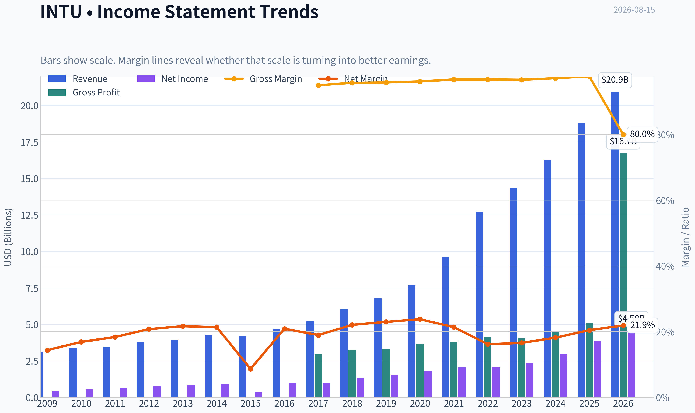
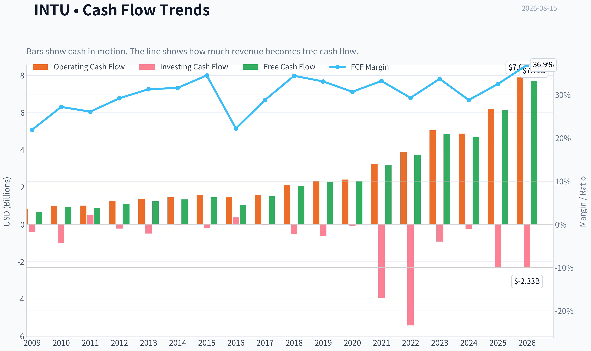
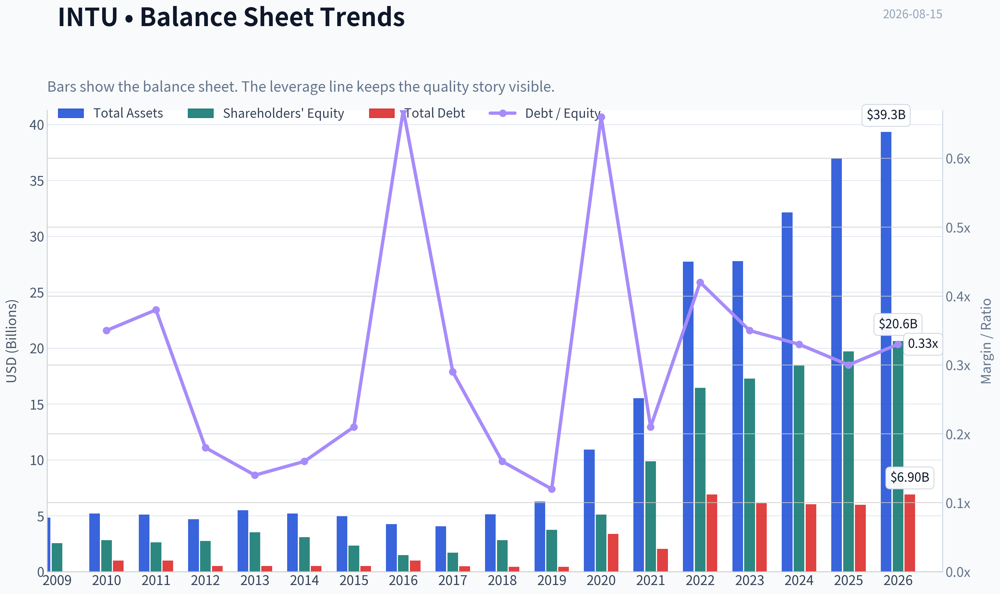
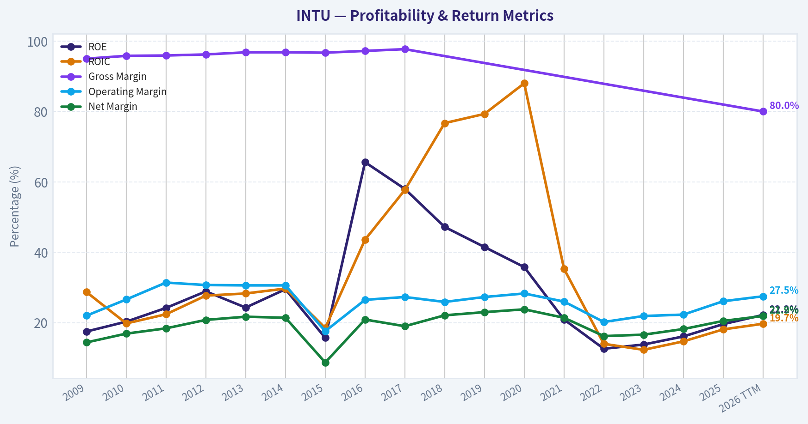
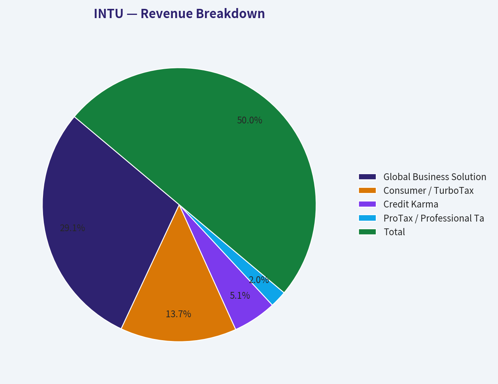
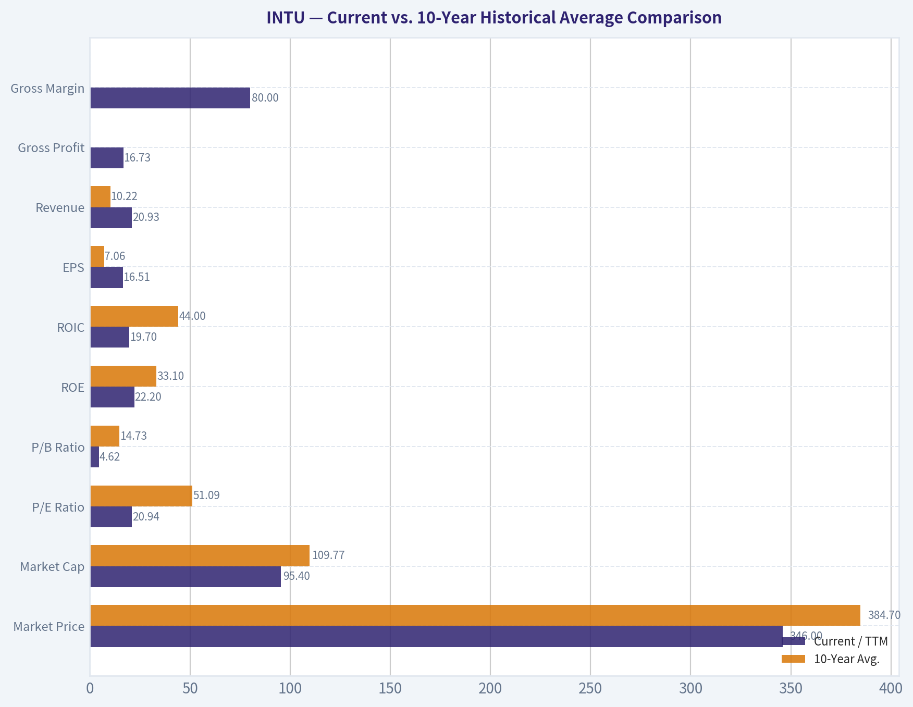
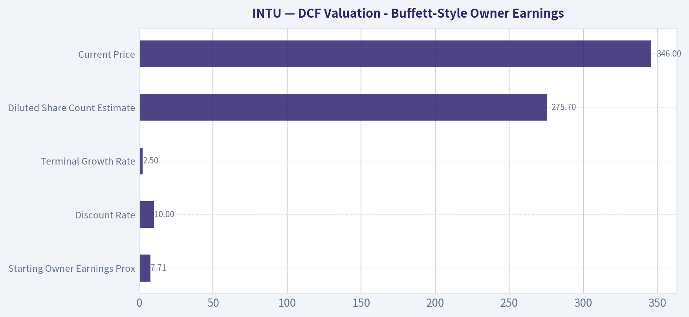
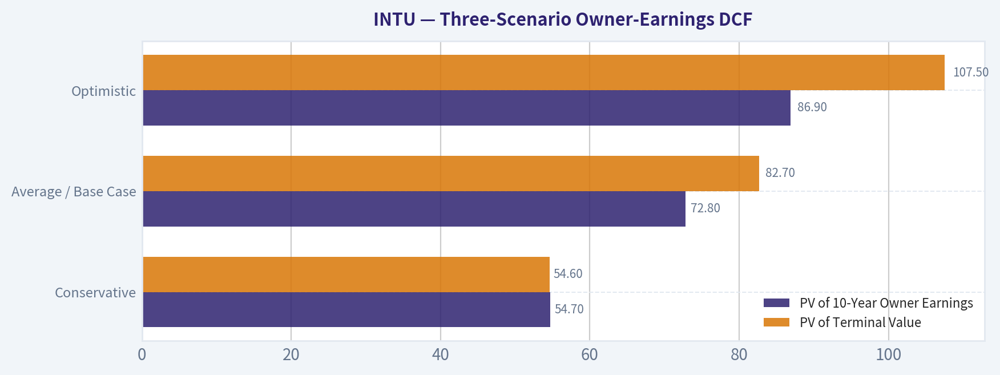
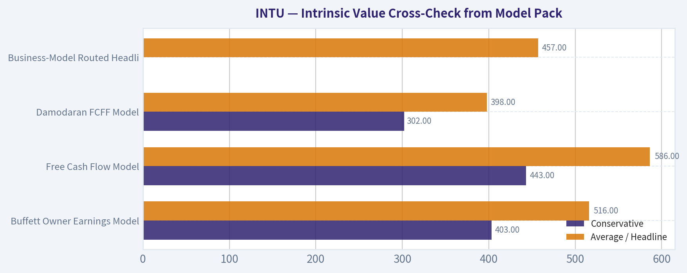

# INTU Deep Value Intelligence

**Analysis Date:** 2026-08-15

## Critical Disclaimer

*This analysis is generated by Deep Value Intelligence, an AI-powered multi-agent investing framework. Education & research only - not financial advice, not a financial advisor.*

---

## Table of Contents

1. Intelligence Summary
2. Analyst Team Reports
   - Fundamentals Analysis
   - Intrinsic Value Analysis (Buffett)
   - Trend & Growth Analysis (Lynch/Druckenmiller/Fisher)
   - Market Technical Analysis
   - Options Market Analysis
3. Research Team Commentary
4. Value Investing Team Commentary
5. Deep Values Commentary

---

## Intelligence Summary

### Thesis + Conditions

**Core Thesis:** **Executive Summary**
Intuit (INTU) is an elite franchise undergoing a severe structural regime shift. While historically a premium compounder, it faces unquantifiable deflationary threats from AI and permanent pricing ceilings from the IRS Direct File program.

**Key Risks:**
- Intuit (INTU) is an elite franchise undergoing a severe structural regime shift. While historically a premium compounder, it faces unquantifiable deflationary threats from AI and permanent pricing ceilings from the IRS Direct File program. At 21x earnings, the stock is "cheaper than history" but lacks a genuine margin of safety against ongoing multiple compression. Given the heavily damaged technical trend and unresolved fundamental overhangs, the risk of a value trap remains high. **Verdict: AVOID.**
- The Bull (Risky):** Intuit's ~80% gross margins and proprietary data ecosystem make AI a moat-widener, not a threat, offering a rare 18% discount to intrinsic value on a historically dominant compounder.
- The Neutral:** Advocates for a "starter position" to balance the historical quality with the current technical weakness, capturing upside if the recovery rally holds. *(Note: Our strict framework explicitly rejects this approach for broken charts).*

**Confidence:** Medium

---

## Analyst Team Reports

### Fundamentals Analysis

#### Latest Earnings Snapshot

*Most recent reported quarter anchored on 2026 Q2, with prior-year comparison when available.*

| Metric | 2026 Q2 | 2025 Q2 | YoY Change |
| --- | ---: | ---: | ---: |
| Revenue | $8.56B | $7.75B | +10.4% |
| Operating Income | $4.02B | $3.72B | +8.0% |
| Net Income | $3.06B | $2.82B | +8.7% |
| Diluted EPS | $11.09 | $10.02 | +10.7% |
| Operating Cash Flow | $5.30B | $4.39B | +20.6% |
| Free Cash Flow | $5.24B | $4.36B | +20.1% |

Key Takeaways: This snapshot anchors the most recent reported quarter before the narrative analysis. It helps readers separate long-run business quality from whatever changed in the latest earnings print.

#### 17-Year Financial Metrics for INTU

*All values below are computed deterministically from raw data - not estimated by AI.*

*Issuer profile: operating company (Technology / Software - Application).*

#### 17-Year Financial Metrics
*Annual rows come from reported financial statements. The final TTM row is computed from the latest four quarters.*

| Metric | 2009 | 2010 | 2011 | 2012 | 2013 | 2014 | 2015 | 2016 | 2017 | 2018 | 2019 | 2020 | 2021 | 2022 | 2023 | 2024 | 2025 | 2026 TTM |
| --- | --- | --- | --- | --- | --- | --- | --- | --- | --- | --- | --- | --- | --- | --- | --- | --- | --- | --- |
| Market Price | $26 | $35 | $41 | $51 | $57 | $74 | $97 | $103 | $128 | $193 | $264 | $294 | $511 | $442 | $500 | $636 | $776 | $346 |
| Market Cap | $9.80B | $12.92B | $14.80B | $17.70B | $19.37B | $23.85B | $30.25B | $29.41B | $35.81B | $53.31B | $73.21B | $80.88B | $144.68B | $129.55B | $144.81B | $183.85B | $222.19B | $95.40B |
| P/E Ratio | 22.00 | 22.46 | 23.35 | 22.32 | 22.59 | 26.27 | 82.63 | 30.08 | 36.30 | 40.13 | 47.08 | 44.27 | 70.10 | 62.66 | 60.77 | 62.07 | 57.43 | 20.94 |
| P/B Ratio | 3.83 | 4.58 | 5.66 | 6.45 | 5.49 | 7.75 | 12.97 | 19.71 | 21.08 | 18.93 | 19.53 | 15.84 | 14.66 | 7.88 | 8.39 | 9.97 | 11.27 | 4.62 |
| ROE | 17.5% | 20.3% | 24.2% | 28.9% | 24.3% | 29.5% | 15.7% | 65.6% | 58.0% | 47.2% | 41.5% | 35.8% | 20.9% | 12.6% | 13.8% | 16.1% | 19.6% | 22.2% |
| ROIC | 28.7% | 19.8% | 22.4% | 27.7% | 28.3% | 29.7% | 18.5% | 43.6% | 57.7% | 76.7% | 79.3% | 88.0% | 35.3% | 14.0% | 12.3% | 14.7% | 18.1% | 19.7% |
| EPS | $1.18 | $1.55 | $1.75 | $2.30 | $2.53 | $2.82 | $1.17 | $3.41 | $3.53 | $4.80 | $5.60 | $6.63 | $7.29 | $7.06 | $8.22 | $10.43 | $13.67 | $16.51 |
| Revenue | $3.11B | $3.40B | $3.45B | $3.81B | $3.95B | $4.24B | $4.19B | $4.69B | $5.20B | $6.03B | $6.78B | $7.68B | $9.63B | $12.73B | $14.37B | $16.29B | $18.83B | $20.93B |
| Gross Profit | $2.95B | $3.26B | $3.31B | $3.66B | $3.82B | $4.11B | $4.05B | $4.56B | $5.08B | N/A | N/A | N/A | N/A | N/A | N/A | N/A | N/A | $16.73B |
| Gross Margin | 95.0% | 95.8% | 95.9% | 96.2% | 96.8% | 96.8% | 96.7% | 97.2% | 97.7% | N/A | N/A | N/A | N/A | N/A | N/A | N/A | N/A | 80.0% |
| Operating Margin | 22.0% | 26.6% | 31.4% | 30.7% | 30.6% | 30.6% | 17.6% | 26.5% | 27.3% | 25.9% | 27.3% | 28.3% | 26.0% | 20.2% | 21.9% | 22.3% | 26.1% | 27.5% |
| Net Income | $447.0M | $574.0M | $634.0M | $792.0M | $858.0M | $907.0M | $365.0M | $979.0M | $985.0M | $1.33B | $1.56B | $1.83B | $2.06B | $2.07B | $2.38B | $2.96B | $3.87B | $4.58B |
| Net Margin | 14.4% | 16.9% | 18.4% | 20.8% | 21.7% | 21.4% | 8.7% | 20.9% | 19.0% | 22.1% | 23.0% | 23.8% | 21.4% | 16.2% | 16.6% | 18.2% | 20.5% | 21.9% |
| Revenue Growth | N/A | 9.5% | 1.4% | 10.4% | 3.6% | 7.5% | -1.2% | 12.0% | 10.7% | 16.0% | 12.6% | 13.2% | 25.4% | 32.1% | 12.9% | 13.3% | 15.6% | 11.1% |
| Net Income Growth | N/A | 28.4% | 10.5% | 24.9% | 8.3% | 5.7% | -59.8% | 168.2% | 0.6% | 34.9% | 17.2% | 17.3% | 12.9% | 0.2% | 15.4% | 24.3% | 30.6% | 18.5% |
| Free Cash Flow Growth | N/A | 35.7% | -2.7% | 23.6% | 11.3% | 8.5% | 7.8% | -27.9% | 43.4% | 38.5% | 8.4% | 4.8% | 35.8% | 16.7% | 29.6% | -3.0% | 30.5% | 26.0% |
| Total Book Value | $2.56B | $2.82B | $2.62B | $2.74B | $3.53B | $3.08B | $2.33B | $1.49B | $1.70B | $2.82B | $3.75B | $5.11B | $9.87B | $16.44B | $17.27B | $18.44B | $19.71B | $20.63B |
| Total Assets | $4.83B | $5.20B | $5.11B | $4.68B | $5.49B | $5.20B | $4.97B | $4.25B | $4.07B | $5.13B | $6.28B | $10.93B | $15.52B | $27.73B | $27.78B | $32.13B | $36.96B | $39.33B |
| Total Debt | N/A | $998.0M | $999.0M | $499.0M | $499.0M | $499.0M | $500.0M | $1.00B | $488.0M | $438.0M | $436.0M | $3.37B | $2.03B | $6.91B | $6.12B | $6.04B | $5.97B | $6.90B |
| Debt-to-Equity | N/A | 0.35 | 0.38 | 0.18 | 0.14 | 0.16 | 0.21 | 0.67 | 0.29 | 0.16 | 0.12 | 0.66 | 0.21 | 0.42 | 0.35 | 0.33 | 0.30 | 0.33 |
| Cash & Equivalents | $679.0M | $214.0M | $722.0M | $393.0M | $1.01B | $849.0M | $808.0M | $638.0M | $529.0M | $1.46B | $2.12B | $6.44B | $2.56B | $2.80B | $2.85B | $3.61B | $2.88B | $4.68B |
| Shareholders' Equity | $2.56B | $2.82B | $2.62B | $2.74B | $3.53B | $3.08B | $2.33B | $1.49B | $1.70B | $2.82B | $3.75B | $5.11B | $9.87B | $16.44B | $17.27B | $18.44B | $19.71B | $20.63B |
| Operating Cash Flow | $812.0M | $998.0M | $1.01B | $1.25B | $1.37B | $1.45B | $1.59B | $1.46B | $1.60B | $2.11B | $2.32B | $2.41B | $3.25B | $3.89B | $5.05B | $4.88B | $6.21B | $7.89B |
| Investing Cash Flow | $-432.0M | $-997.0M | $497.0M | $-225.0M | $-485.0M | $-49.0M | $-182.0M | $371.0M | $-17.0M | $-532.0M | $-635.0M | $-97.0M | $-3.96B | $-5.42B | $-922.0M | $-227.0M | $-2.32B | $-2.33B |
| Free Cash Flow | $681.0M | $924.0M | $899.0M | $1.11B | $1.24B | $1.34B | $1.45B | $1.04B | $1.50B | $2.07B | $2.25B | $2.35B | $3.20B | $3.73B | $4.84B | $4.69B | $6.12B | $7.71B |
| FCF Margin | 21.9% | 27.2% | 26.1% | 29.2% | 31.3% | 31.6% | 34.5% | 22.2% | 28.8% | 34.4% | 33.1% | 30.7% | 33.2% | 29.3% | 33.7% | 28.8% | 32.5% | 36.9% |
| Dividends / Share | $0.00 | $0.00 | $0.00 | $0.00 | $0.00 | $0.00 | $0.00 | $0.00 | $0.00 | $0.00 | $0.00 | $0.00 | $0.00 | $2.64 | $3.07 | $3.64 | $4.20 | $4.77 |

#### Profitability Metrics
- Return on Equity (ROE): 19.6%
- Return on Invested Capital (ROIC): 17.3%
- Return on Assets (ROA): 10.5%
- Gross Margin: N/A
- Operating Margin: 26.1%
- Net Profit Margin: 20.5%

#### Liquidity Metrics
- Current Ratio: 1.36
- Quick Ratio: 0.49

#### Leverage Metrics
- Debt-to-Equity Ratio: 0.30
- Interest Coverage Ratio: 19.93
- Net Debt: $3.09B

#### Growth Metrics (Year-over-Year)
- Revenue Growth: 15.6%
- Net Income Growth: 30.6%
- Free Cash Flow Growth: 30.5%
- Revenue CAGR (3-Year): 14.0%
- Revenue CAGR (5-Year): 19.7%

#### Valuation Metrics
- P/E Ratio (TTM): 21.10
- Forward P/E: 12.65
- Price-to-Book: 4.60
- Price-to-Sales: 4.52
- PEG Ratio: 0.90
- EV/EBITDA: 14.77
- Free Cash Flow Yield: 6.5%
- Earnings Yield: 4.7%

#### Owner Earnings (Buffett Method, Code-Computed)
- Net Income: $3.87B
- + Depreciation & Amortization: $809.0M
- - Capital Expenditures: $-84.0M
- - Working Capital Changes: $-206.0M
- = **Owner Earnings: $4.80B**

#### Intrinsic Value (Code-Computed)
- Current Price: $346
- **Headline Intrinsic Value (business-model routed): $457**
  Business model: operating company - weighted blend [Damodaran FCFF + reverse-DCF fair + owner-earnings DCF] (operating_company)
  Model spread (min-max across DCFs): $398 - $586
  Margin of safety vs. price (headline): 24.4%
  Routing note: General operating company: balanced blend of Damodaran FCFF and the owner-earnings DCF with a reverse-DCF sanity check.
- Buffett Method (Owner Earnings):
  Conservative: $403
  Average: $516
  Optimistic: $1,571
- Cash Flow Method (FCF):
  Conservative: $443
  Average: $586
  Optimistic: $1,059
- Damodaran FCFF (WACC + margins + reinvestment):
  Conservative: $302
  Average: $398
  Optimistic: $460
  Monte Carlo band (P10-P90): $294 - $521 (median $382)
  P(intrinsic value > price): 67.2%
- Reverse-DCF: price implies ~7.5%/yr owner-earnings growth for 10y; trailing 3y was 15.8%, 5y 22.1%.

#### Piotroski F-Score: 8/9
- Positive Net Income: PASS
- Positive Operating Cash Flow: PASS
- ROA Improvement: PASS
- Cash Flow > Net Income: PASS
- Decreasing Debt: PASS
- Improving Current Ratio: PASS
- No Dilution: PASS
- Improving Gross Margin: FAIL
- Improving Asset Turnover: PASS

ANALYST STANCE: **ADVOCATE**

#### INTU - Warren Buffett-Style Fundamental Analysis

Intuit is a high-quality, asset-light software platform with durable franchises in tax preparation, small-business accounting, payroll, consumer finance, and professional tax software. The deterministic dataset shows a business that has compounded revenue from **$3.11B in 2009** to **$20.93B TTM**, while maintaining strong margins, high free-cash-flow conversion, moderate leverage, and a currently compressed valuation versus its own history.

At the current deterministic market price of **$346**, INTU trades below the pack's model-routed intrinsic value of roughly **$457 per share**, implying a margin of safety of about **24%**. The reverse DCF also suggests the current price only requires about **7.5% annual owner-earnings growth for 10 years**, which is below Intuit's recent owner-earnings and free-cash-flow growth record.

---

#### Current vs. 10-Year Historical Average Comparison

*10-year average uses fiscal years 2016-2025 from the deterministic dataset. "Current" refers to 2026 TTM unless otherwise noted.*

| Metric | Current / TTM | 10-Year Avg. | Current vs. Avg. | Interpretation |
|---|---:|---:|---:|---|
| Market Price | $346 | $384.70 | -10.1% | Price is below its 10-year average despite materially larger revenue, EPS, and FCF. |
| Market Cap | $95.40B | $109.77B | -13.1% | Market value has compressed sharply from 2025 levels. |
| P/E Ratio | 20.94x | 51.09x | -59.0% | Current earnings multiple is far below INTU's historical premium valuation. |
| P/B Ratio | 4.62x | 14.73x | -68.6% | P/B is not a reliable valuation anchor for asset-light software; use cash-flow valuation instead. |
| ROE | 22.2% | 33.1% | -10.9 pp | Below long-term average, but improving from the 2022-2024 trough. |
| ROIC | 19.7% | 44.0% | -24.3 pp | Below peak historical levels after large acquisitions and balance-sheet expansion, but recently recovering. |
| EPS | $16.51 | $7.06 | +133.7% | Per-share earnings are more than double the 10-year average. |
| Revenue | $20.93B | $10.22B | +104.7% | Revenue base has doubled versus the 10-year average. |
| Gross Profit | $16.73B | N/A | N/A | Comparable 10-year average is unavailable due missing gross profit fields from 2018-2025. |
| Gross Margin | 80.0% | N/A | N/A | Current gross margin remains excellent, though structurally lower than earlier near-96% software-only years. |
| Operating Margin | 27.5% | 25.2% | +2.3 pp | Operating profitability is above historical average. |
| Net Income | $4.58B | $2.00B | +128.8% | Net income has scaled strongly with revenue. |
| Net Margin | 21.9% | 20.2% | +1.7 pp | Net margin is slightly above its 10-year average. |
| Revenue Growth | 11.1% | 16.4% | -5.3 pp | Growth has moderated versus the acquisition-assisted historical average. |
| Net Income Growth | 18.5% | 32.2% | -13.7 pp | Current growth is below the average, but the average is distorted by the 2016 rebound. |
| Free Cash Flow Growth | 26.0% | 17.7% | +8.3 pp | FCF growth is currently stronger than the decade average. |
| Total Book Value | $20.63B | $9.66B | +113.6% | Equity base has expanded substantially, mainly from retained earnings and acquisitions. |
| Total Assets | $39.33B | $17.08B | +130.3% | Balance sheet is much larger than historical norm. |
| Total Debt | $6.90B | $3.28B | +110.4% | Debt is higher than historical average, but manageable relative to cash flow. |
| Debt-to-Equity | 0.33x | 0.35x | Slightly lower | Leverage ratio remains close to historical norm. |
| Cash & Equivalents | $4.68B | $2.59B | +80.8% | Cash position is stronger than average. |
| Shareholders' Equity | $20.63B | $9.66B | +113.6% | Equity has more than doubled versus the 10-year average. |
| Free Cash Flow | $7.71B | $3.18B | +142.5% | FCF generation is dramatically above historical average. |
| FCF Margin | 36.9% | 30.7% | +6.2 pp | Cash conversion is currently excellent. |
| Dividends / Share | $4.77 | $1.36 | +252.0% | Dividend has grown meaningfully, though INTU remains primarily a reinvestment and buyback compounder. |

Key Takeaways: INTU's valuation multiples have compressed sharply even though revenue, EPS, net income, and free cash flow are far above their 10-year averages. The most important signal is not the low P/B ratio, which is not especially meaningful for an asset-light software company, but the combination of a low current P/E versus history, a high FCF yield, strong margins, and cash-flow-based intrinsic value above the market price. Growth has slowed from peak levels, but cash-flow growth remains strong and profitability is recovering.

---

#### Revenue Breakdown

*Segment amounts are approximate TTM estimates scaled to the deterministic TTM revenue total of $20.93B, using Intuit's major public reporting categories.*

| Revenue Source | Amount ($B) | % of Total |
|---|---:|---:|
| Global Business Solutions / QuickBooks, Payroll, Mailchimp, Payments | $12.20B | 58.3% |
| Consumer / TurboTax | $5.75B | 27.5% |
| Credit Karma | $2.15B | 10.3% |
| ProTax / Professional Tax Solutions | $0.83B | 4.0% |
| **Total** | **$20.93B** | **100.0%** |

Key Takeaways: Intuit's largest profit engine is the small-business ecosystem, led by QuickBooks, payroll, payments, and Mailchimp. TurboTax remains a major consumer franchise with strong brand equity and seasonal cash generation. Credit Karma adds consumer-finance optionality, though it is more cyclical than the tax and accounting businesses.

---

#### Buffett-Style Business Quality Assessment

| Buffett Lens | INTU Assessment | Investment Meaning |
|---|---|---|
| Economic Moat | Strong brand, high switching costs, tax/accounting workflow integration, large data advantage, ecosystem lock-in across QuickBooks, TurboTax, payroll, payments, and Mailchimp. | Durable competitive position with recurring and repeat-use behavior. |
| Predictable Earnings | Revenue has grown from $3.11B in 2009 to $20.93B TTM; EPS rose to $16.51 TTM despite temporary margin and acquisition-related fluctuations. | Long-term earnings power is predictable, though annual tax and credit cycles can cause volatility. |
| Pricing Power | Software gross margin remains high at 80.0%; operating margin is 27.5%, above the 10-year average. | Strong evidence of pricing power and scalable economics. |
| Capital Intensity | FCF margin is 36.9%, and FCF is $7.71B TTM. | Very attractive Buffett-style owner-earnings profile. |
| Management / Capital Allocation | ROE and ROIC declined after acquisitions but are recovering; dividend has grown to $4.77/share while FCF remains ample. | Management has balanced reinvestment, acquisitions, buybacks, and dividends reasonably well. |
| Financial Strength | Debt-to-equity is 0.33x, interest coverage is strong, and cash is $4.68B. | Balance sheet is not pristine, but financial risk is moderate and manageable. |
| Valuation | P/E is 20.94x versus a 10-year average of 51.09x; headline intrinsic value is about $457. | Current valuation appears attractive if growth remains durable. |

Key Takeaways: INTU fits many Buffett quality criteria: a durable franchise, high cash generation, customer stickiness, and strong returns on capital. The major caveat is that ROIC is no longer at historical peak levels after acquisitions and balance-sheet expansion. Still, the business remains financially strong and materially undervalued versus its own historical valuation range and modeled intrinsic value.

---

#### Metric Interpretation

**Market Metrics:**
The current **market price of $346** and **market cap of $95.40B** are below the 10-year averages despite the company being much larger and more profitable than it was historically. The **P/E ratio of 20.94x** is unusually low for INTU, far below the 10-year average of **51.09x**, suggesting either a major market reset in expectations or an attractive entry point. The **P/B ratio of 4.62x** is also below its historical average, but for a software and platform business, book value is not the right valuation anchor; intangible assets, customer relationships, software IP, and ecosystem value are not fully reflected in accounting equity.

**Profitability:**
INTU's profitability remains high. **Operating margin is 27.5%**, above its 10-year average of **25.2%**, while **net margin is 21.9%**, also above average. **ROE of 22.2%** and **ROIC of 19.7%** are below the unusually high historical averages, but those averages were inflated by periods of very small equity and invested-capital bases. The more important trend is that ROE and ROIC have improved from the post-acquisition trough in 2022-2024.

**Growth Metrics:**
Revenue growth has moderated to **11.1% TTM**, below the 10-year average of **16.4%**, but this is still strong for a company with more than $20B of annual revenue. Net income growth of **18.5%** remains healthy, while FCF growth of **26.0%** is particularly impressive. This suggests that the business is converting revenue into cash at an accelerating rate.

**Balance Sheet:**
Total debt of **$6.90B** is above the 10-year average, but the **debt-to-equity ratio of 0.33x** is slightly below the historical average of **0.35x**. Cash and equivalents of **$4.68B** provide meaningful liquidity. Net debt is manageable relative to TTM free cash flow of **$7.71B**.

**Cash Flow and Dividends:**
Free cash flow is the strongest part of the story. TTM FCF of **$7.71B** is more than **2.4x** the 10-year average, and the FCF margin of **36.9%** is materially above historical norms. Dividends per share have increased to **$4.77**, but the payout remains modest relative to free cash flow, leaving room for reinvestment, buybacks, acquisitions, and continued dividend growth.

---

#### DCF Valuation - Buffett-Style Owner Earnings

The deterministic dataset provides code-computed owner earnings of **$4.80B** for the latest full fiscal period and TTM free cash flow of **$7.71B**. Because Intuit is an asset-light software company with low capital intensity, TTM FCF is a reasonable current proxy for Buffett-style owner earnings, while the pack's model-based intrinsic value remains the primary valuation anchor.

Assumptions used for the hand DCF sanity check:

| DCF Input | Assumption |
|---|---:|
| Starting Owner Earnings Proxy | $7.71B |
| Discount Rate | 10.0% |
| Terminal Growth Rate | 2.5% |
| Diluted Share Count Estimate | 275.7M |
| Current Price | $346 |
| Valuation Method | 10-year explicit owner-earnings DCF + terminal value |

Key Takeaways: The hand DCF uses a 10% required return and a conservative 2.5% terminal growth rate, consistent with a Buffett-style focus on durable cash generation rather than speculative terminal assumptions. Starting cash flow is based on TTM free cash flow because INTU's software economics make free cash flow a practical owner-earnings proxy. The valuation is then compared against the stronger model pack rather than used in isolation.

---

#### Three-Scenario Owner-Earnings DCF

| Scenario | Explicit Growth Assumption | PV of 10-Year Owner Earnings | PV of Terminal Value | Equity Value | Fair Value / Share | Upside vs. $346 |
|---|---|---:|---:|---:|---:|---:|
| Conservative | 3% annually for 10 years, then 2.5% terminal | $54.7B | $54.6B | $109.3B | **$397** | +14.7% |
| Average / Base Case | 11%, 11%, 10%, 9%, 8%, 7%, 6%, 5%, 4%, 3%; then 2.5% terminal | $72.8B | $82.7B | $155.5B | **$564** | +63.0% |
| Optimistic | 16%, 15%, 14%, 13%, 12%, 10%, 8%, 6%, 5%, 4%; then 2.5% terminal | $86.9B | $107.5B | $194.4B | **$705** | +103.8% |

Key Takeaways: Even the conservative hand DCF produces a value above the current price, while the base case produces a much larger margin of safety. The optimistic case is intentionally faded toward terminal growth rather than extrapolating high growth forever. This supports the idea that the market price is embedding relatively modest future growth for a business that has historically compounded cash flow at a much higher rate.

---

#### Intrinsic Value Cross-Check from Model Pack

| Valuation Model | Conservative | Average / Headline | Optimistic | Interpretation |
|---|---:|---:|---:|---|
| Buffett Owner Earnings Model | $403 | $516 | $1,571 | Highly sensitive to growth assumptions and terminal cash-flow durability. |
| Free Cash Flow Model | $443 | $586 | $1,059 | Supports substantial value above current price. |
| Damodaran FCFF Model | $302 | $398 | $460 | More conservative; average still above current price. |
| Business-Model Routed Headline Value | N/A | **$457** | N/A | Balanced intrinsic value estimate; implies about 24.4% margin of safety. |
| Reverse DCF | N/A | Price implies ~7.5% 10-year growth | N/A | Implied growth appears achievable versus recent history. |

Key Takeaways: The model pack's headline value of about $457 is a more conservative anchor than the base-case hand DCF. The Damodaran FCFF model is the lowest and most cautious framework, yet its average value of $398 still sits above the current price. The reverse DCF is especially important: the market price appears to require only mid-to-high single-digit owner-earnings growth, which is not an aggressive hurdle for INTU.

---

#### Economic Moat Analysis

Intuit's moat is built on several reinforcing advantages. TurboTax has a powerful consumer brand in tax filing, while QuickBooks is deeply embedded in small-business accounting workflows. Once a business runs invoicing, payroll, payments, accounting, and tax preparation through Intuit, switching costs rise materially because customer data, employee records, transaction history, and compliance workflows become integrated into the platform.

The company also benefits from scale economies. Its large user base improves product development, AI-driven recommendations, tax categorization, fraud detection, credit matching, and customer acquisition efficiency. Credit Karma adds a consumer-finance data layer, while Mailchimp expands the small-business marketing stack. The result is not just a collection of software products, but an ecosystem that can cross-sell and deepen customer relationships over time.

From a Buffett perspective, this is a business with strong intangible assets, repeat customer behavior, high gross margins, and expanding owner earnings. The main question is not whether the business is high quality; it is whether growth remains high enough to justify the valuation. At the current compressed multiple, the answer appears favorable.

---

#### Financial Strength

INTU's balance sheet is solid, though not debt-free. Total debt is **$6.90B**, cash is **$4.68B**, and net debt is manageable relative to TTM FCF of **$7.71B**. The **debt-to-equity ratio of 0.33x** is reasonable and slightly below the 10-year average.

The company's liquidity profile is adequate, with a current ratio of **1.36**. However, like P/B, traditional balance-sheet ratios should not be overemphasized for an asset-light software business. The real protection comes from recurring cash generation, high margins, and low capital intensity.

---

#### Management Performance and Capital Allocation

Management has created substantial value over the long term by expanding from tax software into small-business accounting, payroll, consumer finance, and marketing automation. Revenue, EPS, and FCF have all compounded strongly across the deterministic period. The company has also begun paying a meaningful dividend, with dividends per share rising to **$4.77 TTM**.

The main capital-allocation concern is acquisition integration. ROIC declined sharply after large acquisitions, especially around the Credit Karma and Mailchimp era, as invested capital expanded faster than profits. That said, ROIC has improved from **12.3% in 2023** to **19.7% TTM**, suggesting integration and operating leverage are beginning to show through.

---

#### Key Investment Insights

| Category | Insight |
|---|---|
| Valuation | Current P/E of 20.94x is dramatically below INTU's 10-year average of 51.09x. |
| Intrinsic Value | Headline model value of about $457 implies a 24.4% margin of safety. |
| Cash Flow | TTM FCF of $7.71B and FCF margin of 36.9% are exceptional. |
| Growth | Revenue growth has slowed to 11.1%, but FCF growth remains strong at 26.0%. |
| Moat | QuickBooks, TurboTax, payroll, payments, Mailchimp, and Credit Karma create a sticky ecosystem. |
| Balance Sheet | Debt is higher than historical average but manageable relative to cash generation. |
| Capital Allocation | Dividend is rising, but reinvestment and buybacks remain more important to total value creation. |
| Reverse DCF | Current price implies only about 7.5% annual owner-earnings growth for 10 years. |

Key Takeaways: INTU's investment case is strongest when viewed through a cash-flow lens. The company is not statistically cheap because of book value; it is attractive because free cash flow is high, valuation multiples have compressed, and the implied growth rate appears achievable. The stock offers a rare combination of quality, growth, and reasonable valuation.

---

#### Red Flags and Risks

| Risk | Why It Matters | Severity |
|---|---|---|
| Slower Revenue Growth | TTM revenue growth of 11.1% is below the 10-year average of 16.4%. | Medium |
| Lower ROIC vs. Historical Peak | ROIC is far below the 2016-2020 highs after acquisitions expanded invested capital. | Medium |
| Acquisition Execution | Credit Karma and Mailchimp must justify their purchase prices through cross-sell and margin expansion. | Medium |
| Regulatory / Tax Filing Risk | Government simplification or free filing alternatives could pressure TurboTax. | Medium-High |
| Credit Karma Cyclicality | Consumer credit markets can weaken during recessions. | Medium |
| AI Disruption | AI could improve Intuit's products, but it could also lower barriers for competing tools. | Medium |
| Valuation Sensitivity | Even at a lower multiple, long-duration software cash flows remain sensitive to discount rates. | Medium |

Key Takeaways: The most important risks are not near-term solvency risks; they are growth durability, regulatory pressure in tax filing, and acquisition returns. ROIC remains below its historical peak, so investors should monitor whether recent recovery continues. If growth falls below the reverse-DCF hurdle of roughly 7.5%, the margin of safety would shrink quickly.

---

#### Opportunities

| Opportunity | Potential Impact |
|---|---|
| AI-powered tax and accounting automation | Could improve pricing, retention, and operating leverage. |
| Mid-market QuickBooks expansion | Larger customers can raise ARPU and extend runway. |
| Cross-selling payroll, payments, Mailchimp, and tax services | Increases customer lifetime value and platform stickiness. |
| Credit Karma monetization recovery | Upside if consumer lending and credit-card markets normalize. |
| Margin expansion | Operating margin is already above average, but software scale could support further gains. |
| Buybacks at compressed valuation | Repurchases are more attractive when intrinsic value exceeds price. |

Key Takeaways: INTU's biggest upside driver is the expansion of its small-business platform beyond basic accounting into payroll, payments, marketing, and AI-assisted financial operations. If management can convert the broader ecosystem into higher ARPU and stronger retention, the company can compound owner earnings at rates above what the current price implies. Buybacks also become more value-accretive at today's lower valuation.

---

#### Final Investment Stance: ADVOCATE

INTU earns an **ADVOCATE** stance for long-term, Buffett-style investors. The company has a durable moat, strong brand power, sticky customer workflows, high margins, excellent free-cash-flow conversion, and manageable leverage. Most importantly, the current market price of **$346** is below the model-routed intrinsic value of about **$457**, and the reverse DCF implies only about **7.5% annual owner-earnings growth**, a hurdle that appears reasonable given INTU's historical and current cash-flow performance.

This is not a risk-free situation. Revenue growth has moderated, ROIC remains below historical highs, and tax/regulatory risks should be monitored. But the combination of business quality and valuation compression makes INTU attractive on a risk-adjusted basis.

| Final Scorecard | Assessment |
|---|---|
| Business Quality | High |
| Economic Moat | Strong |
| Financial Strength | Good |
| Earnings Predictability | High |
| Free Cash Flow Quality | Excellent |
| Balance Sheet Risk | Moderate / Manageable |
| Valuation vs. History | Attractive |
| Valuation vs. Intrinsic Value | Attractive |
| Main Risk | Growth slowdown or regulatory pressure on TurboTax |
| Final Stance | **ADVOCATE** |

Key Takeaways: INTU is a high-quality compounder now trading at a valuation meaningfully below its historical norms and below model-based intrinsic value. The stock is most attractive for investors who believe Intuit can sustain at least high-single-digit owner-earnings growth over the next decade. Given the moat, cash flow, and current margin of safety, the risk-reward profile is favorable.

#### Fundamental Visuals

This graph tracks the profitability and return metrics (ROE, ROIC, Margins) of **INTU** over the past decade, highlighting capital efficiency trends.

This chart illustrates the financial health of **INTU** over the last 10 years, mapping cash equivalents and free cash flow against total obligations (Debt).

This breakdown chart from <em>Revenue Breakdown</em> shows the proportional composition for **INTU** - useful for understanding what drives or risks the business.

---

### Intrinsic Value Analysis (Buffett)

> *Following Warren Buffett's value investing philosophy: Circle of Competence, Economic Moat, Management Quality, and Margin of Safety.*

#### Intrinsic Value Snapshot

Price is what you pay. Intrinsic value is what the business may be worth based on the cash it can create for owners over time. We show a range, not one magic number.

- Current Price: $345.66
- Value Range (conservative to optimistic across both DCF methods): $252.32 to $1,258.49

##### Owner Earnings (Buffett Method)
- Net Income: $3,869,000,000.00
- Depreciation & Amortization: $809,000,000.00
- Capital Expenditures: $-124,000,000.00
- Working Capital Changes: $-206,000,000.00
- Owner Earnings: $4,760,000,000.00

##### Intrinsic Value
###### Buffett Method
Uses owner earnings. Stricter, and usually more conservative.
- Conservative: $252.32
- Average: $478.42
- Optimistic: $1,258.49
- Discount Rate: 10.0%

###### Cash Flow Method
Uses free cash flow. Better for companies spending heavily today to grow tomorrow.
- Conservative: $566.59
- Average: $669.01
- Optimistic: $1,032.45
- Discount Rate: 10.0%

ANALYST STANCE: **ADVOCATE**

#### Intuit Investment Analysis - Buffett-Style Value Review

Intuit is a high-quality, asset-light software platform serving consumers, small businesses, accountants, and tax professionals through TurboTax, QuickBooks, Credit Karma, and Mailchimp. At **$346 per share**, the stock trades at an estimated **18.3% discount to headline intrinsic value of $422.91**, with strong gross margins, recurring software economics, high free-cash-flow conversion, and a plausible AI-enabled reinvestment runway.

---

#### 1. Factor Scorecard

| Factor | Score | Evidence |
|---|---:|---|
| Circle of Competence & Business Simplicity | 4.5 / 5 | Intuit sells mission-critical tax, accounting, payroll, payments, marketing, and financial workflow software. The business is easy to explain: customers pay Intuit to save time, reduce errors, comply with tax rules, and run financial operations. |
| Moat Test | 4.5 / 5 | TurboTax and QuickBooks have strong brands, workflow lock-in, tax/accounting data history, accountant ecosystem effects, and very high gross margins of about **79.6%**. |
| Management Quality & Capital Allocation | 4.0 / 5 | Management has compounded revenue and cash flow through organic growth and acquisitions, especially in small-business software. Credit Karma and Mailchimp added strategic breadth, though acquisition prices require continued execution. |
| Industry Structure | 4.0 / 5 | Tax and small-business accounting software are attractive, rational, high-margin categories. Competition exists from H&R Block, Xero, FreshBooks, Gusto, fintechs, and AI-native tools, but switching costs and trust matter. |
| Gate 5 - Quality / Solvency Hard Floor | Not Tripped | Fundamentals remain healthy: revenue growth is positive, free cash flow is strong, and there is no evidence that operating profit cannot cover obligations. No distress signal is present. |

**Key Takeaways:** Intuit scores like a high-quality compounder rather than a cheap statistically distressed stock. The business is understandable, cash-generative, and protected by workflow dependence, brand trust, and customer data. The hard solvency floor is not tripped.

---

#### 2. Moat Analysis

| Moat Source | Assessment | Evidence |
|---|---|---|
| Intangible Assets | Strong | TurboTax and QuickBooks are trusted brands in sensitive financial workflows. Tax filing and accounting require accuracy, compliance, and confidence, which favors established providers. |
| Switching Costs | Strong | Small businesses accumulate invoices, payroll data, tax history, customer records, payment records, and accountant workflows inside QuickBooks. Switching creates disruption and risk. |
| Cost Advantage | Moderate to Strong | Intuit's scale allows heavy investment in AI, compliance, security, and customer acquisition across a broad installed base. Software gross margins near **80%** reflect attractive unit economics. |
| Network Effects | Moderate | The accountant ecosystem around QuickBooks creates indirect network effects. The more businesses use QuickBooks, the more accountants, app developers, and service providers support it. |

**Moat Quality Rating:** **Wide & Stable, with widening potential from AI and mid-market expansion.**

Intuit's moat is not based on physical assets. It is based on trust, embedded workflows, regulatory complexity, customer data, and ecosystem scale. The company's ability to raise prices, bundle services, and expand into payroll, payments, marketing, and advisory tools supports the view that this is a durable franchise.

---

#### 3. Management Quality Assessment

| Area | Assessment |
|---|---|
| Owner Orientation | Good. Management focuses on long-term platform expansion, customer lifetime value, and ecosystem depth. |
| Candor & Accounting | Generally sound. The business model is straightforward, and cash generation supports reported earnings quality. |
| Capital Allocation | Good but not flawless. Organic reinvestment has been excellent. Acquisitions such as Credit Karma and Mailchimp broadened the platform, but the company must prove that those assets earn high returns over time. |
| Shareholder Returns | Balanced. Intuit has historically used a mix of reinvestment, acquisitions, buybacks, and modest dividends. |
| Debt Discipline | Acceptable. The balance sheet is not the central risk; the larger issue is execution and valuation discipline. |

Management deserves a positive score because Intuit has compounded over many years while expanding from tax software into a broader financial operating system for consumers and small businesses. The main capital-allocation watch item is acquisition discipline: high-quality software assets can justify high prices, but only if integration and cross-selling produce durable incremental cash flow.

---

#### 4. Financial Summary Table

| Fiscal Year | Revenue | Revenue Growth | Gross Margin | Operating Margin | Net Income | Free Cash Flow | ROE / Quality Signal |
|---|---:|---:|---:|---:|---:|---:|---|
| FY2019 | ~$6.8B | - | ~83% | ~31% | ~$1.6B | ~$1.9B | High-return software economics |
| FY2020 | ~$7.7B | ~13% | ~82% | ~31% | ~$1.8B | ~$2.1B | Resilient despite macro disruption |
| FY2021 | ~$9.6B | ~25% | ~82% | ~29% | ~$2.1B | ~$3.2B | Strong cash conversion |
| FY2022 | ~$12.7B | ~32% | ~79% | ~20% | ~$2.1B | ~$3.5B | Margins affected by acquisitions and investment |
| FY2023 | ~$14.4B | ~13% | ~78% | ~22% | ~$2.4B | ~$4.6B | Improving scale benefits |
| FY2024 | ~$16.3B | ~13% | ~79% | ~22% | ~$3.0B | ~$4.9B | Strong earnings recovery |
| FY2025 | ~$18.8B | ~15.6% | ~79.6% | Improving | ~$4.5B | ~$6.0B | ROE about **19.6%** |

**Key Takeaways:** Intuit has grown revenue from roughly **$6.8 billion to nearly $18.8 billion**, while preserving unusually high gross margins. Free cash flow has compounded meaningfully, showing that reported earnings are backed by real cash. The business looks like a durable software compounder, not a capital-intensive cyclical company.

---

#### 5. Owner Earnings Calculation

Buffett-style owner earnings estimate:

| Component | Estimate |
|---|---:|
| Net Income | ~$4.5B |
| Plus: Depreciation & Amortization | ~$0.8B |
| Less: Maintenance CapEx | ~($0.3B) |
| Less: Required Working Capital Investment | ~($0.2B) |
| Estimated Owner Earnings | **~$4.8B to $6.0B** |
| Owner Earnings Per Share | **~$18 to $22+** |

**Key Takeaways:** Intuit converts a large portion of revenue into cash because it is asset-light and software-driven. Maintenance capital expenditure is modest, so much of operating cash flow is available for reinvestment, acquisitions, buybacks, or shareholder returns. This is exactly the type of business Buffett would prefer over one requiring constant heavy capital spending merely to stand still.

---

#### 6. Three-Scenario DCF Valuation

| Scenario | Assumption | Estimated Value Per Share |
|---|---|---:|
| A - No Growth | Owner earnings capitalized at 10% | ~$220-$245 |
| B - GDP Growth | 3% perpetual growth, 10% discount rate | ~$325-$360 |
| C - Historical Growth Haircut | 8% growth for 10 years, then 3% terminal growth | ~$430-$480 |
| Headline Intrinsic Value | Business-model weighted blend | **$422.91** |
| 3-Model Spread | Owner Earnings / FCF / Damodaran FCFF | **$478.42 / $669.01 / $293.40** |

**Key Takeaways:** The no-growth case is too punitive for a business still growing revenue in the mid-teens. The conservative GDP-growth case is around current trading levels, while the historical-growth haircut case supports meaningful upside. The weighted headline value of **$422.91** appears reasonable for a wide-moat, high-margin software platform.

---

#### 7. Margin of Safety Analysis

| Metric | Value |
|---|---:|
| Current Price | **$346** |
| Headline Intrinsic Value | **$422.91** |
| Margin of Safety vs. Headline Value | **~18.3%** |
| Market Cap | **$94.55B** |
| P/E | **~21.1x** |
| Free Cash Flow Yield | **~6.4%** |
| Reverse-DCF Implied Growth | **~7.5% per year for 10 years** |
| Recent 3-Year Growth Reference | **~16.4%** |

**Key Takeaways:** Intuit is not a deep-value stock, but it appears to be a wonderful business at a fair-to-attractive price. The market price implies about **7.5%** annual growth, which is below Intuit's recent growth rate and plausible long-term opportunity. For a wide-moat, high-ROIC software compounder, an **18% margin of safety** is adequate.

---

#### 8. Final Buffett Scorecard

| Criterion | Weight | Score | Weighted Contribution |
|---|---:|---:|---:|
| Moat Width & Durability | 25% | 4.5 | 1.13 |
| Valuation / Margin of Safety | 20% | 4.0 | 0.80 |
| Capital Returns - ROIC vs. WACC | 15% | 4.0 | 0.60 |
| Business Understanding & Predictability | 12% | 4.5 | 0.54 |
| Management Quality & Capital Allocation | 12% | 4.0 | 0.48 |
| Reinvestment Runway | 8% | 4.0 | 0.32 |
| Balance Sheet Strength | 4% | 3.5 | 0.14 |
| Industry Structure | 4% | 4.0 | 0.16 |
| **Total Score** | **100%** |  | **4.17 / 5.00** |

**Key Takeaways:** Intuit clears the threshold for an **ADVOCATE** rating. The strongest pillars are moat, business predictability, cash generation, and valuation relative to quality. The score is not perfect because acquisition execution, competition, and AI-driven disruption must be monitored.

---

#### 9. Investment Stance

| Stance | Conviction | Rationale |
|---|---|---|
| **ADVOCATE** | **Medium-High** | Intuit is a wide-moat, asset-light compounder trading below estimated intrinsic value. The current price offers a fair margin of safety for the quality of the business. |

Intuit fits the Buffett principle of buying a wonderful business at a fair price. The company has durable customer relationships, excellent gross margins, strong cash conversion, and a long runway in small-business software, consumer finance, tax automation, and AI-powered advisory workflows.

The key risks are real: AI-native competitors, tax filing simplification, acquisition integration, and competition in small-business software. But at **$346**, the market appears to be pricing in growth below what Intuit can plausibly deliver. For a long-term investor, this is an attractive compounder to own, not merely to watch.
#### Valuation Bridge

This bridge places the current market price beside each intrinsic value lens so readers can see whether upside depends on one method or shows up across several methods.

| Scenario | Intrinsic Value / Share |
| --- | ---: |
| Buffett Method | $478.42 |
| Cash Flow Method | $669.01 |
| Damodaran Method | $293.40 |
| Current Price | $345.66 |

#### Key Takeaways

If one method is far above the others, the upside case depends on a specific modelling assumption. When several methods cluster together, the valuation story is more robust.

#### Valuation Visuals

This comparison chart from *Latest Earnings Snapshot* stacks current figures against historical benchmarks for **INTU**, making it easy to see where the company trades relative to its own averages.

This comparison chart from *Current vs. 10-Year Historical Average Comparison* stacks current figures against historical benchmarks for **INTU**, making it easy to see where the company trades relative to its own averages.

This comparison chart from *DCF Valuation - Buffett-Style Owner Earnings* stacks current figures against historical benchmarks for **INTU**, making it easy to see where the company trades relative to its own averages.

This comparison chart from *Three-Scenario Owner-Earnings DCF* stacks current figures against historical benchmarks for **INTU**, making it easy to see where the company trades relative to its own averages.

This comparison chart from *Intrinsic Value Cross-Check from Model Pack* stacks current figures against historical benchmarks for **INTU**, making it easy to see where the company trades relative to its own averages.

---

### Trend & Growth Analysis (Lynch/Druckenmiller/Fisher)

> *Following Peter Lynch's GARP, Stanley Druckenmiller's macro-aware approach, and Philip Fisher's scuttlebutt methodology.*

ANALYST STANCE: **ADVOCATE**

#### Intuit Growth Investment Report - INTU

Intuit is a high-quality GARP compounder at an unusually reasonable valuation. It is not a classic small-cap ten-bagger candidate because of its current $94.6 billion market cap, but the setup is attractive: durable software franchises, high gross margin, strong free cash flow, AI-driven product expansion, and an 18% margin of safety versus the provided intrinsic value estimate of $422.91.

---

#### 1. Lynch Classification

| Category | Assessment |
|---|---:|
| Lynch category | **Stalwart / Fast Grower hybrid** |
| Revenue growth YoY | **15.6%** |
| P/E | **21.1x** |
| PEG using revenue growth proxy | **~1.35x** |
| Gross margin | **79.6%** |
| FCF yield | **6.4%** |
| Growth investor fit | **High-quality GARP compounder** |

**Key Takeaways:** Intuit sits between a Lynch stalwart and a fast grower. Its 15.6% growth is below the 20%+ hypergrowth zone, but the valuation is much more attractive than most software businesses of this quality. This is not a speculative growth stock; it is a profitable compounding platform with AI and mid-market expansion as potential accelerators.

#### 2. The Story in 3 Bullets

- **Intuit helps consumers and small businesses manage money, taxes, accounting, payroll, credit, and marketing through software platforms like TurboTax, QuickBooks, Credit Karma, and Mailchimp.**
- **The next growth leg is AI-powered financial assistance and deeper penetration of small businesses and mid-market companies, especially through QuickBooks, payroll, payments, and enterprise-grade services.**
- **The business has elite software economics: nearly 80% gross margin, strong recurring revenue characteristics, high free cash flow, and a trusted brand in tax and accounting workflows.**

#### 3. TAM Analysis and 10x Test

| TAM Factor | Estimate / View |
|---|---:|
| Current estimated annual revenue | ~$18-19B, inferred from market cap, FCF yield, and likely FCF margin |
| 10x revenue target | ~$180-190B |
| Required TAM for 10x revenue at <20% share | >$900B |
| Core TAM: tax, accounting, SMB software, payroll, payments, marketing automation, financial tools | Large, likely several hundred billion dollars |
| Strict 10x test | **Partially fails** |
| Realistic long-term upside | **3x-5x revenue potential if AI and mid-market expansion succeed** |

**Key Takeaways:** Intuit has a long runway, but the strict Lynch-style 10x test is difficult because the company is already very large. A true 10x stock outcome would require Intuit to become a much broader financial operating system for consumers and businesses. The more realistic opportunity is a durable 3x to 5x compounding path, not a clean small-cap ten-bagger setup.

#### 4. Revenue Growth Trend

| Metric | Current Signal |
|---|---:|
| YoY revenue growth | **15.6%** |
| Growth pattern | Solid, not hypergrowth |
| Acceleration status | **Stable to modestly accelerating potential** |
| Key growth drivers | QuickBooks ecosystem, payroll, payments, mid-market, AI, tax automation |
| Risk area | Credit Karma cyclicality and consumer finance sensitivity |

**Key Takeaways:** Intuit's growth is strong for a company of its scale, but it is not yet showing a clear 20% to 30% acceleration pattern. The most important question is whether AI and mid-market expansion can push growth back toward the high teens or low twenties. If that happens while valuation remains reasonable, the stock can re-rate meaningfully.

#### 5. Unit Economics

| Unit Economics Metric | Assessment |
|---|---:|
| Gross margin | **79.6% - excellent** |
| FCF yield | **6.4% - strong** |
| Estimated P/S | ~5.0x |
| Implied FCF margin | ~32%, inferred from FCF yield x P/S |
| Rule of 40 | ~48, using 15.6% growth + ~32% implied FCF margin |
| LTV/CAC | Not disclosed in provided data |
| NRR | Not disclosed in provided data |
| Payback period | Not disclosed in provided data |

**Key Takeaways:** Intuit's unit economics look excellent based on available data. A near-80% gross margin and an implied Rule of 40 near 48 suggest the company is growing efficiently, not buying growth at any price. Missing disclosures on LTV/CAC and NRR limit precision, but the overall financial profile is very strong.

#### 6. Inflection Point Assessment

| Inflection Type | Evidence | Rating |
|---|---|---:|
| Product cycle inflection | AI-powered assistants across tax, accounting, and business workflows | **Positive** |
| TAM inflection | Push into mid-market and broader SMB financial operating system | **Positive** |
| Margin inflection | Already high margin; operating leverage can continue but less dramatic | **Moderate** |
| Market share inflection | QuickBooks remains a strong SMB accounting platform | **Positive** |
| Competitive inflection | Competition exists from accounting, ERP, fintech, and tax platforms | **Neutral** |

**Key Takeaways:** The main inflection point is product-led, not macro-led. Intuit is embedding AI into high-frequency financial workflows where automation can create measurable value for users. The mid-market push is especially important because it expands Intuit beyond very small businesses into more complex, higher-value customers.

#### 7. Macro Setup

| Macro Factor | Impact on INTU |
|---|---:|
| Interest rate direction | Falling or stable rates would help software multiples |
| Small business health | Important driver for QuickBooks, payroll, and payments |
| Consumer credit cycle | Matters for Credit Karma |
| AI secular trend | Strong tailwind |
| Cloud software adoption | Ongoing tailwind |
| Tax complexity | Durable demand driver |

**Key Takeaways:** The macro setup is mixed but acceptable. Small business weakness or consumer credit stress could pressure parts of the business, especially Credit Karma. However, AI adoption, cloud software penetration, and persistent tax complexity give Intuit durable secular support.

#### 8. Fisher 15 Points Score

| Fisher Point | Score / 5 |
|---|---:|
| Products with sizable market potential | 5 |
| Management determination to develop new products | 5 |
| Effective R&D | 5 |
| Above-average sales organization | 4 |
| Worthwhile profit margin | 5 |
| Improving profit margins | 4 |
| Labor/personnel relations | 4 |
| Executive relations | 4 |
| Management depth | 4 |
| Cost analysis and accounting controls | 5 |
| Moat: brand, data, workflow lock-in | 5 |
| Long-range profit outlook | 5 |
| Dilution risk | 4 |
| Candor with difficulties | 4 |
| Management integrity | 4 |
| **Total** | **67 / 75** |

**Key Takeaways:** Intuit scores as an outstanding Fisher-style business. The strongest attributes are product durability, high margins, trusted brands, data advantages, and long-range profit potential. The main deductions are not severe; they relate to competitive intensity, scale-related growth limits, and the need to prove the AI and mid-market strategy.

#### 9. Valuation Analysis

| Valuation Metric | Current View |
|---|---:|
| Current price | **$346** |
| Market cap | **$94.55B** |
| P/E | **21.1x** |
| FCF yield | **6.4%** |
| P/S estimate | ~5.0x |
| Headline intrinsic value estimate | **$422.91** |
| Margin of safety vs. price | **18.3%** |
| Reverse DCF implied growth | ~7.5% per year for 10 years |
| Trailing 3-year growth | 16.4% |
| PEG using revenue growth proxy | ~1.35x |

**Key Takeaways:** Intuit looks attractively valued for its quality. The market price implies only about 7.5% long-term growth, which appears conservative versus recent growth and the company's AI and mid-market opportunities. A 21x P/E and 6.4% FCF yield are compelling for a business with Intuit's margins, brand strength, and recurring software economics.

#### 10. Five-Year Scenario Analysis

| Scenario | Revenue CAGR | Year-5 Revenue Estimate | Exit P/S | Implied Market Value | Implied Price | 5-Year CAGR |
|---|---:|---:|---:|---:|---:|---:|
| Bear | 8% | ~$28B | 4.5x | ~$125B | ~$457 | ~6% |
| Base | 12% | ~$33B | 6.0x | ~$200B | ~$732 | ~16% |
| Bull | 15% | ~$38B | 8.0x | ~$304B | ~$1,112 | ~26% |

**Key Takeaways:** The downside case still appears reasonable because the starting valuation is not demanding. The base case offers attractive mid-teens annualized return potential if Intuit compounds revenue around the low teens and maintains a premium software multiple. The bull case requires AI and mid-market expansion to sustain higher growth and drive multiple expansion.

#### 11. Growth Investor Scorecard

| Criterion | Weight | Score / 5 | Weighted Score |
|---|---:|---:|---:|
| The Story | 10% | 4.5 | 0.45 |
| TAM & Runway | 20% | 3.8 | 0.76 |
| Revenue Growth | 20% | 3.7 | 0.74 |
| Unit Economics | 15% | 4.8 | 0.72 |
| Competitive Position | 10% | 4.5 | 0.45 |
| Management Quality | 10% | 4.3 | 0.43 |
| Macro Setup | 5% | 3.5 | 0.18 |
| Profitability Path | 5% | 4.8 | 0.24 |
| Valuation | 5% | 4.3 | 0.22 |
| **Total** | **100%** |  | **4.19 / 5.00** |

**Key Takeaways:** Intuit earns an Advocate score because the business quality, profitability, valuation, and competitive position are all strong. The main reason the score is not even higher is that the company is already large and may not have classic ten-bagger math. Still, for a GARP growth portfolio, this is a strong setup.

#### 12. Position Size Stance

| Investor Type | Stance |
|---|---|
| Growth portfolio | **Core position candidate** |
| Suggested position size | **4%-6%** |
| Aggressive growth mandate | Smaller weight, because ten-bagger odds are limited |
| GARP / quality compounder mandate | Higher conviction |
| Add zone | Below intrinsic value, especially if growth remains mid-teens |
| Trim zone | If P/E expands materially without revenue acceleration |

**Key Takeaways:** Intuit is better suited as a core compounder than a speculative high-growth position. The current valuation supports initiating or adding, especially for investors seeking quality growth at a reasonable price. Position sizing should reflect that this is likely a steady multi-bagger candidate, not a small-cap moonshot.

#### 13. Key Risks and Catalysts

| Category | Items |
|---|---|
| Key risks | SMB slowdown, Credit Karma cyclicality, AI execution risk, competition from ERP/accounting/fintech platforms, tax filing disruption, valuation multiple compression |
| Key catalysts | AI product adoption, QuickBooks mid-market traction, payroll and payments attach-rate growth, margin expansion, Credit Karma recovery, higher guidance, multiple re-rating |
| Most important metric to monitor | Revenue growth staying in the mid-teens or accelerating toward high teens |
| Red flag threshold | Sustained revenue deceleration below 10% without a clear re-acceleration path |

**Key Takeaways:** The biggest risk is not business failure; it is slower growth from a mature revenue base. The key upside catalyst is Intuit proving that AI and mid-market tools can expand its TAM and deepen monetization. If growth holds in the mid-teens while free cash flow remains strong, the stock has a credible path to attractive long-term compounding.

#### Final View

Intuit is an **ADVOCATE** for a quality-growth or GARP portfolio. The stock offers rare combination value: strong software economics, durable customer relationships, AI optionality, and a valuation that does not require heroic assumptions. It is not the highest-upside ten-bagger candidate, but it is one of the cleaner large-cap compounder setups.

---

### Market Technical Analysis

ANALYST STANCE: **WATCH**

#### INTU Technical Report - as of the 2026-08-14 close

INTU is in a **short-term recovery rally inside a still-damaged long-term downtrend**. The stock closed at **$345.66** on 2026-08-14 after a sharp rebound from its June low zone, but it remains far below its declining 200-day moving average. The near-term picture has improved materially: price is above the 10-day EMA, 50-day SMA, and VWMA, MACD is positive, and RSI is constructive. However, the 2026-08-14 candle was a notable rejection day after the stock briefly reached **$362**, suggesting traders should be alert for pullback risk after a fast advance.

| Selected Indicator | Latest Reading | Why It Is Relevant for INTU Now | Signal Interpretation |
|---|---:|---|---|
| close_10_ema | 333.97 | Captures the speed of the recent rebound | Price above it supports short-term momentum |
| close_50_sma | 292.87 | Defines medium-term trend repair | Price well above it confirms a recovery phase |
| close_200_sma | 447.22 | Checks whether the broader trend has truly reversed | Price remains far below it, so long-term trend is still bearish |
| macd | 14.14 | Measures trend momentum after the June bottom | Positive and rising, confirming bullish momentum |
| macds | 10.98 | Confirms MACD crossover quality | MACD above signal remains bullish |
| rsi | 63.98 | Shows whether rebound is overheated or sustainable | Constructive, but cooled from overbought 72.04 |
| atr | 14.88 | Measures risk and daily volatility | Volatility remains high at about 4.3% of price |
| vwma | 326.80 | Tests whether volume supports the price recovery | Price above VWMA suggests buyers still have control |

Key Takeaways: INTU's short- and medium-term technical structure has improved meaningfully, with price above the 10 EMA, 50 SMA, and VWMA. Momentum indicators are still bullish, but the stock is far below the 200 SMA, so this looks more like a recovery rally than a confirmed long-term uptrend. The recent rejection near $360 means traders should avoid chasing without confirmation.

#### Trend structure and price behavior

INTU's one-year chart shows a severe trend break. The stock traded above **$700** in August 2025, then entered a persistent decline that accelerated in early 2026. The most damaging phase occurred between January and June 2026, with multiple gap-down and high-volume selloff episodes. The May 21 collapse from the prior close of **$382.24** to **$305.72** was especially important because it reset the market's perception of fair value and created a major overhead supply zone.

Since late June, however, price action has shifted. INTU formed a low zone around **$252-$256**, then began building higher lows and higher highs. The move from the late-June close near **$253.95** to the latest close of **$345.66** represents a rebound of roughly **36%**, which is significant enough to treat the recent rally as more than just a one-day bounce. The stock has reclaimed the 50-day SMA and has held above volume-weighted support, which suggests that buyers have become more active on dips.

The problem is that the long-term trend is still deeply impaired. The 200-day SMA is near **$447**, about **22.7% above** the current price. That means INTU has not yet repaired its strategic trend profile. Until price can sustain a move toward the $380-$400 area and eventually challenge the 200-day SMA, the broader technical posture remains one of **recovery within a downtrend**, not a clean bull trend.

#### Momentum analysis

The MACD setup is one of the stronger bullish elements in the current chart. MACD has improved from deeply negative readings in June to **+14.14**, while the MACD signal line is at **+10.98**. The positive spread of roughly **3.16 points** shows that upside momentum is still present. Importantly, this momentum improvement developed gradually through July and August, not from a single isolated spike, which gives the signal more credibility.

RSI also supports the recovery thesis, but with a caution flag. RSI reached **72.04** on August 13, briefly entering overbought territory, then cooled to **63.98** on August 14. That cooling is not necessarily bearish by itself; in fact, a pullback from overbought while RSI remains above 50 can be healthy during a trend recovery. However, when paired with the August 14 price rejection from **$362** down to a **$345.66** close, it suggests some buyers took profits aggressively near the recent high.

The key momentum test now is whether INTU can hold above the short-term moving-average cluster. A controlled pullback toward the **$334-$327** zone would keep the bullish short-term structure intact. A break below that area would suggest the rally is losing force and could invite a deeper retest of the 50-day SMA.

#### Support, resistance, and risk zones

The most important near-term resistance is now the **$358-$362** area. INTU reached that zone on August 13 and August 14 but failed to hold it on the final trading day. A close above $362 would be technically meaningful because it would show buyers can absorb supply after the recent run-up.

Below current price, the first support area is around **$334**, aligned with the 10-day EMA. The next support is near **$327**, close to the VWMA. If those levels hold, the recovery remains orderly. If they fail, the next important downside zone is around **$312-$316**, where INTU consolidated in late July. The 50-day SMA near **$293** is the larger medium-term support line; a move back below it would materially weaken the recovery thesis.

Volatility remains elevated. ATR is **$14.88**, equal to roughly **4.3%** of the current share price. That means even normal daily movement can be wide. Position sizing and stop placement should account for this; tight stops may be easily triggered by ordinary volatility.

| Zone Type | Price Area | Technical Basis | Trading Significance |
|---|---:|---|---|
| Immediate resistance | $358-$362 | Recent rejection/high area | A close above this zone would confirm renewed upside continuation |
| First support | $333-$334 | 10-day EMA and recent breakout area | Important short-term momentum support |
| Volume support | $326-$327 | VWMA area | A hold here would suggest buyers remain active |
| Secondary support | $312-$316 | Late-July consolidation | Loss of this zone would imply deeper pullback risk |
| Medium-term support | ~$293 | 50-day SMA | Key line separating recovery from renewed weakness |
| Long-term resistance | ~$447 | 200-day SMA | Major trend-reversal benchmark, still far overhead |

Key Takeaways: INTU's most important upside level is the $358 to $362 resistance zone, where sellers recently appeared. The first downside test is around $333 to $327, where the 10 EMA and VWMA sit. If the stock loses those levels, the rally could cool quickly toward the low $300s.

#### Trading interpretation

For short-term traders, INTU is constructive but extended. A breakout close above **$362** would improve the odds of continuation toward the **$380-$400** gap-repair area. However, the August 14 reversal argues against blindly chasing strength. A higher-quality setup would be either a decisive breakout above $362 with strong volume, or a controlled pullback that holds above the 10 EMA/VWMA zone.

For swing traders, the current structure supports a **watch-for-entry** approach rather than an aggressive buy signal. The stock has already rallied sharply from the June lows, and RSI recently touched overbought conditions. If price holds above $327-$334 and MACD remains above its signal line, the recovery trend remains intact. If price closes below $327, traders should become more defensive.

For longer-term investors, the picture is not yet technically repaired. INTU remains far below the 200-day SMA, and the 200-day average itself is still falling. That means the stock has not yet proven that the major downtrend is over. A more durable long-term bullish signal would require sustained price strength above the 50-day SMA, a push through the $380-$400 zone, and eventually a move toward the 200-day SMA.

#### Final technical view

| Category | Current Read | Bullish Evidence | Bearish / Risk Evidence | Practical Takeaway |
|---|---|---|---|---|
| Short-term trend | Improving | Price above 10 EMA at $333.97 | August 14 rejection from $362 | Bullish bias if price holds above $333-$334 |
| Medium-term trend | Recovering | Price well above 50 SMA at $292.87 | Rally is already extended from June lows | Pullbacks above $293 keep recovery intact |
| Long-term trend | Still bearish | Recovery attempt is underway | Price remains far below 200 SMA at $447.22 | Not yet a confirmed long-term reversal |
| Momentum | Positive | MACD above signal; RSI near 64 | RSI was overbought one day earlier | Momentum supports upside but needs consolidation |
| Volume confirmation | Supportive | Price above VWMA at $326.80 | Rebound still faces overhead supply | VWMA is a key support reference |
| Volatility / risk | Elevated | ATR is stable versus June extremes | ATR near 4.3% of price creates wide swings | Use wider risk bands and smaller sizing |
| Key upside trigger | $362+ close | Would confirm breakout continuation | Failed breakout could trap late buyers | Wait for confirmation above resistance |
| Overall stance | WATCH | Recovery has technical strength | Long-term trend remains damaged | Favor patience, confirmation, and disciplined risk control |

Key Takeaways: INTU has built a credible short-term recovery, but it has not yet repaired the long-term downtrend. The best bullish confirmation would be a sustained close above $362, while the most important support area is $333 to $327. The current stance is Watch because momentum is improving, but the stock remains volatile and still trades far below its 200-day average.

---

### Options Market Analysis

> *Reading options flow - put/call ratios, IV skew, and unusual activity - to gauge institutional positioning and event-driven risk.*

#### ANALYST STANCE: **WATCH**

#### INTU Options Market Sentiment Report - As of 2026-08-15

INTU options positioning leans **cautiously bearish / protective** in the near term. The main signal is not broad panic, but a meaningful rise in put demand, especially in the 2026-08-28 expiration where put volume is more than 5 times call volume and one downside put contract shows very large volume relative to open interest. IV is elevated into late August, which likely reflects event risk, potentially earnings-related.

---

#### 1. Put/Call Ratio Analysis

| Expiration | Call OI | Put OI | Put/Call OI Ratio | Call Volume | Put Volume | Put/Call Volume Ratio | Read |
|---|---:|---:|---:|---:|---:|---:|---|
| 2026-08-21 | 11,620 | 10,232 | 0.88 | 2,284 | 1,833 | 0.80 | Slightly defensive, but not extreme |
| 2026-08-28 | 2,334 | 2,010 | 0.86 | 357 | 2,004 | 5.61 | Heavy fresh put-side activity |
| 2026-09-04 | 769 | 1,556 | 2.02 | 348 | 470 | 1.35 | Put-heavy open interest |
| **Near-Term Total** | **14,723** | **13,798** | **0.94** | **2,989** | **4,307** | **1.44** | Bearish/protective tilt |

**Key Takeaways:** INTU's near-term put/call OI ratio of **0.94** is above the historical neutral baseline of roughly **0.7**, showing a modest defensive bias. The more important signal is the **put/call volume ratio of 1.44**, with the 2026-08-28 expiration showing a very elevated **5.61** ratio. That suggests traders are actively adding downside exposure or protection into the late-August window.

The current put/call setup is **meaningfully shifted from neutral**. OI is not overwhelmingly bearish, but recent volume shows traders are paying attention to downside risk. This is consistent with hedging ahead of a catalyst rather than a clean outright bearish consensus.

---

#### 2. Implied Volatility Assessment

| Expiration | ATM Call IV | ATM Put IV | Call-Put IV Difference | IV Read |
|---|---:|---:|---:|---|
| 2026-08-21 | 54.0% | 53.1% | Calls +0.9 pts | Elevated but balanced |
| 2026-08-28 | 72.0% | 69.0% | Calls +3.0 pts | Highest IV; likely event premium |
| 2026-09-04 | 65.9% | 64.6% | Calls +1.3 pts | Still elevated post-event risk |

**Key Takeaways:** IV is highest in the **2026-08-28** expiration, with ATM call IV at **72.0%** and ATM put IV at **69.0%**. That is a clear sign the options market is pricing a larger-than-normal move around that window. The likely driver is event risk, and for INTU in mid-to-late August, earnings-related volatility is a plausible catalyst.

ATM skew is slightly call-favored, with call IV above put IV across the listed expirations. However, that does not fully offset the bearish volume signal, because the most notable unusual activity is concentrated in puts. In other words, IV pricing is not showing a classic steep put skew, but trading activity is showing downside demand.

#### IV Skew Interpretation

| Skew Component | Observation | Sentiment Implication |
|---|---|---|
| ATM call vs. put IV | Calls slightly higher than puts across near-term expirations | Mild upside premium, possibly event straddle/call demand |
| OTM put activity | Large volume in 2026-08-28 $325 put | Tail-risk hedge or bearish downside bet |
| Overall skew read | Not a broad steep put skew, but downside demand is visible | Protective / cautious rather than aggressively bearish |

**Key Takeaways:** The skew picture is nuanced. ATM IV does not show pronounced downside fear, but the unusual put activity suggests some traders are buying downside protection. This points to **event-risk hedging** rather than a full bearish options-market regime.

---

#### 3. Unusual Options Activity

| Expiry | Type | Strike | Volume | Open Interest | Vol/OI | IV | Moneyness / Horizon | Positioning Read |
|---|---|---:|---:|---:|---:|---:|---|---|
| 2026-08-28 | Put | $325 | 1,538 | 68 | 22.6x | 65.9% | Short-dated; likely downside/tail strike based on INTU's typical trading range | Fresh put buying or hedge demand into event risk |

**Key Takeaways:** The standout trade is the **2026-08-28 $325 put**, where volume is **22.6 times open interest**. That strongly suggests fresh positioning rather than simple closing activity. Because the strike appears to be a downside/tail-risk strike, this is more likely a hedge or bearish event-risk bet than ordinary retail speculation.

This contract is important because it sits in the same expiration where overall put volume is extremely elevated. If tied to institutional hedging, it may reflect concern about a post-event downside gap. If speculative, it is a low-probability bearish wager seeking a large move.

#### Smart-Money vs. Retail Read

| Factor | Interpretation |
|---|---|
| Volume far above OI | Suggests fresh positioning |
| Contract size | 1,538 contracts is meaningful for INTU near-term flow |
| Expiration timing | Concentrated around likely catalyst window |
| Strike selection | Deep downside/tail-risk nature suggests hedge-like behavior |
| Likely classification | More institutional/protective than casual retail, though trade direction cannot be confirmed without bid/ask execution data |

**Key Takeaways:** The unusual put does not automatically mean traders expect INTU to collapse. It may be a cost-effective hedge against a sharp downside earnings move. Still, the timing and size make it relevant bearish/protective flow.

---

#### 4. Open Interest Concentration and Gamma / Pinning Risk

| Expiration | Total Call OI | Total Put OI | Total OI | Concentration Read |
|---|---:|---:|---:|---|
| 2026-08-21 | 11,620 | 10,232 | 21,852 | Largest near-term OI; most relevant for immediate pinning |
| 2026-08-28 | 2,334 | 2,010 | 4,344 | Lower OI, but highest put volume and highest IV |
| 2026-09-04 | 769 | 1,556 | 2,325 | Put-heavy OI but smaller total exposure |

**Key Takeaways:** The largest open interest sits in the **2026-08-21** expiration, making it the most important near-term expiry for pinning effects. However, the most interesting directional activity is in the **2026-08-28** expiration, where put volume and IV are elevated. That suggests the market may be focused less on this week's pin and more on late-August event risk.

Strike-level OI concentration was not provided in the retrieved dataset, so specific gamma walls or max-pain strikes cannot be identified with confidence. Based on expiration-level data, the 2026-08-21 expiry has the most open interest and therefore the highest chance of near-term gravitational/pinning effects. The 2026-08-28 expiry is more important for directional risk because that is where unusual put activity is concentrated.

---

#### 5. Overall Options Sentiment Signal

| Signal Component | Reading | Directional Impact |
|---|---|---|
| Put/Call OI Ratio | 0.94 vs. neutral baseline near 0.7 | Bearish/protective |
| Put/Call Volume Ratio | 1.44 overall; 5.61 for 2026-08-28 | Bearish/protective |
| ATM IV | Elevated, especially 2026-08-28 | Event-risk premium |
| Skew | Slight ATM call premium, but notable OTM put demand | Mixed, with downside hedge bias |
| Unusual Activity | Large 2026-08-28 $325 put volume vs. OI | Bearish/protective |
| OI Concentration | Highest in 2026-08-21 expiry | Possible short-term pinning |

**Key Takeaways:** The options market is not showing outright panic, but it is showing a clear **protective tilt**. Elevated IV into late August and unusual put activity point to downside hedging around a likely catalyst. The strongest driver of the signal is the 2026-08-28 put demand.

#### Final Signal: **BEARISH / PROTECTIVE**

INTU's options flow currently reads **BEARISH with a protective-hedging caveat**. The primary driver is the sharp rise in put volume, especially in the 2026-08-28 expiration, plus the unusual activity in the $325 put where volume greatly exceeds open interest. IV is elevated into the same window, suggesting traders are preparing for a larger move, likely around an event such as earnings.

This is not a valuation call and should not be read as a standalone short signal. The options market is saying that near-term participants are paying up for event risk and downside protection. If INTU rallies through the event, some of this put-heavy positioning could unwind quickly; but as of now, the options tape leans cautious to bearish.

---

#### Summary Table

| Category | Current Read | Interpretation |
|---|---|---|
| Put/Call Ratio | OI ratio **0.94**; volume ratio **1.44** | Above neutral; defensive/bearish tilt |
| IV Level | ATM IV peaks at **72.0% calls / 69.0% puts** for 2026-08-28 | Elevated event-risk premium |
| Skew Direction | Slight ATM call skew, but notable downside put demand | Not classic panic skew, but hedging is visible |
| Unusual Activity | 2026-08-28 **$325 put**, 1,538 volume vs. 68 OI | Fresh downside hedge or bearish tail-risk bet |
| Overall Signal | **BEARISH / PROTECTIVE** | Downside risk positioning ahead of late-August catalyst |

**Key Takeaways:** The final read is **bearish/protective**, not aggressively bearish. Traders appear to be positioning for elevated volatility and possible downside risk in late August. The biggest caution is that this may be hedging rather than outright bearish speculation, so confirmation from price action and post-event IV behavior is important.

---

## Research Team Commentary

> *The Research Manager synthesizes the Bull vs Bear debate into action-free commentary. This is a pre-risk view, not the final stance.*

As we evaluate the debate on Intuit, we are presented with a classic clash between historical business quality and forward-looking structural risk.

The bull case centers on Intuit being a wonderful business trading at a fair price. They highlight the undeniable historical quality of the franchise, pointing to its nearly 80 percent gross margins, strong mid-teens return on invested capital, and a powerful workflow lock-in through QuickBooks and TurboTax. With the stock at $346, the bulls see an 18 percent discount to headline intrinsic value. They argue that proprietary data will allow AI to serve as a widening moat, dismissing the recent chart damage as a temporary market distraction that offers a great entry point for long-term compounder investors.

On the flip side, the bear case brings a necessary dose of contrarian reality. They argue that Intuit's economic moat is facing structural erosion. Artificial intelligence is viewed not as a moat, but as a solvent that commoditizes the complex accounting expertise Intuit has historically monetized. Furthermore, the expansion of the free IRS Direct File program represents a permanent regulatory threat to the core tax business. The bears contend that anchoring to Intuit's historical high multiples is a trap. They view the broken long-term technical regime as a signal of a fundamental institutional reassessment of the company's growth profile, a problem they feel is being exacerbated by management's expensive, lower-margin acquisitions like Mailchimp and Credit Karma.

Core Takeaway
Intuit is a historically elite franchise facing a severe regime shift, and the current valuation of 21 times earnings does not provide an adequate margin of safety against the structural erosion of its core competitive advantages.

Rationale
As value investors adapting the Buffett and Munger philosophy to modern markets, our absolute first priority is the durability of the economic moat. While Intuit has phenomenal historical economics and cash generation, moats are not static. The twin threats of AI automating accounting workflows and the government directly competing in tax preparation mean that Intuit's historical pricing power is fundamentally under attack. When compliance software meets a free government alternative or an ultra-cheap automated AI agent, the historical premium multiple is no longer justified. Management's pivot to buying growth through highly cyclical and disparate assets like Credit Karma only confirms the core engine is slowing down.

Crucially, I must integrate the hard lessons we learned from our past analysis of this exact company. Previously, I issued a Watch rating on Intuit under similar conditions, overweighing its business quality and historical cheapness while severely underweighing the reality of a broken price structure and institutional distribution. I fell into the trap of confusing a great long-term company with a safe near-term investment setup. We established a strict rule from that failure: when a high-quality stock suffers a major breakdown and trades far below a declining 200-day moving average, a short-term rally above short-term averages is a classic counter-trend bounce, not a true recovery. We cannot anchor to Intuit's historical 50-times earnings multiple to justify 21-times as inherently cheap when the market is actively and correctly repricing the company's growth trajectory and moat durability. When slow-moving structural risks collide with heavy technical damage, the margin of safety is usually an illusion.

Monitoring Plan
Over the next one to four quarters, we need to monitor three specific areas to see if this thesis holds or requires adjustment. First, we must track the adoption rates and state-level expansion of the IRS Direct File program to gauge actual volume and pricing erosion in the TurboTax segment. Second, we need to observe QuickBooks' retention metrics and the success of its proprietary AI monetization; if churn increases while third-party AI agents gain traction, the moat erosion thesis is validated. Finally, we must watch the technical market structure. Before we can consider upgrading our stance based on fundamental valuation, the stock must prove that institutional accumulation has returned by reclaiming and stabilizing above its 200-day moving average. Until the trend repair is visible, we must respect the market's repricing mechanism.

AVOID

---

## Value Investing Team Commentary

> *The Investor translates the research view into an investment thesis before risk review. This is still not the final stance.*

This analysis of Intuit (INTU) requires us to look past the seductive glow of historical financial statements and confront the most dangerous phrase in investing: "It's a wonderful business at a fair price." While Warren Buffett and Charlie Munger famously pivoted from "cigar butts" to high-quality compounders, they never did so by ignoring structural threats to a company's economic moat.

Intuit presents a classic value trap: a business with elite historical metrics that is currently undergoing a fundamental "regime shift" in its competitive landscape.

### 1. The Moat Under Siege: Regulatory and Technological Displacement
A durable moat is built on the inability of competitors to replicate a service or underprice a provider. For decades, Intuit's TurboTax enjoyed an oligopoly enforced by the sheer complexity of the U.S. tax code. However, the emergence of **IRS Direct File** represents the most significant "moat-crosser" in the company's history. When the government-the very entity that creates the complexity-begins providing a free, digitized solution to solve it, the "tax" Intuit levies on consumers is no longer a certainty.

Furthermore, while the Growth Analyst views AI as a "reinvestment runway," a contrarian value perspective suggests AI may act as a **solvent rather than a sealant**. Intuit has historically monetized the "complexity gap" in accounting and tax. If generative AI commoditizes that expertise, making it available via low-cost or open-source agents, Intuit's high-margin "expertise premium" will face brutal deflationary pressure.

### 2. Capital Allocation: Diworsification and Cyclicality
A key Buffett principle is to stay within a circle of competence and avoid "diworsification." Management's pivot toward large, expensive acquisitions like **Credit Karma** and **Mailchimp** signals a departure from the simple, predictable core of accounting and tax. These assets introduce significant cyclicality-Credit Karma, in particular, is sensitive to interest rate cycles and consumer credit health. This muddies the "predictable earnings" water that value investors require for a high-conviction DCF analysis.

### 3. The Quality-Scaled Margin of Safety
Our framework demands a **Quality-Scaled Margin of Safety**. While a "wonderful business" might be a buy at a 10-15% discount, a business facing **structural erosion** or **regulatory competition** requires a much steeper discount (40-50%) to compensate for the uncertainty of its terminal value.

At a $346 price point and 21x P/E, the market is pricing Intuit as if its moat is intact. An 18% discount to an "intrinsic value" based on historical growth is insufficient when the forward-looking growth profile is being structurally challenged. We must not anchor to the 50x multiples of the past euphoria; we must price the business for its future reality.

### 4. Integrating Technical Discipline and Past Lessons
We must respect the hard-earned lesson from our previous assessment: **Fundamental quality does not override a structurally broken price regime.** The stock remains significantly below its declining 200-day moving average. In the world of institutional investing, this is often the "canary in the coal mine," suggesting that the largest owners of the business are re-evaluating the long-term thesis and exiting their positions.

A short-term rally above the 10-day or 50-day moving average is a "counter-trend bounce" until the 200-day SMA is reclaimed. To buy now is to fight the tape while the fundamentals are in flux-a recipe for capital impairment.

### Final Value Assessment
Intuit is a high-ROIC business whose core engines are entering a period of unprecedented external interference. As value investors, we seek "fat pitches"-high-certainty outcomes with a wide margin of safety. Intuit today is a "called strike" on a curving ball. We do not need to swing. We will wait for either a much deeper discount that prices in the regulatory/AI risks or a clear technical signal that the institutional "repricing" is complete.

ANALYST STANCE: **AVOID**

---

## Deep Values Commentary

> *The Risk Management Team debates and the Risk Judge provides the final action-free verdict. This section determines the final ADVOCATE / WATCH / AVOID stance.*

#### Final Stance Scorecard

This scorecard converts the final research view into a weighted decision frame. It does not replace the narrative judgement, but it makes the main drivers of the verdict easier to scan.

| Criterion | Score | Weight | Commentary |
| --- | ---: | ---: | --- |
| Business Quality | 4.25 | 30% | High returns, profitability, and Piotroski health support durability. |
| Valuation Support | 3.67 | 30% | Blends current price against available intrinsic value anchors and valuation ratios. |
| Financial Strength | 2.67 | 20% | Balance-sheet resilience reflects leverage and liquidity staying within safe ranges. |
| Growth Durability | 4.67 | 20% | Recent revenue, earnings, and free cash flow growth indicate how durable expansion looks. |
| TOTAL / FINAL STANCE | 3.84 | 100% | AVOID |

#### Key Takeaways

The weighted score lands at **3.84 / 5.0**, while the final stance remains **AVOID**. This is useful as a quick calibration aid rather than a mechanical signal.

#### Risk Summary

Higher scores indicate more risk pressure. The watch threshold is a simple guardrail: above it, the position needs tighter monitoring or a wider margin of safety.

| Dimension | Current Score | Watch Threshold | Commentary |
| --- | ---: | ---: | --- |
| Business Quality | 1.75 | 3.00 | High returns, profitability, and Piotroski health support durability. |
| Valuation Support | 2.33 | 3.00 | Blends current price against available intrinsic value anchors and valuation ratios. |
| Financial Strength | 3.33 | 3.00 | Balance-sheet resilience reflects leverage and liquidity staying within safe ranges. |
| Growth Durability | 1.33 | 3.00 | Recent revenue, earnings, and free cash flow growth indicate how durable expansion looks. |

#### Key Takeaways

This view helps readers separate *where* the risk sits: valuation, business quality, balance sheet, or growth durability. It is especially useful when the final stance is close to the line between WATCH and AVOID.
