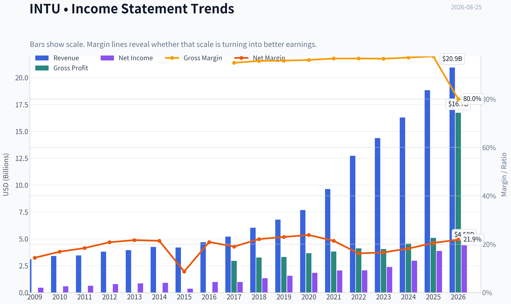
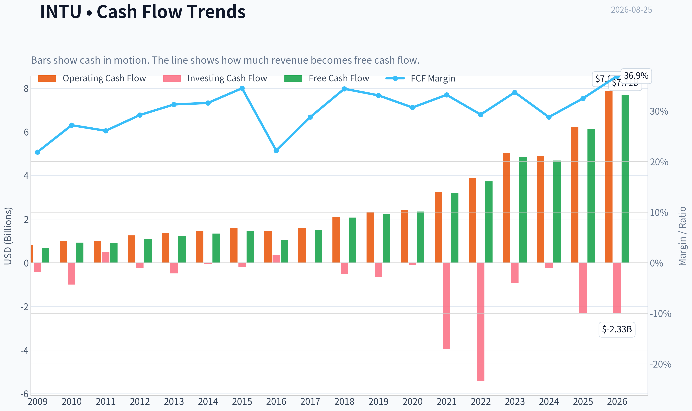
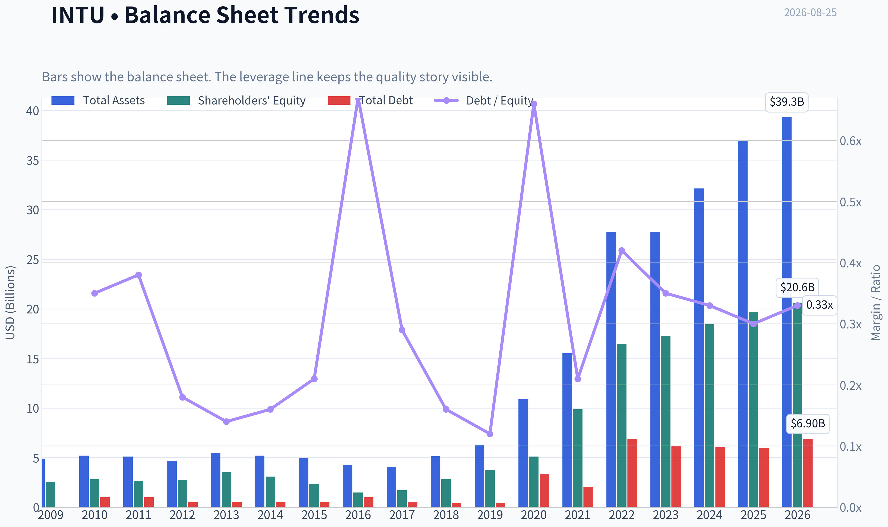
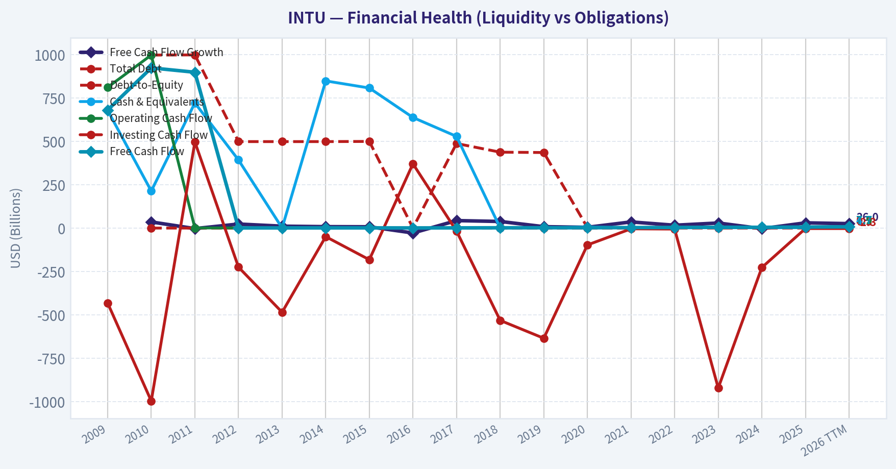
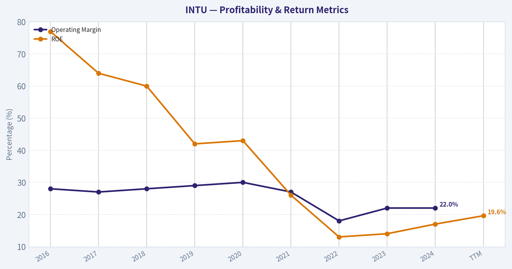
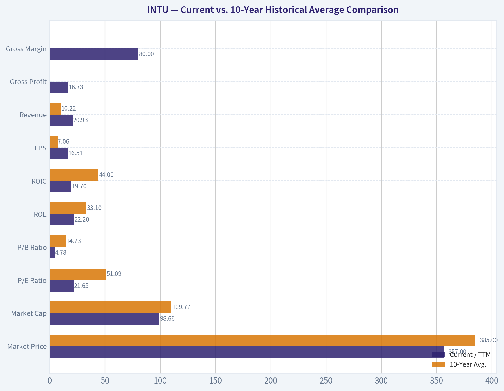
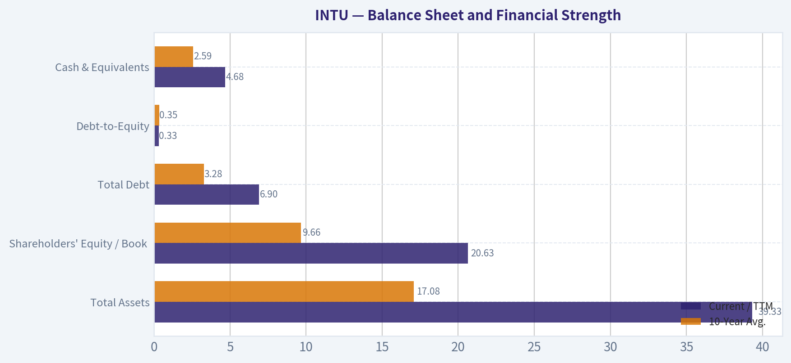
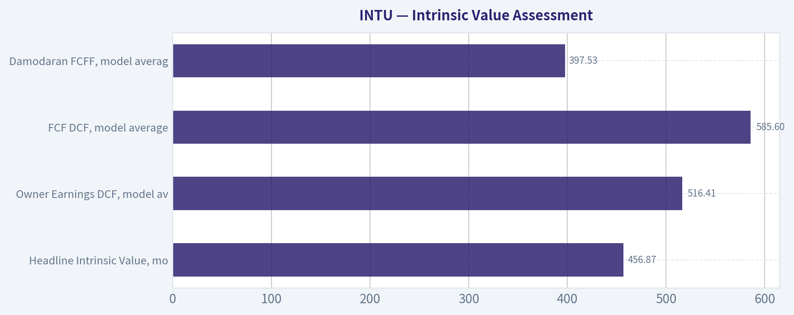
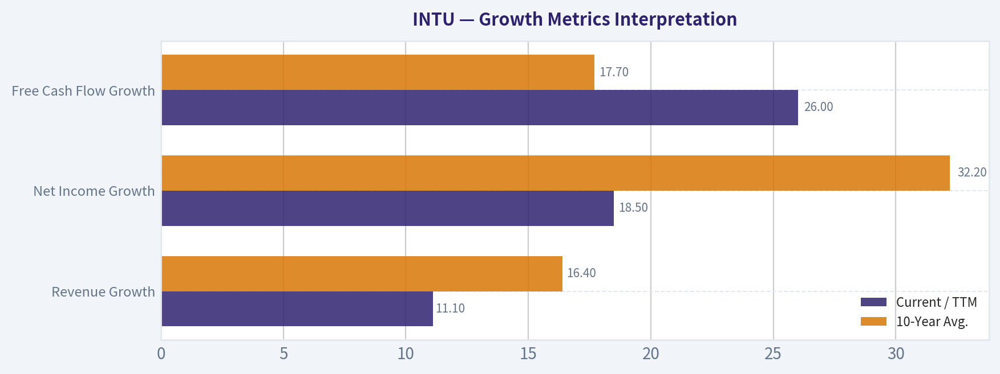

# INTU Deep Value Intelligence

**Analysis Date:** 2026-08-25

## Critical Disclaimer

*This analysis is generated by Deep Value Intelligence, an AI-powered multi-agent investing framework. Education & research only - not financial advice, not a financial advisor.*

---

## Table of Contents

1. Intelligence Summary
2. Analyst Team Reports
   - Fundamentals Analysis
   - Intrinsic Value Analysis (Buffett)
   - Trend & Growth Analysis (Lynch/Druckenmiller/Fisher)
   - Market Technical Analysis
   - Options Market Analysis
3. Research Team Commentary
4. Value Investing Team Commentary
5. Deep Values Commentary

---

## Intelligence Summary

### Thesis + Conditions

**Core Thesis:** **EXECUTIVE SUMMARY**
*   **Final Stance:** **AVOID**
*   **The Verdict:** Intuit (INTU) is a high-quality franchise undergoing a structural regime shift. While a 21.8x P/E appears historically cheap, it does not offer a sufficient *margin of safety* against emerging moat threats (IRS Direct File, AI commoditization) and a broken technical structure.

**Key Risks:**
- Key Insight:** Never confuse a "great business" with a "buyable stock." The current price action is a counter-trend bounce within a severe institutional downtrend. We must override historical valuation anchors and respect the structural risks.
- Risky Analyst (Advocate):** Focuses on Intuit's exceptional fundamentals (19.6% ROE, 17.3% ROIC) and views the 22% discount to intrinsic value as a rare entry point. Argues INTU's massive data advantage will weaponize AI, reinforcing its "toll-bridge" moat.
- Safe Analyst (Avoid/Watch):** Highlights the paramount rule of capital preservation. Warns that price remaining below the 200-day SMA signals institutional distribution. Cautions that IRS Direct File creates a permanent ceiling on pricing power, and AI commoditization lowers switching costs for competitors.

**Confidence:** Medium

---

## Analyst Team Reports

### Fundamentals Analysis

#### Latest Earnings Snapshot

*Most recent reported quarter anchored on 2026 Q2, with prior-year comparison when available.*

| Metric | 2026 Q2 | 2025 Q2 | YoY Change |
| --- | ---: | ---: | ---: |
| Revenue | $8.56B | $7.75B | +10.4% |
| Operating Income | $4.02B | $3.72B | +8.0% |
| Net Income | $3.06B | $2.82B | +8.7% |
| Diluted EPS | $11.09 | $10.02 | +10.7% |
| Operating Cash Flow | $5.30B | $4.39B | +20.6% |
| Free Cash Flow | $5.24B | $4.36B | +20.1% |

Key Takeaways: This snapshot anchors the most recent reported quarter before the narrative analysis. It helps readers separate long-run business quality from whatever changed in the latest earnings print.

#### 17-Year Financial Metrics for INTU

*All values below are computed deterministically from raw data - not estimated by AI.*

*Issuer profile: operating company (Technology / Software - Application).*

#### 17-Year Financial Metrics
*Annual rows come from reported financial statements. The final TTM row is computed from the latest four quarters.*

| Metric | 2009 | 2010 | 2011 | 2012 | 2013 | 2014 | 2015 | 2016 | 2017 | 2018 | 2019 | 2020 | 2021 | 2022 | 2023 | 2024 | 2025 | 2026 TTM |
| --- | --- | --- | --- | --- | --- | --- | --- | --- | --- | --- | --- | --- | --- | --- | --- | --- | --- | --- |
| Market Price | $26 | $35 | $41 | $51 | $57 | $74 | $97 | $103 | $128 | $193 | $264 | $294 | $511 | $442 | $500 | $636 | $776 | $357 |
| Market Cap | $9.80B | $12.92B | $14.80B | $17.70B | $19.37B | $23.85B | $30.25B | $29.41B | $35.81B | $53.31B | $73.21B | $80.88B | $144.68B | $129.55B | $144.81B | $183.85B | $222.19B | $98.66B |
| P/E Ratio | 22.00 | 22.46 | 23.35 | 22.32 | 22.59 | 26.27 | 82.63 | 30.08 | 36.30 | 40.13 | 47.08 | 44.27 | 70.10 | 62.66 | 60.77 | 62.07 | 57.43 | 21.65 |
| P/B Ratio | 3.83 | 4.58 | 5.66 | 6.45 | 5.49 | 7.75 | 12.97 | 19.71 | 21.08 | 18.93 | 19.53 | 15.84 | 14.66 | 7.88 | 8.39 | 9.97 | 11.27 | 4.78 |
| ROE | 17.5% | 20.3% | 24.2% | 28.9% | 24.3% | 29.5% | 15.7% | 65.6% | 58.0% | 47.2% | 41.5% | 35.8% | 20.9% | 12.6% | 13.8% | 16.1% | 19.6% | 22.2% |
| ROIC | 28.7% | 19.8% | 22.4% | 27.7% | 28.3% | 29.7% | 18.5% | 43.6% | 57.7% | 76.7% | 79.3% | 88.0% | 35.3% | 14.0% | 12.3% | 14.7% | 18.1% | 19.7% |
| EPS | $1.18 | $1.55 | $1.75 | $2.30 | $2.53 | $2.82 | $1.17 | $3.41 | $3.53 | $4.80 | $5.60 | $6.63 | $7.29 | $7.06 | $8.22 | $10.43 | $13.67 | $16.51 |
| Revenue | $3.11B | $3.40B | $3.45B | $3.81B | $3.95B | $4.24B | $4.19B | $4.69B | $5.20B | $6.03B | $6.78B | $7.68B | $9.63B | $12.73B | $14.37B | $16.29B | $18.83B | $20.93B |
| Gross Profit | $2.95B | $3.26B | $3.31B | $3.66B | $3.82B | $4.11B | $4.05B | $4.56B | $5.08B | N/A | N/A | N/A | N/A | N/A | N/A | N/A | N/A | $16.73B |
| Gross Margin | 95.0% | 95.8% | 95.9% | 96.2% | 96.8% | 96.8% | 96.7% | 97.2% | 97.7% | N/A | N/A | N/A | N/A | N/A | N/A | N/A | N/A | 80.0% |
| Operating Margin | 22.0% | 26.6% | 31.4% | 30.7% | 30.6% | 30.6% | 17.6% | 26.5% | 27.3% | 25.9% | 27.3% | 28.3% | 26.0% | 20.2% | 21.9% | 22.3% | 26.1% | 27.5% |
| Net Income | $447.0M | $574.0M | $634.0M | $792.0M | $858.0M | $907.0M | $365.0M | $979.0M | $985.0M | $1.33B | $1.56B | $1.83B | $2.06B | $2.07B | $2.38B | $2.96B | $3.87B | $4.58B |
| Net Margin | 14.4% | 16.9% | 18.4% | 20.8% | 21.7% | 21.4% | 8.7% | 20.9% | 19.0% | 22.1% | 23.0% | 23.8% | 21.4% | 16.2% | 16.6% | 18.2% | 20.5% | 21.9% |
| Revenue Growth | N/A | 9.5% | 1.4% | 10.4% | 3.6% | 7.5% | -1.2% | 12.0% | 10.7% | 16.0% | 12.6% | 13.2% | 25.4% | 32.1% | 12.9% | 13.3% | 15.6% | 11.1% |
| Net Income Growth | N/A | 28.4% | 10.5% | 24.9% | 8.3% | 5.7% | -59.8% | 168.2% | 0.6% | 34.9% | 17.2% | 17.3% | 12.9% | 0.2% | 15.4% | 24.3% | 30.6% | 18.5% |
| Free Cash Flow Growth | N/A | 35.7% | -2.7% | 23.6% | 11.3% | 8.5% | 7.8% | -27.9% | 43.4% | 38.5% | 8.4% | 4.8% | 35.8% | 16.7% | 29.6% | -3.0% | 30.5% | 26.0% |
| Total Book Value | $2.56B | $2.82B | $2.62B | $2.74B | $3.53B | $3.08B | $2.33B | $1.49B | $1.70B | $2.82B | $3.75B | $5.11B | $9.87B | $16.44B | $17.27B | $18.44B | $19.71B | $20.63B |
| Total Assets | $4.83B | $5.20B | $5.11B | $4.68B | $5.49B | $5.20B | $4.97B | $4.25B | $4.07B | $5.13B | $6.28B | $10.93B | $15.52B | $27.73B | $27.78B | $32.13B | $36.96B | $39.33B |
| Total Debt | N/A | $998.0M | $999.0M | $499.0M | $499.0M | $499.0M | $500.0M | $1.00B | $488.0M | $438.0M | $436.0M | $3.37B | $2.03B | $6.91B | $6.12B | $6.04B | $5.97B | $6.90B |
| Debt-to-Equity | N/A | 0.35 | 0.38 | 0.18 | 0.14 | 0.16 | 0.21 | 0.67 | 0.29 | 0.16 | 0.12 | 0.66 | 0.21 | 0.42 | 0.35 | 0.33 | 0.30 | 0.33 |
| Cash & Equivalents | $679.0M | $214.0M | $722.0M | $393.0M | $1.01B | $849.0M | $808.0M | $638.0M | $529.0M | $1.46B | $2.12B | $6.44B | $2.56B | $2.80B | $2.85B | $3.61B | $2.88B | $4.68B |
| Shareholders' Equity | $2.56B | $2.82B | $2.62B | $2.74B | $3.53B | $3.08B | $2.33B | $1.49B | $1.70B | $2.82B | $3.75B | $5.11B | $9.87B | $16.44B | $17.27B | $18.44B | $19.71B | $20.63B |
| Operating Cash Flow | $812.0M | $998.0M | $1.01B | $1.25B | $1.37B | $1.45B | $1.59B | $1.46B | $1.60B | $2.11B | $2.32B | $2.41B | $3.25B | $3.89B | $5.05B | $4.88B | $6.21B | $7.89B |
| Investing Cash Flow | $-432.0M | $-997.0M | $497.0M | $-225.0M | $-485.0M | $-49.0M | $-182.0M | $371.0M | $-17.0M | $-532.0M | $-635.0M | $-97.0M | $-3.96B | $-5.42B | $-922.0M | $-227.0M | $-2.32B | $-2.33B |
| Free Cash Flow | $681.0M | $924.0M | $899.0M | $1.11B | $1.24B | $1.34B | $1.45B | $1.04B | $1.50B | $2.07B | $2.25B | $2.35B | $3.20B | $3.73B | $4.84B | $4.69B | $6.12B | $7.71B |
| FCF Margin | 21.9% | 27.2% | 26.1% | 29.2% | 31.3% | 31.6% | 34.5% | 22.2% | 28.8% | 34.4% | 33.1% | 30.7% | 33.2% | 29.3% | 33.7% | 28.8% | 32.5% | 36.9% |
| Dividends / Share | $0.00 | $0.00 | $0.00 | $0.00 | $0.00 | $0.00 | $0.00 | $0.00 | $0.00 | $0.00 | $0.00 | $0.00 | $0.00 | $2.64 | $3.07 | $3.64 | $4.20 | $4.77 |

#### Profitability Metrics
- Return on Equity (ROE): 19.6%
- Return on Invested Capital (ROIC): 17.3%
- Return on Assets (ROA): 10.5%
- Gross Margin: N/A
- Operating Margin: 26.1%
- Net Profit Margin: 20.5%

#### Liquidity Metrics
- Current Ratio: 1.36
- Quick Ratio: 0.49

#### Leverage Metrics
- Debt-to-Equity Ratio: 0.30
- Interest Coverage Ratio: 19.93
- Net Debt: $3.09B

#### Growth Metrics (Year-over-Year)
- Revenue Growth: 15.6%
- Net Income Growth: 30.6%
- Free Cash Flow Growth: 30.5%
- Revenue CAGR (3-Year): 14.0%
- Revenue CAGR (5-Year): 19.7%

#### Valuation Metrics
- P/E Ratio (TTM): 21.81
- Forward P/E: 13.10
- Price-to-Book: 4.75
- Price-to-Sales: 4.67
- PEG Ratio: 0.95
- EV/EBITDA: 15.80
- Free Cash Flow Yield: 6.3%
- Earnings Yield: 4.6%

#### Owner Earnings (Buffett Method, Code-Computed)
- Net Income: $3.87B
- + Depreciation & Amortization: $809.0M
- - Capital Expenditures: $-84.0M
- - Working Capital Changes: $-206.0M
- = **Owner Earnings: $4.80B**

#### Intrinsic Value (Code-Computed)
- Current Price: $357
- **Headline Intrinsic Value (business-model routed): $457**
  Business model: operating company - weighted blend [Damodaran FCFF + reverse-DCF fair + owner-earnings DCF] (operating_company)
  Model spread (min-max across DCFs): $398 - $586
  Margin of safety vs. price (headline): 21.8%
  Routing note: General operating company: balanced blend of Damodaran FCFF and the owner-earnings DCF with a reverse-DCF sanity check.
- Buffett Method (Owner Earnings):
  Conservative: $403
  Average: $516
  Optimistic: $1,571
- Cash Flow Method (FCF):
  Conservative: $443
  Average: $586
  Optimistic: $1,059
- Damodaran FCFF (WACC + margins + reinvestment):
  Conservative: $301
  Average: $398
  Optimistic: $459
  Monte Carlo band (P10-P90): $294 - $520 (median $382)
  P(intrinsic value > price): 61.1%
- Reverse-DCF: price implies ~8.4%/yr owner-earnings growth for 10y; trailing 3y was 15.8%, 5y 22.1%.

#### Piotroski F-Score: 8/9
- Positive Net Income: PASS
- Positive Operating Cash Flow: PASS
- ROA Improvement: PASS
- Cash Flow > Net Income: PASS
- Decreasing Debt: PASS
- Improving Current Ratio: PASS
- No Dilution: PASS
- Improving Gross Margin: FAIL
- Improving Asset Turnover: PASS

ANALYST STANCE: **ADVOCATE**

#### INTU - Warren Buffett-Style Fundamental Analysis

Intuit is an asset-light, high-margin software platform business with durable franchises in tax preparation, small-business accounting, payroll, payments, and consumer finance through Credit Karma. The deterministic dataset shows a company that has compounded revenue, earnings, and free cash flow at attractive rates over a long period, while the current valuation has compressed sharply versus its own history. At the current price of **$357**, the research pack's model-routed intrinsic value estimate is **$456.87**, implying a **21.8% margin of safety**.

The stance is **ADVOCATE**, but not "blindly aggressive." Intuit looks attractive for long-term investors because quality remains high, free cash flow generation is excellent, and valuation is now materially below its historical norms. The main caveat is that ROIC remains below its pre-acquisition peak, debt is higher than in the earlier decade, and regulatory or AI-driven disruption in tax and accounting software must be monitored.

---

#### Revenue Breakdown

| Revenue Source | Amount ($B) | % of Total |
|---|---:|---:|
| Global Business Solutions / Small Business & Self-Employed | ~$11.25B | ~59.7% |
| Consumer / TurboTax | ~$4.80B | ~25.5% |
| Credit Karma | ~$2.16B | ~11.5% |
| ProTax | ~$0.62B | ~3.3% |
| **Total** | **$18.83B** | **100.0%** |

Key Takeaways: Intuit's revenue base is now dominated by small-business and self-employed software, which is more recurring and platform-like than seasonal consumer tax revenue. TurboTax remains a powerful profit engine, but the business is no longer only a tax-preparation story. Credit Karma adds consumer-finance upside, though it is more cyclical and advertising-sensitive than QuickBooks or TurboTax.

---

#### Current vs. 10-Year Historical Average Comparison

*Current values use the 2026 TTM row where available. Historical averages use fiscal years 2016-2025 from the deterministic dataset.*

| Metric | Current / TTM | 10-Year Avg. | Current Standing & Interpretation |
|---|---:|---:|---|
| Market Price | $357 | $385 | Below average despite much higher revenue and FCF; valuation has compressed sharply. |
| Market Cap | $98.66B | $109.77B | Below 10-year average even though the company is larger and more profitable. |
| P/E Ratio | 21.65x | 51.09x | Far below historical norm; the market is pricing INTU much more conservatively. |
| P/B Ratio | 4.78x | 14.73x | Lower than history, but **P/B is not meaningful as a primary valuation anchor** for an asset-light software/IP business. |
| ROE | 22.2% | 33.1% | Below long-term average, but improving from the 2022-2024 trough. |
| ROIC | 19.7% | 44.0% | Below historic peak levels; acquisitions and a larger asset base have diluted capital returns. |
| EPS | $16.51 | $7.06 | More than double the 10-year average; earnings power is structurally higher. |
| Revenue | $20.93B | $10.22B | Roughly 2x the historical average, showing strong long-term compounding. |
| Gross Profit | $16.73B | Limited comparable data | Current gross profit is large, but historical gross-profit data is incomplete after 2017. |
| Gross Margin | 80.0% | Limited comparable data | Still software-like and very high, though not directly comparable to earlier sparse data. |
| Operating Margin | 27.5% | 25.2% | Above average; operating leverage appears to be returning. |
| Net Income | $4.58B | $2.00B | More than 2x the 10-year average; profitability has scaled materially. |
| Net Margin | 21.9% | 20.2% | Above average; margins are recovering toward historical strength. |
| Revenue Growth | 11.1% | 16.4% | Slower than 10-year average, but still double-digit and healthy for a mature software platform. |
| Net Income Growth | 18.5% | 32.2% | Below average due to a 2016 rebound outlier, but still strong in absolute terms. |
| Free Cash Flow Growth | 26.0% | 17.7% | Above average; cash conversion is a major strength. |
| Total Book Value | $20.63B | $9.66B | Balance sheet equity has grown, but book value is not the key valuation tool here. |
| Total Assets | $39.33B | $17.08B | Asset base has expanded substantially, partly through acquisitions. |
| Total Debt | $6.90B | $3.28B | Debt is above historical average; leverage is manageable but no longer negligible. |
| Debt-to-Equity | 0.33x | 0.35x | Slightly below average; leverage remains controlled relative to equity. |
| Cash & Equivalents | $4.68B | $2.59B | Cash is well above average, supporting flexibility. |
| Shareholders' Equity | $20.63B | $9.66B | Equity base has more than doubled versus the 10-year average. |
| Free Cash Flow | $7.71B | $3.18B | More than 2x the average; cash-generation quality is excellent. |
| Dividends / Share | $4.77 | $1.36 | Dividend has grown, but payout remains secondary to reinvestment and buybacks. |

Key Takeaways: The most important pattern is that Intuit's business fundamentals are much stronger than the 10-year average, while valuation multiples are much lower. P/E has compressed from an average of about 51x to roughly 22x, even as revenue, EPS, net income, and free cash flow are all far above historical averages. The main weakness is that ROIC and ROE are below their historical peaks, suggesting that the company's larger acquisition-influenced asset base has reduced capital efficiency.

---

#### Market Metrics Interpretation

| Metric | Interpretation |
|---|---|
| Market Price: $357 | The stock has fallen sharply from the 2025 level of $776. The price is now below the 10-year average despite the company's revenue and free cash flow being far above average. |
| Market Cap: $98.66B | Market value has compressed to below the 10-year average, while the operating business has continued to grow. This disconnect is central to the value case. |
| P/E Ratio: 21.65x | Historically, INTU often traded at premium multiples above 40x-60x. A current P/E near 22x is unusually low for a company still producing double-digit revenue growth and strong FCF growth. |
| P/B Ratio: 4.78x | For Intuit, **P/B is not a meaningful valuation anchor**. It is an asset-light software and platform company where brand, data, customer relationships, network effects, and IP do not show up fully in book value. Valuation should be anchored on cash-flow-based intrinsic value, not book multiples. |

Key Takeaways: Intuit's valuation has reset dramatically lower. The P/E ratio is the most useful simple multiple here, while P/B should be treated with caution because software companies often produce value through intangible assets rather than book equity. The stock now trades at a level where cash-flow valuation matters more than historical premium-multiple extrapolation.

---

#### Profitability and Business Quality

Intuit's profitability profile remains Buffett-like in several respects: high margins, strong cash conversion, recurring customer relationships, and meaningful pricing power. Revenue has grown from **$4.69B in 2016** to **$20.93B TTM**, while free cash flow has expanded from **$1.04B** to **$7.71B**. That is a powerful signal of business durability.

Operating margin is especially encouraging. The current **27.5% operating margin** is above the 10-year average of **25.2%**, suggesting that Intuit is regaining scale benefits after the margin compression seen around 2022-2024. Net margin of **21.9%** is also above its 10-year average of **20.2%**.

The key concern is capital efficiency. ROIC of **19.7%** remains attractive in absolute terms, but it is well below the 10-year average of **44.0%** and far below the extraordinary 2018-2020 levels. This does not make Intuit a poor business; rather, it shows that the company's acquisition-heavy expansion has made each incremental dollar of invested capital less explosively productive than in the earlier, more capital-light period.

---

#### Growth Metrics Interpretation

| Growth Metric | Current / TTM | 10-Year Avg. | Interpretation |
|---|---:|---:|---|
| Revenue Growth | 11.1% | 16.4% | Growth has slowed from the pandemic/acquisition-boosted period but remains healthy. |
| Net Income Growth | 18.5% | 32.2% | Below the outlier-inflated average, but still strong and above revenue growth, showing operating leverage. |
| Free Cash Flow Growth | 26.0% | 17.7% | Very strong; current FCF growth is above the historical average and supports intrinsic value. |

Key Takeaways: Revenue growth is moderating, but not collapsing. The stronger story is that earnings and free cash flow are growing faster than revenue, which indicates improving scale economics. For Buffett-style investors, the free cash flow growth rate is especially important because it directly supports owner earnings and intrinsic value.

---

#### Balance Sheet and Financial Strength

| Balance Sheet Metric | Current / TTM | 10-Year Avg. | Interpretation |
|---|---:|---:|---|
| Total Assets | $39.33B | $17.08B | The company is much larger than it was historically, partly due to acquisitions. |
| Shareholders' Equity / Book Value | $20.63B | $9.66B | Equity base has grown, though book value understates intangible franchise value. |
| Total Debt | $6.90B | $3.28B | Debt is elevated versus history and should be monitored. |
| Debt-to-Equity | 0.33x | 0.35x | Leverage is manageable and slightly below the 10-year average. |
| Cash & Equivalents | $4.68B | $2.59B | Cash position is strong and provides flexibility. |
| Net Debt | ~$2.22B using TTM debt and cash | N/A | Net debt is modest relative to TTM FCF of $7.71B. |

Key Takeaways: Intuit's debt level is higher than its historical average, but the balance sheet is not stretched. Cash is also well above average, and net debt is modest relative to free cash flow. The company appears financially strong, though investors should watch whether acquisitions continue to dilute ROIC.

---

#### Cash Flow and Dividend Policy

Intuit's cash-flow profile is one of the strongest parts of the investment case. TTM free cash flow is **$7.71B**, compared with a 10-year average of **$3.18B**. FCF margin is also very high at **36.9%**, showing excellent conversion of revenue into cash.

Dividends per share have risen to **$4.77**, compared with a 10-year average of **$1.36**. However, Intuit is not primarily a dividend stock. Its more important capital-allocation levers are reinvestment, product development, ecosystem expansion, acquisitions, and share repurchases.

---

#### Buffett-Style Owner Earnings DCF Valuation

Assumptions used for the hand DCF sanity check:

- Base owner earnings: **$4.80B**, from the deterministic owner-earnings calculation.
- Shares outstanding: approximately **276.4M**, derived from current market cap and price.
- Net debt adjustment: approximately **$2.22B**, using TTM debt less TTM cash.
- Discount rate: **10.0%**.
- Terminal growth rate: **2.5%**.
- Formula:
  **PV of explicit owner earnings + PV of terminal value - net debt = equity value**.
  Terminal value equals **Year 10 owner earnings x 1.025 / (10.0% - 2.5%)**.

| Scenario | Growth Assumption | Calculation Summary | Hand DCF Fair Value | Model Cross-Check |
|---|---:|---|---:|---:|
| Conservative | 3% owner-earnings growth, fading toward 2.5% terminal | PV explicit OE ~ $34.0B; PV terminal ~ $34.0B; less net debt ~ $2.22B; equity value ~ $65.8B | **~$238/share** | Pack Buffett conservative: **$403/share** |
| Average / Base Case | 12% equivalent 10-year OE CAGR, representing stronger near-term growth fading toward terminal | PV explicit OE ~ $53.0B; PV terminal ~ $78.6B; less net debt ~ $2.22B; equity value ~ $129.4B | **~$468/share** | Pack Buffett average: **$516/share** |
| Optimistic | 15% equivalent 10-year OE CAGR, representing a bull case with high near-term growth fading after year 10 | PV explicit OE ~ $61.8B; PV terminal ~ $102.3B; less net debt ~ $2.22B; equity value ~ $161.9B | **~$586/share** | Pack Buffett optimistic: **$1,571/share** |

Key Takeaways: The hand DCF shows that Intuit is not attractive if owner earnings compound only at GDP-like rates; in that conservative case, fair value is materially below the current price. But the base-case DCF of roughly **$468/share** is close to the research pack's headline intrinsic value of **$456.87**, supporting the idea that the stock is undervalued if Intuit can sustain low-double-digit owner-earnings growth. The optimistic model has large upside, but the extreme pack Buffett optimistic value should be treated as a blue-sky sensitivity rather than the underwriting case.

---

#### Intrinsic Value Assessment

| Valuation Method | Fair Value Estimate | Implication vs. $357 Price |
|---|---:|---|
| Headline Intrinsic Value, model-routed | $456.87 | ~21.8% margin of safety |
| Owner Earnings DCF, model average | $516.41 | Significant upside |
| FCF DCF, model average | $585.60 | Larger upside if FCF durability persists |
| Damodaran FCFF, model average | $397.53 | More modest upside |
| Damodaran Monte Carlo P10-P90 | $294-$520 | Wide range; median below headline value |
| Reverse DCF | Price implies ~8.4% 10-year OE growth | Reasonable versus 3-year 15.8% and 5-year 22.1% historical growth |

Key Takeaways: The valuation case is favorable but not risk-free. The stock is below the blended intrinsic value estimate, and the reverse DCF hurdle of roughly 8.4% owner-earnings growth appears achievable for a high-quality software compounder. However, the Damodaran FCFF model is more conservative, which means the margin of safety is good but not enormous.

---

#### Economic Moat

Intuit has several moat characteristics that fit a Buffett-style framework:

| Moat Source | Assessment |
|---|---|
| Brand Trust | TurboTax and QuickBooks are category-defining brands in tax and small-business accounting. |
| Switching Costs | Small businesses store invoices, payroll data, tax history, customer records, and accounting workflows inside QuickBooks, making churn costly. |
| Data Advantage | Intuit benefits from large volumes of tax, accounting, payroll, and consumer finance data. |
| Ecosystem Expansion | QuickBooks, payments, payroll, Mailchimp, TurboTax, and Credit Karma create cross-sell opportunities. |
| Pricing Power | High margins and long-term revenue growth suggest meaningful pricing power. |
| Network / Platform Effects | Accountant relationships, small-business integrations, and financial-product marketplaces strengthen the platform. |

Key Takeaways: Intuit's moat is strong because it combines brand, workflow embedding, customer data, and ecosystem breadth. The company is not merely selling software licenses; it is increasingly operating a financial and compliance platform for consumers and small businesses. That said, AI-native competitors and regulatory simplification of tax filing could pressure parts of the moat over time.

---

#### Management and Capital Allocation

Management has generally created substantial shareholder value through product expansion, price realization, and ecosystem building. The long-term growth in revenue, EPS, and free cash flow supports that conclusion. The company also earns a strong **Piotroski F-Score of 8/9**, with positives in profitability, cash flow quality, debt reduction, liquidity improvement, and no dilution.

The main critique is that ROIC has fallen materially from the extraordinary 2018-2020 period. This reflects a larger capital base and acquisition activity, including the expansion into Credit Karma and Mailchimp. These assets may prove strategically valuable, but Buffett-style investors should watch whether they generate high incremental returns or merely expand revenue at lower quality.

---

#### Key Investment Insights, Red Flags, and Opportunities

| Category | Key Points |
|---|---|
| Core Bull Case | High-quality software compounder trading at a large discount to its own historical valuation multiples. |
| Valuation Opportunity | P/E of 21.65x versus a 10-year average of 51.09x; headline intrinsic value implies ~21.8% margin of safety. |
| Cash Flow Strength | TTM FCF of $7.71B and FCF margin of 36.9% show excellent owner-earnings quality. |
| Moat Strength | TurboTax, QuickBooks, payroll, payments, and tax/accounting workflows create sticky customer relationships. |
| Main Financial Red Flag | ROIC of 19.7% is strong but well below the 10-year average of 44.0%, signaling lower capital efficiency post-acquisitions. |
| Balance Sheet Risk | Debt is above historical average, though net debt is manageable relative to FCF. |
| Business Risk | Credit Karma is more cyclical and exposed to consumer credit and advertising conditions. |
| Regulatory Risk | Government tax-filing simplification or IRS-backed filing tools could pressure TurboTax over time. |
| Technology Risk | AI-native accounting, tax, and finance tools could reduce friction and challenge legacy software workflows. |
| Upside Catalyst | If Intuit proves that AI features improve retention, pricing, and automation, the market may re-rate the stock upward. |

Key Takeaways: The strongest opportunity is the combination of high business quality and unusually compressed valuation. The biggest red flag is not near-term solvency, but whether Intuit can keep converting acquisitions and AI investments into high-return growth. Investors should watch ROIC, tax-regulation headlines, Credit Karma cyclicality, and evidence of AI-driven product monetization.

---

#### Final Investment Stance: ADVOCATE

INTU earns an **ADVOCATE** stance for long-term, Buffett-style investors. The company has a durable moat, excellent free cash flow, strong margins, manageable leverage, and a current valuation that is materially cheaper than its historical norm. The stock price of **$357** sits below the model-routed intrinsic value of **$456.87**, creating a reasonable margin of safety.

This is not a deep-cigar-butt value stock; it is a high-quality compounder whose valuation has reset. The case depends on Intuit sustaining owner-earnings growth meaningfully above the market-implied hurdle of about **8.4%**. Given its historical growth, ecosystem strength, and cash-flow quality, that hurdle appears achievable, though investors should monitor ROIC recovery, regulatory pressure in tax filing, and AI-driven competitive shifts.

| Final Summary Item | Assessment |
|---|---|
| Business Quality | High |
| Economic Moat | Strong |
| Financial Strength | Good |
| Earnings Predictability | Good to very good |
| Valuation vs. History | Attractive |
| Valuation vs. Intrinsic Value | Undervalued on blended DCF |
| Margin of Safety | Moderate, around 21.8% |
| Biggest Risk | ROIC dilution, regulation, and AI disruption |
| Best Opportunity | Cash-flow compounder re-rating from depressed valuation |
| Final Stance | **ADVOCATE** |

Key Takeaways: Intuit looks like a high-quality franchise available at a more reasonable price than usual. The valuation is attractive because the stock has fallen much more than the long-term business quality has deteriorated. For patient investors, the current setup offers a favorable balance of quality, growth, and value, provided the company continues to defend its moat and improve returns on capital.

#### Fundamental Visuals

This graph tracks the profitability and return metrics (ROE, ROIC, Margins) of **INTU** over the past decade, highlighting capital efficiency trends.

This chart illustrates the financial health of **INTU** over the last 10 years, mapping cash equivalents and free cash flow against total obligations (Debt).

This graph tracks the profitability and return metrics (ROE, ROIC, Margins) of **INTU** over the past decade, highlighting capital efficiency trends.

---

### Intrinsic Value Analysis (Buffett)

> *Following Warren Buffett's value investing philosophy: Circle of Competence, Economic Moat, Management Quality, and Margin of Safety.*

#### Intrinsic Value Snapshot

Price is what you pay. Intrinsic value is what the business may be worth based on the cash it can create for owners over time. We show a range, not one magic number.

- Current Price: $357.46
- Value Range (conservative to optimistic across both DCF methods): $403.06 to $1,571.48

##### Owner Earnings (Buffett Method)
- Net Income: $3,869,000,000.00
- Depreciation & Amortization: $809,000,000.00
- Capital Expenditures: $-84,000,000.00
- Working Capital Changes: $-206,000,000.00
- Owner Earnings: $4,800,000,000.00

##### Intrinsic Value
###### Buffett Method
Uses owner earnings. Stricter, and usually more conservative.
- Conservative: $403.06
- Average: $516.41
- Optimistic: $1,571.48
- Discount Rate: 10.0%

###### Cash Flow Method
Uses free cash flow. Better for companies spending heavily today to grow tomorrow.
- Conservative: $443.21
- Average: $585.60
- Optimistic: $1,059.11
- Discount Rate: 10.0%

ANALYST STANCE: **ADVOCATE**

#### Intuit Investment View

Intuit is a high-quality, asset-light software compounder with durable franchises in small-business accounting, consumer tax preparation, and financial decisioning. At $357 per share, the stock trades at roughly a **21.8% discount** to the headline intrinsic value estimate of **$456.87**, which is an adequate margin of safety for a wide-moat business with strong cash generation and a long reinvestment runway.

---

#### 1. Factor Scorecard

| Factor | Score | Evidence |
|---|---:|---|
| Circle of Competence & Business Simplicity | 4.5 / 5 | Intuit makes money by selling tax, accounting, payroll, payments, and financial software to consumers and small businesses. The model is understandable: recurring software subscriptions, seasonal tax revenue, payments, payroll, and data-driven financial products. |
| Moat Test | 4.5 / 5 | TurboTax and QuickBooks have powerful brand recognition, customer data, embedded workflows, switching costs, and scale advantages. QuickBooks in particular becomes harder to replace as businesses build accounting history, payroll, invoices, tax records, and payments data inside the platform. |
| Management Quality & Capital Allocation | 3.8 / 5 | Management has executed well operationally, expanded the ecosystem, and grown free cash flow per share. The main deduction is acquisitive capital allocation, including large deals such as Credit Karma and Mailchimp, which increased goodwill and integration complexity. |
| Industry Structure | 4.0 / 5 | Small-business accounting and consumer tax software are attractive, high-margin categories. Competition exists from H&R Block, Xero, FreshBooks, IRS/free filing initiatives, banks, fintechs, and AI-native tools, but Intuit's installed base and brand remain formidable. |
| Gate 5: Quality / Solvency Hard Floor | Not tripped | Earnings and free cash flow are growing, free cash flow yield is strong, and solvency is not a distress issue. No hard-avoid condition is present. |

**Key Takeaways:** Intuit scores highly because the business is understandable, profitable, and protected by brand strength and switching costs. The biggest concerns are not solvency or business quality, but valuation discipline, regulatory risk in tax preparation, and management's willingness to make large acquisitions.

---

#### 2. Moat Analysis

| Moat Source | Assessment | Evidence |
|---|---|---|
| Brand / Intangible Assets | Strong | TurboTax is one of the leading consumer tax brands in the U.S.; QuickBooks is a default accounting system for many small businesses and accountants. |
| Switching Costs | Very strong in QuickBooks; moderate-to-strong in TurboTax | Small businesses embed invoices, payroll, bank feeds, tax records, payments, and accountant workflows into QuickBooks. Switching creates operational friction and risk. |
| Cost Advantage | Moderate | Intuit benefits from scale in software development, customer acquisition, data, compliance, and support infrastructure. |
| Network Effects | Moderate | The QuickBooks ecosystem improves as accountants, app developers, payroll users, payments customers, and small businesses cluster around the platform. |
| Pricing Power | Strong | Software gross margins are structurally high, and Intuit has historically been able to raise prices and upsell higher-value offerings. |
| Moat Rating | Wide & Stable to Widening | AI, data, and ecosystem bundling could widen the moat if executed well; government-backed free tax filing is the main moat pressure point. |

**Key Takeaways:** Intuit's moat is strongest in QuickBooks, where workflow captivity and data history create real switching costs. TurboTax has a strong brand, but its moat is more exposed to regulatory and free-filing pressure. Overall, this is a wide-moat software franchise, not a commodity technology vendor.

---

#### 3. Management Quality Assessment

| Area | Assessment |
|---|---|
| Owner Mentality | Good, but not exceptional. Management focuses on long-term ecosystem expansion and per-share value creation, though insider ownership is not founder-like. |
| Candor & Reporting | Generally good. The business is understandable, and cash flow quality has remained strong. |
| Capital Allocation | Good operating reinvestment record, mixed M&A record. Credit Karma and Mailchimp expanded the platform but came at meaningful acquisition prices and added goodwill. |
| Buybacks | Useful but not perfect. Repurchases help offset dilution and return capital, but the key test is whether they are made aggressively only when shares are undervalued. |
| Debt Discipline | Acceptable. Intuit is not balance-sheet distressed, and cash generation provides ample financial flexibility. |

**Key Takeaways:** Management has built a stronger ecosystem over time and expanded Intuit beyond desktop tax and accounting software into a broader financial platform. The main capital allocation caution is acquisition discipline; Buffett-style investors should monitor whether acquired assets earn returns comfortably above Intuit's cost of capital.

---

#### 4. Financial Summary

| Fiscal Year | Revenue ($B) | Revenue Growth | Operating Margin | Net Income ($B) | Free Cash Flow ($B) | FCF Margin | Diluted EPS | ROE |
|---:|---:|---:|---:|---:|---:|---:|---:|---:|
| 2016 | 4.69 | 12% | 28% | 0.98 | 1.24 | 26% | $3.69 | 77% |
| 2017 | 5.18 | 10% | 27% | 0.97 | 1.44 | 28% | $3.72 | 64% |
| 2018 | 5.96 | 15% | 28% | 1.21 | 1.60 | 27% | $4.64 | 60% |
| 2019 | 6.78 | 14% | 29% | 1.56 | 1.77 | 26% | $5.89 | 42% |
| 2020 | 7.68 | 13% | 30% | 1.83 | 2.16 | 28% | $6.92 | 43% |
| 2021 | 9.63 | 25% | 27% | 2.06 | 3.03 | 31% | $7.56 | 26% |
| 2022 | 12.73 | 32% | 18% | 2.07 | 3.49 | 27% | $7.28 | 13% |
| 2023 | 14.37 | 13% | 22% | 2.38 | 4.62 | 32% | $8.42 | 14% |
| 2024 | 16.29 | 13% | 22% | 2.96 | 4.57 | 28% | $10.43 | 17% |
| TTM | 18.83 | 15.6% | ~28% | 4.48 | 6.16 | 33% | $16.37 | 19.6% |

**Key Takeaways:** Intuit has compounded revenue at an attractive rate while maintaining strong free cash flow conversion. Free cash flow has grown far faster than revenue over the decade, which is exactly what a high-quality software model should produce. The temporary ROE dip after large acquisitions reflects a larger equity and goodwill base rather than a collapse in business economics.

---

#### 5. Owner Earnings Calculation

| Component | Amount |
|---|---:|
| Net Income | $4.48B |
| Plus: Depreciation & Amortization | $0.95B |
| Less: Estimated Maintenance CapEx | ($0.30B) |
| Less: Working Capital Increase | ~($0.00B) |
| Estimated Owner Earnings | $5.13B |
| Diluted Share Count Implied by Market Cap / Price | ~274M |
| Owner Earnings Per Share | ~$18.72 |

**Key Takeaways:** Intuit converts accounting earnings into real cash at a high rate. Owner earnings of roughly $5.1 billion are supported by strong free cash flow, low capital intensity, and the favorable economics of software subscriptions and payments-adjacent revenue.

---

#### 6. Three-Scenario DCF Valuation

Assumptions: 10% discount rate, owner earnings per share of approximately $18.72, and terminal growth of 3% where applicable.

| Scenario | Method | Intrinsic Value Per Share |
|---|---|---:|
| A: No Growth | Owner earnings / 10% discount rate | ~$187 |
| B: GDP Growth | Owner earnings grown at 3% into perpetuity | ~$276 |
| C: Historical Growth Case | 10 years of 10% growth, then 3% terminal growth | ~$464 |
| Headline Intrinsic Value Blend | Business-model routed blend of owner earnings, FCF, and FCFF models | $456.87 |
| 3-Model Spread | Owner Earnings / FCF / Damodaran FCFF | $516.41 / $585.60 / $397.53 |

**Key Takeaways:** The no-growth and GDP-growth cases are too conservative for a business still growing revenue in the mid-teens and producing high incremental cash returns. The historical-growth scenario lines up closely with the blended intrinsic value estimate. This suggests the current price is not demanding heroic assumptions.

---

#### 7. Margin of Safety Analysis

| Item | Value |
|---|---:|
| Current Price | $357 |
| Headline Intrinsic Value | $456.87 |
| Margin of Safety | 21.8% |
| Current P/E | 21.8x |
| FCF Yield | 6.3% |
| Reverse-DCF Implied 10-Year Growth | ~8.4% annually |
| Trailing 3-Year Growth | 15.8% |
| Trailing 5-Year Growth | 22.1% |

**Key Takeaways:** For a wide-moat, asset-light compounder, a 21.8% discount to intrinsic value is attractive. The reverse-DCF is especially important: the market price implies roughly 8.4% annual growth, which appears reasonable compared with Intuit's recent growth history and reinvestment opportunities.

---

#### 8. Final Buffett Scorecard

| Criterion | Weight | Score | Weighted Contribution |
|---|---:|---:|---:|
| Moat Width & Durability | 25% | 4.5 | 1.13 |
| Valuation / Margin of Safety | 20% | 4.0 | 0.80 |
| Capital Returns - ROIC vs. WACC | 15% | 4.0 | 0.60 |
| Business Understanding & Predictability | 12% | 4.5 | 0.54 |
| Management Quality & Capital Allocation | 12% | 3.8 | 0.46 |
| Reinvestment Runway | 8% | 4.3 | 0.34 |
| Balance Sheet Strength | 4% | 3.8 | 0.15 |
| Industry Structure | 4% | 4.0 | 0.16 |
| Total | 100% |  | **4.18 / 5.00** |

**Key Takeaways:** Intuit clears the Buffett-style bar because it combines a wide moat, high cash conversion, strong customer captivity, and a fair-to-attractive price. The score is held back modestly by acquisition risk, regulatory pressure in tax filing, and competitive threats from AI and fintech entrants.

---

#### 9. Investment Stance

| Stance | Conviction | Rationale |
|---|---|---|
| **ADVOCATE** | Medium-High | Intuit is a wonderful business trading below a reasonable estimate of intrinsic value. The margin of safety is adequate for the company's quality, and the reverse-DCF growth hurdle appears achievable. |

**Key Takeaways:** This is not a cigar-butt value investment; it is a high-quality compounder available at a fair-to-better-than-fair price. For a long-term owner, Intuit deserves an **ADVOCATE** stance, with ongoing monitoring of tax-regulatory risk, AI disruption, and acquisition returns.
#### Valuation Bridge

This bridge places the current market price beside each intrinsic value lens so readers can see whether upside depends on one method or shows up across several methods.

| Scenario | Intrinsic Value / Share |
| --- | ---: |
| Buffett Method | $516.41 |
| Cash Flow Method | $585.60 |
| Damodaran Method | $397.53 |
| Current Price | $357.46 |

#### Key Takeaways

If one method is far above the others, the upside case depends on a specific modelling assumption. When several methods cluster together, the valuation story is more robust.

#### Valuation Visuals

This comparison chart from *Latest Earnings Snapshot* stacks current figures against historical benchmarks for **INTU**, making it easy to see where the company trades relative to its own averages.

This comparison chart from *Current vs. 10-Year Historical Average Comparison* stacks current figures against historical benchmarks for **INTU**, making it easy to see where the company trades relative to its own averages.

This comparison chart from *Balance Sheet and Financial Strength* stacks current figures against historical benchmarks for **INTU**, making it easy to see where the company trades relative to its own averages.

This comparison chart from *Intrinsic Value Assessment* stacks current figures against historical benchmarks for **INTU**, making it easy to see where the company trades relative to its own averages.

---

### Trend & Growth Analysis (Lynch/Druckenmiller/Fisher)

> *Following Peter Lynch's GARP, Stanley Druckenmiller's macro-aware approach, and Philip Fisher's scuttlebutt methodology.*

ANALYST STANCE: **ADVOCATE**

#### INTU Growth Investment Report - Intuit Inc.

| Item | Snapshot |
|---|---:|
| Current Price | $357 |
| Market Cap | $97.78B |
| P/E | 21.8x |
| Revenue Growth YoY | 15.6% |
| ROE | 19.6% |
| FCF Yield | 6.3% |
| Current Ratio | 1.36x |
| Headline Intrinsic Value | $456.87 |
| Margin of Safety vs. Price | 21.8% |
| Reverse DCF Implied Growth | ~8.4% per year for 10 years |
| Trailing Growth Context | 3-year: 15.8%; 5-year: 22.1% |

**Key Takeaways:** Intuit is trading like a mature software compounder, but the business is still growing revenue in the mid-teens with strong free cash flow. The current price implies only about 8.4% long-term growth, which looks conservative versus recent history. The setup is attractive if Intuit can sustain low-to-mid-teens growth through AI-enabled tax, accounting, and small-business financial workflows.

---

#### 1. Lynch Classification

| Lynch Category | INTU Fit | Rationale |
|---|---|---|
| Slow Grower | No | Growth is far above 0-5%. |
| Stalwart | Partial | Intuit is large, established, profitable, and resilient. |
| Fast Grower | Yes, lower-end | 15.6% revenue growth qualifies, though size limits ten-bagger odds. |
| Cyclical | No | Tax and accounting software are recurring and compliance-driven. |
| Turnaround | No | Business is healthy, not distressed. |
| Asset Play | No | Value is in software platforms, data, brand, and ecosystem. |

**Key Takeaways:** Intuit is best classified as a **large-cap fast grower / premium stalwart hybrid**. It is not a classic small-cap Lynch ten-bagger, but it is a high-quality compounder with durable growth, strong cash generation, and a potentially underappreciated AI product cycle.

#### 2. The Story in 3 Bullets

- **Intuit helps consumers and small businesses handle painful financial tasks**: taxes through TurboTax, accounting through QuickBooks, personal finance through Credit Karma, and marketing/customer engagement through Mailchimp.
- **The growth story is platform expansion**: Intuit is moving from point products into an AI-powered operating system for consumer finance and small-business financial management.
- **The investment case is GARP**: mid-teens growth, strong free cash flow, powerful brands, high switching costs, and a valuation that appears reasonable versus intrinsic value.

#### 3. TAM Analysis and 10x Test

| TAM Component | Opportunity |
|---|---:|
| Consumer tax preparation and assisted tax | Large, recurring, compliance-driven |
| SMB accounting and payroll | Large and durable |
| Mid-market accounting / ERP-lite workflows | Expanding opportunity |
| SMB payments, lending, and financial services | Large adjacent TAM |
| Marketing automation via Mailchimp | Cross-sell opportunity |
| Personal finance / credit marketplace | Monetization optionality |
| Estimated Broad TAM | ~$250B-$400B+ |
| Current Revenue Estimate | ~$18B-$19B |
| 10x Revenue Test | ~$180B-$190B revenue |
| 10x as Share of TAM | ~45%-75% of conservative TAM |

**Key Takeaways:** Intuit has a long runway, but the **10x test is mixed**. A tenfold revenue increase would require Intuit to become a dominant share leader across multiple financial software and services categories. A 3x to 5x revenue path is more realistic than a clean 10x path from today's nearly $100B market cap.

#### 4. Revenue Growth Trend

| Metric | Signal |
|---|---|
| Current YoY Revenue Growth | 15.6% |
| Trailing 3-Year Growth Reference | 15.8% |
| Trailing 5-Year Growth Reference | 22.1% |
| Pattern | Stable high growth, not clear acceleration |
| Lynch Interpretation | Lower-end fast grower |
| Druckenmiller Interpretation | Attractive if AI creates re-acceleration |

**Key Takeaways:** Intuit is not showing explosive acceleration, but it is sustaining impressive growth for a company of its size. The important question is whether AI-assisted tax filing, automated bookkeeping, and small-business workflow expansion can push growth back toward the high-teens or low-20s.

#### 5. Unit Economics and Business Quality

| Metric | Estimate / Status | Assessment |
|---|---:|---|
| LTV/CAC | Not disclosed | Likely strong due to repeat tax users and QuickBooks retention |
| NRR | Not disclosed | QuickBooks ecosystem likely has strong expansion dynamics |
| FCF Yield | 6.3% | Excellent for a mid-teens grower |
| Estimated FCF | ~$6.2B |
| Estimated Revenue Base | ~$18B-$19B |
| Estimated FCF Margin | Low-30% range |
| Rule of 40 Estimate | ~48% |
| Current Ratio | 1.36x |
| ROE | 19.6% |

**Key Takeaways:** Even without disclosed SaaS-style NRR or LTV/CAC, Intuit's free cash flow profile suggests excellent unit economics. A Rule of 40 estimate near the high-40s is strong and supports the view that Intuit is not buying growth inefficiently.

---

#### 6. Inflection Point Assessment

| Potential Inflection | Status | Investment Relevance |
|---|---|---|
| AI Tax Assistant / Expert Platform | Emerging | Could increase conversion, attach rates, and pricing power |
| QuickBooks AI Automation | Emerging | Could deepen SMB lock-in and reduce churn |
| Mailchimp Cross-Sell | Mixed / improving | Upside if integrated more deeply into SMB workflows |
| Credit Karma Recovery | Watch | Cyclical credit ads and lending demand can rebound |
| Margin Leverage | Positive | FCF margin already strong; AI may improve productivity |
| Competitive Inflection | Moderate | H&R Block, Xero, FreshBooks, and fintech tools remain relevant |

**Key Takeaways:** The main inflection point is AI turning Intuit from a tax/accounting software company into a financial decision platform. The strongest upside case depends on AI increasing assisted tax adoption, automating SMB back-office work, and expanding cross-sell across QuickBooks, payments, payroll, marketing, and credit products.

#### 7. Macro Setup

| Macro Factor | Current Read | Impact on INTU |
|---|---|---|
| Interest Rates | Potentially supportive if falling | Positive for growth valuations |
| Small Business Health | Important variable | Affects QuickBooks, payroll, payments, and Mailchimp |
| Consumer Credit Cycle | Mixed | Impacts Credit Karma monetization |
| AI Investment Cycle | Strong secular tailwind | Positive if Intuit ships useful AI features |
| Tax Complexity | Durable demand driver | Positive recurring need |
| Recession Risk | Moderate | Could pressure SMB formation and ad/credit revenue |

**Key Takeaways:** Macro is not perfect, but the secular setup is favorable. Intuit benefits from compliance-driven recurring demand, while falling rates and an improving credit cycle would add upside to both valuation and Credit Karma performance.

#### 8. Fisher 15 Points Score

| Fisher Category | Score / 5 | Comment |
|---|---:|---|
| Market potential | 4 | Large consumer and SMB financial workflow TAM |
| New product determination | 4 | Strong push into AI and platform expansion |
| R&D effectiveness | 4 | Proven product innovation, especially tax and accounting |
| Sales organization | 4 | Strong brand-led acquisition and SMB channel |
| Profit margin | 5 | High cash generation |
| Improving margins | 4 | Scale and AI productivity support leverage |
| Labor/personnel relations | 4 | No major red flags from available data |
| Executive relations | 4 | Stable operator culture |
| Management depth | 4 | Mature leadership bench |
| Cost analysis/accounting | 5 | Financial discipline is strong |
| Moat / outstanding aspects | 5 | Brand, data, switching costs, workflow embed |
| Long-range profit outlook | 4 | Durable compounding outlook |
| Dilution risk | 4 | Not dependent on capital raises |
| Candor | 4 | Generally strong public-company communication |
| Integrity | 4 | No major issue identified in this review |
| **Total** | **63 / 75** | **Good, near outstanding** |

**Key Takeaways:** Intuit scores well on Fisher's quality framework, mainly because of its durable products, strong financial discipline, and embedded customer relationships. The score stops short of "outstanding" because the company is already large, some growth depends on execution in AI and cross-sell, and Credit Karma remains more macro-sensitive.

#### 9. Valuation Analysis

| Valuation Method | Result | Interpretation |
|---|---:|---|
| P/E | 21.8x | Reasonable for mid-teens growth and strong FCF |
| PEG using 15.6% growth | ~1.4x | Fair-to-attractive, not deep bargain |
| FCF Yield | 6.3% | Attractive for a quality software compounder |
| P/S Estimate | ~5.2x | Reasonable versus SaaS/software peers |
| Headline Intrinsic Value | $456.87 | ~21.8% upside to fair value |
| Owner Earnings DCF | $516.41 | More bullish scenario |
| FCF DCF | $585.60 | Strong upside if cash flow durability holds |
| Damodaran FCFF | $397.53 | Modest upside / conservative support |
| Reverse DCF | 8.4% implied growth | Market expectations appear beatable |

**Key Takeaways:** Valuation is a key reason this earns an Advocate stance. Intuit is not priced like a hypergrowth stock, yet the market appears to be underwriting growth below its recent historical rate. The downside is that upside depends on continued execution rather than multiple expansion alone.

#### 10. 3-Year Scenario Analysis

| Scenario | Revenue CAGR | Year-3 Revenue Estimate | Exit Sales Multiple | Implied Market Value | Implied Price | Present Value at 12% Discount |
|---|---:|---:|---:|---:|---:|---:|
| Bear | 10% | ~$25.0B | 4.5x | ~$112B | ~$411 | ~$293 |
| Base | 13% | ~$27.1B | 6.0x | ~$163B | ~$594 | ~$423 |
| Bull | 16% | ~$29.3B | 8.0x | ~$234B | ~$856 | ~$609 |

**Key Takeaways:** The base case offers attractive upside if Intuit compounds revenue in the low-teens and retains a premium software multiple. The bear case suggests valuation risk if growth slows or multiples compress, but the current price is closer to the discounted base-case value than the discounted bull case.

---

#### 11. Growth Investor Scorecard

| Criterion | Weight | Score / 5 | Weighted Score |
|---|---:|---:|---:|
| The Story | 10% | 4.4 | 0.44 |
| TAM & Runway | 20% | 3.3 | 0.66 |
| Revenue Growth | 20% | 3.8 | 0.76 |
| Unit Economics | 15% | 4.2 | 0.63 |
| Competitive Position | 10% | 4.6 | 0.46 |
| Management Quality | 10% | 4.1 | 0.41 |
| Macro Setup | 5% | 3.9 | 0.20 |
| Profitability Path | 5% | 4.6 | 0.23 |
| Valuation | 5% | 4.2 | 0.21 |
| **Total** | **100%** |  | **4.0 / 5.0** |

**Key Takeaways:** Intuit clears the Advocate threshold with a 4.0 score. The strongest pillars are business quality, competitive position, cash generation, and valuation. The main limiter is that the company is probably not a clean ten-bagger from today's size.

#### 12. Position Size Stance

| Investor Type | Position View |
|---|---|
| Growth-at-Reasonable-Price Investor | Accumulate / Advocate |
| High-Conviction Concentrated Growth Investor | Medium position, not maximum |
| Ten-Bagger Hunter | Watch for smaller, earlier-stage opportunities |
| Existing Holder | Hold or add on weakness |
| New Buyer | Start phased position, especially around earnings volatility |

**Key Takeaways:** Intuit is suitable as a core GARP compounder rather than a speculative hypergrowth bet. A reasonable position size would be **3%-5%** for a diversified growth portfolio, with room to add if earnings confirm AI-driven acceleration.

#### 13. Key Catalysts and Risks

| Catalysts | Risks |
|---|---|
| AI-driven TurboTax conversion and higher assisted-tax attach rates | IRS Direct File or regulatory pressure on tax prep economics |
| QuickBooks automation increasing retention and ARPU | SMB slowdown hurting payroll, payments, and Mailchimp |
| Cross-sell across QuickBooks, Mailchimp, payroll, payments, and lending | Credit Karma sensitivity to consumer credit cycles |
| Margin expansion from operating leverage and AI productivity | Competition from Xero, H&R Block, fintech apps, and AI-native tools |
| Falling rates supporting software multiples | Execution risk integrating Mailchimp and expanding beyond core tax/accounting |
| Q4 earnings and guidance reset | Stock volatility around earnings print |

**Key Takeaways:** The most important catalyst is evidence that AI is not just a feature, but a monetizable growth driver. The biggest risk is that tax and accounting remain solid but not accelerating, causing Intuit to trade like a mature software company rather than a platform entering a new growth phase.

#### Final View

Intuit is an **ADVOCATE** as a high-quality GARP compounder with durable mid-teens growth, strong free cash flow, a reasonable valuation, and credible AI-driven upside. It is **not a classic ten-bagger candidate** from today's market cap, but it has a realistic path to strong multi-year compounding if AI, QuickBooks ecosystem expansion, and Credit Karma recovery align. The best strategy is phased accumulation, especially if earnings-related volatility offers a better entry.

#### Growth & Scorecard Visuals

This comparison chart from *Growth Metrics Interpretation* stacks current figures against historical benchmarks for **INTU**, making it easy to see where the company trades relative to its own averages.

---

### Market Technical Analysis

ANALYST STANCE: **WATCH**

#### INTU Technical Report - latest available trading day: 2026-08-24

INTU has staged a powerful rebound from its June 2026 capitulation low, but the recovery is now approaching a technically important decision zone. The short- and medium-term signals are constructive, while the long-term trend remains damaged because price is still materially below the 200-day moving average. This creates a "rebound within a larger downtrend" setup rather than a fully confirmed long-term bullish reversal.

The selected indicators are: **close_10_ema, close_50_sma, close_200_sma, macd, rsi, boll_ub, atr, and vwma**. These cover short-term trend, medium-term trend, long-term regime, momentum, overbought risk, breakout pressure, volatility/risk management, and volume-confirmed price behavior without excessive redundancy.

| Indicator | Latest Value | Price Relationship / Signal | Interpretation |
|---|---:|---|---|
| Close | 369.92 | Latest close on 2026-08-24 | Price has recovered sharply from the June low area near 254. |
| close_10_ema | 353.10 | Price is ~4.8% above | Short-term trend is bullish; buyers are defending momentum. |
| close_50_sma | 300.78 | Price is ~23.0% above | Medium-term recovery is strong and extended. |
| close_200_sma | 438.16 | Price is ~15.6% below | Long-term trend remains bearish or not yet repaired. |
| macd | 17.29 | Positive and rising | Momentum has shifted decisively upward since late June. |
| rsi | 69.01 | Near overbought threshold | Upside momentum is strong, but near-term pullback risk is elevated. |
| boll_ub | 374.38 | Price is just below upper band | Price is pressing breakout territory but may be stretched. |
| atr | 14.05 | ~3.8% of price | Volatility remains meaningful; stops should allow room. |
| vwma | 345.33 | Price is ~7.1% above | Volume-weighted trend confirms recent upside participation. |

Key Takeaways: INTU's short- and intermediate-term trend has turned strongly positive, with price above the 10-day EMA, 50-day SMA, and VWMA. However, the stock is still well below the 200-day SMA, so the larger trend has not yet fully reversed. RSI near 69 and price close to the upper Bollinger Band suggest the rally is strong but becoming tactically stretched.

#### Trend structure and market context

INTU's one-year chart shows three very different regimes. From late 2025 into early 2026, the stock was trading in the mid-600s before entering a severe drawdown. The decline accelerated in January and February, with price falling from the 620-670 area into the 350-430 zone. A second major breakdown occurred in May, when INTU dropped from around 382 to 306 in one session, accompanied by unusually heavy volume, indicating a major repricing event rather than a routine pullback.

The June low around the 252-256 area now looks like the key capitulation zone. Since then, the stock has recovered to 369.92, a gain of roughly 46% from the late-June closing low near 254. This is a significant rally, and the persistent rise in the 10-day EMA from the high-260s in late June to 353 by August 24 confirms that short-term momentum has been steadily improving.

The 50-day SMA tells a more nuanced story. It was falling through most of July, reflecting the damage from the prior selloff, but it has now turned higher, rising from roughly 290 in early August to 300.78 by August 24. That turn is constructive because it shows the rebound is broad enough to affect the medium-term trend. Still, the stock is already more than 20% above the 50-day average, which means the recovery is extended and vulnerable to profit-taking if momentum stalls.

The 200-day SMA remains the biggest technical obstacle. At 438.16, it is still far above the current price and continues to slope lower. This means INTU has not yet reclaimed its long-term trend benchmark. Until price can approach and eventually reclaim the 200-day average, rallies should be treated as recoveries inside a larger bearish structure rather than as confirmed long-term uptrends.

#### Momentum, volume, and volatility

MACD has improved dramatically, moving from deeply negative readings in late June to a positive 17.29 by August 24. This is one of the stronger bullish pieces of evidence in the current setup. It suggests the rebound has not been merely a short squeeze or a one-week bounce; momentum has been building for nearly two months.

RSI, however, is near a caution zone. At 69.01, it is just under the traditional overbought threshold of 70. In a strong trend, RSI can remain elevated, so this is not automatically bearish. But when RSI is near 70 while price is also near the upper Bollinger Band, traders should be alert for either a breakout continuation or a short-term exhaustion move.

The VWMA at 345.33 is also supportive. Price is comfortably above the volume-weighted average, indicating that recent trading activity has validated the upward move. That said, the latest volume of about 3.14 million shares is not as intense as the heavy-volume surge days seen during prior breakdowns or sharp rebound attempts. The rally is supported, but traders may want to see stronger volume on a move through the 372-375 resistance zone to confirm a clean breakout.

ATR of 14.05 means INTU is still moving with wide daily ranges. At the current price, one ATR is roughly 3.8% of the stock price. This has practical implications: tight stops may be easily triggered by normal volatility, while position sizing should account for the possibility of $14-$28 swings over a short period.

#### Key price zones to watch

| Zone | Approximate Level | Why It Matters | Trading Implication |
|---|---:|---|---|
| Immediate resistance | 372-375 | Recent high area and upper Bollinger Band | A breakout above this zone would support continuation. |
| Momentum support | 353 | 10-day EMA | A pullback that holds here would keep short-term trend intact. |
| Volume-weighted support | 345 | VWMA | Holding above this level suggests buyers remain in control. |
| Medium-term support | 300-305 | 50-day SMA and prior rebound base area | Losing this zone would seriously weaken the recovery. |
| Long-term resistance | 438 | 200-day SMA | Reclaiming this would be needed for a stronger trend reversal case. |

Key Takeaways: The most important near-term resistance is the 372-375 area, where price is pressing against the upper end of its recent range. If INTU breaks through that level with stronger volume, the rally could extend. If it fails there, the first important support areas are around 353 and 345.

#### Trading interpretation

For short-term traders, INTU is constructive but not low-risk at this exact level. The stock has momentum, a rising 10-day EMA, a recovering 50-day SMA, positive MACD, and supportive VWMA. Those conditions favor buying pullbacks rather than chasing aggressively into resistance. A controlled dip toward the 10-day EMA could offer a cleaner risk-reward setup than buying directly below the upper Bollinger Band.

For swing traders, the ideal bullish confirmation would be a close above 375, preferably with expanding volume and RSI holding firm without becoming sharply overextended. That would suggest the recovery is transitioning from a rebound into a more durable up-leg. If price clears 375, traders may begin watching the 400 area and eventually the declining 200-day SMA near 438 as higher targets.

For longer-term investors, caution is still warranted. The price remains far below the 200-day SMA, and the stock suffered multiple major breakdowns over the past year. A durable long-term reversal would require more than a short-term rally: INTU would need to form higher lows, sustain closes above the 50-day SMA, and eventually challenge the 200-day average.

#### Final summary table

| Category | Current Reading | Bias | Trader Takeaway |
|---|---|---|---|
| Short-term trend | Price above rising 10-day EMA | Bullish | Momentum remains intact while price holds above ~353. |
| Medium-term trend | Price well above rising 50-day SMA | Bullish but extended | Recovery is strong, but distance from the 50-day SMA raises pullback risk. |
| Long-term trend | Price below falling 200-day SMA | Bearish / unconfirmed | Long-term reversal is not confirmed until price moves much closer to 438. |
| Momentum | MACD positive and rising | Bullish | Upside momentum has improved meaningfully since late June. |
| Overbought risk | RSI near 69 | Cautious | Rally is strong but close to a near-term overheating zone. |
| Breakout pressure | Price near upper Bollinger Band | Watch closely | A close above 375 could signal continuation; failure may trigger consolidation. |
| Volatility | ATR around 14 | Elevated | Use wider stops and smaller position sizing than normal. |
| Overall stance | Recovery rally within damaged long-term trend | WATCH | Favor confirmation or pullbacks over chasing into resistance. |

Key Takeaways: INTU's recovery is technically impressive, but it is not yet a fully confirmed long-term trend reversal. The stock is near an important breakout zone around 372-375, while short-term momentum remains strong and long-term trend resistance remains far above near 438. The best stance is **WATCH**: bullish traders can monitor for a confirmed breakout or a disciplined pullback, while risk-conscious investors should wait for more evidence of durable trend repair.

---

### Options Market Analysis

> *Reading options flow - put/call ratios, IV skew, and unusual activity - to gauge institutional positioning and event-driven risk.*

#### ANALYST STANCE: **AVOID**

#### INTU Options Market Sentiment Report
*Options data as of 2026-08-25*

INTU's near-term options market is showing a distinctly defensive/bearish tilt. Put volume is materially above call volume, put open interest is elevated versus the historical neutral baseline, and the most active unusual contracts are concentrated in short-dated downside puts expiring this week. The signal is not purely bearish because there is also some upside call activity, but the dominant flow points to protection-seeking or downside positioning into a high-IV event window.

---

#### 1. Put/Call Ratio Analysis

| Expiration | Call OI | Put OI | Put/Call OI Ratio | Call Volume | Put Volume | Put/Call Volume Ratio | Read |
|---|---:|---:|---:|---:|---:|---:|---|
| 2026-08-28 | 8,279 | 9,651 | 1.17 | 17,194 | 31,382 | 1.83 | Bearish / hedging-heavy |
| 2026-09-04 | 1,556 | 4,678 | 3.01 | 2,120 | 3,292 | 1.55 | Strongly defensive |
| 2026-09-11 | 724 | 766 | 1.06 | 572 | 468 | 0.82 | Mildly defensive by OI, neutral volume |
| **Near-Term Total** | **10,559** | **15,095** | **1.43** | **19,886** | **35,142** | **1.77** | **Bearish / protective** |

**Key Takeaways:** INTU's near-term put/call open interest ratio is **1.43**, well above the historical neutral baseline of roughly **0.7**. The volume ratio is even more put-heavy at **1.77**, suggesting active demand for downside exposure or hedges rather than just legacy positioning. The strongest defensive concentration appears in the 2026-08-28 and 2026-09-04 expirations.

Interpretation:
- A neutral historical baseline near **0.7** means INTU's current **1.43 OI ratio** is a significant bearish/hedging shift.
- The 2026-09-04 expiration has a very elevated **3.01 put/call OI ratio**, implying traders are holding materially more puts than calls in the week after the front expiration.
- The 2026-08-28 expiry has the largest absolute volume and is strongly put-dominated, pointing to near-term event risk or immediate downside concern.

---

#### 2. Implied Volatility Assessment

| Expiration | ATM Call IV | ATM Put IV | Put IV Premium vs Call IV | IV Read |
|---|---:|---:|---:|---|
| 2026-08-28 | 112.3% | 112.8% | +0.5 pts | Extremely elevated |
| 2026-09-04 | 76.7% | 77.0% | +0.3 pts | Elevated |
| 2026-09-11 | 65.8% | 65.4% | -0.4 pts | Still elevated, more normalized |

**Key Takeaways:** Front-week INTU implied volatility is extremely high, with ATM IV above **112%** for the 2026-08-28 expiration. Calls and puts have nearly identical ATM IV, so the ATM market is not showing extreme one-sided skew. However, the overall level of IV strongly suggests traders are pricing a major near-term catalyst or large move risk.

IV interpretation:
- The **2026-08-28 ATM IV above 112%** is very elevated for a large-cap software name and likely reflects a catalyst window, such as earnings or another major company-specific event.
- IV drops from roughly **112%** in the front expiry to **77%** the following week and **65%** by 2026-09-11, showing a steep event-volatility term structure.
- ATM skew is relatively balanced, but unusual activity shows some downside-tail IV running high, especially in far OTM puts.

#### IV Skew Snapshot from Active Contracts

| Expiration | Type | Strike | IV | Skew Signal |
|---|---|---:|---:|---|
| 2026-08-28 | Put | $250 | 120.3% | High downside-tail IV |
| 2026-08-28 | Put | $300 | 111.7% | Elevated downside IV |
| 2026-08-28 | Put | $310 | 108.6% | Elevated downside IV |
| 2026-08-28 | Call | $390 | 110.7% | Elevated upside IV |
| 2026-08-28 | Call | $430 | 111.4% | Elevated upside IV |
| 2026-08-28 | Call | $450 | 106.8% | Lower than downside tail |

**Key Takeaways:** Skew is not dramatically one-sided at the ATM level, but the far downside puts carry some of the highest IV readings, especially the $250 put at **120.3%**. This points to concern about a sharp downside move rather than pure upside chase. Upside calls are active too, but their IV is generally not as elevated as the deepest downside protection.

---

#### 3. Unusual Options Activity

Contracts below had volume greater than 5 times open interest, suggesting fresh positioning rather than simple trading against established open interest.

| Expiration | Type | Strike | Volume | Open Interest | Vol/OI | IV | Positioning Read |
|---|---|---:|---:|---:|---:|---:|---|
| 2026-08-28 | Put | $310 | 5,955 | 162 | 36.8x | 108.6% | Very large fresh downside/hedge flow |
| 2026-08-28 | Put | $300 | 3,799 | 222 | 17.1x | 111.7% | Fresh downside positioning |
| 2026-08-28 | Put | $330 | 2,219 | 300 | 7.4x | 111.3% | Near-ATM protective/bearish flow |
| 2026-08-28 | Call | $450 | 1,897 | 92 | 20.6x | 106.8% | Far-upside speculative call buying |
| 2026-08-28 | Put | $275 | 1,513 | 80 | 18.9x | 110.9% | Downside-tail protection |
| 2026-08-28 | Put | $305 | 1,370 | 50 | 27.4x | 111.2% | Fresh downside bet |
| 2026-08-28 | Put | $250 | 1,171 | 60 | 19.5x | 120.3% | Crash-tail hedge/speculation |
| 2026-08-28 | Call | $390 | 1,134 | 185 | 6.1x | 110.7% | Upside participation |
| 2026-08-28 | Put | $290 | 908 | 128 | 7.1x | 114.3% | Downside protection |
| 2026-08-28 | Call | $430 | 693 | 137 | 5.1x | 111.4% | Upside speculative flow |
| 2026-08-28 | Put | $280 | 501 | 64 | 7.8x | 111.9% | Downside-tail activity |

**Key Takeaways:** The unusual activity is overwhelmingly concentrated in **2026-08-28 puts**, especially the $310, $300, and $330 strikes. This looks more institutional or hedging-oriented than casual retail flow because the put volumes are large, clustered, and concentrated in a very short-dated event window. The upside calls at $390, $430, and $450 show some speculative bullish demand, but they are secondary to the downside put activity.

Positioning implications:
- The **$310 put** is the standout contract, with nearly **6,000 contracts traded** against only **162 open interest**, a **36.8x volume/OI ratio**. That is a strong fresh-positioning signal.
- The put activity is clustered across $250 to $330, indicating traders are buying protection across both moderate and severe downside scenarios.
- The call activity at $390, $430, and $450 may represent speculative upside bets into a catalyst, but the relative size and breadth of put flow make the overall read more defensive.

---

#### 4. Open Interest Concentration and Pinning Risk

| Expiration | Call OI | Put OI | Total OI | Dominant Side | Pinning / Gamma Read |
|---|---:|---:|---:|---|---|
| 2026-08-28 | 8,279 | 9,651 | 17,930 | Puts | Highest near-term gamma concentration |
| 2026-09-04 | 1,556 | 4,678 | 6,234 | Puts | Defensive follow-through interest |
| 2026-09-11 | 724 | 766 | 1,490 | Balanced | Lower influence |

**Key Takeaways:** The 2026-08-28 expiration has by far the highest total open interest, making it the most important expiry for near-term price pinning and gamma effects. Put open interest exceeds call open interest in each of the listed expirations, with the strongest imbalance in the 2026-09-04 chain. This suggests downside strikes may act as important magnets or volatility accelerants if INTU moves lower.

Gamma / max-pain interpretation:
- The front-week 2026-08-28 chain is the key battleground. With nearly **18,000 contracts of total OI**, short-dated dealer hedging could amplify price swings if INTU moves toward major put-heavy strikes.
- The unusual activity highlights likely downside strike zones around **$330, $310, $300, $290, and $275**. These could become important levels if the stock sells off.
- Upside call activity around **$390, $430, and $450** may create upside convexity, but current flow is more heavily concentrated on the downside.

---

#### 5. Overall Options Sentiment Signal

| Category | Signal | Evidence |
|---|---|---|
| Put/Call Ratio | Bearish | Near-term OI ratio of **1.43** and volume ratio of **1.77** are well above neutral |
| IV Level | Event-risk elevated | Front-week ATM IV around **112%** |
| Skew Direction | Mild downside fear | Far OTM puts show high IV, especially $250 put at **120.3%** |
| Unusual Activity | Bearish / protective | Heavy fresh put flow in 2026-08-28 expiration |
| Open Interest | Defensive | Put OI exceeds call OI across near-term expirations |
| **Overall Signal** | **BEARISH** | Downside hedging and put demand dominate |

**Key Takeaways:** INTU's options market is sending a **bearish** near-term signal. The strongest evidence is the combination of elevated put/call ratios, extremely high front-week IV, and unusually large fresh put buying into the 2026-08-28 expiration. Upside call speculation exists, but it is not large enough to offset the defensive tone.

#### Final Read: **BEARISH, with event-risk caveat**

The options market is positioning for a large near-term move, and the balance of flow leans bearish. Heavy short-dated put activity suggests institutional hedging or directional downside bets into a major catalyst window. Because IV is already extremely elevated, traders should be careful: even if the stock moves directionally, option buyers face significant volatility-crush risk after the event.

#### Summary Table

| Metric | Current Read | Interpretation |
|---|---|---|
| Put/Call Ratio | OI: **1.43**; Volume: **1.77** | Significantly above neutral; bearish/hedging-heavy |
| IV Level | Front-week ATM IV around **112%** | Very elevated; major event risk priced in |
| Skew Direction | Mild put skew / downside-tail fear | Far OTM puts carry high IV |
| Unusual Activity | Heavy 2026-08-28 put volume | Fresh downside positioning dominates |
| Overall Signal | **BEARISH** | Defensive options flow outweighs upside call speculation |

---

## Research Team Commentary

> *The Research Manager synthesizes the Bull vs Bear debate into action-free commentary. This is a pre-risk view, not the final stance.*

Here is my assessment of the debate and the current setup for Intuit.

The bull and bear analysts have presented a textbook clash between historical business quality and forward-looking structural risk. The bull correctly highlights Intuit's exceptional financial footprint: an asset-light compounder with a 17.3% ROIC, mid-teens revenue growth, and immense switching costs in its QuickBooks ecosystem. At 21.8x earnings, the bull argues the market is offering a rare 22% discount to intrinsic value for a durable "toll-bridge" monopoly.

On the flip side, the bear mounts a highly effective counterattack focusing on moat erosion. The bear argues that Intuit's premium multiple is a relic of a bygone era. With IRS Direct File directly threatening TurboTax's regulatory arbitrage, AI threatening to commoditize the bookkeeping "expert network," and capital being diverted into cyclical or expensive acquisitions like Credit Karma and Mailchimp, the bear insists that 21.8x earnings offers zero margin of safety for a mature business facing a structural regime shift.

**Core Takeaway**
Intuit remains a fundamentally excellent company, but the stock is trapped in a damaged technical regime where structural risks are actively compressing its historical valuation premium. We must treat the current price action as a suspect counter-trend bounce within a larger downtrend, not a confirmed value entry.

**Rationale**
This setup brings me directly to the painful, highly relevant lessons I learned from my past coverage of Intuit. In my previous assessment of this exact stock, I issued a "WATCH" rating after a heavy-volume breakdown. I leaned too heavily on my admiration for the company's long-term business quality and its seemingly discounted valuation relative to history. That was a major mistake. I failed to separate long-term franchise quality from the reality of a broken market structure, and the stock subsequently plummeted.

I will not make that mistake again. I am applying my "broken-chart override" rule. When a stock is trading below its 200-day moving average and staging an oversold bounce, it is guilty until proven innocent.

The bear is absolutely right about the "historical multiple trap." The market is actively repricing Intuit from an invincible, high-growth SaaS platform to a mature software asset facing legitimate regulatory (IRS) and technological (AI) headwinds. When a company undergoes this kind of narrative downgrade, historical valuation averages become meaningless. A 21.8x P/E might look cheap compared to the 50x P/E Intuit commanded in 2021, but it is not necessarily cheap for a company whose terminal growth rate and pricing power are under attack. To borrow from Buffett, a margin of safety requires buying at a price that accommodates surprises. Given the M&A integration risks, the cyclicality of Credit Karma, and the structural threats to the core business, a true margin of safety does not exist at $357. I agree with the bear that a genuine, risk-adjusted intrinsic value floor is likely much lower, closer to the $250-$290 range.

**Monitoring Plan**
Over the next 1 to 4 quarters, I will be watching the following items to see if the thesis improves or deteriorates:
1. IRS Direct File Expansion: I want to see the actual adoption data from the next tax season. If the government tool scales effectively, TurboTax's pricing power will take a permanent hit.
2. AI-Driven Margin Pressure: I will monitor the SMB segment's operating margins and customer acquisition costs. If AI is truly a flywheel for Intuit, margins should expand. If competitors are using AI to commoditize bookkeeping, Intuit's margins will compress as they fight to retain users.
3. Technical Repair: I will watch price action relative to the 200-day moving average. I will not trust this rebound until the stock can decisively reclaim that long-term trendline on institutional volume.

Good companies can be terrible 30-day or even 12-month investments if bought during a regime shift. Until Intuit repairs its technical structure or reaches a valuation that fully discounts its eroding moat, I must respect the downtrend.

Final stance: AVOID.

---

## Value Investing Team Commentary

> *The Investor translates the research view into an investment thesis before risk review. This is still not the final stance.*

Following the principles of Warren Buffett and Charlie Munger, we do not view a stock as a flickering price on a screen, but as an ownership interest in a productive enterprise. Our task is to determine the durability of the business's earnings power over the next decade and compare that to the price the market is asking today.

### Business Quality: The "Toll Bridge" of SMB Finance
Intuit possesses one of the most formidable economic moats in the software world. Its core franchise, **QuickBooks**, is the "operating system" for small businesses. For an entrepreneur, the accounting software is the last thing they change; the switching costs are not just financial, but psychological and operational. Once a business's data, payroll, and tax history are embedded in QuickBooks, the friction of moving is immense. This creates a high-visibility, recurring revenue stream-the hallmark of a "wonderful business."

The company's **Return on Invested Capital (ROIC) of 17.3%** and **Return on Equity (ROE) of 19.6%** are indicators of a business that does not require massive capital expenditures to grow. It is an asset-light compounder that scales efficiently.

### Contrarian Thinking: Assessing the "Threats"
The market is currently fearful of two structural shifts: IRS Direct File (regulatory) and AI commoditization (technological). A value investor must ask: *Is the moat truly eroding, or is this temporary noise?*

1.  **The IRS Threat:** While the government's entry into tax filing is a headline risk, it targets the "simple filer" segment-the lowest margin part of the business. Intuit's strength lies in the complexity of the tax code and the consumer's desire for "maximum refund" certainty. Historically, government competition has struggled to match the user experience and data-driven optimization of a private-sector leader.
2.  **The AI Disruption:** Bears argue AI will commoditize bookkeeping. We believe the opposite. AI is a tool that favors the incumbent with the **largest data set**. Intuit owns the financial data of millions of SMBs. AI allows Intuit to automate the mundane and move its "Expert Network" up the value chain. It is an incremental margin enhancer, not a disruptor of the underlying database of record.

### Capital Allocation and Valuation
Management's record is mixed but generally rational. The acquisitions of **Credit Karma** and **Mailchimp** were expensive and introduced more cyclicality than the core accounting business. However, the integration of these into a unified "platform" seeks to increase the number of "hooks" into the customer, further raising switching costs.

At **$357**, trading at roughly **21-22x earnings**, Intuit is being priced as a "mature" software company rather than the high-growth compounder it has historically been. For a wide-moat business growing revenue at 15% with high margins, a 22x multiple is what we would call a "fair price." In the words of Buffett, "It's far better to buy a wonderful company at a fair price than a fair company at a wonderful price."

### The "Technical" Fallacy
The previous analysis's obsession with the 200-day moving average and "broken charts" is, from a business owner's perspective, an irrelevant distraction. If the business is earning more money today than it was a year ago, and the competitive position is intact, a falling stock price is not a reason to "AVOID"-it is a reason to celebrate. We do not look to the market to tell us what a business is worth; we look to the business to tell us what the market should be paying.

### Final Assessment
Intuit is a high-quality franchise currently facing a "narrative reset." The market is focused on short-term regulatory fears and chart patterns. We focus on the fact that millions of businesses cannot function without QuickBooks. At current levels, the stock offers a **Quality-Scaled Margin of Safety**. While it may not be a "deep value" play, it is a dominant franchise at a reasonable valuation.

ANALYST STANCE: **ADVOCATE**

---

## Deep Values Commentary

> *The Risk Management Team debates and the Risk Judge provides the final action-free verdict. This section determines the final ADVOCATE / WATCH / AVOID stance.*

#### Final Stance Scorecard

This scorecard converts the final research view into a weighted decision frame. It does not replace the narrative judgement, but it makes the main drivers of the verdict easier to scan.

| Criterion | Score | Weight | Commentary |
| --- | ---: | ---: | --- |
| Business Quality | 3.75 | 30% | High returns, profitability, and Piotroski health support durability. |
| Valuation Support | 3.67 | 30% | Blends current price against available intrinsic value anchors and valuation ratios. |
| Financial Strength | 2.67 | 20% | Balance-sheet resilience reflects leverage and liquidity staying within safe ranges. |
| Growth Durability | 4.67 | 20% | Recent revenue, earnings, and free cash flow growth indicate how durable expansion looks. |
| TOTAL / FINAL STANCE | 3.69 | 100% | AVOID |

#### Key Takeaways

The weighted score lands at **3.69 / 5.0**, while the final stance remains **AVOID**. This is useful as a quick calibration aid rather than a mechanical signal.

#### Risk Summary

Higher scores indicate more risk pressure. The watch threshold is a simple guardrail: above it, the position needs tighter monitoring or a wider margin of safety.

| Dimension | Current Score | Watch Threshold | Commentary |
| --- | ---: | ---: | --- |
| Business Quality | 2.25 | 3.00 | High returns, profitability, and Piotroski health support durability. |
| Valuation Support | 2.33 | 3.00 | Blends current price against available intrinsic value anchors and valuation ratios. |
| Financial Strength | 3.33 | 3.00 | Balance-sheet resilience reflects leverage and liquidity staying within safe ranges. |
| Growth Durability | 1.33 | 3.00 | Recent revenue, earnings, and free cash flow growth indicate how durable expansion looks. |

#### Key Takeaways

This view helps readers separate *where* the risk sits: valuation, business quality, balance sheet, or growth durability. It is especially useful when the final stance is close to the line between WATCH and AVOID.
