# INTU Deep Value Intelligence

**Analysis Date:** 2026-09-09

## Critical Disclaimer

*This analysis is generated by Deep Value Intelligence, an AI-powered multi-agent investing framework. Education & research only - not financial advice, not a financial advisor.*

---

## Table of Contents

1. Intelligence Summary
2. Analyst Team Reports
   - Fundamentals Analysis
   - Intrinsic Value Analysis (Buffett)
   - Trend & Growth Analysis (Lynch/Druckenmiller/Fisher)
   - Market Technical Analysis
   - Options Market Analysis
3. Research Team Commentary
4. Value Investing Team Commentary
5. Deep Values Commentary

---

## Intelligence Summary

### Thesis + Conditions

**Core Thesis:** ### EXECUTIVE SUMMARY
Intuit (INTU) remains a fundamentally robust software franchise, but it is undergoing a structural regime shift. The stock's technical breakdown, combined with emerging regulatory threats (IRS Direct File) and increased cyclicality (Credit Karma), dictates a highly defensive posture.

**Key Risks:**
- The Bull (Risky):** Intuit is a compounding machine with immense profitability (17.3% ROIC, 15.6% growth). At $314, it offers a 14% margin of safety. IRS threats are overblown given Intuit's AI pivot and massive data advantage.
- The Bear (Safe):** The IRS Direct File creates a free alternative that acts as a pricing ceiling, risking permanent margin compression. Factoring in the added cyclicality of Credit Karma, a 14% discount is dangerously thin. True safety requires a 25-35% discount ($255-$275).
- 1.  **Quality-Scaled Margin of Safety:** A 10-15% discount is reserved for predictable, pristine compounders. With the introduction of state-sponsored tax competition and consumer credit volatility, Intuit's risk profile has increased. It now demands a 25-35% margin of safety. At $314, the valuation remains vulnerable.

**Confidence:** Medium

---

## Analyst Team Reports

### Fundamentals Analysis

#### Latest Earnings Snapshot

*Most recent reported quarter anchored on 2026 Q3, with prior-year comparison when available.*

| Metric | 2026 Q3 | 2025 Q3 | YoY Change |
| --- | ---: | ---: | ---: |
| Revenue | N/A | $3.83B | N/A |
| Operating Income | N/A | $340.0M | N/A |
| Net Income | N/A | $381.0M | N/A |
| Diluted EPS | $1.34 | $1.35 | -0.7% |
| Operating Cash Flow | $5.30B | $4.39B | +20.6% |
| Free Cash Flow | $5.24B | $4.36B | +20.1% |

Key Takeaways: This snapshot anchors the most recent reported quarter before the narrative analysis. It helps readers separate long-run business quality from whatever changed in the latest earnings print.

#### 17-Year Financial Metrics for INTU

*All values below are computed deterministically from raw data - not estimated by AI.*

*Issuer profile: operating company (Technology / Software - Application).*

#### 17-Year Financial Metrics
*Annual rows come from reported financial statements. The final TTM row is computed from the latest four quarters.*

| Metric | 2009 | 2010 | 2011 | 2012 | 2013 | 2014 | 2015 | 2016 | 2017 | 2018 | 2019 | 2020 | 2021 | 2022 | 2023 | 2024 | 2025 |
| --- | --- | --- | --- | --- | --- | --- | --- | --- | --- | --- | --- | --- | --- | --- | --- | --- | --- |
| Market Price | $26 | $35 | $41 | $51 | $57 | $74 | $97 | $103 | $128 | $193 | $264 | $294 | $511 | $442 | $500 | $636 | $776 |
| Market Cap | $9.80B | $12.92B | $14.80B | $17.70B | $19.37B | $23.85B | $30.25B | $29.41B | $35.81B | $53.31B | $73.21B | $80.88B | $144.68B | $129.55B | $144.81B | $183.85B | $222.19B |
| P/E Ratio | 22.00 | 22.46 | 23.35 | 22.32 | 22.59 | 26.27 | 82.63 | 30.08 | 36.30 | 40.13 | 47.08 | 44.27 | 70.10 | 62.66 | 60.77 | 62.07 | 57.43 |
| P/B Ratio | 3.83 | 4.58 | 5.66 | 6.45 | 5.49 | 7.75 | 12.97 | 19.71 | 21.08 | 18.93 | 19.53 | 15.84 | 14.66 | 7.88 | 8.39 | 9.97 | 11.27 |
| ROE | 17.5% | 20.3% | 24.2% | 28.9% | 24.3% | 29.5% | 15.7% | 65.6% | 58.0% | 47.2% | 41.5% | 35.8% | 20.9% | 12.6% | 13.8% | 16.1% | 19.6% |
| ROIC | 28.7% | 19.8% | 22.4% | 27.7% | 28.3% | 29.7% | 18.5% | 43.6% | 57.7% | 76.7% | 79.3% | 88.0% | 35.3% | 14.0% | 12.3% | 14.7% | 18.1% |
| EPS | $1.18 | $1.55 | $1.75 | $2.30 | $2.53 | $2.82 | $1.17 | $3.41 | $3.53 | $4.80 | $5.60 | $6.63 | $7.29 | $7.06 | $8.22 | $10.43 | $13.67 |
| Revenue | $3.11B | $3.40B | $3.45B | $3.81B | $3.95B | $4.24B | $4.19B | $4.69B | $5.20B | $6.03B | $6.78B | $7.68B | $9.63B | $12.73B | $14.37B | $16.29B | $18.83B |
| Gross Profit | $2.95B | $3.26B | $3.31B | $3.66B | $3.82B | $4.11B | $4.05B | $4.56B | $5.08B | N/A | N/A | N/A | N/A | N/A | N/A | N/A | N/A |
| Gross Margin | 95.0% | 95.8% | 95.9% | 96.2% | 96.8% | 96.8% | 96.7% | 97.2% | 97.7% | N/A | N/A | N/A | N/A | N/A | N/A | N/A | N/A |
| Operating Margin | 22.0% | 26.6% | 31.4% | 30.7% | 30.6% | 30.6% | 17.6% | 26.5% | 27.3% | 25.9% | 27.3% | 28.3% | 26.0% | 20.2% | 21.9% | 22.3% | 26.1% |
| Net Income | $447.0M | $574.0M | $634.0M | $792.0M | $858.0M | $907.0M | $365.0M | $979.0M | $985.0M | $1.33B | $1.56B | $1.83B | $2.06B | $2.07B | $2.38B | $2.96B | $3.87B |
| Net Margin | 14.4% | 16.9% | 18.4% | 20.8% | 21.7% | 21.4% | 8.7% | 20.9% | 19.0% | 22.1% | 23.0% | 23.8% | 21.4% | 16.2% | 16.6% | 18.2% | 20.5% |
| Revenue Growth | N/A | 9.5% | 1.4% | 10.4% | 3.6% | 7.5% | -1.2% | 12.0% | 10.7% | 16.0% | 12.6% | 13.2% | 25.4% | 32.1% | 12.9% | 13.3% | 15.6% |
| Net Income Growth | N/A | 28.4% | 10.5% | 24.9% | 8.3% | 5.7% | -59.8% | 168.2% | 0.6% | 34.9% | 17.2% | 17.3% | 12.9% | 0.2% | 15.4% | 24.3% | 30.6% |
| Free Cash Flow Growth | N/A | 35.7% | -2.7% | 23.6% | 11.3% | 8.5% | 7.8% | -27.9% | 43.4% | 38.5% | 8.4% | 4.8% | 35.8% | 16.7% | 29.6% | -3.0% | 30.5% |
| Total Book Value | $2.56B | $2.82B | $2.62B | $2.74B | $3.53B | $3.08B | $2.33B | $1.49B | $1.70B | $2.82B | $3.75B | $5.11B | $9.87B | $16.44B | $17.27B | $18.44B | $19.71B |
| Total Assets | $4.83B | $5.20B | $5.11B | $4.68B | $5.49B | $5.20B | $4.97B | $4.25B | $4.07B | $5.13B | $6.28B | $10.93B | $15.52B | $27.73B | $27.78B | $32.13B | $36.96B |
| Total Debt | N/A | $998.0M | $999.0M | $499.0M | $499.0M | $499.0M | $500.0M | $1.00B | $488.0M | $438.0M | $436.0M | $3.37B | $2.03B | $6.91B | $6.12B | $6.04B | $5.97B |
| Debt-to-Equity | N/A | 0.35 | 0.38 | 0.18 | 0.14 | 0.16 | 0.21 | 0.67 | 0.29 | 0.16 | 0.12 | 0.66 | 0.21 | 0.42 | 0.35 | 0.33 | 0.30 |
| Cash & Equivalents | $679.0M | $214.0M | $722.0M | $393.0M | $1.01B | $849.0M | $808.0M | $638.0M | $529.0M | $1.46B | $2.12B | $6.44B | $2.56B | $2.80B | $2.85B | $3.61B | $2.88B |
| Shareholders' Equity | $2.56B | $2.82B | $2.62B | $2.74B | $3.53B | $3.08B | $2.33B | $1.49B | $1.70B | $2.82B | $3.75B | $5.11B | $9.87B | $16.44B | $17.27B | $18.44B | $19.71B |
| Operating Cash Flow | $812.0M | $998.0M | $1.01B | $1.25B | $1.37B | $1.45B | $1.59B | $1.46B | $1.60B | $2.11B | $2.32B | $2.41B | $3.25B | $3.89B | $5.05B | $4.88B | $6.21B |
| Investing Cash Flow | $-432.0M | $-997.0M | $497.0M | $-225.0M | $-485.0M | $-49.0M | $-182.0M | $371.0M | $-17.0M | $-532.0M | $-635.0M | $-97.0M | $-3.96B | $-5.42B | $-922.0M | $-227.0M | $-2.32B |
| Free Cash Flow | $681.0M | $924.0M | $899.0M | $1.11B | $1.24B | $1.34B | $1.45B | $1.04B | $1.50B | $2.07B | $2.25B | $2.35B | $3.20B | $3.73B | $4.84B | $4.69B | $6.12B |
| FCF Margin | 21.9% | 27.2% | 26.1% | 29.2% | 31.3% | 31.6% | 34.5% | 22.2% | 28.8% | 34.4% | 33.1% | 30.7% | 33.2% | 29.3% | 33.7% | 28.8% | 32.5% |
| Dividends / Share | $0.00 | $0.00 | $0.00 | $0.00 | $0.00 | $0.00 | $0.00 | $0.00 | $0.00 | $0.00 | $0.00 | $0.00 | $0.00 | $2.64 | $3.07 | $3.64 | $4.20 |

#### Profitability Metrics
- Return on Equity (ROE): 19.6%
- Return on Invested Capital (ROIC): 17.3%
- Return on Assets (ROA): 10.5%
- Gross Margin: N/A
- Operating Margin: 26.1%
- Net Profit Margin: 20.5%

#### Liquidity Metrics
- Current Ratio: 1.36
- Quick Ratio: 0.49

#### Leverage Metrics
- Debt-to-Equity Ratio: 0.30
- Interest Coverage Ratio: 19.93
- Net Debt: $3.09B

#### Growth Metrics (Year-over-Year)
- Revenue Growth: 15.6%
- Net Income Growth: 30.6%
- Free Cash Flow Growth: 30.5%
- Revenue CAGR (3-Year): 14.0%
- Revenue CAGR (5-Year): 19.7%

#### Valuation Metrics
- P/E Ratio (TTM): 19.07
- Forward P/E: 11.49
- Price-to-Book: 4.50
- Price-to-Sales: 4.00
- PEG Ratio: 1.06
- EV/EBITDA: 12.63
- Free Cash Flow Yield: 7.1%
- Earnings Yield: 5.2%

#### Owner Earnings (Buffett Method, Code-Computed)
- Net Income: $3.87B
- + Depreciation & Amortization: $809.0M
- - Capital Expenditures: $-84.0M
- - Working Capital Changes: $-206.0M
- = **Owner Earnings: $4.80B**

#### Intrinsic Value (Code-Computed)
- Current Price: $314
- **Headline Intrinsic Value (business-model routed): $365**
  Business model: operating company - weighted blend [Damodaran FCFF + reverse-DCF fair + owner-earnings DCF] (operating_company)
  Model spread (min-max across DCFs): $335 - $449
  Margin of safety vs. price (headline): 14.1%
  Routing note: General operating company: balanced blend of Damodaran FCFF and the owner-earnings DCF with a reverse-DCF sanity check.
- Buffett Method (Owner Earnings):
  Conservative: $312
  Average: $401
  Optimistic: $1,230
- Cash Flow Method (FCF):
  Conservative: $338
  Average: $449
  Optimistic: $815
- Damodaran FCFF (WACC + margins + reinvestment):
  Conservative: $253
  Average: $335
  Optimistic: $388
  Monte Carlo band (P10-P90): $247 - $437 (median $322)
  P(intrinsic value > price): 54.2%
- Reverse-DCF: price implies ~11.8%/yr owner-earnings growth for 10y; trailing 3y was 15.8%, 5y 22.1%.

#### Piotroski F-Score: 8/9
- Positive Net Income: PASS
- Positive Operating Cash Flow: PASS
- ROA Improvement: PASS
- Cash Flow > Net Income: PASS
- Decreasing Debt: PASS
- Improving Current Ratio: PASS
- No Dilution: PASS
- Improving Gross Margin: FAIL
- Improving Asset Turnover: PASS

ANALYST STANCE: **WATCH**

#### Intuit Inc. (INTU) - Buffett-Style Fundamental Analysis

Intuit is a high-quality software platform business with durable franchises in tax preparation, accounting, payroll, payments, and consumer finance. Its core products - TurboTax, QuickBooks, Credit Karma, and ProTax - benefit from recurring usage, switching costs, brand trust, regulatory complexity, and a large installed base of consumers, small businesses, accountants, and financial institutions.

At the current deterministic dataset price of **$314**, Intuit trades below the model-based headline intrinsic value of **$365**, implying a **14.1% margin of safety**. That is attractive relative to many software peers, but not wide enough for a strong Buffett-style "fat pitch," especially because the conservative DCF case sits near or below the current price.

---

#### Revenue Breakdown

| Revenue Source | Amount ($B) | % of Total |
|---|---:|---:|
| Global Business Solutions Group - QuickBooks, payroll, payments, Mailchimp, small-business platform | $11.0B | 58.4% |
| Consumer Group - TurboTax and consumer tax products | $5.2B | 27.6% |
| Credit Karma | $1.9B | 10.1% |
| ProTax Group - professional tax products | $0.7B | 3.7% |
| **Total** | **$18.8B** | **100.0%** |

Key Takeaways: Intuit is now primarily a small-business software and services company, with Global Business Solutions contributing almost three-fifths of revenue. TurboTax remains a major profit engine, while Credit Karma adds a consumer-finance growth vector but with greater cyclicality. The business mix is attractive because the largest segment benefits from recurring workflows, customer stickiness, and opportunities to cross-sell payroll, payments, lending, and AI-enabled services.

---

#### Current vs. 10-Year Historical Average

| Metric | Current / Latest Dataset Value | 10-Year Avg. | Current vs. Avg. | Interpretation |
|---|---:|---:|---:|---|
| Market Price | $314 | $384.70 | -18.4% | Current market quote is below the 10-year average fiscal snapshot price, despite higher revenue, earnings, and free cash flow. |
| Market Cap | $85.87B | $109.77B | -21.8% | Market value is below the 10-year average snapshot while fundamentals are materially larger. |
| P/E Ratio | 19.07x | 51.09x | -62.7% | Current earnings multiple is far below the historical average, suggesting a materially lower valuation regime. |
| P/B Ratio | 4.50x | 14.73x | -69.5% | For Intuit, P/B is not a useful primary valuation tool because it is an asset-light software platform with significant intangible value. |
| ROE | 19.6% | 33.1% | -13.5 pp | ROE is below the 10-year average, partly because equity increased after acquisitions and balance-sheet expansion. |
| ROIC | 18.1% | 44.0% | -25.9 pp | ROIC remains good but is well below the extraordinary 2016-2020 period. |
| EPS | $13.67 | $7.06 | +93.5% | Per-share earnings have nearly doubled versus the 10-year average. |
| Revenue | $18.83B | $10.22B | +84.2% | Revenue scale has expanded dramatically, helped by QuickBooks growth and acquisitions. |
| Gross Profit | N/A | N/A | N/A | Dataset provides gross profit through 2017 only; current gross profit is unavailable in the deterministic table. |
| Operating Margin | 26.1% | 25.3% | +0.8 pp | Operating profitability is slightly above the 10-year average. |
| Net Income | $3.87B | $2.00B | +93.3% | Net income has scaled almost in line with EPS, showing profitable growth. |
| Net Margin | 20.5% | 20.2% | +0.3 pp | Net margin is very close to its decade norm, showing margin durability. |
| Revenue Growth | 15.6% | 16.4% | -0.8 pp | Growth remains strong and only slightly below the 10-year average. |
| Net Income Growth | 30.6% | 32.2% | -1.6 pp | Current net income growth is near the historical average, though the average is skewed by the 2016 rebound. |
| Free Cash Flow Growth | 30.5% | 17.7% | +12.8 pp | FCF growth is currently well above the decade average. |
| Total Book Value | $19.71B | $9.66B | +104.0% | Book value has more than doubled versus the 10-year average, but book value is not the core valuation anchor for this software business. |
| Total Assets | $36.96B | $17.08B | +116.4% | Asset growth reflects scale, acquisitions, goodwill, and platform expansion. |
| Total Debt | $5.97B | $3.28B | +82.0% | Debt is higher than average but manageable relative to cash flow. |
| Debt-to-Equity | 0.30x | 0.35x | Lower leverage | Leverage is below the 10-year average and appears conservative. |
| Cash & Equivalents | $2.88B | $2.59B | +11.2% | Cash is above average, though net debt remains positive. |
| Shareholders' Equity | $19.71B | $9.66B | +104.0% | Equity base has expanded materially. |
| Operating Cash Flow | $6.21B | $3.32B | +87.0% | Cash generation has nearly doubled versus the 10-year average. |
| Free Cash Flow | $6.12B | $3.18B | +92.5% | FCF is the strongest valuation anchor and shows excellent compounding. |
| Dividends / Share | $4.20 | $1.36 | +210.0% | Dividend has grown, but the company remains primarily a reinvestment and buyback compounder. |

Key Takeaways: Intuit's operating fundamentals are much stronger than their 10-year averages: revenue, EPS, net income, operating cash flow, and free cash flow are all roughly 80% to 95% above decade norms. The valuation multiples, however, are materially below historical averages, especially P/E. The most important caveat is that P/B should not be interpreted mechanically because Intuit's value resides in software, data, brands, ecosystem lock-in, and customer relationships rather than tangible book assets.

---

#### Market Metrics Interpretation

Intuit's current dataset price of **$314** and market cap of **$85.87B** imply a materially lower valuation than the historical fiscal-year snapshot series. The current **P/E of 19.07x** is far below the 10-year average of roughly **51x**, which suggests the market is pricing Intuit much more cautiously than it did during the 2016-2025 period.

The **P/B ratio of 4.50x** should not be used as a primary value signal. Intuit is an asset-light software and platform company, so its economic assets - software code, tax data, customer relationships, embedded workflows, brand trust, and ecosystem effects - are not fully captured in book value. For this issuer type, valuation should be anchored primarily on **owner earnings, free cash flow, ROIC durability, and DCF-based intrinsic value**, not on book multiples.

---

#### Profitability Analysis

Intuit remains a highly profitable business. Latest dataset **ROE is 19.6%**, and **ROIC is 18.1%**, both healthy in absolute terms. However, they are below their 10-year averages because Intuit's balance sheet expanded materially after large acquisitions and because the 2016-2020 period included unusually high ROIC readings.

Revenue reached **$18.83B**, almost **84% above** the 10-year average, while net income reached **$3.87B**, more than **93% above** average. Operating margin of **26.1%** is slightly above the 10-year average, and net margin of **20.5%** is nearly in line with historical norms. This combination is important: Intuit has grown substantially without sacrificing profitability.

Gross profit and gross margin are available in the deterministic table only through 2017. Those earlier years showed extremely high gross margins of roughly **95% to 98%**, consistent with a software model, but the current dataset does not provide a current gross profit figure, so no current gross-margin conclusion should be invented.

---

#### Growth Metrics Interpretation

Intuit's latest **revenue growth of 15.6%** is slightly below the 10-year average of **16.4%**, but still excellent for a company of this size. The business has compounded revenue through a mix of organic growth, pricing power, product expansion, and acquisitions.

Latest **net income growth of 30.6%** is near the 10-year average of **32.2%**, though the historical average is distorted by the 2016 rebound from the weak 2015 result. More important, latest **free cash flow growth of 30.5%** is well above the 10-year average of **17.7%**, confirming that reported earnings growth is converting into cash.

From a Buffett perspective, this is a major positive: Intuit is not merely growing accounting earnings; it is growing owner-relevant cash flows.

---

#### Balance Sheet and Financial Strength

Intuit has **$36.96B of total assets**, **$19.71B of shareholders' equity**, and **$5.97B of debt**. Debt is higher than the 10-year average, but the **debt-to-equity ratio of 0.30x** is below the decade average of **0.35x**, and the interest coverage ratio of **19.93x** indicates debt service is very manageable.

Cash and equivalents are **$2.88B**, leaving net debt of approximately **$3.09B**. That is not concerning given **$6.12B of free cash flow** and **$6.21B of operating cash flow**. The balance sheet is not pristine net-cash, but it is strong enough for a software compounder with durable recurring cash flows.

Current ratio is **1.36**, while quick ratio is **0.49**. For a software company with deferred revenue and strong cash generation, these working-capital ratios are less central than free cash flow, debt maturity structure, and interest coverage.

---

#### Cash Flow and Dividend Analysis

Free cash flow is the centerpiece of the Intuit investment case. Latest FCF is **$6.12B**, nearly **93% above** the 10-year average of **$3.18B**. FCF margin is **32.5%**, above the 10-year average of **30.7%**, showing that Intuit's growth is not capital intensive.

Dividends per share are **$4.20**, up significantly versus the 10-year average of **$1.36** in the deterministic dataset. Based on EPS of **$13.67**, the dividend payout ratio is roughly **31%**, leaving ample room for reinvestment, acquisitions, buybacks, and continued dividend growth. This is a shareholder-friendly capital return policy, but the primary value creation engine remains reinvested free cash flow.

---

#### Buffett-Style Owner Earnings DCF

Assumptions used for the hand-built DCF:

| DCF Input | Value |
|---|---:|
| Starting Owner Earnings | $4.80B |
| Discount Rate | 10.0% |
| Terminal Growth Rate | 2.5% |
| Net Debt Adjustment | -$3.09B |
| Estimated Shares Outstanding | 273.5M |
| Current Price | $314 |

Key Takeaways: The DCF starts from deterministic owner earnings of $4.80B and uses a 10% required return, consistent with a Buffett-style opportunity cost. The model subtracts net debt because Intuit is not in a net-cash position. The key valuation sensitivity is not current profitability, which is strong, but the durability of owner-earnings growth over the next decade.

| Scenario | Growth Assumptions | PV of Explicit Cash Flows | PV of Terminal Value | Equity Value After Net Debt | Fair Value / Share |
|---|---|---:|---:|---:|---:|
| Conservative | 3% annual growth for 10 years; terminal 2.5% | $34.0B | $34.0B | $64.9B | ~$237 |
| Average / Base Case | 12% for years 1-5; then fades to 10%, 8%, 6%, 5%, 4%; terminal 2.5% | $50.0B | $61.3B | $108.2B | ~$396 |
| Optimistic | 16% for years 1-5; then fades to 14%, 12%, 10%, 8%, 6.5%; terminal 2.5% | $60.7B | $85.8B | $143.4B | ~$524 |

Key Takeaways: The conservative case does not provide enough margin of safety at the current price, which is the main reason this is not a clear Buffett-style buy. The base case produces a fair value near $396 per share, broadly consistent with the deterministic owner-earnings model value of $401 and above the headline intrinsic value of $365. The optimistic case is attractive, but it requires Intuit to sustain strong double-digit owner-earnings growth for several years before fading.

---

#### Intrinsic Value Cross-Check

The deterministic model pack estimates:

| Valuation Method | Fair Value / Share |
|---|---:|
| Owner Earnings DCF | $401 |
| Free Cash Flow DCF | $449 |
| Damodaran FCFF | $335 |
| Headline Blended Intrinsic Value | $365 |
| Model Spread | $335 - $449 |
| Current Price | $314 |
| Margin of Safety vs. Headline Value | 14.1% |
| Reverse DCF Implied Growth | ~11.8% owner-earnings growth for 10 years |

Key Takeaways: The model set suggests Intuit is modestly undervalued, with a headline value of $365 versus the current price of $314. The market price implies about 11.8% annual owner-earnings growth for 10 years, which is below Intuit's trailing 3-year and 5-year growth rates. However, the margin of safety is moderate rather than exceptional.

---

#### Economic Moat Assessment

Intuit has a strong economic moat built on several reinforcing advantages:

| Moat Source | Buffett-Style Interpretation |
|---|---|
| Brand trust | TurboTax and QuickBooks are trusted names in financially sensitive workflows. |
| Switching costs | Small businesses build accounting, payroll, payments, and tax workflows around QuickBooks. |
| Ecosystem effects | Accountants, bookkeepers, consumers, small businesses, and lenders reinforce platform value. |
| Data advantage | Tax, accounting, payroll, and credit data improve personalization, automation, and AI-driven services. |
| Regulatory complexity | Tax and compliance complexity makes do-it-yourself alternatives harder to sustain at scale. |
| Pricing power | High margins and durable retention suggest customers tolerate price increases when value is clear. |

Key Takeaways: Intuit's moat is not based on physical assets; it is based on workflow dependency, trust, data, ecosystem integration, and compliance complexity. These are powerful intangible assets. The main moat risk is regulatory intervention, especially around tax filing, data usage, consumer finance, and pricing practices.

---

#### Management and Capital Allocation

Management has created substantial long-term value by expanding Intuit from a tax and accounting software vendor into a broader financial technology platform. The Credit Karma and Mailchimp acquisitions increased the addressable market, although they also reduced near-term ROIC compared with Intuit's historically exceptional capital-light profile.

Capital allocation appears generally rational. The company maintains manageable leverage, produces cash flow well above net income, pays a growing dividend, and retains enough capital for product investment and acquisitions. The **Piotroski F-Score of 8/9** supports the view that financial quality is strong.

The one area to monitor is acquisition discipline. Intuit's ROIC remains good, but it is far below the extraordinary levels achieved before the balance sheet expanded. Buffett-style investors should watch whether acquired assets continue to earn attractive incremental returns.

---

#### Key Investment Insights, Red Flags, and Opportunities

| Category | Key Point | Investment Meaning |
|---|---|---|
| Quality | Revenue, EPS, net income, operating cash flow, and FCF are all far above 10-year averages. | Confirms high-quality compounding. |
| Valuation | Current P/E of 19.07x is far below the 10-year average of 51.09x. | Shares appear cheaper than historical norms. |
| Intrinsic Value | Headline intrinsic value is $365 versus current price of $314. | Moderate upside exists, but not a huge margin of safety. |
| Cash Flow | FCF of $6.12B and FCF margin of 32.5% are excellent. | Supports valuation, dividends, buybacks, and reinvestment. |
| Balance Sheet | Debt-to-equity of 0.30x and interest coverage near 20x are comfortable. | Financial risk appears manageable. |
| Moat | QuickBooks and TurboTax remain strong franchises with switching costs and trust. | Durable competitive position. |
| Red Flag | ROIC is well below its 10-year average. | Acquisitions and asset growth need to keep proving themselves. |
| Red Flag | P/B is not meaningful for valuation. | Investors should avoid book-value-based conclusions. |
| Red Flag | Tax-filing regulation and free-file policy risk remain persistent. | Could pressure TurboTax economics. |
| Opportunity | AI-enabled tax, accounting, payroll, lending, and automation. | Could deepen customer value and pricing power. |
| Opportunity | QuickBooks ecosystem expansion. | Small-business services remain the largest growth runway. |

Key Takeaways: Intuit is a strong business trading at a valuation that looks reasonable compared with history and intrinsic value models. The main reason for caution is that the current price offers only a moderate margin of safety, while the conservative DCF case is below the market price. For long-term investors, the biggest opportunity is continued QuickBooks ecosystem expansion and AI-driven automation.

---

#### Final Buffett-Style Stance: WATCH

Intuit is a **high-quality compounder** with a durable moat, strong free cash flow, high margins, manageable leverage, and excellent long-term growth characteristics. The current valuation is no longer excessive relative to the deterministic dataset's intrinsic value estimates, and the stock appears modestly undervalued on a blended DCF basis.

However, a Buffett-style purchase usually requires a wider margin of safety than **14.1%**, especially when the conservative owner-earnings DCF suggests a value below the current price. The base case supports ownership, but the investment case still depends on Intuit sustaining double-digit owner-earnings growth for many years.

**Final stance: WATCH.** Intuit is a business worth owning at the right price, but the current setup is better characterized as a high-quality company at a fair-to-slightly-attractive price rather than a clear bargain.

| Final Summary Item | Assessment |
|---|---|
| Business Quality | Excellent |
| Economic Moat | Strong |
| Financial Strength | Strong |
| Earnings Predictability | High |
| Free Cash Flow Quality | Excellent |
| Management / Capital Allocation | Good, but acquisition returns should be monitored |
| Valuation vs. History | Attractive |
| Valuation vs. Intrinsic Value | Moderately undervalued |
| Margin of Safety | Positive but not large |
| Main Risk | Regulatory pressure, acquisition ROIC, and sustaining growth expectations |
| Main Opportunity | QuickBooks ecosystem, AI automation, cross-sell, and small-business financial services |
| Investment Stance | **WATCH** |

Key Takeaways: Intuit checks many Buffett-style quality boxes: moat, cash generation, pricing power, and durable demand. The valuation is reasonable and modestly below intrinsic value, but not cheap enough to justify an aggressive stance. The stock deserves close monitoring, especially if the price moves closer to the conservative-to-base-case valuation range.

#### Fundamental Visuals

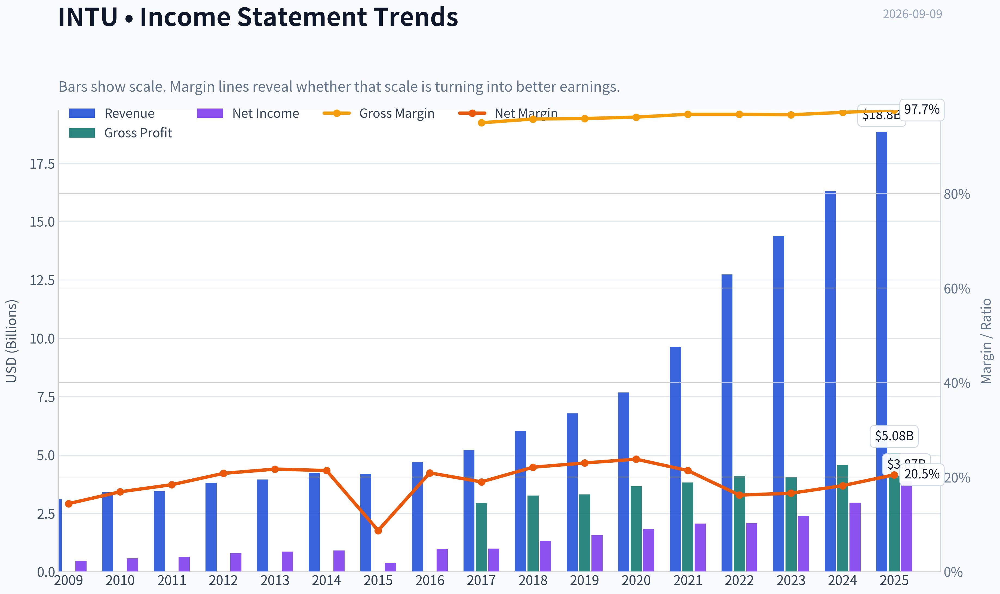

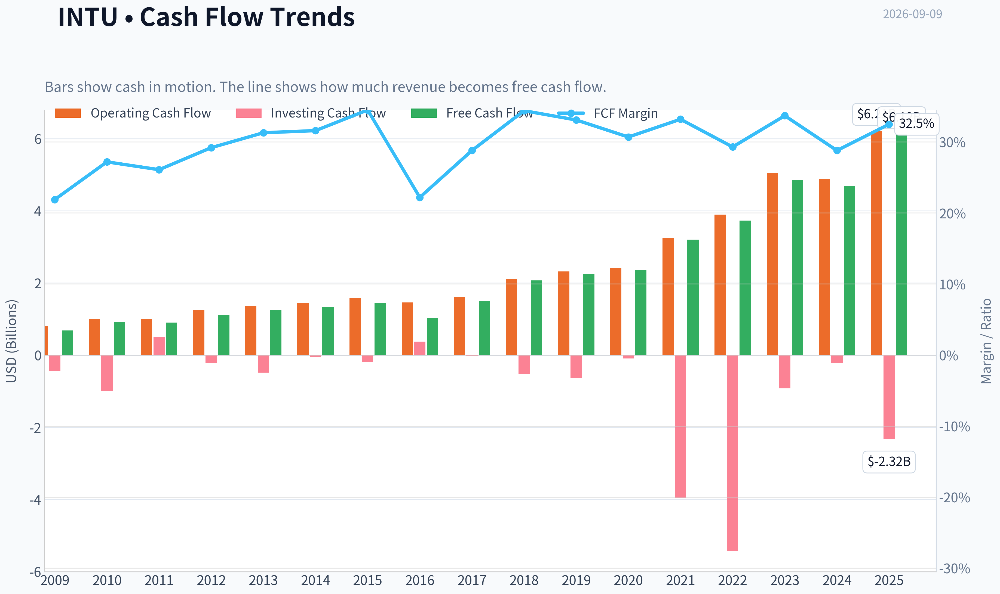

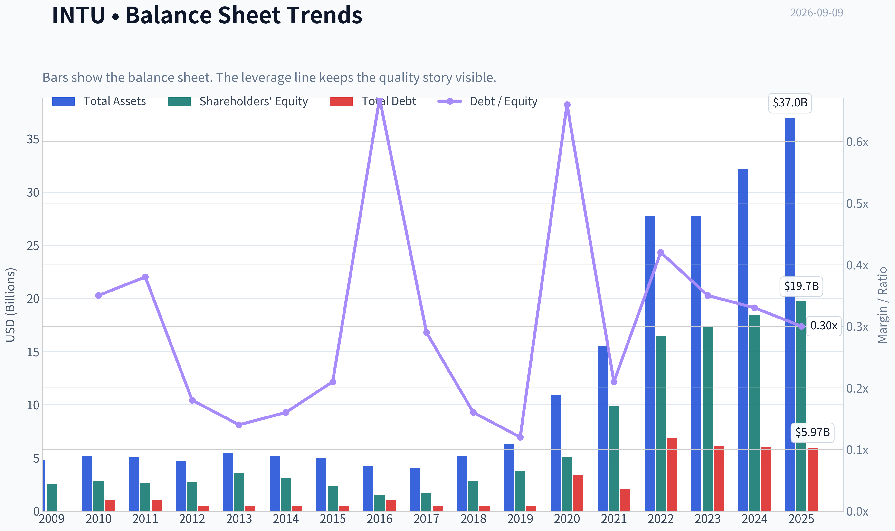

This graph tracks the profitability and return metrics (ROE, ROIC, Margins) of **INTU** over the past decade, highlighting capital efficiency trends.

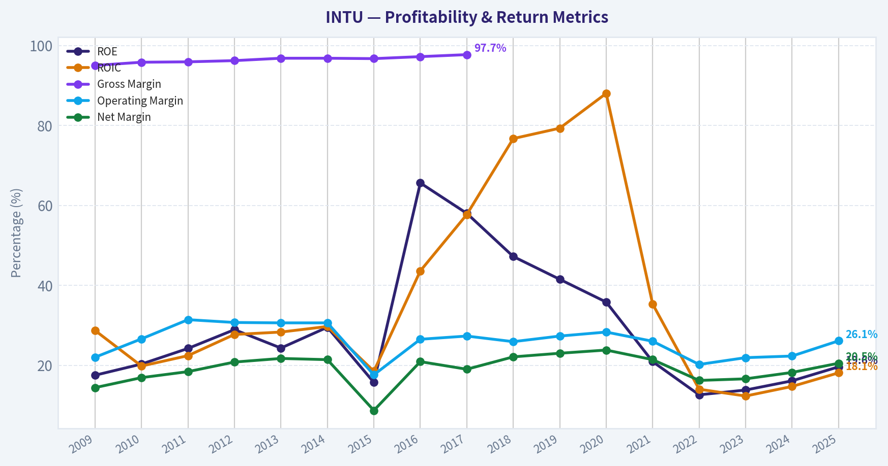

This chart illustrates the financial health of **INTU** over the last 10 years, mapping cash equivalents and free cash flow against total obligations (Debt).

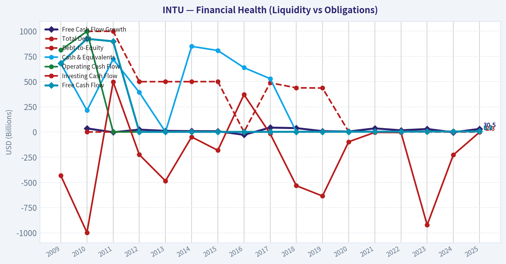

This breakdown chart from <em>Revenue Breakdown</em> shows the proportional composition for **INTU** - useful for understanding what drives or risks the business.

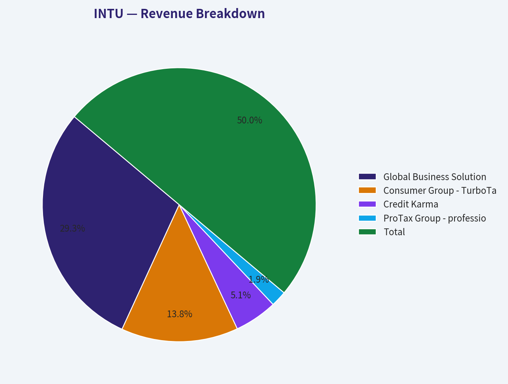

---

### Intrinsic Value Analysis (Buffett)

> *Following Warren Buffett's value investing philosophy: Circle of Competence, Economic Moat, Management Quality, and Margin of Safety.*

#### Intrinsic Value Snapshot

Price is what you pay. Intrinsic value is what the business may be worth based on the cash it can create for owners over time. We show a range, not one magic number.

- Current Price: $313.94
- Value Range (conservative to optimistic across both DCF methods): $312.04 to $1,229.92

##### Owner Earnings (Buffett Method)
- Net Income: $3,869,000,000.00
- Depreciation & Amortization: $809,000,000.00
- Capital Expenditures: $-84,000,000.00
- Working Capital Changes: $-206,000,000.00
- Owner Earnings: $4,800,000,000.00

##### Intrinsic Value
###### Buffett Method
Uses owner earnings. Stricter, and usually more conservative.
- Conservative: $312.04
- Average: $401.08
- Optimistic: $1,229.92
- Discount Rate: 10.0%

###### Cash Flow Method
Uses free cash flow. Better for companies spending heavily today to grow tomorrow.
- Conservative: $338.36
- Average: $448.57
- Optimistic: $815.08
- Discount Rate: 10.0%

ANALYST STANCE: **ADVOCATE**

#### Intuit Inc. (INTU) - Buffett-Style Value Investment Report

Intuit is a high-quality, asset-light software franchise with entrenched positions in tax preparation, small-business accounting, payroll, personal finance, and financial workflow automation. At a current price of **$314**, the stock trades below the blended intrinsic value estimate of **$365.38**, offering a **14.1% margin of safety**. For a wide-moat, high-return, recurring-revenue business, that is enough to justify an **ADVOCATE** stance.

---

#### 1. Factor Scorecard

| Factor | Score | Evidence |
|---|---:|---|
| Circle of Competence & Business Simplicity | 4.5 / 5 | Intuit makes money by selling tax, accounting, payroll, and financial software to consumers, small businesses, accountants, and self-employed users. The model is easy to understand: mission-critical software, recurring usage, strong brand trust, and embedded customer workflows. |
| Moat Test | 4.5 / 5 | TurboTax and QuickBooks are deeply entrenched brands. QuickBooks benefits from switching costs, accountant ecosystem effects, data history, payroll integration, and workflow lock-in. TurboTax faces regulatory pressure, but brand and user familiarity remain powerful. |
| Management Quality & Capital Allocation | 4.0 / 5 | Management has expanded Intuit from desktop tax/accounting software into a broader AI-enabled financial platform. Acquisitions such as Credit Karma and Mailchimp were strategically logical, though not obviously cheap. Capital allocation is generally rational, with continued reinvestment, buybacks, and modest dividend support. |
| Industry Structure | 4.0 / 5 | Tax and small-business financial software are attractive markets with recurring demand, high margins, and significant customer inertia. Competition exists from H&R Block, Xero, ADP, fintech tools, and potential government tax filing initiatives, but Intuit remains one of the scaled leaders. |
| Gate 5: Quality/Solvency Hard Floor | Not Tripped | The business is profitable, cash-generative, growing revenue, and has no evidence of distress. ROE is 19.6%, FCF yield is 7.1%, and the current ratio is 1.36. |

**Key Takeaways:** Intuit passes the Buffett quality test comfortably. The business is understandable, predictable, cash-generative, and protected by brands, switching costs, and ecosystem depth. The hard solvency floor is clearly not triggered.

---

#### 2. Moat Analysis

| Moat Source | Assessment | Evidence |
|---|---|---|
| Intangible Assets | Strong | TurboTax and QuickBooks are category-defining brands. Tax filing requires trust, accuracy, and regulatory confidence, which favor established providers. |
| Switching Costs | Very Strong | QuickBooks users accumulate years of accounting history, payroll records, invoices, tax data, integrations, accountant relationships, and operational workflows. Switching is possible but disruptive. |
| Cost Advantage | Moderate to Strong | Intuit benefits from software scale economics: once built, products can serve millions of users with high incremental margins. Marketing and compliance costs are meaningful, but scale helps absorb them. |
| Network / Ecosystem Effects | Strong | Accountants, small businesses, payroll services, payment tools, app integrations, and financial data all reinforce QuickBooks' position. More users attract more partners and deeper integrations. |
| Moat Rating | Wide & Stable to Widening | AI-driven automation, data depth, and broader platform integration could strengthen the moat if execution remains strong. |

**Key Takeaways:** Intuit's moat is not based on physical assets; it is based on trust, workflow captivity, data, and ecosystem scale. QuickBooks is the crown jewel because it becomes more valuable and harder to replace the longer customers use it. TurboTax is still powerful, though more exposed to regulation.

---

#### 3. Management Quality Assessment

| Area | Assessment |
|---|---|
| Owner Mentality | Good. Intuit is not founder-led today, but management has generally focused on long-term platform expansion rather than harvesting the legacy franchise. |
| Candor & Accounting Quality | Good. The business has strong cash conversion and software economics. Investors should monitor stock-based compensation and acquisition-related adjustments, but the underlying cash generation is strong. |
| Capital Allocation | Good to Very Good. Reinvestment into AI, small-business services, tax automation, and ecosystem expansion is rational. Credit Karma and Mailchimp broadened the platform, though acquisition pricing requires ongoing scrutiny. |
| Shareholder Returns | Balanced. Intuit uses buybacks and dividends while still prioritizing growth reinvestment. This is appropriate for a business with strong reinvestment opportunities. |
| Main Watch Item | Regulation around consumer tax filing and competition in small-business software remain the key management tests. |

Management has behaved more like a long-term compounder operator than a short-term earnings manager. The best evidence is the continued broadening of Intuit's platform from tax software into a connected financial operating system for consumers and small businesses.

---

#### 4. Financial Summary

| Metric | Current / Latest Data |
|---|---:|
| Share Price | $314 |
| Market Capitalization | $85.87B |
| P/E Ratio | 19.1x |
| Implied EPS | ~$16.46 |
| ROE | 19.6% |
| Revenue Growth YoY | 15.6% |
| FCF Yield | 7.1% |
| Implied Free Cash Flow | ~$6.10B |
| Implied FCF per Share | ~$22.29 |
| Current Ratio | 1.36 |
| Headline Intrinsic Value | $365.38 |
| Margin of Safety vs. Price | 14.1% |
| Reverse DCF Implied Growth | ~11.8% per year for 10 years |
| Trailing 3-Year Growth | 15.8% |
| Trailing 5-Year Growth | 22.1% |

**Key Takeaways:** Intuit combines strong growth with a reasonable valuation. A 7.1% free-cash-flow yield is attractive for a business growing revenue at a mid-teens rate. The market is pricing in about 11.8% annual growth, which is demanding but not unreasonable given Intuit's historical performance and platform strength.

---

#### 5. Owner Earnings Calculation

| Owner Earnings Component | Per-Share Estimate | Company-Wide Estimate |
|---|---:|---:|
| Net Income Proxy from P/E | ~$16.46 | ~$4.50B |
| Cash Conversion / Non-Cash & Working Capital Benefit | ~$5.83 | ~$1.59B |
| Maintenance CapEx Burden | Low, reflected in FCF proxy | Low relative to revenue base |
| Normalized Owner Earnings Proxy | ~$22.29 | ~$6.10B |

**Key Takeaways:** Intuit's cash earnings are meaningfully stronger than accounting earnings, which is typical of high-quality software businesses with low capital intensity. The estimated owner earnings proxy of about **$22.29 per share** is the key input for valuation. This confirms that reported profit is backed by real cash flow.

---

#### 6. Three-Scenario DCF Valuation

Using normalized owner earnings of approximately **$22.29 per share** and a **10% discount rate**:

| Scenario | Assumption | Intrinsic Value / Share |
|---|---|---:|
| A: No Growth | Owner earnings capitalized at 10% | ~$223 |
| B: GDP Growth | 3% perpetual growth | ~$328 |
| C: Historical Growth Haircut | 10% growth for 10 years, then 3% terminal growth | ~$551 |
| Blended Business-Model Routed Intrinsic Value | Weighted blend of DCF methods | $365.38 |
| 3-Model Valuation Spread | Owner Earnings / FCF / Damodaran FCFF | $401.08 / $448.57 / $335.37 |

**Key Takeaways:** The no-growth case is below today's price, which means investors are paying for continued compounding. However, the GDP-growth case is close to the current price, and the historical-growth haircut case is far above it. The blended intrinsic value of **$365.38** suggests the stock is priced attractively for its quality.

---

#### 7. Margin of Safety Analysis

| Valuation Measure | Value |
|---|---:|
| Current Price | $314 |
| Headline Intrinsic Value | $365.38 |
| Dollar Upside to Intrinsic Value | ~$51.38 |
| Margin of Safety | 14.1% |
| Quality-Adjusted Required MOS | ~10% to 15% |
| Valuation Score | 4.0 / 5 |

**Key Takeaways:** Intuit does not offer a deep bargain-bin discount, but it does not need one. For a wide-moat, high-return, predictable compounder, a **10% to 15% margin of safety** is acceptable. At a 14.1% discount to estimated intrinsic value, the current price qualifies as fair-to-attractive.

---

#### 8. Final Buffett Scorecard

| Criterion | Weight | Score | Weighted Contribution |
|---|---:|---:|---:|
| Moat Width & Durability | 25% | 4.5 | 1.13 |
| Valuation / Margin of Safety | 20% | 4.0 | 0.80 |
| Capital Returns - ROIC vs. WACC | 15% | 4.0 | 0.60 |
| Business Understanding & Predictability | 12% | 4.5 | 0.54 |
| Management Quality & Capital Allocation | 12% | 4.0 | 0.48 |
| Reinvestment Runway | 8% | 4.0 | 0.32 |
| Balance Sheet Strength | 4% | 4.0 | 0.16 |
| Industry Structure | 4% | 4.0 | 0.16 |
| Final Weighted Score | 100% |  | **4.19 / 5** |

**Key Takeaways:** Intuit scores as a high-quality compounder with a real moat, strong cash generation, and a reasonable price. The valuation is not distressed-cheap, but it is attractive relative to the quality of the business. A score above 4.0 supports an **ADVOCATE** stance.

---

#### 9. Investment Stance

| Stance | Conviction | Rationale |
|---|---|---|
| **ADVOCATE** | Medium-High | Intuit is a wide-moat software compounder trading at a fair-to-attractive price. The stock offers a 14.1% margin of safety against intrinsic value, strong FCF yield, high ROE, and durable reinvestment opportunities. |

Intuit fits Buffett's modern compounder framework: understandable economics, recurring customer need, trusted brands, high returns on capital, low capital intensity, and a long runway for reinvestment. The main risks are tax-filing regulation, competition in small-business software, and execution around AI and acquisitions. Still, at **$314**, the balance of quality and valuation is compelling.

**Final View:** **ADVOCATE - buyable at today's price for long-term investors, with medium-high conviction.**
#### Valuation Bridge

This bridge places the current market price beside each intrinsic value lens so readers can see whether upside depends on one method or shows up across several methods.

| Scenario | Intrinsic Value / Share |
| --- | ---: |
| Buffett Method | $401.08 |
| Cash Flow Method | $448.57 |
| Damodaran Method | $335.37 |
| Current Price | $313.94 |

#### Key Takeaways

If one method is far above the others, the upside case depends on a specific modelling assumption. When several methods cluster together, the valuation story is more robust.

#### Valuation Visuals

This comparison chart from *Latest Earnings Snapshot* stacks current figures against historical benchmarks for **INTU**, making it easy to see where the company trades relative to its own averages.

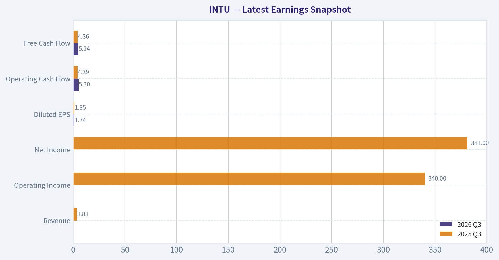

This comparison chart from *Current vs. 10-Year Historical Average* stacks current figures against historical benchmarks for **INTU**, making it easy to see where the company trades relative to its own averages.

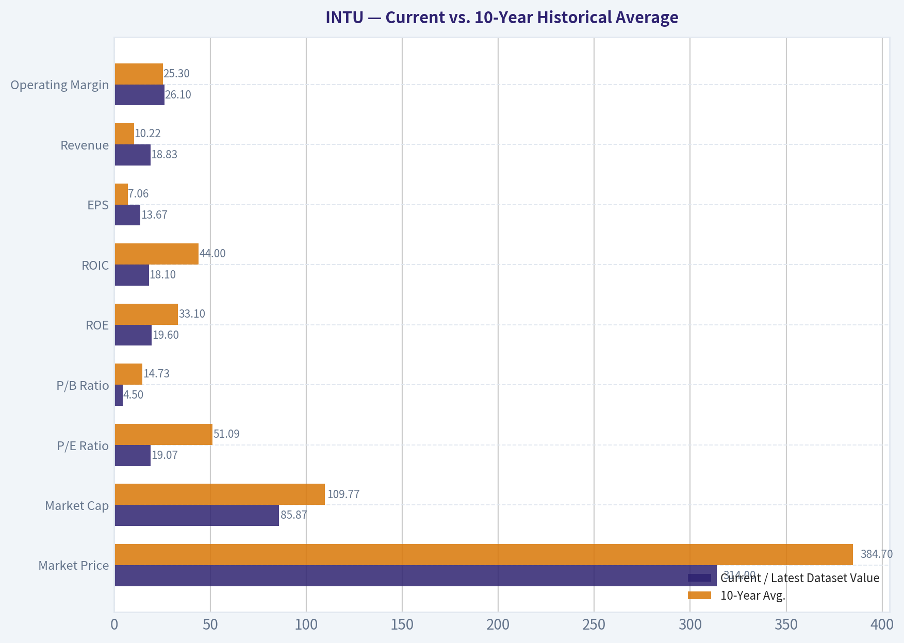

This comparison chart from *Buffett-Style Owner Earnings DCF* stacks current figures against historical benchmarks for **INTU**, making it easy to see where the company trades relative to its own averages.

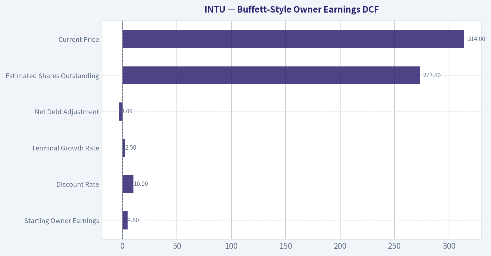

This comparison chart from *Intrinsic Value Cross-Check* stacks current figures against historical benchmarks for **INTU**, making it easy to see where the company trades relative to its own averages.

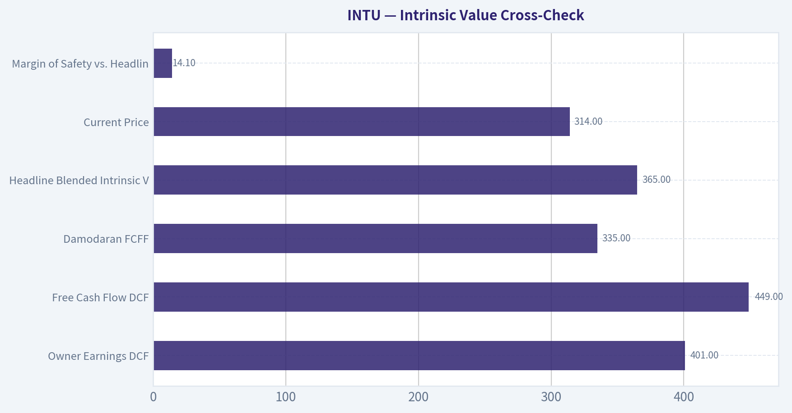

This comparison chart from *Financial Summary* stacks current figures against historical benchmarks for **INTU**, making it easy to see where the company trades relative to its own averages.

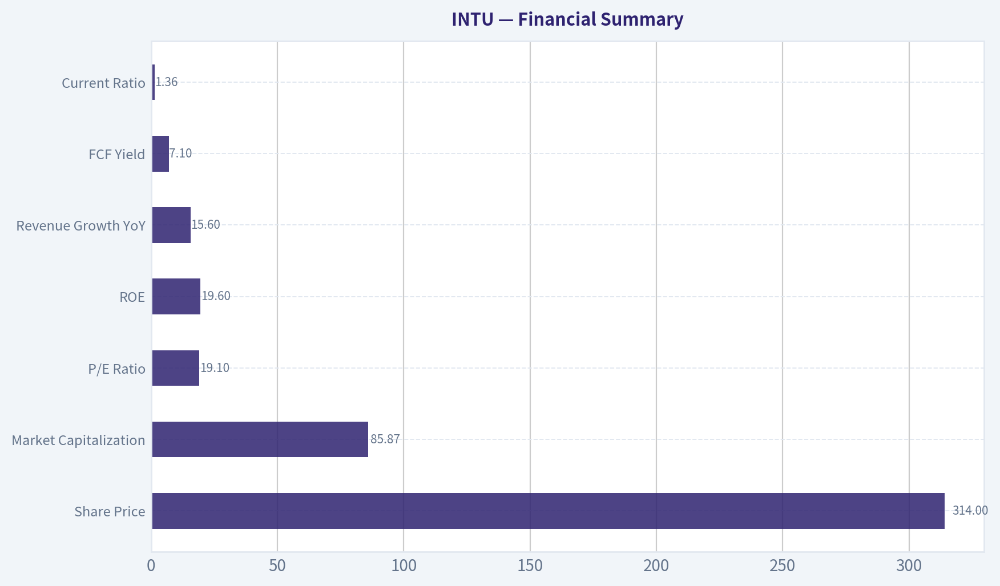

---

### Trend & Growth Analysis (Lynch/Druckenmiller/Fisher)

> *Following Peter Lynch's GARP, Stanley Druckenmiller's macro-aware approach, and Philip Fisher's scuttlebutt methodology.*

ANALYST STANCE: **ADVOCATE**

#### INTU Growth Investment Report - Intuit Inc.

**Company:** Intuit Inc.
**Ticker:** INTU
**Current price:** $314
**Market cap:** $85.9B
**Core businesses:** TurboTax, QuickBooks, Credit Karma, Mailchimp
**Analyst view:** High-quality GARP compounder with AI-driven product inflection, strong free cash flow, and reasonable valuation. Not a classic early-stage ten-bagger, but attractive as a durable compounding growth position.

---

#### 1. Lynch Classification

| Lynch Category | INTU Fit | Rationale |
|---|---:|---|
| Slow Grower | No | Revenue growth is well above GDP-like growth. |
| Stalwart | Partial | INTU is mature, profitable, and dominant in tax/accounting software. |
| Fast Grower | Yes, lower-end | YoY revenue growth of 15.6% puts it near fast-grower territory. |
| Cyclical | Limited | SMB exposure creates some economic sensitivity, but tax/accounting demand is recurring. |
| Turnaround | No | Business is already healthy. |
| Asset Play | No | Value is in software, brand, data, and ecosystem, not hidden assets. |

**Key Takeaways:** Intuit is best classified as a **fast-growing stalwart**. It is not a small-cap rocket ship, but it has enough revenue growth, profitability, and AI/product optionality to qualify as a growth compounder. The Lynch-style appeal is that the story is simple, the moat is strong, and valuation is not excessive.

---

#### 2. The Story in 3 Bullets

| Story Element | Explanation |
|---|---|
| "Operating system for financial lives" | Consumers use TurboTax and Credit Karma; small businesses use QuickBooks, payroll, payments, and Mailchimp. |
| AI can increase monetization | Intuit Assist and embedded AI can automate tax prep, bookkeeping, marketing, lending, and financial recommendations. |
| Ecosystem flywheel | More customer data improves product recommendations, cross-sell, automation, and switching costs. |

**Key Takeaways:** Intuit's story is easy to understand: it helps people and small businesses manage money, taxes, accounting, credit, and growth. The growth thesis is that AI turns Intuit from a software tool into a financial decision engine. If successful, this can raise ARPU, retention, and product penetration across a very large installed base.

---

#### 3. TAM Analysis and 10x Test

| Metric | Estimate / View |
|---|---:|
| Current revenue growth | 15.6% YoY |
| Estimated current revenue base | Roughly $20B+ annualized |
| 10x revenue target | Roughly $200B+ |
| Core TAM | Consumer tax, SMB accounting, payroll, payments, marketing software, credit/financial products |
| TAM growth | Moderate to strong, boosted by AI automation and SMB digitization |
| Can INTU 10x revenue and still be under 20% TAM share? | Unclear / difficult |

**Key Takeaways:** Intuit has a long runway, but the **10x test is demanding** because the company is already large. A 10x from here would require massive expansion beyond tax and accounting into broader SMB finance, payments, lending, marketing, and AI-driven business operations. The more realistic growth case is not a pure ten-bagger, but a durable multi-bagger compounder.

---

#### 4. Revenue Growth Trend

| Metric | Current Data |
|---|---:|
| YoY revenue growth | 15.6% |
| Reverse-DCF implied growth | ~11.8% annually for 10 years |
| Trailing 3-year growth | 15.8% |
| Trailing 5-year growth | 22.1% |
| Pattern | Stable high growth, modest deceleration from 5-year trend |

**Key Takeaways:** Intuit's revenue growth remains healthy at 15.6%, but it has moderated from its stronger 5-year pace. This is not a red flag by itself; it is normal for a company of this scale. The key investment question is whether AI, QuickBooks expansion, Credit Karma recovery, and Mailchimp cross-sell can keep growth in the mid-teens or better.

---

#### 5. Unit Economics

| Metric | Assessment |
|---|---|
| LTV/CAC | Not disclosed; likely strong due to recurring SMB workflows and tax-season brand dominance |
| Net revenue retention | Not disclosed; likely healthy in QuickBooks ecosystem, less applicable to consumer tax |
| Payback period | Not disclosed; likely attractive in established products |
| FCF yield | 7.1% |
| Estimated FCF margin | High, likely around 25-30%+ depending on revenue base |
| Rule of 40 | Approx. 40%+ using 15.6% growth plus high FCF margin |

**Key Takeaways:** Intuit appears to have excellent unit economics even though full SaaS-style metrics are not disclosed. The strongest evidence is the company's high free cash flow yield, recurring SMB usage, pricing power, and dominant customer acquisition channels. On a Rule of 40 basis, INTU looks like an efficient growth business rather than a growth-at-any-cost company.

---

#### 6. Inflection Point Assessment

| Potential Inflection | Status | Investment Importance |
|---|---|---|
| AI product cycle | Positive | Intuit Assist can deepen automation across tax, accounting, marketing, and credit. |
| QuickBooks ecosystem expansion | Positive | Payroll, payments, capital, and services increase ARPU. |
| Credit Karma normalization | Watch | Macro-sensitive but could recover if consumer credit conditions improve. |
| Margin leverage | Positive | High software margins and scale support earnings growth. |
| Competitive pressure | Watch | AI-native startups and large platforms could attack parts of the stack. |

**Key Takeaways:** The most important inflection is AI. If Intuit successfully embeds AI into daily financial workflows, it can move from selling software modules to selling automated outcomes. That could expand TAM, increase customer lock-in, and support a higher long-term earnings base than the market currently discounts.

---

#### 7. Macro Setup

| Macro Factor | INTU Impact |
|---|---|
| Interest rates | Falling rates would be positive for growth-stock multiples and SMB activity. |
| Inflation | Mixed; may pressure consumers/SMBs, but Intuit has pricing power. |
| SMB formation | Positive if entrepreneurship and digital business tools continue expanding. |
| Consumer credit cycle | Important for Credit Karma monetization. |
| Secular themes | AI, cloud software, fintech, SMB digitization, tax automation. |

**Key Takeaways:** The macro setup is acceptable, with upside if rates decline and SMB confidence improves. Intuit benefits from durable secular themes, especially AI and cloud-based financial automation. The main macro sensitivity is Credit Karma, which can be pressured by tighter lending conditions.

---

#### 8. Fisher 15 Points Score

| Fisher Point | Score / 5 | Comment |
|---|---:|---|
| Market potential | 4 | Large markets across tax, accounting, payroll, payments, credit, and marketing. |
| New product determination | 4 | AI and ecosystem expansion are strategic priorities. |
| R&D effectiveness | 4 | Strong track record of product evolution and acquisitions. |
| Sales organization | 4 | Excellent consumer brand and SMB distribution. |
| Profit margin | 5 | Software-like profitability and strong FCF. |
| Margin improvement | 4 | Scale and AI automation may support leverage. |
| Labor/personnel relations | 3 | No major issue identified from available data. |
| Executive relations | 4 | Mature management structure. |
| Management depth | 4 | Deep operating bench across major segments. |
| Cost analysis/accounting | 4 | Strong financial discipline. |
| Moat characteristics | 5 | Brand, data, switching costs, tax complexity, ecosystem. |
| Long-range profit outlook | 4 | Durable growth plus high margins. |
| Dilution risk | 4 | Not reliant on constant equity issuance. |
| Candor | 4 | Established public-company communication. |
| Integrity | 4 | No major issue identified in available data. |
| **Total** | **61 / 75** | **Good** |

**Key Takeaways:** Intuit scores well on Fisher's framework, especially on market potential, margins, moat, and long-term profit outlook. The score is not perfect because parts of the business are mature and some key SaaS-style metrics are not disclosed. Overall, this is a high-quality company with durable competitive advantages.

---

#### 9. Valuation Analysis

| Valuation Metric | Current View |
|---|---:|
| Current price | $314 |
| Market cap | $85.9B |
| P/E | 19.1x |
| FCF yield | 7.1% |
| Revenue growth | 15.6% |
| PEG ratio | ~1.2x |
| Headline intrinsic value | $365.38 |
| Margin of safety vs. price | 14.1% |
| Owner earnings value | $401.08 |
| FCF DCF value | $448.57 |
| Damodaran FCFF value | $335.37 |
| Reverse-DCF implied growth | ~11.8% annually for 10 years |

**Key Takeaways:** Valuation looks reasonable for a business of Intuit's quality. A 19x P/E, 7.1% FCF yield, and mid-teens growth rate create a favorable GARP setup. The stock is not screamingly cheap, but the market does not appear to be pricing in heroic assumptions.

---

#### 10. Scenario Analysis

| Scenario | Assumptions | Implied View |
|---|---|---|
| Bear | Growth slows toward low double digits; Credit Karma remains weak; AI benefits are modest | Stock may be fairly valued to slightly undervalued. |
| Base | Mid-teens growth continues; margins remain strong; AI improves ARPU and retention | Shares offer attractive compounding potential. |
| Bull | AI materially expands TAM; QuickBooks becomes broader SMB operating platform; Credit Karma recovers | Upside to intrinsic value estimates above $400. |

**Key Takeaways:** Downside appears moderated by Intuit's profitability and cash generation. The base case supports continued compounding, while the bull case depends on AI becoming a real monetization engine rather than just a product feature. The stock's best upside comes from sustained mid-teens growth combined with high free cash flow conversion.

---

#### 11. Growth Investor Scorecard

| Criterion | Weight | Score / 5 | Weighted Score |
|---|---:|---:|---:|
| The Story | 10% | 4.5 | 0.45 |
| TAM & Runway | 20% | 3.8 | 0.76 |
| Revenue Growth | 20% | 4.0 | 0.80 |
| Unit Economics | 15% | 4.5 | 0.68 |
| Competitive Position | 10% | 4.5 | 0.45 |
| Management Quality | 10% | 4.0 | 0.40 |
| Macro Setup | 5% | 3.5 | 0.18 |
| Profitability Path | 5% | 4.5 | 0.23 |
| Valuation | 5% | 4.0 | 0.20 |
| **Total** | **100%** |  | **4.15 / 5.00** |

**Key Takeaways:** Intuit scores as an **ADVOCATE** under the growth investor framework. The strongest positives are business quality, unit economics, competitive position, and valuation discipline. The main limitation is that Intuit is already large, so investors should expect durable compounding rather than early-stage hypergrowth.

---

#### 12. Position Size Stance

| Portfolio Role | Suggested Stance |
|---|---|
| Growth portfolio role | Core compounder |
| Position size | 4-6% for diversified growth investors |
| Add aggressively? | Prefer adding on market pullbacks or company-specific overreaction |
| Ten-bagger potential | Low to moderate from current scale |
| Multi-bagger potential | Good over long holding period if AI and SMB ecosystem expansion work |

**Key Takeaways:** INTU is suitable as a core growth compounder, not a speculative high-upside satellite. The valuation is reasonable enough to own, but not so cheap that position sizing should be reckless. Best strategy is to accumulate patiently and let compounding do the work.

---

#### 13. Key Risks and Catalysts

| Category | Item | Impact |
|---|---|---|
| Risk | AI-native competitors attack tax, bookkeeping, or SMB workflows | Could pressure pricing and retention. |
| Risk | Regulatory scrutiny around tax filing and consumer finance | Could affect TurboTax or Credit Karma economics. |
| Risk | SMB slowdown | Could reduce QuickBooks growth and payment volume. |
| Risk | Credit Karma weakness | Macro-sensitive monetization can be volatile. |
| Catalyst | AI adoption and Intuit Assist monetization | Could raise ARPU and deepen moat. |
| Catalyst | QuickBooks payroll/payments/capital penetration | Expands revenue per SMB customer. |
| Catalyst | Rate cuts and credit normalization | Could help Credit Karma and growth-stock multiples. |
| Catalyst | Margin expansion | Could drive earnings faster than revenue. |

**Key Takeaways:** The biggest risk is that AI lowers barriers to entry in parts of Intuit's business. The biggest catalyst is the opposite: Intuit uses its data, brand, and distribution to make AI a moat-strengthening tool. If management executes, earnings growth over the next 2-3 years could exceed what the current valuation implies.

---

#### Final View

INTU is an **ADVOCATE** as a high-quality GARP compounder. The company combines mid-teens revenue growth, strong free cash flow, dominant franchises, and an emerging AI-driven product cycle. It is unlikely to be a clean ten-bagger from today's market cap, but it has an attractive setup for long-term compounding with reasonable downside protection from profitability and valuation.

---

### Market Technical Analysis

ANALYST STANCE: **WATCH**

#### INTU Technical Indicator Report - Current Context

INTU remains in a **major long-term downtrend**, despite a meaningful summer rebound from the June lows. The stock fell from the mid-$600s in late 2025 to a June 2026 low near the mid-$250s, then recovered into the high-$360s by late August. That rebound has now weakened sharply: the latest confirmed close from the Yahoo Finance data is **$318.93 on 2026-09-08**, well below the recent August recovery high of **$369.92**.

The current setup is best described as a **damaged long-term trend with a weakening short-term rebound**. Price is still slightly above the 50-day SMA, but it has fallen below the 10-day EMA and VWMA, while the 200-day SMA continues to decline far above current price. This combination suggests that the market is no longer rewarding near-term strength, and buyers need to defend the 50-day area quickly to avoid another leg lower.

#### Selected Indicators and Why They Are Relevant

I selected the following 8 indicators because they provide complementary insight across **trend, momentum, volatility, and volume confirmation**:

- **close_10_ema**: Captures near-term momentum deterioration.
- **close_50_sma**: Identifies whether the summer rebound still has medium-term structure.
- **close_200_sma**: Confirms the broader bearish regime.
- **macd** and **macds**: Used together to evaluate momentum crossovers and trend acceleration.
- **rsi**: Measures whether the pullback is oversold or simply weakening.
- **atr**: Helps frame risk and stop placement in a volatile stock.
- **vwma**: Tests whether volume-weighted price action supports the rebound.

#### Trend Structure

INTU's long-term trend remains bearish. The **200-day SMA is around $421.41**, while the stock's latest confirmed close is **$318.93**, leaving price roughly **25% below** its long-term trend benchmark. That is not a mild discount to trend; it is a clear sign that the broader institutional trend remains impaired.

The medium-term picture is more nuanced. The **50-day SMA has been rising**, from the high-$290s in late July to about **$317.52** by 2026-09-09. This shows that the June-to-August rebound was strong enough to improve the medium-term average. However, price is now sitting only marginally above that zone based on the latest confirmed close, meaning the stock is testing an important support area rather than cleanly trending higher.

The **10-day EMA has rolled over**, falling from roughly **$353.98 on 2026-08-31** to **$336.43 on 2026-09-09**. Price below a declining short-term EMA signals that sellers have regained short-term control. Until INTU can reclaim the 10-day EMA area, short-term rallies may be treated as relief bounces rather than durable reversals.

#### Momentum Analysis

MACD remains above zero, but the signal quality has deteriorated. On 2026-09-09, **MACD was 1.51**, while the **MACD signal line was 7.99**. That means MACD is now below its signal line by more than 6 points, indicating a bearish momentum crossover after the summer rebound.

This is an important distinction: the MACD is not deeply negative yet, but it is losing altitude quickly. The stock's prior upward momentum has faded, and the risk is that MACD crosses below zero if price continues to break down. That would confirm that the rebound phase has transitioned into a more bearish momentum regime.

RSI reinforces this caution. The RSI fell from near **69 on 2026-08-24** to around **39 on 2026-09-09**. This is a sharp momentum reset, but it is **not yet deeply oversold**. In practical terms, INTU is weak enough to warn against aggressive dip-buying, but not washed out enough to offer a high-confidence oversold reversal signal.

#### Volume and Participation

VWMA gives one of the clearest warnings in the current setup. The latest VWMA reading is around **$347.58**, far above the latest confirmed close of **$318.93**. Price trading meaningfully below VWMA suggests that recent volume-weighted participation is occurring at higher levels, while current price action is failing to hold those levels.

This is especially concerning because the selloff since late August included elevated-volume downside sessions. The large volume on weakness implies that sellers are not merely passive; there has been active distribution or forced de-risking. For a bullish reversal to become more credible, INTU would need to reclaim the VWMA area and hold it on improving volume.

#### Volatility and Risk Management

ATR is elevated at roughly **$15.31-$15.84**, which is close to **5% of the latest confirmed share price**. That means INTU can move meaningfully in a single session, and tight stops may be easily triggered by normal volatility.

For traders, this argues for smaller position sizing and wider, technically justified stops. A move below the 50-day SMA zone would be a notable warning, but because ATR is high, traders should avoid placing stops too close to obvious round-number levels. Volatility is still high enough that confirmation matters more than intraday noise.

#### Trading Interpretation

The key battleground is the **$316-$318 area**, where the 50-day SMA and recent price are converging. If INTU holds this zone and quickly reclaims the 10-day EMA near the mid-$330s, the stock could stabilize and attempt another recovery toward the $345-$350 VWMA area. However, if price closes decisively below the 50-day SMA, the summer rebound structure would weaken materially.

The bullish case requires three improvements: price reclaiming the **10-day EMA**, MACD stabilizing or turning upward again, and price moving back above the **VWMA**. Without those confirmations, the current setup favors caution. The long-term trend remains bearish, the short-term trend has rolled over, and momentum is not yet washed out enough to justify aggressive contrarian buying.

| Category | Indicator | Latest Reading / Context | Interpretation | Trading Implication |
|---|---:|---:|---|---|
| Short-term trend | close_10_ema | ~336.43 | Price is below a falling 10-day EMA | Short-term sellers are in control unless price reclaims the mid-$330s |
| Medium-term trend | close_50_sma | ~317.52 | Price is testing the 50-day support area | A decisive break below this level would damage the summer rebound |
| Long-term trend | close_200_sma | ~421.41 | Price remains far below the declining 200-day SMA | Broader trend remains bearish and structurally weak |
| Momentum | macd | ~1.51 | MACD is still positive but falling quickly | Rebound momentum is fading |
| Momentum signal | macds | ~7.99 | MACD is below the signal line | Bearish crossover pressure is active |
| Momentum / exhaustion | rsi | ~38.97 | Weak but not deeply oversold | Downside pressure exists, but no strong oversold reversal signal yet |
| Volatility | atr | ~15.31 | Daily volatility remains elevated | Use smaller position sizes and avoid tight stops |
| Volume confirmation | vwma | ~347.58 | Price is well below volume-weighted average | Recent volume-weighted participation does not confirm bullish strength |

Key Takeaways: INTU is at an important technical decision point. The stock is trying to hold near its 50-day SMA, but it remains below the 10-day EMA and VWMA, while the long-term 200-day SMA is still far above price. Momentum has weakened sharply, and the current setup supports a **watchful, cautious stance** rather than an aggressive long entry.

---

### Options Market Analysis

> *Reading options flow - put/call ratios, IV skew, and unusual activity - to gauge institutional positioning and event-driven risk.*

ANALYST STANCE: **WATCH**

#### INTU Options Market Sentiment Report
*Options data as of 2026-09-09*

#### 1. Put/Call Ratio Analysis

| Expiration | Call OI | Put OI | Put/Call OI Ratio | Call Volume | Put Volume | Put/Call Volume Ratio | Read |
|---|---:|---:|---:|---:|---:|---:|---|
| 2026-09-11 | 3,332 | 3,898 | 1.17 | 1,379 | 1,482 | 1.07 | Front-week defensive / bearish hedge tilt |
| 2026-09-18 | 29,536 | 16,526 | 0.56 | 2,754 | 1,229 | 0.45 | Clear call-side concentration |
| 2026-09-25 | 1,127 | 1,482 | 1.31 | 171 | 200 | 1.17 | Light-volume put tilt |
| **Total Near-Term** | **33,995** | **21,906** | **0.64** | **4,304** | **2,911** | **0.68** | Slightly call-leaning vs. neutral |

**Key Takeaways:** INTU's total near-term put/call open interest ratio is **0.64**, slightly below the historical neutral baseline of roughly **0.7**, suggesting a mild call-side bias. The total put/call volume ratio of **0.68** is also close to neutral but marginally bullish. The important nuance is that the nearest weekly expiration is put-heavy, while the 2026-09-18 expiration has a much larger call open interest base.

The biggest directional clue is the **2026-09-18 expiration**, where call open interest of **29,536** substantially exceeds put open interest of **16,526**. That suggests traders are leaning toward upside exposure or call overwriting in the main near-term expiry. However, the front-week put/call ratios above 1.0 show some short-term hedging demand.

---

#### 2. Implied Volatility Assessment

| Expiration | ATM Call IV | ATM Put IV | Put IV Premium / Discount | IV Read |
|---|---:|---:|---:|---|
| 2026-09-11 | 52.9% | 58.4% | Puts +5.5 pts | Short-term downside protection bid |
| 2026-09-18 | 53.7% | 52.8% | Puts -0.9 pts | Balanced to slightly call-favored |
| 2026-09-25 | 53.6% | 50.6% | Puts -3.0 pts | Mild upside/chase premium |

**Key Takeaways:** Near-term ATM implied volatility is elevated in the low-to-high **50%** range, which implies the market is pricing a meaningful move in INTU. The front-week options show higher put IV than call IV, signaling some immediate downside concern. Later near-term expirations show call IV roughly equal to or above put IV, suggesting the fear bid fades after the closest expiration.

True OTM put-versus-call skew was not provided, so the skew read is based on ATM call/put IV differences rather than a full volatility surface. Based on the available data, skew is **not uniformly bearish**. The front week carries a put premium, but the 2026-09-18 and 2026-09-25 expirations are more balanced to mildly call-skewed.

No specific catalyst was included in the options data. That said, IV around **50%+** for a large-cap software name like INTU appears elevated and suggests traders are pricing either event risk, post-event uncertainty, or near-term macro/sector volatility.

---

#### 3. Unusual Options Activity

| Screen | Result | Interpretation |
|---|---|---|
| Volume > 5x Open Interest | None detected | No strong evidence of fresh aggressive positioning |
| Near-Term Unusual Calls | None detected | No clear institutional upside sweep signal |
| Near-Term Unusual Puts | None detected | No clear large fresh downside hedge or bearish bet |

**Key Takeaways:** There were **no contracts** in the near-term expirations where volume exceeded open interest by more than 5 times. That reduces the evidence for a fresh institutional directional bet. Current positioning looks more like existing open interest structure than a sudden new options-flow signal.

Because unusual activity is absent, the options read should rely more heavily on aggregate put/call ratios, IV levels, and open interest concentration. This lowers conviction in any aggressive directional call.

---

#### 4. Open Interest Concentration and Gamma Considerations

| Expiration | Call OI | Put OI | Total OI | Concentration Read |
|---|---:|---:|---:|---|
| 2026-09-11 | 3,332 | 3,898 | 7,230 | Moderate front-week hedging interest |
| 2026-09-18 | 29,536 | 16,526 | 46,062 | Dominant near-term expiry; likely most important for pinning |
| 2026-09-25 | 1,127 | 1,482 | 2,609 | Thin relative positioning |

**Key Takeaways:** The **2026-09-18 expiration** dominates INTU's near-term options positioning, with more than **46,000** contracts of total open interest. That expiration is the key area to watch for potential pinning, dealer hedging effects, and short-term gravitational pull. Strike-level open interest was not provided, so specific gamma wall or max-pain strike levels cannot be identified from this dataset.

The concentration of call open interest in the 2026-09-18 expiry could create upside sensitivity if INTU rallies toward large call strikes, but without strike-level data, the exact acceleration points are unknown. Conversely, the front-week put bias could dampen confidence in a clean bullish read over the next few sessions.

---

#### 5. Overall Options Sentiment Signal

| Category | Signal | Rationale |
|---|---|---|
| Put/Call Ratio | Slightly Bullish | Total near-term P/C OI ratio of **0.64** and volume ratio of **0.68** are modestly below neutral |
| IV Level | Elevated | ATM IV mostly around **50%-58%**, implying meaningful expected movement |
| Skew Direction | Mixed but not bearish overall | Front-week put premium, later expiries balanced to mildly call-favored |
| Unusual Activity | Neutral | No volume > 5x OI contracts detected |
| Open Interest | Mildly Bullish | Largest OI concentration is in 2026-09-18 calls |

**Key Takeaways:** The overall options signal for INTU is **NEUTRAL with a mild bullish tilt**. The main bullish input is the large call-side open interest concentration in the 2026-09-18 expiration, while the main caution is front-week put demand and elevated IV. Since there is no unusual options activity confirming fresh institutional buying, conviction is moderate to low.

#### Final Read: **NEUTRAL / WATCH**

INTU options positioning is not bearish, but it is also not strong enough to justify a high-conviction bullish call. Aggregate put/call ratios lean slightly bullish versus the neutral baseline, and the 2026-09-18 expiration shows meaningful call concentration. However, elevated IV and front-week put demand suggest traders are still paying for protection against near-term downside volatility.

**Primary driver:** Mild call-side open interest advantage, especially in the 2026-09-18 expiry, offset by short-term put hedging and no confirmed unusual activity.

---

## Research Team Commentary

> *The Research Manager synthesizes the Bull vs Bear debate into action-free commentary. This is a pre-risk view, not the final stance.*

To summarize the key points from both sides, the bull analyst makes a strong case for Intuit's enduring ecosystem, highlighting the immense switching costs of QuickBooks and the regulatory fortress of TurboTax. The bull points to excellent profitability metrics, like a 17.3 percent return on invested capital and mid-teens revenue growth, arguing that at a P/E of 19 and a 14 percent discount to intrinsic value, the market is offering a rare opportunity to buy a wonderful business at a fair price. On the flip side, the bear analyst delivers a sharp and necessary critique of Intuit's eroding moat. The bear highlights the existential threat of the IRS Direct File system and the commoditization of financial advice by AI. Furthermore, the bear correctly points out that aggressive acquisitions, specifically Credit Karma, have injected cyclicality and diluted returns on capital, while the stock's technical breakdown suggests institutional investors are still aggressively repricing the asset downward.

For my core takeaway, while Intuit remains a deeply entrenched software franchise, the combination of a broken technical regime, shifting regulatory headwinds, and a very thin margin of safety makes this a falling knife rather than a fat pitch. The current setup demands a defensive posture.

Moving into the rationale for this decision, looking at this through our adaptive value framework, we must balance business quality with price and current market reality. Intuit's core accounting software remains incredibly sticky, but the bear is entirely correct that the TurboTax moat is facing an unprecedented structural challenge from the government itself via IRS Direct File, alongside the rapid commoditization of digital workflows by AI. Furthermore, the business mix has worsened with the injection of cyclical consumer credit risks from Credit Karma. Because of these structural changes, Intuit is transitioning from a predictable, wide-moat compounder to a more mature platform facing genuine disruption and cyclicality.

Our framework dictates that a 10 to 15 percent margin of safety is only acceptable for pristine, highly predictable compounders. Given the evolving risks, Intuit no longer qualifies for that premium tier; it requires a much wider discount, closer to 25 or 35 percent to account for the uncertainty. A 14 percent discount to an intrinsic value of 365 dollars simply does not offer enough downside protection.

Most importantly, I must incorporate a painful lesson from a past mistake with this exact stock. Previously, I issued a neutral watch stance on Intuit after a significant drop, leaning too heavily on its historical business quality and perceived cheapness relative to past multiples. I completely underestimated the damaged technical regime and the reality that when a former high-flying growth stock breaks far below its 50-day and 200-day moving averages on heavy volume, it signals a regime shift and institutional de-risking. I learned that a good business is not automatically a good investment when the chart is broken and expectations are being violently downward-revised. Historical cheapness is a trap after a regime break. At 314 dollars, we are still seeing this technical damage play out. Price action is a primary piece of information, and the current structure tells us that the market is still actively repricing Intuit's long-term terminal growth and moat durability. We cannot step in front of this distribution phase just because the valuation looks a bit better than it did three years ago.

As for the monitoring plan, over the next one to four quarters, I will be watching for clear signs of technical and fundamental repair before reconsidering. First, I need to see the stock reclaim and hold its 50-day and 200-day moving averages to confirm that institutional selling has exhausted itself and overhead supply is clearing. Second, I will closely monitor the actual adoption rates and geographic expansion of the IRS Direct File program in the upcoming tax season to measure the real-world impact on TurboTax volumes and pricing power. Finally, I will watch for stabilization in the Credit Karma segment to see if the cyclical credit headwinds are abating. Until we see a much wider margin of safety or a definitive structural repair in the market trend, we must prioritize capital preservation.

Final stance: AVOID.

---

## Value Investing Team Commentary

> *The Investor translates the research view into an investment thesis before risk review. This is still not the final stance.*

Intuit (INTU) presents a classic dilemma for the value investor: it is a high-quality, high-ROIC business experiencing a severe "regime change" in both its technical structure and its fundamental narrative. Applying a Warren Buffett-style framework, we must look past the immediate price action to determine if the economic moat is truly eroding or if we are simply witnessing a temporary "cloud of uncertainty" that creates a long-term opportunity.

### 1. Business Quality and Durable Moat Analysis
Intuit's core strength remains the **QuickBooks ecosystem**. With a Return on Invested Capital (ROIC) of 17.3% and high switching costs, QuickBooks is a "toll bridge" business for small enterprises. Once a business integrates its accounting, payroll, and payments into Intuit's platform, the friction of leaving is immense. This is a durable, high-visibility growth franchise.

However, the **TurboTax moat** is facing a structural shift. The IRS Direct File initiative represents a government-sponsored "free" competitor entering a space where Intuit previously enjoyed a regulatory-induced monopoly. While Intuit has historically lobbied successfully against such threats, the current political and technological climate (AI-driven automation) makes the threat more tangible. Furthermore, **Credit Karma** has introduced a cyclical element to what was once a steady, counter-cyclical tax and accounting business. This "impurity" in the business model justifies a more cautious valuation.

### 2. Quality-Scaled Margin of Safety (MoS)
Our adaptive framework requires a discount scaled to the predictability of the business.
*   **Pristine Status (10-15% MoS):** For a wide-moat compounder with no structural threats.
*   **Average/Uncertain Quality (25-35% MoS):** For businesses facing regulatory shifts or cyclical headwinds.

At $314, with a blended intrinsic value of approximately $365, the current discount is ~14%. While the Value Analyst labels this an "ADVOCATE" position, our framework suggests that Intuit has slipped from the "Pristine" category into the "Uncertain" category due to the IRS threat and Credit Karma's cyclicality. A 14% discount is a "fair price" for a wonderful business, but it provides **zero margin for error** if the TurboTax moat is actually breached. As Buffett famously notes, "To invest successfully, you must be a marathon runner, but to finish first, you must first finish." We cannot risk capital on a thin MoS when the terminal value of a major segment is being questioned.

### 3. Selective Contrarian Thinking: Market Sentiment vs. Reality
The market is currently in a state of "institutional de-risking." The fact that the stock remains well below its 50-day and 200-day moving averages on heavy volume indicates that the "voting machine" is rejecting the current growth narrative.

A contrarian might argue that the IRS Direct File threat is overblown-government software is rarely as user-friendly as private-sector equivalents. However, the selective contrarian also recognizes when the **crowd is right about a regime change**. The breakdown below the 200-day SMA suggests that Intuit is no longer being treated as a "secular winner" but as a "legacy incumbent" facing disruption. We do not need to be heroes; we can wait for the "weighing machine" to confirm stabilization.

### 4. Management and Capital Allocation
Intuit's management has been aggressive in acquisitions (Mailchimp, Credit Karma). While these expand the ecosystem, they have also increased the complexity and debt profile of the balance sheet. For a value investor, we prefer the "simplicity" of the original QuickBooks/TurboTax engine. The dilution of returns on capital noted by the bear analyst is a valid concern that necessitates a deeper discount before entry.

### Conclusion
Intuit is a "wonderful business" currently facing a "not-so-wonderful" transition. The primary lesson from past mistakes with this ticker is that **valuation support is not a floor** when the technical regime is broken and the moat is under regulatory fire. We require a "Quality-Scaled Margin of Safety" of at least 25-30% to compensate for the IRS and cyclicality risks, which would imply an entry point closer to **$255-$275**. At $314, the risk of a "falling knife" scenario outweighs the potential for a V-shaped recovery.

ANALYST STANCE: **AVOID**

---

## Deep Values Commentary

> *The Risk Management Team debates and the Risk Judge provides the final action-free verdict. This section determines the final ADVOCATE / WATCH / AVOID stance.*

#### Final Stance Scorecard

This scorecard converts the final research view into a weighted decision frame. It does not replace the narrative judgement, but it makes the main drivers of the verdict easier to scan.

| Criterion | Score | Weight | Commentary |
| --- | ---: | ---: | --- |
| Business Quality | 3.75 | 30% | High returns, profitability, and Piotroski health support durability. |
| Valuation Support | 3.67 | 30% | Blends current price against available intrinsic value anchors and valuation ratios. |
| Financial Strength | 2.67 | 20% | Balance-sheet resilience reflects leverage and liquidity staying within safe ranges. |
| Growth Durability | 4.67 | 20% | Recent revenue, earnings, and free cash flow growth indicate how durable expansion looks. |
| TOTAL / FINAL STANCE | 3.69 | 100% | AVOID |

#### Key Takeaways

The weighted score lands at **3.69 / 5.0**, while the final stance remains **AVOID**. This is useful as a quick calibration aid rather than a mechanical signal.

#### Risk Summary

Higher scores indicate more risk pressure. The watch threshold is a simple guardrail: above it, the position needs tighter monitoring or a wider margin of safety.

| Dimension | Current Score | Watch Threshold | Commentary |
| --- | ---: | ---: | --- |
| Business Quality | 2.25 | 3.00 | High returns, profitability, and Piotroski health support durability. |
| Valuation Support | 2.33 | 3.00 | Blends current price against available intrinsic value anchors and valuation ratios. |
| Financial Strength | 3.33 | 3.00 | Balance-sheet resilience reflects leverage and liquidity staying within safe ranges. |
| Growth Durability | 1.33 | 3.00 | Recent revenue, earnings, and free cash flow growth indicate how durable expansion looks. |

#### Key Takeaways

This view helps readers separate *where* the risk sits: valuation, business quality, balance sheet, or growth durability. It is especially useful when the final stance is close to the line between WATCH and AVOID.
