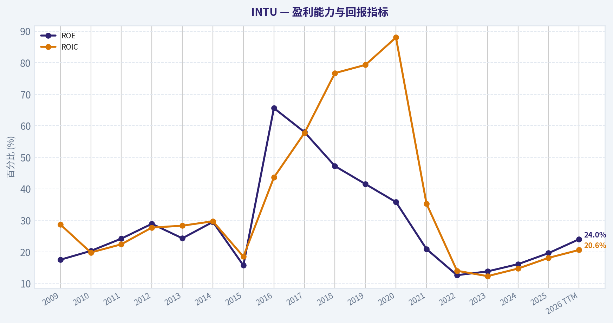
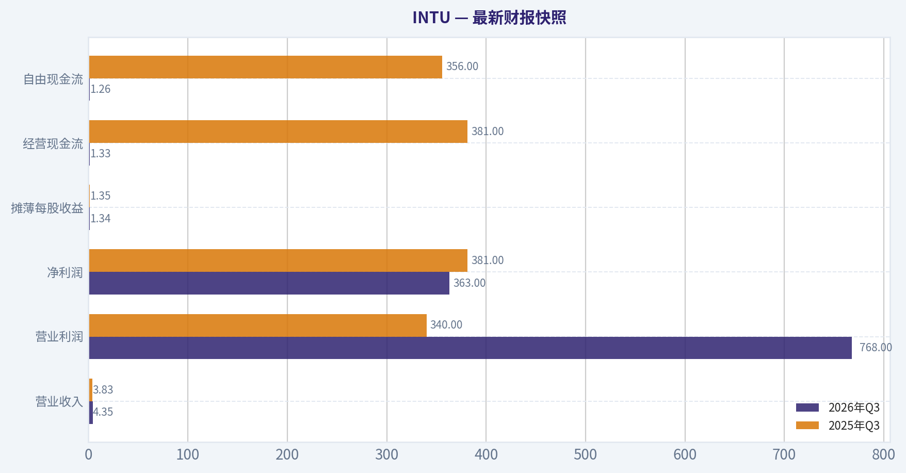
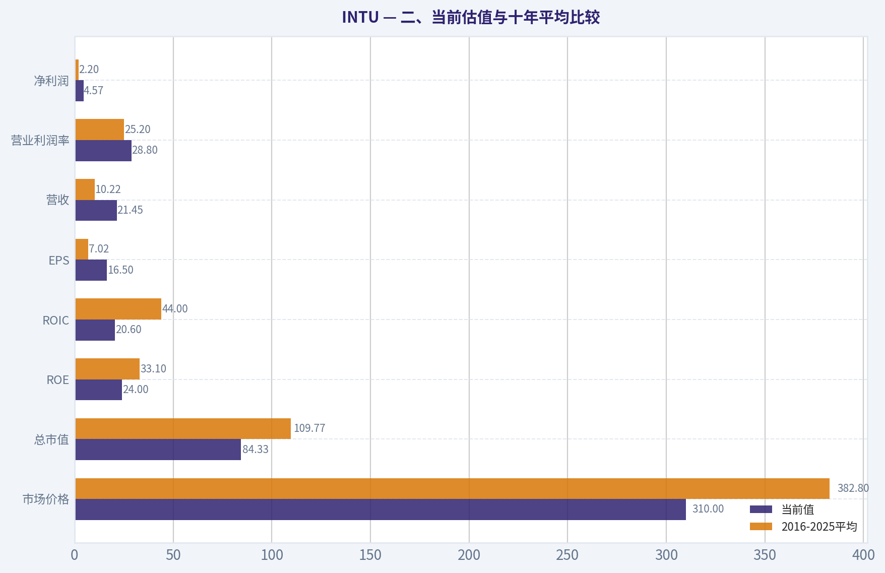
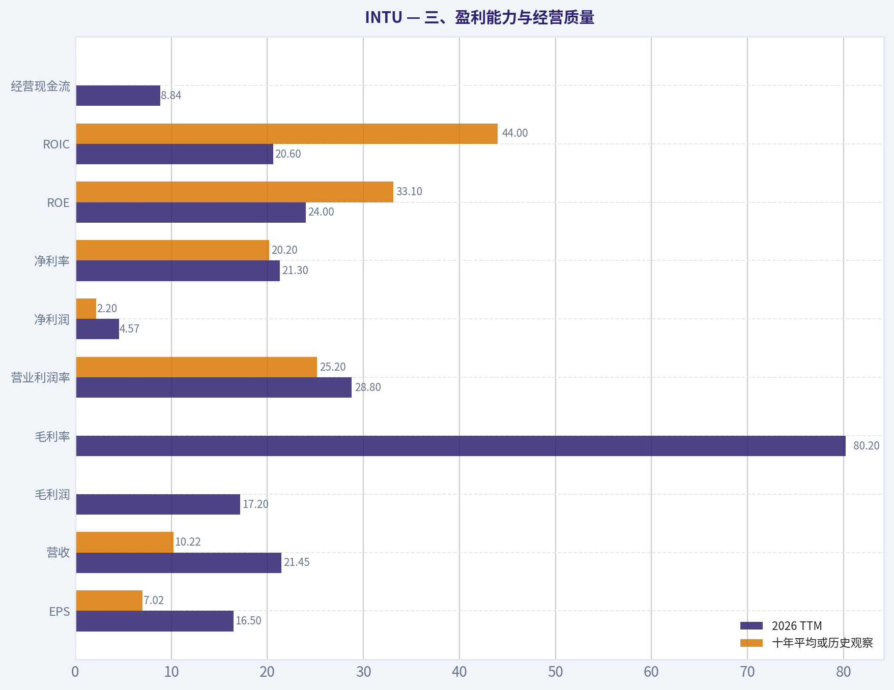
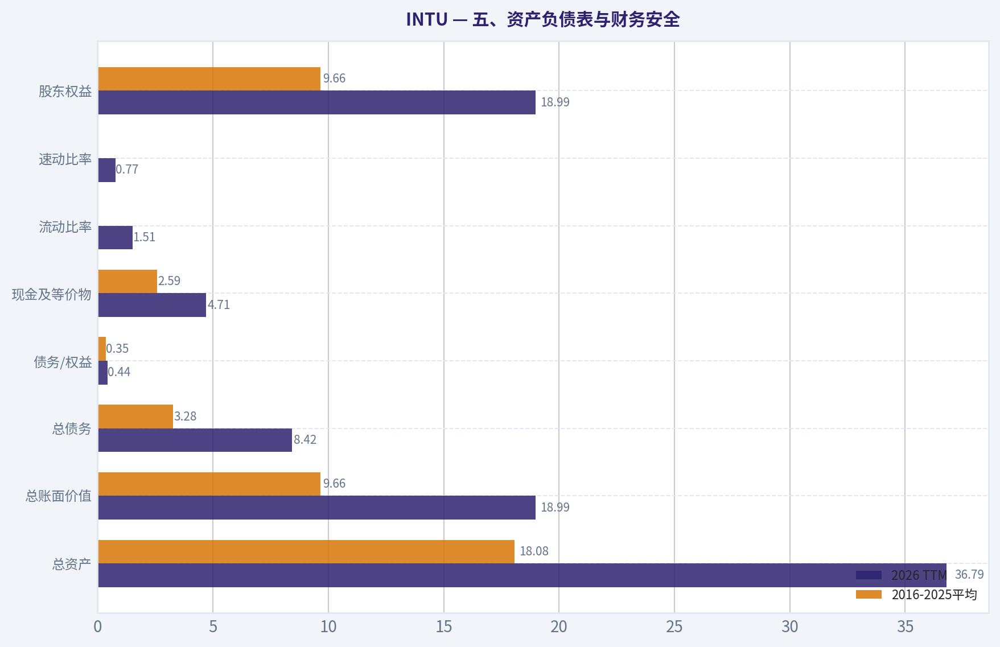
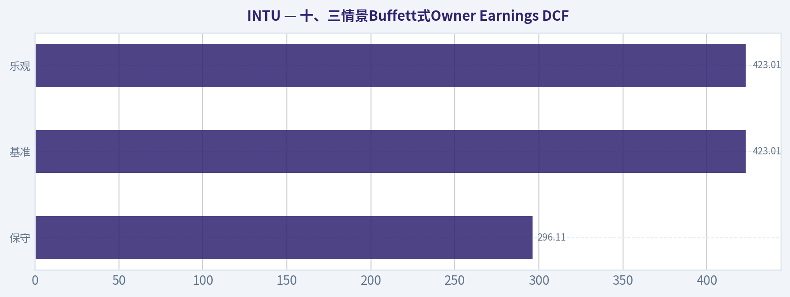
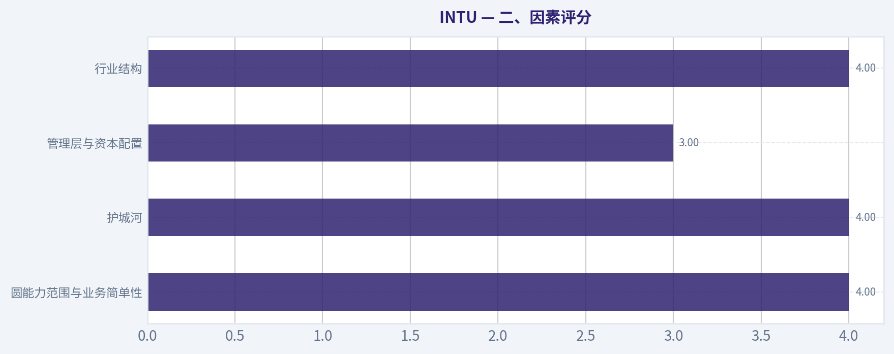

# INTU 深度价值情报

**调研日期:** 2026-11-20

## 关键免责声明

*本报告由 Deep Value Intelligence（一个基于 AI 的多智能体投资分析框架）自动生成。 仅供教育和研究用途 - 非财务建议，非财务顾问。*

---

## 目录

1. 情报摘要
2. 分析师团队报告
   - 基本面分析
   - 价值分析 (巴菲特)
   - 成长性分析 (林奇/德鲁肯米勒/费雪)
   - 市场分析
   - 期权市场分析
3. 研究团队评论
4. 投资团队评论
5. Deep Values 团队洞察

---

## 情报摘要

### 核心观点与前提条件

**核心论点:** **企业质量较高**：Intuit 凭借 TurboTax、QuickBooks 的品牌信任、历史数据、合规能力和工作流嵌入形成真实护城河。营收同比增长13.9%、三年复合增长14.3%、ROIC 22.9%，支持其作为高回报复利型企业的判断。 **主要风险是估值证据不足，而非业务失灵**：310美元、628.58美元与18.83倍 PE 明显存在日期或口径错配；资料也未提供同期每股 FCF、稀释后股数、净债务及 DeepValues 内在价值，因此无法确认约10%至15%的质量缩放安全边际。 **AI 是双向变量**：Intuit 的数据、分发、合规与责任承担能力可能强化平台价值，但基础记账和税务功能也可能商品化。真正证据应来自客户留存、单客户收入、服务成本和错误率，而非功能发布数量。 **资本配置需要折价**：Mailchimp 交易证明优秀核心业务不等于所有增量资本都能取得高回报。退出低协同资产是纠错，但不能恢复已经损失的资本。

**主要风险:**
- **原计划**以 中性为基础，重点核验估值口径、AI 商业化、客户经济效益、金融服务风险和资本配置纪律。该方向应保留，但优先级应进一步收紧：
- **中性**

**置信度:** 中

---

## 分析师团队报告

### 基本面分析

#### 最新财报快照

*以下数据基于最近一期已披露财报（2026年Q3），并尽量与上一年同期对比。*

| 指标 | 2026年Q3 | 2025年Q3 | 同比变化 |
| --- | ---: | ---: | ---: |
| 营业收入 | $4.35B | $3.83B | +13.7% |
| 营业利润 | $768.0M | $340.0M | +125.9% |
| 净利润 | $363.0M | $381.0M | -4.7% |
| 摊薄每股收益 | $1.34 | $1.35 | -0.7% |
| 经营现金流 | $1.33B | $381.0M | +249.3% |
| 自由现金流 | $1.26B | $356.0M | +253.4% |

关键结论：这张快照先把最新一期财报放在桌面上，再去看长周期分析。这样读者能更清楚地区分"公司长期质量"和"这次财报发生了什么"。

#### INTU 17年财务指标

*以下数值均由原始数据确定性计算得出，并非 AI 估算。*

*发行人类型：operating company（Technology / Software - Application）。*

#### 17年财务指标
*年度行来自已披露财务报表，最后一行 TTM 由最近四个季度滚动计算得出。*

| 指标 | 2009 | 2010 | 2011 | 2012 | 2013 | 2014 | 2015 | 2016 | 2017 | 2018 | 2019 | 2020 | 2021 | 2022 | 2023 | 2024 | 2025 | 2026 TTM |
| --- | --- | --- | --- | --- | --- | --- | --- | --- | --- | --- | --- | --- | --- | --- | --- | --- | --- | --- |
| 市场价格 | $26 | $35 | $41 | $51 | $57 | $74 | $96 | $102 | $128 | $192 | $262 | $292 | $509 | $440 | $497 | $633 | $773 | $310 |
| 总市值 | $9.80B | $12.92B | $14.80B | $17.70B | $19.37B | $23.85B | $30.25B | $29.41B | $35.81B | $53.31B | $73.21B | $80.88B | $144.68B | $129.55B | $144.81B | $183.85B | $222.19B | $84.33B |
| 市盈率 | 22.00 | 22.46 | 23.35 | 22.32 | 22.59 | 26.27 | 82.63 | 30.08 | 36.30 | 40.13 | 47.08 | 44.27 | 70.10 | 62.66 | 60.77 | 62.07 | 57.43 | 18.79 |
| 市净率 | 3.83 | 4.58 | 5.66 | 6.45 | 5.49 | 7.75 | 12.97 | 19.71 | 21.08 | 18.93 | 19.53 | 15.84 | 14.66 | 7.88 | 8.39 | 9.97 | 11.27 | 4.44 |
| ROE | 17.5% | 20.3% | 24.2% | 28.9% | 24.3% | 29.5% | 15.7% | 65.6% | 58.0% | 47.2% | 41.5% | 35.8% | 20.9% | 12.6% | 13.8% | 16.1% | 19.6% | 24.0% |
| ROIC | 28.7% | 19.8% | 22.4% | 27.7% | 28.3% | 29.7% | 18.5% | 43.6% | 57.7% | 76.7% | 79.3% | 88.0% | 35.3% | 14.0% | 12.3% | 14.7% | 18.1% | 20.6% |
| 每股收益 | $1.17 | $1.54 | $1.74 | $2.29 | $2.52 | $2.80 | $1.16 | $3.39 | $3.52 | $4.78 | $5.57 | $6.60 | $7.26 | $7.02 | $8.19 | $10.20 | $13.67 | $16.50 |
| 营收 | $3.11B | $3.40B | $3.45B | $3.81B | $3.95B | $4.24B | $4.19B | $4.69B | $5.20B | $6.03B | $6.78B | $7.68B | $9.63B | $12.73B | $14.37B | $16.29B | $18.83B | $21.45B |
| 毛利润 | $2.95B | $3.26B | $3.31B | $3.66B | $3.82B | $4.11B | $4.05B | $4.56B | $5.08B | N/A | N/A | N/A | N/A | N/A | N/A | N/A | N/A | $17.20B |
| 毛利率 | 95.0% | 95.8% | 95.9% | 96.2% | 96.8% | 96.8% | 96.7% | 97.2% | 97.7% | N/A | N/A | N/A | N/A | N/A | N/A | N/A | N/A | 80.2% |
| 营业利润率 | 22.0% | 26.6% | 31.4% | 30.7% | 30.6% | 30.6% | 17.6% | 26.5% | 27.3% | 25.9% | 27.3% | 28.3% | 26.0% | 20.2% | 21.9% | 22.3% | 26.1% | 28.8% |
| 净利润 | $447.0M | $574.0M | $634.0M | $792.0M | $858.0M | $907.0M | $365.0M | $979.0M | $985.0M | $1.33B | $1.56B | $1.83B | $2.06B | $2.07B | $2.38B | $2.96B | $3.87B | $4.57B |
| 净利率 | 14.4% | 16.9% | 18.4% | 20.8% | 21.7% | 21.4% | 8.7% | 20.9% | 19.0% | 22.1% | 23.0% | 23.8% | 21.4% | 16.2% | 16.6% | 18.2% | 20.5% | 21.3% |
| 营收增长 | N/A | 9.5% | 1.4% | 10.4% | 3.6% | 7.5% | -1.2% | 12.0% | 10.7% | 16.0% | 12.6% | 13.2% | 25.4% | 32.1% | 12.9% | 13.3% | 15.6% | 13.9% |
| 净利润增长 | N/A | 28.4% | 10.5% | 24.9% | 8.3% | 5.7% | -59.8% | 168.2% | 0.6% | 34.9% | 17.2% | 17.3% | 12.9% | 0.2% | 15.4% | 24.3% | 30.6% | 18.0% |
| 自由现金流增长 | N/A | 35.7% | -2.7% | 23.6% | 11.3% | 8.5% | 7.8% | -27.9% | 43.4% | 38.5% | 8.4% | 4.8% | 35.8% | 16.7% | 29.6% | -3.0% | 30.5% | 40.7% |
| 总账面价值 | $2.56B | $2.82B | $2.62B | $2.74B | $3.53B | $3.08B | $2.33B | $1.49B | $1.70B | $2.82B | $3.75B | $5.11B | $9.87B | $16.44B | $17.27B | $18.44B | $19.71B | $18.99B |
| 总资产 | $4.83B | $5.20B | $5.11B | $4.68B | $5.49B | $5.20B | $4.97B | $4.25B | $4.07B | $5.13B | $6.28B | $10.93B | $15.52B | $27.73B | $27.78B | $32.13B | $36.96B | $36.79B |
| 总债务 | N/A | $998.0M | $999.0M | $499.0M | $499.0M | $499.0M | $500.0M | $1.00B | $488.0M | $438.0M | $436.0M | $3.37B | $2.03B | $6.91B | $6.12B | $6.04B | $5.97B | $8.42B |
| 债务股权比 | N/A | 0.35 | 0.38 | 0.18 | 0.14 | 0.16 | 0.21 | 0.67 | 0.29 | 0.16 | 0.12 | 0.66 | 0.21 | 0.42 | 0.35 | 0.33 | 0.30 | 0.44 |
| 现金及等价物 | $679.0M | $214.0M | $722.0M | $393.0M | $1.01B | $849.0M | $808.0M | $638.0M | $529.0M | $1.46B | $2.12B | $6.44B | $2.56B | $2.80B | $2.85B | $3.61B | $2.88B | $4.71B |
| 股东权益 | $2.56B | $2.82B | $2.62B | $2.74B | $3.53B | $3.08B | $2.33B | $1.49B | $1.70B | $2.82B | $3.75B | $5.11B | $9.87B | $16.44B | $17.27B | $18.44B | $19.71B | $18.99B |
| 经营现金流 | $812.0M | $998.0M | $1.01B | $1.25B | $1.37B | $1.45B | $1.59B | $1.46B | $1.60B | $2.11B | $2.32B | $2.41B | $3.25B | $3.89B | $5.05B | $4.88B | $6.21B | $8.84B |
| 投资现金流 | $-432.0M | $-997.0M | $497.0M | $-225.0M | $-485.0M | $-49.0M | $-182.0M | $371.0M | $-17.0M | $-532.0M | $-635.0M | $-97.0M | $-3.96B | $-5.42B | $-922.0M | $-227.0M | $-2.32B | $-1.41B |
| 自由现金流 | $681.0M | $924.0M | $899.0M | $1.11B | $1.24B | $1.34B | $1.45B | $1.04B | $1.50B | $2.07B | $2.25B | $2.35B | $3.20B | $3.73B | $4.84B | $4.69B | $6.12B | $8.62B |
| 自由现金流利润率 | 21.9% | 27.2% | 26.1% | 29.2% | 31.3% | 31.6% | 34.5% | 22.2% | 28.8% | 34.4% | 33.1% | 30.7% | 33.2% | 29.3% | 33.7% | 28.8% | 32.5% | 40.2% |
| 每股分红 | $0.00 | $0.00 | $0.00 | $0.00 | $0.00 | $0.00 | $0.00 | $0.00 | $0.00 | $0.00 | $0.00 | $0.00 | $0.00 | $0.00 | $3.05 | $3.56 | $4.20 | $4.95 |

#### 盈利能力指标
- 净资产收益率 (ROE): 24.0%
- 投入资本回报率 (ROIC): 22.9%
- 总资产收益率 (ROA): 12.4%
- 毛利率: N/A
- 营业利润率: 27.4%
- 净利率: 21.3%

#### 流动性指标
- 流动比率: 1.51
- 速动比率: 0.77

#### 杠杆指标
- 债务股权比: 0.40
- 利息覆盖倍数: 22.98
- 净负债: $469.0M

#### 增长指标（同比）
- 营收增长: 13.9%
- 净利润增长: 18.0%
- 自由现金流增长: 41.5%
- 营收复合增长率（3年）: 14.3%
- 营收复合增长率（5年）: 17.4%

#### 估值指标
- 市盈率 (TTM): 18.83
- 预期市盈率: 11.52
- 市净率: 4.38
- 市销率: 3.86
- PEG 比率: 0.99
- 企业价值/EBITDA: 12.27
- 自由现金流收益率: 10.5%
- 盈利收益率: 5.3%

#### 所有者收益（巴菲特方法，代码计算）
- 净利润: $3.87B
- + 折旧与摊销: $846.0M
- - 资本开支: $-175.0M
- + 营运资本（现金流量表口径；负数=占用现金）: $-4.0M
- = **所有者收益: $4.46B**

#### 内在价值（DeepValues 应用 - SEC 申报数据管道）
- **内在价值（DeepValues 应用，头条）: $423.01** - Owner Earnings (Buffett), 方法 buffett-1986-v2, 截至 2026-11-19 (FY2026)
  区间（保守-乐观）: $296.11 - $423.01
  相对价格的安全边际: 26.7% (价格 $310.02)
  应用使用的输入 (ttm_2026Q4): after-tax operating income $4.7B (operating income $5.9B, tax 20.0%) + D&A $0.7B - capex charge $0.2B (three-year average capex/revenue x trailing revenue; reported capex $0.2B) - working capital $0.0B = owner earnings $5.2B.
  Growth 10.0% fading to 2.5% terminal (min(owner-earnings CAGR, 5-year revenue CAGR), clamped [0, 10%]); discount rate 8.4% (30Y Treasury 5.41% + 3 pts (as of 2026-11-18)); net cash $-3.0B (cash $4.7B + marketable securities $0.0B - debt $7.7B); 276M shares.
- Owner Earnings (Buffett): $296.11 / $423.01 / $423.01 (保守 / 基准 / 乐观) ← headline
- Free cash flow DCF: $529.10 / $807.64 / $1,320.45 (保守 / 基准 / 乐观)
- Damodaran two-stage FCFF: $323.83 / $378.86 / $414.82 (保守 / 基准 / 乐观)
  这就是内在价值：引用它作为内在价值，并据此衡量安全边际。其他地方的 DVI 情景数字仅为辅助交叉检查，不是估值。

#### DVI 情景模型（辅助交叉检查 - 不是内在价值）
DVI 基于 Yahoo 数据的情景，仅作敏感性检查。请勿将其作为内在价值引用；内在价值是上方的 DeepValues 应用估值。
- 当前价格: $310
- DVI 情景值（按商业模式路由）: $521
  商业模式: operating company - weighted blend [Damodaran FCFF + reverse-DCF fair + owner-earnings DCF] (operating_company)
  模型区间（各 DCF 最小-最大）: $386 - $668
  相对价格的安全边际（头条）: 40.5%
  路由说明: General operating company: balanced blend of Damodaran FCFF and the owner-earnings DCF with a reverse-DCF sanity check.
- 巴菲特方法（所有者收益）:
  保守: $387
  平均: $558
  乐观: $632
- 现金流方法（FCF）:
  保守: $507
  平均: $668
  乐观: $1,205
- Damodaran FCFF（WACC + 利润率 + 再投资）:
  保守: $292
  平均: $386
  乐观: $446
  蒙特卡洛区间（P10-P90）：$286 - $500（中位数 $371）
  P(内在价值 > 当前价格)：80.5%
- 反向 DCF：当前价格隐含约 0.5%/年 的所有者收益增长（10年）；过去 3 年为 33.5%，5 年为 21.9%。

#### Piotroski F分数: 7/9
- 净利润为正: 通过
- 经营现金流为正: 通过
- 资产回报率改善: 通过
- 现金流大于净利润: 通过
- 债务下降: 未通过
- 流动比率改善: 通过
- 未稀释股本: 通过
- 毛利率改善: 未通过
- 资产周转率改善: 通过

ANALYST STANCE: **中性**

#### 一、研究范围与数据口径

本分析只覆盖 Intuit Inc.（Nasdaq：INTU）。历史数据严格采用所提供的确定性数据集；"当前值"采用 2026 TTM 行及研究包中的最新估值数据。十年平均值采用 2016-2025 年十个完整财年的简单平均，不包括 2026 TTM。

INTU 属于应用软件经营公司，收入和现金流具有较强的订阅及平台属性。因此，P/B 不适合机械解读为"越低越便宜"。软件公司的账面权益容易受到并购商誉、回购和无形资产摊销影响，估值重点应放在持续盈利能力、自由现金流和所有者收益上。

#### 二、当前估值与十年平均比较

| 指标 | 当前值 | 2016-2025平均 | 当前相对平均 | 解释 |
|---|---:|---:|---:|---|
| 市场价格 | $310 | $382.8 | -19.0% | 明显低于十年均价，但历史均价受2021-2025高估值时期影响 |
| 总市值 | $84.33B | $109.77B | -23.2% | 市值低于十年平均，反映估值倍数收缩 |
| PE | 18.79倍 | 51.09倍 | -63.2% | 处于十年区间低位，盈利增长和AI竞争担忧压低估值 |
| P/B | 4.44倍 | 14.73倍 | -69.9% | 下降明显，但对软件公司参考价值有限 |
| ROE | 24.0% | 33.1% | -9.1个百分点 | 仍然很高，但低于并购及资本结构变化前的高点 |
| ROIC | 20.6% | 44.0% | -23.4个百分点 | 仍超过优质企业门槛，但较2017-2020年显著回落 |
| EPS | $16.50 | $7.02 | +135.0% | 长期盈利规模已大幅提升 |
| 营收 | $21.45B | $10.22B | +109.8% | 十年收入规模约翻倍 |
| 营业利润率 | 28.8% | 25.2% | +3.6个百分点 | 当前经营杠杆和成本效率优于十年平均 |
| 净利润 | $4.57B | $2.20B | +107.5% | 净利润规模约为十年前两倍 |
| 净利率 | 21.3% | 20.2% | +1.1个百分点 | 仍保持较强盈利质量 |
| 营收增长率 | 13.9% | 16.4% | -2.5个百分点 | 增长仍强，但低于受并购和疫情推动的历史平均 |
| 净利润增长率 | 18.0% | 32.2% | -14.2个百分点 | 历史平均被2016年低基数反弹显著抬高，当前并不弱 |
| 自由现金流增长率 | 约41.5% | 17.7% | +23.8个百分点 | 当前现金流增长明显加速 |
| 自由现金流 | $8.62B | $3.18B | +171.1% | 现金转换能力处于历史高位 |
| 总债务 | $8.42B | $3.28B | +156.7% | 债务绝对规模明显增加 |
| 债务/权益 | 0.44 | 0.35 | +0.09 | 杠杆高于十年平均，但仍属可管理范围 |
| 现金及等价物 | $4.71B | $2.59B | +81.9% | 现金规模较高，但不能完全覆盖债务 |
| 股东权益 | $18.99B | $9.66B | +96.6% | 资产负债表规模显著扩大 |
| 每股分红 | $4.95 | $1.08 | +358.0% | 2023年开始建立分红政策 |

**关键结论：** INTU 当前最显著的变化是估值倍数大幅下降，而经营指标并未同步恶化。PE 从十年平均约51倍降至约19倍，当前自由现金流、利润率和现金生成能力反而处于较强水平。主要负面变化是 ROIC 低于早期高点、债务规模增加，以及增长速度较疫情及并购扩张期放缓。

#### 三、盈利能力与经营质量

| 指标 | 2026 TTM | 十年平均或历史观察 | 分析 |
|---|---:|---:|---|
| EPS | $16.50 | $7.02 | 盈利规模持续扩大，长期复合增长显著 |
| 营收 | $21.45B | $10.22B | 十年收入约翻倍，业务仍具规模扩张能力 |
| 毛利润 | $17.20B | 早期平均约$4.1B；后续年度缺失 | 当前毛利额很高，但历史可比性受数据缺失影响 |
| 毛利率 | 80.2% | 早期约96%-98%；后续数据缺失 | 不宜直接判断为经营恶化，口径和业务结构变化可能影响可比性 |
| 营业利润率 | 28.8% | 25.2% | 当前高于十年平均，显示平台规模和成本控制改善 |
| 净利润 | $4.57B | $2.20B | 盈利规模稳步扩大 |
| 净利率 | 21.3% | 20.2% | 利润率略高于十年平均，盈利质量较稳定 |
| ROE | 24.0% | 33.1% | 依然优秀，但历史高ROE部分受到低账面权益和回购影响 |
| ROIC | 20.6% | 44.0% | 仍然强劲，但并购投入和资本基数扩大后回报率下降 |
| 经营现金流 | $8.84B | 约$3.34B | 经营现金流显著超过净利润 |
| 自由现金流 | $8.62B | $3.18B | FCF利润率达到40.2%，高于大多数历史年度 |
| 利息覆盖倍数 | 22.98倍 | - | 当前利息偿付能力较强 |

**关键结论：** INTU 的核心质量仍然较高，当前营业利润率、净利率和自由现金流利润率均支持"高质量软件平台"的判断。ROIC 从历史极高水平回落，更多反映资本投入、并购以及资产基数扩大；但20.6%的当前ROIC仍明显高于资本成本的合理估计。

#### 四、增长趋势与可预测性

过去十七年中，INTU 收入从 $3.11B 增至 $21.45B，净利润从 $447M 增至 $4.57B，自由现金流从 $681M 增至 $8.62B。

收入增长较为稳定，但并非没有波动：

- 2009-2014年增长大多处于低个位数至低双位数。
- 2015年收入下降1.2%，显示软件订阅业务也可能受到产品迁移和周期性因素影响。
- 2016-2020年增长恢复至约10%-16%。
- 2021-2022年增长达到25.4%和32.1%，明显包含疫情、产品需求和并购扩张影响。
- 2023-2026 TTM增长回到约13%-16%，更接近成熟平台的可持续增长区间。

净利润和自由现金流的历史增长波动大于收入增长。2015年净利润下降59.8%，随后2016年因低基数反弹168.2%；因此，净利润十年平均增长率32.2%存在统计失真。相比之下，当前18%的净利润增长和约41.5%的自由现金流增长更具现实参考价值。

Piotroski F分数为7/9，说明盈利、现金流、资产回报率、流动性及资产周转情况总体良好；未通过的项目包括债务下降和毛利率改善，正好对应当前需要重点监测的风险。

#### 五、资产负债表与财务安全

| 项目 | 2026 TTM | 2016-2025平均 | 评价 |
|---|---:|---:|---|
| 总资产 | $36.79B | $18.08B | 资产规模约为十年平均两倍 |
| 总账面价值 | $18.99B | $9.66B | 权益规模扩大，但不代表有同等规模的有形资产 |
| 总债务 | $8.42B | $3.28B | 并购及资本运作后债务明显增加 |
| 债务/权益 | 0.44 | 0.35 | 杠杆高于历史平均 |
| 现金及等价物 | $4.71B | $2.59B | 现金储备较充足 |
| 净负债 | 约$469M；DeepValues口径约$3.0B | - | 不同口径可能包含债务、现金及证券项目差异 |
| 流动比率 | 1.51 | - | 短期偿债能力尚可 |
| 速动比率 | 0.77 | - | 低于1，需关注流动资产结构 |
| 股东权益 | $18.99B | $9.66B | 资本基础扩大 |

**关键结论：** INTU 并非无债务软件公司，但利息覆盖倍数接近23倍，经营现金流足以覆盖利息和资本开支，财务压力目前不高。需要注意的是，债务由十年前约数亿美元级别增加至当前约84亿美元，且速动比率低于1，这使并购整合和现金流持续性变得更加重要。

#### 六、现金流、分红与资本配置

当前自由现金流为 $8.62B，自由现金流利润率为40.2%，显著高于2016-2025年约31.1%的平均水平。所有者收益的确定性数据集计算值为：

\[
所有者收益 = 净利润 + 折旧摊销 - 资本开支 + 营运资本变化
\]

\[
= \$3.87B+\$846M-\$175M-\$4M
=\$4.46B
\]

DeepValues采用另一种基于税后经营利润的Owner Earnings口径，得到约 $5.2B。两者差异主要来自税后经营利润、折旧摊销及资本开支口径不同。

INTU在2023年以前没有每股分红，2023-2026 TTM每股分红分别为 $3.05、$3.56、$4.20和$4.95。分红政策显示资本回报开始制度化，但当前企业仍将大量现金流用于产品、平台和并购相关资本配置。

#### 七、收入来源分布

确定性数据集没有提供2026 TTM的分部收入明细。下表为基于Intuit公开业务结构的近似拆分，仅用于理解收入来源，不替代财务报表分部数据，也不作为DCF的直接输入。

| 收入来源 | 金额（十亿美元） | 占比 |
|---|---:|---:|
| 小企业与自雇业务 | 约$9.4B | 约43.8% |
| 消费者税务业务 | 约$5.0B | 约23.3% |
| Credit Karma | 约$3.0B | 约14.0% |
| Mailchimp及相关营销业务，交易完成前近似口径 | 约$2.0B | 约9.3% |
| ProTax及其他业务 | 约$2.05B | 约9.6% |
| 合计 | 约$21.45B | 100.0% |

**关键结论：** INTU收入并不依赖单一税务产品，而是由小企业软件、消费者税务、金融服务平台和专业税务工具共同构成。小企业业务是最重要的收入来源；Mailchimp以约36.8亿美元出售、显著低于2021年约120亿美元收购价，说明并购资本配置存在实质性失误，也解释了市场对管理层并购纪律的重新评估。

#### 八、竞争优势与经济护城河

INTU的护城河主要来自以下几方面：

1. **数据和工作流嵌入性**
   税务、会计、工资和现金流管理与用户历史数据高度绑定，迁移成本通常高于一般消费软件。

2. **品牌与合规能力**
   税务软件涉及准确性、监管和隐私，品牌信任具有较强价值。新进入者即使拥有AI能力，也需要建立合规、数据安全和长期信任。

3. **网络效应与交叉销售**
   小企业客户可在记账、支付、工资、融资和税务服务之间交叉使用，平台化提高客户终身价值。

4. **规模经济**
   软件边际成本低，当前28.8%的营业利润率和40.2%的自由现金流利润率证明规模经济仍在发挥作用。

5. **数据与AI双刃剑**
   AI可以强化自动报税、财务分析和客户服务，也可能降低传统软件功能的差异化程度。AI最终更可能先压低部分功能价格和开发成本，长期则取决于INTU能否把数据优势转化为可信、合规且高留存的自动化产品。

#### 九、管理层表现与资本配置

管理层经营表现存在明显的两面性：

- 正面方面：收入、EPS、经营现金流和自由现金流长期增长；当前营业利润率高于十年平均；现金流对净利润的覆盖较强。
- 负面方面：Mailchimp交易形成显著的收购价损失，反映过去资本配置和并购估值判断并不稳定。
- ROE长期较高，但2016-2020年部分高ROE受到较低账面权益和回购的放大，不能全部视为经营效率提升。
- 分红从2023年开始建立，资本回报政策变得更加明确。
- 债务没有随盈利增长同步下降，说明管理层仍偏好利用资本结构和并购推动扩张。

综合来看，管理层的日常经营和现金流管理较强，但资本配置记录尚不足以支持最高等级的管理层评价。

#### 十、三情景Buffett式Owner Earnings DCF

DeepValues的头条内在价值为 **$423.01/股**，方法为Buffett Owner Earnings，估值日期为2026年11月19日。该模型的核心输入为：

- 税后经营利润：约$4.7B
- 折旧摊销：约$0.7B
- 资本开支扣除：约$0.2B
- 营运资本变化：约$0.0B
- Owner Earnings：约$5.2B
- 股份数：约276M
- 折现率：8.4%
- 永续增长率：2.5%
- 净现金调整：约-$3.0B，即净负债
- 预测期增长：从约10%逐步下降至2.5%

Owner Earnings DCF的三情景结果如下：

| 情景 | 主要假设 | 每股估值 | 与$310当前价格比较 |
|---|---|---:|---:|
| 保守 | 低增长假设，增长逐步向2.5%终值增长率收敛 | $296.11 | 约低4.5% |
| 基准 | Owner Earnings约10%增长并逐步衰减至2.5% | $423.01 | 约高36.5% |
| 乐观 | 高质量平台继续扩张，仍采用衰减而非永久高增长 | $423.01 | 约高36.5% |

模型计算逻辑为：

\[
企业价值=
\sum_{t=1}^{10}\frac{OE_0(1+g_t)^t}{(1+r)^t}
+
\frac{OE_{10}(1+g_T)}{(r-g_T)(1+r)^{10}}
\]

\[
每股价值=
\frac{企业价值-净负债}{276M}
\]

其中，\(r=8.4\%\)，\(g_T=2.5\%\)。保守、基准和乐观情景均要求显性预测期增长逐步衰减，不能把高增长永久外推。

辅助交叉验证结果：

| 估值方法 | 保守 | 基准 | 乐观 | 用途 |
|---|---:|---:|---:|---|
| DeepValues Owner Earnings | $296.11 | $423.01 | $423.01 | 主要内在价值 |
| FCF DCF | $529.10 | $807.64 | $1,320.45 | 辅助参考，较敏感 |
| Damodaran FCFF | $323.83 | $378.86 | $414.82 | 辅助参考 |
| 反向DCF隐含增长 | - | 约0.5%/年 | - | 当前价格的增长要求 |

**关键结论：** 主要Owner Earnings模型显示，$310价格接近保守情景上方，但低于基准内在价值$423.01，DeepValues计算的安全边际约为26.7%。不过，FCF DCF结果明显更高，说明其对现金流增长和资本开支假设较敏感；因此，估值结论应以$296-$423的Owner Earnings区间为主要参考，而不是采用更乐观的FCF结果。

反向DCF显示，当前价格只隐含约0.5%的十年Owner Earnings年增长率，明显低于过去五年收入约17.4%的复合增长率和当前约13.9%的收入增速。这表示市场已经计入较高的AI颠覆、增长放缓或资本配置折损风险，但并不意味着高增长必然恢复。

#### 十一、主要风险、机会与估值含义

| 类型 | 具体因素 | 对基本面的含义 |
|---|---|---|
| 机会 | PE约18.8倍，显著低于十年平均 | 市场已大幅压缩软件平台估值倍数 |
| 机会 | FCF利润率40.2% | 现金转换能力明显增强 |
| 机会 | 营业利润率28.8% | 规模经济和运营效率仍然存在 |
| 机会 | 反向DCF仅隐含约0.5%增长 | 当前估值对长期增长要求较低 |
| 风险 | AI降低税务和会计软件差异化 | 产品定价、留存率和获客成本可能承压 |
| 风险 | Mailchimp收购失败 | 暴露并购纪律和资本配置问题 |
| 风险 | 总债务约$8.42B | 利率、再融资及并购整合风险提高 |
| 风险 | ROIC从历史高位回落 | 新增资本的边际回报可能下降 |
| 风险 | 速动比率0.77 | 流动资产结构需要中性 |
| 风险 | 收入增长低于历史高峰 | 未来估值重估更依赖效率和现金流，而非单纯收入扩张 |
| 风险 | 毛利率历史数据不完整且当前口径变化 | 长期毛利趋势的可比性有限 |

**关键结论：** 机会主要来自估值压缩过度与现金流质量改善之间的错配；风险主要集中在AI对软件价值链的重构、并购回报不确定性和债务上升。当前估值并不要求过去十年的高增长持续，但要达到$423内在价值，则仍需要平台稳定、现金流持续增长以及AI最终成为效率工具而非替代性威胁。

#### 十二、最终研究判断

**中性**

支持偏积极估值判断的证据包括：

- 当前PE约18.8倍，显著低于十年平均；
- 当前自由现金流收益率约10.5%；
- 营业利润率、净利率和自由现金流利润率均处于较强水平；
- 反向DCF显示当前价格隐含的长期Owner Earnings增长率仅约0.5%；
- DeepValues Owner Earnings基准内在价值为$423.01，明显高于当前约$310价格。

限制性证据包括：

- 保守Owner Earnings估值约$296.11，接近当前价格；
- ROIC已明显低于2017-2020年高点；
- 债务规模显著增加，净负债调整削弱每股价值；
- Mailchimp交易显示并购资本配置质量不稳定；
- AI可能削弱税务、会计和营销软件的功能壁垒；
- 当前增长虽然健康，但已低于2021-2022年的异常高增长水平。

因此，证据显示INTU当前估值相较历史水平已经明显收缩，且基准现金流模型支持一定的估值修复空间；但保守情景接近市场价格，意味着安全边际高度依赖AI竞争影响、并购损失是否属于一次性事件，以及未来自由现金流能否维持高增长。综合质量、估值和风险，研究结论为 **中性**，而不是无条件的高确信度看多判断。

#### 十三、要点汇总

| 维度 | 核心判断 | 关键数据 |
|---|---|---:|
| 企业性质 | 高毛利、平台型应用软件公司 | Technology / Software - Application |
| 当前估值 | 明显低于历史估值中枢 | PE 18.79倍 |
| 盈利质量 | 强劲且改善 | 营业利润率28.8%，净利率21.3% |
| 现金流 | 当前处于历史较强水平 | FCF $8.62B，FCF利润率40.2% |
| 增长 | 健康但低于高峰 | 收入增长13.9% |
| 财务杠杆 | 可管理但高于历史平均 | 债务/权益0.44 |
| 护城河 | 品牌、数据、工作流和规模经济 | 中高强度，但受AI挑战 |
| 管理层 | 日常经营强，资本配置有瑕疵 | Mailchimp交易为重要负面案例 |
| 内在价值 | 主要采用DeepValues Owner Earnings | $296.11-$423.01 |
| 反向DCF | 当前价格隐含较低长期增长 | 约0.5%年增长 |
| 最终判断 | 估值有支撑，但风险尚未充分消除 | 中性 |

**关键结论：** INTU是一家盈利质量高、现金流强、仍拥有平台型护城河的软件公司，但并购记录、债务增长和AI竞争使估值不能只依赖历史高ROE。当前价格相较基准内在价值存在折价，但相较保守估值并没有很大的缓冲空间，因此核心观察点是未来现金流增长能否持续，以及AI是否会改变其客户留存和定价能力。

#### 基本面关键图表

本图追踪 **INTU** 过去十年的盈利能力与回报指标（ROE、ROIC、利润率），突出呈现资本效率的变化趋势。

---

### 价值分析 (巴菲特)

> *基于沃伦·巴菲特的价值投资哲学：能力圈、经济护城河、管理层质量与安全边际。*

#### 内在价值快照

价格是你付的钱，内在价值是企业未来可能为股东创造的现金价值。我们给出一个区间，而不是假装只有一个神奇数字。

- 当前价格: $310.02
- 估值区间（两种 DCF 方法、保守到乐观）: $296.11 至 $1,320.45

##### 所有者收益（巴菲特方法）
- 净利润: $3,869,000,000.00
- 折旧与摊销: $846,000,000.00
- 资本支出: $-175,000,000.00
- 营运资金变化: $-4,000,000.00
- 所有者收益: $4,459,233,140.26

##### 内在价值
###### 所有者收益法
使用所有者收益，更严格，通常更保守。
- 保守: $296.11
- 平均: $423.01
- 乐观: $423.01
- 折现率: 8.4%

###### 自由现金流法
使用自由现金流，更适合今天投入很多、为未来增长铺路的公司。
- 保守: $529.10
- 平均: $807.64
- 乐观: $1,320.45
- 折现率: 9.3%

ANALYST STANCE: **看多**

#### 一、投资结论

Intuit 是一家拥有高客户黏性、强品牌和数据网络效应的财务软件平台。TurboTax、QuickBooks、Credit Karma 和 ProTax 形成了面向个人、小企业及专业人士的生态系统，收入具有订阅化、重复化特征。

当前股价约为 **310美元**，DeepValues 应用给出的核心内在价值为 **423.01美元**，对应安全边际 **26.7%**。估值并非没有风险：Mailchimp 收购后的低价出售暴露出资本配置失误，人工智能也可能削弱部分软件功能的差异化。但以当前盈利能力、现金流和客户黏性衡量，市场价格仍未充分反映其长期复利能力。

#### 二、因素评分

| 因素 | 评分（满分5分） | 主要依据 |
|---|---:|---|
| 圆能力范围与业务简单性 | 4 | 主要通过订阅、软件服务和金融数据服务收费；业务较容易解释，客户关系具有长期性 |
| 护城河 | 4 | 品牌、数据、工作流嵌入、交叉销售和生态协同明显；人工智能带来挑战，但也可成为效率工具 |
| 管理层与资本配置 | 3 | 主业经营良好，但Mailchimp以约36.8亿美元出售，明显低于2021年约120亿美元收购价 |
| 行业结构 | 4 | 财务软件具有较高集中度和规模效应，订阅模式资本强度较低 |
| Gate 5：质量与偿债能力 | 未触发 | 盈利、自由现金流和经营现金流仍然强劲，没有显示出持续恶化与偿债危机同时出现的迹象 |

**关键结论：** Intuit 的主要弱点是资本配置记录并不完美，以及人工智能可能改变软件竞争格局；但这些问题尚未摧毁核心业务的护城河，也没有达到财务困境标准。

#### 三、护城河分析

| 护城河来源 | 具体证据 | 评价 |
|---|---|---|
| 无形资产 | TurboTax 和 QuickBooks 具有较高品牌认知度，用户依赖其报税、记账和财务管理功能 | 强 |
| 转换成本 | 小企业的账务、工资、发票、税务和客户数据长期嵌入QuickBooks工作流 | 强 |
| 数据优势 | 长期积累的税务、财务及信用数据能够改善自动化、推荐和风险判断 | 中强 |
| 网络效应 | QuickBooks连接企业、会计师、金融服务和支付功能，参与者越多，生态价值越高 | 中强 |
| 规模优势 | 软件研发、合规、品牌营销和数据基础设施成本可以由庞大客户基础分摊 | 强 |

Intuit 的护城河不是单纯依赖某一项专利，而是由品牌、数据、合规能力、客户工作流和生态系统共同构成。对于小企业而言，迁移财务数据、重新配置发票与工资流程、改变会计师协作方式，都构成现实的转换摩擦。

人工智能的影响具有双面性。一方面，基础税务问答、记账和报表功能可能更加容易被复制；另一方面，Intuit 拥有真实客户数据、合规经验和分发渠道，能够将人工智能嵌入已有工作流。护城河因此受到压力，但尚未表现为结构性消失。

#### 四、管理层与资本配置

管理层在主业上的表现较好，收入同比增长约 **13.9%**，ROE 为 **24.0%**，自由现金流收益率约 **10.5%**。这些数据说明核心业务仍能以较高效率产生现金。

最大扣分来自Mailchimp交易：

- 2021年收购价格约为120亿美元；
- 2026年拟以约36.8亿美元出售；
- 交易显示公司曾为扩展营销软件版图支付过高价格；
- 低价退出有助于简化业务，但也意味着此前资本配置造成重大价值损失。

因此，管理层并非资本配置方面的典范，但目前选择退出低回报资产、重新聚焦核心平台，方向上是理性的。综合评价为中上水平，而非最高等级。

#### 五、财务摘要

| 指标 | 最新可用数据 |
|---|---:|
| 当前股价 | 310美元 |
| 总市值 | 828.5亿美元 |
| PE | 18.8倍 |
| 营收同比增长 | 13.9% |
| ROE | 24.0% |
| 自由现金流收益率 | 10.5% |
| 现金及等价物 | 47亿美元 |
| 总债务 | 77亿美元 |
| 净现金/(净债务) | 净债务约30亿美元 |
| 流动比率 | 1.51 |
| 税后经营利润 | 47亿美元 |
| 折旧与摊销 | 7亿美元 |
| 资本性支出 | 2亿美元 |
| 营运资本变动 | 约0美元 |
| 股份数 | 约2.76亿股 |

**关键结论：** Intuit 具备较强盈利质量和现金创造能力，ROE达到24%，且自由现金流收益率较高。资产负债表不是净现金堡垒，约30亿美元净债务会压低股权价值，但债务规模相对于经营现金流仍属可管理范围。

#### 六、所有者收益计算

根据DeepValues应用采用的Buffett口径：

| 项目 | 金额 |
|---|---:|
| 税后经营利润 | 47亿美元 |
| 加：折旧与摊销 | 7亿美元 |
| 减：资本性支出 | 2亿美元 |
| 减：营运资本增加 | 0亿美元 |
| 所有者收益 | **52亿美元** |
| 每股所有者收益 | **约18.84美元** |

**关键结论：** 所有者收益约为52亿美元，显著高于单纯会计净利润可能呈现的短期波动。资本性支出仅约2亿美元，说明业务具备较强的资产轻型特征，但仍需持续投入研发、合规和人工智能能力建设。

#### 七、三情景DCF估值

以下情景使用52亿美元所有者收益，并按约2.76亿股计算。净债务约30亿美元在股权价值中予以扣除。

| 情景 | 核心假设 | 企业价值或股权价值 | 每股估值 |
|---|---|---:|---:|
| 情景A：零增长 | 所有者收益 ÷ 10% | 股权价值约143亿美元 | 约52美元 |
| 情景B：GDP增长 | 长期增长3%，折现率10% | 股权价值约181亿美元 | 约66美元 |
| 情景C：历史增长 | 前10年增长约7.5%，终值增长2.5%，折现率10% | 股权价值约991亿美元 | 约359美元 |

**关键结论：** 零增长和3%增长情景明显低于当前股价，说明市场价值依赖于Intuit持续保持增长和高资本回报。历史增长情景约359美元，低于DeepValues应用的423美元核心值，但仍高于当前价格，显示估值对增长假设较为敏感。

需要特别区分：DeepValues应用的 **423.01美元** 是本报告采用的核心内在价值；上述三情景只是独立的敏感性检查，不替代应用的核心估值。

#### 八、核心内在价值与安全边际

| 项目 | 数据 |
|---|---:|
| DeepValues核心内在价值 | **423.01美元/股** |
| 保守区间下限 | 296.11美元/股 |
| 当前股价 | 310美元 |
| 相对核心内在价值安全边际 | **26.7%** |
| 所有者收益 | 52亿美元 |
| 所有者收益增长假设 | 10%逐步下降至2.5% |
| 折现率 | 8.4% |
| 净债务 | 约30亿美元 |
| 发行股数 | 约2.76亿股 |

**关键结论：** 当前股价高于保守估值下限，但明显低于423.01美元核心内在价值。26.7%的安全边际对于具有高ROE、订阅收入和较强转换成本的业务属于合理水平，不过Mailchimp减值和人工智能竞争意味着估值不能脱离执行质量单独看待。

#### 九、Buffett最终评分卡

| 评价维度 | 权重 | 评分 | 加权得分 |
|---|---:|---:|---:|
| 护城河宽度与持久性 | 25% | 4 | 1.00 |
| 估值与安全边际 | 20% | 4 | 0.80 |
| 资本回报：ROIC相对资本成本 | 15% | 4 | 0.60 |
| 业务理解与可预测性 | 12% | 4 | 0.48 |
| 管理层质量与资本配置 | 12% | 3 | 0.36 |
| 再投资空间 | 8% | 4 | 0.32 |
| 资产负债表强度 | 4% | 3 | 0.12 |
| 行业结构 | 4% | 4 | 0.16 |
| **总分** | **100%** |  | **3.84/5.00** |

**关键结论：** 综合得分为3.84分，主要由护城河、资本回报、收入增长和现金流质量推动。管理层资本配置和净债务是主要扣分项，但不足以抵消核心平台的长期经济特征。

#### 十、最终判断

**ANALYST STANCE: 看多**

** conviction：中高**

证据整体支持这样的判断：以约310美元计，Intuit 的估值低于DeepValues核心内在价值，且业务质量足以适用相对温和的安全边际要求。公司并非无风险复利机器，Mailchimp交易说明管理层可能高估外延扩张价值，人工智能也会持续考验软件护城河；但现有核心业务仍具备高ROE、强现金流、品牌、客户数据和工作流转换成本。
#### 估值桥

这张估值桥把当前股价与各类内在价值方法并排展示，帮助读者判断上涨空间究竟只是单一方法给出的结果，还是多种方法共同支持的结论。

| 项目 | 每股内在价值 |
| --- | ---: |
| 巴菲特方法 | $423.01 |
| 现金流方法 | $807.64 |
| Damodaran 方法 | $378.86 |
| 当前价格 | $310.02 |

#### 关键结论

如果只有一种方法显著高于其他方法，说明上行空间更依赖特定建模假设。若多种方法的估值接近，则说明估值逻辑更加稳健。

#### 估值图表

本对比图（来自「最新财报快照」）将 **INTU** 的当前数据与历史基准并排呈现，直观反映公司相对自身历史均值的估值水平。

本对比图（来自「二、当前估值与十年平均比较」）将 **INTU** 的当前数据与历史基准并排呈现，直观反映公司相对自身历史均值的估值水平。

本对比图（来自「三、盈利能力与经营质量」）将 **INTU** 的当前数据与历史基准并排呈现，直观反映公司相对自身历史均值的估值水平。

本对比图（来自「五、资产负债表与财务安全」）将 **INTU** 的当前数据与历史基准并排呈现，直观反映公司相对自身历史均值的估值水平。

本对比图（来自「十、三情景Buffett式Owner Earnings DCF」）将 **INTU** 的当前数据与历史基准并排呈现，直观反映公司相对自身历史均值的估值水平。

本对比图（来自「十、三情景Buffett式Owner Earnings DCF」）将 **INTU** 的当前数据与历史基准并排呈现，直观反映公司相对自身历史均值的估值水平。

本对比图（来自「二、因素评分」）将 **INTU** 的当前数据与历史基准并排呈现，直观反映公司相对自身历史均值的估值水平。

---

### 成长性分析 (林奇/德鲁肯米勒/费雪)

> *基于彼得·林奇的GARP成长投资法、斯坦利·德鲁肯米勒的宏观拐点分析法，以及菲利普·费雪的深度调研法。*

ANALYST STANCE: **中性**

#### 1. 结论摘要

Intuit 属于成熟的高质量软件平台，但目前更接近"中速成长型优质公司"，尚未满足典型 15%-25%+ 高成长公司的标准。当前估值低于研究包中的基准内在价值，但 Mailchimp 低价出售、AI 对软件行业的潜在冲击，以及收入增速不足 15%，使重估仍需要经营层面的新证据支持。

#### 2. Lynch 分类与投资故事

| 项目 | 评价 |
|---|---|
| Lynch 分类 | 中速成长型，接近 Stalwart 与 Fast Grower 的边界 |
| 收入同比增长 | 13.9% |
| PE | 18.83 倍 |
| ROE | 24.0% |
| 自由现金流收益率 | 10.5% |
| 主要业务 | 财税软件、个人财务、企业会计与支付相关平台 |

关键结论：Intuit 的盈利质量和资本回报率较好，但 13.9% 的收入增速低于快速成长股的核心门槛。它更像是拥有强大客户基础和现金流的成熟平台，而不是当前已经出现明显加速的十倍股候选。

**三点简单故事：**

1. Intuit 把报税、记账、现金流管理和个人财务工具整合到统一的软件生态中。
2. 税务、会计和小企业金融软件具有较高的迁移成本、数据积累和品牌信任。
3. AI 自动化、平台交叉销售和企业客户渗透，可能重新扩大长期收入增长空间。

#### 3. TAM 与十倍测试

| 项目 | 判断 |
|---|---|
| 核心市场 | 个人税务、企业会计、薪资、人力资源、支付及个人财务 |
| TAM 特征 | 多个垂直市场叠加，长期仍有数字化与自动化空间 |
| 当前收入基数 | 研究包未提供最新绝对收入，无法精确计算 |
| 十倍收入测试 | 由于缺少统一 TAM 口径，无法严格量化 |
| 10 倍所需条件 | 需要从税务软件扩展至更大规模的企业金融操作系统 |
| 主要限制 | 核心美国税务市场较成熟，Mailchimp 退出削弱部分扩张叙事 |

关键结论：Intuit 的潜在市场并不局限于报税软件，但十倍测试不能仅依赖传统税务业务。若 AI 能把会计、薪资、支付和现金流管理整合成更大的企业平台，TAM 仍可能扩张；若增长主要来自价格、交叉销售和成熟市场渗透，长期空间会明显小于十倍收入所需规模。

#### 4. 收入增长趋势与质量

| 指标 | 当前观察 | 解释 |
|---|---:|---|
| 收入同比增长 | 13.9% | 稳健，但低于快速成长标准 |
| 增长方向 | 需要进一步季度数据确认 | 共享数据未提供连续季度序列 |
| Mailchimp | 以 36.8 亿美元出售 | 2021 年收购价约 120 亿美元，资产处置产生显著折价 |
| 有机增长判断 | 可能改善，但需剔除业务出售影响 | 退出低质量或低协同业务可能提高增长质量 |
| 客户集中度 | 未提供 | 需关注小企业客户及税务季节性 |

关键结论：目前不能确认收入是否正在加速，因为缺少连续季度数据。Mailchimp 出售可能短期压低收入规模，却也可能减少低协同业务对整体增长质量的拖累；未来重点在于核心税务、会计和企业服务能否重新达到 15% 以上增长。

#### 5. 单位经济与利润效率

| 指标 | 数据或判断 | 评价 |
|---|---:|---|
| LTV/CAC | 未披露 | 无法量化 |
| NRR | 未披露 | 无法确认是否达到优秀水平 |
| 自由现金流收益率 | 10.5% | 较强 |
| Rule of 40 | 无法完整计算 | 缺少自由现金流利润率 |
| 流动比率 | 1.51 | 短期流动性尚可 |
| ROE | 24.0% | 资本效率较好 |
| 净债务 | 约 30 亿美元 | 现金及证券少于债务 |

关键结论：公开摘要显示 Intuit 的现金流和 ROE 较强，但缺少 CAC、LTV、NRR 和自由现金流利润率，无法完整验证订阅业务的单位经济。较高自由现金流收益率支持成熟平台的质量判断，但约 30 亿美元净债务意味着资本结构并非完全无风险。

#### 6. Inflection Point 评估

| 潜在拐点 | 当前证据 | 方向 |
|---|---|---|
| 产品拐点 | AI 驱动税务、会计和财务自动化 | 潜在利好，尚未量化 |
| TAM 拐点 | 从单一软件转向企业金融平台 | 具有扩张可能 |
| 竞争拐点 | 生成式 AI 可能降低传统软件壁垒 | 双向影响 |
| 利润率拐点 | 平台化和自动化可能带来经营杠杆 | 尚无连续利润率数据 |
| 业务组合拐点 | 出售 Mailchimp，聚焦核心业务 | 可能提高质量，但承认并购失败 |
| 收入拐点 | 当前增速 13.9% | 尚未确认加速 |

关键结论：最重要的潜在拐点是 AI 是否能提升产品价值，而不仅仅是降低人工服务成本。Mailchimp 出售体现管理层愿意纠正资本配置错误，但也说明过去的 TAM 扩张策略并未达到预期。当前更像"等待验证的潜在拐点"，而不是已经确认的加速阶段。

#### 7. 宏观环境

| 宏观因素 | 对 Intuit 的影响 |
|---|---|
| 利率 | 研究包采用 8.4% 折现率；较高利率压低长期软件估值 |
| 经济周期 | 小企业活动和就业状况影响企业客户需求 |
| AI 趋势 | 有利于自动化，但也可能压低传统软件的议价能力 |
| 数字化趋势 | 税务、会计和薪资持续向云端迁移 |
| 监管与税制 | 税制复杂度支持专业软件需求，但政策变化带来不确定性 |

关键结论：数字化和 AI 是长期顺风，但高利率和 AI 软件替代风险形成制约。Intuit 的宏观敏感度低于纯周期性软件公司，却不能完全免疫小企业景气度和估值折现率变化。

#### 8. Fisher 15 项评分

| Fisher 维度 | 分数（1-5） | 依据 |
|---|---:|---|
| 市场潜力 | 4 | 多个财税与企业金融市场 |
| 新产品意愿 | 4 | 持续扩展 AI 与平台功能 |
| 研发效率 | 4 | 产品生态和自动化能力较强 |
| 销售组织 | 4 | 品牌、渠道和交叉销售能力较好 |
| 利润率质量 | 4 | 现金流表现较强 |
| 利润率改善 | 3 | 缺少连续利润率趋势 |
| 劳资关系 | 3 | 公开信息不足 |
| 高管协作 | 3 | 公开信息不足 |
| 管理层深度 | 4 | 多业务平台提供一定深度 |
| 成本分析 | 3 | 数据不足 |
| 竞争优势 | 4 | 品牌、数据、客户迁移成本和生态 |
| 长期利润前景 | 4 | 仍受数字化和自动化支持 |
| 股权稀释 | 3 | 需继续跟踪股本变化 |
| 坦诚度 | 4 | 出售 Mailchimp 体现一定纠错意愿 |
| 管理层诚信 | 4 | 当前无重大诚信事项证据 |
| **合计** | **55/75** | **良好，但非卓越级** |

关键结论：55 分属于 Fisher 的"良好"区间，优势主要来自品牌、生态、客户迁移成本和长期市场潜力。扣分集中在增长加速证据不足、部分经营数据缺失，以及 Mailchimp 并购失败暴露出的资本配置问题。

#### 9. 估值分析

| 估值方法 | 结果 | 相对当前价格 310 美元的含义 |
|---|---:|---|
| PE | 18.83 倍 | 对成熟软件公司不高，但需结合 13.9% 增长 |
| PEG | 1.36 | 属于合理至中性区间 |
| Owner Earnings 保守情景 | 296.11 美元 | 约低于当前价格 4.5% |
| Owner Earnings 基准情景 | 423.01 美元 | 约高于当前价格 36.5% |
| Owner Earnings 乐观情景 | 423.01 美元 | 与基准情景相同 |
| Damodaran FCFF 保守情景 | 323.83 美元 | 约高于当前价格 4.5% |
| Damodaran FCFF 基准情景 | 378.86 美元 | 约高于当前价格 22.2% |
| Damodaran FCFF 乐观情景 | 414.82 美元 | 约高于当前价格 33.8% |

关键结论：PEG 为 1.36，说明估值并非极端昂贵，但也不是典型的低估成长股。Owner Earnings 基准估值明显高于当前价格，而保守情景接近当前价格；因此估值吸引力高度依赖收入重新加速、AI 变现和现金流假设。

#### 10. 估值敏感性

| 变量 | 保守假设 | 基准假设 | 乐观假设 |
|---|---:|---:|---:|
| Owner Earnings 增长 | 较低增长并较快衰减 | 约 10% 起步，长期降至 2.5% | 接近模型上限 |
| 折现率 | 较高 | 8.4% | 较低或风险溢价收窄 |
| 核心业务增长 | 约 10%-12% | 约 13%-15% | 重新超过 15% |
| AI 贡献 | 成本优化为主 | 提升留存和交叉销售 | 形成新产品收入 |
| 估值结果 | 296.11 美元 | 423.01 美元 | 423.01 美元模型上限 |
| 当前价格与内在价值关系 | 接近合理区间 | 存在安全边际 | 上行空间更依赖执行兑现 |

关键结论：估值对增长率和折现率高度敏感。当前价格低于基准 Owner Earnings 估值，但并未显著低于保守估值，因此安全边际不是无条件存在；若收入持续低于 13% 或 AI 带来竞争性压价，估值区间可能向保守端移动。

#### 11. 综合成长投资评分

| 评分维度 | 权重 | 分数（1-5） | 加权分 |
|---|---:|---:|---:|
| Lynch 故事 | 10% | 4.0 | 0.40 |
| TAM 与 runway | 20% | 3.7 | 0.74 |
| 收入增长 | 20% | 3.1 | 0.62 |
| 单位经济 | 15% | 3.4 | 0.51 |
| 竞争地位 | 10% | 4.2 | 0.42 |
| 管理层质量 | 10% | 3.6 | 0.36 |
| 宏观环境 | 5% | 3.2 | 0.16 |
| 盈利路径 | 5% | 4.2 | 0.21 |
| 估值 | 5% | 3.8 | 0.19 |
| **总分** | **100%** | - | **3.61/5.00** |

关键结论：3.61 分落入"良好但需观察"的区间。Intuit 的竞争优势和盈利能力明显优于普通软件公司，但收入增速、AI 变现和业务组合调整仍未证明存在持续加速，因此尚不足以支持高确定性的快速成长判断。

#### 12. 关键风险与催化剂

| 类型 | 事项 | 影响 |
|---|---|---|
| 风险 | AI 降低传统财税软件的差异化 | 可能压低定价和估值倍数 |
| 风险 | Mailchimp 以远低于收购价出售 | 暴露并购与资本配置风险 |
| 风险 | 收入增速低于 15% | 十倍股路径需要更长时间或更大 TAM |
| 风险 | 小企业景气度走弱 | 影响企业客户新增和留存 |
| 风险 | 净债务约 30 亿美元 | 降低财务弹性 |
| 催化剂 | AI 功能带来更高 ARPU 或 NRR | 可能推动增长重新加速 |
| 催化剂 | 核心税务、会计和薪资业务聚焦 | 可能改善收入质量与利润率 |
| 催化剂 | 交叉销售形成企业金融平台 | 可能扩大 TAM |
| 催化剂 | 连续季度收入重新达到 15% 以上 | 将是最重要的增长确认信号 |

关键结论：最大的正面催化剂是 AI 从内部效率工具转化为可量化的新收入和更高客户留存。最大的风险是 AI 同时成为竞争者的通用能力，使成熟财税软件的定价权下降。后续判断重点应放在连续季度收入增速、NRR、AI 产品渗透率、自由现金流利润率和核心业务出售后的有机增长质量。

---

### 市场分析

ANALYST STANCE: **看空**

#### INTU 技术面概览

本报告仅分析 Intuit Inc.（纳斯达克代码：INTU）。行情数据覆盖 2025 年 11 月 20 日至 2026 年 11 月 19 日；2026 年 11 月 20 日尚未返回有效收盘价，因此最新可用收盘价为 2026 年 11 月 19 日的 310.02 美元。

需要说明的是，技术指标接口返回了指标名称但未返回数值。以下均基于已取得的日线开、高、低、收盘和成交量数据进行复核或近似推导，因此更适合判断趋势结构，不应理解为交易系统的精确触发值。

#### 价格趋势：中长期下行结构仍然完整

INTU 在过去一年经历了非常显著的估值压缩和趋势反转：

- 2025 年 11 月 20 日收盘为 628.58 美元。
- 2026 年 1 月中旬跌破 550 美元。
- 2026 年 2 月进一步跌至 400 美元附近。
- 2026 年 5 月 21 日出现大幅跳跌，收盘降至 304.30 美元，单日成交量达到约 2,235 万股，显著高于此前常态。
- 2026 年 6 月 18 日最低收盘区域约为 264.59 美元。
- 2026 年 8 月至 10 月曾反弹至 350 至 370 美元区间，但未能形成持续的新高结构。
- 2026 年 11 月 17 日至 19 日连续下跌，收盘分别为 320.79、313.24 和 310.02 美元。

从一年维度看，股价由 628.58 美元降至 310.02 美元，累计跌幅约 50.7%。从 2026 年 10 月 22 日的阶段高点 354.90 美元计算，最新收盘价也回撤约 12.7%。这不是单纯的短期震荡，而是经历了高位破坏、快速下跌、弱势反弹以及再次走弱的完整熊市式结构。

近期价格表现尤其偏弱。10 月中旬至 11 月中旬，股价一度重新回到 340 至 356 美元区间，表面上形成了反弹，但 11 月 17 日以后连续跌破 340、320 和 315 美元附近的短期支撑，说明前期反弹并未改变主要供需关系。

#### 均线结构：价格重新跌回短中期趋势线下方

根据最近一个月的收盘路径估算：

- 10 日 EMA 大致位于 325 至 330 美元区域。
- 50 日 SMA 大致位于 320 至 325 美元区域。
- 200 日 SMA 明显高于现价，粗略位于 430 至 470 美元区间。

最新收盘价 310.02 美元已经低于短期 10 日 EMA 和中期 50 日 SMA。更重要的是，10 日均线大概率正在向下拐头，显示最近三日的急跌已经从价格层面传导至短期趋势指标。

股价长期低于 200 日均线，则表明市场对 INTU 的定价仍处于长期弱势阶段。即使短期出现技术性反弹，只要价格不能重新建立在中长期均线之上，反弹仍更接近下降趋势中的修复，而不是已确认的长期趋势反转。

#### MACD：反弹动能消退，重新转向负面

MACD 相关数据接口未返回具体数值，但从价格序列可以推断其结构：

- 2 月至 3 月的快速反弹曾带来明显的正向动能。
- 4 月至 6 月价格重新下探，MACD 应已转为明显负值。
- 7 月至 10 月的反弹改善了短期动能，但 8 月高点和 10 月高点均未形成持续突破。
- 11 月中旬股价从 345.56 美元快速跌至 310.02 美元，短期 EMA 重新向下，MACD 大概率再次出现负向扩张或至少重新跌破信号线。

价格与 MACD 的关系显示，10 月的反弹更像是下跌后的修复，而不是具有广泛确认的上行趋势。最近的放量下跌又削弱了反弹成立的基础，因此动量指标对当前估值恢复并未形成支持。

#### RSI：接近弱势区，但尚不足以确认趋势反转

按照最近 14 个交易日的收盘变化进行近似计算，RSI 大致位于 35 至 40 区域附近，属于偏弱但未必达到极端超卖的范围。

这一点很重要。股价连续下跌后，RSI 偏低只能说明短线卖压较重，不能单独证明价格已经完成底部。INTU 在 2026 年 2 月、6 月等阶段都曾出现更严重的超卖状态，但超卖之后并未立刻恢复长期上升趋势。

当前 RSI 的含义更接近"下跌后出现短线修复空间"，而不是"长期趋势已经反转"。如果价格继续低于 10 日和 50 日均线，RSI 可能在弱势区间内持续运行，形成典型的熊市动量特征。

#### 布林带：接近下轨，波动仍然偏高

根据最近 20 个交易日价格估算：

- 布林带中轨约在 337 至 340 美元。
- 上轨约在 363 至 367 美元。
- 下轨约在 309 至 312 美元。
- 最新收盘价 310.02 美元已经接近下轨。

这说明近期价格处于短期波动区间的下沿。价格靠近下轨本身可能带来反弹，但在趋势向下且波动率扩大的环境中，价格也可能沿着下轨运行，而不是迅速回到中轨。

10 月至 11 月的价格区间先后经历了 280 美元、350 美元和 310 美元附近的快速切换，布林带宽度相对较大，反映市场对公司未来盈利、增长或估值的分歧仍然强烈。当前下轨附近的状态，说明市场尚未形成稳定的均衡价格。

#### ATR 与成交量：风险定价明显高于普通震荡期

最近交易日的日内振幅普遍在 10 至 20 美元左右，结合近期价格水平，ATR 大致处于 13 至 16 美元附近，明显高于低波动阶段。11 月 17 日至 19 日连续下跌期间，成交量由约 225 万股升至 440 万股，最后一日成交量接近近期常态的两倍。

更值得关注的是历史上的几次放量事件：

- 2026 年 1 月中旬成交量明显放大，并伴随连续下跌。
- 2026 年 2 月初成交量升至约 700 万股以上，股价快速跌破 450 美元。
- 2026 年 5 月 21 日出现极端放量并发生大幅跳跌。
- 2026 年 8 月 26 日和 10 月 8 日附近也出现异常成交量。

放量下跌通常说明价格变化并非由单一交易日的流动性不足造成，而是存在较广泛的重新定价过程。近期 ATR 上升与成交量扩张同时出现，使当前估值判断面临更高的不确定性。

#### 关键支撑与阻力区域

从价格行为观察，以下区域具有较强的历史参考意义：

- **310 至 300 美元：** 当前价格附近的短期支撑区域。2026 年 5 月曾在该区域短暂稳定，但若有效跌破，市场可能重新检验 280 至 265 美元区域。
- **320 至 330 美元：** 最近几日形成的短期反弹阻力区域。股价已经跌破该区间，重新站回将是短期结构改善的必要条件之一。
- **340 至 355 美元：** 10 月至 11 月形成的主要交易密集区，也是前期反弹的重要供应区域。
- **365 至 370 美元：** 8 月和 10 月附近的阶段高点区间，只有重新突破并稳定于其上，才可能削弱当前的下降结构。
- **430 至 475 美元：** 中长期均线和历史反弹压力大致所在区域，距离当前价格仍然较远，说明长期趋势修复尚未得到图形确认。

#### 综合判断与估值含义

INTU 当前同时呈现出以下特征：

1. 一年期价格跌幅超过 50%，长期趋势明显转弱。
2. 最新价格低于短期和中期均线，并显著低于长期均线。
3. MACD 结构大概率重新偏负，说明反弹动能已经消退。
4. RSI 位于弱势区，但尚未形成足以确认长期底部的信号。
5. 股价靠近布林带下轨，显示短期超卖压力，但并不等于趋势反转。
6. ATR 和成交量均显示市场波动及重新定价风险仍然偏高。

因此，技术证据整体不支持当前估值已经完成稳定修复的判断。虽然短线可能存在因 RSI 偏低和价格靠近布林带下轨而产生的反弹空间，但在价格重新收复 50 日均线、MACD 出现持续改善、成交量由下跌放量转向上涨放量之前，INTU 的市场定价仍然体现出明显的风险折价和趋势不确定性。

| 分析维度 | 当前观察 | 对趋势与估值的含义 |
|---|---|---|
| 最新收盘价 | 310.02 美元，数据截至 2026-11-19 | 接近近期价格区间下沿 |
| 一年价格变化 | 628.58 美元降至 310.02 美元，约跌 50.7% | 长期估值重估尚未结束的特征明显 |
| 10 日 EMA | 估算约 325-330 美元 | 现价低于短期趋势线，短期动能偏弱 |
| 50 日 SMA | 估算约 320-325 美元 | 现价跌破中期均线，反弹结构受损 |
| 200 日 SMA | 粗略高于 430 美元 | 长期趋势仍处于明显弱势 |
| MACD | 由反弹期改善转向重新偏负 | 上行动能不足，趋势反转尚未确认 |
| RSI | 近似约 35-40 | 偏弱但未达到极端超卖，不能单独证明底部 |
| 布林带 | 现价接近下轨约 309-312 美元 | 短线存在修复可能，但也可能沿下轨运行 |
| ATR 与成交量 | 波动率上升，近期下跌伴随成交量放大 | 重新定价风险和不确定性仍高 |
| 综合立场 | **看空** | 现有证据不支持估值已经完成稳定修复 |

关键结论：INTU 的主要问题不是单一指标偏弱，而是价格、均线、动量和成交量共同指向长期下降结构。当前价格接近布林带下轨，可能带来短线技术性修复，但这不足以抵消价格低于中长期趋势线、近期放量下跌以及高波动率所反映的估值压力。

---

### 期权市场分析

> *解读期权流向--认沽/认购比、隐含波动率偏斜与异常活跃合约--以判断机构定位与事件驱动风险。*

ANALYST STANCE: **中性**

#### INTU 期权市场概览

数据截至 **2026年11月20日**。本次链数据存在明显限制：近期期权的看涨与看跌未平仓量均显示为零，因此无法计算有效的未平仓量 put/call 比率，也无法判断真实的持仓集中度。整体成交量尚可，但数据完整性不足，结论置信度偏低。

#### 1. Put/Call 比率分析

| 到期日 | 看涨成交量 | 看跌成交量 | 成交量 Put/Call 比率 | 看涨未平仓量 | 看跌未平仓量 | 未平仓量比率 |
|---|---:|---:|---:|---:|---:|---:|
| 2026-11-20 | 9,670 | 10,476 | 1.08 | 0 | 0 | 不可用 |
| 2026-11-27 | 2,112 | 1,456 | 0.69 | 0 | 0 | 不可用 |
| 2026-12-04 | 270 | 1,033 | 3.83 | 0 | 0 | 不可用 |
| **合计** | **12,052** | **12,965** | **1.08** | **0** | **0** | **不可用** |

**关键结论：** 近期期权成交量 put/call 比率为 **1.08**，略高于历史中性基线约 **0.70**，说明看跌期权交易略占优势，可能反映保护性需求或偏空投机。需要注意的是，12月4日的比率明显偏高，但绝对成交量较小；同时未平仓量全部为零，无法确认这些交易是否形成了持续持仓。

#### 2. 隐含波动率评估

| 到期日 | 看涨 ATM IV | 看跌 ATM IV | 看涨与看跌差异 | 观察 |
|---|---:|---:|---:|---|
| 2026-11-20 | 5.5% | 6.5% | 看跌高 1.0个百分点 | 短期略偏下行保护 |
| 2026-11-27 | 2.8% | 2.0% | 看涨高 0.8个百分点 | 轻微看涨倾向 |
| 2026-12-04 | 1.6% | 1.6% | 基本持平 | 方向性定价较弱 |

**关键结论：** ATM IV整体处于极低水平，且不同到期日之间差异较大，可能存在报价或数据抓取异常。最近到期日看跌 IV 高于看涨 IV，但下一周则相反，未形成一致的偏斜方向；因此目前不能确认市场正在集中定价显著的下行风险或上行追逐。

工具数据未提供 OTM 看跌与 OTM 看涨 IV，无法计算标准的 IV skew。当前日期恰逢 **2026年11月20日到期日**，但没有提供财报、产品发布或宏观事件日历，因此不能确认是否存在特定催化剂导致 IV 变化。

#### 3. 异常期权活动

| 项目 | 结果 | 含义 |
|---|---|---|
| 成交量超过未平仓量5倍的合约 | 未发现 | 没有符合筛选条件的异常合约 |
| 单一合约方向 | 无法识别 | 无法判断新建看涨或看跌方向 |
| ITM、ATM、OTM分类 | 无法识别 | 未提供具体执行价与现价 |
| 到期时间 | 可识别 | 覆盖当日、7天及14天附近到期 |

**关键结论：** 系统未发现成交量显著高于未平仓量的单一合约，因此没有明确的新增机构方向性押注信号。由于未提供执行价、现价和逐合约成交细节，也无法区分机构型交易与零售型投机。

#### 4. 未平仓量集中度与 Gamma 墙

| 分析项目 | 当前结果 |
|---|---|
| 未平仓量最高执行价 | 无法判断 |
| 未平仓量最高到期日 | 无法判断 |
| 看涨 Gamma 墙 | 无法判断 |
| 看跌 Gamma 墙 | 无法判断 |
| Max Pain 或价格钉住水平 | 无法判断 |

**关键结论：** 所有近期期权的未平仓量均显示为零，无法识别关键执行价、Gamma 墙或潜在价格钉住区域。由此也无法评估临近到期时，做市商对价格波动具有放大还是抑制作用。

#### 5. 综合期权情绪

| 维度 | 判断 | 解释 |
|---|---|---|
| Put/Call 成交量 | 轻微偏空 | 合计比率1.08，高于约0.70的中性基线 |
| Put/Call 未平仓量 | 不可用 | 未平仓量全部为零 |
| 近端 ATM IV | 极低，但数据可信度有限 | 数值可能受报价或数据完整性影响 |
| IV 偏斜 | 不一致 | 当日看跌偏斜，下一周转为轻微看涨 |
| 异常活动 | 无 | 未发现成交量超过未平仓量5倍的合约 |
| OI/Gamma结构 | 不可用 | 无法识别集中执行价和 Gamma 墙 |
| **总体信号** | **中性，略偏空** | 主要由轻微偏高的看跌成交量比率驱动 |

**关键结论：** INTU 当前期权信号应定为 **中性，略偏空**，但不是高置信度的看空信号。主要依据是整体成交量 put/call 比率为1.08，以及最近到期日看跌 IV 略高；然而，极低且不稳定的 IV、零未平仓量和缺少逐合约数据，显著削弱了方向判断的可靠性。就估值含义而言，期权市场目前没有提供足够证据支持强烈的上行或下行重新定价判断。

#### 总结表

| 项目 | 结论 |
|---|---|
| Put/Call 比率 | 成交量比率1.08，略高于0.70中性基线；未平仓量比率不可用 |
| IV 水平 | 近端ATM IV约1.6%至6.5%，整体异常偏低，数据可信度有限 |
| Skew 方向 | 当日看跌偏斜，下一周轻微看涨，整体不一致 |
| 异常活动 | 未发现成交量超过未平仓量5倍的合约 |
| 总体信号 | **中性**，方向略偏空但置信度低 |

**关键结论：** INTU 的期权市场目前更像是低波动、低持仓透明度环境，而不是明确的机构方向性交易环境。看跌成交量略占优势，但不足以抵消未平仓量缺失、IV异常偏低及无法识别关键执行价等数据限制。

---

## 研究团队评论

> *研究经理将多空辩论综合为中性评论。此为风险评审前的初步观点，并非最终立场。*

核心结论

Intuit 的核心业务符合 Buffett 式"优秀企业"的多数特征：税务与会计场景中的品牌信任、历史数据、工作流嵌入和迁移成本构成了真实护城河；约14%的收入增长、22.9%的 ROIC 和24%的 ROE，也表明其仍具备高回报再投资能力。AI 更可能同时带来自动化机会与功能商品化压力，而不是简单地摧毁或强化护城河。

但现有证据无法把"优秀企业"进一步推导为"当前价格具有安全边际"。资料中的310美元、628.58美元和18.83倍 PE 很可能来自不同时间点，不能据此可靠地计算当前盈利倍数。若628.58美元才是有效价格，约38倍 PE 的推算又依赖于可能已经过时的 EPS，因此只能作为风险情景，不能当作精确估值。没有同期 FCF、稀释后每股盈利、净债务及 DeepValues 内在价值，当前最严谨的结论仍是中性观察。

多头最有力的论据

最强的多头证据不是"AI 概念"，而是 Intuit 已经占据了客户不愿轻易更换的关键财务工作流。报税、记账、工资、支付和现金流管理涉及多年数据、合规责任和较高错误成本，这使其迁移成本明显高于普通软件。TurboTax 和 QuickBooks 的品牌信任也很难由新进入者迅速复制。

财务指标与这一商业质量相互印证。约14%的收入增速配合22.9%的 ROIC，说明公司并非依靠大量低回报资本维持增长。如果核心业务未来仍能保持高个位数至低双位数增长，同时将AI用于自动对账、税务建议和现金流管理，那么每位客户的价值、产品定价能力和服务效率都可能继续提升。

此外，AI 竞争未必天然有利于小型挑战者。能够生成建议，与能够在真实税务和会计流程中安全执行，是两回事。Intuit 的合规经验、专有数据、客户分发和责任承担能力，可能比通用模型本身更有经济价值。

空头最有力的论据

最具杀伤力的空头观点仍然是估值与资本配置，而不是核心业务即将衰败。若有效价格接近628.58美元且真实估值处于高30倍 PE 区间，市场实际上要求收入增长、利润率扩张、AI变现和高 ROIC 延续同时兑现。只要其中一项低于预期，盈利增长就可能被估值倍数收缩抵消。宽护城河企业可以接受较小的价值折扣，但现有资料没有证明当前价格相对内在价值存在约10%至15%的质量缩放安全边际。

Mailchimp 交易则削弱了管理层应获得的资本配置溢价。高价收购后低价处置，说明管理层曾高估协同和可实现现金流。承认错误并简化业务是积极信号，却不能恢复已经损失的股东资本。未来AI、金融服务或中型企业扩张若再次伴随高价并购，历史问题就可能重复。

AI 也具有双向风险。它可以降低 Intuit 的服务成本，却也可能降低数据迁移难度，并使基础记账、分类和报表功能逐渐标准化。真正需要验证的是AI能否提升客户留存、单客户收入和增量利润，而不只是推出新功能。

另外，TurboTax 面临免费报税和政策变化风险；QuickBooks 的中小企业客户具有一定经济周期敏感性；支付、融资等金融服务还会引入信用、欺诈、监管与资本占用风险。因此，不能把所有分部都按纯订阅软件的风险水平估值。

综合判断依据

这轮辩论中，多头对业务质量的论证更有说服力，空头对价格纪律的论证则更关键。Intuit 不像需要因短期情绪或AI标题而否定的低质量企业，也没有足够证据显示其面临财务困境；因此，看空标签过重。另一方面，数据口径冲突使任何精确估值都缺乏可靠基础，而 Mailchimp、AI商业化和金融服务风险又意味着管理层及增长叙事不应获得无条件溢价，因此也不足以形成明确看多结论。

本轮最应防止的错误，是把310美元与18.83倍 PE 的历史组合套用到628.58美元的价格上，再由此生成看似精确的反向 DCF。另一个常见错误，是把高 ROIC 直接视为未来增量投资也能获得同样回报。更稳健的做法是以同期稀释后每股 FCF 为起点，分别检验核心软件、金融服务及潜在并购的增量回报。

未来1至4个季度的监测计划

首先，核对同期价格、稀释后 EPS、FCF 和净债务，建立一致的估值口径。重点比较 FCF 与净利润的转换率，并剔除股票薪酬和收购会计造成的差异。若每股 FCF 持续实现双位数增长，估值论证会增强；若利润增长主要来自调整项目或稀释扩大，论证会减弱。

其次，观察 QuickBooks 的客户增长、流失率、单客户收入以及在线生态收入增速。客户数量与单客户价值同步增长，才能证明平台扩张是真实复利，而不是单纯提价。

第三，要求AI成果体现为可量化经营指标，包括付费采用率、留存改善、服务成本下降、增量收入及错误率。只有产品发布数量增加，而收入和留存没有改善，不足以支持更高内在价值。

第四，跟踪 TurboTax 的报税份额、免费用户向付费服务的转化，以及政府免费报税政策的实际影响。政策变化若压低获客效率或定价能力，应下调税务业务的长期增长与利润率假设。

第五，关注金融服务的信用损失、欺诈损失、资金合作安排和资本占用。该业务增长若伴随损失率稳定，可以提高客户终身价值；若风险成本上升，则不应继续套用纯软件估值。

第六，审视资本配置纪律，包括重大并购、商誉变化、回购价格和增量 ROIC。未来数季若现金更多用于高回报核心研发，并减少依赖宏大协同叙事的交易，Mailchimp 所造成的治理折价可以逐步收窄。

期权成交量 put/call 比率约1.08，但未平仓量和隐含波动率数据明显不完整，对长期内在价值几乎没有确认作用，不应凌驾于每股 FCF、客户留存和资本回报之上。

最终立场：中性

---

## 投资团队评论

> *投资经理将研究观点转化为投资论点，等待风险评审。此仍非最终立场。*

### INTU：优秀业务与估值纪律之间的分歧

这份资料最重要的结论，不是期权市场偏空，也不是股价从高位回落，而是：**Intuit 的业务质量较强，但现有估值数据不足以证明市场价格已经提供了安全边际。**

### 一、市场情绪可能错过了什么

市场若因 AI、免费报税政策或中小企业周期而压低 Intuit 的评价，可能低估了其财务工作流的黏性。TurboTax、QuickBooks 及相关支付、现金流工具并非单一功能软件，而是嵌入客户日常经营与合规流程的系统。

这类产品具有几项较持久的优势：

- 多年累积的税务、账务和客户数据；
- 更换系统时的迁移成本与出错风险；
- 合规责任和品牌信任；
- 通过统一平台进行交叉销售的能力；
- 在中小企业客户中形成的工作流依赖。

因此，市场把 AI 简化为"通用模型会取代基础软件"的判断，可能过于粗略。能够生成会计建议，与能够在真实税务、支付和账务流程中准确执行，仍然存在明显差距。Intuit 的数据、合规经验、客户分发渠道及责任承担能力，可能比模型本身更重要。

### 二、市场可能高估了什么

相反，AI 也不是单向利好。若自动分类、对账、报表生成和税务问答逐渐标准化，部分功能的差异化可能下降。AI 可能提高服务效率，但只有在以下指标改善时，才真正增加内在价值：

- 客户留存率提高；
- 单客户收入持续增长；
- 服务成本率下降；
- 错误率和合规风险没有明显上升；
- 新功能带来可持续的增量现金流。

单纯增加 AI 功能数量，不能替代经营结果。若 AI 只降低服务成本，却没有提升客户价值，长期经济收益可能被竞争加剧和价格压力部分抵消。

### 三、估值数据存在根本性不一致

资料同时出现了 310 美元、628.58 美元和 18.83 倍 PE。它们显然可能对应不同时间点或不同盈利口径，因此不能直接拼接成一套估值结论。

若 628.58 美元是有效市场价格，并且 18.83 倍 PE 不是同期数据，则按约 38 倍 PE 的风险情景理解，市场需要同时相信：

1. 收入增长能够维持在较高水平；
2. 利润率仍有扩张空间；
3. AI 能够形成真实商业化收益；
4. QuickBooks 生态继续扩大；
5. 金融服务的信用、欺诈和监管风险可控；
6. 管理层未来资本配置明显优于 Mailchimp 交易时期。

这是一组较高要求。对于具有宽护城河和高 ROIC 的企业，估值不必达到传统低估标准，但仍需存在大约 10%至15%的质量匹配折价。当前资料没有给出同期每股 FCF、稀释后股份数、净债务及 DeepValues 内在价值，因此无法确认这一折价是否存在。

### 四、Mailchimp 交易带来的治理折价

Mailchimp 低价退出并不等同于核心业务失效。相反，简化业务、承认协同不足，说明管理层具备一定的纠错能力。

但资本损失仍然具有分析价值。高价收购通常反映管理层对交叉销售、客户协同和未来现金流的估计过于乐观。未来若 AI、金融服务或企业软件扩张再次依赖高溢价并购，历史上的资本配置折价就很难消除。

因此，Intuit 的高 ROIC 应主要归因于成熟核心业务的经济质量，而不能自动延伸到所有新增投资。核心业务回报率高，不代表每一项扩张都能获得相同回报。

### 五、核心业务的分部判断

**QuickBooks** 是最重要的长期观察对象。客户数量、流失率、单客户收入和在线生态增速必须同步改善，才能证明平台扩张构成真正的复利，而不是依靠提价维持增长。

**TurboTax** 的风险主要来自政策与获客结构。政府免费报税项目若扩大，可能影响免费用户向付费服务的转化率，也可能削弱品牌的定价能力。但税务复杂度、专业服务需求和错误责任，仍然为高价值服务留下空间。

**金融服务** 能提升客户终身价值，却不能完全按纯订阅软件估值。信用损失、欺诈损失、资金合作安排、监管要求和资本占用，都会使该部分业务具有更高的风险折扣。

### 六、反向 DCF 的关键问题

反向 DCF 不应从某个孤立的 PE 倍数出发，而应回答：当前价格隐含了怎样的长期现金流路径。

需要重点检验：

- 未来五至十年的收入增速是否仍能达到高个位数至低双位数；
- 自由现金流利润率能否继续提升；
- 股票薪酬和稀释是否侵蚀每股现金流增长；
- AI 投入能否转化为增量利润，而非仅增加研发支出；
- 金融服务收入是否伴随相应风险成本；
- 回购是否发生在合理估值，而不是抵消高估值下的股权稀释。

若这些假设需要全部偏向乐观，估值安全边际就会明显减弱。若核心软件能够维持稳定增长、现金流转化率良好，并且 AI 提升留存与单位经济效益，那么市场对其质量的担忧可能过度。

### 七、期权与短期价格信息的权重有限

Put/Call 比率约为 1.08，只能说明近期看跌交易略占优势。由于未平仓量显示为零，且隐含波动率数据存在异常，这一信号缺少足够可靠性，不能据此判断长期资金的真实看法。

同样，股价从 628.58 美元跌至 400美元附近，可能反映估值压缩、盈利预期变化或数据口径差异，但价格波动本身不能说明企业内在价值已经同步变化。长期判断仍应回到每股 FCF、客户留存、单位经济效益和资本配置纪律。

### 综合判断

Intuit 更接近"高质量但估值需要验证"的企业，而不是基本面恶化或财务困境企业。多头关于品牌、迁移成本、数据积累和平台生态的论证较强；空头关于估值、Mailchimp 资本损失、AI 商品化及金融服务风险的论证，则决定了当前不能给予无条件的高溢价。

如果有效价格接近 628.58 美元，现有资料不足以证明其相对内在价值存在质量匹配的折价；如果有效价格接近 310 美元，则 18.83 倍 PE 可能显著改变结论，但必须确认两组数据属于同一时期，并使用同期稀释后每股 FCF重新计算。由于关键数据尚未统一，最稳健的观点仍是等待经营证据与估值口径相互印证。

**ANALYST STANCE: 中性**：Intuit 的护城河和长期现金流质量值得认可，但当前资料尚不足以证明市场价格低于内在价值；估值判断应取决于同期每股 FCF、稀释情况、QuickBooks 客户经济效益、AI 商业化成果及未来资本配置纪律。

---

## Deep Values 团队洞察

> *风险管理团队进行辩论，由风险裁判给出最终不含操作建议的裁定。本章节决定最终的「看多 / 中性 / 看空」立场。*

#### 最终立场评分卡

这张评分卡把最终研究结论转成加权决策框架。它不替代文字判断，但能让读者更快看清楚这次结论的核心驱动因素。

| 维度 | 评分 | 权重 | 说明 |
| --- | ---: | ---: | --- |
| 业务质量 | 3.75 | 30% | 高回报率、盈利能力与 Piotroski 评分共同支撑业务韧性。 |
| 估值支撑 | 4.00 | 30% | 综合当前股价相对内在价值锚点以及常用估值比率。 |
| 财务强度 | 3.33 | 20% | 资产负债表韧性主要取决于杠杆与流动性是否处于安全区间。 |
| 成长持续性 | 4.33 | 20% | 近期营收、利润与自由现金流增长共同反映增长是否可持续。 |
| 总分 / 最终立场 | 3.86 | 100% | 中性 |

#### 关键结论

加权总分为 **3.86 / 5.0**，最终立场为 **中性**。它更适合作为快速校准工具，而不是机械买卖信号。

#### 风险摘要

分数越高代表风险压力越大。观察阈值是一个简单的护栏：一旦高于该阈值，该维度对估值判断的影响更大，需要更大的安全边际。

| 维度 | 当前分数 | 观察阈值 | 说明 |
| --- | ---: | ---: | --- |
| 业务质量 | 2.25 | 3.00 | 高回报率、盈利能力与 Piotroski 评分共同支撑业务韧性。 |
| 估值支撑 | 2.00 | 3.00 | 综合当前股价相对内在价值锚点以及常用估值比率。 |
| 财务强度 | 2.67 | 3.00 | 资产负债表韧性主要取决于杠杆与流动性是否处于安全区间。 |
| 成长持续性 | 1.67 | 3.00 | 近期营收、利润与自由现金流增长共同反映增长是否可持续。 |

#### 关键结论

这张图帮助读者区分风险究竟来自哪里：估值、业务质量、资产负债表，还是增长持续性。尤其当最终结论处在「观望」与「回避」边缘时，这种拆解非常有帮助。
