# INTU Deep Value Intelligence

**Analysis Date:** 2026-11-20

## Critical Disclaimer

*This analysis is generated by Deep Value Intelligence, an AI-powered multi-agent investing framework. Education & research only - not financial advice, not a financial advisor.*

---

## Table of Contents

1. Intelligence Summary
2. Analyst Team Reports
   - Fundamentals Analysis
   - Intrinsic Value Analysis (Buffett)
   - Trend & Growth Analysis (Lynch/Druckenmiller/Fisher)
   - Market Technical Analysis
   - Options Market Analysis
3. Research Team Commentary
4. Value Investing Team Commentary
5. Deep Values Commentary

---

## Intelligence Summary

### Thesis + Conditions

**Core Thesis:** **Business quality is strong:** 13.9% revenue growth, 22.9% ROIC, 24% ROE, embedded workflows, trusted brands, and recurring customer relationships support a durable-franchise thesis. **Valuation looks reasonable, but the claimed discount is unverified:** At $310, Intuit trades at 18.83 times earnings and 26.7% below the $423.01 DeepValues estimate.

**Key Risks:**
- **AI is the central uncertainty:** Intuit possesses data, compliance infrastructure, distribution, and trust that generic AI cannot readily reproduce. However, product improvement does not guarantee higher economic profit if pricing pressure and infrastructure costs absorb the benefits.
- The original conclusion was that Intuit appears to be a high-quality franchise at a potentially attractive valuation, but that the stated 26.7% discount is not yet a dependable margin of safety. The original stance was **Neutral**, pending evidence that AI preserves customer economics, margins, and per-share cash generation.
- The Risky Analyst correctly emphasizes that Intuit is not merely a set of software features. TurboTax and QuickBooks incorporate:

**Confidence:** Low

---

## Analyst Team Reports

### Fundamentals Analysis

#### Latest Earnings Snapshot

*Most recent reported quarter anchored on 2026 Q3, with prior-year comparison when available.*

| Metric | 2026 Q3 | 2025 Q3 | YoY Change |
| --- | ---: | ---: | ---: |
| Revenue | $4.35B | $3.83B | +13.7% |
| Operating Income | $768.0M | $340.0M | +125.9% |
| Net Income | $363.0M | $381.0M | -4.7% |
| Diluted EPS | $1.34 | $1.35 | -0.7% |
| Operating Cash Flow | $1.33B | $381.0M | +249.3% |
| Free Cash Flow | $1.26B | $356.0M | +253.4% |

Key Takeaways: This snapshot anchors the most recent reported quarter before the narrative analysis. It helps readers separate long-run business quality from whatever changed in the latest earnings print.

#### 17-Year Financial Metrics for INTU

*All values below are computed deterministically from raw data - not estimated by AI.*

*Issuer profile: operating company (Technology / Software - Application).*

#### 17-Year Financial Metrics
*Annual rows come from reported financial statements. The final TTM row is computed from the latest four quarters.*

| Metric | 2009 | 2010 | 2011 | 2012 | 2013 | 2014 | 2015 | 2016 | 2017 | 2018 | 2019 | 2020 | 2021 | 2022 | 2023 | 2024 | 2025 | 2026 TTM |
| --- | --- | --- | --- | --- | --- | --- | --- | --- | --- | --- | --- | --- | --- | --- | --- | --- | --- | --- |
| Market Price | $26 | $35 | $41 | $51 | $57 | $74 | $96 | $102 | $128 | $192 | $262 | $292 | $509 | $440 | $497 | $633 | $773 | $310 |
| Market Cap | $9.80B | $12.92B | $14.80B | $17.70B | $19.37B | $23.85B | $30.25B | $29.41B | $35.81B | $53.31B | $73.21B | $80.88B | $144.68B | $129.55B | $144.81B | $183.85B | $222.19B | $84.33B |
| P/E Ratio | 22.00 | 22.46 | 23.35 | 22.32 | 22.59 | 26.27 | 82.63 | 30.08 | 36.30 | 40.13 | 47.08 | 44.27 | 70.10 | 62.66 | 60.77 | 62.07 | 57.43 | 18.79 |
| P/B Ratio | 3.83 | 4.58 | 5.66 | 6.45 | 5.49 | 7.75 | 12.97 | 19.71 | 21.08 | 18.93 | 19.53 | 15.84 | 14.66 | 7.88 | 8.39 | 9.97 | 11.27 | 4.44 |
| ROE | 17.5% | 20.3% | 24.2% | 28.9% | 24.3% | 29.5% | 15.7% | 65.6% | 58.0% | 47.2% | 41.5% | 35.8% | 20.9% | 12.6% | 13.8% | 16.1% | 19.6% | 24.0% |
| ROIC | 28.7% | 19.8% | 22.4% | 27.7% | 28.3% | 29.7% | 18.5% | 43.6% | 57.7% | 76.7% | 79.3% | 88.0% | 35.3% | 14.0% | 12.3% | 14.7% | 18.1% | 20.6% |
| EPS | $1.17 | $1.54 | $1.74 | $2.29 | $2.52 | $2.80 | $1.16 | $3.39 | $3.52 | $4.78 | $5.57 | $6.60 | $7.26 | $7.02 | $8.19 | $10.20 | $13.67 | $16.50 |
| Revenue | $3.11B | $3.40B | $3.45B | $3.81B | $3.95B | $4.24B | $4.19B | $4.69B | $5.20B | $6.03B | $6.78B | $7.68B | $9.63B | $12.73B | $14.37B | $16.29B | $18.83B | $21.45B |
| Gross Profit | $2.95B | $3.26B | $3.31B | $3.66B | $3.82B | $4.11B | $4.05B | $4.56B | $5.08B | N/A | N/A | N/A | N/A | N/A | N/A | N/A | N/A | $17.20B |
| Gross Margin | 95.0% | 95.8% | 95.9% | 96.2% | 96.8% | 96.8% | 96.7% | 97.2% | 97.7% | N/A | N/A | N/A | N/A | N/A | N/A | N/A | N/A | 80.2% |
| Operating Margin | 22.0% | 26.6% | 31.4% | 30.7% | 30.6% | 30.6% | 17.6% | 26.5% | 27.3% | 25.9% | 27.3% | 28.3% | 26.0% | 20.2% | 21.9% | 22.3% | 26.1% | 28.8% |
| Net Income | $447.0M | $574.0M | $634.0M | $792.0M | $858.0M | $907.0M | $365.0M | $979.0M | $985.0M | $1.33B | $1.56B | $1.83B | $2.06B | $2.07B | $2.38B | $2.96B | $3.87B | $4.57B |
| Net Margin | 14.4% | 16.9% | 18.4% | 20.8% | 21.7% | 21.4% | 8.7% | 20.9% | 19.0% | 22.1% | 23.0% | 23.8% | 21.4% | 16.2% | 16.6% | 18.2% | 20.5% | 21.3% |
| Revenue Growth | N/A | 9.5% | 1.4% | 10.4% | 3.6% | 7.5% | -1.2% | 12.0% | 10.7% | 16.0% | 12.6% | 13.2% | 25.4% | 32.1% | 12.9% | 13.3% | 15.6% | 13.9% |
| Net Income Growth | N/A | 28.4% | 10.5% | 24.9% | 8.3% | 5.7% | -59.8% | 168.2% | 0.6% | 34.9% | 17.2% | 17.3% | 12.9% | 0.2% | 15.4% | 24.3% | 30.6% | 18.0% |
| Free Cash Flow Growth | N/A | 35.7% | -2.7% | 23.6% | 11.3% | 8.5% | 7.8% | -27.9% | 43.4% | 38.5% | 8.4% | 4.8% | 35.8% | 16.7% | 29.6% | -3.0% | 30.5% | 40.7% |
| Total Book Value | $2.56B | $2.82B | $2.62B | $2.74B | $3.53B | $3.08B | $2.33B | $1.49B | $1.70B | $2.82B | $3.75B | $5.11B | $9.87B | $16.44B | $17.27B | $18.44B | $19.71B | $18.99B |
| Total Assets | $4.83B | $5.20B | $5.11B | $4.68B | $5.49B | $5.20B | $4.97B | $4.25B | $4.07B | $5.13B | $6.28B | $10.93B | $15.52B | $27.73B | $27.78B | $32.13B | $36.96B | $36.79B |
| Total Debt | N/A | $998.0M | $999.0M | $499.0M | $499.0M | $499.0M | $500.0M | $1.00B | $488.0M | $438.0M | $436.0M | $3.37B | $2.03B | $6.91B | $6.12B | $6.04B | $5.97B | $8.42B |
| Debt-to-Equity | N/A | 0.35 | 0.38 | 0.18 | 0.14 | 0.16 | 0.21 | 0.67 | 0.29 | 0.16 | 0.12 | 0.66 | 0.21 | 0.42 | 0.35 | 0.33 | 0.30 | 0.44 |
| Cash & Equivalents | $679.0M | $214.0M | $722.0M | $393.0M | $1.01B | $849.0M | $808.0M | $638.0M | $529.0M | $1.46B | $2.12B | $6.44B | $2.56B | $2.80B | $2.85B | $3.61B | $2.88B | $4.71B |
| Shareholders' Equity | $2.56B | $2.82B | $2.62B | $2.74B | $3.53B | $3.08B | $2.33B | $1.49B | $1.70B | $2.82B | $3.75B | $5.11B | $9.87B | $16.44B | $17.27B | $18.44B | $19.71B | $18.99B |
| Operating Cash Flow | $812.0M | $998.0M | $1.01B | $1.25B | $1.37B | $1.45B | $1.59B | $1.46B | $1.60B | $2.11B | $2.32B | $2.41B | $3.25B | $3.89B | $5.05B | $4.88B | $6.21B | $8.84B |
| Investing Cash Flow | $-432.0M | $-997.0M | $497.0M | $-225.0M | $-485.0M | $-49.0M | $-182.0M | $371.0M | $-17.0M | $-532.0M | $-635.0M | $-97.0M | $-3.96B | $-5.42B | $-922.0M | $-227.0M | $-2.32B | $-1.41B |
| Free Cash Flow | $681.0M | $924.0M | $899.0M | $1.11B | $1.24B | $1.34B | $1.45B | $1.04B | $1.50B | $2.07B | $2.25B | $2.35B | $3.20B | $3.73B | $4.84B | $4.69B | $6.12B | $8.62B |
| FCF Margin | 21.9% | 27.2% | 26.1% | 29.2% | 31.3% | 31.6% | 34.5% | 22.2% | 28.8% | 34.4% | 33.1% | 30.7% | 33.2% | 29.3% | 33.7% | 28.8% | 32.5% | 40.2% |
| Dividends / Share | $0.00 | $0.00 | $0.00 | $0.00 | $0.00 | $0.00 | $0.00 | $0.00 | $0.00 | $0.00 | $0.00 | $0.00 | $0.00 | $0.00 | $3.05 | $3.56 | $4.20 | $4.95 |

#### Profitability Metrics
- Return on Equity (ROE): 24.0%
- Return on Invested Capital (ROIC): 22.9%
- Return on Assets (ROA): 12.4%
- Gross Margin: N/A
- Operating Margin: 27.4%
- Net Profit Margin: 21.3%

#### Liquidity Metrics
- Current Ratio: 1.51
- Quick Ratio: 0.77

#### Leverage Metrics
- Debt-to-Equity Ratio: 0.40
- Interest Coverage Ratio: 22.98
- Net Debt: $469.0M

#### Growth Metrics (Year-over-Year)
- Revenue Growth: 13.9%
- Net Income Growth: 18.0%
- Free Cash Flow Growth: 41.5%
- Revenue CAGR (3-Year): 14.3%
- Revenue CAGR (5-Year): 17.4%

#### Valuation Metrics
- P/E Ratio (TTM): 18.83
- Forward P/E: 11.52
- Price-to-Book: 4.38
- Price-to-Sales: 3.86
- PEG Ratio: 0.99
- EV/EBITDA: 12.27
- Free Cash Flow Yield: 10.5%
- Earnings Yield: 5.3%

#### Owner Earnings (Buffett Method, Code-Computed)
- Net Income: $3.87B
- + Depreciation & Amortization: $846.0M
- - Capital Expenditures: $-175.0M
- + Working Capital (cash-flow statement; negative = cash tied up): $-4.0M
- = **Owner Earnings: $4.46B**

#### Intrinsic Value (DeepValues app - SEC filings pipeline)
- **Intrinsic value (DeepValues app, the headline): $423.01** - Owner Earnings (Buffett), method buffett-1986-v2, as of 2026-11-19 (FY2026)
  Range (conservative - optimistic): $296.11 - $423.01
  Margin of safety vs. price: 26.7% (price $310.02)
  Inputs the app used (ttm_2026Q4): after-tax operating income $4.7B (operating income $5.9B, tax 20.0%) + D&A $0.7B - capex charge $0.2B (three-year average capex/revenue x trailing revenue; reported capex $0.2B) - working capital $0.0B = owner earnings $5.2B.
  Growth 10.0% fading to 2.5% terminal (min(owner-earnings CAGR, 5-year revenue CAGR), clamped [0, 10%]); discount rate 8.4% (30Y Treasury 5.41% + 3 pts (as of 2026-11-18)); net cash $-3.0B (cash $4.7B + marketable securities $0.0B - debt $7.7B); 276M shares.
- Owner Earnings (Buffett): $296.11 / $423.01 / $423.01 (conservative / base / optimistic) ← headline
- Free cash flow DCF: $529.10 / $807.64 / $1,320.45 (conservative / base / optimistic)
- Damodaran two-stage FCFF: $323.83 / $378.86 / $414.82 (conservative / base / optimistic)
  This is THE intrinsic value: quote it as the intrinsic value and measure margin of safety against it. Any DVI scenario figures elsewhere are a secondary cross-check, not the value.

#### DVI scenario model (secondary cross-check - NOT the intrinsic value)
DVI's own Yahoo-based scenarios, shown only as a sensitivity check. Do not quote these as the intrinsic value; the intrinsic value is the DeepValues app value above.
- Current Price: $310
- DVI scenario value (business-model routed): $521
  Business model: operating company - weighted blend [Damodaran FCFF + reverse-DCF fair + owner-earnings DCF] (operating_company)
  Model spread (min-max across DCFs): $386 - $668
  Margin of safety vs. price (headline): 40.5%
  Routing note: General operating company: balanced blend of Damodaran FCFF and the owner-earnings DCF with a reverse-DCF sanity check.
- Buffett Method (Owner Earnings):
  Conservative: $387
  Average: $558
  Optimistic: $632
- Cash Flow Method (FCF):
  Conservative: $507
  Average: $668
  Optimistic: $1,205
- Damodaran FCFF (WACC + margins + reinvestment):
  Conservative: $292
  Average: $386
  Optimistic: $446
  Monte Carlo band (P10-P90): $286 - $500 (median $371)
  P(intrinsic value > price): 80.5%
- Reverse-DCF: price implies ~0.5%/yr owner-earnings growth for 10y; trailing 3y was 33.5%, 5y 21.9%.

#### Piotroski F-Score: 7/9
- Positive Net Income: PASS
- Positive Operating Cash Flow: PASS
- ROA Improvement: PASS
- Cash Flow > Net Income: PASS
- Decreasing Debt: FAIL
- Improving Current Ratio: PASS
- No Dilution: PASS
- Improving Gross Margin: FAIL
- Improving Asset Turnover: PASS

ANALYST STANCE: **Neutral**

#### Executive Summary

Intuit Inc. is an asset-light, high-margin application-software company with durable recurring revenue characteristics, strong cash generation, and a broad ecosystem spanning TurboTax, QuickBooks, Credit Karma, and ProTax. The latest deterministic dataset shows a meaningful improvement in valuation: the TTM P/E of 18.79 is far below the 2009-2025 average of approximately 43.09.

The principal counterweights are the decline from historically exceptional returns on capital, elevated debt relative to the company's cash balance, execution risk surrounding artificial intelligence, and the large Mailchimp divestiture loss relative to its acquisition cost. The DeepValues Owner Earnings model estimates intrinsic value at **$423.01 per share**, versus a current market price of **$310**, implying approximately **26.7% upside to modeled intrinsic value**. However, the app's conservative value is **$296.11**, only modestly below the current price, so the margin of safety is dependent on continued earnings durability and successful integration of the remaining ecosystem.

#### Market Metrics and Valuation

| Metric | Current / TTM | 2009-2025 Average | Interpretation |
|---|---:|---:|---|
| Market Price | $310 | ~$247.50 | Above the simple historical average, but well below the 2025 price of $773 |
| Market Capitalization | $84.33B | ~$72.14B | Larger than the historical average, reflecting long-term business expansion |
| P/E Ratio | 18.79 | ~43.09 | Exceptionally lower than the decade-plus average |
| P/B Ratio | 4.44 | ~11.41 | Not a reliable valuation signal for this asset-light software issuer |
| Price-to-Sales | 3.86 | N/A | Moderate relative to the company's high-margin profile |
| Free-Cash-Flow Yield | 10.5% | N/A | Strong cash-flow yield for a software business |
| Earnings Yield | 5.3% | N/A | Consistent with a materially lower earnings multiple than historical periods |

**Key Takeaways:** Intuit's current P/E is less than half its 2009-2025 average, indicating a substantial valuation reset. The P/B ratio should not be interpreted mechanically: Intuit is an asset-light software issuer with significant intangible value, acquisitions, buybacks, and a relatively small tangible asset base. Cash-flow-based valuation is therefore more informative than book value.

The current market price is approximately **26.7% below the DeepValues intrinsic value of $423.01**, but it is also close to the conservative Owner Earnings value of $296.11. This creates a favorable central-case valuation profile but only a limited conservative-case margin of safety.

#### Profitability and Operating Performance

| Metric | Current / TTM | Historical Context | Interpretation |
|---|---:|---:|---|
| ROE | 24.0% | 2009-2025 average ~28.9% | Strong, but below the long-term average |
| ROIC | 20.6% | 2009-2025 average ~36.2% | Excellent in absolute terms, but materially below earlier peaks |
| EPS | $16.50 | $1.17 in 2009 | Approximately fourteen-fold increase since 2009 |
| Revenue | $21.45B | $3.11B in 2009 | Nearly seven-fold increase since 2009 |
| Gross Profit | $17.20B | Historical data incomplete after 2017 | Implies an 80.2% TTM gross margin |
| Operating Margin | 28.8% | 2009-2025 average approximately 26% | Above the long-run average |
| Net Income | $4.57B | $447M in 2009 | More than ten-fold increase since 2009 |
| Net Margin | 21.3% | 2009-2025 average approximately 19% | Above the long-run average |

**Key Takeaways:** Intuit's current operating and net margins are stronger than their long-term averages, while ROE and ROIC are below unusually high levels reached during earlier periods. The 20.6% TTM ROIC remains excellent for a mature software company, but the decline from 70%-88% in 2018-2020 suggests that acquisitions, a larger capital base, and changing business economics have reduced capital efficiency.

The dataset's separate profitability summary reports ROIC of 22.9%, while the historical TTM row reports 20.6%; the TTM historical row is used for period comparison here. Both figures indicate strong returns on invested capital.

#### Growth Metrics

| Metric | Current / TTM | 2009-2025 Average | Interpretation |
|---|---:|---:|---|
| Revenue Growth | 13.9% | ~12.2% | Above the long-term average |
| Net Income Growth | 18.0% | ~21.2% | Strong, but below the long-run average due to earlier rebound years |
| Free Cash Flow Growth | 40.7% | ~16.3% | Exceptionally strong current conversion and cash generation |
| Three-Year Revenue CAGR | 14.3% | N/A | Indicates sustained recent expansion |
| Five-Year Revenue CAGR | 17.4% | N/A | Supports a durable compounder profile |

**Key Takeaways:** Revenue growth remains healthy and slightly above the long-term average. Net income growth is strong, though the comparison is affected by unusually large historical rebounds, including the 2016 recovery from the 2015 earnings decline. Free cash flow growth is the standout metric at approximately 41%, but one year of unusually strong cash-flow growth should not be treated as a permanent run rate.

#### Balance Sheet and Financial Strength

| Metric | Current / TTM | Historical Context | Interpretation |
|---|---:|---:|---|
| Total Book Value | $18.99B | $2.56B in 2009 | Expanded substantially through retained earnings and acquisitions |
| Total Assets | $36.79B | $4.83B in 2009 | Business scale has increased substantially |
| Total Debt | $8.42B | $0.998B in 2010; $5.97B in 2025 | Debt has risen considerably |
| Debt-to-Equity | 0.44 | 2009-2025 average ~0.31 | Higher than the historical norm |
| Cash and Equivalents | $4.71B | $679M in 2009 | Strong absolute liquidity |
| Shareholders' Equity | $18.99B | $2.56B in 2009 | Expanded considerably |
| Current Ratio | 1.51 | N/A | Adequate short-term coverage |
| Quick Ratio | 0.77 | N/A | Below 1.0, but less important than recurring cash flow for this issuer |
| Interest Coverage | 22.98x | N/A | Strong ability to service debt |
| Net Debt | $469M in summary metrics | App valuation uses approximately $3.0B net debt | The difference reflects differing debt and cash definitions |

**Key Takeaways:** Intuit has substantial liquidity and very strong interest coverage, but debt has increased faster than historical norms. The balance sheet is not distressed, yet the company is no longer characterized by a purely net-cash profile under the DeepValues valuation inputs. The current ratio is adequate, while the quick ratio is less informative for an asset-light software business whose economics are driven primarily by recurring operating cash flow.

#### Cash Flow and Capital Allocation

| Metric | Current / TTM | Historical Context | Interpretation |
|---|---:|---:|---|
| Operating Cash Flow | $8.84B | $812M in 2009 | More than ten-fold increase |
| Free Cash Flow | $8.62B | $681M in 2009 | Approximately thirteen-fold increase |
| FCF Margin | 40.2% | 2009-2025 average approximately 29.8% | Current conversion is unusually strong |
| Owner Earnings, code-computed | $4.46B | N/A | Net income plus D&A less capex and working capital |
| Owner Earnings, app input | $5.2B | N/A | Uses after-tax operating income and normalized capex |
| Dividends per Share | $4.95 | $0 through 2022 | Dividend initiated in 2023 and has increased since |

**Key Takeaways:** Intuit's cash generation is a major strength. TTM free cash flow of $8.62 billion and a 40.2% FCF margin are substantially above historical norms. The difference between the code-computed Owner Earnings figure of $4.46 billion and the app's $5.2 billion figure reflects different treatments of taxes, operating income, depreciation, and normalized capital expenditures; the app's figure is the required valuation input for the headline intrinsic-value model.

The dividend is relatively new and remains secondary to the company's broader capital-allocation decisions, including acquisitions, debt management, and reinvestment in the software ecosystem.

#### Current Versus Historical Average Comparison

| Metric | Current | Historical Average | Current Relative to Average |
|---|---:|---:|---|
| Market Price | $310 | ~$247.50 | ~25% higher |
| Market Cap | $84.33B | ~$72.14B | ~17% higher |
| P/E | 18.79 | ~43.09 | ~56% lower |
| P/B | 4.44 | ~11.41 | ~61% lower, but not meaningful for this issuer |
| ROE | 24.0% | ~28.9% | Below average, but still strong |
| ROIC | 20.6% | ~36.2% | Materially below average |
| Revenue Growth | 13.9% | ~12.2% | Above average |
| Net Income Growth | 18.0% | ~21.2% | Below average |
| FCF Growth | 40.7% | ~16.3% | Far above average |
| Operating Margin | 28.8% | ~26.0% | Above average |
| Net Margin | 21.3% | ~19.0% | Above average |
| Debt-to-Equity | 0.44 | ~0.31 | Higher than average |
| FCF Margin | 40.2% | ~29.8% | Far above average |
| Dividends per Share | $4.95 | Mostly zero before 2023 | Newer capital-return policy |

**Key Takeaways:** The most important valuation change is multiple compression: Intuit now trades at a much lower P/E than it did throughout most of the historical period. Operationally, margins and free-cash-flow conversion are above average, while ROIC and leverage are less favorable than historical norms. This combination suggests that the market has become more skeptical even though current operating performance remains strong.

#### Economic Moat and Business Quality

Intuit's moat is based on several mutually reinforcing advantages:

- **Embedded workflows:** QuickBooks is integrated into accounting, payroll, payments, tax preparation, and small-business administration. Switching costs rise as financial history, workflows, employees, advisors, and integrations become embedded.
- **Brand and trust:** TurboTax and QuickBooks operate in high-trust categories involving taxes, payroll, and financial records.
- **Data and personalization:** A large data set can improve automation, recommendations, fraud detection, credit underwriting, and tax accuracy.
- **Distribution and network effects:** QuickBooks benefits from accountants, small businesses, payroll providers, and third-party integrations.
- **Recurring revenue:** Subscription-based products create greater revenue visibility than transactional software.

The moat is not invulnerable. Generative artificial intelligence can reduce software friction, lower the value of traditional interfaces, and make new competitors more capable. Intuit's response depends on whether AI strengthens its ecosystem and data advantages or makes accounting and tax functionality more interchangeable.

The Mailchimp transaction is a management and capital-allocation warning. Intuit agreed to sell Mailchimp for approximately $3.68 billion after acquiring it for approximately $12 billion in 2021. The divestiture may improve strategic focus, but it also demonstrates that acquisitions can destroy shareholder value when expected synergies fail to materialize.

#### Predictability of Earnings

The long-term record is generally strong:

- Revenue increased from $3.11 billion in 2009 to $21.45 billion TTM.
- Net income increased from $447 million to $4.57 billion.
- Free cash flow increased from $681 million to $8.62 billion.
- Revenue growth was positive in all listed years except 2015.
- Net income had a sharp decline in 2015 but subsequently recovered.
- Operating margins remained mostly within a high-20% range, apart from the 2015 disruption.
- Piotroski F-Score is 7/9, indicating generally favorable financial quality.

The principal earnings-quality concern is not a lack of historical profitability but the possibility that future growth and returns normalize downward. The decline in ROIC from exceptional 2018-2020 levels toward approximately 20% suggests that the earlier economics should not be extrapolated without adjustment.

#### Management and Capital Allocation

Management has demonstrated an ability to grow revenue, expand margins, and convert earnings into cash. The company's long-term operating record is consistent with a high-quality compounder.

The capital-allocation record is more mixed:

- Positive: strong reinvestment in the core ecosystem and continued cash generation.
- Positive: recent dividend initiation and increases.
- Concern: debt is higher than the historical average.
- Concern: the Mailchimp acquisition and subsequent divestiture represent a significant capital-allocation setback.
- Concern: the company must demonstrate that AI investment produces measurable customer value rather than merely raising operating costs.

The key management test is whether Intuit can preserve high incremental returns while simplifying the portfolio and avoiding large, low-return acquisitions.

#### Revenue Breakdown

The following is an approximate FY2025 segment view based on publicly reported business lines and rounded figures. It is intended as a business-mix view; segment definitions and allocations can change after the Mailchimp divestiture.

| Revenue Source | Amount ($B) | % of Total |
|---|---:|---:|
| Global Business Solutions, including QuickBooks and related services | ~$11.0B | ~58% |
| Consumer, primarily TurboTax | ~$4.7B | ~25% |
| Credit Karma | ~$2.2B | ~12% |
| ProTax and other professional tax products | ~$0.9B | ~5% |
| **Total** | **~$18.8B** | **100%** |

**Key Takeaways:** Global Business Solutions is Intuit's economic center of gravity, providing the largest and most recurring revenue base. Consumer tax adds seasonal but highly recognizable cash generation, while Credit Karma provides a data-driven financial-services growth channel with greater cyclicality. The Mailchimp exit reduces exposure to a business that did not meet acquisition expectations and should make the remaining revenue mix more focused.

#### Buffett-Style Owner Earnings DCF

The DeepValues app is the designated intrinsic-value source. Its headline Owner Earnings valuation is **$423.01 per share**, using:

- Owner Earnings: approximately **$5.2 billion**
- Shares outstanding: approximately **276 million**
- Net debt adjustment: approximately **$3.0 billion**
- Discount rate: **8.4%**
- Initial growth assumption: **10.0%**
- Terminal growth: **2.5%**
- Growth fades toward the terminal rate

The intrinsic-value scenarios supplied by the app are:

| Owner Earnings Scenario | Value per Share | Versus $310 Price |
|---|---:|---:|
| Conservative | $296.11 | Approximately 4.5% below price |
| Average / Headline | $423.01 | Approximately 26.7% above price |
| Optimistic | $423.01 | Approximately 26.7% above price |

**Key Takeaways:** The app's central intrinsic value is materially above the current price, but the conservative case is close to the current quotation. This means the valuation is attractive primarily if Intuit sustains strong recurring growth and cash conversion; it is not a wide-margin valuation under a very low-growth assumption.

#### Hand DCF Sanity Check

A separate simplified Owner Earnings DCF uses the app's $5.2 billion starting Owner Earnings, 276 million shares, approximately $3.0 billion of net debt, a 10% discount rate, and a 2.5% terminal growth rate. Growth fades toward the terminal rate over a five-year explicit period.

| Scenario | Explicit Growth Assumption | Terminal Growth | Estimated Equity Value per Share |
|---|---:|---:|---:|
| Conservative | 3% initially, fading toward 2.5% | 2.5% | ~$252 |
| Average | 10%, fading through 8%, 6%, 4%, and 2.5% | 2.5% | ~$291 |
| Optimistic | 14%, fading through 11%, 8%, 5%, and 2.5% | 2.5% | ~$318 |

**Key Takeaways:** The simplified hand DCF produces a lower range than the DeepValues model because it uses a higher 10% discount rate and a direct five-year fading-growth structure. It should therefore be treated as a stress test rather than a replacement for the stronger app model. Its main message is that valuation is sensitive to the discount rate, the treatment of Owner Earnings, and the durability of high growth.

#### DCF Calculation Detail

For the conservative case, the first-year Owner Earnings estimate is:

- $5.2B x 1.03 = **$5.36B**

The following years grow at approximately 3%, producing year-five Owner Earnings of roughly **$6.03B**. The terminal value is:

- $6.03B x 1.025 ÷ (10.0% - 2.5%)
- Approximately **$82.4B enterprise value**

After discounting explicit cash flows and terminal value, subtracting approximately $3.0 billion of net debt, and dividing by 276 million shares, the estimated value is approximately **$252 per share**.

For the average case, growth fades from 10% toward 2.5%. Year-five Owner Earnings are approximately **$6.98B**, and the resulting hand-model value is approximately **$291 per share**.

For the optimistic case, growth begins at 14% and fades toward 2.5%. Year-five Owner Earnings are approximately **$7.65B**, producing an estimated hand-model value of approximately **$318 per share**.

The DeepValues model remains the required headline valuation because it uses a different methodology, including an 8.4% discount rate and operating-income-based Owner Earnings. Its **$423.01 intrinsic value** is therefore the primary reference point, while the hand DCF demonstrates the sensitivity of that value to assumptions.

#### Key Risks and Red Flags

| Risk / Red Flag | Why It Matters |
|---|---|
| Artificial-intelligence disruption | AI may reduce switching costs or make tax and accounting functionality more commoditized |
| Acquisition execution | Mailchimp illustrates the potential for substantial capital loss |
| Rising debt | Debt-to-equity of 0.44 is above the historical average |
| Lower ROIC | Current ROIC is strong but well below historical peaks |
| Competitive pressure | Microsoft, financial platforms, tax software, banks, and specialized AI tools may compete across the ecosystem |
| Regulatory exposure | Tax, privacy, credit, financial-data, and consumer-protection rules affect multiple business lines |
| Valuation sensitivity | Conservative DCF assumptions produce values near or below the current price |
| Credit Karma cyclicality | Credit-related revenue may weaken during economic stress or tighter lending conditions |

#### Opportunities

| Opportunity | Potential Economic Effect |
|---|---|
| AI-enabled automation | Could increase customer value, retention, and monetization if deployed effectively |
| QuickBooks ecosystem expansion | Payments, payroll, lending, and accountant integrations can increase revenue per customer |
| Cross-selling | Intuit can connect tax, bookkeeping, payroll, credit, and financial products |
| Margin expansion | Strong software gross economics provide room for operating leverage |
| Portfolio simplification | The Mailchimp exit may improve strategic focus and capital discipline |
| Continued cash generation | High FCF conversion supports dividends, debt reduction, and reinvestment |

#### Final Investment Stance

**Neutral**

The evidence supports a high-quality business with a durable ecosystem, strong recurring economics, excellent cash conversion, and a materially lower valuation multiple than its historical norm. The DeepValues Owner Earnings model indicates intrinsic value of **$423.01**, compared with a market price of approximately **$310**, while the reverse-DCF cross-check indicates that the current price implies only approximately **0.5% annual Owner Earnings growth over ten years**, far below recent three- and five-year growth rates.

The Neutral stance reflects the balance between attractive central-case valuation and meaningful uncertainty around AI disruption, acquisition execution, debt, and the normalization of ROIC. The valuation evidence is favorable if Intuit maintains a durable growth runway, but the conservative DCF range shows that the margin of safety is not equally strong under low-growth or higher-discount-rate assumptions.

#### Key Points Summary

| Category | Assessment |
|---|---|
| Business quality | High-quality, asset-light software ecosystem |
| Economic moat | Strong switching costs, brand, data, distribution, and recurring workflows |
| Revenue growth | 13.9% TTM, above the long-term average |
| Profitability | Strong margins; ROE and ROIC below earlier exceptional peaks |
| Cash generation | Outstanding; 40.2% TTM FCF margin |
| Balance sheet | Adequate liquidity and strong interest coverage, but higher leverage |
| Valuation | P/E materially below historical average; P/B not meaningful |
| DeepValues intrinsic value | $423.01 per share |
| Conservative intrinsic value | $296.11 per share |
| Main catalyst | Durable QuickBooks growth and successful AI monetization |
| Main risk | AI commoditization combined with weaker capital returns |
| Overall stance | **Neutral** |

#### Fundamental Visuals

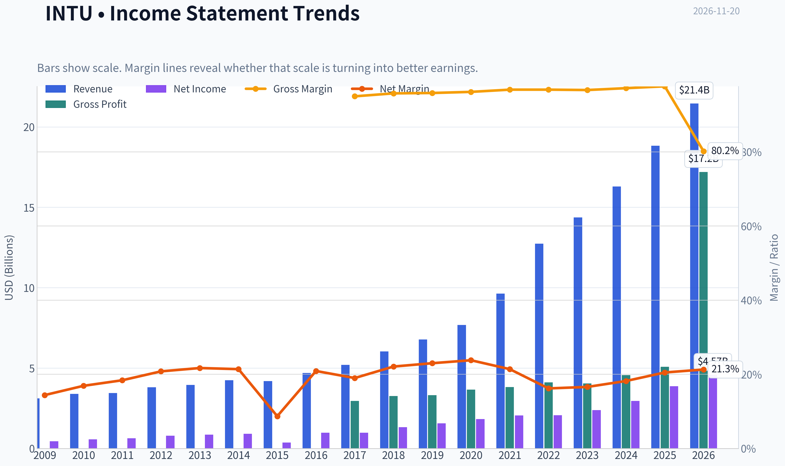

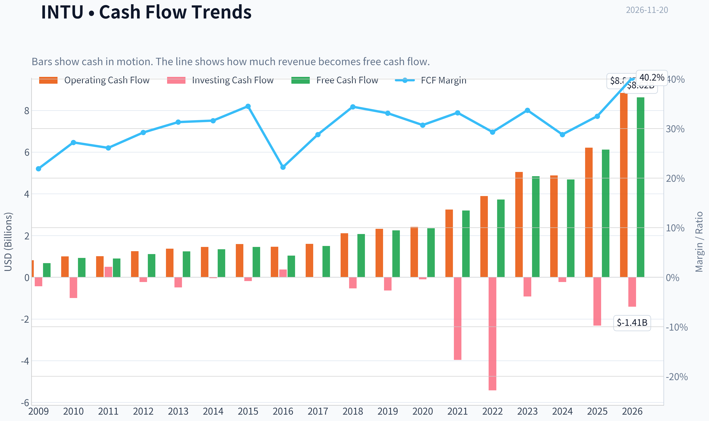

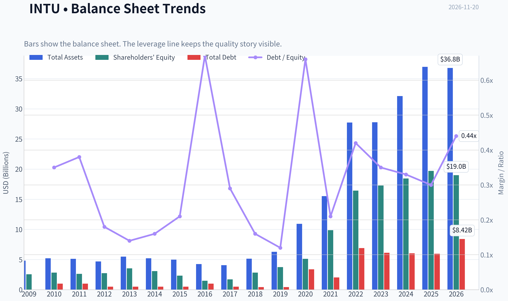

This graph tracks the profitability and return metrics (ROE, ROIC, Margins) of **INTU** over the past decade, highlighting capital efficiency trends.

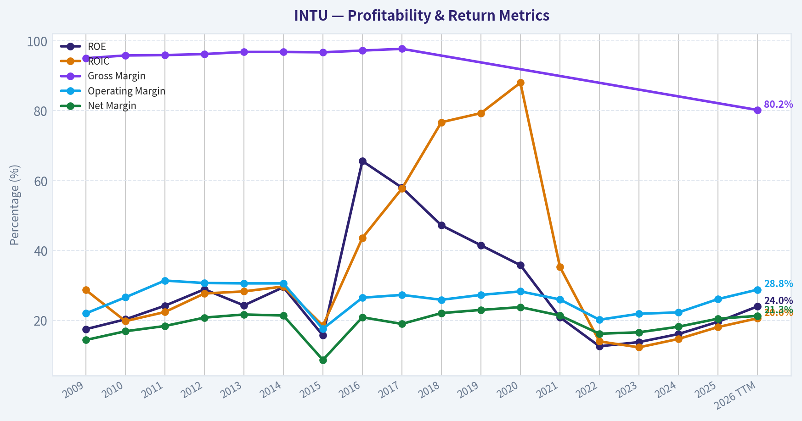

This chart illustrates the financial health of **INTU** over the last 10 years, mapping cash equivalents and free cash flow against total obligations (Debt).

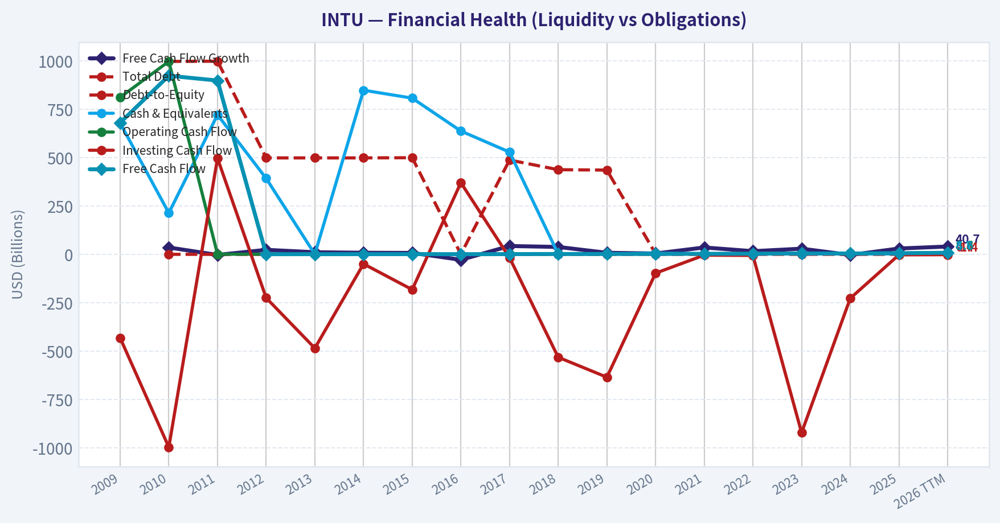

This comparison chart from *Profitability and Operating Performance* stacks current figures against historical benchmarks for **INTU**, making it easy to see where the company trades relative to its own averages.

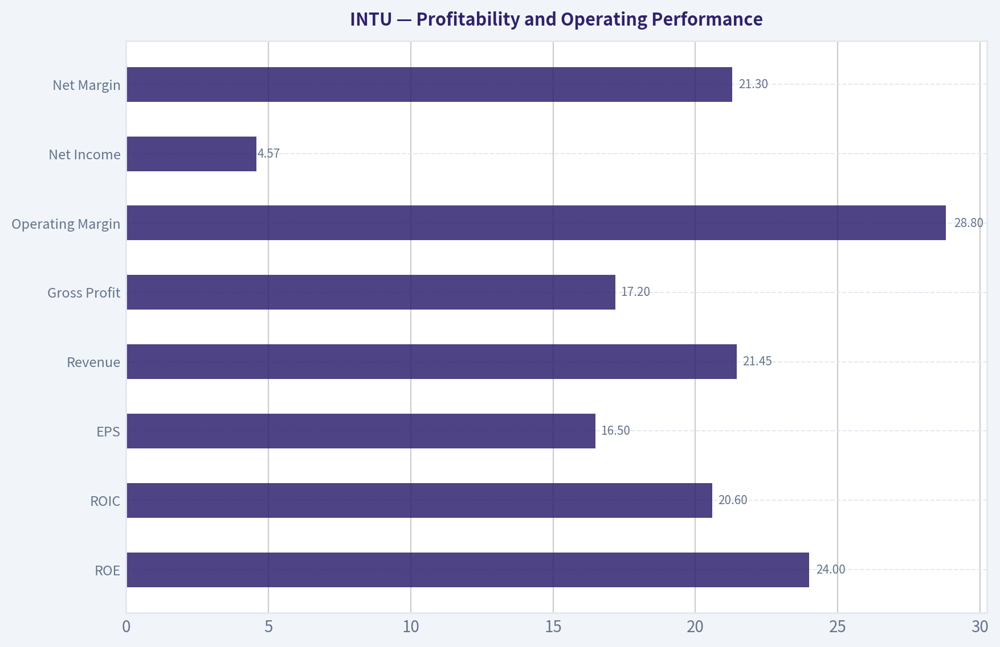

---

### Intrinsic Value Analysis (Buffett)

> *Following Warren Buffett's value investing philosophy: Circle of Competence, Economic Moat, Management Quality, and Margin of Safety.*

#### Intrinsic Value Snapshot

Price is what you pay. Intrinsic value is what the business may be worth based on the cash it can create for owners over time. We show a range, not one magic number.

- Current Price: $310.02
- Value Range (conservative to optimistic across both DCF methods): $296.11 to $1,320.45

##### Owner Earnings (Buffett Method)
- Net Income: $3,869,000,000.00
- Depreciation & Amortization: $846,000,000.00
- Capital Expenditures: $-175,000,000.00
- Working Capital Changes: $-4,000,000.00
- Owner Earnings: $4,459,233,140.26

##### Intrinsic Value
###### Buffett Method
Uses owner earnings. Stricter, and usually more conservative.
- Conservative: $296.11
- Average: $423.01
- Optimistic: $423.01
- Discount Rate: 8.4%

###### Cash Flow Method
Uses free cash flow. Better for companies spending heavily today to grow tomorrow.
- Conservative: $529.10
- Average: $807.64
- Optimistic: $1,320.45
- Discount Rate: 9.3%

ANALYST STANCE: **Neutral**

#### Executive Assessment

Intuit is a high-quality, asset-light financial software platform with strong brands, recurring revenue, attractive cash generation, and a 24% ROE. Its primary risks are artificial-intelligence disruption, changing competitive dynamics, and the substantial destruction of value represented by the Mailchimp divestiture.

At $310 per share, the stock trades below the DeepValues owner-earnings intrinsic value of $423.01, implying a 26.7% margin of safety. However, the conservative valuation is $296.11, only modestly below the current price. The evidence supports a **Neutral** stance: the business is attractive, but the valuation margin depends materially on continued growth and successful adaptation to AI.

#### Factor Scorecard

| Factor | Score | Assessment |
|---|---:|---|
| Circle of competence and simplicity | 4/5 | Intuit provides accounting, tax, payroll, and personal-finance software. The model is understandable, though AI and platform evolution reduce long-term certainty. |
| Durable competitive advantage | 4/5 | Strong brands, embedded workflows, customer data, ecosystem integration, and switching costs support a wide but not unambiguously widening moat. |
| Management and capital allocation | 3/5 | The Mailchimp purchase and subsequent sale at $3.68 billion versus the $12 billion acquisition price indicate a major capital-allocation error. |
| Industry structure | 4/5 | Subscription software and financial workflows are attractive industries, with recurring revenue and scale advantages, though competition and AI disruption are meaningful. |

**Gate 5 hard floor:** **Not tripped.** Current evidence does not indicate simultaneous deteriorating earnings or cash flow and financial distress. Debt is meaningful, but the company has substantial operating earnings and positive cash generation.

#### Moat Analysis

**Intangible assets.** TurboTax, QuickBooks, Credit Karma, and related products benefit from brand recognition, accumulated data, and trust in sensitive financial workflows. Tax and accounting software also benefits from regulatory complexity that raises the cost of building a credible alternative.

**Switching costs.** QuickBooks and payroll products can become embedded in business processes, historical records, reporting systems, and accountant workflows. Switching is possible, but it carries operational and data-integration costs.

**Network and ecosystem effects.** Intuit's ecosystem connects consumers, small businesses, accountants, lenders, payroll users, and financial-service providers. The network effect is meaningful, although weaker than the strongest consumer internet platforms because customers can use competing products.

**Cost advantages.** Software distribution is highly scalable, and incremental distribution costs are low. Intuit can spread development, compliance, and infrastructure costs across a large customer base.

**Moat quality:** **Wide and stable, with potential to widen if AI strengthens the ecosystem.** The Mailchimp outcome and AI competition prevent a 5/5 rating.

#### Management Quality and Capital Allocation

Intuit's core management challenge is converting strong operating franchises into consistent per-share value. The company's 24% ROE and 13.9% revenue growth indicate that the underlying businesses remain productive.

The Mailchimp transaction is a clear blemish. Intuit paid approximately $12 billion in 2021 and agreed to sell the asset for approximately $3.68 billion, implying substantial value destruction before considering any operating benefits received during ownership. That event lowers confidence in acquisition discipline.

The available information does not establish unusually high insider ownership, compensation alignment, or a consistent record of candid annual-letter disclosures. Management therefore receives a middle-tier score rather than a top score.

#### Financial Summary

| Metric | Latest available value |
|---|---:|
| Current price | $310 |
| Market capitalization | $82.85 billion |
| P/E ratio | 18.8x |
| Revenue growth, year over year | 13.9% |
| ROE | 24.0% |
| FCF yield | 10.5% |
| Current ratio | 1.51x |
| Operating income | $5.9 billion |
| After-tax operating income | $4.7 billion |
| Depreciation and amortization | $0.7 billion |
| Reported capex | $0.2 billion |
| Debt | $7.7 billion |
| Cash | $4.7 billion |
| Net cash/(debt) | $(3.0) billion |
| Shares outstanding | 276 million |

**Key Takeaways:** Intuit combines double-digit revenue growth with a 24% ROE and a high stated free-cash-flow yield. The balance sheet is not a net-cash fortress because debt exceeds cash by approximately $3 billion, but the debt burden is moderate relative to operating earnings. The main financial concern is not solvency; it is whether future growth and capital allocation justify the valuation.

#### Owner Earnings Calculation

| Owner-earnings component | Amount |
|---|---:|
| After-tax operating income | $4.7 billion |
| Add: depreciation and amortization | $0.7 billion |
| Less: maintenance-capex charge | $(0.2) billion |
| Less: working-capital investment | $0.0 billion |
| **Estimated owner earnings** | **$5.2 billion** |
| Owner earnings per share | Approximately $18.84 |

**Key Takeaways:** Owner earnings are approximately $5.2 billion, or $18.84 per share. The calculation shows a capital-light business in which depreciation and capital expenditure are both relatively small compared with operating earnings. The resulting owner-earnings yield at $310 is approximately 6.1%.

#### Cash Flow and Returns Assessment

| Measure | Assessment |
|---|---|
| ROE | 24.0%, a strong result |
| Operating earnings | $5.9 billion |
| Owner earnings | $5.2 billion |
| FCF yield | 10.5% |
| Revenue growth | 13.9% year over year |
| ROIC versus WACC | Direct ROIC figure not provided; operating returns appear attractive relative to an 8.4% valuation discount rate |

**Key Takeaways:** Intuit's returns profile is consistent with an asset-light compounder rather than a capital-intensive business. ROE is comfortably above the 15% quality threshold, and cash generation is substantial. The principal uncertainty is the durability of those returns as AI lowers software friction and intensifies competition.

#### Three-Scenario DCF Valuation

The DeepValues owner-earnings valuation is the primary intrinsic-value reference. The independent scenarios below are sensitivity checks using $5.2 billion of owner earnings and 276 million shares.

| Scenario | Key assumptions | Indicative value per share |
|---|---|---:|
| A: No growth | 10% discount rate; owner earnings held constant | $188 |
| B: GDP-like growth | 3% perpetual growth; 10% discount rate | $277 |
| C: Historical-growth sensitivity | Approximately 7.5% growth for 10 years, fading to 2.5%; 10% discount rate | Approximately $370 |
| DeepValues owner-earnings intrinsic value | 10% growth fading to 2.5%; 8.4% discount rate; net debt included | **$423.01** |

**Key Takeaways:** The valuation is highly sensitive to growth and discount-rate assumptions. No-growth and GDP-growth cases produce values below the current price, while a durable high-growth case produces meaningful upside. The official owner-earnings intrinsic value of $423.01 is the relevant headline valuation, while the other cases illustrate the range of outcomes.

#### Intrinsic Value and Margin of Safety

| Valuation reference | Value per share | Difference versus $310 |
|---|---:|---:|
| Conservative DeepValues value | $296.11 | $(13.89), or approximately 4% below price |
| DeepValues headline intrinsic value | **$423.01** | **$113.01, or 26.7% above price** |
| Optimistic DeepValues value | $423.01 | $113.01, or 26.7% above price |
| Secondary DVI scenario model | $521.31 | Not the primary intrinsic value |

**Key Takeaways:** The headline valuation provides a substantial 26.7% margin of safety, which is reasonable for a high-quality compounder. However, the conservative value is below the current price, meaning the valuation is not protected under every reasonable assumption. The market price appears to embed continued growth and successful adaptation rather than a deep distress discount.

#### Buffett Scorecard

| Criterion | Weight | Score | Weighted contribution |
|---|---:|---:|---:|
| Moat width and durability | 25% | 4.0/5 | 1.00 |
| Valuation and margin of safety | 20% | 4.0/5 | 0.80 |
| Capital returns versus WACC | 15% | 4.0/5 | 0.60 |
| Business understanding and predictability | 12% | 4.0/5 | 0.48 |
| Management quality and capital allocation | 12% | 3.0/5 | 0.36 |
| Reinvestment runway | 8% | 4.0/5 | 0.32 |
| Balance-sheet strength | 4% | 3.0/5 | 0.12 |
| Industry structure | 4% | 4.0/5 | 0.16 |
| **Total** | **100%** |  | **3.84/5** |

**Key Takeaways:** Intuit scores well because its moat, returns, industry structure, and reinvestment runway are strong. The score is held back by the Mailchimp capital-allocation failure, net debt, and uncertainty surrounding AI's effect on software economics. The aggregate score falls in the "good business with adequate margin of safety" range.

#### Final Stance

**ANALYST STANCE: Neutral**

**Conviction: Moderate.** Intuit is a high-quality financial software franchise with strong owner earnings, a durable ecosystem, and attractive long-term economics. At $310, the 26.7% headline margin of safety is meaningful, but the conservative valuation is slightly below the market price and the Mailchimp outcome raises questions about capital allocation. The evidence supports continued analytical attention, with valuation dependent on sustained growth and preservation of switching costs in an increasingly AI-driven software market.
#### Valuation Bridge

This bridge places the current market price beside each intrinsic value lens so readers can see whether upside depends on one method or shows up across several methods.

| Scenario | Intrinsic Value / Share |
| --- | ---: |
| Buffett Method | $423.01 |
| Cash Flow Method | $807.64 |
| Damodaran Method | $378.86 |
| Current Price | $310.02 |

#### Key Takeaways

If one method is far above the others, the upside case depends on a specific modelling assumption. When several methods cluster together, the valuation story is more robust.

#### Valuation Visuals

This comparison chart from *Latest Earnings Snapshot* stacks current figures against historical benchmarks for **INTU**, making it easy to see where the company trades relative to its own averages.

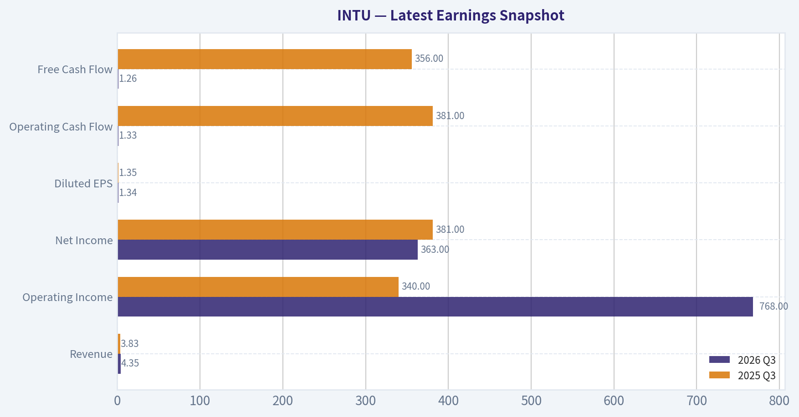

This comparison chart from *Balance Sheet and Financial Strength* stacks current figures against historical benchmarks for **INTU**, making it easy to see where the company trades relative to its own averages.

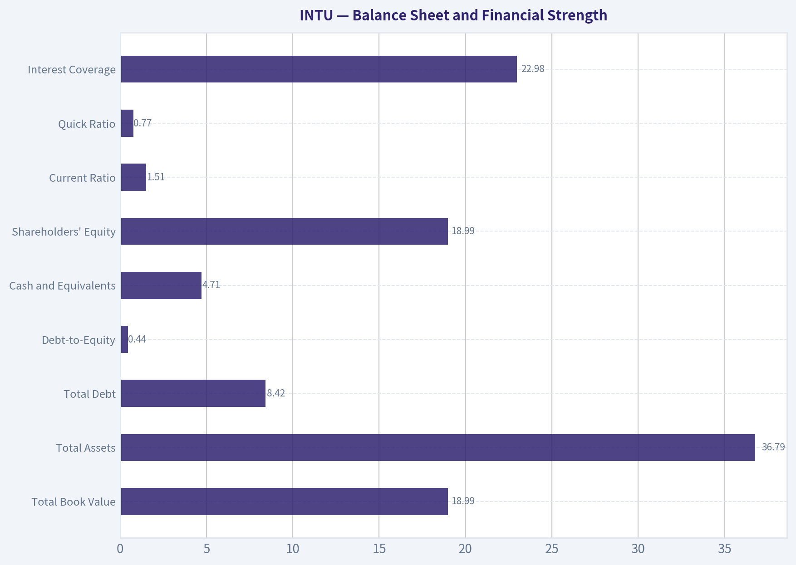

This comparison chart from *Cash Flow and Capital Allocation* stacks current figures against historical benchmarks for **INTU**, making it easy to see where the company trades relative to its own averages.

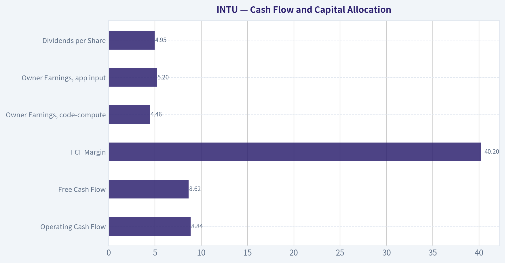

---

### Trend & Growth Analysis (Lynch/Druckenmiller/Fisher)

> *Following Peter Lynch's GARP, Stanley Druckenmiller's macro-aware approach, and Philip Fisher's scuttlebutt methodology.*

ANALYST STANCE: **Neutral**

#### 1. Lynch Classification

**Fast grower transitioning toward a stalwart.** Intuit's latest reported revenue growth of **13.9%** is below the 15-25% fast-growth threshold, although its strong cash generation, ecosystem, and AI-enabled product expansion preserve the possibility of renewed acceleration.

#### 2. The Story in Three Bullets

- Intuit provides essential financial software through TurboTax, QuickBooks, Credit Karma, and related products used by consumers and businesses.
- Its ecosystem can compound through cross-selling, embedded financial services, automation, and artificial intelligence.
- The current debate is whether AI expands Intuit's value proposition or commoditizes parts of tax, accounting, and small-business software.

#### 3. TAM and 10x Test

| Measure | Assessment |
|---|---:|
| Current market capitalization | $82.85 billion |
| Latest revenue growth | 13.9% year over year |
| Potential revenue at 10x current scale | Not available from supplied data |
| Addressable markets | Consumer tax, SMB accounting, payments, lending, personal finance, marketing software |
| TAM direction | Expanding, but competitive and partially mature |
| 10x test | Plausible at the ecosystem level, not demonstrated from current data |

**Key Takeaways:** Intuit operates across several large financial-software markets rather than relying on one narrow category. A tenfold expansion is more plausible through broader financial workflows and international or adjacent products than through legacy tax software alone. The Mailchimp divestiture reduces one avenue of expansion but may sharpen strategic focus.

#### 4. Revenue Growth Trend

| Indicator | Reading | Interpretation |
|---|---:|---|
| Revenue growth | 13.9% year over year | Healthy, but below fast-grower territory |
| Growth direction | Not fully established | No multi-period acceleration series supplied |
| Mailchimp contribution | Being exited | Strategic reset and possible revenue-mix impact |
| Earnings context | Strong results reported | Market reaction indicates concern about AI disruption |
| Organic growth quality | Partially unclear | Requires segment-level disclosure |

**Key Takeaways:** The available data show healthy growth but do not prove acceleration. The Mailchimp sale introduces a transition period, while investor concern about AI suggests that the market is testing the durability of Intuit's current growth model. A sustained return above 15-20% would represent a meaningful inflection.

#### 5. Unit Economics and Operating Efficiency

| Metric | Result | Assessment |
|---|---:|---|
| LTV/CAC | Not disclosed in supplied data | Cannot verify |
| Net revenue retention | Not disclosed | Cannot verify |
| Rule of 40 | Not fully calculable | FCF margin unavailable |
| FCF yield | 10.5% | Strong cash-generation profile |
| Return on equity | 24.0% | Strong, though leverage can influence ROE |
| Current ratio | 1.51 | Adequate near-term liquidity |

**Key Takeaways:** Intuit's 10.5% free-cash-flow yield and 24% return on equity indicate a financially productive business. However, the absence of customer-retention and acquisition-cost metrics limits confidence in the underlying subscription economics. The Rule of 40 cannot be calculated reliably without a current free-cash-flow margin.

#### 6. Inflection Point Assessment

| Potential inflection | Evidence | Status |
|---|---|---|
| AI product cycle | AI is central to the disruption debate | Two-sided, unproven |
| Margin inflection | Strong FCF yield; detailed margin trend unavailable | Possible |
| TAM expansion | Broader financial automation opportunity | Positive |
| Competitive position | Established ecosystem and brand | Positive |
| Portfolio simplification | Mailchimp exit at $3.68 billion versus $12 billion acquisition price | Negative financially, potentially positive strategically |
| Revenue acceleration | Current growth is 13.9% | Not yet confirmed |

**Key Takeaways:** The central inflection is AI: it could increase automation, attach rates, and customer value, or weaken the differentiation of core software. The Mailchimp divestiture is a clear strategic reset, but the large value loss highlights historical capital-allocation risk. The evidence currently supports an inflection watch rather than a confirmed acceleration thesis.

#### 7. Macro Setup

| Macro factor | Assessment |
|---|---|
| Long-term secular trends | Positive: digitization, cloud software, automation, fintech |
| Interest-rate backdrop | Challenging: 30-year Treasury reference rate is 5.41% |
| Consumer and SMB sensitivity | Moderate; tax and accounting software are relatively recurring |
| Valuation sensitivity | High for long-duration software expectations |
| Macro stance | Mixed |

**Key Takeaways:** Intuit benefits from durable digitization and automation trends, but elevated long-term rates reduce the value assigned to distant growth. Its recurring and essential-use products provide more resilience than discretionary software, although small-business health remains an important economic variable.

#### 8. Fisher's 15-Point Assessment

| Fisher criterion | Score / 5 | Rationale |
|---|---:|---|
| Market potential | 4 | Large consumer and SMB financial markets |
| New-product determination | 4 | Continued AI and ecosystem development |
| R&D effectiveness | 4 | Established product and platform capabilities |
| Sales organization | 4 | Strong distribution and installed base |
| Profit margins | 4 | Strong cash generation; detailed gross margin unavailable |
| Margin improvement | 3 | Direction not sufficiently documented |
| Labor relations | 3 | Insufficient data |
| Executive relations | 3 | Insufficient data |
| Management depth | 4 | Large, established operating platform |
| Cost analysis/accounting | 4 | Mature public-company reporting |
| Outstanding competitive aspects | 4 | Brand, data, workflow integration, switching costs |
| Long-range profit outlook | 4 | Attractive if AI expands rather than erodes the moat |
| Dilution risk | 3 | No current dilution analysis supplied |
| Management candor | 3 | Mailchimp outcome raises questions, though disclosure is available |
| Management integrity | 4 | No specific integrity concern identified |

| Total Fisher score | Result |
|---:|---|
| **55 / 75** | **Good, but not outstanding** |

**Key Takeaways:** Intuit scores well on market potential, distribution, product breadth, and competitive assets. The score is held back by incomplete evidence on retention, margins, labor relations, dilution, and the outcome of the Mailchimp strategy. A 55 out of 75 places the company in Fisher's "good" range rather than the highest-conviction category.

#### 9. Valuation Analysis

| Valuation measure | Result | Interpretation |
|---|---:|---|
| Share price | $310 | Current reference price |
| P/E | 18.8x | Moderate for a durable software franchise |
| PEG, using 13.9% growth | 1.36 | Fair-value range, not deeply discounted |
| Market capitalization | $82.85 billion | Large-cap scale |
| P/S | Not calculable from supplied revenue data | Revenue figure required |
| Owner-earnings intrinsic value | $423.01 | Headline DeepValues estimate |
| Conservative owner-earnings value | $296.11 | Downside case |
| Margin of safety versus headline intrinsic value | 26.7% | Positive valuation cushion |
| Damodaran FCFF base case | $378.86 | Supports valuation below headline estimate |

**Key Takeaways:** At 18.8 times earnings and 13.9% growth, the PEG is approximately 1.36, implying fair rather than bargain-level growth valuation. The supplied owner-earnings model estimates intrinsic value at $423.01, while the conservative case is $296.11, creating a wide range that reflects execution and discount-rate sensitivity. The independent FCFF base case of $378.86 provides additional support for valuation above the current reference price, but these are model estimates rather than guaranteed outcomes.

#### 10. Growth Investor Scorecard

| Criterion | Weight | Score / 5 | Weighted contribution |
|---|---:|---:|---:|
| Story clarity | 10% | 4.0 | 0.40 |
| TAM and runway | 20% | 4.0 | 0.80 |
| Revenue growth | 20% | 3.0 | 0.60 |
| Unit economics | 15% | 3.0 | 0.45 |
| Competitive position | 10% | 4.0 | 0.40 |
| Management quality | 10% | 3.5 | 0.35 |
| Macro setup | 5% | 3.0 | 0.15 |
| Profitability path | 5% | 4.5 | 0.23 |
| Valuation | 5% | 4.0 | 0.20 |
| **Total** | **100%** |  | **3.58 / 5.00** |

**Key Takeaways:** The 3.58 out of 5 score falls in the "good setup" range, but the rating is constrained by sub-15% growth, uncertain AI economics, and limited unit-economics disclosure. Strong profitability, ecosystem advantages, and valuation support offset the lack of a clearly demonstrated growth acceleration.

#### 11. Valuation Sensitivity

| Scenario | Key assumptions | Valuation implication |
|---|---|---|
| Bear | Growth remains near or below current levels; AI pressures pricing or retention; rates remain elevated | Conservative owner-earnings value: $296.11 |
| Base | Durable low-to-mid-teens growth; stable margins; AI improves efficiency and engagement | FCFF value: $378.86; owner-earnings headline: $423.01 |
| Bull | AI materially expands attach rates, automation, and margins; ecosystem growth reaccelerates | Higher value than the base case, but requires evidence of renewed growth |

**Key Takeaways:** The valuation range is wide because the key variable is not survival but the future growth rate and quality of AI monetization. The conservative case is close to the current reference price, while the base cases indicate meaningful valuation support. The bull case requires measurable acceleration rather than simply continued execution.

#### 12. Key Risks and Catalysts

| Catalysts | Risks |
|---|---|
| AI increases customer engagement and cross-sell | AI commoditizes tax and accounting workflows |
| QuickBooks ecosystem gains share among SMBs | Revenue growth remains stuck near the low teens |
| Margin expansion through automation | Mailchimp divestiture exposes prior capital-allocation weakness |
| Stronger Credit Karma monetization | Consumer-credit deterioration affects fintech products |
| Product simplification improves focus | Elevated rates compress software valuation multiples |
| Reacceleration after portfolio reset | Customer retention or pricing power weakens |

**Key Takeaways:** The highest-value catalyst would be evidence that AI expands Intuit's total addressable market while improving productivity and margins. The principal risk is that AI reduces the differentiation and pricing power of Intuit's core products. Until growth acceleration and retention trends become clearer, the evidence supports monitoring the inflection rather than treating it as confirmed.

#### Overall Conclusion

Intuit is a high-quality, cash-generative financial software platform with substantial ecosystem advantages and a valuation that appears reasonable relative to its intrinsic-value estimates. However, it is not currently demonstrating the unmistakable 20%-plus growth acceleration typically associated with a ten-bagger candidate. The decisive evidence to monitor is whether AI produces stronger customer adoption, higher cross-product penetration, and renewed revenue acceleration after the Mailchimp reset.

#### Growth & Scorecard Visuals

This comparison chart from *Growth Metrics* stacks current figures against historical benchmarks for **INTU**, making it easy to see where the company trades relative to its own averages.

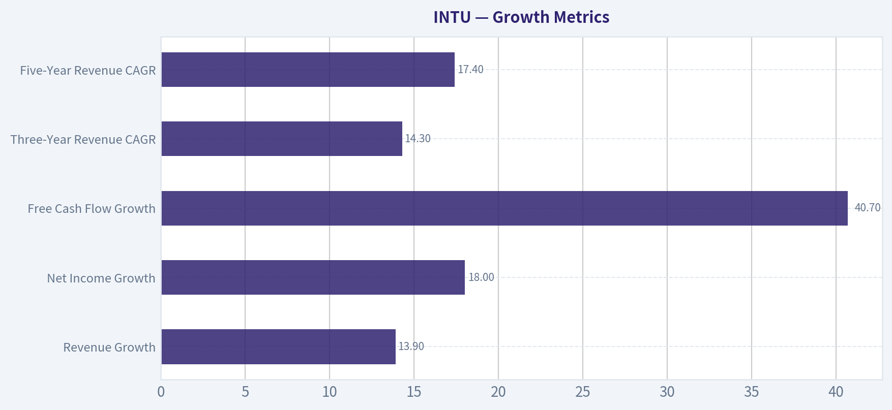

---

### Market Technical Analysis

ANALYST STANCE: **Neutral**

#### INTU technical report

The analysis covers Intuit Inc. (Nasdaq: INTU) only. The latest available trading record is November 19, 2026, with a closing price of **$310.02**. November 20 is identified by the data service as a non-trading day, so no November 20 closing price or indicator reading is available.

The indicator-report service returned blank numerical fields for all requested indicators. Accordingly, the observations below combine the retrieved daily price and volume history with transparent, approximate calculations from that dataset. Exact indicator values should be treated as unavailable rather than assumed.

#### Price structure and trend

INTU has experienced a pronounced multi-stage decline. The stock closed at **$628.58 on November 20, 2025**, then reached a late-December recovery high near **$667**. That recovery failed in January, followed by an especially sharp drawdown from approximately **$643 on January 8** to **$304 on May 21**, a decline of roughly **53%**.

The May-to-August period produced a substantial rebound. The close advanced from **$304.30 on May 21** to **$368.20 on August 24**, or approximately **21%**. However, this recovery did not restore the prior long-term structure. The August advance stalled near the mid-$360s, and the stock subsequently formed a sequence of lower highs and lower lows into late September, reaching a low close of **$266.79 on September 29**.

A second rebound carried the price to **$356.64 on November 4**, but that move also failed to establish a durable uptrend. The latest sequence is distinctly weaker: the close fell from **$345.56 on November 16** to **$320.79 on November 17**, **$313.24 on November 18**, and **$310.02 on November 19**. This three-session decline erased the recent recovery and placed the price near the lower end of the autumn trading range.

The broad pattern remains one of **lower highs since the August peak**, despite intermittent countertrend rallies. The November breakdown is more significant than an isolated daily decline because it followed a failed recovery around the mid-$350s and occurred with increased volume on November 19.

#### Moving averages

The indicator service did not supply numerical values for the 10-day exponential moving average, 50-day simple moving average, or 200-day simple moving average. The price series nevertheless provides a clear directional interpretation.

A rough calculation from the most recent closes places the **10-day EMA in the low-to-mid $320s**, meaning the latest close of $310.02 is materially below the short-term trend estimate. The sharp separation between the recent closing price and the estimated short-term average indicates that downside momentum accelerated rather than merely drifting lower.

The **50-day average is likely in the low-to-mid $330s**, based on the concentration of recent prices between roughly $300 and $355. INTU is therefore also below its medium-term trend benchmark. The most recent failure near $356 reinforces the interpretation that the 50-day average has functioned more as overhead resistance than as a reliable support level.

The **200-day average is likely above the current market price**, given the much higher prices during late 2025 and early 2026. The long-term trend therefore remains impaired. A price below both medium- and long-term averages is generally more consistent with continuing structural weakness than with a confirmed trend reversal.

#### Momentum: MACD and RSI

Numerical MACD, MACD signal, histogram, and RSI readings were not returned by the indicator service. Price behavior still supports a negative momentum assessment.

The MACD framework would likely show a bearish configuration because the recent short-term price trend has turned sharply downward after a failed advance. The November 17-19 decline also suggests that any recent improvement in the MACD histogram would have weakened or reversed. The key issue is not simply that momentum is negative, but that the negative impulse arrived after a failed recovery, which makes the move more technically consequential.

The recent sequence of losses would also place RSI under pressure. A rough price-based estimate suggests RSI may be near the lower part of its neutral-to-weak range, potentially approaching oversold territory, but the exact value is unavailable. This distinction matters: an oversold reading would describe the intensity of the decline, not establish that the broader trend has reversed. INTU previously displayed prolonged downside phases in which short-term oversold conditions were followed by additional volatility rather than a durable recovery.

#### Volatility and volume

The ATR reading was blank, but the raw daily ranges show that volatility remains elevated. Several sessions during the year recorded unusually wide ranges, including the January and February selloff, the May 21 gap-like decline, and the November 17-19 breakdown. The current price environment therefore carries materially greater day-to-day fluctuation than a stable, low-volatility trend.

Volume confirms that the most recent weakness deserves attention. The November 19 decline to $310.02 occurred on approximately **4.40 million shares**, compared with about **2.41 million** on November 18 and **3.25 million** on November 17. That increase in volume while price continued lower indicates stronger participation in the breakdown.

The most conspicuous volume event in the full dataset was May 21, when roughly **22.35 million shares** changed hands during a decline from the high-$370s to a close near $304. That event remains an important marker of a major repricing phase. Later rallies have generally not produced a comparable combination of sustained price improvement and overwhelming volume, which limits the evidence for a fully established long-term recovery.

VWMA numerical values were also unavailable. Qualitatively, the recent volume-weighted price region is likely above $310 because several heavier-volume sessions occurred at prices in the low-to-mid $300s. This would be consistent with the latest close trading below a volume-weighted recent-market benchmark.

#### Market context and valuation implication

Technically, INTU is characterized by:

- A long-term decline from the late-2025 highs.
- A major failed rebound from the May low.
- A lower-high structure from the August peak.
- A renewed breakdown below approximate short- and medium-term trend levels.
- Increasing volume during the latest three-session decline.
- Elevated volatility and uncertain short-term momentum.

The evidence does not establish a confirmed technical base at the latest price. Although the decline may have pushed short-term momentum toward weaker or potentially oversold conditions, the broader trend remains negative, and the price is below the likely 10-day, 50-day, and 200-day benchmarks. From a valuation perspective, the market is signaling that a lower price alone is not sufficient evidence of restored confidence; confirmation would require a more durable improvement in trend, momentum, and volume behavior.

| Area | Evidence from retrieved data | Interpretation |
|---|---|---|
| Latest price | $310.02 close on November 19, 2026 | Latest session ended near the lower end of the recent range |
| One-year direction | $628.58 to $310.02 | Approximately 51% decline over the retrieved period |
| Major rebound | $304.30 on May 21 to $368.20 on August 24 | Strong countertrend recovery, but not a confirmed long-term reversal |
| Recent structure | $356.64 on November 4 to $310.02 on November 19 | Failed rebound followed by renewed downside |
| Short-term average | Exact 10 EMA unavailable; rough estimate in low-to-mid $320s | Price is likely below short-term trend support |
| Medium-term average | Exact 50 SMA unavailable; rough estimate in low-to-mid $330s | Price is likely below the medium-term benchmark |
| Long-term average | Exact 200 SMA unavailable; likely above current price | Long-term trend remains technically impaired |
| Momentum | MACD and RSI numerical values unavailable | Price action implies negative momentum; possible short-term oversold pressure cannot be confirmed |
| Volume | About 4.40 million shares on November 19 versus 2.41 million on November 18 | Downside move had increasing participation |
| Volatility | ATR unavailable; daily ranges remain wide | Elevated risk of further sharp price fluctuations |
| Overall stance | Trend, momentum, and volume lean negative | **Neutral**; evidence does not yet confirm a durable technical recovery or support a stronger valuation conclusion |

Key Takeaways: INTU remains in a structurally weak technical trend, with the November rebound failing near the mid-$350s and the latest close falling to $310.02. The latest decline occurred with increasing volume, while the price is likely below its short-, medium-, and long-term trend averages. Short-term oversold conditions are possible, but the available evidence does not confirm a durable base or a restored valuation regime.

#### Market Visuals

This comparison chart from *Market Metrics and Valuation* stacks current figures against historical benchmarks for **INTU**, making it easy to see where the company trades relative to its own averages.

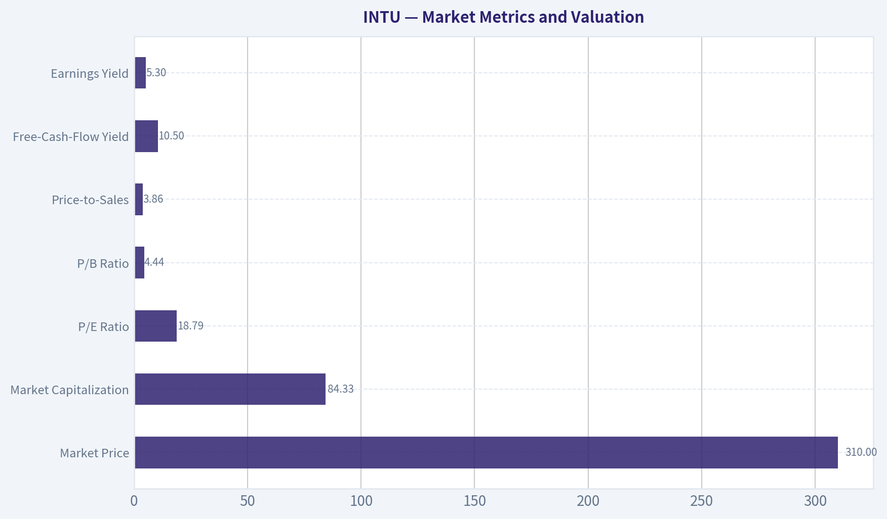

---

### Options Market Analysis

> *Reading options flow - put/call ratios, IV skew, and unusual activity - to gauge institutional positioning and event-driven risk.*

#### INTU Options Flow Report

**As of November 20, 2026.** The available feed shows substantial near-term trading volume but zero reported open interest across all listed expirations. That makes positioning analysis unusually unreliable: put/call OI ratios, strike concentration, gamma walls, and volume-versus-OI diagnostics cannot be calculated with confidence.

#### Put/Call Ratio Analysis

| Expiration | Call OI | Put OI | Call Volume | Put Volume | Put/Call Volume Ratio |
|---|---:|---:|---:|---:|---:|
| Nov. 20, 2026 | 0 | 0 | 9,670 | 10,476 | 1.08 |
| Nov. 27, 2026 | 0 | 0 | 2,112 | 1,456 | 0.69 |
| Dec. 4, 2026 | 0 | 0 | 270 | 1,033 | 3.83 |
| **Combined** | **0** | **0** | **12,052** | **12,965** | **1.08** |

**Key Takeaways:** Aggregate near-term put volume is modestly higher than call volume, with a 1.08 ratio versus the approximately 0.7 neutral reference. That indicates a slight tilt toward downside hedging or bearish speculation, although the result is dominated by very short-dated contracts. Because reported open interest is zero, there is no reliable evidence about established positioning.

#### Implied Volatility Assessment

| Expiration | Call ATM IV | Put ATM IV | IV Comparison | Interpretation |
|---|---:|---:|---|---|
| Nov. 20, 2026 | 5.5% | 6.5% | Put IV higher by 1.0 percentage point | Mild downside skew |
| Nov. 27, 2026 | 2.8% | 2.0% | Call IV higher by 0.8 percentage point | Mild upside skew |
| Dec. 4, 2026 | 1.6% | 1.6% | Approximately balanced | Neutral skew |

The reported IV levels are exceptionally low for individual equity options and may reflect a stale, incomplete, or improperly normalized data feed rather than genuine market pricing. No separate out-of-the-money volatility surface was provided, so a full OTM put-versus-call skew analysis is not possible. The data also does not identify a known catalyst such as earnings or a product event.

**Key Takeaways:** The feed shows no consistent skew direction: puts are richer for the nearest expiry, calls are slightly richer for the following week, and the December chain is balanced. The unusually low absolute IV readings materially reduce confidence in any volatility conclusion.

#### Unusual Options Activity

| Finding | Result |
|---|---|
| Contracts with volume greater than five times open interest | None identified |
| Fresh directional contracts | Cannot be confirmed |
| Current share price and strike comparison | Not provided |
| ITM, ATM, or OTM classification | Not available |
| Smart-money versus retail attribution | Not determinable |

No contracts met the data provider's unusual-activity threshold. More importantly, zero reported open interest prevents distinguishing new opening trades from closing activity. Strike-level records were not supplied, so individual directional bets and expiry horizons cannot be evaluated.

**Key Takeaways:** There is no verified unusual-options signal in the supplied data. The absence of qualifying contracts should not be interpreted as a lack of institutional activity, because the zero-OI readings suggest a data-quality or chain-completeness issue.

#### Open Interest Concentration and Gamma Levels

| Expiration | Highest Call OI | Highest Put OI | Gamma Wall Assessment |
|---|---:|---:|---|
| Nov. 20, 2026 | None reported | None reported | Cannot calculate |
| Nov. 27, 2026 | None reported | None reported | Cannot calculate |
| Dec. 4, 2026 | None reported | None reported | Cannot calculate |

No open-interest concentration can be identified. Consequently, strike-based pinning, max-pain levels, and positive or negative gamma zones cannot be assessed from this dataset.

**Key Takeaways:** The available chain contains no usable OI distribution. There is therefore no evidence-based options-derived support, resistance, pinning level, or gamma amplification zone.

#### Overall Options Sentiment

**Overall signal: NEUTRAL, with low confidence.**

The modestly elevated aggregate put/call volume ratio provides a slight bearish or hedging tilt, but it is not strong enough to overcome the data limitations. Zero reported open interest across all near-term expirations, exceptionally low IV readings, and the lack of strike-level unusual activity make this a thin and potentially incomplete options dataset. The evidence therefore supports only a neutral options interpretation, with a mild downside bias in near-term trading flow.

| Category | Assessment |
|---|---|
| Put/Call Ratio | **Slightly bearish tilt:** 1.08 aggregate volume ratio; OI ratio unavailable |
| IV Level | **Apparently very low, but unreliable:** 1.6%-6.5% ATM IV |
| Skew Direction | **Mixed:** near-term put skew, next-week call skew, December balanced |
| Unusual Activity | **None identified:** no contracts exceeded the volume/OI threshold |
| Overall Signal | **NEUTRAL, low confidence:** slight put-volume bias offset by severe data limitations |

**Key Takeaways:** INTU's reported options flow leans mildly defensive based on aggregate volume, but the evidence is not robust. The zero-OI readings prevent confirmation of durable institutional positioning, while the unusually low IV values raise concerns about data integrity.

---

## Research Team Commentary

> *The Research Manager synthesizes the Bull vs Bear debate into action-free commentary. This is a pre-risk view, not the final stance.*

Core Takeaway: Intuit appears to be a high-quality franchise at a potentially attractive valuation, but the evidence is not yet strong enough to treat the stated 26.7% discount as a dependable margin of safety. At $310, the shares trade at about 18.8 times earnings versus the DeepValues owner-earnings value of $423.01. That is undemanding for a company growing revenue by 13.9% with a 22.9% ROIC-provided its moat, margins, and per-share cash generation survive the AI transition. The uncertainty lies less in current business quality than in whether the valuation model adequately captures technological disruption, dilution, and weaker capital allocation. Final stance: Neutral.

The strongest bull argument is that Intuit is not merely a collection of software features that generative AI can easily replicate. TurboTax and QuickBooks sit inside high-consequence financial workflows involving historical records, payroll configurations, integrations, security, and regulatory compliance. Brand trust matters when errors can create tax liabilities or disrupt a small business. Intuit also has distribution, proprietary customer context, and the ability to place AI directly into products that customers already use.

These advantages give Intuit a credible opportunity to use AI offensively. Automation could improve bookkeeping, customer support, tax guidance, fraud detection, and cross-selling while reducing service costs. The combination of recurring revenue, asset-light economics, 24% ROE, and 22.9% ROIC is consistent with a Buffett-style compounder. If Intuit can sustain even high-single-digit per-share earnings growth while preserving margins and returns on incremental capital, an 18.8-times earnings valuation does not appear to require heroic growth.

The stated valuation discount is also larger than the roughly 10%-15% that can be sufficient for a predictable, wide-moat compounder. On its face, a 26.7% discount to estimated intrinsic value would be compelling. The weak share-price trend and modestly defensive options volume do not refute that conclusion. Technical weakness reflects sentiment, while the options feed is too incomplete-zero reported open interest-to support a reliable positioning inference.

The strongest bear argument is that AI may change who captures the economics, even if Intuit remains a leading provider. AI does not need to cause mass customer defections to damage intrinsic value. It could make bookkeeping and tax assistance cheaper, reduce the complexity that supports premium pricing, or shift the primary customer relationship toward banks, accounting firms, payroll platforms, or general-purpose AI orchestration layers. Intuit might retain its users yet experience lower revenue per customer, higher infrastructure spending, or weaker incremental margins.

That distinction is critical. Demonstrating that Intuit can build effective AI features is not the same as demonstrating that those features will increase economic profit per customer. AI could improve the product while transferring much of the benefit to customers through lower prices. The next phase of the thesis therefore depends on retention, monetization, and incremental profitability-not product announcements or AI usage alone.

The $423.01 intrinsic-value estimate also deserves less confidence than its apparent precision suggests. The supplied material does not disclose its discount rate, terminal assumptions, treatment of stock-based compensation, normalized owner earnings, or sensitivity to margin compression. A 26.7% headline discount can narrow rapidly if revenue growth settles in the mid-single digits, AI spending rises, stock compensation dilutes per-share results, or terminal returns on capital decline. At 18.8 times earnings, Intuit is not priced for hypergrowth, but it is still priced for a durable franchise rather than a commoditizing software category.

Mailchimp is the clearest capital-allocation warning. The divestiture does not establish that TurboTax or QuickBooks has deteriorated, but it does weaken confidence in management's ability to evaluate strategic adjacencies and acquisition economics. For a company valued partly on its capacity to reinvest at high returns, a major acquisition failure is more than an isolated accounting event. It raises the possibility that consolidated historical ROIC overstates the return available on the next dollar of investment.

Credit Karma adds a related complication. It expands Intuit's distribution and data ecosystem, but its economics are more cyclical than a conventional software subscription. Lender demand, consumer credit conditions, regulation, and advertising budgets can affect results. The platform may deserve a premium for optionality, but not the same predictability premium as the core tax and accounting franchises.

From a value-investing perspective, the right synthesis is that business quality is evident, while intrinsic value remains insufficiently verified. Intuit has the characteristics of a potentially wonderful business: trusted brands, embedded workflows, recurring customer relationships, attractive returns on capital, and a long runway for automation. There is no supplied evidence of financial distress, and book value or short-term liquidity ratios would be poor primary measures for this asset-light model.

At the same time, historical quality cannot simply be extrapolated. The relevant questions are future incremental ROIC, per-share owner earnings after dilution, and whether AI strengthens or weakens pricing power. The market may be excessively focused on feature-level disruption, but it is not irrational to discount a franchise whose category economics could be changing. The current evidence supports probable undervaluation under a stable-moat scenario, but it does not yet demonstrate a robust margin of safety across credible downside scenarios.

Monitoring Plan: Over the next one to four quarters, the most important evidence will be customer economics. QuickBooks customer growth, retention, revenue per customer, payroll and payments attachment, and migration toward higher-value offerings should show whether the ecosystem is deepening. Stable or improving retention and monetization alongside AI adoption would strengthen the moat thesis. Weakening pricing, increased promotional activity, or slower attach rates would support the commoditization concern.

TurboTax results should be evaluated through assisted versus do-it-yourself share, customer acquisition costs, pricing, retention, and the economics of AI-enabled assistance. Market share maintained only through heavier marketing or lower effective prices would be less encouraging than stable share accompanied by healthy unit economics.

AI progress should be measured through outcomes rather than launch counts. Useful indicators include support-cost reductions, improved conversion, lower customer churn, increased product attachment, and measurable gains in operating profit per customer. Rising AI infrastructure and development costs without corresponding monetization would weaken the thesis.

Reported free cash flow should be reconciled with stock-based compensation, dilution, restructuring charges, and acquisition or divestiture effects. Per-share owner earnings matter more than aggregate cash flow. Operating margins and cash conversion should also reveal whether AI is producing leverage or merely raising the cost of defending the franchise.

Credit Karma's growth should be separated into engagement, lender demand, and monetization. A recovery driven by durable platform usage would be more valuable than one driven mainly by a temporary credit or advertising cycle.

Finally, management's capital allocation deserves close scrutiny. Evidence of conservative acquisition discipline, transparent post-mortems on Mailchimp, restrained dilution, and returns-focused AI spending would rebuild credibility. Another expensive strategic adjacency with uncertain economics would justify a larger discount to modeled intrinsic value.

The decision discipline here is to avoid two common analytical errors: assuming that a high-quality historical franchise is automatically immune to technological change, and assuming that technological fear automatically destroys a durable incumbent's moat. Intuit sits between those extremes. Its quality is real, and its valuation appears reasonable, but the durability of its future economics-not its past returns-must validate the apparent discount.

Final stance: Neutral.

---

## Value Investing Team Commentary

> *The Investor translates the research view into an investment thesis before risk review. This is still not the final stance.*

Intuit presents the profile of a high-quality, asset-light compounder, but the valuation case depends heavily on whether its historical economics remain durable through the AI transition.

At $310, the supplied figures imply approximately 18.8 times earnings and a 26.7% discount to the DeepValues owner-earnings estimate of $423.01. That valuation is not demanding for a business producing roughly 23% ROIC, 24% ROE, and 13.9% revenue growth. However, the intrinsic-value estimate should be treated as a scenario rather than a fact until its assumptions are visible. The key unknowns include normalized owner earnings, stock-based compensation, dilution, AI-related investment, terminal growth, and the discount rate.

### What the market may be missing

The bearish share-price trend appears to reflect concern that generative AI will commoditize tax preparation, bookkeeping, and financial guidance. That concern is understandable, but it may overemphasize individual software features and understate the value of Intuit's broader system.

TurboTax and QuickBooks are connected to customer histories, payroll, payments, compliance requirements, integrations, and sensitive financial data. These workflows carry meaningful switching costs. An AI model may be capable of producing a tax answer or bookkeeping recommendation, yet reliability, auditability, security, and integration into an operating system remain important. Intuit's brands and installed customer base provide distribution that a standalone AI feature may not possess.

The contrarian possibility is that AI becomes a productivity layer inside Intuit rather than an external substitute for it. Better automation could increase customer retention, improve support economics, raise product attachment, and expand the addressable market among users who previously found accounting and tax software difficult. In that scenario, current pessimism about feature-level disruption may obscure the value of workflow ownership and trusted data.

### What the market may be getting right

AI can still weaken Intuit's economics without causing a dramatic customer exodus. If comparable functionality becomes widely available, customers may gain pricing power. Intuit could retain users while facing lower revenue per customer, greater promotional spending, or higher infrastructure costs. The relevant question is not whether Intuit launches AI capabilities; it is whether AI raises long-term economic profit per customer.

The most important evidence will therefore be:

- QuickBooks retention, revenue per customer, payroll and payments attachment, and migration toward premium products.
- TurboTax pricing, customer acquisition costs, assisted versus do-it-yourself economics, and retention.
- AI-driven reductions in support costs and churn relative to infrastructure and development spending.
- Operating-margin performance after accounting for stock-based compensation and other costs.
- Per-share owner earnings rather than aggregate free cash flow.

Strong AI adoption accompanied by stable pricing and improving margins would support the view that Intuit is capturing the benefits of automation. High usage accompanied by weaker monetization would suggest that customers, rather than shareholders, are receiving most of the economic benefit.

### Capital allocation and business mix

Mailchimp remains a meaningful warning. The divestiture does not directly undermine the core TurboTax or QuickBooks franchises, but it reduces confidence in management's judgment regarding strategic adjacencies. A high ROIC on the consolidated business is less informative if future reinvestment opportunities generate materially lower returns.

Credit Karma also deserves a differentiated valuation treatment. It provides valuable distribution, data, and cross-selling potential, but its revenue is more exposed to lender demand, consumer credit conditions, regulation, and advertising cycles than subscription accounting software. Its optionality is real, but its earnings should not receive the same predictability premium as the most embedded parts of the franchise.

### Valuation interpretation

An 18.8-times earnings multiple is moderate relative to Intuit's historical quality and growth profile, but it does not represent a distressed valuation. It implicitly assumes that the company remains a durable franchise with respectable long-term profitability. The valuation therefore appears attractive under a stable-moat scenario, while offering less protection if AI causes structural margin compression or materially lower returns on incremental capital.

The reported 26.7% discount to intrinsic value is potentially meaningful, but its reliability is lower than the precision of the figure suggests. A lower-confidence valuation range would be more appropriate than reliance on a single-point estimate. If owner earnings compound at high-single-digit rates, dilution remains controlled, and AI produces operating leverage, the current valuation could understate long-term business value. If growth settles near the mid-single digits while margins and pricing power weaken, the apparent discount could narrow substantially.

Technical weakness and a modestly elevated put-to-call volume ratio reveal cautious sentiment, but they do not establish fundamental mispricing. The options data are especially limited because reported open interest is zero across the available expirations. Consequently, there is no reliable evidence of durable institutional positioning, gamma concentration, or sophisticated downside hedging. Market pessimism is informative only insofar as it creates a gap between expectations and business reality.

### Overall assessment

Intuit's moat is more substantial than a simple feature comparison suggests. Trusted brands, embedded financial workflows, proprietary customer context, recurring relationships, and distribution create meaningful defenses against generic AI tools. At the same time, those advantages do not guarantee preservation of pricing power. The decisive issue is economic capture: whether Intuit converts AI into stronger retention, better margins, and higher per-customer cash generation.

The available evidence supports a favorable view of business quality and a potentially reasonable valuation, but not a fully verified margin of safety. Mailchimp weakens confidence in capital allocation, Credit Karma adds cyclicality, and the missing valuation assumptions limit confidence in the $423.01 estimate. The balance of evidence remains constructive, but confirmation through customer economics, per-share cash generation, and AI-related profitability is necessary.

**ANALYST STANCE: Neutral** - Intuit appears to be a high-quality franchise trading at a valuation that could prove favorable if its ecosystem and pricing power withstand AI disruption. The evidence does not yet establish that the stated 26.7% discount is robust across credible downside scenarios.

---

## Deep Values Commentary

> *The Risk Management Team debates and the Risk Judge provides the final action-free verdict. This section determines the final Bullish / Neutral / Bearish stance.*

#### Final Stance Scorecard

This scorecard converts the final research view into a weighted decision frame. It does not replace the narrative judgement, but it makes the main drivers of the verdict easier to scan.

| Criterion | Score | Weight | Commentary |
| --- | ---: | ---: | --- |
| Business Quality | 3.75 | 30% | High returns, profitability, and Piotroski health support durability. |
| Valuation Support | 4.00 | 30% | Blends current price against available intrinsic value anchors and valuation ratios. |
| Financial Strength | 3.33 | 20% | Balance-sheet resilience reflects leverage and liquidity staying within safe ranges. |
| Growth Durability | 4.33 | 20% | Recent revenue, earnings, and free cash flow growth indicate how durable expansion looks. |
| TOTAL / FINAL STANCE | 3.86 | 100% | Neutral |

#### Key Takeaways

The weighted score lands at **3.86 / 5.0**, while the final stance remains **Neutral**. This is useful as a quick calibration aid rather than a mechanical signal.

#### Risk Summary

Higher scores indicate more risk pressure. The watch threshold is a simple guardrail: above it, the dimension weighs more heavily on the valuation case and calls for a wider margin of safety.

| Dimension | Current Score | Watch Threshold | Commentary |
| --- | ---: | ---: | --- |
| Business Quality | 2.25 | 3.00 | High returns, profitability, and Piotroski health support durability. |
| Valuation Support | 2.00 | 3.00 | Blends current price against available intrinsic value anchors and valuation ratios. |
| Financial Strength | 2.67 | 3.00 | Balance-sheet resilience reflects leverage and liquidity staying within safe ranges. |
| Growth Durability | 1.67 | 3.00 | Recent revenue, earnings, and free cash flow growth indicate how durable expansion looks. |

#### Key Takeaways

This view helps readers separate *where* the risk sits: valuation, business quality, balance sheet, or growth durability. It is especially useful when the final stance is close to the line between Neutral and Bearish.
