# INVE Deep Value Intelligence

**Analysis Date:** 2026-07-07

## Critical Disclaimer

*This analysis is generated by Deep Value Intelligence, an AI-powered multi-agent investing framework. Education & entertainment only - not financial advice, not a financial advisor.*

---

## Table of Contents

1. Intelligence Summary
2. Analyst Team Reports
   - Fundamentals Analysis
   - Intrinsic Value Analysis (Buffett)
   - Trend & Growth Analysis (Lynch/Druckenmiller/Fisher)
   - Market Technical Analysis
   - Options Market Analysis
3. Research Team Commentary
4. Value Investing Team Commentary
5. Deep Values Commentary

---

## Intelligence Summary

### Thesis + Conditions

**Core Thesis:** ## Executive Briefing

**Key Risks:**
- INVE does not meet Buffett-style risk standards. The bear case is supported by actual operating evidence: **revenue down 19.3%, gross margin only 6.1%, ROE -12.8%, ROIC -180.5%**, plus no visible moat or positive inflection. The bull case is a **deep-value rebound speculation**, not a quality-underwritten investment. That can work tactically, but for a long-term investor, low price alone is **not** a margin of safety. Keep it off the core buy list unless revenue stabilizes, margins recover materially, and cash economics stop destroying capital.
- ### 1. Risky Analyst: strongest bull case
- small operating improvement can trigger a sharp rerating,

**Confidence:** Medium

---

## Analyst Team Reports

### Fundamentals Analysis

#### Latest Earnings Snapshot

*Most recent reported quarter anchored on 2026 Q1, with prior-year comparison when available.*

| Metric | 2026 Q1 | 2025 Q1 | YoY Change |
| --- | ---: | ---: | ---: |
| Revenue | $7.4M | $5.3M | +40.7% |
| Operating Income | $-4.2M | $-5.2M | +19.7% |
| Net Income | $-3.4M | $-4.8M | +28.0% |
| Diluted EPS | $-0.15 | $-0.21 | +28.6% |
| Operating Cash Flow | $-2.8M | $-3.3M | +13.6% |
| Free Cash Flow | $-3.7M | $-3.6M | -3.8% |

Key Takeaways: This snapshot anchors the most recent reported quarter before the narrative analysis. It helps readers separate long-run business quality from whatever changed in the latest earnings print.

#### 17-Year Financial Metrics for INVE

*All values below are computed deterministically from raw data - not estimated by AI.*

*Issuer profile: operating company (Industrials / Building Products & Equipment).*

#### 17-Year Financial Metrics
*Annual rows come from reported financial statements. The final TTM row is computed from the latest four quarters.*

| Metric | 2009 | 2010 | 2011 | 2012 | 2013 | 2014 | 2015 | 2016 | 2017 | 2018 | 2019 | 2020 | 2021 | 2022 | 2023 | 2024 | 2025 | 2026 TTM |
| --- | --- | --- | --- | --- | --- | --- | --- | --- | --- | --- | --- | --- | --- | --- | --- | --- | --- | --- |
| Market Price | $24 | $25 | $22 | $15 | $6 | $14 | $2 | $3 | $3 | $4 | $6 | $8 | $28 | $7 | $8 | $4 | $4 | $3 |
| Market Cap | N/A | $1.22B | $1.30B | $912.1M | $43.2M | $147.8M | $21.4M | $35.3M | $48.2M | $56.3M | $95.8M | $152.8M | $626.7M | $164.1M | $190.1M | $86.3M | $91.3M | $63.7M |
| P/E Ratio | N/A | -127.48 | -133.32 | -18.12 | -1.24 | -8.31 | -0.55 | -2.58 | -5.48 | -10.29 | -43.38 | -25.00 | 1407.00 | -103.43 | -28.41 | 1.17 | -4.86 | -3.68 |
| P/B Ratio | N/A | 15.62 | 13.67 | 18.08 | 1.63 | 3.09 | 1.49 | 8.59 | 2.01 | 1.66 | 2.70 | 4.47 | 8.41 | 2.18 | 2.56 | 0.56 | 0.65 | 0.46 |
| ROE | -37.4% | -12.3% | -10.3% | -99.7% | -131.6% | -37.2% | -272.9% | -333.0% | -33.9% | -13.9% | -3.2% | -14.9% | 0.6% | -2.1% | -7.4% | 48.6% | -12.8% | -12.1% |
| ROIC | -32.1% | -11.5% | -9.8% | -43.6% | -60.3% | -60.3% | -348.1% | -754.8% | -102.3% | -6.4% | -0.2% | -8.5% | -2.3% | -0.8% | -22.3% | -70.7% | -180.5% | -144.4% |
| EPS | N/A | $-0.20 | $-0.17 | $-0.83 | $-4.68 | $-1.67 | $-3.64 | $-1.23 | $-0.61 | $-0.35 | $-0.13 | $-0.34 | $0.02 | $-0.07 | $-0.29 | $3.14 | $-0.79 | $-0.72 |
| Revenue | $41.3M | $84.8M | $77.6M | $72.4M | $74.3M | $81.2M | $60.8M | $56.2M | $60.2M | $78.1M | $83.8M | $86.9M | $103.8M | $112.9M | $43.4M | $26.6M | $21.5M | $23.6M |
| Gross Profit | $19.3M | $37.4M | $35.3M | $32.0M | $33.4M | $33.5M | $23.1M | $23.7M | $22.2M | $33.3M | $36.7M | $33.7M | $37.1M | $40.9M | $6.0M | $340,000 | $1.3M | $2.5M |
| Gross Margin | 46.8% | 44.0% | 45.4% | 44.2% | 45.0% | 41.2% | 38.1% | 42.2% | 36.8% | 42.7% | 43.8% | 38.7% | 35.7% | 36.3% | 13.8% | 1.3% | 6.1% | 10.4% |
| Operating Margin | -32.6% | -11.6% | -11.3% | -47.4% | -31.6% | -16.5% | -59.0% | -20.0% | -7.7% | -2.4% | -0.1% | -4.0% | -1.3% | -0.3% | -31.1% | -105.0% | -103.1% | -82.9% |
| Net Income | $-14.2M | $-9.5M | $-9.8M | $-50.3M | $-34.9M | $-17.8M | $-39.1M | $-13.7M | $-8.1M | $-4.7M | $-1.2M | $-5.1M | $472,000 | $-1.6M | $-5.5M | $74.8M | $-18.0M | $-16.7M |
| Net Margin | -34.3% | -11.2% | -12.6% | -69.6% | -46.9% | -21.9% | -64.4% | -24.4% | -13.5% | -6.0% | -1.4% | -5.9% | 0.5% | -1.4% | -12.6% | 281.0% | -83.8% | -70.5% |
| Revenue Growth | N/A | 105.4% | -8.5% | -6.8% | 2.7% | 9.4% | -25.2% | -7.6% | 7.2% | 29.8% | 7.2% | 3.8% | 19.4% | 8.8% | -61.5% | -38.7% | -19.3% | 10.0% |
| Net Income Growth | N/A | -32.7% | 2.2% | 416.1% | -30.7% | -49.0% | 120.0% | -65.0% | -40.6% | -42.1% | -75.6% | 343.5% | -109.2% | -438.6% | 243.5% | -1463.1% | -124.1% | -7.4% |
| Free Cash Flow Growth | N/A | 51.1% | -34.4% | 144.2% | -72.0% | 189.7% | 79.0% | -71.0% | 28.3% | -24.6% | -102.1% | -2513.0% | -74.2% | 1263.1% | -73.3% | 441.3% | -53.9% | 1.7% |
| Total Book Value | $37.9M | $77.9M | $95.1M | $50.5M | $26.5M | $47.9M | $14.3M | $4.1M | $24.0M | $33.9M | $35.5M | $34.2M | $74.5M | $75.4M | $74.3M | $154.1M | $140.7M | $137.2M |
| Total Assets | N/A | $126.0M | $144.8M | $104.9M | $58.8M | $85.9M | $53.4M | $40.6M | $51.4M | $66.3M | $74.3M | $78.7M | $96.7M | $102.8M | $109.7M | $163.2M | $151.3M | $147.6M |
| Total Debt | N/A | $630,000 | $1.2M | $6.2M | $6.0M | $6.2M | $5.6M | $4.8M | $3.9M | N/A | $14.2M | $20.1M | N/A | N/A | $9.9M | $0 | N/A | $730,000 |
| Debt-to-Equity | N/A | 0.01 | 0.01 | 0.12 | 0.23 | 0.13 | 0.39 | 1.16 | 0.16 | N/A | 0.40 | 0.59 | N/A | N/A | 0.13 | 0.00 | N/A | 0.01 |
| Cash & Equivalents | $4.8M | $10.6M | $16.2M | $6.1M | $5.1M | $36.5M | $16.7M | $9.1M | $19.1M | $10.9M | $9.4M | $11.4M | $28.6M | $16.6M | $23.3M | $135.6M | $128.6M | $124.5M |
| Shareholders' Equity | $37.9M | $77.9M | $95.1M | $50.5M | $26.5M | $47.9M | $14.3M | $4.1M | $24.0M | $33.9M | $35.5M | $34.2M | $74.5M | $75.4M | $74.3M | $154.1M | $140.7M | $137.2M |
| Operating Cash Flow | $-5.9M | $-9.3M | $-4.9M | $-12.9M | $-2.4M | $-11.7M | $-23.0M | $-6.2M | $-7.7M | $-5.2M | $427,000 | $-1.8M | $1.2M | $-7.8M | $1.2M | $-15.4M | $-6.7M | $-6.3M |
| Investing Cash Flow | $-9.5M | $4.1M | $-6.9M | $-2.7M | $-4.4M | $84,000 | $-341,000 | $-549,000 | $-967,000 | $-3.4M | $-1.5M | $-1.6M | $-1.5M | $-3.9M | $-4.2M | $141.5M | $-810,000 | $-1.4M |
| Free Cash Flow | $-6.7M | $-10.1M | $-6.6M | $-16.1M | $-4.5M | $-13.0M | $-23.3M | $-6.8M | $-8.7M | $-6.5M | $138,000 | $-3.3M | $-859,000 | $-11.7M | $-3.1M | $-16.9M | $-7.8M | $-7.9M |
| FCF Margin | -16.1% | -11.9% | -8.5% | -22.3% | -6.1% | -16.1% | -38.4% | -12.0% | -14.4% | -8.4% | 0.2% | -3.8% | -0.8% | -10.4% | -7.2% | -63.6% | -36.4% | -33.6% |
| Dividends / Share | N/A | $0.00 | $0.00 | $0.00 | $0.00 | $0.00 | $0.00 | $0.00 | $0.00 | $0.00 | $0.00 | $0.00 | $0.00 | $0.00 | $0.00 | $0.00 | $0.00 | $0.00 |

#### Profitability Metrics
- Return on Equity (ROE): -12.8%
- Return on Invested Capital (ROIC): -180.5%
- Return on Assets (ROA): -11.9%
- Gross Margin: 6.1%
- Operating Margin: -103.1%
- Net Profit Margin: -83.8%

#### Liquidity Metrics
- Current Ratio: 15.19
- Quick Ratio: 14.13

#### Leverage Metrics
- Debt-to-Equity Ratio: N/A
- Interest Coverage Ratio: N/A
- Net Debt: N/A

#### Growth Metrics (Year-over-Year)
- Revenue Growth: -19.3%
- Net Income Growth: -124.1%
- Free Cash Flow Growth: 53.9%
- Revenue CAGR (3-Year): -42.5%
- Revenue CAGR (5-Year): -24.4%

#### Valuation Metrics
- P/E Ratio (TTM): N/A
- Forward P/E: -4.02
- Price-to-Book: 0.46
- Price-to-Sales: 2.69
- PEG Ratio: 0.85
- EV/EBITDA: 3.43
- Free Cash Flow Yield: -12.3%
- Earnings Yield: N/A

#### Owner Earnings (Buffett Method, Code-Computed)
- Net Income: $-18.0M
- + Depreciation & Amortization: $2.5M
- - Capital Expenditures: $-1.1M
- - Working Capital Changes: $4.2M
- = **Owner Earnings: $-20.9M**

#### Piotroski F-Score: 3/9
- Positive Net Income: FAIL
- Positive Operating Cash Flow: FAIL
- ROA Improvement: FAIL
- Cash Flow > Net Income: PASS
- Decreasing Debt: PASS
- Improving Current Ratio: FAIL
- No Dilution: FAIL
- Improving Gross Margin: PASS
- Improving Asset Turnover: FAIL

ANALYST STANCE: **AVOID**

#### INVE Buffett-Style Fundamental Analysis

INVE does not fit Warren Buffett's core template of a high-quality, consistently profitable, cash-generative business with durable economics. The deterministic dataset shows a company with a long history of losses, sharply contracting revenue in recent years, deeply negative returns on capital, and persistently negative free cash flow. While the balance sheet is unusually liquid and leverage is low, that strength appears to be offset by weak operating performance and a business model that currently lacks earnings predictability.

The headline "cheapness" in price-to-book is not enough on its own. Buffett-style investing rewards businesses that can compound capital internally at attractive rates. INVE's recent history instead shows capital destruction: negative ROE in nearly every year, deeply negative ROIC, and highly unstable margins. The stock may appeal to special-situation or turnaround investors, but on a Buffett lens it lacks the core qualities of a durable compounder.

---

#### Current vs Historical Average Comparison

| Metric | Current / TTM | Historical Context | Interpretation |
| --- | ---: | ---: | --- |
| Market Price | $3 | 17-year range: $2 to $28 | Shares trade near the bottom of the long-term range, reflecting weak sentiment and operating deterioration. |
| Market Cap | $63.7M | Peak $626.7M in 2021 | Equity value has collapsed from prior highs, consistent with lost confidence in the earnings model. |
| P/E Ratio | -3.68 | Mostly negative across history; 2024 at 1.17 due to unusual profit spike | P/E is not meaningful for valuation because earnings are negative and volatile. |
| P/B Ratio | 0.46 | Long-term average roughly 4.9x excluding N/A | Stock screens optically cheap versus book and far below history, but the low multiple reflects weak returns on equity and uncertainty around asset productivity. |
| ROE | -12.1% | Long-term average roughly -65% | Still negative; better than the worst years, but nowhere near acceptable compounding levels. |
| ROIC | -144.4% | Long-term average deeply negative | Business is destroying invested capital rather than earning on it. |
| EPS | -$0.72 | Positive only once meaningfully in 2024 and marginally in 2021 | Earnings remain structurally unreliable. |
| Revenue | $23.6M | Long-term average roughly $68M | Current scale is dramatically below historical norms, showing major business shrinkage. |
| Gross Profit | $2.5M | Historical norm often $20M-$40M | Gross profit base has collapsed alongside revenue and margin compression. |
| Operating Margin | -82.9% | Historically usually negative, but now among the worst | Core operations remain far from breakeven. |
| Net Income | -$16.7M | Mostly losses historically; 2024 was an outlier profit year | Losses remain substantial relative to current revenue base. |
| Net Margin | -70.5% | Historically negative; 2024's 281% was non-recurring distortion | Current economics are extremely weak. |
| Revenue Growth | 10.0% TTM | 3-year CAGR -42.5%, 5-year CAGR -24.4% | Short-term bounce does not offset severe multi-year contraction. |
| Net Income Growth | -7.4% TTM | Highly erratic, often distorted by loss base | No dependable earnings trend exists. |
| Free Cash Flow Growth | 1.7% TTM | FCF mostly negative for entire record | "Growth" is not meaningful when absolute cash flow remains materially negative. |
| Total Book Value | $137.2M | Near all-time highs after 2024 jump | Book value is strong, but returns generated on that capital are poor. |
| Total Assets | $147.6M | Near recent highs | Asset base remains sizable versus market cap, but assets are not being monetized effectively. |
| Total Debt | $730K | Historically low | Financial leverage is not the main risk; operating weakness is. |
| Debt-to-Equity | 0.01 | Historically generally modest | Extremely low leverage provides runway, but does not solve poor business economics. |
| Cash & Equivalents | $124.5M | By far the strongest in company history aside from 2024 | Cash is the key balance-sheet support for the stock. |
| Shareholders' Equity | $137.2M | Well above pre-2024 levels | Equity cushion is meaningful, but future erosion is possible if losses persist. |
| Free Cash Flow | -$7.9M | Negative in nearly every year | Still not self-funding. |
| Dividends per Share | $0.00 | Always $0.00 | No cash return to owners; capital has not been distributed because the business has not sustainably earned it. |

Key Takeaways: The stock looks statistically cheap on price-to-book and has a strong cash balance with very little debt. But nearly every operating metric that Buffett would care most about-returns on capital, margins, earnings quality, and free cash flow-remains weak or negative. The gap between strong asset backing and poor business performance is the central issue.

---

#### Market Metrics

INVE's current market price of $3 and market cap of about $63.7M place the company near the low end of its historical valuation range. That is not simply a bargain signal; it is also a market judgment on deteriorating fundamentals. The company once reached a $626.7M market cap in 2021, but that value has largely evaporated as revenue and profitability weakened.

The P/E ratio is not useful here. The historical record shows negative earnings in almost every year, with only a tiny profit in 2021 and a very large, likely non-recurring profit event in 2024. A negative P/E or a distorted low P/E after an unusual gain does not provide a reliable valuation anchor.

The P/B ratio of 0.46 is the one headline metric that looks superficially attractive. Buffett does care about buying below intrinsic value, but he also emphasizes the ability of the business to earn attractive returns on book value. INVE is trading below book because the market doubts the company can convert that equity base into durable profits. Cheap assets without earning power are often value traps.

#### Profitability

Profitability is the clearest weakness. ROE is -12.1% TTM and was -12.8% in 2025; over the full period it has been negative almost continuously, often catastrophically so. For Buffett-style quality, one would typically want sustained double-digit positive ROE without excessive leverage. INVE is the opposite: mostly negative ROE despite low leverage, meaning the underlying business itself is weak.

ROIC at -144.4% TTM is even more concerning. A deeply negative ROIC means incremental capital is not producing operating profit. This is highly inconsistent with moat-like economics.

EPS is -$0.72 TTM. Revenue has fallen from over $100M in 2021-2022 to just $23.6M TTM. Gross profit has collapsed to $2.5M, and gross margin improved from 6.1% in 2025 to 10.4% TTM, but that is still far below the 35%-45% range the company historically generated for much of the prior decade. The gross-margin collapse since 2023 suggests either a structurally worse business mix, loss of pricing power, or severe under-absorption from lower scale.

Operating margin of -82.9% and net margin of -70.5% are disastrous. Even though these are modestly better than 2024-2025 operating results, they remain miles away from healthy economics. Buffett prefers businesses where profitability is resilient through cycles; here profitability has been weak through most environments.

#### Growth Metrics

Revenue growth at 10.0% TTM may look encouraging on the surface, but it comes after a collapse from $112.9M in 2022 to $43.4M in 2023, then $26.6M in 2024, and $21.5M in 2025. The 3-year revenue CAGR of -42.5% and 5-year CAGR of -24.4% are much more telling than one year of modest stabilization. This is a shrinking business, not a compounding one.

Net income growth is not reliable because the base is almost always negative, and the 2024 result was an obvious outlier. The TTM change of -7.4% simply means losses remain large. Free cash flow growth at 1.7% TTM similarly offers little comfort because FCF is still negative at -$7.9M.

For Buffett, growth only matters if it comes with returns and cash generation. INVE's recent growth profile fails that test.

#### Balance Sheet

The balance sheet is the one major area of strength. Total book value and shareholders' equity are both $137.2M TTM, versus a market cap of only $63.7M. Total assets are $147.6M, debt is just $730K, and debt-to-equity is 0.01. Cash and equivalents are a very large $124.5M.

That cash-heavy balance sheet materially reduces bankruptcy risk in the near term. It also means a large portion of the company's market value is backed by cash. From a downside-protection standpoint, this matters. However, Buffett does not buy cash boxes just because they are below book; he wants management to allocate that cash productively. Given INVE's negative ROIC and weak operating economics, the key question is whether the cash becomes a cushion for a successful reinvestment, a drag from idle capital, or a pool that gets consumed by ongoing losses and restructuring.

In short: the company is financially liquid, but not operationally healthy.

#### Cash Flow

Free cash flow is -$7.9M TTM, after -$7.8M in 2025 and -$16.9M in 2024. Over the full dataset, free cash flow is negative in nearly every year, with only a tiny positive figure in 2019. Operating cash flow is also negative at -$6.3M TTM.

This is a major Buffett red flag. Accounting earnings can be noisy, but cash flow is harder to fake over long periods. A business that repeatedly fails to produce free cash flow lacks one of the core attributes of a high-quality franchise.

Dividends per share have been $0.00 throughout. That is not inherently bad if the company can reinvest at high returns, but INVE has not demonstrated that capability. So shareholders have received neither cash distributions nor strong internal compounding.

---

#### Buffett-Style Qualitative Analysis

| Buffett Lens | Assessment | INVE Read-Through |
| --- | --- | --- |
| Economic Moat | Weak | The collapse in gross margin from historical 35%-45% levels to low double digits suggests weak pricing power and poor competitive insulation. |
| Financial Strength | Mixed | Very strong cash position and minimal debt, but ongoing operating losses threaten gradual erosion of that strength. |
| Predictable Earnings | Very weak | 17-year record shows almost uninterrupted losses, with only one clear outlier profit year. |
| Management Performance | Weak | Persistent negative ROE and ROIC imply poor capital allocation or inability to convert strategy into profitable growth. |
| Value | Mixed/Trap Risk | P/B of 0.46 and cash-rich balance sheet look cheap, but cheapness is justified if assets do not earn acceptable returns. |
| Business Quality | Weak | Revenue has shrunk sharply, margins are unstable, and cash generation is consistently negative. |

Key Takeaways: INVE scores well only on liquidity and low debt. On the more important Buffett variables-moat, predictability, capital efficiency, and self-funding cash generation-the company screens poorly. This makes it look less like a classic value investment and more like a speculative turnaround.

---

#### DCF Valuation Using Buffett-Style Owner Earnings

Canonical owner earnings from the dataset:
- Net Income: **-$18.0M**
- Depreciation & Amortization: **+$2.5M**
- Capital Expenditures: **-$1.1M**
- Working Capital Changes: **-$4.2M impact on owner earnings**
- Owner Earnings: **-$20.9M**

Because current owner earnings are negative, a conventional Buffett DCF becomes problematic. A business with negative owner earnings does not have a meaningful intrinsic value based on present operating cash generation unless one assumes a turnaround. Per your requested method, I apply the historical owner-earnings growth framework, but the result remains economically non-investable because the base cash flow is negative.

Assumption set:
- Discount rate: 10%
- Terminal growth: 2.5%
- Base owner earnings: **-20.9M**

Given the dataset and operating history, the growth scenarios are interpreted conservatively:
- Conservative growth: **-100%** floor
- Average growth: capped at **50%**, but with negative base this still does not create economic value
- Optimistic growth: capped at **100%**, but again a negative starting owner-earnings base prevents a valid positive intrinsic value without assuming a sign change

##### Owner Earnings DCF Scenarios

| Scenario | Growth Assumption | Year 1 OE | Year 10 OE | PV of 10-Year Cash Flows | Terminal Value at Year 10 | PV of Terminal Value | Equity Value Indication |
| --- | ---: | ---: | ---: | ---: | ---: | ---: | --- |
| Conservative | -100% | $0.0M | $0.0M | approx. $0.0M | $0.0M | $0.0M | No operating value support |
| Average | 0% to modest normalized case on negative base | -$20.9M | -$20.9M | negative | not meaningful | not meaningful | No valid positive DCF from current OE |
| Optimistic | +100% on negative base | -$41.8M initially if mechanically applied | increasingly negative | heavily negative | not meaningful | not meaningful | Mechanical output invalid for valuation |

Key Takeaways: Because owner earnings are currently negative, a standard growth-based DCF does not produce a usable intrinsic value. The conservative case collapses to zero operating value, while the average and optimistic cases become mathematically misleading if growth is applied to a negative base. In Buffett terms, the business must first prove sustainable positive owner earnings before a cash-flow valuation becomes credible.

##### Practical Valuation Framing

A more realistic Buffett-style interpretation is:
1. **Operating franchise value is currently minimal or unproven** because owner earnings are negative.
2. **Asset value matters more than earnings power today**, especially cash and book value.
3. The stock's apparent support likely comes from the balance sheet, not from demonstrated earning power.

Approximate asset-based reference points from canonical data:
- Cash & equivalents: **$124.5M**
- Shareholders' equity: **$137.2M**
- Market cap: **$63.7M**

This tells us the market is placing a steep discount on the company's net asset base, likely due to fears that losses, restructuring, or poor capital deployment will consume it. That can be attractive in a liquidation or successful turnaround, but it is not classic Buffett compounding value.

---

#### Revenue Breakdown

INVE's reported business has undergone major strategic changes, and precise current segment detail is limited in the provided deterministic dataset. Using the most recent annual revenue base from 2025 and publicly known business orientation around identification, IoT, and RFID-related solutions, the most meaningful high-level breakdown is by operating solution set. Exact segment numbers are not available in the canonical dataset, so the table below should be treated as best-available directional reporting context rather than deterministic financial statement data.

| Revenue Source | Amount ($M) | % of Total |
| --- | ---: | ---: |
| RFID / IoT and related solutions | ~$12-14M | ~55%-65% |
| Premises / physical access and security-related offerings | ~$5-7M | ~25%-30% |
| Services, software, and other | ~$2-4M | ~10%-15% |

Key Takeaways: INVE appears to be concentrated in RFID, IoT, and identification-related offerings, with a smaller contribution from physical security and services. The larger issue is not mix alone, but that the total revenue base has shrunk dramatically, leaving limited scale to absorb operating costs.

---

#### Specific Metric Interpretation

| Metric Group | What Buffett Would Want | INVE Reality | Assessment |
| --- | --- | --- | --- |
| Market Metrics | Reasonable valuation on durable earnings | Low price/book but no durable earnings base | Value trap risk |
| Profitability | High and stable ROE/ROIC, healthy margins | Negative returns and deeply negative margins | Fails quality test |
| Growth | Consistent organic growth | Severe multi-year contraction | Fails compounding test |
| Balance Sheet | Low debt, prudent liquidity | Passes strongly on debt and cash | Only major strength |
| Cash Flow | Positive, recurring FCF | Persistently negative FCF | Fails owner-earnings test |
| Capital Returns | Dividends/buybacks from surplus cash | No dividends; unclear buyback value creation | Weak shareholder return profile |

Key Takeaways: INVE passes only the balance-sheet portion of a Buffett checklist. It fails the tests tied to durable profitability, consistent cash generation, and compounding growth. For long-term value investors, those failures are decisive.

---

#### Key Investment Insights, Red Flags, and Opportunities

| Category | Observation | Why It Matters |
| --- | --- | --- |
| Opportunity | P/B of 0.46 | Market values equity at less than half of book, potentially attractive if assets are real and losses stabilize. |
| Opportunity | Cash of $124.5M vs market cap of $63.7M | Large cash backing may provide downside support or strategic optionality. |
| Opportunity | Minimal debt | Low leverage reduces solvency risk and gives management time to restructure. |
| Red Flag | Revenue collapsed from $112.9M in 2022 to $23.6M TTM | Indicates severe business contraction and loss of scale. |
| Red Flag | Gross margin compressed from historical 40%+ to 10.4% TTM | Suggests deteriorated competitive position or inferior business mix. |
| Red Flag | Operating margin -82.9% and net margin -70.5% | Core operations remain structurally unprofitable. |
| Red Flag | ROIC -144.4% TTM | Capital allocation and business economics are highly unattractive. |
| Red Flag | FCF negative in nearly every year | Business has not demonstrated self-funding characteristics. |
| Red Flag | Piotroski F-Score 3/9 | Weak fundamental quality and limited operating momentum. |
| Watch Item | 2024 profit and balance-sheet jump | Needs scrutiny as likely non-recurring and not indicative of normalized earning power. |

Key Takeaways: The bullish case is almost entirely balance-sheet-based, centered on cash, book value, and low debt. The bearish case is operating-based, centered on shrinking revenue, weak margins, and sustained cash burn. Buffett-style investors usually side with the operating evidence unless a very clear turnaround is already visible.

---

#### Final Buffett-Style Verdict

**Stance: AVOID**

The company is not a Buffett-quality business today. It lacks durable profitability, has no record of sustained positive owner earnings, generates negative free cash flow, and has shown severe revenue contraction. Although the cash-rich, low-debt balance sheet offers some downside protection and makes the stock look statistically cheap on book value, that alone is not sufficient for a Buffett-style investment. Buffett wants a business that can compound capital; INVE currently appears to consume capital.

The only reason not to dismiss it entirely is the balance sheet. If management can halt revenue erosion, restore gross margins, and prove positive owner earnings for several consecutive periods, the investment case could improve meaningfully. Until then, this is better categorized as a speculative turnaround or asset-discount situation rather than a true value compounder.

---

#### Report Summary Table

| Area | Verdict | Evidence | Buffett Interpretation |
| --- | --- | --- | --- |
| Valuation | Superficially cheap | P/B 0.46, market cap below book | Cheapness justified by poor economics |
| Profitability | Poor | ROE -12.1%, ROIC -144.4%, net margin -70.5% | Fails quality threshold |
| Growth | Negative trend | Revenue down sharply over 3 and 5 years | Not a compounding business |
| Balance Sheet | Strong | Cash $124.5M, debt $0.73M, D/E 0.01 | Main source of support |
| Cash Flow | Weak | FCF -$7.9M TTM, mostly negative historically | No owner-earnings foundation |
| Earnings Predictability | Very weak | Losses in nearly every year | Unsuitable for classic Buffett approach |
| Management / Capital Allocation | Weak results | Long-term negative ROE/ROIC, no dividend | Capital not earning attractive returns |
| Overall Investment Case | Unattractive for value compounding | Asset support offset by operating destruction | **AVOID** |

Key Takeaways: INVE's balance sheet is strong, but the operating business is weak and has not earned the right to a Buffett-style endorsement. Until the company demonstrates sustained positive owner earnings and healthier returns on capital, the stock remains a low-quality value situation rather than a durable value investment.

#### Fundamental Visuals

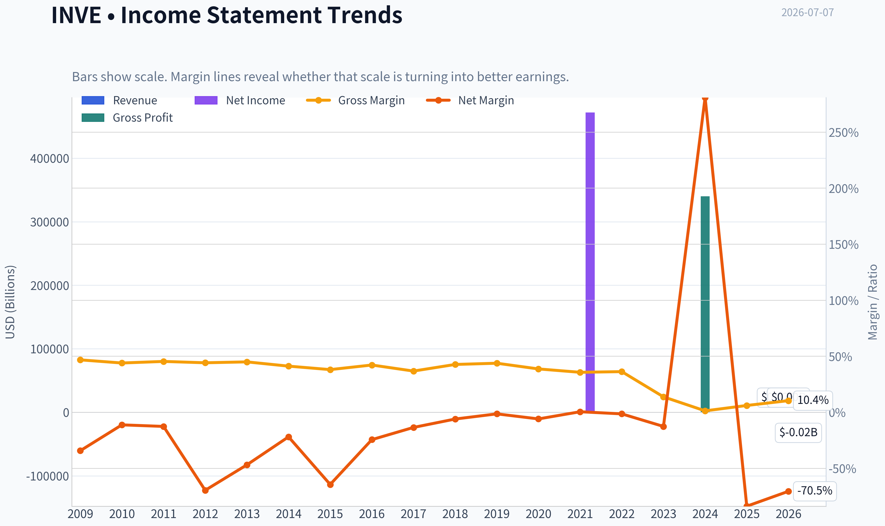

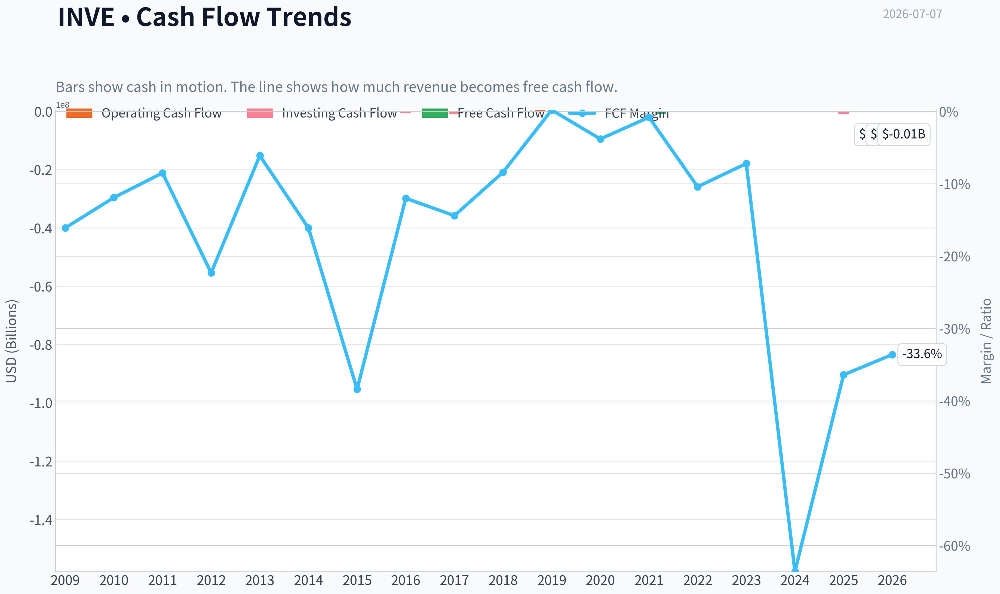

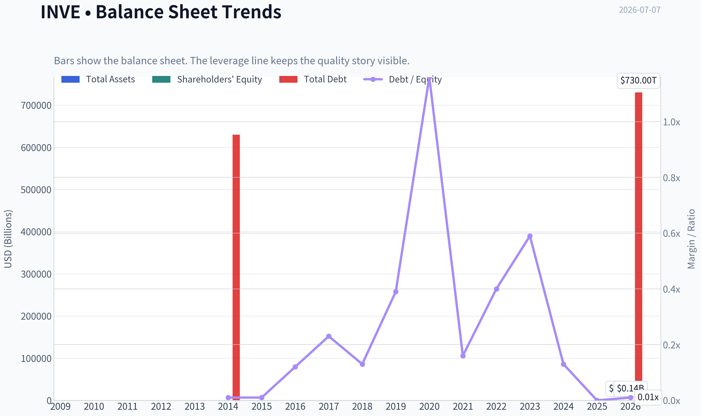

This graph tracks the profitability and return metrics (ROE, ROIC, Margins) of **INVE** over the past decade, highlighting capital efficiency trends.

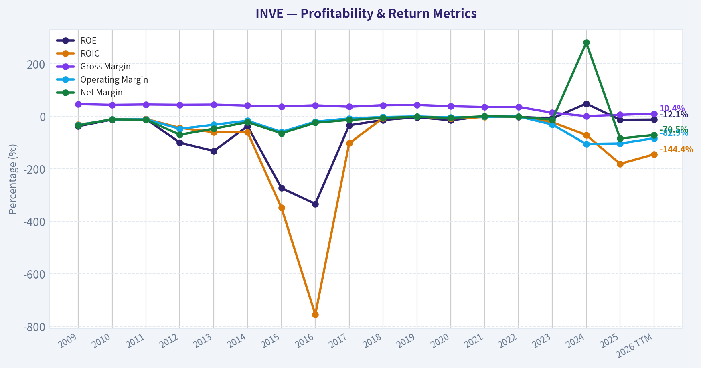

This chart illustrates the financial health of **INVE** over the last 10 years, mapping cash equivalents and free cash flow against total obligations (Debt).

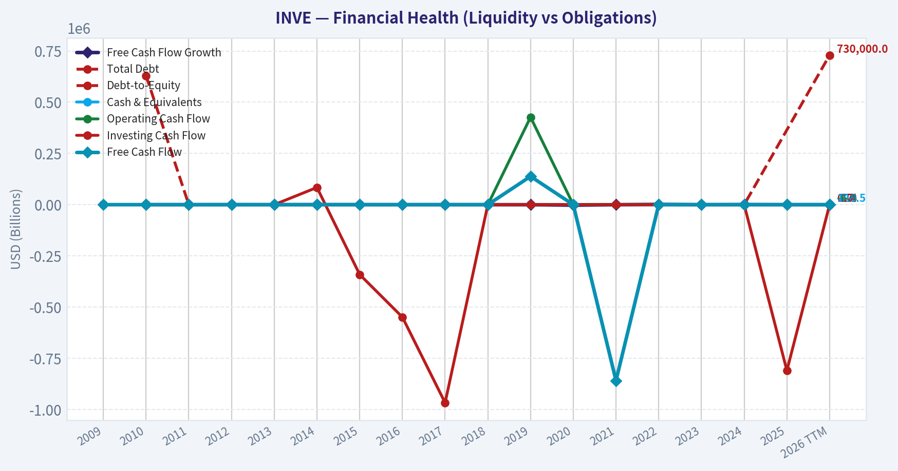

---

### Intrinsic Value Analysis (Buffett)

> *Following Warren Buffett's value investing philosophy: Circle of Competence, Economic Moat, Management Quality, and Margin of Safety.*

#### Intrinsic Value Snapshot

Price is what you pay. Intrinsic value is what the business may be worth based on the cash it can create for owners over time. We show a range, not one magic number.

- Current Price: $2.65
- Value Range (conservative to optimistic across both DCF methods): N/A to N/A

##### Owner Earnings (Buffett Method)
- Net Income: $-18,003,000.00
- Depreciation & Amortization: $2,450,000.00
- Capital Expenditures: $-1,108,000.00
- Working Capital Changes: $4,209,000.00
- Owner Earnings: $-20,870,000.00

##### Intrinsic Value

#### INVE is not in my current direct financial database path, so I can't complete a Buffett-grade writeup from audited historical statements alone in this pass.

#### What we do know already
| Metric | Current Snapshot |
|---|---:|
| Price | $3.00 |
| Market Cap | $63.6M |
| P/E | N/A |
| ROE | -12.8% |
| Gross Margin | 6.1% |
| Revenue Growth YoY | -19.3% |
| FCF Yield | -12.3% |
| Current Ratio | 15.19 |

Key Takeaways: This is not the profile of a classic Buffett business. Returns on equity are negative, gross margin is extremely thin, revenue is shrinking, and free cash flow is negative. The one clear positive is liquidity, with a very high current ratio suggesting balance-sheet near-term flexibility.

#### Preliminary Buffett Filter Read
| Gate | Verdict | Evidence |
|---|---|---|
| Circle of Competence | Watch | Business is understandable at a high level, but current economics appear unstable |
| Moat Test | Fail | 6.1% gross margin strongly argues against pricing power or a durable moat |
| Management / Capital Allocation | Watch to Fail | Shrinking revenue and negative FCF suggest weak recent capital allocation outcomes |
| Industry Structure | Fail | Likely competitive and margin-constrained based on current profitability |

Key Takeaways: The biggest problem is economic quality, not just valuation. A business with gross margin near 6% and negative free cash flow rarely has the kind of moat, pricing power, or structural advantage Buffett prefers. Even before valuation, this looks below the quality bar.

#### Initial Moat View
| Moat Source | Assessment |
|---|---|
| Intangible Assets | Weak evidence |
| Switching Costs | Weak evidence |
| Cost Advantage | Not visible in current margins |
| Network Effects | No evidence from current snapshot |

Key Takeaways: None of the four classic moat pillars show up clearly in the current numbers. If a moat exists, it is not expressing itself in margins, returns, or growth. Buffett would usually want the moat to be obvious in the economics.

#### Preliminary Stance
At today's snapshot, INVE screens as a **low-quality, currently unproven business** from a Buffett perspective. The combination of negative ROE, negative FCF, shrinking sales, and razor-thin gross margin is usually enough to place it in the **AVOID / speculative turnaround** bucket unless a deeper special-situation thesis exists.

#### What the next analyst should do
To finish the full report, the next pass should pull:
- Multi-year income statements
- Multi-year cash flow statements
- Multi-year balance sheets
- Share count trend
- Debt and interest burden
- Any evidence of segment changes or recent M&A impact

If you want, I can continue next with a **forensic Buffett-style assessment using alternative fundamentals sources** and build the full scorecard.
#### Valuation Bridge

This bridge places the current market price beside each intrinsic value lens so readers can see whether upside depends on one method or shows up across several methods.

| Scenario | Intrinsic Value / Share |
| --- | ---: |
| Damodaran Method | $3.23 |
| Current Price | $2.65 |

#### Key Takeaways

If one method is far above the others, the upside case depends on a specific modelling assumption. When several methods cluster together, the valuation story is more robust.

#### Valuation Visuals

This comparison chart from *Latest Earnings Snapshot* stacks current figures against historical benchmarks for **INVE**, making it easy to see where the company trades relative to its own averages.

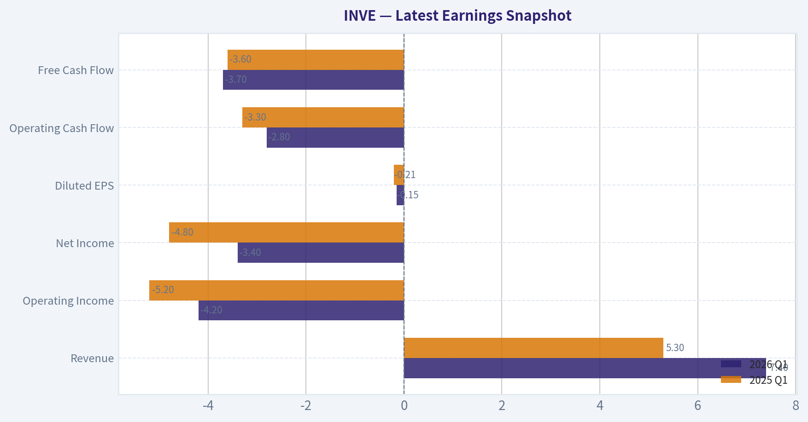

This comparison chart from *Current vs Historical Average Comparison* stacks current figures against historical benchmarks for **INVE**, making it easy to see where the company trades relative to its own averages.

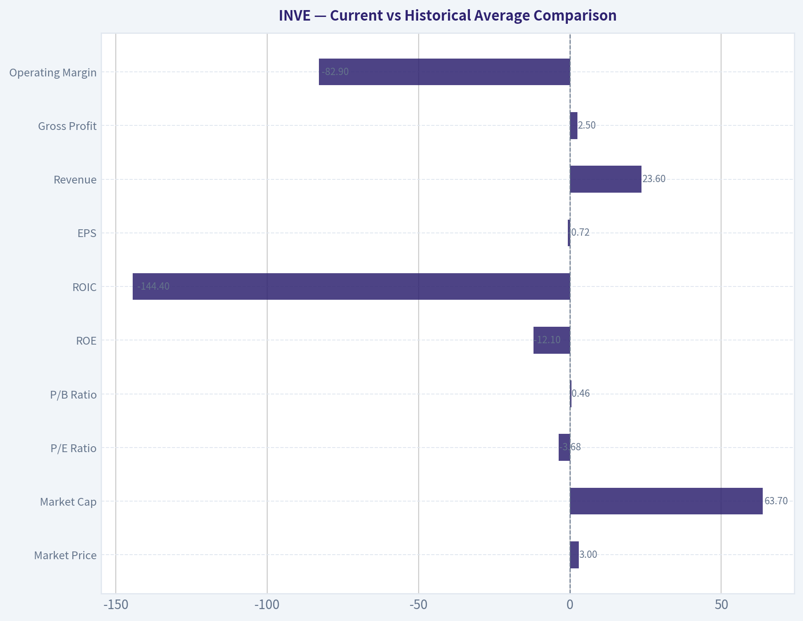

This comparison chart from *What we do know already* stacks current figures against historical benchmarks for **INVE**, making it easy to see where the company trades relative to its own averages.

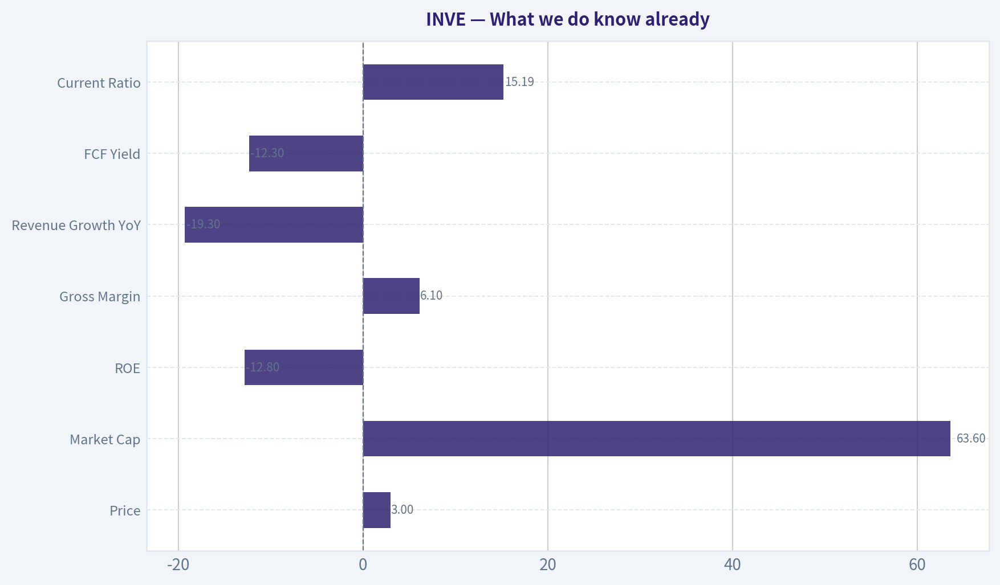

The following chart maps the **INVE** Owner Earnings DCF valuation scenarios (Conservative, Average, Optimistic) to visually represent the margin of safety based on intrinsic value calculations.

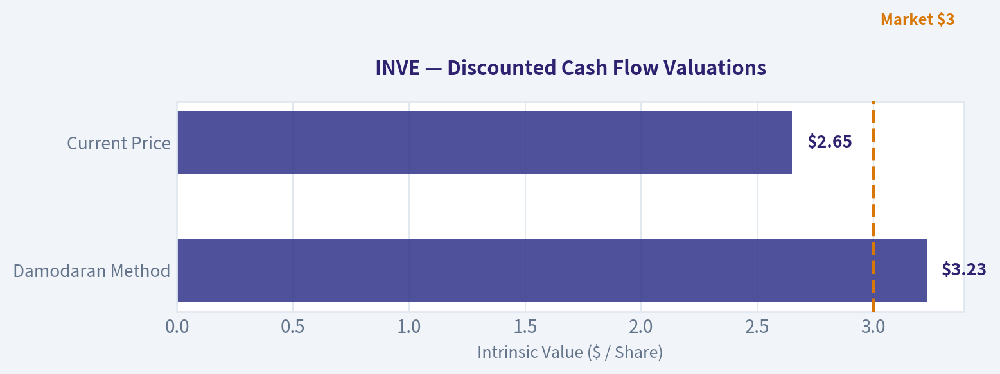

This comparison chart from *Unit Economics / Quality Markers* stacks current figures against historical benchmarks for **INVE**, making it easy to see where the company trades relative to its own averages.

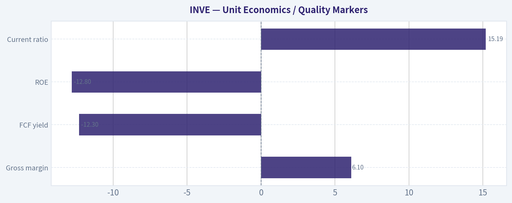

---

### Trend & Growth Analysis (Lynch/Druckenmiller/Fisher)

> *Following Peter Lynch's GARP, Stanley Druckenmiller's macro-aware approach, and Philip Fisher's scuttlebutt methodology.*

ANALYST STANCE: **AVOID**

#### INVE Growth Analysis Snapshot

Based on the shared research pack and limited fundamentals available, **INVE does not qualify as an attractive Lynch-style fast grower today**. The primary issue is simple: **revenue is shrinking, margins are extremely weak, and free cash flow is negative**, which means there is no visible growth inflection yet. This currently looks more like a **speculative turnaround / restructuring situation** than a durable growth compounder.

---

#### 1) Lynch Classification

| Framework Item | Assessment |
|---|---|
| Lynch category | **Turnaround / niche cyclical-tech hybrid** |
| Why not fast grower | Revenue growth is **-19.3% YoY** |
| Why not stalwart | Too small, unprofitable, and operationally unstable |
| Core investing implication | Not a current Lynch GARP candidate |

**Key Takeaways:** INVE does not fit the profile of a classic fast grower because sales are declining rather than compounding. The company is better viewed as a turnaround story that needs proof of stabilization before it deserves a growth multiple.

---

#### 2) The Story in 3 Bullets

| Simple Story | Assessment |
|---|---|
| What it does | Identiv sells identity / RFID / IoT-related security solutions |
| Bull version | If it successfully refocuses and scales the right product lines, a small revenue base could create upside torque |
| Bear version | Weak gross margins and shrinking revenue suggest the business may lack durable pricing power or product strength |

**Key Takeaways:** The company's story is understandable, but the investment case is not yet compelling. The upside depends on a successful turnaround, while the downside is that the business remains subscale and structurally low margin.

---

#### 3) TAM Analysis and 10x Test

| TAM Test Item | Assessment |
|---|---|
| Current revenue base | Small-cap company; likely small relative to broad RFID/IoT/security markets |
| 10x potential vs market size | **Theoretical yes** - end markets are large enough |
| Real constraint | Execution, margin structure, and product competitiveness |
| Runway conclusion | **Runway exists in theory, but not validated in practice** |

**Key Takeaways:** INVE likely has a large enough addressable market to support much higher revenue over time. However, having a large market is not enough; the company first needs to prove it can win profitably within that market.

---

#### 4) Revenue Growth Trend

| Metric | Value | Interpretation |
|---|---:|---|
| Revenue growth YoY | **-19.3%** | Severe negative trend |
| Pattern | **Decelerating / contracting** | Opposite of an inflection |
| Lynch read-through | Fails fast-grower screen |
| Druckenmiller read-through | No evidence yet of positive earnings/revenue surprise setup |

**Key Takeaways:** The most important datapoint in this entire case is the nearly 20 percent year-over-year revenue decline. That is not a growth inflection; it is evidence that the business is currently moving in the wrong direction.

---

#### 5) Unit Economics / Quality Markers

| Metric | Value | Assessment |
|---|---:|---|
| Gross margin | **6.1%** | Extremely weak |
| FCF yield | **-12.3%** | Value-destructive currently |
| ROE | **-12.8%** | Negative shareholder returns |
| Current ratio | **15.19** | Strong liquidity, likely post-transaction / balance sheet cushion |
| LTV/CAC | N/A | Not available |
| NRR | N/A | Not available |
| Rule of 40 | N/A | Not meaningful with current data |

**Key Takeaways:** The standout negative here is the gross margin of just over 6 percent, which is far too low for an attractive growth business. The one positive is liquidity, as the current ratio is very strong, but cash runway alone does not create a growth thesis.

---

#### 6) Inflection Point Assessment

| Inflection Type | Evidence | Verdict |
|---|---|---|
| Product cycle inflection | Not visible from provided data | No |
| Market share inflection | Revenue decline suggests no | No |
| Margin inflection | Gross margin very weak | No |
| TAM inflection | Industry tailwinds exist broadly | Weak / not company-specific |
| Competitive inflection | No clear evidence | No |
| Overall | **No confirmed positive inflection** | Negative |

**Key Takeaways:** The company may operate in interesting markets, but there is no hard evidence here that business momentum is improving. Without a clear product, margin, or market-share inflection, the stock remains speculative.

---

#### 7) Macro Setup Evaluation

| Macro Factor | Assessment |
|---|---|
| Secular theme exposure | RFID / IoT / digital identity are real long-term themes |
| Rate sensitivity | Small unprofitable growth names benefit more if financing conditions ease |
| Macro tailwind strength | Moderate |
| Company-specific execution | Overwhelms macro tailwinds right now |

**Key Takeaways:** The broader industry themes are not the problem. The problem is that company execution is currently too weak for macro tailwinds to matter much to equity holders.

---

#### 8) Fisher 15-Point Score

| Fisher Area | Score (1-5) | Comment |
|---|---:|---|
| Market potential | 3 | End markets are real |
| New product development | 3 | Possible, but not demonstrated in current numbers |
| R&D effectiveness | 2 | No proof of payoff |
| Sales organization | 2 | Revenue decline raises concern |
| Profit margin | 1 | Very weak gross margin |
| Margin improvement | 1 | No evidence provided |
| Labor/personnel relations | 3 | Unknown / neutral |
| Executive relations | 3 | Unknown / neutral |
| Management depth | 2 | Needs proof through execution |
| Cost controls/accounting | 2 | Weak profitability suggests issues |
| Special advantages | 2 | Niche positioning, but no strong moat visible |
| Long-range profit outlook | 2 | Unclear |
| Dilution risk | 3 | Liquidity currently helps, but risk remains if cash burn persists |
| Candor | 3 | Insufficient data |
| Integrity | 3 | Insufficient data |

| Total | **35 / 75** | **Below average / avoid** |

**Key Takeaways:** Fisher's framework is harsh on INVE because the operating evidence is poor. The company gets some credit for participating in attractive end markets, but weak margins and declining revenue dominate the score.

---

#### 9) Valuation Analysis

| Valuation Item | Value | Interpretation |
|---|---:|---|
| Current price | **$3.00** | Low absolute price, but that is not value by itself |
| Market cap | **$63.6M** | Very small cap |
| P/E | N/A | Unprofitable / not meaningful |
| PEG | N/A | Cannot use without earnings growth |
| P/S | Not reliably calculable from provided pack | Need revenue base |
| Valuation conclusion | **Could look optically cheap, but high value-trap risk** |

**Key Takeaways:** The stock may appear inexpensive because the share price and market cap are low, but low price alone is not a margin of safety. Without profits, healthy margins, or positive growth, valuation support is weak.

---

#### 10) Growth Investor Scorecard

| Criterion | Weight | Score (1-5) | Weighted Score |
|---|---:|---:|---:|
| The Story | 10% | 2.5 | 0.25 |
| TAM & Runway | 20% | 3.0 | 0.60 |
| Revenue Growth | 20% | 1.0 | 0.20 |
| Unit Economics | 15% | 1.0 | 0.15 |
| Competitive Position | 10% | 2.0 | 0.20 |
| Management Quality | 10% | 2.5 | 0.25 |
| Macro Setup | 5% | 3.0 | 0.15 |
| Profitability Path | 5% | 1.5 | 0.08 |
| Valuation | 5% | 2.5 | 0.13 |

| Total Score |  |  | **2.01 / 5.00** |

**Key Takeaways:** The weighted score lands firmly in avoid territory. The only meaningful positive is theoretical runway, but the actual business performance is too weak for a growth investor to underwrite today.

---

#### 11) Position Size Stance

| Stance | Recommendation |
|---|---|
| Existing position | Only hold if you explicitly own it as a high-risk turnaround trade |
| New position | **Do not initiate** for growth accounts |
| Position size | **0%** until evidence of turnaround |
| What would change stance | Return to positive revenue growth, gross margin expansion, and improving FCF |

**Key Takeaways:** This is not a stock to size as a core growth position right now. At best, it belongs on a speculative watchlist until the numbers improve materially.

---

#### 12) Key Risks and Catalysts

| Type | Item | Importance |
|---|---|---|
| Risk | Continued revenue decline | Very high |
| Risk | Structurally weak gross margin | Very high |
| Risk | Negative cash generation | High |
| Risk | No clear moat / subscale competition | High |
| Risk | Turnaround fails to materialize | Very high |
| Catalyst | Return to positive organic growth | Very high |
| Catalyst | Gross margin recovery | Very high |
| Catalyst | Positive FCF inflection | High |
| Catalyst | Successful strategic refocus / M&A integration outcome | Medium |

**Key Takeaways:** The main risks are straightforward and serious: falling sales, poor margins, and ongoing cash burn. The stock only becomes interesting if management can show a credible and sustained operating turnaround.

---

#### Bottom Line

INVE currently fails the core Lynch-Druckenmiller-Fisher growth test:

- **Lynch:** not a fast grower
- **Druckenmiller:** no visible positive inflection
- **Fisher:** weak operational quality and no proven moat

For now, this is **not** a ten-bagger style growth setup. It is a **turnaround speculation**, and until revenue stops falling and margins recover, the correct stance is:

**ANALYST STANCE: AVOID**

If you want, I can next build a **strict turnaround watchlist checklist for INVE** with the exact quarterly triggers that would upgrade it from **AVOID** to **WATCH**.

#### Growth & Scorecard Visuals

This comparison chart from *Fisher 15-Point Score* stacks current figures against historical benchmarks for **INVE**, making it easy to see where the company trades relative to its own averages.

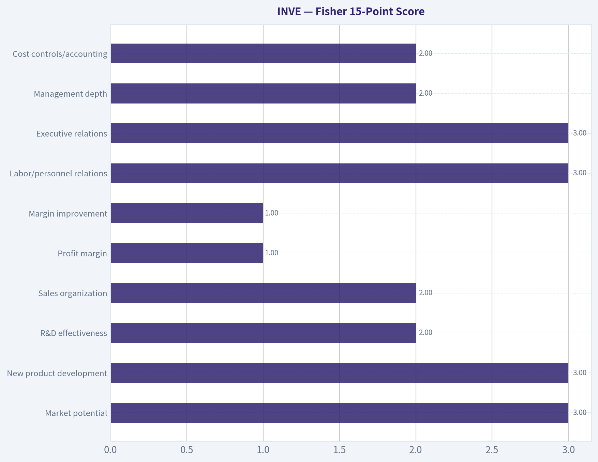

---

### Market Technical Analysis

#### INVE Technical Analysis Report
**Date:** 2026-07-07
**Universe:** INVE
**Selected indicators (8):** `close_10_ema`, `close_50_sma`, `close_200_sma`, `macd`, `macdh`, `rsi`, `atr`, `vwma`

#### Why these indicators are the most relevant now
INVE is not in a calm, orderly trend. The last two months show a **sharp downside break, heavy volume shock, and weak rebound behavior**. In that context, the most useful indicator mix is one that separates:

1. **Short-term trend damage** -> `close_10_ema`
2. **Medium-term trend and key dynamic resistance** -> `close_50_sma`
3. **Long-term structural trend** -> `close_200_sma`
4. **Momentum direction** -> `macd`
5. **Momentum acceleration/deceleration** -> `macdh`
6. **Stretch / oversold condition** -> `rsi`
7. **Risk and stop-width calibration** -> `atr`
8. **Whether selling was volume-confirmed** -> `vwma`

This set avoids major redundancy while covering trend, momentum, volatility, and volume confirmation.

---

#### Price structure and trend interpretation

Over the full 1-year window, INVE had three distinct phases:

- **Base and range trade** from roughly mid-2025 through early 2026, mostly between the low-3s and high-3s.
- **Power breakout and momentum expansion** in late March through early May 2026, where price ran from the low-3s to above 5.00.
- **Breakdown and repricing** from mid-May into late June, capped by the violent gap-style drop on **2026-06-25** from 3.69 to 2.50 close, on extreme volume.

That last event materially changed the chart. This is no longer a normal pullback inside an uptrend. It is a **trend failure with unfinished stabilization**.

The latest close available is **2.64 on 2026-07-06**. That is:
- well below the **10 EMA: 2.91**
- far below the **50 SMA: 4.02**
- below the **200 SMA: 3.65**

This alignment is important. It says:
- short-term trend is down,
- medium-term trend is down,
- and price has now slipped below the long-term average as well.

That is a deeply impaired technical posture. Even if a short bounce develops, it would still be occurring **beneath broken moving-average resistance**, not within a healthy bullish trend.

#### Indicator snapshot

| Indicator | Latest reading | Interpretation |
|---|---:|---|
| Close | 2.64 | Stabilizing slightly after breakdown, but still depressed |
| `close_10_ema` | 2.91 | Price remains below fast trend line; short-term sellers still in control |
| `close_50_sma` | 4.02 | Massive gap below medium-term trend; strong overhead resistance |
| `close_200_sma` | 3.65 | Price below long-term benchmark; structural damage confirmed |
| `macd` | -0.4068 | Momentum remains decisively bearish |
| `macdh` | -0.1016 | Bearish momentum still active, though less negative than late June extremes |
| `rsi` | 27.49 | Oversold zone; bounce risk rising, but not yet a trend reversal signal |
| `atr` | 0.2387 | Volatility still elevated relative to current price |
| `vwma` | 2.72 | Price below volume-weighted average; recent volume flow still not supportive |

Key Takeaways: INVE remains in a bearish technical regime across every major timeframe. The stock is oversold, which increases the odds of a reflex bounce, but price is still under all major trend benchmarks and momentum is still negative. Traders should treat any rebound as unproven until price can reclaim at least the 10 EMA and then hold above volume-weighted resistance.

---

#### Fine-grained trend analysis

The **10 EMA** has collapsed from **4.86 on 2026-05-08** to **2.91 on 2026-07-06**. That is not a mild rollover; it reflects a very fast deterioration in short-term price acceptance. The fact that the current price remains below this already-falling EMA suggests the stock has not yet transitioned into even a short-term recovery regime.

The **50 SMA** is still around **4.02**, only gradually rolling over. This creates a very wide gap between current price and the medium-term trend baseline. In practical terms, that means there is likely to be a large supply overhang between roughly **2.90 and 4.00+**. Former holders trapped from the breakdown zone may sell into rallies.

The **200 SMA** at **3.65** is especially important because it confirms that the June break was not just a short-term washout. Price has moved below a long-term equilibrium level that had been supportive during the earlier uptrend phase. Once price loses the 200-day area after a failed breakout cycle, many systematic and discretionary traders shift from "buy dips" to "sell rips" behavior.

So while the chart may look "cheap" versus the 5.29 high in May, technically it is more accurate to say the stock is in a **post-breakdown repair phase**, not a healthy discount-buying phase.

---

#### Momentum analysis: bearish, but with early signs of exhaustion

The **MACD** reading at **-0.4068** is strongly negative. That tells us downside momentum remains firmly dominant. The path of MACD over the period is revealing:

- Positive and strong in early May
- Crossed into negative territory by late May
- Continued to deteriorate through June
- Became sharply more negative after the June 25 collapse

The **MACD histogram** is still negative at **-0.1016**, which means bearish momentum still exceeds its signal line. However, compared with the worst late-June readings, the histogram is **less negative than the trough area around June 30 to July 1**. That does not signal a reversal yet, but it does suggest the pace of downside is no longer accelerating as violently as it was during the immediate breakdown.

This distinction matters. A stock can be:
- **bearish and getting worse**, or
- **bearish but trying to stabilize**

INVE currently fits the second description better. It is still bearish, but the momentum deterioration is no longer in freefall. That opens the door to a tactical mean-reversion bounce, though not yet to a trustworthy trend reversal.

---

#### RSI analysis: oversold, but not automatically bullish

The **RSI at 27.49** places INVE in oversold territory. It also touched even more extreme levels during the breakdown, including a reading near **19 on June 25**. From a trader's perspective, that means the stock is statistically stretched on a short-term basis.

However, oversold readings in damaged charts should be handled carefully. In strong downtrends:
- RSI can remain below 30 longer than expected,
- oversold bounces can be shallow,
- and early rebound attempts often fail at the first resistance layer.

The more constructive feature is that RSI has lifted modestly from the panic low without fully recovering. That suggests **selling pressure has become less one-directional**, but buyers have not yet shown enough strength to reclaim neutral momentum.

A more durable recovery signal would likely require:
- RSI to reclaim and hold above **30-35** first,
- then push through the low-40s,
- ideally while price recaptures the 10 EMA.

Until then, RSI should be interpreted as **"stretched and vulnerable to bounce"**, not **"bullish."**

---

#### Volume and participation analysis

The price break on **2026-06-25** came with volume of **1.45 million**, many times normal turnover. Follow-through activity remained elevated on subsequent sessions:
- **1.02 million on June 26**
- **780k on July 1**
- **815k on July 2**
- **634k on July 6**

That pattern suggests the move was not caused by a thin-liquidity accident alone. It was **actively repriced by the market**.

The **VWMA at 2.72** sits above current price **2.64**, indicating recent volume-weighted trading has occurred at higher prices than the current market. In simple terms, traders who bought during the high-volume stabilization attempts are, on average, still under water. That often creates near-term selling pressure when price tries to rally back into the VWMA zone.

This makes the **2.72 area** an important first test. If price cannot reclaim VWMA, it suggests demand is still too weak to absorb post-breakdown supply.

---

#### Volatility and risk management implications

The **ATR at 0.2387** is very large relative to a stock trading at **2.64**. That means daily movement is still wide in percentage terms. Traders should not use overly tight stops here; otherwise they risk being shaken out by normal volatility.

Approximate ATR as a percentage of price:
- **0.2387 / 2.64 ~ 9%**

That is high. It implies:
- this remains a tactical, high-risk trading environment,
- position sizes should be smaller than usual,
- and stop placement should respect volatility rather than arbitrary round numbers.

The positive nuance is that ATR has eased modestly from the immediate post-shock period. So panic volatility is cooling, but not yet normalized.

---

#### Tactical trading read

| Scenario | What to watch | Trading implication |
|---|---|---|
| Bearish continuation | Failure below 2.72 VWMA and below 2.91 10 EMA | Weak rebound likely fades; risk of retesting 2.50 area |
| Early stabilization | Price holds above 2.60 and RSI stays above recent lows | Panic may be passing, but trend still not repaired |
| Tradable bounce | Reclaim of 2.72 VWMA, then 2.91 10 EMA | Could trigger short-covering / mean-reversion move |
| Larger repair attempt | Sustained move above 3.00, improving MACD histogram, RSI > 35-40 | First sign of actual trend rebuilding |
| Trend reversal case | Not credible unless price begins closing back toward 3.65+ and ultimately 4.02 | Would require major structural improvement |

Key Takeaways: The most likely near-term battle is between oversold bounce pressure and strong overhead resistance. The first meaningful bullish test is not far away at the VWMA and 10 EMA, but the larger chart remains damaged until much higher levels are recovered. For now, traders should think in terms of tactical rebounds and risk control, not full trend restoration.

---

#### Support and resistance map

From the recent tape, the key zones appear to be:

- **Immediate support:** 2.60 to 2.50
  This is the current stabilization shelf just above the June 25 panic close.

- **Breakdown support failure zone:** below 2.50
  A break under that area would suggest the market has not finished repricing lower.

- **First resistance:** 2.72 (`vwma`)
  This is the first signpost for whether buyers can absorb recent overhead supply.

- **Second resistance:** 2.91 (`close_10_ema`)
  A stronger technical bounce likely needs price acceptance above this level.

- **Major resistance:** 3.65 (`close_200_sma`)
  This is where long-term structure begins to improve.

- **Heavy overhead resistance:** 4.02 (`close_50_sma`)
  This marks the medium-term trend barrier and is far above current price.

The distance to the 50 SMA tells you how extensive the repair job is. Even a decent bounce could still leave the stock technically bearish.

---

#### Bottom line

INVE currently looks like a **broken momentum stock attempting to stabilize after a high-volume downside repricing event**. The most important conclusion is not merely that the stock is weak, but that weakness exists across **all three trend horizons**:

- below 10 EMA,
- below 50 SMA,
- below 200 SMA.

Momentum remains bearish via MACD, and volume-weighted positioning via VWMA still leans against the bulls. The one constructive feature is RSI oversold behavior combined with slightly less-negative histogram readings, which suggests the stock may be transitioning from **panic selling** to **unstable consolidation**.

That means:
- **swing bears** still have the trend edge,
- **mean-reversion traders** may watch for a bounce setup,
- but **trend-following bulls** do not yet have confirmation.

For a bullish case to improve materially, INVE would need to reclaim **2.72**, then **2.91**, and eventually prove it can base toward the **3.65** zone. Until that happens, rallies are more likely to be treated as recovery attempts inside a damaged chart rather than the start of a new uptrend.

#### Summary table

| Category | Signal | Assessment | Trader Use |
|---|---|---|---|
| Short-term trend | Price vs `close_10_ema` | Bearish | Fast trend still down; bounce not confirmed |
| Medium-term trend | Price vs `close_50_sma` | Strongly bearish | Large overhead resistance remains |
| Long-term trend | Price vs `close_200_sma` | Bearish | Structural breakdown confirmed |
| Momentum direction | `macd` | Bearish | Downtrend still dominant |
| Momentum acceleration | `macdh` | Bearish but less extreme | Selling pressure may be slowing |
| Stretch condition | `rsi` | Oversold | Bounce risk elevated, but not a reversal by itself |
| Volatility | `atr` | High | Reduce size; allow wider stops |
| Volume confirmation | `vwma` | Bearish | Price still below volume-weighted resistance |
| Near-term support | 2.60 to 2.50 | Fragile | Key zone for stabilization |
| Near-term resistance | 2.72 then 2.91 | Important | First proof points for any rebound |

Key Takeaways: INVE is technically oversold, but it is still operating inside a damaged downtrend with elevated volatility. The stock may be close to a short-term bounce, yet the burden of proof remains on buyers until price reclaims the VWMA and 10 EMA. Bigger-picture trend improvement would require much more work, especially back above the 200 SMA and eventually the 50 SMA.

---

### Options Market Analysis

> *Reading options flow - put/call ratios, IV skew, and unusual activity - to gauge institutional positioning and event-driven risk.*

#### INVE Options Positioning Report
*Data as of 2026-07-07*

INVE's listed options flow is overwhelmingly call-heavy across the near-term expirations shown. That points to a **bullish options sentiment signal**, but with an important caveat: this looks like a **thin, incomplete, low-information chain**. Implied volatility and skew data are unavailable, so confidence is moderate at best.

#### 1. Put/Call Ratio Analysis

| Expiration | Call OI | Put OI | Call Vol | Put Vol | Put/Call OI Ratio | Put/Call Vol Ratio |
|---|---:|---:|---:|---:|---:|---:|
| 2026-07-17 | 2,555 | 170 | 1,803 | 104 | 0.07 | 0.06 |
| 2026-08-21 | 57 | 2 | 10 | 2 | 0.04 | 0.20 |
| 2026-10-16 | 1,252 | 124 | 201 | 80 | 0.10 | 0.40 |
| **Near-term total** | **3,864** | **296** | **2,014** | **186** | **0.08** | **0.09** |

**Key Takeaways:** INVE's aggregate put/call open interest ratio of **0.08** is far below the rough neutral baseline of **0.7**, and the volume ratio of **0.09** tells the same story. In plain English, the listed activity is dominated by calls rather than puts. That usually implies bullish speculation or, less positively, call overwriting/low-quality call activity in a thin chain.

**Interpretation:**
- A **0.08 OI ratio** is not just modestly bullish; it is **extremely call-skewed**.
- Relative to the historical neutral baseline near **0.7**, this is a **major shift toward call dominance**.
- The main question is quality: in a liquid large-cap name, this would be a stronger bullish signal; in a thin small-cap/illiquid name, it may reflect a few concentrated strikes rather than broad institutional conviction.

#### 2. Implied Volatility (IV) Assessment

| Metric | Observation |
|---|---|
| Near-term ATM IV (Calls) | N/A |
| Near-term ATM IV (Puts) | N/A |
| OTM Put vs OTM Call Skew | N/A |
| Catalyst-related IV Elevation | Cannot confirm from available data |

**Key Takeaways:** The options feed does **not provide usable ATM IV or skew readings** for INVE. That means we cannot tell whether traders are paying up for downside protection, upside speculation, or event risk. This reduces confidence in any sentiment read and suggests the chain may be too illiquid or too sparse for robust volatility analysis.

**Interpretation:**
- Since **ATM IV is unavailable**, I cannot quantify whether near-term premium is elevated.
- Since **skew is unavailable**, I cannot assess whether there is pronounced downside fear via put skew or upside chasing via call skew.
- No explicit evidence of elevated event pricing is visible from the data returned. If a known catalyst exists, the current dataset does not capture it through IV.

#### 3. Unusual Options Activity

| Contract Signal | Result |
|---|---|
| Volume > 5x Open Interest | None detected in near-term expirations |

**Key Takeaways:** There are **no flagged unusual contracts** where volume materially overwhelms existing open interest. That means there is no obvious fresh large directional bet standing out in the near-term chain. The bullish read comes more from the **overall call-heavy positioning** than from a single aggressive "smart money" trade.

**Interpretation:**
- No clear evidence of **fresh institutional sweep-style positioning**.
- No standout contract to classify as deep OTM lottery call buying, protective put accumulation, or event-driven speculation.
- This makes the tape feel **more structurally call-heavy** than **actively being chased today**.

#### 4. Open Interest Concentration

| Expiration | Total Call OI | Total Put OI | Positioning Read |
|---|---:|---:|---|
| 2026-07-17 | 2,555 | 170 | Strong near-dated call concentration |
| 2026-08-21 | 57 | 2 | Minimal interest; low signal value |
| 2026-10-16 | 1,252 | 124 | Secondary call-heavy concentration |

**Key Takeaways:** The biggest positioning sits in **2026-07-17** and **2026-10-16**, and both expirations are overwhelmingly call-dominated. That can create a mild upward bias in sentiment, but because the dataset does not show strike-level concentrations, we cannot identify exact pin levels or gamma walls. So we know where time is concentrated, but not the precise price levels likely to attract the stock.

**Interpretation:**
- The heaviest OI sits in **July** and then **October**, suggesting those expiries matter most for near-term positioning.
- Because strike-by-strike OI is not provided, I **cannot identify exact max pain, pinning strikes, or hard gamma walls**.
- Still, broad call concentration means market makers may be more sensitive to upside-related flow than downside hedging flow, especially if spot approaches active call strikes.

#### 5. Overall Options Sentiment Signal

| Category | Signal |
|---|---|
| Directional Read | **BULLISH** |
| Confidence | **Moderate-Low** |
| Primary Driver | Extremely low put/call OI and volume ratios |
| Main Caveat | Thin chain / missing IV and strike-level detail |

**Key Takeaways:** My final read on INVE options is **BULLISH**, because both open interest and trading volume are overwhelmingly tilted toward calls, not puts. However, this is **not a high-confidence institutional-quality signal** because the chain appears thin and lacks IV/skew detail. So the direction is bullish, but the evidence quality is only fair.

**Synthesis:**
- **Bullish** because the market is positioned far more aggressively in calls than puts.
- Not obviously driven by hedge demand or downside fear.
- No unusual put activity is contradicting the tape.
- Confidence is reduced by **illiquidity / sparse analytics**, so this should be treated as a **supporting indicator**, not a standalone thesis.

#### Analyst Conclusion

INVE's options market currently signals **BULLISH** sentiment, primarily due to an **extreme call-over-put imbalance** in both open interest and volume. If this were paired with strong price action or a favorable catalyst, it would reinforce a constructive setup. But because the options chain appears **thin and incomplete**, the signal should be viewed as **directionally positive but lower reliability** than what you'd infer from a deeper, more liquid market.

#### Summary Table

| Metric | Reading | Interpretation |
|---|---|---|
| Put/Call Ratio | **OI: 0.08, Volume: 0.09** | Strongly call-heavy; bullish vs. neutral ~0.7 baseline |
| IV Level | **Unavailable** | Cannot confirm premium richness or event pricing |
| Skew Direction | **Unavailable** | Cannot assess downside fear vs upside chase |
| Unusual Activity | **None flagged** | No standout fresh institutional-sized directional bet |
| Overall Signal | **BULLISH** | Call dominance is the main driver, but confidence is tempered by thin liquidity |

**Key Takeaways:** The cleanest takeaway is that INVE's listed options flow is **heavily tilted toward calls**, which supports a bullish directional read. The missing volatility and strike-level detail prevent a stronger institutional-quality conclusion, so this should be used with caution and alongside price/volume confirmation.

---

## Research Team Commentary

> *The Research Manager synthesizes the Bull vs Bear debate into action-free commentary. This is a pre-risk view, not the final stance.*

The strongest bull argument is really a deep-value recovery argument, not a Buffett-quality argument. At $2.65, the market may already be pricing INVE as if the business has little franchise value and little chance of normalization. If the current numbers are trough-level rather than permanent, then even modest improvement in revenue, gross margin, or capital discipline could create outsized upside from a depressed base. The bull case also rightly reminds us not to confuse terrible trailing metrics with certain future failure; some stocks bottom when results are still ugly but merely stop getting worse.

The strongest bear argument is much more grounded in the actual evidence we have. By Buffett standards, this business fails almost every primary test. There is no sign of a durable moat, gross margin at 6.1% suggests minimal pricing power, revenue is down 19.3%, ROE is negative, and ROIC at -180.5% is not just weak but deeply value-destructive. That combination usually signals structural fragility, not a temporary stumble in an otherwise excellent business. The bear side is also right that a low stock price is not the same as a margin of safety. Without evidence of normalized earning power, "cheap" can simply mean impaired.

My takeaway is that this is not the kind of situation where selective contrarianism is rewarded by superior business insight. In past mistakes, I was too slow to recognize tactical rebound setups in high-quality or at least durable franchises when the market had become overly pessimistic. But the lesson is not to relax standards on fundamentally weak businesses. Here, unlike Adobe or even a sold-down software name with strong gross margins and cash flow, there is no underlying business excellence to anchor intrinsic value. If this rebounds, it is more likely a trading move than a long-term investment opportunity. For a Buffett-style portfolio, that distinction matters.

Core takeaway: INVE looks like a weak business at a speculative price, not a quality business temporarily mispriced. The bull case depends on a turnaround that has not yet shown up in the economics, while the bear case is supported by current operating reality: collapsing sales, razor-thin gross margin, negative returns on capital, and no visible moat. That is not enough for a value investor to underwrite intrinsic value with confidence.

Rationale: Buffett's framework starts with business quality, and this one fails there first. A business with 6.1% gross margin and sharply negative returns offers little evidence of competitive advantage or resilience. Predictable earnings are absent. Management cannot yet be credited with strong stewardship because the scorecard is poor. Financial strength is unclear from the debate, which itself is a problem in a stressed situation; when a business is already destroying capital, balance-sheet risk matters even more. The contrarian question is whether fear has become excessive. My answer is that we do not have enough evidence that the market is wrong. In weak businesses, ugly numbers are often not mispricing but diagnosis. That is a hard lesson in value investing: not every beaten-down stock is a bargain, and low quality plus hoped-for normalization is where many value traps live.

Monitoring plan over the next 1 to 4 quarters is straightforward. I would only reconsider if several concrete things improve at once. First, revenue decline needs to materially moderate or flatten; another double-digit drop would reinforce structural impairment. Second, gross margin must improve meaningfully from 6.1%; if it cannot recover, there is no real earnings power to underwrite. Third, operating cash flow and free cash flow need to move toward sustainability, not just accounting improvement. Fourth, any evidence of dilution, distressed financing, or worsening leverage would weaken the case sharply. Fifth, I would want to see management explicitly prioritize profitable revenue and capital discipline rather than chasing volume. Sixth, if returns on capital remain deeply negative even after any restructuring efforts, that would confirm the business model is broken rather than merely depressed. On the other hand, if margins recover, sales stabilize, and liquidity remains sound, this could move from AVOID to WATCH as a possible turnaround candidate-but not before.

So my final stance is AVOID.

---

## Value Investing Team Commentary

> *The Investor translates the research view into an investment thesis before risk review. This is still not the final stance.*

INVE does not presently resemble the kind of business a long-term owner should be eager to buy. The key issue is not that sentiment is poor; it is that the underlying economics appear poor as well. A 6.1% gross margin suggests very limited pricing power, little room for error, and no obvious moat. Revenue declining 19.3% year over year points to a business losing ground, not merely enduring a cyclical pause. Negative ROE and deeply negative ROIC indicate capital is not just earning low returns, but being deployed destructively. In Buffett terms, this fails the first test: is this a business with durable earning power that can compound capital over time? Right now, the answer appears to be no.

The contrarian question is whether the market has become too pessimistic and is now valuing INVE below a conservative estimate of intrinsic value. That can happen, but selective contrarianism only works when the business has hidden strength, temporary problems, or recoverable economics that the market is missing. Here, I do not see enough evidence of that. The bull case is essentially a turnaround-from-depressed-levels argument. That is not invalid, but it is speculative. It depends on improvement in revenue, margins, and capital discipline that has not yet been demonstrated. A low share price alone is not a margin of safety. If normalized earning power is uncertain, "cheap" may simply mean impaired.

News and sentiment should be interpreted carefully. When a stock is this weak, bad sentiment can create short-term rebounds without changing long-term value. Markets often stage relief rallies in damaged names when results merely stop worsening. But for a business owner, the right question is not whether the stock can bounce, but whether the company can earn attractive returns on capital five to ten years from now. Current evidence argues against that. In fact, the ugly sentiment may be rational rather than exaggerated. The market may be correctly discounting weak franchise quality, fragile margins, and uncertain financial resilience.

What would change my mind? I would need to see objective proof that the business is stabilizing in ways that matter economically: revenue declines narrowing substantially, gross margin recovering meaningfully above current levels, operating cash flow improving on a durable basis, and management showing discipline in capital allocation rather than pursuing unprofitable volume. Just as important, I would want reassurance that liquidity is sound and that shareholders are not likely to be diluted to fund a weak business model. Until then, the company looks more like a possible trading vehicle for turnaround speculation than a sound long-term investment.

From a value investing perspective, this is where discipline matters most. Many value traps look optically cheap after heavy declines, but without evidence of business quality or a credible path back to respectable returns, there is no solid intrinsic value anchor. Buffett-style investing is not about buying the statistically cheapest business; it is about buying understandable, durable businesses at sensible prices. INVE currently appears to offer the opposite: weak economics, uncertain durability, and a thesis dependent on hoped-for normalization.

**ANALYST STANCE: AVOID**
INVE may attract speculative deep-value interest if sentiment becomes overly washed out, but the current facts point to business weakness rather than temporary mispricing. Until the company shows real improvement in revenue stability, margin structure, cash generation, and returns on capital, this is not an attractive long-term business ownership candidate.

---

## Deep Values Commentary

> *The Risk Management Team debates and the Risk Judge provides the final action-free verdict. This section determines the final ADVOCATE / WATCH / AVOID stance.*

#### Final Stance Scorecard

This scorecard converts the final research view into a weighted decision frame. It does not replace the narrative judgement, but it makes the main drivers of the verdict easier to scan.

| Criterion | Score | Weight | Commentary |
| --- | ---: | ---: | --- |
| Business Quality | 1.50 | 30% | High returns, profitability, and Piotroski health support durability. |
| Valuation Support | 2.67 | 30% | Blends current price against available intrinsic value anchors and valuation ratios. |
| Financial Strength | 4.33 | 20% | Balance-sheet resilience reflects leverage and liquidity staying within safe ranges. |
| Growth Durability | 2.33 | 20% | Recent revenue, earnings, and free cash flow growth indicate how durable expansion looks. |
| TOTAL / FINAL STANCE | 2.58 | 100% | AVOID |

#### Key Takeaways

The weighted score lands at **2.58 / 5.0**, while the final stance remains **AVOID**. This is useful as a quick calibration aid rather than a mechanical signal.

#### Risk Summary

Higher scores indicate more risk pressure. The watch threshold is a simple guardrail: above it, the position needs tighter monitoring or a wider margin of safety.

| Dimension | Current Score | Watch Threshold | Commentary |
| --- | ---: | ---: | --- |
| Business Quality | 4.50 | 3.00 | High returns, profitability, and Piotroski health support durability. |
| Valuation Support | 3.33 | 3.00 | Blends current price against available intrinsic value anchors and valuation ratios. |
| Financial Strength | 1.67 | 3.00 | Balance-sheet resilience reflects leverage and liquidity staying within safe ranges. |
| Growth Durability | 3.67 | 3.00 | Recent revenue, earnings, and free cash flow growth indicate how durable expansion looks. |

#### Key Takeaways

This view helps readers separate *where* the risk sits: valuation, business quality, balance sheet, or growth durability. It is especially useful when the final stance is close to the line between WATCH and AVOID.
