# IREN Deep Value Intelligence

**Analysis Date:** 2026-11-10

## Critical Disclaimer

*This analysis is generated by Deep Value Intelligence, an AI-powered multi-agent investing framework. Éducation et recherche uniquement - pas un conseil financier ni un conseiller financier.*

---

## Table of Contents

1. Intelligence Summary
2. Analyst Team Reports
   - Fundamentals Analysis
   - Intrinsic Value Analysis (Buffett)
   - Trend & Growth Analysis (Lynch/Druckenmiller/Fisher)
   - Market Technical Analysis
   - Options Market Analysis
3. Research Team Commentary
4. Value Investing Team Commentary
5. Deep Values Commentary

---

## Intelligence Summary

### Thesis + Conditions

**Core Thesis:** IREN has genuine strategic optionality from scarce power access, energized sites, and potential AI/HPC demand. Revenue growth of 41.1% and a 68.9% gross margin support the possibility of meaningful operating leverage.

**Key Risks:**
- **Decision:** Do not initiate a core position. Move the original plan from categorical **Bearish** to a milestone-driven **Neutral**. Reassess when contracts and per-share cash flow-not announcements or market momentum-validate the transformation.
- The Risky Analyst correctly identifies that current losses may partly reflect a construction phase rather than permanent impairment. Bitcoin mining and AI infrastructure share relevant physical capabilities, including power procurement, cooling, site development, and continuous operation of computing equipment.
- Power availability can also be economically valuable even if it is not a permanent moat. When grid connections and construction lead times constrain AI deployment, ready-to-use sites may support faster commercialization, customer prepayments, project financing, or take-or-pay agreements.

**Confidence:** Low

---

## Analyst Team Reports

### Fundamentals Analysis

#### Latest Earnings Snapshot

*Most recent reported quarter anchored on 2026 Q3, with prior-year comparison when available.*

| Metric | 2026 Q3 | 2025 Q3 | YoY Change |
| --- | ---: | ---: | ---: |
| Revenue | $228.0M | $240.0M | -5.0% |
| Operating Income | $-192.0M | $-60.0M | -220.0% |
| Net Income | $-263.0M | $385.0M | -168.3% |
| Diluted EPS | $-0.66 | $1.08 | -161.1% |
| Operating Cash Flow | $529.0M | $142.0M | +272.5% |
| Free Cash Flow | $-4.36B | $-138.0M | -3059.4% |

Key Takeaways: This snapshot anchors the most recent reported quarter before the narrative analysis. It helps readers separate long-run business quality from whatever changed in the latest earnings print.

#### 6-Year Financial Metrics for IREN

*All values below are computed deterministically from raw data - not estimated by AI.*

*Issuer profile: asset manager (Financial Services / Capital Markets).*

#### 6-Year Financial Metrics
*Annual rows come from reported financial statements. The final TTM row is computed from the latest four quarters.*

| Metric | 2020 | 2021 | 2022 | 2023 | 2024 | 2025 | 2026 TTM |
| --- | --- | --- | --- | --- | --- | --- | --- |
| Market Price | N/A | N/A | $3 | $5 | $11 | $15 | $19 |
| Market Cap | N/A | N/A | $137.2M | $255.3M | $1.12B | $3.25B | $7.72B |
| P/E Ratio | N/A | N/A | -0.33 | -1.48 | -38.93 | 37.36 | N/A |
| P/B Ratio | N/A | N/A | 0.31 | 0.84 | 1.03 | 1.79 | 1.51 |
| ROE | -24.3% | 122.1% | -96.0% | -56.3% | -2.6% | 4.8% | -26.4% |
| ROIC | -19.3% | N/A | -1.6% | -52.1% | -4.5% | 0.7% | -3.8% |
| EPS | $-0.13 | $-2.93 | $-10.25 | $-3.14 | $-0.29 | $0.39 | $-3.39 |
| Revenue | $2.2M | $7.9M | $59.0M | $75.5M | $187.2M | $501.0M | $694.7M |
| Gross Profit | N/A | N/A | N/A | $36.1M | $100.1M | $342.0M | $438.4M |
| Gross Margin | N/A | N/A | N/A | 47.8% | 53.5% | 68.3% | 63.1% |
| Operating Margin | -77.1% | -6.6% | 0.5% | -208.2% | -14.5% | 3.5% | -73.5% |
| Net Income | $-2.1M | $-60.4M | $-419.8M | $-171.8M | $-28.9M | $86.9M | $-1.35B |
| Net Margin | -98.5% | -764.6% | -711.0% | -227.6% | -15.4% | 17.4% | -194.4% |
| Revenue Growth | N/A | 263.3% | 647.5% | 27.9% | 147.9% | 167.7% | 38.7% |
| Net Income Growth | N/A | 2719.3% | 595.1% | -59.1% | -83.2% | -400.6% | -1653.0% |
| Free Cash Flow Growth | N/A | 13.0% | 2086.9% | -8.9% | -18.8% | 265.4% | 1906.4% |
| Total Book Value | $8.8M | $-49.5M | $437.4M | $305.4M | $1.10B | $1.82B | $5.12B |
| Total Assets | $11.6M | $134.5M | $570.5M | $332.1M | $1.15B | $2.94B | $20.61B |
| Total Debt | $0 | $11.8M | $47.8M | $1.3M | N/A | $962.8M | $10.21B |
| Debt-to-Equity | 0.00 | -0.24 | 0.11 | 0.00 | N/A | 0.53 | 2.00 |
| Cash & Equivalents | $2.0M | $39.0M | $110.0M | $68.9M | $404.6M | $564.5M | $3.52B |
| Shareholders' Equity | $8.8M | $-49.5M | $437.4M | $305.4M | $1.10B | $1.82B | $5.12B |
| Operating Cash Flow | $-987,000 | $1.8M | $-37.5M | $5.7M | $52.2M | $245.9M | $2.49B |
| Investing Cash Flow | $-4.2M | $-81.4M | $-259.1M | $-71.5M | $-498.5M | $-1.38B | $-9.59B |
| Free Cash Flow | $-4.9M | $-5.5M | $-121.1M | $-110.3M | $-89.6M | $-327.6M | $-6.57B |
| FCF Margin | -225.4% | -70.1% | -205.2% | -146.1% | -47.9% | -65.4% | -946.1% |
| Dividends / Share | $0.00 | $0.00 | $0.00 | $0.00 | $0.00 | $0.00 | $0.00 |

#### Profitability Metrics
- Return on Equity (ROE): -16.8%
- Return on Invested Capital (ROIC): -17.6%
- Return on Assets (ROA): -4.4%
- Gross Margin: 68.9%
- Operating Margin: -148.0%
- Net Profit Margin: -99.4%

#### Liquidity Metrics
- Current Ratio: 3.55
- Quick Ratio: 2.66

#### Leverage Metrics
- Debt-to-Equity Ratio: 1.81
- Interest Coverage Ratio: -22.47
- Net Debt: $1.70B

#### Growth Metrics (Year-over-Year)
- Revenue Growth: 41.1%
- Net Income Growth: -908.2%
- Free Cash Flow Growth: -174.0%
- Revenue CAGR (3-Year): 110.8%
- Revenue CAGR (5-Year): 145.7%

#### Valuation Metrics
- P/E Ratio (TTM): N/A
- Forward P/E: 71.72
- Price-to-Book: 1.54
- Price-to-Sales: 11.82
- PEG Ratio: 3.11
- EV/EBITDA: -514.75
- Free Cash Flow Yield: -10.9%
- Earnings Yield: N/A

#### Owner Earnings (Buffett Method, Code-Computed)
- Net Income: $86.9M
- + Depreciation & Amortization: $417.7M
- - Capital Expenditures: $-3.00B
- - Working Capital Changes: $1.82B
- = **Owner Earnings: $92.4M**

#### Intrinsic Value (Code-Computed)
- Current Price: $19
- Headline Intrinsic Value: not meaningful (financial issuer - DCF/FCFF is not the right primary frame; use sector-specific book/earnings metrics)
- Cash Flow Method (FCF):
  Conservative: $-17
  Average: $-17
  Optimistic: $-17
- Reverse-DCF: price implies ~77.3%/yr owner-earnings growth for 10y; trailing 3y was N/A, 5y N/A.

#### Piotroski F-Score: 3/9
- Positive Net Income: FAIL
- Positive Operating Cash Flow: PASS
- ROA Improvement: FAIL
- Cash Flow > Net Income: PASS
- Decreasing Debt: FAIL
- Improving Current Ratio: FAIL
- No Dilution: FAIL
- Improving Gross Margin: PASS
- Improving Asset Turnover: FAIL

ANALYST STANCE: **Bearish** - très spéculatif

#### Synthèse exécutive

IREN affiche une forte croissance du chiffre d'affaires, mais cette croissance s'accompagne d'une destruction massive de trésorerie, d'une rentabilité très instable et d'un accroissement rapide de l'endettement. Le chiffre d'affaires TTM atteint 694,7 M$, en hausse de 38,7 % sur un an, tandis que le résultat net est négatif de 1,35 Md$ et que le flux de trésorerie disponible atteint -6,57 Md$.

Le cours actuel de 19 $ valorise IREN à environ 7,72 Md$ selon le jeu de données déterministe. Le modèle de flux de trésorerie disponible fournit une valeur intrinsèque de -17 $, tandis que le reverse-DCF indique que le cours suppose environ 77,3 % de croissance annuelle des Owner Earnings pendant dix ans. Même un DCF manuel plus favorable, fondé sur les Owner Earnings calculés à 92,4 M$, aboutit à une valeur très inférieure au cours.

#### Données financières essentielles

| Indicateur | Valeur actuelle | Moyenne historique disponible | Interprétation |
|---|---:|---:|---|
| Cours | 19,00 $ | 10,60 $ depuis 2022 | Hausse très importante, sans amélioration comparable des fondamentaux |
| Capitalisation | 7,72 Md$ | 2,50 Md$ depuis 2022 | Multiplication par plus de trois |
| PE | N/A | Non exploitable | Résultat TTM fortement négatif |
| Price-to-book | 1,51 | 1,10 | Multiple supérieur à la moyenne, mais à interpréter avec prudence |
| ROE | -26,4 % | -11,2 % | Dégradation par rapport à la moyenne |
| ROIC | -3,8 % | -13,4 % | Amélioration relative, mais encore négatif |
| Chiffre d'affaires | 694,7 M$ | 218,2 M$ | Croissance exceptionnelle, mais qualité économique non démontrée |
| Marge brute | 63,1 % | 58,2 % | Niveau supérieur à la moyenne, mais en baisse par rapport à 2025 |
| Marge opérationnelle | -73,5 % | -53,7 % | Déficit opérationnel très élevé |
| Résultat net | -1,35 Md$ | -284,0 M$ environ | Perte TTM extrêmement supérieure à la normale |
| Marge nette | -194,4 % | -284,9 % | Toujours très déficitaire malgré une amélioration mécanique par rapport aux années les plus mauvaises |
| Dette totale | 10,21 Md$ | 1,87 Md$ environ | Explosion de l'endettement |
| Dette / capitaux propres | 2,00 | Environ 0,40 hors année 2024 incomplète | Forte détérioration du levier |
| Trésorerie | 3,52 Md$ | 672,7 M$ | Forte hausse, mais largement insuffisante face à la dette et aux investissements |
| Flux de trésorerie disponible | -6,57 Md$ | -1,03 Md$ | Dégradation extrême |
| Dividende par action | 0,00 $ | 0,00 $ | Aucun retour direct aux actionnaires |

**Points clés.** IREN croît beaucoup plus vite que par le passé, mais son profil de rentabilité s'est détérioré. La hausse de la trésorerie ne compense pas l'augmentation beaucoup plus rapide de la dette et des besoins d'investissement. Le principal signal est celui d'une entreprise qui finance une expansion capitalistique très agressive, et non celui d'un compounder Buffett déjà rentable.

#### Rentabilité et qualité des bénéfices

Le chiffre d'affaires est passé de 2,2 M$ en 2020 à 694,7 M$ en TTM 2026. La progression est remarquable, avec notamment une croissance de 147,9 % en 2024, de 167,7 % en 2025 et encore 38,7 % sur la dernière période.

Cependant, la croissance du chiffre d'affaires ne se convertit pas en bénéfices durables :

- le résultat net TTM est de -1,35 Md$ ;
- l'EPS TTM est de -3,39 $ ;
- la marge opérationnelle TTM est de -73,5 % ;
- la marge nette TTM est de -194,4 % ;
- le ROE TTM est de -26,4 % ;
- le ROIC TTM est de -3,8 % dans la table annuelle déterministe.

La marge brute TTM de 63,1 % reste élevée et supérieure à la moyenne historique disponible de 58,2 %. Cela peut signaler une bonne économie unitaire sur certaines activités, notamment les infrastructures numériques ou les services à forte intensité technologique. Mais une marge brute élevée ne suffit pas lorsque les dépenses d'investissement, les charges financières, la dépréciation d'actifs et les besoins en fonds de roulement absorbent largement cette marge.

Le contraste entre une marge brute de 63,1 % et une marge opérationnelle de -73,5 % est particulièrement préoccupant. Il indique que les coûts situés sous le coût des ventes - investissements, amortissements, développement de capacité, financement et charges non récurrentes - déterminent actuellement la rentabilité économique.

#### Croissance

| Indicateur de croissance | Valeur actuelle | Historique observé | Lecture |
|---|---:|---:|---|
| Croissance du chiffre d'affaires | 38,7 % | 27,9 % à 647,5 % selon les années | Croissance toujours forte, mais décélération par rapport aux pics |
| Croissance du résultat net | -1 653,0 % | Très volatile | Aucun historique de bénéfices prévisibles |
| Croissance du FCF | 1 906,4 % selon la formule déterministe | Très volatile | Pourcentage trompeur car la base est fortement négative |
| CAGR du chiffre d'affaires sur 3 ans | 110,8 % | - | Expansion exceptionnellement rapide |
| CAGR du chiffre d'affaires sur 5 ans | 145,7 % | - | Croissance historique très élevée, mais non transposée aux flux de trésorerie |

**Points clés.** La croissance du chiffre d'affaires est le meilleur argument en faveur d'IREN. En revanche, les taux de croissance du bénéfice et du FCF n'ont pas de valeur prédictive fiable, car ils partent de pertes et de flux négatifs très variables. Pour un investisseur de type Buffett, la croissance n'est attractive que lorsqu'elle est accompagnée d'un rendement élevé sur le capital et d'une conversion régulière en liquidités, ce qui n'est pas encore le cas.

#### Bilan, dette et solidité financière

Le bilan a grossi extrêmement rapidement :

- actifs totaux : 20,61 Md$ ;
- dette totale : 10,21 Md$ ;
- capitaux propres : 5,12 Md$ ;
- trésorerie et équivalents : 3,52 Md$ ;
- dette nette selon le pack : 1,70 Md$ ;
- ratio dette/capitaux propres : 2,00 ;
- ratio de couverture des intérêts : -22,47.

Le ratio de liquidité courante de 3,55 et le ratio de liquidité immédiate de 2,66 paraissent confortables. Toutefois, la solidité de court terme ne doit pas être confondue avec la solidité économique. IREN doit continuer à financer des actifs très coûteux et à supporter une importante volatilité des prix de l'électricité, des actifs numériques, des équipements informatiques et du Bitcoin.

L'augmentation des actifs de 2,94 Md$ en 2025 à 20,61 Md$ en TTM 2026 est disproportionnée par rapport à l'historique. Cette expansion peut créer une capacité future importante, mais elle augmente aussi le risque de surinvestissement, de dépréciation et de refinancement.

Le score Piotroski de 3 sur 9 confirme une qualité financière faible :

- résultat net positif : échec ;
- amélioration du ROA : échec ;
- diminution de la dette : échec ;
- amélioration du ratio courant : échec ;
- absence de dilution : échec ;
- amélioration de la rotation des actifs : échec ;
- flux opérationnel positif : réussite ;
- flux opérationnel supérieur au résultat net : réussite ;
- amélioration de la marge brute : réussite.

#### Flux de trésorerie et allocation du capital

| Élément | 2025 | 2026 TTM | Évolution |
|---|---:|---:|---:|
| Flux de trésorerie opérationnel | 245,9 M$ | 2,49 Md$ | Hausse importante |
| Flux d'investissement | -1,38 Md$ | -9,59 Md$ | Dépenses d'investissement massives |
| Flux de trésorerie disponible | -327,6 M$ | -6,57 Md$ | Forte détérioration |
| Owner Earnings calculés | - | 92,4 M$ | Positifs selon la formule, mais très fragiles |
| Dividende par action | 0,00 $ | 0,00 $ | Aucun dividende |

**Points clés.** Le flux opérationnel positif ne compense pas les investissements. Le FCF TTM de -6,57 Md$ est le problème financier central d'IREN. Les Owner Earnings de 92,4 M$ sont positifs dans le calcul fourni, mais ils sont éclipsés par les besoins de capital et ne constituent pas encore une base suffisamment robuste pour une valorisation élevée.

Le calcul des Owner Earnings est :

- résultat net : 86,9 M$ ;
- plus amortissements et dépréciations : 417,7 M$ ;
- moins dépenses d'investissement : environ 3,00 Md$ ;
- moins variation du fonds de roulement : 1,82 Md$ ;
- Owner Earnings : 92,4 M$.

Cette formule produit un résultat positif principalement parce que les différents postes comptables ne sont pas parfaitement alignés avec le FCF TTM de -6,57 Md$. Le modèle déterministe de FCF, qui valorise IREN à -17 $ dans les trois scénarios, doit donc être considéré comme l'ancre principale plutôt que le calcul ponctuel des Owner Earnings.

#### Revenue Breakdown

Les données déterministes fournies ne ventilent pas précisément les 694,7 M$ de chiffre d'affaires TTM entre les activités. Les catégories ci-dessous représentent les principales sources économiques connues d'IREN, mais aucun montant segmenté fiable n'est disponible dans le pack.

| Source de revenus | Montant ($M) | % du total |
|---|---:|---:|
| Activités liées au minage de Bitcoin et actifs numériques | Non disponible | Non calculable |
| Services de centres de données et infrastructure informatique | Non disponible | Non calculable |
| Services de cloud ou d'infrastructure pour calcul intensif et IA | Non disponible | Non calculable |
| Autres activités | Non disponible | Non calculable |
| Total du chiffre d'affaires TTM | 694,7 | 100,0 % |

**Points clés.** Le chiffre d'affaires total est connu, mais sa ventilation précise ne l'est pas dans le jeu de données canonique. Cette absence limite l'analyse de la qualité des revenus : les revenus liés au minage peuvent être très sensibles au prix du Bitcoin, tandis que les revenus de cloud ou d'IA pourraient être plus contractuels et récurrents. La transparence sur la part réellement récurrente serait essentielle avant d'accorder une valorisation de type plateforme technologique.

#### Valorisation actuelle et comparaison historique

Le PE TTM n'est pas disponible, car IREN est déficitaire. Le forward PE de 71,72 suppose une amélioration très importante des bénéfices futurs, tandis que le price-to-sales de 11,82 est exigeant pour une société dont le FCF est fortement négatif.

Le price-to-book de 1,51 est supérieur à sa moyenne historique estimée d'environ 1,10. Toutefois, IREN est classée dans le jeu de données comme un émetteur financier ou apparenté à la gestion d'actifs. Le price-to-book ne doit donc pas être interprété mécaniquement comme une preuve de sous-évaluation. Pour ce type de société, il devrait être rapproché d'un ROE durable, de la qualité des actifs et de la capacité à générer des bénéfices. Or le ROE est actuellement négatif.

La capitalisation déterministe de 7,72 Md$ doit être retenue comme référence, même si le pack de recherche mentionne également une capitalisation de 8,22 Md$. La donnée déterministe est la source canonique pour cette analyse.

#### DCF Buffett-style fondé sur les Owner Earnings

Le calcul suivant est un contrôle de cohérence manuel. Il ne remplace pas le modèle déterministe, qui fournit une valeur FCF de -17 $ et un reverse-DCF exigeant environ 77,3 % de croissance annuelle des Owner Earnings pendant dix ans.

Hypothèses communes :

- Owner Earnings de départ : 92,4 M$ ;
- taux d'actualisation : 10 % ;
- croissance terminale : 2,5 % ;
- environ 406,3 millions d'actions implicites, calculées comme 7,72 Md$ divisés par 19 $ ;
- aucune valeur additionnelle n'est attribuée à la trésorerie, afin de ne pas double-compter des ressources nécessaires au financement des investissements ;
- aucune croissance supérieure au taux d'actualisation n'est maintenue en régime permanent.

| Scénario | Croissance des Owner Earnings sur 10 ans | Valeur actuelle des flux explicites | Valeur actuelle terminale | Valeur totale estimée | Valeur par action |
|---|---|---:|---:|---:|---:|
| Conservateur | Environ 3 %, puis 2,5 % à long terme | 637 M$ | 654 M$ | 1,29 Md$ | 3,18 $ |
| Moyen | 10 %, puis baisse progressive vers 2,5 % | 809 M$ | 859 M$ | 1,67 Md$ | 4,11 $ |
| Optimiste | 20 %, puis baisse progressive vers 2,5 % | 1,12 Md$ | 1,37 Md$ | 2,49 Md$ | 6,14 $ |

**Points clés.** Même le scénario optimiste aboutit à environ 6,14 $ par action, soit très en dessous du cours de 19 $. Le modèle de flux de trésorerie disponible est encore plus sévère, avec une valeur indiquée de -17 $. La divergence entre le calcul manuel et le modèle FCF souligne surtout la fragilité des flux actuels, et non une marge de sécurité.

**Détail du scénario conservateur.** Les Owner Earnings progressent d'environ 92,4 M$ à 124,3 M$ en année 10 avec une croissance de 3 %. La valeur terminale en année 10 est calculée ainsi :

\[
124,3 \times \frac{1,025}{0,10-0,025} \approx 1,70\ \text{Md\$}
\]

Après actualisation, la valeur totale est proche de 1,29 Md$, soit 3,18 $ par action.

**Détail du scénario moyen.** La croissance commence à 10 %, puis ralentit progressivement à 2,5 % : 10 %, 10 %, 8 %, 7 %, 6 %, 5 %, 4 %, 3,5 %, 3 % et 2,5 %. Les Owner Earnings atteignent environ 163 M$ en année 10. La valeur totale est estimée à 1,67 Md$, soit 4,11 $ par action.

**Détail du scénario optimiste.** La croissance commence à 20 %, puis ralentit progressivement : 20 %, 18 %, 16 %, 14 %, 12 %, 10 %, 8 %, 6 %, 4 % et 2,5 %. Les Owner Earnings atteignent environ 260 M$ en année 10. La valeur totale ressort à environ 2,49 Md$, soit 6,14 $ par action.

Le cours de 19 $ implique donc non seulement une forte croissance du chiffre d'affaires, mais surtout une transformation rapide de cette croissance en flux de trésorerie disponibles récurrents. Le reverse-DCF du pack chiffre cette exigence à environ 77,3 % de croissance annuelle des Owner Earnings sur dix ans, hypothèse très difficile à justifier avec un FCF actuel négatif de 6,57 Md$.

#### Analyse Buffett : avantage concurrentiel

L'avantage concurrentiel potentiel d'IREN repose sur plusieurs éléments :

- accès à des capacités énergétiques et à des sites de centres de données ;
- infrastructure matérielle difficile à reproduire rapidement ;
- possibilité de réallouer la capacité entre minage de Bitcoin, calcul haute performance et IA ;
- bénéfice potentiel de la demande structurelle pour le calcul intensif.

Cependant, ces avantages sont encore davantage des actifs stratégiques que des preuves d'un moat économique durable. Le minage de Bitcoin est soumis à une forte concurrence, à la volatilité des prix, aux coûts énergétiques et à la progression de la difficulté du réseau. Le cloud et l'IA exigent des investissements très élevés et placent IREN face à des concurrents mieux capitalisés.

Un véritable moat Buffett nécessiterait idéalement un pouvoir de fixation des prix, des contrats longs, des coûts de changement élevés ou des effets de réseau. Les données disponibles ne démontrent pas encore ces caractéristiques.

#### Prévisibilité des bénéfices et performance du management

La série historique montre une forte volatilité :

- résultats nets négatifs pendant la plupart des années ;
- une seule année nettement bénéficiaire dans la série, 2025 ;
- retour à une perte TTM de 1,35 Md$ ;
- ROE négatif sur la majorité de la période ;
- FCF négatif chaque année présentée.

La trajectoire de croissance est impressionnante, mais elle n'est pas prévisible au sens Buffett. La direction semble privilégier une expansion très rapide des actifs et de la capacité, au prix d'une forte consommation de capital et d'une hausse du levier financier.

L'absence de dividende est cohérente avec une société qui réinvestit tout son capital. Elle ne devient acceptable que si les réinvestissements produisent un ROIC élevé. Avec un ROIC TTM négatif et un ratio dette/capitaux propres de 2,00, l'efficacité de cette allocation reste insuffisamment démontrée.

#### Opportunités

| Opportunité | Pourquoi elle est importante | Condition de réussite |
|---|---|---|
| Conversion vers le cloud et l'IA | Revenus potentiellement plus récurrents que le minage | Contrats longs et marges positives |
| Croissance de la demande de calcul | Marché structurellement porteur | Accès sécurisé à l'énergie et aux GPU |
| Forte croissance du chiffre d'affaires | Peut créer une échelle opérationnelle | Maîtrise des dépenses d'investissement |
| Trésorerie de 3,52 Md$ | Offre une capacité de financement | Discipline financière et absence de nouvelles pertes massives |
| Valorisation réduite par rapport aux sommets | Peut attirer les investisseurs spéculatifs | Amélioration vérifiable du FCF |

**Points clés.** La meilleure opportunité est une transformation réussie d'un modèle exposé au Bitcoin en plateforme d'infrastructure informatique et d'IA contractuelle. Mais cette thèse exige une amélioration mesurable du FCF, du ROIC et de la couverture des intérêts, pas seulement une hausse du chiffre d'affaires.

#### Risques et signaux d'alerte

| Risque | Indicateur associé | Conséquence potentielle |
|---|---|---|
| Destruction de trésorerie | FCF de -6,57 Md$ | Financement externe et dilution |
| Endettement élevé | Dette de 10,21 Md$ | Risque de refinancement |
| Rentabilité négative | ROE -26,4 %, marge opérationnelle -73,5 % | Incapacité à créer de la valeur économique |
| Volatilité du Bitcoin | Revenus potentiellement cycliques | Chute rapide du chiffre d'affaires et des marges |
| Dépréciation des actifs | Actifs de 20,61 Md$ | Pertes comptables supplémentaires |
| Dilution | Échec Piotroski sur l'absence de dilution | Réduction de la valeur par action |
| Dépendance au financement | Investissements très supérieurs aux flux internes | Vulnérabilité aux marchés de capitaux |
| Valorisation ambitieuse | 11,82 fois les ventes et 71,72 fois le PE prévisionnel | Faible marge de sécurité |

**Points clés.** Le risque principal n'est pas simplement la volatilité du cours : c'est le risque que les investissements ne génèrent jamais un rendement supérieur à leur coût du capital. Dans ce cas, la croissance des actifs pourrait augmenter la taille de l'entreprise sans augmenter la valeur par action.

#### Conclusion et position finale

Pour un investisseur Buffett, IREN ne satisfait actuellement pas les critères essentiels de prévisibilité, de rentabilité, de faible levier et de marge de sécurité :

- bénéfices instables et fortement négatifs ;
- FCF profondément négatif ;
- ROE et ROIC insuffisants ;
- dette en forte croissance ;
- modèle économique exposé à des variables très volatiles ;
- valorisation bien supérieure à la valeur obtenue par les scénarios DCF ;
- aucun dividende ;
- score Piotroski faible de 3 sur 9.

La société peut présenter un potentiel spéculatif important si elle convertit rapidement ses investissements en revenus récurrents d'IA et en FCF positif. Mais cette possibilité est déjà largement intégrée dans le cours. La prudence commande d'attendre plusieurs trimestres de flux de trésorerie disponible positif, une réduction du levier et un ROIC durablement supérieur au coût du capital.

#### Verdict final : **Bearish**

IREN peut convenir à un investisseur spéculatif tolérant une forte volatilité, mais elle ne constitue pas actuellement une opportunité de valeur Buffett. La combinaison d'une valorisation élevée, d'un FCF très négatif, d'une dette massive et d'une rentabilité imprévisible ne laisse pas de marge de sécurité suffisante.

| Thème | Diagnostic | Importance pour l'investisseur |
|---|---|---|
| Croissance | Très forte croissance du chiffre d'affaires | Atout réel, mais insuffisant sans conversion en liquidités |
| Rentabilité | ROE, ROIC et marges opérationnelles négatifs | Signal de faible qualité économique actuelle |
| Trésorerie | 3,52 Md$ de cash | Coussin utile, mais inférieur aux besoins d'investissement |
| Dette | 10,21 Md$ et dette/capitaux propres de 2,00 | Risque financier majeur |
| FCF | -6,57 Md$ TTM | Principal signal d'alerte |
| Valorisation | 19 $ contre 3,18-6,14 $ dans le DCF manuel | Marge de sécurité absente |
| Modèle déterministe | Valeur FCF de -17 $ | Ancre de valorisation très défavorable |
| Moat | Potentiel dans l'infrastructure IA, mais non démontré | À surveiller, pas encore acquis |
| Catalyseur | Contrats IA récurrents et FCF positif | Pourrait justifier une réévaluation |
| Décision | **Bearish** | Attendre une amélioration financière vérifiable |

**Points clés.** IREN possède une option stratégique intéressante dans le calcul et l'IA, mais le marché paie déjà une forte réussite future. Tant que le FCF reste massivement négatif et que la dette augmente rapidement, l'action ne présente pas le profil d'une entreprise de qualité à acheter avec une marge de sécurité.

#### Fundamental Visuals

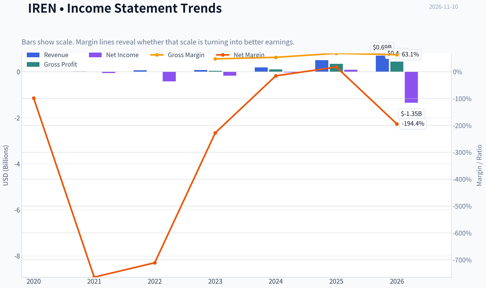

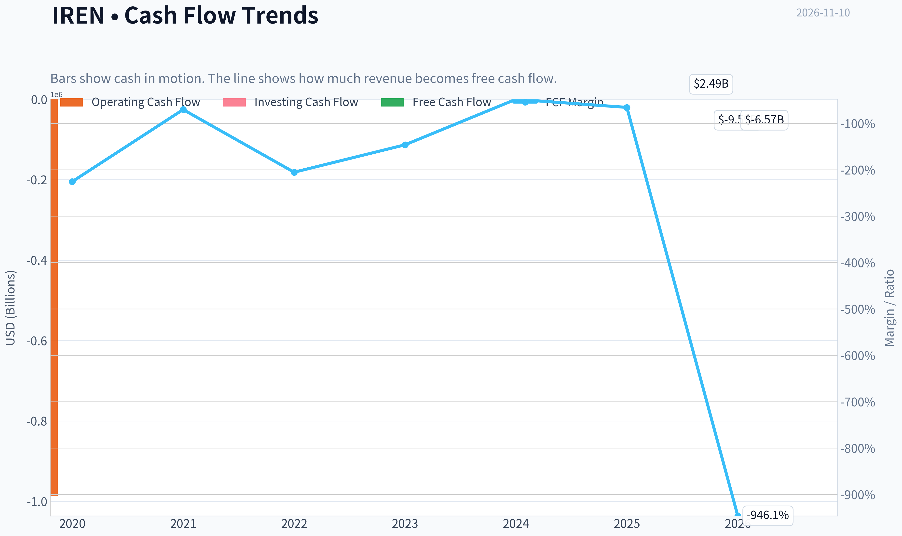

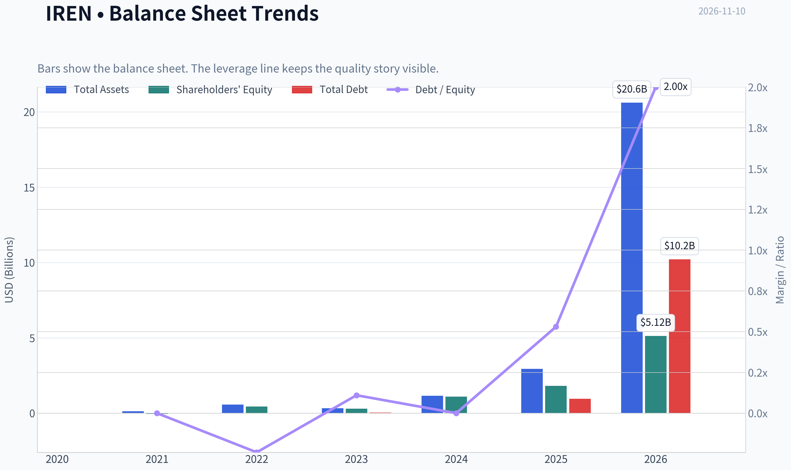

This graph tracks the profitability and return metrics (ROE, ROIC, Margins) of **IREN** over the past decade, highlighting capital efficiency trends.

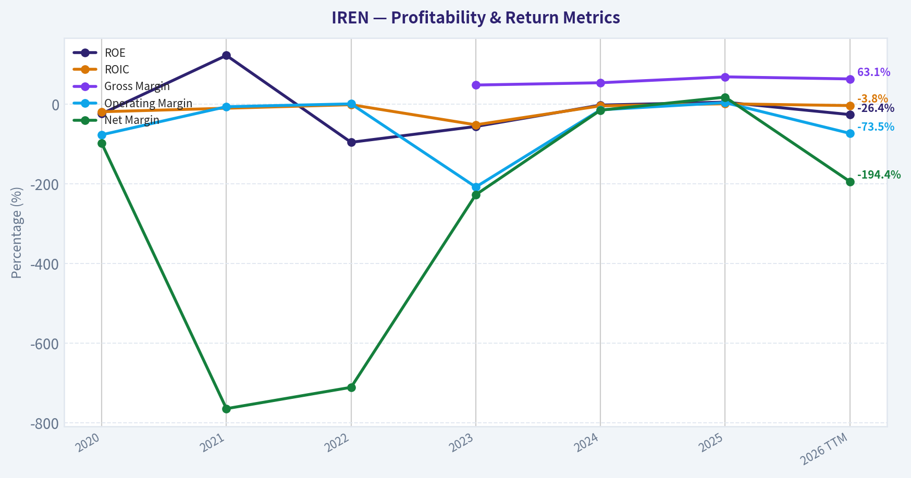

This chart illustrates the financial health of **IREN** over the last 10 years, mapping cash equivalents and free cash flow against total obligations (Debt).

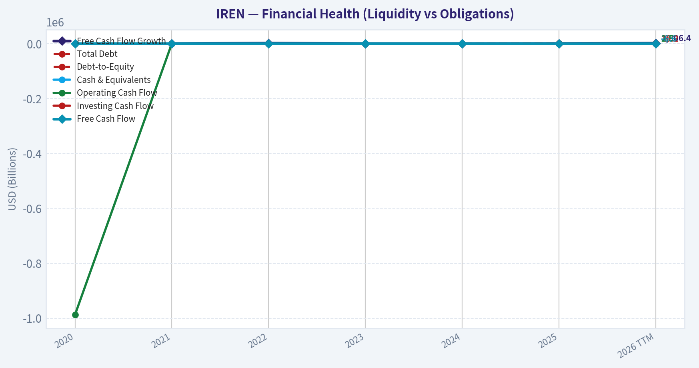

This breakdown chart from <em>Flux de trésorerie et allocation du capital</em> shows the proportional composition for **IREN** - useful for understanding what drives or risks the business.

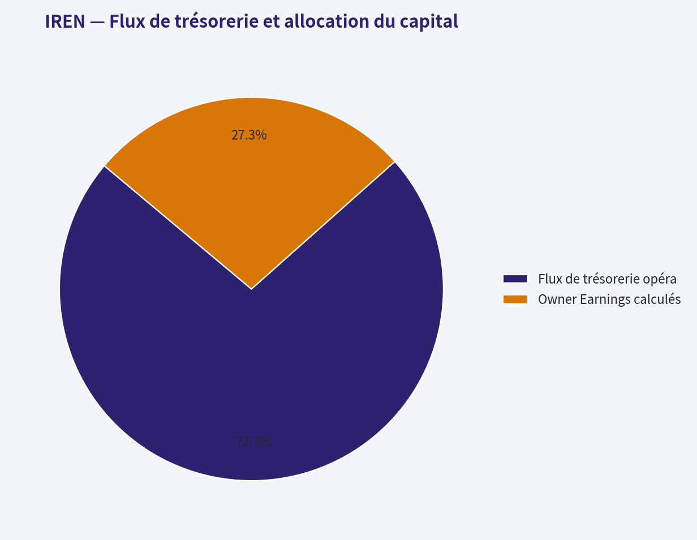

---

### Intrinsic Value Analysis (Buffett)

> *Following Warren Buffett's value investing philosophy: Circle of Competence, Economic Moat, Management Quality, and Margin of Safety.*

#### Intrinsic Value Snapshot

Price is what you pay. Intrinsic value is what the business may be worth based on the cash it can create for owners over time. We show a range, not one magic number.

- Current Price: $19.36
- Value Range (conservative to optimistic across both DCF methods): $-16.79 to $-16.79

##### Owner Earnings (Buffett Method)
- Net Income: $86,941,000.00
- Depreciation & Amortization: $417,729,000.00
- Capital Expenditures: $-2,998,006,000.00
- Working Capital Changes: $1,824,701,000.00
- Owner Earnings: $92,377,000.00

##### Intrinsic Value
###### Cash Flow Method
Uses free cash flow. Better for companies spending heavily today to grow tomorrow.
- Conservative: $-16.79
- Average: $-16.79
- Optimistic: $-16.79
- Discount Rate: N/A

ANALYST STANCE: **Bearish - Bearish**

#### Résumé exécutif

IREN exploite des infrastructures de calcul intensif, principalement liées au minage de Bitcoin, tout en développant une activité de centres de données pour l'intelligence artificielle. Le chiffre d'affaires progresse rapidement, mais cette croissance exige des investissements massifs et ne se traduit pas encore par des bénéfices ni par un flux de trésorerie disponible positif.

À 19 dollars par action et avec une capitalisation d'environ 8,22 milliards de dollars, le marché valorise déjà une transformation réussie vers une plateforme d'infrastructure IA. Cette hypothèse peut se réaliser, mais elle repose sur une forte exécution, des besoins de financement considérables et des conditions favorables dans les cryptomonnaies et l'informatique spécialisée.

#### 1. Scorecard des facteurs fondamentaux

| Facteur | Score / 5 | Évaluation |
|---|---:|---|
| Cercle de compétence et simplicité | 2,0 | Modèle compréhensible dans ses grandes lignes, mais dépendant du Bitcoin, du coût de l'électricité, du financement et de l'évolution rapide des puces IA |
| Avantage concurrentiel | 2,5 | Accès à l'électricité et capacité de centres de données potentiellement précieux, mais avantage encore à démontrer comme durable |
| Management et allocation du capital | 2,5 | Ambition élevée et forte réorientation vers l'IA, mais croissance très consommatrice de capital et absence actuelle de création de trésorerie |
| Structure industrielle | 2,0 | Secteur capitalistique, cyclique et concurrentiel ; les fournisseurs de matériel et les clients IA disposent d'un pouvoir important |
| Porte de solvabilité - Gate 5 | Non déclenchée | Les données disponibles ne montrent pas simultanément une détérioration clairement établie et une ligne rouge de solvabilité telle qu'une couverture des intérêts inférieure à 1 fois |

**Points clés :** IREN possède une option de croissance intéressante, mais pas encore une franchise démontrée. Les quatre facteurs fondamentaux restent inférieurs à ceux d'un compounder de grande qualité, surtout en raison de la volatilité, de l'intensité capitalistique et des flux de trésorerie négatifs.

#### 2. Analyse du moat

**Actifs intangibles et pouvoir de fixation des prix.** La marge brute de 68,9 % est élevée, mais elle ne suffit pas à prouver un avantage durable. Dans le minage de Bitcoin, le produit est largement standardisé et le prix est déterminé par le marché. Dans l'IA, la différenciation dépendra davantage de la disponibilité électrique, de la qualité des installations, du réseau et de la capacité à sécuriser des contrats à long terme.

**Avantage de coût.** L'accès à une électricité relativement compétitive et à des sites adaptés peut constituer un avantage réel. Toutefois, cet avantage est exposé aux coûts d'expansion, aux contraintes de raccordement et à la concurrence pour les mêmes ressources énergétiques.

**Coûts de changement.** Ils pourraient devenir significatifs si IREN construit des environnements de calcul intégrés, avec contrats pluriannuels, logiciels et données clients. À ce stade, cette captivité n'est pas suffisamment démontrée.

**Effets de réseau.** Ils sont faibles dans le minage de Bitcoin. Ils pourraient apparaître dans le calcul IA si IREN atteint une échelle importante, mais l'entreprise doit encore prouver qu'elle peut établir une plateforme durable plutôt qu'une capacité de location de serveurs.

**Conclusion sur le moat :** moat actuellement **étroit et incertain**, avec une possibilité d'élargissement dans l'IA, mais pas encore une preuve comparable à celle d'une plateforme logicielle ou d'un réseau établi.

#### 3. Qualité du management et allocation du capital

La direction semble adopter une stratégie offensive : investir rapidement dans les capacités de calcul et se positionner sur la demande croissante d'IA. Cette stratégie peut créer beaucoup de valeur si les actifs sont financés et utilisés à des rendements élevés.

Le problème est le décalage entre la croissance comptable et la création de valeur pour l'actionnaire :

- croissance du chiffre d'affaires : **41,1 % sur un an** ;
- rendement des capitaux propres : **ROE de -16,8 %** ;
- flux de trésorerie disponible : **négatif** ;
- rendement du flux de trésorerie disponible : **-10,9 %**.

La qualité de l'allocation du capital doit donc être considérée comme non démontrée. Pour devenir une société Buffett-compatible, IREN devra montrer que chaque dollar réinvesti produit durablement plus d'un dollar de valeur économique, et non simplement davantage de capacité installée.

#### 4. Synthèse financière

| Indicateur | Valeur récente |
|---|---:|
| Cours | 19 $ |
| Capitalisation boursière | 8,22 Md$ |
| Croissance du chiffre d'affaires | 41,1 % |
| Marge brute | 68,9 % |
| ROE | -16,8 % |
| Rendement du FCF | -10,9 % |
| FCF implicite approximatif | -0,90 Md$ |
| Ratio courant | 3,55 |
| PE | Non disponible |

**Points clés :** la croissance du chiffre d'affaires est impressionnante et la marge brute paraît élevée, mais les indicateurs de rentabilité des actionnaires sont négatifs. Le FCF implicite d'environ 0,90 milliard de dollars négatif, rapporté à une capitalisation de 8,22 milliards, montre que l'entreprise consomme actuellement du capital au lieu d'en distribuer.

#### 5. Résultat d'exploitation des propriétaires

La formule de Buffett est :

> Résultat net + amortissements - dépenses d'investissement de maintenance - hausse du besoin en fonds de roulement.

Pour IREN, le meilleur proxy disponible est le flux de trésorerie disponible, qui est négatif. L'estimation prudente du résultat d'exploitation des propriétaires est donc :

| Élément | Estimation |
|---|---:|
| Résultat d'exploitation des propriétaires | Environ **-0,90 Md$** |
| Rendement sur la capitalisation | Environ **-10,9 %** |
| Interprétation | L'activité ne finance pas encore son propre développement |

**Points clés :** IREN n'a pas encore atteint le stade où les bénéfices économiques peuvent être évalués par un flux récurrent disponible. Les dépenses d'investissement sont centrales au modèle ; les traiter comme entièrement créatrices de valeur serait une hypothèse optimiste, pas une conclusion financière.

#### 6. Valorisation par DCF

Avec un résultat d'exploitation des propriétaires négatif, les trois scénarios DCF classiques ne produisent pas une valeur positive robuste.

| Scénario | Hypothèse | Valeur indicative |
|---|---|---:|
| A - Aucun accroissement | Résultat d'exploitation des propriétaires négatif capitalisé à 10 % | Négative / non exploitable |
| B - Croissance du PIB | Flux initial négatif croissant de 3 % | Négative / non exploitable |
| C - Croissance historique | Croissance du chiffre d'affaires de 41,1 %, appliquée aux flux négatifs | Non pertinente sans preuve de conversion en FCF positif |
| Prix de marché | Cours actuel | 19 $ |

**Points clés :** le DCF ne permet pas de justifier le prix actuel à partir des flux économiques présents. Pour obtenir une valeur positive, l'investisseur doit supposer une amélioration substantielle des marges, une forte utilisation des infrastructures IA et une réduction relative de l'intensité capitalistique.

#### 7. Marge de sécurité et DCF inversé

La marge de sécurité est négative lorsque l'entreprise affiche un flux de trésorerie disponible fortement déficitaire et qu'aucune valeur intrinsèque positive fiable ne peut être calculée à partir des résultats actuels.

Le cours de 19 dollars suppose implicitement :

1. une conversion rapide de la croissance en flux de trésorerie positif ;
2. une demande durable pour les capacités de calcul IA ;
3. un accès au financement à des conditions raisonnables ;
4. une utilisation élevée des actifs ;
5. une maîtrise des coûts de l'électricité et du matériel ;
6. une capacité à éviter une dilution excessive des actionnaires.

Cette combinaison d'hypothèses peut offrir un potentiel spéculatif élevé, mais elle ne constitue pas une marge de sécurité Buffett. Une baisse de 72 % depuis le sommet précédent ne suffit pas à rendre l'action bon marché : le prix doit être comparé aux flux de trésorerie futurs, et non au cours historique.

#### 8. Scorecard Buffett finale

| Critère | Poids | Score / 5 | Contribution pondérée |
|---|---:|---:|---:|
| Largeur et durabilité du moat | 25 % | 2,5 | 0,63 |
| Valorisation et marge de sécurité | 20 % | 1,5 | 0,30 |
| Rendement du capital investi contre le WACC | 15 % | 1,5 | 0,23 |
| Compréhension et prévisibilité | 12 % | 2,0 | 0,24 |
| Management et allocation du capital | 12 % | 2,5 | 0,30 |
| Piste de réinvestissement | 8 % | 3,5 | 0,28 |
| Solidité du bilan | 4 % | 3,0 | 0,12 |
| Structure industrielle | 4 % | 2,0 | 0,08 |
| **Score total** | **100 %** |  | **2,18 / 5** |

**Points clés :** IREN obtient son meilleur score sur la piste de réinvestissement, car la demande potentielle pour l'infrastructure IA est importante. Mais cette qualité optionnelle est largement compensée par une valorisation difficile à justifier, un ROE négatif, un FCF négatif et une structure industrielle très exigeante.

#### Conclusion et conviction

IREN pourrait devenir un actif important dans l'infrastructure de calcul IA, mais l'action actuelle ressemble davantage à une option de croissance spéculative qu'à une entreprise prévisible et génératrice de liquidités. La croissance de 41,1 % et la marge brute de 68,9 % sont encourageantes, mais elles ne remplacent pas encore un flux de trésorerie positif et un rendement élevé du capital investi.

**Stance : Bearish - conviction modérée à élevée.**

L'action pourrait redevenir intéressante si IREN démontre plusieurs trimestres consécutifs de FCF positif, une rentabilité élevée sur les nouvelles capacités IA et une croissance financée sans dilution excessive. En l'état, le risque de destruction de capital est trop élevé pour un investissement de long terme selon la philosophie de Buffett.
#### Valuation Bridge

This bridge places the current market price beside each intrinsic value lens so readers can see whether upside depends on one method or shows up across several methods.

| Scenario | Intrinsic Value / Share |
| --- | ---: |
| Cash Flow Method | $-16.79 |
| Current Price | $19.36 |

#### Key Takeaways

If one method is far above the others, the upside case depends on a specific modelling assumption. When several methods cluster together, the valuation story is more robust.

#### Valuation Visuals

This comparison chart from *Latest Earnings Snapshot* stacks current figures against historical benchmarks for **IREN**, making it easy to see where the company trades relative to its own averages.

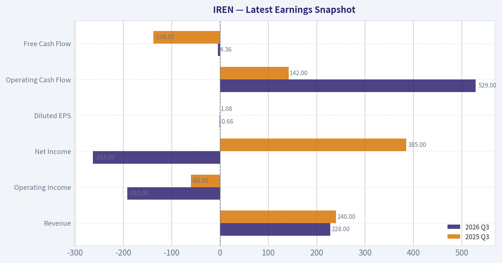

This comparison chart from *Données financières essentielles* stacks current figures against historical benchmarks for **IREN**, making it easy to see where the company trades relative to its own averages.

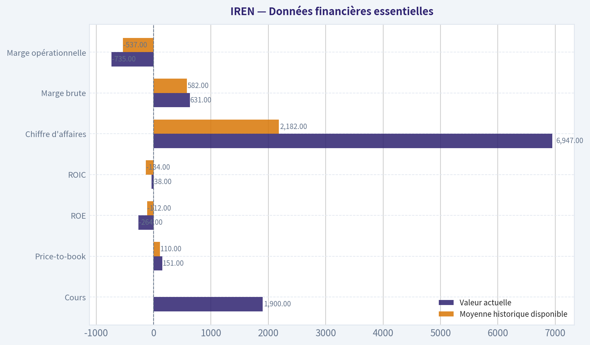

This comparison chart from *Croissance* stacks current figures against historical benchmarks for **IREN**, making it easy to see where the company trades relative to its own averages.

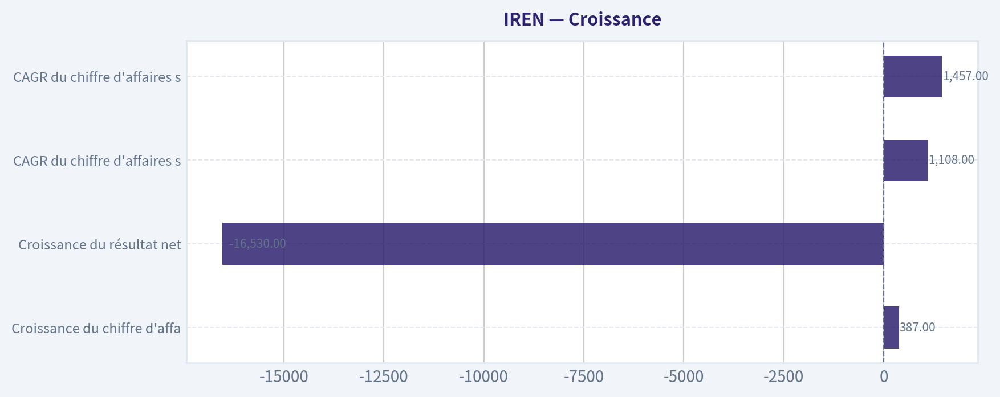

This comparison chart from *Synthèse financière* stacks current figures against historical benchmarks for **IREN**, making it easy to see where the company trades relative to its own averages.

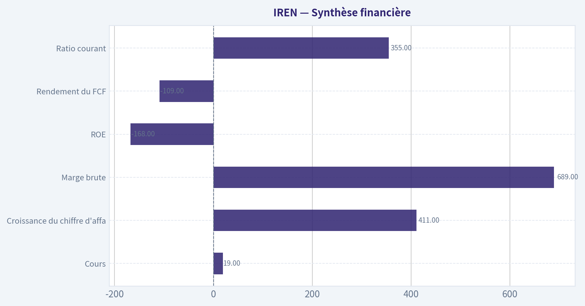

---

### Trend & Growth Analysis (Lynch/Druckenmiller/Fisher)

> *Following Peter Lynch's GARP, Stanley Druckenmiller's macro-aware approach, and Philip Fisher's scuttlebutt methodology.*

ANALYST STANCE: **Neutral** - Neutre

#### 1. Classification Lynch

**IREN est une croissance rapide, mais très spéculative, en transition vers l'infrastructure AI.** Son chiffre d'affaires a fortement progressé, mais la rentabilité, le flux de trésorerie disponible et la structure de financement ne permettent pas encore de la classer comme une croissance de qualité.

| Indicateur | Donnée |
|---|---:|
| Cours actuel | 19,39 $ |
| Capitalisation | 8,23 Md$ |
| Chiffre d'affaires TTM | 694,7 M$ |
| Croissance du chiffre d'affaires | 41,1 % |
| Marge brute | 68,9 % |
| Résultat net TTM | -1,35 Md$ |
| Flux de trésorerie disponible | -6,57 Md$ |
| Dette totale | 10,21 Md$ |
| Ratio dette / capitaux propres | 2,00 |

**Points clés :** IREN affiche encore une croissance compatible avec la catégorie des « fast growers », mais cette croissance est achetée au prix d'investissements massifs et d'un endettement élevé. Le contraste entre une marge brute élevée et un flux de trésorerie très négatif est le principal signal de prudence.

#### 2. L'histoire en trois points

1. **IREN cherche à transformer une activité de minage de Bitcoin en plateforme d'infrastructure AI et de calcul haute performance.**
2. **La demande en capacité de centres de données AI pourrait croître beaucoup plus vite que les infrastructures traditionnelles**, créant un marché très vaste pour les opérateurs disposant d'énergie et de capacité informatique.
3. **Le potentiel est important, mais l'entreprise doit encore prouver qu'elle peut convertir ses contrats et ses investissements en flux de trésorerie positifs sans dilution excessive.**

#### 3. TAM et test des 10 fois

| Élément | Analyse |
|---|---:|
| Chiffre d'affaires actuel | 0,695 Md$ |
| Chiffre d'affaires à 10 fois | 6,95 Md$ |
| Part actuelle supposée du marché AI / centres de données | Très faible |
| TAM des infrastructures AI et du cloud GPU | Très supérieur à 100 Md$ à long terme |
| Test des 10 fois | Réussi en théorie |
| Limite principale | Accès au capital, disponibilité électrique, exécution et concurrence |

**Points clés :** IREN pourrait théoriquement multiplier son chiffre d'affaires par dix tout en restant une petite fraction du marché mondial des infrastructures AI. Le véritable goulet d'étranglement n'est donc pas le TAM, mais la capacité à financer et déployer rapidement les équipements tout en obtenant des rendements acceptables.

#### 4. Tendance de croissance du chiffre d'affaires

| Période | Croissance du chiffre d'affaires |
|---|---:|
| 2023 | 27,9 % |
| 2024 | 147,9 % |
| 2025 | 167,7 % |
| TTM 2026 | 38,7-41,1 % |
| CAGR sur trois ans | 110,8 % |
| CAGR sur cinq ans | 145,7 % |

**Points clés :** La croissance historique est spectaculaire, mais elle **ralentit nettement** après le pic de 2024-2025. Le profil actuel ressemble davantage à une croissance élevée mais décélérante qu'à une nouvelle accélération. Une réaccélération liée aux contrats AI serait nécessaire pour créer un véritable point d'inflexion boursier.

#### 5. Économie unitaire et efficacité

| Mesure | Donnée | Lecture |
|---|---:|---|
| Marge brute | 68,9 % | Bonne, mais à confirmer dans l'AI |
| NRR | Non communiqué | Impossible à valider |
| LTV / CAC | Non communiqué | Impossible à valider |
| Marge FCF | -946,1 % selon les données TTM | Très préoccupante |
| Règle des 40 | Non applicable favorablement | Croissance élevée, mais FCF très négatif |
| Ratio courant | 3,55 | Liquidité de court terme correcte |
| Couverture des intérêts | -22,47 | Risque financier élevé |

**Points clés :** La marge brute suggère un potentiel économique intéressant, mais le flux de trésorerie disponible est extrêmement négatif à cause des investissements. Les indicateurs SaaS classiques comme le NRR et le LTV/CAC ne sont pas adaptés ou ne sont pas publiés, ce qui limite fortement la visibilité sur la qualité des contrats AI.

#### 6. Évaluation du point d'inflexion

| Facteur | Évaluation | Commentaire |
|---|---|---|
| Nouveau cycle produit | Potentiel positif | Passage vers l'AI et le calcul haute performance |
| Expansion du TAM | Très positive | Demande structurelle pour les GPU et centres de données |
| Part de marché | Non démontrée | Les concurrents disposent souvent de plus de capital |
| Levier opérationnel | Non confirmé | Les pertes et le FCF restent très élevés |
| Contrats / carnet de commandes AI | Positif mais à vérifier | Le carnet ne vaut que s'il se convertit en revenus et FCF |
| Inflection du bénéfice | Absente actuellement | Résultat net et ROIC négatifs |

**Points clés :** L'inflexion stratégique est réelle : IREN tente de passer du minage de Bitcoin à l'infrastructure AI. En revanche, l'inflexion financière n'est pas encore visible. Pour devenir une thèse d'investissement, il faudrait observer simultanément une accélération du chiffre d'affaires AI, une meilleure utilisation des actifs et une réduction du cash burn.

#### 7. Environnement macroéconomique

| Facteur macro | Impact sur IREN |
|---|---|
| Cycle économique | Neutre à incertain |
| Taux d'intérêt | Défavorable si élevés, car IREN dépend du financement |
| Investissements AI | Très favorables |
| Prix du Bitcoin | Favorables à l'activité historique, mais très volatils |
| Coût de l'électricité | Risque majeur |
| Accès au marché du capital | Déterminant pour la croissance |

**Points clés :** Le thème séculaire de l'AI est un vent arrière puissant. Toutefois, IREN est beaucoup plus sensible aux taux, au financement et au coût de l'électricité qu'une société logicielle. Une baisse des taux aiderait la valorisation, mais ne résoudrait pas à elle seule le problème du FCF négatif.

#### 8. Score Fisher - 15 critères

| Critère Fisher | Score / 5 |
|---|---:|
| Potentiel de marché | 5 |
| Développement de nouveaux produits | 4 |
| R&D et innovation | 3 |
| Organisation commerciale | 3 |
| Marge bénéficiaire actuelle | 1 |
| Amélioration des marges | 2 |
| Relations avec le personnel | 3 |
| Relations entre dirigeants | 3 |
| Profondeur managériale | 3 |
| Contrôle des coûts et comptabilité | 2 |
| Avantages distinctifs | 3 |
| Perspectives bénéficiaires à long terme | 4 |
| Risque de dilution | 1 |
| Transparence face aux difficultés | 3 |
| Intégrité du management | 3 |
| **Total** | **43 / 75** |

**Points clés :** Le score Fisher de 43 sur 75 est inférieur au seuil de qualité souhaitable. IREN possède un marché potentiel exceptionnel, mais elle manque encore de preuves concernant la rentabilité, le contrôle des coûts, la dilution et la profondeur de son avantage concurrentiel.

#### 9. Valorisation

| Méthode | Résultat | Lecture |
|---|---:|---|
| PE TTM | Non applicable | Pertes actuelles |
| PE prévisionnel | 71,8 fois | Très exigeant |
| PEG communiqué | 3,11 | Cher, et peu fiable avec des pertes |
| Prix / ventes | 11,84 fois | Élevé pour une activité très capitalistique |
| Prix / valeur comptable | 1,54 fois | Plus raisonnable, mais peu pertinent seul |
| Rendement FCF | -10,9 % | Aucun soutien par les flux actuels |
| Valeur intrinsèque DCF | Non fiable | FCF trop négatif et très volatil |

**Points clés :** La valorisation n'est pas bon marché selon les critères de Lynch. Le multiple de ventes de 11,84 fois suppose que l'activité AI prendra une part importante du chiffre d'affaires et générera de meilleures marges. Le titre peut être bon marché face à un scénario AI exceptionnel, mais il est cher sur les résultats actuellement prouvés.

| Scénario | Hypothèse à 3-5 ans | Lecture indicative |
|---|---|---|
| Baissier | Croissance qui ralentit, financement dilutif, FCF encore négatif | Risque de forte baisse |
| Central | Croissance AI solide, mais rendement du capital modeste | Valorisation proche de l'actuel |
| Haussier | Forte conversion du carnet AI, marges et FCF en nette amélioration | Potentiel de plusieurs fois le cours |

**Points clés :** La distribution des résultats est très asymétrique : le scénario haussier est potentiellement très rémunérateur, mais le scénario baissier implique une destruction de valeur importante. Sans données fiables sur les contrats AI, il est préférable de ne pas attribuer une valeur centrale trop optimiste.

#### 10. Scorecard de l'investisseur croissance

| Critère | Poids | Note / 5 | Contribution |
|---|---:|---:|---:|
| Histoire Lynch | 10 % | 4,0 | 0,40 |
| TAM et durée de croissance | 20 % | 4,5 | 0,90 |
| Croissance du chiffre d'affaires | 20 % | 4,0 | 0,80 |
| Économie unitaire | 15 % | 2,0 | 0,30 |
| Position concurrentielle | 10 % | 2,5 | 0,25 |
| Management | 10 % | 2,5 | 0,25 |
| Environnement macro | 5 % | 3,5 | 0,18 |
| Trajectoire bénéficiaire | 5 % | 1,5 | 0,08 |
| Valorisation | 5 % | 2,0 | 0,10 |
| **Score total** | **100 %** |  | **3,26 / 5** |

**Points clés :** Le score de 3,26 sur 5 place IREN en catégorie **Neutral**. Le TAM et le thème AI sont suffisamment attractifs pour justifier une surveillance active, mais la rentabilité, la dette et la valorisation empêchent une recommandation de forte conviction.

#### 11. Taille de position

**Position suggérée : 0 à 1 % pour un portefeuille diversifié**, uniquement comme position spéculative et conditionnelle.

Une position plus importante ne serait justifiée qu'après confirmation de plusieurs éléments :

- croissance AI supérieure à la croissance historique récente ;
- réduction visible du cash burn ;
- financement moins dilutif ;
- dette maîtrisée ;
- amélioration du rendement des actifs et du ROIC ;
- contrats AI convertis en revenus récurrents et en flux de trésorerie.

#### 12. Catalyseurs et risques principaux

| Catalyseurs | Risques |
|---|---|
| Nouveaux contrats AI pluriannuels | Dépenses d'investissement excessives |
| Mise en service rapide de capacité GPU | Dilution ou dette supplémentaire |
| Réaccélération du chiffre d'affaires | Baisse des prix du calcul AI |
| Amélioration du FCF | Coût élevé de l'électricité |
| Hausse du prix du Bitcoin | Volatilité du Bitcoin |
| Baisse des taux | Concurrence de CoreWeave, hyperscalers et autres neoclouds |

**Points clés :** Le principal catalyseur est la preuve que l'AI peut transformer IREN en entreprise générant des flux de trésorerie récurrents. Le principal risque est que l'entreprise doive continuer à lever massivement des capitaux avant d'atteindre cette rentabilité, transférant ainsi une partie importante de la valeur aux prêteurs ou aux nouveaux actionnaires.

#### Conclusion

IREN possède les caractéristiques d'une **option spéculative sur l'infrastructure AI**, avec un TAM potentiellement immense et une croissance historique impressionnante. Mais les données actuelles montrent une croissance décélérante, un FCF extrêmement négatif, une dette élevée et une valorisation exigeante.

**Décision : Neutral.** Le titre deviendrait plus intéressant sur une amélioration démontrée du FCF et une accélération des revenus AI. À ce stade, le potentiel de « ten-bagger » existe théoriquement, mais il est contrebalancé par un risque élevé de dilution, de financement et d'exécution.

#### Growth & Scorecard Visuals

This comparison chart from *Scorecard des facteurs fondamentaux* stacks current figures against historical benchmarks for **IREN**, making it easy to see where the company trades relative to its own averages.

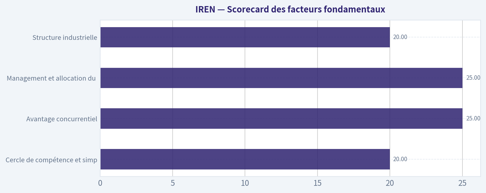

---

### Market Technical Analysis

ANALYST STANCE: **Bearish - Baissier**

#### Résumé exécutif

Au 9 novembre 2026, IREN clôture à **21,41 USD**, après une baisse de **5,5 %** sur la séance et de près de **48 % depuis le 9 octobre**. La structure technique est nettement baissière : le cours se situe très largement sous ses moyennes mobiles à 10, 50 et 200 jours, tandis que le MACD reste négatif.

Le RSI à **35,97** s'est redressé depuis une zone de survente extrême, mais il demeure sous le seuil neutre de 50. Cela suggère un possible rebond technique, sans signal suffisant de retournement durable. La volatilité reste élevée et les volumes récents, notamment les **130,2 millions de titres échangés le 5 novembre**, montrent une forte redistribution du risque plutôt qu'une stabilisation confirmée.

#### Indicateurs retenus

L'analyse utilise huit indicateurs complémentaires :

- **close_10_ema** : momentum très court terme ;
- **close_50_sma** : tendance intermédiaire ;
- **close_200_sma** : régime de tendance long terme ;
- **macd** : dynamique et inflexions du momentum ;
- **rsi** : pression acheteuse ou vendeuse et zones de survente ;
- **boll_ub** et **boll_lb** : position du cours dans sa distribution de volatilité ;
- **atr** : amplitude des mouvements et gestion du risque.

Les deux bandes de Bollinger sont conservées ensemble car leur intérêt vient principalement de l'écart entre elles et de la position du cours à l'intérieur du canal. L'ATR apporte une information différente, centrée sur le dimensionnement des positions et des stops.

#### Tendance et moyennes mobiles

Le cours de 21,41 USD est inférieur à l'**EMA 10 jours**, située autour de **23,10 USD**, de la **SMA 50 jours** à **35,59 USD**, et de la **SMA 200 jours** proche de **43,55 USD**.

Cette configuration est particulièrement défavorable :

1. Le cours sous l'EMA 10 indique que le rebond des 3 et 6 novembre n'a pas encore produit de reprise du momentum court terme.
2. L'écart d'environ **14,18 USD** avec la SMA 50 représente une décote de près de **40 %** par rapport à la tendance intermédiaire.
3. L'écart avec la SMA 200 atteint environ **22,14 USD**, soit plus de **50 %** sous la référence long terme.

Les trois moyennes sont elles-mêmes orientées à la baisse. La SMA 50 est passée d'environ **41,68 USD le 12 octobre** à **35,59 USD le 9 novembre**, tandis que la SMA 200 a reculé de **45,55 USD à 43,55 USD** sur la même période. Il ne s'agit donc pas seulement d'un cours temporairement sous ses moyennes : les références de tendance se dégradent également.

La zone de **23 à 24 USD**, correspondant à l'EMA 10 et aux récents sommets de clôture, constitue une première résistance. Au-dessus, la zone **26 à 28 USD** représente une résistance plus importante, puis la SMA 50 autour de **35,6 USD** devient la barrière stratégique. Tant que le titre reste sous ces niveaux, les rebonds doivent être considérés comme des reprises contre-tendance.

#### MACD : momentum toujours négatif

Le MACD vaut environ **-4,23** au 9 novembre. Il s'est légèrement amélioré par rapport à **-4,43 le 26 octobre**, mais cette amélioration reste insuffisante pour confirmer un retournement.

Le point important est la séquence récente :

- le MACD était proche de **-1,70** le 12 octobre ;
- il s'est détérioré jusqu'à environ **-4,43** le 26 octobre ;
- il reste très négatif malgré le rebond ponctuel de début novembre.

Cela indique que la pression baissière s'est quelque peu modérée, mais que la dynamique dominante demeure vendeuse. Pour obtenir un signal plus constructif, il faudrait observer une remontée persistante du MACD vers zéro, accompagnée d'un franchissement de l'EMA 10 puis de la SMA 50. Un simple redressement depuis une valeur très négative ne suffit pas.

#### RSI : survente, mais pas encore retournement

Le RSI est remonté à **35,97**, contre **26,84 le 5 novembre** et **23,64 le 20 octobre**. Cette progression indique que la pression vendeuse immédiate a diminué après plusieurs séances de liquidation.

Toutefois, le RSI reste sous 40 et sous le niveau neutre de 50. Il existe donc un risque de rebond technique, mais pas encore de preuve d'une reprise structurelle. Dans une tendance baissière aussi marquée, un RSI peut rester faible pendant une période prolongée ; l'étiquette de « survente » ne doit donc pas être interprétée comme un signal automatique d'achat.

Un scénario plus favorable nécessiterait :

- un RSI repassant au-dessus de 50 ;
- une remontée accompagnée de cours supérieurs à 23-24 USD ;
- idéalement, une divergence haussière confirmée entre le prix et le RSI.

À ce stade, le redressement du RSI ressemble davantage à une détente après excès de vente qu'à une inversion de tendance.

#### Bandes de Bollinger et zones de prix

Le 6 novembre, les bandes de Bollinger se situaient approximativement à :

- bande supérieure : **34,87 USD** ;
- bande inférieure : **18,12 USD**.

Le cours de 21,41 USD se trouve donc dans la partie basse du canal, mais pas très loin de la bande inférieure. Cela confirme une pression vendeuse importante. La bande inférieure proche de **18 USD** constitue une zone de support technique potentielle, mais elle ne doit pas être considérée comme un plancher fiable.

La rupture de la zone des **23-25 USD** à la fin octobre a été suivie d'une accélération baissière vers **18,03 USD** le 5 novembre. Le rebond vers 21-22 USD peut correspondre à un retour vers une zone de support devenue résistance. Une clôture sous 18 USD augmenterait le risque d'une nouvelle extension baissière, tandis qu'un franchissement durable de 24-25 USD serait nécessaire pour réduire la pression immédiate.

L'écart entre les bandes reste important, ce qui traduit une volatilité élevée. Il n'y a pas encore de compression nette permettant d'anticiper sereinement une sortie directionnelle contrôlée.

#### ATR et gestion du risque

L'ATR est monté à environ **2,94 USD**, contre **2,59 USD le 12 octobre**. À un cours de 21,41 USD, cela représente approximativement **13,7 % du prix** pour une amplitude moyenne quotidienne calculée par l'indicateur.

Cette proportion est très élevée. Un stop fixe de faible amplitude risque d'être déclenché par le bruit normal du titre, tandis qu'un stop suffisamment large implique une taille de position beaucoup plus réduite. Pour une stratégie acheteuse spéculative, le risque doit donc être limité par le dimensionnement plutôt que par un stop trop serré.

L'ATR confirme que la baisse ne se déroule pas dans un environnement calme : les mouvements sont rapides, les écarts intrajournaliers sont importants et le risque de faux signaux est élevé.

#### Volume et comportement du prix

Les données de prix montrent plusieurs épisodes de volumes très élevés lors des accélérations baissières. Le 5 novembre, IREN a clôturé à **18,03 USD** avec environ **130,2 millions de titres** échangés ; le 6 novembre, le volume est resté exceptionnellement élevé, à **112,9 millions**, avec une clôture à 21,64 USD.

Ce type de séquence peut signaler une capitulation partielle et permettre un rebond violent. Cependant, un volume élevé ne devient constructif que si le cours conserve les gains, forme des creux ascendants et repasse au-dessus de ses résistances. Pour l'instant, le rebond du 6 novembre n'a pas été confirmé : la clôture du 9 novembre est revenue à 21,41 USD, sous l'EMA 10.

#### Scénarios de marché

Le scénario principal reste baissier tant que le cours demeure sous 23-24 USD et surtout sous 26-28 USD. Une cassure sous **18 USD** ouvrirait un risque de poursuite vers de nouveaux plus bas, avec une volatilité probablement importante.

Un scénario de rebond technique devient plus crédible au-dessus de **24-25 USD**, surtout si le RSI repasse au-dessus de 40-50 et si le MACD poursuit son redressement. Même dans ce cas, la SMA 50 autour de **35,6 USD** constituerait une résistance majeure et le titre resterait sous sa tendance long terme.

Le scénario de stabilisation exige au minimum une succession de creux ascendants, une réduction de l'ATR et des clôtures répétées au-dessus de l'EMA 10. Ces éléments ne sont pas encore réunis.

#### Conclusion

La combinaison d'un cours sous toutes ses moyennes importantes, d'un MACD fortement négatif, d'un RSI faible et d'un ATR élevé justifie une position **Bearish** pour un investisseur cherchant une entrée technique confirmée. Le titre est suffisamment survendu pour générer des rebonds rapides, mais la survente seule ne compense pas la dégradation de la structure.

Les traders spéculatifs peuvent surveiller la réaction autour de **18 USD** et la capacité à reconquérir **23-25 USD**, mais toute position devrait être de taille réduite en raison de la volatilité. Pour une approche plus prudente, il est préférable d'attendre au moins une reprise de l'EMA 10, une amélioration durable du MACD et un RSI repassant au-dessus de 50.

| Élément | Lecture au 9 novembre 2026 | Interprétation | Niveau ou condition à surveiller |
|---|---:|---|---|
| Cours de clôture | 21,41 USD | Forte tendance baissière récente | Maintien au-dessus de 18 USD |
| EMA 10 jours | 23,10 USD | Résistance court terme ; cours en dessous | Reprise durable au-dessus de 23-24 USD |
| SMA 50 jours | 35,59 USD | Tendance intermédiaire nettement baissière | Résistance majeure vers 35-36 USD |
| SMA 200 jours | 43,55 USD | Régime long terme baissier | Inaccessible tant que la structure ne se redresse pas |
| MACD | -4,23 | Momentum négatif, légère amélioration mais non confirmée | Remontée persistante vers zéro |
| RSI | 35,97 | Faible, mais sorti de la survente extrême | Dépassement de 40 puis de 50 |
| Bandes de Bollinger | Environ 18,12-34,87 USD | Cours dans la partie basse du canal | Rupture de 18 USD ou reconquête de 24-25 USD |
| ATR | 2,94 USD | Volatilité très élevée, risque de faux signaux | Réduire la taille des positions et élargir les stops |
| Stance | **Bearish - Baissier** | Rebond possible, retournement non confirmé | Attendre confirmation technique |

**Key Takeaways :** IREN reste dans une tendance baissière sur les horizons court, intermédiaire et long terme, malgré un léger redressement du RSI et du MACD. Le niveau de 18 USD est le support critique, tandis que 23 à 25 USD constitue la première zone de reconquête nécessaire. La volatilité élevée impose d'éviter les positions importantes avant confirmation d'un retournement.

---

### Options Market Analysis

> *Reading options flow - put/call ratios, IV skew, and unusual activity - to gauge institutional positioning and event-driven risk.*

ANALYST STANCE: **Bullish - BULLISH / Haussier avec prudence**

#### Rapport d'analyse des options - IREN

Données observées au 10 novembre 2026, sur les échéances proches du 13 au 27 novembre 2026. Les données disponibles fournissent les agrégats par échéance, mais pas le détail complet par strike ni le cours comptant utilisé pour classer chaque contrat comme ITM, ATM ou OTM.

#### 1. Ratio put/call

| Échéance | OI calls | OI puts | Ratio put/call OI | Volume calls | Volume puts | Ratio put/call volume |
|---|---:|---:|---:|---:|---:|---:|
| 13 nov. 2026 | 159 627 | 116 155 | 0,73 | 60 686 | 35 799 | 0,59 |
| 20 nov. 2026 | 345 600 | 198 611 | 0,57 | 18 499 | 26 139 | 1,41 |
| 27 nov. 2026 | 38 811 | 30 126 | 0,78 | 5 234 | 7 119 | 1,36 |
| **Total** | **544 038** | **344 892** | **0,63** | **84 419** | **69 057** | **0,82** |

**Key Takeaways :** Le ratio put/call OI global de 0,63 est inférieur au niveau neutre historique d'environ 0,70, ce qui indique une concentration supérieure des calls et un biais structurellement haussier. Le ratio de volume de 0,82 reste également inférieur à 1, mais l'activité récente est plus défensive sur les échéances des 20 et 27 novembre, où les puts dominent le volume.

Le ratio OI de 0,57 sur l'échéance du 20 novembre est le signal haussier le plus net. Toutefois, la domination du volume put sur cette même échéance suggère que certains opérateurs achètent une protection à court terme ou anticipent une volatilité accrue.

#### 2. Volatilité implicite et skew

| Échéance | IV ATM calls | IV ATM puts | Écart puts moins calls | Lecture |
|---|---:|---:|---:|---|
| 13 nov. 2026 | 146,8 % | 152,8 % | +6,0 points | Skew put marqué |
| 20 nov. 2026 | 136,3 % | 136,1 % | -0,2 point | Skew pratiquement neutre |
| 27 nov. 2026 | 122,9 % | 124,4 % | +1,5 point | Léger biais de protection |

**Key Takeaways :** L'IV ATM est extrêmement élevée, comprise entre environ 123 % et 153 %, ce qui signale un titre très spéculatif et un risque de mouvements rapides. La prime de volatilité des puts est particulièrement forte pour le 13 novembre, indiquant une demande de protection immédiate. Les données ne fournissent pas les IV des strikes OTM ; le skew complet entre puts OTM et calls OTM ne peut donc pas être mesuré précisément.

Cette IV élevée peut correspondre à un événement proche, mais aucun catalyseur précis - résultats, annonce d'entreprise ou événement macroéconomique - n'est identifié dans les données reçues. Il faut donc éviter d'attribuer automatiquement cette volatilité à une publication particulière.

#### 3. Activité inhabituelle

| Critère | Résultat |
|---|---|
| Contrats avec volume supérieur à 5 fois l'OI | Aucun |
| Nouvelles positions directionnelles clairement identifiables | Non détectées |
| Achats de calls ou de puts attribuables à des institutionnels | Non confirmables |
| Niveau de conviction issu des flux inhabituels | Faible à modéré |

**Key Takeaways :** Aucun contrat ne présente un volume supérieur à cinq fois son open interest ; il n'y a donc pas de flux exceptionnel permettant d'identifier une nouvelle position directionnelle agressive. Le biais haussier provient principalement de la structure de l'open interest, et non d'un sweep ou d'une accumulation inhabituelle identifiable. La distinction entre activité institutionnelle et spéculation de détail reste impossible sans données de taille des ordres, de sens d'exécution et de strikes détaillés.

#### 4. Concentration de l'open interest et niveaux de gamma

| Échéance | OI total | Part de l'OI total proche échéance | Interprétation |
|---|---:|---:|---|
| 13 nov. 2026 | 275 782 | 31,0 % | Forte activité immédiate |
| 20 nov. 2026 | 544 211 | 61,3 % | Principal centre de gravité |
| 27 nov. 2026 | 68 937 | 7,8 % | Concentration nettement plus faible |
| **Total** | **888 930** | **100 %** | - |

**Key Takeaways :** L'échéance du 20 novembre concentre environ 61 % de l'open interest proche, ce qui en fait le principal centre de gravité potentiel du titre. L'échéance du 13 novembre représente également une masse importante, avec un risque de mouvements accélérés à très court terme. Les strikes exacts n'étant pas fournis, il est impossible d'identifier les gamma walls, le max pain ou les niveaux précis de pinning.

La concentration élevée sur le 20 novembre peut à la fois amortir les fluctuations autour des strikes dominants et amplifier les mouvements si le cours franchit une zone fortement couverte par les teneurs de marché. Le sens de cet effet dépend entièrement de la répartition call/put par strike, indisponible ici.

#### 5. Signal global

Le signal est **BULLISH**, mais avec une confiance modérée plutôt qu'élevée.

Le principal facteur haussier est le ratio put/call OI global de 0,63, inférieur au seuil neutre de 0,70, ainsi que la forte concentration de calls sur l'échéance du 20 novembre. Le volume put relativement élevé sur les échéances du 20 et du 27 novembre constitue toutefois une réserve importante : il peut refléter une couverture contre une baisse ou une anticipation de volatilité imminente.

L'IV très élevée réduit la qualité du signal directionnel. Les options sont coûteuses et le marché semble attendre des mouvements importants ; une position haussière peut donc être correcte directionnellement tout en produisant un mauvais résultat après prise en compte de la prime payée. En l'absence d'activité inhabituelle et de détail par strike, le signal doit être interprété comme un biais haussier de positionnement, et non comme une conviction institutionnelle forte.

#### Tableau récapitulatif

| Élément | Lecture pour IREN |
|---|---|
| Ratio put/call | **0,63 OI ; 0,82 volume - biais haussier, mais protection récente présente** |
| Niveau d'IV | **Très élevé : environ 123 % à 153 % sur les échéances proches** |
| Direction du skew | **Skew put marqué à très court terme ; globalement neutre à légèrement défensif** |
| Activité inhabituelle | **Aucun contrat avec volume supérieur à 5 fois l'OI** |
| Concentration OI | **Très forte sur le 20 novembre, environ 61 % de l'OI proche** |
| Signal global | **BULLISH / haussier, confiance modérée et risque de volatilité élevé** |

**Key Takeaways :** IREN présente un positionnement d'open interest globalement haussier, avec davantage de calls que de puts et une concentration majeure sur le 20 novembre. Cependant, l'IV extrêmement élevée et le volume put défensif sur certaines échéances signalent un marché nerveux, pas une hausse à faible risque. Le biais retenu est donc haussier, mais il doit être confirmé par le cours du sous-jacent et par l'apparition éventuelle de flux directionnels plus nets.

---

## Research Team Commentary

> *The Research Manager synthesizes the Bull vs Bear debate into action-free commentary. This is a pre-risk view, not the final stance.*

Synthèse du débat

Le meilleur argument haussier est qu'IREN ne doit pas être évaluée uniquement comme un mineur de Bitcoin. L'accès à une puissance électrique rare, à des raccordements déjà disponibles et à des sites opérationnels pourrait raccourcir fortement le délai de déploiement d'infrastructures d'IA et de calcul haute performance. Si cette capacité est adossée à des contrats pluriannuels avec des clients solvables, IREN pourrait passer d'une activité cyclique et largement banalisée à des flux de trésorerie plus prévisibles. La croissance du chiffre d'affaires de 41,1 % et la marge brute de 68,9 % montrent qu'il existe une base économique à développer.

Mais l'argument baissier est aujourd'hui plus solide, car il repose sur des résultats observables plutôt que sur une transformation espérée. Le flux de trésorerie disponible est négatif, le ROIC atteint -17,6 %, le ROE -16,8 % et le ROA -4,4 %. IREN n'a encore démontré ni avantage concurrentiel durable auprès des clients d'IA, ni rendement satisfaisant sur ses nouveaux investissements, ni création de valeur par action. Une connexion au réseau peut être rare sans que la rente économique revienne aux actionnaires : elle peut être captée par les fournisseurs d'énergie et de GPU, les clients puissants ou les financeurs.

Le ratio put/call de 0,63 indique un positionnement de court terme plutôt optimiste, mais il n'a pratiquement aucune valeur pour estimer les flux de trésorerie sur dix ans. Il peut même signaler que le marché accorde déjà beaucoup de crédit au récit de transformation.

Core Takeaway

À 19,36 dollars, IREN ressemble davantage à une option coûteuse sur la réussite de sa transition vers l'IA qu'à une entreprise merveilleuse achetée à un prix raisonnable. Le potentiel stratégique existe, mais le cours demande déjà une amélioration importante des flux de trésorerie alors que la qualité économique, le financement et le moat restent à prouver.

Je n'achèterais donc pas les actions au prix actuel. Ce n'est ni une prévision de faillite ni un jugement définitif sur l'entreprise. C'est le constat que le rapport entre preuve, prix et risque n'offre pas encore la marge de sécurité exigée.

Rationale

Le point central est la différence entre croissance et création de valeur. Une croissance du chiffre d'affaires de 41,1 % est encourageante, mais une entreprise à forte intensité capitalistique peut croître rapidement tout en détruisant de la valeur si le rendement des nouveaux investissements reste inférieur au coût du capital. Avec un ROIC de -17,6 %, il est trop tôt pour présumer que le capex actuel produira ultérieurement des rendements élevés.

La marge brute de 68,9 % est également moins convaincante qu'elle n'en a l'air. Elle ne tient pas pleinement compte de la dépréciation, du remplacement du matériel, des coûts de financement, du développement des centres de données et de l'éventuelle sous-utilisation des capacités. Dans une lecture buffettienne, l'important est le cash que l'on peut retirer après avoir financé tout ce qui est nécessaire pour maintenir la position concurrentielle. Ce cash est actuellement négatif.

La valorisation renforce cette prudence. Selon le reverse DCF présenté, avec un taux d'actualisation de 10 % et une croissance terminale de 3 %, le cours exige environ 3,41 dollars de FCF dilué par action en année dix simplement pour être justifié. Atteindre 4 dollars donnerait une valeur estimative d'environ 22,70 dollars, soit seulement 15 % de décote par rapport au cours actuel. Une telle décote pourrait suffire pour un compounder prévisible à large moat, mais pas pour une société cyclique, déficitaire en FCF et engagée dans une transition coûteuse.

Un taux d'actualisation plus cohérent avec les risques actuels, par exemple 12 % avec une croissance terminale de 2 %, porterait le besoin à près de 5,90 dollars de FCF dilué par action. Ce niveau devrait être atteint malgré les investissements futurs, l'obsolescence du matériel et une éventuelle dilution. La valorisation paraît donc dépendre d'un scénario de réussite ambitieux plutôt que d'hypothèses conservatrices.

IREN mérite pour l'instant une marge de sécurité propre à une activité non éprouvée et cyclique, potentiellement de l'ordre de 40 % à 50 %, et non les 10 % à 15 % applicables à une entreprise exceptionnelle et prévisible. Les données disponibles ne permettent pas de calculer un prix d'achat précis, faute notamment d'informations complètes sur la dette nette, les engagements de capex, le nombre d'actions dilué et les flux par segment. Elles permettent néanmoins de conclure que cette marge de sécurité n'est pas visible à 19,36 dollars.

Le scénario haussier pourrait encore devenir très intéressant. Il faudrait que les raccordements électriques constituent réellement une barrière à l'entrée, que les nouvelles capacités soient contractualisées avant d'être construites et que les contrats couvrent le coût complet du capital, y compris le renouvellement des équipements. Il faudrait aussi que la croissance du FCF par action dépasse celle du nombre d'actions. Pour l'instant, ce sont des conditions à vérifier, pas des attributs démontrés.

La leçon à retenir des erreurs passées est de ne pas payer pour l'entreprise achevée alors que l'on possède encore l'entreprise en transformation. Il ne faut pas confondre taille du marché de l'IA, capacité annoncée et cash-flow revenant effectivement à chaque actionnaire. À l'inverse, il ne faut pas rejeter IREN éternellement à cause de pertes temporaires : la bonne discipline consiste à attendre soit des preuves économiques, soit un prix nettement plus bas.

Monitoring Plan

Au cours des un à quatre prochains trimestres, je surveillerais d'abord les contrats IA/HPC signés, et non les simples annonces de capacité. Leur durée, la qualité de crédit des clients, les engagements minimaux, les prépaiements, les clauses de résiliation et le rendement attendu par mégawatt seront déterminants. Des contrats pluriannuels finançant une partie du capex renforceraient nettement la thèse.

Je suivrais ensuite la conversion en cash. Deux trimestres consécutifs de flux de trésorerie disponible positif seraient un premier signal, mais il faudrait distinguer clairement capex d'entretien et capex d'expansion. Le test décisif reste le FCF dilué par action, pas l'EBITDA ajusté, le nombre de GPU ou la capacité électrique annoncée.

Le troisième point est le rendement incrémental du capital. Les nouvelles installations doivent être livrées dans les délais et le budget, atteindre rapidement une utilisation élevée et présenter un rendement après remplacement du matériel supérieur au coût du capital. Une poursuite du ROIC négatif malgré la mise en service des capacités affaiblirait fortement la thèse.

Je surveillerais aussi le nombre moyen d'actions diluées, la trésorerie, la dette, les échéances, les intérêts et les engagements de capex. Une croissance financée par des émissions répétées d'actions risquerait d'effacer les progrès opérationnels. À l'inverse, des prépaiements clients ou un financement de projet sans recours réduiraient le risque actionnarial.

Enfin, il faudra isoler les performances du minage de Bitcoin : coût énergétique, besoins de remplacement des machines et contribution réelle au cash-flow. Cette activité peut financer la transition pendant un cycle favorable, mais elle ne doit pas absorber le capital nécessaire à l'IA ni masquer une économie structurellement fragile.

Je reconsidérerais positivement le dossier si IREN démontrait simultanément des contrats IA durables, une utilisation élevée, un FCF consolidé positif, un ROIC incrémental supérieur au coût du capital et une dilution contenue. Je deviendrais encore plus négatif si le capex augmentait sans engagements clients, si le nombre d'actions progressait rapidement, si les mises en service étaient retardées ou si la marge brute continuait de ne pas se convertir en cash.

Stance finale : Bearish

---

## Value Investing Team Commentary

> *The Investor translates the research view into an investment thesis before risk review. This is still not the final stance.*

### Investment view

IREN's opportunity is real, but the current investment case depends more on what the company may become than on the economics it has already demonstrated. At $19.36, investors appear to be paying in advance for a successful transition from cyclical Bitcoin mining to contracted AI/HPC infrastructure.

That transition could create substantial value, but it has not yet earned the valuation privileges of a predictable, wide-moat compounder.

### Business quality: promising assets, unproven economics

IREN's strongest strategic asset may be its access to power, grid connections, and operational sites. In a market where power availability can delay data-center projects by years, those assets could shorten deployment times and attract high-quality AI customers.

However, scarcity does not automatically produce a moat for shareholders. The resulting economic rent could be captured by:

- Energy suppliers through higher power costs;
- GPU and equipment vendors;
- Large customers with negotiating leverage;
- Lenders or project-finance providers;
- New equity investors through repeated dilution.

IREN must demonstrate not merely that its capacity is valuable, but that it can retain attractive returns after equipment replacement, financing costs, depreciation, and all required capital expenditure.

The current figures do not establish that:

- Revenue growth: **41.1%**
- Gross margin: **68.9%**
- ROIC: **-17.6%**
- ROE: **-16.8%**
- ROA: **-4.4%**
- Free cash flow: **negative**

Rapid revenue growth is encouraging, but growth financed at returns below the cost of capital destroys rather than creates shareholder value. The high gross margin also overstates the underlying owner economics because it does not capture the full cost of maintaining and replacing a capital-intensive computing fleet.

### AI transformation: valuable option, not yet a proven franchise

The bullish case becomes compelling if IREN signs long-duration contracts with creditworthy customers, secures customer prepayments or non-recourse financing, and generates attractive returns per megawatt after accounting for equipment refresh cycles.

Until then, announced power capacity, GPU counts, and addressable-market estimates should not be confused with durable earnings power. AI infrastructure is a growing market, but a rapidly expanding market can still deliver disappointing shareholder returns when capital requirements are high and customers or suppliers possess most of the bargaining power.

IREN also faces execution risk from simultaneously operating a volatile Bitcoin-mining business and developing a different commercial model for AI/HPC customers. Access to infrastructure may transfer between the two activities, but customer relationships, service requirements, contract structures, and competitive advantages do not transfer automatically.

### Valuation and margin of safety

The supplied reverse-DCF indicates that the current price requires approximately **$3.41 of diluted FCF per share in year ten** under relatively accommodating assumptions of a 10% discount rate and 3% terminal growth. A more risk-adjusted framework-12% discount rate and 2% terminal growth-raises the requirement to roughly **$5.90 per diluted share**.

Those are demanding outcomes because they must be achieved after:

- Future expansion and maintenance capital expenditure;
- Hardware obsolescence and replacement;
- Financing expenses;
- Potential construction delays and underutilization;
- Bitcoin-cycle volatility;
- Any increase in diluted shares.

A projected value of about $22.70 based on $4 of year-ten FCF per share would represent only modest upside from $19.36. A 10%-15% discount might be adequate for an established, wide-moat business with predictable cash flows. It is inadequate for a capital-intensive company with negative FCF, negative ROIC, and an unproven strategic transition. IREN currently warrants a much wider margin of safety, likely around **40%-50%**, or materially stronger operating evidence.

The absence of complete debt, capex-commitment, segment-level cash-flow, and diluted-share data further reduces valuation confidence. When valuation precision is low and business risk is high, the appropriate response is not to make the assumptions more optimistic.

### Selective contrarian assessment

The market's optimism may contain a legitimate insight: existing power infrastructure could be more valuable than historical mining results suggest. If investors still valued IREN solely as a Bitcoin miner, that would create a potentially attractive contrarian opportunity.

But the put/call open-interest ratio of **0.63** and the broader AI transformation narrative suggest that the market is already recognizing this possibility. The contrarian position is therefore not necessarily to buy the exciting AI story. It may be to refuse to capitalize prospective capacity as though it were already contracted, financed, utilized, and cash-generative.

Options positioning is especially weak evidence for a ten-year investment. It reflects short-term expectations and can be distorted by hedging, speculation, and incomplete strike-level information. It does not improve IREN's ROIC or finance its capital expenditure.

### What could change the conclusion

I would reconsider the shares if several developments occurred together:

1. Material, multi-year AI/HPC contracts with creditworthy customers;
2. Minimum-spend commitments, prepayments, or customer-supported capex;
3. High utilization achieved on time and within budget;
4. Positive consolidated FCF for multiple quarters after realistic maintenance capex;
5. Incremental ROIC sustainably above the cost of capital;
6. FCF per diluted share growing faster than the share count;
7. A balance sheet capable of funding committed projects without repeated equity issuance.

Conversely, higher capex without contracted demand, rapid dilution, deployment delays, rising leverage, or persistently negative returns after facilities enter service would strengthen the avoidance case.

The key discipline is not to reject IREN permanently, but to avoid paying today for the fully successful version of a business that remains under construction. A lower price could compensate for the uncertainty, while stronger evidence could justify paying more. At present, neither condition is sufficiently visible.

**ANALYST STANCE: Bearish** - At $19.36, IREN resembles an expensive option on a potentially valuable AI-infrastructure transformation rather than a proven high-return business available with an adequate margin of safety. This is a decision not to initiate ownership at the current price, not a prediction of insolvency or a recommendation to short the shares.

---

## Deep Values Commentary

> *The Risk Management Team debates and the Risk Judge provides the final action-free verdict. This section determines the final Bullish / Neutral / Bearish stance.*

#### Final Stance Scorecard

This scorecard converts the final research view into a weighted decision frame. It does not replace the narrative judgement, but it makes the main drivers of the verdict easier to scan.

| Criterion | Score | Weight | Commentary |
| --- | ---: | ---: | --- |
| Business Quality | 2.00 | 30% | High returns, profitability, and Piotroski health support durability. |
| Valuation Support | 1.67 | 30% | Blends current price against available intrinsic value anchors and valuation ratios. |
| Financial Strength | 2.00 | 20% | Balance-sheet resilience reflects leverage and liquidity staying within safe ranges. |
| Growth Durability | 2.33 | 20% | Recent revenue, earnings, and free cash flow growth indicate how durable expansion looks. |
| TOTAL / FINAL STANCE | 1.97 | 100% | Bearish |

#### Key Takeaways

The weighted score lands at **1.97 / 5.0**, while the final stance remains **Bearish**. This is useful as a quick calibration aid rather than a mechanical signal.

#### Risk Summary

Higher scores indicate more risk pressure. The watch threshold is a simple guardrail: above it, the position needs tighter monitoring or a wider margin of safety.

| Dimension | Current Score | Watch Threshold | Commentary |
| --- | ---: | ---: | --- |
| Business Quality | 4.00 | 3.00 | High returns, profitability, and Piotroski health support durability. |
| Valuation Support | 4.33 | 3.00 | Blends current price against available intrinsic value anchors and valuation ratios. |
| Financial Strength | 4.00 | 3.00 | Balance-sheet resilience reflects leverage and liquidity staying within safe ranges. |
| Growth Durability | 3.67 | 3.00 | Recent revenue, earnings, and free cash flow growth indicate how durable expansion looks. |

#### Key Takeaways

This view helps readers separate *where* the risk sits: valuation, business quality, balance sheet, or growth durability. It is especially useful when the final stance is close to the line between Neutral and Bearish.
