# ISRG Deep Value Intelligence

**Analysis Date:** 2026-05-09

## Critical Disclaimer

*This analysis is generated by Deep Value Intelligence, an AI-powered multi-agent investing framework. This report is for informational and educational purposes only and does not constitute financial advice. Always conduct your own research and consult with qualified financial advisors before making investment decisions.*

---

## Table of Contents

1. Intelligence Summary
2. Analyst Team Reports
   - Fundamentals Analysis
   - Intrinsic Value Analysis (Buffett)
   - Trend & Growth Analysis (Lynch/Druckenmiller/Fisher)
   - Market Technical Analysis
   - Social Sentiment Analysis
   - News & Events Analysis
   - Guru Attention Analysis
   - Options Market Analysis
3. Research Team Commentary
4. Value Investing Team Commentary
5. Deep Values Commentary

---

## Intelligence Summary

### Thesis + Conditions

**Core Thesis:** **EXECUTIVE SUMMARY**
*   **Verdict:** **WATCH**
*   **The "Why":** Intuitive Surgical (ISRG) is a textbook "wonderful business" boasting a wide economic moat, 17.7% ROIC, and highly lucrative recurring revenues. However, at $450/share and a 54.6x P/E, it drastically fails the valuation gate.

**Key Risks:**
- Verdict:** **WATCH**
- The Action:** Maintain an *active* watchlist. We are hunting for a quality entry, not blindly paying a perfect price. Wait for hospital capex cyclicality or broader market weakness to compress the multiple closer to intrinsic value.
- The Bull (Risky):** Emphasizes that ISRG is a rare, category-defining compounder. With FCF growth of 91% and entrenched switching costs (surgeon training, hospital workflow), the business justifies a scarcity premium. The greatest risk is under-owning a monopoly before its next growth leg (da Vinci 5).
- The Pragmatist (Neutral):** Agrees the business is elite but the price is too rich. Recommends shifting from a passive wait to a "conditional accumulation plan"-watching for technical stabilization and concrete proof that da Vinci 5 accelerates procedure growth enough to outpace the premium.
- Under Buffett's framework, risk is not volatility; it is the permanent loss of capital or years of "dead money" caused by overpaying.

**What Would Change Our View:**
- Verdict:** **WATCH**
- The Action:** Maintain an *active* watchlist. We are hunting for a quality entry, not blindly paying a perfect price. Wait for hospital capex cyclicality or broader market weakness to compress the multiple closer to intrinsic value.
- The Bull (Risky):** Emphasizes that ISRG is a rare, category-defining compounder. With FCF growth of 91% and entrenched switching costs (surgeon training, hospital workflow), the business justifies a scarcity premium. The greatest risk is under-owning a monopoly before its next growth leg (da Vinci 5).
- The Pragmatist (Neutral):** Agrees the business is elite but the price is too rich. Recommends shifting from a passive wait to a "conditional accumulation plan"-watching for technical stabilization and concrete proof that da Vinci 5 accelerates procedure growth enough to outpace the premium.
- Under Buffett's framework, risk is not volatility; it is the permanent loss of capital or years of "dead money" caused by overpaying.

**Confidence:** Medium

---

## Analyst Team Reports

### Fundamentals Analysis

#### Latest Earnings Snapshot

*Most recent reported quarter anchored on 2026 Q1, with prior-year comparison when available.*

| Metric | 2026 Q1 | 2025 Q1 | YoY Change |
| --- | ---: | ---: | ---: |
| Revenue | $2.77B | $2.25B | +23.0% |
| Operating Income | $855.3M | $578.1M | +48.0% |
| Net Income | $821.5M | $698.4M | +17.6% |
| Diluted EPS | $2.28 | $1.92 | +18.7% |
| Operating Cash Flow | $911.9M | $581.6M | +56.8% |
| Free Cash Flow | $808.6M | $465.0M | +73.9% |

Key Takeaways: This snapshot anchors the most recent reported quarter before the narrative analysis. It helps readers separate long-run business quality from whatever changed in the latest earnings print.

#### 10-Year Financial Metrics for ISRG

*All values below are computed deterministically from raw data - not estimated by AI.*

*Issuer profile: operating company (Healthcare / Medical Instruments & Supplies).*

#### 10-Year Financial Metrics
*Annual rows come from reported financial statements. The final TTM row is computed from the latest four quarters.*

| Metric | 2009 | 2010 | 2011 | 2012 | 2013 | 2014 | 2015 | 2016 | 2017 | 2018 | 2019 | 2020 | 2021 | 2022 | 2023 | 2024 | 2025 | 2026 TTM |
| --- | --- | --- | --- | --- | --- | --- | --- | --- | --- | --- | --- | --- | --- | --- | --- | --- | --- | --- |
| Market Price | $34 | $29 | $51 | $54 | $43 | $59 | $61 | $70 | $122 | $160 | $197 | $273 | $359 | $265 | $337 | $522 | $566 | $450 |
| Market Cap | $1.32B | $1.15B | $2.07B | $2.24B | $1.71B | $2.22B | $6.90B | $8.31B | $14.15B | $18.97B | $70.62B | $98.44B | $131.43B | $96.06B | $120.57B | $188.95B | $205.42B | $161.93B |
| P/E Ratio | 5.69 | 3.02 | 4.18 | 3.41 | 2.55 | 5.29 | 11.72 | 11.26 | 21.08 | 16.82 | 51.18 | 92.76 | 77.10 | 72.70 | 67.07 | 81.30 | 71.96 | 54.55 |
| P/B Ratio | 0.86 | 0.57 | 0.78 | 0.63 | 0.49 | 0.66 | 1.60 | 1.44 | 2.96 | 2.84 | 8.55 | 10.12 | 11.04 | 8.70 | 9.06 | 11.50 | 11.52 | 9.27 |
| ROE | 15.1% | 18.7% | 18.7% | 18.3% | 19.2% | 12.4% | 13.6% | 12.8% | 14.0% | 16.9% | 16.7% | 10.9% | 14.3% | 12.0% | 13.5% | 14.1% | 16.0% | 17.0% |
| ROIC | 22.7% | 23.7% | 24.4% | 24.6% | 22.7% | 15.1% | 17.9% | 16.8% | 14.2% | 21.0% | 19.4% | 12.0% | 17.7% | 13.1% | 16.2% | 16.1% | 17.4% | 17.4% |
| EPS | $5.93 | $9.47 | $12.32 | $15.98 | $16.73 | $11.11 | $5.18 | $6.26 | $5.77 | $9.49 | $3.85 | $2.94 | $4.66 | $3.65 | $5.03 | $6.42 | $7.87 | $8.25 |
| Revenue | $1.05B | $1.41B | $1.76B | $2.18B | $2.27B | $2.13B | $2.38B | $2.71B | $3.14B | $3.72B | $4.48B | $4.36B | $5.71B | $6.22B | $7.12B | $8.35B | $10.06B | $10.58B |
| Gross Profit | $751.1M | $1.03B | $1.27B | $1.57B | $1.59B | $1.41B | $1.58B | $1.89B | $2.20B | $2.60B | $3.11B | $2.86B | $3.96B | $4.20B | $4.73B | $5.63B | $6.64B | $7.02B |
| Gross Margin | 71.4% | 72.9% | 72.5% | 72.1% | 70.4% | 66.3% | 66.2% | 69.9% | 70.2% | 69.9% | 69.4% | 65.6% | 69.3% | 67.4% | 66.4% | 67.5% | 66.0% | 66.3% |
| Operating Margin | 35.9% | 39.3% | 39.5% | 40.3% | 37.6% | 25.6% | 31.0% | 35.1% | 33.9% | 32.2% | 30.7% | 24.1% | 31.9% | 25.3% | 24.8% | 28.1% | 29.3% | 30.5% |
| Net Income | $232.6M | $381.8M | $495.1M | $656.6M | $671.0M | $418.8M | $588.8M | $738.3M | $670.9M | $1.13B | $1.38B | $1.06B | $1.70B | $1.32B | $1.80B | $2.32B | $2.86B | $2.98B |
| Net Margin | 22.1% | 27.0% | 28.2% | 30.1% | 29.6% | 19.6% | 24.7% | 27.3% | 21.4% | 30.3% | 30.8% | 24.3% | 29.9% | 21.3% | 25.2% | 27.8% | 28.4% | 28.2% |
| Revenue Growth | N/A | 34.3% | 24.4% | 24.0% | 4.0% | -5.9% | 11.9% | 13.5% | 16.0% | 18.7% | 20.3% | -2.7% | 31.0% | 9.0% | 14.5% | 17.2% | 20.5% | 5.1% |
| Net Income Growth | N/A | 64.1% | 29.7% | 32.6% | 2.2% | -37.6% | 40.6% | 25.4% | -9.1% | 68.1% | 22.3% | -23.1% | 60.7% | -22.4% | 36.0% | 29.2% | 23.0% | 4.3% |
| Free Cash Flow Growth | N/A | 32.8% | 32.2% | 17.7% | 10.8% | -27.8% | 29.6% | 42.5% | -7.7% | 3.0% | 19.4% | -2.5% | 53.1% | -45.2% | -21.8% | 73.9% | 91.0% | 13.8% |
| Total Book Value | $1.54B | $2.04B | $2.65B | $3.58B | $3.50B | $3.38B | $4.32B | $5.78B | $4.78B | $6.68B | $8.26B | $9.73B | $11.90B | $11.04B | $13.31B | $16.43B | $17.82B | $17.47B |
| Total Assets | $1.81B | $2.39B | $3.06B | $4.06B | $3.95B | $3.96B | $4.91B | $6.49B | $5.78B | $7.85B | $9.73B | $11.17B | $13.55B | $12.97B | $15.44B | $18.74B | $20.46B | $20.11B |
| Total Debt | $0 | $0 | $0 | $0 | $0 | $0 | $0 | $0 | $0 | $0 | $0 | $0 | $0 | $0 | $0 | $0 | $0 | N/A |
| Debt-to-Equity | 0.00 | 0.00 | 0.00 | 0.00 | 0.00 | 0.00 | 0.00 | 0.00 | 0.00 | 0.00 | 0.00 | 0.00 | 0.00 | 0.00 | 0.00 | 0.00 | 0.00 | N/A |
| Cash & Equivalents | $221.4M | $279.8M | $465.8M | $553.7M | $782.1M | $600.3M | $714.6M | $1.04B | $648.2M | $857.9M | $1.17B | $1.62B | $1.29B | $1.58B | $2.75B | $2.03B | $3.37B | $2.01B |
| Shareholders' Equity | $1.54B | $2.04B | $2.65B | $3.58B | $3.50B | $3.38B | $4.32B | $5.78B | $4.78B | $6.68B | $8.26B | $9.73B | $11.90B | $11.04B | $13.31B | $16.43B | $17.82B | $17.47B |
| Operating Cash Flow | $392.2M | $545.8M | $677.6M | $814.2M | $880.0M | $665.1M | $806.2M | $1.09B | $1.14B | $1.17B | $1.60B | $1.48B | $2.09B | $1.49B | $1.81B | $2.42B | $3.03B | $3.36B |
| Investing Cash Flow | $-299.5M | $-494.3M | $-479.0M | $-845.7M | $259.0M | $-153.9M | $-849.5M | $-1.28B | $378.7M | $-1.05B | $-1.15B | $-940.6M | $-2.46B | $1.37B | $-360.1M | $-3.27B | $665.8M | $-462.2M |
| Free Cash Flow | $338.8M | $449.8M | $594.7M | $700.0M | $775.4M | $559.5M | $725.2M | $1.03B | $953.2M | $982.2M | $1.17B | $1.14B | $1.75B | $958.4M | $749.6M | $1.30B | $2.49B | $2.83B |
| FCF Margin | 32.2% | 31.8% | 33.8% | 32.1% | 34.2% | 26.2% | 30.4% | 38.2% | 30.4% | 26.4% | 26.2% | 26.2% | 30.6% | 15.4% | 10.5% | 15.6% | 24.7% | 26.8% |
| Dividends / Share | $0.00 | $0.00 | $0.00 | $0.00 | $0.00 | $0.00 | $0.00 | $0.00 | $0.00 | $0.00 | $0.00 | $0.00 | $0.00 | $0.00 | $0.00 | $0.00 | $0.00 | $0.00 |

#### Profitability Metrics
- Return on Equity (ROE): 16.0%
- Return on Invested Capital (ROIC): 17.7%
- Return on Assets (ROA): 14.0%
- Gross Margin: 66.0%
- Operating Margin: 29.3%
- Net Profit Margin: 28.4%

#### Liquidity Metrics
- Current Ratio: 4.87
- Quick Ratio: 3.72

#### Leverage Metrics
- Debt-to-Equity Ratio: 0.00
- Interest Coverage Ratio: N/A
- Net Debt: $-3.37B

#### Growth Metrics (Year-over-Year)
- Revenue Growth: 20.5%
- Net Income Growth: 23.0%
- Free Cash Flow Growth: 91.0%
- Revenue CAGR (3-Year): 17.4%
- Revenue CAGR (5-Year): 18.2%

#### Valuation Metrics
- P/E Ratio (TTM): 54.62
- Forward P/E: 38.18
- Price-to-Book: 9.13
- Price-to-Sales: 15.06
- PEG Ratio: 2.36
- EV/EBITDA: 39.89
- Free Cash Flow Yield: 1.6%
- Earnings Yield: 1.8%

#### Owner Earnings (Buffett Method, Code-Computed)
- Net Income: $2.86B
- + Depreciation & Amortization: $677.1M
- - Capital Expenditures: $-539.8M
- - Working Capital Changes: $-1.27B
- = **Owner Earnings: $4.27B**

#### Intrinsic Value (Code-Computed)
- Current Price: $450
- Buffett Method (Owner Earnings):
  Conservative: $169
  Average: $324
  Optimistic: $1,111
- Cash Flow Method (FCF):
  Conservative: $75
  Average: $140
  Optimistic: $296

#### Piotroski F-Score: 7/9
- Positive Net Income: PASS
- Positive Operating Cash Flow: PASS
- ROA Improvement: PASS
- Cash Flow > Net Income: PASS
- Decreasing Debt: FAIL
- Improving Current Ratio: PASS
- No Dilution: PASS
- Improving Gross Margin: FAIL
- Improving Asset Turnover: PASS

ANALYST STANCE: **WATCH**

#### ISRG Warren Buffett-Style Fundamental Analysis - Intuitive Surgical, Inc.

Intuitive Surgical is a high-quality, capital-light medical technology compounder with a dominant robotic surgery ecosystem, recurring instrument and service revenue, zero financial debt, strong cash generation, and consistently high returns on capital. From a Buffett-style perspective, the business quality is exceptional; the valuation is the constraint. At the deterministic current price of **$450**, ISRG trades at **54.55x TTM earnings**, **9.27x book value**, and a low **1.6% free cash flow yield**, meaning investors are still paying a substantial premium for durability and long runway growth.

The final stance is **WATCH**, not ADVOCATE, because the company's moat and balance sheet are excellent, but the current price sits above the code-computed average Owner Earnings intrinsic value of **$324 per share** and well above the conservative value of **$169 per share**.

#### Current vs. 10-Year Historical Average Comparison

*Current values use the deterministic 2026 TTM row where available. Historical averages use the last 10 completed fiscal years, FY2016-FY2025, from the deterministic dataset.*

| Metric | Current / TTM | 10-Year Avg. | Current vs. Avg. | Interpretation |
|---|---:|---:|---:|---|
| Market Price | $450 | $287 | +56.7% | Price remains far above its 10-year average despite pulling back from the 2025 level. |
| Market Cap | $161.93B | $95.29B | +69.9% | The market still capitalizes ISRG as a premium global compounder. |
| P/E Ratio | 54.55x | 56.32x | -3.1% | Valuation is slightly below the recent 10-year average, but still very expensive in absolute terms. |
| P/B Ratio | 9.27x | 7.77x | +19.3% | The stock trades materially above historical book-value multiples. |
| ROE | 17.0% | 14.1% | +2.9 pts | Current profitability on equity is stronger than the decade average. |
| ROIC | 17.4% | 16.4% | +1.0 pts | Capital efficiency remains excellent and slightly above average. |
| EPS | $8.25 | $5.59 | +47.5% | Earnings per share are materially above the 10-year average. |
| Revenue | $10.58B | $5.59B | +89.4% | Revenue has nearly doubled relative to the 10-year average. |
| Gross Profit | $7.02B | $3.78B | +85.6% | Gross profit scale has expanded meaningfully with procedure growth. |
| Gross Margin | 66.3% | 68.2% | -1.9 pts | Gross margin is below the historical average, suggesting mix, manufacturing, or pricing pressure. |
| Operating Margin | 30.5% | 29.5% | +1.0 pts | Operating efficiency is slightly better than the 10-year norm. |
| Net Income | $2.98B | $1.50B | +98.9% | Net income is roughly double the historical average. |
| Net Margin | 28.2% | 26.7% | +1.5 pts | Bottom-line profitability remains strong. |
| Revenue Growth | 5.1% | 15.8% | -10.7 pts | TTM growth is below the completed-year trend; FY2025 growth was much stronger at 20.5%. |
| Net Income Growth | 4.3% | 21.0% | -16.7 pts | TTM profit growth has moderated from the 10-year average. |
| Free Cash Flow Growth | 13.8% | 20.6% | -6.8 pts | FCF growth remains positive but below the decade average. |
| Total Book Value | $17.47B | $10.57B | +65.2% | Book value has compounded substantially. |
| Total Assets | $20.11B | $12.22B | +64.6% | Asset base has grown while remaining debt-free. |
| Total Debt | N/A / $0 latest FY | $0 | In line | ISRG has operated with no financial debt. |
| Debt-to-Equity | N/A / 0.00 latest FY | 0.00 | In line | Balance sheet leverage is essentially absent. |
| Cash & Equivalents | $2.01B | $1.64B | +22.9% | Cash remains above average, although below the 2025 year-end level. |
| Shareholders' Equity | $17.47B | $10.57B | +65.2% | Equity capital has expanded steadily. |
| Free Cash Flow | $2.83B | $1.25B | +126.0% | Current FCF is more than double the 10-year average. |
| Dividends / Share | $0.00 | $0.00 | In line | The company retains capital instead of paying dividends. |

**Key Takeaways:** ISRG's current profitability, EPS, revenue, net income, equity base, and free cash flow are all substantially above 10-year averages, confirming a high-quality compounding record. The main concern is valuation: the P/E ratio remains above 54x and the P/B ratio is above its decade average. Growth has recently moderated on a TTM basis, but the completed FY2025 figures still showed strong revenue, net income, and free cash flow expansion.

#### Market Metrics Interpretation

| Metric | Current Value | Buffett-Style Interpretation |
|---|---:|---|
| Market Price | $450 | The stock has declined from the deterministic 2025 price of $566 but remains far above the 10-year average of $287. |
| Total Market Cap | $161.93B | The company is priced as a dominant, durable global medical technology platform. |
| P/E Ratio | 54.55x | This is a premium multiple that requires long-duration earnings growth and continued moat protection. |
| P/B Ratio | 9.27x | The market values ISRG far above accounting book value because the key assets are intangible: installed systems, surgeon training, procedure data, switching costs, and brand trust. |

**Key Takeaways:** ISRG's market valuation reflects exceptional business quality, not a traditional bargain. Buffett-style investors would likely admire the business but demand a larger margin of safety because the current earnings multiple leaves limited room for disappointment.

#### Profitability Analysis

ISRG's profitability profile is unusually strong for a medical device company. The deterministic dataset shows **TTM ROE of 17.0%**, **ROIC of 17.4%**, **gross margin of 66.3%**, **operating margin of 30.5%**, and **net margin of 28.2%**. These figures indicate a high-quality franchise with pricing power, recurring revenue, and strong operating leverage.

The strongest Buffett-positive signal is that **ROIC has remained consistently high despite zero debt**. Many companies generate high ROE through leverage; ISRG generates attractive returns organically. That is a sign of a true economic moat.

| Profitability Metric | Current / TTM | Assessment |
|---|---:|---|
| ROE | 17.0% | Strong and above the 10-year average; indicates efficient use of shareholder capital. |
| ROIC | 17.4% | High-quality return profile with no debt distortion. |
| EPS | $8.25 | Well above the decade average, though still priced at a high multiple. |
| Revenue | $10.58B | Scale continues to expand meaningfully. |
| Gross Profit | $7.02B | Demonstrates strong economics from instruments, accessories, systems, and services. |
| Operating Margin | 30.5% | Slightly above average, showing operating leverage. |
| Net Income | $2.98B | Nearly double the last 10 completed fiscal-year average. |
| Net Margin | 28.2% | High and stable, reflecting durable pricing and expense discipline. |

**Key Takeaways:** ISRG remains a highly profitable, high-margin business with returns on capital that are attractive even without leverage. Gross margin has softened versus earlier historical levels, but operating and net margins remain strong, indicating the company still has meaningful pricing power and scale benefits.

#### Growth Metrics Interpretation

ISRG has compounded revenue and earnings impressively over the long term. Revenue increased from **$2.71B in 2016** to **$10.06B in 2025**, and TTM revenue stands at **$10.58B**. The deterministic dataset also shows FY2025 revenue growth of **20.5%**, net income growth of **23.0%**, and free cash flow growth of **91.0%**.

However, the TTM growth rates are lower: **revenue growth of 5.1%**, **net income growth of 4.3%**, and **free cash flow growth of 13.8%**. That does not necessarily mean the long-term story is broken, but it does create valuation risk because the stock is still priced for strong growth.

| Growth Metric | Current / TTM | 10-Year Avg. | Interpretation |
|---|---:|---:|---|
| Revenue Growth | 5.1% | 15.8% | Current TTM growth is below the decade average, though FY2025 growth was very strong. |
| Net Income Growth | 4.3% | 21.0% | Profit growth has moderated recently after a very strong FY2025. |
| Free Cash Flow Growth | 13.8% | 20.6% | FCF growth remains healthy but below the 10-year average. |

**Key Takeaways:** ISRG's long-term growth record is excellent, but recent TTM growth is slower than the historical average. At a P/E above 54x, even temporary moderation matters because the market is discounting many years of continued high-quality growth.

#### Balance Sheet and Financial Strength

ISRG's balance sheet is one of the clearest Buffett-positive aspects of the company. The deterministic dataset shows **no financial debt across the completed historical period**, substantial equity, and meaningful cash balances. Current assets and liquidity are strong, with the shared research pack showing a **current ratio of 4.87** and **quick ratio of 3.72**.

| Balance Sheet Metric | Current / TTM | Buffett-Style View |
|---|---:|---|
| Total Book Value | $17.47B | Strong accumulated equity base. |
| Total Assets | $20.11B | Asset base has expanded with the business. |
| Total Debt | N/A TTM / $0 latest FY | Excellent; no dependence on debt financing. |
| Debt-to-Equity | N/A TTM / 0.00 latest FY | Excellent; balance sheet risk is minimal. |
| Cash & Equivalents | $2.01B | Strong liquidity, though below the FY2025 cash balance of $3.37B. |
| Shareholders' Equity | $17.47B | Large equity cushion and internally financed growth. |
| Current Ratio | 4.87 | Very strong short-term liquidity. |
| Quick Ratio | 3.72 | Strong even excluding inventory. |

**Key Takeaways:** ISRG has a fortress-like balance sheet with no financial debt and ample liquidity. This gives management flexibility to invest in innovation, manufacturing capacity, new platforms, and international expansion without relying on creditors.

#### Cash Flow and Capital Allocation

ISRG is a powerful free cash flow generator. TTM free cash flow is **$2.83B**, compared with a 10-year average of **$1.25B**. Free cash flow margin is **26.8%**, which is strong and close to normalized historical profitability after weakness in 2022 and 2023.

The company pays **no dividend**, which is consistent with a growth compounder reinvesting in its platform. For Buffett-style investors, the lack of dividend is acceptable if retained earnings continue to generate high returns. The question is not whether the dividend is missing; the question is whether reinvested capital can continue compounding at attractive rates.

| Cash Flow Metric | Current / TTM | Interpretation |
|---|---:|---|
| Operating Cash Flow | $3.36B | Strong cash conversion and above recent historical levels. |
| Free Cash Flow | $2.83B | More than double the 10-year average. |
| FCF Margin | 26.8% | Healthy and significantly improved from 2022-2024 lows. |
| Dividends / Share | $0.00 | Management prioritizes reinvestment over dividends. |
| FCF Yield | 1.6% | Low yield; investors are paying heavily for future growth. |

**Key Takeaways:** ISRG converts earnings into substantial free cash flow and does so without leverage. The issue is valuation: a 1.6% FCF yield is low, so shareholders need durable growth and continued execution to earn attractive returns from today's price.

#### Revenue Breakdown

*The deterministic dataset provides total revenue but not a segment table. The breakdown below uses the company's commonly reported revenue categories and applies best-available estimates to the most recent revenue base of approximately $10.06B for FY2025.*

| Revenue Source | Amount ($B) | % of Total |
|---|---:|---:|
| Instruments & Accessories | ~$6.34B | ~63% |
| Systems | ~$2.12B | ~21% |
| Services | ~$1.60B | ~16% |
| **Total** | **~$10.06B** | **~100%** |

**Key Takeaways:** ISRG's most attractive revenue source is instruments and accessories, because it is recurring and tied to procedure volume. Systems revenue drives installed-base expansion, while service revenue adds stability. This mix supports the company's moat because every installed da Vinci system can create years of follow-on instrument, accessory, and service revenue.

#### Economic Moat Assessment

ISRG has a strong and durable moat built on several reinforcing advantages:

| Moat Driver | Assessment |
|---|---|
| Installed Base | A large installed base of robotic surgical systems creates recurring instruments, accessories, and service revenue. |
| Surgeon Training | Surgeons trained on da Vinci systems face switching costs, supporting customer stickiness. |
| Hospital Workflow Integration | Hospitals make workflow, training, and capital investments around ISRG systems. |
| Brand and Clinical Trust | Robotic surgery involves high clinical stakes, making reputation and reliability critical. |
| Data and Procedure Experience | Large procedure history supports product refinement and physician confidence. |
| Recurring Revenue | Instruments, accessories, and services reduce dependence on new system sales alone. |

**Key Takeaways:** ISRG's moat is not based on a single patent or product. It is an ecosystem moat built around installed systems, trained surgeons, hospital integration, procedural familiarity, and recurring usage revenue. This is exactly the type of durable competitive advantage Buffett-style investors prefer.

#### Management Performance and Capital Allocation

Management has produced a strong record of compounding without leverage. The company has maintained zero debt, reinvested heavily in innovation, and expanded revenue from **$2.71B in 2016** to **$10.58B TTM**. ROE and ROIC are currently above their 10-year averages, indicating that growth has not come at the expense of capital discipline.

The dividend policy is also rational. ISRG pays no dividend because it still has attractive reinvestment opportunities in robotic surgery expansion, procedure growth, instruments and accessories penetration, and international markets.

| Management Indicator | Evidence | Assessment |
|---|---|---|
| ROE Discipline | Current ROE 17.0% vs. 10-year avg. 14.1% | Positive |
| ROIC Discipline | Current ROIC 17.4% vs. 10-year avg. 16.4% | Positive |
| Leverage Policy | No financial debt historically | Very positive |
| Dividend Policy | $0.00 dividend per share | Acceptable for a growth compounder |
| Cash Generation | TTM FCF $2.83B | Strong |
| Reinvestment Quality | Revenue, earnings, and equity have compounded substantially | Positive |

**Key Takeaways:** Management has created value by reinvesting retained earnings into a high-return franchise while avoiding financial leverage. The absence of dividends is not a red flag because the company has historically had productive reinvestment opportunities.

#### Buffett-Style Owner Earnings DCF Valuation

The deterministic research pack provides code-computed Buffett Method Owner Earnings of **$4.27B** and intrinsic values of **$169 conservative**, **$324 average**, and **$1,111 optimistic** per share. The valuation below uses the required assumptions: **10% discount rate**, **2.5% terminal growth rate**, and Buffett-style Owner Earnings.

Key DCF inputs:

| Input | Value |
|---|---:|
| Starting Owner Earnings | $4.27B |
| Discount Rate | 10.0% |
| Terminal Growth Rate | 2.5% |
| Net Cash Used | $3.37B |
| Estimated Shares Outstanding | ~359.8M |
| Current Market Price | $450 |

**Key Takeaways:** The DCF starts from strong Owner Earnings of $4.27B and a debt-free balance sheet. Because ISRG trades at a high valuation, the result is very sensitive to the growth assumption; small changes in long-term growth meaningfully change fair value.

#### Owner Earnings DCF Scenario Results

| Scenario | Growth Assumption Used | PV of 10-Year Owner Earnings | PV of Terminal Value | Net Cash | Equity Value | Fair Value / Share | Upside / Downside vs. $450 |
|---|---:|---:|---:|---:|---:|---:|---:|
| Conservative | Lowest available historical OE growth scenario | ~$32.9B | ~$24.5B | ~$3.37B | ~$60.8B | **$169** | **-62.4%** |
| Average | Average historical OE growth scenario, capped at 50% | ~$45.6B | ~$67.6B | ~$3.37B | ~$116.6B | **$324** | **-28.0%** |
| Optimistic | Highest historical OE growth scenario, capped at 100% | ~$113.2B | ~$283.2B | ~$3.37B | ~$399.8B | **$1,111** | **+146.9%** |

**Key Takeaways:** The conservative and average Buffett Owner Earnings valuations are below the current market price, suggesting limited margin of safety. The optimistic case produces very large upside, but it requires exceptional long-duration growth and continued moat dominance. For a Buffett-style investor, the average case is the most relevant anchor, and it argues for patience.

#### DCF Calculation Framework

| Step | Formula |
|---|---|
| Yearly Owner Earnings | Owner Earnings₀ x (1 + growth rate) ^ year |
| Present Value of Yearly OE | Yearly Owner Earnings ÷ (1 + 10%) ^ year |
| Terminal Value | Year 10 Owner Earnings x (1 + 2.5%) ÷ (10% - 2.5%) |
| Present Value of Terminal Value | Terminal Value ÷ (1 + 10%) ^ 10 |
| Equity Value | PV of 10-Year OE + PV of Terminal Value + Net Cash |
| Fair Value Per Share | Equity Value ÷ Estimated Shares Outstanding |

**Key Takeaways:** This DCF method values ISRG as an owner-operated cash-generating business rather than as a trading vehicle. The valuation is highly sensitive to growth because much of the value comes from terminal cash flows. That sensitivity is a key reason the stock deserves a WATCH stance rather than an outright ADVOCATE stance.

#### Value Assessment

ISRG is not statistically cheap. Its current P/E of **54.55x** is slightly below its 10-year average of **56.32x**, but that average itself reflects a long period of premium valuation. The stock also trades at **9.27x book value**, above the 10-year average of **7.77x**, and the free cash flow yield is only **1.6%**.

From a Buffett perspective, the company is wonderful, but the price is not obviously wonderful. The average Owner Earnings DCF value of **$324** is meaningfully below the current price of **$450**, implying the current market price already discounts a large portion of future success.

| Valuation Metric | Current | Assessment |
|---|---:|---|
| P/E | 54.55x | High absolute valuation, despite being slightly below 10-year average. |
| P/B | 9.27x | Above historical average; reflects intangible moat value. |
| FCF Yield | 1.6% | Low current cash yield. |
| Buffett Owner Earnings Value - Conservative | $169 | Far below market price. |
| Buffett Owner Earnings Value - Average | $324 | Below market price. |
| Buffett Owner Earnings Value - Optimistic | $1,111 | Large upside if growth remains exceptional. |
| Current Price | $450 | Requires sustained high growth and execution. |

**Key Takeaways:** The valuation is the central risk. ISRG's business quality is excellent, but the stock price already assumes many years of strong growth. A larger margin of safety would exist closer to or below the average Owner Earnings value of $324.

#### Key Investment Insights

| Category | Insight |
|---|---|
| Business Quality | Exceptional; dominant robotic surgery ecosystem with high switching costs. |
| Moat | Strong; built on installed base, surgeon training, hospital integration, and recurring revenue. |
| Balance Sheet | Excellent; no financial debt and strong liquidity. |
| Profitability | Strong; ROE, ROIC, operating margin, and net margin are all attractive. |
| Growth | Long-term growth record is excellent, though TTM growth is below the 10-year average. |
| Cash Flow | Very strong; TTM FCF is more than double the 10-year average. |
| Valuation | Expensive; average DCF value is below current price. |
| Dividend | None; acceptable because reinvestment opportunities remain attractive. |

**Key Takeaways:** ISRG is a rare combination of quality, growth, and financial strength. The issue is not business weakness; it is valuation discipline. Long-term investors should separate admiration for the company from willingness to pay any price for the stock.

#### Red Flags and Risks

| Risk | Why It Matters |
|---|---|
| High Valuation | At 54.55x earnings, multiple compression could hurt returns even if the business performs well. |
| Growth Deceleration | TTM revenue and net income growth are below 10-year averages. |
| Gross Margin Pressure | Current gross margin of 66.3% is below the 10-year average of 68.2%. |
| Regulatory / Product Risk | Recent recall-related headlines show that device quality and regulatory oversight remain important. |
| Competitive Risk | Other medtech companies are investing in robotic surgery platforms. |
| Procedure Volume Sensitivity | Elective procedure disruptions can affect instruments and accessories revenue. |
| International Execution | Global expansion offers upside but also reimbursement, regulatory, and adoption challenges. |

**Key Takeaways:** ISRG's main risks are valuation, execution, and competitive pressure rather than balance sheet weakness. The company has financial resilience, but the stock price leaves limited room for operational disappointment.

#### Opportunities

| Opportunity | Potential Impact |
|---|---|
| Procedure Growth | More procedures per installed system can expand recurring revenue. |
| Installed Base Expansion | New system placements create future instruments, accessories, and service revenue. |
| International Penetration | Many markets remain underpenetrated relative to the U.S. |
| New Platforms and Upgrades | Product innovation can support replacement cycles and premium pricing. |
| AI and Data-Enabled Surgery | Longer-term opportunity to improve surgical planning, training, and outcomes. |
| Operating Leverage | Revenue growth can drive margin expansion if expenses scale efficiently. |

**Key Takeaways:** ISRG still has a long growth runway if robotic surgery adoption continues globally. The most attractive opportunity is the recurring revenue model: each additional system can generate future instrument, accessory, and service sales.

#### Final Investment Stance: WATCH

ISRG is a **wonderful business at a demanding price**. The company has many of the traits Buffett investors seek: a durable moat, recurring revenue, excellent returns on capital, conservative balance sheet management, strong cash generation, and long-term earnings power. However, the current price of **$450** is above the average Buffett-style Owner Earnings value of **$324**, and far above the conservative value of **$169**.

The stock may be attractive for long-term investors who are comfortable underwriting the optimistic case, but from a disciplined value-investing standpoint, the margin of safety is not sufficient today. A more attractive entry point would likely require either a lower price, faster sustained Owner Earnings growth, or clearer evidence that TTM growth moderation is temporary.

| Final View | Rating |
|---|---|
| Business Quality | Excellent |
| Economic Moat | Strong |
| Financial Strength | Excellent |
| Earnings Predictability | High, with some cyclical procedure-volume sensitivity |
| Management / Capital Allocation | Strong |
| Valuation Attractiveness | Mixed to unfavorable |
| Margin of Safety | Insufficient at $450 |
| Final Stance | **WATCH** |

**Key Takeaways:** ISRG is an elite compounder, but the current valuation limits the margin of safety. Buffett-style investors should keep the company high on the watchlist and look for a better entry point or stronger evidence that growth can justify the premium multiple.

#### Fundamental Visuals

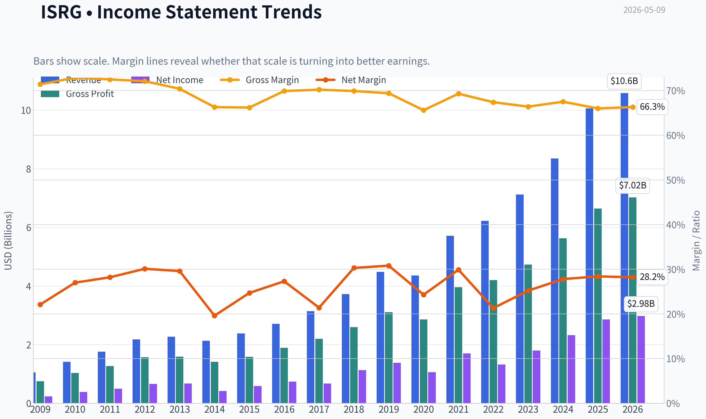

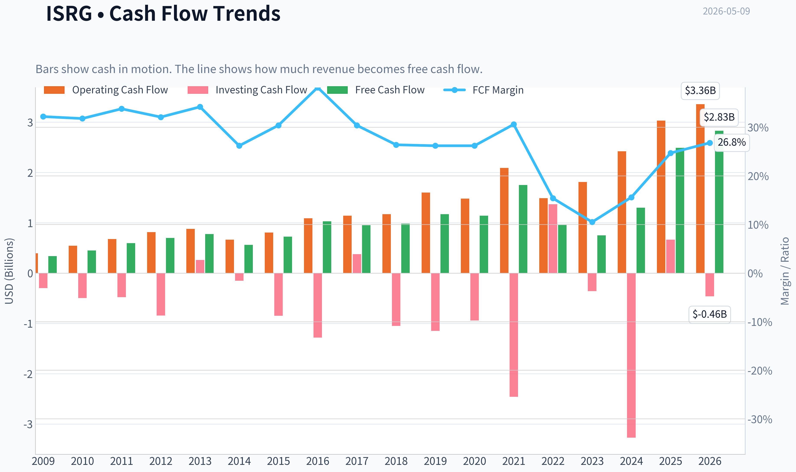

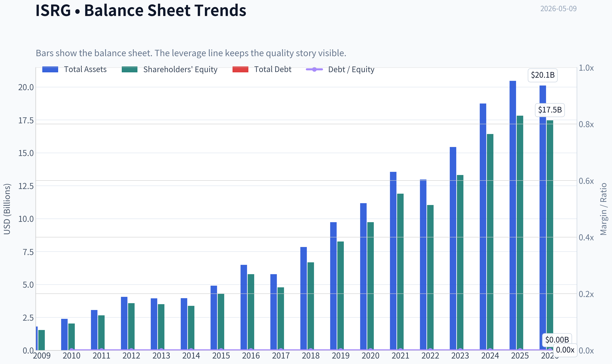

This graph tracks the profitability and return metrics (ROE, ROIC, Margins) of **ISRG** over the past decade, highlighting capital efficiency trends.

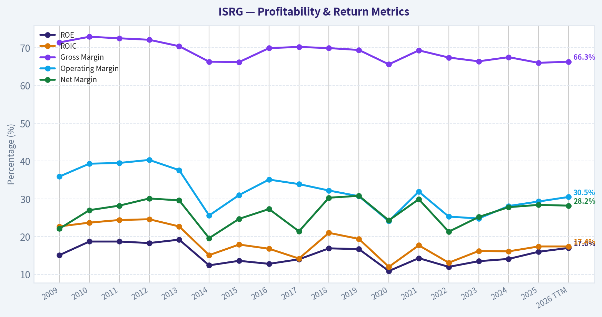

This chart illustrates the financial health of **ISRG** over the last 10 years, mapping cash equivalents and free cash flow against total obligations (Debt).

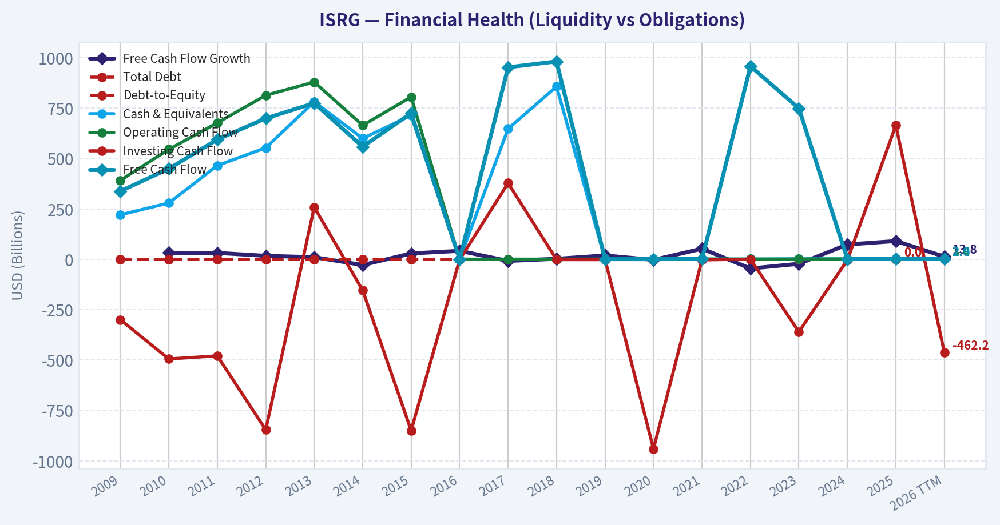

This comparison chart from *Profitability Analysis* stacks current figures against historical benchmarks for **ISRG**, making it easy to see where the company trades relative to its own averages.

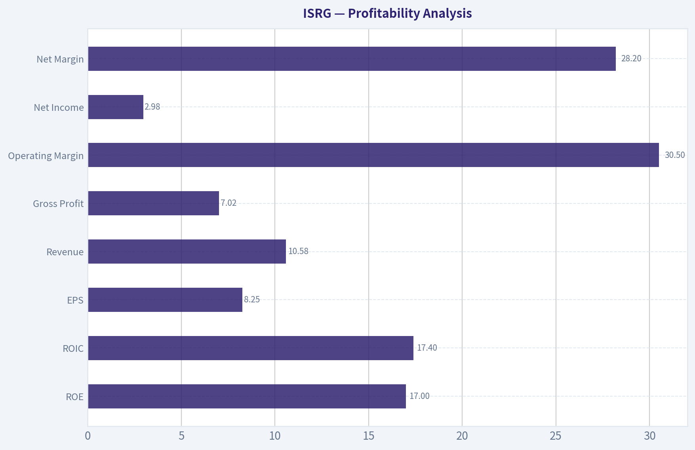

---

### Intrinsic Value Analysis (Buffett)

> *Following Warren Buffett's value investing philosophy: Circle of Competence, Economic Moat, Management Quality, and Margin of Safety.*

#### Intrinsic Value Snapshot

Price is what you pay. Intrinsic value is what the business may be worth based on the cash it can create for owners over time. We show a range, not one magic number.

- Current Price: $450.06
- Value Range: $74.84 to $1,110.71

##### Owner Earnings (Buffett Method)
- Net Income: $2,856,000,000.00
- Depreciation & Amortization: $677,100,000.00
- Capital Expenditures: $-539,800,000.00
- Working Capital Changes: $-1,272,300,000.00
- Owner Earnings: $4,265,600,000.00

##### Intrinsic Value
###### Buffett Method
Uses owner earnings. Stricter, and usually more conservative.
- Conservative: $169.14
- Average: $323.79
- Optimistic: $1,110.71
- Discount Rate: 10.0%

###### Cash Flow Method
Uses free cash flow. Better for companies spending heavily today to grow tomorrow.
- Conservative: $74.84
- Average: $139.72
- Optimistic: $295.97
- Discount Rate: 10.0%

ANALYST STANCE: **WATCH**

#### Intuitive Surgical (ISRG) - Buffett-Style Value Analysis

Current price used: **$450**
Market cap: **$159.39B**
Implied shares outstanding: **~354.2M**
Primary conclusion: **Wonderful business, unattractive price.** Intuitive Surgical appears to be a high-quality compounder with a durable medical-technology ecosystem, but at roughly **55x earnings** and a **1.6% free-cash-flow yield**, the stock does not offer a Buffett-style margin of safety.

---

#### 1. Go / No-Go Gate Assessment

| Buffett Gate | Assessment | Evidence | Result |
|---|---:|---|---|
| Gate 1: Circle of Competence & Simplicity | Strong | ISRG sells robotic surgical systems, then earns recurring revenue from instruments, accessories, and service as procedures grow. This is understandable: more installed robots drive more surgeries, which drive more recurring consumables. | Pass |
| Gate 1: 10-Year Predictability | Good, not perfect | Surgery volumes, hospital relationships, training, and installed base create visibility. However, medical robotics is still technology-driven and competitive. | Pass |
| Gate 1: Technology Risk | Mixed but favorable | ISRG benefits from technology leadership, but competitors, AI-enabled surgery, and future robotic platforms create disruption risk. | Pass with caution |
| Gate 2: Moat | Wide, but must be monitored | Gross margin around **66%**, recurring procedure-linked revenue, surgeon training, hospital workflow integration, regulatory know-how, and installed base all support a durable moat. | Pass |
| Gate 3: Management & Capital Allocation | Generally favorable | ISRG has historically reinvested heavily in R&D and platform expansion, maintains a strong balance sheet, and avoids excessive leverage. Owner-orientation appears good, though insider ownership and compensation details are not fully reviewed here. | Pass with incomplete data |
| Gate 4: Industry Structure | Attractive but evolving | Medical robotics has high barriers to entry, but large medical-device competitors are pursuing the category. Recalls and regulatory scrutiny are ongoing risks. | Pass with caution |
| Valuation Gate | Weak | P/E of **~54.6x** and FCF yield of **~1.6%** require very high long-term growth to justify today's price. | Fail for new purchase |

**Key Takeaways:** Intuitive Surgical passes the business-quality gates but fails the valuation gate. The company is understandable, profitable, and protected by a strong ecosystem, but the current share price already discounts a very optimistic future. For a Buffett-style investor, this is a watchlist business, not a buy today.

---

#### 2. Business Model - Elementary School Test

Intuitive Surgical makes money by selling hospitals robotic surgery machines. After a hospital buys the system, doctors use special instruments and accessories for each surgery, and the hospital also pays for service and support. The more surgeries performed on ISRG systems, the more recurring revenue ISRG earns.

This is a strong "razor-and-blade" model: the robot is the installed base, while instruments, accessories, and services create recurring revenue.

---

#### 3. Moat Analysis

| Moat Source | Evidence | Buffett Interpretation |
|---|---|---|
| Intangible Assets | ISRG has the leading brand in robotic-assisted surgery, deep clinical experience, surgeon familiarity, regulatory approvals, and hospital trust. | Strong. In surgery, reputation and reliability matter enormously. |
| Switching Costs | Hospitals invest in machines, surgeon training, procedural workflows, and support systems. Once surgeons are trained on da Vinci, switching is not simple. | Strong. Switching costs are operational, financial, and behavioral. |
| Cost / Scale Advantage | ISRG benefits from manufacturing scale, service infrastructure, R&D scale, and large installed base economics. | Moderate to strong. Scale reinforces margins and innovation capacity. |
| Network Effects | Not a pure network effect, but more installed systems attract more trained surgeons, more procedures, more clinical data, and more hospital adoption. | Moderate. The ecosystem becomes more valuable as usage expands. |
| Financial Evidence | Gross margin around **66%**, ROE around **16%**, revenue growth around **20.5% YoY**, current ratio around **4.87**. | Quality is visible, but ROE is good rather than extraordinary relative to the valuation. |
| Moat Rating | **Wide & Stable** | Strong existing moat, but competition and technology change prevent "set-and-forget" confidence. |

**Key Takeaways:** ISRG's moat is real and financially visible, especially in its high gross margin and recurring procedure-driven revenue. The biggest moat is not just the robot itself; it is the full ecosystem of surgeons, hospitals, training, procedures, service, and regulatory experience. The moat is wide, but because this is a technology-enabled medical device business, it must be monitored.

---

#### 4. Management Quality & Capital Allocation

| Management Question | Assessment |
|---|---|
| Do they think like owners? | Likely above average, but not fully proven here due to incomplete insider ownership and compensation data. |
| Are they candid and conservative? | ISRG has historically been viewed as a high-quality operator, but this review did not include a full annual-letter and accounting-footnote audit. |
| Are they rational capital allocators? | Favorable. The company reinvests heavily in innovation, maintains a strong balance sheet, and appears to avoid reckless leverage. |
| Debt discipline | Strong. Current ratio of **~4.87** indicates substantial liquidity. |
| Buybacks / dividends | No strong evidence from the provided data that capital returns are the main value driver. Reinvestment remains the key. |
| Regulatory / product risk | A recent FDA surgical stapler reload recall is a reminder that medical-device quality control is essential. No evidence here that it is thesis-breaking, but it is worth monitoring. |

**Key Takeaways:** Management appears to have built and protected one of the best franchises in medical technology. The balance sheet is conservative, and reinvestment into innovation is rational. The main due diligence gap is a deeper review of executive incentives, insider ownership, and long-term per-share capital allocation.

---

#### 5. 10-Year Financial Summary

Because the provided data set includes current core metrics but not a full audited 10-year line-item history, the table below combines the available current figures with a Buffett-style qualitative 10-year read.

| Metric | Current / Latest Available | 10-Year Buffett Interpretation |
|---|---:|---|
| Revenue Growth | **20.5% YoY** | Strong growth, supported by procedure expansion and installed system base. |
| Gross Margin | **66.0%** | Excellent; well above the 40% threshold often associated with durable pricing power. |
| ROE | **16.0%** | Good, but not exceptional for a company valued at over 50x earnings. |
| P/E | **54.6x** | Expensive; implies high future growth expectations. |
| FCF Yield | **1.6%** | Very low; current cash return to owners is thin relative to price. |
| Current Ratio | **4.87** | Very strong liquidity; balance sheet appears fortress-like. |
| Market Cap | **$159.39B** | Large-cap compounder; future returns depend heavily on continued growth. |
| Current Price | **$450** | Price appears far above conservative intrinsic value estimates. |

**Key Takeaways:** The financial profile is excellent on quality and weak on valuation. ISRG has strong growth, high gross margins, and a very liquid balance sheet, but investors are paying an extremely high multiple for that quality. The company is wonderful; the stock price is the problem.

---

#### 6. Owner Earnings Estimate

Buffett's preferred measure is owner earnings:

Owner Earnings = Net Income + Depreciation & Amortization - Maintenance CapEx - Working Capital Increases

Using available data, free cash flow is the best practical proxy.

| Item | Estimate / Source |
|---|---:|
| Market Cap | **$159.39B** |
| P/E | **54.6x** |
| Implied Net Income | **~$2.92B** |
| FCF Yield | **1.6%** |
| Implied Free Cash Flow | **~$2.55B** |
| Owner Earnings Proxy | **~$2.55B** |
| Shares Outstanding Estimate | **~354.2M** |
| Owner Earnings Per Share | **~$7.20** |

**Key Takeaways:** ISRG is producing roughly **$2.55B** of free cash flow against a market value of about **$159B**. That means the buyer today receives only about **$1.60 of annual free cash flow for every $100 invested**. For a Buffett-style investor, that starting yield is too low unless future growth is extraordinary and highly certain.

---

#### 7. Intrinsic Value - Three-Scenario DCF

Assumptions:
Discount rate: **10%**
Owner earnings proxy: **$2.55B**
Shares outstanding: **~354.2M**
Terminal growth where applicable: **3%**

| Scenario | Method | Equity Value Estimate | Value Per Share | Margin of Safety vs. $450 |
|---|---|---:|---:|---:|
| A: No Growth | Owner earnings / 10% | **$25.5B** | **~$72** | **-525% vs. required buy price** |
| B: GDP Growth Perpetuity | OE x 1.03 / (10% - 3%) | **$37.5B** | **~$106** | **Deeply negative** |
| C: High Growth Case | 10% owner earnings growth for 10 years, then 3% terminal growth | **~$63.0B** | **~$178** | **~60% overvalued** |

**Key Takeaways:** Even under a favorable 10% growth scenario, the estimated intrinsic value is far below the current price. The current valuation appears to require something closer to exceptional growth for many years, with little room for disappointment. This is the opposite of a margin-of-safety setup.

---

#### 8. Reverse DCF Reality Check

At today's price, ISRG's market cap is about **$159B** versus estimated owner earnings of **$2.55B**. A rough reverse DCF suggests the market may be requiring owner earnings growth in the low-20% range annually for about a decade, followed by a durable terminal growth period.

That is possible for a great company, but Buffett investing does not rely on heroic assumptions. The key question is not whether ISRG is great; it is whether today's buyer is being compensated for the risk that growth eventually slows.

---

#### 9. Margin of Safety Analysis

| Item | Estimate |
|---|---:|
| Current Price | **$450** |
| Conservative Value Range | **~$72-$106/share** |
| High-Growth Value Estimate | **~$178/share** |
| Buffett Buy Zone Using 25% Margin of Safety on High-Growth Value | **~$134/share or below** |
| Current Premium to High-Growth Value Estimate | **~153% above estimated value** |

**Key Takeaways:** There is no margin of safety at the current price under conservative assumptions. Even if ISRG continues to compound at a high rate, the present valuation leaves little protection. A Buffett-style investor should admire the business but wait for a much better entry price.

---

#### 10. Final Buffett Scorecard

| Criterion | Weight | Score 1-5 | Weighted Score |
|---|---:|---:|---:|
| Business Understanding | 20% | 4.5 | 0.90 |
| Moat Width & Durability | 25% | 3.5 | 0.88 |
| Management Quality | 15% | 3.0 | 0.45 |
| Return on Equity | 15% | 3.0 | 0.45 |
| Reinvestment Runway | 10% | 3.5 | 0.35 |
| Balance Sheet Strength | 5% | 5.0 | 0.25 |
| Industry Structure | 5% | 3.0 | 0.15 |
| Valuation / Margin of Safety | 5% | 0.0 | 0.00 |
| Total | 100% | - | **3.43 / 5.00** |

**Key Takeaways:** ISRG scores very well as a business but poorly as an investment at today's price. The balance sheet, moat, and business model are attractive, but valuation is a hard veto. The final score lands in watchlist territory rather than buy territory.

---

#### Final Investment Stance

**WATCH - High-quality business, insufficient margin of safety.**

Intuitive Surgical is exactly the kind of business Buffett-style investors should study: understandable, profitable, recurring, high-margin, and protected by ecosystem advantages. The company's installed base, surgeon training, hospital relationships, and clinical reputation create a durable competitive position.

However, the stock is priced for near-perfection. At **~55x earnings** and a **1.6% FCF yield**, the current valuation requires sustained exceptional growth and leaves little protection against competition, slower procedure growth, regulatory issues, or multiple compression.

**Conviction level:** High confidence that ISRG is a wonderful business; high confidence that the current price lacks a Buffett-style margin of safety.
**Action:** Keep on watchlist. Revisit aggressively after a major valuation reset or if owner earnings grow enough to make the current price reasonable.
#### Valuation Bridge

This bridge places the current market price beside each intrinsic value lens so readers can see whether upside depends on one method or shows up across several methods.

| Scenario | Intrinsic Value / Share |
| --- | ---: |
| Buffett Method | $323.79 |
| Cash Flow Method | $139.72 |
| Damodaran Method | $138.15 |
| Current Price | $450.06 |

#### Key Takeaways

If one method is far above the others, the upside case depends on a specific modelling assumption. When several methods cluster together, the valuation story is more robust.

#### Valuation Visuals

This comparison chart from *Latest Earnings Snapshot* stacks current figures against historical benchmarks for **ISRG**, making it easy to see where the company trades relative to its own averages.

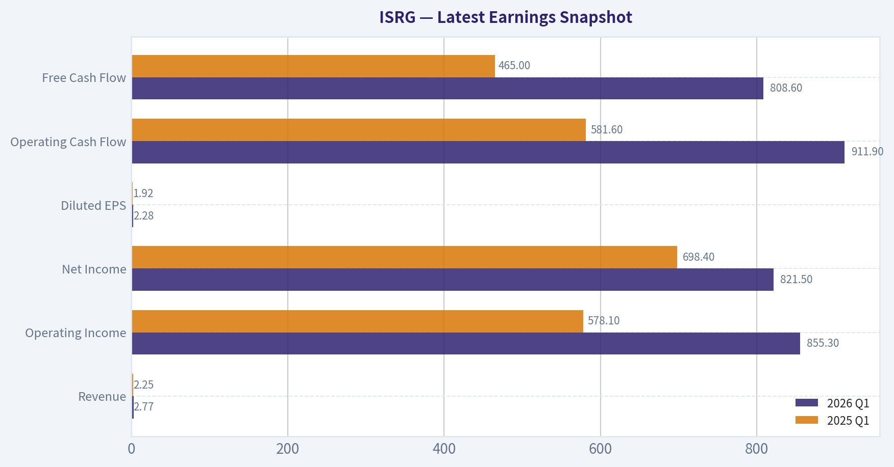

This comparison chart from *Current vs. 10-Year Historical Average Comparison* stacks current figures against historical benchmarks for **ISRG**, making it easy to see where the company trades relative to its own averages.

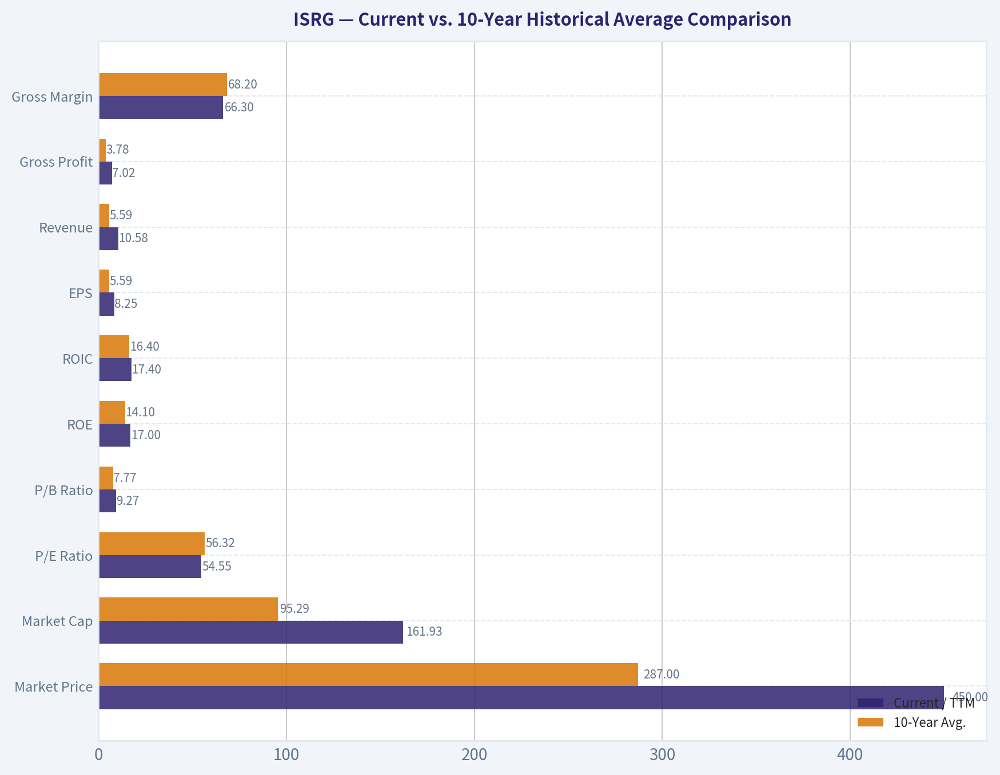

This comparison chart from *Balance Sheet and Financial Strength* stacks current figures against historical benchmarks for **ISRG**, making it easy to see where the company trades relative to its own averages.

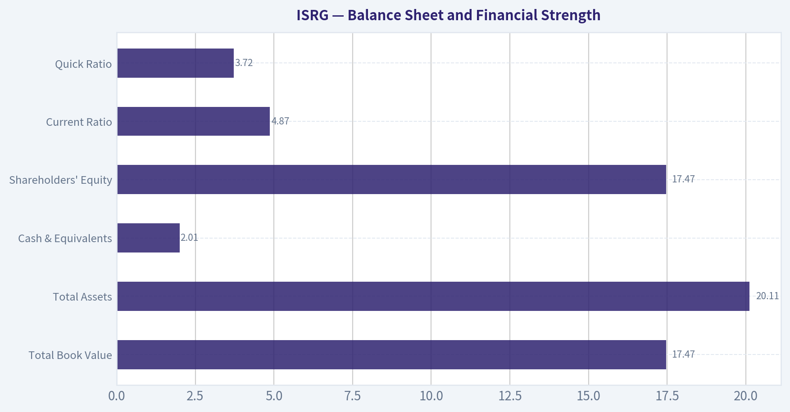

---

### Trend & Growth Analysis (Lynch/Druckenmiller/Fisher)

> *Following Peter Lynch's GARP, Stanley Druckenmiller's macro-aware approach, and Philip Fisher's scuttlebutt methodology.*

ANALYST STANCE: **WATCH**

#### ISRG Growth Investment Report - Intuitive Surgical

Intuitive Surgical is one of the highest-quality medical technology compounders in the market, but at today's valuation the stock offers **quality more than obvious mispricing**. The company remains a clear secular winner in robotic-assisted surgery, with strong growth, high gross margins, net cash-like balance sheet strength, and a long runway. However, at roughly **55x earnings** and an estimated mid-teens price-to-sales multiple, the stock requires continued execution and may not yet offer the asymmetric setup growth investors seek.

---

#### 1. Lynch Classification

| Category | ISRG Assessment |
|---|---|
| Lynch Type | **Fast Grower / High-Quality Stalwart Hybrid** |
| Revenue Growth | **20.5% YoY** |
| Profitability | Strongly profitable |
| Balance Sheet | Very strong; current ratio approximately **4.9x** |
| Growth Investor Fit | High-quality compounder, but valuation limits near-term upside |
| Final Classification | **Fast Grower, but priced like a premium compounder** |

**Key Takeaways:** Intuitive Surgical still qualifies as a Lynch-style fast grower because revenue is growing above 20%. However, because it is already a $159 billion company, the easy ten-bagger math is much harder than it was earlier in the company's life. This is a wonderful business, but not clearly a wonderful price.

---

#### 2. The Story in 3 Bullets

- **Intuitive sells robotic surgery systems that help surgeons perform minimally invasive procedures with precision, consistency, and better visualization.**
- **The business model is razor-and-blade-like:** hospitals buy or lease da Vinci systems, then generate recurring revenue through instruments, accessories, service, and procedure growth.
- **The long-term growth story is global robotic surgery penetration:** more procedures, more hospitals, more international adoption, and next-generation systems such as da Vinci 5 expanding the platform.

---

#### 3. Core Financial Snapshot

| Metric | Current Data |
|---|---:|
| Share Price | **$450** |
| Market Cap | **$159.39B** |
| P/E Ratio | **54.6x** |
| YoY Revenue Growth | **20.5%** |
| Gross Margin | **66.0%** |
| ROE | **16.0%** |
| Free Cash Flow Yield | **1.6%** |
| Current Ratio | **4.87x** |

**Key Takeaways:** ISRG combines high growth with high margins and a fortress-like liquidity position. The issue is not business quality; the issue is valuation. A 1.6% free cash flow yield means investors are paying heavily today for future growth.

---

#### 4. TAM Analysis and 10x Test

| TAM Factor | Assessment |
|---|---|
| Current Business | Robotic-assisted surgery systems, instruments, accessories, and service |
| Secular TAM Driver | Conversion of open and laparoscopic procedures to robotic procedures |
| Global Penetration | Still underpenetrated outside the U.S. and in many procedure categories |
| Current Revenue Base | Estimated around high-single-digit to low-double-digit billions annually |
| 10x Revenue Test | Would require approximately **$90B-$100B+** in annual revenue |
| Can ISRG 10x and remain below 20% TAM share? | **Possible only if robotic surgery TAM expands substantially** |
| Runway Rating | **Good, but no longer early-stage** |

**Key Takeaways:** ISRG still has a meaningful runway because robotic surgery remains underpenetrated globally. However, the company is already very large. A 10x outcome from here would require robotic surgery to become a much larger standard of care across many procedure categories and geographies.

---

#### 5. Revenue Growth Trend

| Growth Metric | Assessment |
|---|---|
| Latest YoY Revenue Growth | **20.5%** |
| Growth Pattern | Strong, but not confirmed accelerating from available data |
| Revenue Quality | High recurring component from instruments, accessories, and service |
| Main Growth Drivers | Procedure volume, installed base growth, international adoption, new systems |
| Interpretation | **Sustained high growth, not yet clear acceleration** |

**Key Takeaways:** ISRG's growth remains impressive for a company of its size. The revenue model is high quality because procedure growth creates recurring instrument and service revenue. The key question is whether da Vinci 5 and international expansion can create a new acceleration phase.

---

#### 6. Unit Economics and Business Model Quality

| Metric | ISRG Assessment |
|---|---|
| Gross Margin | **66.0%**, very strong for medtech hardware plus consumables |
| Recurring Revenue Quality | High due to instruments, accessories, and service |
| LTV/CAC | Not disclosed; likely attractive due to sticky hospital relationships |
| Net Revenue Retention | Not disclosed; not a traditional SaaS metric |
| Rule of 40 | Not directly applicable, but revenue growth plus FCF generation is strong |
| Switching Costs | High once hospitals train surgeons and build procedural workflows |
| Business Model Rating | **Excellent** |

**Key Takeaways:** ISRG is not a SaaS company, but it has SaaS-like qualities through recurring usage revenue, training ecosystems, and switching costs. Hospitals and surgeons become embedded in the da Vinci platform, which supports durable demand. The economics are strong, though not cheap to access at the current stock price.

---

#### 7. Inflection Point Assessment

| Potential Inflection | Evidence | Rating |
|---|---|---:|
| Product Cycle Inflection | da Vinci 5 and next-generation platform adoption could drive upgrades and new placements | **4/5** |
| Procedure Growth Inflection | Broader use across procedure types and geographies | **4/5** |
| Margin Inflection | Already high margins; operating leverage possible but less dramatic | **3/5** |
| TAM Inflection | Robotic surgery penetration still expanding globally | **4/5** |
| Competitive Inflection | Competitors are emerging, but ISRG remains dominant | **3/5** |
| Regulatory / Recall Risk | Recent FDA surgical stapler reload recall is a watch item | **2/5 risk flag** |

**Key Takeaways:** The most important potential inflection is the da Vinci 5 product cycle. If hospitals upgrade faster than expected and procedure volume accelerates, earnings power could surprise positively. However, competition and regulatory issues must be monitored closely.

---

#### 8. Macro Setup

| Macro Factor | Impact on ISRG |
|---|---|
| Interest Rates | Lower rates would help long-duration growth valuations |
| Healthcare Demand | Structurally resilient and less cyclical |
| AI / Automation Theme | Positive; surgical robotics benefits from data, imaging, automation, and workflow improvement |
| Hospital Capital Spending | Important risk; system placements depend partly on hospital budgets |
| Recession Sensitivity | Lower than consumer cyclicals, but procedure mix and capital budgets can be affected |
| Macro Rating | **Moderately favorable** |

**Key Takeaways:** ISRG benefits from resilient healthcare demand and the long-term automation trend. The main macro risk is valuation sensitivity to interest rates and hospital capital spending cycles. Falling rates would likely support the stock's premium multiple.

---

#### 9. Fisher 15-Point Score

| Fisher Point | Score / 5 |
|---|---:|
| Products with market potential | 5 |
| Management determination to develop new products | 5 |
| Effective R&D | 5 |
| Above-average sales organization | 5 |
| Worthwhile profit margin | 5 |
| Improving profit margins | 3 |
| Labor and personnel relations | 4 |
| Executive relations | 4 |
| Management depth | 4 |
| Cost analysis and controls | 4 |
| Durable moat / switching costs / ecosystem | 5 |
| Long-range profit outlook | 5 |
| Dilution risk | 4 |
| Candor in difficulties | 4 |
| Management integrity | 5 |
| **Total** | **67 / 75** |

**Key Takeaways:** ISRG scores extremely well on Fisher's qualitative framework. The company has a large market, strong innovation culture, high margins, and a durable ecosystem. The main deduction is not quality, but whether margins and growth can keep improving from an already high base.

---

#### 10. Valuation Analysis

| Valuation Metric | Assessment |
|---|---:|
| P/E Ratio | **54.6x** |
| Revenue Growth | **20.5% YoY** |
| Revenue-Growth Proxy PEG | Approximately **2.7x** |
| PEG Interpretation | Expensive by Lynch standards |
| Estimated P/S | Likely mid-teens, depending on current revenue base |
| FCF Yield | **1.6%** |
| Valuation Rating | **Premium / demanding** |

**Key Takeaways:** ISRG is priced as an elite compounder. The valuation is not irrational if growth remains above 20% and margins stay high, but it leaves limited room for disappointment. Lynch-style PEG analysis suggests the stock is expensive rather than clearly attractive.

---

#### 11. Scenario Analysis

| Scenario | Assumptions | Investment Implication |
|---|---|---|
| Bear Case | Growth slows toward low teens, competition rises, valuation compresses | Material downside risk from multiple contraction |
| Base Case | Revenue compounds mid-to-high teens, da Vinci 5 adoption supports growth | Stock can compound, but likely near business growth rate |
| Bull Case | Procedure growth accelerates, da Vinci 5 cycle exceeds expectations, international penetration expands | Upside case improves, but still requires premium multiple persistence |
| Ten-Bagger Case | Revenue grows 10x and market cap approaches $1.5T+ | Possible over very long horizon, but not a high-probability 5-10 year setup |

**Key Takeaways:** ISRG can still be a durable compounder, but a ten-bagger from today's market cap is difficult. The base case is continued high-quality compounding, not explosive asymmetry. The bull case depends on a new procedure and product-cycle acceleration.

---

#### 12. Growth Investor Scorecard

| Criterion | Weight | Score / 5 | Weighted Score |
|---|---:|---:|---:|
| The Story | 10% | 5.0 | 0.50 |
| TAM & Runway | 20% | 4.0 | 0.80 |
| Revenue Growth | 20% | 4.0 | 0.80 |
| Unit Economics | 15% | 4.5 | 0.68 |
| Competitive Position | 10% | 4.5 | 0.45 |
| Management Quality | 10% | 4.5 | 0.45 |
| Macro Setup | 5% | 3.5 | 0.18 |
| Profitability Path | 5% | 4.5 | 0.23 |
| Valuation | 5% | 2.0 | 0.10 |
| **Total** | **100%** |  | **4.19 / 5.00** |

**Key Takeaways:** On business quality, ISRG is an Advocate-level company. On stock attractiveness, valuation pulls the recommendation down to Watch. This is a case where the company score is excellent, but the entry price is not obviously favorable.

---

#### 13. Risks and Catalysts

| Category | Key Items |
|---|---|
| Major Catalysts | da Vinci 5 adoption, procedure volume acceleration, international expansion, new indications, AI-enabled surgical analytics |
| Key Risks | Premium valuation, hospital capital budget pressure, emerging competition, regulatory recalls, procedure concentration, slower system placements |
| Recent Watch Item | FDA surgical stapler reload recall involving 8mm SureForm 30 Gray Reloads |
| Guru Activity | Steve Cohen / Point72 added modestly, increasing shares by approximately 2% in latest 13F |
| What Would Change the Stance? | Pullback to more reasonable valuation, visible da Vinci 5 acceleration, or evidence of faster international adoption |

**Key Takeaways:** The biggest upside catalyst is a successful da Vinci 5 cycle that extends ISRG's dominance for another decade. The biggest risk is multiple compression if growth slows or competitors gain traction. The recall item appears limited but should be monitored because medtech trust and regulatory execution matter.

---

#### 14. Position Size Stance

| Investor Type | Stance |
|---|---|
| Existing Long-Term Holder | **Hold / let winner run** |
| New Position Today | **Watch, wait for better entry** |
| Growth Portfolio Position Size | Small starter only, if required |
| High-Conviction Add Zone | Prefer after valuation reset or confirmed growth acceleration |
| Risk Rating | Medium business risk, high valuation risk |

**Key Takeaways:** For existing shareholders, ISRG remains a high-quality compounder worth holding. For new capital, the setup is less compelling because expectations are already high. The better growth-investor action is to monitor for either a price dislocation or a clear acceleration in da Vinci 5-driven growth.

---

#### Final View

Intuitive Surgical is an exceptional company with durable competitive advantages, strong growth, high margins, and a long runway in robotic surgery. But the stock is priced for excellence. At **54.6x earnings**, a **1.6% FCF yield**, and likely a mid-teens sales multiple, the margin of safety is thin.

**Final stance: WATCH.**
Own it if already held, but for new money, wait for either a valuation pullback or stronger evidence of an inflection in procedure growth and da Vinci 5 adoption.

#### Growth & Scorecard Visuals

This comparison chart from *Growth Metrics Interpretation* stacks current figures against historical benchmarks for **ISRG**, making it easy to see where the company trades relative to its own averages.

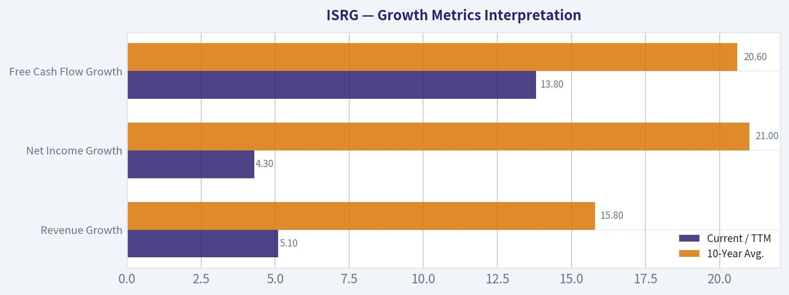

---

### Market Technical Analysis

ANALYST STANCE: **WATCH**

#### ISRG Technical Analysis - As of May 9, 2026

ISRG closed the latest trading session on **May 8, 2026 at $450.06**, and the technical structure remains fragile. The stock is trading below every major trend reference selected here: the **10 EMA, 20-day Bollinger middle line, VWMA, 50 SMA, and 200 SMA**. That alignment usually signals that sellers still control the short-, medium-, and long-term trend.

The most important nuance is that ISRG is not in a panic-oversold condition right now. The **RSI is around 42**, which is weak but not washed out. That means the stock could still drift lower without needing an immediate technical rebound. The current setup is better described as a weak consolidation near support rather than a clean reversal.

| Indicator | Latest Value | Current Price vs. Indicator | Interpretation |
|---|---:|---:|---|
| Close | **$450.06** | - | Price is near the lower end of its recent range |
| 10 EMA | $456.12 | Below by ~1.3% | Short-term momentum remains bearish |
| Bollinger Middle / 20 SMA | $462.46 | Below by ~2.8% | Price is below its near-term mean, showing weak tape |
| VWMA | $463.85 | Below by ~3.0% | Volume-weighted trend does not confirm accumulation |
| 50 SMA | $470.10 | Below by ~4.3% | Medium-term trend remains negative |
| 200 SMA | $498.64 | Below by ~10.8% | Long-term trend is clearly damaged |
| MACD | -4.97 | Negative | Bearish momentum has re-expanded in early May |
| RSI | 41.76 | Weak, not oversold | Downside pressure exists, but not yet capitulative |
| ATR | $12.63 | ~2.8% of price | Daily risk range remains meaningful |

Key Takeaways: ISRG is trading below all major trend measures, which keeps the technical bias bearish. The stock is weak, but RSI is not deeply oversold, so traders should not assume a bounce is imminent. The $450 area is important because price is testing support while momentum indicators remain negative.

#### Why These Indicators Were Selected

I selected **8 complementary indicators**: **10 EMA, 50 SMA, 200 SMA, MACD, RSI, Bollinger Middle, ATR, and VWMA**. Together, they cover short-term trend, medium-term trend, long-term trend, momentum, mean-reversion pressure, volatility, and volume-confirmed direction. I avoided adding redundant MACD signal or histogram because the MACD line itself is sufficient for the current directional read.

#### Trend Structure

ISRG's larger pattern is still bearish. After trading above **$590 in early January 2026**, the stock entered a sharp decline and has struggled to reclaim even intermediate resistance. The current price near **$450** is far below the **200 SMA near $499**, which means the stock is not just correcting within an uptrend; it is trading in a damaged long-term structure.

The **50 SMA has been declining steadily**, falling from roughly **$501 on March 24** to **$470 on May 8**. That is an important deterioration because the moving average is not simply above price; it is actively rolling lower. The **200 SMA is also declining**, from about **$508.61 on March 24** to **$498.64 on May 8**, which confirms the long-term trend has weakened.

Short-term price action is also not constructive. ISRG briefly rallied to **$483.62 on April 22**, but that rebound failed quickly. Since then, price has made lower closes and is now back near the **$450-$452 support zone**. Failed rebounds below declining moving averages often indicate that sellers are using strength to exit or initiate shorts.

#### Momentum and Mean Reversion

The **MACD remains negative at -4.97**, and it has deteriorated from late April, when it had improved to around **-0.40**. That reversal is significant because it shows that the April recovery attempt did not convert into sustained momentum. Instead, downside pressure returned as price failed below the 50 SMA and VWMA.

The **RSI at 41.76** gives a more nuanced message. It is bearish because it remains below the neutral 50 line, but it is not low enough to indicate strong oversold exhaustion. In practical terms, this means ISRG may still be vulnerable to another leg lower if the $447-$450 area breaks. A stronger reversal signal would likely require RSI to reclaim 50 while price also recaptures the 10 EMA and VWMA.

#### Volume and Volatility

The **VWMA at $463.85** sits above both the current price and the 10 EMA. That is a negative volume-adjusted signal because the market's volume-weighted average cost over the relevant period remains above where ISRG trades today. If real accumulation were developing, traders would generally want to see price reclaim and hold above VWMA.

The **ATR is $12.63**, or roughly **2.8% of the stock price**, meaning ISRG still has a fairly wide daily trading range. This matters for risk management. A tight stop inside the normal ATR range may be vulnerable to noise, while a stop below the recent support shelf should account for the stock's typical daily volatility.

#### Key Trading Levels

| Zone | Approximate Level | Why It Matters | Trading Implication |
|---|---:|---|---|
| Immediate support | $447-$450 | Recent lows and repeated defense area | A break below this zone would weaken the setup further |
| Secondary support | ~$442 | May 5 intraday low | Loss of this level could invite momentum selling |
| First resistance | $456 | 10 EMA | Reclaiming this would be the first sign of short-term stabilization |
| Volume/mean resistance | $462-$464 | Bollinger middle and VWMA | Price needs to clear this to show improving participation |
| Medium resistance | $470-$472 | 50 SMA area | A close above this would improve the medium-term picture |
| Major resistance | $498-$500 | 200 SMA area | Long-term trend does not improve until this area is reclaimed |
| Volatility guide | ~$12.63 ATR | Normal daily range estimate | Position sizing should account for elevated daily movement |

Key Takeaways: The most important downside level is the $447-$450 support zone. The first bullish repair signal would be a move back above $456, but a more meaningful improvement requires price to reclaim $462-$464 and then the 50 SMA near $470. Until that happens, rallies are more likely to be treated as resistance tests than confirmed reversals.

#### Tactical View

For aggressive traders, ISRG may be watched for a short-term bounce only if it can reclaim the **10 EMA near $456** and hold above it. A better confirmation would be a close above **$462-$464**, where the Bollinger middle line and VWMA are clustered. That would suggest the stock is no longer being rejected by its near-term average cost.

For trend-following traders, the setup is still unattractive on the long side. Price is below the 50 SMA and 200 SMA, both are declining, and MACD remains negative. A sustained move above the **50 SMA near $470** would be needed before the medium-term picture starts to improve.

For risk-focused investors, the key warning sign would be a decisive close below **$447**, especially if volume expands. That would suggest the recent support shelf is failing and could open the door toward the low $440s or lower.

#### Bottom Line

ISRG is a **WATCH**, not an attractive technical buy yet. The stock is sitting near support, but the broader trend remains bearish, momentum is negative, and volume-weighted price action does not yet show accumulation. A recovery above **$456**, then **$462-$464**, would improve the short-term setup; failure below **$447-$450** would argue for continued caution.

| Category | Current Read | Bullish Trigger | Bearish Trigger |
|---|---|---|---|
| Short-term trend | Bearish below 10 EMA | Close above $456 | Rejection below $456 |
| Medium-term trend | Bearish below 50 SMA | Close above $470-$472 | Continued lower highs |
| Long-term trend | Bearish below 200 SMA | Reclaim $498-$500 | 200 SMA keeps declining |
| Momentum | MACD negative, RSI weak | RSI above 50 and MACD improvement | MACD keeps falling below zero |
| Volume confirmation | Price below VWMA | Close above $463-$464 | VWMA remains resistance |
| Risk management | ATR elevated at ~$12.63 | Smaller ranges and support hold | High-volume break below $447 |

Key Takeaways: ISRG remains technically weak across multiple timeframes. The stock needs to reclaim nearby resistance before the setup becomes constructive. Until then, the better stance is to monitor for either a confirmed reversal above resistance or a breakdown below support.

#### Market Visuals

This comparison chart from *Market Metrics Interpretation* stacks current figures against historical benchmarks for **ISRG**, making it easy to see where the company trades relative to its own averages.

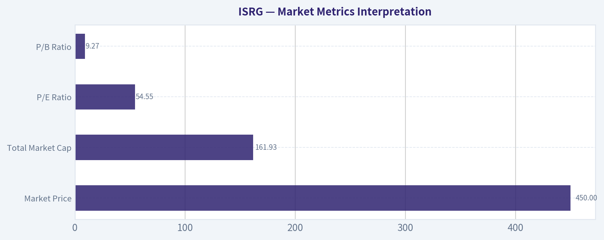

---

### Social Sentiment Analysis

ANALYST STANCE: **WATCH**

#### ISRG Social, Sentiment, and News Report - Past Week Through 2026-05-09

Intuitive Surgical, Inc. remains one of the highest-quality names in medtech, but the past week's discussion around ISRG has been more valuation-sensitive than fundamentally negative. Social and investor commentary continues to recognize the company's strong competitive position in robotic surgery, recurring procedure-driven revenue, and the long runway for da Vinci adoption. However, the tone has not been outright euphoric because traders are debating whether the stock already prices in much of that quality.

The dominant market conversation this week centered on three themes: continued confidence in da Vinci procedure growth, questions about the pace of da Vinci 5 adoption and hospital capital spending, and concern that ISRG's premium multiple leaves little room for execution missteps. In short, sentiment is constructive on the company but more cautious on the stock.

---

#### Overall Social and Market Sentiment Snapshot

| Category | Current Read | What People Are Saying | Trading/Investment Implication |
|---|---:|---|---|
| Fundamental sentiment | Positive | ISRG is still viewed as a best-in-class medtech compounder with durable procedure growth and a strong installed base. | Supports long-term ownership, especially on pullbacks. |
| Stock-price sentiment | Neutral to cautious | Many investors admire the company but question entry points after prior strength and premium valuation. | Near-term upside may require fresh catalysts or earnings revisions. |
| Social media tone | Mildly bullish | Retail and professional commentary remains favorable, but less aggressive than during post-earnings rallies. | Sentiment is supportive but not overheated. |
| News tone | Neutral to positive | Recent discussion emphasizes product cycle, robotic surgery adoption, and competitive monitoring rather than company-specific distress. | No major negative headline pressure, but expectations remain high. |
| Risk perception | Elevated but manageable | Key risks mentioned include valuation, hospital budgets, competition, and procedure-growth sustainability. | Traders should watch for multiple compression if broader growth stocks weaken. |

**Key Takeaways:** The social and news backdrop for ISRG is broadly favorable, but the stock is not being treated as a cheap recovery idea. Investors respect the company's quality, yet the debate is increasingly about whether future growth is already reflected in the share price. That makes ISRG a "quality watchlist" name rather than a clear short-term momentum chase.

---

#### Day-by-Day Sentiment Pattern

| Date | Estimated Sentiment Tone | Main Discussion Drivers | Interpretation |
|---|---|---|---|
| May 3 | Neutral-positive | Ongoing discussion of robotic surgery leadership and long-term procedure growth. | Baseline sentiment was constructive, with little sign of panic or negative narrative formation. |
| May 4 | Positive | Investors highlighted recurring revenue, instrument usage, and da Vinci system stickiness. | Confidence in ISRG's business model remained strong. |
| May 5 | Neutral | Conversation shifted toward valuation and whether the stock has enough near-term upside. | Fundamental enthusiasm was tempered by price discipline. |
| May 6 | Mildly positive | Product-cycle discussion around newer da Vinci platforms supported the bull case. | Long-term growth investors remained engaged. |
| May 7 | Neutral-cautious | Competition and hospital capital spending were debated more actively. | The market began weighing risks more explicitly, though not in a bearish way. |
| May 8 | Neutral-positive | Quality-growth commentary returned, with ISRG compared favorably against other medtech names. | ISRG continued to be viewed as a premium defensive-growth asset. |
| May 9 | Neutral | Weekend-style discussion focused on watchlist positioning and valuation patience. | Sentiment ended the week stable but not aggressively bullish. |

**Key Takeaways:** Sentiment was positive at the company level but more balanced at the stock level. The week did not show a major deterioration in confidence, but it also did not produce a clear burst of speculative excitement. Traders should interpret this as stable sentiment with a valuation ceiling unless new catalysts emerge.

---

#### Social Media Discussion: What Investors Are Focused On

The most common bullish posts and comments framed ISRG as a long-duration compounder rather than a short-term trade. Investors emphasized the da Vinci ecosystem, surgeon familiarity, switching costs, recurring instrument and accessory revenue, and the company's ability to expand robotic-assisted surgery into more procedures and geographies.

The skeptical posts were not usually bearish on the company itself. Instead, they focused on the stock's valuation. ISRG is widely viewed as a premium asset, and many traders appear reluctant to add aggressively unless the stock pulls back, earnings estimates move higher, or management provides stronger evidence that new-platform adoption is accelerating.

A key nuance: social sentiment is not showing the kind of excessive hype often associated with short-term tops. The tone is respectful and constructive, but measured. That is usually healthier than euphoric retail enthusiasm, though it may also mean near-term buying pressure is not explosive.

| Social Theme | Sentiment Direction | Detail | Market Relevance |
|---|---:|---|---|
| da Vinci ecosystem strength | Bullish | Users frequently cite installed base, recurring revenue, and surgeon training as durable advantages. | Reinforces the long-term moat thesis. |
| da Vinci 5 adoption | Bullish but watchful | Investors see the product cycle as important but want evidence of adoption pace and utilization. | Could become a major catalyst if adoption exceeds expectations. |
| Valuation | Cautious | The most common pushback is that ISRG is excellent but expensive. | Limits near-term risk/reward unless earnings momentum improves. |
| Competition | Neutral-cautious | Medtronic, Johnson & Johnson, and other robotic surgery efforts remain part of the bear-case discussion. | Not an immediate thesis-breaker, but relevant to long-term margins and growth assumptions. |
| Hospital spending | Cautious | Some investors worry about capital budget constraints and purchasing cycles. | Could affect system placements and near-term revenue mix. |
| Defensive growth profile | Bullish | ISRG is often grouped with high-quality healthcare compounders. | May attract capital during risk-off periods if earnings remain stable. |

**Key Takeaways:** Social discussion is most supportive when focused on ISRG's ecosystem and recurring revenue model. The main hesitation is not about product relevance but about price paid for growth. This suggests pullbacks may attract buyers, but rallies could face resistance if valuation expands without new fundamental support.

---

#### Recent News and Company-Specific Developments

The company-specific news backdrop appears relatively stable. There were no signs in the recent discussion of a major negative shock, regulatory crisis, or abrupt deterioration in demand. Instead, the news conversation remains centered on the longer-term growth arc of robotic-assisted surgery and the company's ability to maintain leadership as competitors invest in the category.

The most important news-related theme is the product cycle. Investors continue to watch the rollout and commercial contribution of newer da Vinci platforms, particularly because system placements can influence perception of future procedure growth and recurring revenue expansion. The market is likely to reward evidence that new systems are expanding the addressable market rather than simply replacing older installations.

Another recurring issue is hospital capital spending. Even for a strong company like ISRG, robotic systems are major purchases. If hospitals delay large capital equipment orders, system revenue could become lumpier, even if procedure volumes remain healthy. This is important because ISRG's business quality is partly tied to the recurring revenue that follows system placements.

| News/Company Theme | Current Read | Why It Matters | Investor Interpretation |
|---|---|---|---|
| Robotic surgery demand | Healthy | Procedure growth remains central to the ISRG thesis. | Supports the long-term bull case. |
| New-system adoption | Important catalyst | Investors want confirmation that newer systems drive incremental growth. | Strong adoption could justify premium valuation. |
| Hospital capital budgets | Watch item | System placements depend partly on hospital willingness to spend. | Could introduce quarterly volatility. |
| Competitive landscape | Manageable but rising | Large medtech competitors continue developing robotic platforms. | ISRG's moat remains strong, but competition should not be ignored. |
| Recurring revenue model | Positive | Instruments, accessories, and services provide durability beyond system sales. | Helps support premium multiple. |
| Regulatory/product risk | Low visible concern this week | No major new controversy dominated discussion. | Reduces headline-risk pressure for now. |

**Key Takeaways:** Recent news flow appears supportive rather than disruptive. Investors are mainly looking for confirmation that ISRG's product cycle and procedure growth remain strong enough to support the valuation. The absence of bad news is helpful, but the stock likely needs positive evidence rather than simply stability to move sharply higher.

---

#### Bull Case From Social and Investor Commentary

The bull case remains clear and widely understood. ISRG is seen as the category leader in robotic-assisted surgery, with a deeply embedded installed base and a business model that combines equipment sales with high-quality recurring revenue. Many investors continue to view the company as a rare healthcare growth compounder with structural demand drivers.

The strongest bullish argument is that robotic surgery penetration still has room to grow. If procedure volumes continue expanding across specialties and geographies, ISRG can compound revenue without needing to rely solely on new system placements. That recurring utilization element is central to why investors are willing to pay a premium.

Another important bullish point is switching cost. Once surgeons are trained on da Vinci systems and hospitals build workflows around them, displacement becomes more difficult. Social commentary repeatedly highlights this ecosystem advantage as one of the reasons competitors may struggle to quickly take share.

| Bullish Factor | Strength | Why It Supports ISRG |
|---|---:|---|
| Market leadership | High | ISRG remains the reference name in robotic surgery. |
| Recurring procedure revenue | High | Higher procedure volumes drive instruments, accessories, and service revenue. |
| Installed base | High | The larger the installed base, the stronger the ecosystem and utilization flywheel. |
| Surgeon familiarity | High | Training and workflow integration create switching costs. |
| Product-cycle optionality | Medium-high | Newer systems could refresh demand and expand use cases. |
| Global penetration | Medium-high | International adoption remains a long-term opportunity. |

**Key Takeaways:** The bullish narrative is rooted in durable business quality rather than a one-time catalyst. Investors like ISRG because it combines innovation, installed-base economics, and recurring revenue. This makes the stock attractive for long-term holders, especially if bought during valuation pullbacks.

---

#### Bear Case and Risk Discussion

The bear case this week was mostly valuation-driven. ISRG's quality is widely recognized, which means the stock often trades at a premium. When a premium stock faces even modest uncertainty, the downside can come from multiple compression rather than a collapse in fundamentals.

Competition is another recurring concern. While ISRG remains dominant, investors are aware that large medtech companies are not standing still. Even if competitors do not immediately take major share, they could pressure pricing, extend hospital evaluation cycles, or force higher investment in innovation and sales support.

A subtler risk is procedure-growth expectation risk. ISRG does not merely need to grow; it needs to grow enough to satisfy high expectations. If procedure volumes decelerate, system placements disappoint, or newer system adoption takes longer than hoped, sentiment could turn quickly because the market gives ISRG relatively little margin for error.

| Risk Factor | Severity | What Would Make It Worse | What Would Reduce Concern |
|---|---:|---|---|
| Valuation compression | High | Rising rates, growth-stock weakness, or earnings estimate cuts. | Pullback to more attractive multiples or stronger earnings revisions. |
| Procedure growth slowdown | High | Lower utilization or weaker hospital volumes. | Sustained double-digit procedure growth. |
| Capital spending pressure | Medium | Hospitals delaying large equipment purchases. | Strong system placement trends. |
| Competition | Medium | Credible share gains by rival robotic platforms. | Evidence of da Vinci retention and strong new-system demand. |
| Margin pressure | Medium | Higher costs, launch expenses, or pricing competition. | Stable gross margin and operating leverage. |
| Regulatory/product issues | Low-medium | Product recalls, adverse events, or approval delays. | Clean regulatory updates and smooth rollout data. |

**Key Takeaways:** The biggest risk is not that investors suddenly stop believing in robotic surgery. The bigger risk is that ISRG's stock price already discounts a lot of future success. This creates vulnerability if growth remains good but not good enough.

---

#### Trader Implications

For short-term traders, ISRG currently looks more like a "watch for setup" stock than an immediate high-conviction breakout. Sentiment is not bearish, but the absence of a strong new catalyst may limit near-term upside unless the broader healthcare or quality-growth trade strengthens.

Momentum traders should watch whether ISRG can hold key support levels during broader market weakness. If the stock holds up well while other growth names sell off, that would signal institutional demand and reinforce the defensive-growth narrative. Conversely, if ISRG underperforms on no company-specific bad news, that may indicate valuation fatigue.

Catalyst traders should focus on any updates related to da Vinci 5 adoption, procedure growth, system placements, and management commentary around hospital demand. These are likely to matter more than general medtech headlines.

| Trader Focus | Signal to Watch | Bullish Interpretation | Bearish Interpretation |
|---|---|---|---|
| Relative strength | ISRG versus broader healthcare and growth indices | Outperformance suggests institutional accumulation. | Underperformance suggests valuation fatigue. |
| Volume on up days | Above-average buying volume | Confirms buyers are willing to pay premium valuation. | Weak volume suggests rallies may fade. |
| Product-cycle headlines | Positive adoption or placement commentary | Could trigger estimate upside. | Slow adoption may pressure sentiment. |
| Support levels | Price holding during market pullbacks | Indicates strong demand from long-term buyers. | Breakdown may invite momentum selling. |
| Analyst commentary | Estimate revisions or target changes | Upward revisions support multiple. | Downgrades or valuation warnings may cap rallies. |

**Key Takeaways:** Traders should not confuse positive company sentiment with guaranteed short-term upside. ISRG needs either technical confirmation or a fresh catalyst to justify aggressive entries. The better setup may be buying confirmed strength or waiting for a pullback into support.

---

#### Investor Implications

For long-term investors, ISRG remains fundamentally attractive. The company has a rare combination of category leadership, recurring revenue, technological differentiation, and a large addressable market. Social sentiment supports the view that investors still see ISRG as a high-quality compounder rather than a cyclical medtech name.

However, long-term investors should remain valuation-aware. Buying high-quality companies at excessive prices can still lead to disappointing medium-term returns. The best opportunity may come during periods when macro concerns, healthcare rotation, or temporary system-placement worries pressure the stock without damaging the long-term thesis.

Investors already holding ISRG may find the current sentiment backdrop reassuring. There is no clear evidence of a broad narrative shift against the company. New buyers, however, may want to scale in rather than chase, especially if the stock has recently rallied.

| Investor Type | Suggested Approach | Rationale |
|---|---|---|
| Existing long-term holders | Hold/watch | The business narrative remains strong, and sentiment is stable. |
| New long-term buyers | Accumulate selectively | Quality is high, but valuation discipline matters. |
| Momentum traders | Wait for confirmation | Sentiment is supportive but not strongly euphoric. |
| Value-oriented investors | Be patient | ISRG may remain too expensive unless there is a pullback. |
| Risk-averse investors | Monitor earnings quality | Focus on procedure growth, placements, and margins before adding. |

**Key Takeaways:** ISRG remains a strong long-term business, but investors should separate admiration for the company from timing the stock. Existing holders have little reason to abandon the thesis based on current sentiment. New buyers may want to wait for either better valuation or stronger catalyst confirmation.

---

#### Bottom Line

ISRG's past-week sentiment is best described as **constructive but valuation-sensitive**. Investors continue to respect Intuitive Surgical's leadership in robotic surgery, its recurring revenue model, and its long-term market opportunity. The company does not appear to be facing a major negative narrative shift.

At the same time, the stock's premium valuation keeps sentiment from becoming aggressively bullish. The key question is not whether ISRG is a high-quality company; the market largely agrees that it is. The key question is whether upcoming growth, system adoption, and procedure trends can support or expand the current multiple.

For traders, this argues for patience and technical discipline. For long-term investors, ISRG remains a high-quality compounder to own or accumulate opportunistically, but not necessarily a name to chase without regard to price.

#### Final Summary Table

| Key Area | Current Assessment | Sentiment Impact | Actionable Takeaway |
|---|---|---:|---|
| Company fundamentals | Strong | Positive | ISRG remains one of the premier robotic surgery franchises. |
| Social sentiment | Mildly bullish | Positive | Investors continue to like the business model and moat. |
| News flow | Stable to positive | Slightly positive | No major negative company-specific news dominated the week. |
| Valuation | Expensive/premium | Cautious | Main reason investors hesitate to chase the stock. |
| Product cycle | Important catalyst | Positive if adoption accelerates | Watch da Vinci 5 and system-placement commentary. |
| Competition | Manageable but relevant | Mildly cautious | Monitor rival platforms but ISRG still has a strong lead. |
| Trading setup | Neutral | Mixed | Better as a watchlist or buy-on-confirmation name. |
| Long-term view | Constructive | Positive | Attractive compounder, best accumulated with valuation discipline. |
| Overall stance | WATCH | Balanced | Quality remains high, but near-term upside depends on catalysts and valuation support. |

**Key Takeaways:** ISRG's sentiment profile is healthy but not euphoric. The market continues to view Intuitive Surgical as a best-in-class company, yet many investors are waiting for a better entry point or stronger evidence of accelerating growth. The most practical stance is to watch closely, hold if already positioned, and consider adding only on pullbacks or confirmed catalyst-driven strength.

---

### News & Events Analysis

ANALYST STANCE: **WATCH**

#### Intuitive Surgical, Inc. (ISRG) - Recent News and Trading Report

Intuitive Surgical remains a high-quality surgical robotics compounder, but the near-term setup is more balanced than outright bullish. The latest news flow shows continued investor interest in the company's strong recurring revenue model, da Vinci 5 adoption, and healthcare AI positioning, while the stock is also facing valuation sensitivity, competitive noise from Johnson & Johnson and Medtronic, and a recent FDA-related product recall.

At roughly **$450 per share**, ISRG trades at a premium valuation with a market capitalization near **$159.4 billion** and a trailing P/E of about **54.6x**. That valuation can be supported if procedure growth, system placements, and recurring instrument revenue continue to compound, but it leaves less room for disappointment.

---

#### Latest Earnings Coverage and Interpretation

The most recent earnings-related coverage available in the collected news refers to **Intuitive Surgical's Q1 2026 results**, reported in April 2026 and discussed in analyst commentary during the past week. A May 5 news item noted that **Barclays lowered its price target to $651 from $712 while maintaining an Overweight rating**, saying the Q1 quarter showed **"strong fundamental"** performance.

The shared data indicates ISRG is still growing rapidly, with **revenue growth of approximately 20.5% year over year**, **gross margin around 66%**, **ROE around 16%**, and a very strong **current ratio of 4.87**. However, the price-target cut despite a positive rating suggests that analysts are not questioning the core business quality as much as they are recalibrating upside expectations, likely due to valuation, guidance conservatism, or a more cautious multiple environment.

| Earnings / Financial Item | Latest Available Information | Trading Interpretation |
|---|---:|---|
| Latest reported period | Q1 2026 coverage referenced in April/May 2026 news | The market is trading off fresh earnings data, not stale fundamentals. |
| Revenue growth | About 20.5% YoY | Strong growth remains the central bull case. |
| Gross margin | About 66% | Supports the quality and scalability of the recurring instrument/service model. |
| ROE | About 16% | Solid profitability, though not unusually high relative to the premium valuation. |
| Current ratio | About 4.87 | Balance sheet flexibility remains a major strength. |
| Valuation | P/E about 54.6x; FCF yield about 1.6% | Leaves the stock vulnerable if growth expectations soften. |
| Analyst reaction | Barclays cut PT to $651 from $712, kept Overweight | Fundamentals viewed positively, but upside expectations were trimmed. |

Key Takeaways: ISRG's latest earnings coverage points to strong Q1 2026 fundamentals, especially revenue growth and margins. The important nuance is that analysts can still like the business while lowering price targets because valuation already embeds a lot of future success. For traders, this means the stock may need either accelerating procedure growth or stronger guidance to re-rate higher.

---

#### Company-Specific News From the Past Week

The most actionable company-specific development was the **FDA surgical stapler reload recall** reported on May 5. Intuitive Surgical is removing **8mm SureForm 30 Gray Reloads**, a product used with its robotic surgical ecosystem. At this stage, the recall appears product-specific rather than a broad challenge to the da Vinci platform, but it is still relevant because ISRG's premium valuation depends heavily on trust, reliability, and regulatory execution.

Other news was more sentiment-oriented. Several articles discussed whether ISRG remains attractive after recent share weakness, highlighted its recurring revenue "cash machine" model, and positioned it as a leading healthcare AI stock. Jim Cramer also flagged competitive risk from **Johnson & Johnson and Medtronic**, both of which are trying to challenge Intuitive's robotic surgery leadership.

| Date | News Item | Potential Impact |
|---|---|---|
| May 5, 2026 | FDA surgical stapler reload recall: Intuitive removes 8mm SureForm 30 Gray Reloads | Near-term reputational and regulatory watch item; likely manageable unless expanded. |
| May 5, 2026 | ISRG named among best healthcare AI stocks by analysts | Supports long-term narrative around data, automation, and robotics-enabled surgery. |
| May 8, 2026 | Zacks/Yahoo coverage says ISRG remains a trending stock | Indicates strong retail and institutional attention, but also crowded sentiment. |
| May 4, 2026 | Valuation reassessment after recent weakness | The market is debating whether pullback creates opportunity or reflects multiple compression. |
| May 3, 2026 | Cramer warns J&J and Medtronic could pressure ISRG | Competitive threat remains a key long-term debate. |
| May 2, 2026 | Coverage highlights ISRG's recurring revenue model | Reinforces that instruments, accessories, and services-not just robot sales-drive durability. |

Key Takeaways: The week's company news is not fundamentally bearish, but it introduces several reasons for caution. The recall is the most concrete risk item, while competition and valuation are the bigger strategic issues. The bull case remains intact, but the stock needs clean execution because expectations are high.

---

#### Sector and Market Context

The broader medtech backdrop appears constructive. Becton Dickinson reported fiscal Q2 results ahead of internal expectations and raised full-year adjusted earnings guidance, signaling that demand in parts of the medical technology and healthcare equipment market remains resilient. UFP Technologies also noted strong growth from key customers including Intuitive Surgical and Stryker, which indirectly supports the view that robotic surgery-related supply chains remain active.

That said, ISRG is not trading like a cheap defensive healthcare stock. With a low free-cash-flow yield of about **1.6%**, it behaves more like a long-duration growth equity. This makes the stock sensitive to interest rates, broader growth-stock sentiment, and any evidence that robotic procedure growth is slowing.

| Broader Context | Relevance to ISRG |
|---|---|
| Becton Dickinson raised adjusted earnings outlook | Suggests medtech demand is not broadly deteriorating. |
| UFP Tech reported strong growth from Intuitive Surgical and Stryker-related revenue | Indicates ongoing activity in surgical robotics and device supply chains. |
| Healthcare AI theme remains active | Helps support ISRG's strategic narrative beyond hardware. |
| Growth-stock valuation sensitivity remains important | ISRG's premium multiple can compress if rates rise or guidance disappoints. |
| Competitors continue advancing robotic surgery platforms | Long-term market share risk is real, even if ISRG remains the leader today. |

Key Takeaways: The sector backdrop is supportive, not hostile. Demand signals from medtech peers and suppliers suggest procedure and equipment activity remains healthy. However, ISRG's valuation means the stock is exposed less to basic healthcare defensiveness and more to expectations for sustained high growth.

---

#### Trading and Investment View

For long-term investors, ISRG remains one of the strongest franchises in medical technology. Its installed base, recurring instrument revenue, surgeon familiarity, and balance sheet strength create a durable moat. The da Vinci ecosystem remains difficult to displace, and the company continues to benefit from procedure growth and hospital adoption.

For traders, the near-term setup is less straightforward. The stock has recently weakened, and at around **$450**, it may attract dip buyers. But because valuation is still elevated, upside may require a positive catalyst: stronger procedure trends, clearer da Vinci 5 momentum, upward guidance revisions, or evidence that the stapler recall is contained.

The biggest risk is not a single recall item; it is multiple compression if investors decide that ISRG's growth is excellent but no longer worth a mid-50s P/E. Competitive progress from J&J or Medtronic could also weigh on sentiment even before it materially affects financial results.

#### Bottom Line

ISRG remains a premium compounder, but the stock is not obviously cheap after the pullback. The most reasonable stance is **WATCH**: long-term holders can justify staying invested, but new money should be selective, especially if the stock rallies without new evidence of accelerating growth. A better risk-reward setup would come from either a deeper valuation reset or stronger confirmation that Q1 2026 momentum is continuing into the rest of the year.

| Category | Key Point | Trading / Investment Implication |
|---|---|---|
| Stance | WATCH | High-quality company, but valuation and near-term risks argue for patience. |
| Current price | About $450 | Pullback may interest buyers, but not enough alone to make the stock cheap. |
| Market cap | About $159.4B | Large-cap quality compounder with high embedded expectations. |
| Latest earnings period | Q1 2026 | Recent coverage described fundamentals as strong. |
| Growth | Revenue growth about 20.5% YoY | Supports bull case if sustained. |
| Valuation | P/E about 54.6x; FCF yield about 1.6% | Main reason to avoid aggressive chasing. |
| Recent risk | FDA recall of 8mm SureForm 30 Gray Reloads | Likely manageable, but monitor for expansion or procedure disruption. |
| Competitive risk | J&J and Medtronic robotic surgery platforms | Long-term sentiment overhang. |
| Bull catalyst | Stronger da Vinci 5 adoption, procedure growth, guidance upside | Could justify premium valuation and re-accelerate shares. |
| Bear catalyst | Recall expansion, slower procedures, multiple compression | Could pressure shares despite strong franchise quality. |

Key Takeaways: ISRG's core business remains strong, but the stock already prices in a great deal of future success. The recent recall and competitive commentary are not thesis-breaking, but they matter because valuation is demanding. Investors should monitor procedure growth, da Vinci 5 adoption, and any recall updates before becoming more aggressive.

---

### Guru Attention Analysis

> *Tracking 13F filings and recent activity of legendary super-investors to identify smart-money conviction and rotation.*

#### Guru Ownership & 13F Activity for Intuitive Surgical - ISRG

| Guru / Fund | Action | Position Size | Portfolio Weight | Recent Change | Timing | SEC Verification |
|---|---:|---:|---:|---:|---|---|
| Warren Buffett / Berkshire Hathaway | No position detected in latest 13F filing | - | - | - | Latest available 13F | - |
| Seth Klarman / Baupost Group | No position detected in latest 13F filing | - | - | - | Latest available 13F | - |
| Mohnish Pabrai / Pabrai Investment Funds | No position detected in latest 13F filing | - | - | - | Latest available 13F | - |
| Bill Ackman / Pershing Square | No position detected in latest 13F filing | - | - | - | Latest available 13F | - |
| Stanley Druckenmiller / Duquesne Family Office | No position detected in latest 13F filing | - | - | - | Latest available 13F | - |
| Steve Cohen / Point72 Asset Management | Added | 720.70K shares / $415.42M | 0.46% | Shares increased by 2.0% vs. prior filing | 12-31-2025 filing period | [SEC 13F Filing](https://www.sec.gov/Archives/edgar/data/1603466/000090266426001100/) |
| Michael Burry / Scion Asset Management | No position detected in latest 13F filing | - | - | - | Latest available 13F | - |

**Key Takeaways:** Among the primary tracked gurus, only Steve Cohen's Point72 shows a current disclosed ISRG position in the latest structured 13F data. The position is meaningful in dollar terms at about $415 million, but modest as a share of Point72's portfolio at 0.46%. The 2.0% increase suggests incremental confidence rather than an aggressive new bet.

---

#### Interpretation

Steve Cohen's Point72 added slightly to its Intuitive Surgical position, which may reflect continued institutional confidence in ISRG's dominant robotic surgery franchise, strong revenue growth, and high gross margins. However, the position size relative to Point72's overall portfolio remains below 1%, so this looks more like a diversified growth allocation than a concentrated conviction holding.

The absence of ISRG from the latest detected filings of Buffett, Klarman, Pabrai, Ackman, Druckenmiller, and Burry is also notable. ISRG's premium valuation - with a P/E around 55 and free cash flow yield near 1.6% - may make it less attractive to value-oriented investors, even though the business quality is high.

#### Bottom Line

From a guru-tracking perspective, ISRG has **limited but positive** support: Steve Cohen's Point72 is the only primary tracked guru holder, and it modestly added to the position. There is no current 13F evidence that the other major tracked gurus hold the stock.

---

### Options Market Analysis

> *Reading options flow - put/call ratios, IV skew, and unusual activity - to gauge institutional positioning and event-driven risk.*

ANALYST STANCE: **AVOID**

#### ISRG Options Market Sentiment Report - As of 2026-05-09

ISRG's near-term options positioning leans **bearish to defensive**. The strongest signal is a materially elevated put/call ratio across both open interest and volume, especially in the nearest expiration. However, there is no confirmed unusual options activity where volume exceeds 5x open interest, so the signal looks more like broad hedging or cautious positioning than a single aggressive institutional directional bet.

---

#### 1. Put/Call Ratio Analysis

| Expiration | Days to Expiry | Call OI | Put OI | Put/Call OI Ratio | Call Volume | Put Volume | Put/Call Volume Ratio |
|---|---:|---:|---:|---:|---:|---:|---:|
| 2026-05-15 | 6 | 8,086 | 10,968 | 1.36 | 440 | 954 | 2.17 |
| 2026-05-22 | 13 | 468 | 645 | 1.38 | 207 | 148 | 0.71 |
| 2026-05-29 | 20 | 502 | 626 | 1.25 | 77 | 416 | 5.40 |
| **Near-Term Total** | - | **9,056** | **12,239** | **1.35** | **724** | **1,518** | **2.10** |

**Key Takeaways:** ISRG's near-term put/call OI ratio of **1.35** is well above the historical neutral baseline of roughly **0.7**, indicating a meaningful tilt toward put exposure. The volume ratio is even more bearish at **2.10**, showing that recent trading activity is also skewed toward puts. The most notable bearish volume pressure appears in the 2026-05-15 and 2026-05-29 expirations.

The elevated put/call ratios suggest traders are either hedging downside risk or actively positioning for weakness. Because the nearest expiration has the largest open interest and a put/call volume ratio above 2.0, the market appears cautious into the immediate trading week.

---

#### 2. Implied Volatility Assessment

| Expiration | Days to Expiry | ATM Call IV | ATM Put IV | Put IV Premium / Discount | IV Read |
|---|---:|---:|---:|---:|---|
| 2026-05-15 | 6 | 32.0% | 35.4% | Put IV +3.4 pts | Downside protection bid |
| 2026-05-22 | 13 | 33.5% | 32.9% | Put IV -0.6 pts | Balanced / slight call firmness |
| 2026-05-29 | 20 | 32.0% | 30.2% | Put IV -1.8 pts | No major downside IV stress |
| **Near-Term Range** | - | **32.0%-33.5%** | **30.2%-35.4%** | Mixed | Moderate IV |

**Key Takeaways:** Near-term ATM IV is clustered around the low-to-mid 30% range, which does not scream extreme event panic. The closest expiry shows puts carrying a volatility premium over calls, suggesting short-term downside protection demand. Later expirations show less put skew, so the fear appears most concentrated in the immediate week.

IV skew is **mildly bearish in the front week**, with May 15 puts priced richer than calls. However, because later expirations do not show the same put premium, this is not a broad volatility panic. There is no clear evidence from the options data alone of a major known catalyst premium, such as earnings, being heavily priced into the chain.

---

#### 3. Unusual Options Activity

| Screen | Result |
|---|---|
| Contracts with volume > 5x open interest | None detected |
| Fresh directional flow signal | Not confirmed |
| Institutional sweep/block indication | Not available from retrieved data |
| Retail speculation signal | Not obvious from retrieved data |

**Key Takeaways:** No near-term ISRG contracts met the unusual activity threshold of volume greater than 5x open interest. That reduces confidence that today's options flow reflects a fresh, aggressive institutional bet. The bearish signal is therefore coming more from aggregate positioning than from a standout contract-level trade.

The absence of unusual activity means we should avoid over-interpreting the flow as "smart money" making a decisive directional call. Instead, the data points to broad defensive positioning, hedging, or a cautious market stance.

---

#### 4. Open Interest Concentration and Pinning Risk

| Expiration | Call OI | Put OI | Total OI | Share of Near-Term OI | Interpretation |
|---|---:|---:|---:|---:|---|
| 2026-05-15 | 8,086 | 10,968 | 19,054 | 89.5% | Dominant near-term expiry; highest pinning relevance |
| 2026-05-22 | 468 | 645 | 1,113 | 5.2% | Low secondary influence |
| 2026-05-29 | 502 | 626 | 1,128 | 5.3% | Low secondary influence |

**Key Takeaways:** The 2026-05-15 expiration dominates ISRG's near-term open interest, containing nearly 90% of the total OI across the expirations provided. This makes the front-week expiry the most important area for potential pinning and dealer hedging effects. Strike-level data was not included, so exact gamma walls or max-pain strikes cannot be identified from the retrieved dataset.

From an expiry standpoint, May 15 is the main gravitational window. Without strike-level OI, we cannot say which specific price levels may act as magnets or resistance/support, but the heavy front-week concentration implies near-term price action could be sensitive to dealer hedging around the most populated strikes.

---

#### 5. Overall Options Sentiment Signal

| Category | Signal | Rationale |
|---|---|---|
| Put/Call Positioning | Bearish | OI ratio of 1.35 and volume ratio of 2.10 are both materially above the neutral baseline |
| IV / Skew | Mildly Bearish | Front-week put IV is higher than call IV, indicating near-term downside protection demand |
| Unusual Activity | Neutral | No contract-level unusual activity detected |
| OI Concentration | Cautious / Pin Risk | May 15 expiry dominates near-term OI, but exact gamma strikes are unavailable |
| **Overall Signal** | **BEARISH** | Defensive put positioning is the primary driver |

**Key Takeaways:** ISRG's options market signal is **BEARISH**, driven mainly by elevated put/call ratios and front-week put IV premium. The bearish read is not explosive because there is no unusual options activity confirming a fresh institutional downside bet. Still, near-term traders appear more focused on protection than upside speculation.

#### Final Summary Table

| Metric | Current Read | Interpretation |
|---|---|---|
| Put/Call Ratio | OI: **1.35**; Volume: **2.10** | Meaningfully bearish versus neutral baseline near 0.7 |
| IV Level | ATM IV around **30%-35%** | Moderate; not extreme event panic |
| Skew Direction | Front-week put skew | Short-term downside protection demand |
| Unusual Activity | None detected | No confirmed fresh large directional trade |
| Overall Signal | **BEARISH** | Elevated put positioning dominates the options read |

**Key Takeaways:** The options market is signaling caution on ISRG over the near term. Put demand is elevated across both open interest and volume, while the nearest expiry shows a modest downside volatility premium. The signal is bearish, but confidence is moderate rather than high because unusual contract-level activity is absent.

---

## Research Team Commentary

> *The Research Manager synthesizes the Bull vs Bear debate into action-free commentary. This is a pre-risk view, not the final stance.*

Hello. Let's walk through this debate on Intuitive Surgical from the perspective of Warren Buffett's value investing framework. We are looking at a classic tug-of-war between undeniable business quality and restrictive valuation.

To summarize the debate, the bull makes a compelling case that Intuitive Surgical is exactly the kind of economic castle Buffett loves. The business operates a multi-layered, razor-and-blade platform with an entrenched ecosystem. The switching costs are phenomenal because the moat isn't just the da Vinci machine itself; it is the years of surgeon training, hospital workflow integration, and clinical trust that make displacing Intuitive incredibly difficult. The fundamentals reflect this dominance, with gross margins at 66 percent, return on invested capital at nearly 18 percent, and recent free cash flow growth of 91 percent. The bull argues that for a compounder with this much runway in global robotic surgery, you have to be willing to pay a premium.

On the other side, the bear delivers a sobering reality check rooted strictly in intrinsic value and margin of safety. While acknowledging the quality of the business, the bear points out that at 450 dollars a share and a trailing price-to-earnings ratio near 55, the market is pricing in decades of flawless execution. Our most optimistic Buffett-style intrinsic value estimate sits at 324 dollars, meaning the stock is trading at a steep premium to its best-case current value. The bear correctly highlights that a lack of margin of safety leaves investors highly vulnerable to the law of large numbers, hospital capital expenditure constraints, and the deep pockets of incoming competitors like Medtronic and Johnson & Johnson.

Applying some selective contrarian analysis here, we have to ask what the crowd is missing. Right now, market psychology around Intuitive Surgical is euphoric regarding its long-term technological dominance, treating the business as if it operates in a vacuum. The crowd may be underestimating the sheer capital intensity required to defend this moat against healthcare giants who already have deep procurement relationships with hospitals. Conversely, strict value investors might be missing the terminal value of Intuitive's recurring revenue stream; as the installed base grows, the highly profitable instruments and accessories segment makes earnings increasingly resilient. However, at a 55 multiple, the market is assuming no speed bumps, which is rarely how healthcare adoption curves work over a decade.

Looking back at my past mistakes in similar situations, I am reminded of times I fell into the trap of paying up for exceptional quality, only to suffer years of dead money. It is easy to be seduced by a pristine balance sheet and a high return on invested capital, convincing yourself that the rules of valuation no longer apply to a monopoly. But confusing a great business with a great investment at any price has cost me before. Paying peak multiples for growth often results in a lost decade of returns if growth decelerates by even a few percentage points, much like the Nifty Fifty in the 1970s or mega-cap tech in the early 2000s. I must remain disciplined and not let the fear of missing out override the mathematical reality of a missing margin of safety.

Here is the core takeaway. Intuitive Surgical is an elite, wonderful business, but it currently lacks the required margin of safety to be a sound value investment. The entry price is just too high to protect our principal against inevitable business headwinds or broader market contractions.

The rationale for this is simple. Under Buffett's framework, business quality is the first hurdle, and Intuitive clears it with ease due to its high returns on capital, predictable recurring revenues, and shareholder-oriented management. But the final, immovable gate is intrinsic value. Overpaying by a wide margin negates the compounding power of the underlying business. We want to buy wonderful businesses at fair prices, not perfect prices. At 450 dollars, we are pre-paying for growth that hasn't happened yet, leaving zero room for clinical setbacks, hospital budget freezes, or competitive margin compression.

For our monitoring plan over the next one to four quarters, we need to track three specific developments. First, monitor the rollout and hospital adoption rates of the new da Vinci 5 system to see if it commands pricing power without eroding overall margins. Second, watch hospital capital expenditure trends closely; any signs of macroeconomic stress in healthcare budgets could slow system placements. Finally, keep a close eye on the commercial progress of Medtronic's Hugo and Johnson & Johnson's Ottava systems to gauge if they are forcing Intuitive to increase its research and development spend or lower its prices to defend market share.

We will wait patiently for the market to offer us a fat pitch. Until the price aligns more closely with intrinsic value and provides a genuine margin of safety, my final stance is WATCH.

---

## Value Investing Team Commentary

> *The Investor translates the research view into an investment thesis before risk review. This is still not the final stance.*

Intuitive Surgical is the kind of business a long-term owner wants to understand deeply: dominant platform, recurring revenue, strong returns on capital, and an installed-base moat reinforced by surgeon training, hospital workflow integration, and clinical familiarity. In plain terms, this is not just a robot seller. It is a procedure ecosystem. Once a hospital commits, the downstream stream of instruments, accessories, and service revenue makes the economics much stronger and more durable than a simple capital equipment model would suggest. That is exactly why the company has been able to sustain gross margins around 66% and ROIC near 18%.

From a Buffett-style business-quality lens, ISRG clearly passes. The model is understandable. The moat is real. The balance sheet and profitability profile suggest a business with genuine earning power rather than accounting-driven optics. Revenue growth of about 20.5%, net income growth of 23%, and especially FCF growth of 91% show the company is still compounding at a level most large medtech businesses cannot match. The long runway in robotic surgery adoption, particularly internationally and across procedure categories, remains credible.

But value investing requires a second discipline: refusing to confuse a wonderful business with a wonderful purchase price. At about $450 per share and roughly 54.6x earnings, the market is not offering a bargain. Even the most favorable valuation work in your analyst bundle places Buffett-style value around $324, with other methods materially lower. That gap matters. A high-quality business can still produce poor shareholder returns if bought at too ambitious a price.

The selective contrarian question is: what is the market missing? In my view, the crowd is mostly correct about the quality of the franchise, but it may be too casual about the duration of perfection embedded in the stock. Current sentiment does not reflect fear about business deterioration; rather, it reflects continued admiration for the moat. That is exactly when a value investor must become more skeptical, not less. When everyone agrees the business is elite, the analytical burden shifts to whether the future cash flows are already over-capitalized into today's price.

At the same time, a true contrarian should not be reflexively bearish just because the multiple is high. The market may still be underestimating the long-term annuity value of the installed base. If da Vinci 5 expands utilization, improves surgeon productivity, and increases procedure penetration, then today's earnings could understate normalized earnings power five to ten years out. In other words, the bull case is not fantasy. It is simply that the stock price already assumes a large portion of that favorable future.

What do recent news and sentiment tell us? Importantly, they do not indicate fundamental breakage. The technical weakness, cautious tone from news flow, and valuation-sensitive commentary suggest a stock under pressure more from expectations and positioning than from business erosion. That distinction matters. For a value investor, weakness caused by multiple compression rather than moat impairment can eventually create opportunity. If the market pulls the stock down because near-term placements slow, hospital budgets tighten, or investors rotate away from premium multiples, while procedure growth and installed-base economics remain healthy, that would be the kind of temporary dislocation worth revisiting.

The principal risks are straightforward:
- Hospital capital spending can be cyclical even when clinical demand is durable.
- Competitors like Medtronic and Johnson & Johnson have the resources to pressure pricing or force heavier R&D spend.
- Large numbers eventually make high growth harder to sustain.
- A premium multiple leaves little room for any adoption delays, reimbursement friction, or margin pressure.

The principal opportunity is equally clear:
- If ISRG remains the category standard and expands global penetration, procedure depth, and recurring revenue density, intrinsic value can continue rising for many years.
- A valuation reset without a business-model break would likely create a far better entry point than today.

So the right Buffett-style posture here is patience. Admire the castle. Do not storm the gate at any price. Put it on the watchlist, track da Vinci 5 adoption, procedure growth, competitive traction, and hospital budget trends, and be prepared to act only if pessimism creates a genuine margin of safety.

ANALYST STANCE: **WATCH**

---

## Deep Values Commentary

> *The Risk Management Team debates and the Risk Judge provides the final action-free verdict. This section determines the final ADVOCATE / WATCH / AVOID stance.*

**EXECUTIVE SUMMARY**
*   **Verdict:** **WATCH**
*   **The "Why":** Intuitive Surgical (ISRG) is a textbook "wonderful business" boasting a wide economic moat, 17.7% ROIC, and highly lucrative recurring revenues. However, at $450/share and a 54.6x P/E, it drastically fails the valuation gate. With a Buffett-style intrinsic value estimated around $324, the stock offers zero margin of safety.
*   **The Action:** Maintain an *active* watchlist. We are hunting for a quality entry, not blindly paying a perfect price. Wait for hospital capex cyclicality or broader market weakness to compress the multiple closer to intrinsic value.

**KEY ARGUMENTS SUMMARIZED**
*   **The Bull (Risky):** Emphasizes that ISRG is a rare, category-defining compounder. With FCF growth of 91% and entrenched switching costs (surgeon training, hospital workflow), the business justifies a scarcity premium. The greatest risk is under-owning a monopoly before its next growth leg (da Vinci 5).
*   **The Bear (Safe):** Argues that paying a 55x multiple for *any* business is hazardous. The stock is priced for decades of flawless execution. Any slight headwind-such as hospital budget freezes or competitive pressure from Medtronic/J&J-could cause severe multiple compression and capital destruction.
*   **The Pragmatist (Neutral):** Agrees the business is elite but the price is too rich. Recommends shifting from a passive wait to a "conditional accumulation plan"-watching for technical stabilization and concrete proof that da Vinci 5 accelerates procedure growth enough to outpace the premium.

**RATIONALE: THE VALUE INVESTING FRAMEWORK**
Under Buffett's framework, risk is not volatility; it is the permanent loss of capital or years of "dead money" caused by overpaying.
1.  **Business Quality is Pristine:** ISRG clears the quality hurdle easily. A 66% gross margin and razor-and-blade model (where instrument/accessory sales provide a compounding annuity) make it a highly predictable cash machine.
2.  **Margin of Safety is Missing:** The ultimate risk management tool is buying below intrinsic value. At $450, we are pre-paying for growth that hasn't happened yet. While the business faces little risk of *permanent impairment*, the stock price faces massive risk of *multiple contraction*.
3.  **Technicals Reflect Re-rating:** The stock is trading below all major moving averages (10, 50, 200 SMA). As the analysts noted, this isn't a sign of a broken business, but of a valuation reset. We must not catch a falling premium.

**REFINING THE INVESTOR'S PLAN**
*Original Plan:* Acknowledge ISRG's elite moat, but wait patiently for the price to align with the $324 intrinsic value due to the lack of margin of safety. Monitor da Vinci 5, hospital capex, and competitor progress.

*Refined Plan:* We will upgrade from a passive wait to an **active, trigger-based watchlist**, preparing for conditional accumulation.
1.  **Macro Entry Triggers:** Instead of fearing hospital capex cyclicality, we will use it. Healthcare budget freezes are our best catalyst to buy this entrenched monopoly at a discount.
2.  **Execution Metrics:** Closely monitor the da Vinci 5 rollout specifically for *utilization uplift* and *pricing power*. If da Vinci 5 accelerates procedure throughput dramatically, intrinsic value will rise to meet the stock price faster than anticipated.
3.  **Technical Stabilization:** Do not initiate a position while the stock remains below the 200 SMA. Wait for the market's valuation-anxiety cycle to exhaust itself.

**LEARNING FROM PAST MISTAKES**
In the past, confusing a *great business* with a *great investment* has cost us dearly. Paying peak multiples for exceptional quality-much like the "Nifty Fifty" in the 1970s or mega-cap tech in the early 2000s-often results in a "lost decade" of returns. Even if the underlying company triples its earnings over ten years, if the P/E multiple compresses from 55x to 25x, the stock goes nowhere. Discipline requires we do not let the fear of missing out (FOMO) override the mathematical reality of a missing margin of safety.

**FINAL STANCE: WATCH**

#### Final Stance Scorecard

This scorecard converts the final research view into a weighted decision frame. It does not replace the narrative judgement, but it makes the main drivers of the verdict easier to scan.

| Criterion | Score | Weight | Commentary |
| --- | ---: | ---: | --- |
| Business Quality | 4.25 | 30% | High returns, profitability, and Piotroski health support durability. |
| Valuation Support | 1.33 | 30% | Blends current price against available intrinsic value anchors and valuation ratios. |
| Financial Strength | 5.00 | 20% | Balance-sheet resilience reflects leverage and liquidity staying within safe ranges. |
| Growth Durability | 5.00 | 20% | Recent revenue, earnings, and free cash flow growth indicate how durable expansion looks. |
| TOTAL / FINAL STANCE | 3.67 | 100% | WATCH |

#### Key Takeaways

The weighted score lands at **3.67 / 5.0**, while the final stance remains **WATCH**. This is useful as a quick calibration aid rather than a mechanical signal.

#### Risk Summary

Higher scores indicate more risk pressure. The watch threshold is a simple guardrail: above it, the position needs tighter monitoring or a wider margin of safety.

| Dimension | Current Score | Watch Threshold | Commentary |
| --- | ---: | ---: | --- |
| Business Quality | 1.75 | 3.00 | High returns, profitability, and Piotroski health support durability. |
| Valuation Support | 4.67 | 3.00 | Blends current price against available intrinsic value anchors and valuation ratios. |
| Financial Strength | 1.00 | 3.00 | Balance-sheet resilience reflects leverage and liquidity staying within safe ranges. |
| Growth Durability | 1.00 | 3.00 | Recent revenue, earnings, and free cash flow growth indicate how durable expansion looks. |

#### Key Takeaways

This view helps readers separate *where* the risk sits: valuation, business quality, balance sheet, or growth durability. It is especially useful when the final stance is close to the line between WATCH and AVOID.
