# JBL Deep Value Intelligence

**Analysis Date:** 2026-09-24

## Critical Disclaimer

*This analysis is generated by Deep Value Intelligence, an AI-powered multi-agent investing framework. Education & research only - not financial advice, not a financial advisor.*

---

## Table of Contents

1. Intelligence Summary
2. Analyst Team Reports
   - Fundamentals Analysis
   - Intrinsic Value Analysis (Buffett)
   - Trend & Growth Analysis (Lynch/Druckenmiller/Fisher)
   - Market Technical Analysis
   - Options Market Analysis
3. Research Team Commentary
4. Value Investing Team Commentary
5. Deep Values Commentary

---

## Intelligence Summary

### Thesis + Conditions

**Core Thesis:** ## Executive Briefing

**Key Risks:**
- Action:** Do not establish a normal long-term value position. Move from categorical AVOID to **WATCH**, with at most a small tracking position for a diversified, risk-tolerant investor.
- ### Risky analyst: strongest points
- The risky analyst correctly argues that Jabil is more than a commodity assembler. Its procurement scale, engineering integration, global capacity, regulatory qualifications, and manufacturing reliability create meaningful operational switching costs. Customers can rebid future programs, but transferring complex production can create qualification expenses, delays, and yield risks.

**Confidence:** Low

---

## Analyst Team Reports

### Fundamentals Analysis

#### Latest Earnings Snapshot

*Most recent reported quarter anchored on 2026 Q2, with prior-year comparison when available.*

| Metric | 2026 Q2 | 2025 Q2 | YoY Change |
| --- | ---: | ---: | ---: |
| Revenue | $8.75B | $7.83B | +11.8% |
| Operating Income | $456.0M | $383.0M | +19.1% |
| Net Income | $275.0M | $222.0M | +23.9% |
| Diluted EPS | $2.59 | $2.03 | +27.6% |
| Operating Cash Flow | $535.0M | $406.0M | +31.8% |
| Free Cash Flow | $351.0M | $320.0M | +9.7% |

Key Takeaways: This snapshot anchors the most recent reported quarter before the narrative analysis. It helps readers separate long-run business quality from whatever changed in the latest earnings print.

#### 17-Year Financial Metrics for JBL

*All values below are computed deterministically from raw data - not estimated by AI.*

*Issuer profile: operating company (Technology / Electronic Components).*

#### 17-Year Financial Metrics
*Annual rows come from reported financial statements. The final TTM row is computed from the latest four quarters.*

| Metric | 2009 | 2010 | 2011 | 2012 | 2013 | 2014 | 2015 | 2016 | 2017 | 2018 | 2019 | 2020 | 2021 | 2022 | 2023 | 2024 | 2025 | 2026 TTM |
| --- | --- | --- | --- | --- | --- | --- | --- | --- | --- | --- | --- | --- | --- | --- | --- | --- | --- | --- |
| Market Price | $9 | $9 | $15 | $20 | $20 | $20 | $18 | $20 | $30 | $28 | $28 | $33 | $61 | $60 | $114 | $109 | $205 | $309 |
| Market Cap | $2.27B | $2.23B | $3.72B | $4.81B | $4.74B | $4.37B | $3.79B | $4.08B | $5.83B | $5.17B | $4.57B | $5.30B | $9.40B | $8.71B | $15.55B | $13.58B | $22.72B | $32.88B |
| P/E Ratio | -1.94 | 13.14 | 9.74 | 12.18 | 12.75 | 18.13 | 13.34 | 16.05 | 45.43 | 60.33 | 15.92 | 97.57 | 13.49 | 8.74 | 19.01 | 9.78 | 34.60 | 38.55 |
| P/B Ratio | 1.57 | 1.41 | 1.99 | 2.29 | 2.03 | 1.95 | 1.64 | 1.68 | 2.48 | 2.65 | 2.42 | 2.93 | 4.40 | 3.55 | 5.43 | 7.82 | 15.01 | 24.85 |
| ROE | -80.8% | 10.7% | 20.4% | 18.7% | 15.9% | 10.8% | 12.3% | 10.4% | 5.5% | 4.4% | 15.2% | 3.0% | 32.6% | 40.6% | 28.5% | 79.9% | 43.4% | 65.2% |
| ROIC | -127.0% | 12.8% | 23.0% | 18.9% | 15.4% | 4.2% | 14.0% | 11.7% | 8.2% | 8.0% | 16.8% | 9.3% | 24.5% | 31.7% | 28.1% | 51.9% | 38.8% | 32.4% |
| EPS | $-4.70 | $0.66 | $1.50 | $1.64 | $1.60 | $1.08 | $1.33 | $1.23 | $0.65 | $0.47 | $1.75 | $0.34 | $4.58 | $6.90 | $6.02 | $11.17 | $5.92 | $8.01 |
| Revenue | $11.68B | $13.41B | $16.52B | $16.14B | $17.25B | $15.76B | $17.90B | $18.35B | $19.06B | $22.10B | $25.28B | $27.27B | $29.29B | $33.48B | $34.70B | $28.88B | $29.80B | $33.59B |
| Gross Profit | $718.8M | $1.00B | $1.25B | $1.16B | $1.21B | $1.03B | $1.50B | $1.53B | $1.55B | $1.71B | $1.91B | $1.93B | $2.36B | $2.63B | $2.87B | $2.68B | $2.65B | $3.10B |
| Gross Margin | 6.2% | 7.5% | 7.6% | 7.2% | 7.0% | 6.5% | 8.4% | 8.3% | 8.1% | 7.7% | 7.6% | 7.1% | 8.1% | 7.9% | 8.3% | 9.3% | 8.9% | 9.2% |
| Operating Margin | -7.8% | 2.4% | 3.5% | 3.4% | 2.6% | 1.3% | 3.1% | 2.8% | 2.2% | 2.5% | 2.8% | 1.8% | 3.6% | 4.2% | 4.4% | 7.0% | 4.0% | 5.0% |
| Net Income | $-1.17B | $168.8M | $381.1M | $394.7M | $371.5M | $241.3M | $284.0M | $254.1M | $129.1M | $86.3M | $287.0M | $54.0M | $696.0M | $996.0M | $818.0M | $1.39B | $657.0M | $862.0M |
| Net Margin | -10.0% | 1.3% | 2.3% | 2.4% | 2.2% | 1.5% | 1.6% | 1.4% | 0.7% | 0.4% | 1.1% | 0.2% | 2.4% | 3.0% | 2.4% | 4.8% | 2.2% | 2.6% |
| Revenue Growth | N/A | 14.8% | 23.2% | -2.3% | 6.9% | -8.6% | 13.6% | 2.5% | 3.9% | 15.9% | 14.4% | 7.8% | 7.4% | 14.3% | 3.7% | -16.8% | 3.2% | 12.7% |
| Net Income Growth | N/A | -114.5% | 125.7% | 3.6% | -5.9% | -35.0% | 17.7% | -10.5% | -49.2% | -33.1% | 232.4% | -81.2% | 1188.9% | 43.1% | -17.9% | 69.7% | -52.7% | 31.2% |
| Free Cash Flow Growth | N/A | -89.1% | 1173.1% | -63.0% | 249.4% | -126.1% | -322.9% | -102.9% | 27048.5% | -1.8% | -108.8% | 45.7% | 0.0% | -2.9% | 164.7% | 32.4% | 25.8% | 11.4% |
| Total Book Value | $1.44B | $1.58B | $1.87B | $2.11B | $2.34B | $2.24B | $2.31B | $2.44B | $2.35B | $1.95B | $1.89B | $1.81B | $2.14B | $2.45B | $2.87B | $1.74B | $1.51B | $1.32B |
| Total Assets | N/A | $6.37B | $7.06B | $7.80B | $9.15B | $8.48B | $9.59B | $10.32B | $11.10B | $12.05B | $12.97B | $14.40B | $16.65B | $19.72B | $19.42B | $17.35B | $18.54B | $23.82B |
| Total Debt | N/A | $1.19B | $1.19B | $1.68B | $1.91B | $1.68B | $1.66B | $2.12B | $2.05B | $2.52B | $2.50B | $2.73B | $2.88B | $2.88B | $2.88B | $2.88B | $2.88B | $3.89B |
| Debt-to-Equity | N/A | 0.75 | 0.64 | 0.80 | 0.82 | 0.75 | 0.72 | 0.87 | 0.87 | 1.29 | 1.32 | 1.51 | 1.35 | 1.17 | 1.00 | 1.66 | 1.91 | 2.94 |
| Cash & Equivalents | $876.3M | $744.3M | $888.6M | $1.22B | $1.01B | $1.00B | $914.0M | $912.1M | $1.19B | $1.26B | $1.16B | $1.39B | $1.57B | $1.48B | $1.80B | $2.20B | $1.93B | $1.36B |
| Shareholders' Equity | $1.44B | $1.58B | $1.87B | $2.11B | $2.34B | $2.24B | $2.31B | $2.44B | $2.35B | $1.95B | $1.89B | $1.81B | $2.14B | $2.45B | $2.87B | $1.74B | $1.51B | $1.32B |
| Operating Cash Flow | $557.3M | $427.4M | $828.0M | $634.2M | $1.21B | $499.6M | $1.24B | $916.2M | $-1.46B | $-1.11B | $1.19B | $1.26B | $1.43B | $1.65B | $1.73B | $1.72B | $1.64B | $1.86B |
| Investing Cash Flow | $-286.2M | $-440.3M | $-426.3M | $-605.9M | $-1.37B | $60.7M | $-1.12B | $-1.18B | $2.14B | $1.24B | $-872.0M | $-921.0M | $-851.0M | $-858.0M | $-723.0M | $1.35B | $-714.0M | $-1.28B |
| Free Cash Flow | $265.1M | $29.0M | $369.0M | $136.5M | $477.0M | $-124.4M | $277.4M | $-8.0M | $-2.18B | $-2.14B | $188.0M | $274.0M | $274.0M | $266.0M | $704.0M | $932.0M | $1.17B | $1.31B |
| FCF Margin | 2.3% | 0.2% | 2.2% | 0.8% | 2.8% | -0.8% | 1.5% | -0.0% | -11.4% | -9.7% | 0.7% | 1.0% | 0.9% | 0.8% | 2.0% | 3.2% | 3.9% | 3.9% |
| Dividends / Share | $0.00 | $0.00 | $0.00 | $0.00 | $0.00 | $0.00 | $0.00 | $0.00 | $0.00 | $0.00 | $0.00 | $0.00 | $0.00 | $0.33 | $0.00 | $0.00 | $0.00 | $0.00 |

#### Profitability Metrics
- Return on Equity (ROE): 43.4%
- Return on Invested Capital (ROIC): 35.3%
- Return on Assets (ROA): 3.5%
- Gross Margin: 8.9%
- Operating Margin: 4.0%
- Net Profit Margin: 2.2%

#### Liquidity Metrics
- Current Ratio: 1.00
- Quick Ratio: 0.44

#### Leverage Metrics
- Debt-to-Equity Ratio: 1.91
- Interest Coverage Ratio: 8.04
- Net Debt: $952.0M

#### Growth Metrics (Year-over-Year)
- Revenue Growth: 3.2%
- Net Income Growth: -52.7%
- Free Cash Flow Growth: 25.8%
- Revenue CAGR (3-Year): -3.8%
- Revenue CAGR (5-Year): 1.8%

#### Valuation Metrics
- P/E Ratio (TTM): 38.59
- Forward P/E: 18.34
- Price-to-Book: 24.46
- Price-to-Sales: 0.96
- PEG Ratio: 0.82
- EV/EBITDA: 14.58
- Free Cash Flow Yield: 3.6%
- Earnings Yield: 2.6%

#### Owner Earnings (Buffett Method, Code-Computed)
- Net Income: $657.0M
- + Depreciation & Amortization: $674.0M
- - Capital Expenditures: $-468.0M
- - Working Capital Changes: $187.0M
- = **Owner Earnings: $676.0M**

#### Intrinsic Value (Code-Computed)
- Current Price: $309
- **Headline Intrinsic Value (business-model routed): $59**
  Business model: cyclical - weighted blend [Damodaran FCFF + reverse-DCF fair + owner-earnings DCF] (cyclical)
  Model spread (min-max across DCFs): $23 - $194
  Margin of safety vs. price (headline): -425.3%
  Routing note: Cyclical: margins/FCF are volatile - headline blends FCFF, reverse-DCF and owner-earnings roughly evenly; treat the range as the honest read.
- Buffett Method (Owner Earnings):
  Conservative: $16
  Average: $23
  Optimistic: $30
- Cash Flow Method (FCF):
  Conservative: $113
  Average: $194
  Optimistic: $714
- Damodaran FCFF (WACC + margins + reinvestment):
  Conservative: $47
  Average: $63
  Optimistic: $120
  Monte Carlo band (P10-P90): $48 - $95 (median $67)
  P(intrinsic value > price): 0.0%
- Reverse-DCF: price implies ~33.5%/yr owner-earnings growth for 10y; trailing 3y was -20.5%, 5y N/A.

#### Piotroski F-Score: 3/9
- Positive Net Income: PASS
- Positive Operating Cash Flow: PASS
- ROA Improvement: FAIL
- Cash Flow > Net Income: PASS
- Decreasing Debt: FAIL
- Improving Current Ratio: FAIL
- No Dilution: FAIL
- Improving Gross Margin: FAIL
- Improving Asset Turnover: FAIL

ANALYST STANCE: **AVOID**

#### Executive Summary

Jabil, Inc. (NYSE: JBL) is a large, globally diversified electronics manufacturing-services company with meaningful exposure to data-center infrastructure, cloud, automotive, healthcare, and industrial demand. The operating business has improved materially from its weaker 2017-2020 period: TTM revenue is $33.59 billion, free cash flow is $1.31 billion, ROIC is 32.4%, and operating margin is 5.0%.

However, the stock price of $309 reflects an exceptionally optimistic outcome. The deterministic dataset indicates a TTM P/E of 38.55, a free-cash-flow yield of only 3.6%, debt-to-equity of 2.94, and a reverse-DCF requirement for approximately 33.5% annual owner-earnings growth for ten years. That implied growth rate is not supported by Jabil's long-term earnings and revenue history, which remains cyclical and volatile.

The routed intrinsic-value model produces a headline value of approximately $59 per share, with a broad model range of $23 to $194. Even the highest model output remains below the current market price.

#### Market Metrics

| Metric | Current / 2026 TTM | Historical context | Interpretation |
|---|---:|---:|---|
| Market price | $309 | Displayed-period average approximately $55 | Price has risen dramatically, especially since 2020 |
| Market capitalization | $32.88B | Displayed-period average approximately $9.1B | Equity value has expanded much faster than long-term revenue |
| P/E ratio | 38.55x | Positive-period average approximately 23x-24x | Premium valuation for a cyclical, low-margin manufacturer |
| P/B ratio | 24.85x | Historical average approximately 3.3x | Extreme increase, but book value is a weak valuation anchor here |

**Key Takeaways:** JBL's market price and market capitalization are far above their long-term averages. The P/E multiple is also well above normal historical levels, despite the company's modest 5.0% operating margin and cyclical earnings record. P/B is not a reliable primary valuation tool for this operating company because book value has been reduced by buybacks and capital structure changes; cash-flow valuation is more relevant.

#### Profitability and Operating Performance

| Metric | 2026 TTM | Approximate displayed-period average | Interpretation |
|---|---:|---:|---|
| ROE | 65.2% | Approximately 18% including the 2009 loss | Very strong current reported return, partly amplified by low equity |
| ROIC | 32.4% | Approximately 18% | Strong improvement versus the earlier decade |
| EPS | $8.01 | Approximately $1.89 | Substantial improvement, but earnings remain volatile |
| Revenue | $33.59B | Approximately $22.3B | Long-term scale expansion |
| Gross profit | $3.10B | Approximately $1.8B | Higher absolute profit, with only modest margin expansion |
| Gross margin | 9.2% | Approximately 7.7% | Improved, but remains structurally thin |
| Operating margin | 5.0% | Approximately 2.8% | Major improvement versus the historical average |
| Net income | $862M | Approximately $467M | Above the long-term average, but below 2024 and 2022 peaks |
| Net margin | 2.6% | Approximately 1.8% | Improved, but still leaves limited room for operating mistakes |

**Key Takeaways:** Jabil's returns and margins are materially better than they were during much of the decade, particularly compared with 2017-2020. Nevertheless, this is still a low-margin manufacturing business: a 2.6% net margin means relatively small changes in utilization, pricing, component costs, or working capital can significantly affect earnings. The high ROE should not be interpreted independently from the sharp decline in shareholders' equity and rising leverage.

Revenue has grown from $11.68 billion in 2009 to $33.59 billion TTM, but the path has not been smooth. Revenue declined 16.8% in 2024 before recovering 3.2% in 2025 and 12.7% on the latest TTM comparison. The latest three-year revenue CAGR is negative 3.8%, while the five-year CAGR is only 1.8%. This is inconsistent with a valuation requiring sustained extraordinary growth.

Net income is even less predictable. The company produced losses in 2009 and very weak profitability in 2017, 2018, and 2020. Net income growth has included large negative years of approximately 81%, 53%, and 18%, as well as unusually large rebounds. Such volatility makes peak EPS a poor basis for valuation.

#### Growth and Cash-Generation Trends

| Metric | Current growth | Historical pattern | Interpretation |
|---|---:|---|---|
| Revenue growth | 12.7% TTM; 3.2% latest annual comparison in the dataset | Large swings, including -16.8% and -8.6% years | Recent recovery, not yet proof of durable compounding |
| Net income growth | 31.2% TTM in the deterministic table; latest annual comparison -52.7% in the summary metrics | Highly volatile, with several major declines and rebounds | Earnings are cyclical and sensitive to comparisons |
| Free cash flow growth | 11.4% TTM in the table; 25.8% in the latest summary metric | Extremely volatile historically | Recent improvement is encouraging but requires normalization |
| Free cash flow | $1.31B | Historical average depressed by 2017-2018 negative FCF | Current cash generation is strong relative to history |
| FCF margin | 3.9% | Approximately 0.7%-1.0% in many middle years | Meaningful improvement, but not a high-margin cash engine |
| Dividends per share | $0.00 | Only $0.33 in 2022 in the displayed history | Shareholder returns rely primarily on buybacks and price appreciation |

**Key Takeaways:** Free cash flow has improved more convincingly than revenue, reaching $1.31 billion and a 3.9% margin. However, the historical record includes severe negative FCF in 2017 and 2018, so the current level should be tested through a full cycle. Jabil pays little or no regular dividend, making the investment case dependent on reinvestment, acquisitions, and repurchases rather than a dependable cash distribution.

#### Balance Sheet and Financial Strength

| Metric | 2026 TTM | Historical context | Interpretation |
|---|---:|---:|---|
| Total book value | $1.32B | $2.87B in 2023; $1.51B in 2025 | Book value has contracted sharply |
| Total assets | $23.82B | $6.37B in 2010; $18.54B in 2025 | Asset base has expanded materially |
| Total debt | $3.89B | Approximately $1.2B-$2.9B for most of the history | Debt is at a record displayed level |
| Debt-to-equity | 2.94x | Approximately 1.1x average in years with data | Significant deterioration in balance-sheet leverage |
| Cash and equivalents | $1.36B | Approximately $1.3B average | Cash provides some liquidity but does not offset all debt |
| Shareholders' equity | $1.32B | $2.87B in 2023 | Low equity base magnifies ROE and leverage ratios |
| Net debt | $952M in the research pack | Positive net debt | Leverage is manageable only if cash flow remains strong |
| Interest coverage | 8.04x in the research pack | Current figure | Adequate, but vulnerable to a cyclical earnings downturn |
| Current ratio | 1.00x | Approximately near 1x recently | Limited liquidity cushion |
| Quick ratio | 0.44x | Current figure | Reliance on inventory conversion and operating cash flow |

**Key Takeaways:** Jabil has adequate current interest coverage and positive free cash flow, but financial strength is not a major competitive advantage. Debt has risen to $3.89 billion while equity has fallen to $1.32 billion, producing a 2.94x debt-to-equity ratio. A current ratio near 1.0 and quick ratio of 0.44 also leave less flexibility if customer demand or inventory conditions deteriorate.

#### Revenue Breakdown

Jabil's exact current segment amounts are not included in the deterministic dataset. The following is a directional presentation based on Jabil's publicly described operating structure and the broad balance between its major business groups; it should not be treated as a canonical reported segment table.

| Revenue Source | Amount ($B, approximate) | % of Total |
|---|---:|---:|
| Electronics Manufacturing Services, including connected devices, cloud/data-center, and communications-related manufacturing | $17.1B | 51% |
| Diversified Manufacturing Services, including automotive, healthcare, industrial, and packaging-related activities | $16.5B | 49% |
| **Total** | **$33.6B** | **100%** |

**Key Takeaways:** Jabil's revenue base is broadly diversified between electronics manufacturing and higher-value diversified manufacturing activities. This diversification reduces dependence on one end market, but it does not eliminate cyclicality because customers can still adjust production volumes, inventories, and capital spending quickly.

#### Buffett-Style Business Quality Assessment

**Economic moat:** Jabil benefits from scale, global manufacturing capacity, supply-chain expertise, engineering capabilities, customer qualification requirements, and switching costs associated with transferring complex production programs. Its relationships with major technology, healthcare, automotive, and industrial customers can be durable. However, contract manufacturing is generally more competitive and lower margin than branded intellectual-property businesses. Customers retain substantial bargaining power, and manufacturing programs can be moved or repriced.

**Quality of earnings:** The business has demonstrated the ability to generate substantial operating cash flow, but reported earnings and FCF have been uneven. Net income ranged from a $1.17 billion loss in 2009 to $1.39 billion in 2024, while FCF was negative in 2017 and 2018. Buffett-style predictability is therefore only moderate, not excellent.

**Management and capital allocation:** Management has improved operating performance and expanded into attractive growth areas. Buybacks appear to have reduced the equity base, which boosts per-share metrics and ROE but also raises leverage and makes book-based ratios less informative. The lack of a dependable dividend means investors must trust management to reinvest or repurchase shares at sensible prices. Buying back shares when the stock is near $309 would be difficult to justify under conservative intrinsic-value assumptions.

**Durability:** Jabil should remain relevant as outsourcing, supply-chain localization, data-center demand, electronics complexity, and manufacturing specialization grow. The durability of the business is stronger than the durability of any single year's margin or earnings level.

#### Owner-Earnings DCF

The research pack provides current owner earnings of $676 million:

| Owner-Earnings Calculation | Amount |
|---|---:|
| Net income | $657M |
| Depreciation and amortization | +$674M |
| Capital expenditures | -$468M |
| Working-capital adjustment | -$187M |
| **Owner earnings** | **$676M** |

**Key Takeaways:** Current owner earnings are below reported operating cash flow because the calculation deducts capital expenditures and the working-capital investment required to support the business. At a $32.88 billion market capitalization, the stock trades at approximately 48.6 times current owner earnings, equivalent to an owner-earnings yield of about 2.1%.

For a transparent hand-check, the approximate share count implied by the deterministic market capitalization and price is:

- Implied shares = $32.88 billion / $309 = approximately **106.4 million shares**
- Current owner earnings per share = $676 million / 106.4 million = approximately **$6.35**

Using a 10% discount rate and 2.5% terminal growth, a conventional non-cyclical DCF would produce the following broad sanity-check values if owner earnings were sustained and growth faded toward the terminal rate:

| Scenario | Explicit growth assumption | Approximate hand-DCF value per share | Pack's Buffett Owner-Earnings value | Interpretation |
|---|---|---:|---:|---|
| Conservative | 3% initial growth, fading toward 2.5% | Approximately $85-$95 | $16 | Requires substantial cyclicality and normalization discounts |
| Average | Approximately 8% initial growth, fading toward 2.5% | Approximately $120-$140 | $23 | Assumes improved cash generation persists |
| Optimistic | Approximately 12% initial growth, fading toward 2.5% | Approximately $175-$210 | $30 | Requires strong execution and a long growth runway |

**Key Takeaways:** Even a generous hand DCF does not support the $309 share price without assuming unusually strong growth, favorable margins, and limited cyclicality. The research pack's more conservative routed Buffett model values JBL at $16, $23, and $30 per share across the three scenarios. Because the pack explicitly routes JBL as cyclical, its lower values are more appropriate than a simple perpetuation of the latest strong cash-flow year.

The broader model outputs reinforce this conclusion:

- FCF-based valuation: **$113 conservative, $194 average, $714 optimistic**
- Damodaran FCFF valuation: **$47 conservative, $63 average, $120 optimistic**
- Headline blended intrinsic value: approximately **$59**
- Monte Carlo Damodaran band: approximately **$48-$95**
- Reverse DCF: current price implies approximately **33.5% annual owner-earnings growth for ten years**

The $714 optimistic FCF value is an outlier and should not be treated as a central estimate. It appears highly sensitive to assumptions about sustaining recent FCF and terminal economics. The much tighter FCFF and owner-earnings outputs better reflect the risks of a low-margin, capital-intensive, cyclical manufacturer.

#### Current Versus Historical Average

The averages below are approximate calculations from the displayed deterministic rows. Negative, missing, or highly distorted observations make some valuation averages less meaningful.

| Metric | Current / TTM | Approximate historical average | Current versus average |
|---|---:|---:|---|
| Market price | $309 | $55 | About 5.6 times higher |
| Market capitalization | $32.88B | $9.1B | About 3.6 times higher |
| P/E, positive years | 38.55x | Approximately 23x-24x | Roughly 60%-70% premium |
| P/B | 24.85x | Approximately 3.3x | Dramatically higher, but not a reliable anchor |
| ROE | 65.2% | Approximately 18% | Far above average, amplified by low equity |
| ROIC | 32.4% | Approximately 18% | Strongly above average |
| Revenue | $33.59B | $22.3B | Scale is substantially higher |
| Gross margin | 9.2% | 7.7% | Moderately improved |
| Operating margin | 5.0% | 2.8% | Meaningfully improved |
| Net margin | 2.6% | 1.8% | Improved but still thin |
| Total debt | $3.89B | Approximately $2.2B | Higher than normal |
| Cash | $1.36B | Approximately $1.3B | Around historical average |
| Free cash flow | $1.31B | Depressed by major negative years | Current figure is strong but cyclical |
| Dividends per share | $0.00 | Nearly zero | No meaningful income return |

**Key Takeaways:** The operating metrics are better than history, but the valuation has improved far more than the business. ROIC, margins, and FCF deserve credit, yet they do not justify paying nearly 49 times current owner earnings for a cyclical company with rising leverage. The central valuation risk is multiple compression even if operations remain reasonably healthy.

#### Key Investment Insights, Red Flags, and Opportunities

| Category | Assessment | Investment implication |
|---|---|---|
| Opportunity: data-center and cloud demand | Potentially strong secular growth | Could support revenue and utilization, but expectations are already high |
| Opportunity: diversified end markets | Exposure to healthcare, automotive, industrial, and technology | Reduces single-market concentration |
| Opportunity: margin improvement | Operating margin has risen from historical levels | Supports higher normalized earnings if durable |
| Red flag: valuation | 38.55x P/E and 3.6% FCF yield | Very little room for execution disappointment |
| Red flag: implied growth | Approximately 33.5% annual owner-earnings growth priced in | Not supported by long-term revenue or earnings history |
| Red flag: leverage | Debt-to-equity of 2.94x and falling equity | Increases downside during a manufacturing downturn |
| Red flag: cyclicality | Large historical swings in revenue, earnings, and FCF | Peak-period cash flow may not be sustainable |
| Red flag: liquidity | Current ratio near 1 and quick ratio 0.44 | Limited balance-sheet cushion |
| Red flag: shareholder returns | Virtually no regular dividend | Investors depend on buybacks and appreciation |
| Warning: model dispersion | Valuation range from $23 to $194, plus an outlier $714 FCF case | Indicates high sensitivity to assumptions |

**Key Takeaways:** The principal opportunity is that Jabil may be entering a stronger structural demand environment, particularly in data-center and complex electronics manufacturing. The principal risk is that the market is capitalizing those opportunities as though they will produce extraordinary growth for a decade, while Jabil's historical economics show much more variability.

#### Final Investment Stance

**AVOID at $309.**

Jabil is a credible and improving operating business, but it is not currently a Buffett-style bargain. The company has useful scale, customer relationships, manufacturing expertise, and better recent ROIC and FCF. Those strengths support keeping the company on a watchlist.

They do not support the present valuation. The stock price is substantially above the headline intrinsic value of approximately $59, above the Damodaran FCFF range of $47-$120, and above even the optimistic Buffett owner-earnings estimate of $30. The reverse DCF's required 33.5% annual growth rate is the clearest warning sign. A more attractive entry would require either a substantial price decline, several years of demonstrated normalized owner-earnings growth, or evidence that margins and FCF are structurally higher than the historical cycle suggests.

| Final point | Conclusion |
|---|---|
| Business quality | Good, diversified, strategically relevant manufacturer |
| Economic moat | Moderate; based on scale, execution, customer qualification, and supply-chain capabilities |
| Earnings predictability | Below Buffett's ideal standard because of cyclicality |
| Financial strength | Adequate but weakening due to higher debt and lower equity |
| Current valuation | Highly demanding |
| Intrinsic-value anchor | Approximately $59 blended; $23-$194 model spread |
| Main catalyst | Sustained data-center growth and durable margin expansion |
| Main risk | Multiple compression and cyclical normalization |
| Final stance | **AVOID at current price; monitor for a substantially better entry point** |

#### Fundamental Visuals

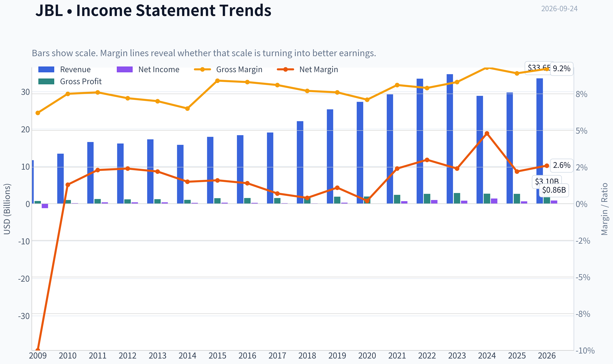

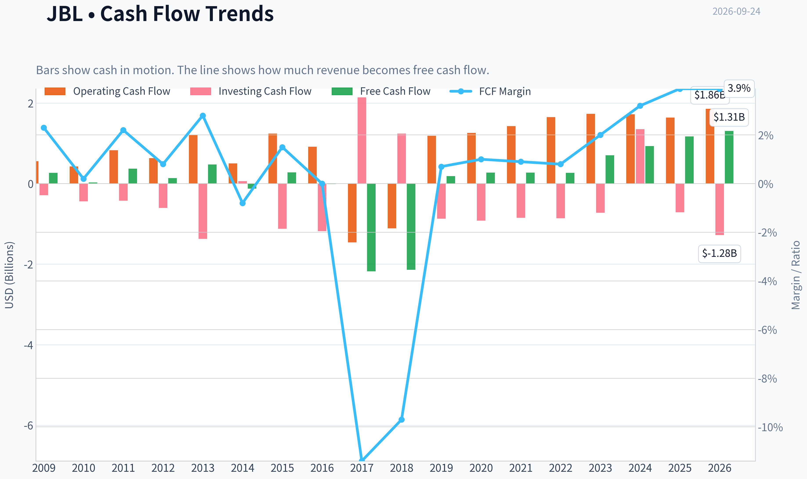

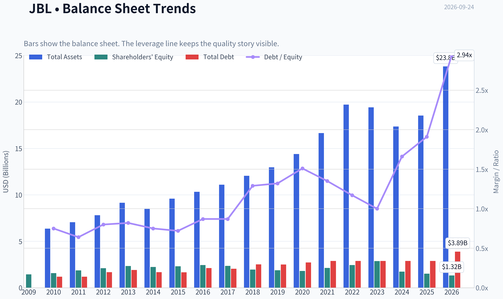

This graph tracks the profitability and return metrics (ROE, ROIC, Margins) of **JBL** over the past decade, highlighting capital efficiency trends.

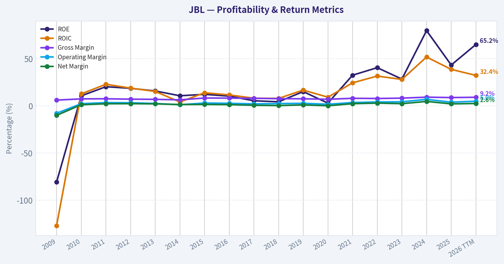

This chart illustrates the financial health of **JBL** over the last 10 years, mapping cash equivalents and free cash flow against total obligations (Debt).

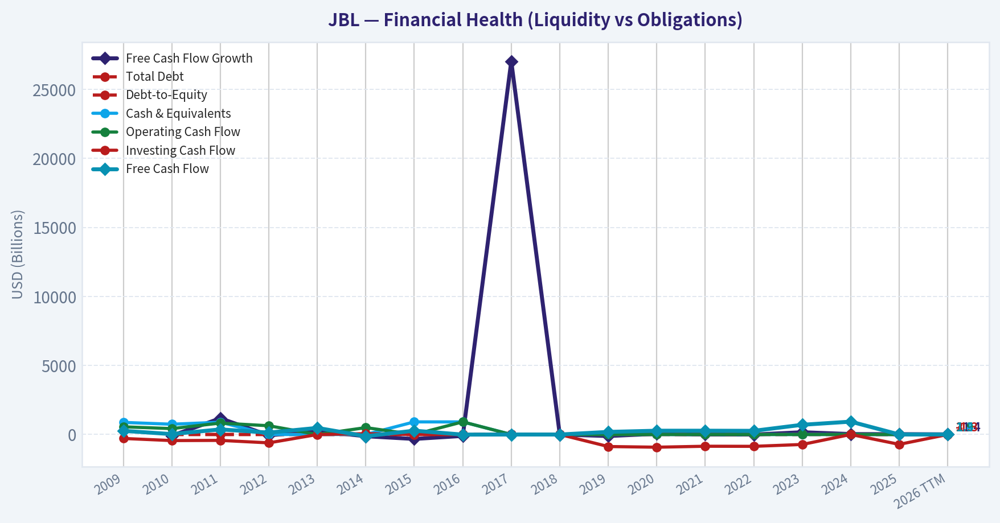

This comparison chart from *Profitability and Operating Performance* stacks current figures against historical benchmarks for **JBL**, making it easy to see where the company trades relative to its own averages.

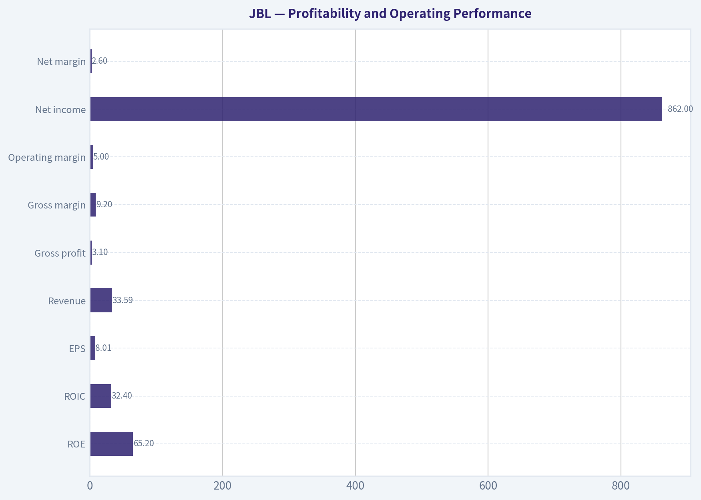

This breakdown chart from <em>Revenue Breakdown</em> shows the proportional composition for **JBL** - useful for understanding what drives or risks the business.

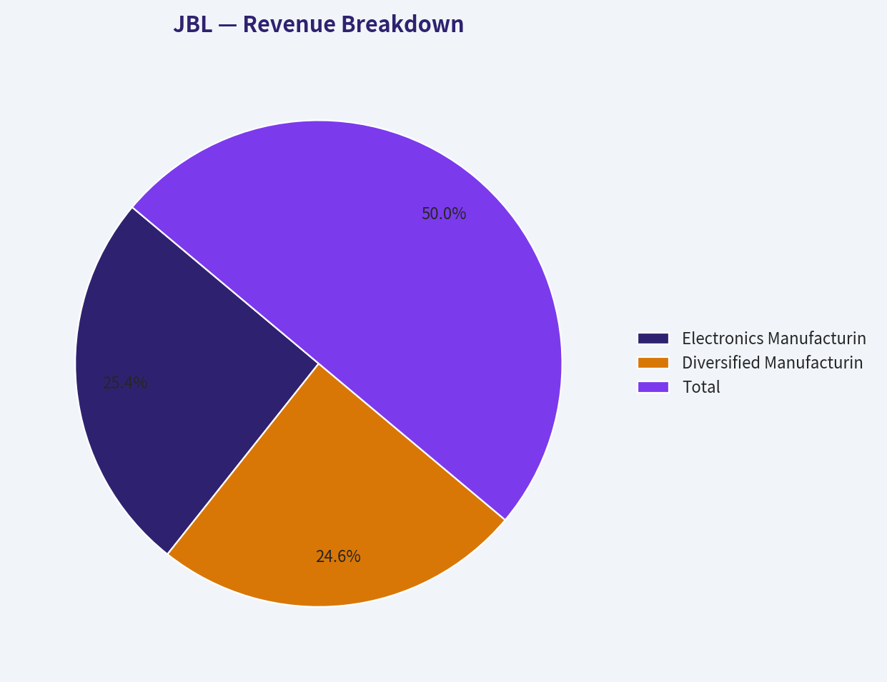

---

### Intrinsic Value Analysis (Buffett)

> *Following Warren Buffett's value investing philosophy: Circle of Competence, Economic Moat, Management Quality, and Margin of Safety.*

#### Intrinsic Value Snapshot

Price is what you pay. Intrinsic value is what the business may be worth based on the cash it can create for owners over time. We show a range, not one magic number.

- Current Price: $308.75
- Value Range (conservative to optimistic across both DCF methods): $15.53 to $714.33

##### Owner Earnings (Buffett Method)
- Net Income: $657,000,000.00
- Depreciation & Amortization: $674,000,000.00
- Capital Expenditures: $-468,000,000.00
- Working Capital Changes: $187,000,000.00
- Owner Earnings: $676,000,000.00

##### Intrinsic Value
###### Buffett Method
Uses owner earnings. Stricter, and usually more conservative.
- Conservative: $15.53
- Average: $23.21
- Optimistic: $29.69
- Discount Rate: 10.0%

###### Cash Flow Method
Uses free cash flow. Better for companies spending heavily today to grow tomorrow.
- Conservative: $113.29
- Average: $194.29
- Optimistic: $714.33
- Discount Rate: 10.0%

ANALYST STANCE: **AVOID**

#### Executive View

Jabil is a large, globally scaled electronics manufacturing-services provider. It makes money by designing, sourcing, assembling, and managing supply chains for major technology, healthcare, automotive, and industrial customers.

The business is understandable and financially viable, but its moat is narrower than its valuation suggests. Jabil's 8.9% gross margin, modest 3.2% revenue growth, cyclical earnings profile, and price-implied growth of approximately 33.5% annually create an unfavorable risk-reward profile at $309 per share.

#### Factor Scorecard

| Factor | Score | Assessment |
|---|---:|---|
| 1. Circle of Competence & Simplicity | 3/5 | Understandable outsourcing model, but customer mix, end-market cycles, and program transitions reduce predictability. |
| 2. Durable Competitive Advantage | 3/5 | Scale, manufacturing expertise, customer relationships, and supply-chain integration provide a narrow moat, not a dominant one. |
| 3. Management & Capital Allocation | 3/5 | Jabil appears operationally disciplined, but the available evidence does not establish exceptional owner-oriented capital allocation. |
| 4. Industry Structure | 2/5 | Electronics manufacturing is competitive, price-sensitive, and relatively low-margin, despite scale advantages. |
| Gate 5: Quality/Solvency Floor | Not tripped | There is no evidence provided of both sharply worsening cash earnings and a solvency red line such as interest coverage below 1x. |

**Key Takeaways:** Jabil is a legitimate operating business rather than a distressed company. However, its competitive advantages are moderate, while industry economics remain competitive and cyclical. The central problem is valuation, not business survival.

#### Moat Analysis

| Moat Source | Evidence | Assessment |
|---|---|---|
| Intangible assets and brand | Jabil is a trusted manufacturing partner, but its brand is primarily business-to-business and does not create strong consumer pricing power. | Narrow |
| Switching costs | Customers must qualify factories, processes, quality systems, and supply chains, making switching inconvenient and risky. | Moderate |
| Cost advantages | Global scale, procurement, manufacturing expertise, and geographic diversification can lower costs and improve execution. | Moderate |
| Network effects | Limited direct network effects; additional customers do not materially make the service more valuable to other customers. | Weak |
| Financial evidence | Gross margin is only 8.9%, indicating limited pricing power and a structurally competitive business model. | Mixed |

**Moat Quality Rating: Narrow, 3/5.**

Jabil's strongest advantage is embedded customer and supply-chain relationships. Large customers may hesitate to switch because doing so can disrupt production, quality control, and logistics. But these advantages do not appear powerful enough to support very high margins or consistently rapid organic growth.

#### Management Quality Assessment

Management's likely strengths are execution, operational scale, and the ability to manage a complex global manufacturing network. Jabil's business requires disciplined working-capital management, customer program execution, and continuous cost control.

The available information does not demonstrate that management has the exceptional owner orientation associated with Buffett's best investments. There is also insufficient evidence here to conclude that acquisitions, buybacks, and reinvestment have consistently created more than a dollar of value for every dollar retained.

**Management score: 3/5.**

#### Financial Summary

| Metric | Latest Available Result |
|---|---:|
| Share price | $309.00 |
| Market capitalization | $32.35 billion |
| P/E ratio | 38.6x |
| ROE | 43.4% |
| Revenue growth, year over year | 3.2% |
| Gross margin | 8.9% |
| FCF yield | 3.6% |
| Implied current free cash flow | Approximately $1.16 billion |
| Current ratio | 1.00x |
| Headline intrinsic value | $58.78 |
| Reverse-DCF implied growth | Approximately 33.5% annually for 10 years |
| Trailing three-year growth | Approximately -20.5% |

**Key Takeaways:** Jabil generates cash and reports a very high ROE, but its low gross margin shows that this is not a high-pricing-power franchise. The contrast between 3.2% recent revenue growth and a 38.6 times earnings multiple is unfavorable. The reverse DCF indicates that the current price assumes extraordinary growth well above recent performance.

The high ROE should also be interpreted carefully. In a low-margin manufacturing business, ROE can be amplified by asset turnover, working-capital structure, and leverage; it does not automatically prove a wide moat.

#### Owner Earnings Calculation

The Buffett framework is:

| Owner Earnings Component | Amount |
|---|---:|
| Net income | Not separately provided in the research pack |
| Plus: depreciation and amortization | Not separately provided |
| Less: maintenance capital expenditures | Not separately provided |
| Less: working-capital investment | Not separately provided |
| Owner earnings | Best represented by cash-flow valuation outputs below |

The research pack provides three valuation outputs based on different cash-flow methodologies:

| Cash-Flow Method | Implied Value per Share |
|---|---:|
| Owner-earnings DCF | $23.21 |
| FCF-based valuation | $194.29 |
| Damodaran FCFF valuation | $62.97 |
| Headline weighted intrinsic value | $58.78 |

**Key Takeaways:** The valuation methods produce a wide spread, which reflects the cyclicality and cash-flow volatility of Jabil's business. Even the most favorable listed cash-flow value of $194.29 is materially below the $309 share price. The weighted headline value of $58.78 implies that the market price is discounting a much stronger future than the underlying economics justify.

#### Three-Scenario DCF Valuation

Using the implied current FCF of approximately $1.16 billion as a practical owner-earnings proxy, with approximately 104.7 million shares outstanding:

| Scenario | Key Assumption | Estimated Value per Share |
|---|---|---:|
| A. No growth | FCF capitalized at 10% | Approximately $111 |
| B. GDP growth | FCF grows at 3% perpetually; 10% discount rate | Approximately $159 |
| C. Historical-growth sensitivity | FCF declines at approximately 10.25% annually, based on half of the trailing three-year decline | Approximately $51 |
| Research-pack weighted valuation | Blended owner earnings, FCF, and FCFF models | $58.78 |

**Key Takeaways:** Even a generous 3% perpetual-growth assumption produces an estimated value well below the current price. The historical-growth sensitivity is substantially lower because recent performance has been negative over the measured period. The independent blended valuation of $58.78 reinforces the conclusion that Jabil is priced for an unusually strong future.

#### Margin of Safety Analysis

| Measure | Result |
|---|---:|
| Current price | $309 |
| Headline intrinsic value | $58.78 |
| Premium to headline intrinsic value | Approximately 425% |
| Margin of safety versus headline value | Approximately -81% |
| Best listed model value | $194.29 |
| Premium to best listed model | Approximately 59% |
| Reverse-DCF growth assumption | Approximately 33.5% annually for 10 years |

**Key Takeaways:** Jabil does not offer a margin of safety at $309. A quality-scaled discount of 25% to 35% would be appropriate for a moderate-moat, cyclical manufacturer, but the stock instead trades at a substantial premium to every provided intrinsic-value measure. The reverse DCF is particularly concerning because it requires sustained growth far above recent results.

#### Final Buffett Scorecard

| Criterion | Weight | Score | Weighted Contribution |
|---|---:|---:|---:|
| Moat width and durability | 25% | 3.0/5 | 0.75 |
| Valuation and margin of safety | 20% | 1.0/5 | 0.20 |
| Capital returns: ROIC versus WACC | 15% | 3.0/5 | 0.45 |
| Business understanding and predictability | 12% | 3.0/5 | 0.36 |
| Management quality and capital allocation | 12% | 3.0/5 | 0.36 |
| Reinvestment runway | 8% | 3.0/5 | 0.24 |
| Balance-sheet strength | 4% | 2.5/5 | 0.10 |
| Industry structure | 4% | 2.0/5 | 0.08 |
| **Total** | **100%** |  | **2.54/5** |

**Key Takeaways:** Jabil scores reasonably on operating competence but poorly on valuation and industry structure. Its moderate moat and cyclical economics do not justify paying a premium multiple that requires approximately 33.5% annual growth. The weighted score falls into the AVOID range without triggering the financial-distress hard floor.

#### Investment Stance

**AVOID - High conviction on valuation, moderate conviction on business quality.**

Jabil may remain a capable and profitable manufacturing partner, but at $309 the stock appears priced for heroic growth. A more attractive entry point would require either a substantial price decline toward the broader intrinsic-value range or clear evidence that Jabil has developed materially higher-margin, less cyclical businesses with durable pricing power.

The key Buffett conclusion is simple: **Jabil may be a decent business, but it is not currently a good investment at this price.**
#### Valuation Bridge

This bridge places the current market price beside each intrinsic value lens so readers can see whether upside depends on one method or shows up across several methods.

| Scenario | Intrinsic Value / Share |
| --- | ---: |
| Buffett Method | $23.21 |
| Cash Flow Method | $194.29 |
| Damodaran Method | $62.97 |
| Current Price | $308.75 |

#### Key Takeaways

If one method is far above the others, the upside case depends on a specific modelling assumption. When several methods cluster together, the valuation story is more robust.

#### Valuation Visuals

This comparison chart from *Latest Earnings Snapshot* stacks current figures against historical benchmarks for **JBL**, making it easy to see where the company trades relative to its own averages.

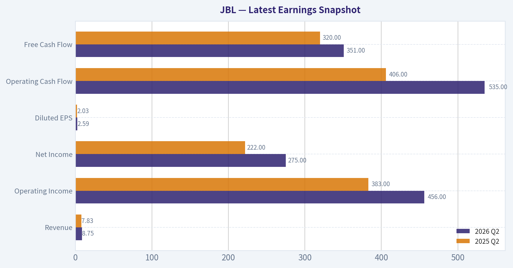

This comparison chart from *Balance Sheet and Financial Strength* stacks current figures against historical benchmarks for **JBL**, making it easy to see where the company trades relative to its own averages.

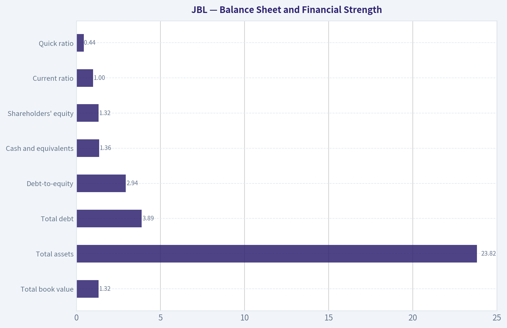

This comparison chart from *Owner-Earnings DCF* stacks current figures against historical benchmarks for **JBL**, making it easy to see where the company trades relative to its own averages.

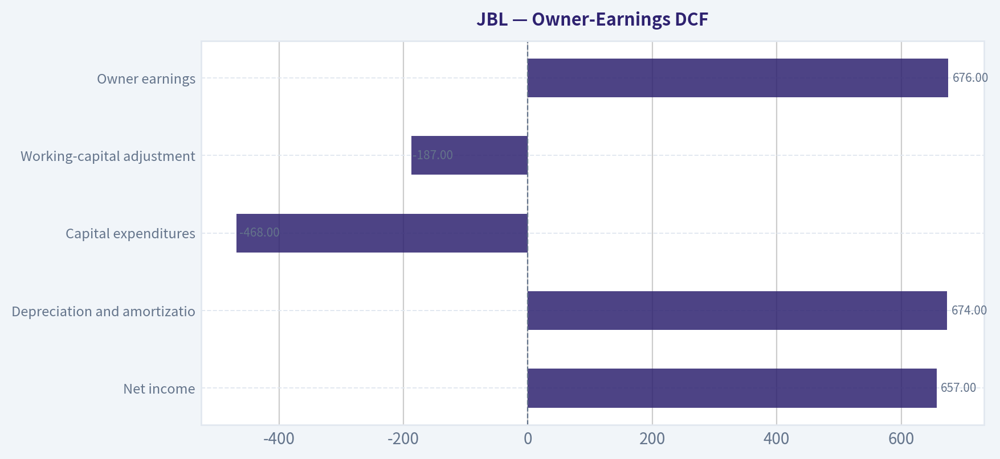

---

### Trend & Growth Analysis (Lynch/Druckenmiller/Fisher)

> *Following Peter Lynch's GARP, Stanley Druckenmiller's macro-aware approach, and Philip Fisher's scuttlebutt methodology.*

ANALYST STANCE: **AVOID**

#### 1. Lynch Classification

**Jabil is a cyclical electronics-manufacturing and supply-chain services company, not currently a fast grower.** Its business is exposed to customer production cycles, component demand, inventory corrections, and mix shifts. It may benefit from AI infrastructure and data-center hardware demand, but the available financial record does not yet show a durable 20%+ growth trajectory.

| Lynch criterion | Assessment |
|---|---:|
| Classification | Cyclical / mature compounder |
| TTM revenue growth | 3.2% |
| TTM revenue growth in alternate dataset | 12.7% |
| Three-year revenue CAGR | -3.8% |
| Five-year revenue CAGR | 1.8% |
| Current P/E | 38.6x |
| Forward P/E | 18.3x |
| Price-to-sales | 0.96x |

**Key Takeaways:** Jabil's growth profile is inconsistent and materially below the fast-grower threshold. The forward P/E looks more reasonable, but the current valuation still assumes a significant earnings recovery. The conflicting growth figures also reduce confidence in using a simple PEG-based conclusion.

#### 2. The Story in Three Bullets

- Jabil provides outsourced electronics manufacturing, design, assembly, and supply-chain services to large technology, automotive, healthcare, and industrial customers.
- Its scale, global manufacturing footprint, and customer relationships can help it capture increasing electronics complexity, including AI infrastructure and data-center hardware.
- The opportunity is primarily an earnings and mix recovery story, not yet a proven secular revenue-growth story.

#### 3. TAM and 10x Test

Jabil generated approximately **$33.6 billion of TTM revenue**. A 10x outcome would require roughly **$336 billion in annual revenue**, which is unlikely to be achieved through ordinary electronics manufacturing alone. It would require sustained market-share gains, major expansion into higher-value design and infrastructure services, or substantial acquisitions.

| TAM factor | Assessment |
|---|---|
| Core market | Large global electronics manufacturing and supply-chain services |
| Secular drivers | AI infrastructure, cloud hardware, electrification, healthcare devices |
| Current revenue | Approximately $33.6B TTM |
| 10x revenue target | Approximately $336B |
| Can 10x revenue remain below 20% share? | Possibly at the broad industry level, but difficult within Jabil's current niches |
| TAM quality | Large, but fragmented and cyclical |
| Runway rating | Moderate, not exceptional |

**Key Takeaways:** Jabil operates in a large market with several attractive secular pockets. However, the 10x test is difficult because the company is already large and its core business has low margins. A ten-bagger would likely require a major strategic transformation rather than normal organic growth.

#### 4. Revenue Growth Trend

| Period | Revenue | Growth |
|---|---:|---:|
| 2021 | $29.3B | 7.4% |
| 2022 | $33.5B | 14.3% |
| 2023 | $34.7B | 3.7% |
| 2024 | $28.9B | -16.8% |
| 2025 | $29.8B | 3.2% |
| 2026 TTM | $33.6B | 12.7%* |
| Three-year CAGR | - | -3.8% |
| Five-year CAGR | - | 1.8% |

\*The data provider reports both 3.2% current-year growth and 12.7% TTM growth; this discrepancy should be verified against Jabil's filings.

**Key Takeaways:** Revenue has recovered from the 2024 decline, which is encouraging, but the longer-term trend remains weak. The current evidence supports cyclical recovery rather than confirmed acceleration. A sustained sequence of quarterly growth above 15% would be needed to establish a genuine inflection.

#### 5. Unit Economics and Financial Quality

| Metric | Result | Interpretation |
|---|---:|---|
| Gross margin | 8.9%-9.2% | Low-margin manufacturing model |
| Operating margin | Approximately 4%-5% | Limited room for execution errors |
| Net margin | Approximately 2.2%-2.6% | Thin profitability |
| FCF margin | Approximately 3.9% | Positive but modest |
| FCF yield | 3.6% | Not compelling at current price |
| Current ratio | 1.00x | Tight liquidity |
| Quick ratio | 0.44x | Reliant on inventory and operating cash flow |
| Debt-to-equity | 2.94x in latest table | Elevated leverage |
| Interest coverage | 8.0x | Adequate, but not exceptionally conservative |
| NRR / LTV-to-CAC | Not applicable / unavailable | Not a subscription business |
| Rule of 40 | Not applicable | Manufacturing economics |

**Key Takeaways:** Jabil generates substantial cash flow, but its low margins and elevated leverage make the business sensitive to volume, pricing, and working-capital swings. The absence of SaaS-style recurring economics means growth must be evaluated through customer wins, program ramps, mix, and operating leverage.

#### 6. Inflection Point Assessment

| Potential inflection | Evidence | Rating |
|---|---|---:|
| AI and data-center hardware demand | Potentially favorable secular exposure; not quantified in supplied data | Positive but unproven |
| Revenue acceleration | TTM recovery, but multi-year CAGR remains weak | Mixed |
| Margin expansion | Gross margin near 9%; operating margin near 5% | Mildly positive |
| Cash-flow expansion | TTM FCF approximately $1.31B | Positive |
| Competitive position | Global scale and customer relationships | Positive |
| Balance-sheet inflection | Debt increased and liquidity is tight | Negative |
| Earnings outlook | Forward P/E implies major earnings normalization | Market already anticipates recovery |

**Key Takeaways:** The most credible inflection is a possible mix shift toward higher-value AI, cloud, and infrastructure programs. However, current evidence does not prove that these programs will produce accelerating consolidated revenue or materially higher margins. The balance sheet and valuation leave limited room for an execution miss.

#### 7. Macro Setup

Jabil is exposed to several favorable long-term themes, including cloud infrastructure, AI hardware, electrification, and supply-chain regionalization. Conversely, it remains sensitive to global industrial activity, technology-capital-spending cycles, interest rates, customer inventory levels, tariffs, and geopolitical disruption.

| Macro factor | Impact on JBL |
|---|---|
| AI and data-center investment | Positive |
| Cloud hardware spending | Positive but cyclical |
| Higher interest rates | Negative for valuation and customer capex |
| Global manufacturing activity | Mixed |
| Tariffs and geopolitical fragmentation | Mixed to negative |
| Inventory corrections | Negative |
| Falling rates / improving liquidity | Positive |

**Key Takeaways:** The secular macro backdrop is constructive, but Jabil's operating model remains cyclical. Without reliable current rate and economic-cycle data, the macro setup should be considered mixed rather than strongly favorable.

#### 8. Fisher 15-Point Assessment

| Fisher factor group | Score |
|---|---:|
| Market potential and long-term outlook | 3.5 / 5 |
| Product development and R&D | 3.0 / 5 |
| Sales organization and customer relationships | 4.0 / 5 |
| Margins and margin improvement | 2.5 / 5 |
| Labor and executive relations | 3.0 / 5 |
| Management depth and accounting discipline | 3.0 / 5 |
| Competitive advantages | 3.5 / 5 |
| Dilution and balance-sheet quality | 2.0 / 5 |
| Management candor and integrity | 3.5 / 5 |
| **Estimated total** | **49 / 75** |

**Key Takeaways:** Jabil scores best on scale, customer relationships, and manufacturing capabilities. It scores poorly on margins, leverage, and the lack of evidence for durable organic growth. This is an average Fisher profile, and the score is provisional because detailed scuttlebutt information was not available.

#### 9. Valuation Analysis

| Valuation method | Result | Interpretation |
|---|---:|---|
| TTM P/E | 38.6x | Expensive versus current growth |
| Forward P/E | 18.3x | Assumes substantial earnings recovery |
| PEG | 0.82 | Attractive mathematically, but unreliable for a cyclical |
| Price-to-sales | 0.96x | Reasonable in isolation |
| EV/EBITDA | 14.6x | Not obviously cheap for a low-margin business |
| FCF yield | 3.6% | Modest |
| Headline intrinsic value | Approximately $59 | Far below market price |
| FCFF valuation range | $47-$120 | Below current price |
| Reverse DCF implied growth | Approximately 33.5% annually for 10 years | Highly demanding |

**Key Takeaways:** Jabil's low price-to-sales ratio is appropriate for a low-margin contract manufacturer, but it does not by itself indicate undervaluation. The market price appears to require exceptionally strong long-term earnings growth, while the reverse-DCF and cash-flow models imply substantial downside. The PEG ratio should not be trusted without proving that earnings growth is durable rather than cyclical.

#### 10. Growth Investor Scorecard

| Criterion | Weight | Score / 5 |
|---|---:|---:|
| Lynch story | 10% | 3.2 |
| TAM and runway | 20% | 3.0 |
| Revenue growth | 20% | 2.5 |
| Unit economics | 15% | 2.5 |
| Competitive position | 10% | 3.5 |
| Management quality | 10% | 3.0 |
| Macro setup | 5% | 3.0 |
| Profitability path | 5% | 3.2 |
| Valuation | 5% | 1.5 |
| **Weighted score** | **100%** | **2.8 / 5** |

**Key Takeaways:** Jabil has a credible business, meaningful scale, and potentially attractive AI-related exposure. But it does not currently meet the standards for a high-conviction growth investment because revenue growth is inconsistent and valuation appears demanding relative to normalized cash generation. The score falls in the avoid/watch-list range.

#### 11. Position Size Stance

**Position size: 0% for a new growth portfolio position.**

For an existing holder, Jabil could be retained only as a smaller cyclical or value-recovery position, not as a core ten-bagger candidate. A speculative position would require confirmation from several quarters of accelerating revenue, improving mix, stable or rising margins, and disciplined debt reduction.

#### 12. Key Risks and Catalysts

| Catalysts | Risks |
|---|---|
| Faster AI and data-center program ramps | Customer concentration and program volatility |
| Revenue growth reaccelerating above 15% | Low gross and operating margins |
| Higher-margin design and infrastructure mix | Elevated leverage and tight liquidity |
| Operating leverage from volume recovery | Inventory corrections and electronics cyclicality |
| Debt reduction and stronger FCF conversion | Tariffs, geopolitics, and supply-chain disruption |
| Earnings exceeding forward estimates | Valuation already discounts substantial recovery |

**Key Takeaways:** The key catalyst is proof that AI and infrastructure demand is translating into sustained, higher-margin growth. The principal risk is that the stock price has already discounted a strong earnings recovery while the underlying business remains cyclical and financially leveraged.

#### Bottom Line

Jabil is a capable, strategically relevant electronics-manufacturing company with attractive exposure to several secular trends. Nevertheless, its current profile is closer to a **cyclical recovery candidate** than a fast-growing compounder. At approximately **$309**, the valuation appears too demanding relative to its inconsistent revenue growth, thin margins, leverage, and modeled intrinsic values; therefore, the appropriate stance is **AVOID for new growth investment, while monitoring for a confirmed operating inflection or a substantially better entry price**.

---

### Market Technical Analysis

ANALYST STANCE: **WATCH**

#### JBL technical-market report

JBL's latest available closing price is **$308.75 on September 23, 2026**; September 24 is not a trading session in the retrieved dataset. The chart shows a stock in a **long-term uptrend that is currently undergoing a substantial medium-term correction**. Price remains above the rising 200-day SMA, but it is still below the declining 50-day SMA, so the immediate trend has not yet fully repaired.

| Indicator | Latest reading | Trend interpretation |
|---|---:|---|
| Close | $308.75 | Rebounded from the late-August and mid-September lows, but remains below medium-term resistance |
| 10 EMA | $303.72 | Price is above the short-term average, indicating a modest near-term recovery |
| 50 SMA | $317.90 | Price remains below this declining average; medium-term trend is still damaged |
| 200 SMA | $298.22 | Price is above the rising long-term average, preserving the broader bullish structure |
| MACD | -6.01 | Still negative, but improving sharply from approximately -7.51 on September 18 |
| RSI | 48.74 | Neutral; momentum has recovered from oversold territory but has not turned decisively bullish |
| ATR | $11.89 | Volatility remains significant at roughly 3.9% of the share price, although it has fallen from August levels |
| VWMA | $303.04 | Price is slightly above the volume-weighted average, suggesting recent buying has stabilized the tape |
| Bollinger middle | $304.90 | Price is modestly above the 20-day benchmark, consistent with a short-term rebound |

The most constructive feature is the relationship between price and the faster reference levels. JBL closed above both the **10-day EMA at $303.72** and the **VWMA at $303.04**, while also remaining above the **Bollinger middle line near $304.90**. This alignment indicates that buyers have regained short-term control after the stock declined from the August high near $370 to a late-August low around $301 and then briefly weakened again into mid-September.

However, this recovery is not yet a confirmed trend reversal. The **50-day SMA is approximately $317.90**, and it has been trending downward from the mid-$340s in August. That declining slope shows that the medium-term supply overhang has not been fully cleared. A sustained close above roughly **$318**, particularly if accompanied by stronger volume, would improve the technical picture and suggest that the correction is transitioning into a more durable recovery. Until then, the recent rise can still be interpreted as a countertrend bounce within a broader medium-term pullback.

The long-term picture remains materially better. The **200-day SMA is near $298.22 and continues to rise**, while the stock is trading approximately $10.50 above it. This creates an important technical cushion around the **$295 to $300 area**. A successful test and hold of that zone would preserve the broader bullish structure. Conversely, a decisive breakdown below the 200-day average would be more concerning because it would signal that the long-term trend is losing support after an extended advance.

Momentum is improving but remains inconclusive. The MACD has risen from strongly negative levels in late August and mid-September to approximately **-6.01**, showing that downside momentum has moderated. Nevertheless, the MACD remains below zero, so the indicator is signaling **recovery from weakness rather than established positive momentum**. RSI tells a similar story: it has rebounded from readings near 38 to **48.7**, but it is still below the 50 midpoint. This is neither an oversold buying signal nor a confirmed bullish momentum reading. A move above 50, followed by a sustained rise toward 60, would provide better confirmation.

The volatility profile deserves careful attention. ATR has declined from roughly **$16 to $20 during the July and August selloff** to **$11.89 currently**, indicating that the sharpest turbulence has eased. Even so, a daily average range close to $12 is still large relative to a $309 share price. Position sizing should therefore remain moderate, and stops should account for JBL's tendency to experience wide intraday ranges. A stop placed too tightly around the recent entry area could be triggered by normal volatility rather than a meaningful trend break.

Recent volume behavior is mixed but informative. The VWMA is around $303, below the latest close, which indicates that recent price action is slightly stronger than the volume-weighted average of the measured period. However, the large volume spike on September 18 occurred while the stock closed near $299.57, suggesting that substantial trading activity took place during a period of uncertainty rather than a clean upside breakout. The recovery above $308 therefore deserves confirmation from additional accumulation before being treated as a high-confidence advance.

#### Trading implications

For bullish traders, the preferred setup is confirmation rather than immediate pursuit. A close above **$318**, followed by continued trade above the 50-day SMA, would improve the risk-reward profile. The next potential resistance region would then be approximately **$330 to $340**, where JBL encountered repeated selling during the late-August rebound and prior consolidation.

For pullback traders, the first support zone is approximately **$303 to $305**, where the 10 EMA, VWMA, and Bollinger middle line are clustered. A deeper but more important support area is **$297 to $300**, near the rising 200-day SMA and recent swing lows. A failure to hold that area would weaken the long-term bullish thesis and could expose the stock to another move toward the high-$280s or low-$290s.

The current configuration is therefore best characterized as **short-term stabilization inside a medium-term correction, with the long-term uptrend still intact but under evaluation**. The combination of neutral RSI, negative-but-improving MACD, price above short-term averages, and price below the 50-day SMA supports a **WATCH** stance rather than an aggressive buy or an outright bearish position.

#### Selected indicators

The most relevant complementary set for JBL's current condition is:

- **close_10_ema** - identifies whether the recent rebound is holding short-term momentum.
- **close_50_sma** - measures the damaged medium-term trend and provides the main recovery threshold.
- **close_200_sma** - confirms whether the broader long-term trend remains constructive.
- **macd** - tracks whether downside momentum is fading and whether a larger reversal is developing.
- **rsi** - measures momentum quality and distinguishes recovery from overbought or oversold conditions.
- **atr** - quantifies the still-elevated trading risk and helps calibrate position sizing and stops.
- **vwma** - checks whether the rebound is supported by volume-weighted price behavior.
- **boll** - provides the short-term equilibrium level around which price is currently consolidating.

| Key area | Approximate level | Significance |
|---|---:|---|
| Immediate short-term support | $303-$305 | Cluster of 10 EMA, VWMA, and Bollinger middle line |
| Major trend support | $297-$300 | Near the rising 200-day SMA |
| First confirmation resistance | Around $318 | Approximate 50-day SMA and key recovery threshold |
| Higher resistance | $330-$340 | Prior congestion and likely selling zone |
| Current momentum state | RSI 48.7; MACD negative but improving | Stabilization, not yet a confirmed bullish reversal |
| Volatility risk | ATR $11.89 | Daily movement remains large relative to price |
| Overall technical posture | Watch | Long-term trend constructive; medium-term trend still under repair |

**Key Takeaways:** JBL has stabilized above its short-term averages and is trading above the rising 200-day SMA, but it remains below the declining 50-day SMA. Momentum is recovering from weak levels without yet becoming decisively bullish, while volatility remains high enough to require disciplined risk management. A sustained move above $318 would strengthen the bullish case; a break below the $297 to $300 area would materially weaken it.

#### Market Visuals

This comparison chart from *Market Metrics* stacks current figures against historical benchmarks for **JBL**, making it easy to see where the company trades relative to its own averages.

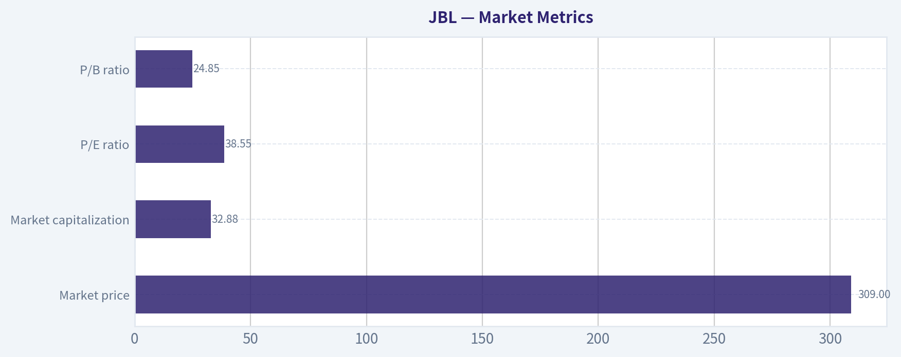

---

### Options Market Analysis

> *Reading options flow - put/call ratios, IV skew, and unusual activity - to gauge institutional positioning and event-driven risk.*

ANALYST STANCE: **WATCH**

#### JBL Options Market Overview

As of September 24, 2026, JBL's near-term options data shows very limited usable open-interest information. All reported call and put open interest is zero, which makes standard positioning metrics such as the put/call OI ratio, gamma walls, and max-pain levels unavailable.

| Expiration | Call OI | Put OI | Call Volume | Put Volume | Volume Put/Call Ratio | Call ATM IV | Put ATM IV |
|---|---:|---:|---:|---:|---:|---:|---:|
| Sep. 25, 2026 | 0 | 0 | 166 | 320 | 1.93 | 3.5% | 4.0% |
| Oct. 2, 2026 | 0 | 0 | 389 | 139 | 0.36 | 1.8% | 2.1% |
| Oct. 9, 2026 | 0 | 0 | 56 | 68 | 1.21 | 1.1% | 2.5% |
| **Total / Overall** | **0** | **0** | **611** | **527** | **0.86** | - | - |

**Key Takeaways:** Aggregate put volume is modestly below call volume, with a put/call volume ratio of 0.86 versus the historical neutral reference near 0.70. That suggests a slightly less bullish-than-neutral volume profile, but not a strong bearish signal. The expiration-level activity is inconsistent, and zero open interest substantially reduces confidence in the interpretation.

#### Put/Call Ratio Analysis

- **Put/call OI ratio:** Not available because both call and put OI are reported as zero across all near-term expirations.
- **Put/call volume ratio:** **0.86 overall**, slightly above the approximately 0.70 neutral baseline.
- The September 25 expiration is put-heavy, with a 1.93 put/call volume ratio.
- The October 2 expiration is strongly call-heavy, with a 0.36 ratio and the highest overall volume.
- The October 9 expiration is mildly put-heavy at 1.21.

The overall result is **near-neutral to mildly cautious**, rather than decisively bearish. The elevated put volume in the nearest expiration could represent short-term hedging, but there is no open-interest evidence to determine whether the trades are new positions or closing transactions.

#### Implied Volatility Assessment

| Expiration | Call ATM IV | Put ATM IV | Put-versus-Call ATM IV Difference | Assessment |
|---|---:|---:|---:|---|
| Sep. 25, 2026 | 3.5% | 4.0% | +0.5 percentage points | Mild downside protection premium |
| Oct. 2, 2026 | 1.8% | 2.1% | +0.3 percentage points | Slight put premium |
| Oct. 9, 2026 | 1.1% | 2.5% | +1.4 percentage points | Strongest relative put premium |
| **Overall** | - | - | - | **Low IV, modest put skew** |

**Key Takeaways:** Reported near-term ATM implied volatility is exceptionally low, indicating limited expected movement or potentially incomplete/low-quality market data. Puts carry slightly higher ATM IV than calls at every expiration, with the widest difference on October 9. This is a mild downside-skew signal, but there is no evidence of a major volatility fear event.

A true OTM skew comparison is not available because the supplied data contains only ATM IV figures. Therefore, the put premium should be treated as an indication of mild downside protection demand, not as confirmation of a steep put skew.

There is also no catalyst calendar in the supplied data. Accordingly, elevated event-driven IV cannot be identified; in fact, the reported IV levels appear low rather than elevated.

#### Unusual Options Activity

No contracts were identified with volume greater than five times open interest.

| Finding | Interpretation |
|---|---|
| No qualifying unusual contracts | No confirmed fresh directional bets under the tool's volume-to-OI threshold |
| Zero OI across expirations | Cannot reliably distinguish opening trades from closing trades |
| No contract-level strike data supplied | ITM, ATM, or OTM classification is unavailable |
| No contract-level unusual activity | No basis to label activity as smart-money positioning or retail speculation |

**Key Takeaways:** There is no confirmed unusual options activity based on the available threshold. However, the absence of flagged contracts is less informative than usual because reported open interest is zero everywhere. The data does not support a strong institutional-flow conclusion.

#### Open Interest Concentration and Gamma Levels

Open-interest concentration cannot be assessed from the supplied data.

- Total call OI: **0**
- Total put OI: **0**
- Highest-OI strikes: **Unavailable**
- Highest-OI expirations: **Unavailable**
- Max-pain estimate: **Unavailable**
- Gamma walls or major pinning levels: **Not identifiable**

With no reported open interest, there are no measurable gravitational levels. Price pinning, dealer gamma dampening, or gamma-amplified moves cannot be inferred from this dataset.

#### Overall Options Sentiment

| Signal Component | Reading | Directional Implication |
|---|---|---|
| Put/call OI ratio | Unavailable | No reliable OI-based signal |
| Put/call volume ratio | 0.86 | Near-neutral, mildly cautious |
| ATM IV | Very low | Low expected movement or possible data limitation |
| IV skew | Puts modestly above calls | Mild downside-protection demand |
| Unusual activity | None detected | No confirmed fresh institutional positioning |
| OI concentration | Unavailable | No identifiable pinning or gamma levels |
| **Overall signal** | **NEUTRAL, with a cautious downside bias** | Low-confidence read |

**Key Takeaways:** JBL's options market does not present a strong directional signal. Slightly higher put volume than the historical neutral level and consistently higher put ATM IV point to mild caution, but call-heavy activity in the October 2 expiration offsets that concern. The dominant issue is data quality and liquidity: zero reported open interest prevents reliable analysis of positioning, gamma, and institutional conviction.

#### Final Assessment

The appropriate options signal for JBL is **NEUTRAL**, with a **mild downside bias** and **low confidence**.

The primary drivers are:

1. Aggregate put/call volume of 0.86, which is somewhat more defensive than a 0.70 neutral baseline.
2. Puts carrying a modest IV premium across all reported expirations.
3. No confirmed unusual activity or fresh high-conviction directional bets.
4. Zero reported open interest, making the usual OI-based conclusions unreliable.

This should be treated as a weak and potentially incomplete options read rather than a strong bearish or bullish trade signal. Confirmation from the underlying price trend, trading volume, and a more complete options chain would be necessary before assigning higher conviction.

| Put/Call Ratio | IV Level | Skew Direction | Unusual Activity | Overall Signal |
|---|---|---|---|---|
| Volume ratio 0.86; OI ratio unavailable | Very low near-term ATM IV | Mild put skew; OTM skew unavailable | None detected; zero OI limits reliability | **NEUTRAL with cautious downside bias; low confidence** |

**Key Takeaways:** JBL's options data leans slightly defensive but remains broadly neutral. Very low IV and the lack of reported open interest suggest limited conviction or a potentially incomplete dataset, so the signal should be monitored rather than traded aggressively.

---

## Research Team Commentary

> *The Research Manager synthesizes the Bull vs Bear debate into action-free commentary. This is a pre-risk view, not the final stance.*

Core takeaway: Jabil appears to be a well-run, operationally sophisticated manufacturer, but at $309 the valuation assumes it will perform like a predictable premium compounder. The reported 35.3% ROIC is impressive, yet the current price requires roughly 14%-16% annual owner-earnings growth for a decade. That is too demanding for a low-margin, cyclical business whose growth thesis still depends heavily on mix improvement, utilization, and AI-related demand. I would not commit long-term value capital at this price.

The strongest bull argument is that Jabil should not be dismissed as a commodity assembler. Its global footprint, procurement scale, engineering capabilities, regulatory qualifications, and deeply embedded customer programs create real operational switching costs. Its 8.9% gross margin looks thin, but high asset turnover can still produce excellent economics, as the reported 35.3% ROIC and 43.4% ROE suggest. If higher-value healthcare, industrial, automotive, and AI-infrastructure programs improve mix while management maintains disciplined reinvestment, per-share earnings could grow substantially faster than revenue. Under that outcome, the bull's approximately $340 base value and $430 optimistic value are conceivable.

The strongest bear argument is that the valuation already capitalizes most of that favorable evolution. A 38.6 times earnings multiple is not evidence that Jabil remains priced like an ordinary contract manufacturer. The reverse DCF requires approximately 14% growth using a 9% discount rate and closer to 15%-16% using a more appropriate 10% hurdle. Sustaining that for ten years would increase earnings nearly fourfold. That is possible, but it is not a conservative expectation for a business exposed to program cycles, powerful customers, competitive bidding, working-capital swings, and rapidly changing hardware architectures.

There is also an important quality-of-evidence problem. The valuation substitutes approximately $8.01 of EPS for normalized owner earnings because actual normalized free cash flow was not supplied. For a manufacturer carrying inventory, receivables, capital expenditures, and program-transition costs, that substitution can materially overstate intrinsic value. Likewise, current ROIC is not necessarily incremental ROIC. The bull case effectively assumes that Jabil can reinvest about 40% of earnings at returns close to 35%, but the debate provides no evidence that recent capacity additions and new programs actually earn those returns. The combination of 35.3% ROIC, 43.4% ROE, and only 3.5% ROA needs reconciliation through cash-flow, leverage, working-capital, and invested-capital data.

My rationale is therefore valuation-led rather than based on hostility toward the business. Jabil has genuine advantages, and low gross margins alone do not make it low quality. But those advantages appear narrower and less predictable than those of a wide-moat platform or branded franchise. Existing programs may be sticky, while future generations can still be rebid, dual-sourced, or shifted among qualified competitors. AI demand can expand Jabil's addressable market without necessarily improving its share of the economics, especially when hyperscale customers possess substantial bargaining power.

The payoff distribution is unattractive. The bull's own model produces roughly $198 under a still-respectable 10% growth case, versus approximately $342 if Jabil compounds at 15% for ten years. Thus, a reasonably good outcome can lead to substantial downside, while an exceptional base-case outcome provides only about 11% upside. An 11% modeled discount might suffice for an exceptionally predictable, wide-moat franchise, but Jabil's cyclicality and unverified cash conversion call for something closer to a 25%-35% discount. Using the debate's $340 optimistic base value, that would imply a more defensible entry zone around $220-$255, subject to updated free-cash-flow evidence. This is not a precise price target, but it illustrates how little protection $309 provides.

Management deserves credit for the reported returns, and there is no evidence here of financial distress or poor stewardship. Nevertheless, management quality must be confirmed through incremental returns, not inferred from headline ROE. Buybacks also deserve scrutiny: repurchasing shares at almost 39 times earnings creates value only if the aggressive intrinsic-value thesis is already correct.

I am applying the prior Xero and Duolingo lessons carefully rather than mechanically. Those calls were too cautious because deeply sold-down shares were stabilizing near support with improving momentum. Here, the handoff supplies only the names of technical indicators, not their actual readings, price levels, or evidence of seller exhaustion. Options open interest is effectively unavailable, and a 0.86 put/call volume ratio-or one put-heavy expiration-is not enough to establish direction. Jabil could certainly rally over the next month, but there is no documented tactical setup strong enough to override the long-term valuation problem. "Avoid for long-term ownership" should not be confused with "short the stock" or "the shares must fall immediately."

Over the next one to four quarters, I would monitor normalized free cash flow and require evidence that cash conversion is consistently close to or above roughly 90% of net income after ordinary capital expenditures. I would examine organic revenue growth separately from acquisitions, program transfers, and pass-through component pricing. AI and data-center revenue should translate into higher gross profit and cash flow, not merely additional low-margin volume.

I would also track gross and operating margins, utilization, inventory, receivables, and cash-conversion-cycle movements. Stable or improving margins alongside controlled working capital would strengthen the thesis; margin gains accompanied by rising inventory or receivables would weaken it. Incremental ROIC on recent investments should remain comfortably above the cost of capital-preferably above 20%-rather than relying on the reported 35.3% historical figure.

Other critical items are customer and program concentration, net debt and interest coverage, capacity commitments, restructuring charges, acquisition returns, and the price paid for repurchases. Most importantly, guidance and actual owner-earnings growth need to support the approximately 14%-16% rate embedded in the share price. Several quarters of strong free-cash-flow growth, durable higher-value mix, and high incremental returns could move the shares toward WATCH even without a major decline. A meaningful price correction into a genuine margin-of-safety range could also change the conclusion. Conversely, slowing growth, weak cash conversion, margin compression, or rising working-capital requirements would confirm that the market has priced a cyclical recovery as a permanent compounder.

Jabil is a respectable company, but the stock at $309 asks investors to pay today for a transformation that has not yet been sufficiently demonstrated in normalized cash flow and incremental returns.

AVOID

---

## Value Investing Team Commentary

> *The Investor translates the research view into an investment thesis before risk review. This is still not the final stance.*

### Investment Commentary

Jabil is a better business than its 8.9% gross margin initially suggests. Its manufacturing scale, procurement network, engineering expertise, regulatory qualifications, and integration into customers' supply chains create meaningful switching costs. High asset turnover can also make a low-margin manufacturer economically attractive. Reported ROIC of 35.3% and ROE of 43.4% therefore deserve attention.

However, the central question is not whether Jabil is respectable. It is whether investors are being adequately compensated for its cyclicality, customer bargaining power, program risk, and capital intensity. At approximately $309 and 38.6 times reported earnings, the answer appears to be no.

### Business quality and moat

Jabil's competitive advantages are operational rather than monopolistic:

- Global manufacturing and procurement scale
- Complex design and engineering capabilities
- Long-standing customer relationships
- Regulatory and qualification barriers in healthcare and other specialized markets
- Significant disruption costs when customers move established programs

These advantages make Jabil more than a commodity assembler. Nevertheless, they do not give it the pricing power of a dominant platform, branded franchise, or proprietary semiconductor company. Existing programs can be sticky, but future generations may be rebid, dual-sourced, redesigned, or transferred. Large technology and hyperscale customers retain considerable negotiating leverage.

The moat is consequently real but moderate. That distinction matters greatly when deciding what multiple to pay.

### The returns require reconciliation

The reported 35.3% ROIC is excellent, but it should not be accepted uncritically. The combination of:

- 35.3% ROIC
- 43.4% ROE
- 3.5% ROA
- 8.9% gross margin

suggests that asset turnover, supplier financing, leverage, or a narrow invested-capital denominator may be contributing substantially to the headline returns. None of that makes the returns invalid, but it means investors need the underlying cash-flow and balance-sheet details before treating 35% as a sustainable reinvestment rate.

Historical ROIC is also not necessarily incremental ROIC. The relevant question is whether new AI, data-center, healthcare, and industrial programs can earn similarly attractive returns after capacity spending, working-capital requirements, launch costs, and competitive pricing.

For a manufacturer, reported EPS is an inadequate substitute for owner earnings. Inventory, receivables, capital expenditures, restructuring costs, and customer-program transitions can create a material difference between accounting profit and distributable cash. The lack of normalized free-cash-flow data weakens both bullish and bearish valuation precision. It does not, however, justify paying a premium price; uncertainty should increase the required margin of safety.

### AI provides an opportunity, but not automatically superior economics

AI infrastructure is the strongest potential source of positive surprise. Jabil may benefit from increasing hardware complexity, supply-chain localization, accelerated product cycles, and customers' desire to outsource manufacturing and engineering.

The market may be correctly anticipating that Jabil is evolving toward a higher-value mix. If AI and data-center programs improve utilization, margins, and capital efficiency, earnings could grow considerably faster than revenue.

The selective contrarian point, however, is that participation in a rapidly growing market does not guarantee attractive economics. The crucial questions are:

1. How much value remains with Jabil rather than its customers and component suppliers?
2. Does AI revenue improve gross profit and free cash flow, or mainly add low-margin volume?
3. What capital and working-capital commitments are required?
4. Can Jabil retain the programs through subsequent hardware generations?
5. Are incremental returns above 20%, or is the historical ROIC being extrapolated too aggressively?

At the present valuation, investors are already paying for favorable answers.

### Valuation and reverse-DCF expectations

At roughly 38.6 times earnings, Jabil is no longer valued as an ordinary cyclical manufacturer. The supplied reverse-DCF work indicates that the current price requires approximately 14%-16% annual owner-earnings growth for ten years, depending on the discount rate.

That would imply close to a fourfold increase in earnings. Jabil could achieve that under an excellent combination of AI growth, higher-value mix, disciplined capital allocation, margin expansion, and strong cash conversion. But it is too demanding to serve as a conservative base case for a company exposed to program cycles, powerful customers, competitive bidding, and working-capital volatility.

The scenario distribution is especially unfavorable:

- A respectable 10% growth outcome reportedly supports value around $198.
- A much more demanding 15% growth outcome supports approximately $342.
- Against a $309 price, the moderate case entails substantial downside while the exceptional case offers relatively limited upside.

This is not the payoff structure a long-term value investor should accept. An approximately 10% discount might be sufficient for a highly predictable, wide-moat compounder. Jabil's moderate moat and cyclicality warrant closer to a 25%-35% discount to a conservatively established intrinsic value.

Using $340 only as a provisional favorable-case valuation would suggest an entry range near $220-$255. That range should not be treated as a precise target because normalized free cash flow has not been provided. Better cash-flow evidence could raise fair value; weaker conversion or higher reinvestment needs could lower it.

### Management and capital allocation

Management deserves credit for Jabil's scale, customer relationships, and reported returns. There is no evidence in the handoff of distress or broadly poor stewardship.

Nevertheless, repurchases near 39 times earnings require scrutiny. Buybacks create value only when shares are purchased below conservatively calculated intrinsic value. At the present price, repurchases could transfer value away from continuing shareholders if the anticipated transformation falls short.

Management should be evaluated on:

- Free-cash-flow conversion after ordinary capital expenditures
- Incremental returns on new programs and capacity
- Discipline in acquisitions and buybacks
- Working-capital control
- Customer concentration and contractual protections
- The durability of margin improvements

### Sentiment and contrarian interpretation

The available options information does not provide a reliable signal. Open interest is unavailable, overall put/call volume of 0.86 is only moderately defensive, and one put-heavy expiration is insufficient to infer informed bearish positioning. Actual technical readings and support levels are also missing.

Therefore, there is no documented oversold or seller-exhaustion setup that would justify overlooking valuation. This differs from a high-quality company temporarily punished by fearful investors. At nearly 39 times earnings, sentiment appears to reflect considerable confidence in Jabil's transformation.

The contrarian action is patience, not automatically taking the opposite side through a short position. A premium-valued cyclical business can continue rising when earnings revisions are favorable. But price momentum would not reduce the long-term expectations embedded in the valuation.

### What could change the conclusion

I would reconsider the shares if either price or business evidence materially improves:

- Normalized free cash flow consistently approaches or exceeds 90% of net income.
- AI and data-center growth produces higher gross profit and cash flow, not merely revenue.
- Incremental ROIC on recent investments remains comfortably above 20%.
- Margins improve without disproportionate inventory or receivables growth.
- Customer and program concentration declines.
- Management demonstrates disciplined repurchases and acquisitions.
- The market price falls into a range providing a 25%-35% discount to conservatively supported intrinsic value.

Conversely, weak cash conversion, rising working capital, margin pressure, aggressive capacity expansion, or slowing program growth would indicate that the market has capitalized a cyclical upswing as permanent compounding.

**ANALYST STANCE: AVOID**

Jabil is an operationally capable company with genuine scale advantages and credible exposure to AI infrastructure, but $309 appears to price it as a predictable premium compounder. The required 14%-16% decade-long growth rate is too aggressive relative to its moderate moat, thin margins, customer power, and unverified owner earnings. I would avoid committing new long-term capital at this valuation-not because Jabil is a poor business or an attractive short, but because the current price offers insufficient protection against an entirely respectable, yet less exceptional, outcome.

---

## Deep Values Commentary

> *The Risk Management Team debates and the Risk Judge provides the final action-free verdict. This section determines the final ADVOCATE / WATCH / AVOID stance.*

#### Final Stance Scorecard

This scorecard converts the final research view into a weighted decision frame. It does not replace the narrative judgement, but it makes the main drivers of the verdict easier to scan.

| Criterion | Score | Weight | Commentary |
| --- | ---: | ---: | --- |
| Business Quality | 2.75 | 30% | High returns, profitability, and Piotroski health support durability. |
| Valuation Support | 2.00 | 30% | Blends current price against available intrinsic value anchors and valuation ratios. |
| Financial Strength | 1.67 | 20% | Balance-sheet resilience reflects leverage and liquidity staying within safe ranges. |
| Growth Durability | 3.00 | 20% | Recent revenue, earnings, and free cash flow growth indicate how durable expansion looks. |
| TOTAL / FINAL STANCE | 2.36 | 100% | AVOID |

#### Key Takeaways

The weighted score lands at **2.36 / 5.0**, while the final stance remains **AVOID**. This is useful as a quick calibration aid rather than a mechanical signal.

#### Risk Summary

Higher scores indicate more risk pressure. The watch threshold is a simple guardrail: above it, the position needs tighter monitoring or a wider margin of safety.

| Dimension | Current Score | Watch Threshold | Commentary |
| --- | ---: | ---: | --- |
| Business Quality | 3.25 | 3.00 | High returns, profitability, and Piotroski health support durability. |
| Valuation Support | 4.00 | 3.00 | Blends current price against available intrinsic value anchors and valuation ratios. |
| Financial Strength | 4.33 | 3.00 | Balance-sheet resilience reflects leverage and liquidity staying within safe ranges. |
| Growth Durability | 3.00 | 3.00 | Recent revenue, earnings, and free cash flow growth indicate how durable expansion looks. |

#### Key Takeaways

This view helps readers separate *where* the risk sits: valuation, business quality, balance sheet, or growth durability. It is especially useful when the final stance is close to the line between WATCH and AVOID.
