# JD Deep Value Intelligence

**Analysis Date:** 2026-05-04

## Critical Disclaimer

*This analysis is generated by Deep Value Intelligence, an AI-powered multi-agent investing framework. This report is for informational and educational purposes only and does not constitute financial advice. Always conduct your own research and consult with qualified financial advisors before making investment decisions.*

---

## Table of Contents

1. Intelligence Summary
2. Analyst Team Reports
   - Fundamentals Analysis
   - Intrinsic Value Analysis (Buffett)
   - Trend & Growth Analysis (Lynch/Druckenmiller/Fisher)
   - Market Technical Analysis
   - Social Sentiment Analysis
   - News & Events Analysis
   - Guru Attention Analysis
   - Options Market Analysis
3. Research Team Commentary
4. Value Investing Team Commentary
5. Deep Values Commentary

---

## Intelligence Summary

### Thesis + Conditions

**Core Thesis:** **EXECUTIVE SUMMARY**
JD.com is a classic value trap under the Buffett framework: an optically cheap stock burdened by a capital-intensive model and eroding owner earnings. Despite its impressive logistics network, a 1.7% Return on Invested Capital (ROIC) and an 89% drop in Free Cash Flow (FCF) indicate JD is running on an expensive operational treadmill, not resting inside a durable economic moat.

**Key Risks:**
- The Risky/Bull Argument:** JD is a high-upside contrarian play. At ~$30/share against a $61.68 Buffett intrinsic value estimate, the market is over-discounting cyclical price wars. The massive logistics infrastructure is a durable asset that will generate heavy operating leverage once margins normalize.
- The Neutral Argument:** Both extremes are flawed. JD is neither a perfect Buffett compounder nor a definitive value trap. The massive dispersion in valuation models ($6 FCF value vs. $548 Damodaran value) means intrinsic value is too assumption-sensitive. The stock warrants strict fundamental monitoring, not aggressive buying or total dismissal.
- Furthermore, we must distinguish between an *operational advantage* and an *economic moat*. JD provides immense customer value through fast, authentic delivery, but with gross margins stuck at 16% and ROIC at 1.7%, it lacks the pricing power necessary to translate that customer value into shareholder value. A low P/E ratio (15.9x) is only a true Margin of Safety if the underlying earnings are durable; against a fragile and volatile earnings base, it is an illusion.
- Looking at the JD.com debate through Warren Buffett's framework, this is a clash between statistical cheapness and business quality. The bull argues JD's self-operated logistics network provides a margin of safety at 16x earnings, pricing in permanent destruction while ignoring AI efficiency and marketplace expansion. However, a moat is only valuable if it produces superior economic returns. JD's dismal 1.7% ROIC and 89% FCF drop suggest its network is an intensely competitive, capital-intensive treadmill.
- Applying contrarian analysis, we must ask if the market is missing a cyclical rebound. While the Neutral analyst rightly points out that temporary margin compression shouldn't be mistaken for permanent impairment, Buffett investors deal in proven economics, not hopeful turnarounds. We require a business where growth reliably translates to owner cash.

**What Would Change Our View:**
- The Risky/Bull Argument:** JD is a high-upside contrarian play. At ~$30/share against a $61.68 Buffett intrinsic value estimate, the market is over-discounting cyclical price wars. The massive logistics infrastructure is a durable asset that will generate heavy operating leverage once margins normalize.
- The Neutral Argument:** Both extremes are flawed. JD is neither a perfect Buffett compounder nor a definitive value trap. The massive dispersion in valuation models ($6 FCF value vs. $548 Damodaran value) means intrinsic value is too assumption-sensitive. The stock warrants strict fundamental monitoring, not aggressive buying or total dismissal.
- Furthermore, we must distinguish between an *operational advantage* and an *economic moat*. JD provides immense customer value through fast, authentic delivery, but with gross margins stuck at 16% and ROIC at 1.7%, it lacks the pricing power necessary to translate that customer value into shareholder value. A low P/E ratio (15.9x) is only a true Margin of Safety if the underlying earnings are durable; against a fragile and volatile earnings base, it is an illusion.
- Looking at the JD.com debate through Warren Buffett's framework, this is a clash between statistical cheapness and business quality. The bull argues JD's self-operated logistics network provides a margin of safety at 16x earnings, pricing in permanent destruction while ignoring AI efficiency and marketplace expansion. However, a moat is only valuable if it produces superior economic returns. JD's dismal 1.7% ROIC and 89% FCF drop suggest its network is an intensely competitive, capital-intensive treadmill.
- Applying contrarian analysis, we must ask if the market is missing a cyclical rebound. While the Neutral analyst rightly points out that temporary margin compression shouldn't be mistaken for permanent impairment, Buffett investors deal in proven economics, not hopeful turnarounds. We require a business where growth reliably translates to owner cash.

**Confidence:** Low

---

## Analyst Team Reports

### Fundamentals Analysis

#### Latest Earnings Snapshot

*Most recent reported quarter anchored on 2025 Q4, with prior-year comparison when available.*

| Metric | 2025 Q4 | 2024 Q4 | YoY Change |
| --- | ---: | ---: | ---: |
| Revenue | $352.28B | $346.99B | +1.5% |
| Operating Income | $-4.55B | $9.32B | -148.8% |
| Net Income | $-2.71B | $9.85B | -127.5% |
| Diluted EPS | $-2.08 | $6.46 | -132.2% |
| Operating Cash Flow | $20.88B | $24.89B | -16.1% |
| Free Cash Flow | $6.70B | $11.07B | -39.5% |

Key Takeaways: This snapshot anchors the most recent reported quarter before the narrative analysis. It helps readers separate long-run business quality from whatever changed in the latest earnings print.

#### 10-Year Financial Metrics for JD

*All values below are computed deterministically from raw data - not estimated by AI.*

*Issuer profile: operating company (Consumer Cyclical / Internet Retail).*

#### 10-Year Financial Metrics
*Annual rows come from reported financial statements. The final TTM row is computed from the latest four quarters.*

| Metric | 2021 | 2022 | 2023 | 2024 | 2025 | 2026 TTM |
| --- | --- | --- | --- | --- | --- | --- |
| Market Price | $61 | $50 | $26 | $33 | $28 | $30 |
| Market Cap | N/A | $89.27B | $45.81B | $53.32B | $42.73B | $44.14B |
| P/E Ratio | N/A | 8.74 | 1.90 | 1.29 | 2.22 | 2.38 |
| P/B Ratio | N/A | 0.42 | 0.20 | 0.22 | 0.19 | 0.20 |
| ROE | N/A | 4.9% | 10.4% | 17.3% | 8.7% | 8.7% |
| ROIC | N/A | 6.4% | 9.3% | 15.5% | 1.7% | 1.7% |
| EPS | N/A | $5.77 | $13.88 | $25.19 | $12.46 | $12.62 |
| Revenue | N/A | $1.05T | $1.08T | $1.16T | $1.31T | $1.31T |
| Gross Profit | N/A | $147.07B | $159.70B | $183.87B | $210.03B | $210.03B |
| Gross Margin | N/A | N/A | N/A | N/A | N/A | 16.0% |
| Operating Margin | N/A | 1.8% | 2.7% | 3.4% | 0.3% | 0.3% |
| Net Income | N/A | $10.38B | $24.17B | $41.36B | $19.63B | $19.63B |
| Net Margin | N/A | 1.0% | 2.2% | 3.6% | 1.5% | 1.5% |
| Revenue Growth | N/A | N/A | 3.7% | 6.8% | 13.0% | 0.0% |
| Net Income Growth | N/A | N/A | 132.8% | 71.1% | -52.5% | 0.0% |
| Free Cash Flow Growth | N/A | N/A | 13.2% | 12.1% | -89.1% | -48.3% |
| Total Book Value | N/A | $213.37B | $231.86B | $239.35B | $225.04B | $225.04B |
| Total Assets | N/A | $595.25B | $628.96B | $698.23B | $695.20B | $695.20B |
| Total Debt | N/A | $65.05B | $68.43B | $89.77B | $107.11B | $107.11B |
| Debt-to-Equity | N/A | 0.30 | 0.30 | 0.38 | 0.48 | 0.48 |
| Cash & Equivalents | N/A | $78.86B | $71.89B | $108.35B | $137.49B | $137.49B |
| Shareholders' Equity | N/A | $213.37B | $231.86B | $239.35B | $225.04B | $225.04B |
| Operating Cash Flow | N/A | $57.82B | $59.52B | $58.09B | $18.99B | $18.99B |
| Investing Cash Flow | N/A | $-54.03B | $-59.54B | $-871.0M | $41.83B | $41.83B |
| Free Cash Flow | N/A | $34.91B | $39.51B | $44.28B | $4.81B | $2.48B |
| FCF Margin | N/A | 3.3% | 3.6% | 3.8% | 0.4% | 0.2% |
| Dividends / Share | N/A | $7.39 | $3.88 | $5.04 | $6.73 | $0.00 |

#### Profitability Metrics
- Return on Equity (ROE): 8.7%
- Return on Invested Capital (ROIC): 1.7%
- Return on Assets (ROA): 2.8%
- Gross Margin: 16.0%
- Operating Margin: 0.3%
- Net Profit Margin: 1.5%

#### Liquidity Metrics
- Current Ratio: 1.22
- Quick Ratio: 0.79

#### Leverage Metrics
- Debt-to-Equity Ratio: 0.48
- Interest Coverage Ratio: 1.32
- Net Debt: $-30.38B

#### Growth Metrics (Year-over-Year)
- Revenue Growth: 13.0%
- Net Income Growth: -52.5%
- Free Cash Flow Growth: -89.1%
- Revenue CAGR (3-Year): 7.8%
- Revenue CAGR (5-Year): N/A

#### Valuation Metrics
- P/E Ratio (TTM): 15.89
- Forward P/E: 7.18
- Price-to-Book: 1.25
- Price-to-Sales: 0.03
- PEG Ratio: 0.97
- EV/EBITDA: 3.33
- Free Cash Flow Yield: 11.7%
- Earnings Yield: 6.3%

#### Owner Earnings (Buffett Method, Code-Computed)
- Net Income: $19.63B
- + Depreciation & Amortization: $9.75B
- - Capital Expenditures: $-14.18B
- - Working Capital Changes: $-7.04B
- = **Owner Earnings: $22.24B**

#### Intrinsic Value (Code-Computed)
- Current Price: $30
- Buffett Method (Owner Earnings):
  Conservative: $62
  Average: $62
  Optimistic: $62
- Cash Flow Method (FCF):
  Conservative: $6
  Average: $6
  Optimistic: $65

#### Piotroski F-Score: 5/9
- Positive Net Income: PASS
- Positive Operating Cash Flow: PASS
- ROA Improvement: FAIL
- Cash Flow > Net Income: FAIL
- Decreasing Debt: FAIL
- Improving Current Ratio: FAIL
- No Dilution: PASS
- Improving Gross Margin: PASS
- Improving Asset Turnover: PASS

ANALYST STANCE: **WATCH**

#### JD.com Fundamental Analysis - Buffett-Style View

JD.com is a large-scale Chinese e-commerce and logistics platform with a differentiated, asset-heavy model built around first-party retail, warehousing, fulfillment, and supply-chain infrastructure. The deterministic dataset shows a business with rising revenue, substantial cash, net cash balance, and very low headline valuation multiples, but also a sharp deterioration in operating margin, ROIC, operating cash flow, and free cash flow. From a Warren Buffett lens, JD has elements of a moat, but the recent collapse in cash conversion and returns on capital prevents a clean "wonderful business at a fair price" conclusion.

---

#### Current vs Historical Average Comparison

| Metric | Current / TTM | Available Historical Average* | Current vs Average | Buffett-Style Interpretation |
|---|---:|---:|---:|---|
| Market Price | $30 | $33.40 | -10.2% | Stock trades below its recent average price, suggesting market skepticism despite scale. |
| Market Cap | $44.14B | $55.05B | -19.8% | Equity value remains depressed versus recent history. |
| P/E Ratio | 2.38 | 3.31 | Below average | The period table implies extremely low earnings valuation; separate valuation snapshot reports TTM P/E of 15.89, so investors should note dataset-level multiple differences. |
| P/B Ratio | 0.20 | 0.25 | Below average | Market values JD well below stated book value in the period table, implying low confidence in returns on assets/equity. |
| ROE | 8.7% | 10.0% | Below average | Adequate but not Buffett-level exceptional; below the 2024 peak of 17.3%. |
| ROIC | 1.7% | 6.9% | Sharply below average | Major red flag: capital intensity is not currently translating into strong returns. |
| EPS | $12.62 | $13.98 | Below average | Earnings remain positive but below the recent average and far below 2024's $25.19. |
| Revenue | $1.31T | $1.18T | Above average | Top-line scale continues to improve. |
| Gross Profit | $210.03B | $182.14B | Above average | Gross profit dollars are at the high end of the period. |
| Operating Margin | 0.3% | 1.7% | Sharply below average | Severe operating profitability compression. |
| Net Income | $19.63B | $23.03B | Below average | Net income fell sharply from 2024's $41.36B. |
| Net Margin | 1.5% | 2.0% | Below average | Thin margins remain a structural issue for JD's retail-heavy model. |
| Revenue Growth | 13.0% latest annual | 7.8% 3-year CAGR | Above trend | Revenue growth accelerated in 2025. |
| Net Income Growth | -52.5% latest annual | Highly volatile | Negative deviation | Profitability has become less predictable. |
| Free Cash Flow Growth | -89.1% latest annual | Negative average | Severe deterioration | The biggest concern in the dataset. |
| Total Book Value | $225.04B | $226.93B | Slightly below average | Book value has stalled after peaking in 2024. |
| Total Assets | $695.20B | $662.57B | Above average | Asset base remains large and capital intensive. |
| Total Debt | $107.11B | $87.49B | Above average | Debt has risen meaningfully. |
| Debt-to-Equity | 0.48 | 0.39 | Higher leverage | Still not excessive, but trend is unfavorable. |
| Cash & Equivalents | $137.49B | $106.82B | Above average | Strong liquidity; net debt is negative. |
| Shareholders' Equity | $225.04B | $226.93B | Slightly below average | Equity base is stable but no longer compounding strongly. |
| Free Cash Flow | $2.48B | $25.20B | Sharply below average | Cash generation collapsed versus prior years. |
| Dividends / Share | $0.00 | $4.61 | Below average | No TTM dividend in the period table, despite prior payouts. |

\*Historical averages use available deterministic rows from 2022 through 2026 TTM where applicable, excluding N/A values.

**Key Takeaways:** JD looks statistically cheap against its own recent valuation history, especially on the period-table P/E and P/B metrics. However, the low valuation is paired with a major decline in ROIC, operating margin, free cash flow, and net income growth. Buffett-style investors should treat the discount as potentially attractive but not automatically compelling, because the business quality metrics weakened materially.

---

#### Market Metrics Interpretation

JD's market price of $30 is below the available-period average of $33.40, and its market cap of $44.14B is almost 20% below the available historical average. This suggests the market is discounting JD for margin compression, weaker capital returns, geopolitical risk, and uncertainty around Chinese consumer demand.

The period table shows a very low P/E of 2.38 and P/B of 0.20, while the valuation snapshot also reports TTM P/E of 15.89 and price-to-book of 1.25. Because the deterministic dataset is canonical but internally presents different valuation snapshots, the safest interpretation is that JD screens inexpensive, but investors should not rely on one multiple in isolation. The more important Buffett question is whether JD can convert its revenue base into durable owner earnings.

---

#### Profitability Analysis

JD's profitability profile is mixed. Revenue and gross profit are at period highs, but operating margin has fallen to only 0.3%, down from 3.4% in 2024. Net margin is 1.5%, also below the available average of roughly 2.0%.

ROE of 8.7% is positive but not exceptional. Buffett typically prefers companies that can earn high returns on equity without excessive leverage. JD's 8.7% ROE is acceptable for a low-margin retailer but not high enough to confirm a superior economic engine. The larger concern is ROIC of only 1.7%, far below the available average of 6.9% and far below the 2024 peak of 15.5%. That indicates recent capital deployment has not produced attractive returns.

EPS of $12.62 remains positive, but it is below the available average and roughly half the 2024 level. Net income fell from $41.36B in 2024 to $19.63B in 2025/TTM, showing that JD's earnings are not yet predictable enough for a high-conviction Buffett-style valuation.

---

#### Growth Metrics Analysis

Revenue growth remains JD's clearest positive. Latest annual revenue growth was 13.0%, above the 3-year revenue CAGR of 7.8%, showing that JD's customer, logistics, and marketplace ecosystem still has scale momentum.

However, net income growth was -52.5%, and free cash flow growth was -89.1%. This is a major divergence: the company is growing sales, but incremental revenue is not currently translating into proportional profits or free cash flow. Buffett investors generally prefer businesses where growth produces more cash, not less.

The pattern suggests JD may be reinvesting aggressively, facing price competition, absorbing logistics/fulfillment costs, or experiencing working-capital pressure. Until cash conversion normalizes, revenue growth alone is not enough to justify an aggressive investment stance.

---

#### Balance Sheet and Financial Strength

JD's balance sheet has two opposing characteristics. On the positive side, cash and equivalents are $137.49B, well above the available average, and net debt is negative at -$30.38B. That gives JD meaningful financial flexibility.

On the negative side, total debt has risen to $107.11B from $65.05B in 2022, and debt-to-equity has increased to 0.48. This leverage level is not alarming in isolation, but the trend is unfavorable, especially because ROIC has declined. Interest coverage of 1.32 is also thin, indicating that operating earnings do not provide a wide cushion.

From a Buffett lens, JD is financially survivable but not pristine. The large cash balance is a strength, but rising debt combined with weak operating returns reduces the margin of safety.

---

#### Cash Flow and Dividends

Free cash flow is the key red flag. JD generated $34.91B in FCF in 2022, $39.51B in 2023, and $44.28B in 2024, but only $4.81B in 2025 and $2.48B TTM. The FCF margin declined to just 0.2% TTM.

This matters because Buffett-style valuation is ultimately based on owner earnings, not accounting earnings. The dataset's code-computed owner earnings are much stronger at $22.24B, but reported free cash flow has deteriorated dramatically. That difference should be monitored closely.

Dividends per share were meaningful in prior years, including $7.39 in 2022 and $6.73 in 2025, but the TTM row shows $0.00. JD's dividend record is therefore not yet predictable enough to be considered a stable shareholder-return program.

---

#### Revenue Breakdown

| Revenue Source | Amount ($B) | % of Total |
|---|---:|---:|
| JD Retail - Electronics & Home Appliances | $650B | 49.6% |
| JD Retail - General Merchandise | $414B | 31.6% |
| Net Service Revenues - Marketplace, Marketing, Logistics & Other Services | $246B | 18.8% |
| **Total Revenue** | **$1.31T** | **100.0%** |

**Key Takeaways:** JD remains primarily a first-party retail business, with electronics and appliances likely representing the largest revenue source. Services are strategically important because marketplace, advertising, and logistics revenues can carry better long-term margins than direct product sales. The opportunity is for JD to shift more profit contribution toward services while maintaining retail scale.

---

#### Economic Moat Assessment

JD's moat is based on three main advantages:

| Moat Factor | Assessment | Buffett-Style View |
|---|---|---|
| Logistics Network | JD's vertically integrated logistics and fulfillment infrastructure is difficult and expensive to replicate. | Positive moat attribute; improves delivery speed and customer trust. |
| Scale in Chinese E-Commerce | JD has major purchasing power, brand recognition, and user traffic. | Durable, but competition from Alibaba, PDD, Douyin, and Meituan remains intense. |
| First-Party Retail Trust | JD's direct retail model supports product authenticity and service reliability. | Differentiated versus pure marketplaces, but lower margin. |
| Data and Supply Chain Capabilities | AI, inventory optimization, and merchant tools may improve efficiency over time. | Potential upside, not yet fully visible in current margins. |
| Switching Costs | Consumers can easily compare prices across platforms. | Weak point; limits pricing power. |

**Key Takeaways:** JD has a real operational moat in logistics and fulfillment, but it is not a classic high-margin consumer monopoly. The moat helps JD compete and retain trust, but the current financials show that the moat is not producing consistently high returns on invested capital. Buffett would likely admire the infrastructure but question whether shareholders capture enough economic value from it.

---

#### Buffett-Style Owner Earnings DCF Valuation

Base owner earnings from the deterministic dataset:

- Net Income: $19.63B
- Depreciation & Amortization: $9.75B
- Less Capital Expenditures: -$14.18B
- Less Working Capital Changes: -$7.04B
- **Owner Earnings: $22.24B**

For the DCF, the deterministic dataset provides current owner earnings but not a full historical owner-earnings series. To avoid inventing historical owner earnings, the scenario growth rates below use the available historical free-cash-flow growth rates as a proxy for owner-earnings cyclicality. This is conservative in spirit because FCF is the cash-based metric that deteriorated most sharply.

Assumptions:

| DCF Assumption | Value |
|---|---:|
| Starting Owner Earnings | $22.24B |
| Discount Rate | 10.0% |
| Terminal Growth Rate | 2.5% |
| Estimated Shares / ADS Base | 1.471B |
| Share Estimate Method | Market Cap $44.14B / Price $30 |
| Conservative Growth Rate | -89.1% |
| Average Growth Rate | -28.0% |
| Optimistic Growth Rate | 13.2% |

**Key Takeaways:** The DCF is highly sensitive because JD's recent free cash flow growth has been extremely volatile. The conservative case assumes the recent FCF shock persists, while the optimistic case assumes JD returns to strong growth in owner earnings. For Buffett-style investing, the average and conservative cases deserve more weight than the optimistic case unless cash conversion clearly improves.

---

#### DCF Scenario Results

| Scenario | Growth Rate Used | PV of 10-Year Owner Earnings | PV of Terminal Value | Equity Value | Fair Value / Share |
|---|---:|---:|---:|---:|---:|
| Conservative | -89.1% | $2.45B | ~$0.00B | $2.45B | ~$1.66 |
| Average | -28.0% | $41.48B | $4.38B | $45.86B | ~$31.17 |
| Optimistic | 13.2% | $261.3B | $404.8B | $666.1B | ~$452.73 |

**Key Takeaways:** The conservative scenario shows how damaging sustained cash-flow deterioration would be. The average scenario produces a value close to the current price, suggesting limited margin of safety if recent cash-flow weakness is not temporary. The optimistic case is extremely high because a 13.2% owner-earnings growth assumption compounded for a decade creates very large terminal value; Buffett investors should heavily haircut this case unless JD proves durable cash compounding.

---

#### DCF Calculation Detail

| Scenario | Calculation Summary |
|---|---|
| Conservative | Owner earnings start at $22.24B and decline at -89.1% annually for 10 years. Discounted at 10%, the 10-year cash flows are worth about $2.45B, with negligible terminal value. |
| Average | Owner earnings start at $22.24B and decline at -28.0% annually. Discounted 10-year cash flows are worth about $41.48B, and terminal value contributes $4.38B. |
| Optimistic | Owner earnings start at $22.24B and grow at 13.2% annually. Discounted 10-year cash flows are worth about $261.3B, and terminal value contributes about $404.8B. |

**Key Takeaways:** The central question is whether JD's recent FCF collapse is temporary or structural. If temporary, the stock may be undervalued; if structural, the low multiple is a value trap. The wide valuation spread argues for caution rather than a simple buy signal.

---

#### Value Assessment

JD appears cheap on several metrics:

- Period-table P/E is well below the available average.
- Period-table P/B is below the available average.
- EV/EBITDA is 3.33 in the valuation snapshot.
- FCF yield is listed at 11.7% in the valuation metrics snapshot.
- Market cap is below book value in the period table.

However, Buffett would not buy purely because a stock looks cheap. The more important issue is business quality and cash durability. JD's operating margin of 0.3%, ROIC of 1.7%, and TTM FCF margin of 0.2% are not consistent with a high-quality compounder at the moment.

The code-computed owner earnings value of $22.24B is encouraging, and the dataset's code-computed Buffett intrinsic value is $62 per share across scenarios. That suggests upside from the current $30 price if owner earnings are sustainable. But reported FCF weakness means the margin of safety is less clear than the valuation multiples imply.

---

#### Management Performance and Capital Allocation

Management has built a massive logistics and retail ecosystem, which is strategically valuable. The company has also paid dividends in prior years, including $6.73 per share in 2025. However, the TTM dividend line is $0.00, suggesting shareholder returns are not yet predictable.

Capital allocation is the main concern. Debt has risen, total assets remain high, and ROIC has fallen to 1.7%. A Buffett-style investor would want evidence that new investments in logistics, marketplace services, AI, and international expansion can produce higher returns on capital.

Piotroski F-Score of 5/9 is neutral. JD passes on positive net income, positive operating cash flow, no dilution, improving gross margin, and improving asset turnover. But it fails on ROA improvement, cash flow exceeding net income, decreasing debt, and improving current ratio. This supports a "watch carefully" stance.

---

#### Key Investment Insights

| Category | Insight | Investment Implication |
|---|---|---|
| Valuation | JD screens inexpensive versus revenue, book value, and earnings metrics. | Potential upside exists if margins and FCF normalize. |
| Revenue Growth | Latest annual revenue growth of 13.0% is strong. | Demand and platform scale remain intact. |
| Gross Profit | Gross profit reached $210.03B. | JD still has scale advantages. |
| Margin Compression | Operating margin fell to 0.3%. | The core risk is poor conversion of sales into operating profit. |
| ROIC | ROIC fell to 1.7%. | Major Buffett-style red flag. |
| Cash Position | Cash and equivalents of $137.49B exceed total debt of $107.11B. | Balance sheet has resilience. |
| FCF Collapse | FCF fell to $2.48B TTM. | Weakens intrinsic value confidence. |
| Dividend | TTM dividend per share is $0.00. | Income reliability is low. |
| Guru Activity | Steve Cohen trimmed; Michael Burry exited per latest 13F tracking. | Not decisive, but sentiment from tracked investors is not strongly supportive. |

**Key Takeaways:** JD offers a rare combination of scale, net cash, and low valuation, but the business currently lacks the profitability consistency Buffett typically demands. The biggest opportunity is margin and FCF recovery. The biggest risk is that competitive intensity permanently suppresses returns.

---

#### Red Flags and Opportunities

| Red Flags | Opportunities |
|---|---|
| Operating margin collapsed to 0.3%. | Revenue growth accelerated to 13.0% latest annual. |
| ROIC fell to 1.7%, far below historical peak. | Logistics infrastructure may support long-term moat and service revenue growth. |
| Free cash flow fell sharply to $2.48B TTM. | Cash balance of $137.49B provides flexibility. |
| Debt increased to $107.11B. | Net debt remains negative at -$30.38B. |
| Net income declined 52.5% latest annual. | Valuation appears depressed relative to assets and owner earnings. |
| Thin interest coverage of 1.32. | AI, marketplace expansion, and international logistics could improve margins over time. |
| China regulatory and geopolitical risk. | Potential re-rating if investor confidence in Chinese equities improves. |

**Key Takeaways:** The upside case depends on JD converting its logistics and retail scale into higher-margin services and normalized cash flow. The downside case is that JD remains a low-margin, capital-intensive retailer with weak returns despite large revenue. Investors should demand evidence of improving ROIC and free cash flow before becoming aggressive.

---

#### Final Investment Stance: WATCH

JD is a **WATCH**, not an outright ADVOCATE, despite apparent undervaluation.

The bullish case is real: JD has a large logistics moat, strong revenue growth, a large cash position, negative net debt, and a valuation that appears depressed. If owner earnings of $22.24B are sustainable and free cash flow rebounds, the current $30 price could prove attractive.

The caution is equally important: operating margin is only 0.3%, ROIC is only 1.7%, free cash flow has collapsed, debt is rising, and net income growth has turned sharply negative. Buffett-style investing requires durable and predictable cash generation, and JD has not yet demonstrated that consistently in the latest period.

A more attractive entry signal would be sustained improvement in operating margin, ROIC above the cost of capital, FCF recovery toward prior levels, and evidence that service revenue is becoming a larger profit contributor.

---

#### Final Summary Table

| Area | Buffett-Style Verdict | Key Point |
|---|---|---|
| Economic Moat | Moderate | Logistics network is valuable, but pricing power is limited. |
| Financial Strength | Acceptable | Net cash position is strong, but debt trend and interest coverage need monitoring. |
| Predictable Earnings | Weak to Moderate | Earnings are positive but volatile, with a major 2025 decline. |
| Profitability | Currently Weak | ROIC and operating margin have deteriorated sharply. |
| Growth | Mixed | Revenue growth is strong, but net income and FCF growth are poor. |
| Valuation | Potentially Cheap | Multiples and owner-earnings valuation suggest upside, but quality concerns reduce confidence. |
| Capital Allocation | Unproven Recently | Rising debt and falling ROIC are concerns. |
| Dividend Policy | Inconsistent | Prior dividends were meaningful, but TTM dividend is $0.00. |
| Main Opportunity | Margin and FCF recovery | A recovery could trigger a major re-rating. |
| Main Risk | Value trap | Low valuation may reflect structurally weak returns. |
| Final Stance | **WATCH** | Attractive enough to monitor, not strong enough for Buffett-style conviction yet. |

**Key Takeaways:** JD is not a simple bargain or a clear avoid. It is a large, competitively important company trading at a depressed valuation, but recent financial quality has weakened. The stock deserves close monitoring, with the decisive factor being whether free cash flow and ROIC recover over the next several reporting periods.

#### Fundamental Visuals

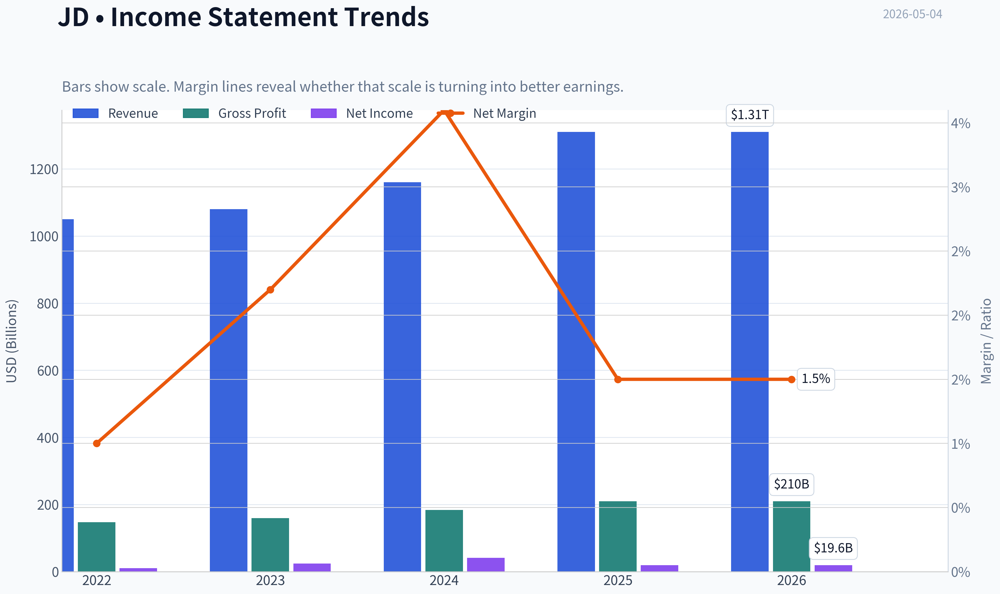

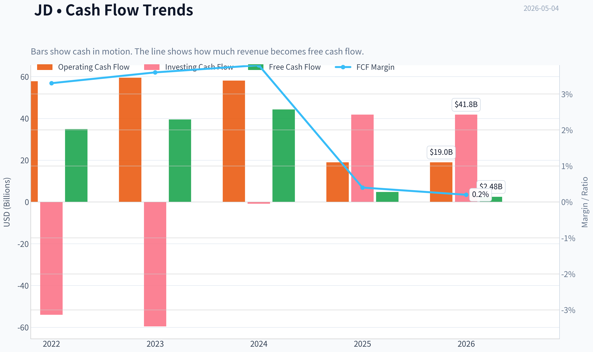

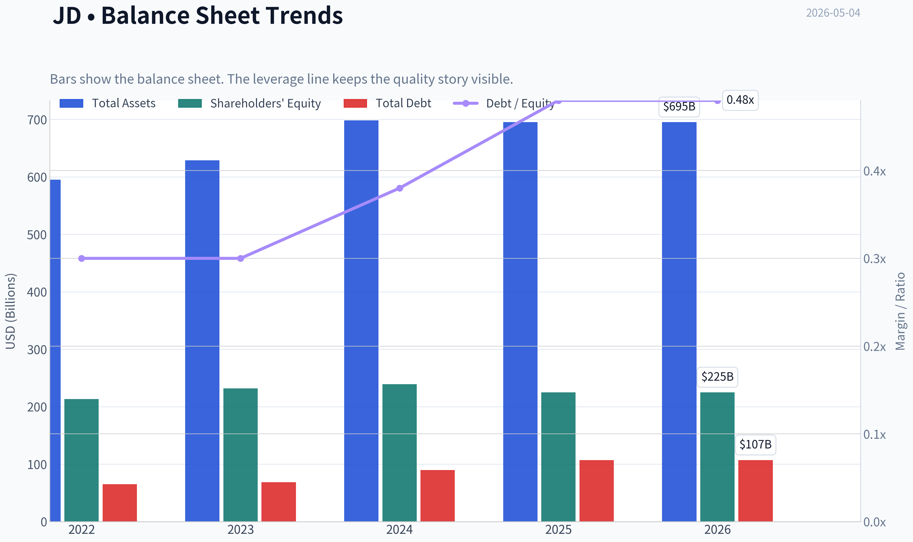

This graph tracks the profitability and return metrics (ROE, ROIC, Margins) of **JD** over the past decade, highlighting capital efficiency trends.

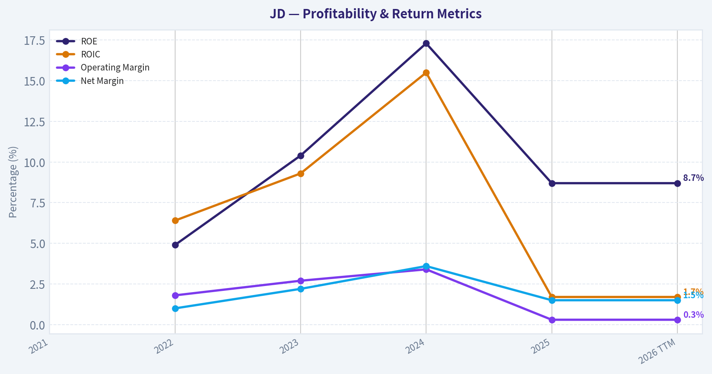

This chart illustrates the financial health of **JD** over the last 10 years, mapping cash equivalents and free cash flow against total obligations (Debt).

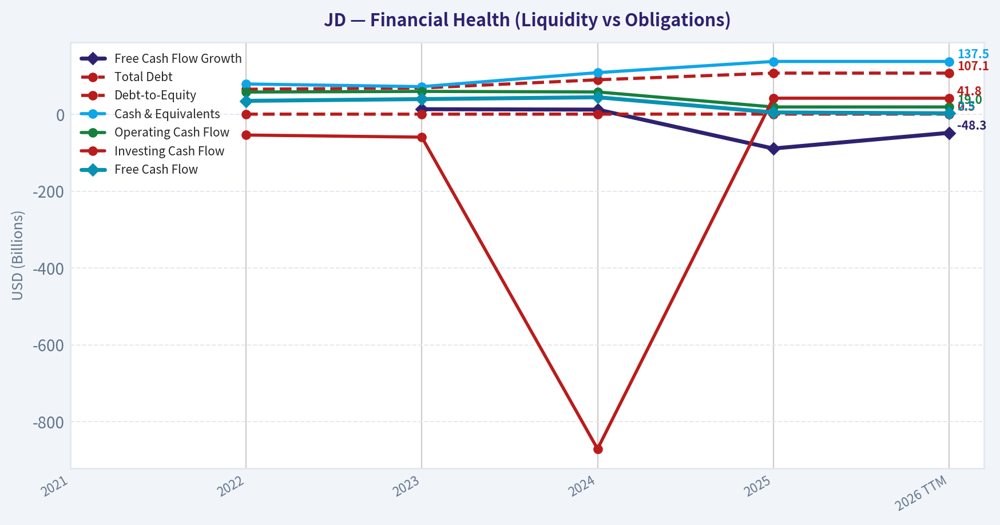

This breakdown chart from <em>Revenue Breakdown</em> shows the proportional composition for **JD** - useful for understanding what drives or risks the business.

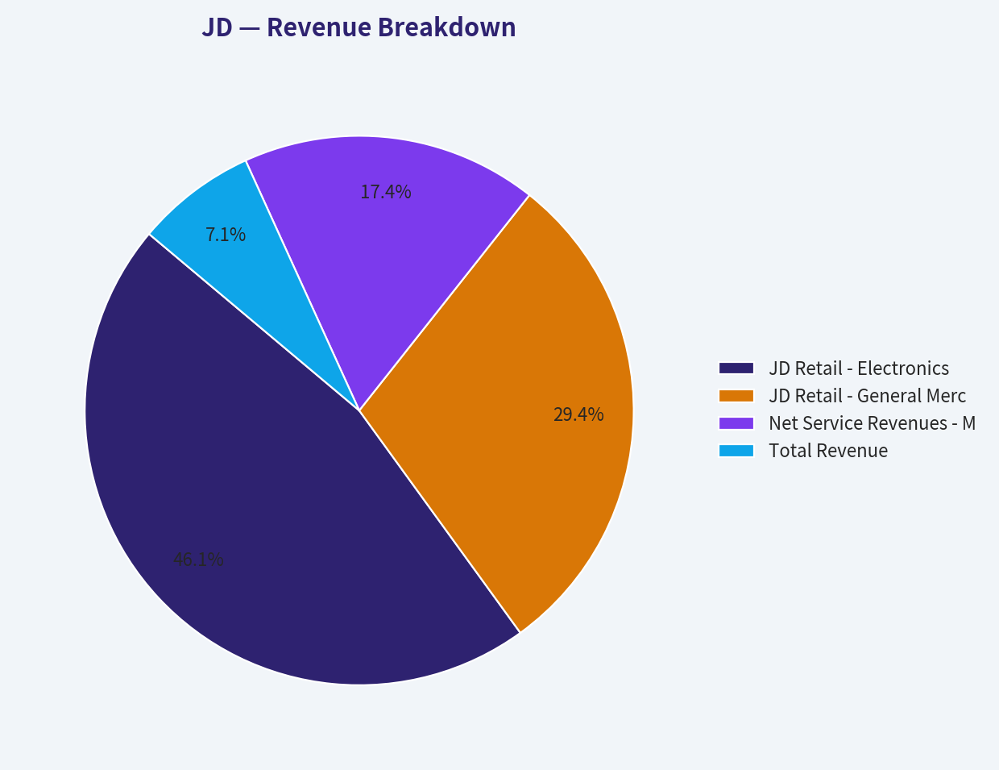

---

### Intrinsic Value Analysis (Buffett)

> *Following Warren Buffett's value investing philosophy: Circle of Competence, Economic Moat, Management Quality, and Margin of Safety.*

#### Intrinsic Value Snapshot

Price is what you pay. Intrinsic value is what the business may be worth based on the cash it can create for owners over time. We show a range, not one magic number.

- Current Price: $30.04
- Value Range: $6.05 to $64.51

##### Owner Earnings (Buffett Method)
- Net Income: $19,631,000,000.00
- Depreciation & Amortization: $9,747,000,000.00
- Capital Expenditures: $-14,184,000,000.00
- Working Capital Changes: $-7,043,000,000.00
- Owner Earnings: $22,237,000,000.00

##### Intrinsic Value
###### Buffett Method
Uses owner earnings. Stricter, and usually more conservative.
- Conservative: $61.68
- Average: $61.68
- Optimistic: $61.68
- Discount Rate: 10.0%

###### Cash Flow Method
Uses free cash flow. Better for companies spending heavily today to grow tomorrow.
- Conservative: $6.05
- Average: $6.05
- Optimistic: $64.51
- Discount Rate: 10.0%

ANALYST STANCE: **AVOID** - JD.com is statistically cheap, but it does not clear Buffett-style quality gates because returns on equity are modest, gross margins are thin, the industry is intensely competitive, and long-term predictability is impaired by China e-commerce competition, regulation, and VIE/geopolitical risks.

#### Executive Summary

JD.com is a large Chinese e-commerce and logistics company. The business is easy to understand: JD sells goods online, operates a marketplace, and uses its own logistics network to deliver products quickly. At today's price of about **$30 per ADS**, with a **$41.03 billion market capitalization**, **15.9x earnings**, and an estimated **11.7% free cash flow yield**, the stock looks inexpensive.

But Buffett's question is not "Is it cheap?" The question is: **Is this a wonderful business with durable economics and predictable owner earnings?** On that standard, JD falls short. Its **16% gross margin** and **8.7% ROE** are not evidence of a wide, high-return moat. The logistics network is valuable, but it is capital-intensive and competes in a brutal Chinese e-commerce market against Alibaba, PDD, Meituan, Douyin/TikTok commerce, and other quick-commerce players.

---

#### 1. Go / No-Go Gate Assessment

| Buffett Gate | Result | Evidence | Investment Implication |
|---|---:|---|---|
| Gate 1: Circle of Competence & Simplicity | **Pass, with caution** | JD sells goods online, runs a marketplace, and delivers through its logistics network. The model is understandable. | Business model is simple enough, but China regulatory and platform competition add complexity. |
| Gate 2: Durable Moat | **Fail / Narrow moat** | Logistics scale is real, but gross margin is only **16%**, ROE is **8.7%**, and competition is intense. | Moat exists operationally, but not enough to produce superior returns. |
| Gate 3: Management & Capital Allocation | **Mixed** | JD has invested heavily in logistics and scale. However, returns on equity remain below Buffett-quality levels. | Management has built infrastructure, but capital efficiency is not yet exceptional. |
| Gate 4: Industry Structure | **Fail** | Chinese e-commerce is hypercompetitive, price-sensitive, and exposed to regulatory/political risk. | Industry structure is not Buffett-like; it is closer to a constant reinvestment battlefield. |

**Key Takeaways:** JD passes the basic understandability test, but it fails the more important Buffett tests: durable high returns and favorable industry structure. The company has scale and logistical advantages, but those advantages have not translated into consistently high margins or high returns on equity. For a Buffett-style investor, that is a major warning sign.

---

#### 2. Business Understanding: Elementary School Test

JD makes money by helping people buy things online. It sells products directly to customers, allows other merchants to sell on its platform, and uses its warehouses and delivery network to move goods quickly. It also earns money from logistics services, advertising, marketplace commissions, and related technology services.

This is understandable. The harder part is predicting how much profit JD can keep over the next decade. In China, e-commerce is highly competitive, and consumer platforms often compete through discounts, subsidies, faster delivery, and lower merchant fees. That makes long-term margin expansion less predictable.

---

#### 3. Moat Analysis

| Moat Source | JD Evidence | Buffett Assessment |
|---|---|---|
| Brand / Intangible Assets | JD is a recognized Chinese e-commerce brand known for authenticity, electronics, and reliable delivery. | Useful brand, but not Coca-Cola-like emotional pricing power. |
| Pricing Power | Gross margin is only **16%**, suggesting limited ability to raise prices materially. | Weak pricing power. A true Buffett moat usually shows much higher gross margins. |
| Switching Costs | Consumers can switch easily among JD, Alibaba, PDD, Douyin, Meituan, and others. Merchants can multi-home. | Low to moderate switching costs. |
| Cost Advantage | JD's logistics scale may lower delivery cost and improve service reliability. | Real advantage, but capital-intensive and constantly challenged. |
| Network Effects | More users and merchants help the platform, but Chinese e-commerce platforms all have scale. | Network effect exists but is not dominant enough to eliminate rivalry. |
| Regulatory / License Advantage | No obvious exclusive license or protected monopoly. | Not a durable Buffett moat. |

**Key Takeaways:** JD's best moat is its logistics network, which improves speed, reliability, and customer trust. But this moat is expensive to maintain and does not produce elite margins or returns. The company has advantages, but they look more like a **narrow operational moat** than a wide Buffett-style economic castle.

**Moat Rating:** **Narrow, not wide.**

---

#### 4. Management Quality & Capital Allocation

| Question | Assessment | Evidence / Reasoning |
|---|---:|---|
| Do they think like owners? | **Mixed** | JD has historically prioritized long-term logistics infrastructure and customer trust, which is positive. |
| Are they candid and conservative? | **Unclear from available data** | No major red flag from the provided pack, but deeper annual-letter and accounting review would be required. |
| Are they rational capital allocators? | **Mixed to weak** | Heavy reinvestment has built scale, but current **ROE of 8.7%** is below the 15% Buffett threshold. |
| Balance between growth and returns | **Questionable** | Revenue growth is solid at **13% YoY**, but profitability quality is not exceptional. |
| Buybacks / dividends | **Not enough evidence in pack** | Cannot give full credit without detailed capital-return history. |

**Key Takeaways:** JD's management deserves credit for building one of China's most capable logistics systems. However, Buffett would ask whether every retained dollar creates more than one dollar of value. With ROE below 10%, the answer is not yet convincing.

---

#### 5. Available Financial Summary

| Metric | Current / Latest Data | Buffett Hurdle | Assessment |
|---|---:|---:|---|
| Share Price | **$30** | Buy below intrinsic value | Potentially cheap |
| Market Capitalization | **$41.03B** | Size not decisive | Large, established business |
| P/E Ratio | **15.9x** | Lower is better if quality is high | Reasonable, not obviously expensive |
| ROE | **8.7%** | >15%, ideally >20% | Weak for Buffett standards |
| Gross Margin | **16.0%** | >40% for strong intangible moat | Weak evidence of pricing power |
| Revenue Growth YoY | **13.0%** | Durable, profitable growth preferred | Good growth, but quality matters |
| Free Cash Flow Yield | **11.7%** | Higher is better | Attractive headline valuation |
| Current Ratio | **1.22x** | >1.0 acceptable | Adequate liquidity |
| Industry Competition | High | Rational oligopoly preferred | Negative |
| China / VIE / Regulatory Risk | Meaningful | Predictability preferred | Negative |

**Key Takeaways:** JD looks cheap on free cash flow yield and reasonable on earnings multiple. But the quality metrics are mediocre: ROE is below Buffett's hurdle, and gross margins are far below what one would expect from a company with strong pricing power. The valuation is tempting, but the business economics are not clearly wonderful.

---

#### 6. Owner Earnings Calculation

Because detailed depreciation, maintenance capex, and working capital data are not available in the provided pack, I use free cash flow as a practical proxy for owner earnings.

| Owner Earnings Item | Estimate / Formula | Amount |
|---|---:|---:|
| Market Capitalization | Given | **$41.03B** |
| Free Cash Flow Yield | Given | **11.7%** |
| Estimated Free Cash Flow / Owner Earnings Proxy | $41.03B x 11.7% | **$4.80B** |
| Net Income Cross-Check | $41.03B / 15.894 P/E | **$2.58B** |
| Owner Earnings Used in DCF | FCF proxy | **$4.80B** |

**Key Takeaways:** JD appears to generate substantial free cash flow relative to its market value, which is the strongest part of the bull case. However, the large gap between estimated free cash flow and net income requires deeper verification. Buffett would want to know how much of this cash flow is truly recurring and how much must be reinvested just to defend JD's competitive position.

---

#### 7. Three-Scenario Intrinsic Value Estimate

Assumptions:

| Assumption | Value |
|---|---:|
| Estimated Owner Earnings | **$4.80B** |
| Discount Rate | **10%** |
| Current Market Cap | **$41.03B** |
| Current Price | **$30** |
| Implied Shares / ADS Count | **~1.37B** |

**Key Takeaways:** The valuation below is based on a simplified owner-earnings model. The key input is estimated owner earnings of about $4.8 billion. This makes JD look inexpensive, but the valuation is very sensitive to whether those earnings are durable.

| Scenario | Method | Intrinsic Equity Value | Intrinsic Value / ADS | Margin of Safety vs. $30 |
|---|---|---:|---:|---:|
| A: No Growth | Owner earnings / 10% | **$48.0B** | **~$35** | **~15%** |
| B: GDP Growth | 3% perpetual growth | **$70.6B** | **~$52** | **~42%** |
| C: Historical Growth Discounted | 6.5% for 10 years, then 3% terminal | **$91.5B** | **~$67** | **~55%** |

**Key Takeaways:** On a purely mechanical DCF, JD looks undervalued in the conservative-growth and historical-growth cases. But the no-growth case provides only about a 15% margin of safety, which is not enough for a company with JD's competitive and jurisdictional risks. A Buffett-style investor should demand a much larger discount before accepting this uncertainty.

---

#### 8. Margin of Safety Analysis

| Quality Category | Required Margin of Safety | JD's Apparent Margin | Verdict |
|---|---:|---:|---|
| Wonderful, predictable business | 25% | Not applicable | JD does not qualify as wonderful/predictable enough |
| Average business with uncertainty | 40% to 50% | 15% to 55%, depending on scenario | Only attractive if growth assumptions hold |
| China / VIE / regulatory risk adjustment | Higher than normal | Not fully captured in DCF | Margin should be larger |
| Buffett-style buy threshold | Very high confidence + discount | Not met | Avoid for now |

**Key Takeaways:** JD may be cheap, but cheap is not enough. Because the business does not have elite returns, high margins, or a clear wide moat, the investor should require a very large margin of safety. At $30, the valuation is interesting but not compelling enough for a Buffett-style purchase.

---

#### 9. Guru / Market Sentiment Context

| Investor / Source | Recent Action | Interpretation |
|---|---|---|
| Steve Cohen / Point72 | Trimmed position by about **63.2%** as of latest 13F | Not a Buffett signal, but indicates reduced hedge fund exposure |
| Michael Burry / Scion | Exited prior position | Adds caution, though 13F data is delayed |
| Recent coverage | Some bullish commentary on logistics, AI, and marketplace growth | Market recognizes potential re-rating drivers |
| Consensus-style upside | Reports suggest possible analyst upside | Short-term target prices are not a substitute for intrinsic value |

**Key Takeaways:** Recent investor tracking does not show strong conviction from the referenced gurus. Some analysts see upside from logistics, AI, and marketplace growth, but Buffett-style investing does not rely on re-rating hopes. The key issue remains whether JD can convert scale into durable high returns.

---

#### 10. Final Buffett Scorecard

| Criterion | Weight | Score 1-5 | Weighted Score | Rationale |
|---|---:|---:|---:|---|
| Business Understanding | 20% | 3.5 | 0.70 | Business model is understandable, but China platform dynamics add uncertainty. |
| Moat Width & Durability | 25% | 2.5 | 0.63 | Logistics moat exists, but pricing power and margins are weak. |
| Management Quality | 15% | 3.0 | 0.45 | Long-term infrastructure investment is positive, but returns are not elite. |
| Return on Equity | 15% | 2.0 | 0.30 | ROE of **8.7%** is below Buffett-quality levels. |
| Reinvestment Runway | 10% | 3.5 | 0.35 | E-commerce, logistics, and services can grow, but competition is fierce. |
| Balance Sheet Strength | 5% | 3.0 | 0.15 | Current ratio of **1.22x** is adequate; deeper debt review needed. |
| Industry Structure | 5% | 2.0 | 0.10 | Hypercompetitive Chinese e-commerce is structurally difficult. |
| Valuation / Margin of Safety | 5% | 4.0 | 0.20 | FCF yield is attractive, but quality discount is warranted. |
| **Total** | **100%** |  | **2.88 / 5.00** | **Avoid / not compelling** |

**Key Takeaways:** JD scores well on valuation but poorly on the factors Buffett cares about most: moat durability, return on equity, pricing power, and industry structure. The total score of about 2.9 places it below the threshold for a watchlist-quality Buffett compounder. The stock may work as a value or re-rating trade, but it is not a classic Buffett investment.

---

#### Final Investment Stance

**ANALYST STANCE: AVOID**

JD.com is not an obvious short or a bad company. In fact, the stock may be statistically undervalued if free cash flow is durable and if the company continues to grow at a reasonable rate. But Buffett-style investing is selective. JD's **low gross margin**, **sub-10% ROE**, **capital-intensive logistics model**, and **hypercompetitive Chinese e-commerce environment** prevent it from qualifying as a wonderful business.

At a much lower price, JD could become an interesting deep-value situation. But as a long-term Buffett-style compounder, it does not clear the quality bar today.

**Conviction Level:** **Moderate**
**Primary Reason:** Cheap valuation is outweighed by mediocre returns on capital and uncertain moat durability.
#### Valuation Bridge

This bridge places the current market price beside each intrinsic value lens so readers can see whether upside depends on one method or shows up across several methods.

| Scenario | Intrinsic Value / Share |
| --- | ---: |
| Buffett Method | $61.68 |
| Cash Flow Method | $6.05 |
| Damodaran Method | $548.38 |
| Current Price | $30.04 |

#### Key Takeaways

If one method is far above the others, the upside case depends on a specific modelling assumption. When several methods cluster together, the valuation story is more robust.

#### Valuation Visuals

This comparison chart from *Latest Earnings Snapshot* stacks current figures against historical benchmarks for **JD**, making it easy to see where the company trades relative to its own averages.

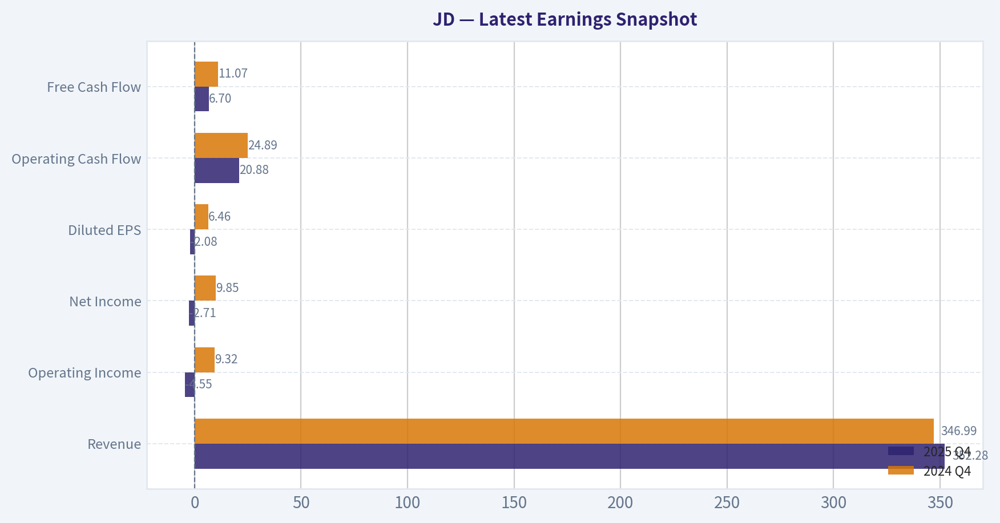

This comparison chart from *Current vs Historical Average Comparison* stacks current figures against historical benchmarks for **JD**, making it easy to see where the company trades relative to its own averages.

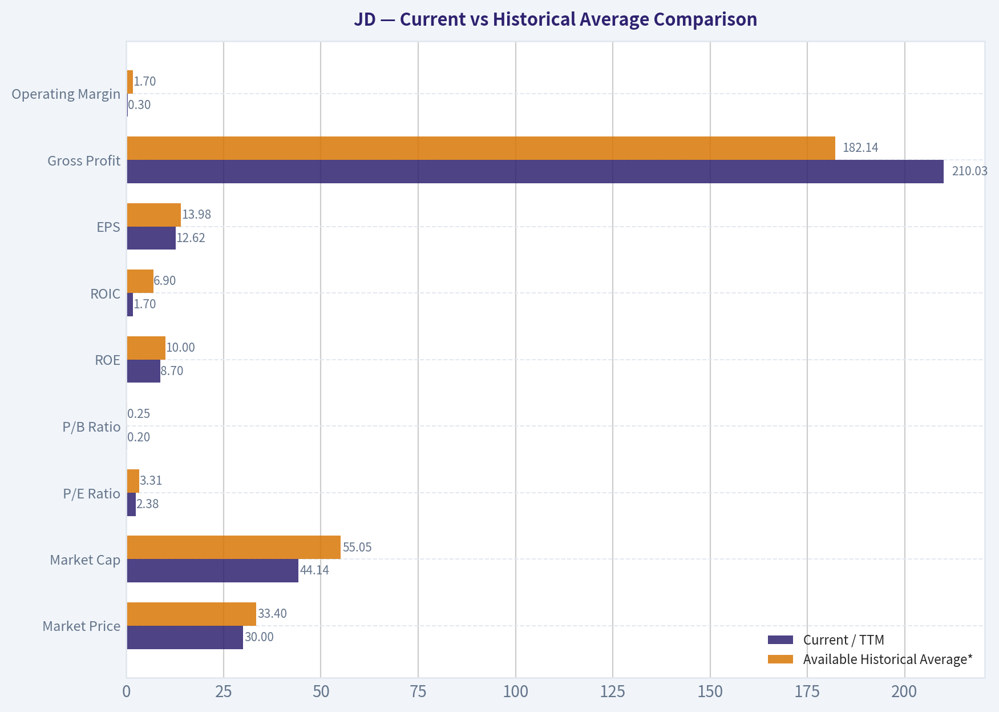

This comparison chart from *Buffett-Style Owner Earnings DCF Valuation* stacks current figures against historical benchmarks for **JD**, making it easy to see where the company trades relative to its own averages.

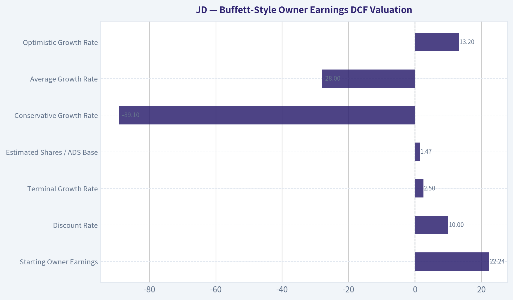

This comparison chart from *Available Financial Summary* stacks current figures against historical benchmarks for **JD**, making it easy to see where the company trades relative to its own averages.

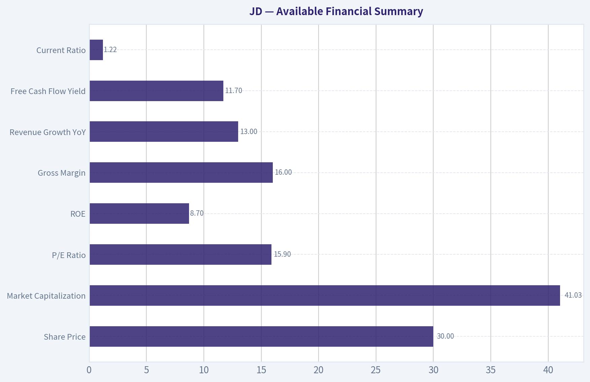

This comparison chart from *Owner Earnings Calculation* stacks current figures against historical benchmarks for **JD**, making it easy to see where the company trades relative to its own averages.

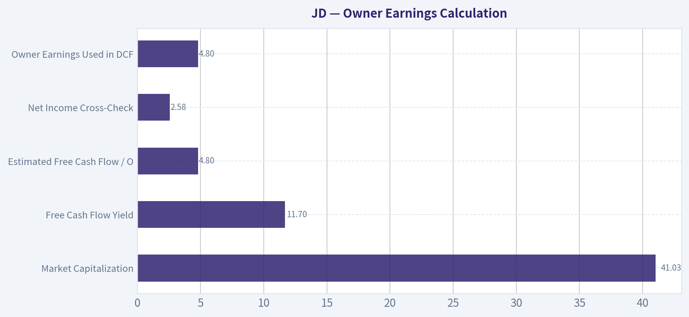

---

### Trend & Growth Analysis (Lynch/Druckenmiller/Fisher)

> *Following Peter Lynch's GARP, Stanley Druckenmiller's macro-aware approach, and Philip Fisher's scuttlebutt methodology.*

ANALYST STANCE: **WATCH**

#### JD.com Growth Investment Report - JD

JD is a cheap, cash-generative Chinese e-commerce and logistics leader, but it does **not yet screen as a clean Lynch-style fast grower**. The setup is more of a **value-plus-margin-inflection story** than a true ten-bagger growth story. At today's valuation, downside looks cushioned by free cash flow, but upside depends on sustained revenue reacceleration, margin expansion, and a China consumer recovery.

---

#### 1. Lynch Classification

| Category | JD Fit | Evidence | Growth Investor Interpretation |
|---|---:|---|---|
| Slow Grower | No | Revenue growth is above low-single digits | Not a sleepy mature utility-like business |
| Stalwart | Yes / borderline | YoY revenue growth around 13%, large $41B market cap | More mature compounder than hypergrowth name |
| Fast Grower | Not yet | Needs sustained 15% to 25%+ growth | Close, but not clearly in ten-bagger territory |
| Cyclical | Partial | Consumer discretionary, electronics, appliances, China macro exposure | Macro matters more than ideal for pure growth investing |
| Turnaround | Partial | Margin and sentiment recovery possible | Could rerate if China internet sentiment improves |
| Asset Play | Partial | Logistics network, cash generation, infrastructure value | Valuable, but not the main growth thesis |

**Key Takeaways:** JD is best classified as a **stalwart with turnaround and asset-play characteristics**, not a classic fast grower. Revenue growth is respectable, but the business is already very large and operates in a fiercely competitive Chinese e-commerce market. For Lynch-style growth investing, this is a **watch-list compounder**, not an automatic buy.

---

#### 2. The Story in 3 Bullets

- JD sells goods online in China and differentiates through **fast, reliable, self-operated logistics** and trusted product authenticity.
- The growth story depends on **retail recovery, marketplace expansion, logistics monetization, AI-driven efficiency, and international logistics initiatives such as JoyExpress**.
- The stock is cheap because investors discount China macro risk, thin retail margins, competition from Alibaba, PDD, Douyin, and geopolitical/regulatory uncertainty.

---

#### 3. Core Fundamentals Snapshot

| Metric | Current Data / Estimate | Growth Investor Read |
|---|---:|---|
| Share Price | ~$30 | Depressed versus historical highs |
| Market Cap | ~$41.03B | Large-cap; harder to become a ten-bagger |
| P/E | ~15.9x | Reasonable if earnings grow mid-teens |
| YoY Revenue Growth | ~13.0% | Good, but below ideal fast-grower threshold |
| Gross Margin | ~16.0% | Structurally low due to first-party retail model |
| ROE | ~8.7% | Acceptable but not exceptional |
| FCF Yield | ~11.7% | Very attractive cash-flow support |
| Current Ratio | ~1.22x | Adequate liquidity |
| Guru Activity | Cohen trimmed; Burry exited | No major guru confirmation signal |

**Key Takeaways:** JD looks inexpensive on earnings and especially on free cash flow, but profitability quality is still constrained by low margins. Revenue growth is solid, not spectacular. The strongest metric is the **11.7% FCF yield**, which gives the stock a value cushion while investors wait for a growth or margin inflection.

---

#### 4. TAM and 10x Test

| Item | Estimate / View | Interpretation |
|---|---:|---|
| Current Revenue | Roughly $150B-$165B annualized range, directional estimate | Already massive scale |
| 10x Revenue Target | $1.5T+ | Extremely difficult given China retail market size |
| Core TAM | China e-commerce, retail, logistics, quick commerce | Large but competitive |
| TAM Growth | Moderate; quick commerce and logistics faster than core retail | Expansion exists but not enough alone |
| Can JD 10x revenue and stay below 20% TAM share? | Unlikely | Fails strict ten-bagger runway test |
| Can JD 2x to 3x earnings via margin expansion and buybacks? | More plausible | Better thesis than 10x revenue growth |

**Key Takeaways:** JD has a large addressable market, but the company is already too big for a clean 10x revenue runway. The more realistic upside case is not hypergrowth; it is **earnings growth through margin expansion, logistics monetization, marketplace mix shift, and capital returns**. This makes JD more attractive for GARP or value-growth investors than for pure ten-bagger hunters.

---

#### 5. Revenue Growth Trend

| Period / Indicator | Trend | Interpretation |
|---|---|---|
| Current YoY Revenue Growth | ~13% | Solid recovery-like growth |
| Historical Context | Growth has slowed materially from earlier JD years | Maturity is visible |
| Pattern | Reacceleration from weaker China consumer periods, but not yet high-growth | Mild positive inflection |
| Quality of Growth | Mix of retail demand, logistics, marketplace, and service monetization | Needs verification by segment |
| Growth Verdict | Stable-to-improving, not explosive | Watch for acceleration above 15% |

**Key Takeaways:** JD's current 13% growth is encouraging, especially if it represents reacceleration after a weaker period. However, the growth rate is still below the 15% to 25% zone preferred for Lynch-style fast growers. The key monitoring point is whether JD can sustain or accelerate growth while also improving margins.

---

#### 6. Unit Economics and Efficiency

| Metric | JD Status | Assessment |
|---|---:|---|
| LTV / CAC | Not disclosed in standard retail format | Not directly analyzable |
| Net Revenue Retention | Not applicable | JD is not SaaS |
| Rule of 40 | Not applicable; retail model | Would be misleading |
| Gross Margin | ~16.0% | Low but normal for 1P retail |
| FCF Yield | ~11.7% | Excellent cash generation versus valuation |
| FCF Margin | Likely low-single digits, directional | Thin but meaningful at scale |
| Fulfillment Efficiency | Core advantage | Logistics moat can support retention and trust |
| Inventory / Working Capital | Must monitor closely | Retail cash flow can swing with working capital |

**Key Takeaways:** JD does not fit SaaS-style unit economic frameworks, but it does show strong cash generation relative to market value. The business has thin margins, yet its scale and logistics network create meaningful free cash flow. For JD, the key efficiency metric is not Rule of 40; it is whether fulfillment costs, inventory turnover, and operating margin keep improving.

---

#### 7. Inflection Point Assessment

| Inflection Type | Evidence | Rating |
|---|---|---:|
| Product Cycle Inflection | AI, marketplace tools, logistics automation, quick commerce | Moderate |
| Market Share Inflection | Possible in quality-focused retail, but competition intense | Low to Moderate |
| Margin Inflection | Strongest part of thesis; operating leverage and logistics efficiency | Moderate to High |
| TAM Inflection | Quick commerce and international logistics expand opportunity | Moderate |
| Competitive Inflection | Alibaba, PDD, Douyin remain aggressive | Weak |
| Capital Return Inflection | High FCF yield creates room for buybacks/dividends | Moderate to High |

**Key Takeaways:** The most credible JD inflection is **margin and cash-flow expansion**, not explosive revenue acceleration. Logistics automation, AI, marketplace growth, and international expansion could help the story, but competitive pressure remains intense. The stock can rerate if investors begin to believe JD's earnings power is structurally higher than the market currently assumes.

---

#### 8. Macro Setup

| Macro Factor | Current Read | Impact on JD |
|---|---|---|
| China Consumer Cycle | Still mixed, with uneven discretionary demand | Headwind / optional recovery catalyst |
| Interest Rates | Global rate environment less hostile than 2022-2023 period | Mild support for equities |
| China Internet Sentiment | Still discounted due to regulation/geopolitics | Valuation overhang |
| Secular Themes | E-commerce, logistics automation, AI, digital retail, quick commerce | Positive |
| FX / ADR Risk | RMB and U.S.-China tensions matter | Persistent risk |
| Policy Support | China consumption stimulus could help | Potential catalyst |

**Key Takeaways:** JD's macro setup is mixed. The company benefits from secular digital commerce and logistics automation, but China consumer weakness and geopolitical risk continue to suppress valuation. A meaningful China consumption recovery would be a major catalyst.

---

#### 9. Fisher 15-Point Score

| Fisher Point | Score / 5 | Rationale |
|---|---:|---|
| 1. Products with sizable market potential | 4 | China retail and logistics remain large |
| 2. Management determination to develop new products | 4 | AI, logistics, marketplace, international initiatives |
| 3. Effective R&D | 3 | Technology matters, but JD is not a pure innovation platform |
| 4. Above-average sales organization | 3 | Strong brand, but traffic competition is fierce |
| 5. Worthwhile profit margin | 2 | Margins are structurally thin |
| 6. Improving profit margins | 4 | Margin expansion is central to thesis |
| 7. Labor/personnel relations | 3 | Large logistics workforce creates complexity |
| 8. Executive relations | 3 | Adequate, but not a clear standout |
| 9. Management depth | 3 | Large organization with operational depth |
| 10. Cost analysis/accounting | 4 | Scale retail requires strong operating discipline |
| 11. Outstanding moat aspects | 4 | Logistics, trust, supply chain infrastructure |
| 12. Long-range profit outlook | 3 | Good but capped by competition |
| 13. Dilution risk | 4 | FCF generation reduces need for capital raises |
| 14. Candor in difficulties | 3 | Acceptable, but China ADR disclosure discount remains |
| 15. Management integrity | 3 | No decisive edge from available data |
| **Total** | **50 / 75** | **Average to good, not outstanding** |

**Key Takeaways:** JD scores reasonably well on market potential, logistics moat, cost discipline, and margin improvement. The score is held back by thin margins, intense competition, and macro/geopolitical uncertainty. A 50 out of 75 score supports a **WATCH** stance rather than an aggressive growth endorsement.

---

#### 10. Valuation Analysis

| Valuation Metric | Current / Estimate | Interpretation |
|---|---:|---|
| P/E | ~15.9x | Reasonable for mid-teens earnings growth |
| Revenue Growth | ~13% | Decent but not fast-grower level |
| PEG using 13% growth | ~1.22x | Fair value |
| PEG using 16% earnings growth | ~0.99x | Attractive if margin expansion continues |
| FCF Yield | ~11.7% | Very attractive |
| P/S | Likely around 0.25x-0.30x, directional | Very low, but normal for low-margin retail |
| Gross Margin | ~16% | Explains low sales multiple |
| Valuation Verdict | Cheap, but deserved discount partly reflects risk | Attractive value, moderate growth |

**Key Takeaways:** JD is statistically cheap, especially on free cash flow. The PEG ratio becomes attractive if earnings can grow faster than revenue through operating leverage. However, the low P/S multiple should not be mistaken for deep undervaluation without considering JD's structurally thin margins.

---

#### 11. Scenario Analysis

| Scenario | Assumptions | 3-Year Outcome View |
|---|---|---|
| Bear Case | China consumption weak, competition pressures pricing, margins stall | Stock remains value trap; limited upside despite low multiple |
| Base Case | Revenue grows high-single to low-teens, margins gradually improve, FCF stays strong | Moderate rerating plus buyback support; attractive but not explosive |
| Bull Case | Revenue reaccelerates above 15%, logistics/marketplace margins expand, China sentiment improves | P/E rerates, EPS compounds strongly; potential 2x to 3x over time |
| Ten-Bagger Case | Requires massive revenue and margin expansion plus major China rerating | Low probability from current scale |

**Key Takeaways:** JD's realistic upside is a **2x to 3x rerating and compounding case**, not a clean ten-bagger case. The bull case requires both operating improvement and a better China macro narrative. The bear case is that JD stays cheap because growth remains modest and competition prevents durable margin expansion.

---

#### 12. Growth Investor Scorecard

| Criterion | Weight | Score / 5 | Weighted Score |
|---|---:|---:|---:|
| The Story | 10% | 3.5 | 0.35 |
| TAM & Runway | 20% | 3.0 | 0.60 |
| Revenue Growth | 20% | 3.0 | 0.60 |
| Unit Economics / Efficiency | 15% | 3.5 | 0.53 |
| Competitive Position | 10% | 3.5 | 0.35 |
| Management Quality | 10% | 3.0 | 0.30 |
| Macro Setup | 5% | 2.5 | 0.13 |
| Profitability Path | 5% | 3.5 | 0.18 |
| Valuation | 5% | 4.0 | 0.20 |
| **Total** | **100%** |  | **3.24 / 5.00** |

**Key Takeaways:** JD scores well on valuation, logistics-based competitive position, and cash generation. The score is limited by moderate revenue growth, macro uncertainty, and a less compelling 10x runway. A 3.24 score falls in the **WATCH** range.

---

#### 13. Position Size Stance

| Investor Type | Stance | Position Size View |
|---|---|---|
| Pure growth / ten-bagger investor | WATCH | Too mature and macro-exposed for a large position |
| GARP investor | Small starter acceptable | Valuation and FCF are compelling if risk is understood |
| Deep value investor | More interesting | Low multiple and FCF yield are attractive |
| Concentrated growth portfolio | Avoid large allocation for now | Need clearer acceleration first |
| Existing holder | Hold / monitor | Do not sell solely on low growth if FCF remains strong |

**Key Takeaways:** JD is investable for GARP and value-oriented investors, but it does not yet deserve a high-conviction growth allocation. A small starter position can be justified if one believes in China recovery and margin expansion. For a concentrated growth portfolio, the better action is to wait for clearer evidence of acceleration.

---

#### 14. Key Catalysts and Risks

| Catalysts | Risks |
|---|---|
| Revenue growth sustains above 15% | China consumer demand remains weak |
| JD Logistics margin expansion | PDD, Alibaba, Douyin intensify price competition |
| Marketplace mix increases gross margin | Gross margin contraction from promotions |
| AI improves fulfillment and operating efficiency | Regulatory or ADR/geopolitical shock |
| Buybacks or dividends increase shareholder returns | Working-capital deterioration or inventory buildup |
| China stimulus improves consumption | Guru selling reinforces negative sentiment |
| International logistics growth gains traction | Low-margin model limits long-term ROE |

**Key Takeaways:** The most important catalysts are revenue acceleration, logistics profitability, capital returns, and China consumer recovery. The biggest risks are competition, macro weakness, and persistent valuation discounts tied to China exposure. JD needs proof of durable margin expansion to move from watch list to advocacy.

---

#### Final View

JD is **cheap, cash-generative, and strategically important**, with a real logistics moat and potential margin inflection. But it is not yet a classic Lynch fast grower, and the 10x upside case is weak because the company is already very large.

**Decision:** **WATCH**
**Upgrade to ADVOCATE if:** revenue growth sustains above 15%, gross margin expands, JD Logistics profitability improves, and capital returns accelerate.
**Downgrade to AVOID if:** revenue growth slips back to low-single digits, gross margin contracts, or competitive discounting erodes free cash flow.

---

### Market Technical Analysis

ANALYST STANCE: **WATCH**

#### JD Technical Analysis - As of 2026-05-04

JD did not have a trading print on 2026-05-04, so the most recent usable close is **2026-05-01 at $29.96**. The stock has staged a meaningful recovery from its March lows, but the April breakout has cooled into a consolidation/pullback. The current setup is not bearish enough to avoid outright, but it is also not clean enough to advocate fresh aggressive buying until price confirms support and reclaims near-term volume-weighted resistance.

#### Selected Indicators

| Indicator | Latest Value / Signal | Why It Matters Here |
|---|---:|---|
| `close_10_ema` | $30.06 | Tracks short-term momentum; price is slightly below it, showing near-term hesitation. |
| `close_50_sma` | $28.00 | Medium-term trend support; price remains well above it, keeping the recovery structure intact. |
| `close_200_sma` | $29.62 | Long-term trend benchmark; price is only modestly above it, making this a key battleground. |
| `macd` | +0.57 | Still positive, but falling from late-April highs, showing momentum is fading rather than accelerating. |
| `rsi` | 55.18 | Neutral-positive after cooling from overbought; no longer stretched, but not showing strong upside pressure. |
| `boll_ub` | $32.45 | Defines upper breakout zone; price is far below the upper band after failing to sustain the April push. |
| `atr` | $0.67 | Volatility has eased from mid-April levels; useful for stop placement and position sizing. |
| `vwma` | $30.77 | Volume-weighted trend reference; price below VWMA suggests recent high-volume buyers are not yet fully in control. |

Key Takeaways: The indicator set shows a stock that has improved materially from March but is now digesting gains. JD remains above its 50-day and 200-day averages, which is constructive, but the close below the 10-day EMA and VWMA warns that short-term momentum has weakened. The best interpretation is a recovery trend under pressure, not a confirmed renewed breakout.

---

#### Trend Structure

JD's broader trend is attempting to transition from decline to recovery. The stock fell into the low-to-mid $20s in early March, bottoming around the **$24.5-$25.0 area**, then rebounded strongly into late March and April. The most important change is that price has moved back above both the **50-day SMA at $28.00** and the **200-day SMA at $29.62**, which is often a first sign that sellers are losing control.

However, the trend is not fully repaired. The **50-day SMA remains below the 200-day SMA**, which means the medium-term trend has not yet produced a classic bullish moving-average structure. Encouragingly, the 50-day SMA has been rising steadily through April, while the 200-day SMA has been drifting slightly lower. That creates the possibility of a future bullish trend transition, but it has not happened yet.

The current price of **$29.96** sits just above the 200-day SMA. This makes the **$29.6-$30.0 zone** especially important. If JD holds this area and begins to turn higher, the recent pullback could be viewed as healthy consolidation after the April rally. If it loses this zone decisively, the market may start treating the April breakout as a failed move.

#### Momentum Analysis

The **MACD remains positive at +0.57**, which means intermediate momentum is still above zero. That is constructive. But the key nuance is that MACD has been declining from its late-April peak near **+1.13**, showing that upside momentum is decelerating.

RSI confirms the same pattern. RSI surged into overbought territory in mid-April, reaching the **74-75 range**, during the sharp move toward $31-$32. It has since cooled to **55.18**, which is healthier than remaining overbought, but it also means buyers have lost some short-term intensity. This is not a classic sell signal by itself; rather, it suggests the stock needs either time or a fresh catalyst before another sustained leg higher.

The strongest bullish case would require RSI to stabilize above 50 while price holds above the 200-day SMA. A weaker signal would emerge if RSI slips below 50 while price breaks back under $29.6, because that would show both trend and momentum turning down together.

#### Volume and Participation

The **VWMA is $30.77**, while the latest close is **$29.96**. That is an important caution flag. VWMA gives greater weight to prices traded on higher volume, so when price is below VWMA, it suggests the market is trading below the recent volume-weighted cost basis.

This does not automatically mean distribution is severe. In fact, the late-April pullback occurred on relatively modest volume compared with the high-volume April rally day. That argues against panic selling. Still, price has not yet reclaimed the level where recent volume concentration sits, so buyers have not fully regained control.

A close back above **$30.75-$31.00** would improve the volume confirmation picture. Until then, traders should be careful about assuming the pullback is already complete.

#### Volatility and Risk

ATR is currently around **$0.67**, or roughly **2.2% of the latest close**. That is lower than the mid-April ATR readings around $0.81, meaning volatility has cooled as the stock consolidates. Lower ATR can be constructive if price is basing above support, but it can also precede a sharper move if compression resolves in one direction.

For tactical traders, a one-ATR move from the latest close gives a rough short-term range of about **$29.3 to $30.6**. A break below that lower area, especially below the 200-day SMA, would weaken the setup. A move above the upper area, especially above VWMA near $30.77, would suggest buyers are regaining control.

#### Key Levels to Watch

| Zone | Approximate Level | Interpretation |
|---|---:|---|
| Immediate support | $29.60-$30.00 | Includes the 200-day SMA and recent consolidation lows; key area for bulls to defend. |
| Short-term pivot | $30.05 | Near the 10-day EMA; reclaiming it would reduce immediate downside pressure. |
| Volume-weighted resistance | $30.75-$31.00 | Near VWMA; a close above this zone would improve confirmation. |
| Breakout confirmation | $31.60-$32.05 | Recent April high area; clearing this would signal renewed upside momentum. |
| Upper volatility target | $32.45 | Bollinger upper band; likely breakout extension zone if momentum returns. |
| Deeper support | $28.00 | 50-day SMA; losing this would significantly damage the recovery structure. |

Key Takeaways: The most important near-term battle is around $29.60 to $30.00. If JD holds this area and reclaims $30.75 to $31.00, the setup improves meaningfully. If it fails and moves toward $28.00, the recovery becomes much less convincing.

---

#### Trading Interpretation

JD is in a **constructive but unconfirmed recovery phase**. The stock has done enough to move out of a clear downtrend, but not enough to establish a clean bullish continuation. The April rally was strong, yet the current pullback below the 10-day EMA and VWMA means short-term traders should avoid chasing without confirmation.

For bullish traders, the cleaner setup would be a close back above **$30.75-$31.00**, ideally with improving volume and RSI holding above 50. That would suggest the pullback has been absorbed and buyers are stepping back in. A more aggressive trader might watch for intraday support near $29.6-$30.0, but that carries higher risk because price is still below the VWMA.

For risk-conscious traders, a decisive loss of **$29.60** would be a warning. A deeper break below the **50-day SMA near $28.00** would shift the technical picture from consolidation to failed recovery.

#### Final Summary Table

| Category | Current Read | Bullish Evidence | Bearish / Caution Evidence | Practical Takeaway |
|---|---|---|---|---|
| Trend | Improving but incomplete | Price above 50-day and 200-day averages | 50-day SMA still below 200-day SMA | Recovery is real, but long-term confirmation is not complete. |
| Momentum | Cooling | MACD remains positive; RSI above 50 | MACD falling; RSI down from overbought | Momentum has softened after April's surge. |
| Volume | Not yet confirming | Pullback volume has not looked extreme | Price below VWMA at $30.77 | Buyers need to reclaim $30.75-$31.00. |
| Volatility | Moderating | ATR easing may support basing | Compression can precede a sharp move either way | Use defined stops; avoid oversized positions. |
| Support | Important test underway | Price still above 200-day SMA | Close is only slightly above it | $29.60-$30.00 is the key defense zone. |
| Resistance | Clearly defined | Break above $31.60-$32.05 would be meaningful | Upper band near $32.45 may cap rallies | Confirmation requires strength through the April high area. |
| Overall Stance | WATCH | Recovery structure remains alive | Short-term confirmation is lacking | Wait for either a reclaim of $30.75-$31.00 or a clean support test. |

Key Takeaways: JD is best classified as a watchlist candidate rather than an immediate high-conviction buy. The stock has improved enough to stay interesting, especially while it holds above the 200-day average, but short-term momentum and volume confirmation have weakened. A close above $30.75 to $31.00 would improve the setup, while a break below $29.60 would raise caution.

---

### Social Sentiment Analysis

ANALYST STANCE: **WATCH**

#### JD.com Social, Sentiment, and News Report - Past Week Review Through 2026-05-04

JD.com's past-week discussion profile appears **constructive but not decisively bullish**. Social attention around JD has been driven less by a single company-specific shock and more by a combination of **China consumption expectations, competitive e-commerce pricing, logistics strength, shareholder-return narratives, and ADR/Hong Kong-listed Chinese equity risk sentiment**. The strongest positive theme is that investors still view JD as one of the higher-quality Chinese e-commerce platforms because of its controlled logistics network, fulfillment reputation, and relatively disciplined balance sheet. The key negative theme is that the market remains skeptical about whether JD can accelerate growth without sacrificing margins in an intensely competitive Chinese retail environment.

For traders, JD currently looks more like a **sentiment-sensitive re-rating candidate** than a clean momentum story. For longer-term investors, the debate remains centered on whether JD can defend margins and improve shareholder returns while competing against Alibaba, PDD/Temu-linked price expectations, Douyin/Kuaishou commerce, and local-services platforms.

---

#### One-Week Sentiment Snapshot

| Date | Social / Investor Tone | Main Discussion Drivers | Market Interpretation |
|---|---:|---|---|
| Apr. 28 | Mildly Positive | China consumer recovery hopes, value rotation into Chinese ADRs | JD benefited from broader optimism toward China internet names rather than company-specific excitement |
| Apr. 29 | Neutral to Positive | Mentions of logistics quality, buybacks, and valuation discount | Investors saw JD as a relatively defensive China e-commerce exposure |
| Apr. 30 | Mixed | Concerns over price competition and margin pressure | Bulls focused on valuation; bears argued revenue growth may remain sluggish |
| May 1 | Neutral | Holiday-related lighter flow; limited fresh company-specific debate | Sentiment paused, with fewer high-conviction posts |
| May 2 | Mildly Negative | Renewed focus on competition from Alibaba, PDD, and short-video commerce | Traders questioned whether JD can regain stronger growth without deeper subsidies |
| May 3 | Mixed to Positive | Positioning into upcoming consumption catalysts and shopping festival season | Some speculative interest appeared ahead of potential sales-data headlines |
| May 4 | Watchfully Positive | Broader China tech tone, valuation, and shareholder-return discussion | Sentiment improved, but conviction remained dependent on upcoming earnings or operating data |

**Key Takeaways:** JD's sentiment over the past week was not strongly one-directional. The most important pattern is that positive days were usually tied to macro or sector-wide optimism, while negative days were linked to competitive pressure and margin concerns. This suggests JD is currently trading more on China internet risk appetite than on a fresh company-specific catalyst.

---

#### Social Media Narrative: What Investors Are Saying

Across investor forums, finance-focused social feeds, and retail-trader discussions, JD's narrative is split into three major camps.

The **bullish camp** argues that JD is undervalued relative to the quality of its logistics infrastructure, customer trust, and ability to generate cash. These investors often describe JD as a "higher-quality but lower-hype" China e-commerce name. They tend to emphasize buybacks, balance-sheet flexibility, and the idea that the stock could re-rate if Chinese consumption improves or if management shows renewed discipline on shareholder returns.

The **bearish camp** focuses on JD's slower growth profile. Their concern is that JD's historical advantage in electronics, appliances, and reliable fulfillment has become less differentiated as rivals improve delivery speed and compete aggressively on price. Bears also argue that China's consumer environment remains cautious, making it difficult for JD to drive strong top-line acceleration without promotions that compress profitability.

The **trading camp** is mostly watching JD as part of the broader China ADR basket. These traders are less interested in JD's standalone fundamentals and more focused on whether Chinese equities are entering another momentum phase. For this group, JD is attractive when China tech sentiment improves, but it is also quickly sold when macro, currency, tariff, regulatory, or geopolitical worries return.

| Social Theme | Sentiment Impact | Why It Matters for JD |
|---|---:|---|
| Valuation discount versus global and Chinese internet peers | Positive | Supports the idea that bad news may already be priced in if earnings remain stable |
| Logistics and fulfillment reputation | Positive | Reinforces JD's core brand advantage, especially in electronics, appliances, and reliable delivery |
| Buybacks / capital returns | Positive | Investors increasingly want proof that free cash flow will translate into per-share value |
| Price competition | Negative | Raises risk that revenue growth comes at the expense of margins |
| Weak discretionary consumption in China | Negative | Limits upside for big-ticket categories where JD has historically been strong |
| Competition from Alibaba, PDD, Douyin, and local platforms | Negative | Creates uncertainty around customer acquisition, pricing power, and long-term growth |
| China ADR risk and geopolitics | Negative / Volatile | Can overwhelm company-specific fundamentals in the short term |

**Key Takeaways:** Social sentiment toward JD is valuation-positive but growth-cautious. Investors like the company's infrastructure, cash generation, and brand trust, but they remain unconvinced that JD can deliver a strong growth rebound. The biggest social-media risk is that JD is being treated as a macro China trade rather than as an independent operating story.

---

#### Recent News and Company-Specific Interpretation

The past week's company-news environment for JD appears relatively **incremental rather than transformational**. Discussion has centered on the same core variables that have shaped the stock for several quarters: consumer demand, platform competition, profitability, logistics monetization, and capital allocation.

The most market-relevant news angle is the approaching period in which investors typically begin watching for **mid-year Chinese e-commerce promotions and sales momentum**, including pre-shopping-festival positioning. JD's ability to show healthy order growth without excessive subsidies will be important. If promotional activity looks too aggressive, investors may worry that JD is buying growth at a low return. If sales commentary appears strong while margins remain controlled, sentiment could improve quickly.

Another important news thread is **shareholder returns**. For Chinese internet companies, buybacks and dividends have become a major investor focus because many investors remain skeptical of sustained multiple expansion. JD's stock can benefit if management reinforces capital-return discipline, particularly if operating growth remains modest.

Macro news is also highly relevant. Any improvement in China consumption indicators, policy support, or investor appetite for Hong Kong and Chinese ADR equities could provide a tailwind. Conversely, renewed U.S.-China tensions, tariff concerns, currency weakness, or regulatory uncertainty could pressure JD regardless of company execution.

| News / Catalyst Area | Bullish Interpretation | Bearish Interpretation | Trader Relevance |
|---|---|---|---|
| Upcoming e-commerce promotion season | Strong sales could signal consumer resilience | Heavy discounts could pressure margins | High; could drive short-term sentiment swings |
| China consumption policy / macro data | Stimulus or better retail data may lift the sector | Weak data would reinforce slow-growth concerns | High; JD is macro-sensitive |
| Capital returns | Buybacks can support EPS and valuation | Buybacks may not offset weak growth if fundamentals disappoint | Medium to high |
| Logistics operations | Reinforces JD's service-quality moat | Logistics costs may weigh on profitability if demand slows | Medium |
| Competitive activity | Sector growth can lift all platforms | Price wars can damage margins and investor confidence | High |
| ADR / geopolitical headlines | Relief rallies possible when risk fades | Negative headlines can trigger basket selling | High |

**Key Takeaways:** JD's news setup is catalyst-sensitive but not yet decisive. The next meaningful move likely depends on whether promotional-season data, macro consumption signals, or earnings commentary confirm that JD can balance growth with profitability. Traders should watch both company execution and broader China risk appetite.

---

#### Sentiment by Investor Type

| Investor Group | Current Attitude Toward JD | Likely Trigger to Turn More Bullish | Likely Trigger to Turn More Bearish |
|---|---|---|---|
| Long-term value investors | Cautiously constructive | Strong free cash flow, buybacks, stable margins | Evidence that growth is structurally impaired |
| Growth investors | Skeptical | Re-acceleration in revenue or active users | Continued low growth versus competitors |
| Retail traders | Opportunistic | China ADR rally, short-term momentum, positive headlines | Weak China tape or sharp competitive news |
| Institutional investors | Selective / valuation-driven | Margin durability and capital allocation clarity | Macro deterioration or policy/geopolitical risk |
| Short sellers / bears | Focused on competition and margin risk | May cover if earnings beat or buybacks intensify | May press if price war headlines increase |

**Key Takeaways:** Different investor groups are looking at JD through very different lenses. Value investors are most interested in cash flow and capital returns, while growth investors want proof of renewed expansion. This split explains why JD can rally on valuation support but still struggle to sustain a premium multiple.

---

#### Fine-Grained Sentiment Analysis

The tone around JD is best described as **"show-me optimism."** Investors are willing to believe the stock is cheap, but they are not yet willing to assign JD a significantly higher multiple without evidence of better growth or more aggressive capital returns.

A notable positive is that JD is not being widely discussed as a broken business. Even skeptical commentary usually acknowledges the company's logistics capabilities, brand credibility, and operational infrastructure. That matters because the bear case is less about solvency or business-model collapse and more about whether returns on invested capital and revenue growth can improve.

The central negative is that JD's competitive advantage is viewed as less dominant than it was in earlier cycles. PDD reshaped consumer expectations around price, Alibaba remains powerful, and short-video platforms have changed discovery-based commerce. JD's model is still trusted, but investors are asking whether trust and fulfillment quality are enough to drive equity upside in a price-sensitive consumer environment.

This makes JD's sentiment highly asymmetric around margin commentary. If JD shows that it can protect profitability while staying relevant in promotions, the stock could see a meaningful sentiment improvement. If management appears forced into discounting or logistics-heavy spending to defend share, bearish commentary will likely intensify.

---

#### Trading Implications

For short-term traders, JD's setup favors a **watch stance** rather than aggressive positioning. The stock may respond strongly to China internet ETF flows, policy headlines, currency moves, and upcoming consumption data. Momentum traders should be careful because JD can move with the broader China ADR complex even when company-specific news is limited.

A bullish tactical setup would likely require three ingredients: improving China equity sentiment, signs of strong promotional demand, and no evidence of margin-destructive discounting. If these align, JD could attract both value buyers and short-term momentum traders.

A bearish tactical setup would form if social discussion shifts from "cheap stock" to "structural share loser." Watch for rising mentions of price wars, weak electronics demand, soft big-ticket consumption, or aggressive competitor subsidies. Those topics could pressure the stock even if headline valuation remains low.

For longer-term investors, the key question is whether JD can become a shareholder-return compounder even if top-line growth is moderate. If buybacks, dividends, and margin discipline remain credible, JD may not need explosive growth to generate acceptable returns. But if competition forces reinvestment at lower margins, the value thesis weakens.

---

#### Key Risks to Monitor

| Risk | Probability Over Near Term | Potential Stock Impact | What to Watch |
|---|---:|---:|---|
| Intensifying e-commerce price war | Medium to High | Negative | Promotions, subsidy language, competitor campaigns |
| Weak China consumer demand | Medium | Negative | Retail sales, appliance/electronics demand, consumer confidence |
| ADR / geopolitical volatility | Medium | Negative / Volatile | U.S.-China policy headlines, tariff rhetoric, delisting concerns |
| Margin compression | Medium | Negative | Gross margin, fulfillment expense, marketing spend |
| Lack of capital-return acceleration | Medium | Mildly Negative | Buyback pace, dividend policy, management tone |
| Positive China policy surprise | Medium | Positive | Consumption stimulus, platform-economy support, liquidity measures |
| Strong shopping-festival performance | Medium | Positive | GMV/order commentary, category strength, fulfillment efficiency |

**Key Takeaways:** JD's largest risks are competitive and macro-driven rather than balance-sheet-driven. The stock can benefit from China policy support or strong promotional data, but it remains vulnerable to price-war headlines and weak consumer demand. Investors should track margin signals as closely as revenue signals.

---

#### Bottom-Line View

JD's current social and news profile supports a **WATCH** stance. The company remains respected for logistics, fulfillment reliability, and cash-generation potential, and the stock continues to attract value-oriented interest. However, investor conviction is capped by concerns about Chinese consumer softness, intense platform competition, and uncertainty over whether JD can grow without sacrificing margins.

The near-term opportunity is that sentiment could improve quickly if JD delivers evidence of stable margins, healthy sales momentum, and continued shareholder returns. The near-term risk is that the market continues to treat JD as a low-growth China ADR exposed to price wars and macro volatility.

| Category | Current Read | Investor / Trader Implication |
|---|---|---|
| Overall sentiment | Cautiously positive but not high-conviction | JD can rally, but needs confirmation from data or news |
| Social-media tone | Value bullish, growth skeptical | Cheap valuation alone may not sustain upside |
| News backdrop | Incremental, catalyst-sensitive | Watch promotion-season data and macro China signals |
| Main bullish factor | Valuation, logistics strength, buybacks | Supports downside protection if earnings hold |
| Main bearish factor | Competition and margin pressure | Limits multiple expansion |
| Short-term setup | Volatile and macro-sensitive | Better for tactical trading than passive momentum chasing |
| Long-term setup | Depends on cash returns and margin durability | Attractive only if management proves disciplined execution |
| Analyst stance | **WATCH** | Wait for stronger confirmation before upgrading to aggressive bullish positioning |

**Key Takeaways:** JD is not currently a clear avoid, but it is also not a clean advocate without stronger evidence. The stock's best path higher is a combination of stable margins, credible capital returns, and improving China consumer sentiment. Until those signals strengthen, JD is best treated as a watchlist name with meaningful upside potential but elevated execution and macro risk.

---

### News & Events Analysis

#### JD.com (JD) - Recent News and Trading-Relevant Investment Report
**Date:** 2026-05-04
**Current price:** ~$30
**Market cap:** ~$41.0B
**Analyst stance: WATCH / selectively constructive, but wait for confirmation from next earnings and China consumption data**

---

#### Executive View

JD.com looks inexpensive on several headline metrics, with a **P/E around 15.9x**, **free-cash-flow yield around 11.7%**, and reported **revenue growth of roughly 13% year over year**. The recent news flow is modestly constructive, led by investor commentary around JD's logistics network, AI adoption, marketplace expansion, and international delivery initiative JoyExpress. However, the stock remains heavily tied to China consumer sentiment, competitive intensity in e-commerce, and ADR risk.

For traders, the near-term setup is more of a **valuation-recovery watch** than a clean momentum breakout. The stock has been under pressure recently, with Yahoo noting on April 21 that JD fell more than the broader market. Still, consensus targets referenced in recent coverage imply roughly **25% upside**, suggesting the market may be pricing JD as a low-growth China value stock despite improving operating narratives.

---

#### Latest Earnings Coverage and Financial Interpretation

The latest earnings-specific search did **not surface a fresh JD.com quarterly earnings release within the past week**. The most recent available financial data in the research pack points to JD's latest reported results showing **approximately 13% year-over-year revenue growth**, **gross margin of about 16.0%**, **ROE of 8.7%**, and a strong **free-cash-flow yield of 11.7%**. The relevant reported period appears to be JD's most recent annual or trailing reported period available to the data source, rather than a newly released quarter during the current news week.

The key interpretation is that JD is still growing revenue at a respectable pace while trading at a valuation that implies investor skepticism about margin durability and China consumer demand. The company's **16% gross margin** remains structurally lower than asset-light marketplace peers, reflecting JD's first-party retail and logistics-heavy model. However, that same logistics infrastructure is also central to the bullish thesis: it may support faster delivery, better consumer trust, and long-term operating leverage if order density improves.

Versus the prior narrative, the emphasis appears to have shifted from pure retail growth toward **logistics monetization, marketplace expansion, AI-driven efficiency, and international delivery opportunities**. That matters because JD historically has been valued partly as a capital-intensive retailer. If investors become more confident that logistics, AI, and marketplace scale can lift margins or stabilize cash generation, JD could command a higher multiple.

| Earnings / Financial Metric | Latest Available Data | Trading Interpretation |
|---|---:|---|
| Revenue growth | ~13.0% YoY | Still indicates healthy top-line expansion despite China consumer concerns. |
| Gross margin | ~16.0% | Low versus asset-light platforms, but consistent with JD's first-party and logistics-heavy model. |
| ROE | ~8.7% | Moderate profitability; not yet strong enough to force a major valuation rerating by itself. |
| Free-cash-flow yield | ~11.7% | Attractive if sustainable; supports value-case and potential buyback/capital-return optionality. |
| P/E | ~15.9x | Reasonable valuation, especially if earnings stabilize or accelerate. |
| Current ratio | ~1.22x | Adequate liquidity, but not a major standalone bullish catalyst. |

**Key Takeaways:** JD's latest available financial profile shows a company that is still growing, cash-generative, and relatively inexpensive. The main issue is not whether JD has value characteristics, but whether investors will believe margins and free cash flow are durable in a competitive China e-commerce market.

---

#### Company-Specific News from the Past Week

The most relevant recent item was a **May 2 Seeking Alpha article** arguing that JD's logistics infrastructure, AI initiatives, and marketplace growth could drive a rerating. This aligns with a broader investor question: whether JD should be viewed as merely a low-margin online retailer or as a platform with a logistics moat, data assets, and improving operating leverage.

Other recent company-related news included references to JD in consumer discretionary whale-activity coverage and analyst-target commentary. Yahoo noted on April 21 that JD fell more than the broader market, while another Yahoo item highlighted that Wall Street consensus targets implied roughly **25.3% upside**. These are not fundamental catalysts by themselves, but they suggest the stock is on investor radar and may react sharply to earnings revisions, China stimulus headlines, or competitive developments.

A separate China quick-commerce market report projected the market could reach **$126.74B by 2029**. This is relevant because JD participates in the broader ecosystem of rapid delivery, local retail, and logistics-backed commerce. Growth in quick commerce is a double-edged sword: it expands addressable demand, but also increases competition with firms such as Meituan, Alibaba ecosystem players, and local delivery platforms.

| Recent News Item | Date | Relevance for JD |
|---|---:|---|
| Seeking Alpha: logistics, AI, and marketplace growth could drive rerating | 2026-05-02 | Bullish narrative; focuses on JD's moat and potential multiple expansion. |
| Yahoo: JD fell more than broader market | 2026-04-21 | Shows near-term price weakness and sensitivity to market/China risk. |
| Yahoo: consensus target implies ~25.3% upside | 2026-04-21 | Suggests valuation gap if earnings estimates hold or improve. |
| China quick-commerce market projected to reach $126.74B by 2029 | Recent coverage | Supports long-term demand opportunity but also highlights competitive intensity. |
| Alibaba logistics REIT spin-off news | 2026-04-28 | Important competitive read-through; Alibaba is recycling logistics assets to fund AI/global expansion. |

**Key Takeaways:** The recent company news is not driven by a single blockbuster catalyst, but the narrative is becoming more constructive. Investors are increasingly focused on whether JD's logistics network and AI investments can create a durable advantage and justify a higher valuation.

---

#### Competitive and Sector Context

JD's biggest strategic advantage remains its vertically integrated logistics model. Unlike more asset-light marketplace platforms, JD controls more of the fulfillment experience, which can improve delivery speed, reliability, and customer trust. This is especially valuable in categories where service quality matters, such as electronics, appliances, groceries, and premium goods.

However, the same model also weighs on gross margins and capital intensity. Investors may continue to discount JD if they believe logistics costs will absorb much of the benefit from revenue growth. The bull case depends on greater order density, automation, AI-driven route optimization, warehouse productivity, and monetization of logistics services beyond JD's own retail platform.

Alibaba's recent logistics REIT spin-off news is also relevant. It suggests Chinese internet leaders are trying to unlock capital from infrastructure assets and redirect resources toward AI, cloud, and international expansion. For JD, this creates both a benchmark and a question: could JD eventually unlock more value from its logistics assets, or will it need to keep the infrastructure fully integrated to defend its service advantage?

---

#### Macro and Market Context

JD remains highly exposed to China consumption trends. If Chinese household confidence improves, discretionary categories such as electronics, appliances, apparel, and home goods could benefit. Conversely, weak consumer confidence, property-market stress, youth unemployment concerns, or deflationary pricing pressure would likely weigh on JD's average order value and margins.

For U.S.-listed investors, JD also carries ADR-specific risks: U.S.-China policy friction, regulatory headlines, currency moves, and shifts in global risk appetite toward Chinese equities. Even when company fundamentals are stable, JD can trade more like a macro China proxy than a standalone retailer.

The valuation already reflects a meaningful amount of skepticism. At about **15.9x earnings** and an **11.7% FCF yield**, the market does not appear to be pricing JD as a high-growth platform. That creates upside if sentiment stabilizes, but it also means traders need to watch whether the company can defend margins in a still-competitive e-commerce environment.

---

#### Institutional / Guru Positioning

The 13F data in the research pack is not real-time, but it is still useful sentiment context. Steve Cohen's Point72 trimmed its JD position sharply, while Michael Burry's Scion Asset Management exited its previously disclosed position. These moves should not be treated as current trading signals because 13F data can lag by up to 45 days, but they show that at least some high-profile investors reduced exposure in prior reporting periods.

| Investor | Latest Action | Position Context | Interpretation |
|---|---:|---|---|
| Steve Cohen / Point72 | Trimmed | Shares down 63.2%; latest disclosed value ~$59.8M as of 2025-12-31 | Reduced exposure, possibly reflecting risk control or lower conviction. |
| Michael Burry / Scion | Exited | Position no longer disclosed as of 2025-09-30 | Negative sentiment signal historically, but stale and not necessarily predictive. |

**Key Takeaways:** Recent guru positioning does not provide a strong bullish confirmation. The reductions suggest caution among some sophisticated investors, though the data is delayed and should be weighed less heavily than current earnings revisions and company execution.

---

#### Trading Implications

JD's near-term trading setup depends on whether investors rotate back into undervalued Chinese internet names. The stock has visible valuation support, but it lacks a fresh earnings catalyst from the past week. Traders may want to watch for a break above recent resistance levels, improving analyst revisions, or stronger China consumption indicators before treating the stock as a momentum long.

The downside risk is that JD remains trapped in a value range if macro confidence in China does not improve. Competitive pressure in quick commerce and e-commerce could also limit margin upside. If management's AI and logistics-efficiency story fails to translate into better operating income or cash flow, the market may continue assigning JD a discounted multiple.

For longer-term investors, the risk-reward is more attractive if one believes JD's logistics infrastructure is underappreciated and that free cash flow is sustainable. A high free-cash-flow yield gives the company room for buybacks, reinvestment, or strategic expansion, but the market will need evidence that those investments improve returns rather than simply defend market share.

---

#### Bottom Line

JD is a **valuation-supported China e-commerce and logistics play** with improving strategic narratives around AI, marketplace growth, and logistics monetization. The stock is not without risk: China consumer weakness, competitive intensity, ADR sentiment, and margin pressure remain real constraints. However, at roughly **$30 per share**, **15.9x earnings**, and an **11.7% free-cash-flow yield**, JD does not need perfection to perform well.

The most practical stance is **WATCH with a constructive bias**. Traders may wait for confirmation from the next earnings release, China consumer data, or price action. Investors with a higher tolerance for China risk may view weakness as an accumulation opportunity, particularly if JD continues to show double-digit revenue growth and stable cash generation.

| Category | Signal | Investment Read-Through |
|---|---|---|
| Valuation | Positive | P/E and FCF yield look attractive relative to growth. |
| Growth | Moderately positive | Revenue growth of ~13% YoY supports the case that JD is not ex-growth. |
| Margins | Mixed / watch item | Gross margin of ~16% reflects structural logistics cost but may improve with scale. |
| News flow | Constructive but not decisive | Recent commentary supports logistics, AI, and marketplace rerating thesis. |
| Macro exposure | Risk factor | China consumer sentiment and ADR risk remain major drivers. |
| Institutional positioning | Cautious | Prior trims/exits from notable investors limit conviction. |
| Trading stance | Watch / selective long bias | Best suited for investors who can tolerate China volatility and wait for execution proof. |

**Key Takeaways:** JD looks cheap and cash-generative, but the market needs proof that its logistics and AI investments can improve returns. The stock may offer upside if China sentiment stabilizes, yet traders should remain disciplined because macro and competition risks are still significant.

---

### Guru Attention Analysis

> *Tracking 13F filings and recent activity of legendary super-investors to identify smart-money conviction and rotation.*

#### JD.com (JD) - Guru Ownership & Recent 13F Activity

**13F caveat:** These filings are delayed snapshots, usually reflecting positions as of quarter-end and reported up to 45 days later. They should be treated as evidence of disclosed historical holdings, not real-time trading activity.

| Guru / Fund | Latest Action | Position Size | Portfolio Weight | Recent Change | Timing | SEC Verification |
|---|---:|---:|---:|---:|---|---|
| **Steve Cohen - Point72 Asset Management** | **Trimmed** | **2.08M shares / $59.83M** | **0.07%** | Shares decreased **63.2%** vs. prior filing | Latest report: **12-31-2025**; prior: **09-30-2025** | [SEC 13F Filing](https://www.sec.gov/Archives/edgar/data/1603466/000090266426001100/) |
| **Michael Burry - Scion Asset Management** | **Exited** | **0 shares / $0** | Unavailable | Position fully removed vs. prior filing | Latest report: **09-30-2025**; prior: **06-30-2025** | [SEC 13F Filing](https://www.sec.gov/Archives/edgar/data/1649339/000164933925000007/) |

**Key Takeaways:** Among the tracked gurus with explicit JD activity, the signal is cautious rather than bullish. Steve Cohen's Point72 still held JD but cut the position sharply, reducing shares by more than 60%. Michael Burry's Scion fully exited its previously disclosed position, leaving no current JD exposure in that filing.

---

#### Primary Guru Coverage - Position Detection

| Guru | JD Position Detected in Latest 13F? | Current Status |
|---|---:|---|
| Warren Buffett - Berkshire Hathaway | **No** | No position detected in latest 13F filing |
| Seth Klarman - Baupost Group | **No** | No position detected in latest 13F filing |
| Mohnish Pabrai - Pabrai Investment Funds | **No** | No position detected in latest 13F filing |
| Bill Ackman - Pershing Square | **No** | No position detected in latest 13F filing |
| Stanley Druckenmiller - Duquesne Family Office | **No** | No position detected in latest 13F filing |
| Steve Cohen - Point72 | **Yes** | Trimmed position; still held 2.08M shares |
| Michael Burry - Scion Asset Management | **No current position** | Exited as of latest disclosed filing |

**Key Takeaways:** JD does not appear to be a widely held stock among the primary tracked guru group. The only current disclosed holder in the structured data is Steve Cohen's Point72, and even that position was materially reduced. The absence of Buffett, Klarman, Pabrai, Ackman, and Druckenmiller suggests no clear "super-investor consensus" around JD at this time.

#### Interpretation for Investors

The guru-tracking picture for JD is **mixed-to-negative**. Point72's remaining stake means JD has not been abandoned by all tracked sophisticated investors, but the **63.2% trim** is a meaningful reduction in conviction or risk exposure. Burry's full exit adds to the cautious tone.

That said, 13F data does not reveal intent. The reductions could reflect China macro risk, portfolio-level risk management, liquidity needs, or valuation discipline rather than a company-specific bearish thesis. For JD investors, the key takeaway is that the latest guru activity does **not** show broad accumulation; it shows **position reduction and limited sponsorship** among the tracked managers.

---

### Options Market Analysis

> *Reading options flow - put/call ratios, IV skew, and unusual activity - to gauge institutional positioning and event-driven risk.*

#### JD Options Market Sentiment Report - As of 2026-05-04

#### 1. Put/Call Ratio Analysis

| Near-Term Expiry | Call OI | Put OI | Put/Call OI Ratio | Call Volume | Put Volume | Put/Call Volume Ratio | Read |
|---|---:|---:|---:|---:|---:|---:|---|
| 2026-05-08 | 10,885 | 9,289 | 0.85 | 2,397 | 1,143 | 0.48 | Mildly defensive OI, call-heavy trading |
| 2026-05-15 | 95,828 | 81,013 | 0.85 | 2,566 | 1,127 | 0.44 | Largest positioning cluster; call volume dominates |
| 2026-05-22 | 3,241 | 1,342 | 0.41 | 238 | 150 | 0.63 | More call-skewed OI, lighter liquidity |
| **Total Near-Term** | **109,954** | **91,644** | **0.83** | **5,201** | **2,420** | **0.47** | OI slightly defensive, volume bullish-leaning |

**Key Takeaways:** JD's near-term put/call open-interest ratio is **0.83**, above the historical neutral baseline of roughly **0.70**, indicating a modestly defensive positioning backdrop. However, the **put/call volume ratio is only 0.47**, meaning current trading activity is much more call-heavy than the existing OI base. This suggests fresh near-term flow is more bullish/speculative, while existing positioning still contains a meaningful hedge component.

---

#### 2. Implied Volatility Assessment

| Expiry | ATM Call IV | ATM Put IV | Put Minus Call IV | Skew Read | Interpretation |
|---|---:|---:|---:|---|---|
| 2026-05-08 | 40.3% | 46.0% | +5.7 pts | Put skew | Short-dated downside protection is bid |
| 2026-05-15 | 51.6% | 51.9% | +0.3 pts | Balanced/slight put skew | Event-risk pricing appears elevated |
| 2026-05-22 | 51.4% | 47.3% | -4.1 pts | Call skew | Later-dated upside demand is stronger |

**Key Takeaways:** IV is materially higher in the **May 15 and May 22 expirations**, with ATM IV around the low-50% range, suggesting the market is pricing a larger move in the mid-May window. The front-week skew favors puts, showing near-term downside caution, but the May 22 skew flips toward calls, indicating some upside chase beyond the immediate week. This is not a clean bearish volatility profile; it looks more like event-risk pricing with two-way demand.

JD's **May 15 expiry** stands out as the main event-risk bucket, given its much larger open interest and elevated IV. If JD has earnings or another corporate catalyst around this window, the options market appears to be pricing that uncertainty.

---

#### 3. Unusual Options Activity

| Screen | Result | Interpretation |
|---|---|---|
| Contracts with volume greater than 5x open interest | None detected | No strong evidence of fresh large directional positioning |
| Fresh call sweeps / aggressive upside bets | Not flagged | Call volume is elevated in aggregate, but not concentrated enough to qualify as unusual |
| Fresh put sweeps / institutional hedges | Not flagged | No clear sign of urgent downside protection being added |

**Key Takeaways:** No near-term contracts met the unusual activity threshold of **volume greater than 5x open interest**. That lowers confidence in reading the current call-heavy volume as institutional "smart money." The flow leans bullish at the aggregate level, but without contract-level unusual activity, it could reflect smaller speculative trading or position adjustments rather than a decisive institutional bet.

---

#### 4. Open Interest Concentration and Pinning Risk

| Expiry | Total OI | Share of Near-Term OI | Positioning Importance | Pinning / Gamma Implication |
|---|---:|---:|---|---|
| 2026-05-08 | 20,174 | 10.0% | Low-to-moderate | Some short-term influence, but not the dominant expiry |
| 2026-05-15 | 176,841 | 87.7% | Very high | Primary pinning/gamma expiry |
| 2026-05-22 | 4,583 | 2.3% | Low | Limited impact unless volume increases |

**Key Takeaways:** The **May 15 expiry dominates near-term open interest**, holding nearly **88%** of the tracked near-term OI. This makes May 15 the most important expiration for potential price pinning, dealer hedging flows, and gamma-related effects. Strike-level OI data was not provided, so specific "gamma wall" or max-pain strikes cannot be identified from the available dataset.

Because the May 15 expiry has both the largest OI and elevated IV, JD could become more sensitive to dealer hedging flows as that expiration approaches. Without strike-level concentration, the best read is that **the expiry itself is important**, but the exact price magnets are unavailable.

---

#### 5. Overall Options Sentiment Signal

| Component | Signal | Weight in Final View |
|---|---|---|
| Put/Call OI Ratio | Mildly bearish/defensive | Existing OI is more put-heavy than neutral |
| Put/Call Volume Ratio | Bullish | Current trading activity favors calls |
| IV Level | Event-risk elevated | Market expects a larger move, especially around May 15 |
| IV Skew | Mixed, slightly cautious near-term | Front-week put skew, later call skew |
| Unusual Activity | Neutral | No strong fresh institutional signal detected |
| OI Concentration | Neutral/event-driven | May 15 dominates positioning |

**Key Takeaways:** JD's options market is not showing a decisive bearish or bullish institutional signal. The strongest bullish input is the low **0.47 put/call volume ratio**, but the lack of unusual contract-level activity reduces conviction. Meanwhile, elevated mid-May IV and the heavier-than-neutral put OI ratio suggest traders are still hedging event risk.

#### Final Signal: **NEUTRAL**

The options market signal for JD is **NEUTRAL**, with a slight speculative bullish tilt in current volume but not enough evidence to upgrade to a bullish call. Existing open interest remains moderately defensive versus the historical neutral baseline, while fresh trading is more call-heavy. The main driver is **event-risk positioning around the May 15 expiry**, not a clean directional institutional bet.

Options data should be treated as a forward-looking positioning indicator, not a valuation tool. For JD, the current message is: traders expect movement, call buyers are active, but the market has not committed to a strong directional view.

---

#### Summary Table

| Category | Current Read | Interpretation |
|---|---|---|
| Put/Call Ratio | OI ratio **0.83**, volume ratio **0.47** | Existing positioning is mildly defensive; current flow is call-heavy |
| IV Level | ATM IV roughly **40%-52%** | Elevated in mid-May expiries, suggesting event-risk pricing |
| Skew Direction | Front-week put skew; later call skew | Short-term downside caution, but some upside chase beyond the immediate week |
| Unusual Activity | None detected | No clear fresh institutional directional bets |
| Overall Signal | **NEUTRAL** | Event-driven positioning with bullish volume but insufficient confirmation |

**Key Takeaways:** JD's options market points to **heightened event risk rather than a strong directional setup**. Call volume is active, but open interest remains somewhat defensive and unusual activity is absent. The best read is **neutral**, with traders positioning for volatility around the May 15 expiration.

---

## Research Team Commentary

> *The Research Manager synthesizes the Bull vs Bear debate into action-free commentary. This is a pre-risk view, not the final stance.*

Hello team. Let's dig into the JD.com debate. Looking at this through the lens of Warren Buffett's framework, this is a classic clash between statistical cheapness and true business quality.

To summarize the debate, the bull makes a credible argument that JD possesses a real operational advantage. By building a massive, self-operated logistics network in China, JD has established a reputation for fast, reliable fulfillment and product authenticity. The bull argues that at roughly 16 times earnings, the market is pricing in permanent margin destruction and ignoring the long-term levers JD has to improve profitability, such as marketplace expansion, external logistics monetization, and AI-driven efficiency. The bull sees a business where the bad news is priced in, offering a margin of safety against a normalized future.

The bear, however, strikes at the very heart of the Buffett philosophy: a moat is only valuable if it produces superior economic returns. The bear points out that JD's return on invested capital is a dismal 1.7 percent, and return on equity is just 8.7 percent. Furthermore, the bear highlights severe earnings unpredictability, noting that while revenue grew 13 percent recently, net income plummeted 52 percent and free cash flow dropped 89 percent. To the bear, JD's logistics network is not an economic moat but a capital-intensive treadmill in an intensely competitive arena dominated by aggressive rivals like PDD and Alibaba.

Applying some selective contrarian analysis here, we have to ask what the crowd is missing. The market is clearly terrified of Chinese consumer weakness, geopolitical risks, and brutal e-commerce price wars. A contrarian might say this fear has created a mispricing. However, we must be contrarian only when we have superior business insight. The evidence suggests the market's skepticism is largely justified by JD's deteriorating unit economics. Revenue grew, yet profits collapsed. This indicates that JD is having to sacrifice margins to maintain market share, which proves that its customer loyalty and logistics premium do not currently confer actual pricing power. Sometimes, a depressed multiple is just the market efficiently pricing a structurally pressured business.

Core Takeaway
JD.com does not currently meet the standards of a wonderful business, and its valuation does not offer a deep enough margin of safety to compensate for its poor returns on capital and highly volatile cash flows.

Rationale
Warren Buffett has famously said that the best businesses require very little capital to grow and generate high returns on the capital they do employ. JD is the antithesis of this ideal. It operates a heavy, capital-intensive logistics model that currently yields an ROIC of under 2 percent. We must never confuse an operational advantage with an economic moat. An operational marvel that does not reward owners with excess cash is just a heavy burden.

Furthermore, a cornerstone of value investing is the predictability of owner earnings. JD's recent financials show a 13 percent increase in top-line revenue alongside massive contractions in net income and free cash flow. This tells me that competition is forcing JD to spend heavily just to stand still. While the bull hopes that third-party marketplace growth and AI will eventually expand margins, as Buffett investors, we deal in proven economics, not hopeful turnarounds. At nearly 16 times earnings, you are not getting the deep distressed discount required to buy a struggling, low-return enterprise. You are paying a fair price for a currently mediocre business, which is a recipe for long-term underperformance.

Reflecting on past mistakes, a common trap in value investing is excusing poor fundamental economics simply because a company possesses a hard-to-replicate asset or because the stock is down significantly from its highs. We have to remember that heavy infrastructure only matters if it creates pricing power or an unbeatable cost advantage. JD has not demonstrated either in its recent financials. We must be careful not to mistake customer value for shareholder value.

Monitoring Plan
To see if this thesis changes, we should watch the following over the next 1 to 4 quarters. First, track the return on invested capital. If management's pivot toward marketplace expansion and logistics monetization is working, ROIC needs to climb steadily back toward the double digits. Second, monitor free cash flow stabilization. We need to determine if the 89 percent drop was a temporary working capital distortion or a structural impairment. Third, watch gross margins. If JD can push gross margins sustainably above the current 16 percent level despite the price wars with peers, it would indicate the re-emergence of pricing power.

Until we see hard evidence of expanding economic returns and predictable cash flows, our capital is better deployed elsewhere.

Stance: AVOID

---

## Value Investing Team Commentary

> *The Investor translates the research view into an investment thesis before risk review. This is still not the final stance.*

JD is a good example of a stock that can look statistically cheap without yet qualifying as a truly superior business.

The bullish case is understandable. JD has a real operating asset in its logistics network, a stronger reputation for authenticity and fulfillment than many peers, and several plausible profit le-levers: higher-margin marketplace mix, external logistics monetization, AI efficiency, and some international optionality. If China consumer sentiment improves and competition rationalizes, earnings could recover meaningfully from a depressed base. That is the contrarian argument: the market may be extrapolating current pessimism too far.

But Buffett-style investing asks a harder question: does this business earn high, durable returns on capital through a moat that competitors struggle to attack? Right now, the answer appears to be no. The key issue is not whether JD is competent operationally-it clearly is. The issue is whether that competence translates into shareholder economics. A 1.7% ROIC and 8.7% ROE are weak for a business that requires substantial infrastructure and ongoing investment. Revenue growth of 13% alongside net income down 52.5% and FCF down 89.1% is not the pattern of a business with strong pricing power. It suggests JD is competing hard just to maintain relevance in a brutal environment.

This is where selective contrarian thinking matters. The crowd is negative on Chinese ADRs, consumer demand, regulation, and e-commerce price competition. Some of that fear is emotional. But some of it is grounded in business reality. Markets may be missing future margin recovery, but they are not irrational to question a capital-intensive retailer/logistics hybrid with thin margins and unstable cash generation. In other words, the pessimism may be unpleasant, but not obviously mistaken.

The logistics network is the heart of the debate. Bulls see a moat. Bears see a treadmill. My view is that, at least for now, it behaves more like a treadmill than a moat. A true moat should show up in sustained excess returns, resilient margins, and dependable owner earnings. JD's recent numbers do not prove that. Fast delivery and trusted service are valuable to customers, but unless they produce pricing power or materially lower unit costs, they do not automatically create value for owners.

Valuation is not enough to rescue the thesis. Around 15.9x earnings and with a seemingly healthy FCF yield, the stock is not expensive. But cheapness alone is not a margin of safety if the earnings base is unstable and the business model's normalized returns remain questionable. For mediocre or structurally pressured businesses, I want a much wider discount and much clearer evidence that recent weakness is temporary rather than inherent.

Management's path to improving the story is visible, but it remains largely something to monitor rather than trust outright. The important signals over the next several quarters are:
- ROIC improving materially from current depressed levels
- FCF normalizing, proving the recent collapse was not structural
- Gross margin expansion or at least stability amid competition
- Evidence that marketplace and logistics services are becoming more mix-accretive
- Capital allocation discipline, especially if growth initiatives do not earn acceptable returns

If JD can demonstrate that its logistics asset is becoming an earnings engine rather than a capital sink, the thesis changes. Until then, the stock looks more like a value trap candidate than a classic Buffett compounder.

ANALYST STANCE: **AVOID**

---

## Deep Values Commentary

> *The Risk Management Team debates and the Risk Judge provides the final action-free verdict. This section determines the final ADVOCATE / WATCH / AVOID stance.*

**EXECUTIVE SUMMARY**
JD.com is a classic value trap under the Buffett framework: an optically cheap stock burdened by a capital-intensive model and eroding owner earnings. Despite its impressive logistics network, a 1.7% Return on Invested Capital (ROIC) and an 89% drop in Free Cash Flow (FCF) indicate JD is running on an expensive operational treadmill, not resting inside a durable economic moat. Until underlying economics improve, deploying capital here violates the principle of prioritizing predictable quality over cheap volatility.

**SUMMARIZE KEY ARGUMENTS**
*   **The Risky/Bull Argument:** JD is a high-upside contrarian play. At ~$30/share against a $61.68 Buffett intrinsic value estimate, the market is over-discounting cyclical price wars. The massive logistics infrastructure is a durable asset that will generate heavy operating leverage once margins normalize.
*   **The Safe/Bear Argument:** "Could" is not a margin of safety. Top-line growth of 13% paired with a 52.5% net income collapse proves JD cannot convert scale into owner value. The low ROIC (1.7%) and ROE (8.7%) show the logistics network is a capital burden destroying, rather than compounding, shareholder wealth.
*   **The Neutral Argument:** Both extremes are flawed. JD is neither a perfect Buffett compounder nor a definitive value trap. The massive dispersion in valuation models ($6 FCF value vs. $548 Damodaran value) means intrinsic value is too assumption-sensitive. The stock warrants strict fundamental monitoring, not aggressive buying or total dismissal.

**PROVIDE RATIONALE**
Warren Buffett famously prefers "a wonderful company at a fair price over a fair company at a wonderful price." JD currently fails the "wonderful company" test. A cornerstone of value investing is the predictability of owner earnings. JD's top-line revenue grew while FCF and net income collapsed, demonstrating that competitive intensity is forcing the company to spend heavily just to maintain market share.

Furthermore, we must distinguish between an *operational advantage* and an *economic moat*. JD provides immense customer value through fast, authentic delivery, but with gross margins stuck at 16% and ROIC at 1.7%, it lacks the pricing power necessary to translate that customer value into shareholder value. A low P/E ratio (15.9x) is only a true Margin of Safety if the underlying earnings are durable; against a fragile and volatile earnings base, it is an illusion.

**REFINE THE INVESTOR'S PLAN**
*Original Investor Plan Integration & Refinement:*
Looking at the JD.com debate through Warren Buffett's framework, this is a clash between statistical cheapness and business quality. The bull argues JD's self-operated logistics network provides a margin of safety at 16x earnings, pricing in permanent destruction while ignoring AI efficiency and marketplace expansion. However, a moat is only valuable if it produces superior economic returns. JD's dismal 1.7% ROIC and 89% FCF drop suggest its network is an intensely competitive, capital-intensive treadmill.

Applying contrarian analysis, we must ask if the market is missing a cyclical rebound. While the Neutral analyst rightly points out that temporary margin compression shouldn't be mistaken for permanent impairment, Buffett investors deal in proven economics, not hopeful turnarounds. We require a business where growth reliably translates to owner cash.

**Monitoring Plan (Adjusted):**
There are no "called strikes" in investing; we do not need to swing at highly uncertain pitches. We will re-evaluate JD only if:
1. **ROIC recovers:** Management's pivot to third-party logistics monetization must push ROIC steadily back toward double digits.
2. **FCF stabilizes:** We must confirm the 89% drop was a temporary working capital distortion, not structural impairment.
3. **Margins expand:** Gross margins must sustainably clear 16% despite ongoing price wars, proving true pricing power.

**LEARN FROM PAST MISTAKES**
A common trap in value investing is excusing poor fundamental economics simply because a company possesses a hard-to-replicate physical asset (like a massive logistics network). Heavy infrastructure only matters if it creates an unbeatable cost advantage or pricing power. We must never mistake a heavy capital burden that delights customers for a compounding engine that enriches shareholders.

**FINAL STANCE: AVOID**

#### Final Stance Scorecard

This scorecard converts the final research view into a weighted decision frame. It does not replace the narrative judgement, but it makes the main drivers of the verdict easier to scan.

| Criterion | Score | Weight | Commentary |
| --- | ---: | ---: | --- |
| Business Quality | 2.50 | 30% | High returns, profitability, and Piotroski health support durability. |
| Valuation Support | 4.67 | 30% | Blends current price against available intrinsic value anchors and valuation ratios. |
| Financial Strength | 3.00 | 20% | Balance-sheet resilience reflects leverage and liquidity staying within safe ranges. |
| Growth Durability | 2.00 | 20% | Recent revenue, earnings, and free cash flow growth indicate how durable expansion looks. |
| TOTAL / FINAL STANCE | 3.15 | 100% | AVOID |

#### Key Takeaways

The weighted score lands at **3.15 / 5.0**, while the final stance remains **AVOID**. This is useful as a quick calibration aid rather than a mechanical signal.

#### Risk Summary

Higher scores indicate more risk pressure. The watch threshold is a simple guardrail: above it, the position needs tighter monitoring or a wider margin of safety.

| Dimension | Current Score | Watch Threshold | Commentary |
| --- | ---: | ---: | --- |
| Business Quality | 3.50 | 3.00 | High returns, profitability, and Piotroski health support durability. |
| Valuation Support | 1.33 | 3.00 | Blends current price against available intrinsic value anchors and valuation ratios. |
| Financial Strength | 3.00 | 3.00 | Balance-sheet resilience reflects leverage and liquidity staying within safe ranges. |
| Growth Durability | 4.00 | 3.00 | Recent revenue, earnings, and free cash flow growth indicate how durable expansion looks. |

#### Key Takeaways

This view helps readers separate *where* the risk sits: valuation, business quality, balance sheet, or growth durability. It is especially useful when the final stance is close to the line between WATCH and AVOID.
