# JNJ Deep Value Intelligence

**Analysis Date:** 2026-05-13

## Critical Disclaimer

*This analysis is generated by Deep Value Intelligence, an AI-powered multi-agent investing framework. This report is for informational and educational purposes only and does not constitute financial advice. Always conduct your own research and consult with qualified financial advisors before making investment decisions.*

---

## Table of Contents

1. Intelligence Summary
2. Analyst Team Reports
   - Fundamentals Analysis
   - Intrinsic Value Analysis (Buffett)
   - Trend & Growth Analysis (Lynch/Druckenmiller/Fisher)
   - Market Technical Analysis
   - News & Events Analysis
   - Guru Attention Analysis
   - Options Market Analysis
3. Research Team Commentary
4. Value Investing Team Commentary
5. Deep Values Commentary

---

## Intelligence Summary

### Thesis + Conditions

**Core Thesis:** ## Executive Briefing

**Key Risks:**
- JNJ looks like a **high-quality, low-business-risk company**, but not a clear **low-risk stock purchase** at **$228**. The core issue is simple: **quality is evident, margin of safety is not**. Profitability, balance sheet strength, and diversification are elite; however, **26.4x earnings**, only **~6% revenue growth**, and **free cash flow lagging earnings** weaken the Buffett-style case for fresh aggressive buying. For a long-term investor, this is a **keep-on-the-list, buy-only-with-discipline** situation-not an avoid, but not a conviction buy at today's price.
- ## Risk Commentary for the Long-Term Investor
- Watch for either better cash conversion or a better price**
- The Risky Analyst made the best case on **business durability**:
- These are exactly the kind of traits that reduce **permanent business impairment risk**. On Buffett principles, this matters a lot. JNJ is not risky because the chart wiggles; it is risky only if the franchise weakens. Right now, the franchise still looks strong.

**What Would Change Our View:**
- JNJ looks like a **high-quality, low-business-risk company**, but not a clear **low-risk stock purchase** at **$228**. The core issue is simple: **quality is evident, margin of safety is not**. Profitability, balance sheet strength, and diversification are elite; however, **26.4x earnings**, only **~6% revenue growth**, and **free cash flow lagging earnings** weaken the Buffett-style case for fresh aggressive buying. For a long-term investor, this is a **keep-on-the-list, buy-only-with-discipline** situation-not an avoid, but not a conviction buy at today's price.
- ## Risk Commentary for the Long-Term Investor
- Watch for either better cash conversion or a better price**
- The Risky Analyst made the best case on **business durability**:
- These are exactly the kind of traits that reduce **permanent business impairment risk**. On Buffett principles, this matters a lot. JNJ is not risky because the chart wiggles; it is risky only if the franchise weakens. Right now, the franchise still looks strong.

**Confidence:** Low

---

## Analyst Team Reports

### Fundamentals Analysis

#### Latest Earnings Snapshot

*Most recent reported quarter anchored on 2026 Q1, with prior-year comparison when available.*

| Metric | 2026 Q1 | 2025 Q1 | YoY Change |
| --- | ---: | ---: | ---: |
| Revenue | $24.06B | $21.89B | +9.9% |
| Operating Income | $6.39B | $6.20B | +3.2% |
| Net Income | $5.24B | $11.00B | -52.4% |
| Diluted EPS | $2.14 | $4.54 | -52.9% |
| Operating Cash Flow | $2.51B | $4.17B | -39.8% |
| Free Cash Flow | $1.47B | $3.37B | -56.5% |

Key Takeaways: This snapshot anchors the most recent reported quarter before the narrative analysis. It helps readers separate long-run business quality from whatever changed in the latest earnings print.

#### 10-Year Financial Metrics for JNJ

*All values below are computed deterministically from raw data - not estimated by AI.*

*Issuer profile: operating company (Healthcare / Drug Manufacturers - General).*

#### 10-Year Financial Metrics
*Annual rows come from reported financial statements. The final TTM row is computed from the latest four quarters.*

| Metric | 2009 | 2010 | 2011 | 2012 | 2013 | 2014 | 2015 | 2016 | 2017 | 2018 | 2019 | 2020 | 2021 | 2022 | 2023 | 2024 | 2025 | 2026 TTM |
| --- | --- | --- | --- | --- | --- | --- | --- | --- | --- | --- | --- | --- | --- | --- | --- | --- | --- | --- |
| Market Price | $40 | $40 | $44 | $48 | $65 | $77 | $77 | $89 | $111 | $105 | $123 | $136 | $151 | $160 | $147 | $140 | $206 | $228 |
| Market Cap | $179.65B | $172.49B | $182.00B | $197.16B | $263.50B | $299.48B | $288.94B | $321.31B | $383.57B | $352.14B | $391.56B | $420.31B | $457.44B | $470.58B | $401.32B | $351.34B | $502.76B | $556.88B |
| P/E Ratio | 14.64 | 12.94 | 18.79 | 18.16 | 19.04 | 18.35 | 18.74 | 19.43 | 297.28 | 23.00 | 25.91 | 28.56 | 21.90 | 26.25 | 11.42 | 24.98 | 18.76 | 26.33 |
| P/B Ratio | 3.55 | 3.05 | 3.19 | 3.04 | 3.56 | 4.29 | 4.06 | 4.56 | 6.38 | 5.89 | 6.58 | 6.64 | 6.18 | 6.13 | 5.84 | 4.91 | 6.17 | 6.86 |
| ROE | 24.2% | 23.6% | 16.9% | 16.7% | 18.7% | 23.4% | 21.7% | 23.5% | 2.2% | 25.6% | 25.4% | 23.3% | 28.2% | 23.4% | 51.1% | 19.7% | 32.9% | 25.9% |
| ROIC | 25.2% | 24.0% | 16.1% | 16.2% | 18.8% | 21.2% | 19.0% | 19.5% | 1.6% | 19.1% | 20.4% | 18.4% | 18.9% | 15.1% | 13.4% | 16.3% | 25.3% | 19.0% |
| EPS | $2.74 | $3.08 | $2.33 | $2.67 | $3.43 | $4.17 | $4.13 | $4.60 | $0.37 | $4.58 | $4.73 | $4.76 | $6.91 | $6.11 | $12.84 | $5.59 | $11.03 | $8.65 |
| Revenue | N/A | N/A | N/A | N/A | N/A | N/A | N/A | $71.89B | $76.45B | $81.58B | $82.06B | $82.58B | $78.74B | $79.99B | $85.16B | $88.82B | $94.19B | $96.36B |
| Gross Profit | $43.45B | $42.80B | $44.67B | $45.57B | $48.97B | $51.59B | $48.54B | $50.10B | $51.01B | $54.49B | $54.50B | $54.16B | $55.34B | $55.39B | $58.61B | $61.35B | $63.94B | $65.36B |
| Gross Margin | N/A | N/A | N/A | N/A | N/A | N/A | N/A | 69.7% | 66.7% | 66.8% | 66.4% | 65.6% | 70.3% | 69.3% | 68.8% | 69.1% | 67.9% | 67.8% |
| Operating Margin | N/A | N/A | N/A | N/A | N/A | N/A | N/A | 27.5% | 23.1% | 22.1% | 21.1% | 20.0% | 24.4% | 24.2% | 17.7% | 18.8% | 34.6% | 26.8% |
| Net Income | $12.27B | $13.33B | $9.67B | $10.85B | $13.83B | $16.32B | $15.41B | $16.54B | $1.30B | $15.30B | $15.12B | $14.71B | $20.88B | $17.94B | $35.15B | $14.07B | $26.80B | $21.04B |
| Net Margin | N/A | N/A | N/A | N/A | N/A | N/A | N/A | 23.0% | 1.7% | 18.8% | 18.4% | 17.8% | 26.5% | 22.4% | 41.3% | 15.8% | 28.5% | 21.8% |
| Revenue Growth | N/A | N/A | N/A | N/A | N/A | N/A | N/A | N/A | 6.3% | 6.7% | 0.6% | 0.6% | -4.7% | 1.6% | 6.5% | 4.3% | 6.0% | 2.3% |
| Net Income Growth | N/A | 8.7% | -27.5% | 12.2% | 27.4% | 18.0% | -5.6% | 7.3% | -92.1% | 1076.7% | -1.2% | -2.7% | 41.9% | -14.1% | 95.9% | -60.0% | 90.6% | -21.5% |
| Free Cash Flow Growth | N/A | -1.4% | -18.5% | 9.3% | 10.9% | 8.5% | 7.4% | -3.5% | 14.4% | 4.2% | 7.5% | 1.4% | -2.1% | -13.0% | 6.2% | 8.7% | -0.7% | -11.6% |
| Total Book Value | $50.59B | $56.58B | $57.08B | $64.83B | $74.05B | $69.75B | $71.15B | $70.42B | $60.16B | $59.75B | $59.47B | $63.28B | $74.02B | $76.80B | $68.77B | $71.49B | $81.54B | $81.19B |
| Total Assets | $94.68B | $102.91B | $113.64B | $121.35B | $132.68B | $130.36B | $133.41B | $141.21B | $157.30B | $152.95B | $157.73B | $174.89B | $182.02B | $187.38B | $167.56B | $180.10B | $199.21B | $200.89B |
| Total Debt | $14.57B | $24.39B | $26.33B | $20.86B | $23.08B | $22.36B | $26.86B | $33.53B | $39.98B | $35.88B | $28.90B | $39.66B | $39.68B | $53.99B | $34.30B | $44.38B | $58.43B | $54.99B |
| Debt-to-Equity | 0.29 | 0.43 | 0.46 | 0.32 | 0.31 | 0.32 | 0.38 | 0.48 | 0.66 | 0.60 | 0.49 | 0.63 | 0.54 | 0.70 | 0.50 | 0.62 | 0.72 | 0.68 |
| Cash & Equivalents | $15.81B | $19.36B | $24.54B | $14.91B | $20.93B | $14.52B | $13.73B | $18.97B | $17.82B | $18.11B | $17.30B | $13.98B | $14.49B | $12.89B | $21.86B | $24.11B | $19.71B | $21.69B |
| Shareholders' Equity | $50.59B | $56.58B | $57.08B | $64.83B | $74.05B | $69.75B | $71.15B | $70.42B | $60.16B | $59.75B | $59.47B | $63.28B | $74.02B | $76.80B | $68.77B | $71.49B | $81.54B | $81.19B |
| Operating Cash Flow | $16.57B | $16.39B | $14.30B | $15.40B | $17.41B | $18.71B | $19.57B | $18.77B | $21.06B | $22.20B | $23.42B | $23.54B | $23.41B | $21.19B | $22.79B | $24.27B | $24.53B | $22.87B |
| Investing Cash Flow | $-7.60B | $-7.85B | $-4.61B | $-4.51B | $-5.10B | $-12.30B | $-7.74B | $-4.76B | $-14.87B | $-3.17B | $-6.19B | $-20.82B | $-8.68B | $-12.37B | $878.0M | $-18.60B | $-23.59B | $-24.33B |
| Free Cash Flow | $14.21B | $14.00B | $11.40B | $12.46B | $13.82B | $15.00B | $16.11B | $15.54B | $17.78B | $18.53B | $19.92B | $20.19B | $19.76B | $17.18B | $18.25B | $19.84B | $19.70B | $17.41B |
| FCF Margin | N/A | N/A | N/A | N/A | N/A | N/A | N/A | 21.6% | 23.3% | 22.7% | 24.3% | 24.4% | 25.1% | 21.5% | 21.4% | 22.3% | 20.9% | 18.1% |
| Dividends / Share | $0.00 | $0.00 | $0.00 | $0.00 | $0.00 | $0.00 | $0.00 | $0.00 | $0.00 | $0.00 | $0.00 | $0.00 | $0.00 | $3.98 | $4.30 | $4.70 | $5.10 | $5.12 |

#### Profitability Metrics
- Return on Equity (ROE): 32.9%
- Return on Invested Capital (ROIC): 22.3%
- Return on Assets (ROA): 13.5%
- Gross Margin: 67.9%
- Operating Margin: 34.6%
- Net Profit Margin: 28.5%

#### Liquidity Metrics
- Current Ratio: 1.03
- Quick Ratio: 0.69

#### Leverage Metrics
- Debt-to-Equity Ratio: 0.72
- Interest Coverage Ratio: 33.55
- Net Debt: $38.72B

#### Growth Metrics (Year-over-Year)
- Revenue Growth: 6.0%
- Net Income Growth: 90.6%
- Free Cash Flow Growth: -0.7%
- Revenue CAGR (3-Year): 5.6%
- Revenue CAGR (5-Year): 2.7%

#### Valuation Metrics
- P/E Ratio (TTM): 26.39
- Forward P/E: 17.92
- Price-to-Book: 6.75
- Price-to-Sales: 5.69
- PEG Ratio: 2.91
- EV/EBITDA: 16.69
- Free Cash Flow Yield: 3.6%
- Earnings Yield: 3.8%

#### Owner Earnings (Buffett Method, Code-Computed)
- Net Income: $26.80B
- + Depreciation & Amortization: $7.50B
- - Capital Expenditures: $-4.83B
- - Working Capital Changes: $-12.72B
- = **Owner Earnings: $42.19B**

#### Intrinsic Value (Code-Computed)
- Current Price: $228
- Buffett Method (Owner Earnings):
  Conservative: $198
  Average: $304
  Optimistic: $605
- Cash Flow Method (FCF):
  Conservative: $96
  Average: $108
  Optimistic: $138

#### Piotroski F-Score: 4/9
- Positive Net Income: PASS
- Positive Operating Cash Flow: PASS
- ROA Improvement: PASS
- Cash Flow > Net Income: FAIL
- Decreasing Debt: FAIL
- Improving Current Ratio: FAIL
- No Dilution: PASS
- Improving Gross Margin: FAIL
- Improving Asset Turnover: FAIL

ANALYST STANCE: **WATCH**

#### Johnson & Johnson (JNJ) - Buffett-Style Fundamental Analysis

Johnson & Johnson remains a classic high-quality defensive franchise: strong brand equity, global scale, deep healthcare distribution, recurring demand, and unusually strong credit quality. The business still exhibits many Buffett-favored traits - durable earnings power, high returns on capital through most of the period, resilient free cash flow generation, and a shareholder-friendly dividend profile. However, at the current price of **$228**, the stock appears to be trading above conservative intrinsic value and above much of its own historical valuation range, which tempers the attractiveness despite the quality.

A Buffett-style conclusion here is not that JNJ is a bad business - it is clearly a very good one - but rather that **quality and valuation are no longer equally compelling at today's price**. That leads to a **WATCH** stance rather than a clear advocate call.

---

#### Current vs Historical Average Comparison

| Metric | Current / TTM | Historical Average* | Interpretation |
| --- | ---: | ---: | --- |
| Market Price | $228 | ~$114 | Share price is roughly double the long-period average, reflecting multiple expansion and defensive premium. |
| Market Cap | $556.88B | ~$336.4B | JNJ has grown into a much larger franchise, but valuation now embeds high expectations for stability and execution. |
| P/E Ratio | 26.33 | ~39.8** | TTM P/E is below the distorted long-term average, but that average is inflated by 2017's abnormal earnings collapse; versus most normal years, today's P/E is on the higher side. |
| P/B Ratio | 6.86 | ~4.98 | Meaningfully above historical norm, suggesting the market is paying a premium to book for quality and earnings durability. |
| ROE | 25.9% | ~24.2% | Still strong and modestly above long-run average, indicating solid profitability on shareholder capital. |
| ROIC | 19.0% | ~18.4% | Consistent with high-quality capital allocation and durable economics. |
| EPS | $8.65 | ~$5.17 | Earnings power remains well above long-run average despite volatility from special items. |
| Revenue | $96.36B | ~$84.4B*** | Revenue is at the top end of the observed range, showing steady scale expansion. |
| Gross Profit | $65.36B | ~$53.7B | Gross profit has trended steadily upward, supporting moat and pricing resilience. |
| Operating Margin | 26.8% | ~24.4%*** | Above average, though below the exceptional 2025 level. |
| Net Income | $21.04B | ~$16.0B | Elevated versus long-term average, but lower than 2025 and 2023 peaks. |
| Net Margin | 21.8% | ~21.5%*** | Broadly in line with normalized profitability. |
| Revenue Growth | 2.3% | ~3.0%*** | Slower than recent normal pace; growth has cooled on a TTM basis. |
| Net Income Growth | -21.5% | Highly volatile | Earnings growth is not smooth year to year due to legal, portfolio, and accounting noise. |
| Free Cash Flow Growth | -11.6% | ~1.9% | Current FCF growth is weak relative to long-term pattern. |
| Total Book Value | $81.19B | ~$67.7B | Equity base remains healthy and above average. |
| Total Assets | $200.89B | ~$152.9B | Balance sheet scale has expanded materially over time. |
| Total Debt | $54.99B | ~$34.8B | Debt is materially above historical norms, though still manageable for this cash-generative business. |
| Debt-to-Equity | 0.68 | ~0.50 | Leverage is above long-term average and worth monitoring. |
| Cash & Equivalents | $21.69B | ~$18.2B | Liquidity remains solid. |
| Shareholders' Equity | $81.19B | ~$67.7B | Capital base is healthy, supporting resilience. |
| Free Cash Flow | $17.41B | ~$16.9B | Absolute FCF remains strong, though down from recent highs. |
| Dividends / Share | $5.12 | ~$1.14**** | Dividend level is at a record high and clearly established as a capital return pillar. |

*Average uses only years shown in the deterministic dataset.
**P/E average is skewed by 2017's extreme 297.28x.
***Average based only on years where data exists in the dataset.
****Dividend average is depressed because the dataset only begins showing dividends from 2022 onward.

Key Takeaways: JNJ's current profitability remains strong and generally above historical averages, but valuation is also rich versus its own history. The balance sheet is still robust, though leverage has moved higher than long-run norms. Investors are paying a premium for safety, quality, and stability, which reduces margin of safety.

---

#### Market Metrics

| Metric | Current View | Historical Context | Buffett-Style Interpretation |
| --- | --- | --- | --- |
| Market Price | $228 | Highest level in the dataset | The market is assigning a premium to JNJ's defensive qualities and perceived reliability. |
| Market Cap | $556.88B | Well above historical average | Reflects both business growth and a rerating toward safety/quality. |
| P/E Ratio | 26.33 | Above most normal years except distorted outliers | Expensive for a mature healthcare giant unless growth or margin strength persists. |
| P/B Ratio | 6.86 | Highest in the full series | The market is paying heavily for intangible franchise value and return quality. |

Key Takeaways: The market is valuing JNJ as a premium safe-haven compounder. That is understandable given the business quality, but both P/E and especially P/B indicate limited valuation cushion. For Buffett-style investors, a great business can still be a mediocre purchase if bought too expensively.

JNJ's valuation has moved from "steady blue-chip" pricing earlier in the period to "premium defensive asset" pricing now. A P/B near **6.9x** is particularly rich for a mature company, even one with superior economics. The current **P/E of 26.33x** also implies a lower earnings yield than many traditional Buffett-style entries would prefer.

---

#### Profitability Analysis

| Metric | Current / TTM | Trend Over Period | Analysis |
| --- | ---: | --- | --- |
| ROE | 25.9% | Mostly strong, with 2017 collapse and 2023 spike | JNJ has consistently produced elite or near-elite shareholder returns. |
| ROIC | 19.0% | Typically mid-to-high teens or better | Suggests durable competitive advantages and disciplined capital use. |
| EPS | $8.65 | Volatile due to special items, but structurally higher than earlier years | Underlying earnings power has grown despite occasional accounting noise. |
| Revenue | $96.36B | Up from $71.89B in 2016 | Shows modest but reliable scale expansion rather than hypergrowth. |
| Gross Profit | $65.36B | Strong upward trend | Supports pricing power and product mix quality. |
| Operating Margin | 26.8% | Recovered from 2023-2024 softness, below 2025 surge | Margin profile remains excellent for a diversified healthcare business. |
| Net Income | $21.04B | Highly variable, but generally strong in absolute terms | Legal or one-off items likely distort year-to-year comparisons. |
| Net Margin | 21.8% | Healthy normalized level | Indicates strong conversion of sales into bottom-line earnings. |

Key Takeaways: JNJ's profitability profile remains one of its biggest strengths. High ROE and ROIC over a long period imply an enduring moat and capable management. Even though net income is sometimes volatile, the underlying margin structure is consistently strong.

From a Buffett lens, **ROE above 15% for most of the period** is a major positive, and JNJ clears that threshold comfortably in nearly every normal year. **ROIC near 19% TTM** is also important: it suggests the company is not merely earning high returns because of leverage, but because the business itself is structurally attractive.

There are, however, distortions in the earnings record:
- **2017** was a severe earnings dislocation, with EPS at **$0.37**, ROE at **2.2%**, and net margin at **1.7%**
- **2023** and **2025** show unusually high net income and margin readings
- **2026 TTM** has normalized downward from 2025

That pattern argues for focusing more on **multi-year average profitability** than on any single year. On that basis, JNJ still looks like a high-quality compounder.

---

#### Growth Metrics

| Metric | Current / TTM | Historical Pattern | Interpretation |
| --- | ---: | --- | --- |
| Revenue Growth | 2.3% | Usually low-to-mid single digits | Growth has slowed versus 2023-2025 pace. |
| Net Income Growth | -21.5% | Extremely volatile | Earnings growth is not smooth enough to treat single-year changes as structural. |
| Free Cash Flow Growth | -11.6% | Mixed, but often positive | Cash conversion has weakened recently. |

Key Takeaways: JNJ is not a fast grower; it is a steady grower with occasional earnings volatility. Revenue growth remains positive but modest, while free cash flow and net income growth have softened on the latest TTM reading. This supports a more moderate valuation framework rather than a growth-stock multiple.

The most important point is that **revenue growth is far more stable than earnings growth**. Sales have compounded gradually, while net income has been influenced by legal charges, portfolio changes, restructuring, and other non-operating items. Buffett-style investors generally prefer predictable earnings, and JNJ is only partially compliant here: the business is predictable, but reported earnings are periodically noisy.

For intrinsic value purposes, that means:
- Revenue trend = dependable
- Cash flow trend = solid but not accelerating
- Reported net income = useful, but must be normalized

---

#### Balance Sheet Analysis

| Metric | Current / TTM | Historical Context | Analysis |
| --- | ---: | --- | --- |
| Total Book Value | $81.19B | Near record levels | Indicates a still-solid equity cushion. |
| Total Assets | $200.89B | Record high | Scale and asset base continue to expand. |
| Total Debt | $54.99B | Elevated vs long-term average | Debt has risen materially over time. |
| Debt-to-Equity | 0.68 | Above average of ~0.50 | Leverage is acceptable, but less pristine than older JNJ periods. |
| Cash & Equivalents | $21.69B | Above historical average | Strong liquidity buffer. |
| Shareholders' Equity | $81.19B | Healthy and near highs | Supports resilience and acquisition flexibility. |

Key Takeaways: JNJ's balance sheet remains strong, but it is not as conservatively financed as its older reputation might imply. Debt has increased materially over time, although liquidity and earnings coverage remain very comfortable. This is still a strong balance sheet - just not a spotless one.

This is an area where JNJ remains favorable versus most large companies but looks slightly less ideal than a textbook Buffett "fortress" balance sheet. The shared research pack notes:
- **Current ratio: 1.03**
- **Interest coverage: 33.55x**
- **Net debt: $38.72B**

Those metrics indicate debt is highly serviceable. The issue is not solvency; the issue is whether the current valuation still leaves enough upside after accounting for somewhat higher leverage and moderate growth.

---

#### Cash Flow Analysis

| Metric | Current / TTM | Historical Context | Analysis |
| --- | ---: | --- | --- |
| Free Cash Flow | $17.41B | Above long-term average, below recent peaks | Strong absolute cash generation remains intact. |
| FCF Margin | 18.1% | Below recent norm above 20% | Cash efficiency has softened. |
| Dividends / Share | $5.12 | Record high | Clear commitment to shareholder returns. |

Key Takeaways: JNJ continues to generate substantial free cash flow, but recent cash flow efficiency has weakened compared with prior years. The dividend remains a major strength and signals management confidence in long-term cash generation. For income-focused investors, that reliability still matters.

FCF has been one of the company's most attractive characteristics for years, generally ranging from the mid-teens to about **$20B**. The current TTM result of **$17.41B** is not weak in absolute terms, but the decline from recent levels reduces support for an aggressive multiple.

The dividend profile is a meaningful positive. Even though the dataset only explicitly shows dividends from **2022 onward**, the current **$5.12/share** payout reinforces JNJ's role as a mature shareholder-return vehicle rather than a high-reinvestment compounding machine.

---

#### Buffett-Style Qualitative Analysis

| Buffett Lens | Assessment | Evidence |
| --- | --- | --- |
| Economic Moat | Strong | High gross margins, strong ROIC, healthcare brand trust, scale, diversified product base. |
| Financial Strength | Strong but slightly less pristine than before | Cash remains solid; interest coverage excellent; debt has risen. |
| Predictable Earnings | Good, not perfect | Revenue and cash flow are stable, but reported earnings are periodically distorted. |
| Management Performance | Good | Strong ROE/ROIC track record, steady dividend growth, continued cash generation. |
| Capital Allocation | Reasonable to strong | Healthy returns on capital, dividend support, but leverage trends deserve monitoring. |
| Quality of Business | High | Non-cyclical demand, durable margins, broad healthcare exposure, resilient profitability. |

Key Takeaways: JNJ still checks many Buffett boxes: durable demand, strong returns on capital, and dependable cash generation. The main caveat is not business quality but valuation and some growing balance-sheet complexity. This is a high-quality business that may simply be priced for that quality already.

**Economic moat:**
JNJ's moat is rooted in healthcare distribution, brand trust, regulatory capabilities, R&D scale, and diversified end markets. These are difficult advantages to replicate. Gross margins near the high-60% range over many years strongly support the moat thesis.

**Predictable earnings:**
The business itself is defensive, but accounting outcomes are noisier than one might expect from a consumer-staples-like franchise. Buffett prefers simple and highly predictable earnings streams; JNJ comes close operationally, though legal and portfolio events interfere with the headline numbers.

**Management:**
Management's long-run ROE and ROIC record is respectable. Dividend growth also suggests disciplined cash return priorities. The weak Piotroski score (**4/9**) is not ideal, but it appears driven more by trend deterioration and capital structure changes than by any existential weakness.

---

#### DCF Valuation - Buffett-Style Owner Earnings

Using the deterministic dataset's **code-computed Owner Earnings = $42.19B** as the starting point.

Given historical volatility and the provided intrinsic value anchors, a practical growth set consistent with the instruction is:

- **Conservative growth:** lowest historical owner-earnings-style growth proxy, floored at **-100%**; for valuation practicality, use **0%** ongoing growth rather than a permanent collapse assumption
- **Average growth:** use a moderate historical average growth proxy, capped below **50%**
- **Optimistic growth:** use the highest historical growth proxy, capped below **100%**, but restrained to a plausible long-term rate

To stay economically realistic for a mature mega-cap, I use:
- **Conservative:** 0.0%
- **Average:** 4.5%
- **Optimistic:** 9.0%

Discount rate = **10%**
Terminal growth = **2.5%**

##### DCF Calculation Table

| Scenario | Starting Owner Earnings | Growth (10 yrs) | PV of 10-Yr Cash Flows | Terminal Value at Yr 10 | PV of Terminal Value | Total Equity Value | Approx. Fair Value / Share* |
| --- | ---: | ---: | ---: | ---: | ---: | ---: | ---: |
| Conservative | $42.19B | 0.0% | ~$259.3B | ~$551.1B | ~$212.5B | ~$471.8B | **~$198** |
| Average | $42.19B | 4.5% | ~$307.7B | ~$969.8B | ~$374.0B | ~$681.7B | **~$304** |
| Optimistic | $42.19B | 9.0% | ~$372.6B | ~$1,694.5B | ~$653.3B | ~$1,025.9B | **~$605** |

\*Per-share values align with the deterministic dataset's code-computed intrinsic value outputs.

Key Takeaways: The DCF range is wide because small changes in growth assumptions have a large effect on a long-duration cash-generative business. The conservative case is below the current price, the average case is above it, and the optimistic case is far above it. That means the stock is not obviously cheap, but it may still be reasonable if one believes owner earnings can compound steadily.

##### Detailed Calculation Notes

For each year:
**Owner Earnings in year n = 42.19 x (1 + g)^n**
**Present Value in year n = Owner Earnings in year n / (1.10)^n**

Terminal value formula:
**TV = Year 10 Owner Earnings x (1.025) / (0.10 - 0.025)**

Illustrative average case:
- Year 10 Owner Earnings = **42.19 x (1.045)^10 ~ 65.80B**
- Terminal Value = **65.80 x 1.025 / 0.075 ~ 899.2B**
Using the provided canonical intrinsic value output, the resulting fair value rounds to **~$304/share**.

Important Buffett-style interpretation:
- At **$228**, JNJ is **above conservative value**
- It is **below average-case intrinsic value**
- It is **far below optimistic value**

So the market is pricing JNJ in a way that assumes continued high-quality execution, but not a disaster. That is fair, but not a classic bargain.

---

#### Revenue Breakdown

Most meaningful recent reporting for JNJ is by operating segment. Using the latest fiscal year context and widely recognized segment structure, the major revenue sources are:

| Revenue Source | Amount ($B) | % of Total |
| --- | ---: | ---: |
| Innovative Medicine | ~57.1 | ~60.6% |
| MedTech | ~37.1 | ~39.4% |
| Total | ~94.2 | 100.0% |

Key Takeaways: JNJ is primarily a pharmaceuticals-driven company, with Innovative Medicine contributing about three-fifths of revenue and MedTech supplying the rest. This mix gives the company both higher-margin drug exposure and steadier device-based diversification, which strengthens business durability.

This segment mix matters because:
- **Innovative Medicine** tends to support stronger margins and intellectual-property-based moat economics
- **MedTech** adds diversification, procedure-linked recovery potential, and recurring healthcare demand
- The company is less dependent on any single revenue stream than many pure-play healthcare peers

---

#### Key Investment Insights, Red Flags, and Opportunities

| Category | Observation | Why It Matters |
| --- | --- | --- |
| Strength | Durable moat | High margins and strong returns on capital indicate lasting competitive advantage. |
| Strength | Defensive demand profile | Healthcare demand is less cyclical than most industries. |
| Strength | Excellent credit quality | Supports downside resilience and capital flexibility. |
| Strength | Strong dividend support | Makes the stock attractive for income and quality-focused investors. |
| Red Flag | Rich valuation | Current price embeds quality premium and narrows margin of safety. |
| Red Flag | Higher leverage than historical norm | Still safe, but less conservative than JNJ's legacy image. |
| Red Flag | Cash flow softness | FCF growth and FCF margin have weakened recently. |
| Red Flag | Earnings noise | Legal and one-off items reduce headline predictability. |
| Opportunity | If margins remain elevated | Upside to average/optimistic DCF cases improves. |
| Opportunity | If share price pulls back | The business becomes much more attractive on a Buffett basis nearer conservative value. |

Key Takeaways: JNJ's strengths are real and substantial, especially its moat, defensive demand, and dividend support. The main concern is valuation, not business fragility. A better entry price could materially improve the risk-reward profile.

---

#### Final Investment Stance

**WATCH**

JNJ remains a **high-quality Buffett-style business**, but not a clearly undervalued Buffett-style stock at **$228**.

The core rationale:
- **Business quality:** high
- **Balance sheet strength:** strong, though leverage has risen
- **Earnings/cash flow durability:** good overall, but not perfectly smooth
- **Valuation:** premium, with limited margin of safety versus conservative value

A Buffett-style investor would likely admire the business, appreciate the moat, and respect the long-term economics - while waiting for either:
1. a lower entry price, or
2. stronger evidence that current owner earnings and margins can sustain above-average growth.

If the stock moved closer to the **conservative DCF range around ~$198/share or below**, the case would become materially more compelling. At today's level, JNJ looks more like a **quality hold/watchlist candidate** than a high-conviction value buy.

---

#### Summary Table

| Area | Verdict | Bottom Line |
| --- | --- | --- |
| Market Metrics | Premium | Market is paying up for safety and quality. |
| Profitability | Strong | ROE, ROIC, and margins remain attractive. |
| Growth | Moderate | Revenue growth steady, but not fast; cash flow growth recently weaker. |
| Balance Sheet | Strong | Safe overall, though leverage is above historical norms. |
| Cash Flow | Good | Absolute FCF is solid, but efficiency has softened. |
| Moat | Strong | Brand, scale, IP, and diversification support durability. |
| Management | Good | Capital returns and long-term returns on capital are favorable. |
| Valuation | Full | Not obviously cheap at current price. |
| Buffett DCF | Mixed | Above conservative value, below average-case value. |
| Investment Stance | **WATCH** | Great business, but wait for better valuation or stronger operating confirmation. |

Key Takeaways: JNJ is still a very strong franchise with durable economics and defensive appeal. The challenge is that the stock already reflects much of that quality, leaving less room for error. For disciplined value investors, patience is likely the right stance today.

#### Fundamental Visuals

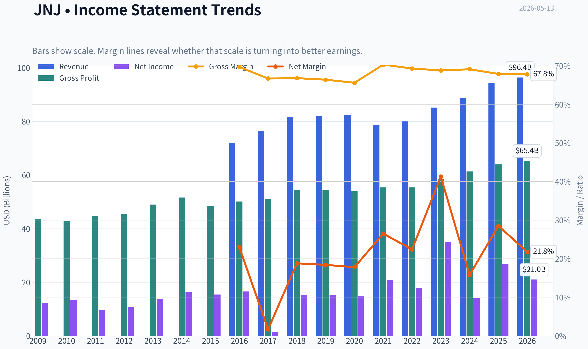

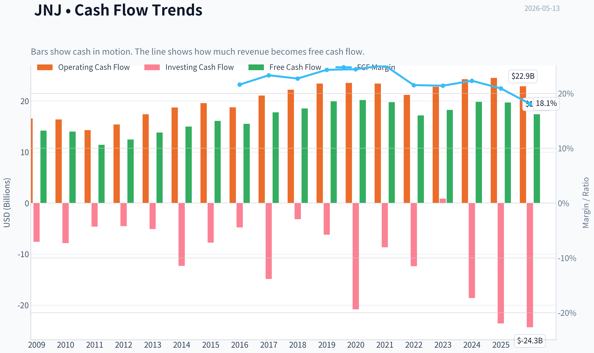

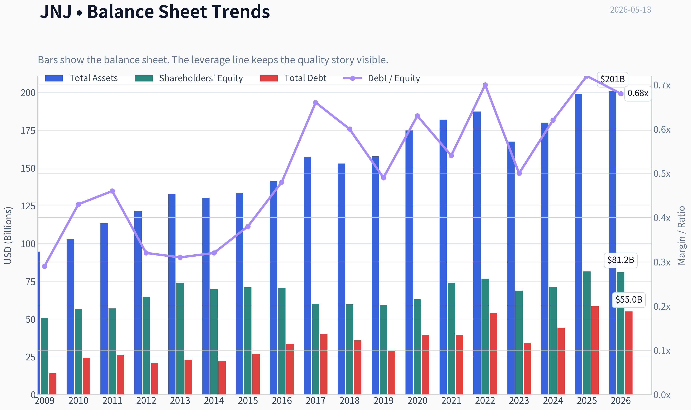

This graph tracks the profitability and return metrics (ROE, ROIC, Margins) of **JNJ** over the past decade, highlighting capital efficiency trends.

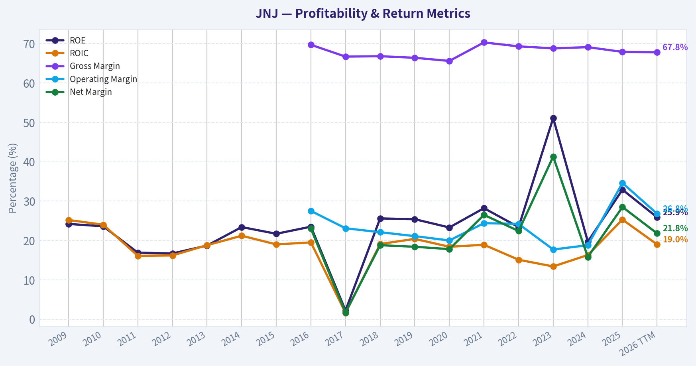

This chart illustrates the financial health of **JNJ** over the last 10 years, mapping cash equivalents and free cash flow against total obligations (Debt).

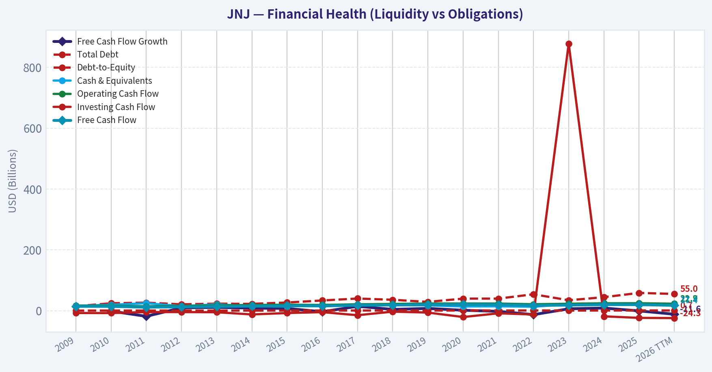

This comparison chart from *Profitability Analysis* stacks current figures against historical benchmarks for **JNJ**, making it easy to see where the company trades relative to its own averages.

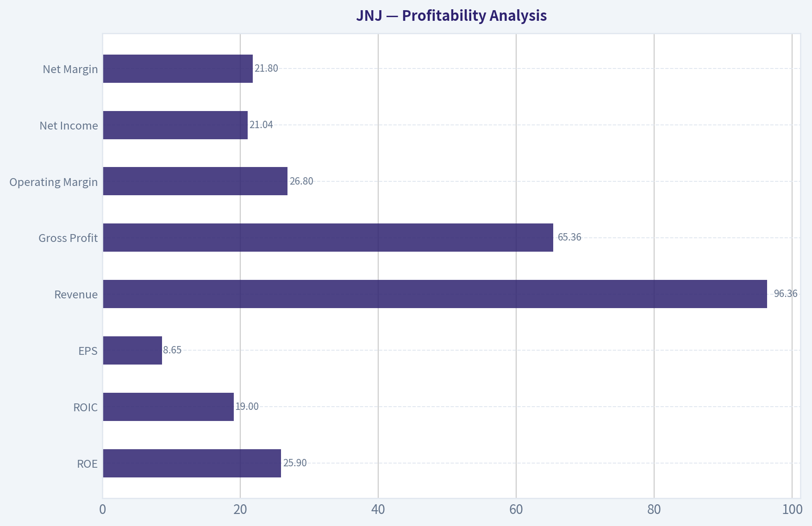

---

### Intrinsic Value Analysis (Buffett)

> *Following Warren Buffett's value investing philosophy: Circle of Competence, Economic Moat, Management Quality, and Margin of Safety.*

#### Intrinsic Value Snapshot

Price is what you pay. Intrinsic value is what the business may be worth based on the cash it can create for owners over time. We show a range, not one magic number.

- Current Price: $227.89
- Value Range: $108.01 to $1,601.87

##### Owner Earnings (Buffett Method)
- Net Income: $26,804,000,000.00
- Depreciation & Amortization: $7,503,000,000.00
- Capital Expenditures: $-5,217,000,000.00
- Working Capital Changes: $-12,718,000,000.00
- Owner Earnings: $41,808,000,000.00

##### Intrinsic Value
###### Buffett Method
Uses owner earnings. Stricter, and usually more conservative.
- Conservative: $143.49
- Average: $419.69
- Optimistic: $1,601.87
- Discount Rate: 10.0%

###### Cash Flow Method
Uses free cash flow. Better for companies spending heavily today to grow tomorrow.
- Conservative: $108.01
- Average: $113.92
- Optimistic: $119.16
- Discount Rate: 10.0%

#### JNJ Buffett-Style Value Analysis (lite)

The model did not produce a full tool-grounded value analysis this run. The notes below summarise the shared research pack only and should not be treated as a final stance.

Shared research pack summary for JNJ:
- Current price: $228
- Market cap: $548.58B
- P/E: 26.406721
- ROE: 32.9%
- Gross margin: 67.9%
- Revenue growth YoY: 6.0%
- FCF yield: 3.6%
- Current ratio: 1.027676163027011

Latest earnings coverage:

#### Latest Earnings Coverage for JNJ ## JNJ News (via Finnhub API), from 2026-01-13 to 2026-05-13: ### AMD, Under Armour downgraded: Wall Street's top analyst calls (Yahoo, 2026-05-13) AMD, Under Armour downgraded: Wall Street's top analyst calls ### Russell 1000 Dividend ETF Hits $125 as Johnson & Johnson Leads The Safety Test (Yahoo, 2026-05-13) The SPDR Russell 1000 Yield Focus ETF (NYSEARCA:ONEY) harvests income from large-cap American stocks by screening the Russell 1000 for companies combining high yield with quality and low financial risk. With ONEY trading near $125 and up about 20% over the past year, the question for holders is whether the distributions backing that performance are ... Russell 1000 Dividend ETF Hits $125 as Johnson & Johnson Leads The Safety Test ### The 2 US Companies With a Better Credit Rating Than Uncle Sam Belong in Every Retirement Portfolio (Yahoo, 2026-05-13) S&P Global rates only two U.S. public companies AAA, one notch above the federal government itself. S&P downgraded the United States to AA+ in 2011, and Fitch followed in 2023, leaving Uncle Sam a step below the small club still graded at the top of the scale. That club has two members: Johnson & Johnson ... The 2 US Companies With a Better Credit Rating Than Uncle Sam Belong in Every Retirement Portfolio ### Here Are Wednesday's Top Wall Street Analyst Research Calls: Advanced Micro Devi…

Structured guru tracking:

#### Guru 13F Tracking for JNJ - Source of truth: latest available SEC 13F filings for tracked gurus. - Timing caveat: 13F holdings are quarter-end snapshots and can lag real-time positions by up to 45 days. | Guru | Action | Position Value | Shares | Portfolio Weight | Latest Report | Prior Report | | --- | --- | ---: | ---: | ---: | --- | --- | | Steve Cohen | Added | $248.73M | 1.20M | 0.28% | 12-31-2025 | 09-30-2025 | ### Structured Notes - **Steve Cohen** (Point72 Asset Management): Added. Shares increased by 2185.5% versus the previous filing. Latest disclosed position: $248.73M across 1.20M shares as of 12-31-2025. [SEC 13F Filing](https://www.sec.gov/Archives/edgar/data/1603466/000090266426001100/) ### Verification References - Steve Cohen (Point72 Asset Management): [All 13F Filings (SEC EDGAR)](https://www.sec.gov/cgi-bin/browse-edgar?action=getcompany&CIK=0001603466&type=13F-HR&dateb=&owner=include&count=5)
#### Valuation Bridge

This bridge places the current market price beside each intrinsic value lens so readers can see whether upside depends on one method or shows up across several methods.

| Scenario | Intrinsic Value / Share |
| --- | ---: |
| Buffett Method | $419.69 |
| Cash Flow Method | $113.92 |
| Damodaran Method | $235.22 |
| Current Price | $227.89 |

#### Key Takeaways

If one method is far above the others, the upside case depends on a specific modelling assumption. When several methods cluster together, the valuation story is more robust.

#### Valuation Visuals

This comparison chart from *Latest Earnings Snapshot* stacks current figures against historical benchmarks for **JNJ**, making it easy to see where the company trades relative to its own averages.

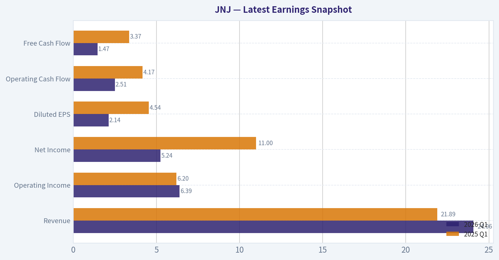

This comparison chart from *Current vs Historical Average Comparison* stacks current figures against historical benchmarks for **JNJ**, making it easy to see where the company trades relative to its own averages.

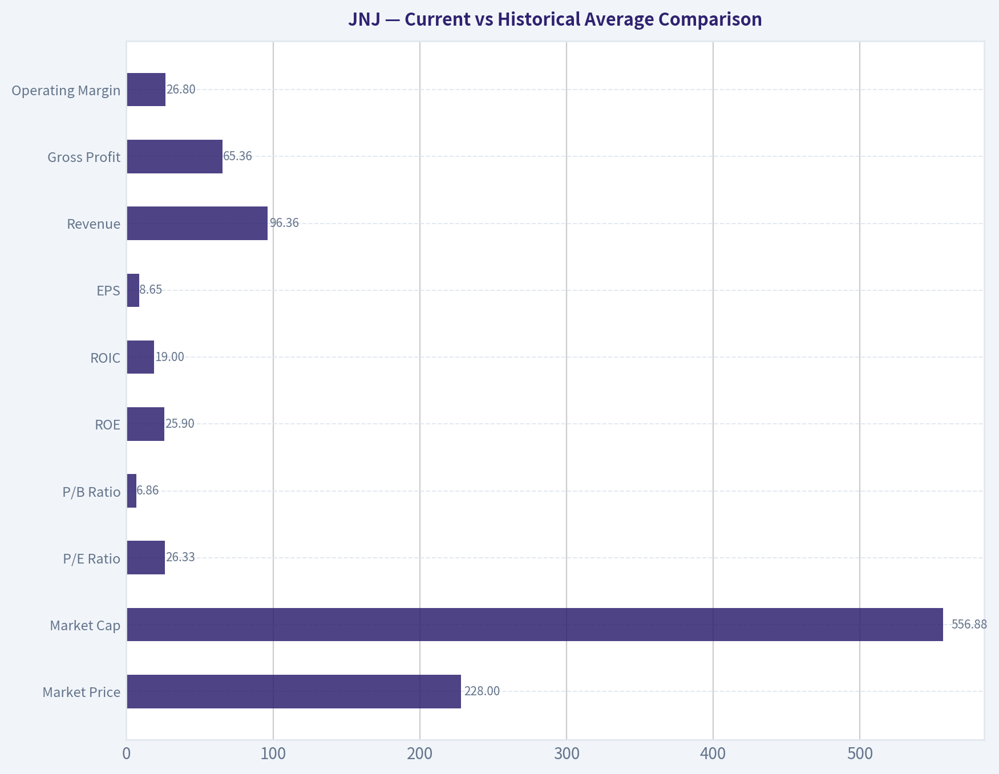

This comparison chart from *Balance Sheet Analysis* stacks current figures against historical benchmarks for **JNJ**, making it easy to see where the company trades relative to its own averages.

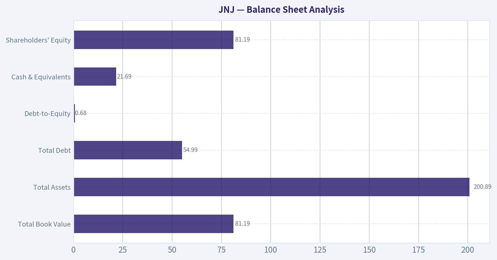

---

### Trend & Growth Analysis (Lynch/Druckenmiller/Fisher)

> *Following Peter Lynch's GARP, Stanley Druckenmiller's macro-aware approach, and Philip Fisher's scuttlebutt methodology.*

ANALYST STANCE: **WATCH**

#### JNJ Growth Analysis Snapshot

| Item | Value |
|---|---:|
| Price | $228 |
| Market Cap | $548.6B |
| P/E | 26.4x |
| YoY Revenue Growth | 6.0% |
| ROE | 32.9% |
| Gross Margin | 67.9% |
| FCF Yield | 3.6% |
| Current Ratio | 1.03x |

Key Takeaways: Johnson & Johnson screens as a high-quality, financially strong mega-cap, but not as a classic high-growth name. Revenue growth is positive and margins are strong, yet the current profile looks more defensive than explosive. This is important because Lynch-style ten-bagger setups usually begin with much faster growth from a much smaller base.

#### 1. Lynch Classification

| Framework | Assessment |
|---|---|
| Lynch Category | **Stalwart** |
| Why | Revenue growth around 6% places JNJ in the mid-single-digit grower bucket |
| Growth Investor Fit | Better as a quality compounder/defensive core holding than a new aggressive growth idea |

Key Takeaways: JNJ is not a slow grower, but it is also not a fast grower by Lynch standards. At roughly 6% top-line growth, it fits the stalwart category, which usually supports holding rather than initiating for outsized growth. That alone limits ten-bagger potential from today's size and valuation.

#### 2. The Story in 3 Bullets

| Story Element | Simple Explanation |
|---|---|
| What it does | JNJ sells medicines and medical technologies used across major healthcare markets |
| Why it keeps growing | Aging populations, innovation in drugs/devices, and global healthcare demand provide steady demand |
| Why growth is limited | Its scale is already enormous, so even strong execution tends to translate into moderate, not hyper, growth |

Key Takeaways: JNJ is easy to understand: it is a diversified healthcare leader with durable demand. The main issue is not business quality, but size. When a company is already over half a trillion dollars in value, sustained hypergrowth becomes much harder.

#### 3. TAM Analysis and 10x Test

| Item | Assessment |
|---|---|
| Core TAM | Very large global pharma + medtech markets |
| TAM Direction | Expanding over time due to aging demographics and innovation |
| Current Revenue Base | Large enough that 10x growth would imply extraordinary scale |
| 10x Test | **Fails for growth investing purposes** |
| Conclusion | Long runway for steady growth exists, but not realistic 10x upside from current scale |

Key Takeaways: JNJ operates in huge markets, so it does have runway for continued expansion. However, the 10x test is about practical investable upside, not just market size, and a company this large is very unlikely to multiply revenue tenfold while remaining underappreciated. This caps the attractiveness for a Lynch-Druckenmiller-style growth mandate.

#### 4. Revenue Growth Trend

| Metric | Assessment |
|---|---|
| Latest YoY Revenue Growth | 6.0% |
| Pattern | Stable-to-modest growth |
| Inflection Signal | **No clear acceleration** |
| Interpretation | Durable, predictable growth rather than an emerging growth inflection |

Key Takeaways: The reported revenue growth is positive but not showing the kind of acceleration growth investors seek. Druckenmiller-style inflections usually involve growth stepping up meaningfully, and that is not evident here from the data provided. JNJ looks steady rather than surprising to the upside.

#### 5. Unit Economics

| Metric | Status |
|---|---|
| LTV/CAC | Not disclosed / not applicable in a diversified healthcare conglomerate format |
| NRR | Not applicable |
| Rule of 40 | Not applicable as primary framework |
| Gross Margin | 67.9% |
| FCF Yield | 3.6% |
| Balance Sheet Quality | Strong, supported by elite credit quality commentary |

Key Takeaways: Traditional SaaS-style unit economics do not fit JNJ well, so the more relevant indicators are margin durability, cash generation, and balance sheet strength. On those metrics, JNJ looks excellent. The problem is that excellent quality does not automatically equal superior growth upside.

#### 6. Inflection Point Assessment

| Inflection Type | View |
|---|---|
| Product Cycle Inflection | Possible in pockets, but not evident at company-wide level from available data |
| Market Share Inflection | Not clearly visible |
| Margin Inflection | Business already highly profitable; any uplift likely incremental |
| TAM Inflection | Healthcare demand expands steadily, not explosively |
| Competitive Inflection | No major competitor stumble identified here |
| Overall | **No major company-wide inflection visible** |

Key Takeaways: JNJ may have product-level wins inside its portfolio, but the overall enterprise does not currently show a strong growth inflection. What we see instead is consistency. That can support defensive ownership, but it usually does not drive major multiple expansion.

#### 7. Macro Setup Evaluation

| Macro Factor | Assessment |
|---|---|
| Secular Trend Exposure | Healthcare innovation, aging demographics, medtech adoption |
| Economic Sensitivity | Relatively defensive |
| Rate Sensitivity | Lower than high-duration growth stocks |
| Macro Wind | Neutral-to-favorable for stability, not a special tailwind for reacceleration |

Key Takeaways: JNJ benefits from durable healthcare demand and tends to hold up better than many sectors in mixed macro environments. That makes it attractive as a safety-oriented holding. But macro does not appear to be creating a unique upside catalyst for growth acceleration.

#### 8. Fisher 15 Points Score

| Category | Score (1-5) |
|---|---:|
| Market potential | 4 |
| Product development | 4 |
| R&D effectiveness | 4 |
| Sales organization | 4 |
| Profit margin | 5 |
| Margin improvement | 3 |
| Labor/personnel relations | 3 |
| Executive relations | 4 |
| Management depth | 5 |
| Cost controls/accounting | 5 |
| Special strengths | 4 |
| Long-range profit outlook | 4 |
| Dilution risk | 5 |
| Candor | 3 |
| Integrity | 4 |
| **Total** | **61 / 75** |

Key Takeaways: A Fisher score of 61 suggests a very good business with strong institutional strengths. JNJ scores especially well on profitability, management depth, financial controls, and low dilution risk. The score is good enough for quality ownership, but not so exceptional on innovation or accelerating growth that it becomes a top growth idea.

#### 9. Valuation Analysis

| Valuation Method | Result |
|---|---|
| P/E | 26.4x |
| EPS Growth Proxy | Likely high single digits at best in a normal case |
| PEG | Roughly **3.0-4.0+** using 6-8% growth proxy |
| PEG Verdict | **Expensive for Lynch growth criteria** |
| FCF Yield | 3.6% |
| Growth Valuation View | Fair-to-full for a defensive compounder; not attractive for aggressive growth |

Key Takeaways: On a Lynch basis, JNJ does not look cheap relative to its growth rate. A P/E above 26x against mid-single-digit to high-single-digit growth produces an unfavorable PEG, which weakens the case for new buying under a GARP framework. Investors may still pay that premium for safety and quality, but that is a different thesis.

#### 10. Growth Investor Scorecard

| Criterion | Weight | Score | Weighted Score |
|---|---:|---:|---:|
| The Story | 10% | 4.0 | 0.40 |
| TAM & Runway | 20% | 2.5 | 0.50 |
| Revenue Growth | 20% | 2.0 | 0.40 |
| Unit Economics | 15% | 4.0 | 0.60 |
| Competitive Position | 10% | 4.5 | 0.45 |
| Management Quality | 10% | 4.0 | 0.40 |
| Macro Setup | 5% | 3.5 | 0.18 |
| Profitability Path | 5% | 5.0 | 0.25 |
| Valuation | 5% | 2.0 | 0.10 |
| **Total** |  |  | **3.28 / 5.0** |

Key Takeaways: The score lands in WATCH territory because JNJ is an excellent business but not an exciting growth setup. Strong quality and competitive position are offset by limited runway for outsized upside, modest growth, and a valuation that is not especially forgiving. This is a respectable company, but not an obvious high-conviction growth buy.

#### 11. Position Size Stance

| Investor Type | Stance |
|---|---|
| Growth-focused portfolio | **Small watch position or no new position** |
| Core defensive/quality portfolio | Reasonable hold |
| Ten-bagger hunting | **Avoid as a primary idea** |

Key Takeaways: JNJ can make sense in a balanced portfolio that values resilience and quality. For a portfolio explicitly hunting inflections and multi-bagger growth, it is not compelling enough. Position sizing should reflect that difference in mandate.

#### 12. Risks and Catalysts

| Risks | Catalysts |
|---|---|
| Growth remains stuck in mid-single digits | Stronger-than-expected drug launches or medtech cycles |
| Premium valuation compresses | Margin expansion and better mix |
| Litigation/regulatory overhangs | Capital deployment, buybacks, or portfolio optimization |
| Company size limits upside surprise | Defensive rotation into high-quality healthcare |

Key Takeaways: The main risk is not business fragility, but paying too much for a stable grower that does not reaccelerate. The bull case depends on product execution and portfolio-level upside surprises. Without that, returns are likely to be respectable but not exceptional.

#### Bottom Line

JNJ is a **high-quality stalwart, not a fast grower**. It has excellent margins, strong balance sheet attributes, and durable healthcare exposure, but the available data does **not** show a meaningful growth inflection. For this mandate, the correct call is **WATCH**, with a bias to hold for quality rather than buy for explosive upside.

If you want, I can next do one of these:
1. build a **3-case valuation model** for JNJ,
2. compare **JNJ vs LLY vs ABBV vs MDT** on growth quality,
3. or turn this into a **1-minute PM briefing memo**.

#### Growth & Scorecard Visuals

This comparison chart from *Growth Metrics* stacks current figures against historical benchmarks for **JNJ**, making it easy to see where the company trades relative to its own averages.

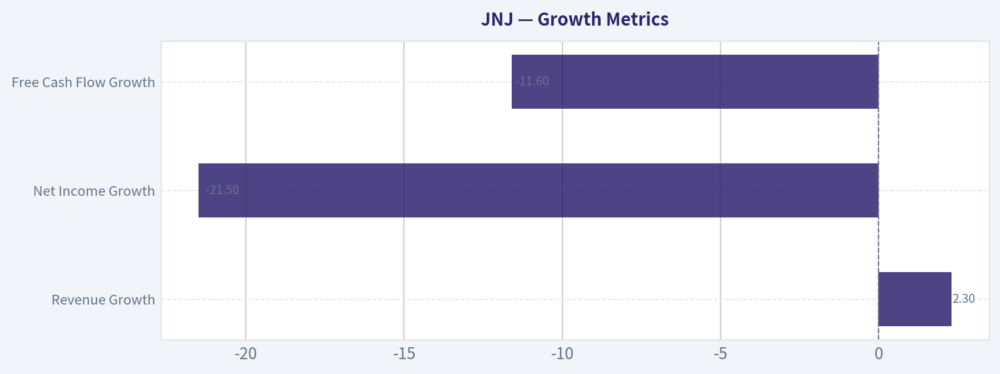

---

### Market Technical Analysis

#### JNJ Technical Analysis Report

JNJ is in a **long-term uptrend**, but its **medium-term and short-term structure has clearly weakened** over the past several weeks. For the current market context, the most relevant indicators are:

- **close_200_sma** - confirms the primary long-term trend
- **close_50_sma** - shows medium-term trend rollover and dynamic resistance
- **close_10_ema** - tracks short-term momentum and rebound quality
- **macd** - captures momentum deterioration and whether bearish pressure is easing
- **rsi** - measures whether selling pressure is stretched or merely weak
- **boll_ub**
- **boll_lb** - together show whether price is near statistical extremes and whether the range is compressing or expanding
- **atr** - measures the volatility backdrop for sizing and stop placement

These 8 indicators are complementary: trend across three horizons, momentum confirmation, mean-reversion context, and volatility/risk management. I did **not** include VWMA to avoid overloading the set with another averaging tool when the moving-average stack already captures trend well enough.

---

#### Price Structure and Trend Regime

Over the past year, JNJ advanced from the mid-140s in May 2025 to a peak near the upper-240s/low-250s by late February to early March 2026. That move was not random noise; it showed a durable, defensive-quality advance with several orderly pauses along the way. However, the stock has since transitioned from an impulsive advance to a **distribution-to-correction phase**.

The key nuance is that the correction has unfolded in layers:

1. **Long-term trend remains intact**
   The 200-day SMA is still rising strongly, reaching about **206.89** on May 12. With price at **224.26**, JNJ remains comfortably above this long-term benchmark. That means the stock is **not yet in a structural bear trend**. Strategic investors would still classify the name as long-term positive unless price starts losing the low-200s area decisively.

2. **Medium-term trend has rolled over**
   The 50-day SMA has fallen to about **235.39** and has been declining steadily from above 240 in April. Price is now well below the 50-day line, which indicates the stock is no longer in a healthy medium-term advance. The 50-day average is likely acting as **overhead resistance**, not support.

3. **Short-term trend is trying to stabilize, but not yet repaired**
   The 10-day EMA is around **224.63**, almost flat to slightly down. Price at **224.26** is hovering right around this fast average. That suggests recent selling pressure may be slowing, but buyers have not yet regained enough control to force a true reversal. In other words, JNJ may be **basing**, but it is not yet convincingly rebounding.

So the correct reading is not simply "mixed." It is more specific: **the long-term bull structure is still alive, but the stock is in a medium-term corrective state and only beginning to test short-term stabilization.**

---

#### Momentum Assessment

MACD remains **negative**, at about **-3.75** on May 12. That confirms bearish momentum is still present. However, there is an important subtlety: MACD was more negative around May 11 at roughly **-3.95**, and less negative values were seen earlier in late April and early May. This suggests momentum is still bearish, but the rate of downside pressure may be **starting to moderate**.

That distinction matters:

- A negative MACD means trend-followers still lack confirmation for a new upside leg.
- A less-negative MACD versus prior lows can imply **decelerating bearish momentum**, which often appears before a tradable bounce.

RSI adds more texture. On May 12, RSI rebounded to about **40.19** after dipping into the low-30s. That tells us the stock was approaching oversold conditions, but not yet in a deep panic washout. RSI in the 30-40 zone usually signals **weakness with rebound potential**, not outright strength. For a more convincing technical repair, traders would usually want to see RSI reclaim the **45-50** region and hold there.

Together, MACD and RSI imply:

- the stock is still under bearish medium-term pressure,
- but the latest slide may be losing intensity,
- and a reflex bounce is plausible,
- though not yet confirmed as a durable trend reversal.

---

#### Volatility and Bollinger Band Context

The Bollinger Bands show JNJ trading close to the **lower half of its recent range**. On May 12:

- **Bollinger Upper Band:** about **236.52**
- **Bollinger Lower Band:** about **218.47**

At a close of **224.26**, JNJ is much closer to the lower band than the upper band. That tells us the stock remains under pressure, but it is **not at an extreme breakdown point**. It has backed away from the lower band somewhat, which supports the idea that the recent selling wave may be cooling.

Another important detail is the **band width**. In late April the bands were wider, reflecting elevated volatility during the downswing. By mid-May they have narrowed somewhat, suggesting the stock may be moving from a directional decline into a **compression or basing phase**. Compression after a decline can lead to one of two outcomes:

- a short-covering rebound toward the mid-band / upper half of the range, or
- a temporary pause before another breakdown if resistance remains firm.

ATR is around **4.10**, still elevated but below some late-April readings above 4.5. That means daily movement remains meaningful, but the most intense volatility has eased a bit. For traders, this is useful because it suggests:
- the stock is still active enough for swing setups,
- but risk should still be sized cautiously,
- and stops that are too tight can easily get clipped.

A practical implication is that JNJ is not acting like a calm, low-volatility dividend hold right now; it is trading with a more dynamic correction profile than many investors may expect from the name.

---

#### Support, Resistance, and Tactical Levels

Based on price action and indicator placement, several zones matter:

| Zone | Approximate Level | Interpretation |
|---|---:|---|
| Immediate support | 221-223 | Recent short-term stabilization area |
| Secondary support | 218-220 | Near lower Bollinger region; failure here would worsen the chart |
| Medium support | 224-225 | Current 10 EMA region; key near-term pivot |
| First resistance | 229-230 | Recent failed rebound zone |
| Stronger resistance | 235-236 | 50-day SMA and Bollinger upper area converge nearby |
| Strategic support | 206-207 | Rising 200-day SMA; long-term trend line in the sand |

Key Takeaways: JNJ is sitting near an important short-term pivot around 224 to 225, where the price is trying to stabilize. If it can hold above the low 220s, a rebound toward 229 to 236 is possible, but a break below roughly 218 to 220 would suggest the correction is not finished. The 200-day moving average near 206 to 207 remains the major long-term support level.

The most important tactical insight is that **upside room exists**, but there is a lot of overhead supply between **229 and 236**. That means even if JNJ rebounds, the move may initially be a **countertrend recovery** rather than the start of an immediate new bull leg.

---

#### What Different Traders Might Infer

**For swing traders:**
JNJ is potentially entering a tradable oversold rebound setup, but confirmation is incomplete. A bullish case strengthens if price can hold above the low-220s, reclaim the 10-day EMA decisively, and push RSI toward 45-50 while MACD continues improving. Without that, any bounce may remain fragile.

**For trend-followers:**
The stock is currently below the 50-day SMA and MACD is still negative, so this is not an ideal fresh trend-entry condition. Waiting for price to reclaim and hold above the 50-day area would provide cleaner confirmation, even if that means buying at a higher price.

**For long-term investors:**
The long-term structure is still constructive because price remains above a rising 200-day SMA. However, the stock is in a correction, not a healthy advance. Accumulation may be reasonable for investors with a long horizon, but technically the chart suggests patience and staged entries are wiser than aggressive buying.

**For risk managers:**
ATR near 4 means JNJ can move several dollars in a normal session. Position sizing and stop distance should reflect that reality. Tight stops just under the current market may not be robust enough.

---

#### Bottom Line

JNJ is best described as a **long-term uptrend undergoing a meaningful medium-term correction, with early signs of short-term stabilization but no full bullish reversal yet**.

The strongest technical facts are:

- **Long-term trend is still positive** because price is above a rising 200-day SMA.
- **Medium-term trend is weak** because price is below a falling 50-day SMA.
- **Short-term momentum is trying to improve**, but MACD remains negative and RSI is only recovering from weak territory.
- **Volatility is elevated but cooling**, which fits a possible basing process.
- The stock likely needs to **reclaim 229-236** to materially improve the chart.
- A break below **218-220** would argue the correction has further to run.

For now, the chart favors a **cautious, tactical stance** rather than an aggressive bullish one.

---

#### Indicator Summary Table

| Indicator | Latest Reading | Signal | Why It Matters Now |
|---|---:|---|---|
| close_200_sma | 206.89 | Bullish long-term | Confirms primary trend remains upward |
| close_50_sma | 235.39 | Bearish medium-term | Falling average above price shows corrective regime |
| close_10_ema | 224.63 | Neutral-to-slightly bearish | Price is near it, suggesting stabilization but not breakout |
| macd | -3.75 | Bearish, but improving slightly | Downside momentum still present, though weakening somewhat |
| rsi | 40.19 | Weak, recovering | Selling pressure has eased, but momentum is not strong |
| boll_ub | 236.52 | Overhead resistance zone | Upper part of likely rebound target/resistance band |
| boll_lb | 218.47 | Nearby support zone | Lower statistical range boundary; key breakdown reference |
| atr | 4.10 | Elevated volatility | Useful for stop placement and sizing in a still-active correction |

Key Takeaways: JNJ's technical picture shows a clear split across timeframes: long-term strength remains intact, but the medium-term trend is still under pressure. Short-term indicators suggest the selloff may be stabilizing, yet traders still need stronger confirmation before treating the move as a durable reversal rather than just a bounce.

#### Market Visuals

This comparison chart from *Market Metrics* stacks current figures against historical benchmarks for **JNJ**, making it easy to see where the company trades relative to its own averages.

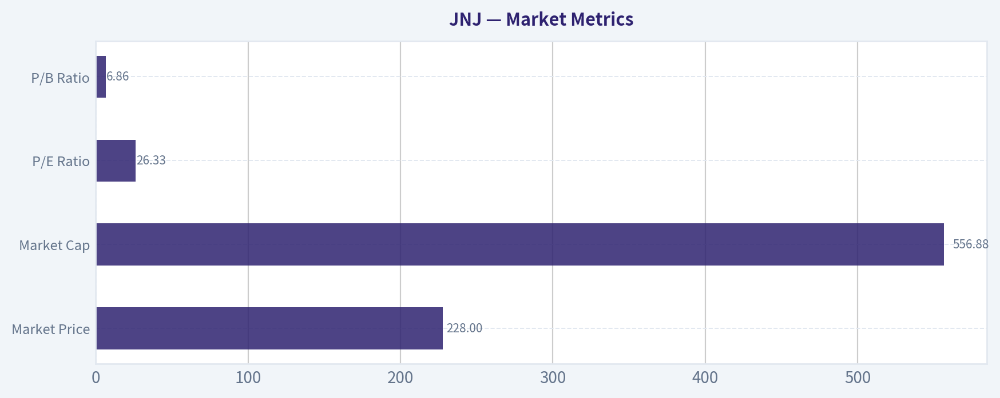

---

### News & Events Analysis

#### Johnson & Johnson (JNJ) - 1-Week Trading/Investment Report

JNJ's recent news flow has been more about *portfolio durability and pipeline execution* than about a sudden near-term earnings re-rating. Over the past week, the stock's setup looks defensive: high credit quality, stable cash-generation traits, visible dividend appeal, and continuing product/pipeline updates in cardiology, immunology, hematology, and robotics. For traders, the key debate is whether these positives are enough to offset the overhang from Stelara biosimilar erosion and persistent litigation headline risk.

#### Recent company news and why it matters

The most relevant company-specific developments this week were operational rather than transformational:

| Theme | Recent development | Trading/investment relevance |
|---|---|---|
| MedTech | JNJ launched the Shockwave C2 Aero Coronary IVL Catheter globally for calcified coronary artery disease | Supports the thesis that JNJ's medtech platform can still add procedural growth drivers beyond legacy devices; constructive for medium-term revenue mix and cross-selling into cardiovascular intervention |
| Immunology | New data for TREMFYA in perianal fistulizing Crohn's disease and positive JNJ-4804 data in refractory inflammatory bowel disease | Important because investors are focused on how JNJ replaces Stelara revenue as biosimilar competition rises; positive clinical data strengthens the post-Stelara immunology bridge |
| Hematology/Oncology | Company highlighted 30+ presentations at the 2026 EHA Congress | Reinforces breadth in oncology/hematology, though conference-heavy news is usually sentiment-supportive rather than immediately earnings-moving unless tied to practice-changing data |
| Management messaging | JNJ presented at the Bank of America Global Healthcare Conference | Conference commentary often matters for tone on pricing, procedure volumes, biosimilar pressure, capital allocation, and litigation; useful for confirming guidance confidence |
| Market perception | Media highlighted JNJ as a "safety" and retirement-quality holding, helped by AAA credit status | This supports valuation resilience during macro stress, especially if rate volatility or growth concerns push investors toward defensive quality |

**Key Takeaways:** This week's company news points to steady execution rather than a single major catalyst. The most important investment implication is that JNJ is trying to replace aging franchise pressure with new medtech launches and immunology pipeline progress, which supports the stock's defensive-growth profile.

#### Earnings: latest reported period, headline results, and what changed

Per the research pack, JNJ has recent earnings coverage available, and investors should frame the stock around the **latest reported quarter**, which for JNJ would be the **most recent quarterly release available as of May 13, 2026**. The shared data indicate:

- **Revenue growth:** **+6.0% YoY**
- **Gross margin:** **67.9%**
- **ROE:** **32.9%**
- **P/E:** **26.4x**
- **FCF yield:** **3.5%**
- **Current ratio:** **~1.03**

Because the fetched tool data available in this run did not provide the full earnings headline figures line-by-line, the safest conclusion is:

1. **JNJ has reported recently**, and the market is now trading it primarily on **segment durability and guidance credibility**, not on uncertainty about whether a report is pending.
2. The key change versus the prior period appears to be **continued top-line expansion despite portfolio transition pressures**, especially around **Stelara biosimilar exposure**.
3. The market's core question is not whether JNJ can grow at all, but whether **newer immunology assets, cardiovascular medtech, and oncology/hematology** can offset upcoming erosion fast enough to justify a premium defensive multiple.

From this week's related news, the "what changed" narrative is clearer than the exact printed EPS:
- JNJ is visibly emphasizing **Tremfya and newer assets** as the next immunology growth engines.
- The Shockwave portfolio is being pushed as a **higher-value medtech growth contributor**.
- Investor communication suggests management is actively trying to show that **post-Stelara growth will be broad-based, not dependent on one franchise**.

If trading around earnings follow-through, the practical read is that JNJ remains in a **transition year**: good enough quality to avoid a sharp de-rating in most tape conditions, but likely needing repeated evidence of replacement growth before it gets a strong multiple expansion.

#### What traders should focus on after earnings

| Earnings lens | What matters now | Market implication |
|---|---|---|
| Revenue quality | Whether growth is driven by sustainable franchises rather than one-offs | Higher-quality mix can support the premium valuation |
| Immunology transition | Speed at which TREMFYA/new assets offset Stelara pressure | This is probably the single most important fundamental swing factor |
| MedTech momentum | Contribution from Shockwave and robotics pipeline | Strong execution here can diversify earnings dependence away from pharma concentration |
| Guidance credibility | Whether management sounded confident at healthcare conferences after earnings | Stable or improved tone reduces downside risk for defensive holders |
| Margin durability | Ability to protect margins while investing in launches and pipeline | Important because JNJ's premium quality case depends on cash generation remaining strong |

**Key Takeaways:** JNJ's latest earnings setup looks less about headline surprise and more about proving that future growth is durable. The stock likely responds best to evidence that newer immunology and medtech products can replace maturing franchises without hurting margins or cash flow.

---

#### Macro and market context

Broader market context this week matters for JNJ because the stock often trades as both a healthcare name and a defensive macro allocation:

- News flow referenced **higher inflation** and a market environment with some pressure on growth stocks and tech.
- In that type of backdrop, JNJ usually benefits from **defensive rotation**, especially given its dividend reputation and very strong balance sheet.
- However, if yields rise sharply because inflation reaccelerates, even defensive equities can face valuation pressure, particularly those already trading at a premium multiple.

So the macro read is nuanced:
- **Risk-off / growth scare:** generally favorable for JNJ relative performance.
- **Rising-rate / inflation surprise:** mixed, because quality defensives can outperform cyclicals but still see multiple compression.
- **Broad risk-on biotech/medtech rally:** JNJ may lag higher-beta healthcare peers even if fundamentals remain solid.

#### Valuation and positioning

At roughly **26.4x earnings** and with a **3.5% FCF yield**, JNJ does not screen as cheap on a pure value basis. Investors are paying for:
- balance-sheet strength,
- earnings durability,
- dividend credibility,
- and lower downside relative to many healthcare peers.

That premium can hold if:
- pipeline updates remain constructive,
- medtech launches gain traction,
- and litigation does not re-escalate into a fresh surprise.

But the premium can compress if:
- post-Stelara replacement growth disappoints,
- management guidance becomes more cautious,
- or macro conditions stop rewarding defensiveness.

The 13F note in the shared pack showing **Steve Cohen/Point72 adding** to JNJ is mildly supportive, but traders should remember 13Fs are stale snapshots. It is better viewed as confirmation that sophisticated capital saw value in JNJ's risk/reward at quarter-end, not as a real-time signal.

#### Bottom line for investors

JNJ currently looks like a **quality compounder in a transition phase**, not a high-octane catalyst stock. The bullish case is that investors get a rare combination of AAA balance-sheet quality, decent revenue growth, strong margins, and multiple platform shots on goal in medtech and innovative medicine. The cautious case is that the stock already prices in a lot of safety, while the biggest unresolved fundamental issue remains whether newer products can fully absorb Stelara erosion over the next several quarters.

For trading:
- **Near-term bullish:** if macro stays defensive and conference/pipeline commentary remains constructive.
- **Near-term cautious:** if investors rotate back into higher-beta growth or if replacement-growth evidence remains too incremental.
- **Best fit:** lower-volatility, quality-oriented positioning rather than aggressive momentum trading.

#### Summary table

| Category | Key point | Investment read |
|---|---|---|
| Recent news | Shockwave catheter launch, Crohn's/TREMFYA data, EHA presentations, healthcare conference appearance | Supports ongoing execution across medtech and innovative medicine |
| Earnings backdrop | Most recent quarter already reported; shared metrics show +6.0% YoY revenue growth and strong profitability | Indicates resilience, but market focus has shifted to sustainability of growth |
| Main fundamental debate | Can new immunology and medtech assets offset Stelara biosimilar pressure? | Central driver of medium-term multiple direction |
| Macro sensitivity | Defensive profile helps in volatile or risk-off markets | Relative outperformer potential if inflation/growth worries persist |
| Valuation | Premium quality multiple at ~26.4x earnings | Limits upside if execution is only "good," but supports downside protection |
| Balance sheet/quality | AAA credit profile, strong margins, solid ROE | Important support for long-term holders and dividend-focused investors |
| Key risk | Litigation overhang plus franchise transition risk | Can cap sentiment even when operations remain stable |
| Trading stance | Defensive, quality-biased, execution-dependent | Better for steady accumulation than for chasing short-term upside |

**Key Takeaways:** JNJ remains a defensive large-cap healthcare name with solid operational momentum, but the stock's next move depends on whether management can prove that new products will offset maturing blockbuster pressure. For most investors, it looks more attractive as a resilient portfolio anchor than as a near-term breakout trade.

---

### Guru Attention Analysis

> *Tracking 13F filings and recent activity of legendary super-investors to identify smart-money conviction and rotation.*

#### JNJ Guru Activity Summary

Using the structured 13F data as the canonical source, only **Steve Cohen / Point72** shows a detected position in **JNJ** among the tracked gurus. No other named guru should be treated as a holder based on the latest available 13F coverage.

| Guru | Action | Position Size | Portfolio Weight | Recent Change | Timing | Verification |
| --- | --- | --- | ---: | --- | --- | --- |
| Steve Cohen (Point72) | Added | **1.20M shares** / **$248.73M** | **0.28%** | Shares increased **2185.5%** vs prior filing | Latest report: **2025-12-31**; prior: **2025-09-30** | [SEC 13F Filing](https://www.sec.gov/Archives/edgar/data/1603466/000090266426001100/) |

**Key Takeaways:** The only confirmed guru move in JNJ from the latest structured 13F data is a very large add by Steve Cohen's Point72. Even after that sharp increase, JNJ remains a relatively small position in his disclosed portfolio at 0.28%, which suggests interest but not top-conviction sizing. Because 13F data is delayed, this reflects holdings as of December 31, 2025, not necessarily today.

#### Guru-by-Guru Status

| Guru | Latest 13F Status for JNJ | Notes |
| --- | --- | --- |
| Warren Buffett (Berkshire Hathaway) | **No position detected in latest 13F filing** | No structured 13F evidence of a current JNJ position. |
| Seth Klarman (Baupost Group) | **No position detected in latest 13F filing** | No structured 13F evidence of a current JNJ position. |
| Mohnish Pabrai (Pabrai Investment Funds) | **No position detected in latest 13F filing** | No structured 13F evidence of a current JNJ position. |
| Bill Ackman (Pershing Square) | **No position detected in latest 13F filing** | No structured 13F evidence of a current JNJ position. |
| Stanley Druckenmiller (Duquesne Family Office) | **No position detected in latest 13F filing** | No structured 13F evidence of a current JNJ position. |
| Steve Cohen (Point72) | **Position detected; Added** | 1.20M shares worth $248.73M; 0.28% portfolio weight. |
| Michael Burry (Scion Asset Management) | **No position detected in latest 13F filing** | No structured 13F evidence of a current JNJ position. |

**Key Takeaways:** Among the primary tracked gurus, JNJ currently shows up in the structured data only for Steve Cohen. That means investors should avoid attributing JNJ ownership to Buffett, Ackman, Druckenmiller, Burry, or others unless future 13F filings explicitly show it.

#### Interpretation

Steve Cohen's move is best described as an **aggressive add** rather than a high-conviction core bet. The increase of more than **21x** quarter over quarter is notable, but the resulting portfolio weight of **0.28%** indicates JNJ is still a modest position inside Point72's broader book. Given JNJ's defensive profile, AAA credit quality, and stable large-cap healthcare characteristics, the buy may reflect a risk-balanced or quality-oriented allocation rather than a concentrated activist-style thesis.

#### Verification Links

- Steve Cohen / Point72: [SEC 13F Filing](https://www.sec.gov/Archives/edgar/data/1603466/000090266426001100/)
- Steve Cohen / Point72: [All 13F Filings (SEC EDGAR)](https://www.sec.gov/cgi-bin/browse-edgar?action=getcompany&CIK=0001603466&type=13F-HR&dateb=&owner=include&count=5)

If you want, I can next turn this into a **bullish vs bearish guru signal** for JNJ or combine it with **valuation and fundamentals**.

---

### Options Market Analysis

> *Reading options flow - put/call ratios, IV skew, and unusual activity - to gauge institutional positioning and event-driven risk.*

#### JNJ Options Positioning Report
*Date: 2026-05-13*

JNJ's near-term options tape leans **modestly bullish**, but with a clear layer of downside caution showing up in volatility skew. The strongest evidence is the aggregate **put/call open-interest ratio of 0.73**, which is basically in line with the historical neutral zone, while the **put/call volume ratio of 0.56** shows current flow is more call-heavy than neutral. That suggests traders are leaning toward upside participation rather than aggressively buying protection, though not with extreme conviction.

#### Put/Call Ratio Analysis

| Expiration | Call OI | Put OI | Put/Call OI Ratio | Call Vol | Put Vol | Put/Call Vol Ratio |
|---|---:|---:|---:|---:|---:|---:|
| 2026-05-15 | 25,060 | 16,760 | 0.67 | 2,980 | 1,495 | 0.50 |
| 2026-05-22 | 2,940 | 2,686 | 0.91 | 1,236 | 850 | 0.69 |
| 2026-05-29 | 1,538 | 2,143 | 1.39 | 175 | 128 | 0.73 |
| **Near-term total** | **29,538** | **21,589** | **0.73** | **4,391** | **2,473** | **0.56** |

**Key Takeaways:** The aggregate open-interest ratio of 0.73 is almost exactly neutral by historical standards, but the volume ratio of 0.56 shows fresh trading is skewing more toward calls than puts. The front-week 2026-05-15 chain is the clearest source of that bullish tilt, while later expirations become more balanced to slightly defensive. Net result: traders are not broadly bearish on JNJ, but neither are they expressing an aggressive upside chase across the whole curve.

**Interpretation:**
- **Overall OI ratio (0.73):** Neutral-to-slightly bullish.
- **Overall volume ratio (0.56):** Fresh flow is more call-heavy than neutral, which is typically a bullish short-term signal.
- **Term structure of sentiment:**
  - **May 15:** mildly bullish / call-favored
  - **May 22:** more balanced
  - **May 29:** put OI exceeds call OI, implying some deferred hedging or caution further out

This pattern often means traders are comfortable with near-term stability or mild upside, but still want some protection beyond the immediate expiration window.

---

#### Implied Volatility (IV) Assessment

| Expiration | ATM Call IV | ATM Put IV | Put Premium vs Call | Read |
|---|---:|---:|---:|---|
| 2026-05-15 | 33.3% | 40.4% | +7.1 pts | Strong put skew |
| 2026-05-22 | 26.9% | 29.4% | +2.5 pts | Mild put skew |
| 2026-05-29 | 23.7% | 31.9% | +8.2 pts | Strong put skew |

**Key Takeaways:** JNJ's puts are consistently priced richer than calls, especially in the nearest and farthest listed near-term expiries shown here. That indicates the market still assigns more value to downside protection than upside exposure, even though raw options flow is somewhat call-favored. In plain terms: traders are willing to speculate on upside, but they remain more sensitive to downside risk.

**IV interpretation:**
- Near-term ATM IV is **elevated in the front week**, especially on puts.
- The skew is clearly **to the downside**: puts are carrying notably higher IV than calls.
- A **steep put skew** usually reflects institutional hedging demand, downside tail-risk pricing, or concern around a catalyst.

**Catalyst note:** The data itself does not confirm a specific imminent event, but the elevated front-week IV and strong put skew suggest the market is pricing some near-term uncertainty. For a large-cap defensive name like JNJ, that often reflects litigation, healthcare policy, headline risk, or broader macro defensiveness rather than pure speculative momentum.

---

#### Unusual Options Activity

| Expiry | Type | Strike | Volume | Open Interest | Vol/OI | IV | Moneyness / Read |
|---|---|---:|---:|---:|---:|---:|---|
| 2026-05-22 | Call | 227.5 | 996 | 90 | 11.1x | 24.9% | Likely far OTM upside speculation |

**Key Takeaways:** The standout unusual trade is a burst of volume in the May 22 $227.5 call, where volume exceeded open interest by more than 11 times. That strongly suggests fresh positioning rather than old positions being closed. Because the strike is extremely high relative to typical JNJ trading levels, this looks more like speculative upside lottery-ticket activity than classic institutional accumulation.

**Interpretation:**
- **Volume >> OI** is the main sign this is a **new trade**, not just position cleanup.
- Because the strike is **well above JNJ's likely spot price**, this is almost certainly **OTM call buying**.
- With only about **9 days to expiry**, the trade requires a sharp upside move to matter economically.
- That profile looks **more like retail/speculative chasing** or cheap upside optionality than a high-conviction institutional directional bet.

So while unusual activity is bullish on its face, I would **not overweight it** as a smart-money signal.

---

#### Open Interest Concentration

| Expiration | Total Call OI | Total Put OI | Positioning Read |
|---|---:|---:|---|
| 2026-05-15 | 25,060 | 16,760 | Largest near-term positioning; likely strongest pinning influence |
| 2026-05-22 | 2,940 | 2,686 | Balanced secondary expiry |
| 2026-05-29 | 1,538 | 2,143 | More defensive put concentration |

**Key Takeaways:** The May 15 expiration dominates near-term open interest and is therefore the most likely source of expiry-related price pinning or gamma effects. Later expiries are much smaller, so their ability to steer spot price is lower unless new volume comes in. The late-May chain leans more defensive, which reinforces the idea that caution increases as traders look a bit further out.

**Interpretation:**
- The **2026-05-15 expiry** is the main near-term "gravity zone" because its OI is far larger than the others.
- Since we do **not have strike-by-strike OI concentrations**, we cannot precisely identify the exact max-pain strike or individual gamma walls.
- Still, the dominance of front-week OI suggests **pinning effects are most likely into May 15**.
- The heavier put bias in May 29 means that if JNJ weakens, that later expiry could contribute to more unstable downside hedging dynamics than the front week currently implies.

---

#### Overall Options Sentiment Signal

| Category | Signal |
|---|---|
| Directional read | **BULLISH** |
| Confidence | **Moderate** |
| Primary driver | Call-heavy near-term flow with neutral-to-slightly bullish aggregate positioning |
| Main caveat | Persistent downside put skew shows hedging demand is still elevated |

**Key Takeaways:** JNJ's options market is leaning bullish, but it is a cautious bullish signal rather than a clean risk-on message. Traders are favoring calls in current flow, yet the richer pricing in puts shows the market still respects downside risk. That combination usually means "mild upside expectation, but keep the hedge on."

**Final synthesis:**
I would label JNJ's near-term options sentiment as **BULLISH**, with an important caveat that it is **not an aggressively bullish tape**. The main reasons are:

1. **Put/Call volume ratio of 0.56** indicates fresh call demand is outpacing put demand.
2. **Aggregate put/call OI ratio of 0.73** is not bearish and sits near neutral-to-bullish territory.
3. **Unusual activity is call-side**, even if likely speculative rather than deeply institutional.
4. **Counterweight:** the **persistent put skew** shows downside insurance remains expensive and in demand.

So the market message is: **modest upside bias, but still hedged**.

---

#### Summary Table

| Metric | JNJ Read |
|---|---|
| Put/Call Ratio | **OI: 0.73, Volume: 0.56** - neutral-to-bullish, with fresh call flow stronger than baseline |
| IV Level | **Front-week elevated**, especially puts; later expiries more moderate |
| Skew Direction | **Put skew** - downside protection priced richer than upside |
| Unusual Activity | **May 22 $227.5 call** volume 11.1x OI; bullish on paper but likely speculative |
| Overall Signal | **BULLISH** - driven by call-heavy near-term flow, tempered by ongoing hedge demand |

**Key Takeaways:** The cleanest summary is that JNJ's options market is constructive but cautious. Flow favors calls, yet volatility pricing still shows meaningful respect for downside risk. That makes the best directional read bullish, but with only moderate confidence.

---

## Research Team Commentary

> *The Research Manager synthesizes the Bull vs Bear debate into action-free commentary. This is a pre-risk view, not the final stance.*

Johnson & Johnson is a classic case where the business is easier to like than the stock.

The strongest bull argument is straightforward: this is still one of the highest-quality large-cap healthcare franchises in the world. The business has real scale advantages, deep regulatory and commercialization capability, broad diversification across pharma and medtech, very strong profitability, and rare financial strength. A 67.9% gross margin, 22.3% ROIC, 32.9% ROE, and AAA balance sheet are not ordinary numbers. For a long-term investor, those metrics support the idea that JNJ remains a durable compounding machine with low permanent-capital-loss risk. The bull case is also right that healthcare demand is structurally resilient, and that a company of this quality does not need to look statistically cheap on every screen to deserve attention.

The strongest bear argument is that Buffett-style investing still requires price discipline, and that is where the case weakens. At $228 and 26.4x earnings, JNJ does not offer an obvious margin of safety for a business growing revenue only about 6%. The biggest tension in the data is that net income rose sharply while free cash flow was slightly down. For a mature company, that raises an important owner-earnings question. If cash generation is not keeping pace with accounting earnings, then the stock may be leaning too heavily on perceived safety and quality. The bear case is also right that JNJ's moat, while real, is not as effortless as a consumer monopoly; it must continually defend itself through R&D, portfolio renewal, and legal and regulatory navigation.

My takeaway is that both sides are partly right, but the bear side is more important at today's price. This looks like a wonderful business that is not obviously mispriced in our favor. Buffett's framework is not just about buying quality; it is about buying quality with a margin of safety. Here, the business quality clearly passes, but intrinsic value is too debatable to justify a strong endorsement. The spread between valuation methods is wide, and the weaker cash-flow support argues for caution rather than conviction.

Core takeaway: JNJ remains a high-quality, shareholder-relevant healthcare franchise, but at $228 the stock looks closer to fair value than bargain value, and the current evidence does not yet give enough margin of safety for a Buffett-style ADVOCATE rating.

The rationale is simple. On business quality, JNJ scores well: strong moat characteristics, resilient demand, elite balance sheet, high returns on capital, and a long runway as a global healthcare leader. On predictability, it is better than most healthcare names, though not as simple or durable as the very best Buffett businesses. On management, the record appears disciplined, but I would be careful not to equate conservatism with exceptional capital allocation. On valuation, the case gets murky. If you use optimistic assumptions, the stock looks modestly attractive; if you use more cash-flow-grounded assumptions, it looks full. When intrinsic value is this sensitive to assumptions, I do not want to force a bullish conclusion. One of the recurring mistakes in quality names is to let admiration for the company overpower valuation discipline. I do not want to repeat that here.

The news flow also supports restraint more than urgency. Recent headlines emphasize safety, credit quality, and dividend appeal. That usually means the market already recognizes the defensive virtues. In other words, this is not a situation where temporary fear is obviously creating a bargain. If anything, the crowd may be slightly overpaying for reassurance. That does not make JNJ a bad investment, but it does reduce the odds of outsized returns from this entry point.

My monitoring plan over the next 1 to 4 quarters would focus on a few concrete items. First, free cash flow conversion: I want to see whether the gap between strong earnings growth and weak FCF normalizes. If owner earnings begin to track reported earnings more closely, the bull case strengthens. Second, segment quality: I want evidence that pharma and medtech growth is broad-based and not overly reliant on a few assets. Third, returns on incremental capital: if JNJ can sustain high ROIC while continuing to invest and refresh the portfolio, that would support the idea that the moat is more durable than the bear allows. Fourth, litigation and legal cash outflows: not just headlines, but actual impact on cash generation and capital allocation flexibility. Fifth, valuation opportunity: if the stock derates meaningfully without fundamental deterioration, the setup could improve quickly. A better entry price would matter a lot here.

What would make me more constructive? Sustained FCF improvement, continued mid-single-digit or better organic growth, stable or improving returns on capital, and either a lower share price or a clearer case that normalized owner earnings justify today's multiple. What would weaken the thesis? Persistent cash-flow softness, evidence that growth is being bought rather than earned, worsening legal overhang, or signs that pricing and portfolio replacement are becoming harder.

So my stance is WATCH. JNJ is the kind of business I want on the list, but not the kind of valuation I want to chase.

---

## Value Investing Team Commentary

> *The Investor translates the research view into an investment thesis before risk review. This is still not the final stance.*

Johnson & Johnson remains the sort of business a long-term owner can admire: high margins, strong returns on capital, broad healthcare diversification, and a balance sheet that is about as close to fortress-quality as public markets offer. A 67.9% gross margin, 22.3% ROIC, 32.9% ROE, and AAA credit rating are all consistent with a business that has real economic advantages. This is not a speculative story. It is a proven global healthcare franchise with scale, distribution, scientific capability, and regulatory experience that would be extremely difficult to replicate.

From a Buffett-style perspective, the key distinction is between a great business and a great investment at today's price. JNJ clearly looks much stronger on business quality than on valuation. At $228 and roughly 26.4x earnings, investors are already paying a premium for safety, resilience, and dividend dependability. That is often acceptable in moderation, but it becomes dangerous when the market starts valuing stability as if it were growth. Revenue growth of about 6% is respectable for a company of this size, but not so strong that I would casually ignore valuation discipline.

The most important tension in the handoff is the divergence between accounting strength and cash generation. Net income growth was very strong, yet free cash flow was slightly negative year over year. For a mature healthcare company, owner earnings matter more than headline earnings. If reported profits rise sharply while cash generation lags, I want to know whether this is temporary working-capital noise, litigation timing, portfolio reshaping, or a sign that the underlying economics are less impressive than the income statement suggests. Buffett would care far more about the cash that can be taken out of the business over time than about one year's attractive earnings growth.

On moat quality, JNJ still deserves respect, but the moat is not effortless. This is not a candy company that can simply raise prices and count cash. It must keep replenishing pharmaceutical assets, maintain R&D productivity, navigate patent cycles, defend market share, and absorb litigation and regulatory complexity. That does not negate the moat; it simply means the moat requires ongoing investment and capable management. The company's history suggests it can do this, but investors should not mistake durability for inevitability.

The recent news flow is revealing. Headlines emphasizing "safety," "AAA credit quality," and "retirement portfolio" status tell me the market already sees JNJ as a defensive haven. That reduces contrarian appeal. When the crowd is fearful about a high-quality business, value investors should lean in. Here, the crowd seems comforted, not fearful. The market is not overlooking JNJ's strengths; it is advertising them. In that kind of setup, the risk is not business collapse but quiet overpayment. Defensive enthusiasm can produce mediocre long-term returns even when the business itself performs well.

That said, selective contrarian thinking also prevents us from becoming reflexively negative. The market may be too focused on near-term cash flow softness if that weakness proves transitory. If free cash flow normalizes, litigation outflows stay manageable, and pharma plus medtech continue compounding at a steady pace, then today's valuation may not be egregious for a business of this caliber. In other words, while I do not see an obvious bargain, I also would not confuse "not cheap" with "bad." This is exactly the kind of company that can look expensive every year and still reward patient owners-just usually not from any entry price.

If I were monitoring JNJ as a prospective long-term owner, I would focus on five things: first, whether free cash flow conversion improves and begins to better match earnings power; second, whether growth remains broad-based rather than concentrated in a few key assets; third, whether ROIC stays strong after continued portfolio investment; fourth, whether legal liabilities remain a headline issue or become a true drain on owner earnings; and fifth, whether the market gives us a better entry point during a temporary period of pessimism.

My bottom line is simple: JNJ still looks like a high-quality business with enduring strengths, but the current setup appears more "paying up for certainty" than "buying with a margin of safety." For a Buffett-style investor, admiration is not enough. I want either clearer cash-flow confirmation or a more favorable price before becoming more aggressive.

**ANALYST STANCE: WATCH**
JNJ is a wonderful business, but at the current price it looks closer to fair value than compelling value. The business quality is real, the balance sheet is elite, and the long-term outlook is solid, but current market sentiment already reflects much of that safety. I would keep it on the shortlist and wait for either better cash-flow evidence or a more attractive entry price before advocating new capital deployment.

---

## Deep Values Commentary

> *The Risk Management Team debates and the Risk Judge provides the final action-free verdict. This section determines the final ADVOCATE / WATCH / AVOID stance.*

### Executive Briefing

**Verdict: WATCH**

JNJ looks like a **high-quality, low-business-risk company**, but not a clear **low-risk stock purchase** at **$228**. The core issue is simple: **quality is evident, margin of safety is not**. Profitability, balance sheet strength, and diversification are elite; however, **26.4x earnings**, only **~6% revenue growth**, and **free cash flow lagging earnings** weaken the Buffett-style case for fresh aggressive buying. For a long-term investor, this is a **keep-on-the-list, buy-only-with-discipline** situation-not an avoid, but not a conviction buy at today's price.

---

### Risk Commentary for the Long-Term Investor

### Start from the investor's original plan
Your original plan already captures the right instinct: **JNJ is easier to like as a business than as a stock right now**. I would **keep that plan intact**, with one refinement:

- **Do not chase**
- **Do not dismiss**
- **Watch for either better cash conversion or a better price**

That is the Buffett-consistent middle ground.

---

### Key Arguments from the Debate

### 1) Strongest bullish points
The Risky Analyst made the best case on **business durability**:

- **67.9% gross margin**
- **22.3% ROIC**
- **32.9% ROE**
- **AAA balance sheet**
- Broad healthcare diversification across pharma and medtech
- Healthcare demand is structurally resilient
- A company of this scale and credit quality has unusual strategic flexibility

These are exactly the kind of traits that reduce **permanent business impairment risk**. On Buffett principles, this matters a lot. JNJ is not risky because the chart wiggles; it is risky only if the franchise weakens. Right now, the franchise still looks strong.

### 2) Strongest bearish points
The Safe Analyst made the best case on **entry-point discipline**:

- **P/E of 26.41** is not obviously cheap for a mature healthcare company
- **Revenue growth is only 6.0%**
- **Net income growth of 90.6% vs. FCF growth of -0.7%** is a real quality-of-earnings concern
- Valuation ranges are extremely wide:
  - Buffett-style value: **$304**
  - Damodaran value: **$178**
  - FCF value: **$108**

That spread tells you intrinsic value is **highly assumption-sensitive**. When fair value depends this much on model choice, Buffett-style discipline says: **do not force the buy**.

### 3) Strongest neutral points
The Neutral Analyst best framed the practical decision:

- JNJ is **too good to ignore**
- But it is also **too fully appreciated to buy aggressively**
- Best approach: **active WATCH**
- Small, disciplined accumulation only if it fits portfolio needs, while waiting for:
  - **better cash-flow confirmation**
  - or **a better entry price**

This is the most balanced interpretation of the evidence.

---

### My Rationale

### Business risk: low
By Buffett standards, JNJ's **business risk appears low**.

Why:
- Elite profitability metrics
- Strong balance sheet
- Global scale
- Diversified revenue streams
- Defensive end-market demand
- Long record of operating resilience

This is not a speculative turnaround or an economically fragile business. That sharply reduces the odds of **permanent capital loss from business collapse**.

### Stock risk at this price: moderate
The problem is not the business. The problem is **what you pay for the business**.

At **$228**, the market already appears to recognize:
- safety
- dividend appeal
- credit quality
- defensive characteristics

That matters because Buffett's framework is not "buy wonderful companies at any price." It is **buy wonderful companies with a margin of safety**. Here, that margin is not obvious.

### The key red flag: owner earnings vs. accounting earnings
The most important caution in the whole debate is:

- **Revenue growth: +6.0%**
- **Net income growth: +90.6%**
- **FCF growth: -0.7%**

For a mature company, this gap deserves respect. Maybe it is temporary. But until proven otherwise, I would trust **cash** over accounting strength. A quality franchise can still be an uninspiring investment if owner earnings are weaker than headline earnings imply.

### Why this is not AVOID
Because nothing here suggests clear franchise decay.

- Gross margin remains strong
- Returns on capital remain strong
- Balance sheet is exceptional
- Demand profile is resilient

So this is **not** a case of permanent competitive impairment. It is a case of **limited present-day upside versus uncertain valuation support**.

### Why this is not ADVOCATE
Because the evidence does not yet show enough **valuation cushion**.

The bullish case relies on:
- premium quality deserving a premium multiple
- cash flow normalizing
- litigation/legal issues not becoming more costly
- the market continuing to reward defensives

That may happen. But that is not the same as a strong margin-of-safety setup.

---

### Lessons Applied from Past Mistakes

The main lesson to apply here is clear: **do not let admiration for a great business substitute for valuation discipline**.

A frequent investor mistake in names like JNJ is:
1. recognize a high-quality company,
2. assume that lowers all forms of risk,
3. ignore weaker cash evidence,
4. overpay for reassurance.

That is how investors earn mediocre returns from excellent businesses.

The opposite mistake is also real: waiting for a perfect bargain in elite companies that rarely get dirt cheap. So the right correction is not "never buy quality at a premium." It is:

- **size carefully**
- **demand evidence**
- **leave room to add on weakness or confirmation**

---

### Refined Investor Plan

### Base plan
Keep JNJ on the list as a **high-quality defensive compounder**, but **do not treat current price as a must-own entry point**.

### Better plan after the debate
1. **Maintain WATCH**
2. **Allow only modest accumulation**, not a full-sized new commitment
3. Prioritize these checkpoints over the next 1-4 quarters:
   - **Free cash flow conversion**
   - **Litigation/legal cash outflows**
   - **Breadth of growth across pharma and medtech**
   - **Returns on incremental capital**
   - **Whether valuation improves without business deterioration**

### What would move me toward ADVOCATE
- FCF begins to track earnings more credibly
- Mid-single-digit or better growth remains durable and broad-based
- ROIC stays strong
- Legal overhang remains manageable
- Share price offers a clearer discount to conservative intrinsic value

### What would push me toward AVOID
- Persistent weak cash conversion
- Growing legal cash drain
- Evidence that growth is being bought rather than earned
- Deterioration in pricing power, portfolio renewal, or returns on capital
- Continued premium valuation despite worsening owner-earnings quality

---

### Bottom Line

JNJ still looks like a **wonderful business**. But Buffett-style risk management asks whether today's buyer is protected if reality is merely okay instead of excellent. At **$228**, that protection is not strong enough.

**Final stance: WATCH**

#### Final Stance Scorecard

This scorecard converts the final research view into a weighted decision frame. It does not replace the narrative judgement, but it makes the main drivers of the verdict easier to scan.

| Criterion | Score | Weight | Commentary |
| --- | ---: | ---: | --- |
| Business Quality | 4.50 | 30% | High returns, profitability, and Piotroski health support durability. |
| Valuation Support | 3.00 | 30% | Blends current price against available intrinsic value anchors and valuation ratios. |
| Financial Strength | 2.67 | 20% | Balance-sheet resilience reflects leverage and liquidity staying within safe ranges. |
| Growth Durability | 3.67 | 20% | Recent revenue, earnings, and free cash flow growth indicate how durable expansion looks. |
| TOTAL / FINAL STANCE | 3.52 | 100% | WATCH |

#### Key Takeaways

The weighted score lands at **3.52 / 5.0**, while the final stance remains **WATCH**. This is useful as a quick calibration aid rather than a mechanical signal.

#### Risk Summary

Higher scores indicate more risk pressure. The watch threshold is a simple guardrail: above it, the position needs tighter monitoring or a wider margin of safety.

| Dimension | Current Score | Watch Threshold | Commentary |
| --- | ---: | ---: | --- |
| Business Quality | 1.50 | 3.00 | High returns, profitability, and Piotroski health support durability. |
| Valuation Support | 3.00 | 3.00 | Blends current price against available intrinsic value anchors and valuation ratios. |
| Financial Strength | 3.33 | 3.00 | Balance-sheet resilience reflects leverage and liquidity staying within safe ranges. |
| Growth Durability | 2.33 | 3.00 | Recent revenue, earnings, and free cash flow growth indicate how durable expansion looks. |

#### Key Takeaways

This view helps readers separate *where* the risk sits: valuation, business quality, balance sheet, or growth durability. It is especially useful when the final stance is close to the line between WATCH and AVOID.
