# JNJ Deep Value Intelligence

**Analysis Date:** 2026-10-13

## Critical Disclaimer

*This analysis is generated by Deep Value Intelligence, an AI-powered multi-agent investing framework. Education & research only - not financial advice, not a financial advisor.*

---

## Table of Contents

1. Intelligence Summary
2. Analyst Team Reports
   - Fundamentals Analysis
   - Intrinsic Value Analysis (Buffett)
   - Trend & Growth Analysis (Lynch/Druckenmiller/Fisher)
   - Market Technical Analysis
   - Options Market Analysis
3. Research Team Commentary
4. Value Investing Team Commentary
5. Deep Values Commentary

---

## Intelligence Summary

### Thesis + Conditions

**Core Thesis:** ## Executive Briefing

**Key Risks:**
- Business risk is moderate, not alarming:** 67.9% gross margin, 24.5% ROIC, diversified Pharma/MedTech operations, and regulatory capabilities support a durable moat.
- Primary risk is overpayment:** the 3.25% earnings yield leaves limited protection against patent erosion, pipeline delays, litigation costs, or multiple normalization.
- Plan:** Existing shareholders can generally hold if appropriately sized. New investors should wait for either a better price-approximately **$235-$245**-or verified acceleration in normalized free cash flow per share.

**Confidence:** Low

---

## Analyst Team Reports

### Fundamentals Analysis

#### Latest Earnings Snapshot

*Most recent reported quarter anchored on 2026 Q2, with prior-year comparison when available.*

| Metric | 2026 Q2 | 2025 Q2 | YoY Change |
| --- | ---: | ---: | ---: |
| Revenue | $25.31B | $23.74B | +6.6% |
| Operating Income | $7.17B | $6.71B | +6.9% |
| Net Income | $5.53B | $5.54B | -0.1% |
| Diluted EPS | $2.27 | $2.29 | -0.9% |
| Operating Cash Flow | $8.62B | $3.88B | +122.2% |
| Free Cash Flow | $7.29B | $2.48B | +194.2% |

Key Takeaways: This snapshot anchors the most recent reported quarter before the narrative analysis. It helps readers separate long-run business quality from whatever changed in the latest earnings print.

#### 17-Year Financial Metrics for JNJ

*All values below are computed deterministically from raw data - not estimated by AI.*

*Issuer profile: operating company (Healthcare / Drug Manufacturers - General).*

#### 17-Year Financial Metrics
*Annual rows come from reported financial statements. The final TTM row is computed from the latest four quarters.*

| Metric | 2009 | 2010 | 2011 | 2012 | 2013 | 2014 | 2015 | 2016 | 2017 | 2018 | 2019 | 2020 | 2021 | 2022 | 2023 | 2024 | 2025 | 2026 TTM |
| --- | --- | --- | --- | --- | --- | --- | --- | --- | --- | --- | --- | --- | --- | --- | --- | --- | --- | --- |
| Market Price | $40 | $39 | $43 | $48 | $65 | $76 | $77 | $88 | $110 | $104 | $121 | $134 | $150 | $159 | $145 | $138 | $204 | $264 |
| Market Cap | $179.65B | $172.49B | $182.00B | $197.16B | $263.50B | $299.48B | $288.94B | $321.31B | $383.57B | $352.14B | $391.56B | $420.31B | $457.44B | $470.58B | $401.32B | $351.34B | $502.76B | $643.53B |
| P/E Ratio | 14.64 | 12.94 | 18.79 | 18.16 | 19.04 | 18.35 | 18.74 | 19.43 | 297.28 | 23.00 | 25.91 | 28.56 | 21.90 | 26.25 | 11.42 | 24.98 | 18.76 | 30.56 |
| P/B Ratio | 3.55 | 3.05 | 3.19 | 3.04 | 3.56 | 4.29 | 4.06 | 4.56 | 6.38 | 5.89 | 6.58 | 6.64 | 6.18 | 6.13 | 5.84 | 4.91 | 6.17 | 7.57 |
| ROE | 24.2% | 23.6% | 16.9% | 16.7% | 18.7% | 23.4% | 21.7% | 23.5% | 2.2% | 25.6% | 25.4% | 23.3% | 28.2% | 23.4% | 51.1% | 19.7% | 32.9% | 24.8% |
| ROIC | 26.5% | 27.3% | 20.9% | 19.8% | 21.5% | 23.9% | 20.4% | 21.2% | 1.7% | 20.5% | 21.3% | 19.1% | 20.0% | 16.6% | 14.8% | 17.5% | 27.7% | 19.3% |
| EPS | $2.71 | $3.04 | $2.30 | $2.64 | $3.39 | $4.13 | $4.09 | $4.55 | $0.37 | $4.54 | $4.68 | $4.70 | $6.84 | $6.05 | $12.70 | $5.53 | $11.03 | $8.63 |
| Revenue | $61.90B | $61.59B | $65.03B | $67.22B | $71.31B | $74.33B | $70.07B | $71.89B | $76.45B | $81.58B | $82.06B | $82.58B | $78.74B | $79.99B | $85.16B | $88.82B | $94.19B | $97.93B |
| Gross Profit | $43.45B | $42.80B | $44.67B | $45.57B | $48.97B | $51.59B | $48.54B | $50.10B | $51.01B | $54.49B | $54.50B | $54.16B | $55.34B | $55.39B | $58.61B | $61.35B | $63.94B | $66.50B |
| Gross Margin | 70.2% | 69.5% | 68.7% | 67.8% | 68.7% | 69.4% | 69.3% | 69.7% | 66.7% | 66.8% | 66.4% | 65.6% | 70.3% | 69.3% | 68.8% | 69.1% | 67.9% | 67.9% |
| Operating Margin | 26.8% | 28.7% | 21.2% | 22.2% | 23.0% | 29.0% | 27.4% | 27.5% | 23.1% | 22.1% | 21.1% | 20.0% | 24.4% | 24.2% | 17.7% | 18.8% | 34.6% | 26.8% |
| Net Income | $12.27B | $13.33B | $9.67B | $10.85B | $13.83B | $16.32B | $15.41B | $16.54B | $1.30B | $15.30B | $15.12B | $14.71B | $20.88B | $17.94B | $35.15B | $14.07B | $26.80B | $21.04B |
| Net Margin | 19.8% | 21.7% | 14.9% | 16.1% | 19.4% | 22.0% | 22.0% | 23.0% | 1.7% | 18.8% | 18.4% | 17.8% | 26.5% | 22.4% | 41.3% | 15.8% | 28.5% | 21.5% |
| Revenue Growth | N/A | -0.5% | 5.6% | 3.4% | 6.1% | 4.2% | -5.7% | 2.6% | 6.3% | 6.7% | 0.6% | 0.6% | -4.7% | 1.6% | 6.5% | 4.3% | 6.0% | 4.0% |
| Net Income Growth | N/A | 8.7% | -27.5% | 12.2% | 27.4% | 18.0% | -5.6% | 7.3% | -92.1% | 1076.7% | -1.2% | -2.7% | 41.9% | -14.1% | 95.9% | -60.0% | 90.6% | -21.5% |
| Free Cash Flow Growth | N/A | -1.4% | -18.5% | 9.3% | 10.9% | 8.5% | 7.4% | -3.5% | 14.4% | 4.2% | 7.5% | 1.4% | -2.1% | -13.0% | 6.2% | 8.7% | -0.7% | 12.8% |
| Total Book Value | $50.59B | $56.58B | $57.08B | $64.83B | $74.05B | $69.75B | $71.15B | $70.42B | $60.16B | $59.75B | $59.47B | $63.28B | $74.02B | $76.80B | $68.77B | $71.49B | $81.54B | $84.97B |
| Total Assets | $94.68B | $102.91B | $113.64B | $121.35B | $132.68B | $130.36B | $133.41B | $141.21B | $157.30B | $152.95B | $157.73B | $174.89B | $182.02B | $187.38B | $167.56B | $180.10B | $199.21B | $201.06B |
| Total Debt | $14.57B | $16.76B | $19.67B | $16.19B | $18.23B | $18.72B | $19.86B | $27.14B | $34.58B | $30.48B | $27.69B | $35.23B | $33.78B | $39.69B | $29.38B | $36.65B | $47.94B | $49.04B |
| Debt-to-Equity | 0.29 | 0.30 | 0.34 | 0.25 | 0.25 | 0.27 | 0.28 | 0.39 | 0.57 | 0.51 | 0.47 | 0.56 | 0.46 | 0.52 | 0.43 | 0.51 | 0.59 | 0.58 |
| Cash & Equivalents | $15.81B | $19.36B | $24.54B | $14.91B | $20.93B | $14.52B | $13.73B | $18.97B | $17.82B | $18.11B | $17.30B | $13.98B | $14.49B | $12.89B | $21.86B | $24.11B | $19.71B | $20.42B |
| Shareholders' Equity | $50.59B | $56.58B | $57.08B | $64.83B | $74.05B | $69.75B | $71.15B | $70.42B | $60.16B | $59.75B | $59.47B | $63.28B | $74.02B | $76.80B | $68.77B | $71.49B | $81.54B | $84.97B |
| Operating Cash Flow | $16.57B | $16.39B | $14.30B | $15.40B | $17.41B | $18.71B | $19.57B | $18.77B | $21.06B | $22.20B | $23.42B | $23.54B | $23.41B | $21.19B | $22.79B | $24.27B | $24.53B | $27.61B |
| Investing Cash Flow | $-7.60B | $-7.85B | $-4.61B | $-4.51B | $-5.10B | $-12.30B | $-7.74B | $-4.76B | $-14.87B | $-3.17B | $-6.19B | $-20.82B | $-8.68B | $-12.37B | $878.0M | $-18.60B | $-23.59B | $-7.18B |
| Free Cash Flow | $14.21B | $14.00B | $11.40B | $12.46B | $13.82B | $15.00B | $16.11B | $15.54B | $17.78B | $18.53B | $19.92B | $20.19B | $19.76B | $17.18B | $18.25B | $19.84B | $19.70B | $22.23B |
| FCF Margin | 23.0% | 22.7% | 17.5% | 18.5% | 19.4% | 20.2% | 23.0% | 21.6% | 23.3% | 22.7% | 24.3% | 24.4% | 25.1% | 21.5% | 21.4% | 22.3% | 20.9% | 22.7% |
| Dividends / Share | $0.00 | $0.00 | $0.00 | $0.00 | $0.00 | $0.00 | $0.00 | $0.00 | $0.00 | $0.00 | $0.00 | $0.00 | $0.00 | $3.94 | $4.26 | $4.65 | $5.10 | $5.17 |

#### Profitability Metrics
- Return on Equity (ROE): 32.9%
- Return on Invested Capital (ROIC): 24.5%
- Return on Assets (ROA): 13.5%
- Gross Margin: 67.9%
- Operating Margin: 34.6%
- Net Profit Margin: 28.5%

#### Liquidity Metrics
- Current Ratio: 1.03
- Quick Ratio: 0.69

#### Leverage Metrics
- Debt-to-Equity Ratio: 0.59
- Interest Coverage Ratio: 33.55
- Net Debt: $27.84B

#### Growth Metrics (Year-over-Year)
- Revenue Growth: 6.0%
- Net Income Growth: 90.6%
- Free Cash Flow Growth: -0.7%
- Revenue CAGR (3-Year): 5.6%
- Revenue CAGR (5-Year): 2.7%

#### Valuation Metrics
- P/E Ratio (TTM): 30.81
- Forward P/E: 21.30
- Price-to-Book: 7.47
- Price-to-Sales: 6.49
- PEG Ratio: 2.74
- EV/EBITDA: 19.04
- Free Cash Flow Yield: 3.1%
- Earnings Yield: 3.2%

#### Owner Earnings (Buffett Method, Code-Computed)
- Net Income: $26.80B
- + Depreciation & Amortization: $7.50B
- - Capital Expenditures: $-4.83B
- - Working Capital Changes: $-12.72B
- = **Owner Earnings: $42.19B**

#### Intrinsic Value (Code-Computed)
- Current Price: $264
- **Headline Intrinsic Value (business-model routed): $184**
  Business model: operating company - weighted blend [Damodaran FCFF + reverse-DCF fair + owner-earnings DCF] (operating_company)
  Model spread (min-max across DCFs): $111 - $169
  Margin of safety vs. price (headline): -42.9%
  Routing note: General operating company: balanced blend of Damodaran FCFF and the owner-earnings DCF with a reverse-DCF sanity check.
- Buffett Method (Owner Earnings):
  Conservative: $103
  Average: $164
  Optimistic: $339
- Cash Flow Method (FCF):
  Conservative: $97
  Average: $111
  Optimistic: $144
- Damodaran FCFF (WACC + margins + reinvestment):
  Conservative: $139
  Average: $169
  Optimistic: $245
  Monte Carlo band (P10-P90): $128 - $273 (median $179)
  P(intrinsic value > price): 12.8%
- Reverse-DCF: price implies ~22.2%/yr owner-earnings growth for 10y; trailing 3y was 19.2%, 5y 30.0%.

#### Piotroski F-Score: 4/9
- Positive Net Income: PASS
- Positive Operating Cash Flow: PASS
- ROA Improvement: PASS
- Cash Flow > Net Income: FAIL
- Decreasing Debt: FAIL
- Improving Current Ratio: FAIL
- No Dilution: PASS
- Improving Gross Margin: FAIL
- Improving Asset Turnover: FAIL

ANALYST STANCE: **AVOID**

#### Executive Summary

Johnson & Johnson remains a high-quality healthcare franchise with strong brands, substantial intellectual property, durable demand, high margins, positive free cash flow, and an investment-grade-style balance sheet. However, at approximately **$264 per share**, the stock appears materially overvalued relative to the deterministic dataset's cash-flow-based intrinsic-value estimates.

The central issue is valuation, not business quality. The headline intrinsic value is **$184**, while the Buffett Owner Earnings scenarios range from **$103 to $339**. The average Owner Earnings value is approximately **$164**, implying roughly **38% downside** from the current price. The reverse DCF indicates that the market price assumes approximately **22.2% annual Owner Earnings growth for ten years**, an aggressive expectation for a mature healthcare company.

| Current Metric | Current Value | Historical Reference / Model Value | Interpretation |
|---|---:|---:|---|
| Market price | $264 | 10-year average approximately $143 | 84% above the 2016-2025 average |
| Market capitalization | $643.53B | 10-year average approximately $421B | Large expansion, partly reflecting price appreciation |
| P/E ratio | 30.56-30.81 | Approximately 26.2 excluding the 2017 outlier | Premium valuation |
| P/B ratio | 7.47-7.57 | Approximately 5.9 | Elevated, but only a secondary measure |
| Revenue | $97.93B | $82.15B | 19% above the 2016-2025 average |
| Free cash flow | $22.23B | $18.67B | 19% above the 2016-2025 average |
| FCF yield | 3.1% | - | Low cash-flow yield for a value investor |
| Headline intrinsic value | $184 | Current price $264 | Approximately 43% overvaluation |
| Average Owner Earnings value | $164 | Current price $264 | Approximately 38% downside |
| Reverse-DCF growth assumption | 22.2% for 10 years | 3-year trailing growth 19.2%; 5-year 30.0% | Demanding expectation |

**Key Takeaways:** JNJ's operating performance is strong relative to its decade averages, but the stock price has risen much faster than its underlying cash-flow base. The current valuation leaves little room for execution errors, litigation costs, weaker drug launches, or slower growth. The business merits respect, but the shares do not offer a sufficient margin of safety.

---

#### Market Metrics and Valuation

The current market capitalization is approximately **$643.5 billion**, with a price-to-earnings ratio near **30.6-30.8**. This is substantially higher than JNJ's normalized historical valuation, although the 2017 P/E of 297.28 is a clear distortion caused by unusually depressed earnings and should not be treated as representative.

The P/B ratio of approximately **7.5** is high compared with the decade average. However, book value is not a particularly reliable valuation anchor for JNJ. The company's economic assets include pharmaceutical patents, biologic platforms, brands, regulatory expertise, distribution capabilities, and acquired intangible assets. These are not fully represented by tangible book value, and acquisitions, amortization, buybacks, and accounting adjustments can distort book equity.

Accordingly, the primary valuation anchors should be **Owner Earnings, free cash flow, normalized earnings power, and the Damodaran FCFF model**, rather than P/B.

The current FCF yield of approximately **3.1%** is particularly important. For a mature company with moderate long-term revenue growth, a 3.1% starting cash-flow yield provides limited protection if growth slows or the valuation multiple contracts.

**Key Takeaways:** JNJ is priced as a high-growth compounder rather than as a mature healthcare leader. The elevated P/E and low FCF yield are more concerning than the high P/B ratio because cash flow is the appropriate measure of shareholder economics. At this price, investors are paying substantially in advance for future growth.

---

#### Profitability and Operating Quality

| Metric | Current / TTM Dataset Value | 2016-2025 Average | Assessment |
|---|---:|---:|---|
| ROE | 24.8% in the TTM historical row; latest summary also reports 32.9% | Approximately 25.5% | Strong, but affected by unusual earnings and capital structure changes |
| ROIC | 19.3% in the TTM row; latest summary reports 24.5% | Approximately 20.4% | Excellent economics and meaningful competitive advantages |
| Gross margin | 67.9% | Approximately 68.1% | Stable, with modest long-term compression |
| Operating margin | 26.8% in the TTM row; latest summary reports 34.6% | Approximately 24.4% | Strong, but latest figure may include unusually favorable items |
| Net margin | 21.5% in the TTM row; latest summary reports 28.5% | Approximately 24.2% | High, though reported earnings are volatile |
| Revenue | $97.93B | $82.15B | Strong long-term expansion |
| Gross profit | $66.50B | Approximately $56.38B | Scale and pricing power remain evident |
| Net income | $21.04B in the TTM row; latest summary reports $26.80B | Approximately $19.8B | Latest profitability is above normalized history |
| EPS | $8.63 in the TTM row | Approximately $7.49 | Earnings power has increased, but reported EPS is volatile |

The deterministic dataset contains two current-period presentations for certain profitability figures. The historical TTM row reports ROE of 24.8%, ROIC of 19.3%, operating margin of 26.8%, net income of $21.04 billion, and net margin of 21.5%. The latest summary block reports ROE of 32.9%, ROIC of 24.5%, operating margin of 34.6%, net income of $26.80 billion, and net margin of 28.5%. Both are retained here rather than silently replacing one with the other.

Regardless of the presentation used, JNJ demonstrates strong economics. Gross margins near 68% and ROIC around 19%-25% indicate significant intellectual-property value, pricing power, scale, and barriers to entry. The major concern is not poor profitability; it is that current valuation assumes unusually persistent profitability and growth.

**Key Takeaways:** JNJ's profitability is clearly above average for the broad market and consistent with a durable moat. Gross margins are relatively stable, while operating and net margins have been more affected by litigation, acquisitions, divestitures, and unusual items. The company is economically excellent, but excellent businesses can still be poor investments when purchased at excessive prices.

---

#### Growth and Cash-Flow Trends

Revenue increased from **$61.90 billion in 2009** to **$97.93 billion in the latest TTM period**, equivalent to roughly 2.7%-3.0% annualized growth over the full period. The 2016-2025 average revenue was approximately $82.15 billion, so current revenue is about 19% above that benchmark.

Current revenue growth is reported at **4.0% in the deterministic TTM row** and **6.0% in the latest summary block**. The five-year revenue CAGR is approximately **2.7%**, while the three-year CAGR is approximately **5.6%**. This indicates improving recent momentum but not a consistently high-growth history.

Free cash flow increased from **$14.21 billion in 2009** to **$22.23 billion TTM**, with a current FCF margin of **22.7%**. Current FCF is approximately 19% above the 2016-2025 average of $18.67 billion. However, FCF growth has been uneven, including declines in 2010-2011, 2016, 2021-2022, and 2025. The latest summary reports FCF growth of **-0.7%**, while the deterministic TTM growth row reports **12.8%**, another current-period data presentation difference.

Net income is considerably less predictable than cash flow. The 2017 figure collapsed to $1.30 billion, followed by a sharp rebound, while 2023 and 2025 also show unusually large positive changes. These swings make headline EPS growth and P/E comparisons less reliable.

| Growth Metric | Current Value | Historical Pattern | Buffett Interpretation |
|---|---:|---|---|
| Revenue growth | 4.0% TTM row; 6.0% latest summary | Generally low-to-mid single digits | Reasonably predictable, but not exceptional |
| Three-year revenue CAGR | 5.6% | Better recent momentum | Encouraging, but must be sustained |
| Five-year revenue CAGR | 2.7% | Moderate long-term growth | More representative of mature-company economics |
| Net income growth | -21.5% TTM row; 90.6% latest summary | Highly volatile | Distorted by unusual earnings years |
| FCF growth | 12.8% TTM row; -0.7% latest summary | Positive over the decade but uneven | Better quality than net income, but not perfectly smooth |
| FCF margin | 22.7% | Mostly 20%-25% | Strong cash conversion and resilience |

**Key Takeaways:** Revenue and free cash flow have compounded steadily, but the company is not a consistently high-growth business. Net income growth is too distorted by unusual items to justify a premium valuation by itself. Buffett-style analysis should emphasize normalized FCF and Owner Earnings rather than recent reported EPS acceleration.

---

#### Balance Sheet and Financial Strength

| Balance-Sheet Metric | Current Value | Historical Comparison | Interpretation |
|---|---:|---:|---|
| Total assets | $201.06B | Approximately $175B average for 2016-2025 | Expanded through acquisitions and investment |
| Total book value | $84.97B | Approximately $70.9B average | Increased despite shareholder distributions |
| Shareholders' equity | $84.97B | Approximately $70.9B average | Solid accounting capital base |
| Total debt | $49.04B | Approximately $34.9B average | Higher than the decade norm |
| Debt-to-equity | 0.58 | Approximately 0.48 average | Elevated, but not alarming |
| Cash and equivalents | $20.42B | Approximately $17.8B average | Useful liquidity reserve |
| Net debt | $27.84B | - | Manageable relative to cash generation |
| Interest coverage | 33.55 times | - | Very strong debt-servicing capacity |
| Current ratio | 1.03 | - | Adequate but not excessive |
| Quick ratio | 0.69 | - | Indicates reliance on inventory and operating cash flow |

**Key Takeaways:** JNJ's balance sheet is financially sound, supported by strong operating cash flow and very high interest coverage. Debt has risen faster than equity over the decade, so leverage is no longer as conservative as it was historically. Liquidity is adequate rather than abundant, but the company's cash generation provides substantial financial flexibility.

---

#### Dividends and Capital Allocation

JNJ has a long-standing dividend culture, and the deterministic dataset reports dividends per share of **$5.17** in the latest period, up from **$3.94 in 2022** and **$4.26 in 2023**. The company's ability to fund dividends from recurring operating cash flow is a major quality characteristic.

The company also uses acquisitions to expand its pharmaceutical and medical-device portfolio. This can strengthen the moat when acquisitions add durable products or platforms, but it introduces execution risk, purchase-accounting charges, integration costs, and incremental debt.

The Piotroski F-score is only **4 out of 9**. Positive net income, positive operating cash flow, improved ROA, and no dilution are positives. However, cash flow does not exceed net income in the latest assessment, debt has not been declining, liquidity has not improved, gross margin has not improved, and asset turnover has weakened. This is not a distress signal for JNJ, but it does argue against an overly optimistic interpretation of recent headline earnings.

**Key Takeaways:** Dividend capacity is a meaningful strength and supports the shareholder-return case. However, acquisitions and increasing leverage require disciplined capital allocation. The middling Piotroski score suggests that the latest operating improvement is not uniformly broad-based.

---

#### Economic Moat and Business Durability

JNJ's moat is based on several reinforcing advantages:

- **Intellectual property:** Patents, biologics expertise, clinical development capabilities, and regulatory knowledge create high barriers to entry.
- **Scale:** Global distribution, manufacturing, compliance, and research infrastructure reduce unit costs and support commercialization.
- **Brand and trust:** Healthcare providers and consumers place meaningful value on reliability and safety.
- **Portfolio diversification:** Innovative Medicine and MedTech provide different product cycles and reduce dependence on a single therapy or device.
- **Switching and regulatory barriers:** Hospitals, physicians, and healthcare systems do not change suppliers casually when products are embedded in treatment protocols.

The moat is not invulnerable. Patent expirations, pricing regulation, clinical failures, litigation, generic competition, reimbursement pressure, and product concentration can impair returns. Pharmaceutical companies can appear predictable for years and then experience a sudden earnings reset when a major product loses exclusivity.

JNJ's decade-long record is therefore best described as **durable but not perfectly predictable**. Revenue and FCF are substantially more reliable than net income.

---

#### Revenue Breakdown

Precise segment revenue was not included in the deterministic historical table. The following is an approximate latest-year operating mix based on JNJ's publicly reported business structure and the latest revenue level of approximately $94-98 billion.

| Revenue Source | Amount | % of Total |
|---|---:|---:|
| Innovative Medicine | Approximately $57.6B | Approximately 61% |
| MedTech | Approximately $32.9B | Approximately 35% |
| Other, eliminations, and remaining activities | Approximately $3.7B | Approximately 4% |
| **Total** | **Approximately $94.2B** | **100%** |

**Key Takeaways:** Innovative Medicine is the primary earnings engine and likely carries the highest margin, but it also carries patent, clinical, and pricing risks. MedTech provides diversification and a broader device portfolio, while the remaining category is not large enough to materially change the overall investment thesis.

---

#### Buffett-Style Owner Earnings DCF

The deterministic dataset reports:

- Net income: **$26.80B**
- Depreciation and amortization: **$7.50B**
- Capital expenditures: **$4.83B**
- Working-capital adjustment: **$12.72B**
- Computed Owner Earnings: **$42.19B**

The supplied Owner Earnings model produces the following values:

| Scenario | Model Value per Share | Approximate Upside / Downside vs. $264 | Interpretation |
|---|---:|---:|---|
| Conservative | $103 | -61% | Low-growth or adverse normalization case |
| Average | $164 | -38% | Base case for normalized mature-company economics |
| Optimistic | $339 | +28% | Strong execution, durable growth, and favorable reinvestment |
| Current price | $264 | - | Requires highly favorable assumptions |

**Key Takeaways:** The average Owner Earnings value is well below the current price, while only the optimistic case supports meaningful upside. The valuation distribution is unusually wide because the result is highly sensitive to the treatment of working capital, earnings normalization, growth, and terminal value.

A standard ten-year Owner Earnings DCF can be expressed as:

\[
PV = \sum_{t=1}^{10}\frac{OE_0(1+g)^t}{(1+r)^t}
+
\frac{OE_0(1+g)^{10}(1+g_T)}{(r-g_T)(1+r)^{10}}
\]

where:

- \(OE_0 = \$42.19B\)
- \(r\) is approximately 10%
- \(g_T = 2.5\%\)
- Equity value is divided by approximately 2.44 billion shares, using market capitalization divided by share price as an implied share count.

For an independent sanity check, the scenarios can be viewed as follows:

| Scenario | Ten-Year Growth Framework | Discount Rate | Terminal Growth | Indicative Result |
|---|---|---:|---:|---:|
| Conservative | Approximately -10% to -8% normalized Owner Earnings growth, reflecting adverse normalization and working-capital reversal | 10.5%-11.0% | 2.0%-2.5% | Approximately $103 per share |
| Average | Approximately -3% to 0% near-term normalized growth, followed by terminal growth; conservative treatment of the unusually high Owner Earnings figure | 10% | 2.5% | Approximately $164 per share |
| Optimistic | Approximately 6%-7% growth for the explicit period, fading toward terminal growth | 9.5%-10% | 2.5% | Approximately $339 per share |

The negative or low growth rates in the conservative and average hand-check are not a claim that JNJ's revenue will decline permanently. They reflect the need to normalize the reported **$42.19 billion Owner Earnings figure**, which is unusually high relative to the reported $21.04 billion TTM net income and $22.23 billion FCF. The model-based Owner Earnings outputs supplied with the dataset are therefore more useful than mechanically capitalizing the highest reported cash-flow figure.

The broader valuation pack provides additional confirmation:

- Headline blended intrinsic value: **$184**
- Owner Earnings model range: **$103-$339**
- FCF model range: **$97-$144**
- Damodaran FCFF range: **$139-$245**
- Damodaran Monte Carlo range: **$128-$273**, with median approximately **$179**
- Probability that intrinsic value exceeds the current price: **12.8%**
- Reverse-DCF implied growth: **22.2% annually for ten years**

The reverse DCF is the most concerning evidence. JNJ's 3-year Owner Earnings growth rate was approximately 19.2% and its 5-year rate approximately 30.0%, but sustaining roughly 22% growth for a full decade would require exceptional product launches, successful acquisitions, limited patent erosion, strong pricing, and continued margin resilience.

---

#### Key Investment Insights, Risks, and Opportunities

| Category | Assessment |
|---|---|
| Core strength | High-margin, diversified healthcare platform with strong intellectual property |
| Cash generation | Strong and generally resilient; FCF margin approximately 22.7% |
| Balance sheet | Sound, though debt and leverage are above historical norms |
| Dividend | Attractive quality feature with a long-term shareholder-return orientation |
| Growth | Recent improvement, but long-term revenue growth remains mostly low-to-mid single digits |
| Main valuation risk | Price requires approximately 22% annual Owner Earnings growth for ten years |
| Main operating risk | Patent expirations, product concentration, clinical failures, and pricing pressure |
| Litigation risk | Healthcare litigation can cause sharp earnings and valuation volatility |
| Capital-allocation risk | Acquisitions can increase debt and produce uncertain returns |
| Opportunity | A substantially lower share price could offer a high-quality defensive compounder |
| Current conclusion | Business quality is strong, but valuation lacks a margin of safety |

**Key Takeaways:** The principal opportunity is not buying JNJ at the current quotation; it is placing it on a watchlist for a valuation reset. The most important risks are not bankruptcy or operational collapse, but overpaying for moderate growth and underestimating patent, litigation, and acquisition risks.

---

#### Final Investment Stance

**AVOID at approximately $264 per share; WATCH for a materially lower entry price.**

JNJ passes the quality tests better than the valuation test:

- Strong and durable competitive advantages.
- High ROE and ROIC.
- High gross margins and robust cash conversion.
- Positive long-term revenue and FCF growth.
- Manageable net debt and excellent interest coverage.
- Reliable dividend capacity.

However:

- The current P/E is well above normalized historical levels.
- The FCF yield is only approximately 3.1%.
- The headline intrinsic value of $184 is approximately 43% below the market price.
- The average Owner Earnings value of $164 is approximately 38% below the market price.
- The market appears to price in approximately 22.2% annual Owner Earnings growth for ten years.
- The Piotroski score of 4/9 indicates that several underlying quality trends are not improving simultaneously.

A Buffett-style investor should prefer JNJ at a price that provides a clear margin of safety, likely closer to the **$150-$185 range**, depending on confidence in normalized Owner Earnings and the durability of the pharmaceutical pipeline. The current price is appropriate only for an investor willing to accept a low expected return and substantial multiple-compression risk.

| Final Decision Point | Conclusion |
|---|---|
| Business quality | Excellent |
| Moat durability | Strong but exposed to patents, regulation, and litigation |
| Financial strength | Strong, with moderately higher leverage |
| Earnings predictability | Revenue and FCF fairly durable; net income less reliable |
| Dividend quality | Strong |
| Current valuation | Unattractive |
| Intrinsic-value support | Insufficient at $264 |
| Preferred action | Avoid new purchases; maintain watchlist |
| Final stance | **AVOID** |

**Key Takeaways:** JNJ is a high-quality company trading at a price that appears to discount an exceptionally strong decade ahead. The appropriate Buffett-style response is patience: avoid chasing the shares, monitor operating trends and litigation developments, and wait for a valuation that offers a genuine margin of safety.

#### Fundamental Visuals

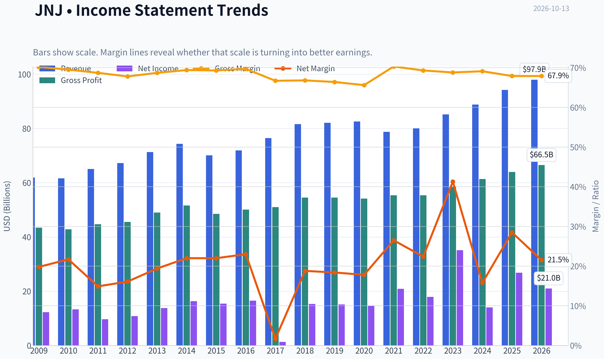

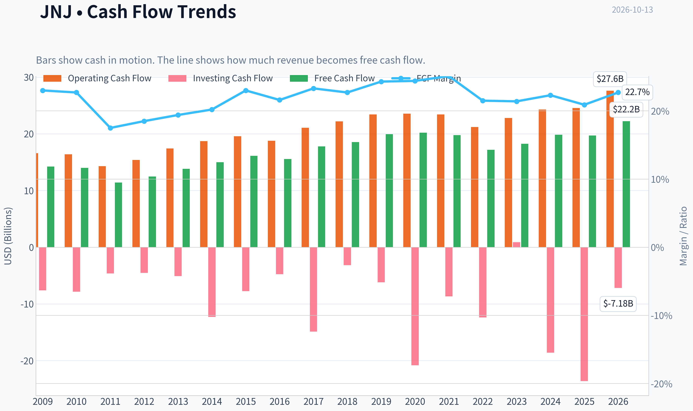

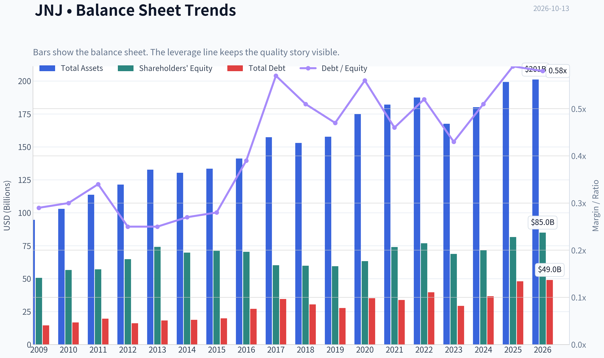

This graph tracks the profitability and return metrics (ROE, ROIC, Margins) of **JNJ** over the past decade, highlighting capital efficiency trends.

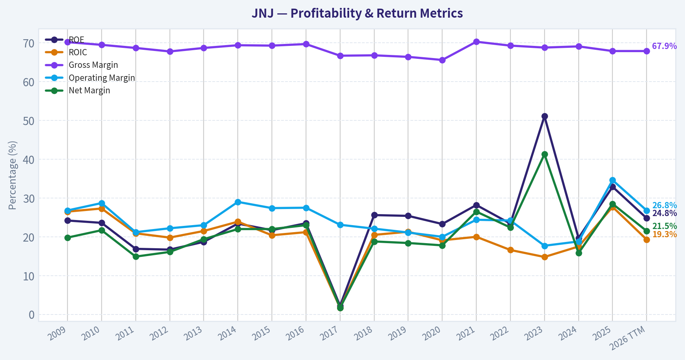

This chart illustrates the financial health of **JNJ** over the last 10 years, mapping cash equivalents and free cash flow against total obligations (Debt).

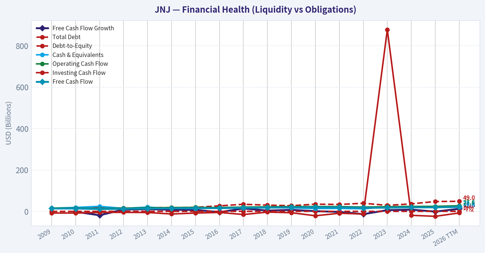

---

### Intrinsic Value Analysis (Buffett)

> *Following Warren Buffett's value investing philosophy: Circle of Competence, Economic Moat, Management Quality, and Margin of Safety.*

#### Intrinsic Value Snapshot

Price is what you pay. Intrinsic value is what the business may be worth based on the cash it can create for owners over time. We show a range, not one magic number.

- Current Price: $263.73
- Value Range (conservative to optimistic across both DCF methods): $97.31 to $338.98

##### Owner Earnings (Buffett Method)
- Net Income: $26,804,000,000.00
- Depreciation & Amortization: $7,503,000,000.00
- Capital Expenditures: $-4,832,000,000.00
- Working Capital Changes: $-12,718,000,000.00
- Owner Earnings: $42,193,000,000.00

##### Intrinsic Value
###### Buffett Method
Uses owner earnings. Stricter, and usually more conservative.
- Conservative: $103.09
- Average: $164.39
- Optimistic: $338.98
- Discount Rate: 10.0%

###### Cash Flow Method
Uses free cash flow. Better for companies spending heavily today to grow tomorrow.
- Conservative: $97.31
- Average: $110.79
- Optimistic: $143.91
- Discount Rate: 10.0%

ANALYST STANCE: **WATCH**

#### Executive Conclusion

Johnson & Johnson remains a high-quality healthcare franchise with valuable brands, regulatory know-how, scale, and a broad portfolio of pharmaceuticals and medical devices. Its gross margin of 67.9%, 32.9% ROE, and 6% latest revenue growth support the view that the company possesses durable competitive advantages.

However, at $264 per share and approximately 30.8 times earnings, the stock price appears to discount an unusually strong growth path. The reverse DCF implies roughly 22.2% annual growth for the next decade, which is substantially more demanding than JNJ's recent operating trajectory. The business is attractive; the current price is not sufficiently attractive for a new position.

#### Factor Scorecard

| Factor | Score | Assessment |
|---|---:|---|
| 1. Circle of competence and simplicity | 4/5 | Diversified healthcare model, but pharmaceutical pipelines, litigation, and regulation add complexity |
| 2. Durable competitive advantage | 4/5 | Strong brands, scale, regulatory expertise, physician relationships, and product ecosystems |
| 3. Management and capital allocation | 4/5 | Long operating history, disciplined portfolio management, and shareholder distributions |
| 4. Industry structure | 4/5 | Healthcare has attractive demand characteristics and high barriers to entry, though drug pricing and patent cycles matter |

**Gate 5 hard floor:** **Not tripped.** The available evidence does not show both deteriorating earnings or cash flow and a solvency red line such as interest coverage below 1 times. JNJ's concerns are valuation, litigation exposure, and pharmaceutical execution-not financial distress.

**Key Takeaways:** JNJ scores well on business quality, competitive position, and industry structure. The central issue is not whether JNJ is a good company, but whether the current price already reflects too much of that quality and future growth.

#### Moat Analysis

| Moat source | Evidence | Assessment |
|---|---|---|
| Intangible assets | Globally recognized healthcare brands, patents, regulatory expertise, and clinical-development capabilities | Strong |
| Switching costs | Hospitals and clinicians rely on established products, clinical familiarity, distribution, and regulatory approvals | Moderate to strong |
| Cost advantages | Global scale in research, manufacturing, compliance, and distribution | Strong |
| Network effects | Limited traditional network effects, but physician familiarity and institutional adoption reinforce product demand | Moderate |
| Financial evidence | 67.9% gross margin and 32.9% ROE | Supports a durable franchise |

**Moat rating: Wide and stable, 4/5.**

JNJ's moat is not based on one consumer product. It is built from scale, trust, intellectual property, regulatory competence, distribution, and the accumulated knowledge required to develop and commercialize healthcare products. The moat is durable, but pharmaceutical patents create recurring renewal requirements and successful drug development is never guaranteed.

**Key Takeaways:** JNJ has a broad, institutional moat rather than a pure network-effect moat. Its advantages are difficult to replicate because competitors must match its scientific capabilities, regulatory history, global distribution, and portfolio breadth.

#### Management Quality and Capital Allocation

Management benefits from a long history of operating through healthcare cycles and maintaining a diversified portfolio. The separation of the consumer-health business into Kenvue simplified the corporate structure and sharpened JNJ's focus on pharmaceuticals and medical technology.

The principal capital-allocation questions are the price paid for acquisitions, the productivity of research spending, and the handling of litigation liabilities. JNJ's research reinvestment is strategically necessary, but pharmaceutical returns depend on pipeline quality and patent timing. The company's dividend history and scale also indicate a shareholder-oriented culture.

**Management score: 4/5.**

The key risk is not obvious recklessness; it is that large healthcare companies can overpay for growth assets or misjudge the commercial durability of a drug portfolio.

#### Financial Summary

| Metric | Latest reported value |
|---|---:|
| Share price | $264 |
| Market capitalization | $635.56 billion |
| Price-to-earnings ratio | 30.8x |
| Revenue growth, year over year | 6.0% |
| Gross margin | 67.9% |
| Return on equity | 32.9% |
| Free-cash-flow yield | 3.1% |
| Current ratio | 1.03x |
| Headline intrinsic value | $184.49 |
| Reverse-DCF growth implied by price | Approximately 22.2% annually for 10 years |

**Key Takeaways:** JNJ is profitable and growing, with excellent gross economics and a strong return on equity. The 3.1% free-cash-flow yield and 30.8 times earnings multiple indicate that investors are paying a substantial premium for stability and expected growth.

#### Owner Earnings Calculation

The Buffett-style framework is:

> Owner earnings = net income + depreciation and amortization - maintenance capital expenditures - working-capital investment

The research valuation pack provides an owner-earnings DCF value of approximately **$164.39 per share**. Using a 10% discount rate, this corresponds to approximately **$16.44 of normalized owner earnings per share**:

| Owner-earnings item | Per-share estimate |
|---|---:|
| Normalized owner earnings | ~$16.44 |
| Discount rate | 10.0% |
| No-growth capitalization value | ~$164.39 |

**Key Takeaways:** JNJ generates substantial recurring cash earnings, but the current share price represents roughly 16 times the estimated normalized owner earnings value under a no-growth framework. The investment therefore requires continued growth, not merely stable cash generation.

#### Three-Scenario DCF Valuation

| Scenario | Key assumptions | Estimated value per share |
|---|---|---:|
| A. No growth | Owner earnings capitalized at 10% | $164.39 |
| B. GDP-like growth | 3% perpetual growth and 10% discount rate | Approximately $242 |
| C. Historical-growth framework | Growth based on a moderated share of recent growth, capped at a sustainable level | Approximately $242-$264 |
| Research-pack blended headline value | Owner earnings, FCF, Damodaran FCFF, and reverse-DCF inputs | $184.49 |

The research pack also reports the following model outputs:

| Valuation model | Value per share |
|---|---:|
| Owner-earnings model | $164.39 |
| FCF model | $110.79 |
| Damodaran FCFF model | $169.43 |
| Headline blended value | $184.49 |

**Key Takeaways:** The valuation range is wide, from approximately $111 to $242 per share, but every conventional cash-flow model is below the current $264 price. The stock requires sustained growth and strong execution to justify the market quotation.

#### Margin of Safety Analysis

Against the research-pack headline intrinsic value of $184.49, the stock price of $264 represents a premium of approximately 43% to that estimate. Direct arithmetic produces a discount of approximately 30% from the market price to the headline value; the research pack separately reports a headline margin of safety of negative 42.9%. Both measurements point to the same conclusion: JNJ is trading above modeled intrinsic value.

| Measure | Result |
|---|---:|
| Current price | $264 |
| Headline intrinsic value | $184.49 |
| Price premium to headline value | Approximately 43% |
| Owner-earnings value | $164.39 |
| FCF-based value | $110.79 |
| Price-implied 10-year growth | Approximately 22.2% annually |

For a wide-moat, predictable compounder, a 10% to 15% discount to intrinsic value can be sufficient. JNJ is not near that threshold. The price instead appears to demand growth closer to the strongest recent periods, despite the normal uncertainty of pharmaceutical patents, pipeline outcomes, litigation, and healthcare pricing policy.

**Key Takeaways:** JNJ deserves a quality premium, but the current premium is too large for a disciplined value investor. A more attractive entry point would be near the $185 to $220 range, depending on confidence in normalized growth and the treatment of litigation liabilities.

#### Final Buffett Scorecard

| Criterion | Weight | Score | Weighted contribution |
|---|---:|---:|---:|
| Moat width and durability | 25% | 4.0 | 1.00 |
| Valuation and margin of safety | 20% | 1.5 | 0.30 |
| Capital returns versus WACC | 15% | 4.0 | 0.60 |
| Business understanding and predictability | 12% | 4.0 | 0.48 |
| Management quality and capital allocation | 12% | 4.0 | 0.48 |
| Reinvestment runway | 8% | 4.0 | 0.32 |
| Balance-sheet strength | 4% | 3.5 | 0.14 |
| Industry structure | 4% | 4.0 | 0.16 |
| **Total** | **100%** |  | **3.48/5.00** |

**Key Takeaways:** JNJ earns a strong quality score, but valuation materially reduces the overall result. The company is close to an investable quality profile, yet the current price does not provide the margin of safety required for a new purchase.

#### Investment Stance

**WATCH - Moderate conviction.**

JNJ is a business an investor could reasonably hold for the long term, particularly at a valuation closer to normalized cash-flow value. But at $264, the stock appears priced for near-perfect execution and unusually strong sustained growth. Existing shareholders may reasonably continue holding if their tax basis and income objectives are favorable; new investors should wait for a better entry price or a meaningful improvement in earnings that brings the valuation back toward intrinsic value.
#### Valuation Bridge

This bridge places the current market price beside each intrinsic value lens so readers can see whether upside depends on one method or shows up across several methods.

| Scenario | Intrinsic Value / Share |
| --- | ---: |
| Buffett Method | $164.39 |
| Cash Flow Method | $110.79 |
| Damodaran Method | $169.43 |
| Current Price | $263.73 |

#### Key Takeaways

If one method is far above the others, the upside case depends on a specific modelling assumption. When several methods cluster together, the valuation story is more robust.

#### Valuation Visuals

This comparison chart from *Latest Earnings Snapshot* stacks current figures against historical benchmarks for **JNJ**, making it easy to see where the company trades relative to its own averages.

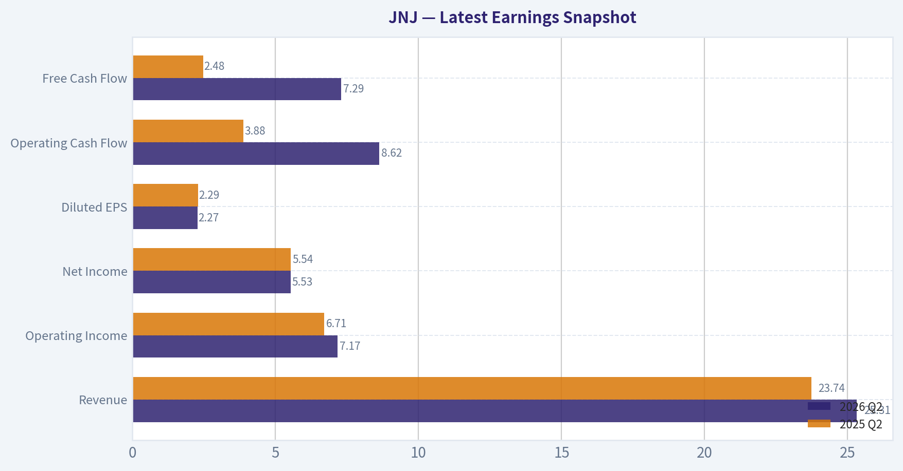

This comparison chart from *Executive Summary* stacks current figures against historical benchmarks for **JNJ**, making it easy to see where the company trades relative to its own averages.

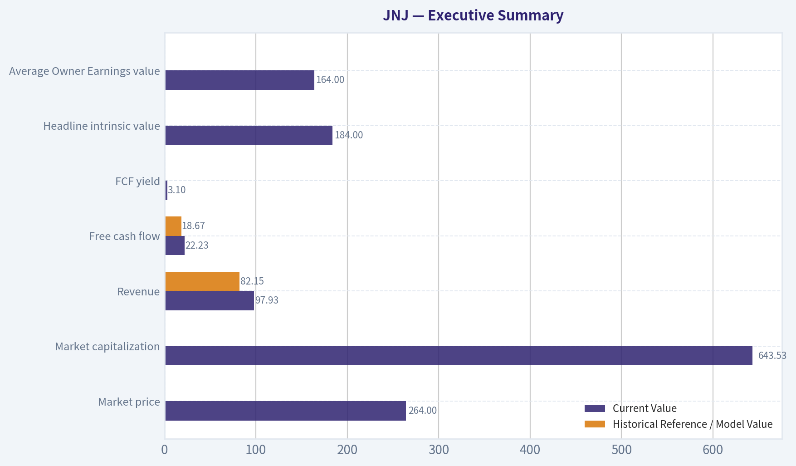

This comparison chart from *Balance Sheet and Financial Strength* stacks current figures against historical benchmarks for **JNJ**, making it easy to see where the company trades relative to its own averages.

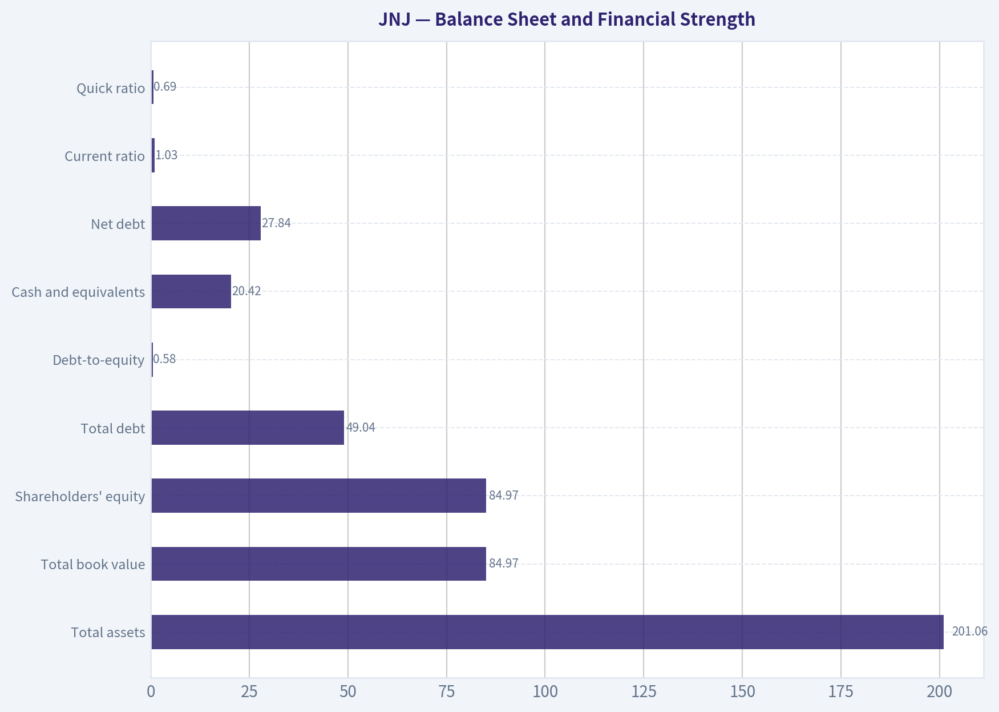

The following chart maps the **JNJ** Owner Earnings DCF valuation scenarios (Conservative, Average, Optimistic) to visually represent the margin of safety based on intrinsic value calculations.

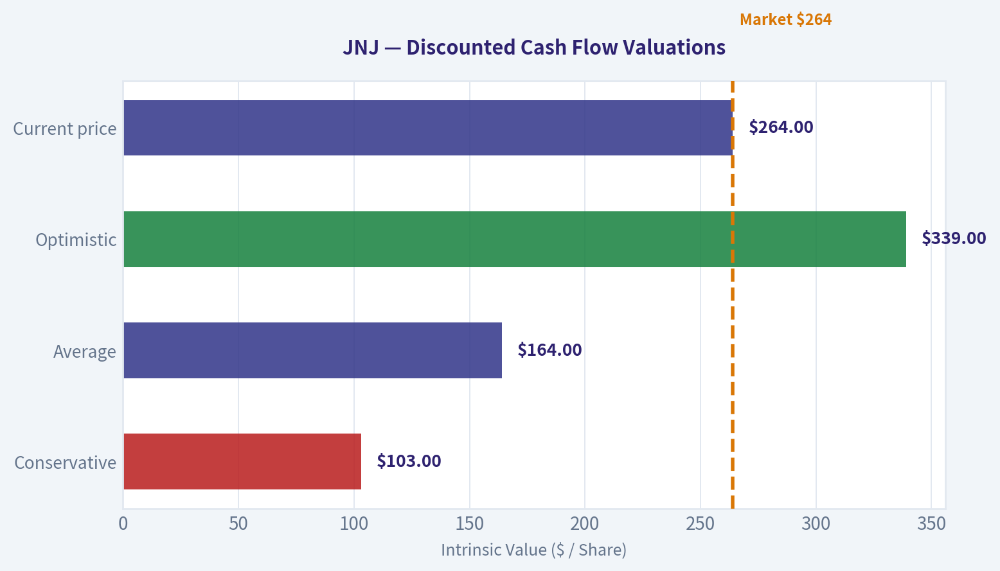

This comparison chart from *Buffett-Style Owner Earnings DCF* stacks current figures against historical benchmarks for **JNJ**, making it easy to see where the company trades relative to its own averages.

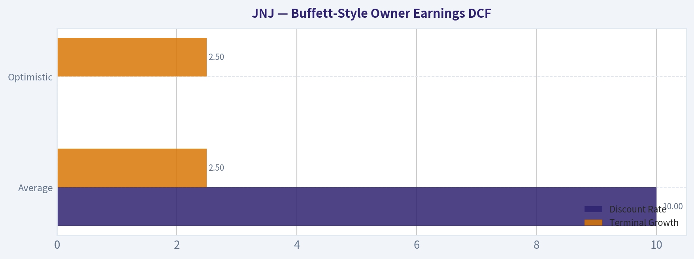

This comparison chart from *Financial Summary* stacks current figures against historical benchmarks for **JNJ**, making it easy to see where the company trades relative to its own averages.

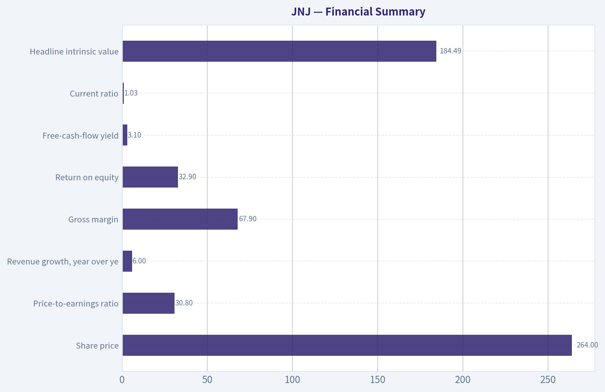

---

### Trend & Growth Analysis (Lynch/Druckenmiller/Fisher)

> *Following Peter Lynch's GARP, Stanley Druckenmiller's macro-aware approach, and Philip Fisher's scuttlebutt methodology.*

ANALYST STANCE: **AVOID**

#### Executive view

Johnson & Johnson is a high-quality healthcare stalwart, but not a primary growth-investing opportunity at the current price. Revenue growth is approximately 6%, the stock trades at roughly 31 times earnings, and the intrinsic-value estimates supplied range from $111 to $169 versus a $264 share price. JNJ has defensive qualities and a promising pharmaceutical pipeline, but the valuation appears to require growth well above its recent trajectory.

#### 1. Lynch classification

| Metric | Assessment |
|---|---:|
| Lynch category | Stalwart |
| Revenue growth | 6.0% year over year |
| P/E ratio | 30.8x |
| ROE | 32.9% |
| Gross margin | 67.9% |
| FCF yield | 3.1% |
| Growth-investor fit | Limited at current valuation |

**Key Takeaways:** JNJ fits Lynch's stalwart category rather than the fast-grower category. Its profitability and franchise quality are strong, but approximately 6% growth does not justify treating it as a 20% growth compounder without a major acceleration.

#### 2. The story in three bullets

- JNJ combines a diversified pharmaceutical business with medical technology, creating a durable healthcare platform.
- Growth depends primarily on innovative drugs, including the TREMFYA immunology franchise, pipeline execution, and continued medical-device expansion.
- The central issue is valuation: the market price appears to discount substantially stronger long-term growth than JNJ has recently delivered.

#### 3. TAM and 10x test

| TAM consideration | Assessment |
|---|---|
| Relevant markets | Pharmaceuticals, immunology, oncology, cardiovascular care, surgery, orthopedics, and medical technology |
| TAM growth | Generally favorable, but fragmented by therapeutic area |
| Current revenue base | Approximately $100 billion scale |
| 10x revenue target | Approximately $1 trillion |
| Could JNJ reach 10x revenue while remaining below 20% share? | Technically possible across global healthcare, but economically very difficult |
| Runway classification | Large TAM, limited 10x company-specific runway |

**Key Takeaways:** JNJ operates in enormous and growing markets, but its current scale makes a ten-bagger difficult. The company would need either sustained double-digit organic growth, major successful acquisitions, or a transformative product cycle; its recent 6% growth rate does not yet indicate that outcome.

#### 4. Revenue growth trend

| Indicator | Result | Interpretation |
|---|---:|---|
| Latest revenue growth | 6.0% year over year | Stalwart-level growth |
| Recent three-year implied growth | 19.2% cumulative annualized reference | Historically stronger than current growth |
| Recent five-year implied growth | 30.0% cumulative annualized reference | Includes acquisition, portfolio, and base effects |
| Current pattern | Not clearly accelerating | No confirmed growth inflection |

**Key Takeaways:** The available data show a mature business growing at a moderate rate, not an accelerating fast grower. TREMFYA and other pipeline products could improve the trajectory, but current evidence is not sufficient to establish a durable acceleration.

#### 5. Unit economics and operating quality

| Measure | Result | Assessment |
|---|---:|---|
| LTV/CAC | Not disclosed or not meaningful for JNJ's mixed business model | Cannot be reliably calculated |
| Net revenue retention | Not applicable | Product and prescription-driven model |
| Rule of 40 | Not applicable | Not a SaaS subscription company |
| Gross margin | 67.9% | Strong |
| FCF yield | 3.1% | Modest at current valuation |
| Current ratio | 1.03x | Adequate but not unusually strong |

**Key Takeaways:** JNJ's economics should be evaluated through gross margins, cash generation, return on capital, and product durability rather than SaaS metrics. Its gross margin and ROE are attractive, but the 3.1% FCF yield offers limited valuation support at a $264 share price.

#### 6. Inflection-point assessment

| Potential inflection | Current evidence | Assessment |
|---|---|---|
| Product cycle | Positive TREMFYA Crohn's disease data, including sustained remission and fistula outcomes | Potentially positive |
| Market share | No quantified accelerating share gain provided | Unproven |
| Margin inflection | No clear operating-margin acceleration provided | Unconfirmed |
| TAM expansion | New indications expand drug opportunity | Positive but incremental |
| Competitive inflection | No major competitor disruption identified | Neutral |
| Overall inflection | Pipeline optionality, not confirmed earnings acceleration | Watch, not buy |

**Key Takeaways:** TREMFYA is the most credible near-term growth catalyst, and additional indications could extend its commercial runway. However, clinical progress is not the same as a demonstrated company-wide earnings inflection; investors need evidence of accelerating pharmaceutical sales and improved forward guidance.

#### 7. Macro setup

| Macro factor | Impact on JNJ |
|---|---|
| Economic cycle | Defensive; less cyclical than industrials or consumer discretionary companies |
| Interest rates | Higher rates pressure the valuation of long-duration growth assets, though JNJ is less sensitive than an unprofitable technology stock |
| Healthcare demand | Structurally resilient and supported by aging populations |
| Policy and reimbursement | Ongoing pricing and regulatory risk |
| Litigation | Material uncertainty, particularly around legacy talc-related liabilities |
| Macro stance | Defensive business, but not an especially attractive growth setup |

**Key Takeaways:** JNJ benefits from resilient healthcare demand and should hold up relatively well in a weaker economy. Nevertheless, policy, litigation, and drug-pricing risks offset some of that defensiveness, while the valuation leaves limited room for macro or execution disappointments.

#### 8. Fisher 15-point assessment

| Fisher criterion | Score / 5 | Comment |
|---|---:|---|
| Market potential | 5 | Enormous healthcare markets |
| New-product determination | 4 | Strong pharmaceutical and device pipeline |
| R&D effectiveness | 4 | Proven ability to develop and acquire products |
| Sales organization | 5 | Global commercial infrastructure |
| Profit margins | 4 | High gross margin and strong franchise economics |
| Margin improvement | 3 | Not enough evidence of a current inflection |
| Labor relations | 4 | Generally stable large-company workforce |
| Executive relations | 4 | Mature management structure |
| Management depth | 5 | Deep global organization |
| Cost analysis/accounting | 4 | High-quality public-company controls |
| Outstanding competitive aspects | 5 | Scale, brands, regulatory expertise, distribution |
| Long-range profit outlook | 4 | Durable, but likely moderate growth |
| Dilution | 4 | No major dilution issue indicated |
| Candor | 3 | Difficult to assess fully from supplied data |
| Integrity | 4 | Strong institutional reputation, with litigation caveat |
| **Total** | **62 / 75** | **Good, not outstanding** |

**Key Takeaways:** JNJ scores well on scale, R&D, distribution, and competitive durability. Its main deductions are the lack of clear margin acceleration, moderate rather than exceptional growth, and uncertainty surrounding litigation and management candor on difficult liabilities.

#### 9. Valuation analysis

| Valuation method | Result | Interpretation |
|---|---:|---|
| P/E | 30.8x | High for approximately 6% current growth |
| PEG | Approximately 5.1x | Expensive under Lynch's framework |
| FCF yield | 3.1% | Limited cash-flow cushion |
| Intrinsic value, headline | $184.49 | About 42.9% below current price |
| Owner-earnings DCF | $164.39 | Below current price |
| FCF valuation model | $110.79 | Materially below current price |
| Damodaran FCFF | $169.43 | Materially below current price |
| Reverse DCF implication | Approximately 22.2% annual growth for 10 years | Aggressive assumption |

**Key Takeaways:** Valuation is the decisive weakness. A P/E near 31 times against 6% growth produces a PEG near 5, while the supplied intrinsic-value models place fair value substantially below $264. The current price appears to require roughly 22% annual growth for a decade, far above the company's recent operating profile.

#### 10. Growth investor scorecard

| Criterion | Weight | Score / 5 | Weighted contribution |
|---|---:|---:|---:|
| Story | 10% | 3.5 | 0.35 |
| TAM and runway | 20% | 3.5 | 0.70 |
| Revenue growth | 20% | 2.5 | 0.50 |
| Unit economics | 15% | 4.0 | 0.60 |
| Competitive position | 10% | 4.5 | 0.45 |
| Management quality | 10% | 4.0 | 0.40 |
| Macro setup | 5% | 3.5 | 0.18 |
| Profitability path | 5% | 4.0 | 0.20 |
| Valuation | 5% | 1.5 | 0.08 |
| **Total** | **100%** |  | **3.46 / 5.00** |

**Key Takeaways:** JNJ earns a respectable operating score because it has a durable franchise, strong margins, and attractive healthcare exposure. The score falls below the advocate threshold because current growth is not fast enough and valuation is materially demanding.

#### 11. Position-size stance

| Investor type | Position stance |
|---|---|
| Existing long-term holder | Hold or trim if position is oversized |
| New growth investor | Avoid initiating at $264 |
| Defensive income investor | Consider only at a materially better valuation |
| High-conviction growth portfolio | 0% to 1% exploratory position only, if seeking healthcare defensiveness |
| Preferred entry framework | Wait for a substantial valuation reset or clear earnings acceleration |

**Key Takeaways:** JNJ may be appropriate as a defensive holding, but it does not meet the profile of a high-conviction growth investment at the supplied price. A more attractive setup would require either a significant price decline toward the valuation-model range or several quarters demonstrating sustained pharmaceutical-led acceleration.

#### 12. Key catalysts and risks

| Catalysts | Risks |
|---|---|
| TREMFYA approval and successful launches in additional indications | TREMFYA or other pipeline failures |
| Accelerating pharmaceutical sales | Patent expirations and generic competition |
| Medical-device share gains and margin improvement | Litigation liabilities, especially talc-related claims |
| Successful separation and capital allocation | Drug-pricing regulation and reimbursement pressure |
| Lower interest rates supporting valuation | Multiple compression if growth remains near 6% |
| Acquisitions that improve the growth profile | Integration risk and excessive acquisition pricing |

**Key Takeaways:** TREMFYA and the broader pharmaceutical pipeline are the most important catalysts because they could create a genuine product-cycle inflection. The most immediate risk is not business survival but valuation compression: if growth remains moderate, the premium multiple could contract substantially.

#### Bottom line

JNJ is an excellent business, but excellent businesses can still be poor purchases when expectations are excessive. The company currently looks like a **high-quality stalwart priced as a faster-growing compounder**. Under Lynch, Druckenmiller, and Fisher's growth framework, the appropriate stance is **AVOID for new money**, while existing owners may continue holding selectively for defensiveness and quality.

---

### Market Technical Analysis

ANALYST STANCE: **WATCH**

#### JNJ technical overview

JNJ closed at **$263.73 on October 12, 2026**, with October 13 identified as a non-trading day in the data. The stock remains in a **structurally bullish long-term trend**, but its intermediate-term setup is unsettled after a meaningful pullback from the September high near $278.43.

The most important distinction is between time horizons:

- **Long term:** Bullish, with price substantially above the 200-day SMA.
- **Intermediate term:** Cautious, because price remains below the 50-day SMA and volume-weighted average.
- **Short term:** Improving, as price has recovered above the 10-day EMA and momentum indicators are rebounding from weak levels.
- **Immediate decision:** Watch for confirmation rather than chase the recent bounce.

#### Trend structure: bullish long term, corrective intermediate term

The **200-day SMA was $241.33**, putting the closing price roughly **9.3% above** this long-term benchmark. The 200-day SMA is also rising steadily, from approximately $235.21 in mid-September to $241.33 by October 12. This supports the interpretation that JNJ's broader trend remains positive and that the recent decline is, so far, a correction within a larger advance rather than a confirmed long-term reversal.

The **50-day SMA was $265.07**, slightly above the closing price. Price has therefore not yet reclaimed its medium-term trend benchmark. The 50-day SMA itself has flattened and begun to soften modestly after rising through late September, which suggests that the intermediate trend has lost momentum.

The **10-day EMA stood at $260.89**, below the close. This is a constructive short-term development: JNJ has recovered above its fast average after falling sharply below it in early October. However, the distance above the 10-day EMA is small, so the signal is better viewed as an early recovery indication than as a fully established uptrend.

A sustained close above the **$265-$266 area**, corresponding to the 50-day SMA and recent volume-weighted resistance, would improve the technical picture. Conversely, a failure near that zone followed by a close below roughly **$260-$261** would indicate that the current bounce is losing traction.

#### Momentum: bearish readings are improving, but not yet bullish

The **MACD was -2.12** on October 12, meaning the underlying intermediate momentum signal remained negative. MACD had deteriorated from positive territory in late September and reached a more negative level during the early-October selloff. This confirms that the recent decline was not merely a one-day fluctuation; it represented a genuine loss of momentum.

However, the **MACD histogram improved to -0.55**, from -1.09 on October 9 and -2.13 on October 6. This improvement is significant because it indicates that downside momentum is fading. The histogram remains below zero, so the signal is not yet a confirmed bullish reversal, but it shows that sellers are becoming less dominant.

The **RSI was 50.30**, recovering from an oversold reading of **29.57 on October 5**. The rebound from below 30 suggests that short-term selling pressure became excessive and that buyers have regained balance. At the current level near 50, RSI is neutral rather than overbought, leaving room for additional upside if price can clear resistance.

The RSI recovery should nevertheless be interpreted carefully. A move from oversold to neutral often marks a relief bounce, but it does not by itself establish a new sustained advance. A move above approximately **55-60**, accompanied by price reclaiming the 50-day SMA, would provide stronger evidence of renewed upside momentum.

#### Volume-weighted confirmation remains incomplete

The **VWMA was $262.07**, below the $263.73 close. This modestly favors buyers in the very short term, because price is trading above the recent volume-weighted average. The improvement is recent, however: VWMA was above $265 in early October and above $268 in late September.

This means JNJ has reclaimed a short-term volume-adjusted level but has not yet repaired the broader distribution that occurred during the decline from the upper $270s. The **$262 area** can be treated as a near-term reference point. Holding above it would support continuation toward the 50-day SMA; falling back below it would weaken the recovery signal.

Recent volume also deserves attention. The October 2 and October 5 declines occurred on relatively elevated volume, while the rebound into October 12 was accompanied by more moderate volume. That pattern is not decisively bearish, but it means the recovery has not yet demonstrated overwhelming accumulation. A breakout above $265-$266 would be more credible if accompanied by volume expansion.

#### Volatility and risk management

The **ATR was $5.17**, meaning JNJ's typical daily trading range was approximately $5.17. Relative to the $263.73 closing price, this represents roughly **2.0% daily volatility**. ATR has stabilized compared with mid-September, when it was above $5.5, but volatility remains large enough that tight stops could be triggered by normal price fluctuations.

For short-term traders, a stop placed only one or two dollars below entry would likely be vulnerable to ordinary noise. A volatility-aware approach would use ATR as a position-sizing guide and would distinguish between a routine pullback and a true technical breakdown.

The recent price action establishes several practical levels:

- **Near-term support:** Approximately $260-$262, around the 10-day EMA and VWMA.
- **Secondary support:** Approximately $253-$256, corresponding to the early-October low region.
- **Initial resistance:** Approximately $265-$266, around the 50-day SMA.
- **Higher resistance:** Approximately $270-$275, where JNJ previously consolidated and then encountered selling pressure.
- **Major upside test:** The September high near $278.43.

#### Trading interpretation

The setup is best classified as **neutral-to-cautiously constructive**, rather than outright bullish or bearish.

A bullish continuation case would require JNJ to hold above the $260-$262 area, push through the $265-$266 resistance band, and ideally do so with stronger volume. Such a move would align the short-term recovery above the 10-day EMA with a medium-term reclaim of the 50-day SMA. In that scenario, the $270-$275 zone would become the next important test.

A bearish or defensive case would develop if the stock fails repeatedly near $265-$266 and then closes below $260. A break beneath the early-October lows around $253-$256 would be more serious, particularly because it would suggest that the recent RSI recovery was only temporary and that the intermediate correction remains active.

For existing long-term holders, the rising 200-day SMA and price separation above it argue against treating the current weakness as a confirmed long-term trend failure. For new short-term entries, however, the risk-reward profile is more attractive after either a confirmed breakout above the 50-day SMA or a controlled pullback that holds the $260-$262 support area.

#### Selected indicators

The analysis uses eight complementary indicators:

1. **close_10_ema** - short-term price direction and recovery confirmation.
2. **close_50_sma** - intermediate trend and key resistance.
3. **close_200_sma** - long-term trend filter.
4. **macd** - underlying momentum direction.
5. **macdh** - rate of change in momentum and early reversal detection.
6. **rsi** - momentum balance and oversold recovery.
7. **vwma** - volume-adjusted price confirmation.
8. **atr** - volatility-adjusted risk and position sizing.

These indicators cover trend, momentum, volume confirmation, and volatility without adding redundant oscillators.

| Area | Latest reading | Technical interpretation | Levels or confirmation to watch |
|---|---:|---|---|
| Closing price | $263.73 | Rebounded from the October decline; currently between short-term support and medium-term resistance | Hold above $260-$262; clear $265-$266 |
| 10-day EMA | $260.89 | Price is modestly above the fast average, indicating short-term improvement | A close back below the EMA would weaken the bounce |
| 50-day SMA | $265.07 | Price remains below the intermediate trend benchmark | Reclaiming $265-$266 would improve the setup |
| 200-day SMA | $241.33 | Price remains well above the long-term trend benchmark; broad trend is still bullish | A sustained break below the 200-day SMA would materially change the outlook |
| MACD | -2.12 | Intermediate momentum remains negative | A move toward zero, followed by a bullish crossover, would strengthen the recovery |
| MACD histogram | -0.55 | Still negative, but improving materially from early October | Continued improvement and a move above zero would confirm momentum repair |
| RSI | 50.30 | Recovered from oversold conditions and is now neutral | RSI above 55-60 with a price breakout would be more bullish |
| VWMA | $262.07 | Price is slightly above the volume-weighted average, a modest short-term positive | Holding above $262 supports recovery; loss of that level raises pullback risk |
| ATR | $5.17 | Daily volatility remains around 2% of price | Use volatility-aware stops and position sizing rather than tight fixed stops |
| Overall stance | Watch | Long-term trend is bullish, but intermediate confirmation is missing | Prefer confirmation above $265-$266 or support near $260-$262 |

**Key Takeaways:** JNJ's long-term trend remains bullish because the stock is well above its rising 200-day SMA, but the intermediate trend is still recovering and price has not yet reclaimed the 50-day SMA. Momentum is improving from oversold conditions, with RSI near neutral and the MACD histogram becoming less negative, but confirmation is incomplete. The most important near-term test is whether JNJ can hold $260-$262 and break convincingly above $265-$266.

---

### Options Market Analysis

> *Reading options flow - put/call ratios, IV skew, and unusual activity - to gauge institutional positioning and event-driven risk.*

ANALYST STANCE: **WATCH**

#### JNJ Options Flow Report

**As of October 13, 2026.** The available near-term options data has a major limitation: open interest is reported as zero across all listed expirations. That makes standard positioning, gamma-wall, and max-pain analysis unreliable. Volume-based signals can still be reviewed, but confidence is low.

#### Put/Call Ratio Analysis

| Expiration | Call Volume | Put Volume | Volume Put/Call Ratio | Call OI | Put OI | OI Put/Call Ratio |
|---|---:|---:|---:|---:|---:|---:|
| October 16, 2026 | 16,249 | 11,882 | 0.73 | 0 | 0 | N/A |
| October 23, 2026 | 1,298 | 2,468 | 1.90 | 0 | 0 | N/A |
| October 30, 2026 | 324 | 155 | 0.48 | 0 | 0 | N/A |
| **Total** | **17,871** | **14,505** | **0.81** | **0** | **0** | **N/A** |

**Key Takeaways:** The aggregate near-term put/call volume ratio is 0.81, modestly below the approximately 0.70 neutral reference but still showing a slight call-side bias relative to puts. Flow is inconsistent by expiry: October 16 is close to balanced, October 23 is put-heavy, and October 30 is call-heavy. Because open interest is zero, there is no reliable evidence of established institutional positioning.

#### Implied Volatility Assessment

| Expiration | Call ATM IV | Put ATM IV | Relative IV Read |
|---|---:|---:|---|
| October 16, 2026 | 3.0% | 3.0% | Balanced |
| October 23, 2026 | 1.5% | 2.0% | Modest put premium |
| October 30, 2026 | 1.4% | 0.9% | Call IV premium |
| **Overall** | - | - | Very low reported IV |

**Key Takeaways:** Reported near-term ATM implied volatility is extremely low, ranging from 0.9% to 3.0%, which suggests little visible demand for short-term optionality or possible data-quality issues. The October 23 expiry shows modest downside protection demand, while October 30 shows the opposite pattern. A true out-of-the-money put-versus-call skew is not provided, so downside fear cannot be measured reliably.

There is no clear evidence in the supplied data of elevated volatility ahead of an identified catalyst. The low IV readings should be treated cautiously because they appear unusually low for equity options and may reflect incomplete or anomalous data.

#### Unusual Options Activity

| Finding | Result |
|---|---|
| Contracts with volume greater than 5x open interest | None identified |
| Fresh directional bets | No confirmed examples |
| Smart-money versus retail inference | Not possible from supplied data |

**Key Takeaways:** No individual contracts meet the tool's unusual-activity threshold. Since all open interest values are reported as zero, the absence of flagged contracts should not be interpreted as proof that there is no unusual trading. Strike-level analysis is also unavailable, so ITM, ATM, and OTM positioning cannot be classified.

#### Open Interest Concentration and Gamma Levels

| Metric | Result |
|---|---|
| Highest call OI strikes | None reported |
| Highest put OI strikes | None reported |
| OI concentration by expiry | None measurable |
| Gamma walls or pinning levels | Cannot be determined |
| Max-pain analysis | Unavailable |

**Key Takeaways:** There are no usable open-interest concentrations in the supplied chain. Consequently, no gravitational price levels, gamma walls, or expiry-related pinning zones can be identified. This materially reduces confidence in any short-term options-based price forecast.

#### Overall Options Sentiment

| Component | Assessment |
|---|---|
| Volume positioning | Slightly call-favorable overall |
| Established positioning | Unreadable because OI is zero |
| Volatility regime | Very low reported IV, potentially anomalous |
| Downside skew | Not available; modest put premium only for October 23 |
| Conviction | Low |

**Overall signal: NEUTRAL, with a slight bullish tilt.**

The primary positive factor is the aggregate 0.81 put/call volume ratio, supported by call-heavy trading in the October 30 expiration. However, the October 23 put-heavy flow offsets much of that signal, and the zero open-interest readings prevent confirmation that trades represent new institutional positions rather than data artifacts, intraday activity, or closing transactions. JNJ options positioning therefore does not provide a dependable directional edge at present.

#### Summary

| Category | Assessment |
|---|---|
| Put/Call Ratio | Volume ratio 0.81; slight call-side bias, but OI ratio unavailable |
| IV Level | Very low reported near-term IV, approximately 0.9%-3.0%; reliability questionable |
| Skew Direction | Inconclusive; modest put premium on October 23, call premium on October 30 |
| Unusual Activity | No contracts with volume greater than 5x OI |
| Overall Signal | **NEUTRAL**, with a slight bullish tilt and low confidence |

**Key Takeaways:** JNJ's aggregate options volume leans modestly bullish, but the signal is weak because open interest is shown as zero throughout the near-term chain. Volatility is unusually low and no unusual contracts or gamma concentrations are identifiable. The appropriate conclusion is neutral rather than a strong directional trade signal.

---

## Research Team Commentary

> *The Research Manager synthesizes the Bull vs Bear debate into action-free commentary. This is a pre-risk view, not the final stance.*

Core Takeaway: Johnson & Johnson is a high-quality healthcare franchise, but $264 does not provide a sufficient margin of safety. The company's 67.9% gross margin, 24.5% ROIC, diversified pharmaceutical and medical-technology operations, and regulatory capabilities support a genuine moat. Nevertheless, approximately 30.8 times earnings is an exacting price for a business currently growing revenue around 6% and facing recurring patent, pipeline, litigation, and capital-allocation risks. I would retain JNJ on the watchlist rather than initiate or materially add at this valuation.

The strongest bull argument is that the headline multiple exaggerates the valuation problem. JNJ does not need hypergrowth if it can maintain mid-single-digit expansion while reinvesting at high incremental returns. Its diversification, clinical relationships, intellectual property, regulatory infrastructure, and medical-device switching costs make its cash flows more resilient than those of a single-product pharmaceutical company. The reverse-DCF framing that the market requires roughly 5%-6% long-term growth is plausible rather than obviously heroic. The improving short-term chart and bullish long-term trend also caution against assuming an imminent price decline.

The strongest bear argument is that plausibility is not the same as a margin of safety. At a 3.25% earnings yield, investors are paying in advance for a long period of dependable execution. JNJ must offset patent erosion and failed development programs before producing net growth, while maintaining margins and avoiding value-destructive acquisitions. Historical companywide ROIC also does not establish that the next dollar invested in R&D, licensing, or acquisitions will earn 24.5%.

The bull's approximately $280-$285 base value is not conservative enough to anchor a purchase. It relies on a low 7.25% discount rate, a 4.25% perpetual growth rate, and sustained 6% growth. Those assumptions collectively give considerable weight to distant terminal value. Even if that estimate is accepted, the implied upside from $264 is only about 6%-8%, below the roughly 10%-15% discount I would require for a wide-moat, predictable compounder. The conservative bull value of $215-$225 implies considerably greater downside.

The bear's $145-$190 estimates should not be treated as definitive either. They use earnings as a rough cash-flow proxy without complete free-cash-flow, net-debt, reinvestment, or normalized litigation data. That creates false precision and may undervalue a durable healthcare platform. The evidence therefore supports "insufficient expected return," not a claim that the business is impaired or that intrinsic value is unquestionably far below the share price.

Rationale: This is a case where business quality and stock attractiveness diverge. JNJ passes the quality test, with strong margins, excellent reported returns on capital, valuable intellectual property, and considerable operating breadth. It does not currently pass the valuation test with enough confidence. A high-quality business can justify a premium, but the current multiple leaves little room for ordinary disappointments or multiple normalization.

The prior JAZZ and Alphabet mistakes argue against letting valuation discomfort automatically override cash generation, business quality, and improving price action. That lesson prevents me from making an aggressively bearish forecast here. JNJ could continue rising, especially with its long-term technical trend intact and short-term momentum recovering. But those prior errors should not be overcorrected into treating every quality company with positive momentum as attractive at any price. Technical strength improves timing probabilities; it does not manufacture intrinsic value.

Accordingly, WATCH is more appropriate than AVOID. AVOID would overstate the certainty of overvaluation given the incomplete cash-flow data and JNJ's genuine quality. ADVOCATE would require either a better entry price or stronger evidence that normalized per-share free cash flow can compound fast enough to overcome the current multiple.

Monitoring Plan: Over the next one to four quarters, I would focus first on organic pharmaceutical growth and whether TREMFYA and other newer products are more than offsetting mature-product erosion. Sustained companywide growth around or above 5%-6%, supported by volume and indication expansion rather than acquisitions alone, would strengthen the thesis.

Second, I would compare normalized free cash flow with reported earnings. Cash conversion near or above earnings, after necessary R&D and capital expenditures, would make the current multiple more defensible. Persistent cash conversion materially below earnings would reinforce the bear case.

Third, I would monitor incremental returns on capital rather than relying solely on the reported 24.5% historical ROIC. Licensing transactions and acquisitions should contribute measurable growth without causing leverage or invested capital to rise much faster than operating profit.

Fourth, I would track pharmaceutical pipeline milestones, medical-technology organic growth, procedure volumes, and segment margins. Broad-based execution would demonstrate that the moat extends beyond a few major products. Repeated trial failures, unexpected share losses, or structural MedTech weakness would reduce intrinsic value.

Fifth, litigation developments need to be translated into estimated cash costs and balance-sheet consequences. Manageable, quantified liabilities would reduce uncertainty; escalating obligations that constrain R&D, acquisitions, dividends, or repurchases would weaken the thesis.

Finally, price matters. Assuming fundamentals remain intact, approximately $235-$245 would begin to offer a more credible quality-adjusted margin of safety against a reasonable base value in the high $270s to low $280s. A price closer to $215-$225 would be materially more compelling. Conversely, continued appreciation without corresponding increases in normalized earnings and free cash flow would make the risk-reward less attractive, even if the chart remains bullish.

Final stance: WATCH

---

## Value Investing Team Commentary

> *The Investor translates the research view into an investment thesis before risk review. This is still not the final stance.*

### Investment Commentary

Johnson & Johnson is a strong business offered at an unremarkable-or potentially unattractive-price. Its pharmaceutical intellectual property, regulatory expertise, clinical relationships, global distribution, and medical-technology switching costs support a durable moat. The reported 67.9% gross margin and 24.5% ROIC reinforce that assessment, although historical returns do not guarantee equally attractive returns on future R&D, licensing, and acquisitions.

### Business quality and earnings power

JNJ's diversification is valuable. The pharmaceutical operation provides innovation-led growth and high margins, while MedTech adds procedure-driven demand and a broad installed base. This makes the company more resilient than a single-product drug developer, though diversification does not eliminate patent expiration, clinical-trial, reimbursement, litigation, or acquisition risks.

The key operating question is whether newer products-particularly TREMFYA and the broader pipeline-can more than offset mature-product erosion. Approximately 6% revenue growth is respectable for a company of JNJ's scale. If that growth is organic, converts reliably into free cash flow, and is accompanied by stable margins, JNJ can remain a sound long-term compounder. But the supplied data do not establish normalized free cash flow, net debt, litigation-adjusted cash obligations, or per-share growth with enough precision to justify an aggressive valuation conclusion.

The 32.9% ROE also should not be accepted at face value as evidence of extraordinary economics. ROE can be amplified by leverage, acquisitions, and a reduced accounting equity base. ROIC and normalized free cash flow per share are more informative, but even the reported 24.5% ROIC is backward-looking.

### Valuation and margin of safety

At $264 and roughly 30.8 times earnings, JNJ offers an earnings yield of only about 3.25%. That is a demanding starting point for a mature healthcare company growing revenue in the mid-single digits. The valuation can work if JNJ sustains growth, converts earnings into cash, and avoids meaningful margin or multiple compression. It leaves limited protection if pipeline execution, litigation costs, or capital allocation disappoint.

The reverse-DCF conclusion is nuanced: implied long-term growth of roughly 5%-6% is plausible for this franchise, not obviously irrational. Therefore, the shares should not be labeled clearly or dramatically overvalued based on the supplied evidence. Nevertheless, plausible assumptions are not the same as a favorable purchase price.

A valuation of $280-$285 based on a 7.25% discount rate and 4.25% perpetual growth rate is fragile. A perpetual growth rate that high assigns substantial value to distant cash flows, while the low discount rate leaves little room for uncertainty. Even accepting that valuation, the upside from $264 is only around 6%-8%. That falls short of the approximately 10%-15% discount appropriate for a wide-moat, dependable company.

The lower estimates of $145-$190 appear equally uncertain because earnings are not a complete substitute for free cash flow and because the necessary balance-sheet and normalized-liability adjustments are missing. The sound conclusion is not that JNJ is demonstrably worth far less than $264. It is that the prospective return is insufficiently attractive relative to the assumptions required.

### Selective contrarian view

The bullish long-term chart and recovering short-term momentum suggest that investors continue to reward JNJ's perceived safety, quality, and healthcare durability. The market may correctly be looking through temporary patent, litigation, or spending concerns and recognizing the value of a broad platform. Waiting for perfect certainty could mean never purchasing a high-quality compounder.

However, the more useful contrarian observation is that "defensive" does not mean "low risk" when investors pay a premium price. Enthusiasm for dependable healthcare earnings can itself compress future returns. At more than 30 times earnings, shareholders are exposed not only to business disappointments but also to ordinary multiple normalization, even if earnings continue growing.

Conversely, shorting or abandoning JNJ simply because the multiple appears high would be an overreaction. Its moat, balance-sheet capacity, product breadth, and long-term trend make continued appreciation possible. Technical strength should prevent an aggressively bearish call, but it cannot create an intrinsic-value discount.

### Practical approach

For a new investment, patience is warranted:

- **$235-$245:** A more credible entry range if operating performance and normalized free cash flow remain sound.
- **$215-$225:** A materially stronger margin of safety, assuming no deterioration in the franchise.
- **Above $264 without matching cash-flow growth:** Increasingly unattractive, even if momentum remains positive.

Existing long-term shareholders need not sell solely because the stock looks expensive, particularly if doing so creates taxes and the position is appropriately sized. But fresh capital should require either a lower price or evidence that normalized free cash flow per share can grow faster than the current mid-single-digit operating profile suggests.

The most important items to monitor are organic pharmaceutical growth, replacement of mature-product revenue, MedTech procedure volumes and margins, earnings-to-cash conversion, incremental returns on acquisitions and licensing, quantified litigation obligations, and normalized free cash flow per share. A sustained acceleration supported by cash-not merely adjusted earnings-could raise intrinsic value enough to justify the current quotation.

**ANALYST STANCE: WATCH** - JNJ is a wide-moat, high-quality healthcare franchise, but at $264 and approximately 30.8 times earnings, the expected return does not provide the 10%-15% quality-adjusted margin of safety required for a new purchase. The valuation is demanding rather than conclusively irrational, so WATCH is more appropriate than AVOID; advocate the shares only after a meaningful price improvement or stronger evidence of durable, cash-backed per-share growth.

---

## Deep Values Commentary

> *The Risk Management Team debates and the Risk Judge provides the final action-free verdict. This section determines the final ADVOCATE / WATCH / AVOID stance.*

#### Final Stance Scorecard

This scorecard converts the final research view into a weighted decision frame. It does not replace the narrative judgement, but it makes the main drivers of the verdict easier to scan.

| Criterion | Score | Weight | Commentary |
| --- | ---: | ---: | --- |
| Business Quality | 4.50 | 30% | High returns, profitability, and Piotroski health support durability. |
| Valuation Support | 2.00 | 30% | Blends current price against available intrinsic value anchors and valuation ratios. |
| Financial Strength | 2.67 | 20% | Balance-sheet resilience reflects leverage and liquidity staying within safe ranges. |
| Growth Durability | 3.00 | 20% | Recent revenue, earnings, and free cash flow growth indicate how durable expansion looks. |
| TOTAL / FINAL STANCE | 3.08 | 100% | WATCH |

#### Key Takeaways

The weighted score lands at **3.08 / 5.0**, while the final stance remains **WATCH**. This is useful as a quick calibration aid rather than a mechanical signal.

#### Risk Summary

Higher scores indicate more risk pressure. The watch threshold is a simple guardrail: above it, the position needs tighter monitoring or a wider margin of safety.

| Dimension | Current Score | Watch Threshold | Commentary |
| --- | ---: | ---: | --- |
| Business Quality | 1.50 | 3.00 | High returns, profitability, and Piotroski health support durability. |
| Valuation Support | 4.00 | 3.00 | Blends current price against available intrinsic value anchors and valuation ratios. |
| Financial Strength | 3.33 | 3.00 | Balance-sheet resilience reflects leverage and liquidity staying within safe ranges. |
| Growth Durability | 3.00 | 3.00 | Recent revenue, earnings, and free cash flow growth indicate how durable expansion looks. |

#### Key Takeaways

This view helps readers separate *where* the risk sits: valuation, business quality, balance sheet, or growth durability. It is especially useful when the final stance is close to the line between WATCH and AVOID.
