# JPM Deep Value Intelligence

**Analysis Date:** 2026-10-12

## Critical Disclaimer

*This analysis is generated by Deep Value Intelligence, an AI-powered multi-agent investing framework. Education & research only - not financial advice, not a financial advisor.*

---

## Table of Contents

1. Intelligence Summary
2. Analyst Team Reports
   - Fundamentals Analysis
   - Intrinsic Value Analysis (Buffett)
   - Trend & Growth Analysis (Lynch/Druckenmiller/Fisher)
   - Market Technical Analysis
   - Options Market Analysis
3. Research Team Commentary
4. Value Investing Team Commentary
5. Deep Values Commentary

---

## Intelligence Summary

### Thesis + Conditions

**Core Thesis:** ## Executive Briefing

**Key Risks:**
- ### Risky Analyst: quality and opportunity cost favor buying
- Waiting exclusively for $300-$310 risks missing continued compounding and a potential move toward the bull estimate of $375.
- This correctly identifies opportunity risk. A rigid deep-value entry requirement can be costly when the underlying franchise continues increasing intrinsic value.

**Confidence:** Low

---

## Analyst Team Reports

### Fundamentals Analysis

#### Latest Earnings Snapshot

*Most recent reported quarter anchored on 2026 Q2, with prior-year comparison when available.*

| Metric | 2026 Q2 | 2025 Q2 | YoY Change |
| --- | ---: | ---: | ---: |
| Revenue | $52.85B | $44.88B | +17.8% |
| Operating Income | N/A | N/A | N/A |
| Net Income | $21.16B | $14.99B | +41.2% |
| Diluted EPS | $7.70 | $5.24 | +46.9% |
| Operating Cash Flow | $-25.28B | $29.55B | -185.6% |
| Free Cash Flow | $-25.28B | $29.55B | -185.6% |

Key Takeaways: This snapshot anchors the most recent reported quarter before the narrative analysis. It helps readers separate long-run business quality from whatever changed in the latest earnings print.

#### 17-Year Financial Metrics for JPM

*All values below are computed deterministically from raw data - not estimated by AI.*

*Issuer profile: bank (Financial Services / Banks - Diversified).*

#### 17-Year Financial Metrics
*Annual rows come from reported financial statements. The final TTM row is computed from the latest four quarters.*

| Metric | 2009 | 2010 | 2011 | 2012 | 2013 | 2014 | 2015 | 2016 | 2017 | 2018 | 2019 | 2020 | 2021 | 2022 | 2023 | 2024 | 2025 | 2026 TTM |
| --- | --- | --- | --- | --- | --- | --- | --- | --- | --- | --- | --- | --- | --- | --- | --- | --- | --- | --- |
| Market Price | $27 | $28 | $22 | $30 | $42 | $46 | $49 | $67 | $84 | $79 | $116 | $109 | $140 | $122 | $160 | $230 | $316 | $333 |
| Market Cap | $161.67B | $168.70B | $130.35B | $168.06B | $223.10B | $237.65B | $249.17B | $318.41B | $382.50B | $333.27B | $450.32B | $392.32B | $479.26B | $398.28B | $500.62B | $690.13B | $896.25B | $897.14B |
| P/E Ratio | 18.44 | 10.71 | 7.42 | 8.46 | 13.47 | 11.83 | 11.00 | 13.94 | 16.95 | 10.85 | 13.00 | 14.31 | 10.31 | 11.09 | 10.48 | 12.14 | 16.09 | 14.27 |
| P/B Ratio | 1.01 | 0.96 | 0.71 | 0.82 | 1.06 | 1.03 | 1.01 | 1.25 | 1.50 | 1.30 | 1.72 | 1.40 | 1.63 | 1.36 | 1.53 | 2.00 | 2.47 | 2.39 |
| ROE | 7.3% | 9.9% | 10.3% | 10.4% | 8.5% | 9.4% | 9.9% | 9.7% | 9.6% | 12.7% | 13.9% | 10.4% | 16.4% | 12.9% | 15.1% | 17.0% | 15.7% | 17.4% |
| ROIC | 2.9% | 3.9% | 4.3% | 4.8% | 3.8% | 5.7% | 28.5% | -24.6% | -21.6% | -84.6% | 85.1% | -35.4% | -16.2% | -12.1% | -20.5% | -36.2% | 934.4% | N/A |
| EPS | $1.48 | $2.60 | $3.00 | $3.59 | $3.08 | $3.86 | $4.49 | $4.77 | $4.97 | $7.26 | $8.91 | $7.65 | $13.57 | $11.02 | $15.23 | $18.98 | $20.02 | $23.34 |
| Revenue | $100.43B | $102.69B | $97.23B | $97.03B | $97.37B | $95.11B | $93.54B | $96.57B | $100.70B | $108.78B | $115.72B | $119.95B | $121.65B | $128.69B | $158.10B | $177.56B | $182.45B | $194.91B |
| Gross Profit | N/A | N/A | N/A | N/A | N/A | N/A | N/A | N/A | N/A | N/A | N/A | N/A | N/A | N/A | N/A | N/A | N/A | N/A |
| Gross Margin | N/A | N/A | N/A | N/A | N/A | N/A | N/A | N/A | N/A | N/A | N/A | N/A | N/A | N/A | N/A | N/A | N/A | N/A |
| Operating Margin | 16.0% | 24.2% | 27.5% | 29.8% | 27.4% | 32.3% | 32.8% | 35.8% | 35.6% | 37.5% | 38.8% | 29.9% | 49.0% | 35.9% | 39.0% | 42.3% | 39.8% | N/A |
| Net Income | $11.73B | $17.37B | $18.98B | $21.28B | $17.89B | $21.75B | $24.44B | $24.73B | $24.44B | $32.47B | $36.43B | $29.13B | $48.33B | $37.68B | $49.55B | $58.47B | $57.05B | $65.07B |
| Net Margin | 11.7% | 16.9% | 19.5% | 21.9% | 18.4% | 22.9% | 26.1% | 25.6% | 24.3% | 29.9% | 31.5% | 24.3% | 39.7% | 29.3% | 31.3% | 32.9% | 31.3% | 33.4% |
| Revenue Growth | N/A | 2.3% | -5.3% | -0.2% | 0.3% | -2.3% | -1.6% | 3.2% | 4.3% | 8.0% | 6.4% | 3.7% | 1.4% | 5.8% | 22.9% | 12.3% | 2.8% | 6.8% |
| Net Income Growth | N/A | 48.1% | 9.2% | 12.2% | -16.0% | 21.6% | 12.4% | 1.2% | -1.2% | 32.9% | 12.2% | -20.0% | 65.9% | -22.1% | 31.5% | 18.0% | -2.4% | 14.1% |
| Free Cash Flow Growth | N/A | N/A | N/A | N/A | N/A | N/A | N/A | N/A | N/A | N/A | N/A | N/A | N/A | N/A | N/A | N/A | N/A | N/A |
| Total Book Value | $160.84B | $176.11B | $183.57B | $204.07B | $211.18B | $231.73B | $247.57B | $254.19B | $255.69B | $256.51B | $261.33B | $279.35B | $294.13B | $292.33B | $327.88B | $344.76B | $362.44B | $374.60B |
| Total Assets | $2.12T | $2.12T | $2.27T | $2.36T | $2.41T | $2.57T | $2.35T | $2.49T | $2.53T | $2.62T | $2.69T | $3.38T | $3.74T | $3.67T | $3.88T | $4.00T | $4.42T | $5.02T |
| Total Debt | $308.11B | $306.02B | $308.41B | $304.39B | $325.74B | $66.34B | $15.56B | $34.44B | $51.80B | $69.28B | $40.92B | $45.21B | $53.59B | $44.03B | $44.71B | $52.89B | $64.78B | $532.95B |
| Debt-to-Equity | 1.92 | 1.74 | 1.68 | 1.49 | 1.54 | 0.29 | 0.06 | 0.14 | 0.20 | 0.27 | 0.16 | 0.16 | 0.18 | 0.15 | 0.14 | 0.15 | 0.18 | 1.42 |
| Cash & Equivalents | $26.21B | $27.57B | $59.60B | $53.72B | $39.77B | $27.83B | $361.68B | $391.15B | $431.30B | $278.79B | $263.63B | $527.61B | $740.83B | $567.23B | $624.15B | $469.32B | $343.34B | $309.81B |
| Shareholders' Equity | $160.84B | $176.11B | $183.57B | $204.07B | $211.18B | $231.73B | $247.57B | $254.19B | $255.69B | $256.51B | $261.33B | $279.35B | $294.13B | $292.33B | $327.88B | $344.76B | $362.44B | $374.60B |
| Operating Cash Flow | $122.80B | $-3.75B | $95.93B | $25.08B | $107.95B | $36.59B | $73.47B | $21.88B | $-10.83B | $15.61B | $4.09B | $-79.91B | $78.08B | $107.12B | $12.97B | $-42.01B | $-147.78B | $-162.53B |
| Investing Cash Flow | $29.36B | $54.00B | $-170.75B | $-119.83B | $-150.50B | $-165.64B | $106.98B | $-89.20B | $28.25B | $-199.42B | $-52.06B | $-261.91B | $-129.34B | $-137.82B | $67.64B | $-163.40B | $-265.56B | $-185.81B |
| Free Cash Flow | N/A | N/A | N/A | N/A | N/A | N/A | N/A | N/A | N/A | N/A | N/A | N/A | N/A | N/A | N/A | N/A | N/A | $-162.53B |
| FCF Margin | N/A | N/A | N/A | N/A | N/A | N/A | N/A | N/A | N/A | N/A | N/A | N/A | N/A | N/A | N/A | N/A | N/A | -83.4% |
| Dividends / Share | $0.00 | $0.00 | $0.00 | $0.00 | $0.00 | $0.00 | $0.00 | $0.00 | $0.00 | $0.00 | $0.00 | $0.00 | $0.00 | $0.00 | $0.00 | $0.00 | $0.00 | $0.00 |

#### Profitability Metrics
- Return on Equity (ROE): 15.7%
- Return on Invested Capital (ROIC): 68.0%
- Return on Assets (ROA): 1.3%
- Gross Margin: Not meaningful
- Operating Margin: 39.8%
- Net Profit Margin: 31.3%

#### Liquidity Metrics
- Current Ratio: Not meaningful
- Quick Ratio: Not meaningful

#### Leverage Metrics
- Debt-to-Equity Ratio: 0.18
- Interest Coverage Ratio: Not meaningful
- Net Debt: $-278.56B

#### Growth Metrics (Year-over-Year)
- Revenue Growth: 2.8%
- Net Income Growth: -2.4%
- Free Cash Flow Growth: N/A
- Revenue CAGR (3-Year): 12.3%
- Revenue CAGR (5-Year): 8.7%

#### Valuation Metrics
- P/E Ratio (TTM): 14.27
- Forward P/E: 13.25
- Price-to-Book: 2.50
- Price-to-Sales: 4.75
- PEG Ratio: 1.52
- EV/EBITDA: Not meaningful
- Free Cash Flow Yield: N/A
- Earnings Yield: 7.0%

#### Owner Earnings (Buffett Method, Code-Computed)
- Net Income: $57.05B
- + Depreciation & Amortization: $8.82B
- - Capital Expenditures: N/A
- - Working Capital Changes: $-218.80B
- = **Owner Earnings: $284.67B**

#### Intrinsic Value (Code-Computed)
- Current Price: $333
- Headline Intrinsic Value: not meaningful (financial issuer - DCF/FCFF is not the right primary frame; use sector-specific book/earnings metrics)
- Buffett Method (Owner Earnings):
  Conservative: $1,613
  Average: $3,236
  Optimistic: $6,865
- Reverse-DCF: price implies ~-33.2%/yr owner-earnings growth for 10y; trailing 3y was 187.0%, 5y 57.8%.

#### Piotroski F-Score: 2/9
- Positive Net Income: PASS
- Positive Operating Cash Flow: FAIL
- ROA Improvement: FAIL
- Cash Flow > Net Income: FAIL
- Decreasing Debt: FAIL
- Improving Current Ratio: FAIL
- No Dilution: PASS
- Improving Gross Margin: FAIL
- Improving Asset Turnover: FAIL

ANALYST STANCE: **WATCH**

#### Executive Summary

JPMorgan Chase is a high-quality, systemically important bank with a strong franchise, diversified earnings, substantial liquidity, and a long record of superior profitability relative to most banking peers. The latest deterministic data show TTM revenue of **$194.91 billion**, net income of **$65.07 billion**, ROE of **17.4%**, and net margin of **33.4%**.

The principal issue is valuation. At **$333 per share**, JPM trades at **14.27 times earnings** and approximately **2.39-2.50 times book value**, both above their recent decade averages. P/B is meaningful for a bank, but it must be interpreted alongside sustainable ROE, capital adequacy, credit quality, and earnings durability. JPM's high ROE partially justifies the premium, but the current price leaves less margin of safety than the historical average.

The dataset's reported FCF and owner-earnings figures are not decision-grade for a bank because deposit flows, securities purchases, and working-capital classifications create large distortions. JPM should primarily be valued using normalized earnings, tangible/common equity, capital generation, and a bank-specific excess-return framework rather than industrial-company FCF.

#### Current Metrics Compared With the Recent Decade

The following comparison uses the **2016-2025 average** where ten annual observations are available. Growth averages exclude years for which the dataset reports no growth rate.

| Metric | Current / TTM | 2016-2025 Average | Interpretation |
|---|---:|---:|---|
| Market Price | $333 | $142.30 | 134% above average; reflects substantial earnings and multiple expansion |
| Market Cap | $897.14B | $484.14B | 85% above average |
| P/E Ratio | 14.27 | 12.92 | About 10% premium |
| P/B Ratio | 2.39-2.50 | 1.62 | Roughly 48%-54% premium |
| ROE | 17.4% | 13.34% | Strongly above average |
| EPS | $23.34 | $11.24 | Approximately 108% above average |
| Revenue | $194.91B | $131.02B | Approximately 49% above average |
| Net Income | $65.07B | $39.83B | Approximately 63% above average |
| Operating Margin | N/A TTM | 39.36% | TTM unavailable; prior-year figure was 39.8% |
| Net Margin | 33.4% | 29.71% | Above average |
| Revenue Growth | 6.8% TTM dataset growth field | 7.51% | Near the long-run recent average; source fields differ from headline YoY coverage |
| Net Income Growth | 14.1% | 12.76% | Slightly above recent average |
| Total Book Value | $374.60B | $292.86B | Approximately 28% above average |
| Total Assets | $5.02T | $3.34T | Approximately 50% above average |
| Total Debt | $532.95B | $50.17B | Major increase; requires balance-sheet classification review |
| Debt-to-Equity | 1.42 | 0.17 | Elevated versus recent reported history |
| Cash & Equivalents | $309.81B | $463.74B | Below average, but still substantial in absolute terms |
| Shareholders' Equity | $374.60B | $292.86B | Approximately 28% above average |
| Free Cash Flow | -$162.53B | Not available | Not meaningful as a primary bank valuation metric |
| Dividends per Share | $0.00 reported | $0.00 reported | Dataset conflicts with JPM's known dividend-paying history; do not use this field for income analysis |

**Key Takeaways:** JPM's current profitability is materially better than its recent decade average, especially ROE, EPS, and net margin. However, the market has already capitalized much of that improvement: the P/E premium is moderate, while the P/B premium is substantial. The sharp TTM debt increase and lower cash balance deserve verification through regulatory capital and funding disclosures rather than mechanical interpretation.

#### Market Metrics and Valuation

- **Market price:** $333.
- **Market capitalization:** approximately $897.14 billion in the deterministic table; the shared research pack reports approximately $885.15 billion, reflecting a different market-data timestamp or share-count convention.
- **P/E:** 14.27 times TTM earnings, compared with a 2016-2025 average of approximately 12.92 times.
- **Forward P/E:** 13.25 times in the research pack.
- **Earnings yield:** approximately 7.0%.

JPM is not statistically expensive on earnings compared with many high-quality nonfinancial businesses. Nevertheless, banks are balance-sheet businesses, and a P/E multiple alone can conceal credit-cycle risks. The more meaningful question is whether JPM can sustain an ROE in the mid-to-high teens through a normalized interest-rate and credit environment.

The **P/B ratio of approximately 2.4-2.5** is meaningful for JPM because book equity represents the capital base against which the bank earns returns. It is not a generic "low is cheap, high is expensive" metric: a bank earning 17%-18% ROE can rationally command a premium to book. Even so, the current P/B is well above the recent average of approximately 1.62, suggesting that the market expects continued superior profitability and capital generation.

#### Profitability

| Profitability Metric | Current / TTM | Historical Context |
|---|---:|---|
| ROE | 17.4% | Above the 13.34% 2016-2025 average; among the strongest levels in the dataset |
| ROIC | 68.0% pack figure; TTM table N/A | Not reliable for a bank because invested-capital definitions are distorted by financial liabilities |
| EPS | $23.34 | More than double the 2016-2025 average of $11.24 |
| Revenue | $194.91B | Record level in the dataset; substantially above the $131.02B decade average |
| Gross Profit / Gross Margin | N/A / Not meaningful | Not an appropriate operating metric for a bank |
| Operating Margin | N/A TTM | 39.8% in 2025 versus 39.36% recent average |
| Net Income | $65.07B | Above the $39.83B recent average and near the strongest historical levels |
| Net Margin | 33.4% | Above the 29.71% recent average |

**Key Takeaways:** JPM's strongest fundamental feature is its earnings power. ROE has generally improved from the low double digits in the earlier period to the mid-teens recently, while EPS and net income have compounded substantially. The reported ROIC should not be used as evidence of extraordinary economic returns because the metric is unstable and accounting definitions are poorly suited to banks.

Revenue rose from **$96.57 billion in 2016** to **$182.45 billion in 2025** and **$194.91 billion TTM**. Net income increased from **$24.73 billion in 2016** to **$57.05 billion in 2025** and **$65.07 billion TTM**. This is a strong absolute earnings record, although annual results are cyclical: net income declined in 2020, 2022, and 2025.

#### Growth and Earnings Predictability

Revenue growth has been positive in most recent years, but not consistently high. Strong increases occurred in 2018, 2019, 2022, 2023, and 2024, with particularly large reported gains in 2022-2024. TTM revenue growth is reported as **6.8% in the deterministic growth field**, while the shared pack cites **2.8% headline YoY growth**. The discrepancy likely reflects different period definitions, so the more conservative interpretation is that recent growth has moderated.

Net income growth is also uneven. The TTM figure is **14.1%**, above the recent average of approximately **12.8%**, but the history includes declines of **20.0% in 2020**, **22.1% in 2022**, and **2.4% in 2025**. This is normal for a bank exposed to provisions, trading conditions, interest rates, investment banking activity, and capital markets.

Free cash flow growth is unavailable throughout the dataset. This is not necessarily a weakness in JPM's economics; it reflects the poor usefulness of standard corporate FCF calculations for deposit-taking institutions.

#### Balance Sheet and Financial Strength

JPM's assets grew from **$2.49 trillion in 2016** to **$5.02 trillion TTM**, while shareholders' equity increased from **$254.19 billion** to **$374.60 billion**. This indicates substantial scale expansion and capital accumulation.

The dataset reports:

- **Cash and equivalents:** $309.81 billion.
- **Net debt:** negative $278.56 billion in the pack, meaning cash exceeds the reported debt measure.
- **Debt-to-equity:** 1.42 TTM versus a recent average of 0.17.
- **Total debt:** $532.95 billion TTM versus a recent average of approximately $50.17 billion.

The debt figures must be treated cautiously. For a bank, deposits, secured funding, trading liabilities, long-term borrowings, and other financial liabilities are part of the operating funding structure. A sudden change in the dataset's "total debt" classification does not automatically imply a deterioration in solvency. The correct analysis requires CET1 capital, liquidity coverage, loan-loss reserves, nonperforming assets, deposit composition, and stress-test results.

The **Piotroski F-score of 2/9** is a warning signal, but it is poorly suited to a bank in this form. It penalizes negative operating cash flow, unfavorable working-capital changes, and asset-turnover behavior that can arise from normal balance-sheet growth rather than deteriorating franchise quality.

#### Cash Flow and Dividends

The deterministic dataset reports TTM operating cash flow of **negative $162.53 billion** and free cash flow of the same amount. It also reports owner earnings of **$284.67 billion**, calculated as:

| Owner-Earnings Calculation | Amount |
|---|---:|
| Net income | $57.05B |
| Add: depreciation and amortization | $8.82B |
| Less: capital expenditures | N/A |
| Less: working-capital changes | $(218.80)B |
| Computed owner earnings | $284.67B |

**Key Takeaways:** The computed owner earnings figure is economically implausible relative to JPM's net income because the working-capital adjustment treats large banking balance-sheet movements as if they were industrial-company working capital. Negative operating cash flow similarly reflects funding and investment flows, not necessarily weak recurring profitability. Standard FCF and this mechanically computed owner-earnings figure should therefore not drive the investment decision.

The dataset reports **$0.00 dividends per share for every year**, which conflicts with JPM's established dividend-paying history. Because the deterministic dataset is canonical for supplied metrics, the field should be disclosed but not treated as proof that JPM pays no dividend. Dividend policy should be verified independently from official company filings before making an income-oriented decision.

#### Revenue Breakdown

The deterministic dataset does not provide segment revenue. The following is an approximate recent mix based on JPMorgan's publicly reported business structure and broad segment economics, using approximately **$182.5 billion of 2025 revenue** as the reference total. It should not be treated as a replacement for the company's audited segment table.

| Revenue Source | Amount ($B, Approx.) | % of Total |
|---|---:|---:|
| Consumer & Community Banking | 73.0 | 40% |
| Corporate & Investment Bank | 58.0 | 32% |
| Commercial Banking | 21.0 | 12% |
| Asset & Wealth Management | 20.0 | 11% |
| Corporate / Other | 10.5 | 6% |
| **Total** | **182.5** | **100%** |

**Key Takeaways:** JPM has unusually broad revenue diversification for a bank. Consumer banking supplies scale and recurring deposits, investment banking and markets provide cyclical upside, commercial banking adds relationship-based lending, and asset management contributes fee-based revenue that is less balance-sheet intensive. The mix reduces dependence on any single product, although markets and investment banking can make total earnings volatile.

#### Buffett-Style Qualitative Analysis

**Economic moat:** JPM's moat is based on scale, trust, low-cost and sticky deposits, a dense branch and payments network, institutional relationships, data and technology investment, regulatory licenses, and the ability to serve customers across consumer, commercial, investment banking, and wealth-management products. Its balance sheet and reputation also allow it to compete for large corporate mandates and absorb financial stress better than smaller competitors.

**Financial strength:** Absolute liquidity and equity are substantial, and the bank's earnings generate meaningful internal capital. The reported debt increase is a red flag requiring classification analysis, but it cannot be judged like debt at a nonfinancial company. Regulatory capital and credit losses are more important than the reported debt-to-equity ratio.

**Predictable earnings:** JPM's long-term earnings trajectory is strong but not perfectly predictable. Revenue has grown materially over the decade, while net income has experienced periodic declines. A Buffett-style investor should regard JPM as a high-quality cyclical compounder rather than a bond-like stream of earnings.

**Management performance:** ROE has generally trended upward, reaching 17.4% TTM. That indicates effective deployment of capital and a strong franchise. The key management test at the current valuation is whether leadership maintains underwriting discipline and avoids sacrificing future credit quality for short-term revenue growth.

**Capital allocation:** JPM has historically returned capital through dividends and share repurchases, although the supplied dividend field is clearly unreliable. At a high P/B multiple, repurchasing shares is less attractive than when the stock trades near book value; retaining capital for organic growth or regulatory resilience may be more value-enhancing at elevated prices.

**Quality of business:** The business is diversified, deeply embedded in the financial system, and difficult to replicate. Its principal risks are not technological obsolescence but credit losses, regulation, interest-rate shifts, deposit competition, capital-market cycles, litigation, and systemic shocks.

#### Three-Scenario Buffett-Style Owner-Earnings DCF

A conventional DCF is not the primary valuation tool for a bank. Nevertheless, the research pack provides model-based Owner Earnings valuations, and a normalized earnings DCF can be used as a sanity check.

The mechanically computed owner earnings figure of **$284.67 billion** is distorted by the $218.80 billion working-capital adjustment. Therefore, the sanity-check DCF uses **$65.07 billion of normalized earnings**, approximately equal to current TTM net income, rather than treating deposit and securities flows as distributable owner earnings.

Approximate diluted shares implied by market capitalization:

\[
\text{Shares} = \frac{\$897.14B}{\$333} \approx 2.694B
\]

DCF assumptions:

- Forecast period: 10 years.
- Discount rate: 10%.
- Terminal growth: 2.5%.
- Growth fades toward 2.5% by the terminal year.
- Base normalized earnings: $65.07 billion.
- Growth assumptions are not permanent growth rates.

| Scenario | Explicit Growth Assumption | Normalized DCF Sanity-Check | Approximate Fair Value Range | Research-Pack Owner-Earnings Value |
|---|---|---:|---:|---:|
| Conservative | 3% initially, fading to 2.5% | About $318/share | $280-$350 | $1,613 |
| Average | 7% initially, fading to 2.5% | About $466/share | $420-$510 | $3,236 |
| Optimistic | 10% initially, fading to 2.5% | About $582/share | $520-$650 | $6,865 |

**Key Takeaways:** The normalized earnings DCF indicates that JPM can justify a price above the current quotation if mid-to-high single-digit earnings growth and sustained profitability continue. However, the research-pack Owner Earnings values are dramatically higher because the algorithm capitalizes a bank-specific working-capital distortion; they should be viewed as an upper-bound model output, not as reliable intrinsic value.

Illustrative conservative calculation:

\[
PV(\text{Years 1-10}) \approx \$65.07B \times 6.145 = \$399.8B
\]

\[
PV(\text{Terminal Value}) \approx
\frac{\$65.07B \times 1.03^{10} \times 1.025}{0.10-0.025}
\times \frac{1}{1.10^{10}}
\approx \$457B
\]

\[
\text{Total value} \approx \$856B
\]

\[
\text{Value per share} \approx \frac{\$856B}{2.694B}
\approx \$318
\]

The average and optimistic cases similarly produce approximate values of $466 and $582 per share using normalized earnings. These values are highly sensitive to sustainable ROE, credit losses, regulatory capital requirements, and the appropriate payout ratio. A bank DCF based on excess returns on equity would be preferable.

#### Key Investment Insights, Red Flags, and Opportunities

| Category | Insight |
|---|---|
| Opportunity | ROE of 17.4% is materially above the recent decade average and supports a premium to book value |
| Opportunity | Revenue, EPS, and net income are at or near record levels in the supplied dataset |
| Opportunity | Diversified consumer, commercial, investment-banking, markets, and wealth-management franchises create multiple earnings engines |
| Opportunity | Strong scale, deposits, technology investment, and institutional relationships reinforce the moat |
| Red flag | P/B near 2.4-2.5 is substantially above the recent average of approximately 1.62 |
| Red flag | Earnings remain exposed to credit cycles, rates, investment banking, and capital-markets volatility |
| Red flag | TTM debt-to-equity of 1.42 is sharply above historical data, although bank liability classifications make it difficult to interpret mechanically |
| Red flag | Cash and equivalents are below the recent decade average |
| Red flag | Piotroski score of 2/9 and negative reported operating cash flow indicate that cash-flow data should be investigated |
| Data issue | Reported FCF and owner earnings are distorted by bank balance-sheet flows |
| Data issue | Reported dividends of $0.00 conflict with JPM's known dividend history |
| Valuation issue | Current P/E is only moderately above average, but current P/B implies high expectations for continued ROE |

#### Final Investment Stance

**WATCH.**

JPMorgan is an excellent business with a durable moat, strong management history, superior scale, and currently high profitability. The company would meet many Buffett-style quality criteria. The concern is not business quality; it is the price paid for that quality and the need to normalize bank-specific cash flows and capital requirements.

At $333, the stock appears reasonably supported by a normalized earnings DCF in the base case, but the margin of safety is not wide under conservative assumptions. The premium P/B valuation requires JPM to sustain an ROE near the mid-to-high teens and avoid a material deterioration in credit quality. A more attractive entry point would likely emerge through either a lower valuation multiple, a period of weaker cyclical earnings, or continued earnings growth that causes valuation to normalize.

| Key Point | Assessment |
|---|---|
| Business quality | Excellent |
| Economic moat | Wide and durable |
| Earnings trend | Strong long-term growth with cyclical volatility |
| Current profitability | Very strong; ROE above historical average |
| Balance-sheet interpretation | Fundamentally important but dataset debt figures require classification review |
| Cash-flow reliability | Standard FCF and computed owner earnings are not suitable primary measures |
| Valuation | Fair to somewhat demanding; P/B is the principal concern |
| Margin of safety | Limited at the current price |
| Best catalyst | Sustained ROE, earnings growth, and capital returns |
| Principal risk | Credit-cycle deterioration combined with multiple compression |
| Overall stance | **WATCH** |

**Key Takeaways:** JPM is a high-quality bank trading at a valuation that reflects much of its franchise strength and recent profitability. It is suitable for continued monitoring and may be attractive on weakness, but the current price does not provide the wide margin of safety normally sought by a strict Buffett-style value investor.

#### Fundamental Visuals

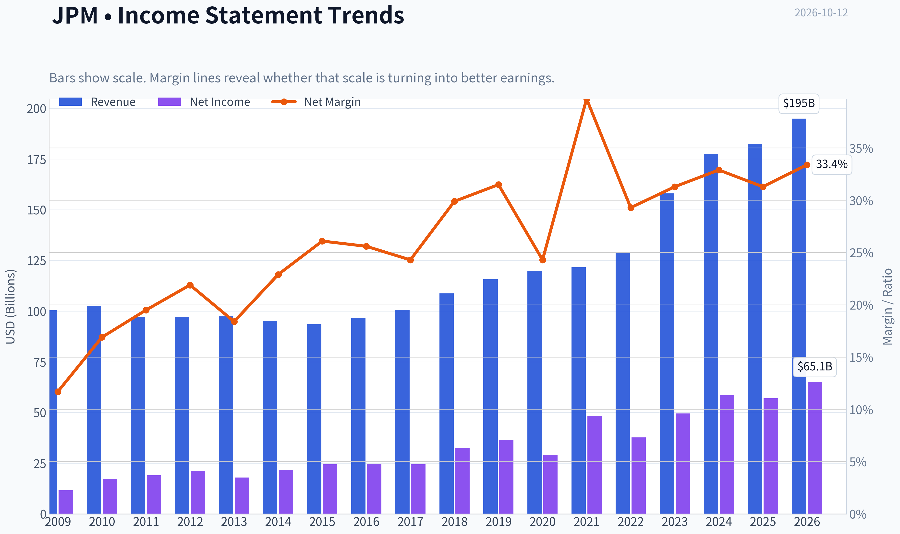

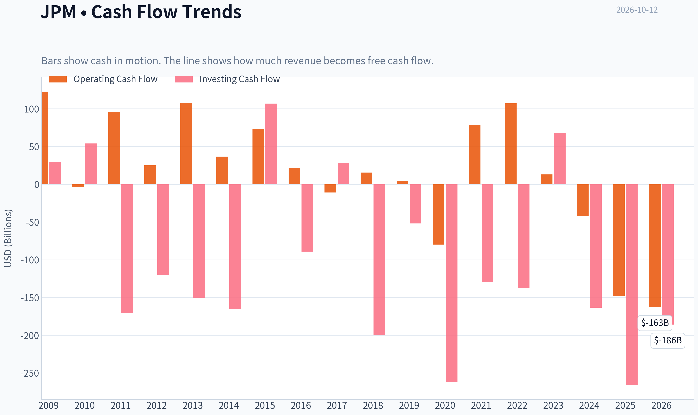

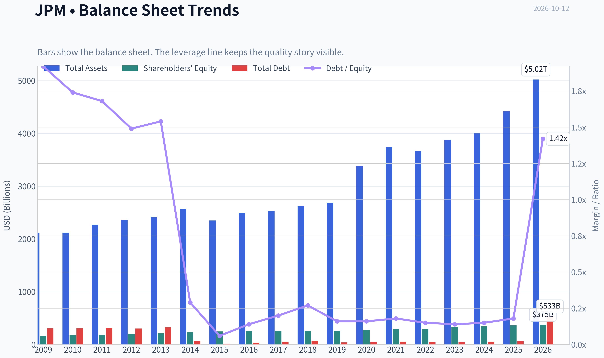

This graph tracks the profitability and return metrics (ROE, ROIC, Margins) of **JPM** over the past decade, highlighting capital efficiency trends.

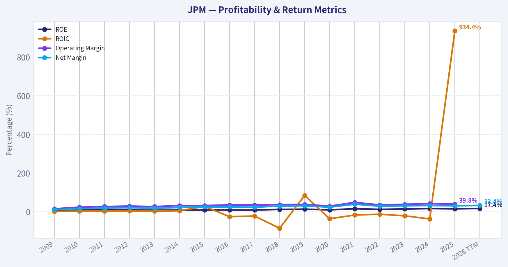

This chart illustrates the financial health of **JPM** over the last 10 years, mapping cash equivalents and free cash flow against total obligations (Debt).

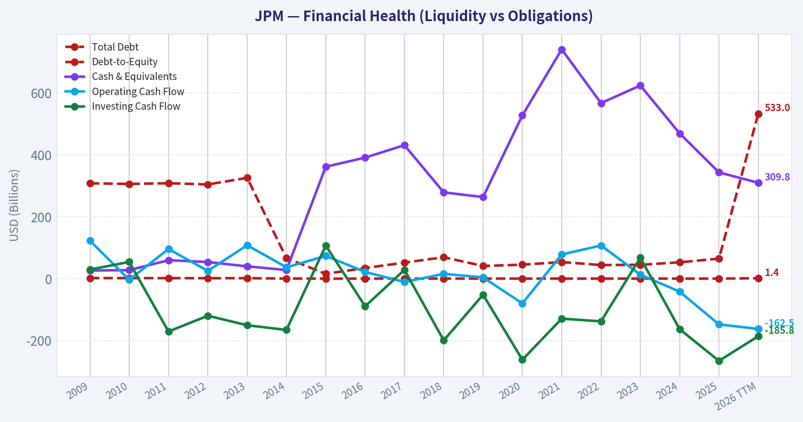

This comparison chart from *Profitability* stacks current figures against historical benchmarks for **JPM**, making it easy to see where the company trades relative to its own averages.

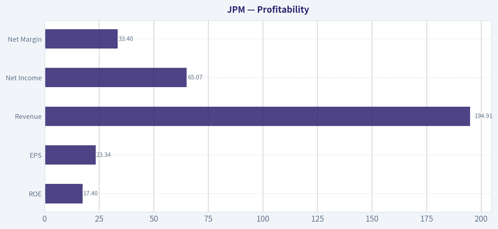

This breakdown chart from <em>Revenue Breakdown</em> shows the proportional composition for **JPM** - useful for understanding what drives or risks the business.

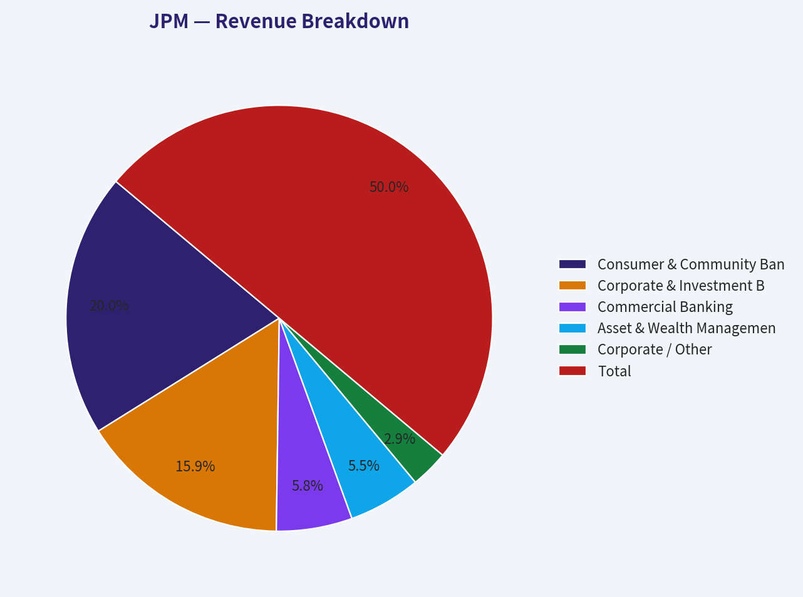

---

### Intrinsic Value Analysis (Buffett)

> *Following Warren Buffett's value investing philosophy: Circle of Competence, Economic Moat, Management Quality, and Margin of Safety.*

#### Intrinsic Value Snapshot

Price is what you pay. Intrinsic value is what the business may be worth based on the cash it can create for owners over time. We show a range, not one magic number.

- Current Price: $332.99
- Value Range (conservative to optimistic across both DCF methods): $1,612.64 to $6,865.20

##### Owner Earnings (Buffett Method)
- Net Income: $57,048,000,000.00
- Depreciation & Amortization: $8,821,000,000.00
- Capital Expenditures: N/A
- Working Capital Changes: $-218,801,000,000.00
- Owner Earnings: $284,670,000,000.00

##### Intrinsic Value
###### Buffett Method
Uses owner earnings. Stricter, and usually more conservative.
- Conservative: $1,612.64
- Average: $3,235.80
- Optimistic: $6,865.20
- Discount Rate: 10.0%

ANALYST STANCE: **ADVOCATE**

#### Executive Conclusion

JPMorgan Chase is a high-quality, systemically important financial franchise with scale advantages, diversified earnings, strong risk management, and a long record of compounding book value and earnings. At approximately **$333 per share**, the stock trades at about **14.3 times earnings**, which is reasonable for a bank of JPMorgan's quality but does not provide a large conventional value discount.

The shares appear fairly valued under a conservative earnings-power framework and attractive if JPMorgan can sustain mid-single-digit long-term earnings growth. The appropriate stance is **Advocate with moderate conviction**, recognizing that bank earnings are cyclical and sensitive to credit losses, interest rates, regulation, and capital requirements.

#### Factor Scorecard

| Factor | Score | Assessment |
|---|---:|---|
| Circle of Competence & Business Simplicity | 4/5 | JPMorgan gathers deposits, makes loans, facilitates payments and markets transactions, and earns fees from financial services. The model is understandable, although banking balance sheets and regulatory accounting add complexity. |
| Moat Test | 4/5 | Exceptional scale, low-cost funding, trusted brand, risk infrastructure, regulatory licenses, corporate relationships, and global distribution create a wide and stable moat. |
| Management & Capital Allocation | 4/5 | Jamie Dimon and the management team have demonstrated unusually strong risk discipline, long-term thinking, and capital allocation. Succession and regulatory constraints remain considerations. |
| Industry Structure | 4/5 | Banking is competitive, but scale, regulation, customer relationships, funding access, and technology favor the largest well-managed institutions. JPMorgan is positioned as an industry leader. |

**Gate 5 - Quality/Solvency hard floor: Not tripped.** There is no indication of the combination of deteriorating earnings and financial distress required to trigger the hard floor. JPMorgan remains a strongly capitalized, profitable institution.

#### Moat Analysis

| Moat Source | Evidence | Rating |
|---|---|---:|
| Intangible assets | JPMorgan is one of the world's most trusted banking brands and holds licenses, regulatory relationships, and institutional knowledge that are difficult to replicate. | Strong |
| Switching costs | Commercial banking, treasury services, credit cards, custody, investment banking, and payment systems become embedded in customer workflows and financial infrastructure. | Strong |
| Cost advantages | JPMorgan's enormous deposit base, technology spending, data resources, and operating scale allow it to spread fixed costs across a very large revenue base. | Strong |
| Network effects | The value of JPMorgan's payments, card, commercial banking, and capital-markets platforms increases with participation by customers, merchants, investors, and counterparties. | Moderate to strong |

JPMorgan's moat is primarily based on **scale, trust, funding advantages, data, technology, and embedded customer relationships**. Unlike a software company, its moat is not based on a single platform; it is the combination of many reinforcing advantages across consumer, commercial, investment banking, payments, and asset management.

#### Financial Summary

| Metric | Latest figure |
|---|---:|
| Share price | $333 |
| Market capitalization | $885.15 billion |
| Price-to-earnings ratio | 14.3x |
| Return on equity | 15.7% |
| Revenue growth, year over year | 2.8% |
| Gross margin | Not meaningful for a bank |
| Free-cash-flow yield | Not meaningful for a bank |
| Current ratio | Not meaningful for a bank |
| Sector-specific valuation focus | Earnings, book value, tangible capital, credit quality, and capital returns |

**Key Takeaways:** JPMorgan generates a strong **15.7% return on equity**, while the 14.3-times earnings multiple is moderate for a franchise of this quality. Conventional industrial metrics such as gross margin, free cash flow, and current ratio do not meaningfully describe a regulated bank; earnings power, capital strength, credit performance, and return on equity are more relevant.

#### Owner Earnings Calculation

For a bank, traditional owner earnings require modification because loan growth, deposits, regulatory capital, and securities portfolios are core operating assets rather than ordinary working capital. Free cash flow is therefore not a useful primary measure.

A practical proxy is **normalized distributable earnings**, represented here by earnings per share:

| Calculation | Amount |
|---|---:|
| Current price | $333.00 |
| P/E ratio | 14.27x |
| Implied earnings per share | **$23.34** |
| Normalized earnings-power proxy | **$23.34 per share** |

The implied earnings calculation is:

\[
\$333 \div 14.27 = \$23.34
\]

JPMorgan's 15.7% ROE suggests that the business is earning an attractive return on shareholder capital, although reported ROE can fluctuate with credit provisions, interest rates, capital levels, and investment-banking activity.

#### Three-Scenario Valuation

The following valuation treats current earnings per share as normalized distributable earnings and uses a 10% required return.

| Scenario | Assumption | Estimated value per share | Upside/(downside) vs. $333 |
|---|---|---:|---:|
| A. No growth | $23.34 ÷ 10% | $233 | -30% |
| B. GDP-like growth | 3% perpetual growth | $344 | +3% |
| C. Historical-quality growth | 5% annual growth for 10 years, then 5% terminal growth | $490 | +47% |

**Key Takeaways:** The no-growth valuation shows that JPMorgan is not cheap if earnings permanently stagnate. A 3% growth assumption produces a value close to the current share price, while a durable 5% growth rate creates substantial upside. The investment case therefore depends on JPMorgan continuing to reinvest at high returns and maintaining its competitive position.

#### Margin of Safety Analysis

| Valuation lens | Interpretation at $333 |
|---|---|
| No-growth earnings value | Materially overvalued under a stagnation scenario |
| 3% perpetual-growth value | Approximately fairly valued, with a small implied margin of safety |
| 5% long-term-growth value | Attractive, with an estimated margin of safety of roughly 32% |
| Quality-adjusted requirement | JPMorgan's franchise quality can justify a 10-15% margin of safety, but the current price does not clearly provide that under conservative assumptions |

JPMorgan is not priced for heroic growth. The market appears to be assuming continued profitability and modest growth rather than a dramatic expansion. That is reasonable for a dominant bank, but the present price offers only a modest margin of safety under the conservative 3% scenario.

For a wide-moat, high-ROE financial compounder, a fair price can still be acceptable. However, the strongest opportunity would likely occur if the shares declined toward the **high-$200s**, where the valuation would better compensate investors for credit-cycle and regulatory risks.

#### Management Quality Assessment

| Management criterion | Assessment |
|---|---|
| Owner orientation | Strong institutional ownership and a culture focused on long-term franchise value. Direct insider ownership is not the primary strength of the case. |
| Candor and honesty | JPMorgan has generally provided detailed discussion of credit, capital, expenses, and macroeconomic risks. |
| Capital allocation | Strong history of reinvestment in technology, talent, deposits, payments, and strategic capabilities. Dividends and buybacks are constrained by regulatory capital rules but remain important capital-return tools. |
| Risk management | A major competitive advantage. JPMorgan's ability to survive and exploit difficult environments is more important than maximizing short-term quarterly earnings. |
| Key concern | Jamie Dimon's eventual succession is a material long-term issue, although the institutional depth of the organization is considerable. |

#### Final Buffett Scorecard

| Criterion | Weight | Score | Weighted score |
|---|---:|---:|---:|
| Moat width and durability | 25% | 4.5 | 1.13 |
| Valuation and margin of safety | 20% | 3.0 | 0.60 |
| Capital returns versus WACC | 15% | 4.0 | 0.60 |
| Business understanding and predictability | 12% | 4.0 | 0.48 |
| Management quality and capital allocation | 12% | 4.0 | 0.48 |
| Reinvestment runway | 8% | 4.0 | 0.32 |
| Balance-sheet strength | 4% | 4.0 | 0.16 |
| Industry structure | 4% | 4.0 | 0.16 |
| **Total** | **100%** |  | **3.93/5.00** |

**Key Takeaways:** JPMorgan scores highly because of its moat, management, risk controls, reinvestment opportunities, and industry position. Valuation is the principal constraint: the stock is reasonably priced rather than deeply discounted. The weighted score of approximately 3.9 supports an **Advocate** rating, but not an aggressive or high-conviction purchase at any price.

#### Investment Stance

**ANALYST STANCE: ADVOCATE**

- **Business quality:** Excellent
- **Moat:** Wide and stable
- **Financial quality:** Strong profitability and sound institutional position
- **Valuation:** Fair to moderately attractive, depending on sustainable growth
- **Conviction:** Moderate
- **Preferred action:** Suitable for long-term ownership at current levels for investors comfortable with banking-cycle risk; substantially more attractive on a pullback toward the high-$200s.
#### Valuation Bridge

This bridge places the current market price beside each intrinsic value lens so readers can see whether upside depends on one method or shows up across several methods.

| Scenario | Intrinsic Value / Share |
| --- | ---: |
| Buffett Method | $3,235.80 |
| Current Price | $332.99 |

#### Key Takeaways

If one method is far above the others, the upside case depends on a specific modelling assumption. When several methods cluster together, the valuation story is more robust.

#### Valuation Visuals

This comparison chart from *Latest Earnings Snapshot* stacks current figures against historical benchmarks for **JPM**, making it easy to see where the company trades relative to its own averages.

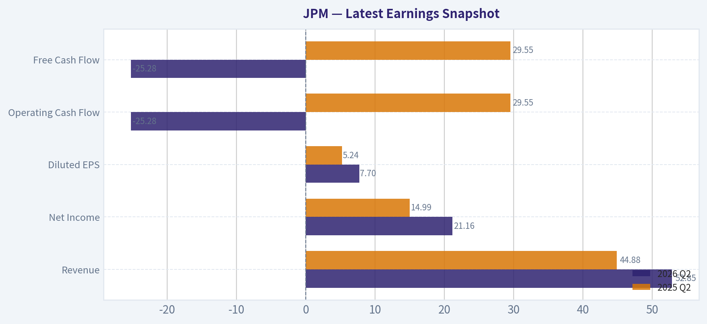

This comparison chart from *Current Metrics Compared With the Recent Decade* stacks current figures against historical benchmarks for **JPM**, making it easy to see where the company trades relative to its own averages.

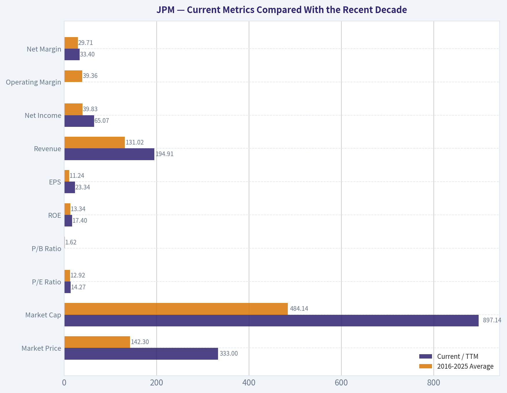

This comparison chart from *Cash Flow and Dividends* stacks current figures against historical benchmarks for **JPM**, making it easy to see where the company trades relative to its own averages.

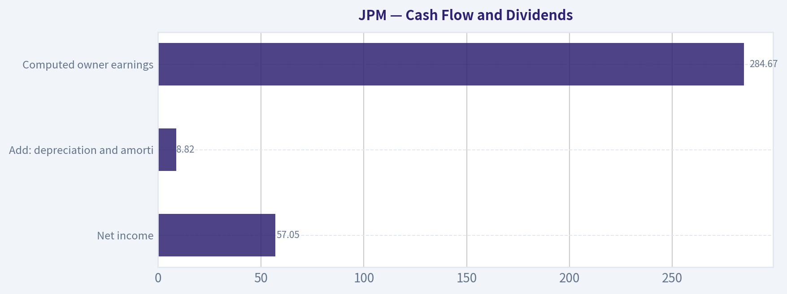

This comparison chart from *Three-Scenario Buffett-Style Owner-Earnings DCF* stacks current figures against historical benchmarks for **JPM**, making it easy to see where the company trades relative to its own averages.

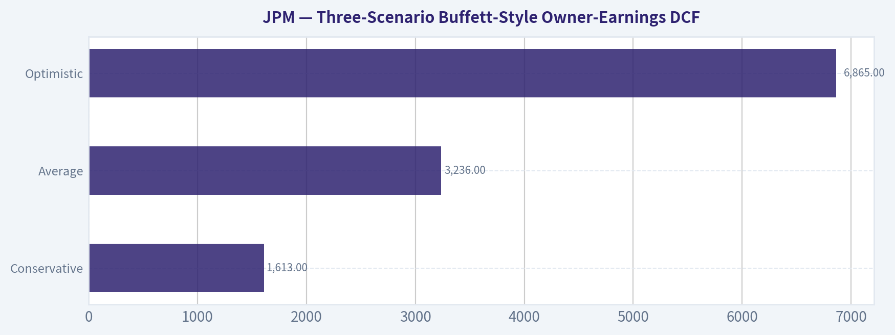

---

### Trend & Growth Analysis (Lynch/Druckenmiller/Fisher)

> *Following Peter Lynch's GARP, Stanley Druckenmiller's macro-aware approach, and Philip Fisher's scuttlebutt methodology.*

ANALYST STANCE: **WATCH**

#### Executive View

JPMorgan Chase is a **stalwart**, not a fast grower: revenue growth is only 2.8%, while its $885 billion market capitalization makes a ten-bagger outcome extraordinarily unlikely. It is a high-quality, systemically important bank with strong profitability and scale, but the current evidence supports a **hold-for-quality or watchlist stance**, not a growth-stock purchase.

#### 1. Lynch Classification

| Metric | JPM Assessment |
|---|---:|
| Lynch category | Stalwart |
| Current price | $333 |
| Market capitalization | $885.15 billion |
| Revenue growth | 2.8% year over year |
| P/E ratio | 14.3x |
| ROE | 15.7% |
| Growth-investor fit | Limited |

**Key Takeaways:** JPMorgan is a mature financial institution with modest top-line growth. Its 15.7% ROE and 14.3x P/E indicate quality at a reasonable-looking earnings multiple, but it does not meet the 15%-25% growth threshold preferred for primary growth investments.

#### 2. The Story in Three Bullets

- JPMorgan is one of the strongest and most diversified banks in the United States, spanning consumer banking, commercial banking, investment banking, asset management, and payments.
- Its advantages are scale, funding access, brand trust, technology investment, and a deep management bench.
- The investment case depends more on credit discipline, capital returns, market-share gains, and the interest-rate cycle than on rapid secular revenue growth.

#### 3. TAM and Ten-X Test

| Factor | Assessment |
|---|---|
| Addressable market | Extremely large: consumer, commercial, investment banking, payments, and wealth management |
| JPM current position | Already a dominant global participant |
| TAM growth | Moderate and economically sensitive |
| 10x revenue test | Difficult to pass; JPM would need enormous share gains or market expansion |
| Ten-bagger potential | Very low from the current capitalization |

**Key Takeaways:** JPM operates in a huge market, but it already has substantial scale and market share. A 10x outcome would require extraordinary earnings compounding, major financial-sector disruption, or a very long time horizon; the TAM is large enough, but JPM's existing size limits upside.

#### 4. Revenue Growth Trend

| Indicator | Latest Reading | Interpretation |
|---|---:|---|
| Revenue growth year over year | 2.8% | Slow-to-moderate |
| Acceleration evidence | Not established | No confirmed inflection |
| Growth profile | Mature and cyclical | Dependent on rates, credit, and capital markets |
| Quality of growth | Requires further segment detail | Not enough evidence to separate organic growth from mix and cycle effects |

**Key Takeaways:** The available data show modest growth, not acceleration. JPM may produce strong earnings in favorable rate or capital-markets environments, but that is different from a durable 20% growth trajectory.

#### 5. Unit Economics and Operating Efficiency

| Metric | JPM Assessment |
|---|---|
| LTV/CAC | Not applicable at the consolidated-bank level |
| Net revenue retention | Not applicable |
| Rule of 40 | Not applicable |
| ROE | 15.7% |
| Gross margin | Not meaningful for a bank |
| FCF yield | Not available or not meaningful in the standard industrial-company sense |

**Key Takeaways:** SaaS-style unit economics should not be applied to JPM. ROE is the more relevant profitability measure, and 15.7% is solid, although investors should also examine return on tangible common equity, credit costs, capital ratios, net interest margin, and expense growth.

#### 6. Inflection-Point Assessment

| Potential Inflection | Current View | Status |
|---|---|---|
| Product or technology cycle | Continued technology and payments investment | Possible, but unproven |
| Market-share gains | Scale provides opportunity | Positive |
| Margin inflection | Not demonstrated in supplied data | Unconfirmed |
| TAM expansion | Banking and payments remain large markets | Moderate |
| Competitive inflection | No clear major competitor breakdown | Absent |
| Earnings inflection | Could arise from rates, credit, or investment banking | Cyclical rather than secular |

**Key Takeaways:** JPM has several possible earnings catalysts, but none is currently confirmed as a durable growth inflection. The most likely drivers are cyclical-capital-markets activity, net interest income, credit normalization, and expense control-rather than a newly accelerating business model.

#### 7. Macro Setup

| Macro Factor | JPM Implication |
|---|---|
| Interest rates | Mixed: higher rates can support interest income but pressure funding and credit |
| Economic growth | Positive for loan demand and credit quality |
| Recession risk | Negative through provisions, defaults, and weaker deal activity |
| Capital-markets activity | Important upside lever |
| AI and technology | Long-term efficiency opportunity, but also major investment cost |
| Cycle classification | Mid-cycle/uncertain based on available information |

**Key Takeaways:** JPM is highly macro-sensitive. A resilient economy and healthy capital-markets cycle would support earnings, while recession or a sharp credit deterioration would be material headwinds. The macro setup is balanced rather than clearly favorable for concentrated growth exposure.

#### 8. Fisher 15-Point Score

| Fisher Criterion | Score / 5 | Comment |
|---|---:|---|
| Market potential | 4 | Very large financial-services markets |
| New-product determination | 4 | Strong technology and platform investment |
| R&D effectiveness | 4 | Significant digital and technology capabilities |
| Sales organization | 5 | Exceptional distribution and client reach |
| Profit margins | 4 | Strong for a major bank |
| Improving margins | 3 | Not established from supplied data |
| Labor relations | 3 | Large-bank complexity |
| Executive relations | 4 | Deep institutional management |
| Management depth | 5 | Among the strongest in global banking |
| Cost analysis/accounting | 4 | Sophisticated, though banking analysis is complex |
| Outstanding advantages | 5 | Scale, funding, data, brand, and diversification |
| Long-range profit outlook | 4 | Strong, but mature and cyclical |
| Dilution risk | 4 | Generally manageable for a major bank |
| Management candor | 4 | Strong institutional disclosure |
| Management integrity | 4 | High, with normal large-bank regulatory risk |
| **Total** | **57 / 75** | **Good, not exceptional growth profile** |

**Key Takeaways:** JPM scores well on scale, management depth, distribution, and competitive advantages. It loses points primarily because it is mature, cyclical, and lacks clear evidence of accelerating growth. The result is a good-quality company, but not an obvious Fisher-style emerging growth opportunity.

#### 9. Valuation Analysis

| Valuation Measure | Result | Interpretation |
|---|---:|---|
| P/E | 14.3x | Reasonable for a mature, high-quality bank |
| Revenue growth | 2.8% | Low relative to growth-stock standards |
| Implied PEG | Approximately 5.1x | Expensive under a strict Lynch formula |
| PEG applicability | Limited | Banks are better assessed using earnings, book value, and ROE |
| Intrinsic-value headline | Not meaningful | Financial issuers require sector-specific methods |

**Key Takeaways:** The headline P/E does not look demanding for JPM's quality, but the PEG is unattractive because growth is slow. For banks, investors should supplement P/E with price-to-tangible-book value, sustainable ROE, credit-loss assumptions, capital strength, and normalized earnings.

#### 10. Growth Investor Scorecard

| Criterion | Weight | Score / 5 | Weighted Contribution |
|---|---:|---:|---:|
| Lynch story | 10% | 3.0 | 0.30 |
| TAM and runway | 20% | 3.0 | 0.60 |
| Revenue growth | 20% | 2.0 | 0.40 |
| Unit economics | 15% | 3.5 | 0.53 |
| Competitive position | 10% | 5.0 | 0.50 |
| Management quality | 10% | 4.5 | 0.45 |
| Macro setup | 5% | 3.0 | 0.15 |
| Profitability path | 5% | 4.0 | 0.20 |
| Valuation | 5% | 3.5 | 0.18 |
| **Total** | **100%** |  | **3.31 / 5** |

**Key Takeaways:** JPM's estimated score of 3.31 places it in the **WATCH** range. Its competitive position and management quality are excellent, but slow growth and limited ten-bagger potential prevent an Advocate rating for a growth-focused portfolio.

#### 11. Position Size Stance

| Investor Type | Suggested Stance |
|---|---|
| Ten-bagger growth investor | Do not initiate as a core growth position |
| Quality-value investor | Consider a modest position after valuation and capital metrics review |
| Existing shareholder | Hold and monitor; do not sell solely because growth is modest |
| Concentrated portfolio | Keep position modest unless valuation is unusually compelling |
| Income or financial-sector investor | More relevant candidate than for pure growth investors |

**Key Takeaways:** JPM can be appropriate as a quality financial holding, but it should not occupy the same role as a high-growth compounder. Existing owners may reasonably hold it, while new investors should demand an attractive valuation and confirm credit and capital trends.

#### 12. Key Risks and Catalysts

| Catalysts | Risks |
|---|---|
| Strong investment-banking and trading activity | Recession and rising credit losses |
| Loan growth and stable credit quality | Net interest margin compression |
| Technology-driven efficiency gains | Regulatory, legal, or capital requirements |
| Market-share gains in payments and wealth management | Weak consumer or commercial demand |
| Share repurchases and dividends | Large-bank complexity and operational risk |
| Favorable rate and economic environment | Valuation multiple compression |

**Key Takeaways:** The main upside catalysts are operating leverage, capital-markets recovery, technology-enabled efficiency, and continued share gains. The principal risks are credit deterioration, margin pressure, regulation, and macroeconomic weakness.

#### Final Conclusion

JPMorgan is a **high-quality stalwart with durable competitive advantages**, but the supplied 2.8% revenue growth does not indicate a current growth inflection. At roughly 14.3x earnings, the stock may be reasonable for a quality-bank or value-oriented investor, yet its PEG is unattractive and its current size makes ten-bagger potential remote.

**Final stance: WATCH.** Hold existing positions if the objective is quality and financial-sector exposure; for a concentrated growth portfolio, wait for evidence of accelerating earnings, stronger organic growth, or a materially more compelling valuation.

---

### Market Technical Analysis

ANALYST STANCE: **WATCH**

#### JPM technical overview

The latest available JPM session is **October 9, 2026**, because October 12 was not a trading day in the retrieved dataset. JPM closed at **$332.99**, following a modest three-session rebound from the September 30 low of **$329.19**. However, the rebound has not yet repaired the broader technical damage created during the September decline.

The selected indicators are **close_50_sma, close_200_sma, close_10_ema, macd, macdh, rsi, atr, and vwma**. Together, they cover long-, medium-, and short-term trend, momentum, volume-adjusted price behavior, and volatility without adding redundant indicators such as multiple Bollinger Band components.

#### Trend structure

JPM remains in a structurally positive long-term position. The stock is trading about **4.4% above its 200-day SMA of $319.08**, and the 200-day average continues to rise gradually. This suggests that the multi-month uptrend has not been decisively broken.

The medium-term picture is weaker. JPM is approximately **4.5% below its 50-day SMA of $348.54**. The 50-day average has rolled over from its late-September high area, indicating that the recent correction is more than a one- or two-day fluctuation. A sustained recovery above the 50-day SMA would be needed to restore a stronger medium-term bullish signal.

Short-term price action is more balanced. JPM closed just below its 10-day EMA of **$333.10**, but the gap is negligible. This indicates that the immediate rebound has stabilized the stock, though it has not yet established clear upside momentum. The first meaningful recovery test is the **$334-$339 zone**, followed by the declining 50-day average near **$349**.

#### Momentum and MACD

Momentum remains bearish on a medium-term basis, but the most recent readings show tentative improvement.

The MACD is negative at approximately **-5.22**, confirming that the shorter-term trend remains below the longer-term trend. Nevertheless, the MACD histogram improved sharply from **-1.40 on October 5 to -0.23 on October 9**. This means bearish momentum is losing intensity, even though it has not yet turned positive.

This distinction is important: JPM may be entering a stabilization or relief-rally phase, but the data do not yet confirm a durable trend reversal. A move of the MACD histogram above zero, ideally accompanied by a close above the 10-day EMA and then the $339-$349 resistance band, would provide stronger confirmation.

RSI is **40.1**, up from the low-to-mid 30s earlier in October. This shows that selling pressure has eased, but RSI is still below the neutral 50 level. JPM is therefore no longer deeply oversold, yet it has not demonstrated convincing bullish momentum. A move above 50 would strengthen the case for a broader recovery; a return below 35 would signal renewed downside pressure.

#### Volume-adjusted price behavior

The VWMA is approximately **$334.14**, slightly above the latest close. This is a modest bearish confirmation: the stock is trading below its recent volume-weighted average, suggesting that recent trading activity has occurred at somewhat higher prices than the current market level.

The difference is not large, so this is not an extreme distribution signal by itself. However, when combined with the price being below the 50-day SMA and the negative MACD, it suggests that buyers have not yet regained control. A close above the VWMA, followed by sustained trade above the $339 area, would improve the volume-confirmation picture.

#### Volatility and risk management

ATR is approximately **$5.82**, equivalent to roughly **1.75% of the share price**. This is meaningful daily movement for a large bank stock. A one-ATR move from the latest close would imply a rough near-term range of approximately **$327 to $339**, although ATR is not a forecast and actual moves can be larger around earnings, interest-rate news, or banking-sector developments.

The recent decline in ATR from above $7 in late September to below $6 suggests that volatility has moderated after the sharp selloff. That can indicate stabilization, but it can also precede a breakout from a compression range. Traders should therefore watch whether JPM breaks above the recent rebound area near $334-$339 or falls back through the $329-$327 region.

#### Trading interpretation

The technical configuration is best described as **long-term bullish, medium-term corrective, and short-term attempting to stabilize**.

For bullish confirmation, JPM would ideally reclaim the VWMA and 10-day EMA first, then break above the recent resistance zone around **$339-$341**. A move through the 50-day SMA near **$349** would be a much stronger signal that the September correction had ended.

On the downside, failure to hold the **$329-$327 area** would weaken the stabilization thesis. A break below that zone could expose the stock to a deeper test of the rising 200-day SMA near **$319**, which is the most important structural support shown by the selected indicators.

Because RSI is recovering from weak levels and the MACD histogram is improving, an immediate continuation of the rebound is plausible. But with the stock still below both its 50-day SMA and VWMA, the evidence is not strong enough to classify the setup as an outright bullish entry. Waiting for confirmation above resistance, or seeking a controlled pullback that holds support, offers a more favorable risk framework than chasing the initial rebound.

| Indicator | Latest reading | Technical interpretation | Key level or implication |
|---|---:|---|---|
| JPM close | $332.99 | Latest available close on October 9, 2026 | Above 200-day SMA, below 50-day SMA |
| 10-day EMA | $333.10 | Price is essentially testing short-term trend | Reclaim would support near-term recovery |
| 50-day SMA | $348.54 | Medium-term trend has weakened and is declining | Major resistance near $349 |
| 200-day SMA | $319.08 | Long-term trend remains upward | Important structural support |
| MACD | -5.22 | Medium-term momentum remains bearish | Needs a sustained improvement toward zero |
| MACD histogram | -0.23 | Bearish momentum is fading rapidly | A move above zero would strengthen reversal evidence |
| RSI | 40.1 | Weak but recovering; not yet neutral-bullish | Above 50 would improve momentum confirmation |
| ATR | $5.82 | Volatility remains material but has moderated | Approximately 1.75% of price per average true range |
| VWMA | $334.14 | Price remains slightly below volume-weighted average | Reclaim would indicate improved buyer control |
| Overall stance | Watch | Long-term support exists, but medium-term trend remains damaged | Monitor $339-$349 resistance and $329-$327 support |

**Key Takeaways:** JPM's long-term trend remains constructive because the stock is above its rising 200-day average, but the medium-term trend is still corrective because price remains well below the 50-day average. Short-term momentum is improving, with RSI recovering and the MACD histogram becoming less negative, yet confirmation is incomplete. The most important upside test is the $339-$349 region, while a break below $329-$327 would raise the risk of a deeper move toward the $319 200-day support area.

---

### Options Market Analysis

> *Reading options flow - put/call ratios, IV skew, and unusual activity - to gauge institutional positioning and event-driven risk.*

ANALYST STANCE: **WATCH**

#### JPM Options Market Report

**As of October 12, 2026**

#### 1. Put/Call Ratio Analysis

| Expiration | Days to Expiry | Call Volume | Put Volume | Volume Put/Call Ratio | Call OI | Put OI | OI Put/Call Ratio |
|---|---:|---:|---:|---:|---:|---:|---:|
| October 16, 2026 | 4 | 15,510 | 6,541 | 0.42 | 0 | 30 | N/A |
| October 23, 2026 | 11 | 1,278 | 773 | 0.60 | 0 | 0 | N/A |
| October 30, 2026 | 18 | 510 | 461 | 0.90 | 0 | 0 | N/A |
| **Near-term total** | - | **17,298** | **7,775** | **0.45** | **0** | **30** | **N/A** |

**Key Takeaways:** Near-term call volume substantially exceeds put volume, producing a 0.45 volume put/call ratio versus the approximately 0.70 neutral baseline. That is directionally bullish or consistent with call speculation, but the open-interest figures are essentially unusable because only 30 put contracts are reported and no call open interest is shown. The apparent bullish volume signal should therefore be treated with low confidence.

#### 2. Implied Volatility Assessment

| Expiration | Call ATM IV | Put ATM IV | Put Premium to Call IV | Interpretation |
|---|---:|---:|---:|---|
| October 16, 2026 | 2.0% | 2.8% | +0.8 percentage points | Moderate downside skew |
| October 23, 2026 | 1.6% | 1.8% | +0.2 percentage points | Mild downside skew |
| October 30, 2026 | 0.9% | 1.2% | +0.3 percentage points | Mild downside skew |

The provided data does not include separate out-of-the-money put and call IV, so a conventional strike-based IV skew cannot be calculated. The ATM comparison nevertheless shows puts carrying a volatility premium over calls at every listed expiration.

**Key Takeaways:** Implied volatility is very low across the near-term curve, especially beyond the front-week expiration. Put IV is consistently higher than call IV, indicating modest demand for downside protection, but not an extreme fear signal. The data does not identify a catalyst, although JPM is in a period where bank earnings-related event risk could matter; no explicit earnings premium is visible in these IV figures.

#### 3. Unusual Options Activity

| Finding | Result |
|---|---|
| Contracts with volume greater than 5 times open interest | None identified |
| Fresh directional bets | No confirmed unusual contracts |
| Smart-money versus retail read-through | Not determinable |
| Highest reported activity | October 16 calls, with 15,510 contracts traded |

No individual contract met the data provider's unusual-activity threshold. Strike-level details were not supplied, so specific contracts cannot be classified as ITM, ATM, or OTM, and no inference about call spreads, put spreads, or directional sweeps can be made.

**Key Takeaways:** There is no confirmed volume-versus-open-interest anomaly to identify as institutional accumulation or hedging. The large front-week call volume is directionally constructive, but without strike, execution, and open-interest detail it could include rolling activity, spreads, market-making flow, or short-call transactions. This materially lowers confidence in interpreting the flow as outright bullish buying.

#### 4. Open Interest Concentration and Gamma Levels

| Metric | Available Reading |
|---|---|
| Highest reported call OI | None; data shows zero |
| Highest reported put OI | 30 contracts, October 16 expiration |
| Major OI concentration | Not established |
| Gamma walls | Cannot be identified |
| Pinning or max-pain analysis | Not reliable from supplied data |

The reported open interest is too sparse and incomplete to calculate meaningful strike concentration, max pain, or gamma walls. In particular, no strike-level open-interest table was returned, and zero call OI across all near-term expirations is unlikely to represent a complete institutional positioning picture for a highly liquid large-cap bank.

**Key Takeaways:** There is no reliable evidence of a major options-based support or resistance level. The apparent 30-contract put concentration is too small to create a meaningful gravitational level for JPM. Price-impact analysis should rely more heavily on the underlying stock's technical levels and broader financial-sector flows.

#### 5. Overall Options Sentiment Signal

| Component | Assessment | Confidence |
|---|---|---|
| Volume put/call ratio | Bullish tilt at 0.45 | Moderate |
| Open-interest put/call ratio | Unavailable and unreliable | Very low |
| ATM IV | Low | Moderate |
| IV skew | Mild downside put premium | Moderate |
| Unusual activity | None confirmed | Low |
| Strike concentration | Not available | Very low |
| **Overall signal** | **BULLISH, but low conviction** | **Low to moderate** |

**Primary driver:** Call volume is more than twice put volume in the aggregate near-term data, led by the October 16 expiration. This suggests bullish speculation or call-heavy positioning, but the absence of reported call open interest and strike-level data prevents confirmation that the activity represents outright call buying rather than spreads, rolls, or covered-call writing.

**Key Takeaways:** The best directional read from the available data is cautiously bullish because call volume dominates and near-term volatility is subdued. However, the data quality is unusually limited for JPM, with almost no usable open-interest information and no unusual individual contracts. The signal is therefore not strong enough to support an aggressive trade without confirmation from price action, volume, and earnings-related information.

#### Summary

| Category | Conclusion |
|---|---|
| Put/Call Ratio | Volume ratio of 0.45, bullish versus the 0.70 neutral baseline; OI ratio unavailable |
| IV Level | Very low near-term IV, ranging from 0.9% to 2.8% |
| Skew Direction | Mild downside put skew; puts carry higher ATM IV than calls |
| Unusual Activity | None meeting the volume-greater-than-5-times-open-interest threshold |
| Overall Signal | **BULLISH, low conviction**; call-heavy volume is the main positive driver |

**Key Takeaways:** JPM's near-term options flow leans bullish based on the low volume put/call ratio. Low IV suggests limited immediate option-market stress, while the mild put skew shows some routine downside protection demand. Because open-interest and strike data are incomplete, this should be viewed as a tentative bullish signal rather than a high-confidence institutional positioning call.

---

## Research Team Commentary

> *The Research Manager synthesizes the Bull vs Bear debate into action-free commentary. This is a pre-risk view, not the final stance.*

Core takeaway: JPMorgan is an exceptional bank, but at $333 the evidence supports patience rather than fresh aggressive buying. Its wide moat, 15.7% ROE, diversified earnings, funding advantages, and management quality justify a premium valuation. However, the claimed $375 intrinsic value is too sensitive to a 9% cost of equity, 3.5% terminal growth, and generous future distributions to establish a dependable 10%-15% margin of safety. I would retain an existing position but wait for either a better price or stronger evidence that normalized earnings can compound at high-single-digit rates.

The strongest bull argument is that JPMorgan is structurally different from an average bank. Its deposit base, brand, technology spending, regulatory infrastructure, payments network, and institutional relationships reinforce one another. Corporate treasury and payments relationships carry meaningful switching costs, while its diversification allows it to gain share when weaker competitors retrench. A 15.7% ROE and 1.3% ROA indicate strong current profitability, and management has historically demonstrated better risk and capital discipline than most peers. Current revenue growth of 2.8% understates the potential for per-share value creation through fee growth, market-share gains, dividends, and disciplined repurchases.

The bull is also correct that valuation should not be reduced to "14.3 times earnings is expensive for a bank." A superior franchise deserves a premium, and our earlier Alphabet mistakes warn against allowing valuation discomfort to become an automatic veto on an excellent company. If JPMorgan can sustain a mid-teens ROE and compound EPS near 7% while distributing excess capital, a value in the upper $300s is plausible. In that scenario, $333 would be a fair-to-attractive entry rather than an obvious overpayment.

The strongest bear argument is not about business deterioration; it is about valuation robustness. The bull's approximately $375 estimate falls toward $310-$325 when the cost of equity rises to 10% and terminal growth falls toward 3%. Those are ordinary assumptions for a leveraged, cyclical, regulated financial institution, not draconian stress assumptions. A purported margin of safety that disappears with a one-percentage-point change in the discount rate is too fragile to support an ADVOCATE stance.

The reverse-valuation debate is similarly important. Under favorable assumptions, the shares may require only 5%-5.5% EPS growth. Under more conservative assumptions, the hurdle could be closer to 8%-9% for a decade. That latter outcome is achievable, but it is not clearly supported by current 2.8% revenue growth and JPMorgan's already enormous scale. It would require sustained market-share gains, resilient credit, continued capital distributions, and limited pressure from higher regulatory capital requirements.

Current earnings also need to be normalized carefully. Diversification makes JPMorgan more resilient than a regional lender, but it does not eliminate correlated macroeconomic exposure. In a downturn, credit costs can rise while loan demand, investment banking, asset-management fees, and consumer activity weaken together. Regulation can strengthen JPMorgan's relative moat while still reducing absolute shareholder returns through higher capital retention and lower buyback capacity. Winning competitively does not automatically mean the stock is attractively priced.

The reported 68% ROIC should be disregarded because conventional ROIC is not economically meaningful for a bank. Deposits and borrowings are operating inputs, not ordinary corporate financing. Gross margin, current ratios, and quick ratios are similarly unhelpful. The key missing evidence is normalized ROE, tangible book-value growth, regulatory capital, reserve adequacy, credit trends, deposit costs, and distributable earnings through a full cycle.

The technical and options evidence does not change the long-term conclusion. The recent rebound has not fully repaired September's technical damage, while the low put/call volume ratio is mildly bullish but compromised by unusable open-interest data. Learning from the Alphabet calls, I would not demand perfect chart confirmation before buying a genuinely undervalued franchise. Here, however, technical uncertainty is secondary because valuation itself is not clearly favorable.

My rationale is therefore balanced but decisive: JPMorgan passes the business-quality test with ease, but it does not yet pass the margin-of-safety test with enough confidence. It is neither distressed nor plainly overvalued, so AVOID would be excessive. Conversely, the valuation range is too assumption-sensitive for ADVOCATE. Existing shareholders can reasonably hold and allow the franchise to compound, but new capital should be staged rather than committed aggressively. A price around $300-$310 would provide a more credible cushion under conservative assumptions, while a higher price could still become attractive if operating evidence raises normalized intrinsic value.

Over the next one to four quarters, I would monitor credit first: consumer and card charge-offs, commercial credit migration, reserve coverage, nonperforming assets, and whether provisions are rising faster than loan growth. Stable underwriting and manageable normalization would strengthen the thesis; broad deterioration or reserve releases masking weaker credit would weaken it.

Second, I would track normalized profitability: net interest income, deposit betas and funding costs, fee revenue, expense growth, and management's outlook for through-cycle ROE. Evidence that JPMorgan can sustain approximately 15% ROE without unusually benign credit or rate conditions would make the premium valuation more defensible. ROE drifting toward the low teens without an offsetting reduction in valuation would reinforce patience.

Third, capital is crucial. Watch the CET1 ratio, stress-capital requirements, regulatory proposals, payout capacity, and the balance between dividends, repurchases, and retained capital. Buybacks should be judged against conservative intrinsic value, not celebrated merely because they increase reported EPS. Higher required capital or materially lower distributions would reduce fair value.

Fourth, monitor tangible book value and EPS per share rather than headline revenue alone. Consistent growth in tangible book value per share, supported by genuine earnings rather than excessive leverage, would validate the compounding thesis. High-single-digit EPS growth accompanied by sound credit and capital would support an upgrade to ADVOCATE.

Finally, succession and risk culture deserve attention. Clear leadership planning, continued spending on controls, and no evidence of weaker underwriting would preserve confidence in the institutional moat. Unexpected operational, compliance, cyber, or risk-control failures would deserve more weight than ordinary quarterly volatility.

The lesson from the earlier Alphabet mistakes is to avoid confusing "not cheap" with "not investable." JPMorgan's quality argues for keeping it close and acting if the valuation improves. But the opposite mistake would be treating every premium franchise as a buy based on an optimistic intrinsic-value model. Here, patience is justified by sensitivity in normalized bank earnings and capital distributions-not by hypothetical fears or a demand for perfect technical confirmation.

Final stance: WATCH.

---

## Value Investing Team Commentary

> *The Investor translates the research view into an investment thesis before risk review. This is still not the final stance.*

### Investment Commentary

JPMorgan is a business worth owning, but the price determines whether it is worth buying today. The franchise is exceptional: it combines a low-cost and resilient funding base, enormous distribution, trusted consumer and institutional brands, leading payments capabilities, substantial technology investment, and a management culture historically stronger than that of most banking peers. Its diversification also creates a valuable countercyclical advantage-when weaker institutions retreat, JPMorgan can invest, acquire customers, and gain market share.

The reported 15.7% ROE and 1.3% ROA support the quality case. Revenue growth of 2.8% is modest, but headline revenue growth understates the bank's potential to create per-share value through fee growth, market-share gains, dividends, and repurchases. JPMorgan does not need technology-like revenue growth to compound shareholder value; it needs disciplined underwriting, sustained mid-teens returns on equity, sensible capital distributions, and continued growth in tangible book value per share.

### Valuation is fair, but not clearly favorable

At $333 and 14.27 times earnings, the implied earnings yield is approximately 7%. That is not excessive for the best large bank in the United States, but neither does it provide an obvious bargain given the cyclicality, leverage, regulation, and capital intensity inherent in banking.

The proposed $375 intrinsic value implies roughly 13% upside, or an 11% discount to estimated value. That would ordinarily approach the required margin of safety for a wonderful business. The problem is not the size of the apparent discount; it is the fragility of the valuation estimate. Moving from a 9% to a 10% cost of equity and using a more conservative terminal growth rate reduces estimated value toward $310-$325. A margin of safety that disappears under ordinary-not distressed-assumptions is not yet dependable.

An illustrative bank valuation also shows this sensitivity. Using the relationship between sustainable ROE, growth, and cost of equity, a 15.7% ROE can justify a substantial premium to book value under a 9% cost of equity. At a 10% cost of equity, however, the justified premium falls meaningfully. The market price therefore appears to assume that JPMorgan will sustain superior profitability and capital efficiency for a long time. That is plausible, but it leaves limited room for lower ROE, greater capital requirements, or a credit downturn.

The reported 68% ROIC should not influence the decision. Conventional ROIC is poorly suited to banks because deposits and borrowings are operating inputs rather than ordinary corporate financing. Gross margin and standard liquidity ratios are similarly unhelpful. The relevant measures are:

- Normalized ROE and return on tangible common equity
- Tangible book value growth per share
- CET1 capital and stress-capital requirements
- Reserve adequacy and through-cycle credit losses
- Deposit costs and net interest income
- Distributable earnings and repurchase capacity

### Reverse-valuation perspective

The market may be pricing in roughly mid-single-digit to high-single-digit long-term EPS growth, depending on the cost-of-equity and terminal assumptions used. That is achievable because JPMorgan can gain share, expand fee businesses, and repurchase shares. It is not effortless, however, given the company's enormous existing scale.

If EPS compounds around 7%, the valuation multiple remains near 14 times, and dividends are added, shareholders could earn an attractive long-term return. But multiple compression matters. A decline from 14.3 times earnings to approximately 12.5 times over five years would create an annual valuation headwind of roughly 2.5%-3%, potentially reducing the return to a merely satisfactory level.

Thus, the shares are not pricing in perfection, but they are pricing in continued excellence.

### Selective contrarian view

September's technical weakness may tempt investors to view the shares as a contrarian opportunity. For a 10-year owner, however, modest chart damage is not a sufficient reason to buy. The earlier Alphabet lesson was that technical uncertainty should not block investment in an undervalued elite franchise. Here, the difference is that JPMorgan's valuation is not clearly depressed.

The mildly bullish options activity is also weak evidence. A low put/call volume ratio can indicate optimism or speculative call buying, but the incomplete open-interest data makes it unreliable. It should not override normalized earnings and capital analysis.

The more meaningful contrarian insight is that regulation cuts both ways. Higher regulatory burdens reinforce JPMorgan's moat because smaller competitors cannot match its compliance infrastructure, technology budget, and capital access. Yet those same rules may require JPMorgan to retain more capital, constrain repurchases, and reduce shareholder returns. Competitive gains do not automatically translate into higher intrinsic value if more equity must support each dollar of assets.

There is also a "quality halo" risk. The market correctly recognizes JPMorgan as the strongest major U.S. bank, but investors can still overpay for a superior institution. The contrarian position is not to deny its quality; it is to insist that superior quality be evaluated against the capital intensity and cyclicality of banking.

### What would change the stance?

An entry around $300-$310 would provide a more credible 10%-15% cushion under conservative assumptions. Alternatively, the current price could become attractive if operating evidence raises normalized intrinsic value. The most important evidence would be:

1. Sustained mid-teens ROE without unusually benign credit conditions
2. Consistent tangible book value and EPS growth per share
3. Stable reserve coverage as charge-offs normalize
4. Controlled deposit costs and resilient net interest income
5. High-single-digit EPS growth with sound underwriting
6. Adequate CET1 capital without a material reduction in distributions
7. Repurchases executed below conservative intrinsic value
8. Continued strength in succession planning, compliance, and risk controls

Existing shareholders have little reason to sell a wide-moat institution merely because its valuation is full. New investors, however, should stage purchases rather than commit aggressively. JPMorgan is neither distressed nor clearly overvalued; it is an excellent business trading near a reasonable but assumption-sensitive estimate of value.

**ANALYST STANCE: WATCH** - JPMorgan is a premier banking franchise that merits retention and close attention, but at $333 the valuation does not offer a sufficiently robust margin of safety. A price near $300-$310, or stronger evidence that normalized mid-teens ROE and high-single-digit per-share growth are sustainable, would justify upgrading to ADVOCATE.

---

## Deep Values Commentary

> *The Risk Management Team debates and the Risk Judge provides the final action-free verdict. This section determines the final ADVOCATE / WATCH / AVOID stance.*

#### Final Stance Scorecard

This scorecard converts the final research view into a weighted decision frame. It does not replace the narrative judgement, but it makes the main drivers of the verdict easier to scan.

| Criterion | Score | Weight | Commentary |
| --- | ---: | ---: | --- |
| Business Quality | 3.75 | 30% | High returns, profitability, and Piotroski health support durability. |
| Valuation Support | 4.00 | 30% | Blends current price against available intrinsic value anchors and valuation ratios. |
| Financial Strength | 4.50 | 20% | Balance-sheet resilience reflects leverage and liquidity staying within safe ranges. |
| Growth Durability | 2.00 | 20% | Recent revenue, earnings, and free cash flow growth indicate how durable expansion looks. |
| TOTAL / FINAL STANCE | 3.62 | 100% | WATCH |

#### Key Takeaways

The weighted score lands at **3.62 / 5.0**, while the final stance remains **WATCH**. This is useful as a quick calibration aid rather than a mechanical signal.

#### Risk Summary

Higher scores indicate more risk pressure. The watch threshold is a simple guardrail: above it, the position needs tighter monitoring or a wider margin of safety.

| Dimension | Current Score | Watch Threshold | Commentary |
| --- | ---: | ---: | --- |
| Business Quality | 2.25 | 3.00 | High returns, profitability, and Piotroski health support durability. |
| Valuation Support | 2.00 | 3.00 | Blends current price against available intrinsic value anchors and valuation ratios. |
| Financial Strength | 1.50 | 3.00 | Balance-sheet resilience reflects leverage and liquidity staying within safe ranges. |
| Growth Durability | 4.00 | 3.00 | Recent revenue, earnings, and free cash flow growth indicate how durable expansion looks. |

#### Key Takeaways

This view helps readers separate *where* the risk sits: valuation, business quality, balance sheet, or growth durability. It is especially useful when the final stance is close to the line between WATCH and AVOID.
