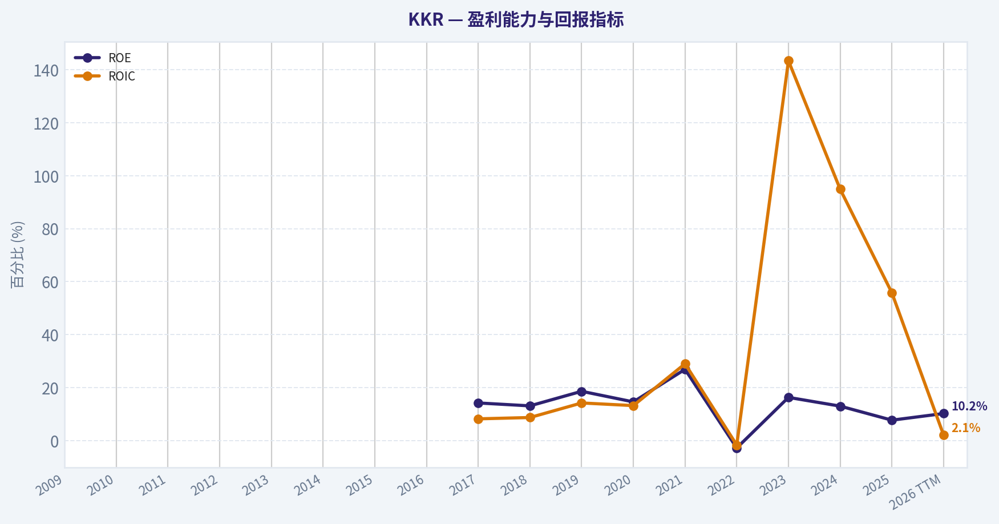
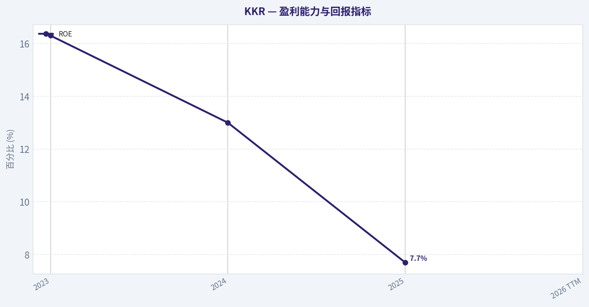
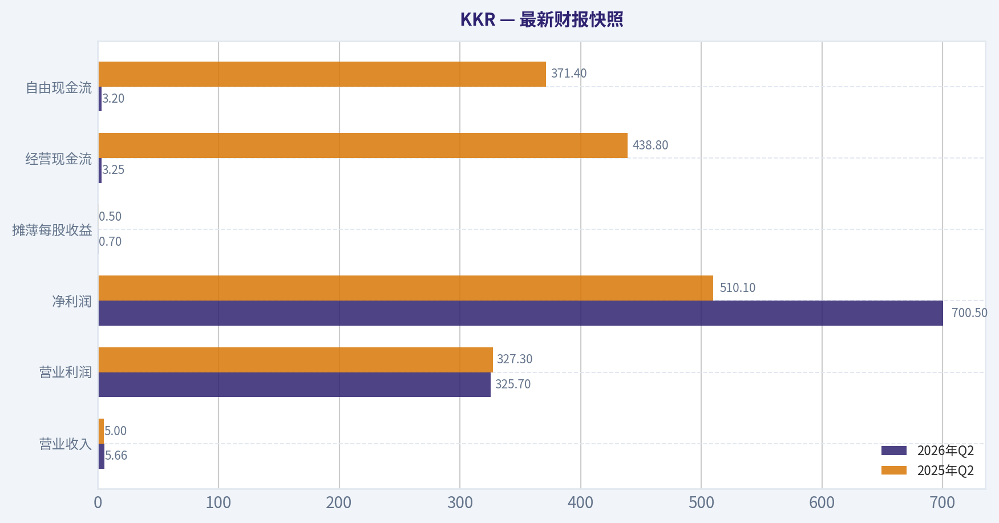
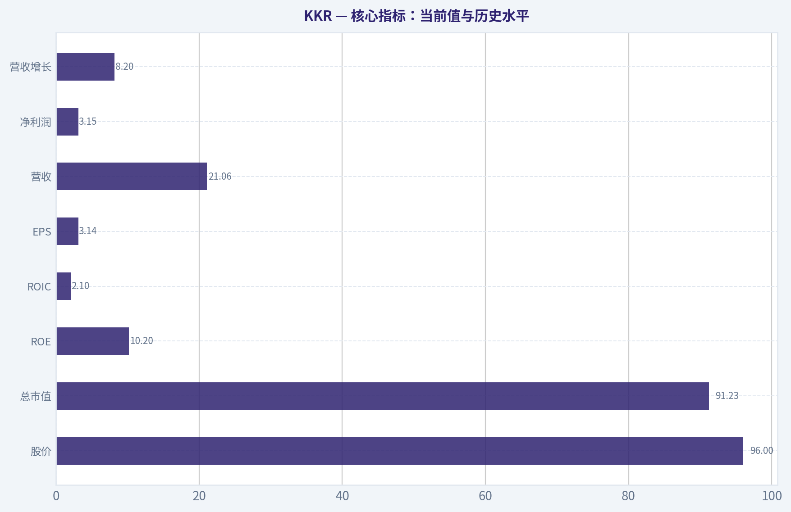
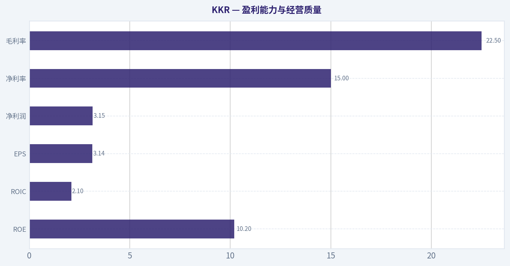
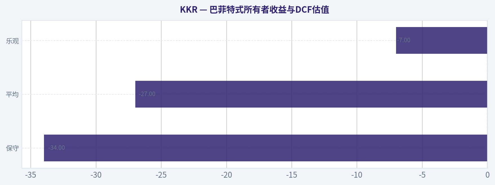
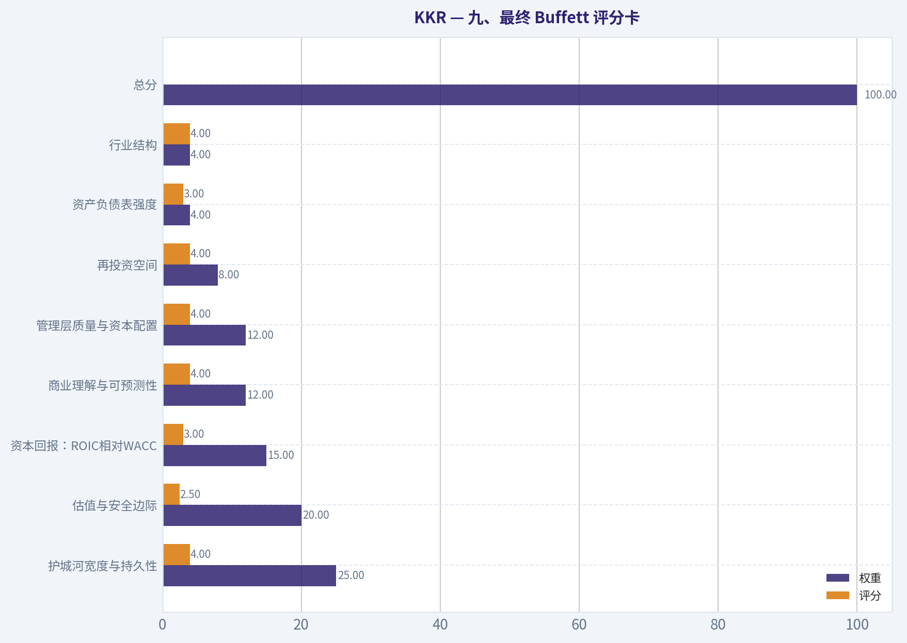
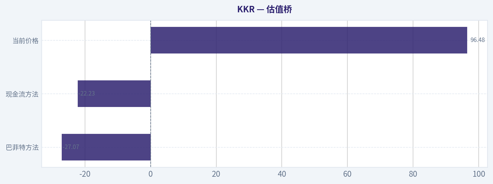

# KKR 深度价值情报

**调研日期:** 2026-11-07

## 关键免责声明

*本报告由 Deep Value Intelligence（一个基于 AI 的多智能体投资分析框架）自动生成。 仅供教育和研究用途 - 非财务建议，非财务顾问。*

---

## 目录

1. 情报摘要
2. 分析师团队报告
   - 基本面分析
   - 价值分析 (巴菲特)
   - 成长性分析 (林奇/德鲁肯米勒/费雪)
   - 市场分析
   - 期权市场分析
3. 研究团队评论
4. 投资团队评论
5. Deep Values 团队洞察

---

## 情报摘要

### 核心观点与前提条件

**核心论点:** KKR 是具备品牌、机构关系、产品广度和永久资本优势的高质量另类资产平台，不存在现有证据所显示的护城河崩塌或偿付危机。但在96.48美元附近，估值大致要求未来十年每股所有者收益增长约12.2%，而每股费用相关收益、可分配收益、保险净利差、信用质量及稀释数据仍不足以验证这一预期。

**主要风险:**
- **最终立场：中性**

**置信度:** 中

---

## 分析师团队报告

### 基本面分析

#### 最新财报快照

*以下数据基于最近一期已披露财报（2026年Q2），并尽量与上一年同期对比。*

| 指标 | 2026年Q2 | 2025年Q2 | 同比变化 |
| --- | ---: | ---: | ---: |
| 营业收入 | $5.66B | $5.00B | +13.1% |
| 营业利润 | $325.7M | $327.3M | -0.5% |
| 净利润 | $700.5M | $510.1M | +37.3% |
| 摊薄每股收益 | $0.70 | $0.50 | +40.0% |
| 经营现金流 | $3.25B | $438.8M | +641.3% |
| 自由现金流 | $3.20B | $371.4M | +762.7% |

关键结论：这张快照先把最新一期财报放在桌面上，再去看长周期分析。这样读者能更清楚地区分"公司长期质量"和"这次财报发生了什么"。

#### KKR 17年财务指标

*以下数值均由原始数据确定性计算得出，并非 AI 估算。*

*发行人类型：asset manager（Financial Services / Asset Management）。*

#### 17年财务指标
*年度行来自已披露财务报表，最后一行 TTM 由最近四个季度滚动计算得出。*

| 指标 | 2009 | 2010 | 2011 | 2012 | 2013 | 2014 | 2015 | 2016 | 2017 | 2018 | 2019 | 2020 | 2021 | 2022 | 2023 | 2024 | 2025 | 2026 TTM |
| --- | --- | --- | --- | --- | --- | --- | --- | --- | --- | --- | --- | --- | --- | --- | --- | --- | --- | --- |
| 市场价格 | N/A | $8 | $8 | $10 | $17 | $18 | $13 | $13 | $19 | $18 | $27 | $39 | $72 | $45 | $81 | $146 | $127 | $96 |
| 总市值 | N/A | N/A | $2.97B | $3.97B | $7.01B | $10.06B | $7.00B | $6.97B | $10.25B | N/A | $16.34B | $23.20B | $44.38B | $39.97B | $73.32B | $131.38B | $113.64B | $91.23B |
| 市盈率 | N/A | N/A | 1547.48 | 7.09 | 10.15 | 21.07 | 14.34 | 22.53 | 10.07 | N/A | 8.15 | 11.58 | 9.38 | -76.63 | 19.65 | 42.71 | 47.94 | 30.73 |
| 市净率 | N/A | N/A | N/A | N/A | N/A | N/A | N/A | N/A | 1.43 | N/A | 1.51 | 1.69 | 2.52 | 2.13 | 3.21 | 5.55 | 3.68 | 2.94 |
| ROE | N/A | N/A | N/A | N/A | N/A | N/A | N/A | N/A | 14.2% | 13.1% | 18.6% | 14.6% | 26.9% | -2.8% | 16.3% | 13.0% | 7.7% | 10.2% |
| ROIC | N/A | N/A | N/A | N/A | N/A | N/A | N/A | N/A | 8.2% | 8.7% | 14.2% | 13.2% | 29.0% | -1.7% | 143.4% | 94.9% | 55.8% | 2.1% |
| 每股收益 | N/A | N/A | $0.01 | $1.39 | $1.69 | $0.84 | $0.89 | $0.59 | $1.87 | N/A | $3.35 | $3.33 | $7.63 | $-0.59 | $4.22 | $3.46 | $2.66 | $3.14 |
| 营收 | N/A | N/A | N/A | N/A | N/A | N/A | N/A | $2.04B | $3.56B | $2.40B | $4.22B | $4.23B | $16.23B | $5.70B | $14.50B | $21.88B | $19.46B | $21.06B |
| 毛利润 | N/A | N/A | N/A | N/A | N/A | N/A | N/A | N/A | N/A | N/A | N/A | N/A | N/A | N/A | N/A | N/A | N/A | $4.74B |
| 毛利率 | N/A | N/A | N/A | N/A | N/A | N/A | N/A | N/A | N/A | N/A | N/A | N/A | N/A | N/A | N/A | N/A | N/A | 22.5% |
| 营业利润率 | N/A | N/A | N/A | N/A | N/A | N/A | N/A | 47.8% | 78.3% | 94.2% | 122.4% | 135.4% | 85.3% | -5.1% | 45.2% | 26.8% | 36.5% | 7.8% |
| 净利润 | $849.7M | $333.2M | $1.9M | $560.8M | $691.2M | $477.6M | $488.5M | $309.3M | $1.02B | $1.13B | $2.01B | $2.00B | $4.73B | $-521.7M | $3.73B | $3.08B | $2.37B | $3.15B |
| 净利率 | N/A | N/A | N/A | N/A | N/A | N/A | N/A | 15.2% | 28.6% | 47.2% | 47.5% | 47.3% | 29.2% | -9.1% | 25.7% | 14.1% | 12.2% | 15.0% |
| 营收增长 | N/A | N/A | N/A | N/A | N/A | N/A | N/A | N/A | 74.4% | -32.6% | 76.2% | 0.2% | 283.5% | -64.8% | 154.2% | 50.9% | -11.0% | 8.2% |
| 净利润增长 | N/A | -60.8% | -99.4% | 29095.0% | 23.2% | -30.9% | 2.3% | -36.7% | 229.2% | 11.1% | 77.3% | -0.1% | 136.3% | -111.0% | -815.5% | -17.6% | -22.9% | 33.0% |
| 自由现金流增长 | N/A | -295.5% | -131.5% | -2818.3% | -58.4% | -42.4% | -85.4% | -796.3% | 141.3% | 112.4% | -23.8% | N/A | N/A | N/A | N/A | N/A | N/A | N/A |
| 总账面价值 | N/A | N/A | N/A | N/A | N/A | N/A | N/A | N/A | $7.19B | $8.65B | $10.81B | $13.72B | $17.58B | $18.81B | $22.86B | $23.65B | $30.90B | $31.05B |
| 总资产 | $30.22B | $38.39B | $40.38B | $44.43B | $51.43B | $65.87B | $71.04B | $39.00B | $45.83B | $50.74B | $60.90B | $79.81B | N/A | $275.35B | $317.29B | $360.10B | $410.14B | $414.46B |
| 总债务 | $0 | $1.49B | $1.6M | $1.13B | $1.92B | $11.01B | $18.81B | $18.66B | $21.43B | $22.64B | $27.15B | $33.50B | $36.91B | $0 | $0 | $0 | $0 | $54.96B |
| 债务股权比 | N/A | N/A | N/A | N/A | N/A | N/A | N/A | N/A | 2.98 | 2.62 | 2.51 | 2.44 | 2.10 | 0.00 | 0.00 | 0.00 | 0.00 | 1.77 |
| 现金及等价物 | $546.7M | $738.7M | $843.3M | $1.23B | $1.31B | $918.1M | $1.05B | $2.51B | $1.88B | $1.75B | $2.35B | $5.36B | $10.53B | $13.39B | $20.81B | $15.37B | $17.15B | $21.08B |
| 股东权益 | N/A | N/A | N/A | N/A | N/A | N/A | N/A | N/A | $7.19B | $8.65B | $10.81B | $13.72B | $17.58B | $18.81B | $22.86B | $23.65B | $30.90B | $31.05B |
| 经营现金流 | $-347.3M | $733.4M | $-208.6M | $6.20B | $2.58B | $1.49B | $385.4M | $-1.44B | $-3.53B | $-7.61B | $-5.68B | $-5.95B | $-7.18B | $-5.28B | $-1.49B | $6.65B | $477.8M | $2.49B |
| 投资现金流 | $-43.0M | $-1.3M | $-47.6M | $-220.9M | $15.5M | $-22.9M | $-425.2M | $-63.9M | $-98.1M | $-78.6M | $-207.4M | $-153.4M | $-9.61B | $-13.65B | $-3.88B | $-19.05B | $-16.28B | $-8.26B |
| 自由现金流 | $-368.4M | $720.3M | $-226.8M | $6.16B | $2.56B | $1.48B | $216.0M | $-1.50B | $-3.63B | $-7.71B | $-5.88B | N/A | N/A | N/A | N/A | N/A | N/A | $2.34B |
| 自由现金流利润率 | N/A | N/A | N/A | N/A | N/A | N/A | N/A | -73.7% | -102.0% | -321.8% | -139.2% | N/A | N/A | N/A | N/A | N/A | N/A | 11.1% |
| 每股分红 | N/A | N/A | $0.00 | $0.00 | $0.00 | $0.00 | $0.00 | $0.00 | $0.00 | N/A | $0.00 | $0.00 | $0.00 | $0.50 | $0.64 | $0.69 | $0.73 | $0.71 |

#### 盈利能力指标
- 净资产收益率 (ROE): 7.7%
- 投入资本回报率 (ROIC): N/A
- 总资产收益率 (ROA): 0.6%
- 毛利率: 不适用
- 营业利润率: 36.5%
- 净利率: 12.2%

#### 流动性指标
- 流动比率: 不适用
- 速动比率: 不适用

#### 杠杆指标
- 债务股权比: 0.00
- 利息覆盖倍数: 2.56
- 净负债: $-132.71B

#### 增长指标（同比）
- 营收增长: -11.0%
- 净利润增长: -22.9%
- 自由现金流增长: N/A
- 营收复合增长率（3年）: 50.6%
- 营收复合增长率（5年）: 35.7%

#### 估值指标
- 市盈率 (TTM): 30.82
- 预期市盈率: 13.43
- 市净率: 3.04
- 市销率: 3.45
- PEG 比率: 0.42
- 企业价值/EBITDA: 不适用
- 自由现金流收益率: N/A
- 盈利收益率: 3.2%

#### 所有者收益（巴菲特方法，代码计算）
- 净利润: $2.37B
- + 折旧与摊销: N/A
- - 资本开支: N/A
- - 营运资本变动: $2.85B
- = **所有者收益: $-475.2M**

#### 内在价值（代码计算）
- 当前价格: $96
- 头条内在价值: 不适用（金融类发行人 - DCF/FCFF 并非合适的主要框架；请使用行业特定的账面/盈利指标）
- 巴菲特方法（所有者收益）:
  保守: $-34
  平均: $-27
  乐观: $-7
- 现金流方法（FCF）:
  保守: $-34
  平均: $-22
  乐观: $-22
- 反向 DCF：当前价格隐含约 92.0%/年 的所有者收益增长（10年）；过去 3 年为 N/A，5 年为 N/A。

#### Piotroski F分数: 2/9
- 净利润为正: 通过
- 经营现金流为正: 通过
- 资产回报率改善: 未通过
- 现金流大于净利润: 未通过
- 债务下降: 未通过
- 流动比率改善: 未通过
- 未稀释股本: 未通过
- 毛利率改善: 未通过
- 资产周转率改善: 未通过

ANALYST STANCE: **中性**

#### 结论摘要

KKR 是具有长期竞争优势的另类资产管理平台，但当前估值已经充分反映了其资产管理规模增长、募资能力和保险业务扩张。2026 年 TTM 股价为 96 美元，总市值约 912.3 亿美元，PE 为 30.73 倍，明显高于可比历史平均；与此同时，ROE 降至 10.2%，ROIC 降至 2.1%，营收和净利润质量仍具有较强周期性。

对于 KKR，P/B 不能按普通制造业或消费股方式机械解读。它属于金融服务和资产管理公司，账面价值受到投资资产、并购会计、商誉及资本结构影响，真正重要的是可持续管理费、业绩报酬、募资能力、资本回报率和归属于股东的现金收益。因此，当前更适合定性为 **中性**，等待估值回落或盈利质量明显改善后再提高仓位。

#### 核心指标：当前值与历史水平

| 指标 | 2026 TTM / 当前 | 历史平均或参考值 | 当前相对历史的含义 |
|---|---:|---:|---|
| 股价 | $96 | 2010-2025年度均值约$42 | 经过多年上涨后仍处高位，但较2024年$146明显回落 |
| 总市值 | $91.23B | 2011-2025有数据年度均值约$44B | 市值已大约翻倍，市场对平台化增长给予较高溢价 |
| PE | 30.73倍 | 有效历史值均值约20.5倍 | 高于历史均值约50%，需要持续增长来支撑 |
| P/B | 2.94倍 | 有效历史值均值约2.96倍 | 接近历史均值，但对资产管理公司不是核心估值指标 |
| ROE | 10.2% | 2017-2025均值约12.2% | 低于历史均值，资本回报效率暂未恢复 |
| ROIC | 2.1% | 有效历史均值约36.8%，但被极端年份严重扭曲 | 当前明显偏弱，历史均值不具备很强可比性 |
| EPS | $3.14 | 2011-2025有效年度均值约$2.25 | EPS高于长期均值，但盈利波动很大 |
| 营收 | $21.06B | 2016-2025均值约$10.12B | 规模显著扩张，但2025年曾同比下降11% |
| 净利润 | $3.15B | 2009-2025均值约$1.47B | 高于长期均值，但利润包含较强周期和公允价值因素 |
| 营收增长 | 8.2% | 历史算术均值被2021、2023等异常年份抬高 | 当前恢复增长，但远低于部分历史爆发年份 |
| 净利润增长 | 33.0% | 历史波动极大，参考价值有限 | 近期反弹明显，但不能直接视为稳定复合增长 |
| 自由现金流 | $2.34B | 2010-2019波动剧烈，2020年后连续数据缺失 | TTM转正，但自由现金流历史可比性不足 |
| 现金及等价物 | $21.08B | 2009-2025均值约$6.7B | 现金规模显著增强，提供较强缓冲 |
| 总债务 | $54.96B | 2009-2025均值约$14.6B | TTM债务跳升，需区分公司债务、保险及投资相关负债 |
| 债务/权益 | 1.77倍 | 2017-2025曾长期显示为0 | 当前杠杆指标明显恶化，但历史数据存在分类口径变化 |
| 每股分红 | $0.71 | 2022-2025均值约$0.69 | 股息稳定但收益率较低，约0.7% |

**关键结论：** KKR 当前盈利和资产规模高于长期平均，但估值扩张速度快于资本回报率改善速度。PE显著高于历史均值，而ROE低于历史均值，说明市场已经提前计入了较强的未来增长。P/B接近历史平均并不能证明股票便宜，因为资产管理公司的账面权益并不完全代表其无形管理平台价值。

#### 盈利能力与经营质量

| 指标 | 当前数据 | 历史表现与解释 |
|---|---:|---|
| ROE | 10.2% | 2021年曾达26.9%，2022年为-2.8%，2025年仅7.7%，波动明显 |
| ROIC | 2.1% | 2019-2021及2023-2025数据受会计与投资收益影响较大，不能简单使用长期均值 |
| EPS | $3.14 | 2022年为负0.59美元，2023-2026逐步恢复，但仍未呈现线性增长 |
| 营业利润率 | 7.8% TTM | 历史数据从负数到超过100%，说明收入确认及投资收益结构高度不稳定 |
| 净利润 | $3.15B | 高于2025年的$2.37B，但历史上曾出现大幅下滑和负数 |
| 净利率 | 15.0% | 高于2025年的12.2%，但低于2018-2020年约47%的异常高水平 |
| 毛利率 | 22.5% | 对资产管理公司意义有限，不能像工业或消费企业那样解释 |

KKR 的收入和利润不只来自稳定管理费，还会受到业绩报酬、投资退出、公允价值变动、保险业务和资本市场活动影响。因此，净利润同比增长33%并不等同于经常性盈利增长33%。

经营质量中最值得关注的是：

- TTM营收达到210.6亿美元，规模较2016年明显扩大。
- 2025年营收同比下降11%，说明退出环境、投资估值或交易活动仍有周期性压力。
- TTM净利润增长33%，但ROE只有10.2%，说明利润增长尚未充分转化为更高的股东资本回报。
- TTM经营现金流为24.9亿美元，自由现金流为23.4亿美元，现金流恢复是积极信号。
- 但所有者收益模型计算为负4.752亿美元，主要因为营运资本变动扣除28.5亿美元，说明传统工业企业式的自由现金流口径并不适合直接评价KKR。

#### 增长趋势解读

KKR 的历史增长不是稳定的"复利曲线"，而是典型的另类资产管理周期模式。

营收曾在2021年增长283.5%，2023年增长154.2%，但2022年又下降64.8%，2025年下降11.0%。这些大幅波动通常与投资退出、资产重估、业绩报酬确认和并购活动有关，而不完全代表管理费收入的趋势。

较积极的一面是，3年营收复合增长率约50.6%，5年复合增长率约35.7%，显示平台并购、募资、保险和私人信贷业务扩张带来了显著规模增长。较谨慎的一面是，近年净利润曾连续下降，2025年同比下降22.9%，而自由现金流在2020年后缺乏连续的历史年度数据，持续现金转换能力仍需观察。

#### 资产负债表与财务实力

KKR 的现金及等价物为210.8亿美元，股东权益为310.5亿美元，总资产为4145亿美元。现金储备大幅高于早期水平，能够支持投资、回购、并购和业务扩张。

但总债务为549.6亿美元，债务/权益为1.77倍。历史上2022-2025年数据显示债务为零，而TTM突然出现较大债务，这说明可能存在负债重分类、保险业务并表、投资融资或数据口径变化。不能简单得出"无债务"的结论。

净负债指标显示为负1327.1亿美元，表面上意味着净现金，但这一数值与总债务、现金和金融资产的关系并不完全一致，更可能受到金融机构资产负债表分类影响。因此，分析KKR应重点追踪：

1. 公司层面真正需要偿还的债务；
2. 保险子公司的资产负债匹配情况；
3. 基金层面非追索性融资；
4. 利息覆盖能力；
5. 管理费收入对固定融资成本的覆盖程度。

Piotroski F分数只有2分，反映出资产回报率、现金流与净利润匹配、债务变化、股本稀释和资产周转等方面并不强。该分数对金融公司并非完美工具，但仍提示当前财务质量不能仅依据现金余额判断。

#### 资本配置与股东回报

KKR 近年来开始持续分红，每股股息由2022年的0.50美元升至2026 TTM的0.71美元，股息增长较稳定。但以96美元股价计算，股息率约为0.7%，并非高收益投资。

管理层更重要的资本配置方式是：

- 扩大管理资产规模；
- 发展私人信贷、基础设施、房地产和保险；
- 进行战略并购；
- 通过投资退出获取业绩报酬；
- 在适当时机回购股票或增加分红。

目前ROE由2021年的26.9%降至TTM的10.2%，说明资本扩张尚未带来同等比例的股东回报改善。若未来管理费收入增长快于成本、保险资本回报提升，并且退出市场恢复，ROE可能重新上升；否则，持续扩张可能造成资本占用增加而非价值创造。

#### 竞争优势与护城河

KKR 的主要护城河不是固定资产，而是金融平台、品牌、募资渠道和交易网络。

| 护城河来源 | 具体表现 | 持续性判断 |
|---|---|---|
| 品牌与机构信任 | 全球大型养老金、主权基金、保险公司和家族办公室的长期合作 | 较强 |
| 募资能力 | 可跨周期募集长期资本，形成规模优势 | 较强，但依赖历史业绩 |
| 私人市场专业能力 | 私募股权、私人信贷、基础设施、房地产和保险协同 | 较强 |
| 交易与退出网络 | 能够连接企业、银行、保险资本和机构投资者 | 较强 |
| 规模经济 | 规模扩大后，管理费平台成本可被摊薄 | 中强 |
| 客户黏性 | 私募基金锁定期较长，客户更换管理人成本高 | 中强 |
| 业绩报酬 | 在市场上涨和成功退出时带来高利润 | 周期性强 |

护城河成立的前提是KKR能够持续实现有竞争力的净回报。如果长期回报落后、费用过高或退出周期过长，机构客户的重新配置会削弱这一优势。

#### 收入来源分布

公开数据和当前确定性数据未提供可核验的最新分部收入金额。由于KKR的报表收入会受到投资公允价值变动和业绩报酬影响，以下表格仅列出主要经济来源，不对缺乏确定性的数据进行虚构。

##### 收入来源分布

| 收入来源 | 金额（百万/十亿美元） | 占比 |
|---|---:|---:|
| 资产管理基础管理费 | 未披露可核验分部金额 | 未披露 |
| 私募股权及投资退出相关业绩报酬 | 未披露可核验分部金额 | 未披露 |
| 私人信贷与固定收益平台 | 未披露可核验分部金额 | 未披露 |
| 基础设施、房地产及其他另类资产 | 未披露可核验分部金额 | 未披露 |
| 保险及相关投资收益 | 未披露可核验分部金额 | 未披露 |
| 资本市场及战略投资 | 未披露可核验分部金额 | 未披露 |
| 合计营收 | $21.06B | 100% |

**关键结论：** KKR的收入来源高度多元，但收入确认并不等同于稳定管理费。投资退出和公允价值变动可能在个别年度显著抬高或压低利润，因此投资者应优先关注经常性管理费、可分配收益、管理资产净增长和基金净回报，而非只看总营收。

#### 巴菲特式所有者收益与DCF估值

对于传统企业，所有者收益通常可近似为：

> 净利润 + 折旧摊销 - 维持性资本开支 - 正常化营运资本需求

KKR 的确定性数据给出：

- 净利润：23.7亿美元；
- 营运资本变动扣除：28.5亿美元；
- 折旧摊销：未提供；
- 资本开支：未提供；
- 计算所有者收益：负4.752亿美元。

因此，研究包中的模型型所有者收益估值为：

| 情景 | 模型型所有者收益估值 | 对当前$96股价的含义 |
|---|---:|---|
| 保守 | -$34 | 由于所有者收益为负，结果没有正常经济意义 |
| 平均 | -$27 | 不能作为常规目标价使用 |
| 乐观 | -$7 | 仍低于市场价格，反映现金流口径失真或估值过高 |

**关键结论：** 负的所有者收益不是说KKR没有价值，而是说明传统企业式DCF无法直接处理资产管理公司复杂的营运资本、投资资产和退出收益。研究包中的反向DCF显示，当前价格隐含约92%的所有者收益年增长率，这一结果明显不现实，进一步证明该模型不适合作为KKR的主要估值锚。

为了进行独立的敏感性检查，以下使用TTM自由现金流23.4亿美元作为现金流代理，并假设流通股数约为9.50亿股。由于自由现金流口径并不稳定，该计算仅作为辅助情景，不替代行业特定估值。

假设：

- 显性预测期：5年；
- 折现率：10%；
- 永续增长率：2.5%；
- 终值公式：第6年现金流 ÷（10% - 2.5%）；
- 当前TTM自由现金流：23.4亿美元。

| 情景 | 显性增长假设 | 第1-5年现金流（十亿美元） | 终值现值（十亿美元） | 现金流现值合计（十亿美元） | 每股辅助价值 |
|---|---|---|---:|---:|---:|
| 保守 | 每年约3%，接近长期名义经济增长 | 2.41、2.48、2.56、2.63、2.71 | 23.0 | 32.6 | $34 |
| 平均 | 8%、7%、6%、5%、4%，逐步衰减 | 2.53、2.70、2.87、3.01、3.13 | 26.6 | 37.2 | $39 |
| 乐观 | 12%、10%、8%、6%、4%，高增长逐步衰减 | 2.62、2.88、3.11、3.30、3.43 | 29.1 | 40.6 | $43 |

**关键结论：** 即使采用较乐观的自由现金流代理，辅助DCF价值约为每股34至43美元，仍显著低于当前96美元。这个结果不能简单解释为KKR必然高估，因为自由现金流受金融业务会计和营运资本影响很大；但它明确说明市场需要KKR保持远高于当前现金流基础的长期增长。

#### 估值判断

当前PE为30.73倍，而有效历史平均约20.5倍。市场还提供了约13.43倍的预期PE，这意味着市场分析师预计未来盈利会明显恢复。然而，若未来盈利恢复主要来自一次性退出、资产重估或业绩报酬，而不是持续管理费增长，则预期PE可能过度乐观。

P/B约2.94倍，接近历史有效均值2.96倍，但这里不能按一般股票理解为"接近历史均值所以合理"。KKR是资产管理公司，账面价值可能低估品牌、客户关系和管理平台，也可能因投资公允价值、并购会计和回购而失真。P/B应结合ROE判断；当前ROE只有10.2%，并未显示出足以支撑高倍数账面价值的超高资本回报。

以巴菲特思路看，最重要的问题不是"KKR有没有护城河"，而是：

> 当前价格是否低于未来十年可分配给股东的经常性现金收益的合理现值？

目前答案并不明确，且辅助DCF明显低于市场价格，因此安全边际不足。

#### 主要风险、机会与关键观察点

| 类别 | 内容 | 投资意义 |
|---|---|---|
| 机会 | 私人信贷、基础设施、保险和长期资本继续扩张 | 可提高管理费稳定性并延长增长跑道 |
| 机会 | 机构资金持续从公开市场转向私人市场 | 有利于管理资产规模和客户黏性 |
| 机会 | 退出市场恢复、IPO和并购活动回暖 | 可能显著提升业绩报酬和净利润 |
| 机会 | 现金储备规模较高 | 提供并购、回购和业务投资能力 |
| 风险 | PE高于历史均值约50% | 对增长失速和盈利下修敏感 |
| 风险 | ROE低于历史高点且ROIC仅2.1% | 扩张未必等于价值创造 |
| 风险 | 业绩报酬和公允价值变动周期性强 | 单年利润不能代表正常盈利 |
| 风险 | 总债务TTM升至549.6亿美元 | 需核实公司层面与保险层面实际杠杆 |
| 风险 | F分数仅2/9 | 显示财务质量和趋势信号偏弱 |
| 风险 | 传统所有者收益为负 | DCF估值依赖现金流口径，结果不稳定 |
| 风险 | 股息率约0.7% | 缺乏足够股息保护，主要依赖资本增值 |

**关键结论：** 最大机会是私人市场长期渗透和KKR平台化扩张，最大风险是市场已提前为这些机会支付了较高价格。投资者应重点观察经常性管理费增长、管理资产净流入、基金净回报、可分配收益、债务分类和ROE能否回升，而不是只追踪净利润同比增速。

#### 最终投资立场

**中性**

支持中性观察的理由：

1. **业务质量较高：** KKR拥有品牌、机构客户、募资能力和多资产平台，具备长期护城河。
2. **增长机会真实存在：** 私人信贷、基础设施、保险和另类资产配置仍有结构性增长空间。
3. **财务韧性尚可：** 现金规模较大，TTM经营现金流和自由现金流恢复为正。
4. **估值缺乏安全边际：** PE明显高于历史均值，辅助DCF只有约34至43美元。
5. **盈利质量不够稳定：** ROE下降、ROIC偏低、现金流数据不连续，且收益高度依赖资本市场周期。
6. **杠杆数据需要核实：** 总债务和债务/权益指标相较历史突然变化，不能直接忽视。

若股价明显回落、PE接近历史中位数，或未来几个季度出现管理费收入持续增长、ROE回升至15%以上、债务结构透明化及可分配收益改善，KKR的风险回报比将更具吸引力。相反，若股价继续上涨而盈利、ROE和现金流没有同步改善，则应避免追高。

#### 报告关键点汇总

| 项目 | 判断 |
|---|---|
| 商业模式 | 高质量另类资产管理平台，但收益周期性明显 |
| 护城河 | 品牌、募资、客户关系、交易网络和规模经济 |
| 当前估值 | PE偏高，P/B仅作辅助，现金流DCF明显低于股价 |
| 盈利趋势 | TTM改善，但历史波动大，持续性仍待验证 |
| 财务实力 | 现金充足，但TTM债务明显上升，需要拆分分析 |
| 股东回报 | 分红稳定但收益率低，ROE低于历史高点 |
| 主要机会 | 私人信贷、基础设施、保险、长期机构资本 |
| 主要风险 | 高估值、业绩报酬周期、杠杆口径、现金流不稳定 |
| 合理策略 | 等待估值回落或经营质量进一步验证 |
| 最终立场 | **中性** |

#### 基本面关键图表

本图追踪 **KKR** 过去十年的盈利能力与回报指标（ROE、ROIC、利润率），突出呈现资本效率的变化趋势。

本图追踪 **KKR** 过去十年的盈利能力与回报指标（ROE、ROIC、利润率），突出呈现资本效率的变化趋势。

---

### 价值分析 (巴菲特)

> *基于沃伦·巴菲特的价值投资哲学：能力圈、经济护城河、管理层质量与安全边际。*

#### 内在价值快照

价格是你付的钱，内在价值是企业未来可能为股东创造的现金价值。我们给出一个区间，而不是假装只有一个神奇数字。

- 当前价格: $96.48
- 估值区间（两种 DCF 方法、保守到乐观）: $-34.17 至 $-6.76

##### 所有者收益（巴菲特方法）
- 净利润: $2,370,463,000.00
- 折旧与摊销: N/A
- 资本支出: N/A
- 营运资金变化: $2,845,692,000.00
- 所有者收益: $-475,229,000.00

##### 内在价值
###### 所有者收益法
使用所有者收益，更严格，通常更保守。
- 保守: $-33.74
- 平均: $-27.07
- 乐观: $-6.76
- 折现率: 10.0%

###### 自由现金流法
使用自由现金流，更适合今天投入很多、为未来增长铺路的公司。
- 保守: $-34.17
- 平均: $-22.23
- 乐观: $-22.23
- 折现率: 10.0%

ANALYST STANCE: **中性**

#### 一、投资结论

KKR 是全球领先的另类资产管理平台，核心收入来自管理费、投资收益和业绩分成。其长期优势在于品牌、机构募资网络、投资专业能力以及规模带来的交易资源，但当前股价约为 **96美元**，对应 **PE 约30.8倍**，而最新数据显示 ROE 仅 **7.7%**、收入同比下降 **11%**。

这是一家值得长期跟踪的优质平台，但当前价格已经反映了较强的资产管理增长、资金流入和退出活动改善预期。基于估值安全边际不足，综合评级为 **中性**，等待更合理的买入价格或盈利能力进一步改善。

#### 二、四大因素评分

| 因素 | 评分 | 核心判断 |
|---|---:|---|
| 因素一：能力圈与商业模式简单性 | 4/5 | 主要通过募资、管理资产并收取管理费，同时分享投资收益；业务仍受私募基金会计和业绩分成波动影响 |
| 因素二：护城河 | 4/5 | 品牌、机构客户关系、募资网络、交易资源和规模优势明显 |
| 因素三：管理层与资本配置 | 4/5 | 创始人文化和长期资本配置能力较强，但另类资产行业报酬结构复杂，需要持续关注稀释与并购 |
| 因素四：行业结构 | 4/5 | 头部另类资产管理行业具有规模经济和较高进入壁垒，但竞争加剧、募资周期和利率环境会影响增长 |
| Gate 5：质量与偿付能力硬底线 | 未触发 | 没有证据显示同时存在持续恶化的现金流与严重偿付危机 |

**关键结论：** KKR 的业务质量明显高于普通金融公司，优势来自长期募资关系、投资品牌和平台规模。主要问题不是商业模式失效，而是收入波动、估值偏高以及当前 ROE 尚未体现出顶级复利公司的水平。

#### 三、护城河分析

| 护城河来源 | 具体证据 | 强度判断 |
|---|---|---|
| 无形资产 | KKR 在私募股权、信贷、基础设施和房地产等领域拥有全球品牌与长期业绩记录 | 强 |
| 转换成本 | 养老金、主权基金、保险公司等机构客户通常进行多年期配置，尽调、合规和关系网络使迁移并不容易 | 强 |
| 成本优势 | 大规模募资、研究团队、交易执行和后台基础设施可以摊薄单位成本 | 中强 |
| 网络效应 | 更大的资产管理规模带来更多交易来源、融资能力和人才吸引力，形成一定的规模反馈循环 | 中强 |
| 再投资能力 | 管理费可用于扩展信贷、基础设施、保险资产管理等新平台 | 强，但依赖募资环境 |

**关键结论：** KKR 的护城河不是传统消费品牌式的定价权，而是机构信任、长期关系、专业人才和规模网络。护城河总体属于"宽而稳定"，但能否继续扩大取决于净募资、投资回报和客户对费用的接受程度。

#### 四、管理层与资本配置

KKR 的管理层长期强调扩大管理平台、进入新资产类别和提高永久资本比例。其战略方向具有合理性：

- 从传统私募股权扩展到信贷、基础设施、房地产和保险资产；
- 通过扩大永久资本，降低单纯依赖周期性基金募集的波动；
- 利用全球机构客户关系提升交叉销售；
- 通过规模扩大提高管理费收入的稳定性。

需要重点监测以下风险：

1. **并购与平台扩张风险**：快速扩张可能带来商誉、整合和资本配置问题。
2. **股权稀释风险**：另类资产管理公司常使用股权激励，必须观察每股收益是否真正增长。
3. **业绩分成波动**：部分投资收益受退出市场、估值水平和资本市场活跃度影响。
4. **激励结构复杂**：管理费、投资收益、 carried interest 和员工持股安排需要拆分观察。

综合评价为 **4/5**。管理层能力较强，但投资者不能只看总资产管理规模，必须看每股管理费收入、每股现金流和长期 ROE 是否同步提升。

#### 五、财务摘要

| 指标 | 最新数据 |
|---|---:|
| 股价 | 96美元 |
| 总市值 | 891.1亿美元 |
| PE | 30.82倍 |
| 隐含每股收益 | 约3.11美元 |
| 推算净利润 | 约28.0亿美元 |
| ROE | 7.7% |
| 收入同比增长 | -11.0% |
| 毛利率 | 不适用 |
| 自由现金流收益率 | 不适用 |
| 流动比率 | 不适用 |
| 行业属性 | 另类资产管理与金融服务 |

**关键结论：** KKR 的 PE 已达到成长型金融平台水平，但 ROE 只有 7.7%，收入同比下降 11%，说明当前估值需要未来盈利和资产管理规模重新加速。对于金融类发行人，毛利率、流动比率和传统自由现金流收益率不能直接套用工业企业标准。

#### 六、所有者收益分析

传统公式为：

> 所有者收益 = 净利润 + 折旧摊销 - 维护性资本支出 - 营运资本增加

对 KKR 而言，传统自由现金流并不是最理想指标，原因包括：

- 业绩分成确认具有较强周期性；
- 投资资产公允价值变动会影响净利润；
- 基金层面与管理公司层面的现金流存在差异；
- 管理费收入与投资收益的质量不同；
- 并购、员工股权激励和少数股东权益会影响每股价值。

因此，较合理的所有者收益代理指标是：

1. 管理费相关稳定收益；
2. 扣除激励薪酬后的可分配收益；
3. 正常化后的每股收益；
4. 长期每股现金流，而非单年净利润。

按当前 PE 倒推，当前每股收益约为 **3.11美元**，推算净利润约为 **28亿美元**。但在缺少管理费收益、业绩分成和维护性资本支出拆分数据的情况下，不应把这 28 亿美元全部视为稳定所有者收益。

**关键结论：** KKR 的盈利质量需要通过"管理费相关收益占比"和"正常化每股现金流"判断，而不能直接把会计净利润当作稳定现金收益。当前 ROE 偏低，也说明资本效率尚未达到顶级复利公司的水平。

#### 七、三情景估值

由于 KKR 属于金融类发行人，传统 FCFF 和工业企业式 Owner Earnings DCF 适用性较弱。以下估值使用当前约 **3.11美元每股收益**作为正常化盈利起点，并采用盈利能力情景进行交叉检验。

| 情景 | 主要假设 | 估算价值 | 相对股价 |
|---|---|---:|---:|
| 情景 A：无增长 | 盈利永久不增长，折现率10% | 约31美元 | 高估约68% |
| 情景 B：温和增长 | 长期盈利增长5%，折现率10% | 约65美元 | 高估约32% |
| 情景 C：较强增长 | 长期盈利增长7%，折现率10% | 约104美元 | 约有8%上行空间 |

**关键结论：** 估值对长期盈利增长极其敏感。若 KKR 只能维持低增长，96美元明显偏贵；只有当管理资产规模、管理费收益和业绩分成能够长期保持约7%的增长时，当前价格才接近合理。

#### 八、估值与安全边际

| 观察项目 | 判断 |
|---|---|
| 当前 PE | 30.8倍，属于较高估值 |
| 无增长估值 | 明显低于现价 |
| 5%增长估值 | 低于现价 |
| 7%增长估值 | 略高于现价 |
| 所需安全边际 | 对优质平台约10%至15%；当前尚未达到 |
| 反向估值含义 | 市场隐含了较强且持续的盈利增长 |
| 估值风险 | 募资放缓、退出减少、资产估值回落或业绩分成下降 |

KKR 的业务质量允许投资者接受低于普通公司的安全边际，但当前价格仍需要较强的未来执行力。较理想的买入区间为：

- **约80美元附近**：对应更合理的成长型估值；
- **约70美元附近**：提供更充足的安全边际；
- 若盈利持续加速、ROE 提升至12%至15%以上，则可重新评估合理价格。

#### 九、最终 Buffett 评分卡

| 评分项目 | 权重 | 评分 | 加权得分 |
|---|---:|---:|---:|
| 护城河宽度与持久性 | 25% | 4.0 | 1.00 |
| 估值与安全边际 | 20% | 2.5 | 0.50 |
| 资本回报：ROIC相对WACC | 15% | 3.0 | 0.45 |
| 商业理解与可预测性 | 12% | 4.0 | 0.48 |
| 管理层质量与资本配置 | 12% | 4.0 | 0.48 |
| 再投资空间 | 8% | 4.0 | 0.32 |
| 资产负债表强度 | 4% | 3.0 | 0.12 |
| 行业结构 | 4% | 4.0 | 0.16 |
| **总分** | **100%** | - | **3.51/5** |

**关键结论：** KKR 的综合分数约为 **3.51分**，属于高质量但估值需要纪律的公司。护城河、管理层和再投资空间支持长期跟踪，但估值和当前 ROE 拉低了投资吸引力。

#### 十、投资立场

**中性**

- **业务质量：** 良好，具备全球平台型另类资产管理公司的核心优势。
- **护城河：** 宽而稳定，主要来自机构信任、募资网络、专业能力和规模效应。
- **财务质量：** 可接受，但收入下降、ROE偏低，盈利稳定性仍需验证。
- **估值：** 约30.8倍 PE 已包含较强增长预期。
- **催化因素：** 净募资改善、管理费收入增长、退出市场恢复、永久资本扩大。
- **主要风险：** 高利率、募资周期转弱、资产估值下调、业绩分成减少以及股权稀释。

**结论：** KKR 是值得长期持有候选名单中的优质金融平台，但在96美元附近尚未提供足够安全边际。更适合加入观察清单，等待价格回落，或等待 ROE、每股盈利和管理费相关收入明显加速后再提高评级。
#### 估值桥

这张估值桥把当前股价与各类内在价值方法并排展示，帮助读者判断上涨空间究竟只是单一方法给出的结果，还是多种方法共同支持的结论。

| 项目 | 每股内在价值 |
| --- | ---: |
| 巴菲特方法 | $-27.07 |
| 现金流方法 | $-22.23 |
| 当前价格 | $96.48 |

#### 关键结论

如果只有一种方法显著高于其他方法，说明上行空间更依赖特定建模假设。若多种方法的估值接近，则说明估值逻辑更加稳健。

#### 估值图表

本对比图（来自「最新财报快照」）将 **KKR** 的当前数据与历史基准并排呈现，直观反映公司相对自身历史均值的估值水平。

本对比图（来自「核心指标：当前值与历史水平」）将 **KKR** 的当前数据与历史基准并排呈现，直观反映公司相对自身历史均值的估值水平。

本对比图（来自「盈利能力与经营质量」）将 **KKR** 的当前数据与历史基准并排呈现，直观反映公司相对自身历史均值的估值水平。

本对比图（来自「巴菲特式所有者收益与DCF估值」）将 **KKR** 的当前数据与历史基准并排呈现，直观反映公司相对自身历史均值的估值水平。

本对比图（来自「九、最终 Buffett 评分卡」）将 **KKR** 的当前数据与历史基准并排呈现，直观反映公司相对自身历史均值的估值水平。

本对比图（来自「估值桥」）将 **KKR** 的当前数据与历史基准并排呈现，直观反映公司相对自身历史均值的估值水平。

---

### 成长性分析 (林奇/德鲁肯米勒/费雪)

> *基于彼得·林奇的GARP成长投资法、斯坦利·德鲁肯米勒的宏观拐点分析法，以及菲利普·费雪的深度调研法。*

分析师立场：**中性**

#### 一、结论摘要

KKR 是全球另类资产管理平台，长期受益于私募股权、私人信贷、基础设施和保险资产向非公开市场迁移。但当前资料显示，收入同比仍下降约 11%，ROE 降至约 7.7%，且盈利高度受资产估值、退出活动和市场周期影响，因此更接近"高质量周期成长股"，而非稳定的 20%+复利型快成长股。

在股价约 96 美元、TTM PE 约 30.8 倍的情况下，市场已经反映了较强的长期募资、AUM 增长和退出复苏预期。建议观察 Q3 及未来几个季度的管理费收入、可部署资本、募资和资产变现情况，暂不建议高仓位追买。

#### 二、Lynch 分类

| 项目 | 判断 |
|---|---|
| Lynch 分类 | 周期性成长股，兼具快成长平台特征 |
| 当前收入增长 | TTM 同比约 -11.0%；数据口径受金融资产重估影响 |
| 三年收入 CAGR | 约 50.6%，但波动较大 |
| 五年收入 CAGR | 约 35.7%，包含并购、市场周期及会计重估影响 |
| 当前 PE | 约 30.8 倍 |
| Forward PE | 约 13.4 倍 |
| 当前核心问题 | 盈利与收入可持续性尚未充分验证 |

**关键结论：** KKR 的长期增长历史很强，但报告收入并不等同于稳定的管理费收入。按照 Lynch 分类，KKR 不是传统意义上的稳定快成长股，而是依赖资本市场、募资和退出周期的周期性成长平台。

#### 三、The Story：用三句话解释 KKR

1. KKR 帮助养老金、主权财富基金和机构投资者投资私募股权、私人信贷、基础设施及房地产等另类资产。
2. 随着大型机构增加另类资产配置，KKR 可以通过募资扩大管理资产规模，并从长期管理费和业绩分成中获利。
3. 如果私人信贷、保险资管和基础设施成为新的增长引擎，KKR 有机会从传统私募股权公司升级为综合另类资产金融平台。

#### 四、TAM 与 10 倍测试

| 项目 | 判断 |
|---|---|
| 主要市场 | 私募股权、私人信贷、基础设施、房地产、保险资产管理 |
| TAM 特征 | 大型且持续扩张，但缺少统一、可验证的单一市场口径 |
| 当前市值 | 约 891 亿美元 |
| 当前收入 | TTM 约 211 亿美元，受金融会计口径影响 |
| 10 倍收入测试 | 不能直接使用报告收入进行估算 |
| 10 倍市值可行性 | 理论上可行，但需要长期管理费复合增长及更高资本回报 |
| 最大增长来源 | 保险资产、私人信贷、基础设施和财富管理渠道 |

**关键结论：** KKR 所处的另类资产行业规模足以支持长期扩张，尤其是私人信贷、保险和基础设施领域。但 10 倍测试必须基于可持续管理费收入和经常性利润，而不是包含投资收益及公允价值变动的总收入。当前尚不能证明 KKR 能在不显著压缩回报的情况下实现 10 倍规模增长。

#### 五、收入与盈利趋势

| 指标 | 2023 | 2024 | 2025 | 2026 TTM |
|---|---:|---:|---:|---:|
| 收入 | 145.0 亿美元 | 218.8 亿美元 | 194.6 亿美元 | 210.6 亿美元 |
| 收入同比增长 | 154.2% | 50.9% | -11.0% | 8.2% |
| 净利润 | 37.3 亿美元 | 30.8 亿美元 | 23.7 亿美元 | 31.5 亿美元 |
| 净利润同比增长 | -815.5% | -17.6% | -22.9% | 33.0% |
| 经营利润率 | 45.2% | 26.8% | 36.5% | 7.8% |
| ROE | 16.3% | 13.0% | 7.7% | 约 10.2% |

**关键结论：** 收入从 2024 年高增长转为 2025 年下降，再在 TTM 阶段小幅恢复，属于波动性复苏而非明确加速。净利润恢复速度好于收入，但经营利润率明显不稳定，说明盈利质量仍受退出市场、资产估值和会计项目影响。

#### 六、单位经济与商业质量

| 指标 | KKR 情况 | 评价 |
|---|---|---|
| LTV/CAC | 不适用；机构募资模式不适合普通 SaaS 算法 |
| NRR | 未披露统一口径 | 应关注客户续投、募资留存和交叉销售 |
| Rule of 40 | 不适用 | 非订阅软件公司 |
| 管理费收入 | 核心质量指标，但本次资料未提供完整拆分 | 需要重点跟踪 |
| 业绩分成 | 高弹性、强周期 | 退出市场低迷时可能显著下降 |
| 资本需求 | 平台资本需求低于资产负债表型金融机构 | 但并购与扩张可能造成稀释 |

**关键结论：** KKR 的核心单位经济不是 LTV/CAC，而是"每一美元永久管理资本能够产生多少管理费和长期利润"。目前缺少管理费收入、净募资、客户留存和可分配收益的完整数据，因此不能给出高置信度的商业质量评分。

#### 七、潜在 inflection point

| 潜在拐点 | 当前信号 | 判断 |
|---|---|---|
| 募资拐点 | 新闻预期 Q3 受强劲 AUM 和客户流入支持 | 偏积极，但需财报确认 |
| 退出拐点 | 交易退出和 IPO 活动改善可能提升业绩分成 | 具有周期性 |
| 私人信贷增长 | 非银行贷款及 AI 相关融资需求扩张 | 中长期积极 |
| 保险平台扩张 | 保险资产管理可能带来更稳定的永久资本 | 重要战略机会 |
| 利润率拐点 | TTM 经营利润率约 7.8%，尚未显示稳定改善 | 尚未确认 |
| 市场份额拐点 | 缺少可验证的份额数据 | 无法确认 |

**关键结论：** KKR 最值得观察的拐点是"募资恢复加上退出市场复苏"，这可能同时推高管理费和业绩分成。可是截至目前，利润率和收入趋势仍不够稳定，拐点属于待验证状态，而不是已经确认的加速拐点。

#### 八、宏观环境

| 宏观因素 | 对 KKR 的影响 |
|---|---|
| 利率下降 | 有利于估值、交易融资和退出活动 |
| 利率维持高位 | 压制杠杆收购估值及交易数量 |
| 信贷周期 | 私人信贷需求增加，但违约风险也上升 |
| 资本市场复苏 | 有利于 IPO、并购退出和业绩分成 |
| 养老金及保险资金配置 | 提供长期结构性顺风 |
| 经济衰退 | 可能造成资产减值、退出推迟及募资放缓 |

**关键结论：** KKR 的宏观组合是"长期配置趋势向好、短期周期高度敏感"。如果利率下降并带来交易和退出复苏，KKR 会获得明显顺风；如果经济衰退或信用损失上升，私人信贷和资产估值可能同时承压。

#### 九、Fisher 15 项评分

| Fisher 维度 | 评分（满分 5 分） | 说明 |
|---|---:|---|
| 市场潜力 | 5 | 另类资产与私人信贷市场庞大 |
| 新产品开发意愿 | 5 | 持续扩展信贷、基础设施、保险等领域 |
| R&D / 产品能力 | 3 | 金融平台不适合传统 R&D 评价 |
| 销售组织 | 4 | 机构募资网络和品牌较强 |
| 利润率 | 3 | 长期较好，但近期波动明显 |
| 利润率改善 | 3 | 尚未形成持续改善趋势 |
| 员工关系 | 3 | 公开资料有限 |
| 管理层关系 | 4 | 创始团队和高级管理层经验丰富 |
| 管理深度 | 4 | 多业务平台，人才和地域覆盖较广 |
| 成本与会计分析 | 3 | 金融机构会计复杂，透明度需持续跟踪 |
| 独特优势 | 5 | 品牌、募资网络、交易资源和规模效应 |
| 长期盈利前景 | 4 | 结构性良好，但周期性强 |
| 股权稀释 | 3 | 并购、股权激励和资本扩张需观察 |
| 管理层坦诚度 | 4 | 整体较好，但需核对调整后指标 |
| 管理层诚信 | 4 | 长期记录较强，仍需关注激励结构 |

| 总分 | 结果 |
|---:|---|
| 57 / 75 | 良好，但未达到 65 分以上的卓越级别 |

**关键结论：** Fisher 评分显示，KKR 的平台能力、市场机会和管理深度较强，主要扣分来自利润波动、金融会计复杂性、股权稀释以及单位经济数据不完整。它更像一家具备长期竞争优势的金融平台，而不是财务表现高度可预测的复利机器。

#### 十、估值分析

| 估值指标 | 数据 | 解读 |
|---|---:|---|
| 股价 | 约 96.48 美元 | 接近 52 周区间中低部 |
| 市值 | 约 891 亿美元 | 大型另类资产管理平台 |
| TTM PE | 30.82 倍 | 对当前盈利而言不便宜 |
| Forward PE | 13.43 倍 | 隐含盈利明显恢复 |
| PB | 约 3.04 倍 | 高于传统金融机构 |
| PS | 约 3.45 倍 | 对金融公司只能作辅助参考 |
| PEG | 约 0.42，数据口径存疑 | 不能单独作为买入依据 |
| 股息率 | 约 0.81% | 收益主要依赖资本增值 |

**关键结论：** KKR 的估值看起来便宜，主要依赖 Forward PE，而不是当前 TTM PE。PEG 数据与报告中的收入、盈利增速并不完全一致，因此可信度有限；投资者应优先使用管理费收入、可分配收益和正常化每股盈利，而不是简单使用 PEG。

| 情景 | 核心假设 | 未来 3-5 年合理结果 |
|---|---|---|
| 熊市 | 募资放缓、退出延迟、信用损失增加，正常化 EPS 年增长 0%-5% | 估值压缩至 15-20 倍正常化 EPS |
| 基准 | AUM 中双位数增长，私人信贷和保险抵消部分周期波动，EPS 年增长 10%-15% | 估值约 18-24 倍正常化 EPS |
| 牛市 | 募资、退出和业绩分成同步复苏，EPS 年增长 20% 以上 | 估值可维持 25-30 倍正常化 EPS |

**关键结论：** 基准情景下，KKR 需要持续证明盈利恢复，股价才有较好的风险收益比。牛市情景的上行空间依赖多个变量同时改善，不能简单视为基本情景；熊市情景则显示估值压缩风险仍然存在。

#### 十一、成长投资评分卡

| 维度 | 权重 | 得分（5 分制） | 加权得分 |
|---|---:|---:|---:|
| Lynch 故事 | 10% | 4.0 | 0.40 |
| TAM 与增长跑道 | 20% | 4.5 | 0.90 |
| 收入增长 | 20% | 3.0 | 0.60 |
| 单位经济 | 15% | 3.0 | 0.45 |
| 竞争地位 | 10% | 4.5 | 0.45 |
| 管理层质量 | 10% | 4.0 | 0.40 |
| 宏观环境 | 5% | 3.5 | 0.18 |
| 盈利路径 | 5% | 3.5 | 0.18 |
| 估值 | 5% | 3.0 | 0.15 |
| **总分** | **100%** |  | **3.71 / 5** |

**关键结论：** 3.71 分属于"值得关注、但尚未高确信度看多"的区间。高分主要来自 TAM、竞争优势和管理层，低分则来自近期收入波动、利润率不稳定和估值对盈利恢复的依赖。

#### 十二、仓位建议、风险与催化剂

| 项目 | 判断 |
|---|---|
| 新建仓位 | 小仓位试探，不宜追高 |
| 建议仓位 | 组合的 1%-3%；高风险承受者上限约 5% |
| 已持有仓位 | 可继续观察，等待基本面确认 |
| 加仓条件 | 管理费收入连续增长、净募资改善、利润率回升 |
| 减仓条件 | AUM 增长放缓、信用损失扩大或盈利连续下修 |
| 十倍股潜力 | 平台规模具备，但当前更可能是长期复合增长而非纯粹十倍股 |

**关键结论：** 当前最合适的策略是"观察并等待确认"，而不是大仓位押注。若未来两个季度同时出现强劲募资、稳定 AUM 增长、退出复苏和正常化盈利上修，KKR 的评级可以从 中性升级为 看多。

**主要风险：**

- 私募股权退出周期继续低迷，导致业绩分成下降。
- 私人信贷违约率上升，影响资产质量和投资者信心。
- 高利率或经济衰退压低交易估值和募资速度。
- 收入受公允价值变动影响，报告盈利可能出现较大波动。
- 并购、股权激励或资本扩张带来潜在稀释。
- 当前 Forward PE 对盈利复苏假设较为敏感。

**主要催化剂：**

- Q3 财报确认客户流入和 AUM 强劲增长。
- IPO 与并购市场复苏，推动资产退出及业绩分成。
- 保险资产管理平台继续扩大永久资本规模。
- 私人信贷、基础设施和财富管理渠道实现加速增长。
- 利率下降，改善交易融资与资产估值环境。

---

### 市场分析

ANALYST STANCE: **中性**

#### KKR 技术面概览

基于截至 2026 年 11 月 6 日的日线数据，KKR 收于 **96.48 美元**。过去一年股价从约 120 美元附近持续回落，最低一度触及约 84 美元，随后在 2026 年 10 月中旬形成阶段性低点后反弹至 101 美元上方，但最近两个交易日重新回落。当前走势更接近"中期下降趋势中的短线修复"，而不是已经确认的趋势反转。

本次选择的指标为：**close_50_sma、close_200_sma、close_10_ema、macd、rsi、boll、atr、vwma**。这些指标分别覆盖长期与中期趋势、短线动量、超买超卖、波动率、成交量加权趋势和风险控制，信息互补性较强。工具端对周末日期返回了指标缺失，因此均线、MACD、RSI、ATR和VWMA的数值主要依据已取得的日线CSV进行近似推导，适合做方向判断，不应视为精确报价。

#### 趋势结构：长期仍偏弱，中短期出现修复

KKR 在 2025 年 12 月创出约 142 美元的阶段高点后，至 2026 年 2 月和 3 月快速下跌，最低跌至约 83-84 美元。此后股价虽然在 4 月反弹至 105 美元附近，并在 8 月重新回到 115 美元附近，但反弹未能延续，9 月至 10 月再次形成连续的低点和高点下移。

从长期结构看，股价目前仍明显低于 2025 年高点，也大概率低于 **200 日均线**。这意味着市场尚未摆脱此前的长期分配和估值压缩压力。只要股价仍无法稳定站上长期均线，任何快速上涨都更应先视为反弹，而不是新的长期牛市起点。

中期方面，股价在 10 月 14 日附近跌至约 85.60 美元后，逐步回升至 11 月 4 日的 101.34 美元，反弹幅度接近 18%。这一段上涨说明 84-86 美元区域存在较强承接，但 11 月 5 日出现从 103.00 美元开盘、盘中最高 103.84 美元后回落至 98.30 美元的宽幅震荡，随后 11 月 6 日继续收低至 96.48 美元，显示 100-103 美元区域的抛压仍然明显。

#### 均线与价格位置

近 20 个交易日收盘均值约为 **92.28 美元**，可作为布林中轨的近似参考。当前价格高于该水平，说明短线价格仍保留一定反弹优势。不过，股价已经从 101 美元上方回落，且短线价格大概率接近或略低于 **10 日EMA**，表明上涨动能正在减弱。

近 50 个交易日的收盘分布显示，50 日均线大致位于 **95-97 美元区域**。当前收盘价 96.48 美元正在这一中期均线附近徘徊，均线本身的斜率可能仍然偏平或略向下。这里是重要的多空分界：

- 若能够连续收复并站稳 98-100 美元，中期反弹才可能进一步向 103-106 美元发展。
- 若持续低于 95 美元，则说明近期上涨主要是技术性修复，下一步可能重新测试 91-92 美元。
- 若跌破 91 美元，市场可能回测 86-88 美元的前期支撑区。

#### MACD：反弹动能曾改善，但还没有完成趋势反转确认

从价格路径推断，KKR 的MACD在 9月底至10月中旬下跌阶段明显偏弱；随着股价从 85美元附近反弹至101美元上方，MACD应出现回升，甚至可能形成短期金叉或负值区间内的修复。

然而，MACD的关键问题在于：这段改善发生在长期下降趋势中，而且最近股价从 103美元附近快速回落。如果MACD柱体开始缩短，或者MACD重新向信号线下方拐头，则意味着反弹动能正在衰减。只有当MACD持续向上、并同时伴随股价突破 103-106美元和成交量放大，才能更有力地确认中期趋势由空转多。

因此，MACD目前更适合用作"反弹是否仍在延续"的确认工具，而不是单独的买入信号。

#### RSI：动能中性偏强，但尚未达到极端超买

按最近约 14个交易日的价格变化估算，RSI大致处于 **55-60附近**。这说明当前动能并不弱，买方仍保留一定优势，但距离70以上的明显超买区域尚有距离。

RSI的结构比较微妙：它从10月中旬的弱势区域回升，配合股价反弹，说明短线卖压已经缓和；但最近股价从101美元以上回落，RSI可能同步走低。如果股价再次下跌而RSI跌破50，反弹结构会明显削弱。相反，若RSI能够保持在50上方，并在股价重新突破100美元时升向60-65，则反弹趋势仍有延续空间。

目前RSI并没有显示"价格已经过度上涨、应立即反转"的信号，因此不宜仅因近期反弹就判断股价已经超买。

#### 布林带：价格位于中轨上方，但波动率仍较高

以近20日收盘计算，布林中轨约为 **92.3美元**。由于近期价格波动明显扩大，上轨大致位于 **101-103美元区域**，下轨约在 **83-84美元区域**，具体数值会随计算方式略有变化。

股价此前触及并短暂突破上轨附近，随后快速回落，说明101-103美元区域存在明显的短线获利了结和供应压力。当前股价仍位于中轨上方，意味着多头尚未完全失守，但从上轨回落通常反映短线动能降温，而不是自动意味着新的下跌趋势已经确认。

交易上可以关注以下两个情景：

- **偏强情景：** 股价守住92-95美元，并重新突破100-103美元，同时成交量扩大，可能打开至106-110美元的反弹空间。
- **偏弱情景：** 股价跌破92美元，且收盘持续低于布林中轨，则反弹结构可能转为震荡下行，目标区域可能回到88美元甚至84-86美元。

#### 成交量与VWMA：下跌阶段的放量值得重视

KKR在 10月13日至14日下跌时成交量明显放大，11月5日回落时成交量也升至约 **731.6万股**，高于近期不少交易日。这说明100美元上方存在较强的换手和抛售压力，不能仅把最近的回落视为普通的小幅获利回吐。

从成交量加权价格角度看，近阶段VWMA大致可能位于 **94-97美元区域**。当前价格接近该区域，表明市场平均持仓成本与现价距离不远，多空双方仍在重新定价。若股价能够站稳VWMA并伴随成交量回升，说明资金承接改善；若股价跌破VWMA且下跌量继续放大，则空方可能重新取得短线控制权。

尤其需要警惕"上涨缩量、下跌放量"的组合。若后续股价再次冲击100美元但成交量低于前期反弹高点，突破的可信度会有限。

#### ATR与风险管理

近期日内高低波动幅度较大，特别是11月5日的宽幅震荡，表明ATR仍处于相对较高水平，近阶段可粗略按 **3-4美元的日均波动范围**理解。对于这种波动环境，过于紧密的止损容易被正常噪音触发。

短线交易者可考虑将仓位控制在通常水平之下，并根据ATR设置止损，而不是使用固定的1-2美元止损。例如，在确认突破100-103美元后入场，止损应留出一定波动空间；如果股价跌破92美元，则应优先降低风险，而不是在下降过程中不断摊低成本。

#### 关键价位与交易判断

当前最重要的支撑位在 **92-95美元**，其中92美元附近接近短期布林中轨，95美元附近接近50日均线区域。更下方的关键支撑在 **86-88美元**，这是10月中旬反弹的起点附近；若该区域失守，长期下降趋势可能重新加速。

上方阻力首先位于 **98-100美元**，其次是 **101-103美元**，再上方则关注 **106美元和110美元**。只有有效突破并站稳103美元，且成交量同步改善，才更有条件把当前走势定义为中期底部反转尝试。

综合而言，KKR目前具备短线反弹基础，但长期趋势、成交量结构和关键阻力位仍未支持明确看多。较稳妥的策略是等待价格在92-95美元上方企稳，或等待放量突破100-103美元后再提高多头暴露；在未出现确认信号之前，不宜追涨。

| 指标或维度 | 当前观察 | 对交易的含义 |
|---|---|---|
| 收盘价 | 96.48美元，较10月低点明显反弹 | 短线修复仍在，但最近从101美元上方回落 |
| 50日均线 | 约95-97美元附近 | 当前处于中期多空分界，跌破95美元偏弱 |
| 200日均线 | 大概率高于现价 | 长期趋势仍未反转，反弹暂不宜视为牛市确认 |
| 10日EMA | 约接近97美元，价格略显疲弱 | 短线动能降温，需要重新站上该区域 |
| MACD | 从低位改善，但反转确认不足 | 适合观察动能是否继续增强，警惕重新死叉 |
| RSI | 约55-60，中性偏强 | 尚未超买，若跌破50则反弹结构恶化 |
| 布林带 | 中轨约92.3美元，上轨约101-103美元 | 92美元是重要防守位，101-103美元是强阻力 |
| VWMA与成交量 | VWMA约94-97美元；下跌阶段有放量 | 100美元上方供应较重，突破必须配合成交量 |
| ATR | 约3-4美元的日均波动水平 | 仓位应适度降低，止损需避免过度贴近 |
| 主要支撑 | 92-95美元；更下方86-88美元 | 跌破92美元后，回测88美元的概率上升 |
| 主要阻力 | 98-100美元、101-103美元、106美元 | 放量突破103美元才明显改善中期技术面 |
| 综合判断 | 中长期偏弱，短线反弹后进入确认阶段 | **中性**，等待支撑企稳或阻力突破 |

关键结论：KKR目前不是典型的强势上升趋势，而是长期下跌后的技术性修复。92-95美元决定反弹能否维持，101-103美元决定反弹能否升级为中期趋势反转；在这两个区间被有效突破或跌破前，保持中性并控制仓位更为稳妥。

---

### 期权市场分析

> *解读期权流向--认沽/认购比、隐含波动率偏斜与异常活跃合约--以判断机构定位与事件驱动风险。*

ANALYST STANCE: **看空**

#### KKR 期权市场概览

数据截至 **2026年11月7日**，覆盖近端到期日：2026年11月13日、11月20日和11月27日。整体期权流动性尚可，但没有发现明显的异常大单或成交量远超未平仓量的合约，因此信号强度属于中等偏低。

#### 1. 看跌/看涨比例分析

| 到期日 | 距到期 | 看涨未平仓量 | 看跌未平仓量 | 看跌/看涨未平仓量比 | 看涨成交量 | 看跌成交量 | 看跌/看涨成交量比 |
|---|---:|---:|---:|---:|---:|---:|---:|
| 2026-11-13 | 6天 | 823 | 1,664 | 2.02 | 356 | 1,422 | 3.99 |
| 2026-11-20 | 13天 | 8,009 | 12,352 | 1.54 | 2,539 | 1,445 | 0.57 |
| 2026-11-27 | 20天 | 453 | 116 | 0.26 | 408 | 57 | 0.14 |
| **合计** | - | **9,285** | **14,132** | **1.52** | **3,303** | **2,924** | **0.89** |

关键结论：KKR近端看跌/看涨未平仓量比为 **1.52**，显著高于约 **0.70** 的历史中性基线，说明保护性看跌期权或看空仓位明显偏多。成交量比为 **0.89**，则接近中性，表明当前新增交易没有像未平仓量那样极度偏空，部分看跌仓位可能是既有对冲，而非全部代表新的方向性看空。

#### 2. 隐含波动率评估

| 到期日 | 看涨ATM隐含波动率 | 看跌ATM隐含波动率 | 看跌相对看涨差值 | 评估 |
|---|---:|---:|---:|---|
| 2026-11-13 | 54.6% | 56.4% | +1.8个百分点 | 短期下行保护溢价 |
| 2026-11-20 | 52.1% | 52.8% | +0.7个百分点 | 轻微看跌偏斜 |
| 2026-11-27 | 48.8% | 51.4% | +2.6个百分点 | 看跌期权溢价较明显 |

关键结论：近端ATM隐含波动率约为 **49%至56%**，对于大型另类资产管理公司而言属于偏高水平，但仅凭当前数据无法确认是否对应即将公布的财报或其他已知催化剂。看跌ATM隐含波动率在所有期限都高于看涨，显示市场愿意为下行保护支付额外溢价。

当前工具未提供明确的OTM看跌与OTM看涨隐含波动率，因此无法精确计算完整的翼部波动率偏斜。不过，ATM层面的持续看跌溢价已经构成温和至中度的下行风险信号。

#### 3. 异常期权活动

| 项目 | 结果 | 含义 |
|---|---|---|
| 成交量超过未平仓量5倍的合约 | 未发现 | 没有明确的新建异常大单 |
| 异常看涨合约 | 未发现 | 无强烈的机构追涨证据 |
| 异常看跌合约 | 未发现 | 无单一合约显示明显的机构性集中做空 |
| 交易性质判断 | 无法确认 | 不宜将普通成交量解读为聪明资金方向性下注 |

关键结论：没有合约满足"成交量超过未平仓量5倍"的异常活动标准，因此目前没有可靠证据表明机构正在通过单一看涨或看跌合约进行激进的新方向押注。整体偏空判断主要来自较高的看跌未平仓量和看跌波动率溢价，而不是异常扫单。

#### 4. 未平仓量集中与潜在价格引力位

| 到期日 | 看涨未平仓量 | 看跌未平仓量 | 合计未平仓量 | 占近端总未平仓量 |
|---|---:|---:|---:|---:|
| 2026-11-13 | 823 | 1,664 | 2,487 | 10.6% |
| 2026-11-20 | 8,009 | 12,352 | 20,361 | 86.8% |
| 2026-11-27 | 453 | 116 | 569 | 2.4% |
| **合计** | **9,285** | **14,132** | **23,417** | **100%** |

关键结论：未平仓量高度集中在 **2026年11月20日**，占所观察近端未平仓量约 **86.8%**，该到期日最可能成为短期价格的引力中心或最大痛点附近的交易重点。由于工具没有提供各个执行价的未平仓量分布，无法确认具体的看涨墙、看跌墙、最大痛点价格或精确的伽马墙位置；因此不能据此给出具体支撑阻力价位。

#### 5. 分期限解读

| 期限 | 市场特征 | 方向性解读 |
|---|---|---|
| 6天内 | 看跌/看涨未平仓量比2.02，成交量比3.99 | 短线保护需求强，存在下行风险或事件前避险 |
| 13天内 | 未平仓量最大，看跌/看涨未平仓量比1.54 | 主要仓位区间偏空，但成交量比0.57显示新增交易更偏看涨 |
| 20天内 | 看涨成交量和未平仓量明显占优 | 较远端存在一定看涨投机或看涨仓位配置，但绝对规模较小 |

关键结论：最短期限的看跌交易非常集中，说明市场对未来一周的下行风险较为敏感。最大仓位集中在11月20日，但该期限的新增成交量反而偏向看涨，意味着市场可能同时存在既有看跌保护与新的反弹交易，整体属于"存量偏空、增量较中性"的结构。

#### 6. 综合期权情绪信号

| 指标 | 当前观察 | 信号 |
|---|---|---|
| 看跌/看涨未平仓量比 | 1.52，显著高于0.70中性基线 | 偏空 |
| 看跌/看涨成交量比 | 0.89，接近中性 | 中性略偏多 |
| ATM隐含波动率 | 约48.8%至56.4% | 风险溢价偏高 |
| 波动率偏斜 | 看跌ATM波动率普遍高于看涨 | 偏空 |
| 异常活动 | 未发现成交量超过未平仓量5倍的合约 | 无强确认 |
| 未平仓量集中 | 11月20日占比约86.8% | 可能出现到期日价格钉住 |
| **总体信号** | **看跌** | **信号强度：中等偏低** |

关键结论：KKR期权市场的总体信号为 **BEARISH（看空）**，主要驱动因素是看跌未平仓量明显超过看涨未平仓量，以及看跌期权持续存在波动率溢价。需要注意的是，成交量比已回落至接近中性，且11月20日新增成交量偏向看涨，因此更准确的表述是"存量风险防护偏空"，而不是强烈的新建空头趋势。

#### 风险提示

期权数据反映的是市场仓位和避险需求，并非公司估值。当前缺少执行价级别数据、OTM完整波动率曲线、具体最大痛点和伽马暴露，因此无法确认精确的价格支撑或阻力位。

此外，数据中没有提供已知财报、产品发布或宏观事件信息，不能断言当前较高隐含波动率完全由特定催化剂驱动。若看跌未平仓量主要来自机构保护性对冲，而非方向性看空，KKR实际股价的下行空间可能小于表面看跌比例所暗示的程度。

#### 汇总表

| 项目 | 结论 |
|---|---|
| 看跌/看涨比例 | 未平仓量比 **1.52，明显高于中性基线**；成交量比 **0.89，接近中性** |
| 隐含波动率水平 | 近端ATM隐含波动率约 **48.8%至56.4%**，偏高 |
| 偏斜方向 | 看跌波动率高于看涨，呈 **看跌偏斜** |
| 异常活动 | 未发现成交量超过未平仓量5倍的合约，缺少强烈机构新仓证据 |
| 总体信号 | **BEARISH（看空）**，但信号强度中等偏低 |

关键结论：KKR的期权结构显示，市场存量仓位明显偏向下行保护，短期看跌风险高于历史中性水平。由于新增成交量并未同步极端偏空，且没有异常大单确认，当前更适合解读为谨慎看空，而不是高确信度的激进做空信号。

---

## 研究团队评论

> *研究经理将多空辩论综合为中性评论。此为风险评审前的初步观点，并非最终立场。*

核心结论

KKR 更像一家有真实护城河、但当前估值已反映较强增长预期的优质金融平台。品牌、机构关系、产品广度、永久资本和全球交易能力支持长期复利；但在 96.48 美元附近，投资者需要相信每股所有者收益未来十年可持续增长约 12.2%，而现有材料尚未提供足够的每股费用相关收益、可分配收益、保险利差和稀释数据来验证这一要求。

因此，我不会把 KKR 归为应当长期回避的低质量企业，也不会因短期期权偏空而看空；但当前价格缺少足够的估值不对称性，不适合仅凭平台故事开始积极建仓。最合理的决定是等待经营数据或价格提供更明确的安全边际。

最强多头论点

多头最有说服力的地方，是 KKR 已不再只是依赖退出周期的传统私募股权公司，而是在向综合另类资产平台转型。

其品牌、长期业绩、机构客户关系、全球项目来源和复杂交易执行能力构成真实进入壁垒。养老金、主权财富基金和保险机构选择管理人时，转换和尽调成本较高，KKR 还能向同一客户交叉销售私募股权、私人信贷、基础设施、房地产和保险资管产品。

私人信贷、基础设施及保险资管也提供了较长增长跑道。永久资本有助于降低反复募资带来的波动，并提高管理费收入的稳定性。如果 KKR 能在控制信用风险的同时，实现每股费用相关收益和可分配收益每年约 13%至14%的增长，多头给出的约 103至111美元估值并非不合理。

此外，营收同比下降11%、ROE为7.7%和ROA为0.6%，都不能脱离保险业务合并、业绩报酬确认和退出周期机械解读。单年会计波动并不足以证明护城河受损。

最强空头论点

空头最有说服力的不是"KKR 是坏公司"，而是当前价格没有为预测误差留下足够空间。

多头自己的反向 DCF 显示，现价隐含未来十年约12.2%的所有者收益增长。13%增长情景对应约103美元，理论上涨只有约7%；即使达到14%，上涨空间也仅约15%。反之，如果长期增长正常化至仍然不错的10%，估值约为81美元，潜在下行约16%。这种回报分布并不具备典型价值投资所追求的明显不对称性。

更关键的是，模型用约3.13美元的每股收益代替所有者收益，但 KKR 的会计利润包含业绩报酬、公允价值变动、保险投资收益及资产负债表投资等复杂项目。保险扩张和共同投资也可能需要持续资本，不能同时假设全部利润可分配、未来增长又几乎不消耗资本。因此，约10%的理论折价可能小于模型本身的误差。

永久资本也不是免费资本。它减少了赎回和再募资压力，却引入负债成本、信用损失、期限错配、流动性和监管资本风险。私人信贷既是增长机会，也可能在完整信用周期中暴露承销质量问题。

综合判断

双方对业务质量的分歧其实不大：KKR 具有真实竞争优势和长期增长机会。真正的分歧是，这些优势是否足以支持当前价格隐含的长期增长。

我更认同空方关于安全边际不足的判断，但不接受直接将 KKR 视为应当回避的高危资产。12.2%的长期增长要求偏高，却未必"英雄式"；对具有规模、品牌和长期资本优势的平台而言，它是可以实现但必须验证的水平。与此同时，现有资料没有显示明显偿付危机、护城河崩塌或确定性高估，因此使用 看空 也过于严厉。

空方提出65至70美元才有吸引力，可能又走向了另一个极端：这相当于先采用10%增长的保守估值，再施加较大折价，却没有充分承认 KKR 的平台质量。若每股核心盈利能够稳定以低双位数增长，合理买入价可以明显高于该区间。相反，86至88美元也不能自动成为买点，必须确认价格下跌不是由信用损失或保险利差恶化造成。

短期期权的看跌／看涨未平仓量比为1.52、隐含波动率约49%至56%，说明市场愿意支付较高的下行保护成本，但成交量比约0.89，新增交易并未表现出同等程度的看空。这更像风险情绪信号，而不是长期内在价值证据。技术位同样只能帮助安排交易节奏，不能替代估值。

投资理由

从 Buffett 式框架看，KKR 在"业务质量"方面基本过关，但在"可预测性"和"价格相对内在价值"方面尚未过关。

护城河来自品牌、业绩记录、机构关系、规模、产品体系和复杂交易能力，而不是账面资产，因此不应过度依赖ROA、ROE或账面价值判断质量。管理层将业务扩展至信贷、基础设施和保险资管，战略方向合理，但最终必须体现为完全摊薄后的每股现金收益增长，而非仅仅体现为AUM和资产负债表膨胀。

现价大致处于合理价值区间，而不是明显低估区间。由于核心现金收益数据缺失，无法确认13%至14%的长期增长是否具有足够高的实现概率。纪律性的做法是保留观察资格，而不是用乐观假设填补信息缺口。

未来1至4个季度的监测计划

第一，观察付费管理资产和有机净流入。重点不是总AUM是否增长，而是付费AUM能否在不依赖大型收购的情况下保持稳定增长，以及募资是否继续集中于私人信贷、基础设施和永久资本等长期产品。

第二，跟踪每股费用相关收益和每股可分配收益。若两项指标连续数季达到约10%至12%以上增长，现金转化稳定，且不是依赖一次性退出，将明显加强多头论点。若AUM上升而每股收益停滞，则说明规模扩张没有有效转化为股东价值。

第三，检查费用相关收益利润率和薪酬成本。利润率稳定或改善意味着平台规模效应开始兑现；若收入增长主要被激励薪酬、产品扩张成本和股权支付吸收，估值应当下调。

第四，监测保险业务的投资收益率、负债成本、净利差、评级迁移及资本充足情况。利差稳定且信用损失受控，可以证明永久资本确实提高盈利耐久性；负债成本上升、资产减值增加或资本要求提高，则会削弱平台估值。

第五，检查私人信贷的非应计贷款、违约率、重组比例和实际损失率。尤其要警惕账面估值保持平稳、但利息延期和重组持续增加的情况，这可能意味着损失确认滞后。

第六，跟踪完全摊薄股数、股权激励和共同投资需求。公司总利润增长必须超过稀释和新增资本投入，才能支持每股复利假设。

第七，关注估值变化。如果核心经营指标得到验证，股价回落至90美元附近可能开始形成较合理的质量调整后安全边际；若指标尚未验证，则更接近低80美元才更具吸引力。若股价重回100美元以上而每股核心盈利没有同步上调，不应追涨。

经验修正

过去容易犯的错误，是因为企业所在赛道优秀、AUM快速增长，就提前把增长故事当作每股价值增长；或者因为单年营收下降和期权偏空，就把周期波动误判为永久恶化。

这次应坚持用当前基本面数据验证叙事：既不外推三年50.6%的营收复合增长率，也不把同比下降11%直接视为结构性衰退。判断核心应转向每股费用相关收益、每股可分配收益、保险净利差、信用损失和稀释后的价值创造。在这些数据给出明确答案之前，耐心本身就是安全边际的一部分。

最终立场：中性

---

## 投资团队评论

> *投资经理将研究观点转化为投资论点，等待风险评审。此仍非最终立场。*

### 核心判断

KKR 是一家正在由传统私募股权管理人升级为综合另类资产平台的优质企业，但还不是一项具有明显安全边际的投资。品牌、机构客户关系、全球募资网络、复杂交易能力和永久资本构成了真实护城河；然而，96.48美元的价格已经要求未来十年每股所有者收益持续增长约12.2%。这一要求并非不可能，却没有被现有数据充分验证。

因此，当前矛盾不在于"公司好不好"，而在于"好公司的成长有多少已经计入价格"。在每股核心收益、保险净利差、信用损失及股权稀释信息不足的情况下，不宜把平台扩张直接等同于股东价值复利。

### 业务质量与护城河

KKR 的竞争优势主要来自无形资产，而非传统金融机构式的账面资本：

- **品牌和业绩记录**：大型养老金、主权财富基金和保险机构通常更愿意把长期资本交给具有跨周期记录的管理人。
- **机构关系与转换成本**：另类资产产品尽调复杂、存续期长，更换管理人的成本明显高于公开市场基金。
- **产品广度**：私募股权、私人信贷、基础设施、房地产和保险资管可以共享客户关系及项目来源，并提升交叉销售能力。
- **规模与全球执行能力**：规模有助于参与大型复杂交易、分散募资渠道，并摊薄合规、研究和运营成本。
- **永久资本**：长期保险负债和其他永久资本能够提高管理费的耐久性，降低对单次基金募集及退出周期的依赖。

这些优势足以说明，KKR 不应仅按周期性私募股权公司估值。不过，永久资本同时把公司带向更复杂的资产负债表模式。负债成本、信用损失、期限错配和监管资本要求，都会降低业务的可预测性。因此，KKR 的质量高于普通金融公司，但其现金流透明度仍弱于典型轻资产收费平台。

### 财务数据应如何解读

30.82倍P/E、7.7%的ROE、0.6%的ROA以及营收同比下降11%，均不能单独决定投资结论。

KKR 的会计收入和净利润可能受到业绩报酬、公允价值变动、投资退出节奏以及保险业务合并影响。三年营收复合增长率50.6%同样不能机械外推，其中可能包含收购、合并范围变化及市场估值波动。

真正需要关注的是：

1. 付费AUM的有机增长；
2. 每股费用相关收益增长；
3. 每股可分配收益及现金转化；
4. 费用相关收益利润率；
5. 保险投资收益率减去负债成本后的净利差；
6. 私人信贷的非应计率、重组率和实际损失率；
7. 完全摊薄股数及共同投资所消耗的资本。

如果AUM快速增长，但每股可分配收益被薪酬、股权激励、资本投入和稀释抵消，那么平台规模增长并没有完全转化为股东价值。

### 估值与安全边际

现价隐含未来十年约12.2%的所有者收益增长。根据给定模型：

- 约13%的长期增长对应约103美元，潜在上涨约7%；
- 约14%的长期增长对应约111美元，潜在上涨约15%；
- 若增长回落至10%，估值约81美元，潜在下跌约16%。

这一回报分布并不理想。上行需要核心盈利持续维持较高增长，下行却可能由增长正常化、信用损失或资本成本上升触发。更重要的是，模型以约3.13美元的每股利润近似所有者收益，而KKR的会计利润并不等同于可自由分配现金。模型误差可能大于表面折价。

KKR 属于有真实护城河但盈利可预测性并非最高的企业，因此不能像最稳定的消费品或轻资产平台那样，只要求很小的折价。以目前信息看：

- **96.48美元附近**：大致接近合理价值，缺乏估值不对称性；
- **约90美元附近**：只有在每股核心收益增长和信用质量得到验证后，才可能形成初步吸引力；
- **低80美元附近**：若基本面没有恶化，安全边际会明显改善；
- **100美元以上**：除非盈利预期同步上调，否则追价风险上升。

65至70美元才买入的要求可能过于保守，因为它没有充分承认KKR的平台质量；但仅因公司优质就在96美元积极买入，同样忽视了估值和盈利透明度问题。

### 选择性逆向思考

近端看跌／看涨未平仓量比达到1.52，ATM隐含波动率约49%至56%，说明市场对下行风险较敏感。但成交量比约0.89，并未显示同等强度的新增看空交易，因此既有看跌头寸可能包含机构对冲，而非纯粹方向性看空。

逆向机会在于：如果市场只是因为短期退出放缓、单季会计利润波动或技术面跌破支撑而抛售，而付费AUM、每股费用相关收益和保险净利差仍然稳定，那么股价回落可能提供更好的长期入口。

逆向风险则在于：市场的担忧也可能提前反映私人信贷承销质量下降、保险负债成本上升或资产估值滞后。若非应计贷款、利息延期和重组比例持续增加，即使账面公允价值暂时稳定，也不能把下跌简单归为情绪错杀。

因此，不应因为期权市场偏空就回避KKR，也不应为了逆向而逆向。只有当价格下跌而核心经营数据未恶化时，悲观情绪才会转化为真正的机会。

### 未来数季的决策触发点

转为积极看多，需要看到以下证据中的大部分：

- 付费AUM实现健康的有机净流入；
- 每股费用相关收益和每股可分配收益持续增长10%至12%以上；
- 增长并非主要依赖一次性退出或公允价值收益；
- 费用相关收益利润率稳定或改善；
- 保险净利差稳定，资本充足率良好；
- 私人信贷非应计率、重组率和实际损失保持可控；
- 完全摊薄股数增长明显低于每股核心盈利增长；
- 股价回落后形成至少约10%至15%的质量调整后折价。

相反，如果AUM增长但每股收益停滞，或保险利差收窄、信用损失上升、稀释加快，则应下调内在价值，而不是把较低股价自动视为便宜。

### 结论

KKR 值得进入长期观察名单，因为其护城河、产品扩张和永久资本战略具备成为长期复利平台的潜力。当前短期悲观情绪并不足以构成看空理由，但96.48美元也没有为复杂会计、信用周期及保险资本需求提供充分补偿。最合理的策略是等待每股核心现金收益验证，或等待价格提供更清晰的安全边际，而不是追逐技术反弹或依据期权情绪行动。

ANALYST STANCE: **中性**。KKR 是优质但尚未被充分验证的复合型金融平台，现价大致反映了较强的长期增长预期；在核心每股收益、保险净利差和信用质量得到进一步确认前，耐心比仓促建仓更有价值。

---

## Deep Values 团队洞察

> *风险管理团队进行辩论，由风险裁判给出最终不含操作建议的裁定。本章节决定最终的「看多 / 中性 / 看空」立场。*

#### 最终立场评分卡

这张评分卡把最终研究结论转成加权决策框架。它不替代文字判断，但能让读者更快看清楚这次结论的核心驱动因素。

| 维度 | 评分 | 权重 | 说明 |
| --- | ---: | ---: | --- |
| 业务质量 | 3.25 | 30% | 高回报率、盈利能力与 Piotroski 评分共同支撑业务韧性。 |
| 估值支撑 | 2.00 | 30% | 综合当前股价相对内在价值锚点以及常用估值比率。 |
| 财务强度 | 3.50 | 20% | 资产负债表韧性主要取决于杠杆与流动性是否处于安全区间。 |
| 成长持续性 | 1.67 | 20% | 近期营收、利润与自由现金流增长共同反映增长是否可持续。 |
| 总分 / 最终立场 | 2.61 | 100% | 中性 |

#### 关键结论

加权总分为 **2.61 / 5.0**，最终立场为 **中性**。它更适合作为快速校准工具，而不是机械买卖信号。

#### 风险摘要

分数越高代表风险压力越大。观察阈值是一个简单的护栏：一旦高于该阈值，就意味着需要更严格跟踪，或者需要更大的安全边际。

| 维度 | 当前分数 | 观察阈值 | 说明 |
| --- | ---: | ---: | --- |
| 业务质量 | 2.75 | 3.00 | 高回报率、盈利能力与 Piotroski 评分共同支撑业务韧性。 |
| 估值支撑 | 4.00 | 3.00 | 综合当前股价相对内在价值锚点以及常用估值比率。 |
| 财务强度 | 2.50 | 3.00 | 资产负债表韧性主要取决于杠杆与流动性是否处于安全区间。 |
| 成长持续性 | 4.33 | 3.00 | 近期营收、利润与自由现金流增长共同反映增长是否可持续。 |

#### 关键结论

这张图帮助读者区分风险究竟来自哪里：估值、业务质量、资产负债表，还是增长持续性。尤其当最终结论处在「观望」与「回避」边缘时，这种拆解非常有帮助。
