# KKR Deep Value Intelligence

**Analysis Date:** 2026-11-07

## Critical Disclaimer

*This analysis is generated by Deep Value Intelligence, an AI-powered multi-agent investing framework. Education & research only - not financial advice, not a financial advisor.*

---

## Table of Contents

1. Intelligence Summary
2. Analyst Team Reports
   - Fundamentals Analysis
   - Intrinsic Value Analysis (Buffett)
   - Trend & Growth Analysis (Lynch/Druckenmiller/Fisher)
   - Market Technical Analysis
   - Options Market Analysis
3. Research Team Commentary
4. Value Investing Team Commentary
5. Deep Values Commentary

---

## Intelligence Summary

### Thesis + Conditions

**Core Thesis:** **Verdict: KKR is a strong franchise, but $96.48 does not provide a sufficiently conservative margin of safety.** Its scale, institutional relationships, long-duration capital, private-credit capabilities, and expanding wealth distribution support a credible long-term runway. The reported 11% revenue decline is not, by itself, evidence of permanent impairment because investment marks, realizations, and insurance accounting make revenue volatile.

**Key Risks:**
- The principal risk is **overpayment rather than business distress**. The price appears to require roughly 13% annual growth for a decade, while the more attractive valuation outcomes depend on 15%-16% growth. Those rates are possible-but not conservative-without evidence on fee-related earnings per share, organic fee-paying AUM, dilution, cash conversion, and insurance credit performance.
- The Growth and Risky Analysts are correct that markets may reprice KKR before improvements in fundraising and realizations become fully visible in reported earnings. Waiting for every metric to become perfect could mean paying a substantially higher price.
- The Risky Analyst is right that 13% growth is not inherently heroic for KKR. But the Safe Analyst is right that moving from 13% to 15%-16% is economically meaningful: ten-year earnings rise from approximately 3.4 times to 4.0-4.4 times their starting level.

**Confidence:** Medium

---

## Analyst Team Reports

### Fundamentals Analysis

#### Latest Earnings Snapshot

*Most recent reported quarter anchored on 2026 Q2, with prior-year comparison when available.*

| Metric | 2026 Q2 | 2025 Q2 | YoY Change |
| --- | ---: | ---: | ---: |
| Revenue | $5.66B | $5.00B | +13.1% |
| Operating Income | $325.7M | $327.3M | -0.5% |
| Net Income | $700.5M | $510.1M | +37.3% |
| Diluted EPS | $0.70 | $0.50 | +40.0% |
| Operating Cash Flow | $3.25B | $438.8M | +641.3% |
| Free Cash Flow | $3.20B | $371.4M | +762.7% |

Key Takeaways: This snapshot anchors the most recent reported quarter before the narrative analysis. It helps readers separate long-run business quality from whatever changed in the latest earnings print.

#### 17-Year Financial Metrics for KKR

*All values below are computed deterministically from raw data - not estimated by AI.*

*Issuer profile: asset manager (Financial Services / Asset Management).*

#### 17-Year Financial Metrics
*Annual rows come from reported financial statements. The final TTM row is computed from the latest four quarters.*

| Metric | 2009 | 2010 | 2011 | 2012 | 2013 | 2014 | 2015 | 2016 | 2017 | 2018 | 2019 | 2020 | 2021 | 2022 | 2023 | 2024 | 2025 | 2026 TTM |
| --- | --- | --- | --- | --- | --- | --- | --- | --- | --- | --- | --- | --- | --- | --- | --- | --- | --- | --- |
| Market Price | N/A | $8 | $8 | $10 | $17 | $18 | $13 | $13 | $19 | $18 | $27 | $39 | $72 | $45 | $81 | $146 | $127 | $96 |
| Market Cap | N/A | N/A | $2.97B | $3.97B | $7.01B | $10.06B | $7.00B | $6.97B | $10.25B | N/A | $16.34B | $23.20B | $44.38B | $39.97B | $73.32B | $131.38B | $113.64B | $91.23B |
| P/E Ratio | N/A | N/A | 1547.48 | 7.09 | 10.15 | 21.07 | 14.34 | 22.53 | 10.07 | N/A | 8.15 | 11.58 | 9.38 | -76.63 | 19.65 | 42.71 | 47.94 | 30.73 |
| P/B Ratio | N/A | N/A | N/A | N/A | N/A | N/A | N/A | N/A | 1.43 | N/A | 1.51 | 1.69 | 2.52 | 2.13 | 3.21 | 5.55 | 3.68 | 2.94 |
| ROE | N/A | N/A | N/A | N/A | N/A | N/A | N/A | N/A | 14.2% | 13.1% | 18.6% | 14.6% | 26.9% | -2.8% | 16.3% | 13.0% | 7.7% | 10.2% |
| ROIC | N/A | N/A | N/A | N/A | N/A | N/A | N/A | N/A | 8.2% | 8.7% | 14.2% | 13.2% | 29.0% | -1.7% | 143.4% | 94.9% | 55.8% | 2.1% |
| EPS | N/A | N/A | $0.01 | $1.39 | $1.69 | $0.84 | $0.89 | $0.59 | $1.87 | N/A | $3.35 | $3.33 | $7.63 | $-0.59 | $4.22 | $3.46 | $2.66 | $3.14 |
| Revenue | N/A | N/A | N/A | N/A | N/A | N/A | N/A | $2.04B | $3.56B | $2.40B | $4.22B | $4.23B | $16.23B | $5.70B | $14.50B | $21.88B | $19.46B | $21.06B |
| Gross Profit | N/A | N/A | N/A | N/A | N/A | N/A | N/A | N/A | N/A | N/A | N/A | N/A | N/A | N/A | N/A | N/A | N/A | $4.74B |
| Gross Margin | N/A | N/A | N/A | N/A | N/A | N/A | N/A | N/A | N/A | N/A | N/A | N/A | N/A | N/A | N/A | N/A | N/A | 22.5% |
| Operating Margin | N/A | N/A | N/A | N/A | N/A | N/A | N/A | 47.8% | 78.3% | 94.2% | 122.4% | 135.4% | 85.3% | -5.1% | 45.2% | 26.8% | 36.5% | 7.8% |
| Net Income | $849.7M | $333.2M | $1.9M | $560.8M | $691.2M | $477.6M | $488.5M | $309.3M | $1.02B | $1.13B | $2.01B | $2.00B | $4.73B | $-521.7M | $3.73B | $3.08B | $2.37B | $3.15B |
| Net Margin | N/A | N/A | N/A | N/A | N/A | N/A | N/A | 15.2% | 28.6% | 47.2% | 47.5% | 47.3% | 29.2% | -9.1% | 25.7% | 14.1% | 12.2% | 15.0% |
| Revenue Growth | N/A | N/A | N/A | N/A | N/A | N/A | N/A | N/A | 74.4% | -32.6% | 76.2% | 0.2% | 283.5% | -64.8% | 154.2% | 50.9% | -11.0% | 8.2% |
| Net Income Growth | N/A | -60.8% | -99.4% | 29095.0% | 23.2% | -30.9% | 2.3% | -36.7% | 229.2% | 11.1% | 77.3% | -0.1% | 136.3% | -111.0% | -815.5% | -17.6% | -22.9% | 33.0% |
| Free Cash Flow Growth | N/A | -295.5% | -131.5% | -2818.3% | -58.4% | -42.4% | -85.4% | -796.3% | 141.3% | 112.4% | -23.8% | N/A | N/A | N/A | N/A | N/A | N/A | N/A |
| Total Book Value | N/A | N/A | N/A | N/A | N/A | N/A | N/A | N/A | $7.19B | $8.65B | $10.81B | $13.72B | $17.58B | $18.81B | $22.86B | $23.65B | $30.90B | $31.05B |
| Total Assets | $30.22B | $38.39B | $40.38B | $44.43B | $51.43B | $65.87B | $71.04B | $39.00B | $45.83B | $50.74B | $60.90B | $79.81B | N/A | $275.35B | $317.29B | $360.10B | $410.14B | $414.46B |
| Total Debt | $0 | $1.49B | $1.6M | $1.13B | $1.92B | $11.01B | $18.81B | $18.66B | $21.43B | $22.64B | $27.15B | $33.50B | $36.91B | $0 | $0 | $0 | $0 | $54.96B |
| Debt-to-Equity | N/A | N/A | N/A | N/A | N/A | N/A | N/A | N/A | 2.98 | 2.62 | 2.51 | 2.44 | 2.10 | 0.00 | 0.00 | 0.00 | 0.00 | 1.77 |
| Cash & Equivalents | $546.7M | $738.7M | $843.3M | $1.23B | $1.31B | $918.1M | $1.05B | $2.51B | $1.88B | $1.75B | $2.35B | $5.36B | $10.53B | $13.39B | $20.81B | $15.37B | $17.15B | $21.08B |
| Shareholders' Equity | N/A | N/A | N/A | N/A | N/A | N/A | N/A | N/A | $7.19B | $8.65B | $10.81B | $13.72B | $17.58B | $18.81B | $22.86B | $23.65B | $30.90B | $31.05B |
| Operating Cash Flow | $-347.3M | $733.4M | $-208.6M | $6.20B | $2.58B | $1.49B | $385.4M | $-1.44B | $-3.53B | $-7.61B | $-5.68B | $-5.95B | $-7.18B | $-5.28B | $-1.49B | $6.65B | $477.8M | $2.49B |
| Investing Cash Flow | $-43.0M | $-1.3M | $-47.6M | $-220.9M | $15.5M | $-22.9M | $-425.2M | $-63.9M | $-98.1M | $-78.6M | $-207.4M | $-153.4M | $-9.61B | $-13.65B | $-3.88B | $-19.05B | $-16.28B | $-8.26B |
| Free Cash Flow | $-368.4M | $720.3M | $-226.8M | $6.16B | $2.56B | $1.48B | $216.0M | $-1.50B | $-3.63B | $-7.71B | $-5.88B | N/A | N/A | N/A | N/A | N/A | N/A | $2.34B |
| FCF Margin | N/A | N/A | N/A | N/A | N/A | N/A | N/A | -73.7% | -102.0% | -321.8% | -139.2% | N/A | N/A | N/A | N/A | N/A | N/A | 11.1% |
| Dividends / Share | N/A | N/A | $0.00 | $0.00 | $0.00 | $0.00 | $0.00 | $0.00 | $0.00 | N/A | $0.00 | $0.00 | $0.00 | $0.50 | $0.64 | $0.69 | $0.73 | $0.71 |

#### Profitability Metrics
- Return on Equity (ROE): 7.7%
- Return on Invested Capital (ROIC): N/A
- Return on Assets (ROA): 0.6%
- Gross Margin: Not meaningful
- Operating Margin: 36.5%
- Net Profit Margin: 12.2%

#### Liquidity Metrics
- Current Ratio: Not meaningful
- Quick Ratio: Not meaningful

#### Leverage Metrics
- Debt-to-Equity Ratio: 0.00
- Interest Coverage Ratio: 2.56
- Net Debt: $-132.71B

#### Growth Metrics (Year-over-Year)
- Revenue Growth: -11.0%
- Net Income Growth: -22.9%
- Free Cash Flow Growth: N/A
- Revenue CAGR (3-Year): 50.6%
- Revenue CAGR (5-Year): 35.7%

#### Valuation Metrics
- P/E Ratio (TTM): 30.82
- Forward P/E: 13.43
- Price-to-Book: 3.04
- Price-to-Sales: 3.45
- PEG Ratio: 0.42
- EV/EBITDA: Not meaningful
- Free Cash Flow Yield: N/A
- Earnings Yield: 3.2%

#### Owner Earnings (Buffett Method, Code-Computed)
- Net Income: $2.37B
- + Depreciation & Amortization: N/A
- - Capital Expenditures: N/A
- - Working Capital Changes: $2.85B
- = **Owner Earnings: $-475.2M**

#### Intrinsic Value (Code-Computed)
- Current Price: $96
- Headline Intrinsic Value: not meaningful (financial issuer - DCF/FCFF is not the right primary frame; use sector-specific book/earnings metrics)
- Buffett Method (Owner Earnings):
  Conservative: $-34
  Average: $-27
  Optimistic: $-7
- Cash Flow Method (FCF):
  Conservative: $-34
  Average: $-22
  Optimistic: $-22
- Reverse-DCF: price implies ~92.0%/yr owner-earnings growth for 10y; trailing 3y was N/A, 5y N/A.

#### Piotroski F-Score: 2/9
- Positive Net Income: PASS
- Positive Operating Cash Flow: PASS
- ROA Improvement: FAIL
- Cash Flow > Net Income: FAIL
- Decreasing Debt: FAIL
- Improving Current Ratio: FAIL
- No Dilution: FAIL
- Improving Gross Margin: FAIL
- Improving Asset Turnover: FAIL

ANALYST STANCE: **Neutral**

#### Executive Summary

KKR is a high-quality alternative-asset manager with a durable fundraising franchise, strong institutional relationships, and significant long-term growth in private markets. However, the deterministic dataset shows that the current valuation remains demanding relative to normalized earnings, while reported ROE, ROIC, operating margin, cash conversion, and Piotroski F-Score have deteriorated from stronger historical levels.

The company is not a straightforward industrial or consumer business. Its accounting earnings and cash flows are heavily affected by carried interest realizations, investment marks, asset flows, insurance activities, and working-capital movements. Therefore, P/B should be interpreted alongside ROE and earnings power rather than as a generic "cheap versus expensive" signal. Current-price-based intrinsic-value calculations are unreliable because the dataset's Owner Earnings are negative.

At $96 per share, KKR appears better suited to a watchlist than to a Buffett-style purchase requiring a clear margin of safety.

#### Market Metrics and Valuation

| Metric | Current / 2026 TTM | Historical Comparison | Interpretation |
|---|---:|---:|---|
| Market price | $96 | Approx. $67 average for 2017-2026 TTM | 43% above the period average, but below the $146 peak in 2024 |
| Market capitalization | $91.23B | Approx. $60.4B average for available 2017-2026 data | Substantially larger than the historical base, reflecting business expansion and multiple expansion |
| P/E ratio | 30.73x | Positive-earnings historical average approximately 20x | Premium valuation; current multiple is elevated despite lower profitability |
| P/B ratio | 2.94x | Approx. 2.77x average for available 2017-2026 data | Near historical average, but should be judged against ROE and asset-management economics |
| Forward P/E | 13.43x | Not available in the deterministic historical table | Implies a substantial expected earnings rebound; execution and earnings normalization are critical |
| Earnings yield | 3.2% | Not available | Low current earnings yield provides limited valuation protection |

**Key Takeaways:** KKR trades well above its long-term average share price and at a current P/E materially above its positive-earnings historical average. The forward P/E is much lower than the trailing P/E, implying strong expected earnings normalization, but that forecast creates valuation risk if carried interest or transaction activity remains weak. The P/B ratio is not independently persuasive; for an asset manager, it should be evaluated with ROE, fee-related earnings, fundraising durability, and capital allocation.

#### Profitability and Earnings Quality

| Metric | Current / 2026 TTM | Approx. 2017-2026 Average | Assessment |
|---|---:|---:|---|
| ROE | 10.2% | 12.2% | Below the historical average and well below the 26.9% peak in 2021 |
| ROIC | 2.1% | Approx. 36.4%, heavily distorted by 2023-2025 outliers | Far below the recent reported average; current figure signals weak capital efficiency |
| EPS | $3.14 | Approx. $3.61 for available years | Below the normalized historical average, although above 2025 |
| Revenue | $21.06B | Approx. $10.92B | Long-term scale has increased substantially |
| Gross profit | $4.74B | Historical comparison unavailable | Gross profit is not consistently meaningful for this issuer's financial reporting structure |
| Gross margin | 22.5% | Historical comparison unavailable | Use cautiously because financial-company revenue and investment income classifications can distort the ratio |
| Operating margin | 7.8% | Approx. 62.7%, highly distorted | Sharp deterioration from prior years |
| Net income | $3.15B | Approx. $2.07B | Above the long-term average, but volatile and not fully representative of recurring earnings |
| Net margin | 15.0% | Approx. 23.8% | Below the historical average and materially below 2017-2020 levels |

**Key Takeaways:** KKR has grown dramatically in revenue and absolute net income, but current profitability is less impressive than the scale increase suggests. ROE is below its historical average, ROIC has fallen to only 2.1%, operating margin has compressed to 7.8%, and net margin is well below its earlier highs. This pattern indicates that growth has not translated proportionally into current shareholder returns.

#### Growth Metrics

| Metric | Current / 2026 TTM | Historical Pattern | Interpretation |
|---|---:|---|---|
| Revenue growth | 8.2% year over year | Highly volatile; approximately 35.7% five-year CAGR and 50.6% three-year CAGR | Current growth has slowed sharply from the recent expansion phase |
| Net income growth | 33.0% year over year | Extremely volatile, including losses and large rebound effects | Positive rebound, but partly reflects a low comparison base |
| Free cash flow growth | Not available | Historical FCF series is incomplete and volatile | No reliable decade-long compound-growth conclusion can be made |
| EPS trend | $3.14 current versus $2.66 in 2025 | Below the 2021 peak of $7.63 | Recovery from 2025, but not yet back to prior peak earnings |

**Key Takeaways:** KKR remains a long-term growth company, but the current growth rate is much slower than the headline three- and five-year revenue CAGRs. Net income growth is positive, yet its reliability is reduced by volatile investment realizations and comparison effects. The absence of a consistent FCF history makes cash-compounding claims less certain than revenue growth alone would suggest.

#### Balance Sheet and Financial Strength

| Metric | Current / 2026 TTM | Approx. Historical Average or Context | Assessment |
|---|---:|---:|---|
| Total book value | $31.05B | Approx. $18.9B for 2017-2026 | Book value has expanded materially |
| Total assets | $414.46B | Approx. $201B for available 2017-2026 data | Large increase, partly reflecting financial assets and consolidated structures |
| Total debt | $54.96B | Approx. $19.7B for 2017-2026 | Current debt is materially above the historical average |
| Debt-to-equity | 1.77x | Approx. 1.44x for 2017-2026 | Higher than the period average; not a conservative balance-sheet profile |
| Cash and equivalents | $21.08B | Approx. $11.0B for 2017-2026 | Strong absolute liquidity, although cash should be assessed against financial-company obligations |
| Shareholders' equity | $31.05B | Approx. $18.9B | Substantial equity growth |
| Interest coverage | 2.56x | Historical comparison unavailable | Adequate but not especially robust for a leveraged financial platform |
| Current and quick ratios | Not meaningful | Not meaningful for issuer type | Do not apply standard industrial-company liquidity tests mechanically |

**Key Takeaways:** KKR has substantial cash and a much larger equity base than it had historically, but debt has also increased materially. The canonical historical table indicates $54.96 billion of debt and a 1.77x debt-to-equity ratio; these figures should take precedence over conflicting summary fields that show zero debt. The balance sheet is not distressed, but it is not sufficiently conservative to eliminate the need for valuation discipline.

#### Cash Flow and Capital Allocation

| Metric | Current / 2026 TTM | Historical Comparison | Interpretation |
|---|---:|---:|---|
| Free cash flow | $2.34B | Historical data is incomplete after 2011 and therefore not directly comparable | Positive current FCF, but the time series is not reliable enough for a decade CAGR |
| FCF margin | 11.1% | Historical comparison unavailable | Positive, but modest relative to the valuation |
| Owner Earnings | -$475.2M | No reliable historical series | Negative after the dataset's working-capital adjustment |
| Dividends per share | $0.71 | $0.73 in 2025; $0.50 in 2022 | Dividend has increased over time but remains a modest yield at the current share price |
| Dividend yield at $96 | Approximately 0.7% | Not available | Income is not the primary investment case |

**Key Takeaways:** Current free cash flow is positive, but the historical cash-flow record is too inconsistent to support a high-confidence compounding estimate. The computed Owner Earnings figure is negative because of a $2.85 billion working-capital adjustment, making standard Buffett-style cash-flow valuation produce negative values. Dividends demonstrate some capital-return discipline, but the yield is too low to provide meaningful downside protection.

#### Revenue Breakdown

The deterministic dataset does not provide a current segment-level revenue or income breakdown. KKR's reported revenue is affected by management fees, carried interest, investment income, insurance activities, realized gains, and other financial-company accounting classifications. Assigning precise amounts by segment without source data would create false precision.

| Revenue Source | Amount ($M or $B) | % of Total |
|---|---:|---:|
| Asset-management fees and related management income | Not separately disclosed | N/A |
| Performance fees and carried interest | Not separately disclosed | N/A |
| Insurance and retirement-platform income | Not separately disclosed | N/A |
| Investment gains, marks, and other income | Not separately disclosed | N/A |
| Total reported revenue, 2026 TTM | $21.06B | 100% |

**Key Takeaways:** KKR's economic engine is primarily its alternative-asset-management platform, but reported revenue is not equivalent to recurring management fees because performance income and investment marks can be volatile. The lack of segment amounts in the canonical dataset prevents a precise mix analysis. Investors should focus on fee-bearing assets under management, fee-related earnings, fundraising, realizations, and recurring insurance earnings rather than revenue alone.

#### Current Versus Historical Average

| Metric | Current | Approx. Historical Average | Current Versus Average | Significance |
|---|---:|---:|---:|---|
| Share price | $96 | $67 | +43% | Market valuation has risen faster than the long-term price base |
| Market capitalization | $91.23B | $60.4B | +51% | Reflects both business expansion and prior multiple expansion |
| Positive-year P/E | 30.73x | Approx. 20x | +54% | Current valuation requires stronger future earnings |
| ROE | 10.2% | 12.2% | 2.0 percentage points lower | Lower profitability reduces support for a premium book multiple |
| ROIC | 2.1% | Distorted average; median approximately 13%-14% | Well below normalized history | Current capital efficiency is a major weakness |
| EPS | $3.14 | $3.61 | 13% lower | Earnings have recovered from 2025 but remain below normalized history |
| Revenue | $21.06B | $10.92B | +93% | Strong long-term scale growth |
| Net income | $3.15B | $2.07B | +52% | Above average, but volatile |
| Net margin | 15.0% | 23.8% | 8.8 percentage points lower | Lower earnings quality or weaker mix |
| Total debt | $54.96B | $19.7B | +179% | Greater balance-sheet complexity and leverage |
| Cash | $21.08B | $11.0B | +92% | Strong cash growth, but not sufficient to offset all balance-sheet risks |
| Debt-to-equity | 1.77x | 1.44x | +0.33x | Leverage is above the recent historical average |
| Dividend per share | $0.71 | Not consistently comparable | Near recent high | Positive but not a major valuation support |

**Key Takeaways:** KKR is materially larger than it was historically, but its valuation has also expanded while ROE, ROIC, margins, and EPS remain below stronger historical levels. The central investment tension is clear: the business has compounded in scale, but current profitability and cash conversion do not yet justify assuming the best historical economics will automatically return. Debt growth adds another reason to demand a margin of safety.

#### Buffett-Style Business Quality Assessment

**Economic moat:** KKR benefits from a meaningful intangible moat. Its advantages include institutional trust, a global fundraising network, access to proprietary transactions, specialized investment teams, brand recognition, and the ability to reinvest capital across private equity, credit, infrastructure, real estate, and insurance. These advantages can reinforce one another because scale improves distribution, transaction access, and product breadth.

**Durability:** Alternative assets have structural tailwinds, including institutional demand for private credit, infrastructure, real assets, and retirement solutions. However, the moat is not invulnerable. Competition from Blackstone, Apollo, Brookfield, TPG, Ares, banks, sovereign funds, and internal institutional investment teams can pressure fees and fundraising.

**Predictability of earnings:** Earnings are not as predictable as those of a subscription software or consumer-staples company. Management fees are relatively recurring, but carried interest, investment marks, realizations, and insurance results can cause substantial year-to-year volatility. The 2022 loss and the large swings in net income growth demonstrate this cyclicality.

**Financial strength:** KKR has substantial cash and equity, but the canonical dataset also shows $54.96 billion of debt and a 1.77x debt-to-equity ratio. Interest coverage of 2.56x is acceptable but not especially conservative. Financial-company balance sheets are complex, and consolidated debt may not map perfectly to operating leverage, but the figure should not be ignored.

**Management and capital allocation:** Management has successfully expanded the platform and diversified beyond traditional private equity. Dividend payments have risen from $0.50 in 2022 to $0.71 currently. The main question is whether acquisitions, insurance expansion, and balance-sheet investments generate returns above the company's cost of capital. Current ROIC of 2.1% and ROE of 10.2% do not yet provide strong evidence.

**Quality of earnings:** Revenue and net income are above long-term averages, but margins and cash conversion have weakened. The negative Owner Earnings result and low Piotroski F-Score of 2/9 indicate that reported growth should not be accepted uncritically as evidence of superior shareholder economics.

#### Buffett-Style Owner Earnings DCF

The dataset computes:

- Net income: **$2.37B**
- Working-capital adjustment: **$2.85B**
- Depreciation and capital expenditures: unavailable
- Computed Owner Earnings: **-$475.2M**

A conventional Owner Earnings framework is:

\[
\text{Owner Earnings} =
\text{Net Income}
+ \text{D\&A}
- \text{Maintenance Capex}
- \Delta \text{Working Capital}
\]

For KKR, the available figures produce:

\[
\$2.37B - \$2.85B = -\$0.4752B
\]

Using approximately 950 million shares implied by the $91.23 billion market capitalization divided by the $96 share price, the current Owner Earnings base is approximately:

\[
-\$475.2M / 950M = -\$0.50 \text{ per share}
\]

A negative starting cash flow makes a conventional DCF mathematically fragile. Growing a negative number does not create a meaningful estimate of equity value, and the result is highly sensitive to working-capital classification and the treatment of financial-company investment flows.

| Scenario | Growth Assumption | Discount Rate | Terminal Growth | Dataset Model Value | Interpretation |
|---|---:|---:|---:|---:|---|
| Conservative | Low-growth / weak normalization | 10% | 2.5% | Approximately **-$34 per share** | Negative starting Owner Earnings and weak cash conversion |
| Average | Normalization toward historical economics | 10% | 2.5% | Approximately **-$27 per share** | Does not support valuation because cash-flow base is negative |
| Optimistic | Strong recovery and improved realizations | 10% | 2.5% | Approximately **-$7 per share** | Still negative under the computed Owner Earnings framework |
| Current market price | Not applicable | Not applicable | Not applicable | **$96 per share** | Implies a very large recovery in sustainable owner earnings |

**Key Takeaways:** The Owner Earnings DCF is not a reliable primary valuation method for KKR using the available dataset because the starting value is negative. Even the optimistic model remains negative, while the market price assumes a substantial normalization of recurring earnings and cash flows. The model should be treated as a warning about cash-flow measurement and valuation risk, not as a literal assertion that KKR's equity is worth less than zero.

The pack's reverse-DCF estimate indicates that the current price implies approximately **92% annual Owner Earnings growth for ten years**, because the current computed cash-flow base is negative. That result is economically unrealistic and confirms that the DCF is being distorted by the financial-company cash-flow structure. A sector-specific valuation based on fee-related earnings, distributable earnings, normalized carried interest, book value, ROE, and forward earnings is more appropriate.

#### Key Investment Insights

| Category | Insight | Investor Implication |
|---|---|---|
| Opportunity | Strong alternative-asset platform and institutional distribution | Long-term fundraising and private-market penetration can support durable growth |
| Opportunity | Revenue and asset scale are far above earlier years | KKR has built a materially larger and more diversified business |
| Opportunity | Current forward P/E is much lower than trailing P/E | Earnings normalization could support the share price if realized |
| Risk | Current ROIC is only 2.1% | Recent expansion has not yet demonstrated attractive incremental returns |
| Risk | Debt-to-equity is 1.77x | Balance-sheet complexity limits downside resilience |
| Risk | Piotroski F-Score is 2/9 | Several basic financial-quality indicators are weak |
| Risk | Cash-flow history is incomplete and volatile | Intrinsic value estimates have a wide margin of error |
| Risk | P/E is 30.73x on current earnings | The stock is not cheap on present earnings power |
| Red flag | Net margin and operating margin are well below historical levels | Earnings quality or business mix may be weaker than headline revenue suggests |
| Red flag | Owner Earnings are negative | Buffett-style cash-flow valuation currently provides no positive margin of safety |
| Catalyst | Stronger fundraising, realizations, and fee-bearing AUM growth | Could restore margins and improve ROE |
| Catalyst | Lower interest rates or improved transaction markets | Could accelerate exits, carried interest, and deal activity |

**Key Takeaways:** KKR has genuine competitive advantages and attractive secular exposure, but the current investment case depends heavily on future earnings normalization. The principal red flags are valuation, weak current returns on capital, leverage, low Piotroski quality, and negative computed Owner Earnings. A lower entry price or clearer evidence of improving fee-related earnings would materially improve the risk-reward profile.

#### Final Investment Stance

**Neutral**

KKR is not an obvious business-quality avoid. Its moat, institutional franchise, product diversification, and private-markets growth opportunity are attractive. However, a Buffett-style investor should require a clear margin of safety, and the deterministic dataset does not provide one at $96 per share.

The stock currently combines:

- A P/E of approximately 30.7x;
- ROE below its historical average;
- ROIC of only 2.1%;
- Operating margin and net margin well below historical norms;
- Debt-to-equity of 1.77x;
- Piotroski F-Score of 2/9;
- Negative computed Owner Earnings;
- A valuation dependent on substantial future earnings improvement.

KKR becomes more compelling if fee-related earnings grow consistently, ROE returns toward the mid-to-high teens, ROIC improves materially, debt growth moderates, and cash generation becomes more transparent. Until then, the appropriate Buffett-style action is to watch rather than chase the stock. Existing shareholders may reasonably hold if they have confidence in long-term alternative-asset growth, but new investors should demand either a lower price or stronger evidence of normalized earning power.

| Final Point | Assessment |
|---|---|
| Business quality | High-quality alternative-asset platform with a meaningful intangible moat |
| Growth outlook | Attractive long term, but current growth has slowed from recent peaks |
| Earnings predictability | Moderate to low because of carried interest, marks, and realizations |
| Financial strength | Adequate but complicated; cash is strong and debt is material |
| Profitability | Currently below historical norms, especially ROIC and margins |
| Valuation | Demanding on current earnings and unsupported by the computed Owner Earnings DCF |
| Dividend support | Positive but modest; approximately 0.7% yield at $96 |
| Best catalyst | Improved fundraising, realizations, fee-related earnings, and ROE |
| Biggest risk | The market may be pricing in an earnings recovery that takes longer or fails to materialize |
| Final stance | **Neutral** |

**Key Takeaways:** KKR is a strong franchise but not a clear bargain on the available evidence. The business merits continued monitoring, especially for improving ROIC, recurring fee-related earnings, cash conversion, and leverage discipline. At the current price, the margin of safety is insufficient for a decisive Buffett-style purchase.

#### Fundamental Visuals

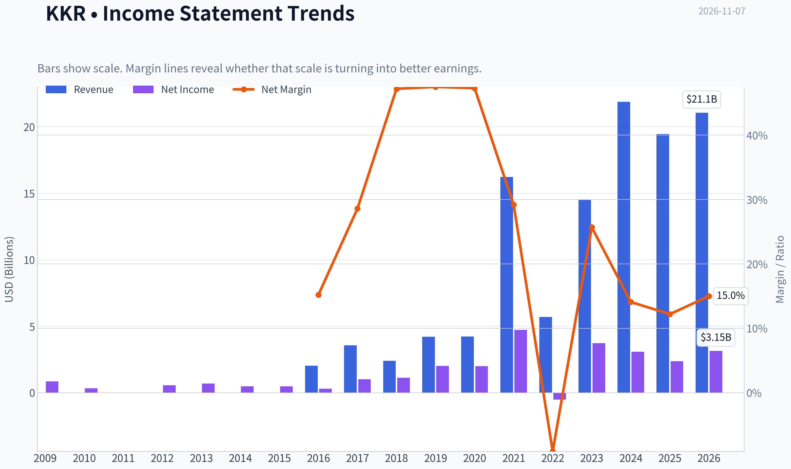

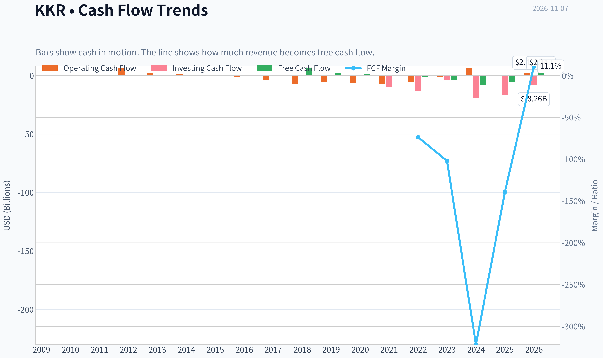

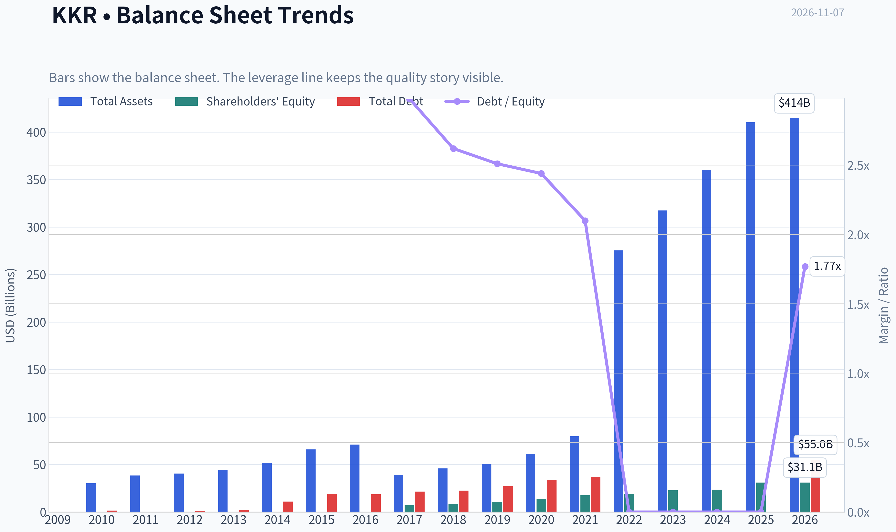

This graph tracks the profitability and return metrics (ROE, ROIC, Margins) of **KKR** over the past decade, highlighting capital efficiency trends.

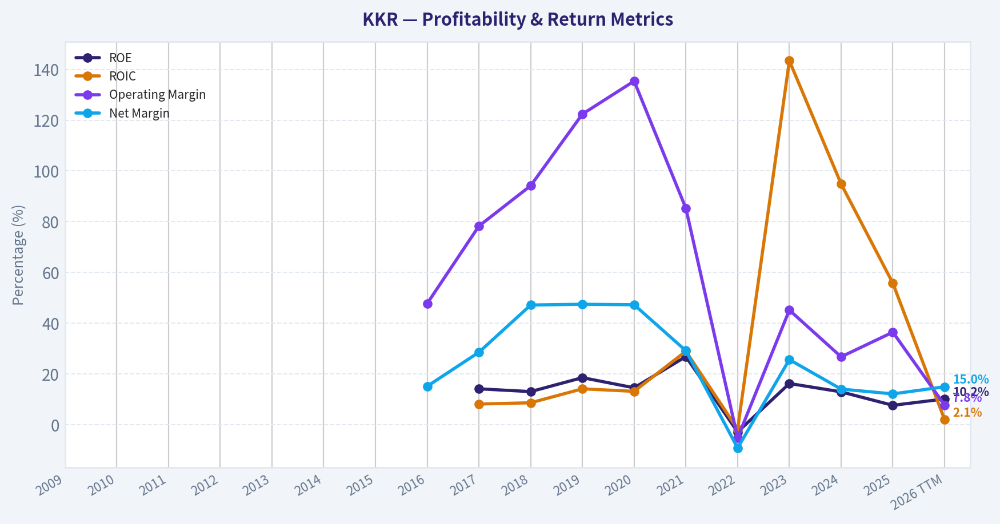

This chart illustrates the financial health of **KKR** over the last 10 years, mapping cash equivalents and free cash flow against total obligations (Debt).

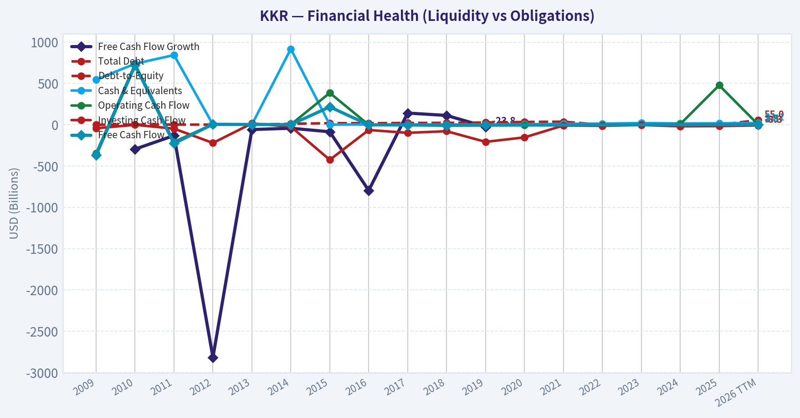

This comparison chart from *Profitability and Earnings Quality* stacks current figures against historical benchmarks for **KKR**, making it easy to see where the company trades relative to its own averages.

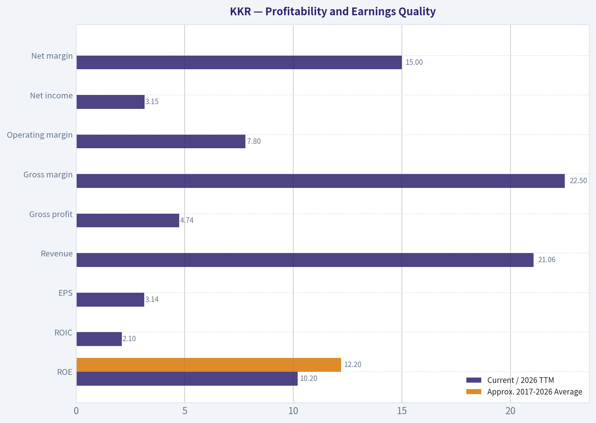

---

### Intrinsic Value Analysis (Buffett)

> *Following Warren Buffett's value investing philosophy: Circle of Competence, Economic Moat, Management Quality, and Margin of Safety.*

#### Intrinsic Value Snapshot

Price is what you pay. Intrinsic value is what the business may be worth based on the cash it can create for owners over time. We show a range, not one magic number.

- Current Price: $96.48
- Value Range (conservative to optimistic across both DCF methods): $-34.17 to $-6.76

##### Owner Earnings (Buffett Method)
- Net Income: $2,370,463,000.00
- Depreciation & Amortization: N/A
- Capital Expenditures: N/A
- Working Capital Changes: $2,845,692,000.00
- Owner Earnings: $-475,229,000.00

##### Intrinsic Value
###### Buffett Method
Uses owner earnings. Stricter, and usually more conservative.
- Conservative: $-33.74
- Average: $-27.07
- Optimistic: $-6.76
- Discount Rate: 10.0%

###### Cash Flow Method
Uses free cash flow. Better for companies spending heavily today to grow tomorrow.
- Conservative: $-34.17
- Average: $-22.23
- Optimistic: $-22.23
- Discount Rate: 10.0%

ANALYST STANCE: **Neutral**

#### Executive Conclusion

KKR is a high-quality alternative-asset manager with a durable global fundraising platform, strong brand, long-duration capital, and substantial reinvestment runway. However, at approximately **$96 per share and 30.8 times earnings**, the stock already discounts roughly **6.5% perpetual earnings growth** under a simple earnings-based model.

The business is attractive; the current price is not sufficiently attractive for a value investor seeking a margin of safety. KKR belongs on a high-priority watchlist, with stronger conviction below approximately **$75-$85**, depending on the quality and growth of fee-related earnings.

#### 1. Factor Scorecard

| Factor | Score | Assessment |
|---|---:|---|
| Circle of competence and simplicity | 3/5 | The core model-raising capital, managing investments, collecting fees, and earning incentive income-is understandable, but accounting is complex and earnings are affected by realizations and market values. |
| Durable competitive advantage | 4/5 | Global scale, brand, institutional relationships, proprietary transactions, and long-term client capital create meaningful advantages. |
| Management and capital allocation | 4/5 | Founder-led heritage, strong industry knowledge, long-term orientation, and continued investment in growth platforms are positives. |
| Industry structure | 4/5 | Alternative asset management is concentrated among a small number of scaled firms, with high barriers to fundraising and institutional distribution. |

**Gate 5-Quality and solvency floor: Not tripped.** KKR does not show evidence in the supplied data of a combined deteriorating earnings trajectory and solvency distress. Revenue declined 11% year over year and reported ROE is modest, but those factors alone do not constitute financial distress.

**Key Takeaways:** KKR scores well on moat, management, and industry structure, but less well on simplicity and predictability. The main investment issue is not business quality; it is whether the current valuation adequately compensates investors for complex and partly cyclical earnings.

#### 2. Moat Analysis

| Moat Source | Evidence | Rating |
|---|---|---:|
| Intangible assets and brand | KKR is one of the best-known global private-markets firms, with credibility among pensions, sovereign wealth funds, insurers, and wealthy investors. | Strong |
| Switching costs | Institutional clients commit capital for long periods and rely on KKR's reporting, underwriting, servicing, and investment infrastructure. | Strong |
| Cost and scale advantages | A large fundraising, investment, compliance, and distribution platform spreads fixed costs over a growing asset base. | Strong |
| Network effects | Larger funds create more deal access, data, relationships, and co-investment opportunities, reinforcing fundraising and transaction advantages. | Moderate to strong |

KKR's moat is primarily based on **trust, scale, reputation, distribution, and access to proprietary investment opportunities**. These advantages are difficult for a new entrant to reproduce.

The moat is not invulnerable. Competition for talent is intense, institutional clients can negotiate fees, and alternative managers increasingly compete across private equity, credit, infrastructure, real estate, and insurance. KKR's moat is best described as **wide and stable, with potential to widen through scale**.

#### 3. Management Quality and Capital Allocation

KKR benefits from a founder-led culture associated with Henry Kravis and George Roberts, supported by a deepening professional management bench. The company has expanded beyond traditional private equity into credit, infrastructure, real estate, insurance, and wealth management.

Positive capital-allocation characteristics include:

- Reinvestment into businesses with recurring fee streams.
- Expansion into adjacent asset classes with long-term fundraising potential.
- Acquisition and development of distribution capabilities.
- Emphasis on increasing assets under management and fee-related earnings.
- A business model that can compound without requiring proportional balance-sheet growth.

The principal concern is complexity. Investors must distinguish between:

1. Recurring management and advisory fees.
2. Performance fees and carried interest.
3. Investment gains and losses.
4. Corporate-level debt and fund-level obligations.

Management quality is strong, but shareholders must rely on normalized earnings measures rather than headline GAAP earnings alone.

#### 4. Financial Summary

| Metric | Latest Reading |
|---|---:|
| Share price | $96 |
| Market capitalization | $89.11 billion |
| P/E ratio | 30.8x |
| ROE | 7.7% |
| Revenue growth, year over year | -11.0% |
| Implied earnings per share | Approximately $3.11 |
| Implied net income | Approximately $2.89 billion |
| Implied diluted shares | Approximately 928 million |
| Gross margin | Not meaningful for this financial issuer |
| FCF yield | Not available or not meaningful as a primary valuation metric |
| Current ratio | Not meaningful for this financial issuer |

**Key Takeaways:** KKR trades at a premium earnings multiple while recent reported revenue declined. The 7.7% ROE is below the level normally associated with an exceptional compounder, although reported ROE understates the economics of a fee-based asset manager because accounting equity includes substantial non-operating and investment-related items.

#### 5. Owner Earnings Calculation

For a financial issuer such as KKR, traditional industrial-company owner earnings are less informative because maintenance capital expenditure and working-capital investment are not the primary drivers of value. A practical starting point is reported net income, adjusted for the quality and recurrence of fee-related earnings.

| Owner Earnings Component | Approximate Amount |
|---|---:|
| Net income proxy | $2.89 billion |
| Add: depreciation and amortization | Not separately available in the supplied data |
| Less: maintenance capital expenditure | Not separately available; likely modest relative to an industrial company |
| Less: working-capital increase | Not meaningful as a primary valuation adjustment |
| Normalized owner-earnings proxy used for DCF | $2.89 billion |

**Key Takeaways:** The $2.89 billion figure should be treated as an earnings proxy, not as a fully normalized measure of distributable cash earnings. KKR's intrinsic value depends more heavily on fee-related earnings growth and the durability of carried interest than on conventional free cash flow.

#### 6. Three-Scenario DCF Valuation

The following valuation uses the $2.89 billion earnings proxy, approximately 928 million shares, and a 10% discount rate.

| Scenario | Assumption | Equity Value | Value per Share |
|---|---|---:|---:|
| A. No growth | Earnings remain flat indefinitely | $28.9B | $31 |
| B. GDP-like growth | 3% perpetual growth | $42.5B | $46 |
| C. Moderate growth | 5% growth for 10 years, then 5% terminal growth | $60.8B | $66 |

**Key Takeaways:** The conservative earnings-based valuation range is approximately $31 to $66 per share, below the current price of $96. The model is intentionally conservative and does not fully capture the possibility that KKR's fee-related earnings compound faster than reported net income.

#### 7. Margin of Safety and Reverse DCF

| Measure | Result |
|---|---:|
| Current price | $96 |
| No-growth DCF | $31 |
| 3% growth DCF | $46 |
| 5% growth DCF | $66 |
| Margin of safety versus 5% DCF | Approximately -46% |
| Perpetual growth implied by current price | Approximately 6.5% |

The current valuation requires approximately **6.5% perpetual earnings growth** using the earnings proxy. That is not impossible for KKR. Fee-related earnings, assets under management, private credit, infrastructure, insurance, and wealth management could plausibly support such growth.

However, the price leaves limited room for:

- Slower fundraising.
- Fee-rate compression.
- Lower exit activity.
- Weaker carried interest.
- Higher compensation costs.
- Reduced investment realizations.
- A prolonged period of unfavorable market valuations.

For a wide-moat compounder, a 10%-15% discount to intrinsic value can be sufficient. KKR does not yet demonstrate enough earnings simplicity and predictability to justify paying a premium with no clear margin of safety.

#### 8. Final Buffett Scorecard

| Criterion | Weight | Score | Weighted Score |
|---|---:|---:|---:|
| Moat width and durability | 25% | 4 | 1.00 |
| Valuation and margin of safety | 20% | 2 | 0.40 |
| Capital returns versus WACC | 15% | 3 | 0.45 |
| Business understanding and predictability | 12% | 3 | 0.36 |
| Management quality and capital allocation | 12% | 4 | 0.48 |
| Reinvestment runway | 8% | 5 | 0.40 |
| Balance-sheet strength | 4% | 3 | 0.12 |
| Industry structure | 4% | 4 | 0.16 |
| **Total** | **100%** |  | **3.37/5** |

**Key Takeaways:** KKR earns a good but not exceptional total score. Its moat and reinvestment runway are compelling, but valuation, complexity, and earnings volatility prevent it from qualifying as a high-conviction purchase at $96.

#### 9. Investment Stance

**Neutral - Medium conviction.**

KKR is the type of business a Buffett-style investor should want to own: scalable, asset-light at the management-company level, supported by long-term client relationships, and positioned in a growing financial segment. Nevertheless, the current price appears to assume a favorable long-term outcome.

A more attractive entry range would be approximately **$75-$85**, subject to confirmation that:

- Fee-related earnings continue to grow.
- Assets under management expand without excessive fee concessions.
- Leverage remains conservative.
- Carried interest becomes a supplement rather than the primary earnings driver.
- The company continues to earn high returns on incremental invested capital.

At $96, KKR is a **wonderful business priced closer to fair value than bargain value**. Patience is warranted.
#### Valuation Bridge

This bridge places the current market price beside each intrinsic value lens so readers can see whether upside depends on one method or shows up across several methods.

| Scenario | Intrinsic Value / Share |
| --- | ---: |
| Buffett Method | $-27.07 |
| Cash Flow Method | $-22.23 |
| Current Price | $96.48 |

#### Key Takeaways

If one method is far above the others, the upside case depends on a specific modelling assumption. When several methods cluster together, the valuation story is more robust.

#### Valuation Visuals

This comparison chart from *Latest Earnings Snapshot* stacks current figures against historical benchmarks for **KKR**, making it easy to see where the company trades relative to its own averages.

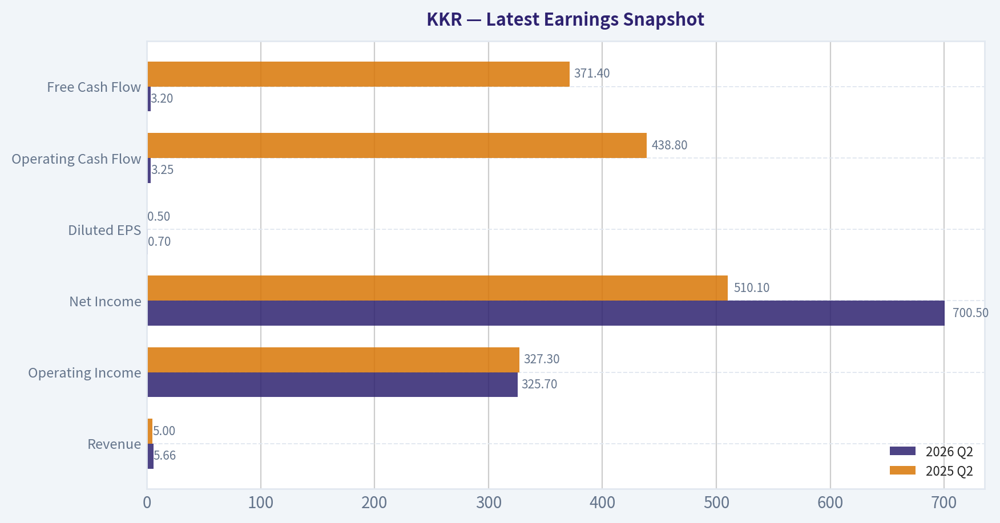

This comparison chart from *Balance Sheet and Financial Strength* stacks current figures against historical benchmarks for **KKR**, making it easy to see where the company trades relative to its own averages.

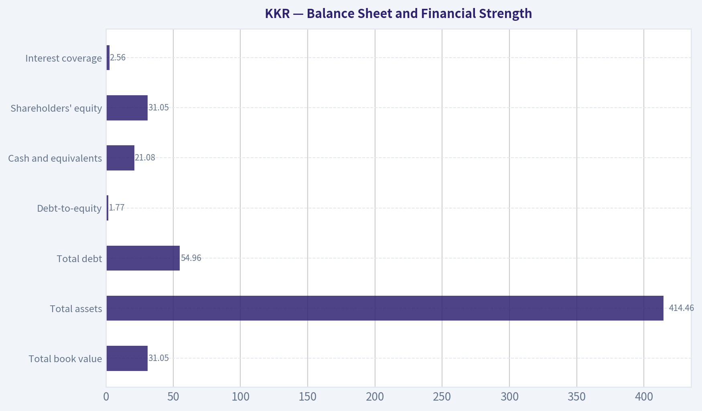

This comparison chart from *Cash Flow and Capital Allocation* stacks current figures against historical benchmarks for **KKR**, making it easy to see where the company trades relative to its own averages.

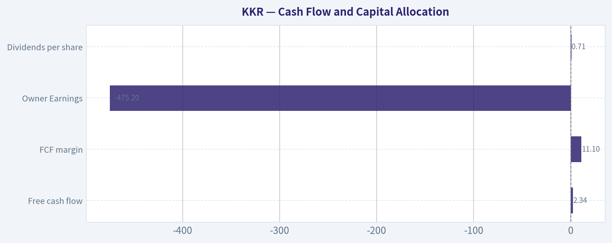

This comparison chart from *Current Versus Historical Average* stacks current figures against historical benchmarks for **KKR**, making it easy to see where the company trades relative to its own averages.

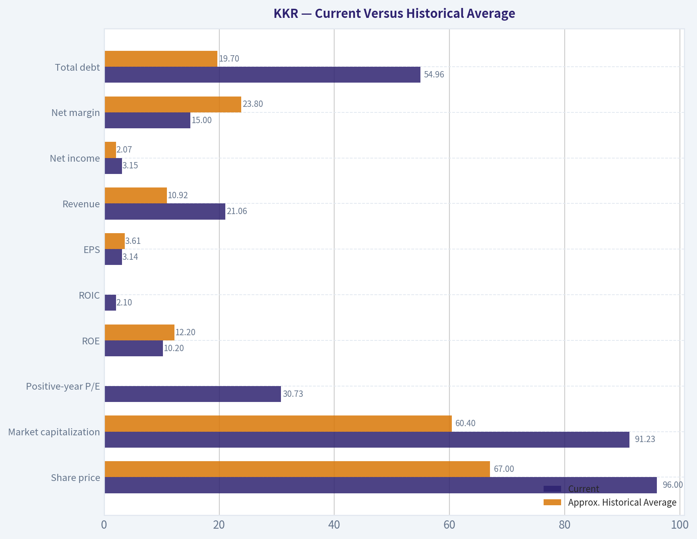

---

### Trend & Growth Analysis (Lynch/Druckenmiller/Fisher)

> *Following Peter Lynch's GARP, Stanley Druckenmiller's macro-aware approach, and Philip Fisher's scuttlebutt methodology.*

ANALYST STANCE: **Neutral**

#### Executive View

KKR is a high-quality alternative-asset manager with substantial secular exposure to private credit, infrastructure, insurance solutions, and private equity. However, the available data show volatile reported revenue, declining 2025 revenue, weak recent returns on capital, and a low Piotroski score. The long-term story is attractive, but confirmation of accelerating assets under management, fee-related earnings, fundraising, and realizations is needed before taking a high-conviction position.

#### 1. Lynch Classification

**Fast-growing financial institution / cyclical compounder**, but not a clean fast grower based solely on reported revenue.

KKR's underlying fee-bearing assets, management fees, and permanent-capital businesses can compound at attractive rates. Reported revenue, however, is heavily affected by investment marks and realizations, making it less useful than fee-related earnings and distributable earnings for trend analysis.

#### 2. The Story in Three Bullets

- KKR converts institutional and increasingly retail capital into long-duration fee streams across private equity, credit, infrastructure, real estate, and insurance.
- Private-market penetration remains materially below public-market penetration, giving alternative managers a long secular runway.
- The potential inflection is a combination of rising AUM, stronger fundraising, improved realizations, and operating leverage in fee-related earnings.

#### 3. TAM and 10x Test

| Metric | Assessment |
|---|---:|
| Current market capitalization | Approximately $89B |
| Latest reported revenue | Approximately $21.1B TTM |
| 10x revenue test | Approximately $211B |
| Principal addressable markets | Private equity, private credit, infrastructure, real estate, insurance asset management |
| TAM growth | Likely positive secular growth, but exact current TAM and KKR market share require verification |
| 10x runway | Plausible at the business level, but unlikely to be achieved through reported revenue alone without substantial AUM and product expansion |

**Key Takeaways:** KKR operates in several large and expanding markets, particularly private credit, infrastructure, and insurance-linked asset management. A 10x increase in enterprise scale is conceptually possible, but the test should be applied to fee-bearing AUM and fee-related earnings rather than accounting revenue. Current data do not establish KKR's exact market share or whether it can compound at 20% for many years.

#### 4. Revenue Growth Trend

| Period | Revenue growth | Net income growth | Interpretation |
|---|---:|---:|---|
| 2023 | 154.2% | Negative comparison distortion | Recovery and accounting-base effects |
| 2024 | 50.9% | -17.6% | Strong reported revenue, weaker earnings |
| 2025 | -11.0% | -22.9% | Clear deceleration |
| 2026 TTM | 8.2% | 33.0% | Revenue recovery, earnings rebound |
| 3-year revenue CAGR | 50.6% | - | Strong but highly volatile |
| 5-year revenue CAGR | 35.7% | - | Strong, but not necessarily organic or recurring |

**Key Takeaways:** Reported revenue has decelerated sharply from 2024 and remains too volatile to confirm a clean growth inflection. The 2026 TTM earnings rebound is encouraging, but the more important question is whether recurring fee-related earnings and AUM are accelerating. This is a watch item rather than a confirmed Druckenmiller-style inflection.

#### 5. Unit Economics and Operating Quality

| Metric | Result | Assessment |
|---|---:|---|
| LTV/CAC | Not disclosed | Cannot score directly |
| Net revenue retention | Not applicable / not disclosed | Asset-manager economics differ from SaaS |
| TTM free-cash-flow margin | Approximately 11.1% | Positive, but cash flow is volatile |
| Rule of 40 | Not directly applicable | Revenue and FCF definitions are distorted by financial-asset accounting |
| TTM net margin | Approximately 15.0% | Positive but below recent historical levels |
| TTM ROE | Approximately 10.2% | Adequate, not exceptional |
| TTM ROIC | Approximately 2.1% | Weak and potentially distorted by the business structure |

**Key Takeaways:** KKR does not have conventional subscription metrics such as LTV/CAC or NRR. Its economic engine is recurring management fees plus performance income, so fee-related earnings, FRE margins, fundraising retention, and AUM growth are the correct operating indicators. Current reported returns are acceptable but do not yet demonstrate exceptional operating leverage.

#### 6. Inflection-Point Assessment

| Potential inflection | Current evidence | Status |
|---|---|---|
| AUM and fundraising | News coverage cites stronger AUM and robust client inflows expectations | Promising, not yet verified quantitatively |
| Private credit growth | Strong secular demand and expanding non-bank lending markets | Positive |
| Insurance platform | Long-duration capital can improve fee stability | Positive strategic avenue |
| Realizations and exits | Expected to support earnings, but market-dependent | Cyclical |
| Margin leverage | TTM operating margin approximately 7.8% in the supplied data | Not confirmed |
| Revenue acceleration | 2025 decline followed by modest TTM recovery | Unconfirmed |

**Key Takeaways:** The strongest potential inflection is mix-driven: more permanent capital, private credit, infrastructure, and insurance assets could make earnings more recurring. The supplied operating-margin data are inconsistent with other reported figures and should be validated against KKR's fee-related earnings disclosures. Until AUM and FRE growth are confirmed, the inflection remains prospective.

#### 7. Macro Setup

| Macro factor | Impact on KKR |
|---|---|
| Falling interest rates | Mixed: can support exits and financing, but may reduce private-credit yields |
| Credit conditions | Tight credit can increase demand for private lenders but raise defaults |
| Public-market valuations | Attractive exit markets would support realizations and performance fees |
| Institutional allocation trends | Positive secular tailwind toward private assets |
| Recession risk | Negative for realizations, portfolio marks, fundraising sentiment, and credit quality |
| Regulation and liquidity | Potential headwind as regulators scrutinize private-market products |

**Key Takeaways:** KKR benefits from the long-term institutional migration toward private assets, but near-term earnings remain sensitive to rates, credit losses, financing markets, and exit activity. The macro setup is constructive over a multi-year horizon but not uniformly favorable in every economic regime.

#### 8. Fisher's 15-Point Score

| Fisher criterion | Score / 5 | Comment |
|---|---:|---|
| Market potential | 5 | Large private-capital markets |
| New-product development | 5 | Credit, infrastructure, insurance, wealth channels |
| R&D / innovation | 3 | Financial-services innovation rather than traditional R&D |
| Sales organization | 5 | Strong institutional distribution |
| Profit margins | 4 | Attractive economics, though reported figures fluctuate |
| Margin improvement | 3 | Not confirmed in current data |
| Labor relations | 3 | Limited public evidence |
| Executive relations | 4 | Deep senior leadership bench |
| Management depth | 5 | Broad platform and experienced team |
| Cost analysis | 3 | Financial reporting is complex |
| Competitive advantages | 5 | Scale, brand, relationships, sourcing, distribution |
| Long-range profit outlook | 4 | Strong secular case with cyclical risks |
| Dilution | 2 | Data indicate dilution concerns and complex equity structure |
| Candor | 3 | Requires direct review of filings and earnings calls |
| Integrity | 4 | No specific issue identified in supplied data |
| **Total** | **53 / 75** | **Average to good, but below outstanding** |

**Key Takeaways:** KKR scores well on market potential, management depth, distribution, and competitive positioning. The score is held back by unclear margin progression, complex financial reporting, dilution concerns, and insufficient primary-source evidence on management candor and unit economics. This supports monitoring rather than aggressive initiation.

#### 9. Valuation Analysis

| Valuation metric | Current result | Interpretation |
|---|---:|---|
| Share price | Approximately $96.48 | Below the 52-week high |
| Market capitalization | Approximately $89B | Large-cap alternative manager |
| TTM P/E | Approximately 30.8x | Full on trailing earnings |
| Forward P/E | Approximately 13.4x | Implies substantial earnings normalization |
| Price-to-book | Approximately 3.0x | Premium to book, justified only by franchise economics |
| Price-to-sales | Approximately 3.45x | Not excessive for a financial platform, but accounting revenue is noisy |
| PEG | Reported approximately 0.42 | Attractive mechanically, but unreliable unless growth is recurring |
| Dividend yield | Approximately 0.8% | Not an income-led investment |

**Key Takeaways:** The valuation is attractive only if forward earnings estimates reflect durable growth in fee-related earnings and performance income. The low forward P/E and PEG suggest meaningful normalization is expected, while the high trailing P/E shows that current earnings remain affected by cyclicality. KKR is not obviously expensive on forward metrics, but the discount is compensation for earnings volatility.

#### 10. Scenario Framework

| Scenario | Assumption | Indicative outcome |
|---|---|---|
| Bear | AUM growth slows, realizations remain weak, credit losses rise, and earnings revert toward recent lows | Multiple compression and material downside risk |
| Base | AUM and fee-related earnings grow at a high-single- to low-double-digit rate, with normalized realizations | Reasonable long-term compounding, but not necessarily a ten-bagger |
| Bull | Strong fundraising, rapid private-credit and insurance expansion, improving exits, and operating leverage | Potential for sustained 15%-20% earnings growth and significant upside |
| Ten-bagger test | Requires roughly $960 per share or approximately $890B market capitalization at unchanged share count | Very demanding; would require many years of exceptional AUM and earnings compounding |

**Key Takeaways:** The base case supports KKR as a quality compounder, not an obvious ten-bagger from today's scale. The bull case depends on multiple engines working simultaneously: fundraising, permanent capital, realizations, and margin expansion. A ten-bagger is possible only over a long horizon and would require substantial growth beyond current consensus-style expectations.

#### 11. Growth Investor Scorecard

| Criterion | Weight | Score / 5 | Weighted contribution |
|---|---:|---:|---:|
| Lynch story | 10% | 4.0 | 0.40 |
| TAM and runway | 20% | 4.5 | 0.90 |
| Revenue growth | 20% | 3.0 | 0.60 |
| Unit economics | 15% | 3.0 | 0.45 |
| Competitive position | 10% | 4.5 | 0.45 |
| Management quality | 10% | 4.0 | 0.40 |
| Macro setup | 5% | 3.5 | 0.18 |
| Profitability path | 5% | 3.5 | 0.18 |
| Valuation | 5% | 3.5 | 0.18 |
| **Total** | **100%** | - | **3.74 / 5.00** |

**Key Takeaways:** KKR scores in the "good setup" range, driven by its large TAM, strong competitive position, and potentially attractive forward valuation. The score does not reach high-conviction territory because reported growth is volatile and the key recurring metrics were not supplied. Confirmation from upcoming results could move the score higher or lower.

#### 12. Position Size Stance

**Suggested stance: Watch position, approximately 1%-2% maximum initially.**

A larger position would require evidence of:

- Sustained AUM growth above the market rate.
- Accelerating fee-related earnings.
- Strong fundraising and permanent-capital inflows.
- Improving realizations without excessive leverage or dilution.
- Stable or improving margins.

#### 13. Key Risks and Catalysts

| Catalysts | Risks |
|---|---|
| Strong Q3 earnings and upgraded outlook | Weak realizations and lower performance fees |
| Accelerating AUM and fee-related earnings | Credit losses in private-credit portfolios |
| Expansion of insurance and wealth channels | Higher-for-longer rates or recession |
| Improved IPO and M&A exit markets | Regulatory restrictions on private markets |
| Margin expansion from platform scale | Dilution, complex accounting, and leverage |
| Sustained private-asset allocation growth | Earnings volatility mistaken for durable growth |

**Key Takeaways:** The principal catalyst is evidence that KKR's recurring fee engine is accelerating, not merely that quarterly accounting revenue rebounds. The largest risks are credit deterioration, weak exits, regulatory pressure, and a valuation that assumes substantial earnings normalization. Monitor the next earnings release for AUM, fundraising, fee-related earnings, realizations, and credit-quality commentary.

---

### Market Technical Analysis

ANALYST STANCE: **Neutral**

#### KKR technical market view

KKR closed at **$96.48 on November 6, 2026**, after a volatile recovery from its October 14 low near **$84.23**. The stock has rebounded approximately **14.5% from that intraday low**, but it remains well below its early-August peak near **$116.57**. The broader structure is therefore a recovery within a still-damaged medium-term trend, rather than a confirmed transition back to a durable uptrend.

The indicator-report service returned incomplete values for this date range, so the assessment below combines the retrieved daily price and volume history with the selected indicators' intended interpretation. Exact indicator readings should be verified before placing a trade.

#### Trend structure

KKR's price action has improved materially since mid-October. The stock formed a short-term base in the **$85-$90** area, then advanced through **$90**, **$93**, and **$95**. That sequence of higher short-term lows is constructive. However, the advance has not yet produced a convincing higher high relative to the late-October and early-November resistance zone around **$98-$102**.

The most important near-term test is therefore whether KKR can reclaim and hold the **$98-$102** area. A sustained close above that zone would strengthen the recovery case and could expose the stock to the **$105-$110** region, where prior trading activity created additional overhead supply. Conversely, failure near $98-$102 followed by a close below approximately **$93-$94** would suggest that the recent rally is losing momentum. A break below **$90** would materially weaken the recovery structure and reopen risk toward the mid-$80s.

The 50-day moving average is the most relevant medium-term trend filter here. Based on the recent price history, KKR appears to be trading close to, or modestly above, that average. This means the stock is at an inflection point rather than in a clearly established trend. The 200-day average remains important for strategic investors, but the year-long decline from the $140 area and the subsequent prolonged weakness suggest that KKR is likely still below or near that long-term benchmark. A genuine long-term bullish reversal would require price to regain the 200-day average and for that average to flatten rather than continue declining.

#### Short-term momentum

The 10-day EMA is useful because KKR has recently moved rapidly in both directions. Price was supported by the short-term average during the late-October recovery, but the sharp reversal from **$103.84 intraday on November 5** to a close of **$96.48 on November 6** indicates that momentum is fragile. The next several sessions should show whether the stock can stabilize above the short-term average or whether the November 5 high represented a failed breakout attempt.

MACD and its histogram should be interpreted as confirmation tools rather than standalone buy signals. After a major decline, MACD can turn upward simply because selling pressure is easing, even while the broader trend remains bearish. A more reliable bullish signal would require the MACD line to cross above its signal line and remain positive while price holds above $98-$102. If MACD improves but price repeatedly fails at resistance, that would represent a warning of negative momentum divergence or a relief rally without sufficient follow-through.

#### RSI and exhaustion risk

The recent rebound from the mid-$80s likely lifted RSI away from deeply oversold conditions. That is generally constructive because it reduces the probability that the stock is still in an immediate liquidation phase. However, the recent pullback after testing above $103 suggests that RSI may have reached a neutral-to-moderately strong level rather than an extreme overbought reading.

For KKR, an RSI recovery through the **50-60 zone** accompanied by a price breakout would be more meaningful than a brief move above 70. If RSI rolls over near 50 while price remains below $100, it would indicate that the rebound is losing internal strength. Traders should also avoid interpreting a low RSI alone as a buy signal, because KKR's earlier decline demonstrates that oversold conditions can persist during a sustained downtrend.

#### Volatility and risk management

Volatility remains elevated. KKR has recently experienced several daily moves of roughly **3% to 6%**, including the large reversal on November 5-6. ATR is therefore particularly relevant for position sizing and stop placement. A stop that is too tight relative to normal daily range could be triggered by ordinary noise rather than a genuine change in trend.

A practical approach would be to use ATR-based risk rather than a fixed percentage stop. For a bullish trade, a trader could look for either a controlled pullback that holds around **$93-$95**, or a confirmed breakout above **$100-$102** with expanding volume. Stops should be placed far enough below the entry to account for KKR's recent volatility, while position size should be reduced accordingly. The first upside objective would be the **$105-$110** area, with the prior August resistance zone near **$114-$116** representing a more ambitious target.

#### Volume and confirmation

Volume increased substantially during several of KKR's major declines, particularly around the February selloff and the October breakdown. More recently, volume also rose during the recovery attempts, but the November 5-6 reversal occurred with elevated activity. That combination suggests meaningful two-sided participation rather than a quiet, low-conviction drift higher.

VWMA is useful here because it can distinguish price movement supported by meaningful trading activity from movement occurring on light volume. A bullish interpretation would require price to remain above the recent volume-weighted average while volume expands on advances and contracts on pullbacks. If KKR cannot hold that volume-weighted reference, the recovery may be dominated by short covering or temporary buying rather than sustained institutional accumulation.

#### Trading interpretation

KKR is best classified as **neutral-to-cautiously constructive in the short term, but not yet technically bullish on a medium- or long-term basis**. The rebound from the October low is significant, and the sequence of higher lows provides a credible base-building pattern. Nevertheless, the failed push above $103 and the sharp following reversal show that sellers remain active overhead.

A bullish setup improves if KKR:

- Holds the **$93-$95** support area.
- Reclaims **$98-$102** with a decisive close.
- Shows improving MACD momentum and RSI holding above the midpoint.
- Trades above its volume-weighted average with stronger volume on up days.

A bearish or defensive signal develops if KKR:

- Fails repeatedly below $98-$102.
- Breaks below $93-$94.
- Loses $90 on expanding volume.
- Shows declining RSI and weakening MACD during the attempted recovery.

Given the current evidence, chasing the stock after a one-day rebound is unattractive. A confirmation-based approach is preferable: either wait for a high-volume breakout above resistance or wait for a controlled pullback that holds support. Until one of those conditions occurs, KKR remains a watchlist candidate rather than a high-conviction entry.

#### Selected indicators

The selected set emphasizes trend, momentum, volatility, and volume without adding redundant oscillators:

| Indicator | Why it is relevant to KKR now | Practical interpretation |
|---|---|---|
| `close_50_sma` | Establishes whether the October-November recovery has reclaimed the medium-term trend | Holding above it supports recovery; rejection below it keeps the medium-term outlook fragile |
| `close_200_sma` | Defines the longer-term trend after KKR's substantial decline from its prior highs | A durable bullish reversal requires price to regain and stabilize above it |
| `close_10_ema` | Tracks the fast-moving rebound and identifies short-term loss of momentum | Price holding above it favors continuation; repeated closes below it warn of a failed bounce |
| `macd` | Measures whether momentum is transitioning from bearish to bullish | A bullish crossover is more credible if accompanied by a breakout above $98-$102 |
| `macdh` | Shows acceleration or deceleration in momentum | Positive and expanding readings would confirm strengthening upside momentum |
| `rsi` | Helps distinguish continued downside pressure from a recovering but potentially exhausted rally | Neutral-to-bullish RSI with price strength is preferable to an isolated oversold reading |
| `atr` | Essential because KKR's daily trading range remains unusually wide | Use it to size positions and avoid stops that are too close to entry |
| `vwma` | Tests whether the recovery is supported by volume-weighted participation | Price above VWMA with rising volume is stronger than a low-volume price rebound |

**Key Takeaways:** KKR has formed a meaningful short-term rebound from the mid-$80s, but the recovery remains unconfirmed after rejection near $103. The key decision zone is $98-$102 on the upside and $93-$95 on the downside. A high-volume breakout would improve the outlook, while a break below $90 would substantially weaken the base-building thesis.

#### Market Visuals

This comparison chart from *Market Metrics and Valuation* stacks current figures against historical benchmarks for **KKR**, making it easy to see where the company trades relative to its own averages.

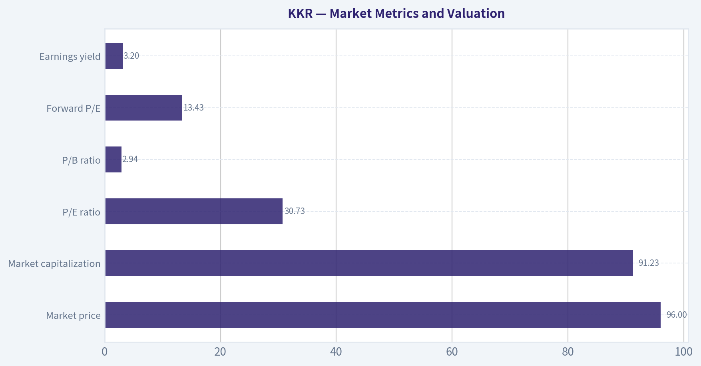

---

### Options Market Analysis

> *Reading options flow - put/call ratios, IV skew, and unusual activity - to gauge institutional positioning and event-driven risk.*

#### KKR Options Market Report

*Data as of November 7, 2026. The available feed covers expirations from November 13 through November 27, 2026. Strike-level details and KKR's current share price were not provided, limiting moneyness and gamma-wall analysis.*

#### 1. Put/Call Ratio Analysis

| Expiration | Call OI | Put OI | Put/Call OI | Call Volume | Put Volume | Put/Call Volume |
|---|---:|---:|---:|---:|---:|---:|
| Nov. 13, 2026 | 823 | 1,664 | 2.02 | 356 | 1,422 | 4.00 |
| Nov. 20, 2026 | 8,009 | 12,352 | 1.54 | 2,539 | 1,445 | 0.57 |
| Nov. 27, 2026 | 453 | 116 | 0.26 | 408 | 57 | 0.14 |
| **Near-term total** | **9,285** | **14,132** | **1.52** | **3,303** | **2,924** | **0.89** |

**Key Takeaways:** KKR's aggregate put/call open-interest ratio of 1.52 is materially above the approximately 0.7 neutral baseline, indicating a defensive positioning bias or substantial downside hedging. However, the aggregate volume ratio of 0.89 is much less bearish, with call volume exceeding put volume in the largest open-interest expiration, November 20. The very high put activity in the November 13 expiry suggests concentrated near-term protection or bearish speculation.

#### 2. Implied Volatility Assessment

| Expiration | Call ATM IV | Put ATM IV | Put Premium to Call IV |
|---|---:|---:|---:|
| Nov. 13, 2026 | 54.6% | 56.4% | +1.8 percentage points |
| Nov. 20, 2026 | 52.1% | 52.8% | +0.7 percentage points |
| Nov. 27, 2026 | 48.8% | 51.4% | +2.6 percentage points |

**Key Takeaways:** Put ATM implied volatility is higher than call IV across all three expirations, confirming a modest downside skew. The widest observed difference is in the November 27 expiry, where put IV exceeds call IV by 2.6 percentage points. Near-term IV in the roughly 49% to 56% range is elevated enough to imply meaningful event or price-movement risk, although no specific catalyst was supplied and the data does not establish whether earnings or another event is approaching.

The feed provides ATM IV rather than full out-of-the-money volatility curves, so this is a limited skew assessment rather than a complete OTM put-versus-call skew analysis.

#### 3. Unusual Options Activity

| Finding | Interpretation |
|---|---|
| No contracts exceeded the screen of volume greater than five times open interest | No clearly identifiable fresh, outsized directional bets |
| Nov. 13 puts | High aggregate volume, but not confirmed as unusual at the individual-contract level |
| Nov. 20 calls | Call volume exceeded put volume, suggesting some bullish positioning or possible call rolling/covering |
| Nov. 27 calls | Call volume was large relative to the small expiration-level open interest, but no individual contract passed the unusual-activity threshold |

**Key Takeaways:** The data does not identify any individual contract as an unusual-options trade under the volume-to-open-interest screen. Therefore, there is no strong evidence of a specific institutional call sweep or put hedge. The apparent near-term put activity should be treated as broad defensive flow rather than confirmed smart-money positioning.

#### 4. Open Interest Concentration and Gamma Levels

| Expiration | Total Call OI | Total Put OI | Total OI | Concentration Assessment |
|---|---:|---:|---:|---|
| Nov. 13, 2026 | 823 | 1,664 | 2,487 | Put-heavy, but relatively small |
| Nov. 20, 2026 | 8,009 | 12,352 | 20,361 | Dominant near-term concentration |
| Nov. 27, 2026 | 453 | 116 | 569 | Low overall concentration |
| **Total** | **9,285** | **14,132** | **23,417** | **Put-heavy overall** |

**Key Takeaways:** November 20 is the primary open-interest concentration and is the most relevant expiration for potential pinning or hedging effects. Put open interest exceeds call open interest there, which could create downside hedging pressure if KKR falls, although the absence of strike-level data prevents identification of exact gamma walls or max-pain levels. November 13 has a strong put imbalance but less total open interest and therefore likely less influence on the broader price path.

No individual strikes were provided, so exact gravitational price levels, max pain, and whether gamma is likely to dampen or amplify movement cannot be calculated.

#### 5. Overall Options Sentiment

**Overall signal: BEARISH, with moderate confidence.**

The primary driver is the elevated aggregate put/call open-interest ratio of 1.52, well above the historical neutral reference near 0.7. Put ATM IV also consistently trades above call IV, showing persistent downside-risk pricing. These bearish indicators are moderated by the 0.89 volume ratio, the call-heavy volume in the November 20 expiration, and the absence of any confirmed unusual individual contract.

This looks more like **defensive or hedging-oriented positioning than an aggressive bearish conviction trade**. Confidence is reduced because the feed does not provide strike-level data, trade direction, historical comparisons, or a confirmed catalyst calendar. Options activity is also not exceptionally large, so the signal should not be treated as decisive.

#### Summary

| Category | Assessment |
|---|---|
| Put/Call Ratio | Bearish: 1.52 OI ratio versus approximately 0.7 neutral; volume ratio is milder at 0.89 |
| IV Level | Elevated: near-term ATM IV ranges from 48.8% to 56.4% |
| Skew Direction | Downside/put skew: puts carry higher ATM IV than calls in every listed expiry |
| Unusual Activity | None detected under the volume greater than five times open-interest screen |
| Overall Signal | **BEARISH**, moderate confidence; likely defensive positioning rather than a confirmed institutional short |

**Key Takeaways:** KKR's options market leans bearish because puts dominate open interest and carry a volatility premium. The lack of unusual contract-level activity and the relatively balanced volume ratio suggest caution: this may be hedging rather than a strong directional bet. The most important positioning is concentrated in the November 20 expiration.

---

## Research Team Commentary

> *The Research Manager synthesizes the Bull vs Bear debate into action-free commentary. This is a pre-risk view, not the final stance.*

KKR is a high-quality franchise, but the debate's bear side is more persuasive on price and underwriting discipline. The company has a real moat in brand, institutional relationships, sourcing, scale, long-duration capital, and increasingly broad distribution. Private credit, infrastructure, insurance, and private wealth offer a credible decade-long runway. The 11% reported revenue decline should not, by itself, be interpreted as structural deterioration because marks, realizations, and insurance accounting make consolidated revenue volatile.

The strongest bull argument is that KKR is becoming a diversified compounding platform rather than remaining a transaction-dependent buyout manager. Locked-up funds and permanent capital support recurring fees, while scale can produce operating leverage as assets grow. The market's implied growth assumption-approximately 13% annually for ten years under the supplied DCF-is plausible for KKR. It is not obviously absurd or "heroic" given the secular expansion of private markets.

The strongest bear argument, however, is that plausibility is already reflected in the price. At $96.48 and roughly 30.8 times reported earnings, investors receive only a 3.2% starting earnings yield. The stock requires sustained low-to-mid-teens growth through fundraising, realization, credit, and economic cycles. The DCF is also built on $3.13 of reported EPS even though both sides acknowledge that this figure is not a clean measure of owner earnings. That is the central analytical weakness: reported EPS cannot simultaneously be dismissed as distorted for valuation-multiple purposes and accepted without reconciliation as the DCF's cash-flow base.

The bull's own valuation range does not provide a sufficient quality-scaled margin of safety. Fourteen percent growth produces an estimated value of about $104, only 8% above the market price. That falls below the roughly 10-15% discount I would prefer even for a strong compounder, particularly one with complicated insurance and balance-sheet exposures. Values of $112-$121 provide a more acceptable discount, but those estimates require 15-16% annual growth for a decade. Conversely, 8-10% growth produces values around $67-$77, and an 11% required return materially reduces fair value. The payoff is therefore skewed toward "fair if execution is excellent," rather than "cheap under conservative assumptions."

KKR's reported 7.7% ROE and 0.6% ROA are not clean indicators because the consolidated balance sheet includes insurance and investment assets. They should not be used as if KKR were a conventional industrial company. Still, they cannot simply be ignored. Before paying for 13-16% per-share growth, I want evidence that incremental capital invested in distribution, insurance, origination, and new strategies earns attractive returns after compensation, credit costs, and dilution.

Insurance is similarly a two-sided development. It supplies durable capital and can deepen KKR's origination advantage, but it introduces underwriting, duration, liquidity, capital, and asset-liability matching risks. Stable reported spread earnings are valuable only if they survive a full credit cycle. Permanent liabilities do not make the assets backing them permanently safe.

My core takeaway is that KKR appears to be a wonderful-to-very-good business at approximately a full price, not a broken business to avoid and not yet a clearly mispriced compounder to advocate. The crowd may be underestimating the durability of fee streams by focusing on the reported revenue decline, but bulls may be underestimating how much favorable growth is already embedded in the stock. There is no evidence of genuine distress, so an Bearish label would be excessive. There is also insufficient evidence of a conservative margin of safety, so Bullish would be premature.

The lesson from prior mistakes is to connect an attractive industry narrative to actual per-share economics. AUM growth is not enough if fee rates decline, distribution and compensation costs rise, stock issuance absorbs the gains, or insurance losses emerge later. I would not anchor on the $93-$95 technical support area, momentum indicators, or incomplete near-dated options data. Those may matter to traders but do not establish ten-year intrinsic value.

Over the next one to four quarters, I would focus first on fee-paying AUM and organic inflows, separated from market appreciation and acquisitions. Second, I would track management-fee growth, fee-related earnings margins, and fee-related earnings per diluted share. Third, I would compare distributable earnings with cash actually available to common shareholders and examine how much comes from recurring fees, realized carry, insurance spread earnings, and balance-sheet marks.

I would also monitor diluted share count and stock-based compensation, fundraising by strategy, realization activity, and the pace of distributions returned to limited partners. For insurance, the important items are credit impairments, yield and funding-cost trends, capital adequacy, ratings, liquidity, and asset-liability duration matching. Recourse debt and returns on balance-sheet investments deserve particular attention.

The thesis would strengthen if KKR delivers sustained double-digit fee-related earnings per-share growth, stable or improving margins, healthy organic fundraising, controlled dilution, good insurance credit performance, and clear cash conversion. It would weaken if AUM grows without corresponding per-share earnings, fee rates compress, compensation absorbs operating leverage, realizations remain weak, share issuance accelerates, or insurance losses and capital needs rise.

At the current price, I would wait for either better evidence or a wider discount. A move into the mid-to-high $80s could become attractive if recurring per-share earnings are validated; approximately $75-$80 would offer a more substantial margin of safety if the franchise remains intact. A price decline alone would not be enough if it coincided with deteriorating fundraising, credit quality, or insurance solvency.

Neutral

---

## Value Investing Team Commentary

> *The Investor translates the research view into an investment thesis before risk review. This is still not the final stance.*

### Investment Commentary

KKR is evolving from a transaction-oriented private-equity manager into a diversified capital-compounding platform. Its brand, institutional relationships, investment sourcing, product breadth, long-duration funds, insurance capital, and expanding private-wealth distribution form a meaningful moat. Private credit, infrastructure, insurance, and individual-investor channels could support substantial growth in fee-paying assets and recurring earnings over the next decade.

The reported 11% revenue decline is not, by itself, evidence that this franchise is deteriorating. KKR's consolidated revenue is affected by investment marks, realizations, and insurance accounting, making it considerably less informative than revenue at a conventional operating company. Investors reacting mechanically to that decline may be overlooking the durability of management fees and permanent or long-duration capital.

The more important question is how AUM growth translates into **recurring earnings per diluted share**. Asset growth creates limited shareholder value if accompanied by lower fee rates, rising compensation, costly distribution, excessive equity issuance, or weak insurance underwriting. I would prioritize:

- Organic fee-paying AUM inflows, excluding acquisitions and market appreciation
- Management-fee and fee-related earnings growth
- Fee-related earnings margins and earnings per diluted share
- Cash conversion and the recurring portion of distributable earnings
- Diluted share-count growth and stock-based compensation
- Insurance credit losses, funding costs, duration matching, liquidity, and capital adequacy
- Returns on balance-sheet investments and the extent of recourse leverage

### Valuation and Reverse-DCF Assessment

At $96.48 and approximately 30.8 times reported earnings, KKR offers a reported earnings yield of only about 3.2%. That multiple should not be taken literally because consolidated EPS is affected by marks and insurance results. However, the same accounting caveat also weakens a DCF based directly on the reported $3.13 EPS figure. A valuation cannot dismiss reported EPS as distorted when discussing the multiple while accepting it unadjusted as owner earnings in a DCF.

The better approach would value KKR using normalized fee-related earnings, conservative realized performance income, sustainable insurance spread earnings, and balance-sheet investment income, net of compensation, dilution, debt, and required insurance capital.

The supplied reverse DCF indicates that the market is effectively underwriting roughly 13% annual growth for a decade. That is possible, but it leaves little room for fundraising setbacks, fee compression, a prolonged realization drought, or insurance losses. An estimated value near $104 under a 14% growth case represents only about 8% upside. That falls short of the 10-15% discount normally appropriate even for a wonderful business-and KKR's insurance and balance-sheet complexity arguably warrants the upper end of that range. Values of $112-$121 require more demanding 15-16% growth assumptions, while more moderate 8-10% growth produces materially lower values.

Thus, the present price appears to offer a fair return only if execution remains excellent. It does not provide an attractive outcome under a broad range of conservative assumptions.

### Selective Contrarian View

There are two narratives to resist.

The bearish mistake would be treating weak reported revenue, subdued realizations, or near-term market volatility as proof that KKR's franchise is impaired. Long-duration capital and recurring fees make the business more resilient than the headline numbers suggest. A temporary fundraising or realization slowdown could eventually create an opportunity if the underlying franchise remains intact.

The bullish mistake would be assuming that private-market penetration automatically guarantees superior per-share returns. The secular opportunity is real, but it is widely recognized and substantially reflected in the valuation. Insurance capital also is not costless permanent capital: it introduces underwriting, credit, liquidity, regulatory, and asset-liability risks that may become fully visible only during a severe credit cycle.

The genuinely contrarian position is therefore neither to sell because revenue declined nor to buy merely because alternatives have a long runway. It is to insist on evidence that KKR can convert its strategic expansion into high-quality, recurring, and minimally diluted owner earnings.

Technical support around $93-$95, momentum indicators, and incomplete near-dated options data should not influence a ten-year ownership decision. A move into the mid-to-high $80s could become interesting if recurring earnings and insurance performance remain sound. A price around $75-$80 would offer a more substantial margin of safety, although no price decline should be bought automatically if it reflects deteriorating fundraising, credit quality, or capital adequacy.

**ANALYST STANCE: Neutral** - KKR is a high-quality franchise with a credible long-term growth runway, but the current valuation already assumes sustained low-to-mid-teens growth and excellent execution. I would wait for either stronger evidence of recurring per-share earnings growth and insurance resilience or a wider margin of safety.

---

## Deep Values Commentary

> *The Risk Management Team debates and the Risk Judge provides the final action-free verdict. This section determines the final Bullish / Neutral / Bearish stance.*

#### Final Stance Scorecard

This scorecard converts the final research view into a weighted decision frame. It does not replace the narrative judgement, but it makes the main drivers of the verdict easier to scan.

| Criterion | Score | Weight | Commentary |
| --- | ---: | ---: | --- |
| Business Quality | 3.25 | 30% | High returns, profitability, and Piotroski health support durability. |
| Valuation Support | 2.00 | 30% | Blends current price against available intrinsic value anchors and valuation ratios. |
| Financial Strength | 3.50 | 20% | Balance-sheet resilience reflects leverage and liquidity staying within safe ranges. |
| Growth Durability | 1.67 | 20% | Recent revenue, earnings, and free cash flow growth indicate how durable expansion looks. |
| TOTAL / FINAL STANCE | 2.61 | 100% | Neutral |

#### Key Takeaways

The weighted score lands at **2.61 / 5.0**, while the final stance remains **Neutral**. This is useful as a quick calibration aid rather than a mechanical signal.

#### Risk Summary

Higher scores indicate more risk pressure. The watch threshold is a simple guardrail: above it, the position needs tighter monitoring or a wider margin of safety.

| Dimension | Current Score | Watch Threshold | Commentary |
| --- | ---: | ---: | --- |
| Business Quality | 2.75 | 3.00 | High returns, profitability, and Piotroski health support durability. |
| Valuation Support | 4.00 | 3.00 | Blends current price against available intrinsic value anchors and valuation ratios. |
| Financial Strength | 2.50 | 3.00 | Balance-sheet resilience reflects leverage and liquidity staying within safe ranges. |
| Growth Durability | 4.33 | 3.00 | Recent revenue, earnings, and free cash flow growth indicate how durable expansion looks. |

#### Key Takeaways

This view helps readers separate *where* the risk sits: valuation, business quality, balance sheet, or growth durability. It is especially useful when the final stance is close to the line between Neutral and Bearish.
