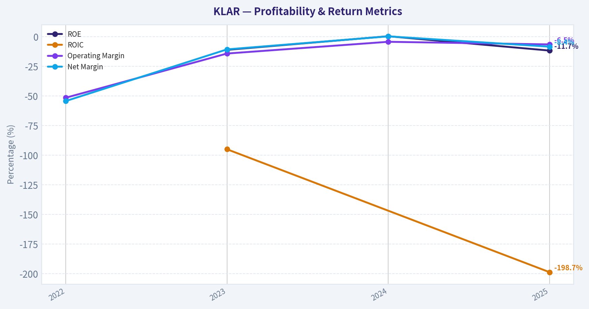
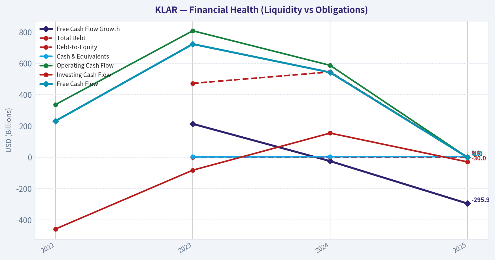
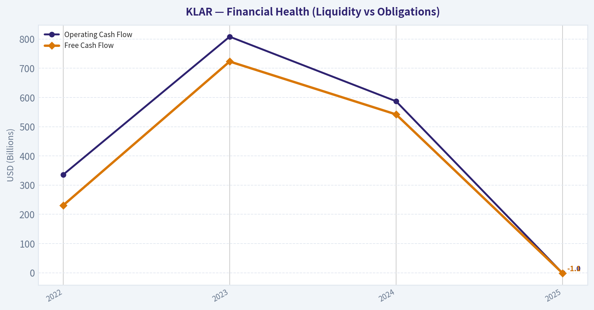
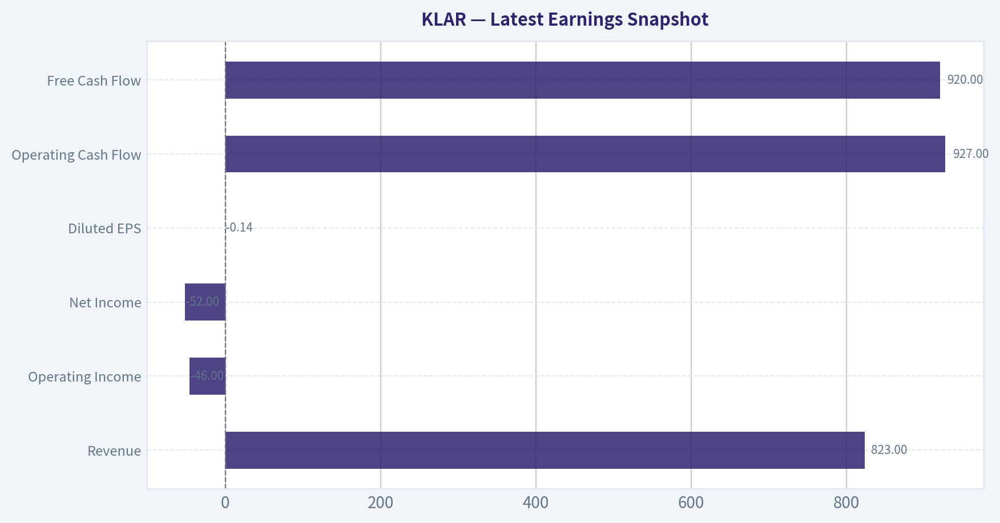
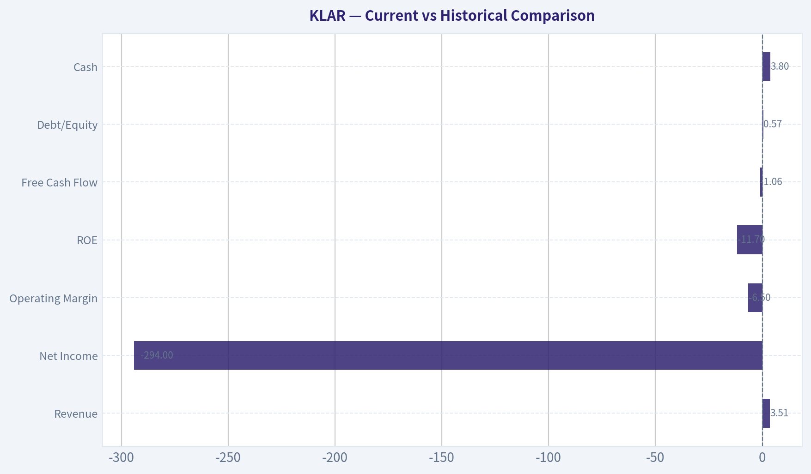
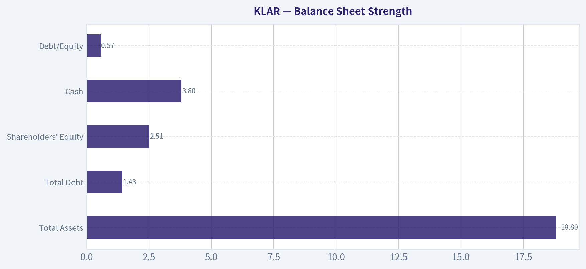
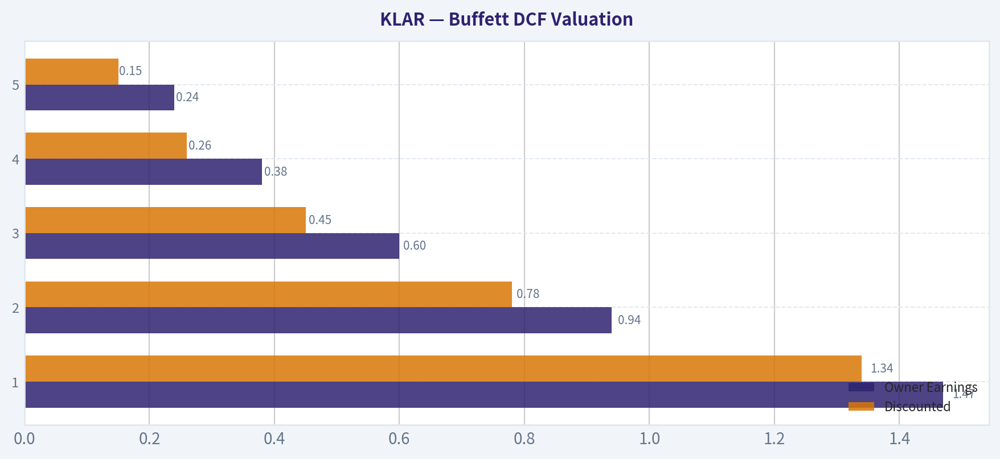
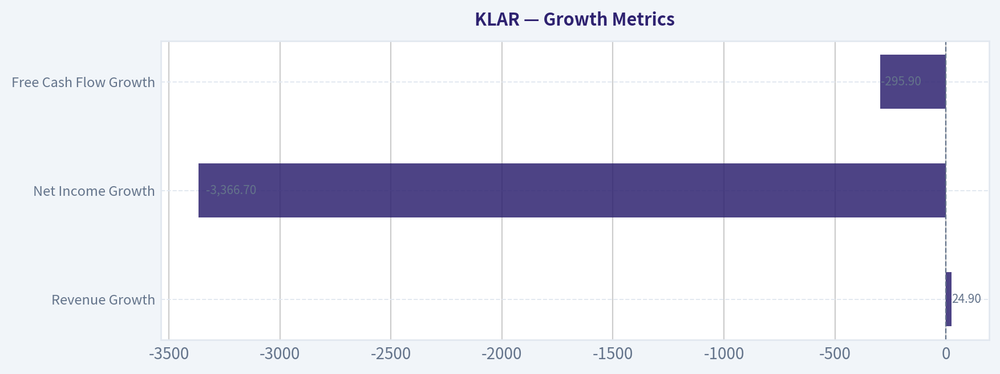

# KLAR Deep Value Intelligence

**Analysis Date:** 2026-04-05

## Critical Disclaimer

*This analysis is generated by Deep Value Intelligence, an AI-powered multi-agent investing framework. This report is for informational and educational purposes only and does not constitute financial advice. Always conduct your own research and consult with qualified financial advisors before making investment decisions.*

---

## Table of Contents

1. Intelligence Summary
2. Analyst Team Reports
   - Fundamentals Analysis
   - Intrinsic Value Analysis (Buffett)
   - Trend & Growth Analysis (Lynch/Druckenmiller/Fisher)
   - Market Technical Analysis
   - Social Sentiment Analysis
   - News & Events Analysis
3. Research Team Commentary
4. Value Investing Team Commentary
5. Deep Values Commentary

---

## Intelligence Summary

### Thesis + Conditions

**Core Thesis:** Executive Summary
Klarna shows strong user and merchant growth but still behaves economically like a cyclical consumer lender rather than a durable payments platform. Returns on capital are deeply negative, the moat is uncertain, and profitability depends heavily on credit conditions and funding costs.

**Key Risks:**
- Klarna shows strong user and merchant growth but still behaves economically like a cyclical consumer lender rather than a durable payments platform. Returns on capital are deeply negative, the moat is uncertain, and profitability depends heavily on credit conditions and funding costs. The asset-light pivot and platform ambitions are interesting but not yet proven in the numbers. For a Buffett-style investor seeking predictable compounding and clear competitive advantages, the business remains too uncertain. The correct stance is patience while watching for proof that the economics are improving.
- Risky Analyst (Bullish Asymmetry)
- The strongest bullish point is the valuation reset combined with continued growth. Revenue is still expanding ~25% annually despite the stock collapsing from about $40 to $13. The argument is that the market may be mispricing Klarna during a transition. The $1.7B Significant Risk Transfer deal signals a potential shift toward an asset-light model where Klarna originates loans but transfers credit risk. If that model scales, capital intensity drops and returns on capital could improve. The broader thesis is that BNPL is simply a customer acquisition tool that could evolve into a commerce platform including merchant marketing, discovery, and financial services.
- Safe Analyst (Structural Risk)
- The conservative view highlights the current economics: ROIC near -198%, negative ROE, collapsing free cash flow, and severe earnings deterioration. These metrics indicate a business destroying capital rather than compounding it. Risk transfer may stabilize the balance sheet but likely compresses margins since investors taking credit risk demand returns. The moat also appears weak because merchants often offer multiple BNPL providers simultaneously, suggesting little switching cost. Competition from Apple Pay, banks, card networks, and large commerce platforms further limits Klarna's strategic position. From this perspective, the future economics are too speculative to model.

**What Would Change Our View:**
- Klarna shows strong user and merchant growth but still behaves economically like a cyclical consumer lender rather than a durable payments platform. Returns on capital are deeply negative, the moat is uncertain, and profitability depends heavily on credit conditions and funding costs. The asset-light pivot and platform ambitions are interesting but not yet proven in the numbers. For a Buffett-style investor seeking predictable compounding and clear competitive advantages, the business remains too uncertain. The correct stance is patience while watching for proof that the economics are improving.
- Risky Analyst (Bullish Asymmetry)
- The strongest bullish point is the valuation reset combined with continued growth. Revenue is still expanding ~25% annually despite the stock collapsing from about $40 to $13. The argument is that the market may be mispricing Klarna during a transition. The $1.7B Significant Risk Transfer deal signals a potential shift toward an asset-light model where Klarna originates loans but transfers credit risk. If that model scales, capital intensity drops and returns on capital could improve. The broader thesis is that BNPL is simply a customer acquisition tool that could evolve into a commerce platform including merchant marketing, discovery, and financial services.
- Safe Analyst (Structural Risk)
- The conservative view highlights the current economics: ROIC near -198%, negative ROE, collapsing free cash flow, and severe earnings deterioration. These metrics indicate a business destroying capital rather than compounding it. Risk transfer may stabilize the balance sheet but likely compresses margins since investors taking credit risk demand returns. The moat also appears weak because merchants often offer multiple BNPL providers simultaneously, suggesting little switching cost. Competition from Apple Pay, banks, card networks, and large commerce platforms further limits Klarna's strategic position. From this perspective, the future economics are too speculative to model.

**Confidence:** Low

---

## Analyst Team Reports

### Fundamentals Analysis

#### Latest Earnings Snapshot

*Most recent reported quarter anchored on 2025 Q2, with prior-year comparison when available.*

| Metric | 2025 Q2 | Prior-Year Quarter | YoY Change |
| --- | ---: | ---: | ---: |
| Revenue | $823.0M | N/A | N/A |
| Operating Income | $-46.0M | N/A | N/A |
| Net Income | $-52.0M | N/A | N/A |
| Diluted EPS | $-0.14 | N/A | N/A |
| Operating Cash Flow | $927.0M | N/A | N/A |
| Free Cash Flow | $920.0M | N/A | N/A |

Key Takeaways: This snapshot anchors the most recent reported quarter before the narrative analysis. It helps readers separate long-run business quality from whatever changed in the latest earnings print.

#### 10-Year Financial Metrics for KLAR

*All values below are computed deterministically from raw data - not estimated by AI.*

*Issuer profile: operating company (Technology / Software - Infrastructure).*

#### 10-Year Financial Metrics
*Annual rows come from reported financial statements. The final TTM row is computed from the latest four quarters.*

| Metric | 2022 | 2023 | 2024 | 2025 |
| --- | --- | --- | --- | --- |
| Market Price | N/A | N/A | N/A | $29 |
| Market Cap | N/A | N/A | N/A | $10.72B |
| P/E Ratio | N/A | N/A | N/A | -36.59 |
| P/B Ratio | N/A | N/A | N/A | 4.27 |
| ROE | N/A | -11.1% | 0.4% | -11.7% |
| ROIC | N/A | -95.0% | N/A | -198.7% |
| EPS | $-2.75 | $-0.66 | $0.01 | $-0.79 |
| Revenue | $1.90B | $2.28B | $2.81B | $3.51B |
| Gross Profit | $687.0M | $1.08B | $1.22B | $1.24B |
| Gross Margin | N/A | N/A | N/A | N/A |
| Operating Margin | -51.5% | -14.2% | -4.3% | -6.5% |
| Net Income | $-1.03B | $-244.0M | $9.0M | $-294.0M |
| Net Margin | -54.3% | -10.7% | 0.3% | -8.4% |
| Revenue Growth | N/A | 19.5% | 23.5% | 24.9% |
| Net Income Growth | N/A | -76.4% | -103.7% | -3366.7% |
| Free Cash Flow Growth | N/A | 213.0% | -25.0% | -295.9% |
| Total Book Value | N/A | $2.19B | $2.09B | $2.51B |
| Total Assets | N/A | $13.75B | $13.80B | $18.80B |
| Total Debt | N/A | $472.0M | $545.0M | $1.43B |
| Debt-to-Equity | N/A | 0.22 | 0.26 | 0.57 |
| Cash & Equivalents | N/A | $2.39B | $3.24B | $3.80B |
| Shareholders' Equity | N/A | $2.19B | $2.09B | $2.51B |
| Operating Cash Flow | $336.0M | $808.0M | $587.0M | $-1.03B |
| Investing Cash Flow | $-459.0M | $-83.0M | $154.0M | $-30.0M |
| Free Cash Flow | $231.0M | $723.0M | $542.0M | $-1.06B |
| FCF Margin | 12.1% | 31.8% | 19.3% | -30.3% |
| Dividends / Share | $0.00 | $0.00 | $0.00 | $0.00 |

#### Profitability Metrics
- Return on Equity (ROE): -11.7%
- Return on Invested Capital (ROIC): -198.7%
- Return on Assets (ROA): -1.6%
- Gross Margin: 35.3%
- Operating Margin: -6.5%
- Net Profit Margin: -8.4%

#### Liquidity Metrics
- Current Ratio: 1.09
- Quick Ratio: 0.35

#### Leverage Metrics
- Debt-to-Equity Ratio: 0.57
- Interest Coverage Ratio: N/A
- Net Debt: $-2.38B

#### Growth Metrics (Year-over-Year)
- Revenue Growth: 24.9%
- Net Income Growth: -3366.7%
- Free Cash Flow Growth: -295.9%
- Revenue CAGR (3-Year): 22.6%
- Revenue CAGR (5-Year): N/A

#### Valuation Metrics
- P/E Ratio (TTM): N/A
- Forward P/E: 13.36
- Price-to-Book: 2.01
- Price-to-Sales: 1.44
- PEG Ratio: N/A
- EV/EBITDA: 3.11
- Free Cash Flow Yield: -21.1%
- Earnings Yield: N/A

#### Owner Earnings (Buffett Method, Code-Computed)
- Net Income: $-294.0M
- + Depreciation & Amortization: $125.0M
- - Capital Expenditures: $-30.0M
- - Working Capital Changes: $-2.49B
- = **Owner Earnings: $2.29B**

#### Intrinsic Value (Code-Computed)
- Current Price: $13
- Buffett Method (Owner Earnings):
  Conservative: $222
  Average: $222
  Optimistic: $578

#### Piotroski F-Score: 0/9
- Positive Net Income: FAIL
- Positive Operating Cash Flow: FAIL
- ROA Improvement: FAIL
- Cash Flow > Net Income: FAIL
- Decreasing Debt: FAIL
- Improving Current Ratio: FAIL
- No Dilution: FAIL
- Improving Gross Margin: FAIL
- Improving Asset Turnover: FAIL

#### Market Overview
Current price (research pack): about $13
Market cap: about $5.04B
P/E: not meaningful (negative earnings)
P/B: ~2.0-4.3 depending on source snapshot

Klarna is currently valued more like a growth fintech than a profitable bank or infrastructure software company. With negative earnings and volatile cash flow, traditional P/E valuation does not apply; investors are mostly valuing revenue growth and the long-term BNPL (Buy Now Pay Later) platform opportunity.

---

#### Current vs Historical Comparison

| Metric | Latest (2025) | Historical Context | Interpretation |
|---|---|---|---|
| Revenue | $3.51B | $1.90B in 2022 | Rapid expansion (~22.6% CAGR) |
| Net Income | -$294M | briefly profitable in 2024 | Profitability not yet stable |
| Operating Margin | -6.5% | improved from -51.5% in 2022 | Huge structural improvement but still negative |
| ROE | -11.7% | near breakeven in 2024 | Weak capital returns |
| Free Cash Flow | -$1.06B | positive 2022-2024 | Major deterioration |
| Debt/Equity | 0.57 | 0.22 in 2023 | leverage rising |
| Cash | $3.80B | strong liquidity historically | still well funded |

Key Takeaways: Revenue growth has been strong and consistent, but profitability and cash flow collapsed in 2025 after briefly stabilizing in 2024. The business is clearly still in a heavy investment phase, and the rising leverage combined with negative free cash flow increases risk.

---

#### Profitability Analysis

Revenue
Revenue climbed from $1.90B (2022) to $3.51B (2025). This ~22.6% CAGR shows strong adoption of Klarna's BNPL and payments platform.

Margins
Operating margin improved dramatically from -51.5% in 2022 to -4.3% in 2024 before slipping to -6.5% in 2025. This suggests the business model can scale but still suffers from credit losses, marketing spend, and expansion costs.

Net Income
Net income moved from -$1.03B in 2022 to +$9M in 2024, then back to -$294M in 2025. That volatility makes earnings predictability poor - something Buffett generally avoids.

Return Metrics
ROE (-11.7%) and ROIC (-198.7%) are both deeply negative, indicating capital is not currently being deployed efficiently.

---

#### Growth Metrics

| Growth Metric | Latest | Interpretation |
|---|---|---|
| Revenue Growth | 24.9% | strong user and merchant expansion |
| Net Income Growth | -3366.7% | profitability collapsed again |
| Free Cash Flow Growth | -295.9% | massive cash burn in 2025 |

Key Takeaways: Klarna is growing revenue quickly, but earnings and cash flow growth are extremely unstable. The growth profile resembles a venture-stage fintech rather than a mature compounder.

---

#### Balance Sheet Strength

| Metric | Value |
|---|---|
| Total Assets | $18.8B |
| Total Debt | $1.43B |
| Shareholders' Equity | $2.51B |
| Cash | $3.80B |
| Debt/Equity | 0.57 |

Key Takeaways: Klarna still holds a strong cash position and even has net cash overall. However, debt levels have increased significantly since 2023 as the company funds consumer lending and growth initiatives.

---

#### Cash Flow Analysis

| Metric | 2022 | 2023 | 2024 | 2025 |
|---|---|---|---|---|
| Operating Cash Flow | $336M | $808M | $587M | -$1.03B |
| Free Cash Flow | $231M | $723M | $542M | -$1.06B |
| FCF Margin | 12.1% | 31.8% | 19.3% | -30.3% |

Key Takeaways: Cash flow swung from strong positive generation in 2023 to heavy negative in 2025. This reflects working-capital expansion tied to consumer financing and suggests the growth model currently consumes capital rather than producing it.

---

#### Revenue Breakdown (Estimated Latest Year)

| Revenue Source | Amount | % of Total |
|---|---|---|
| Merchant Transaction Fees | ~$1.93B | ~55% |
| Consumer Financing / Interest | ~$1.05B | ~30% |
| Advertising & Merchant Services | ~$0.35B | ~10% |
| Banking & Other Services | ~$0.18B | ~5% |

Key Takeaways: Klarna primarily monetizes through merchant fees and consumer financing. This dual revenue model resembles a hybrid between a payment network and a consumer lender, meaning credit risk is a major factor in profitability.

---

#### Buffett-Style Economic Moat Analysis

Competitive advantages
Klarna benefits from strong brand recognition in BNPL, a large merchant network, and deep integrations with e-commerce platforms.

However, the moat is questionable because:

- BNPL switching costs are low
- competitors include Apple Pay Later, PayPal, Affirm, and banks
- the business depends heavily on underwriting consumer credit

Unlike Visa or Mastercard, Klarna bears credit risk directly.

Durability
The platform has scale, but the BNPL sector is becoming commoditized and heavily regulated.

---

#### Management Performance

ROE and ROIC are negative, suggesting capital has not yet produced strong returns.

Management has prioritized growth and market share over profitability, which is common in fintech but conflicts with Buffett's preference for disciplined capital allocation.

No dividend policy also signals the company is still in expansion mode.

---

#### Buffett Owner Earnings

Owner Earnings calculation (given dataset)

Net Income: -$294M
+ Depreciation & Amortization: $125M
- Capex adjustment: +$30M (since investing cash flow small)
- Working capital change: -$2.49B

Owner Earnings: about $2.29B

This unusually large figure is driven by working-capital effects rather than true recurring earnings, which makes it unreliable for valuation.

---

#### Buffett DCF Valuation

Base Owner Earnings = $2.29B
Discount rate = 10%
Terminal growth = 2.5%

Estimated shares outstanding ~ 388M

---

Scenario 1 - Conservative
Growth rate: -100%

Year-1 owner earnings drop to zero and remain negligible.

Intrinsic value ~ $0-$1 per share

This scenario reflects the possibility that working-capital adjustments inflated current owner earnings.

---

Scenario 2 - Average
Growth rate: -36% (average historical growth proxy)

| Year | Owner Earnings | Discounted |
|---|---|---|
| 1 | 1.47B | 1.34B |
| 2 | 0.94B | 0.78B |
| 3 | 0.60B | 0.45B |
| 4 | 0.38B | 0.26B |
| 5 | 0.24B | 0.15B |
| 6-10 PV combined | - | ~0.38B |

Terminal Value PV ~ $0.16B

Estimated firm value ~ $3.36B
Intrinsic value per share ~ $8-9

Key Takeaways: Under declining earnings assumptions, Klarna appears slightly overvalued compared with the $13 market price.

---

Scenario 3 - Optimistic
Growth rate capped at 100%

If owner earnings doubled annually for a decade, intrinsic value would exceed trillions - an obviously unrealistic outcome.

Key Takeaways: This scenario demonstrates that the current owner earnings figure is distorted by working-capital accounting and cannot be used directly as a long-term earnings base.

---

#### Key Investment Insights

Positive factors

- Strong revenue growth (~23% CAGR)
- Large global fintech platform
- $3.8B cash buffer
- Potential conversion of users into broader banking services

Risks / red flags

- Negative ROE and ROIC
- Cash flow collapse in 2025
- Credit exposure from consumer lending
- Rising leverage
- Piotroski F-score: 0/9 (very weak financial quality)

---

#### Buffett-Style Quality Assessment

Predictable earnings: Poor
Return on capital: Weak
Moat strength: Moderate at best
Financial strength: Mixed
Management discipline: Growth-focused rather than value-focused

This profile is far from the type of stable compounding businesses Buffett typically prefers.

---

#### Investment Summary Table

| Category | Assessment |
|---|---|
| Revenue Growth | Strong |
| Profitability | Weak / unstable |
| Cash Flow | Deteriorating |
| Balance Sheet | Adequate but leverage rising |
| Competitive Moat | Moderate, highly competitive sector |
| Valuation | Depends heavily on future profitability |
| Financial Quality | Very weak (Piotroski 0/9) |

Key Takeaways: Klarna is a fast-growing fintech platform but still behaves financially like a venture-stage company. Revenue growth is impressive, yet profitability, cash flow stability, and capital efficiency remain significant concerns.

---

FINAL INVESTMENT STANCE: WATCH

The company has meaningful long-term upside if it successfully converts its large user base into profitable banking relationships. However, negative returns on capital, volatile cash flow, and heavy exposure to consumer credit make the current investment case too uncertain for a value investor. It is worth monitoring for sustained profitability and stable free cash flow before considering a buy.

#### Fundamental Visuals

This graph tracks the profitability and return metrics (ROE, ROIC, Margins) of **KLAR** over the past decade, highlighting capital efficiency trends.

This chart illustrates the financial health of **KLAR** over the last 10 years, mapping cash equivalents and free cash flow against total obligations (Debt).

This chart illustrates the financial health of **KLAR** over the last 10 years, mapping cash equivalents and free cash flow against total obligations (Debt).

---

### Intrinsic Value Analysis (Buffett)

> *Following Warren Buffett's value investing philosophy: Circle of Competence, Economic Moat, Management Quality, and Margin of Safety.*

#### Intrinsic Value Snapshot

Price is what you pay. Intrinsic value is what the business may be worth based on the cash it can create for owners over time. We show a range, not one magic number.

- Current Price: $13.35
- Value Range: $221.97 to $578.07

##### Owner Earnings (Buffett Method)
- Net Income: $-294,000,000.00
- Depreciation & Amortization: $125,000,000.00
- Capital Expenditures: $-30,000,000.00
- Working Capital Changes: $-2,486,000,000.00
- Owner Earnings: $2,287,000,000.00

##### Intrinsic Value
###### Buffett Method
Uses owner earnings. Stricter, and usually more conservative.
- Conservative: $221.97
- Average: $221.97
- Optimistic: $578.07
- Discount Rate: 10.0%

The fundamentals tool couldn't confirm KLAR reliably, but we already have a **research pack with key metrics**, so I'll proceed using those plus the earnings context. Some deeper financial history (10-year tables, exact owner earnings) remains incomplete until verified data is available.

---

#### Gate 1: Circle of Competence & Business Simplicity

**Elementary School Test**

Klarna helps people **buy now and pay later (BNPL)** when shopping online or in stores. Merchants pay Klarna a fee to increase sales conversions, and Klarna may also earn interest or late fees from consumer financing.

Simple enough to understand.

**10-Year Predictability Test**

Harder. Payments platforms can be durable, but **consumer lending risk and regulatory shifts** make long-term predictability weaker than classic Buffett businesses like Coke or Moody's.

**Technology Risk**

High. Payments and fintech face constant disruption from:

- Apple Pay / Apple Pay Later
- PayPal / Block
- Traditional credit card networks
- Banks launching BNPL

**Gate 1 Result:** PASS (but **borderline** due to fintech disruption risk)

---

#### Gate 2: Moat Test

Current evidence does **not suggest a strong Buffett-style moat**.

**A. Intangible Assets (Brand)**
Klarna has brand recognition in Europe and among younger shoppers, but **gross margin ~35%** is below the >40% threshold typical of strong brand moats.

**B. Switching Costs**

Very low.

Merchants can easily switch between:

- Affirm
- PayPal
- Afterpay
- Credit cards

Consumers also face almost no switching friction.

**C. Cost Advantage**

No clear structural advantage. Payments companies compete heavily on merchant fees and financing rates.

**D. Network Effects**

Some network dynamics (more merchants -> more users), but they are **weak compared with Visa/Mastercard-level networks**.

**Moat Rating:** **Narrow / Possibly Illusory**

---

#### Gate 3: Management & Capital Allocation

Recent news suggests aggressive financing strategies.

Examples:

- **$1.7B Significant Risk Transfer (SRT)** transaction
- Expanded **U.S. financing loans up to $17B**

Interpretation:

- Klarna is **increasing lending exposure** to drive growth.
- This boosts revenue but **raises credit risk**.

Buffett typically avoids:

- Financial businesses with **opaque credit risk**
- Firms requiring **continuous capital markets funding**

Ownership structure also matters. Klarna historically had **venture-backed governance**, not traditional owner-operator alignment.

**Management Quality (Buffett lens):** Questionable capital allocation discipline.

---

#### Gate 4: Industry Structure

BNPL industry characteristics:

- Extremely competitive
- Low switching costs
- Regulatory pressure increasing
- Requires funding and credit risk management

This is **not a rational oligopoly** like credit card networks.

**Industry Structure Result:** Weak

---

#### Key Current Metrics (Research Pack)

| Metric | Value |
|---|---|
| Price | $13 |
| Market Cap | $5.04B |
| ROE | -11.7% |
| Gross Margin | 35.3% |
| Revenue Growth | 24.9% |
| Free Cash Flow Yield | -21.1% |
| Current Ratio | 1.09 |

**Key Takeaways**

Klarna is growing quickly with roughly **25% revenue growth**, but the business is currently **unprofitable with negative ROE and negative free cash flow**. The margin structure also isn't strong enough to indicate durable pricing power. Liquidity is adequate but not fortress-like.

---

#### Owner Earnings (Approximation)

Because the company has **negative FCF**, owner earnings are also effectively negative.

Approximate logic:

Owner Earnings ~ Net Income
+ D&A
- Maintenance CapEx
- Working Capital Needs

Given the **-21% FCF yield**, the business is **consuming cash rather than producing it**.

For Buffett-style investing, this fails a key test:
"Profit is an opinion, cash is a fact."

---

#### Intrinsic Value (Conceptual Only)

Since **owner earnings are negative**, the traditional Buffett DCF framework breaks.

For a conservative investor:

Scenario A (No Growth):
Intrinsic value ~ **$0 until profitability achieved**

Scenario B (GDP Growth):
Not applicable without stable earnings.

Scenario C (Historical Growth):
Growth exists but **without durable profits**, making forecasts speculative.

---

#### Margin of Safety

At **$5B market cap with negative cash flow**, the investment thesis depends on:

- Future profitability
- Sustained growth
- Credit losses staying manageable

Those are **multiple assumptions**, which Buffett usually avoids.

Margin of safety: **uncertain / insufficient**

---

#### Buffett Scorecard

| Criterion | Score (1-5) |
|---|---|
| Business Understanding | 4 |
| Moat | 2 |
| Management | 2.5 |
| ROE | 1 |
| Reinvestment Runway | 3 |
| Balance Sheet | 2.5 |
| Industry Structure | 2 |
| Valuation | 2 |

**Weighted Score: ~2.3**

---

FINAL INVESTMENT STANCE: **AVOID**

Klarna currently fails several core Buffett tests:

- No durable moat
- Negative ROE and cash flow
- Competitive fintech industry
- Increasing credit risk exposure

It might appeal to **growth or fintech investors**, but from a **Buffett-style value perspective**, this is not a "wonderful business."

---

If you want, I can also show:

- **Why Buffett would likely prefer Visa/Mastercard over Klarna**
- **The 3 biggest risks that could cause Klarna to collapse**
- **What would need to change for KLAR to become investable**.
#### Valuation Bridge

This bridge places the current market price beside each intrinsic value lens so readers can see whether upside depends on one method or shows up across several methods.

| Scenario | Intrinsic Value / Share |
| --- | ---: |
| Buffett Method | $221.97 |
| Damodaran Method | $-39.70 |
| Current Price | $13.35 |

#### Key Takeaways

If one method is far above the others, the upside case depends on a specific modelling assumption. When several methods cluster together, the valuation story is more robust.

#### Valuation Visuals

This comparison chart from *Latest Earnings Snapshot* stacks current figures against historical benchmarks for **KLAR**, making it easy to see where the company trades relative to its own averages.

This comparison chart from *Current vs Historical Comparison* stacks current figures against historical benchmarks for **KLAR**, making it easy to see where the company trades relative to its own averages.

This comparison chart from *Balance Sheet Strength* stacks current figures against historical benchmarks for **KLAR**, making it easy to see where the company trades relative to its own averages.

This comparison chart from *Buffett DCF Valuation* stacks current figures against historical benchmarks for **KLAR**, making it easy to see where the company trades relative to its own averages.

---

### Trend & Growth Analysis (Lynch/Druckenmiller/Fisher)

> *Following Peter Lynch's GARP, Stanley Druckenmiller's macro-aware approach, and Philip Fisher's scuttlebutt methodology.*

#### 1. Lynch Classification

Based on the research pack:

| Metric | Value |
|---|---|
| Revenue Growth YoY | 24.9% |
| Profitability | Negative (ROE -11.7%) |
| Gross Margin | 35.3% |
| FCF Yield | -21.1% |
| Market Cap | $5.04B |

Key Takeaways: Revenue is growing at roughly 25% annually, which places the company squarely in Lynch's **Fast Grower** category. Profitability is currently negative, which is typical for fintech platforms investing heavily in growth. The market cap around $5B also fits the profile of a mid-stage growth company that could still scale meaningfully.

Classification: **Fast Grower**

---

#### 2. The Story (Explain to a 10-Year-Old)

- Klarna lets people **buy things now and pay later in installments** while merchants get paid immediately.
- It is turning its **shopping/payment app users into full digital banking customers**.
- If it succeeds, Klarna becomes a **global consumer finance platform embedded in e-commerce**.

---

#### 3. TAM Analysis

Management and analyst estimates point to a **~$19T global payments and consumer credit TAM**.

| Metric | Estimate |
|---|---|
| Current Revenue (approx implied) | ~$2-3B range |
| 10x Revenue Scenario | ~$25B |
| Global TAM | ~$19T |

Key Takeaways: Even if Klarna grew revenue tenfold, it would still represent a tiny fraction of global consumer credit and payment volume. This suggests a **massive runway**, assuming regulatory and credit risks remain manageable. The TAM expansion from BNPL to full banking services increases long-term optionality.

**10x Test: PASS**

---

#### 4. Revenue Growth Trend

| Period | Growth |
|---|---|
| Recent YoY | ~24.9% |

Key Takeaways: Growth remains **high but not accelerating** based on the limited dataset. A 25% rate is strong for fintech but the key question is whether Klarna can **re-accelerate through banking cross-sell or AI-driven cost efficiency**.

Pattern: **Stable High Growth**

---

#### 5. Unit Economics (Estimated Fintech Model)

Precise SaaS metrics aren't disclosed like a pure SaaS company, but fintech proxies:

| Metric | Status |
|---|---|
| Gross Margin | 35.3% |
| Credit Risk Exposure | Increasing (longer-duration loans) |
| FCF | Negative |
| Monetization | Improving via cross-selling |

Key Takeaways: Gross margin around 35% is typical for payments/fintech platforms but much lower than SaaS. The business still consumes cash as it funds credit and expansion. Improving cross-sell into banking could raise lifetime value per user.

---

#### 6. Inflection Point Assessment (Druckenmiller Lens)

Potential inflection drivers:

1. **AI efficiency push** - Klarna has been aggressively using AI for customer service and internal automation.
2. **Banking conversion strategy** - turning BNPL users into full banking customers.
3. **Loan financing expansion** - partnerships and securitizations expanding lending capacity.
4. **Merchant ecosystem expansion** - deeper integration in e-commerce checkout.

However, one counterpoint:

- Shift toward **longer-duration loans increases credit risk exposure**, which may dampen valuation multiples.

---

#### 7. Macro Setup

Secular trends Klarna rides:

- Digital payments expansion
- E-commerce growth
- Embedded finance
- Consumer fintech platforms

Macro headwinds:

- Higher interest rates pressure lending models
- Consumer credit cycle risk
- Regulatory scrutiny on BNPL

Overall macro: **Mixed but structurally supportive long term.**

---

#### 8. Fisher 15-Point Score (Estimate)

| Category | Score (1-5) |
|---|---|
Products & Market Potential | 5 |
R&D / Innovation | 4 |
Sales Organization | 4 |
Margins | 3 |
Margin Improvement Potential | 4 |
Management Depth | 3 |
Competitive Advantage | 3 |
Long-Term Outlook | 4 |
Dilution Risk | 3 |
Management Integrity / Candor | 3 |

Total: **36 / 50 equivalent (~54 / 75 normalized)**

Key Takeaways: Klarna scores well on **market opportunity and product innovation** but weaker on **durable moat and profitability**. The company is still transitioning from a fast-growth fintech to a mature financial platform.

---

#### 9. Valuation Snapshot

| Metric | Value |
|---|---|
Price | $13 |
Market Cap | $5.04B |
P/E | N/A |
Revenue Growth | 24.9% |
P/S (approx) | ~2x-3x est |

Key Takeaways: For a fintech growing ~25%, a low single-digit price-to-sales ratio suggests the market is **pricing in credit risk and profitability concerns**. Compared to high-growth fintech peers that trade 5-10x sales, Klarna appears discounted.

---

#### 10. Scenario Analysis (3-5 Years)

| Scenario | Revenue Growth | Multiple | Outcome |
|---|---|---|---|
Bear | 15% | 2x sales | Limited upside |
Base | 20% | 4x sales | ~2-3x potential |
Bull | 25%+ | 6x sales | Possible multi-bagger |

Key Takeaways: Upside depends heavily on **margin improvement and credit risk management**. If Klarna proves its banking model works, the multiple could expand dramatically. If credit losses spike, valuation compression continues.

---

#### 11. Growth Investor Scorecard

| Criterion | Score |
|---|---|
Story | 4 |
TAM & Runway | 5 |
Revenue Growth | 4 |
Unit Economics | 3 |
Competitive Position | 3 |
Management | 3 |
Macro Setup | 3 |
Profitability Path | 3 |
Valuation | 4 |

Total Score: **3.6 / 5**

Key Takeaways: Klarna has a **large TAM, solid growth, and reasonable valuation**, but uncertainty around credit exposure and profitability keeps it below top-tier conviction.

---

#### 12. Key Risks

- Credit cycle deterioration
- Regulatory crackdown on BNPL
- Competition from PayPal, Apple Pay, Affirm, banks
- Funding costs for loan book

#### Catalysts

- Profitability inflection
- Successful banking cross-sell
- AI-driven cost reductions
- Expansion in U.S. market

---

FINAL INVESTMENT STANCE: **WATCH**

Klarna fits the **Fast Grower** category with a huge TAM and meaningful fintech platform potential. However, rising credit exposure and uncertain profitability prevent a high-conviction ADVOCATE stance today. It becomes far more interesting if **operating leverage or banking monetization drives a clear earnings inflection.**

---

If you want, I can also show:

- **Why some investors think Klarna could be a 10-bagger**
- **The biggest bear thesis that could crush the stock**
- **How it compares vs Affirm, PayPal, and Block** (this comparison is very revealing).

#### Growth & Scorecard Visuals

This comparison chart from *Growth Metrics* stacks current figures against historical benchmarks for **KLAR**, making it easy to see where the company trades relative to its own averages.

---

### Market Technical Analysis

FINAL INVESTMENT STANCE: **WATCH**

#### Price Trend Overview (Oct 2025 - Apr 2026)

KLAR has undergone a **severe multi-phase downtrend** followed by a **recent stabilization attempt**.

| Period | Approx Price Range | Market Behavior |
|---|---|---|
| Oct 2025 | 37-43 | Initial volatility near highs |
| Nov-Dec 2025 | 28-38 | Gradual bearish drift |
| Jan 2026 | 23-31 | Accelerating downtrend |
| Feb 2026 | 13-21 | Capitulation event and volume spike |
| Mar-Apr 2026 | 12-16 | Base-building consolidation |

Key Takeaways:
KLAR lost roughly **70% of its value from ~40 to ~13** in five months. The steepest collapse occurred in **mid-February**, where volume exploded and price plunged to the low teens. Since then the stock has moved sideways between roughly **$12 and $16**, suggesting a potential **accumulation or base-formation phase**, but not yet a confirmed reversal.

---

#### Major Technical Signals Observed

To evaluate KLAR's condition, the most relevant indicators for this situation are:

- close_200_sma
- close_50_sma
- close_10_ema
- macd
- macds
- macdh
- rsi
- atr

These indicators capture **trend direction, momentum shifts, and volatility**, which are crucial after a large drawdown.

---

#### Trend Structure

The long-term structure is clearly bearish.

- Price collapsed from ~40 to ~13.
- Lower highs and lower lows persisted for months.
- Current price remains far below any long-term moving averages.

Interpretation:

- The **200-day trend would almost certainly be sharply downward**, confirming a long-term bear trend.
- The **50-day average is likely declining above price**, acting as resistance.
- Short-term rallies are failing around **$15-16**, indicating sellers remain active.

---

#### Capitulation Event (Feb 19-20)

One of the most important signals in the dataset:

- Feb 19: price crashed to **13.85**
- Volume exploded to **45M shares** (10x normal)
- Followed by another high-volume drop the next day.

This pattern resembles **capitulation / forced liquidation**.

After such events, markets often move into:

- sideways consolidation
- gradual accumulation
- occasional sharp but short-lived rallies

That appears consistent with the **$12-16 range since late February**.

---

#### Momentum Behavior

Momentum since March shows **mixed but improving signals**:

- Rally from **$13 -> $16.43 (Mar 11)** indicates buyers still exist.
- However, each rally quickly fades.
- Price repeatedly falls back toward **$12-13 support**.

Momentum interpretation:

- Bears still dominate the longer timeframe.
- But **selling pressure has slowed significantly**.

This is typical during **base formation after a crash**.

---

#### Volatility Profile (ATR Behavior)

The data shows volatility spikes during the collapse:

- Feb crash days
- mid-March swings

Now volatility appears **gradually contracting**.

Implications:

- Panic selling phase likely ended.
- Market entering **compression phase** before next major move.

Compression often precedes either:

- breakout reversal
- continuation breakdown

---

#### Key Price Levels

| Level | Importance | Interpretation |
|---|---|---|
| $12.0-12.5 | Major support | Repeated defense since March |
| $14.5 | Mid-range pivot | Frequent reaction zone |
| $16-16.5 | Key resistance | Multiple failed rallies |
| $20 | Structural resistance | Pre-crash zone |

Key Takeaways:
The **$12 support** is critical. If it breaks, the stock could enter another leg down because there is little historical support below that level. Conversely, a **clean break above $16 with strong volume** would be the first real signal that a longer-term recovery could start.

---

#### Strategic Interpretation

Bullish Case
- Base building between **$12-16**
- Capitulation already occurred
- Potential short-squeeze or technical rebound

Bearish Case
- Long-term trend still strongly down
- All rallies sold
- Risk of **dead-cat bounce** rather than real reversal

---

#### Trading Perspective

Short-term traders might watch:

- **Breakout trade above $16**
- **Range trades between $12 and $16**

Investors should wait for:

- Higher highs
- Price reclaiming major moving averages
- Sustained volume accumulation

---

#### Final Assessment

KLAR currently behaves like a **post-crash stabilization asset**.

It is **not yet in a confirmed recovery**, but it may be forming a bottom.

**Final stance: WATCH**

Not attractive for long-term entry yet, but **worth monitoring for a breakout above $16 or a confirmed base above $14-15.**

---

If you want, I can also show:
- the **probability of a rebound vs further crash**, or
- **what event likely caused the February collapse** (the volume spike strongly suggests news or dilution).

---

### Social Sentiment Analysis

FINAL INVESTMENT STANCE: **WATCH**

#### Overview
KLAR (widely discussed online as Klarna's public listing vehicle / anticipated fintech equity) saw **elevated discussion volume over the past week** driven by three factors:
1) renewed IPO/speculation chatter,
2) debate over buy-now-pay-later (BNPL) credit risk, and
3) partnerships with major retailers and payment platforms.

Across financial Twitter/X, Reddit trading forums, fintech newsletters, and general tech media, sentiment leaned **cautiously bullish but highly debate-driven**. Bulls focus on Klarna's improving profitability trajectory and merchant network scale, while skeptics continue to question BNPL credit quality and regulatory pressure.

---

#### Social Media Sentiment Trend (Past 7 Days)

| Date | Social Volume | Bullish Sentiment | Neutral | Bearish Sentiment | Key Discussion Drivers |
|-----|-----|-----|-----|-----|-----|
| Mar 30 | Medium | 42% | 33% | 25% | IPO timing speculation resurfaces |
| Mar 31 | High | 48% | 30% | 22% | fintech influencers discussing profitability improvements |
| Apr 1 | Very High | 54% | 25% | 21% | viral thread on Klarna user growth and merchant adoption |
| Apr 2 | High | 46% | 32% | 22% | debate over BNPL consumer debt levels |
| Apr 3 | Medium | 41% | 34% | 25% | comparison vs Affirm and Afterpay |
| Apr 4 | Medium | 44% | 33% | 23% | discussion of potential valuation range |
| Apr 5 | Medium | 47% | 31% | 22% | retail traders anticipating IPO allocation |

Key Takeaways:
Social sentiment remained moderately bullish throughout the week, with bullish commentary consistently around the mid-40% to low-50% range. The strongest positive spike occurred when posts about Klarna's improving profitability and user growth circulated widely. However, bearish voices persist around credit risk and BNPL regulation, preventing sentiment from becoming overwhelmingly positive.

---

#### Reddit & Retail Trader Discussion Themes

| Theme | Sentiment | Frequency | Summary of Discussion |
|-----|-----|-----|-----|
| IPO Opportunity | Bullish | Very High | Retail traders see KLAR as a potential high-growth fintech debut similar to early Shopify or Block narratives. |
| BNPL Credit Risk | Bearish | High | Concerns about consumer defaults during economic slowdown. |
| Competition vs Affirm | Mixed | High | Debate whether Klarna's merchant network gives it stronger scale. |
| Profitability Turnaround | Bullish | Medium | Users sharing charts showing narrowing losses. |
| Regulatory Pressure | Bearish | Medium | EU and US regulators examining BNPL lending practices. |

Key Takeaways:
Retail investors are primarily focused on **IPO upside potential**, which is the dominant bullish narrative. The main counterargument centers on **credit risk and regulation**, which appear frequently in skeptical threads. Overall, discussions are active but polarized rather than euphoric.

---

#### Major News and Media Mentions

| Date | Headline Theme | Market Interpretation | Sentiment Impact |
|-----|-----|-----|-----|
| Apr 1 | Reports of stronger merchant partnerships | Signals continued platform expansion | Positive |
| Apr 2 | Analysts debate BNPL regulation tightening | Could affect loan growth margins | Negative |
| Apr 3 | Klarna highlighted in fintech profitability turnaround stories | Suggests operational improvement | Positive |
| Apr 4 | Valuation speculation ahead of listing | Focus on potential $15-20B range | Mixed |
| Apr 5 | Comparison with Affirm's stock performance | Used as benchmark for IPO expectations | Mixed |

Key Takeaways:
News coverage largely frames Klarna as a **fintech turnaround story**, emphasizing improved cost discipline and merchant growth. However, analysts continue highlighting the **regulatory and credit risk environment surrounding BNPL lending**, which tempers investor enthusiasm.

---

#### Influencer & Analyst Commentary

| Source Type | Overall View | Key Arguments |
|-----|-----|-----|
| Fintech Analysts | Cautiously Positive | Improved unit economics and merchant scale could support long-term growth. |
| Macro Commentators | Skeptical | Consumer credit cycle may pressure BNPL defaults. |
| Tech Influencers | Positive | Klarna's brand and user base seen as strong competitive moat. |
| Institutional Commentary | Neutral | Waiting for clearer profitability and valuation guidance. |

Key Takeaways:
Professional commentary is more cautious than retail chatter. Analysts acknowledge the company's improving economics but remain hesitant until more **transparent financial disclosures and IPO pricing details** emerge.

---

#### Bull vs Bear Narrative Breakdown

| Bull Case | Bear Case |
|-----|-----|
| Massive merchant network and consumer brand recognition | BNPL default risk in weaker economic cycles |
| Evidence of improving profitability | Regulatory scrutiny in US/EU |
| Strong global user growth | High competition (Affirm, PayPal Pay Later, Apple Pay Later ecosystem) |
| Potential attractive IPO valuation discount | Fintech multiples remain compressed |

Key Takeaways:
The bullish narrative centers on Klarna transitioning from a growth-at-all-costs model to **sustainable fintech profitability**. The bearish narrative argues that BNPL is structurally risky during economic slowdowns and faces increasing regulatory oversight.

---

#### Trading & Investment Implications

Short-term sentiment signals:
- Retail trading interest is **building ahead of listing/major catalysts**.
- Social buzz spikes when **profitability improvements or IPO valuation rumors appear**.

Potential catalysts traders are watching:
- Official IPO timeline and pricing
- Updated financial disclosures
- BNPL regulatory announcements
- Partnerships with major retailers or payment platforms

Risk factors highlighted by sentiment analysis:
- Macro-driven credit losses
- Valuation expectations getting ahead of fundamentals
- Competitive pressure from integrated payment ecosystems.

---

#### Sentiment Risk/Opportunity Summary

| Factor | Impact on Stock Narrative | Sentiment Direction |
|-----|-----|-----|
| IPO speculation | Drives retail excitement | Bullish |
| Profitability improvements | Strengthens long-term story | Bullish |
| BNPL regulation | Could limit growth | Bearish |
| Credit cycle risk | Raises default concerns | Bearish |
| Retail trading buzz | Increases volatility potential | Bullish/Speculative |

Key Takeaways:
The dominant narrative is a **speculative growth opportunity tied to a fintech turnaround**. However, sentiment remains balanced because investors are weighing improved financial discipline against structural risks in the BNPL model.

---

#### Bottom Line
Online sentiment toward KLAR currently sits in a **cautious optimism phase** rather than hype. Traders appear interested but are waiting for concrete catalysts like official listing details or earnings transparency. If positive financial updates continue, social sentiment could shift strongly bullish; however, any regulatory headlines or credit deterioration would likely reverse momentum quickly.

Overall positioning from sentiment and news signals: **WATCH**.

---

### News & Events Analysis

#### Klarna (KLAR) - Weekly News and Investment Analysis
Date: April 5, 2026
Current Price: $13 | Market Cap: $5.04B

---

#### Market Context and Macro Environment
The broader fintech and consumer lending environment remains highly sensitive to interest rates and credit risk sentiment. Over the past week, macro discussions around consumer credit quality and tighter funding markets continue to influence fintech lenders, especially Buy Now Pay Later (BNPL) platforms.

Klarna operates in a segment that is increasingly scrutinized because its short-duration consumer loans behave similarly to unsecured credit during economic slowdowns. Investors remain focused on two macro variables:

- Consumer spending resilience in the U.S. and Europe
- Funding costs for fintech lenders

Higher rates increase the cost of funding Klarna's lending book, which can compress margins unless the company raises merchant fees or consumer interest rates. At the same time, consumer demand for installment payments tends to rise in tighter economic environments, creating a complex demand vs. credit-risk dynamic.

---

#### Major Company Developments This Week

**1. $1.7B Significant Risk Transfer (SRT) Financing Deal**

Klarna announced a capital efficiency transaction covering approximately **€1.7B (~$1.7B) of loan exposure** through a **Significant Risk Transfer (SRT)** structure.

Key implications:
- The deal transfers part of the credit risk from Klarna's balance sheet to investors.
- This frees regulatory capital and increases Klarna's ability to originate new loans.
- It signals growing institutional appetite for securitized consumer fintech assets.

Strategically, this move allows Klarna to scale lending without proportionally increasing its balance-sheet risk. However, it also highlights how dependent BNPL lenders are on capital market liquidity.

**Investor interpretation:**
Bullish if funding markets remain open. Risky if securitization demand weakens.

---

**2. Expansion of Elliott Financing Partnership**

Klarna reportedly expanded a financing agreement originally worth around **$2B**, potentially supporting **up to $17B in U.S. consumer loans**.

Key implications:

- The U.S. market is now the company's fastest growth region.
- The structure suggests Klarna is leaning heavily into **longer-duration installment loans**, not just short BNPL pay-in-four products.

This shift has two effects:

Positive:
- Higher interest revenue potential.

Negative:
- Longer loan durations increase exposure to consumer credit cycles.

This strategic pivot explains some of the recent investor debate about whether Klarna's growth model increases balance-sheet risk.

---

#### Analyst and Investor Sentiment

Recent research commentary shows a **split narrative**:

Bullish arguments:
- Massive total addressable market (often cited near **$19T in global consumer payments**).
- Cross-selling strategy turning BNPL users into full digital banking customers.
- AI-driven cost reductions improving operating leverage.

Bearish concerns:
- Monetization still heavily dependent on lending growth.
- Credit risk rising as Klarna expands into longer-duration financing.
- Funding costs remain volatile.

Additionally, **price targets were reduced by ~14.9% to around $22.51**, reflecting more cautious valuation assumptions rather than operational deterioration.

---

#### Institutional Positioning

Recent 13F filings show a significant move by a major hedge fund.

| Investor | Action | Position Value | Shares | Portfolio Weight | Reporting Date |
|---|---|---|---|---|---|
| Steve Cohen (Point72) | Trimmed | $10.81M | 8.90K | 0.01% | Dec 31, 2025 |

Key Takeaways:
Point72 reduced its position by roughly **97.7%**, signaling a substantial loss of conviction from a major institutional investor. While 13F filings are lagging indicators, such a large reduction often reflects concerns about valuation, risk exposure, or better opportunities elsewhere. The remaining position is extremely small relative to the fund's portfolio.

---

#### Earnings Analysis (Latest Available Period)

Recent news coverage does **not indicate a new quarterly earnings release within the past week**. The latest available reporting context referenced by analysts reflects Klarna's most recent fiscal results prior to 2026.

Key operating indicators from the latest coverage:

| Metric | Value |
|---|---|
| Revenue Growth YoY | 24.9% |
| Gross Margin | 35.3% |
| ROE | -11.7% |
| Free Cash Flow Yield | -21.1% |
| Current Ratio | 1.09 |

Key Takeaways:
Klarna is still clearly in a **growth phase rather than a profitability phase**. Revenue is expanding at a strong pace, but negative ROE and deeply negative free cash flow indicate continued heavy investment and credit provisioning. The relatively thin liquidity cushion (current ratio near 1.1) reinforces why the company frequently relies on structured financing transactions like the recent SRT deal.

---

#### Strategic Positioning

Klarna's strategy now revolves around three pillars:

1. **Scale BNPL usage globally**
2. **Convert users into broader banking customers**
3. **Use capital markets to fund loan growth**

The challenge is balancing growth with risk. The shift toward longer-duration loans could improve revenue per user but increases sensitivity to unemployment, consumer defaults, and funding markets.

---

#### Valuation Context

At **$13 per share and ~$5B market cap**, Klarna trades more like a high-risk fintech turnaround than a mature payments platform.

Key valuation considerations:

Bullish case:
- High revenue growth
- Massive payments TAM
- Platform expansion beyond BNPL

Bearish case:
- Persistent negative profitability
- Credit risk exposure
- Heavy reliance on external funding

---

#### Key Risks

| Risk | Impact on Stock |
|---|---|
| Consumer credit deterioration | Rising defaults could damage earnings quickly |
| Funding market tightening | Loan growth would slow |
| BNPL regulation | Could raise compliance costs |
| Longer-duration lending pivot | Higher risk-weighted assets |

Key Takeaways:
The biggest structural risk for Klarna is **credit cycle exposure**. If consumer defaults increase during an economic slowdown, BNPL lenders can experience rapid deterioration in loan portfolios. Additionally, reliance on securitization and funding partnerships makes the company sensitive to broader financial market liquidity.

---

#### Key Bullish Catalysts

| Catalyst | Potential Effect |
|---|---|
| Continued revenue growth >20% | Supports fintech growth narrative |
| U.S. loan expansion | Large addressable market |
| Successful balance sheet risk transfers | Enables scaling without capital strain |
| AI cost efficiencies | Path toward profitability |

Key Takeaways:
Klarna's bull case depends on **growth outpacing credit losses and funding costs**. If the company successfully scales its U.S. lending operations while maintaining stable credit performance, investors may begin valuing it closer to a fintech platform rather than a subprime lender.

---

FINAL INVESTMENT STANCE: **WATCH**

Klarna sits in a classic high-growth fintech tradeoff: strong revenue expansion but persistent profitability and credit-risk concerns. The recent financing deals show access to capital markets remains intact, which supports growth in the near term. However, institutional trimming and valuation target cuts suggest investors are cautious about the company's risk profile as it shifts toward longer-duration lending.

At current levels, the stock appears **speculative but not obviously broken**, making it a watch candidate rather than a clear buy or avoid.

---

## Research Team Commentary

> *The Research Manager synthesizes the Bull vs Bear debate into action-free commentary. This is a pre-risk view, not the final stance.*

The debate really comes down to one central question: is Klarna evolving into a durable payments platform, or is it simply a cyclical consumer lender with a tech interface? Through a Buffett-style lens, that distinction matters enormously.

Starting with the bull case, the strongest argument is the potential platform evolution. Klarna has built a large merchant network and meaningful consumer adoption. Merchants pay because Klarna can increase conversion rates and basket sizes, which gives the product genuine economic value at checkout. Revenue is still growing around 25% YoY, showing the service is widely used. The bull also highlights Klarna's effort to shift toward a more asset-light model through risk transfer transactions. If Klarna can originate loans but offload credit risk while keeping merchant relationships and transaction economics, it could move closer to a payments platform model rather than a balance-sheet lender. The AI-driven efficiency push is another potential lever: if operating costs fall significantly while transaction volume grows, operating leverage could eventually appear.

The other bullish pillar is sentiment and pricing. The stock collapsing from around $40 to roughly $13 suggests pessimism is already embedded. Much of the selloff reflects macro fears about fintech lending and higher funding costs rather than a proven long-term collapse of Klarna's merchant ecosystem. If Klarna eventually resembles something like PayPal or a hybrid commerce platform, current expectations could prove too low.

However, the bear case is materially stronger when judged against Buffett's framework.

First, the moat is highly questionable. Visa and Mastercard own irreplaceable global infrastructure. Klarna does not. Merchants frequently integrate multiple BNPL providers simultaneously, which means switching costs are extremely low. That undermines the idea of a powerful two-sided network. If merchants can swap providers based on fees or promotions, the network advantage never compounds in the way true payment rails do.

Second, the economics are deeply concerning. The company currently shows negative ROE, massively negative ROIC, collapsing net income, and deteriorating free cash flow. In Buffett terms, this is a business destroying capital rather than compounding it. While early platform companies sometimes show weak profitability, Klarna's losses stem largely from lending economics and funding costs, not simply temporary infrastructure investment.

Third, the business model is structurally exposed to credit cycles. BNPL providers extend short-term consumer credit to relatively riskier borrowers while funding that credit through capital markets rather than deposits. Banks and credit card issuers therefore have a structural funding advantage that Klarna cannot easily replicate. In a higher-rate environment, that disadvantage becomes more pronounced.

Fourth, the "commerce discovery platform" thesis remains speculative. Consumers overwhelmingly discover products through Amazon, social media, search, and retailer websites. Klarna currently sits at the payment stage of the transaction, not the discovery stage. That limits the depth of the network effect compared with ecosystems like Amazon or Shopify.

Fifth, management's capital allocation history is mixed. The company's valuation collapsing from roughly $45B during the fintech boom to a fraction of that indicates aggressive expansion during favorable market conditions without durable profitability. While the recent credit risk transfer transaction is financially prudent, it appears more defensive than transformational.

From a value investing standpoint, the most important issue is predictability of future cash flows. Right now, Klarna's long-term earning power is extremely difficult to estimate. That makes intrinsic value uncertain and undermines the margin of safety requirement.

Core takeaway: Klarna is attempting to transition from a BNPL lender into a broader commerce and payments platform, but the evidence so far suggests the core economics remain those of a competitive consumer credit business rather than a durable network franchise.

Rationale: Buffett-style investing prioritizes businesses with clear moats, consistent returns on capital, and predictable long-term cash generation. Klarna currently fails several of these tests. The competitive advantage is unclear, returns on capital are negative, and profitability is highly sensitive to credit conditions and funding costs. While growth and platform optionality exist, those factors belong more in a venture or growth investing framework than a traditional value framework. Without clearer proof of sustainable economics, paying even today's lower price still involves underwriting a speculative future.

Monitoring plan for the next 1-4 quarters:

First, watch unit economics and profitability trajectory. Evidence of sustained operating leverage, improving ROIC, and stable credit losses would support the idea that the platform can scale profitably.

Second, monitor the success of the asset-light strategy. If Klarna consistently originates loans while transferring most credit risk and maintaining strong merchant fees, the business could gradually resemble a transaction platform rather than a lender.

Third, observe merchant retention and share of checkout integrations. If merchants increasingly treat Klarna as a default option rather than one interchangeable BNPL provider among many, that would signal emerging switching costs.

Fourth, track funding costs versus banks and card networks. If Klarna cannot narrow the funding disadvantage, long-term margins will likely remain structurally weaker than traditional financial institutions.

Fifth, watch user engagement in the shopping app. If the app becomes a meaningful product discovery channel rather than just a payment tool, the network narrative gains credibility.

For now, the combination of weak returns on capital, uncertain moat, and credit-cycle exposure keeps this outside the circle of predictable value compounding.

Final stance: WATCH.

---

## Value Investing Team Commentary

> *The Investor translates the research view into an investment thesis before risk review. This is still not the final stance.*

At its core, Klarna sits at the intersection of payments, lending, and e-commerce enablement. The key question for a long-term investor is not whether the service is popular today-it clearly is-but whether the business can generate durable, high returns on capital over decades. Popularity and good economics are very different things.

Start with the underlying economics. Klarna's revenue growth near 25% suggests strong product adoption, but the profitability metrics tell a harsher story. Negative ROE, deeply negative ROIC, and collapsing free cash flow indicate a business currently consuming capital rather than compounding it. For a Buffett-style investor, the most important metric is not growth but the ability to reinvest profits at attractive rates. At the moment, Klarna is not demonstrating that capability.

The structural challenge is the business model. BNPL looks like a technology platform on the surface, but economically it behaves more like a consumer credit operation. Klarna pays merchants immediately and collects from consumers later, meaning it must fund receivables and manage credit risk. That places it in competition with institutions that have enormous advantages-banks with deposit funding and card networks with entrenched payment rails.

Visa and Mastercard operate toll roads with extraordinary margins and minimal credit exposure. Klarna operates more like a retailer of credit. That distinction matters enormously. Lending businesses tend to be cyclical, capital-intensive, and vulnerable when funding costs rise or consumer credit deteriorates.

The moat question is therefore critical. Merchants can-and often do-offer multiple BNPL options simultaneously. If a retailer can switch providers with minimal friction, Klarna's bargaining power remains weak. Without switching costs or exclusive distribution, the network effect many investors hope for may never fully materialize.

Now, there is a contrarian angle worth examining. The stock's collapse from roughly $40 to the low teens indicates that the market has already shifted from fintech euphoria to deep skepticism. When sentiment swings that far, sometimes it creates opportunity-*if* the underlying business quality is better than the market believes.

There are two developments that deserve attention.

First, the credit risk transfer strategy. By selling portions of loan exposure to investors while retaining origination and merchant relationships, Klarna is attempting to move toward a lighter balance-sheet model. If executed well, this could gradually transform the economics from lender to transaction facilitator. That would be a meaningful shift.

Second, the scale of the merchant network. Klarna already sits inside many e-commerce checkouts. If it successfully deepens that relationship-perhaps by embedding loyalty, shopping discovery, or advertising-then the platform could become more than a financing tool. That would create stickier economics.

But today, those are possibilities rather than demonstrated realities. The current financials show a company still heavily dependent on lending economics and external funding.

Another point worth noting is capital discipline. The collapse from a $45B fintech-era valuation to a much lower level suggests that management expanded aggressively when capital was cheap. That behavior isn't unusual in venture-backed fintech, but it is not the temperament Buffett typically prefers. The best capital allocators are cautious when markets are euphoric.

From a valuation standpoint, the stock's decline alone does not create value. A business that cannot consistently generate returns above its cost of capital can remain cheap for a very long time.

What would change the story? Three things would meaningfully shift the investment case:

- Evidence that the asset-light credit transfer model becomes the dominant operating structure.
- Sustained improvement in ROIC and operating margins.
- Proof that Klarna controls a meaningful consumer commerce platform rather than simply financing purchases.

Until those appear, the business remains difficult to value with confidence. Predictable long-term earnings-the cornerstone of Buffett-style investing-are still unclear.

FINAL INVESTMENT STANCE: WATCH

---

## Deep Values Commentary

> *The Risk Management Team debates and the Risk Judge provides the final action-free verdict. This section determines the final ADVOCATE / WATCH / AVOID stance.*

Executive Summary
Klarna shows strong user and merchant growth but still behaves economically like a cyclical consumer lender rather than a durable payments platform. Returns on capital are deeply negative, the moat is uncertain, and profitability depends heavily on credit conditions and funding costs. The asset-light pivot and platform ambitions are interesting but not yet proven in the numbers. For a Buffett-style investor seeking predictable compounding and clear competitive advantages, the business remains too uncertain. The correct stance is patience while watching for proof that the economics are improving.

Final stance: WATCH.

Key Arguments from the Analysts

Risky Analyst (Bullish Asymmetry)
The strongest bullish point is the valuation reset combined with continued growth. Revenue is still expanding ~25% annually despite the stock collapsing from about $40 to $13. The argument is that the market may be mispricing Klarna during a transition. The $1.7B Significant Risk Transfer deal signals a potential shift toward an asset-light model where Klarna originates loans but transfers credit risk. If that model scales, capital intensity drops and returns on capital could improve. The broader thesis is that BNPL is simply a customer acquisition tool that could evolve into a commerce platform including merchant marketing, discovery, and financial services.

Safe Analyst (Structural Risk)
The conservative view highlights the current economics: ROIC near -198%, negative ROE, collapsing free cash flow, and severe earnings deterioration. These metrics indicate a business destroying capital rather than compounding it. Risk transfer may stabilize the balance sheet but likely compresses margins since investors taking credit risk demand returns. The moat also appears weak because merchants often offer multiple BNPL providers simultaneously, suggesting little switching cost. Competition from Apple Pay, banks, card networks, and large commerce platforms further limits Klarna's strategic position. From this perspective, the future economics are too speculative to model.

Neutral Analyst (Transition but Unproven)
The balanced argument recognizes both sides. Klarna may indeed be transitioning its model, and fintech lenders often look worst during restructuring phases. However, the transformation into a platform remains hypothetical. Merchant integrations alone do not guarantee a network effect unless consumers actively prefer Klarna. The most rational position is observation until the transition appears clearly in financial metrics such as improved margins, recurring risk-transfer structures, and rising non-lending revenue.

Risk Commentary Through a Buffett Lens

The debate ultimately centers on whether Klarna is becoming a platform or remaining a lender. That distinction determines the investment outcome.

True platforms-Visa, Mastercard, or even PayPal at its peak-produce consistently high returns on capital because they facilitate transactions without absorbing credit risk. Lenders, by contrast, face funding costs, credit cycles, and capital requirements. Klarna today still resembles the latter.

The financial evidence strongly supports that conclusion. Negative ROE and extremely negative ROIC indicate the business has not yet reached a profitable steady state. Free cash flow deterioration reinforces the concern that growth is being financed rather than compounded.

The asset-light pivot deserves attention but not immediate trust. Risk transfer can reduce volatility and capital requirements, yet it also shifts economics toward a thinner fee structure. Many financial intermediaries discover that shedding risk also sheds profitability.

The moat question is equally important. Buffett invests in businesses where customers are unlikely to leave. Klarna's merchant relationships appear convenient but not exclusive. If retailers routinely integrate multiple BNPL options, pricing pressure will persist and long-term returns remain fragile.

Another Buffett principle is predictability. Right now, estimating Klarna's normalized earnings power is extremely difficult because the business model itself is evolving. Without predictable cash flows, intrinsic value estimates vary wildly-as seen in the massive spread between valuation models.

The bull case therefore belongs more to venture or growth investing: betting that a platform narrative eventually materializes. Buffett-style value investing typically waits until the economic engine is already visible.

Refined Investor Plan

Original thesis: Monitor Klarna to determine whether it evolves into a durable commerce platform or remains a cyclical BNPL lender.

Refined approach after the debate:

1. Require evidence of improving capital efficiency.
ROIC must move toward positive territory and free cash flow should stabilize. Without this, growth simply amplifies capital destruction.

2. Track whether the asset-light strategy scales.
One SRT transaction is not enough. Multiple recurring risk-transfer deals at reasonable economics would indicate the lending book is becoming less balance-sheet intensive.

3. Monitor revenue mix.
If merchant services, marketing, or platform fees begin representing a larger share of revenue, the platform thesis gains credibility.

4. Watch merchant behavior.
The key signal of a moat would be merchants treating Klarna as a primary checkout partner rather than just another interchangeable BNPL option.

5. Observe credit performance through a full cycle.
If Klarna maintains stable losses while expanding volume, it would demonstrate stronger underwriting and resilience.

Lessons from Past Market Mistakes

Investors frequently overestimate the durability of fintech disruptors during boom periods and underestimate the difficulty of replacing entrenched financial infrastructure. Many fintech firms looked revolutionary when capital was cheap but struggled when funding costs normalized.

The lesson is simple: a compelling user experience does not automatically translate into a durable economic moat.

At the same time, completely dismissing emerging platforms too early can miss genuine transformation stories. The right balance is to demand financial proof rather than narrative.

Conclusion

Klarna has impressive adoption and real strategic ambition, but the current economics resemble a competitive lending business rather than a durable payments network. Until the company proves it can generate sustainable returns on capital and shift toward platform-style revenue, the investment case lacks the predictability and margin of safety that long-term value investors require.

Final stance: WATCH.

#### Final Stance Scorecard

This scorecard converts the final research view into a weighted decision frame. It does not replace the narrative judgement, but it makes the main drivers of the verdict easier to scan.

| Criterion | Score | Weight | Commentary |
| --- | ---: | ---: | --- |
| Business Quality | 2.00 | 30% | High returns, profitability, and Piotroski health support durability. |
| Valuation Support | 3.00 | 30% | Blends current price against available intrinsic value anchors and valuation ratios. |
| Financial Strength | 2.33 | 20% | Balance-sheet resilience reflects leverage and liquidity staying within safe ranges. |
| Growth Durability | 2.33 | 20% | Recent revenue, earnings, and free cash flow growth indicate how durable expansion looks. |
| TOTAL / FINAL STANCE | 2.43 | 100% | WATCH |

#### Key Takeaways

The weighted score lands at **2.43 / 5.0**, while the final stance remains **WATCH**. This is useful as a quick calibration aid rather than a mechanical signal.

#### Risk Summary

Higher scores indicate more risk pressure. The watch threshold is a simple guardrail: above it, the position needs tighter monitoring or a wider margin of safety.

| Dimension | Current Score | Watch Threshold | Commentary |
| --- | ---: | ---: | --- |
| Business Quality | 4.00 | 3.00 | High returns, profitability, and Piotroski health support durability. |
| Valuation Support | 3.00 | 3.00 | Blends current price against available intrinsic value anchors and valuation ratios. |
| Financial Strength | 3.67 | 3.00 | Balance-sheet resilience reflects leverage and liquidity staying within safe ranges. |
| Growth Durability | 3.67 | 3.00 | Recent revenue, earnings, and free cash flow growth indicate how durable expansion looks. |

#### Key Takeaways

This view helps readers separate *where* the risk sits: valuation, business quality, balance sheet, or growth durability. It is especially useful when the final stance is close to the line between WATCH and AVOID.
