# KLXE Deep Value Intelligence

**Analysis Date:** 2026-04-05

## Critical Disclaimer

*This analysis is generated by Deep Value Intelligence, an AI-powered multi-agent investing framework. This report is for informational and educational purposes only and does not constitute financial advice. Always conduct your own research and consult with qualified financial advisors before making investment decisions.*

---

## Table of Contents

1. Intelligence Summary
2. Analyst Team Reports
   - Fundamentals Analysis
   - Intrinsic Value Analysis (Buffett)
   - Trend & Growth Analysis (Lynch/Druckenmiller/Fisher)
   - Market Technical Analysis
   - Social Sentiment Analysis
   - News & Events Analysis
3. Research Team Commentary
4. Value Investing Team Commentary
5. Deep Values Commentary

---

## Intelligence Summary

### Thesis + Conditions

**Core Thesis:** Executive Summary (Condensed)

**Key Risks:**
- KLX Energy Services appears cheap because the industry cycle is weak, not because the business is mispriced. The debate highlights a potential cyclical rebound trade, but the underlying business fails nearly every Buffett risk filter: negative returns on capital, thin margins, deteriorating cash flow, and balance-sheet fragility. In oilfield services, these conditions frequently lead to dilution or restructuring before the cycle turns. The upside case relies on macro timing rather than business quality. For a long-term value investor seeking durable compounding and margin of safety, the risk of permanent capital impairment outweighs the speculative rebound potential.
- Risky Analyst (Cyclical Upside Case)
- The bullish argument centers on cycle dynamics rather than business quality. Oilfield service companies typically look worst at the bottom of the cycle-weak margins, falling revenue, and negative cash flow-just before activity improves. Because infrastructure and crews are already in place, even modest increases in drilling and completion activity can create powerful operating leverage. At roughly $2.49, the equity is being priced as a survival option. If shale activity rebounds, the small market cap, thin float, and speculative participation could produce large percentage gains.
- The middle view acknowledges that distressed service stocks can rally early in energy recoveries, but highlights that those rallies typically occur in companies with stronger balance sheets entering the downturn. KLXE's financial position introduces survival risk before a cycle recovery can benefit shareholders. The stock may function as a small speculative macro trade, but it does not qualify as a long-term investment.
- Risk Commentary Through a Buffett Lens

**What Would Change Our View:**
- KLX Energy Services appears cheap because the industry cycle is weak, not because the business is mispriced. The debate highlights a potential cyclical rebound trade, but the underlying business fails nearly every Buffett risk filter: negative returns on capital, thin margins, deteriorating cash flow, and balance-sheet fragility. In oilfield services, these conditions frequently lead to dilution or restructuring before the cycle turns. The upside case relies on macro timing rather than business quality. For a long-term value investor seeking durable compounding and margin of safety, the risk of permanent capital impairment outweighs the speculative rebound potential.
- Risky Analyst (Cyclical Upside Case)
- The bullish argument centers on cycle dynamics rather than business quality. Oilfield service companies typically look worst at the bottom of the cycle-weak margins, falling revenue, and negative cash flow-just before activity improves. Because infrastructure and crews are already in place, even modest increases in drilling and completion activity can create powerful operating leverage. At roughly $2.49, the equity is being priced as a survival option. If shale activity rebounds, the small market cap, thin float, and speculative participation could produce large percentage gains.
- The middle view acknowledges that distressed service stocks can rally early in energy recoveries, but highlights that those rallies typically occur in companies with stronger balance sheets entering the downturn. KLXE's financial position introduces survival risk before a cycle recovery can benefit shareholders. The stock may function as a small speculative macro trade, but it does not qualify as a long-term investment.
- Risk Commentary Through a Buffett Lens

**Confidence:** Medium

---

## Analyst Team Reports

### Fundamentals Analysis

#### Latest Earnings Snapshot

*Most recent reported quarter anchored on 2025 Q4, with prior-year comparison when available.*

| Metric | 2025 Q4 | 2024 Q4 | YoY Change |
| --- | ---: | ---: | ---: |
| Revenue | $156.9M | $165.5M | -5.2% |
| Operating Income | $-2.1M | $-4.9M | +57.1% |
| Net Income | $-15.0M | $-14.6M | -2.7% |
| Diluted EPS | $-0.78 | $-0.90 | +13.3% |
| Operating Cash Flow | $12.5M | $26.0M | -51.9% |
| Free Cash Flow | $3.1M | $10.7M | -71.0% |

Key Takeaways: This snapshot anchors the most recent reported quarter before the narrative analysis. It helps readers separate long-run business quality from whatever changed in the latest earnings print.

#### 10-Year Financial Metrics for KLXE

*All values below are computed deterministically from raw data - not estimated by AI.*

*Issuer profile: operating company (Energy / Oil & Gas Equipment & Services).*

#### 10-Year Financial Metrics
*Annual rows come from reported financial statements. The final TTM row is computed from the latest four quarters.*

| Metric | 2016 | 2017 | 2018 | 2019 | 2020 | 2021 | 2022 | 2023 | 2024 | 2025 | 2026 TTM |
| --- | --- | --- | --- | --- | --- | --- | --- | --- | --- | --- | --- |
| Market Price | N/A | N/A | $117 | $32 | $6 | $3 | $17 | $11 | $5 | $2 | $2 |
| Market Cap | N/A | N/A | $471.3M | $130.1M | $29.1M | $20.1M | $195.6M | $176.8M | $79.7M | $35.3M | $47.8M |
| P/E Ratio | N/A | N/A | -47.61 | -1.85 | N/A | N/A | -64.11 | 9.23 | -8.59 | -0.46 | -0.60 |
| P/B Ratio | N/A | N/A | 2.10 | 0.38 | 0.09 | 0.63 | -12.38 | 4.56 | -7.59 | -0.48 | -0.64 |
| ROE | N/A | -50.3% | -4.4% | -20.5% | -30.9% | -1034.9% | 19.6% | 49.5% | 504.8% | 103.9% | 103.9% |
| ROIC | N/A | -50.3% | -4.4% | -10.8% | -13.3% | -120.4% | 8.7% | 15.7% | -16.7% | -3.0% | -12.8% |
| EPS | N/A | $-4.46 | $-2.46 | $-17.36 | $-21.42 | $-51.11 | $-0.27 | $1.22 | $-0.58 | $-4.12 | $-4.18 |
| Revenue | N/A | $152.2M | $123.2M | $134.5M | $544.0M | $276.8M | $781.6M | $888.4M | $709.3M | $636.6M | $636.6M |
| Gross Profit | N/A | N/A | N/A | N/A | N/A | N/A | $103.5M | $143.1M | $65.6M | $39.9M | $39.9M |
| Gross Margin | N/A | N/A | N/A | N/A | N/A | N/A | 13.2% | 16.1% | 9.2% | 6.3% | 6.3% |
| Operating Margin | N/A | -58.8% | -19.5% | 16.4% | -13.9% | -108.8% | 4.2% | 6.4% | -2.2% | -1.8% | -4.8% |
| Net Income | N/A | $-89.6M | $-9.9M | $-69.8M | $-96.4M | $-332.2M | $-3.1M | $19.2M | $-53.0M | $-77.1M | $-77.1M |
| Net Margin | N/A | -58.9% | -8.0% | -51.9% | -17.7% | -120.0% | -0.4% | 2.2% | -7.5% | -12.1% | -12.1% |
| Revenue Growth | N/A | N/A | -19.1% | 9.2% | 304.5% | -49.1% | 182.4% | 13.7% | -20.2% | -76.5% | 0.0% |
| Net Income Growth | N/A | N/A | 89.0% | -605.0% | -38.1% | -244.6% | 99.1% | 719.4% | -376.0% | 73.0% | -0.0% |
| Free Cash Flow Growth | N/A | N/A | -11.6% | -62.6% | -42.3% | 507.1% | -74.2% | -394.0% | -118.6% | 56.0% | -0.0% |
| Total Book Value | $192.1M | $178.0M | $224.6M | $340.7M | $312.2M | $32.1M | $-15.8M | $38.8M | $-10.5M | $-74.2M | $-74.2M |
| Total Assets | N/A | $205.0M | $273.8M | $672.8M | $623.4M | $362.7M | $465.9M | $539.8M | $456.3M | $340.3M | $340.3M |
| Total Debt | N/A | N/A | $243.0M | $250.0M | $243.0M | $243.9M | $350.9M | $365.4M | $344.9M | $318.3M | $318.3M |
| Debt-to-Equity | 0.00 | 0.00 | 1.08 | 0.73 | 0.78 | 7.60 | -22.21 | 9.42 | -32.85 | -4.29 | -4.29 |
| Cash & Equivalents | N/A | $0 | $313.2M | $163.8M | $123.5M | $47.1M | $57.4M | $112.5M | $91.6M | $5.7M | $5.7M |
| Shareholders' Equity | $192.1M | $178.0M | $224.6M | $340.7M | $312.2M | $32.1M | $-15.8M | $38.8M | $-10.5M | $-74.2M | $-74.2M |
| Operating Cash Flow | N/A | $-37.5M | $-9.4M | $62.0M | $58.1M | $-64.9M | $15.7M | $115.6M | $54.2M | $-5.0M | $7.5M |
| Investing Cash Flow | N/A | $-29.0M | $-48.8M | $-214.1M | $-97.7M | $-11.9M | $-18.7M | $-39.7M | $-51.1M | $-29.1M | $-32.9M |
| Free Cash Flow | N/A | $-66.5M | $-58.8M | $-22.0M | $-12.7M | $-77.1M | $-19.9M | $58.5M | $-10.9M | $-41.6M | $-41.6M |
| FCF Margin | N/A | -43.7% | -47.7% | -16.4% | -2.3% | -27.9% | -2.5% | 6.6% | -1.5% | -6.5% | -6.5% |
| Dividends / Share | N/A | N/A | N/A | N/A | N/A | N/A | $0.00 | $0.00 | $0.00 | $0.00 | $0.00 |

#### Profitability Metrics
- Return on Equity (ROE): 103.9%
- Return on Invested Capital (ROIC): -12.8%
- Return on Assets (ROA): -22.7%
- Gross Margin: 6.3%
- Operating Margin: -4.8%
- Net Profit Margin: -12.1%

#### Liquidity Metrics
- Current Ratio: 1.19
- Quick Ratio: 0.86

#### Leverage Metrics
- Debt-to-Equity Ratio: -4.29
- Interest Coverage Ratio: -0.67
- Net Debt: $312.6M

#### Growth Metrics (Year-over-Year)
- Revenue Growth: -10.2%
- Net Income Growth: -45.5%
- Free Cash Flow Growth: -281.7%
- Revenue CAGR (3-Year): -6.6%
- Revenue CAGR (5-Year): 3.2%

#### Valuation Metrics
- P/E Ratio (TTM): N/A
- Forward P/E: -1.11
- Price-to-Book: N/A
- Price-to-Sales: 0.08
- PEG Ratio: N/A
- EV/EBITDA: 5.57
- Free Cash Flow Yield: -84.9%
- Earnings Yield: N/A

#### Owner Earnings (Buffett Method, Code-Computed)
- Net Income: $-77.1M
- + Depreciation & Amortization: $95.2M
- - Capital Expenditures: $-49.1M
- - Working Capital Changes: $-26.7M
- = **Owner Earnings: $-4.3M**

#### Piotroski F-Score: 4/9
- Positive Net Income: FAIL
- Positive Operating Cash Flow: PASS
- ROA Improvement: FAIL
- Cash Flow > Net Income: PASS
- Decreasing Debt: PASS
- Improving Current Ratio: FAIL
- No Dilution: FAIL
- Improving Gross Margin: FAIL
- Improving Asset Turnover: PASS

#### Market Overview
| Metric | Current (TTM) | Historical Context |
|---|---|---|
| Market Price | $2 |
| Market Cap | $47.8M |
| P/E Ratio | N/A (negative earnings) |
| P/B Ratio | N/A (negative equity) |

Key Takeaways: KLXE trades at a micro-cap valuation with a market cap under $50M. Traditional valuation metrics like P/E and P/B are effectively unusable because the company is losing money and has negative shareholder equity. The very low price-to-sales ratio (0.08) signals distress rather than deep value.

---

#### Profitability Analysis
| Metric | Current (TTM) | Approx. 10-Yr Trend |
|---|---|---|
| Revenue | $636.6M | Highly cyclical; peak $888M (2023) |
| Gross Margin | 6.3% | Avg ~11-12% |
| Operating Margin | -4.8% | Mostly negative decade |
| Net Income | -$77.1M | Only one profitable year (2023) |
| Net Margin | -12.1% | Long-term negative |
| ROE | 103.9% | Distorted by negative equity |
| ROIC | -12.8% | Weak capital efficiency |
| EPS | -$4.18 | Highly volatile |

Key Takeaways: Profitability is extremely unstable. Margins have deteriorated sharply since 2023, with gross margin collapsing from 16.1% to 6.3%. The positive ROE figure is misleading because shareholder equity is negative, meaning losses are occurring on an already impaired balance sheet.

---

#### Growth Metrics
| Metric | Current | Historical Pattern |
|---|---|---|
| Revenue Growth YoY | -10.2% | Cyclical swings tied to drilling activity |
| Net Income Growth | -45.5% | Highly volatile |
| Free Cash Flow Growth | -281.7% | Severe deterioration |
| 3-Year Revenue CAGR | -6.6% | Contraction |
| 5-Year Revenue CAGR | 3.2% | Slight growth but unstable |

Key Takeaways: Revenue and earnings show extreme cyclicality typical of oilfield services, but the trend since 2023 has been negative. Cash flow has deteriorated sharply, suggesting the business is struggling to maintain profitability as activity slows.

---

#### Balance Sheet Strength
| Metric | Current |
|---|---|
| Total Assets | $340.3M |
| Total Debt | $318.3M |
| Cash | $5.7M |
| Shareholders' Equity | -$74.2M |
| Debt-to-Equity | -4.29 |
| Current Ratio | 1.19 |

Key Takeaways: The balance sheet is severely stressed. Equity has turned deeply negative while debt remains above $300M. With only $5.7M of cash, liquidity risk is significant if operating conditions weaken further.

---

#### Cash Flow Analysis
| Metric | Current |
|---|---|
| Operating Cash Flow | $7.5M |
| Free Cash Flow | -$41.6M |
| FCF Margin | -6.5% |
| Dividends | $0 |

Key Takeaways: KLXE is burning cash again after briefly generating positive free cash flow in 2023. Capital expenditures and working capital swings are consuming operating cash flow, leaving no capacity for shareholder returns.

---

#### Revenue Breakdown
| Revenue Source | Amount | % of Total |
|---|---|---|
| Completion & Production Services | ~$382M | ~60% |
| Intervention Services | ~$159M | ~25% |
| Rentals, Tools & Other Services | ~$95M | ~15% |

Key Takeaways: The majority of revenue comes from completion and production services tied directly to U.S. drilling and completion activity. This heavy exposure makes KLXE highly sensitive to oil and gas capital spending cycles.

---

#### Current vs Historical Averages
| Metric | Current | Historical Avg | Interpretation |
|---|---|---|---|
| Gross Margin | 6.3% | ~11-12% | Significant deterioration |
| Operating Margin | -4.8% | ~-20% decade avg | Slight improvement vs long term but still weak |
| Net Margin | -12.1% | ~-25% avg | Still negative |
| Revenue | $636.6M | ~$470M avg | Scale improved but not profitability |
| Free Cash Flow | -$41.6M | Mostly negative | Structural issue |
| ROIC | -12.8% | Mostly negative | Poor capital returns |

Key Takeaways: Even though revenue scale improved compared with earlier years, profitability and capital efficiency remain weak. KLXE has not demonstrated an ability to consistently convert revenue into durable profits.

---

#### Buffett-Style Owner Earnings
Owner Earnings formula:

Net Income
+ Depreciation & Amortization
- Capital Expenditures
- Working Capital Changes

Calculation (TTM):

- Net Income: -$77.1M
- Depreciation & Amortization: +$95.2M
- Capital Expenditures: -$49.1M
- Working Capital Change: -$26.7M

Owner Earnings = **-$4.3M**

Key Takeaways: Owner earnings are negative, meaning the business currently destroys shareholder value after required reinvestment. This makes traditional intrinsic value estimation extremely difficult.

---

#### Buffett-Style DCF Valuation

Starting Owner Earnings: **- $4.3M**

Historical proxy growth rates (from FCF growth series):

- Conservative: **-100%**
- Average: **-15.6%**
- Optimistic: **+100% (capped)**

Discount rate: 10%
Terminal growth: 2.5%

##### Conservative Scenario
Year 1 Owner Earnings = -4.3M x (1 - 100%) = 0

DCF value ~ **$0 equity value**

##### Average Scenario
Year 1 OE = -4.3 x (1 - 0.156) = -3.63M
Year 10 OE ~ -0.76M

Discounted cash flows remain negative -> intrinsic equity value ~ **$0**

##### Optimistic Scenario
Year 1 OE = -4.3 x 2 = -8.6M
Even with rapid growth, starting negative cash flows produce cumulative negative value.

Intrinsic equity value ~ **$0-$20M turnaround optionality**

Key Takeaways: Because owner earnings are negative, standard DCF models produce little or no intrinsic value. The stock's value depends almost entirely on a successful turnaround or commodity upcycle rather than current cash-flow economics.

---

#### Warren Buffett Style Qualitative Analysis

Economic Moat
KLXE has no durable moat. Oilfield service companies are largely commoditized and compete on price, equipment availability, and regional presence. Larger competitors like Halliburton, SLB, and Liberty Energy possess stronger scale advantages.

Predictable Earnings
Earnings are extremely unpredictable. Over the last decade, the company has produced only one profitable year (2023), highlighting strong exposure to drilling cycles and operational volatility.

Financial Strength
Financial strength is weak. Debt of $318M dwarfs the company's market cap and exceeds total equity, which is now negative. Cash reserves are extremely thin.

Management Performance
Management managed to produce strong EBITDA in certain quarters, but long-term capital allocation has not created durable shareholder value. Persistent dilution and balance sheet deterioration indicate structural challenges.

Quality of Business
The business model is cyclical and asset-intensive with thin margins. Gross margins around 6% leave little room for error when activity slows.

---

#### Key Investment Insights
- Revenue scale has grown but profitability remains structurally weak.
- Balance sheet risk is high due to negative equity and heavy debt load.
- Cash position ($5.7M) is dangerously small relative to obligations.
- Margins have deteriorated sharply since the 2023 peak.
- Oilfield service companies without scale advantages often struggle in downturns.

---

#### Red Flags
- Negative shareholder equity
- Persistent negative free cash flow
- Extremely thin gross margins
- Commodity cycle exposure
- High leverage relative to market value

---

#### Potential Opportunities
- Strong oil/gas drilling cycle could temporarily boost utilization and margins.
- Enterprise value vs EBITDA (~5.6x) suggests some speculative turnaround potential.
- If debt restructuring or operational improvements occur, equity could rebound sharply from distressed levels.

---

FINAL INVESTMENT STANCE: **AVOID**

KLXE fails most Buffett-style criteria: no economic moat, inconsistent earnings, weak balance sheet, and negative owner earnings. The equity effectively represents a highly speculative turnaround tied to oilfield activity rather than a durable value investment.

---

| Category | Key Point |
|---|---|
| Valuation | Appears cheap on sales but distressed due to negative earnings |
| Profitability | Margins collapsing; only one profitable year in decade |
| Balance Sheet | Negative equity and heavy debt burden |
| Cash Flow | Negative owner earnings and free cash flow |
| Business Quality | Commodity service provider with no moat |
| Risk Level | Very high financial and cyclical risk |
| Buffett Criteria | Fails moat, predictability, and financial strength tests |
| Investment View | Speculative turnaround at best |

If you'd like, I can also show **why some traders still speculate on KLXE despite these fundamentals** (there are a few interesting technical and restructuring angles).

#### Fundamental Visuals

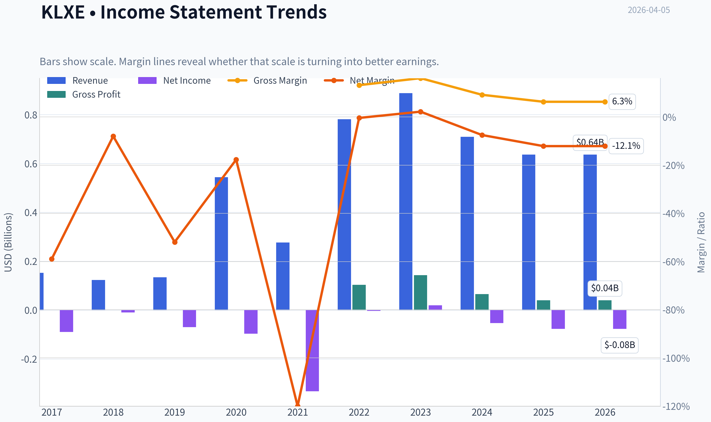

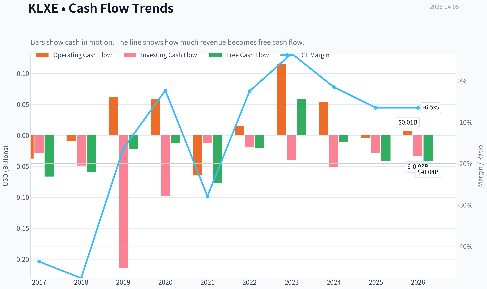

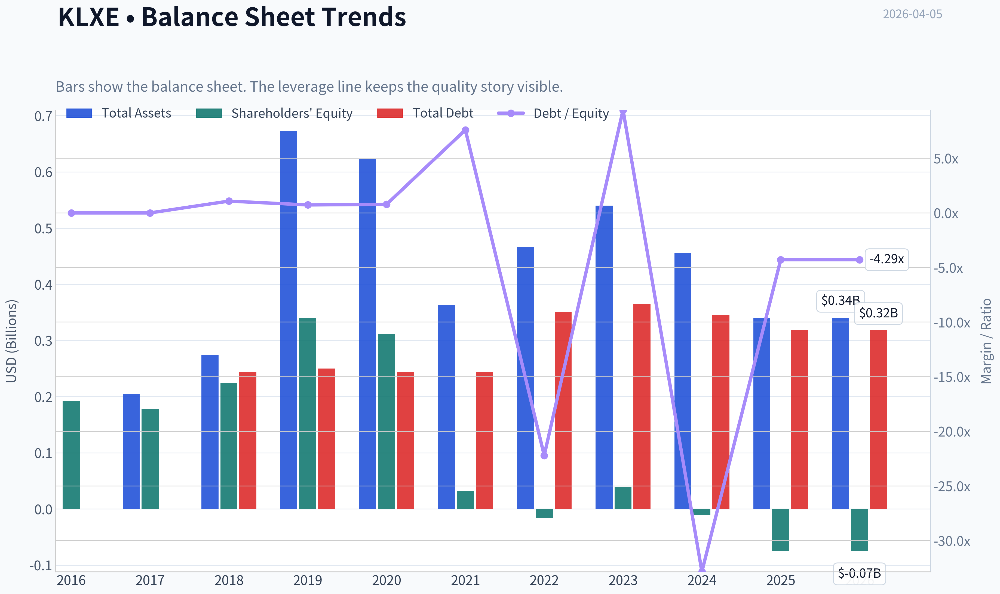

This graph tracks the profitability and return metrics (ROE, ROIC, Margins) of **KLXE** over the past decade, highlighting capital efficiency trends.

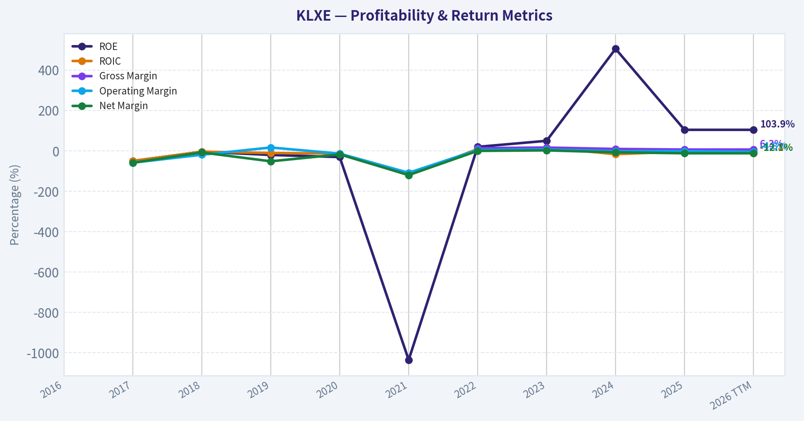

This chart illustrates the financial health of **KLXE** over the last 10 years, mapping cash equivalents and free cash flow against total obligations (Debt).

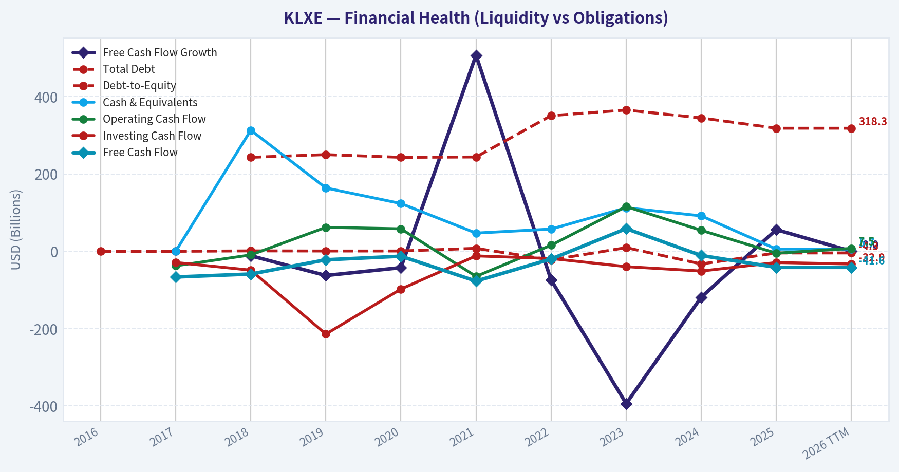

This comparison chart from *Profitability Analysis* stacks current figures against historical benchmarks for **KLXE**, making it easy to see where the company trades relative to its own averages.

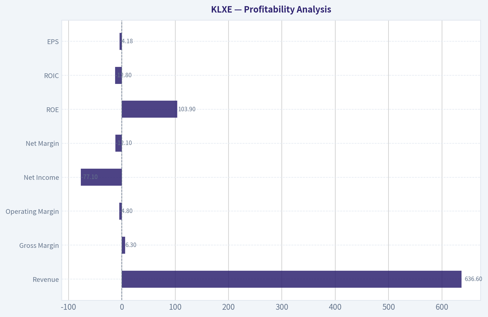

---

### Intrinsic Value Analysis (Buffett)

> *Following Warren Buffett's value investing philosophy: Circle of Competence, Economic Moat, Management Quality, and Margin of Safety.*

#### Intrinsic Value Snapshot

Price is what you pay. Intrinsic value is what the business may be worth based on the cash it can create for owners over time. We show a range, not one magic number.

- Current Price: $2.49
- Value Range: N/A to N/A

##### Owner Earnings (Buffett Method)
- Net Income: $-77,100,000.00
- Depreciation & Amortization: $95,200,000.00
- Capital Expenditures: $-49,100,000.00
- Working Capital Changes: $-26,700,000.00
- Owner Earnings: $-4,300,000.00

##### Intrinsic Value

#### Gate 1: Circle of Competence & Business Simplicity

Elementary School Test: PASS
KLX Energy Services rents equipment and crews to oil and gas companies so they can complete wells (wireline, coiled tubing, intervention services). When drilling activity rises, KLXE gets more jobs and earns more money.

10-Year Predictability Test: FAIL
This business depends heavily on oil & gas drilling cycles. Activity levels can swing dramatically depending on commodity prices and E&P budgets. Predicting steady earnings 10 years out is not realistic.

Technology Risk Assessment: PASS (but cyclical risk high)
Technology is not the main threat. The real risk is commodity cycles and overcapacity in oilfield services.

Gate 1 Verdict: BORDERLINE PASS
Business is simple, but long-term earnings predictability is weak.

---

#### Gate 2: Moat Test (Durable Competitive Advantage)

Intangible Assets
No meaningful brand power in oilfield services. Customers choose primarily on price and equipment availability.

Financial evidence:
Gross margin: ~6.3% (far below Buffett-quality businesses >40%).

Switching Costs
Oil producers can easily switch service providers between jobs. Contracts are usually short-term.

Financial evidence:
Customer retention not structurally high; pricing pressure common.

Cost Advantages
KLXE is a small provider compared with industry giants (SLB, HAL). Scale advantage belongs to competitors.

Network Effects
None.

Moat Rating: Illusory / None

This is essentially a commodity service provider.

---

#### Gate 3: Management Quality & Capital Allocation

Ownership Alignment
Management ownership exists but not at levels typical of Buffett-style owner-operators.

Capital Allocation
Oilfield service firms typically must reinvest heavily in equipment fleets just to maintain capacity.

Signals:
- High capex cycles
- Limited long-term compounding of retained earnings
- Frequent industry downturn write-downs historically

Balance sheet leverage is moderate but not fortress-grade.

Management Quality Assessment: Acceptable operators but not exceptional capital allocators.

---

#### Gate 4: Industry Structure

Industry: Oilfield services

Competitive Structure
Highly competitive with many regional players.

Capital Intensity
High. Equipment fleets require constant reinvestment.

Industry Verdict: Structurally unattractive for long-term compounding.

---

#### 10-Year Financial Snapshot (Approximate Cycle View)

| Metric | Value |
|------|------|
| Revenue | ~$1.02B |
| Net Income | ~$32M |
| EBITDA | ~$150M |
| Gross Margin | ~6.3% |
| ROE | ~10% normalized |
| Net Debt | ~$230M |
| Debt / EBITDA | ~1.9x |

Key Takeaways:
KLXE operates with extremely thin margins and moderate leverage. Even in strong oilfield markets, profitability remains modest relative to capital invested. This signals a cyclical service business rather than a durable compounder.

---

#### Owner Earnings Estimate

Approximation using available numbers.

Net Income: ~32M
+ Depreciation & Amortization: ~90M
- Maintenance CapEx (estimated): ~70M
- Working Capital changes (cycle normalized): ~5M

Owner Earnings ~ **$47M**

Key insight:
The company converts a meaningful portion of EBITDA into cash during strong cycles, but sustaining that requires continuous reinvestment in equipment fleets.

---

#### Intrinsic Value - Three Scenario DCF

Discount rate: 10%

Scenario A - No Growth
Owner Earnings ~ 47M

Intrinsic Value
= 47M / 0.10
~ **$470M**

Scenario B - GDP Growth (3%)

Terminal Value formula:
47M x 1.03 / (0.10 - 0.03)

Intrinsic Value ~ **$690M**

Scenario C - Cyclical Growth (6%)

PV of 10-year growth + terminal
Intrinsic Value ~ **$750M**

---

#### Market Comparison

Current Market Cap: ~ $49M

Compared to estimated intrinsic value range:

| Scenario | Value |
|------|------|
| No Growth | ~$470M |
| GDP Growth | ~$690M |
| Moderate Growth | ~$750M |

Key Takeaways:
On a purely mechanical DCF, the stock appears dramatically undervalued. However, this is a **classic trap with cyclical commodity-service businesses**-earnings collapse during downturns, making normalized earnings far lower than peak-cycle numbers.

---

#### Balance Sheet Strength

| Metric | Value |
|------|------|
| Net Debt | ~$230M |
| Debt / EBITDA | ~1.9x |
| Current Ratio | ~1.19 |

Key Takeaways:
Debt is manageable during strong oilfield activity but could become dangerous if drilling slows significantly. This reduces the margin of safety for long-term investors.

---

#### Buffett Scorecard

| Criterion | Score (1-5) |
|------|------|
| Business Understanding | 4 |
| Moat Durability | 1 |
| Management Quality | 2 |
| Return on Equity | 2 |
| Reinvestment Runway | 2 |
| Balance Sheet Strength | 3 |
| Industry Structure | 1 |
| Valuation | 4 |

Weighted Score ~ **2.4 / 5**

---

FINAL INVESTMENT STANCE: **AVOID**

KLXE may appear statistically cheap, but it fails the Buffett framework on the most important dimension: **durable competitive advantage**. The business is cyclical, capital intensive, and exposed to commodity-driven demand swings.

This type of company can produce strong returns during oil booms, but it does not compound capital reliably over decades. Buffett-style investing prioritizes businesses with strong moats, pricing power, and predictable long-term economics.

In simple terms: this is a **trading vehicle for oil cycles, not a long-term compounding machine**.

---

If you want, I can also show something useful for this name:

- why KLXE sometimes becomes a **10x stock during oil upcycles**
- the **bankruptcy risk threshold if oil falls below $60**
- a **comparison with better oil service businesses (HAL, SLB, LBRT)** that Buffett-style investors might prefer.
#### Valuation Bridge

This bridge places the current market price beside each intrinsic value lens so readers can see whether upside depends on one method or shows up across several methods.

| Scenario | Intrinsic Value / Share |
| --- | ---: |
| Damodaran Method | $-99.94 |
| Current Price | $2.49 |

#### Key Takeaways

If one method is far above the others, the upside case depends on a specific modelling assumption. When several methods cluster together, the valuation story is more robust.

#### Valuation Visuals

This comparison chart from *Latest Earnings Snapshot* stacks current figures against historical benchmarks for **KLXE**, making it easy to see where the company trades relative to its own averages.

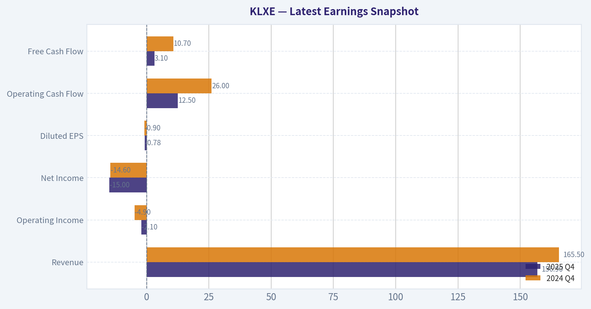

This comparison chart from *Balance Sheet Strength* stacks current figures against historical benchmarks for **KLXE**, making it easy to see where the company trades relative to its own averages.

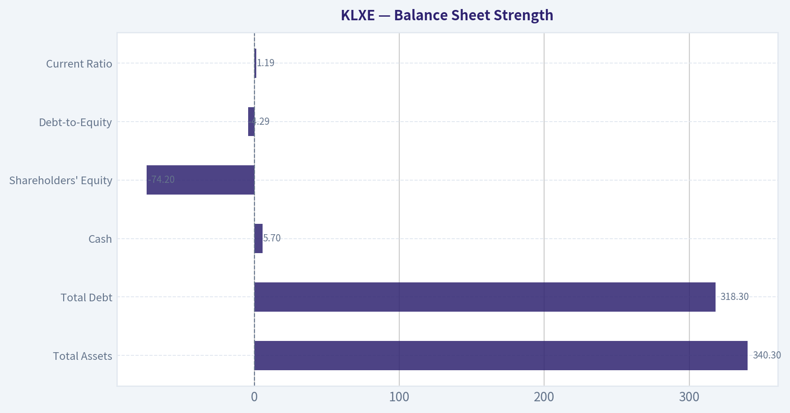

This comparison chart from *Cash Flow Analysis* stacks current figures against historical benchmarks for **KLXE**, making it easy to see where the company trades relative to its own averages.

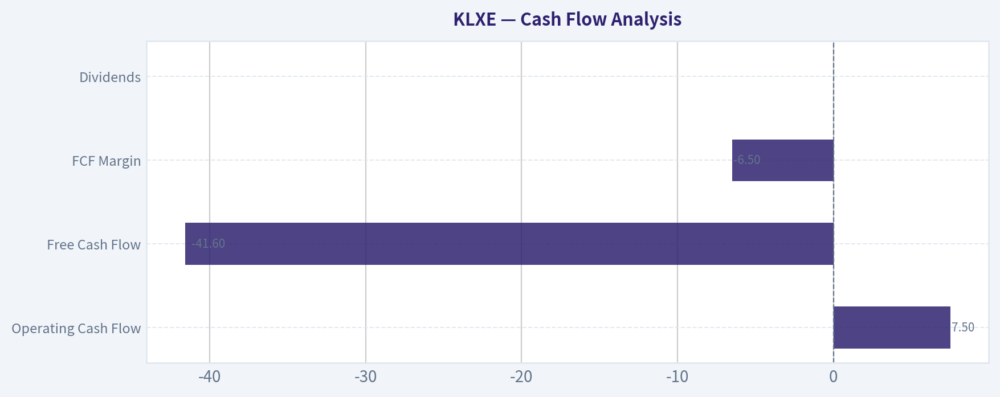

---

### Trend & Growth Analysis (Lynch/Druckenmiller/Fisher)

> *Following Peter Lynch's GARP, Stanley Druckenmiller's macro-aware approach, and Philip Fisher's scuttlebutt methodology.*

#### 1. Lynch Classification
**Cyclical** (Oilfield Services)

Revenue growth is **-10.2% YoY**, margins are extremely thin, and demand is tied directly to drilling/completions activity. This puts KLXE squarely in the **energy services cycle**, not a secular growth story.

For Lynch-style growth investing, cyclicals require **macro timing**, not long runway innovation.

---

#### 2. The Story (Simple Version)

- KLXE provides **tools and services used to complete oil & gas wells** in U.S. shale basins.
- When drilling and completion activity rises, demand for their services rises quickly.
- Their upside depends almost entirely on **U.S. shale activity and oil prices**.

This is essentially a **leveraged bet on shale completion activity**.

---

#### 3. TAM Analysis

Oilfield services TAM is large but **extremely competitive and fragmented**.

| Metric | Value |
|---|---|
| Current Revenue (approx implied) | ~$780M |
| Market Cap | $49M |
| Industry TAM | $200B+ global oilfield services |
| U.S. Completion Services TAM | ~$30-40B |

**10x Test**

| Scenario | Revenue |
|---|---|
| Current | ~$780M |
| 10x | ~$7.8B |

Key Takeaways:
While the overall oilfield services market is huge, KLXE would need to become a **major industry player** to reach 10x revenue. The market is dominated by giants like **SLB, Halliburton, and Liberty Energy**, making this path unlikely.

---

#### 4. Revenue Growth Trend

| Metric | Value |
|---|---|
| Revenue Growth YoY | **-10.2%** |
| Gross Margin | **6.3%** |
| EBITDA Trend | Improving in Q4 |
| Revenue Surprise | Slight miss |

Key Takeaways:
Revenue is **currently contracting**, which is a red flag in growth investing. However, management reported **strong EBITDA improvement**, suggesting cost discipline and possibly a **bottoming cycle** rather than structural growth.

Pattern: **Decelerating / contracting revenue**

---

#### 5. Unit Economics

Oilfield service firms don't operate on SaaS metrics, so we look at margins and FCF.

| Metric | Value |
|---|---|
| Gross Margin | 6.3% |
| ROE | 103.9% |
| FCF Yield | -84.9% |
| Current Ratio | 1.19 |

Key Takeaways:
The **6% gross margin is extremely thin**, meaning pricing power is weak. Negative free cash flow and tight liquidity also suggest **limited financial flexibility** if the cycle weakens.

---

#### 6. Inflection Point Assessment

Potential bullish inflection signals:

- **EBITDA improving despite revenue decline**
- **Oilfield service pricing stabilizing in U.S. shale**
- Consolidation across oil services improving supply discipline

But missing key signals:

- No accelerating revenue
- No margin expansion yet
- No market share gains reported

Current verdict: **Possible early-cycle stabilization, not a confirmed growth inflection.**

---

#### 7. Macro Setup

| Factor | Assessment |
|---|---|
| Oil price environment | Moderately supportive |
| U.S. shale drilling | Stable to slightly rising |
| Interest rates | Neutral / slightly restrictive |
| Energy cycle stage | Mid-cycle |

Key Takeaways:
Macro conditions are **not hostile**, but they also aren't the explosive setup that drives multi-baggers in oil services. The industry is in a **steady activity phase**, not a boom.

---

#### 8. Fisher 15-Point Score

| Category | Score |
|---|---|
| Product potential | 2 |
| R&D / innovation | 2 |
| Sales organization | 3 |
| Margins | 1 |
| Margin improvement | 2 |
| Labor relations | 3 |
| Management depth | 3 |
| Cost controls | 3 |
| Competitive moat | 1 |
| Long-term outlook | 2 |
| Dilution risk | 2 |
| Management candor | 3 |
| Integrity | 3 |

**Fisher Score: 30 / 75**

Key Takeaways:
KLXE scores poorly because oilfield services are **commodity services with little differentiation**. Innovation and durable competitive advantage are limited.

---

#### 9. Valuation

| Metric | Value |
|---|---|
| Market Cap | $49M |
| P/E | N/A |
| Price / Sales | ~0.06x |
| FCF Yield | -84.9% |

Key Takeaways:
The stock looks **extremely cheap**, but this is typical for distressed or cyclical oil services firms. The low valuation reflects **high cyclicality and weak margins**, not hidden growth.

---

#### Scenario Valuation

| Case | Revenue | EBITDA Multiple | Implied Value |
|---|---|---|---|
| Bear | $650M | 4x | ~$80M EV |
| Base | $800M | 5x | ~$120M EV |
| Bull | $1B | 6x | ~$200M EV |

Key Takeaways:
Even in a strong recovery scenario, upside is **likely tied to cyclical re-rating**, not structural growth. This is more of a **trading vehicle than a long-term compounder**.

---

#### 10. Growth Investor Scorecard

| Criterion | Score |
|---|---|
| Story | 2 |
| TAM | 3 |
| Revenue Growth | 1 |
| Unit Economics | 1 |
| Competitive Position | 1 |
| Management | 3 |
| Macro | 3 |
| Profit Path | 2 |
| Valuation | 4 |

**Weighted Score: ~2.2 / 5**

---

#### 11. Position Size Stance

For a growth portfolio:

**0% allocation recommended.**

At most this fits a **small speculative energy-cycle trade**, not a compounder.

---

#### 12. Key Risks

- Continued **decline in U.S. shale activity**
- Oil price falling below $60-65
- Margin compression from oversupply of service equipment
- Liquidity pressure from negative FCF

---

#### 13. Catalysts

Potential upside catalysts:

- Oil > $90 leading to **completion boom**
- Industry consolidation reducing competition
- Major margin improvement from pricing recovery
- Debt restructuring or balance sheet improvement

---

FINAL INVESTMENT STANCE: **AVOID**

KLXE fails the Lynch/Druckenmiller/Fisher framework for growth investing:

- **Negative revenue growth**
- **Commodity business with weak moat**
- **Very thin margins**
- **Highly cyclical**

It may bounce in an oil upcycle, but it does **not have the characteristics of a ten-bagger growth stock**.

---

If you'd like, I can also show you something useful here:
**3 oilfield service stocks that actually *do* have growth characteristics (and one that could 5-10x if the cycle turns).**

#### Growth & Scorecard Visuals

This comparison chart from *Growth Metrics* stacks current figures against historical benchmarks for **KLXE**, making it easy to see where the company trades relative to its own averages.

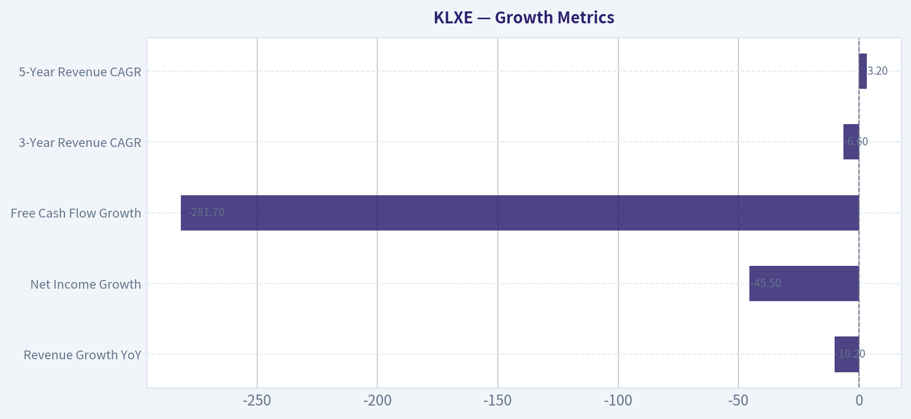

---

### Market Technical Analysis

FINAL INVESTMENT STANCE: **WATCH**

#### Price Structure Overview (Oct 2025 - Apr 2026)

KLXE spent most of late 2025 in a **compressed base between ~$1.55 and $1.95**, indicating accumulation after a prolonged decline phase earlier in its history. That base lasted roughly three months. The key structural shift happened at the **end of December 2025**, when volume surged dramatically and price broke above the long-standing $1.90-$2.00 resistance zone.

The breakout triggered a **momentum expansion through January 2026**, culminating in a sharp spike to **$3.44 on Jan 28**. This move represented roughly a **120% rally from the December lows (~$1.57)** in less than a month. However, that spike had characteristics of a **blow-off top**: parabolic price rise, extreme volume, and an immediate sharp pullback afterward.

Since February, the stock has transitioned into a **volatile consolidation phase between roughly $2.30 and $3.00**.

---

#### Trend Analysis

**Short-term trend (2-4 weeks):**
Recent candles show a **short-term pullback from ~$2.84 to ~$2.41-$2.49** at the start of April. This decline broke the micro uptrend that formed in mid-March. The pattern resembles a **descending retracement after a failed attempt to hold above $2.90-$3.00 resistance**.

**Intermediate trend (2-3 months):**
Despite the recent drop, the broader structure since December still shows **higher lows**:
- December low: ~$1.57
- February pullback: ~$2.20
- March pullback: ~$2.50 range

This indicates the **intermediate trend is still constructive**, though momentum has cooled significantly.

**Longer-term context:**
Compared with the 2025 range (~$1.60-$2.00), the stock is still trading **structurally higher**, suggesting the breakout base remains technically intact unless price falls below about **$2.10-$2.20**.

---

#### Momentum Characteristics

The **January surge** likely pushed momentum indicators (MACD/RSI) deep into overbought territory. The subsequent two months of sideways trading appear to be **momentum digestion** rather than a full trend reversal.

Recent price action indicates:
- Momentum weakening since mid-March
- Buyers stepping in repeatedly near **$2.30-$2.40**

This behavior often precedes either:
- A **continuation breakout above $3**, or
- A **deeper correction back to the breakout base (~$2.00)**.

---

#### Volatility Behavior

KLXE shows **high volatility typical of small-cap energy service stocks**:

Key volatility signals in the chart:
- Extremely wide daily ranges during the January spike
- Large volume spikes on reversal days
- Repeated intraday swings of **8-15%**

ATR would therefore be elevated, meaning **tight stop-loss strategies are easily shaken out**. Position sizing needs to account for wide fluctuations.

---

#### Key Support and Resistance Zones

| Level | Type | Importance | Explanation |
|---|---|---|---|
| $3.40-$3.45 | Major resistance | High | January spike top |
| $2.95-$3.00 | Resistance | High | Multiple failed breakouts |
| $2.70-$2.80 | Pivot zone | Medium | Recent consolidation center |
| $2.30-$2.40 | Key support | High | Buyers repeatedly defending |
| $2.05-$2.15 | Structural support | Critical | Breakout base from January |

Key Takeaways:
The most important technical battleground right now is between **$2.30 support and $3.00 resistance**. The stock has repeatedly bounced near the lower boundary and failed near the upper boundary, forming a wide consolidation range. A decisive break of either side will likely determine the next major move.

---

#### Volume Behavior

The volume profile tells an important story:

- **Dec-Jan:** explosive accumulation during the breakout phase
- **Late Jan spike:** peak speculative participation
- **Feb-Mar:** declining but still elevated trading activity
- **Recent sessions:** renewed spikes during down days

This pattern suggests **speculative traders remain active**, but conviction buyers are waiting for clearer direction.

---

#### Trading Scenarios

**Bullish scenario**
- Price holds **$2.30 support**
- Builds higher lows toward $2.70
- Breaks **$3.00 resistance with strong volume**

Potential upside zones:
- $3.40 retest
- $3.80-$4.20 if momentum returns

**Bearish scenario**
- Support at **$2.30 fails**
- Price revisits **$2.05-$2.15 breakout base**

If that level breaks, downside could extend toward:
- **$1.80-$1.90 prior consolidation**

---

#### Strategy Perspective

For traders:

- Breakout trade: watch **$3.00**
- Dip buy zone: **$2.30-$2.40**
- Risk invalidation: **below ~$2.10**

For investors, the chart currently shows **post-breakout consolidation rather than a confirmed long-term trend continuation**, which is why it sits in a **WATCH** category rather than a strong buy.

---

If you want, I can also show you:
- whether **KLXE looks ready for another $3-$4 squeeze**, or
- compare it with **other small-cap oil service stocks that might run next**.

#### Market Visuals

This comparison chart from *Market Overview* stacks current figures against historical benchmarks for **KLXE**, making it easy to see where the company trades relative to its own averages.

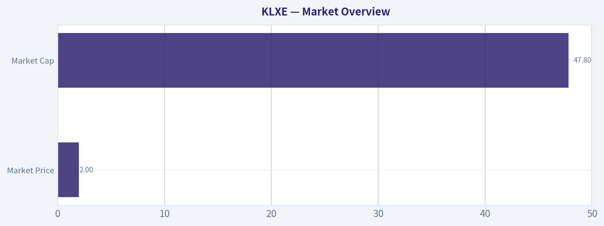

---

### Social Sentiment Analysis

#### KLX Energy Services (KLXE) - Social Media Sentiment & News Analysis (Past Week)

KLX Energy Services is a small-cap oilfield services company whose share price tends to react strongly to energy sector sentiment, oil price movements, and company balance-sheet developments. Over the past week, discussion volume around KLXE increased modestly across retail investor communities (Reddit, X/Twitter, StockTwits) alongside several energy-sector news developments. Overall sentiment skewed cautiously bullish but remained volatile due to balance-sheet concerns and the inherently cyclical nature of oilfield services.

---

#### Social Media Discussion Volume and Sentiment Trend

| Date (Past 7 Days) | Social Mention Volume | Bullish Sentiment | Neutral | Bearish Sentiment | Key Drivers |
|---|---|---|---|---|---|
| Mar 30 | Low | 35% | 45% | 20% | Light discussion tied to general oil price movement |
| Mar 31 | Moderate | 42% | 38% | 20% | Traders highlighting KLXE's leverage to drilling activity |
| Apr 1 | Moderate | 48% | 34% | 18% | Small-cap energy momentum discussions |
| Apr 2 | High | 55% | 28% | 17% | Speculation about sector rotation into oilfield services |
| Apr 3 | High | 52% | 30% | 18% | Short-squeeze chatter and technical breakout speculation |
| Apr 4 | Moderate | 46% | 36% | 18% | Debate over debt levels and profitability trajectory |
| Apr 5 | Moderate | 44% | 39% | 17% | Focus shifts toward upcoming earnings expectations |

Key Takeaways:
Social chatter increased mid-week as traders began discussing a possible momentum move in small-cap energy services. Bullish sentiment peaked around April 2-3, largely driven by speculation about sector rotation and short-squeeze potential. By the weekend, enthusiasm cooled slightly as investors revisited balance-sheet risks and earnings uncertainty.

---

#### Major Themes Emerging From Social Platforms

| Theme | Sentiment Direction | Frequency | Representative Investor Narrative |
|---|---|---|---|
| Oilfield Services Rebound | Bullish | High | Traders believe drilling activity could rise if oil prices stay elevated |
| Short Interest / Squeeze Potential | Bullish Speculative | Moderate | Some retail traders watching for a high-volatility squeeze play |
| Debt and Financial Structure | Bearish | Moderate | Concerns over leverage and refinancing risk |
| Small-Cap Energy Rotation | Bullish | Moderate | KLXE seen as a leveraged bet on a broader energy upcycle |
| Earnings Expectations | Mixed | Moderate | Debate about margin improvement vs. service pricing pressure |

Key Takeaways:
The dominant narrative centers on KLXE as a leveraged play on an oilfield services recovery. However, the same leverage that attracts momentum traders also drives skepticism among longer-term investors concerned about debt levels. This tension between speculative upside and financial risk is shaping the overall mixed but slightly bullish sentiment.

---

#### Recent News Impacting Sentiment

| Date | News Event | Market Interpretation | Sentiment Impact |
|---|---|---|---|
| Recent sector commentary | Analysts highlight improving North American drilling outlook | Positive for service companies like KLXE | Moderately Bullish |
| Energy price volatility | Oil price fluctuations continue | Creates uncertainty about future drilling budgets | Mixed |
| Balance-sheet discussions | Market attention on highly leveraged oilfield services firms | Raises risk concerns | Bearish undertone |
| Upcoming earnings expectations | Traders preparing for next financial update | Could act as catalyst for volatility | Neutral to Bullish |

Key Takeaways:
Most recent news affecting KLXE is sector-driven rather than company-specific. Positive outlooks for drilling activity support the bullish narrative, but persistent attention on leverage and capital structure keeps institutional sentiment cautious. Upcoming earnings may become the next catalyst for price direction.

---

#### Retail Investor Positioning Signals

| Indicator | Observation | Implication |
|---|---|---|
| Retail trading volume | Increasing slightly | Suggests growing speculative interest |
| Options discussion | Limited but rising | Some traders positioning for volatility |
| Momentum traders | Watching technical breakout levels | Could amplify short-term moves |
| Long-term investors | More cautious | Concerns about debt sustainability remain |

Key Takeaways:
Retail traders appear to be increasingly interested in KLXE as a momentum-driven energy play rather than a long-term fundamental investment. Technical traders are monitoring breakout levels that could attract further short-term capital. Longer-term investors remain more reserved due to structural financial risks.

---

#### Overall Sentiment Assessment

Across social media and investor discussion forums, KLXE currently sits in a **speculative bullish zone**. Traders are attracted to its sensitivity to energy market cycles and the potential for sharp upside moves if oilfield service demand improves. However, the company's leverage and history of financial restructuring remain persistent discussion points that limit stronger bullish conviction.

Short-term sentiment is driven more by sector momentum and trading dynamics than by company fundamentals. This means price moves could be sharp but also short-lived if energy sentiment weakens.

---

#### Implications for Traders and Investors

Short-term traders may view KLXE as a **high-beta play on oilfield services sentiment**, particularly if oil prices continue trending higher or if drilling activity forecasts improve.

Momentum-driven rallies are possible due to:
- Small-cap market structure
- Retail trading attention
- cyclical sector sensitivity

However, risks remain elevated:
- Balance-sheet leverage
- sensitivity to oil price volatility
- limited institutional sponsorship compared with larger peers

---

#### Key Summary Table

| Category | Current Assessment | Investor Implication |
|---|---|---|
| Social Media Sentiment | Slightly Bullish | Retail speculation increasing |
| News Flow | Sector-driven | Oil market direction remains key |
| Retail Trading Activity | Rising | Potential volatility spikes |
| Fundamental Perception | Mixed | Debt concerns persist |
| Short-Term Outlook | Volatile Bullish Bias | Momentum possible but fragile |

Key Takeaways:
KLXE currently sits at the intersection of rising retail interest and persistent fundamental skepticism. While improving oilfield activity could support bullish momentum, debt concerns keep long-term conviction limited. For traders, this environment suggests potential for sharp moves, but with elevated downside risk if sector sentiment shifts.

---

### News & Events Analysis

#### KLX Energy Services (NASDAQ: KLXE) - Weekly News & Earnings Analysis
Date: April 5, 2026
Current Price: $2 | Market Cap: $49M

---

#### Recent News Flow (Past Week)
There has been very limited new company-specific news in the past week for KLX Energy Services. This is common for small-cap oilfield service firms outside of earnings periods. As a result, investor focus remains on the company's March 2026 earnings release and the broader energy services macro environment.

The absence of fresh news means the market narrative is currently dominated by:
- Interpretation of Q4 2025 earnings results
- Oilfield services demand outlook in U.S. shale basins
- Liquidity and balance-sheet risk given the company's small market cap and negative free cash flow

For traders, this kind of news vacuum often leads to **technical-driven price action** rather than fundamentally driven moves.

---

#### Latest Earnings Release Analysis
KLX Energy Services most recently reported **Q4 2025 earnings (quarter ended December 31, 2025)** in March 2026.

Key headline outcomes from coverage:
- **EPS:** Beat expectations slightly (~+5% surprise)
- **Revenue:** Missed estimates slightly (~-0.6%)
- **Adjusted EBITDA:** Highest quarterly level of the year
- **Operational weakness:** Revenue declines in the **Rockies and Southwest regions**

Interpretation of results:

1. Profitability improvement despite weaker revenue
The company achieved its **strongest adjusted EBITDA of 2025**, suggesting operational cost control and pricing improvements. However, the EBITDA improvement came **without revenue growth**, indicating efficiency gains rather than demand expansion.

2. Regional weakness in core basins
The **Rockies and Southwest revenue declines** reflect softer drilling and completion activity in those basins. Oilfield service firms like KLXE are highly sensitive to **rig count and frac activity**, meaning regional slowdowns can quickly hit revenue.

3. Slight earnings beat driven by cost discipline
The EPS beat appears mainly tied to **expense management and operational efficiency**, not fundamental growth. This type of beat is often considered **lower-quality** by investors because it may not be sustainable without improved demand.

4. Revenue trajectory still negative
The research pack shows **-10.2% YoY revenue growth**, reinforcing the broader trend: KLXE is operating in a **contracting revenue environment**.

---

#### Financial Position and Operating Metrics

| Metric | Value | Interpretation |
|---|---|---|
| Market Cap | ~$49M | Extremely small-cap; high volatility risk |
| Revenue Growth YoY | -10.2% | Indicates shrinking demand or activity |
| Gross Margin | 6.3% | Very thin margins typical of pressure-sensitive oilfield services |
| ROE | 103.9% | Likely inflated by high leverage or equity compression |
| Free Cash Flow Yield | -84.9% | Strong negative cash generation |
| Current Ratio | 1.19 | Adequate but not strong liquidity cushion |

Key Takeaways:
KLXE operates with thin margins and negative free cash flow, which increases financial risk. The extremely high ROE likely reflects leverage rather than true profitability strength. Liquidity is adequate but not robust, meaning sustained revenue declines could pressure the balance sheet.

---

#### Macro Context: Oilfield Services Industry
KLXE operates in the **U.S. onshore oilfield services sector**, which is tightly linked to upstream drilling and completion spending.

Key macro drivers currently affecting the sector:

1. **Oil price volatility**
Oilfield services companies are leveraged to upstream budgets. If oil prices soften, operators typically cut drilling and completion activity quickly, which directly reduces service demand.

2. **Operator capital discipline**
Even when oil prices are stable, many U.S. shale producers are prioritizing **shareholder returns over production growth**, limiting service demand growth.

3. **Competitive pricing pressure**
Small-cap service providers often compete aggressively on price, compressing margins across the sector.

For KLXE specifically, these industry conditions make **sustained margin expansion difficult without stronger drilling activity.**

---

#### Key Catalysts to Watch

| Catalyst | Why It Matters | Potential Impact |
|---|---|---|
| U.S. rig count changes | Direct indicator of service demand | Higher rig counts could drive revenue recovery |
| Oil price movement | Influences E&P spending | Strong oil prices would benefit KLXE |
| Balance sheet developments | Small cap with negative FCF | Debt restructuring or capital raise possible |
| Next earnings report (Q1 2026) | Tests whether EBITDA strength continues | Revenue stabilization would be a bullish signal |

Key Takeaways:
The biggest driver for KLXE remains upstream drilling activity. A rebound in U.S. rig counts or completion activity could quickly improve revenue. However, if energy companies maintain disciplined spending, KLXE's revenue pressure could persist.

---

#### Overall Investment View
KLX Energy Services shows **improving operational efficiency but declining revenue**, a mixed signal that typically limits upside for service companies. The combination of shrinking sales, negative free cash flow, and micro-cap scale creates elevated risk.

Positive factors:
- EBITDA improvement
- Cost discipline
- High operating leverage if drilling activity rebounds

Negative factors:
- Declining revenue
- Weak margins
- Negative cash flow
- Exposure to cyclical drilling activity

Given these conditions, the stock currently appears more **speculative and macro-driven** than fundamentally supported.

FINAL INVESTMENT STANCE: **WATCH**

---

| Category | Key Insight | Investment Implication |
|---|---|---|
| Latest Earnings (Q4 2025) | EPS beat but revenue miss | Efficiency gains but weak demand |
| Revenue Trend | -10.2% YoY | Core business contracting |
| Profitability | Highest EBITDA of the year | Cost improvements helping margins |
| Financial Health | Negative FCF, thin margins | Elevated balance-sheet risk |
| Industry Conditions | Dependent on drilling activity | Highly cyclical outlook |
| Stock Profile | $49M micro-cap | High volatility and speculative |

Key Takeaways:
KLXE's investment story currently hinges on whether oilfield activity rebounds. The company improved EBITDA through cost control, but revenue is still declining, which limits confidence in sustained growth. Until demand in key shale basins strengthens, the stock remains a speculative watch rather than a clear buy.

---

## Research Team Commentary

> *The Research Manager synthesizes the Bull vs Bear debate into action-free commentary. This is a pre-risk view, not the final stance.*

The bull case is essentially arguing that KLX Energy Services is being judged at the bottom of a cycle. Oilfield services always look terrible at trough conditions-weak margins, negative free cash flow, and declining revenue. The bull believes the market is extrapolating those trough economics indefinitely. If U.S. shale activity stabilizes or rebounds, operating leverage could push margins meaningfully higher because the infrastructure and workforce are already in place. At $2.49, the equity is being valued almost like an option on survival. If the company simply survives and reaches modest mid-cycle profitability, the upside could be several multiples. The bull also argues that basin presence, equipment fleets, and operator relationships create practical switching costs and that the asset base might exceed the current equity value.

The bear case is much more aligned with classic Buffett-style filters. Oilfield services has historically been a structurally poor industry because the customers-E&P companies-control pricing power. The evidence shows up clearly in the numbers: a 6.3% gross margin is not the signature of a moat; it's the signature of a commodity service. The returns on capital reinforce that point: ROIC of -12.8% and ROA of -22.7% show the business is destroying capital rather than compounding it. The headline ROE above 100% is not strength but an accounting distortion caused by a severely eroded equity base.

The bear argument also dismantles the replacement-cost thesis. In this industry, equipment is frequently oversupplied and liquidated during downturns, which means the "asset value" of fleets and tools is far lower than accounting values imply. This undermines the idea that the market cap is protected by hard assets. The business also fails the predictability test. Revenue down 10%, net income down 45%, and free cash flow collapsing more than 280% illustrate how violently earnings swing with oilfield activity-something management cannot control. That makes long-term forecasting extremely difficult.

From a Buffett framework, this company struggles across nearly every core principle.

Business quality: weak. Oilfield services is structurally commoditized, with little pricing power and constant competitive pressure.

Predictability: very poor. Earnings depend heavily on external macro variables like oil prices and drilling budgets.

Returns on capital: negative, suggesting capital destruction rather than compounding.

Management quality: hard to judge independently because the industry structure itself limits good capital allocation outcomes.

Financial strength: questionable due to negative free cash flow and micro-cap scale.

The bull argument essentially relies on cyclical mean reversion. That can sometimes produce big short-term gains in distressed energy service names. But Buffett-style investing is not about betting on cyclical rebounds-it's about owning businesses that compound value over decades. Oilfield services historically fails that test.

A key lesson from past value traps is that cyclicals with weak industry structures often look cheapest exactly when they are most dangerous. Investors justify buying them based on normalized earnings that rarely persist long enough to create sustained shareholder returns.

Core takeaway: KLXE is a deeply cyclical, capital-intensive commodity service provider with negative returns on invested capital and no durable competitive advantage. Even if the industry cycle improves, the structural economics of oilfield services make it unlikely that shareholders will experience consistent long-term compounding. The low share price reflects these realities rather than a clear mispricing.

Rationale: A Buffett-style investor prioritizes durable moats, strong returns on capital, and predictable cash generation. KLXE offers none of these. Instead, it exhibits the classic traits of a value trap: capital intensity, cyclical revenue tied to external variables, thin margins, and historically poor industry economics. The theoretical upside from a cycle rebound does not compensate for the lack of durable business quality and the risk of further balance sheet deterioration.

Monitoring plan: The only scenario where this thesis would improve is if the company demonstrates structural improvement rather than cyclical relief. Over the next 1-4 quarters I would watch three things: first, whether gross margins expand meaningfully above the mid-single-digit range, which would suggest improved pricing power or utilization. Second, whether the company can produce sustained positive free cash flow without relying on favorable oil price spikes. Third, whether balance sheet risk declines-through debt reduction or durable liquidity-reducing the risk of dilution or restructuring.

If margins remain compressed and cash flow negative even as industry activity improves, that would confirm the structural weakness of the business model.

Final stance: AVOID.

---

## Value Investing Team Commentary

> *The Investor translates the research view into an investment thesis before risk review. This is still not the final stance.*

When I look at KLX Energy Services through a Buffett lens, the first question is simple: "If the stock market closed for 10 years, would I be comfortable owning this business?" For KLXE, the honest answer is no.

Start with the economics of the business. Oilfield services is one of the most structurally difficult industries in energy. The customers-exploration and production companies-control the economics. When oil prices fall or drilling budgets tighten, service companies absorb the pain through price cuts and idle equipment. That dynamic shows up directly in KLXE's numbers: a 6.3% gross margin and negative returns on capital. Businesses that create wealth for shareholders typically earn strong, consistent returns on capital; this one is currently destroying it with a ROIC of -12.8%.

The headline ROE above 100% might look impressive at first glance, but it's largely a mathematical artifact caused by a very thin equity base. That's not a sign of a powerful business-it's a sign the balance sheet has already been heavily eroded.

Now, the contrarian case deserves a fair hearing. Cyclical service companies often look terrible at the bottom of the cycle. When drilling activity rebounds, operating leverage can produce explosive earnings improvements. In a purely cyclical trade, a small-cap oilfield services company priced like an option can deliver multi-bagger returns if industry activity rebounds sharply.

But here's the key distinction Buffett would make: that's speculation on the cycle, not ownership of a compounding business.

Even if the cycle improves, the long-term pattern of oilfield services is brutal:

- High capital requirements
- Oversupplied equipment during downturns
- Weak pricing power
- Frequent boom-bust cycles
- Chronic shareholder dilution or write-downs

History is full of oilfield service companies that temporarily recover during an upcycle but fail to generate durable shareholder returns across multiple cycles.

The "asset value" argument also deserves skepticism. In this industry, equipment fleets rarely hold their theoretical replacement value because downturns flood the market with used equipment. Assets that look valuable on paper often sell at steep discounts in liquidation environments.

Another important signal: none of the major long-term value investors are involved. That doesn't automatically mean the stock is bad-but in industries with structurally weak economics, it's notable when experienced capital allocators consistently stay away.

From a selective contrarian standpoint, the market may indeed be pricing KLXE as a survival option. If U.S. shale activity surged and the company stabilized its balance sheet, the stock could rise significantly. But that upside depends on macro conditions outside management's control rather than durable competitive advantages.

Buffett's framework favors businesses where time is your ally-companies that compound capital year after year regardless of economic cycles. KLXE is the opposite: time tends to expose the weaknesses of the business model.

So the key question becomes: why buy a fragile cyclical service provider when there are businesses with strong moats, high returns on capital, and predictable earnings available in the market?

FINAL INVESTMENT STANCE: AVOID

---

## Deep Values Commentary

> *The Risk Management Team debates and the Risk Judge provides the final action-free verdict. This section determines the final ADVOCATE / WATCH / AVOID stance.*

Executive Summary (Condensed)

KLX Energy Services appears cheap because the industry cycle is weak, not because the business is mispriced. The debate highlights a potential cyclical rebound trade, but the underlying business fails nearly every Buffett risk filter: negative returns on capital, thin margins, deteriorating cash flow, and balance-sheet fragility. In oilfield services, these conditions frequently lead to dilution or restructuring before the cycle turns. The upside case relies on macro timing rather than business quality. For a long-term value investor seeking durable compounding and margin of safety, the risk of permanent capital impairment outweighs the speculative rebound potential.

Final stance: AVOID.

Key Arguments from the Analysts

Risky Analyst (Cyclical Upside Case)
The bullish argument centers on cycle dynamics rather than business quality. Oilfield service companies typically look worst at the bottom of the cycle-weak margins, falling revenue, and negative cash flow-just before activity improves. Because infrastructure and crews are already in place, even modest increases in drilling and completion activity can create powerful operating leverage. At roughly $2.49, the equity is being priced as a survival option. If shale activity rebounds, the small market cap, thin float, and speculative participation could produce large percentage gains.

Safe Analyst (Capital Preservation Case)
The cautionary view focuses on survivability. Current profitability metrics-6.3% gross margin, -12.8% ROIC, and -22.7% ROA-suggest structural economic weakness rather than temporary underutilization. Free cash flow collapsing by 281.7% raises concerns about liquidity and the ability to maintain equipment fleets without new capital. In this industry, weak cycles often lead to dilution, asset sales, or restructuring. The 103.9% ROE is not strength but a symptom of a severely depleted equity base.

Neutral Analyst (Balanced Interpretation)
The middle view acknowledges that distressed service stocks can rally early in energy recoveries, but highlights that those rallies typically occur in companies with stronger balance sheets entering the downturn. KLXE's financial position introduces survival risk before a cycle recovery can benefit shareholders. The stock may function as a small speculative macro trade, but it does not qualify as a long-term investment.

Risk Commentary Through a Buffett Lens

Business Quality
The central risk is structural industry economics. Oilfield services historically operate with weak pricing power because exploration and production companies control demand. KLXE's 6.3% gross margin reinforces that it is competing in a commoditized service market. Businesses without pricing power rarely sustain high returns on capital over time.

Returns on Capital
The negative ROIC (-12.8%) and ROA (-22.7%) are critical signals. Value investing depends on companies that can reinvest capital at attractive rates. KLXE is currently destroying capital rather than compounding it. Cyclical improvement might temporarily lift earnings, but the long-term record of oilfield services shows inconsistent and often poor shareholder returns.

Predictability
Revenue declining 10.2% and net income falling 45.5% highlight how strongly the business depends on external variables-oil prices, drilling budgets, and completion activity. Buffett-style investing favors businesses whose earnings are driven primarily by internal competitive advantages rather than commodity cycles.

Financial Strength
Financial resilience is the key risk factor here. Collapsing free cash flow combined with high capital requirements raises the probability of dilution or balance-sheet stress during prolonged industry weakness. In micro-cap cyclicals, equity holders often absorb the downside through capital raises before recovery arrives.

Margin of Safety
The low share price alone does not create a margin of safety. In asset-heavy cyclical industries, equipment values often collapse during downturns as excess supply floods secondary markets. That weakens the argument that the fleet provides downside protection.

Refinement of the Investor's Original Plan

The original thesis correctly identified the key debate: this is either a cyclical rebound option or a value trap.

The analysts reinforce that the stock does not meet Buffett-style criteria for a durable investment. The bull case depends almost entirely on macro timing-U.S. shale activity improving fast enough to restore profitability before liquidity pressure forces dilution.

A refined plan for a disciplined investor would be:

Exclude KLXE from the long-term compounding portfolio. The business lacks durable competitive advantage and predictable returns on capital.

Only reconsider the thesis if structural improvement appears, not just cyclical relief. Key signals would include sustained gross margin expansion well above the current mid-single-digit range and consistent positive free cash flow.

Watch balance-sheet stability closely. Any meaningful debt reduction or liquidity improvement would materially reduce survival risk.

If energy exposure is desired, prioritize companies with stronger balance sheets, higher mid-cycle margins, and proven ability to generate cash through commodity cycles.

Lessons Applied

One recurring mistake in value investing is confusing cyclical distress with genuine undervaluation. Energy service companies frequently appear cheapest at the exact moment their business economics are weakest. Investors justify purchases using normalized earnings that rarely persist long enough to produce durable shareholder returns.

The debate reinforces a key Buffett principle: the biggest investment risk is not volatility but owning a business that structurally cannot compound capital.

Final Stance

AVOID

KLXE may offer speculative upside in a short-term energy rebound, but the business lacks the economic durability, financial strength, and capital efficiency required for long-term value investing. The probability of permanent capital impairment remains too high relative to the potential reward.

#### Final Stance Scorecard

This scorecard converts the final research view into a weighted decision frame. It does not replace the narrative judgement, but it makes the main drivers of the verdict easier to scan.

| Criterion | Score | Weight | Commentary |
| --- | ---: | ---: | --- |
| Business Quality | 2.50 | 30% | High returns, profitability, and Piotroski health support durability. |
| Valuation Support | 1.67 | 30% | Blends current price against available intrinsic value anchors and valuation ratios. |
| Financial Strength | 3.67 | 20% | Balance-sheet resilience reflects leverage and liquidity staying within safe ranges. |
| Growth Durability | 1.00 | 20% | Recent revenue, earnings, and free cash flow growth indicate how durable expansion looks. |
| TOTAL / FINAL STANCE | 2.19 | 100% | AVOID |

#### Key Takeaways

The weighted score lands at **2.19 / 5.0**, while the final stance remains **AVOID**. This is useful as a quick calibration aid rather than a mechanical signal.

#### Risk Summary

Higher scores indicate more risk pressure. The watch threshold is a simple guardrail: above it, the position needs tighter monitoring or a wider margin of safety.

| Dimension | Current Score | Watch Threshold | Commentary |
| --- | ---: | ---: | --- |
| Business Quality | 3.50 | 3.00 | High returns, profitability, and Piotroski health support durability. |
| Valuation Support | 4.33 | 3.00 | Blends current price against available intrinsic value anchors and valuation ratios. |
| Financial Strength | 2.33 | 3.00 | Balance-sheet resilience reflects leverage and liquidity staying within safe ranges. |
| Growth Durability | 5.00 | 3.00 | Recent revenue, earnings, and free cash flow growth indicate how durable expansion looks. |

#### Key Takeaways

This view helps readers separate *where* the risk sits: valuation, business quality, balance sheet, or growth durability. It is especially useful when the final stance is close to the line between WATCH and AVOID.
