# KMX Deep Value Intelligence

**Analysis Date:** 2026-09-28

## Critical Disclaimer

*This analysis is generated by Deep Value Intelligence, an AI-powered multi-agent investing framework. Education & research only - not financial advice, not a financial advisor.*

---

## Table of Contents

1. Intelligence Summary
2. Analyst Team Reports
   - Fundamentals Analysis
   - Intrinsic Value Analysis (Buffett)
   - Trend & Growth Analysis (Lynch/Druckenmiller/Fisher)
   - Market Technical Analysis
   - Options Market Analysis
3. Research Team Commentary
4. Value Investing Team Commentary
5. Deep Values Commentary

---

## Intelligence Summary

### Thesis + Conditions

**Core Thesis:** # Executive Briefing

**Key Risks:**
- CarMax is a credible national franchise, not an obviously broken or distressed business. Its brand, appraisal data, inventory network, financing operation, and omnichannel infrastructure could produce substantial operating leverage if used-car affordability and volumes recover.
- # Risk Commentary
- Alternatively, reconsider at a higher price only if improving fundamentals raise intrinsic value enough to restore a genuine margin of safety.

**Confidence:** Low

---

## Analyst Team Reports

### Fundamentals Analysis

#### Latest Earnings Snapshot

*Most recent reported quarter anchored on 2026 Q2, with prior-year comparison when available.*

| Metric | 2026 Q2 | 2025 Q2 | YoY Change |
| --- | ---: | ---: | ---: |
| Revenue | $8.01B | $7.55B | +6.2% |
| Operating Income | $31.7M | $42.3M | -25.0% |
| Net Income | $185.6M | $210.4M | -11.8% |
| Diluted EPS | $1.31 | $1.38 | -5.1% |
| Operating Cash Flow | $17.6M | $299.5M | -94.1% |
| Free Cash Flow | $-85.7M | $162.8M | -152.7% |

Key Takeaways: This snapshot anchors the most recent reported quarter before the narrative analysis. It helps readers separate long-run business quality from whatever changed in the latest earnings print.

#### 17-Year Financial Metrics for KMX

*All values below are computed deterministically from raw data - not estimated by AI.*

*Issuer profile: operating company (Consumer Cyclical / Auto & Truck Dealerships).*

#### 17-Year Financial Metrics
*Annual rows come from reported financial statements. The final TTM row is computed from the latest four quarters.*

| Metric | 2009 | 2010 | 2011 | 2012 | 2013 | 2014 | 2015 | 2016 | 2017 | 2018 | 2019 | 2020 | 2021 | 2022 | 2023 | 2024 | 2025 | 2026 TTM |
| --- | --- | --- | --- | --- | --- | --- | --- | --- | --- | --- | --- | --- | --- | --- | --- | --- | --- | --- |
| Market Price | $9 | $20 | $35 | $31 | $38 | $48 | $67 | $47 | $65 | $62 | $62 | $87 | $120 | $109 | $69 | $77 | $83 | $57 |
| Market Cap | $2.07B | $4.49B | $8.05B | $7.17B | $8.90B | $11.02B | $14.68B | $9.70B | $12.41B | $11.42B | $10.92B | $14.57B | $19.73B | $18.06B | $11.03B | $12.17B | $12.95B | $8.13B |
| P/E Ratio | 34.93 | 16.28 | 21.44 | 17.37 | 20.54 | 22.42 | 24.58 | 15.58 | 19.80 | 17.20 | 12.96 | 16.38 | 26.44 | 15.69 | 22.79 | 25.40 | 25.85 | 37.39 |
| P/B Ratio | 1.34 | 2.38 | 3.60 | 2.68 | 2.95 | 3.32 | 4.65 | 3.34 | 3.99 | 3.44 | 3.25 | 3.86 | 4.52 | 3.45 | 1.97 | 2.00 | 2.07 | 1.33 |
| ROE | 3.8% | 14.7% | 16.9% | 15.5% | 14.4% | 14.9% | 18.9% | 21.5% | 20.2% | 20.0% | 25.1% | 23.6% | 17.1% | 22.0% | 8.6% | 7.9% | 8.0% | 3.6% |
| ROIC | 5.4% | 17.5% | 17.9% | 8.9% | 5.4% | 5.2% | 5.2% | 4.7% | 4.3% | 4.1% | 4.9% | 4.9% | 3.9% | 5.3% | 2.0% | 2.0% | 2.0% | -1.2% |
| EPS | $0.27 | $1.24 | $1.65 | $1.79 | $1.87 | $2.16 | $2.73 | $3.03 | $3.26 | $3.60 | $4.79 | $5.33 | $4.52 | $6.97 | $3.03 | $3.02 | $3.21 | $1.53 |
| Revenue | $6.97B | $7.47B | $8.98B | $10.00B | $10.96B | $12.57B | $14.27B | $15.15B | $15.88B | $17.12B | $18.17B | $20.32B | $18.95B | $31.90B | $29.68B | $26.54B | $26.35B | $26.35B |
| Gross Profit | $968.2M | $1.10B | $1.30B | $1.38B | $1.46B | $1.65B | $1.89B | $2.02B | $2.18B | $2.33B | $2.48B | $2.72B | $2.38B | $3.29B | $2.80B | $2.71B | $2.90B | $2.77B |
| Gross Margin | 13.9% | 14.7% | 14.5% | 13.8% | 13.4% | 13.1% | 13.2% | 13.3% | 13.8% | 13.6% | 13.6% | 13.4% | 12.6% | 10.3% | 9.4% | 10.2% | 11.0% | 10.5% |
| Operating Margin | 1.4% | 6.0% | 6.8% | 6.7% | 6.4% | 6.3% | 6.8% | 6.7% | 6.3% | 6.2% | 6.1% | 5.7% | 5.1% | 4.7% | 2.1% | 2.4% | 2.5% | -1.8% |
| Net Income | $59.2M | $277.8M | $377.5M | $413.8M | $434.3M | $492.6M | $597.4M | $623.4M | $627.0M | $664.1M | $842.4M | $888.4M | $746.9M | $1.15B | $484.8M | $479.2M | $500.6M | $222.5M |
| Net Margin | 0.8% | 3.7% | 4.2% | 4.1% | 4.0% | 3.9% | 4.2% | 4.1% | 3.9% | 3.9% | 4.6% | 4.4% | 3.9% | 3.6% | 1.6% | 1.8% | 1.9% | 0.8% |
| Revenue Growth | N/A | 7.1% | 20.2% | 11.5% | 9.6% | 14.7% | 13.5% | 6.2% | 4.8% | 7.8% | 6.1% | 11.8% | -6.7% | 68.3% | -6.9% | -10.6% | -0.7% | -0.0% |
| Net Income Growth | N/A | 369.2% | 35.9% | 9.6% | 5.0% | 13.4% | 21.3% | 4.4% | 0.6% | 5.9% | 26.8% | 5.5% | -15.9% | 54.1% | -57.9% | -1.1% | 4.5% | -55.5% |
| Free Cash Flow Growth | N/A | -53.0% | -324.7% | 181.7% | 332.0% | -8.9% | 38.4% | -66.2% | 102.0% | -56.8% | -62.5% | 301.3% | -188.5% | -667.9% | -130.1% | -100.8% | -2439.3% | 535.3% |
| Total Book Value | $1.55B | $1.88B | $2.24B | $2.67B | $3.02B | $3.32B | $3.16B | $2.90B | $3.11B | $3.32B | $3.36B | $3.77B | $4.36B | $5.24B | $5.61B | $6.07B | $6.24B | $6.12B |
| Total Assets | N/A | $2.56B | $7.13B | $8.33B | $9.89B | $11.71B | $13.20B | $14.46B | $16.28B | $17.49B | $18.72B | $21.08B | $21.54B | $26.34B | $26.18B | $27.20B | $27.40B | $26.63B |
| Total Debt | N/A | $149.7M | $0 | $5.05B | $6.21B | $7.58B | $9.40B | $10.97B | $12.54B | $13.51B | $14.17B | $15.38B | $15.07B | $18.71B | $18.35B | $18.76B | $18.68B | $18.64B |
| Debt-to-Equity | N/A | 0.08 | 0.00 | 1.89 | 2.06 | 2.29 | 2.98 | 3.78 | 4.03 | 4.07 | 4.22 | 4.08 | 3.45 | 3.57 | 3.27 | 3.09 | 2.99 | 3.05 |
| Cash & Equivalents | $140.6M | $18.3M | $41.1M | $442.7M | $449.4M | $627.9M | $27.6M | $37.4M | $38.4M | $44.5M | $46.9M | $58.2M | $132.3M | $102.7M | $314.8M | $574.1M | $247.0M | $132.2M |
| Shareholders' Equity | $1.55B | $1.88B | $2.24B | $2.67B | $3.02B | $3.32B | $3.16B | $2.90B | $3.11B | $3.32B | $3.36B | $3.77B | $4.36B | $5.24B | $5.61B | $6.07B | $6.24B | $6.12B |
| Operating Cash Flow | $264.6M | $59.5M | $-6.8M | $-62.2M | $-778.4M | $-613.2M | $-968.1M | $-116.8M | $-455.3M | $-80.5M | $163.0M | $-236.6M | $667.8M | $-2.55B | $1.28B | $458.6M | $624.4M | $1.50B |
| Investing Cash Flow | $-155.3M | $-21.3M | $-72.2M | $-219.4M | $-255.3M | $-336.7M | $-360.7M | $-378.8M | $-420.0M | $-301.9M | $-308.5M | $-389.4M | $-128.2M | $-523.7M | $-425.8M | $-467.0M | $-461.0M | $-498.5M |
| Free Cash Flow | $78.9M | $37.1M | $-83.3M | $-234.8M | $-1.01B | $-923.5M | $-1.28B | $-432.3M | $-873.5M | $-377.4M | $-141.7M | $-568.5M | $503.2M | $-2.86B | $860.6M | $-6.7M | $156.5M | $994.3M |
| FCF Margin | 1.1% | 0.5% | -0.9% | -2.3% | -9.3% | -7.3% | -9.0% | -2.9% | -5.5% | -2.2% | -0.8% | -2.8% | 2.7% | -9.0% | 2.9% | -0.0% | 0.6% | 3.8% |
| Dividends / Share | $0.00 | $0.00 | $0.00 | $0.00 | $0.00 | $0.00 | $0.00 | $0.00 | $0.00 | $0.00 | $0.00 | $0.00 | $0.00 | $0.00 | $0.00 | $0.00 | $0.00 | $0.00 |

#### Profitability Metrics
- Return on Equity (ROE): 4.2%
- Return on Invested Capital (ROIC): 1.0%
- Return on Assets (ROA): 0.9%
- Gross Margin: 10.8%
- Operating Margin: 1.5%
- Net Profit Margin: 1.0%

#### Liquidity Metrics
- Current Ratio: 2.20
- Quick Ratio: 0.14

#### Leverage Metrics
- Debt-to-Equity Ratio: 3.06
- Interest Coverage Ratio: 3.47
- Net Debt: $17.90B

#### Growth Metrics (Year-over-Year)
- Revenue Growth: -1.8%
- Net Income Growth: -50.6%
- Free Cash Flow Growth: 694.2%
- Revenue CAGR (3-Year): -4.5%
- Revenue CAGR (5-Year): 6.4%

#### Valuation Metrics
- P/E Ratio (TTM): 35.53
- Forward P/E: 18.52
- Price-to-Book: 1.33
- Price-to-Sales: 0.29
- PEG Ratio: 0.61
- EV/EBITDA: 26.00
- Free Cash Flow Yield: 15.3%
- Earnings Yield: 2.8%

#### Owner Earnings (Buffett Method, Code-Computed)
- Net Income: $500.6M
- + Depreciation & Amortization: $346.0M
- - Capital Expenditures: $-541.0M
- - Working Capital Changes: $-508.8M
- = **Owner Earnings: $1.24B**

#### Intrinsic Value (Code-Computed)
- Current Price: $57
- **Headline Intrinsic Value (business-model routed): $32**
  Business model: operating company - weighted blend [Damodaran FCFF + reverse-DCF fair] (operating_company)
  Model spread (min-max across DCFs): $45 - $45
  Margin of safety vs. price (headline): -77.8%
  Routing note: General operating company: balanced blend of Damodaran FCFF and the owner-earnings DCF with a reverse-DCF sanity check.
- Buffett Method (Owner Earnings):
  Conservative: $-82
  Average: $-1
  Optimistic: $194
- Cash Flow Method (FCF):
  Conservative: $-120
  Average: $-28
  Optimistic: $-28
- Damodaran FCFF (WACC + margins + reinvestment):
  Conservative: $-55
  Average: $45
  Optimistic: $80
  Monte Carlo band (P10-P90): $-94 - $57 (median $-18)
  P(intrinsic value > price): 9.8%
- Reverse-DCF: price implies ~21.7%/yr owner-earnings growth for 10y; trailing 3y was 13.6%, 5y 17.3%.

#### Piotroski F-Score: 6/9
- Positive Net Income: PASS
- Positive Operating Cash Flow: PASS
- ROA Improvement: FAIL
- Cash Flow > Net Income: PASS
- Decreasing Debt: PASS
- Improving Current Ratio: FAIL
- No Dilution: PASS
- Improving Gross Margin: FAIL
- Improving Asset Turnover: PASS

ANALYST STANCE: **AVOID**

#### Executive Summary

CarMax, Inc. (NYSE: KMX) remains a large, recognizable used-vehicle retailer with meaningful scale, national reach, financing capabilities, and a differentiated omnichannel model. However, the latest deterministic financial data show a material deterioration in profitability and capital efficiency:

- Current price: **$57**
- Market capitalization: **$8.12 billion**
- TTM P/E: **35.5**
- TTM ROE: **4.2%**
- TTM ROIC: **1.0%**
- TTM operating margin: **1.5%**
- TTM net margin: **1.0%**
- TTM free cash flow: **$994.3 million**
- Owner earnings: **$1.24 billion**
- Headline intrinsic value: **$32.17**
- Reverse-DCF growth implied by the current price: approximately **21.7% annually for 10 years**

The apparent cash-flow strength is not yet sufficiently durable to justify the valuation. Earnings, ROE, ROIC, and operating margins are all substantially below their long-term averages, while leverage remains high at approximately **3.06 times equity**. The stock is below its historical average market price, but its valuation is not demonstrably attractive relative to current earnings quality and the business's cyclicality.

#### Market Metrics

| Metric | Current | Historical average | Interpretation |
|---|---:|---:|---|
| Market Price | $57 | ~$60.3 | Slightly below the 18-period average; also well below the $83-$120 levels reached in 2021-2022 |
| Market Capitalization | $8.12B | Not directly comparable because share count changed | Market value has fallen sharply from the $12.95B 2025 level |
| P/E Ratio | 35.5x | ~21.8x | Approximately 63% above the long-term average; expensive against depressed current earnings |
| P/B Ratio | 1.33x | ~2.94x | Below historical levels, but not sufficient by itself to establish undervaluation |
| Price/Sales | 0.29x | Not provided | Low sales multiple reflects the dealership model's thin margins and high revenue base |

**Key Takeaways:** KMX trades below its long-term average share price and at a historically low price-to-book ratio, but the P/E ratio is far above normal because current earnings have weakened. CarMax is an operating company rather than a bank or asset-light software business, so book value is relevant in principle; nevertheless, the low P/B multiple must be interpreted alongside weak ROE, weak ROIC, and high leverage rather than treated as an automatic bargain signal.

#### Profitability and Operating Performance

| Metric | Current / 2026 TTM | Historical average | Current standing |
|---|---:|---:|---|
| ROE | 4.2% latest coverage; 3.6% deterministic TTM | ~15.4% | Severely below normal |
| ROIC | 1.0% latest coverage; -1.2% deterministic TTM | ~5.7% | Below average and economically weak |
| EPS | $1.53 | ~$3.23 | Less than half the historical average |
| Revenue | $26.35B | ~$18.2B | Well above the earlier-period average, helped by scale and the 2022 revenue step-up |
| Gross Profit | $2.77B | ~$2.0B | Higher in dollars but weaker relative to sales |
| Gross Margin | 10.5% latest coverage | ~12.7% | Structurally below the earlier decade |
| Operating Margin | 1.5% latest coverage; -1.8% deterministic TTM | ~4.8% | Major deterioration |
| Net Income | $222.5M | ~$580M | Materially below normal |
| Net Margin | 1.0% latest coverage; 0.8% deterministic TTM | ~3.0% | Near the weakest level in the dataset |

**Key Takeaways:** Revenue scale has held up, but profitability has not. The central issue is not simply slower sales growth; it is compression in gross margin, operating margin, and net margin, which has caused EPS and returns on capital to fall sharply below historical norms.

Gross margin declined from roughly **13%-15%** across much of the earlier period to approximately **10%-11%** recently. Operating margin has declined from a sustained **6%-7% range** to approximately **1% or lower** in the latest TTM period. For a retailer with substantial inventory and financing exposure, this reduction leaves considerably less room to absorb inventory markdowns, interest costs, wage inflation, or weaker vehicle demand.

#### Growth Metrics

| Metric | Current | Historical average or reference | Interpretation |
|---|---:|---:|---|
| Revenue Growth | -1.8% YoY | ~9.2% average across available periods | Current sales are flat to declining |
| Net Income Growth | -50.6% latest coverage; -55.5% deterministic TTM | ~25.0% arithmetic average, distorted by early rebound years | Current decline is severe |
| Free Cash Flow Growth | +694.2% latest coverage; +535.3% deterministic TTM | Not meaningful | Large percentage increase follows highly volatile and sometimes negative FCF |
| Revenue CAGR, 3-year | -4.5% | - | Recent contraction |
| Revenue CAGR, 5-year | 6.4% | - | Longer-term growth remains positive but has slowed substantially |

**Key Takeaways:** Revenue growth has decelerated from a historically strong average, while net income has contracted much faster than revenue. Free cash flow growth is not a dependable trend indicator because the base has repeatedly been negative or unusually volatile.

The 2022 revenue increase of **68.3%** significantly distorts long-term growth averages. It should not be treated as a sustainable growth rate. The more relevant current observation is that revenue has been roughly flat or declining while margins and earnings have deteriorated.

#### Balance Sheet and Financial Strength

| Metric | Current / 2026 TTM | Historical comparison | Interpretation |
|---|---:|---:|---|
| Total Book Value | $6.12B | Up from $1.55B in 2009 | Equity has grown, though returns on that equity have weakened |
| Total Assets | $26.63B | Up from $2.56B in 2010 | Large balance sheet, consistent with vehicle inventory and financing activities |
| Total Debt | $18.64B | Up substantially from $149.7M in 2010 | High absolute leverage |
| Debt-to-Equity | 3.05x-3.06x | ~2.9x-3.0x in recent years | High and broadly persistent |
| Cash and Equivalents | $132.2M | Below the $574.1M 2024 level | Thin cash cushion relative to debt |
| Shareholders' Equity | $6.12B | Similar to total book value | Positive equity base, but not a protection against operating deterioration |
| Current Ratio | 2.20x | Current snapshot only | Adequate reported current liquidity |
| Quick Ratio | 0.14x | Current snapshot only | Weak immediately liquid coverage because assets are inventory-heavy |
| Net Debt | $17.90B | Current snapshot | Significant financial obligation |
| Interest Coverage | 3.47x | Current snapshot | Positive but not especially robust for a cyclical retailer |

**Key Takeaways:** CarMax has positive and growing book equity, but debt has grown dramatically alongside the balance sheet. The current ratio looks comfortable, yet the quick ratio of 0.14 shows that liquidity depends heavily on converting inventory and operating assets rather than on cash and near-cash resources.

From a Buffett perspective, the leverage profile is a significant constraint. Debt may be structurally associated with CarMax Auto Finance and vehicle inventory, but high debt increases sensitivity to credit losses, funding costs, used-car prices, and consumer affordability. A business with a 1% ROIC and approximately 3 times debt-to-equity does not possess a wide margin for execution error.

#### Cash Flow and Capital Allocation

| Metric | Current / 2026 TTM | Historical pattern | Interpretation |
|---|---:|---:|---|
| Operating Cash Flow | $1.50B | Frequently volatile; negative in several years | Strong current inflow but not consistently predictable |
| Investing Cash Flow | -$498.5M | Consistently negative | Ongoing investment and capital requirements |
| Free Cash Flow | $994.3M | Negative in many periods | Current result is strong but historically inconsistent |
| FCF Margin | 3.8% | Frequently negative or near zero | Improvement, but not yet proven durable |
| Owner Earnings | $1.24B | Computed from current-period data | Elevated by working-capital effects and requires normalization |
| Dividends per Share | $0.00 | $0.00 throughout dataset | No dividend return; shareholder return depends on reinvestment and repurchases |

**Key Takeaways:** Current free cash flow is a clear positive and is substantially better than reported net income. However, CarMax's historical cash flow has been highly erratic, with several large negative periods caused by working capital and inventory movements. The current owner-earnings figure should therefore be treated as a high-end or cyclical observation rather than a stable perpetual cash-flow base.

CarMax pays no dividend. That policy can be sensible if management can reinvest capital at attractive rates, but current ROIC near zero does not demonstrate that retained capital is presently creating sufficient value. The absence of a dividend also removes a direct cash-return support for shareholders.

#### Revenue Breakdown

The deterministic dataset provides consolidated revenue of **$26.35 billion** but does not provide a precise product or segment allocation. The following table therefore distinguishes the principal disclosed business activities from amounts that are not separately quantified in the supplied dataset.

| Revenue Source | Amount ($B) | % of Total |
|---|---:|---:|
| Used-vehicle retail sales | Not separately provided | Not determinable |
| Used-vehicle wholesale sales | Not separately provided | Not determinable |
| CarMax Auto Finance interest and related income | Not separately provided | Not determinable |
| Extended protection products, service, and other income | Not separately provided | Not determinable |
| **Total consolidated revenue** | **26.35** | **100.0%** |

**Key Takeaways:** Used-vehicle retailing is the economically dominant activity, while wholesale operations and CarMax Auto Finance are also important to the overall model. Exact source-by-source amounts are unavailable in the deterministic pack, so assigning estimated percentages would risk presenting non-canonical figures as reported data.

The key analytical point is that revenue is not equivalent to high-quality distributable earnings. Vehicle sales produce enormous revenue but thin margins, and finance income introduces credit and funding-cycle exposure.

#### Current Versus Historical Averages

| Metric | Current | Historical average | Difference | Significance |
|---|---:|---:|---:|---|
| Market Price | $57 | ~$60.3 | -5.5% | Price is only modestly below the long-term average |
| P/E | 35.5x | ~21.8x | +63% | Valuation is high relative to normalized history |
| ROE | 3.6%-4.2% | ~15.4% | Down ~11-12 points | Major erosion in shareholder returns |
| ROIC | -1.2% to 1.0% | ~5.7% | Down ~5 points | Current economics barely cover the cost of capital |
| Gross Margin | 10.5%-10.8% | ~12.7% | Down ~2 points | Margin structure has weakened |
| Operating Margin | -1.8% to 1.5% | ~4.8% | Down ~3-7 points | Most important operating deterioration |
| Net Margin | 0.8%-1.0% | ~3.0% | Down ~2 points | Earnings conversion is materially weaker |
| Revenue Growth | -1.8% | ~9.2% | Down ~11 points | Recent demand and volume momentum are poor |
| Net Income | $222.5M | ~$580M | Down ~62% | Earnings are far below the long-term norm |
| Free Cash Flow | $994.3M | Highly unstable | Not meaningful | Current strength may reflect working-capital normalization |
| Debt-to-Equity | ~3.05x | ~2.9x across recent history | Slightly elevated | Leverage remains a structural risk |
| Cash | $132.2M | Highly variable | Below recent peak | Limited cash buffer against debt and cyclicality |

**Key Takeaways:** The valuation comparison is unfavorable because the stock price is near its long-term average while profitability is far below its long-term average. KMX is not trading like a clearly distressed stock on earnings; it is trading at a premium multiple on temporarily or structurally depressed earnings.

#### Buffett-Style Business Quality Assessment

**Economic moat:** CarMax has several real competitive advantages: national scale, brand recognition, broad vehicle inventory, standardized pricing, appraisal infrastructure, online-to-store integration, and customer data. Its scale can improve purchasing, merchandising, logistics, and financing capabilities.

The moat is meaningful but not impregnable. Used vehicles are differentiated less by brand than by price, availability, condition, financing terms, and customer experience. Online competitors, traditional dealers, private-party transactions, rental-fleet auctions, and changing consumer preferences can pressure economics. The moat appears stronger in distribution and process than in pricing power.

**Financial strength:** The company has a large asset base and positive equity, but debt of approximately **$18.6 billion** and net debt of approximately **$17.9 billion** are substantial. Interest coverage of **3.47 times** is positive but leaves less safety than Buffett would typically prefer for a cyclical, low-margin business.

**Predictable earnings:** The earnings record is not sufficiently predictable. Net income grew strongly through 2020, but fell in 2021, rebounded sharply in 2022, and then declined materially through 2023-2026. The latest net income is only $222.5 million, compared with $1.15 billion in 2022.

**Management performance:** Historical ROE was often above 15% and reached 25.1% in 2019, demonstrating that the model can produce attractive returns in favorable conditions. However, recent ROE near 4% and ROIC near zero indicate that current capital allocation and operating execution are not producing Buffett-quality returns. A 6/9 Piotroski F-score is respectable, but it does not overcome the deterioration in profitability and margins.

**Dividend policy and capital allocation:** CarMax pays no dividend. Retaining capital is justified only if management can reinvest it at high returns or repurchase shares at compelling discounts to intrinsic value. With current ROIC near 1% and intrinsic-value estimates below the market price, aggressive capital retention or repurchases would require scrutiny.

**Quality of business:** CarMax has a durable franchise and a credible long-term market position, but its earnings quality is cyclical and working-capital intensive. The business has scale and survivability, yet does not currently display the combination of high margins, low leverage, and predictable owner earnings that normally supports an outright Buffett-style purchase.

#### Buffett-Style Owner Earnings DCF

The deterministic pack provides:

- Net income: **$500.6 million**
- Depreciation and amortization: **$346.0 million**
- Capital expenditures: **$541.0 million**
- Working-capital adjustment: **$508.8 million**
- Computed owner earnings: **$1.24 billion**
- Approximate shares outstanding: market capitalization divided by price, or about **142.5 million shares**
- Current owner earnings per share: approximately **$8.70**

The basic valuation framework is:

\[
\text{Intrinsic Value} =
\sum_{t=1}^{10}\frac{OE_t}{(1+r)^t}
+
\frac{OE_{10}(1+g_T)}{(r-g_T)(1+r)^{10}}
\]

where:

- \(OE_t\) is owner earnings,
- \(r\) is the discount rate,
- \(g_T\) is the terminal growth rate,
- discount rate is approximately **10%**,
- terminal growth is **2.5%**.

Because CarMax's working capital and free cash flow have been unusually volatile, the $1.24 billion owner-earnings figure should not be treated as a guaranteed recurring base. The model output is therefore presented as a range rather than a point estimate.

| Scenario | Explicit forecast assumption | Discount rate | Terminal growth | Pack-computed value per share | Interpretation |
|---|---|---:|---:|---:|---|
| Conservative | Negative or severely normalized owner-earnings trajectory; no durable recovery assumed | 10% | 2.5% | **-$82** | Reflects weak margins, leverage, and unreliable cash conversion |
| Average | Moderate recovery toward normalized economics, but with substantial cyclicality | 10% | 2.5% | **-$1** | Shows how sensitive value is to normalization assumptions |
| Optimistic | Strong recovery and high near-term compounding, fading toward terminal growth | 10% | 2.5% | **$194** | Requires a powerful earnings recovery and sustained reinvestment returns |

**Key Takeaways:** The owner-earnings DCF is extremely sensitive because the current owner-earnings figure contains large working-capital effects and the business operates with thin margins and substantial leverage. The optimistic value requires a substantial recovery, while the conservative and average outcomes provide little support for the current $57 share price.

A simple illustrative owner-earnings calculation using the current $1.24 billion figure would begin with $8.70 per share and grow it over ten years. However, using that figure without normalizing working capital produces an overly wide result: modest or negative normalized growth can generate very low or negative equity values, while sustained high growth produces a very large terminal value. That instability is itself an important investment conclusion.

#### Cross-Check With the Research Pack's Valuation Models

| Valuation approach | Estimated value per share | Versus current price |
|---|---:|---:|
| Headline routed intrinsic value | $32.17 | 43.6% below price |
| Owner Earnings DCF | -$1.10 | Materially below price |
| FCF method | -$27.82 | Materially below price |
| Damodaran FCFF | $45.38 | 20.4% below price |
| Reverse-DCF implied growth | 21.7% annual growth for 10 years | Demanding |
| Damodaran Monte Carlo P10-P90 | -$94 to $57; median -$18 | Wide downside distribution |
| Probability intrinsic value exceeds price | 9.8% | Low |

**Key Takeaways:** The model set does not support a reliable margin of safety at $57. Even the more favorable FCFF estimate of approximately $45 is below the market price, while the headline routed value is approximately $32. The current price appears to require an unusually strong and sustained earnings recovery.

The supplied model outputs contain a notable spread, with the headline routed value at approximately **$32**, while the FCFF cross-check is approximately **$45**. Rather than selecting the most favorable figure, a prudent valuation anchor is approximately **$32-$45 per share**, with a wider scenario range because of cash-flow volatility. At $57, the stock does not provide a Buffett-style margin of safety.

#### Key Investment Insights, Red Flags, and Opportunities

| Category | Assessment |
|---|---|
| Principal opportunity | CarMax's scale, brand, digital platform, and finance ecosystem could benefit if used-vehicle affordability and transaction volumes recover |
| Margin recovery opportunity | Returning operating margin toward even 4%-5% would materially improve earnings power |
| Cash-flow opportunity | Current FCF of nearly $1 billion could support deleveraging if sustained |
| Valuation opportunity | The stock could become attractive if it falls toward the $32-$45 intrinsic-value range or if earnings recover without a corresponding price increase |
| Major red flag | TTM P/E above 35x despite sharply depressed EPS |
| Major red flag | ROIC near zero or negative, indicating weak value creation on invested capital |
| Major red flag | Debt-to-equity near 3x and net debt near $17.9B |
| Major red flag | Gross, operating, and net margins are all below historical norms |
| Major red flag | Free cash flow is highly volatile and heavily affected by working capital |
| Major red flag | Revenue is flat or declining while net income is falling much faster |
| Monitoring trigger | Sustained operating margin recovery above 3%-4% |
| Monitoring trigger | ROIC returning toward 5% or higher |
| Monitoring trigger | Net debt reduction and stronger interest coverage |
| Monitoring trigger | Positive FCF maintained without a favorable one-time working-capital contribution |

**Key Takeaways:** The opportunity is a cyclical recovery in vehicle demand, margins, and financing economics. The principal risk is that investors are paying today for a recovery that may take years to arrive, while leverage and thin margins magnify downside if the recovery is delayed.

#### Final Investment Stance

**AVOID at $57.**

CarMax is not a poor business in the sense of lacking scale or strategic relevance. It has a recognizable brand, durable distribution capabilities, and potential operating leverage. However, the current evidence does not meet a disciplined Buffett-style threshold:

1. **Valuation is not conservative:** Current P/E is approximately 35.5x versus a historical average near 21.8x.
2. **Returns are weak:** ROE has fallen from a long-term average near 15.4% to approximately 4%, while ROIC has fallen from approximately 5.7% to around 1% or less.
3. **Margins have compressed:** Operating margin is near zero to 1.5%, compared with a historical average near 4.8%.
4. **Earnings are unpredictable:** Net income is down more than 50% year over year and remains far below its 2022 peak.
5. **Leverage is high:** Debt-to-equity is approximately 3.05x, with net debt near $17.9 billion.
6. **Intrinsic value is below price:** The research pack's headline value is approximately $32, with FCFF around $45 and a low probability that intrinsic value exceeds the current price.

A **WATCH** stance could become appropriate if KMX demonstrates several consecutive periods of margin recovery, normalized positive free cash flow, reduced leverage, and ROIC above its cost of capital. Until those conditions appear-or until the share price declines materially toward the low-$30s to mid-$40s valuation range-the risk-reward profile is unfavorable.

| Final point | Conclusion |
|---|---|
| Business quality | Durable franchise, but cyclical and low margin |
| Moat | Real scale and process advantages, not an invulnerable moat |
| Profitability | Currently weak and far below historical norms |
| Financial strength | Positive equity and liquidity, offset by high leverage |
| Earnings predictability | Insufficient for a premium valuation |
| Cash-flow quality | Strong latest figure, but historically volatile |
| Valuation | Above historical earnings norms and above primary intrinsic-value estimates |
| Best catalyst | Sustained vehicle-volume and margin recovery |
| Biggest risk | Prolonged low margins combined with financing and credit pressure |
| Stance | **AVOID at $57; reassess at a lower price or after verified operating recovery** |

#### Fundamental Visuals

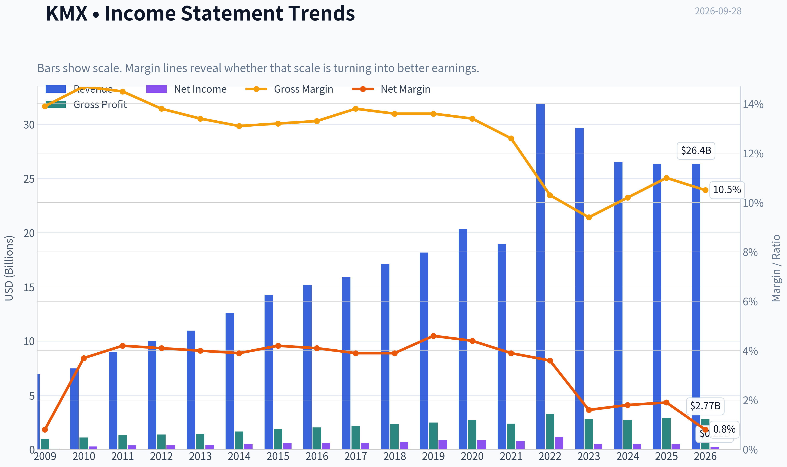

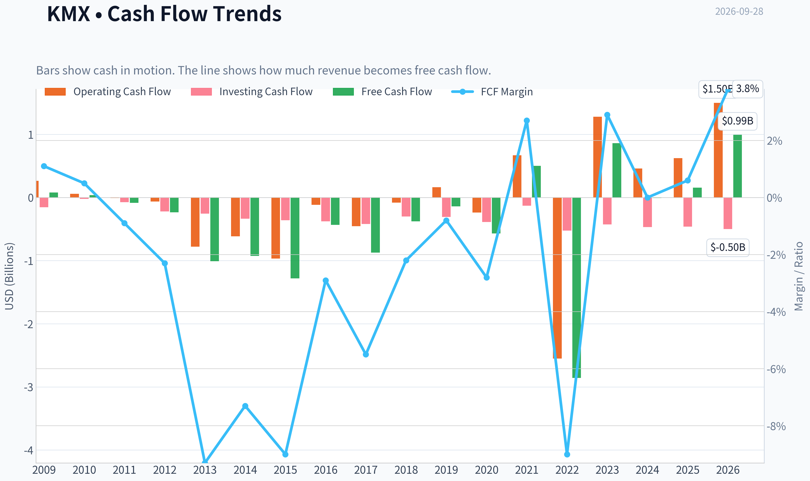

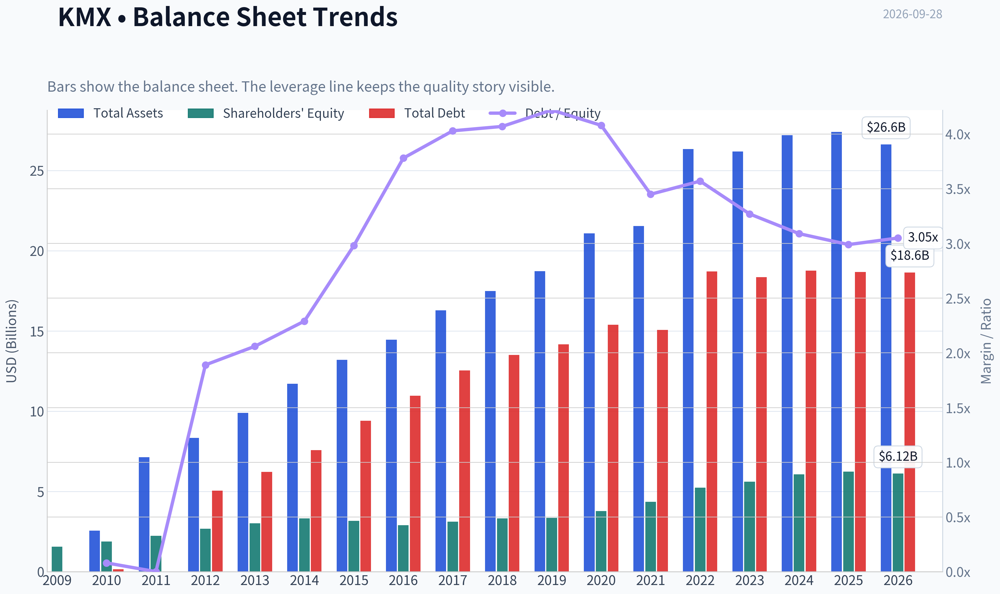

This graph tracks the profitability and return metrics (ROE, ROIC, Margins) of **KMX** over the past decade, highlighting capital efficiency trends.

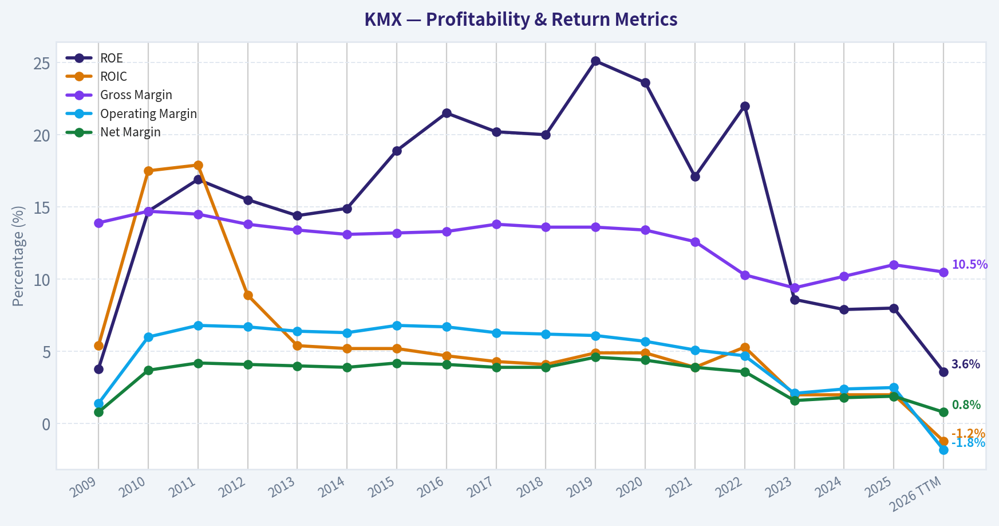

This chart illustrates the financial health of **KMX** over the last 10 years, mapping cash equivalents and free cash flow against total obligations (Debt).

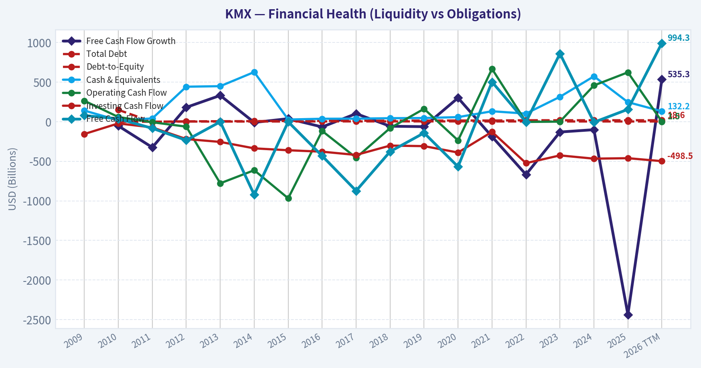

---

### Intrinsic Value Analysis (Buffett)

> *Following Warren Buffett's value investing philosophy: Circle of Competence, Economic Moat, Management Quality, and Margin of Safety.*

#### Intrinsic Value Snapshot

Price is what you pay. Intrinsic value is what the business may be worth based on the cash it can create for owners over time. We show a range, not one magic number.

- Current Price: $57.21
- Value Range (conservative to optimistic across both DCF methods): $-119.56 to $194.08

##### Owner Earnings (Buffett Method)
- Net Income: $500,556,000.00
- Depreciation & Amortization: $345,962,000.00
- Capital Expenditures: $-540,989,000.00
- Working Capital Changes: $-508,780,000.00
- Owner Earnings: $1,235,608,000.00

##### Intrinsic Value
###### Buffett Method
Uses owner earnings. Stricter, and usually more conservative.
- Conservative: $-81.96
- Average: $-1.10
- Optimistic: $194.08
- Discount Rate: 10.0%

###### Cash Flow Method
Uses free cash flow. Better for companies spending heavily today to grow tomorrow.
- Conservative: $-119.56
- Average: $-27.82
- Optimistic: $-27.82
- Discount Rate: 10.0%

ANALYST STANCE: **AVOID**

#### Executive View

CarMax operates a recognizable, scalable used-vehicle retail and financing platform, but the current valuation is not supported by the company's recent economics. At $57 per share, the market is implying approximately 21.7% annual growth for ten years, well above the company's reported trailing three-year growth of 13.6% and five-year growth of 17.3%.

The business is not financially distressed, so the hard solvency floor is not triggered. However, weak recent growth, low returns on equity, modest margins, and an unfavorable valuation produce an overall Buffett score below the threshold for ownership.

#### 1. Factor Scorecard

| Factor | Score | Assessment |
|---|---:|---|
| Circle of Competence & Business Simplicity | 3.0/5 | The model is understandable: buy, recondition, retail, and finance used vehicles. However, results depend on used-car prices, interest rates, credit losses, and consumer affordability. |
| Durable Competitive Advantage | 2.5/5 | Scale, brand recognition, national inventory, appraisal data, and financing capabilities provide a narrow moat. Pricing power and customer captivity appear limited. |
| Management & Capital Allocation | 3.0/5 | CarMax has an established operating history and a straightforward business model, but current returns do not demonstrate exceptional value creation. |
| Industry Structure | 2.5/5 | Used-car retail is fragmented and competitive. Scale helps, but inventory is a depreciating asset and financing exposes the company to credit and interest-rate cycles. |

**Key Takeaways:** CarMax is understandable and has useful scale advantages, but its moat is narrow rather than exceptional. The business remains exposed to cyclical vehicle prices, consumer credit, and competition, limiting long-term predictability.

#### 2. Moat Analysis

| Moat Source | Evidence | Rating |
|---|---|---:|
| Brand and intangible assets | CarMax is a leading national used-car retailer with a differentiated "no-haggle" purchasing experience. Gross margin of 10.8% does not indicate strong consumer pricing power. | 2/5 |
| Switching costs | Customers can generally compare and switch among dealers, online marketplaces, and private sellers. Financing relationships may create some friction but do not make customers captive. | 2/5 |
| Cost advantage | National scale supports purchasing, reconditioning, inventory distribution, and advertising efficiency. These advantages are meaningful but potentially replicable by large competitors. | 3/5 |
| Network effects and data | Vehicle appraisal, pricing, and inventory data improve operations, but the network effect is weaker than in dominant digital platforms. | 3/5 |

**Overall moat quality: Narrow and relatively stable - 2.5/5.**

CarMax's strongest advantage is scale combined with trusted consumer positioning. Its weakest point is that used cars are largely comparable products, and customers can readily shop across dealerships and online platforms. The company therefore lacks the pricing power and customer captivity associated with a wide moat.

#### 3. Management Quality and Capital Allocation

Management receives a **3.0/5** assessment.

Positive factors include:

- A clear operating model that is easy to evaluate.
- A substantial national footprint and recognizable consumer brand.
- Evidence of long-term investment in omnichannel retailing and vehicle appraisal capabilities.
- No indication in the supplied data of a solvency crisis or accounting restatement.

Concerns include:

- Return on equity is only 4.2%, far below the level expected from a high-quality compounder.
- The company operates in a capital- and inventory-sensitive industry.
- Financing operations introduce credit risk and make reported cash generation more difficult to interpret.
- The available evidence does not establish that retained earnings are consistently producing superior incremental returns.

#### 4. Financial Summary

| Metric | Latest Available Figure |
|---|---:|
| Share price | $57.00 |
| Market capitalization | $8.12 billion |
| P/E ratio | 35.5x |
| Revenue growth, year over year | -1.8% |
| Gross margin | 10.8% |
| Return on equity | 4.2% |
| Free-cash-flow yield | 15.3% |
| Implied free cash flow | Approximately $1.24 billion |
| Current ratio | 2.20x |
| Reverse-DCF implied annual growth | Approximately 21.7% for 10 years |
| Trailing three-year growth | 13.6% |
| Trailing five-year growth | 17.3% |

**Key Takeaways:** CarMax combines a low 4.2% ROE and declining year-over-year revenue with a high 35.5 times earnings multiple. The reported free-cash-flow yield is attractive, but the large gap between free cash flow and net earnings requires caution because working capital, inventory, and vehicle-finance economics can make cash flow volatile.

#### 5. Owner Earnings Calculation

The Buffett owner-earnings framework is:

| Component | Assessment |
|---|---|
| Net income | Approximately $229 million, implied by the $57 share price and 35.5 times P/E |
| Depreciation and amortization | Added back in the owner-earnings calculation |
| Maintenance capital expenditure | Must be deducted; vehicle reconditioning and operating investments are economically important |
| Working-capital investment | Particularly important because inventory and vehicle-finance balances can fluctuate substantially |
| Estimated owner-earnings valuation output | Research model indicates approximately **-$1.10 per share** under the owner-earnings approach |

**Key Takeaways:** Reported free cash flow is much higher than implied net income, but the owner-earnings model does not treat all reported cash generation as permanently distributable. Inventory investment, financing activity, and maintenance spending materially reduce the amount that can safely be valued as recurring owner earnings.

#### 6. Three-Scenario DCF Valuation

| Scenario | Method | Value per Share |
|---|---|---:|
| A. No-growth value | Owner earnings capitalized at a 10% discount rate | Approximately **-$1.10** |
| B. GDP-growth value | 3% perpetual growth using normalized cash earnings | Not compelling at the current $57 price |
| C. Historical-growth value | 50%-75% of historical growth, capped at 10% | Requires unusually strong execution and still does not justify the market-implied growth rate |
| Damodaran FCFF model | Independent operating-company valuation | $45.38 |
| FCF model | Cash-flow-based research model | -$27.82 |
| Headline blended intrinsic value | Weighted Damodaran FCFF and reverse-DCF fair-value models | **$32.17** |

**Key Takeaways:** The valuation models produce a wide range because CarMax's cash flows are highly sensitive to inventory, financing, and normalization assumptions. Even the most favorable listed operating-company estimate of $45.38 remains below the $57 market price, while the blended value of $32.17 indicates substantial overvaluation.

#### 7. Margin of Safety Analysis

| Measure | Result |
|---|---:|
| Current price | $57.00 |
| Headline intrinsic value | $32.17 |
| Margin of safety versus price | **-77.8%** |
| Premium to headline intrinsic value | Approximately 77% |
| Price-implied growth | Approximately 21.7% annually for ten years |
| Five-year historical growth reference | 17.3% |

**Key Takeaways:** CarMax does not provide a margin of safety at $57 based on the supplied intrinsic-value estimates. The market price requires growth above the company's recent historical pace, despite declining latest-year revenue and low current returns on equity.

#### 8. Buffett Scorecard

| Criterion | Weight | Score | Weighted Contribution |
|---|---:|---:|---:|
| Moat width and durability | 25% | 2.5/5 | 0.63 |
| Valuation and margin of safety | 20% | 1.5/5 | 0.30 |
| Capital returns versus WACC | 15% | 2.0/5 | 0.30 |
| Business understanding and predictability | 12% | 3.0/5 | 0.36 |
| Management quality and capital allocation | 12% | 3.0/5 | 0.36 |
| Reinvestment runway | 8% | 2.5/5 | 0.20 |
| Balance-sheet strength | 4% | 3.0/5 | 0.12 |
| Industry structure | 4% | 2.5/5 | 0.10 |
| **Total** | **100%** |  | **2.37/5** |

**Key Takeaways:** CarMax scores reasonably on business understandability and balance-sheet liquidity, but weak valuation, modest moat strength, and low capital returns dominate the assessment. The resulting 2.37 score falls in the AVOID range even though the company is not financially distressed.

#### 9. Gate 5 Solvency Test

**Gate 5 hard floor: Not tripped.**

The supplied data shows a current ratio of approximately 2.2x and does not indicate interest coverage below 1x, an Altman-Z distress condition, or simultaneous severe earnings deterioration and insolvency. The investment conclusion is therefore driven by business quality and valuation-not by a financial-distress override.

#### Investment Stance

**AVOID - Medium conviction.**

CarMax is a legitimate operating business with meaningful scale advantages, but it is not currently priced like a narrow-moat, low-return used-car retailer. At $57, investors are paying for heroic growth while accepting only a 4.2% ROE, negative recent revenue growth, and substantial exposure to vehicle prices, interest rates, and consumer credit.

A more attractive entry point would require either a materially lower share price-closer to the low-$30s blended intrinsic-value estimate-or clear evidence that normalized owner earnings and returns on capital are substantially stronger than current reported figures suggest.
#### Valuation Bridge

This bridge places the current market price beside each intrinsic value lens so readers can see whether upside depends on one method or shows up across several methods.

| Scenario | Intrinsic Value / Share |
| --- | ---: |
| Buffett Method | $-1.10 |
| Cash Flow Method | $-27.82 |
| Damodaran Method | $45.38 |
| Current Price | $57.21 |

#### Key Takeaways

If one method is far above the others, the upside case depends on a specific modelling assumption. When several methods cluster together, the valuation story is more robust.

#### Valuation Visuals

This comparison chart from *Latest Earnings Snapshot* stacks current figures against historical benchmarks for **KMX**, making it easy to see where the company trades relative to its own averages.

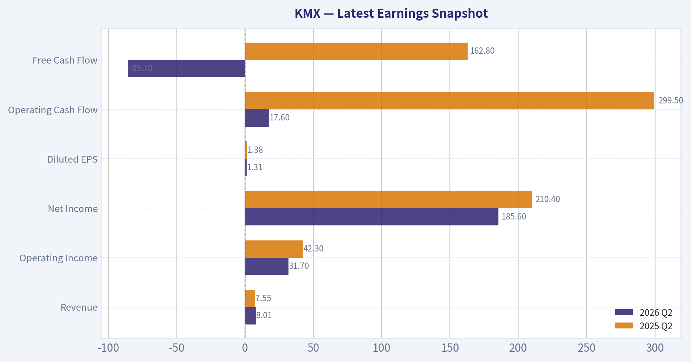

This comparison chart from *Balance Sheet and Financial Strength* stacks current figures against historical benchmarks for **KMX**, making it easy to see where the company trades relative to its own averages.

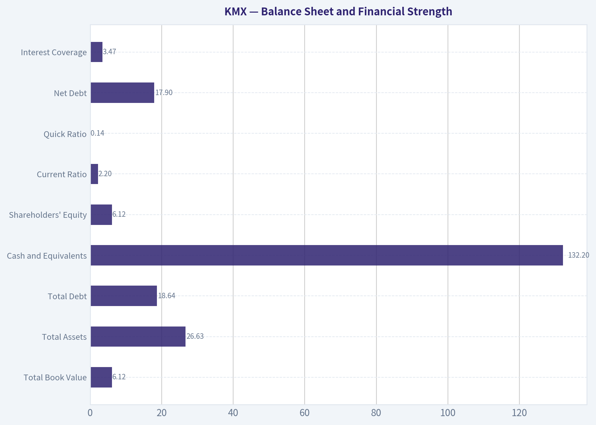

This comparison chart from *Cash Flow and Capital Allocation* stacks current figures against historical benchmarks for **KMX**, making it easy to see where the company trades relative to its own averages.

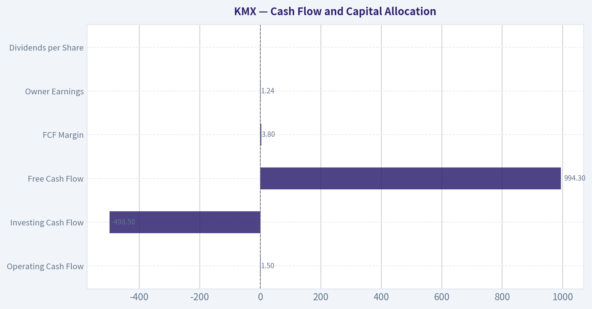

The following chart maps the **KMX** Owner Earnings DCF valuation scenarios (Conservative, Average, Optimistic) to visually represent the margin of safety based on intrinsic value calculations.

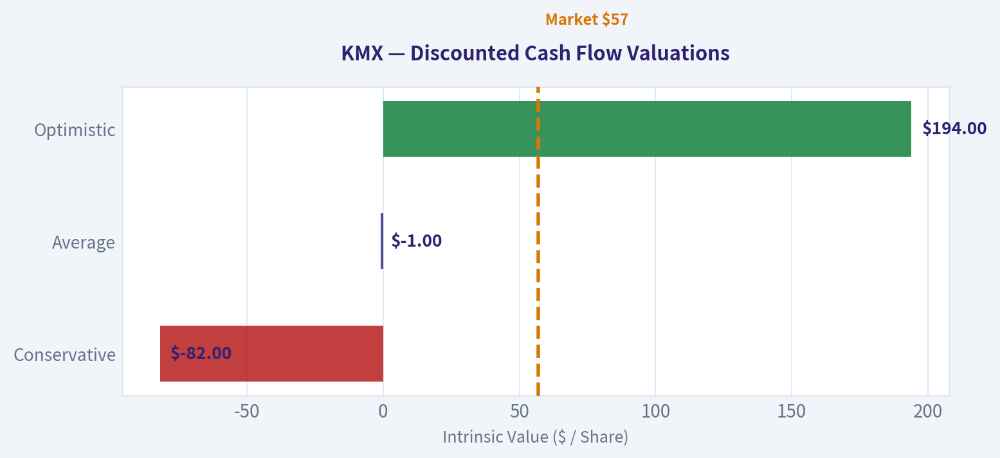

This comparison chart from *Financial Summary* stacks current figures against historical benchmarks for **KMX**, making it easy to see where the company trades relative to its own averages.

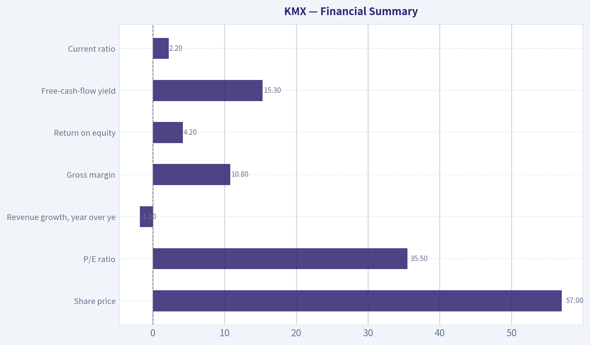

---

### Trend & Growth Analysis (Lynch/Druckenmiller/Fisher)

> *Following Peter Lynch's GARP, Stanley Druckenmiller's macro-aware approach, and Philip Fisher's scuttlebutt methodology.*

ANALYST STANCE: **AVOID**

#### 1. Lynch Classification

**Cyclical / challenged stalwart, not a fast grower.** CarMax is the largest U.S. used-car retailer and has a recognizable brand, but its recent revenue and earnings trends do not meet Lynch's fast-grower criteria. The business is highly sensitive to vehicle prices, interest rates, consumer credit, and used-car affordability.

#### 2. The Story in Three Bullets

- **Scale and brand:** CarMax offers a large, standardized used-car buying experience with nationwide inventory and financing capabilities.
- **Potential recovery:** Lower used-vehicle prices, improved consumer affordability, and easing interest rates could eventually revive unit sales and margins.
- **Current problem:** Revenue is stagnant, earnings have fallen sharply, and high inventory-related leverage makes the stock more cyclical than its low price-to-sales ratio suggests.

#### 3. Financial Snapshot

| Metric | Current / TTM |
|---|---:|
| Share price | $57.21 |
| Market capitalization | $8.12B |
| Revenue | $26.35B |
| Revenue growth, YoY | -1.8% |
| Revenue CAGR, 3-year | -4.5% |
| Revenue CAGR, 5-year | 6.4% |
| Net income | $222.5M |
| Net income growth, YoY | -50.6% |
| Gross margin | 10.8% |
| Operating margin | 1.5% |
| ROE | 4.2% |
| ROIC | 1.0% |
| Debt-to-equity | 3.06x |
| Interest coverage | 3.47x |
| Free-cash-flow yield | 15.3% |

**Key Takeaways:** CarMax has scale but currently lacks growth and profitability momentum. Revenue has declined over the medium term, while net income is down by approximately half year over year. The high debt-to-equity ratio and low ROIC make this a leveraged cyclical recovery candidate rather than a durable compounder.

#### 4. TAM Analysis and the 10x Test

| TAM Factor | Assessment |
|---|---|
| Core market | Large U.S. used-vehicle retail and financing market |
| Current revenue | Approximately $26.4B |
| 10x revenue target | Approximately $263.5B |
| Ability to remain below 20% share at 10x | Theoretically yes, given the size of the national used-car market |
| TAM growth | Moderate and cyclical rather than a clear 15%+ secular growth market |
| Main constraint | Affordability, interest rates, credit losses, inventory turns, and thin margins |

**Key Takeaways:** CarMax passes the mechanical 10x market-size test because the overall used-car market is very large. However, market size alone does not create a ten-bagger: the company would need substantial share gains and much stronger unit economics. The TAM is also mature and cyclical, not an expanding technology-style market.

#### 5. Revenue Growth Trend

| Period | Revenue Growth |
|---|---:|
| 2019 | 6.1% |
| 2020 | 11.8% |
| 2021 | -6.7% |
| 2022 | 68.3% |
| 2023 | -6.9% |
| 2024 | -10.6% |
| 2025 | -0.7% |
| 2026 TTM | Approximately -1.8% |

**Key Takeaways:** The 2022 revenue surge was largely distorted by the post-pandemic used-car price and market cycle. Since then, revenue has contracted or stagnated for several years. The latest results suggest stabilization, but not a confirmed acceleration inflection.

#### 6. Unit Economics and Cash Conversion

| Metric | Result | Interpretation |
|---|---:|---|
| LTV/CAC | Not disclosed in available data | Cannot validate customer acquisition efficiency |
| Net revenue retention | Not applicable | Retail transaction model, not SaaS |
| Rule of 40 | Not applicable | Retail model rather than subscription model |
| Current ratio | 2.20x | Adequate headline liquidity |
| Quick ratio | 0.14x | Low liquid-asset coverage, reflecting inventory dependence |
| FCF margin | 3.8% | Positive but modest |
| Interest coverage | 3.47x | Serviceable, but vulnerable in a downturn |

**Key Takeaways:** Traditional SaaS metrics do not apply to CarMax. The more relevant issue is inventory turnover, vehicle gross profit, financing performance, and credit losses. Its low quick ratio confirms that liquidity depends heavily on selling inventory, while its modest FCF margin provides limited protection against a prolonged automotive downturn.

#### 7. Inflection Point Assessment

| Potential Inflection | Evidence | Status |
|---|---|---|
| Product or platform cycle | No major disclosed product inflection in the supplied data | Unconfirmed |
| Market-share inflection | National scale remains an advantage, but no accelerating share evidence | Unconfirmed |
| Margin inflection | Gross margin improved from 10.2% to roughly 10.8%, but operating margin remains only 1.5% | Early, weak |
| TAM inflection | Used-car demand remains large, but affordability is constrained | Not present |
| Earnings inflection | Forward P/E of 18.5x implies recovery expectations | Possible, not proven |

**Key Takeaways:** The most credible bullish case is a cyclical earnings recovery driven by lower vehicle prices, improved affordability, and better sales volumes. That recovery has not yet translated into sustained revenue acceleration or strong operating leverage. The stock therefore lacks the confirmed inflection point required for a concentrated growth position.

#### 8. Macro Setup

The macro backdrop is mixed to unfavorable:

- **Interest rates:** Recent coverage indicates rate and Treasury-yield concerns. Higher financing costs directly pressure used-car affordability.
- **Consumer credit:** Auto delinquencies and tighter underwriting can reduce financed vehicle demand and increase credit risk.
- **Used-car prices:** Falling prices may improve affordability but can also create inventory markdowns and reduce collateral values.
- **Cycle position:** CarMax is exposed to a consumer and credit cycle; it does not benefit from a powerful secular growth trend such as AI, cloud, or cybersecurity.
- **Potential upside:** Rate cuts, wage growth, and normalized used-car prices could create a meaningful recovery.

The latest guru data is also cautionary: Steve Cohen increased his position, but Stanley Druckenmiller reduced his KMX holding by approximately 73.7% in the latest reported quarter. These are lagging 13F snapshots, not real-time signals.

#### 9. Fisher 15-Point Assessment

| Fisher Criterion | Score / 5 | Comment |
|---|---:|---|
| Market potential | 4 | Large national used-car market |
| New-product determination | 3 | Digital and omnichannel initiatives, but limited evidence of acceleration |
| R&D effectiveness | 3 | Technology is useful, not a clear moat |
| Sales organization | 4 | Strong national retail footprint |
| Profit margins | 2 | Thin operating and net margins |
| Margin improvement | 2 | Recent profitability deterioration |
| Labor relations | 3 | No major adverse evidence supplied |
| Executive relations | 3 | No clear evidence of exceptional depth |
| Management depth | 4 | Established national operator |
| Cost analysis/accounting | 3 | No clear edge from supplied data |
| Outstanding aspects | 4 | Brand, scale, inventory, and financing ecosystem |
| Long-range profit outlook | 3 | Durable business, but cyclical economics |
| Dilution | 4 | No meaningful dilution indicated |
| Management candor | 3 | Insufficient evidence |
| Management integrity | 3 | Insufficient evidence of an exceptional edge |
| **Total** | **48 / 75** | **Average** |

**Key Takeaways:** CarMax scores well on scale, market access, and operating infrastructure. It scores poorly on current margins, return on capital, and long-term growth visibility. The 48 out of 75 score is average and below the threshold typically required for a Fisher-quality compounder.

#### 10. Valuation Analysis

| Valuation Measure | Value | Interpretation |
|---|---:|---|
| Trailing P/E | 35.5x | Expensive against depressed current earnings |
| Forward P/E | 18.5x | Assumes meaningful earnings recovery |
| PEG | 0.61 | Misleading because growth is negative and earnings are cyclical |
| Price-to-sales | 0.29x | Low, but normal for a thin-margin auto retailer |
| Price-to-book | 1.33x | Not demanding in isolation |
| FCF yield | 15.3% | Attractive if cash flow is sustainable |
| Headline intrinsic value | $32.17 | Below current price |
| Reverse-DCF implication | Approximately 21.7% annual owner-earnings growth for 10 years | Aggressive assumption |

**Key Takeaways:** The low price-to-sales ratio and high FCF yield appear attractive, but both require caution because CarMax has thin margins and volatile working-capital cash flows. The PEG ratio is not reliable when earnings growth is sharply negative. The supplied intrinsic-value estimate of approximately $32 is materially below the current price, while the reverse DCF requires unusually strong long-term growth.

#### 11. Growth Investor Scorecard

| Criterion | Weight | Score / 5 | Weighted Contribution |
|---|---:|---:|---:|
| Lynch story | 10% | 3.0 | 0.30 |
| TAM and runway | 20% | 3.0 | 0.60 |
| Revenue growth | 20% | 1.5 | 0.30 |
| Unit economics | 15% | 2.5 | 0.38 |
| Competitive position | 10% | 4.0 | 0.40 |
| Management quality | 10% | 3.0 | 0.30 |
| Macro setup | 5% | 2.0 | 0.10 |
| Profitability path | 5% | 2.5 | 0.13 |
| Valuation | 5% | 2.5 | 0.13 |
| **Total** | **100%** |  | **2.64 / 5.00** |

**Key Takeaways:** CarMax's brand and scale are meaningful positives, but weak growth, falling earnings, macro sensitivity, and leverage dominate the score. At 2.64 out of 5, it falls into the AVOID range for a growth-focused portfolio.

#### 12. Position Size Stance

**No new position for a ten-bagger-oriented growth portfolio.**

A specialized cyclical investor could consider a small **1% to 2% recovery position**, but only after evidence of:

1. Consecutive quarters of unit-volume growth.
2. Stabilizing or improving used-vehicle gross profit.
3. Improving operating margins.
4. Lower credit losses and stable financing performance.
5. Revenue reacceleration above 10%.

Until those signals appear, the apparent cheapness is insufficient compensation for cyclical and balance-sheet risk.

#### 13. Key Catalysts and Risks

| Catalysts | Risks |
|---|---|
| Falling interest rates | Rates remain high or rise further |
| Improved used-car affordability | Consumer credit deterioration |
| Stronger unit sales and inventory turns | Inventory markdowns |
| Gross-margin recovery | Persistent thin margins |
| Operating leverage from higher volumes | Revenue remains stagnant |
| Successful digital/omnichannel execution | Competition from dealers and online platforms |
| Share repurchases at depressed prices | High leverage and weak ROIC |

**Key Takeaways:** The primary catalyst is a macro-led used-car recovery, not a company-specific secular growth engine. The primary risk is that high financing costs and weak consumer affordability keep volumes and margins depressed. CarMax should move from **AVOID** toward **WATCH** only when operating results confirm a sustained recovery rather than merely a favorable valuation narrative.

---

### Market Technical Analysis

ANALYST STANCE: **WATCH**

#### KMX technical analysis

The latest available trading data is from **September 25, 2026**, when KMX closed at **$57.21**. September 28 is not shown as a trading day in the supplied data, so the analysis uses September 25 as the effective reference date.

KMX remains in a **longer-term bullish structure but a short- to medium-term corrective phase**. The close is substantially above the 200-day SMA at **$47.80**, confirming that the broad trend has not broken down. However, price is below both the 10-day EMA at **$58.05** and the 50-day SMA at **$59.39**, showing that near-term momentum has weakened and that the recent advance from the May-August lows has entered a pullback.

#### Trend structure and moving averages

The 200-day SMA has risen steadily from approximately **$45.72 at the end of August to $47.80**, indicating an improving long-term trend. The 50-day SMA has also advanced from about **$57.01 to $59.39** over the same period, but its upward slope has begun to flatten as the stock declined from the August high near **$65.28**.

The short-term picture is weaker. The 10-day EMA fell from approximately **$62.01 on September 4 to $58.05 on September 25**. KMX has closed below this average since September 18, signaling persistent short-term selling pressure. The stock is also below the volume-weighted moving average at **$58.51**, suggesting that recent trading activity has been concentrated at prices above the current close.

This creates a clear hierarchy:

- **Above $47.80:** long-term trend remains constructive.
- **Below $58.05:** short-term momentum remains negative.
- **Below $59.39:** medium-term recovery is not yet confirmed.
- **Below $58.51 VWMA:** volume-weighted price positioning favors sellers.

#### Momentum analysis

The MACD has deteriorated sharply. It declined from **1.69 on August 31 to -0.77 on September 25**, crossing into negative territory during the recent selloff. This indicates that the shorter-term exponential trend has fallen below the longer-term exponential trend.

The MACD histogram has remained negative, reaching **-0.55** on September 25. Although the histogram improved slightly from **-0.70 on September 22**, it is still clearly below zero. That suggests the downside momentum may be moderating, but there is not yet sufficient evidence of a durable bullish reversal. A more constructive signal would require the histogram to move toward zero and then turn positive, ideally alongside a MACD recovery above its signal line.

RSI at **42.0** is weak but not oversold. It has spent much of the recent period between roughly **38 and 48**, reflecting bearish momentum without the deeply oversold conditions that often accompany a high-confidence reversal. The September 25 improvement from **37.8 on September 24** is mildly encouraging, but it is better interpreted as stabilization than as a confirmed momentum shift.

#### Volatility and risk

ATR has increased from approximately **$1.80 in mid-September to $2.19** by September 25. At the current price, that represents roughly **3.8% of the share price per session**, a meaningful volatility level. The recent trading range has also expanded, including a move from a September 22 low of **$56.19** to a September 23 intraday high of **$59.34**.

For risk management, stops placed too tightly around the current price could be vulnerable to ordinary daily fluctuations. A one-ATR move from the latest close would imply an approximate near-term range of **$55.02 to $59.40**, although ATR should not be treated as a forecast. Position sizing should account for this elevated volatility.

#### Key price levels and scenarios

The first important resistance area is **$58.05 to $58.51**, defined by the 10-day EMA and VWMA. Reclaiming that zone would be an initial sign that selling pressure is easing. A stronger recovery signal would require a close above the 50-day SMA near **$59.39**, followed by a move through the recent intermediate resistance around **$61.30 to $63.30**.

On the downside, the immediate support zone is approximately **$56.20 to $57.00**, based on recent lows and closing levels. A decisive break below **$56.20** could expose the September 23 intraday low near **$54.90**, with the ATR suggesting that further sharp daily swings are possible. A sustained move below that area would materially weaken the recent bullish recovery structure, even though the stock would still remain above its 200-day SMA.

The most favorable setup for bullish traders would be a stabilization above the mid-$56 area, followed by a reclaim of the **$58.05-$59.39** moving-average band, improving MACD histogram readings, and RSI moving back above 50. Conversely, continued closes below the 10-day EMA, negative MACD momentum, and a break of $56.20 would favor waiting rather than attempting to anticipate a bottom.

#### Selected indicators

The analysis uses eight indicators chosen for complementary purposes:

1. **10 EMA:** short-term trend and momentum.
2. **50 SMA:** medium-term trend and dynamic resistance.
3. **200 SMA:** long-term trend confirmation.
4. **MACD:** direction of exponential-trend momentum.
5. **MACD Histogram:** acceleration or deceleration of momentum.
6. **RSI:** momentum strength and potential exhaustion.
7. **ATR:** volatility-adjusted risk management.
8. **VWMA:** price trend confirmation incorporating trading volume.

The overall signal is **not uniformly bearish**: the long-term trend remains positive, and the recent RSI and histogram readings show some stabilization. Nevertheless, the current price is below the key short- and medium-term averages, MACD is negative, and volatility is elevated. That combination supports a **watchful stance**, with confirmation preferable to buying solely because the stock has declined.

| Indicator | Latest reading | Signal interpretation | Key level or implication |
|---|---:|---|---|
| Latest close | $57.21 | Below short- and medium-term trend measures | Immediate support near $56.20-$57.00 |
| 10-day EMA | $58.05 | Bearish short-term positioning | Reclaiming $58.05 would improve momentum |
| 50-day SMA | $59.39 | Price remains below medium-term trend | Close above $59.39 needed for stronger recovery confirmation |
| 200-day SMA | $47.80 | Long-term trend remains constructive | Major strategic trend support well below current price |
| VWMA | $58.51 | Volume-weighted positioning favors sellers | Resistance near $58.50 |
| MACD | -0.77 | Negative momentum and bearish crossover condition | Recovery toward zero would be constructive |
| MACD Histogram | -0.55 | Momentum remains negative, but recently less weak | Continued improvement would support stabilization |
| RSI | 42.0 | Weak momentum, not oversold | A move above 50 would strengthen the bullish case |
| ATR | $2.19 | Elevated daily volatility | Use wider, volatility-aware risk controls |
| Overall assessment | - | Long-term bullish, short-term corrective | WATCH for a reclaim of $58.05-$59.39 or breakdown below $56.20 |

**Key Takeaways:** KMX's long-term trend remains bullish because the stock is well above its rising 200-day SMA, but the short- and medium-term trend is corrective because price is below the 10-day EMA, 50-day SMA, and VWMA. Momentum is weak rather than capitulated: RSI is near 42, while MACD and its histogram remain negative. Traders should watch for a reclaim of the $58.05-$59.39 resistance band, while a decisive break below roughly $56.20 would increase downside risk.

#### Market Visuals

This comparison chart from *Market Metrics* stacks current figures against historical benchmarks for **KMX**, making it easy to see where the company trades relative to its own averages.

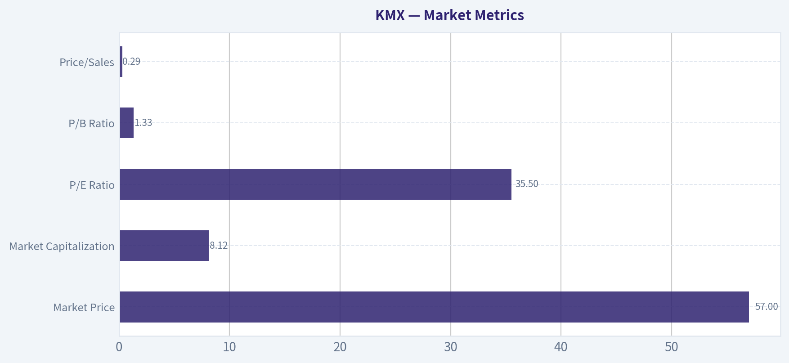

---

### Options Market Analysis

> *Reading options flow - put/call ratios, IV skew, and unusual activity - to gauge institutional positioning and event-driven risk.*

#### KMX Options Flow Report

**As of September 28, 2026.** The available chain appears unusually thin or incomplete: call open interest is reported as zero across all listed expirations, while implied volatility readings are exceptionally low. Treat the signal as low-confidence.

#### 1. Put/Call Ratio Analysis

| Expiration | Days to Expiry | Call OI | Put OI | Call Volume | Put Volume | Put/Call Volume Ratio |
|---|---:|---:|---:|---:|---:|---:|
| October 16, 2026 | 18 | 0 | 585 | 675 | 440 | 0.65 |
| November 20, 2026 | 53 | 0 | 0 | 214 | 109 | 0.51 |
| December 18, 2026 | 81 | 0 | 0 | 22 | 350 | 15.91 |
| **Near-term total** | - | **0** | **585** | **911** | **899** | **0.99** |

The aggregate put/call volume ratio is approximately **0.99**, above the historical neutral reference of roughly **0.70**, but not extreme. The put/call open-interest ratio is **not calculable** because reported call open interest is zero; the resulting 585-to-zero OI imbalance is notable but may reflect incomplete or unreliable chain data rather than outright bearish positioning.

**Key Takeaways:** Trading volume is nearly balanced overall, so current flow does not show strong directional conviction. The main bearish-looking feature is the concentration of reported put open interest, but the zero call-OI reading materially reduces confidence in that interpretation.

#### 2. Implied Volatility Assessment

| Expiration | Call ATM IV | Put ATM IV | IV Observation |
|---|---:|---:|---|
| October 16, 2026 | 2.3% | 2.1% | Extremely low; calls slightly higher |
| November 20, 2026 | 1.2% | 1.0% | Extremely low; calls slightly higher |
| December 18, 2026 | 1.2% | 0.5% | Extremely low; calls materially higher |

Near-term ATM IV is reported between **2.1% and 2.3%**, which is exceptionally low for equity options and may indicate stale, incomplete, or illiquid quotes. The dataset does not provide separate out-of-the-money put and call IV, so a conventional OTM skew calculation cannot be made. Based on the available ATM readings, there is **no evidence of a steep put skew**; calls actually show slightly higher IV than puts in each listed expiration.

No specific earnings, product, or other catalyst was supplied. Therefore, elevated event-driven IV cannot be confirmed; in fact, the reported IV is unusually subdued.

**Key Takeaways:** The reported volatility surface signals very low expected movement, not heightened event risk. Because the IV values appear anomalously low and OTM skew data is missing, they should be treated as weak evidence rather than a reliable volatility forecast.

#### 3. Unusual Options Activity

| Finding | Result |
|---|---|
| Contracts with volume greater than five times open interest | None identified |
| Fresh directional flow | No confirmed unusual contracts |
| Smart-money versus retail distinction | Not determinable from the supplied data |
| Strike moneyness | Cannot assess; individual unusual contracts were not provided |
| Current stock price | Not provided |

No contracts met the tool's unusual-activity threshold. Consequently, there is no identifiable sweep, block, or volume/OI anomaly that can be classified as a fresh bullish or bearish institutional bet.

**Key Takeaways:** The absence of volume greater than five times open interest argues against declaring a specific institutional trade. There is no contract-level evidence here of aggressive upside speculation or downside hedging.

#### 4. Open Interest Concentration and Gamma Levels

| Expiration | Reported OI Concentration | Potential Interpretation |
|---|---|---|
| October 16, 2026 | 585 puts; zero calls | Put-side concentration could create a downside hedge or pinning effect |
| November 20, 2026 | Zero reported OI | No reliable gravitational level identified |
| December 18, 2026 | Zero reported OI | No reliable gravitational level identified |

Strike-level open interest was not supplied, so specific max-pain levels, gamma walls, or price-pinning strikes cannot be calculated. The only clear concentration is the aggregate October put OI. Without strike details, it is impossible to determine whether those puts are close to the current price and therefore likely to influence near-term hedging flows.

**Key Takeaways:** October puts are the only meaningful reported open-interest concentration. However, the lack of strike-level data prevents a reliable assessment of gamma support, resistance, or max pain.

#### 5. Overall Options Sentiment Signal

**Overall signal: BEARISH, low confidence.**

The bearish designation is driven primarily by the reported **585 contracts of put open interest versus zero call open interest**, combined with an aggregate put/call volume ratio near **1.0**, above the approximately **0.7 neutral baseline**. However, this is not a strong bearish signal: there is no unusual activity, trading volume is relatively balanced, OTM skew is unavailable, and the zero call-OI readings plus extremely low IV suggest possible data-quality or liquidity problems.

For practical interpretation, the options market is best characterized as **mildly bearish or defensive, with low conviction** rather than aggressively bearish.

#### Summary

| Category | Assessment |
|---|---|
| Put/Call Ratio | Volume ratio 0.99, above neutral; OI ratio unavailable because call OI is zero |
| IV Level | Exceptionally low reported ATM IV, approximately 0.5% to 2.3%; likely illiquid or incomplete data |
| Skew Direction | No reliable OTM skew data; ATM IV slightly favors calls over puts |
| Unusual Activity | None detected; no contracts exceeded five times open interest |
| Overall Signal | **BEARISH, low confidence**, driven by reported put-OI concentration |

**Key Takeaways:** KMX options positioning leans bearish mainly because reported open interest is concentrated entirely in puts. That signal is substantially weakened by zero call OI, extremely low IV, missing strike-level data, and the absence of unusual activity, so confidence should remain low.

---

## Research Team Commentary

> *The Research Manager synthesizes the Bull vs Bear debate into action-free commentary. This is a pre-risk view, not the final stance.*

Core takeaway: CarMax is a credible franchise, but at $57.21 the stock offers too little margin of safety for its current business quality. Brand recognition, national scale, appraisal data, financing capabilities, and omnichannel infrastructure provide a legitimate competitive position. Yet those assets are producing only 1.0% ROIC, 4.2% ROE, stagnant revenue, and sharply lower earnings. The valuation already assumes a substantial recovery before investors have evidence that the recovery will generate attractive owner returns. I would not commit long-term capital at this price.

The strongest bull argument is that current earnings are cyclically depressed rather than representative of normalized earning power. CarMax operates in a fragmented, trust-deficient market where its standardized experience, national inventory, appraisal expertise, wholesale capabilities, and physical-digital network are difficult to reproduce as a package. Better affordability, lower financing rates, higher unit volumes, and faster inventory turnover could improve fixed-cost absorption and allow earnings to recover much faster than revenue. Because current EPS is only about $1.61, even a return toward prior operating conditions could produce substantial percentage growth.

That argument is credible enough that CarMax should not be dismissed as a permanently broken business. The stock also remains above the $47.80 long-term technical threshold, so an immediate collapse is not inevitable. A move above $59.39 could confirm a tactical recovery, particularly if investors anticipate lower rates. The options information is incomplete and should not influence the conclusion.

The strongest bear argument, however, is that a plausible recovery is already being priced as a reasonably successful one. The 35.5 times P/E represents a current earnings yield of only about 2.8%. The bullish valuation requires roughly 15%-16% annual earnings growth for a decade and an 18 times terminal multiple to reach approximately $63-$71. That offers only around 10%-24% upside while less generous assumptions support values in the $30s or $40s. Even the bull's approximately $47 downside case assumes 12% annual growth and a 16 times terminal multiple, so it is not a genuine stress scenario.

The reverse-DCF hurdle is particularly uncomfortable in context. Low-to-mid-teens owner-earnings growth may sound achievable from a depressed base, but CarMax is a low-margin, cyclical, capital-intensive retailer with current ROIC far below any reasonable cost of capital. Achieving that growth would require improving affordability, recovering unit sales, faster inventory turnover, stable gross profit per unit, controlled credit losses, favorable funding spreads, and meaningful operating leverage. It would also require the market to award a relatively healthy terminal multiple after ten years. None of those assumptions is individually absurd, but the price depends on several of them working together.

There is also an important valuation-quality problem in using EPS as owner earnings. CarMax must fund inventory, reconditioning, stores, logistics, technology, and finance-related assets. If recovering sales require significantly more working capital and balance-sheet funding, reported EPS will overstate distributable cash generation. Without a complete reconciliation of earnings to normalized free cash flow, the bullish DCF deserves a larger uncertainty discount.

From a Buffett perspective, the moat is also not strong enough to justify a quality-scaled margin of safety of only 10%-15%. CarMax's brand and scale are valuable, but customers have low switching costs and can compare purchase prices, trade-in offers, financing terms, and inventory across many channels. Competitors do not need to duplicate the entire CarMax platform; they need only win individual transactions. A genuine economic moat should eventually appear in durable returns on capital. At present, a 1% ROIC suggests underutilized assets at best and potentially structural overinvestment at worst.

Financing adds further asymmetry. It can improve conversion and capture more economics per transaction, but retail demand, funding costs, credit losses, inventory turns, and vehicle recovery values can deteriorate together. This is not evidence of imminent distress, but it does mean CarMax deserves a larger margin of safety than a predictable, asset-light compounder.

The lesson from prior mistakes is to align the action label with the actual analysis. When a cyclical, capital-intensive company has weak current returns and its valuation requires a broad normalization, the conclusion should not remain a vague WATCH merely because the franchise is respectable. At the same time, AVOID is an investment judgment, not a short-term price forecast or short-sale recommendation. KMX could rally above $59.39 on improving sentiment without becoming an attractive long-term value investment.

Over the next one to four quarters, I would monitor retail used-unit growth, comparable-store units, inventory days, inventory write-downs, and gross profit per retail and wholesale vehicle. A healthy recovery needs both better volume and defensible unit economics; volume purchased through weaker pricing would not establish durable value.

I would also watch CarMax Auto Finance originations, funding costs, net interest spreads, delinquency trends, charge-offs, and loan-loss provisions. Improving sales accompanied by worsening credit economics would weaken rather than strengthen the thesis. Cash flow should be reconciled with reported earnings, including working-capital needs, capital expenditures, and finance-related funding.

The most important quality test is ROIC. A sustained increase toward and eventually above the cost of capital would show that existing infrastructure is generating operating leverage. If volumes improve while ROIC remains in the low single digits, the normalization thesis is likely a value trap. Management should prioritize liquidity, inventory efficiency, and returns from existing omnichannel investments rather than additional low-return expansion.

I would reconsider at a materially lower price-roughly the low $40s or below depending on updated cash-flow evidence-or after several quarters of improving units, inventory turns, credit performance, cash conversion, and ROIC. Conversely, persistent revenue stagnation, rising credit losses, weak cash conversion, or continued sub-cost-of-capital returns would reinforce the avoid decision. A technical move above $59.39 could improve the tactical picture, but it would not by itself repair the valuation.

CarMax may recover, but $57.21 does not adequately compensate shareholders for uncertainty around the speed, magnitude, and capital intensity of that recovery.

Final stance: AVOID.

---

## Value Investing Team Commentary

> *The Investor translates the research view into an investment thesis before risk review. This is still not the final stance.*

### Investment Commentary

CarMax is a recognizable franchise operating in an unattractive economic structure. Its national inventory, trusted brand, appraisal data, wholesale network, financing operation, and omnichannel investments make it more capable than the typical used-car dealer. Those advantages could produce a sharp earnings recovery if vehicle affordability improves and financing rates decline. However, a credible recovery story is not the same as an attractive investment at the current price.

### Business quality and moat

CarMax reduces some of the distrust and inconvenience associated with buying a used vehicle. Scale improves vehicle sourcing, inventory selection, appraisal accuracy, marketing efficiency, and access to financing. Its physical and digital capabilities would be expensive for a new entrant to reproduce.

Nevertheless, the moat is moderate rather than exceptional. Consumers have low switching costs and can compare vehicles, trade-in offers, and financing terms across dealers and online platforms. CarMax must repeatedly earn each transaction, and its inventory requires substantial capital and carries depreciation risk. A durable moat should ultimately produce attractive returns on incremental capital; current ROIC of approximately 1% and ROE of 4.2% do not demonstrate that.

The financing operation also complicates interpretation of consolidated leverage, cash flow, and returns on capital. Some debt funds receivables rather than ordinary corporate operations, so headline leverage and standard industrial-company free-cash-flow measures require careful adjustment. Even allowing for that metric distinction, the present returns remain inadequate relative to the operational, credit, and funding risks.

### The cyclical recovery case

The contrarian opportunity is straightforward: current earnings may be near a cyclical trough rather than representative of normalized earning power. Lower vehicle prices, higher trade-in activity, declining interest rates, and improved consumer affordability could revive unit volumes. Given CarMax's existing infrastructure, even modest volume growth could improve fixed-cost absorption and lift earnings much faster than revenue.

This possibility should not be dismissed. A respected franchise can appear least attractive on trailing earnings shortly before conditions normalize. The 35.5 times trailing P/E therefore overstates valuation risk if the roughly $1.61 of current EPS is unusually depressed.

But the opposite mistake would be capitalizing peak-cycle or hoped-for earnings without adequately discounting the capital needed to achieve them. A recovery in sales may require more inventory, receivable funding, reconditioning expenditure, and working capital. Consequently, EPS growth may not translate proportionately into distributable owner earnings.

### Valuation and reverse-DCF test

At $57.21, investors receive a current earnings yield of only about 2.8% while accepting the risks of a low-margin, capital-intensive, credit-sensitive retailer. The investment case therefore depends on material normalization rather than on satisfactory present economics.

The reverse-DCF assumptions are demanding. Low-to-mid-teens earnings growth for approximately a decade, followed by a healthy terminal multiple, requires several favorable developments to occur together:

- Retail unit volumes recover materially.
- Gross profit per vehicle remains defensible.
- Inventory turns improve without aggressive discounting.
- Funding costs decline or financing spreads improve.
- Delinquencies, charge-offs, and provisions remain controlled.
- Existing infrastructure produces meaningful operating leverage.
- Cash conversion keeps pace with reported earnings.
- The market continues to award CarMax a respectable terminal valuation.

No single assumption is implausible. The problem is dependence on the entire combination. For a cyclical business currently earning less than its cost of capital, I would require roughly a 40%-50% margin of safety, not the 10%-15% appropriate for a predictable, high-ROIC compounder. The present price does not offer it.

The low $40s would be a more interesting starting range, subject to updated normalized free-cash-flow and credit data. It should not be treated as an automatic buy threshold: deteriorating credit performance or structurally weak returns could lower intrinsic value further.

### What sentiment may be missing

The bearish interpretation may be too focused on trailing earnings. If interest rates and used-car affordability improve faster than expected, CarMax could report substantial percentage EPS growth from a depressed base. Its operating infrastructure could then shift from being a drag on returns to a source of operating leverage. The stock could rally well before ROIC visibly recovers.

That is the legitimate contrarian case-but it is primarily an argument that the stock can rise, not proof that it is undervalued. A move above $59.39 might indicate improving market expectations, but price momentum would not resolve weak cash returns or validate normalized earnings.

Conversely, investors anticipating rate cuts may be overlooking how interconnected the risks are. Lower rates could support demand, yet unemployment, credit losses, weak collateral values, or pressured consumers could offset that benefit. Financing, inventory, and retail demand may deteriorate simultaneously. The options data are incomplete and unusually thin, so they provide no dependable sentiment edge.

### Evidence that would change the conclusion

A reassessment should be based on business evidence rather than technical confirmation alone. The most important indicators are:

1. Sustained retail and comparable-store unit growth.
2. Improving inventory turns without material deterioration in gross profit per unit.
3. Better cash conversion after working-capital and capital-expenditure needs.
4. Stable or improving finance spreads, delinquencies, charge-offs, and provisions.
5. ROIC moving toward and eventually above the cost of capital.
6. Capital allocation focused on extracting returns from existing infrastructure rather than expanding a low-return asset base.

Several quarters of progress could justify a higher estimate of normalized earning power. Alternatively, a substantially lower share price could provide enough protection before the recovery is fully proven.

CarMax is not obviously distressed or permanently impaired. It is simply priced as though a meaningful recovery is more probable and more economically valuable than current evidence supports. Avoiding it at $57.21 is not a short-term bearish forecast; it is a refusal to pay in advance for uncertain normalization.

### ANALYST STANCE: **AVOID**

CarMax has a credible franchise and real cyclical recovery potential, but its weak current returns, moderate moat, capital intensity, and financing exposure demand a much larger margin of safety. At $57.21, too much of the recovery is already embedded in the valuation. I would wait for a price around the low $40s or compelling evidence of sustained improvement in cash conversion, credit performance, and ROIC.

---

## Deep Values Commentary

> *The Risk Management Team debates and the Risk Judge provides the final action-free verdict. This section determines the final ADVOCATE / WATCH / AVOID stance.*

#### Final Stance Scorecard

This scorecard converts the final research view into a weighted decision frame. It does not replace the narrative judgement, but it makes the main drivers of the verdict easier to scan.

| Criterion | Score | Weight | Commentary |
| --- | ---: | ---: | --- |
| Business Quality | 2.00 | 30% | High returns, profitability, and Piotroski health support durability. |
| Valuation Support | 2.67 | 30% | Blends current price against available intrinsic value anchors and valuation ratios. |
| Financial Strength | 2.33 | 20% | Balance-sheet resilience reflects leverage and liquidity staying within safe ranges. |
| Growth Durability | 2.33 | 20% | Recent revenue, earnings, and free cash flow growth indicate how durable expansion looks. |
| TOTAL / FINAL STANCE | 2.33 | 100% | AVOID |

#### Key Takeaways

The weighted score lands at **2.33 / 5.0**, while the final stance remains **AVOID**. This is useful as a quick calibration aid rather than a mechanical signal.

#### Risk Summary

Higher scores indicate more risk pressure. The watch threshold is a simple guardrail: above it, the position needs tighter monitoring or a wider margin of safety.

| Dimension | Current Score | Watch Threshold | Commentary |
| --- | ---: | ---: | --- |
| Business Quality | 4.00 | 3.00 | High returns, profitability, and Piotroski health support durability. |
| Valuation Support | 3.33 | 3.00 | Blends current price against available intrinsic value anchors and valuation ratios. |
| Financial Strength | 3.67 | 3.00 | Balance-sheet resilience reflects leverage and liquidity staying within safe ranges. |
| Growth Durability | 3.67 | 3.00 | Recent revenue, earnings, and free cash flow growth indicate how durable expansion looks. |

#### Key Takeaways

This view helps readers separate *where* the risk sits: valuation, business quality, balance sheet, or growth durability. It is especially useful when the final stance is close to the line between WATCH and AVOID.
