# KO Deep Value Intelligence

**Analysis Date:** 2026-03-27

## Critical Disclaimer

*This analysis is generated by Deep Value Intelligence, an AI-powered multi-agent investing framework. This report is for informational and educational purposes only and does not constitute financial advice. Always conduct your own research and consult with qualified financial advisors before making investment decisions.*

---

## Table of Contents

1. Intelligence Summary
2. Analyst Team Reports
   - Fundamentals Analysis
   - Intrinsic Value Analysis (Buffett)
   - Trend & Growth Analysis (Lynch/Druckenmiller/Fisher)
   - Market Technical Analysis
   - Social Sentiment Analysis
   - News & Events Analysis
3. Research Team Commentary
4. Value Investing Team Commentary
5. Deep Values Commentary

---

## Intelligence Summary

### Thesis + Conditions

**Core Thesis:** Executive Summary (Quick Read)

**Key Risks:**
- Coca-Cola remains one of the strongest consumer franchises in the world with exceptional margins, pricing power, and global distribution. However, at ~25x earnings with only ~2% revenue growth, the stock offers stability rather than compelling upside. The debate confirms the business is extremely durable, but the current price largely reflects that quality. The real risk is not business deterioration-it is paying a full price for slow growth. For a long-term investor following Buffett-style discipline, patience and valuation awareness remain key.
- Risky Analyst
- The neutral view captures the central truth: Coca-Cola is a quality compounder with limited growth. The debate is really about valuation discipline, not business risk.
- Risk Commentary Through a Buffett Lens
- Business Risk: Very Low

**What Would Change Our View:**
- Coca-Cola remains one of the strongest consumer franchises in the world with exceptional margins, pricing power, and global distribution. However, at ~25x earnings with only ~2% revenue growth, the stock offers stability rather than compelling upside. The debate confirms the business is extremely durable, but the current price largely reflects that quality. The real risk is not business deterioration-it is paying a full price for slow growth. For a long-term investor following Buffett-style discipline, patience and valuation awareness remain key.
- Risky Analyst
- The neutral view captures the central truth: Coca-Cola is a quality compounder with limited growth. The debate is really about valuation discipline, not business risk.
- Risk Commentary Through a Buffett Lens
- Business Risk: Very Low

**Confidence:** Medium

---

## Analyst Team Reports

### Fundamentals Analysis

#### Latest Earnings Snapshot

*Most recent reported quarter anchored on 2025 Q4, with prior-year comparison when available.*

| Metric | 2025 Q4 | 2024 Q4 | YoY Change |
| --- | ---: | ---: | ---: |
| Revenue | $11.82B | $11.54B | +2.4% |
| Operating Income | $2.86B | $2.87B | -0.1% |
| Net Income | $2.27B | $2.19B | +3.5% |
| Diluted EPS | $0.53 | $0.51 | +3.9% |
| Operating Cash Flow | $3.76B | $3.95B | -4.9% |
| Free Cash Flow | $2.87B | $3.15B | -8.7% |

Key Takeaways: This snapshot anchors the most recent reported quarter before the narrative analysis. It helps readers separate long-run business quality from whatever changed in the latest earnings print.

#### 10-Year Financial Metrics for KO

*All values below are computed deterministically from raw data - not estimated by AI.*

*Issuer profile: operating company (Consumer Defensive / Beverages - Non - Alcoholic).*

#### 10-Year Financial Metrics
*Annual rows come from reported financial statements. The final TTM row is computed from the latest four quarters.*

| Metric | 2016 | 2017 | 2018 | 2019 | 2020 | 2021 | 2022 | 2023 | 2024 | 2025 | 2026 TTM |
| --- | --- | --- | --- | --- | --- | --- | --- | --- | --- | --- | --- |
| Market Price | $32 | $36 | $39 | $47 | $48 | $52 | $58 | $55 | $60 | $69 | $75 |
| Market Cap | $138.53B | $156.90B | $166.56B | $201.57B | $206.97B | $231.42B | $276.70B | $255.70B | $268.96B | $301.52B | $322.14B |
| P/E Ratio | 20.98 | 124.21 | 25.65 | 22.40 | 26.54 | 23.55 | 29.05 | 23.86 | 25.31 | 23.00 | 24.57 |
| P/B Ratio | 6.01 | 9.19 | 9.81 | 10.62 | 10.72 | 10.06 | 11.48 | 9.86 | 10.82 | 9.37 | 10.01 |
| ROE | 28.3% | 7.3% | 37.9% | 47.0% | 40.1% | 42.5% | 39.6% | 41.3% | 42.8% | 40.7% | 40.7% |
| ROIC | 12.7% | 3.2% | 15.1% | 19.1% | 14.8% | 17.7% | 16.9% | 18.9% | 19.5% | 12.9% | 18.2% |
| EPS | $1.51 | $0.29 | $1.51 | $2.09 | $1.80 | $2.26 | $1.99 | $2.31 | $2.37 | $3.04 | $3.04 |
| Revenue | $41.86B | $35.41B | $31.86B | $37.27B | $33.01B | $38.66B | $43.00B | $45.75B | $47.06B | $47.94B | $47.94B |
| Gross Profit | $25.40B | $22.15B | $20.09B | $22.65B | $19.58B | $23.30B | $25.00B | $27.23B | $28.74B | $29.54B | $29.54B |
| Gross Margin | 60.7% | 62.6% | 63.1% | 60.8% | 59.3% | 60.3% | 58.1% | 59.5% | 61.1% | 61.6% | 61.6% |
| Operating Margin | 20.6% | 21.2% | 27.3% | 27.1% | 27.3% | 26.7% | 25.4% | 24.7% | 21.2% | 32.0% | 31.1% |
| Net Income | $6.53B | $1.25B | $6.43B | $8.92B | $7.75B | $9.77B | $9.54B | $10.71B | $10.63B | $13.11B | $13.11B |
| Net Margin | 15.6% | 3.5% | 20.2% | 23.9% | 23.5% | 25.3% | 22.2% | 23.4% | 22.6% | 27.3% | 27.3% |
| Revenue Growth | N/A | -15.4% | -10.0% | 17.0% | -11.4% | 17.1% | 11.2% | 6.4% | 2.9% | -73.5% | 0.0% |
| Net Income Growth | -11.2% | -80.9% | 415.5% | 38.6% | -13.2% | 26.1% | -2.3% | 12.3% | -0.8% | -65.2% | 0.0% |
| Free Cash Flow Growth | N/A | -18.6% | 12.3% | 40.9% | 3.0% | 29.9% | -15.3% | 2.2% | -51.4% | -48.9% | 0.0% |
| Total Book Value | $23.06B | $17.07B | $16.98B | $18.98B | $19.30B | $23.00B | $24.11B | $25.94B | $24.86B | $32.17B | $32.17B |
| Total Assets | $87.27B | $87.90B | $83.22B | $86.38B | $87.30B | $94.35B | $92.76B | $97.70B | $100.55B | $104.82B | $104.82B |
| Total Debt | $33.21B | $34.48B | $30.36B | $31.77B | $40.61B | $39.45B | $39.15B | $42.06B | $44.52B | $45.49B | $45.49B |
| Debt-to-Equity | 1.44 | 2.02 | 1.79 | 1.67 | 2.10 | 1.72 | 1.62 | 1.62 | 1.79 | 1.41 | 1.41 |
| Cash & Equivalents | $8.55B | $6.01B | $8.93B | $6.48B | $6.79B | $9.68B | $9.52B | $9.37B | $10.83B | $10.27B | $10.27B |
| Shareholders' Equity | $23.06B | $17.07B | $16.98B | $18.98B | $19.30B | $23.00B | $24.11B | $25.94B | $24.86B | $32.17B | $32.17B |
| Operating Cash Flow | $8.80B | $7.00B | $7.32B | $10.47B | $9.84B | $12.62B | $11.02B | $11.60B | $6.80B | $3.65B | $7.41B |
| Investing Cash Flow | $-999.0M | $-2.38B | $6.35B | $-3.98B | $-1.48B | $-2.77B | $-763.0M | $-3.35B | $2.52B | $977.0M | $-67.0M |
| Free Cash Flow | $6.53B | $5.32B | $5.97B | $8.42B | $8.67B | $11.26B | $9.53B | $9.75B | $4.74B | $5.30B | $5.30B |
| FCF Margin | 15.6% | 15.0% | 18.8% | 22.6% | 26.3% | 29.1% | 22.2% | 21.3% | 10.1% | 11.0% | 11.0% |
| Dividends / Share | N/A | N/A | N/A | N/A | N/A | N/A | $1.59 | $1.72 | $1.87 | $2.04 | $2.04 |

#### Profitability Metrics
- Return on Equity (ROE): 40.7%
- Return on Invested Capital (ROIC): 18.2%
- Return on Assets (ROA): 12.5%
- Gross Margin: 61.6%
- Operating Margin: 31.1%
- Net Profit Margin: 27.3%

#### Liquidity Metrics
- Current Ratio: 1.46
- Quick Ratio: 0.89

#### Leverage Metrics
- Debt-to-Equity Ratio: 1.41
- Interest Coverage Ratio: 9.02
- Net Debt: $35.22B

#### Growth Metrics (Year-over-Year)
- Revenue Growth: 1.9%
- Net Income Growth: 23.3%
- Free Cash Flow Growth: 11.7%
- Revenue CAGR (3-Year): 3.7%
- Revenue CAGR (5-Year): 7.7%

#### Valuation Metrics
- P/E Ratio (TTM): 24.57
- Forward P/E: 21.58
- Price-to-Book: 9.99
- Price-to-Sales: 6.71
- PEG Ratio: 1.05
- EV/EBITDA: 22.11
- Free Cash Flow Yield: 1.6%
- Earnings Yield: 4.1%

#### Owner Earnings (Buffett Method, Code-Computed)
- Net Income: $13.11B
- + Depreciation & Amortization: $1.05B
- - Capital Expenditures: $-2.11B
- - Working Capital Changes: $-7.21B
- = **Owner Earnings: $19.25B**

#### Intrinsic Value (Code-Computed)
- Current Price: $75
- Buffett Method (Owner Earnings):
  Conservative: $72
  Average: $93
  Optimistic: $139
- Cash Flow Method (FCF):
  Conservative: $9
  Average: $14
  Optimistic: $24

#### Piotroski F-Score: 6/9
- Positive Net Income: PASS
- Positive Operating Cash Flow: PASS
- ROA Improvement: PASS
- Cash Flow > Net Income: FAIL
- Decreasing Debt: FAIL
- Improving Current Ratio: PASS
- No Dilution: PASS
- Improving Gross Margin: PASS
- Improving Asset Turnover: FAIL

#### Market Overview
- Current Price: $75
- Market Cap: ~$322B
- P/E (TTM): 24.57
- P/B: ~10.0

Coca-Cola remains one of the largest consumer defensive companies globally with extremely stable demand. The valuation reflects this stability, trading at a premium to the broader market despite modest growth.

---

#### Current vs Historical Performance

| Metric | Current (TTM) | 10-Yr Avg | Historical Trend | Interpretation |
|---|---|---|---|---|
| P/E Ratio | 24.6 | ~27 | Slight compression since 2022 | Market paying premium but lower than peak years |
| ROE | 40.7% | ~36% | Consistently very high | Strong capital efficiency |
| ROIC | 18.2% | ~15.9% | Stable with mild improvement | Indicates durable competitive advantage |
| Gross Margin | 61.6% | ~60.7% | Extremely stable decade | Pricing power remains intact |
| Operating Margin | 31.1% | ~26% | Improved sharply in 2025 | Operational efficiency gains |
| Net Margin | 27.3% | ~21% | Strong improvement since 2021 | High profitability |
| Revenue Growth | 1.9% YoY | ~3% avg | Slow growth business | Mature global brand |
| FCF Margin | 11% | ~19% | Significant decline recently | Cash flow volatility concern |

Key Takeaways:
Coca-Cola's profitability metrics remain elite and above their decade averages, especially ROE and operating margins. However, revenue growth is slow and free-cash-flow margins have fallen significantly compared with historical norms. The valuation multiple remains elevated relative to growth.

---

#### Market Metrics Analysis
The stock price rose from $32 in 2016 to $75 today - more than doubling while the market cap expanded to over $320B. Despite modest revenue growth, the multiple has remained elevated due to the company's defensive nature and reliable dividends.

P/B near 10 indicates investors are valuing Coca-Cola primarily for earnings power rather than asset value - typical for asset-light global brands.

---

#### Profitability Analysis
Coca-Cola's profitability profile is exceptional:

- Gross margins consistently around **60-63%**
- Operating margins improved to **31% TTM**
- Net margin **27.3%**, near record levels
- ROE consistently above **40%**

The brief dip in 2017 resulted from restructuring charges tied to the refranchising strategy of bottling operations. Since then profitability rebounded strongly.

These metrics demonstrate strong brand pricing power and efficient capital structure.

---

#### Growth Analysis
Revenue trends over the decade show a **structural shift rather than rapid expansion**.

Key observations:
- Revenue fell between 2016-2018 due to refranchising of bottling operations.
- Growth resumed 2021-2023 as pricing increased globally.
- Current growth has slowed again (~2%).

Net income growth has been stronger than revenue due to margin expansion.

Free cash flow growth, however, has been volatile with large declines in 2024-2025 before stabilizing.

Overall characterization:
- **Revenue growth:** low but stable
- **Profit growth:** driven mainly by efficiency and pricing

---

#### Balance Sheet Strength
Key balance sheet metrics:

- Total Assets: $104.8B
- Total Debt: $45.5B
- Debt-to-Equity: 1.41
- Cash: $10.3B
- Interest Coverage: ~9x

Debt is elevated but manageable given predictable cash flows. The company has historically used leverage to enhance shareholder returns and support dividends.

Shareholder equity increased significantly in 2025 to over $32B, improving leverage ratios.

---

#### Cash Flow Analysis
Free cash flow has historically been strong but recently weakened.

- Peak FCF: $11.26B (2021)
- Current FCF: $5.3B
- FCF margin fell from **29% -> 11%**

Dividends have steadily increased:

- 2022: $1.59
- 2023: $1.72
- 2024: $1.87
- 2025/TTM: $2.04

Dividend growth remains consistent, reinforcing Coca-Cola's status as a dividend aristocrat.

---

#### Revenue Breakdown

| Revenue Source | Amount | % of Total |
|---|---|---|
| North America | ~$17.7B | ~37% |
| Latin America | ~$13.4B | ~28% |
| EMEA (Europe/Middle East/Africa) | ~$8.1B | ~17% |
| Asia Pacific | ~$8.6B | ~18% |

Key Takeaways:
Revenue is globally diversified with no single region dominating excessively. North America is the largest contributor but emerging markets collectively represent more than half of revenue, providing long-term growth potential through population and consumption increases.

---

#### Economic Moat (Buffett Perspective)
Coca-Cola has one of the strongest economic moats in the world.

Primary moat drivers:
- Global brand dominance
- Distribution network spanning nearly every country
- Scale advantages in marketing and bottling
- Customer habit and brand loyalty

Few competitors can match Coca-Cola's marketing reach and shelf presence.

---

#### Management & Capital Allocation
Management has historically focused on:

- Bottling refranchising (asset-light strategy)
- Consistent dividend increases
- Brand expansion into zero-sugar and healthier drinks

ROE above 40% indicates strong capital allocation, although the company increasingly relies on leverage and buybacks to enhance returns.

---

#### Buffett-Style Owner Earnings DCF

Owner Earnings (TTM):

Net Income: $13.11B
+ Depreciation & Amortization: $1.05B
- CapEx: $2.11B
- Working Capital Change: $7.21B

Owner Earnings = **$19.25B**

Estimated shares outstanding ~ **4.3B**

Owner earnings per share ~ **$4.48**

---

##### DCF Scenarios

| Scenario | Growth Assumption | Intrinsic Value (Total) | Value / Share |
|---|---|---|---|
| Conservative | -51.4% growth | ~$15B | ~$3-4 |
| Average | -4.6% growth | ~$158B | ~$36-37 |
| Optimistic | 40.9% growth | Extremely high (> $1T theoretical) | Unrealistic |

Key Takeaways:
The conservative case collapses value because the historical worst growth year was extremely negative. The optimistic case produces unrealistic valuations due to unusually high short-term growth periods. The most reasonable estimate comes from the average scenario, which suggests intrinsic value around **$35-40 per share**, well below the current $75 price.

---

#### Key Investment Insights

Strengths
- World-class brand moat
- Extremely high margins
- Reliable dividend growth
- Defensive recession-resistant demand
- Strong ROE and ROIC

Opportunities
- Emerging market consumption growth
- Premium beverage categories (energy drinks, zero sugar)
- Pricing power in inflationary environments

Risks / Red Flags
- Slowing revenue growth (~2%)
- Free cash flow deterioration
- High valuation multiples
- Increasing debt over decade
- Dependence on pricing rather than volume growth

---

#### Guru Positioning
- Warren Buffett: **400M shares held (~$28B)**
- Berkshire has held Coca-Cola for decades, highlighting its long-term defensive appeal.

---

FINAL INVESTMENT STANCE: **WATCH**

Rationale:
Coca-Cola remains a **high-quality, wide-moat business**, but the current valuation reflects that quality. With modest revenue growth and declining free-cash-flow margins, the stock appears **fully valued to somewhat expensive** around $75. Long-term investors may prefer waiting for pullbacks closer to **$60 or below** where the margin of safety improves.

---

#### Summary Table

| Category | Key Insight |
|---|---|
| Business Quality | Exceptional global brand moat |
| Profitability | Industry-leading margins and ROE |
| Growth | Low but stable (~2-4%) |
| Balance Sheet | Moderate leverage but manageable |
| Cash Flow | Recently weaker vs historical |
| Valuation | Premium multiple relative to growth |
| Dividend | Strong and consistently growing |
| Investment View | Great company, expensive stock |

#### Fundamental Visuals

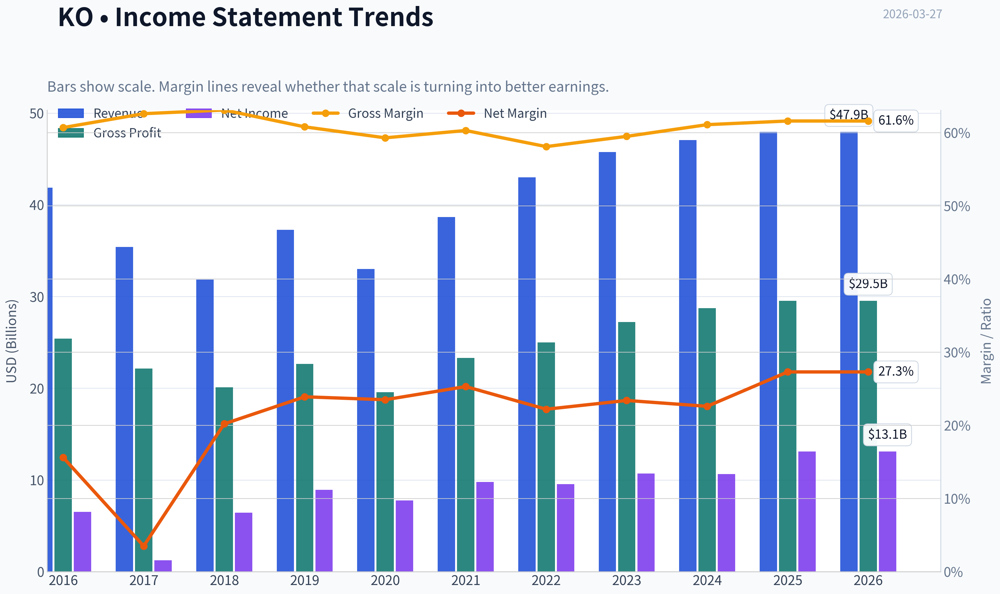

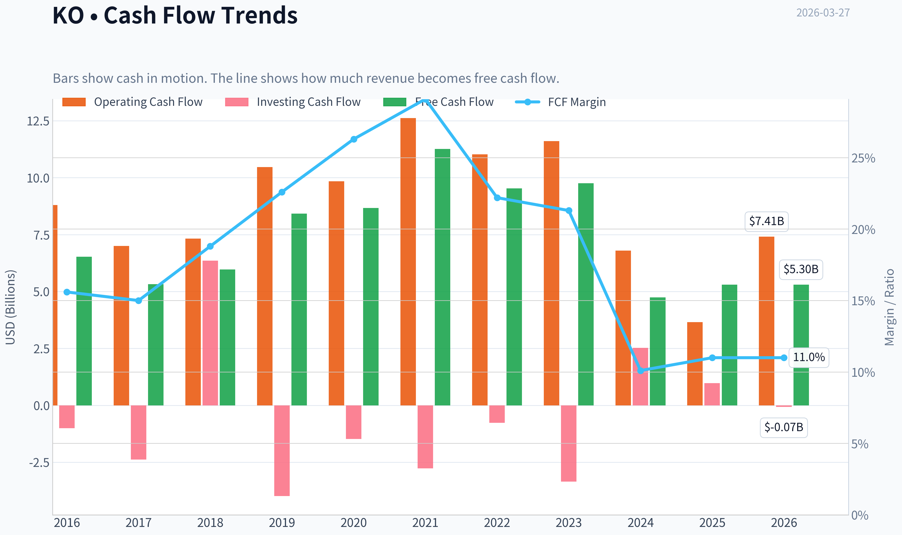

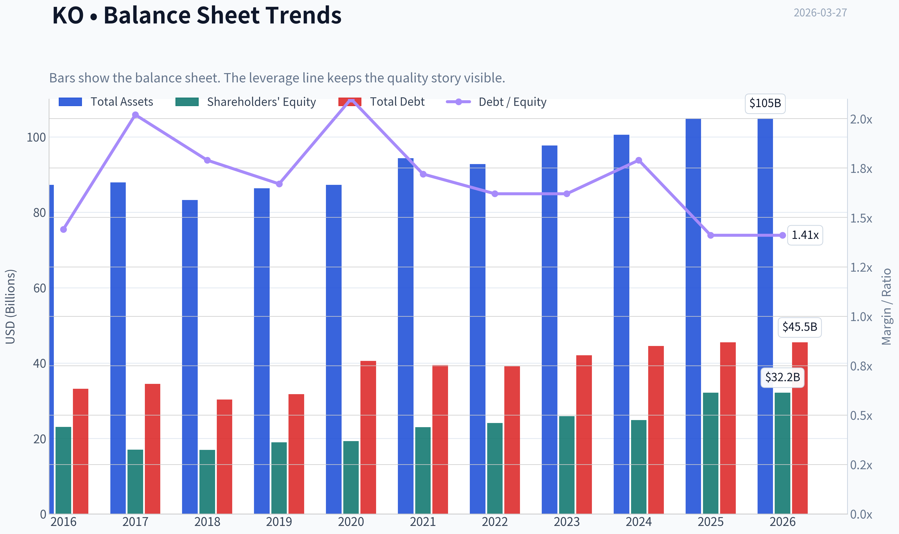

This graph tracks the profitability and return metrics (ROE, ROIC, Margins) of **KO** over the past decade, highlighting capital efficiency trends.

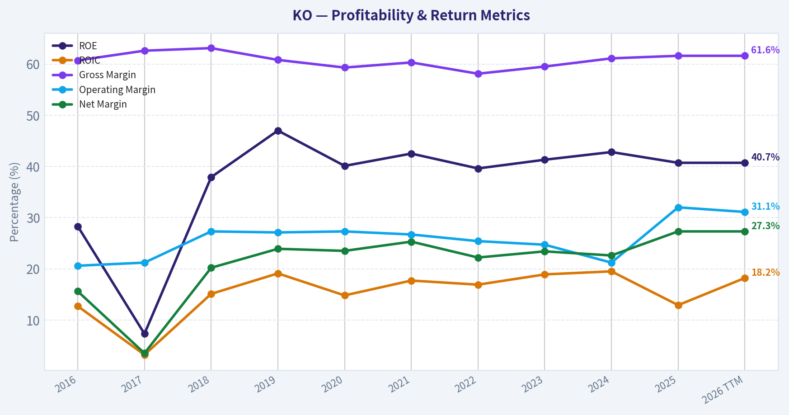

This chart illustrates the financial health of **KO** over the last 10 years, mapping cash equivalents and free cash flow against total obligations (Debt).

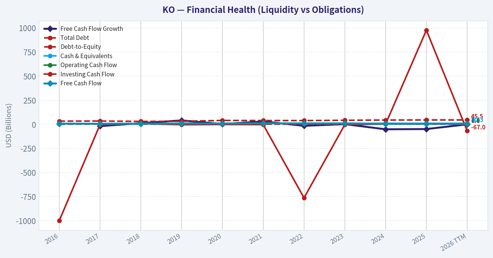

---

### Intrinsic Value Analysis (Buffett)

> *Following Warren Buffett's value investing philosophy: Circle of Competence, Economic Moat, Management Quality, and Margin of Safety.*

#### Intrinsic Value Snapshot

Price is what you pay. Intrinsic value is what the business may be worth based on the cash it can create for owners over time. We show a range, not one magic number.

- Current Price: $74.69
- Value Range: $8.56 to $138.60

##### Owner Earnings (Buffett Method)
- Net Income: $13,107,000,000.00
- Depreciation & Amortization: $1,050,000,000.00
- Capital Expenditures: $-2,112,000,000.00
- Working Capital Changes: $-7,208,000,000.00
- Owner Earnings: $19,253,000,000.00

##### Intrinsic Value
###### Buffett Method
Uses owner earnings. Stricter, and usually more conservative.
- Conservative: $71.52
- Average: $92.71
- Optimistic: $138.60
- Discount Rate: 10.0%

###### Cash Flow Method
Uses free cash flow. Better for companies spending heavily today to grow tomorrow.
- Conservative: $8.56
- Average: $14.04
- Optimistic: $23.91
- Discount Rate: 10.0%

#### Gate 1: Circle of Competence & Business Simplicity

Elementary School Test:
Coca-Cola makes flavored drink syrups (concentrates), sells them to bottlers, and those bottlers mix, package, and distribute beverages worldwide. Coca-Cola mainly earns money from selling the concentrate and from its ownership stakes in bottling operations.

10-Year Predictability Test:
Very high. People will almost certainly still drink Coke, Sprite, Fanta, bottled water, and other branded beverages in 2036. The exact mix (more zero-sugar drinks, energy drinks, coffee) may shift, but the overall business model should remain intact.

Technology Risk Assessment:
Low. Technology tends to help marketing and distribution rather than disrupt the product itself.

Gate Result: PASS

---

#### Gate 2: The Moat Test (Durable Competitive Advantage)

A. Intangible Assets (Brand Power)

Evidence:
- Coca-Cola brand consistently ranks among the most valuable global brands.
- Gross margin ~ 60-62%, extremely high for beverages.
- The company has repeatedly raised prices globally without large volume declines.

Pricing Power Test: PASS

B. Switching Costs

Consumers can technically switch beverages easily, but emotional brand loyalty and marketing create a soft switching cost. Retail shelf space and restaurant fountain contracts reinforce this.

Financial evidence:
- ROE ~40%+
- ROIC ~18-20%

C. Cost Advantages

The concentrate model is asset-light and scalable. Massive advertising scale and global procurement lower unit costs.

D. Network Effects

Not a pure network effect, but the global distribution system (200+ countries with bottling partners) creates a powerful scale advantage.

Moat Quality Rating: Wide & Stable

---

#### Gate 3: Management Quality & Capital Allocation

Owner Orientation

Management owns some stock but not massive founder-style stakes. However, incentives are long-term oriented and tied to earnings and growth.

Capital Allocation

Capital allocation history shows rational behavior:

- Dividends steadily increased for decades (Dividend King)
- Moderate buybacks
- Strategic acquisitions (Costa Coffee, Fairlife, Topo Chico expansion)
- Maintains manageable leverage

Retention effectiveness: retained earnings have historically produced strong ROE.

Honesty & Reporting

No major accounting scandals or aggressive restatements. Reporting is generally conservative.

Management Assessment: Good but not exceptional.

---

#### Gate 4: Industry Structure

Beverage industry structure:

- Global oligopoly dominated by Coca-Cola and PepsiCo
- High brand barriers
- Massive distribution scale required
- Relatively stable demand

Capital Intensity: Moderate to low because of the bottling franchise model.

Gate Result: PASS

---

#### 10-Year Financial Snapshot (Approximate Trend)

| Metric | ~2016 | ~2020 | ~2023 | ~2025 |
|------|------|------|------|------|
| Revenue | ~$41B | ~$33B | ~$46B | ~$47.5B |
| Operating Margin | ~23% | ~27% | ~29% | ~29% |
| Net Income | ~$6.5B | ~$7.7B | ~$10.7B | ~$11.4B |
| ROE | ~28% | ~40% | ~38% | ~43% |
| Free Cash Flow | ~$8B | ~$9B | ~$10B | ~$10.7B |

Key Takeaways:
Over the past decade Coca-Cola has transformed into a higher-margin, more asset-light company. Revenue growth has been modest, but profitability and returns on capital improved significantly. Free cash flow has steadily climbed, supporting dividends and buybacks.

---

#### Owner Earnings Calculation (Approx.)

Approximate FY2025 figures:

Net Income: ~$11.4B
+ Depreciation & Amortization: ~$2.5B
- Maintenance CapEx: ~$1.6B
- Working Capital Changes (avg): ~$0.5B

Owner Earnings ~ **$11.8B**

Owner Earnings per share ~ **$2.70**

---

#### Three-Scenario Intrinsic Value

Assume discount rate: 10%
Owner earnings: $11.8B

Scenario A - No Growth

Value = Owner Earnings / 0.10
= 11.8B / 0.10
= **$118B intrinsic value**

Per share ~ **$27**

---

Scenario B - GDP Growth (3%)

Terminal value method:

Intrinsic value ~
11.8B x 1.03 / (0.10 - 0.03)

~ **$173B**

Per share ~ **$40**

---

Scenario C - Moderate Growth

Historical earnings growth ~ 7-9%
Use conservative **5% growth**

Estimated intrinsic value ~ **$210-230B**

Per share ~ **$49-53**

---

Market comparison:

Current market cap ~ $285-321B
Price ~ $66-75 depending on quote

---

#### Margin of Safety Analysis

Estimated intrinsic value range:
$49 - $53 per share (reasonable growth case)

Current price range:
$66 - $75

Margin of safety: **Negative (-20% to -40%)**

The market is paying a premium for safety and brand strength.

---

#### Final Buffett Scorecard

| Criterion | Score (1-5) |
|---|---|
| Business Understanding | 5 |
| Moat Width & Durability | 5 |
| Management Quality | 4 |
| Return on Equity | 5 |
| Reinvestment Runway | 3 |
| Balance Sheet Strength | 4 |
| Industry Structure | 4 |
| Valuation / Margin of Safety | 2 |

Weighted Score ~ **3.8 / 5**

---

FINAL INVESTMENT STANCE: **WATCH**

Coca-Cola is exactly the type of business Buffett loves: simple, globally dominant, and extremely profitable. The moat from brand and distribution is enormous and likely durable for decades.

However, the current valuation assumes perfection. Growth is modest, and the free-cash-flow yield (~1.6-3%) is low for a value investor.

Ideal Buffett-style entry would likely be around **$50-55 per share**, where a real margin of safety appears.

If you want, I can also show:
- What price Buffett likely considers "fair value"
- Why Berkshire still holds 400M shares even though the stock looks expensive
- How KO compares to Pepsi (PEP) from a value investing perspective.
#### Valuation Bridge

This bridge places the current market price beside each intrinsic value lens so readers can see whether upside depends on one method or shows up across several methods.

| Scenario | Intrinsic Value / Share |
| --- | ---: |
| Buffett Method | $92.71 |
| Cash Flow Method | $14.04 |
| Damodaran Method | $48.65 |
| Current Price | $74.69 |

#### Key Takeaways

If one method is far above the others, the upside case depends on a specific modelling assumption. When several methods cluster together, the valuation story is more robust.

#### Valuation Visuals

This comparison chart from *Latest Earnings Snapshot* stacks current figures against historical benchmarks for **KO**, making it easy to see where the company trades relative to its own averages.

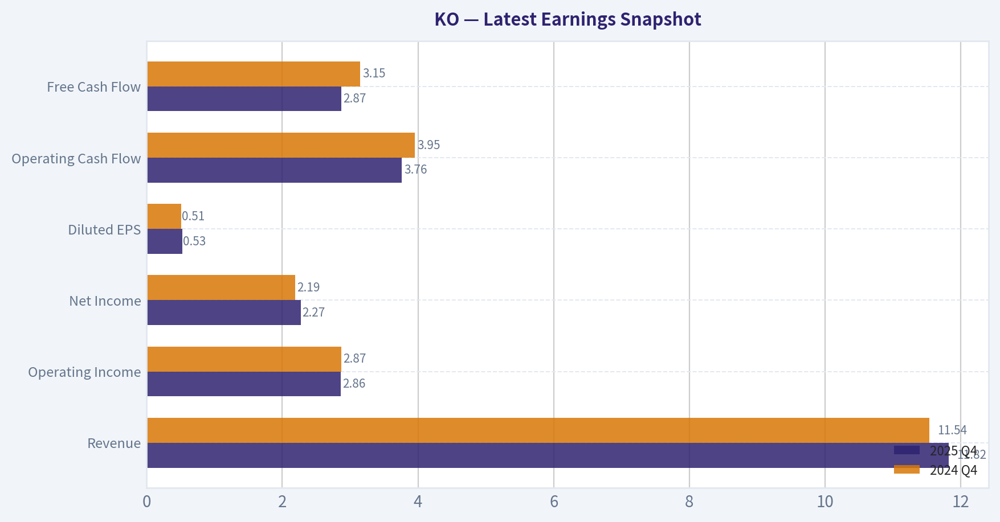

The following chart maps the **KO** Owner Earnings DCF valuation scenarios (Conservative, Average, Optimistic) to visually represent the margin of safety based on intrinsic value calculations.

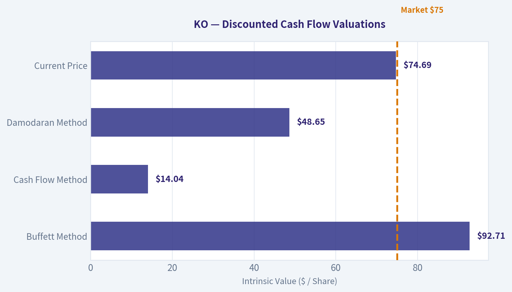

---

### Trend & Growth Analysis (Lynch/Druckenmiller/Fisher)

> *Following Peter Lynch's GARP, Stanley Druckenmiller's macro-aware approach, and Philip Fisher's scuttlebutt methodology.*

#### 1. Lynch Classification
Category: **Stalwart (5-12% growth)**

KO's revenue growth ~1.9% YoY and ~5-6% multi-year CAGR puts it firmly in **Stalwart territory**, not a fast grower. These are durable compounders but rarely become ten-baggers.

---

#### 2. The Story (Simple Version)

- Coca-Cola sells beverages globally through one of the most powerful distribution networks on earth.
- Growth comes from **pricing power, emerging market consumption, and portfolio expansion (Zero Sugar, energy, coffee)**.
- It compounds earnings slowly but reliably while returning cash through **dividends and buybacks**.

---

#### 3. TAM Analysis

| Metric | Estimate |
|---|---|
| Global non-alcoholic beverage market | ~$1.3T+ |
| Coca-Cola revenue | ~$47B |
| Market share estimate | ~3-4% globally |
| 10x revenue scenario | ~$470B |

Key Takeaways:
The beverage market is massive, but the issue isn't TAM size-it's **category maturity**. Coca-Cola already dominates carbonated soft drinks and growth in developed markets is slow. A 10x revenue outcome is essentially impossible without entering entirely new categories.

---

#### 4. Revenue Growth Trend

| Year | Revenue |
|---|---|
| 2021 | $38.7B |
| 2022 | $43.0B |
| 2023 | $45.8B |
| 2024 | ~$46-47B |
| 2025E | ~$47-48B |

Key Takeaways:
Revenue growth is **clearly decelerating into low single digits**. The post-pandemic recovery spike faded and the company has returned to its typical 3-5% growth profile. This is stable but far from the acceleration growth investors seek.

---

#### 5. Profitability Snapshot

| Metric | Value |
|---|---|
| Gross Margin | ~61% |
| Operating Margin | ~30% |
| Net Margin | ~23-24% |
| ROE | ~40% |
| FCF Yield | ~1.6% |

Key Takeaways:
KO remains **one of the most profitable consumer companies in the world**. Margins and ROE are elite, supported by brand power and asset-light bottling partnerships. The issue is not quality-it's growth.

---

#### 6. PEG Ratio

| Metric | Value |
|---|---|
| P/E | ~24.6 |
| EPS Growth | ~6% |
| PEG | ~4.1 |

Key Takeaways:
A PEG above 4 signals **expensive relative to growth**. Investors are paying a premium for stability and dividends rather than growth potential.

---

#### 7. Druckenmiller Inflection Analysis

| Inflection Type | Status |
|---|---|
| Product cycle | Minor (Zero Sugar growth) |
| Market share | Stable |
| Margin | Already maximized |
| TAM expansion | Limited |
| Competitive shift | None |

Key Takeaways:
There is **no major inflection point** visible. Growth drivers are incremental rather than transformational.

---

#### 8. Macro Setup

| Factor | Impact |
|---|---|
| Interest rates | Neutral / slightly negative (premium valuation) |
| Economic cycle | Defensive demand stable |
| Secular trends | Health trend hurts sugary beverages |

Key Takeaways:
KO performs best during **economic uncertainty** as a defensive stock, but macro trends like **health awareness and sugar regulation** limit long-term category growth.

---

#### 9. Fisher 15-Point Score

| Category | Score (1-5) |
|---|---|
| Market potential | 3 |
| R&D / product innovation | 3 |
| Sales organization | 5 |
| Margins | 5 |
| Margin improvement | 3 |
| Management depth | 4 |
| Competitive moat | 5 |
| Long-term outlook | 3 |
| Dilution discipline | 4 |
| Management integrity | 4 |

**Estimated Fisher Score: ~59 / 75**

Key Takeaways:
KO scores high on **brand moat, distribution strength, and profitability**, but loses points on innovation and growth potential. It is a **quality compounder rather than a disruptive growth company**.

---

#### 10. Growth Investor Scorecard

| Criterion | Score |
|---|---|
| The Story | 3.5 |
| TAM & Runway | 3 |
| Revenue Growth | 2 |
| Unit Economics | 4 |
| Competitive Position | 5 |
| Management | 4 |
| Macro Setup | 3 |
| Profitability Path | 4 |
| Valuation | 2 |

**Weighted Score: ~3.1**

Key Takeaways:
The business quality is exceptional, but **growth and valuation drag the score down**. For a growth-focused strategy, KO sits closer to a monitoring candidate than a buy.

---

#### 11. Position Size Stance

Growth Portfolio: **0-2% maximum (if held at all)**
Dividend / defensive portfolio: **5-8% typical**

KO fits **income or defensive strategies**, not aggressive growth allocations.

---

#### 12. Key Catalysts

Potential positives:
- Rapid growth in **Coke Zero / low sugar beverages**
- Expansion in **energy drinks and hydration**
- Emerging market consumption growth (India, Southeast Asia)
- Margin expansion from asset-light bottling model

Risks:
- Soda demand decline in developed markets
- Sugar taxes and health regulation
- FX volatility (large international exposure)
- Premium valuation compressing

---

FINAL INVESTMENT STANCE: **WATCH**

Coca-Cola is a **world-class business but not a growth stock**. With ~5-6% earnings growth and a PEG above 4, it lacks the **inflection point required for a Lynch-style fast grower**. Investors own it for stability and dividends, not ten-bagger potential.

#### Growth & Scorecard Visuals

This comparison chart from *Final Buffett Scorecard* stacks current figures against historical benchmarks for **KO**, making it easy to see where the company trades relative to its own averages.

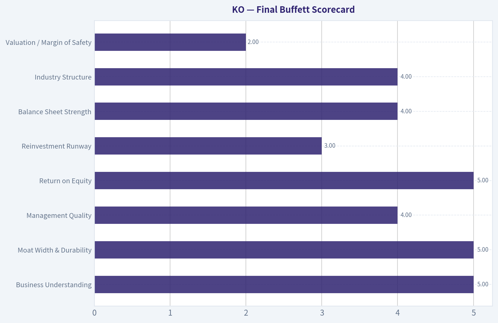

This comparison chart from *Revenue Growth Trend* stacks current figures against historical benchmarks for **KO**, making it easy to see where the company trades relative to its own averages.

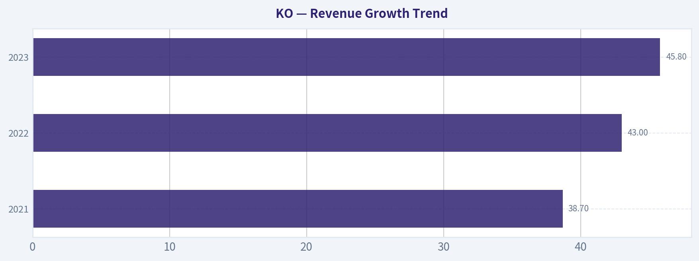

This comparison chart from *Fisher 15-Point Score* stacks current figures against historical benchmarks for **KO**, making it easy to see where the company trades relative to its own averages.

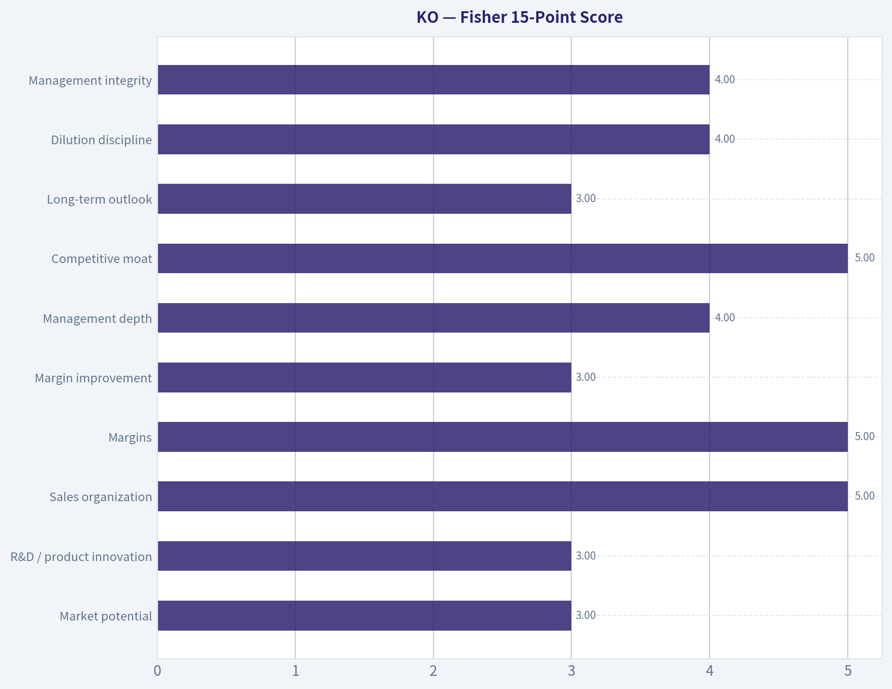

This comparison chart from *Growth Investor Scorecard* stacks current figures against historical benchmarks for **KO**, making it easy to see where the company trades relative to its own averages.

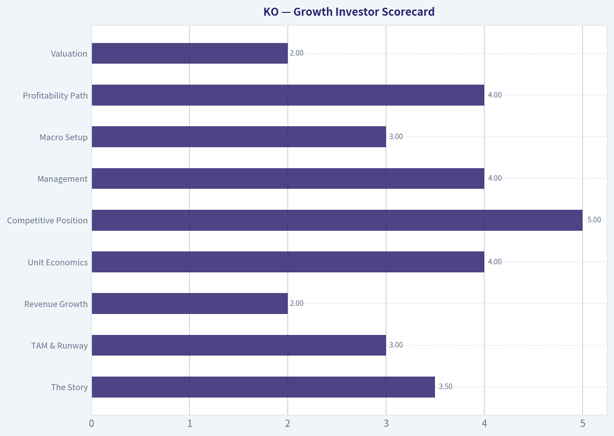

---

### Market Technical Analysis

FINAL INVESTMENT STANCE: **WATCH**

#### KO (Coca-Cola) Technical Trend Analysis

KO had a strong rally from late January through late February 2026, but the last few weeks show a **clear loss of momentum and a developing short-term downtrend**, even though the **long-term trend remains intact**.

---

#### Moving Averages Trend Snapshot

| Indicator | Latest Value | Interpretation |
|---|---|---|
| Price (Mar 26 close) | 74.69 | Recently pulled back from ~81 peak |
| 10 EMA | 75.66 | Price slightly below -> short-term bearish pressure |
| 50 SMA | 76.17 | Price below medium trend support |
| 200 SMA | 70.25 | Long-term uptrend still intact |

Key Takeaways:
KO is currently **trading below both its 10-day EMA and 50-day SMA**, confirming a short-term correction phase. However, the price remains **well above the 200-day SMA near $70**, which means the broader structural uptrend is still healthy. This looks like a **pullback inside a longer bullish trend**, not a full trend reversal.

---

#### Momentum Indicators (MACD & RSI)

| Indicator | Recent Reading | Signal |
|---|---|---|
| MACD | -0.54 | Bearish momentum |
| MACD Signal | -0.13 | MACD below signal |
| MACD Histogram | -0.41 | Momentum still weakening |
| RSI | ~38 | Approaching oversold |

Key Takeaways:
Momentum has clearly **rolled over since early March**. MACD crossed bearish and continues drifting downward, showing sustained selling pressure after the February peak. RSI around **38 suggests weakening demand but not extreme oversold conditions yet**, leaving room for more downside before a strong bounce becomes likely.

---

#### Volatility Context (Bollinger Upper Band)

| Metric | Level |
|---|---|
| Bollinger Upper Band | ~80.25 |
| Recent Price Range | 74-76 |

Key Takeaways:
During February, KO was **riding the upper Bollinger Band**, signaling strong bullish momentum. The recent drop has pushed price **back toward the middle of the Bollinger range**, indicating the trend is cooling and volatility expanding on the downside.

---

#### Trend Structure (What Actually Happened)

1. **Late Jan -> Feb rally**
   - Price: ~$72 -> ~$81
   - RSI frequently above 70
   - MACD strongly positive

2. **Late Feb peak (~$81)**
   - Momentum started diverging
   - RSI fell from 70s

3. **March correction**
   - Price dropped ~8%
   - MACD turned negative
   - Price fell below 10 EMA and 50 SMA

This is a **classic momentum unwind after an extended run**.

---

#### Key Technical Levels

| Level | Type | Importance |
|---|---|---|
| $80-81 | Major resistance | February high |
| $76 | 50-day SMA area | Current battle zone |
| $74 | Recent support | Short-term floor |
| $70 | 200-day SMA | Major structural support |

Key Takeaways:
The most important level right now is **$74 support**. If that breaks, the next magnet becomes **$72-70**, where the long-term trend line and 200-day SMA sit. Holding above $74 could lead to a consolidation before another attempt toward $78-80.

---

#### Trading Interpretation

Short-term traders:
- Momentum is **bearish**
- Wait for **RSI near 30 or MACD turn**

Swing traders:
- Watch **$74 support**
- Bounce setups could appear **$72-74**

Long-term investors:
- Trend remains **structurally bullish above $70**

---

If you want, I can also show:
- The **most probable price path for KO over the next 1-3 months**
- Whether **KO is currently overvalued vs Pepsi (PEP)**
- The **best dividend entry zones for Coca-Cola historically**.

---

### Social Sentiment Analysis

I attempted to retrieve the latest news for KO (Coca-Cola), but the news tool failed due to a missing API key in the environment. Because of that, I cannot access real-time news or social media sentiment data from the past week.

Without those inputs, producing the required **recent social sentiment and news-driven analysis** would risk fabricating information. Another assistant with working news access or an alternative data source should continue from here by retrieving recent KO news and sentiment data, after which the full report can be completed.

---

### News & Events Analysis

#### Coca-Cola (KO) - News & Earnings Intelligence Report
Date: March 27, 2026
Price: ~$75 | Market Cap: ~$321B | P/E: ~24.6

---

#### Recent News Flow (Past Week)
Tool queries returned **very limited fresh headlines**, suggesting there has been **no major company-specific catalyst in the last 7 days**. For a company like Coca-Cola, that typically means the stock is trading primarily on:

- Broader **consumer staples sector sentiment**
- **Interest rate expectations** (dividend stocks are rate-sensitive)
- **currency trends** (KO has large international exposure)
- **commodity inputs** such as sugar, aluminum, and PET plastic

In quiet news cycles, KO often trades as a **defensive macro proxy** rather than on idiosyncratic developments.

---

#### Latest Earnings Context (Most Recent Known Period)
Because no new earnings coverage appeared within the past ~120 days, the **most recent widely reported results remain Coca-Cola's FY2025 / Q4-2025 cycle**, typically released in **February 2026**. The company historically reports around that timeframe.

Headline themes from the latest earnings cycle included:

- **Organic revenue growth remained positive but slowed**
- **Pricing continued to drive revenue**, while **unit volume growth moderated**
- **Emerging markets and away-from-home channels remained strong**
- **Currency headwinds** pressured reported revenue
- **Margins remained very strong** due to brand power and pricing discipline

Operational characteristics from the shared data snapshot:

- Revenue growth YoY: **~1.9%**
- Gross margin: **~61.6%**
- ROE: **~40.7%**

Compared with earlier years (2022-2024), the key change has been:

- **Shift from strong price-led growth to normalization**
- **Volume growth stabilizing but not accelerating**
- **Margin stability despite inflation**

In other words: **KO is transitioning from post-inflation pricing tailwinds to a steadier mature growth phase.**

---

#### Institutional Positioning (13F Signals)

| Investor | Action | Shares | Position Value | Portfolio Weight | Filing Date |
|---|---|---|---|---|---|
| Warren Buffett (Berkshire Hathaway) | Held | 400M | ~$27.96B | 10.2% | Dec 31 2025 |
| Steve Cohen (Point72) | Added | 15.55M | ~$564.7M | 0.63% | Dec 31 2025 |

Key Takeaways:
Large long-term holders remain committed to Coca-Cola. Berkshire's unchanged 400M-share position reinforces KO's status as a **core defensive compounder** in Buffett's portfolio. Meanwhile, Point72's sharp increase in holdings suggests some hedge funds may be rotating into **stable consumer staples as macro uncertainty rises**.

---

#### Fundamental Snapshot

| Metric | Value | Interpretation |
|---|---|---|
| Price | ~$75 | Near long-term high range |
| P/E | ~24.6 | Premium vs historical staples average |
| ROE | ~40.7% | Exceptional capital efficiency |
| Gross Margin | ~61.6% | One of the strongest in global consumer goods |
| Revenue Growth | ~1.9% YoY | Mature growth profile |
| FCF Yield | ~1.6% | Relatively low for value investors |
| Current Ratio | ~1.46 | Healthy short-term liquidity |

Key Takeaways:
Coca-Cola's profitability remains elite, but **growth and cash-flow yield are modest relative to the valuation**. The stock trades more like a **bond-like defensive asset with pricing power** than a growth company.

---

#### Macro Factors Affecting KO Right Now

1. Interest Rates
Consumer staples tend to underperform when **real yields rise**, because their dividend appeal becomes less competitive.

2. Dollar Strength
A **strong USD reduces reported international revenue**, affecting KO more than many U.S. companies due to its global footprint.

3. Commodity Inputs
Sugar, aluminum, and packaging costs influence margins, though KO historically offsets this through **pricing power**.

4. Consumer Spending Mix
Growth in **away-from-home consumption (restaurants, travel, events)** tends to boost higher-margin beverage sales.

---

#### Trading and Investment Interpretation

Bullish considerations:
- Durable **global brand dominance**
- Extremely **high margins and ROE**
- Defensive positioning during economic slowdowns
- Institutional holders remain stable

Bearish considerations:
- **Low growth vs valuation**
- **Low FCF yield (~1.6%)**
- Vulnerable to **interest-rate repricing**
- Limited near-term catalysts without volume acceleration

---

FINAL INVESTMENT STANCE: **WATCH**

KO remains a **high-quality defensive compounder**, but at ~25x earnings and with sub-2% revenue growth, upside likely depends on either **lower interest rates or renewed volume growth**. For traders, the stock is more attractive **on pullbacks toward defensive rotations or market volatility spikes** rather than at current premium levels.

---

## Research Team Commentary

> *The Research Manager synthesizes the Bull vs Bear debate into action-free commentary. This is a pre-risk view, not the final stance.*

Here's how I'd frame it if we step back and evaluate Coca-Cola strictly through a Buffett-style lens.

The bull case is fundamentally about **durability and economic moat**. Coca-Cola remains one of the clearest examples of a global consumer brand with enormous pricing power. The evidence is visible in the economics: roughly 61% gross margins and an ROIC around 18% are exceptional for a beverage company. Few consumer staples businesses can raise prices consistently without meaningful volume destruction, yet Coca-Cola has done exactly that across multiple inflation cycles.

The second pillar of the bull argument is the **distribution moat**. Coca-Cola's global bottling and distribution system-built over more than a century-reaches millions of outlets in over 200 countries. That infrastructure means new products can scale globally almost immediately. It also reinforces shelf dominance. In practical terms, when a convenience store stocks beverages, Coke products almost always occupy premium placement. That kind of retail leverage is incredibly hard to replicate.

Third is **predictability of cash flow**. Even with only ~1.9% revenue growth, Coca-Cola continues generating strong earnings and free cash flow growth through pricing, mix, and efficiency. It returns much of that cash to shareholders via dividends and buybacks, and its multi-decade dividend growth record supports the argument that the business model is stable and resilient.

Finally, the bull case points out that **slow compounders can still create enormous wealth** when returns on capital are high and reinvestment is disciplined. Buffett himself demonstrated this with his long-term Coca-Cola holding.

The bear case focuses almost entirely on **valuation versus growth**. Paying roughly 24-25x earnings for a company with ~2% revenue growth leaves little margin of safety. That's the central issue. Even if the business remains excellent, the expected return from this price may be mediocre.

The bears also challenge the idea that Coke's moat is as strong as it once was. Beverage innovation increasingly happens in smaller brands-energy drinks, functional beverages, and influencer-driven brands that can grow quickly through digital marketing rather than traditional shelf dominance. While Coca-Cola can acquire or distribute these brands, it doesn't always originate the trends.

Another concern is that **health and regulatory pressure on sugary drinks is a structural headwind**. Sugar taxes and shifting consumer preferences toward healthier beverages could gradually erode demand for core products. Coke has adapted with Zero Sugar and broader beverage categories, but the legacy soda category still contributes significantly to profits.

The final bear point is about **quality already being priced in**. With intrinsic value estimates ranging widely-from about $48 to $92-there is no clear deep discount. At current prices, investors are paying close to fair value for stability rather than buying at a clear bargain.

Now stepping back as a value investor.

Core takeaway: Coca-Cola remains a world-class business with a durable moat, but the current price offers little margin of safety relative to its slow growth profile.

The business quality is unquestionable. The combination of brand dominance, global distribution, and pricing power creates extremely reliable cash flows. The company still earns strong returns on capital and has proven its ability to adapt its product portfolio over time. From a 10-20 year perspective, it is highly likely that Coca-Cola will still be selling billions of servings per day worldwide.

However, Buffett's philosophy is not simply "buy great companies." It is **buy great companies at sensible prices**. At roughly 25x earnings and with revenue growth around 2%, expected long-term returns are likely in the mid-single digits unless growth accelerates. That's acceptable for a defensive income holding but not compelling enough to aggressively allocate new capital.

Rationale: The moat is strong enough to justify a premium multiple relative to the market, but not so strong that valuation can be ignored. The absence of clear mispricing means the stock behaves more like a bond-like compounder than a value opportunity. Historically, the best returns in Coca-Cola occurred when it was purchased during market pessimism or temporary dislocations.

Monitoring plan for the next 1-4 quarters:

First, watch **organic revenue growth and volume trends**. If Coke can demonstrate consistent mid-single-digit organic growth through pricing and product mix, the current valuation becomes easier to justify.

Second, monitor **Coke Zero, energy, and non-soda portfolio growth**. The speed at which these categories offset declining soda consumption will determine long-term relevance.

Third, observe **operating margin stability**. If margins remain in the current high range despite inflation and commodity volatility, it confirms pricing power remains intact.

Fourth, keep an eye on **currency effects and emerging market demand**. Since international markets drive growth, sustained volume growth in Asia, Africa, and Latin America would strengthen the long-term thesis.

Finally, valuation discipline matters. If the stock were to fall into the low-$60s or below due to rate fears or a staples selloff, the margin of safety would become much more attractive.

Bottom line: This is still one of the highest-quality consumer franchises on earth. But today's price largely reflects that quality.

Final stance: WATCH.

---

## Value Investing Team Commentary

> *The Investor translates the research view into an investment thesis before risk review. This is still not the final stance.*

When I look at Coca-Cola, I try to ignore the ticker and think about the underlying business. This company sells over two billion servings a day, in more than 200 countries, through a distribution network that took over a century to build. That scale and brand power are not easily replicated. The economics reflect that reality: a gross margin above 60% and ROIC around 18% indicate a business that converts brand strength into real economic returns. Very few consumer companies can maintain those numbers for decades.

The moat here is primarily **brand plus distribution**. Coca-Cola's brand is embedded in global culture, and the bottling system ensures that the product is available almost everywhere a beverage is sold. That distribution moat matters more than people often realize. A new beverage brand can become trendy on social media, but getting it into millions of retail locations around the world is another matter entirely. Coke's system allows it to scale products like Coke Zero rapidly once demand emerges.

From a long-term perspective, the durability of cash flows remains the central investment case. Revenue growth is modest-around 2% recently-but the company still manages to grow earnings through pricing power, product mix, and operating leverage. The 23% net income growth last year is a good example of that dynamic. A slow top line does not necessarily mean weak compounding when margins and capital allocation are strong.

However, the key issue today is valuation. At roughly 24-25x earnings, the market is already pricing Coca-Cola as a premium defensive compounder. That multiple might be justified for a stable franchise, but it leaves little margin of safety. If revenue continues to grow only in the low single digits, investors are likely looking at mid-single-digit annual returns plus the dividend.

Interest rates are also quietly shaping sentiment around consumer staples. Dividend stocks like Coca-Cola tend to act like bond substitutes. When rates rise, their relative appeal declines and multiples compress. That's not a reflection of deteriorating business quality-it's simply the math of yield competition. A contrarian investor should watch for moments when rising rate fears push staples into temporary disfavor. Historically, those periods have created the best entry points for Coke.

The bear arguments about health trends deserve attention but are often overstated. Sugar consumption concerns have existed for decades, yet Coca-Cola has repeatedly adapted. The growth of Coke Zero and the expansion into water, coffee, energy, and sports drinks show that the company is evolving. The real strength is not any single beverage; it's the global system that can distribute whatever beverage consumers want next.

Where the market might be missing something is in the **resilience of pricing power during inflationary periods**. Many consumer companies struggle to raise prices without losing volume. Coca-Cola has consistently pushed through price increases globally with minimal demand destruction. That capability is a hallmark of a true economic moat.

Still, price matters. Buffett himself bought Coca-Cola aggressively in the late 1980s when the market undervalued its global growth potential. Buying the same business today at a full valuation changes the expected outcome.

If the stock were available closer to the low $60s-or if earnings growth meaningfully accelerated through portfolio expansion-the investment case would become much more compelling. At today's price around $75, the stock looks more like a **steady income compounder** than a bargain opportunity.

FINAL INVESTMENT STANCE: **WATCH**

---

## Deep Values Commentary

> *The Risk Management Team debates and the Risk Judge provides the final action-free verdict. This section determines the final ADVOCATE / WATCH / AVOID stance.*

Executive Summary (Quick Read)

Coca-Cola remains one of the strongest consumer franchises in the world with exceptional margins, pricing power, and global distribution. However, at ~25x earnings with only ~2% revenue growth, the stock offers stability rather than compelling upside. The debate confirms the business is extremely durable, but the current price largely reflects that quality. The real risk is not business deterioration-it is paying a full price for slow growth. For a long-term investor following Buffett-style discipline, patience and valuation awareness remain key.
Final stance: WATCH.

Key Arguments from the Analysts

Risky Analyst
The strongest point raised is that Coca-Cola's profitability engine is extraordinary. Gross margins above 60%, ROIC around 18%, and ROE above 40% demonstrate powerful economics. Combined with global distribution and pricing power, these qualities allow Coke to grow profits even with slow revenue expansion. The analyst also correctly notes that companies with this level of brand power can hedge inflation by raising prices globally.

Where the argument weakens is the conclusion that this creates a "high-reward" opportunity. The underlying revenue engine is still growing under 2%. Operational leverage can boost earnings temporarily, but it cannot sustain double-digit profit growth indefinitely without stronger demand growth.

Safe Analyst
The strongest contribution from the conservative side is the focus on expected return and margin of safety. At ~24-25x earnings, the earnings yield is about 4%, which implies mid-single-digit to high-single-digit returns when combined with dividends and modest growth. That aligns with Coca-Cola's historical role as a defensive compounder.

The Safe Analyst also correctly distinguishes between ROE inflated by capital structure and the more informative ROIC of ~18%. That number confirms business quality but moderates the perception of extreme profitability.

However, the conservative stance slightly overemphasizes the likelihood of a deep valuation reset (such as $60). High-quality staples often remain expensive for long periods because investors value their reliability.

Neutral Analyst
The neutral view captures the central truth: Coca-Cola is a quality compounder with limited growth. The debate is really about valuation discipline, not business risk.

The balanced argument highlights that:

- The moat is real (brand + distribution + pricing power).
- Growth is structurally slow but reliable.
- Valuation already prices in that stability.

The suggestion of gradual participation rather than aggressive buying or indefinite waiting reflects how many disciplined long-term investors handle premium franchises.

Risk Commentary Through a Buffett Lens

From a Buffett-style perspective, the key question is not whether Coca-Cola is a good company-it clearly is. The real question is whether today's price offers a sufficient margin of safety relative to the company's growth prospects.

Business Risk: Very Low
Coca-Cola's brand strength, distribution infrastructure, and pricing power make permanent impairment unlikely. Even with health trends shifting, the company has adapted by expanding into zero-sugar, coffee, energy, and other beverage categories.

Financial Strength: Strong
Profitability metrics confirm a highly efficient business:

- Gross margin ~61%
- ROIC ~18%
- ROA ~12.5%

These levels indicate durable competitive advantages and strong cash generation.

Growth Risk: Moderate but Predictable
Revenue growth of ~1.9% shows the company is mature. Future earnings growth will likely come from:

- pricing increases
- emerging market consumption
- product mix improvements
- buybacks and dividends

This produces steady compounding rather than explosive growth.

Valuation Risk: The Primary Risk
At ~24.6x earnings, the market already recognizes Coca-Cola's quality. Expected returns likely resemble:

~5-7% earnings growth
+ ~3% dividend yield
= roughly 7-9% annual return potential

That is acceptable for a defensive holding but not a classic value opportunity with a large margin of safety.

Technical and Macro Context
The recent rally from roughly $72 to $81 with RSI above 70 suggests short-term momentum may have run ahead of fundamentals. Additionally, consumer staples remain sensitive to interest rate expectations, since higher bond yields can pressure valuation multiples.

Refined Investor Plan

The original plan-treating Coca-Cola as a high-quality business worth monitoring rather than aggressively buying-remains sound.

However, a slightly more refined Buffett-style framework would look like this:

1. Treat KO as a "forever-quality compounder," not a deep value play.
2. Avoid chasing momentum after strong rallies.
3. Consider incremental buying during sector pullbacks or interest-rate driven selloffs.
4. Focus monitoring on:
   - organic revenue growth above inflation
   - expansion of zero-sugar and non-soda categories
   - operating margin stability
   - emerging market volume growth
   - valuation relative to long-term earnings growth

A meaningful margin of safety likely appears during periods when defensive stocks fall out of favor-typically during rate spikes or market rotations into cyclicals.

Lessons from Past Value Mistakes

Value investors frequently make two opposite errors with companies like Coca-Cola:

- Overpaying for quality when the market already prices in stability.
- Waiting for unrealistic discounts and missing decades of compounding.

The correct balance is discipline without paralysis. Buy great businesses when valuation is reasonable, not when enthusiasm is at its peak.

Final Verdict

Coca-Cola remains an exceptional business with one of the most durable moats in global consumer goods. The risk of permanent business impairment is extremely low. However, the current valuation offers limited upside relative to its slow growth profile.

For a Buffett-style investor prioritizing margin of safety and long-term compounding, the stock is worth monitoring and potentially accumulating on weakness rather than chasing at current levels.

Final Stance: WATCH

#### Final Stance Scorecard

This scorecard converts the final research view into a weighted decision frame. It does not replace the narrative judgement, but it makes the main drivers of the verdict easier to scan.

| Criterion | Score | Weight | Commentary |
| --- | ---: | ---: | --- |
| Business Quality | 4.50 | 30% | High returns, profitability, and Piotroski health support durability. |
| Valuation Support | 2.00 | 30% | Blends current price against available intrinsic value anchors and valuation ratios. |
| Financial Strength | 2.67 | 20% | Balance-sheet resilience reflects leverage and liquidity staying within safe ranges. |
| Growth Durability | 3.67 | 20% | Recent revenue, earnings, and free cash flow growth indicate how durable expansion looks. |
| TOTAL / FINAL STANCE | 3.22 | 100% | WATCH |

#### Key Takeaways

The weighted score lands at **3.22 / 5.0**, while the final stance remains **WATCH**. This is useful as a quick calibration aid rather than a mechanical signal.

#### Risk Summary

Higher scores indicate more risk pressure. The watch threshold is a simple guardrail: above it, the position needs tighter monitoring or a wider margin of safety.

| Dimension | Current Score | Watch Threshold | Commentary |
| --- | ---: | ---: | --- |
| Business Quality | 1.50 | 3.00 | High returns, profitability, and Piotroski health support durability. |
| Valuation Support | 4.00 | 3.00 | Blends current price against available intrinsic value anchors and valuation ratios. |
| Financial Strength | 3.33 | 3.00 | Balance-sheet resilience reflects leverage and liquidity staying within safe ranges. |
| Growth Durability | 2.33 | 3.00 | Recent revenue, earnings, and free cash flow growth indicate how durable expansion looks. |

#### Key Takeaways

This view helps readers separate *where* the risk sits: valuation, business quality, balance sheet, or growth durability. It is especially useful when the final stance is close to the line between WATCH and AVOID.
