# KO Deep Value Intelligence

**Analysis Date:** 2026-05-08

## Critical Disclaimer

*This analysis is generated by Deep Value Intelligence, an AI-powered multi-agent investing framework. This report is for informational and educational purposes only and does not constitute financial advice. Always conduct your own research and consult with qualified financial advisors before making investment decisions.*

---

## Table of Contents

1. Intelligence Summary
2. Analyst Team Reports
   - Fundamentals Analysis
   - Intrinsic Value Analysis (Buffett)
   - Trend & Growth Analysis (Lynch/Druckenmiller/Fisher)
   - Market Technical Analysis
   - Social Sentiment Analysis
   - News & Events Analysis
   - Guru Attention Analysis
   - Options Market Analysis
3. Research Team Commentary
4. Value Investing Team Commentary
5. Deep Values Commentary

---

## Intelligence Summary

### Thesis + Conditions

**Core Thesis:** **EXECUTIVE SUMMARY**
*   **The Verdict:** Coca-Cola (KO) is an elite, predictable compounder, but currently offers **zero margin of safety**. At $78.42 (24.7x P/E) with a meager 1.6% free cash flow (FCF) yield and 1.9% top-line growth, the stock is priced for perfection.

**Key Risks:**
- The Bull (Business Quality):** Coca-Cola's moat is its unparalleled pricing power. Translating 1.9% revenue growth into 23.3% net income growth proves its incredible capital efficiency. Waiting for a deep discount risks missing out on compounding.
- The Bear (Valuation & Reality):** Quality does not equal safety at any price. Pricing-led bottom-line growth without volume expansion is not infinitely scalable. The 1.6% FCF yield offers virtually no downside protection.
- Reflecting on my past mistakes in similar situations, I've learned two painful lessons. First, ignoring a deteriorating margin of safety just because a business has a famous moat often leads to years of "dead money." Paying a premium multiple for a mature, slow-growing staple can result in poor returns even if the underlying business performs fine. Second, I've learned not to completely dismiss a world-class franchise just because it's temporarily overvalued. You don't throw away a great company; you wait for a fat pitch.**
- Applying our selective contrarian framework, we have to ask: what is the crowd missing right now? The market psychology here is one of fear-driven euphoria-investors are so desperate for the perceived "safety" of a blue-chip dividend payer in an uncertain macro environment that they are entirely ignoring valuation risk. They are pricing Coca-Cola like a high-growth compounder, when in reality, it is a mature cash-cow. The contrarian move isn't to short it, but to refuse to pay the "comfort premium" the crowd is currently shelling out.**
- Rationale: From a value investing perspective, rule number one is to protect the downside. The intrinsic value of Coca-Cola is anchored by its phenomenal ROIC and brand equity, which prevents permanent capital destruction. However, at $78.42, the stock is priced for perfection. Even the most optimistic Buffett-style model pegs fair value at $77.36, meaning there is absolutely zero margin of safety. If inflation cools and the company loses its ability to drive earnings through price increases-exposing the sluggish underlying volume growth-the P/E multiple is highly vulnerable to compression. Buying today requires an assumption that KO can sustainably engineer bottom-line growth without top-line volume, which violates our preference for predictable, organic growth. A wonderful company without a margin of safety is a speculative investment, not a value one.**

**What Would Change Our View:**
- The Bull (Business Quality):** Coca-Cola's moat is its unparalleled pricing power. Translating 1.9% revenue growth into 23.3% net income growth proves its incredible capital efficiency. Waiting for a deep discount risks missing out on compounding.
- The Bear (Valuation & Reality):** Quality does not equal safety at any price. Pricing-led bottom-line growth without volume expansion is not infinitely scalable. The 1.6% FCF yield offers virtually no downside protection.
- Reflecting on my past mistakes in similar situations, I've learned two painful lessons. First, ignoring a deteriorating margin of safety just because a business has a famous moat often leads to years of "dead money." Paying a premium multiple for a mature, slow-growing staple can result in poor returns even if the underlying business performs fine. Second, I've learned not to completely dismiss a world-class franchise just because it's temporarily overvalued. You don't throw away a great company; you wait for a fat pitch.**
- Applying our selective contrarian framework, we have to ask: what is the crowd missing right now? The market psychology here is one of fear-driven euphoria-investors are so desperate for the perceived "safety" of a blue-chip dividend payer in an uncertain macro environment that they are entirely ignoring valuation risk. They are pricing Coca-Cola like a high-growth compounder, when in reality, it is a mature cash-cow. The contrarian move isn't to short it, but to refuse to pay the "comfort premium" the crowd is currently shelling out.**
- Rationale: From a value investing perspective, rule number one is to protect the downside. The intrinsic value of Coca-Cola is anchored by its phenomenal ROIC and brand equity, which prevents permanent capital destruction. However, at $78.42, the stock is priced for perfection. Even the most optimistic Buffett-style model pegs fair value at $77.36, meaning there is absolutely zero margin of safety. If inflation cools and the company loses its ability to drive earnings through price increases-exposing the sluggish underlying volume growth-the P/E multiple is highly vulnerable to compression. Buying today requires an assumption that KO can sustainably engineer bottom-line growth without top-line volume, which violates our preference for predictable, organic growth. A wonderful company without a margin of safety is a speculative investment, not a value one.**

**Confidence:** Low

---

## Analyst Team Reports

### Fundamentals Analysis

#### Latest Earnings Snapshot

*Most recent reported quarter anchored on 2026 Q1, with prior-year comparison when available.*

| Metric | 2026 Q1 | 2025 Q1 | YoY Change |
| --- | ---: | ---: | ---: |
| Revenue | $12.47B | $11.13B | +12.1% |
| Operating Income | $4.37B | $3.72B | +17.6% |
| Net Income | $3.92B | $3.33B | +17.8% |
| Diluted EPS | $0.91 | $0.77 | +18.2% |
| Operating Cash Flow | $2.02B | $-5.20B | +138.9% |
| Free Cash Flow | $1.75B | $-5.51B | +131.8% |

Key Takeaways: This snapshot anchors the most recent reported quarter before the narrative analysis. It helps readers separate long-run business quality from whatever changed in the latest earnings print.

#### 10-Year Financial Metrics for KO

*All values below are computed deterministically from raw data - not estimated by AI.*

*Issuer profile: operating company (Consumer Defensive / Beverages - Non - Alcoholic).*

#### 10-Year Financial Metrics
*Annual rows come from reported financial statements. The final TTM row is computed from the latest four quarters.*

| Metric | 2009 | 2010 | 2011 | 2012 | 2013 | 2014 | 2015 | 2016 | 2017 | 2018 | 2019 | 2020 | 2021 | 2022 | 2023 | 2024 | 2025 | 2026 TTM |
| --- | --- | --- | --- | --- | --- | --- | --- | --- | --- | --- | --- | --- | --- | --- | --- | --- | --- | --- |
| Market Price | $17 | $21 | $23 | $24 | $28 | $30 | $31 | $31 | $36 | $38 | $46 | $47 | $52 | $58 | $55 | $60 | $69 | $78 |
| Market Cap | $66.38B | $153.47B | $162.54B | $166.17B | $186.27B | $187.88B | $189.24B | $181.06B | $198.39B | $203.56B | $238.78B | $237.07B | $256.97B | $276.70B | $255.70B | $268.96B | $301.52B | $338.30B |
| P/E Ratio | 9.73 | 13.00 | 18.91 | 18.40 | 21.74 | 26.39 | 25.72 | 27.83 | 158.21 | 31.57 | 26.74 | 30.64 | 26.32 | 29.05 | 23.86 | 25.31 | 23.00 | 24.66 |
| P/B Ratio | 2.68 | 4.95 | 5.14 | 5.07 | 5.62 | 6.20 | 7.41 | 7.85 | 11.62 | 11.99 | 12.58 | 12.28 | 11.17 | 11.48 | 9.86 | 10.82 | 9.37 | 10.06 |
| ROE | 27.5% | 38.0% | 27.1% | 27.5% | 25.9% | 23.4% | 28.8% | 28.3% | 7.3% | 37.9% | 47.0% | 40.1% | 42.5% | 39.6% | 41.3% | 42.8% | 40.7% | 40.7% |
| ROIC | 22.2% | 15.9% | 15.4% | 15.0% | 12.4% | 11.8% | 9.9% | 11.0% | 3.4% | 12.5% | 13.2% | 11.1% | 13.1% | 15.1% | 15.8% | 13.0% | 17.7% | 19.3% |
| EPS | $1.78 | $1.58 | $1.19 | $1.31 | $1.29 | $1.12 | $1.21 | $1.12 | $0.22 | $1.20 | $1.71 | $1.53 | $1.98 | $1.99 | $2.31 | $2.37 | $3.04 | $3.18 |
| Revenue | N/A | N/A | N/A | N/A | N/A | N/A | N/A | $41.86B | $36.21B | $34.30B | $37.27B | $33.01B | $38.66B | $43.00B | $45.75B | $47.06B | $47.94B | $49.28B |
| Gross Profit | $19.90B | $22.43B | $28.33B | $28.96B | $28.43B | $28.11B | $26.81B | $25.40B | $22.49B | $21.23B | $22.65B | $19.58B | $23.30B | $25.00B | $27.23B | $28.74B | $29.54B | $30.43B |
| Gross Margin | N/A | N/A | N/A | N/A | N/A | N/A | N/A | 60.7% | 62.1% | 61.9% | 60.8% | 59.3% | 60.3% | 58.1% | 59.5% | 61.1% | 61.6% | 61.7% |
| Operating Margin | N/A | N/A | N/A | N/A | N/A | N/A | N/A | 20.7% | 21.4% | 26.7% | 27.1% | 27.3% | 26.7% | 25.4% | 24.7% | 21.2% | 28.7% | 31.6% |
| Net Income | $6.82B | $11.79B | $8.58B | $9.02B | $8.58B | $7.10B | $7.35B | $6.53B | $1.25B | $6.43B | $8.92B | $7.75B | $9.77B | $9.54B | $10.71B | $10.63B | $13.11B | $13.70B |
| Net Margin | N/A | N/A | N/A | N/A | N/A | N/A | N/A | 15.6% | 3.4% | 18.8% | 23.9% | 23.5% | 25.3% | 22.2% | 23.4% | 22.6% | 27.3% | 27.8% |
| Revenue Growth | N/A | N/A | N/A | N/A | N/A | N/A | N/A | N/A | -13.5% | -5.3% | 8.6% | -11.4% | 17.1% | 11.3% | 6.4% | 2.9% | 1.9% | 2.8% |
| Net Income Growth | N/A | 72.7% | -27.2% | 5.1% | -4.8% | -17.3% | 3.6% | -11.2% | -80.9% | 415.5% | 38.6% | -13.2% | 26.1% | -2.3% | 12.3% | -0.8% | 23.3% | 4.5% |
| Free Cash Flow Growth | N/A | 18.1% | -10.4% | 20.0% | 1.6% | 2.7% | -2.9% | -18.1% | -19.0% | 14.9% | 38.5% | 3.0% | 29.9% | -15.3% | 2.2% | -51.4% | 11.7% | 137.2% |
| Total Book Value | $24.80B | $31.00B | $31.64B | $32.79B | $33.17B | $30.32B | $25.55B | $23.06B | $17.07B | $16.98B | $18.98B | $19.30B | $23.00B | $24.11B | $25.94B | $24.86B | $32.17B | $33.63B |
| Total Assets | $48.67B | $72.92B | $79.97B | $86.17B | $90.06B | $91.97B | $90.00B | $87.27B | $87.90B | $83.22B | $86.38B | $87.30B | $94.35B | $92.76B | $97.70B | $100.55B | $104.82B | $104.22B |
| Total Debt | $11.48B | $24.13B | $29.87B | $34.09B | $38.05B | $45.12B | $46.70B | $49.07B | $50.74B | $48.45B | $57.02B | $44.61B | $46.56B | $41.69B | $41.72B | $43.51B | $43.61B | $43.89B |
| Debt-to-Equity | 0.46 | 0.78 | 0.94 | 1.04 | 1.15 | 1.49 | 1.83 | 2.13 | 2.97 | 2.85 | 3.00 | 2.31 | 2.02 | 1.73 | 1.61 | 1.75 | 1.36 | 1.30 |
| Cash & Equivalents | $7.02B | $8.52B | $12.80B | $8.44B | $10.41B | $8.96B | $7.31B | $8.55B | $6.10B | $9.08B | $6.48B | $6.79B | $9.68B | $9.52B | $9.37B | $10.83B | $10.27B | $10.57B |
| Shareholders' Equity | $24.80B | $31.00B | $31.64B | $32.79B | $33.17B | $30.32B | $25.55B | $23.06B | $17.07B | $16.98B | $18.98B | $19.30B | $23.00B | $24.11B | $25.94B | $24.86B | $32.17B | $33.63B |
| Operating Cash Flow | $8.19B | $9.53B | $9.47B | $10.64B | $10.54B | $10.62B | $10.53B | $8.79B | $7.04B | $7.63B | $10.47B | $9.84B | $12.62B | $11.02B | $11.60B | $6.80B | $7.41B | $14.63B |
| Investing Cash Flow | $-4.15B | $-4.41B | $-2.52B | $-11.40B | $-4.21B | $-7.51B | $-6.19B | $-1.00B | $-2.31B | $5.93B | $-3.98B | $-1.48B | $-2.77B | $-763.0M | $-3.35B | $2.52B | $-67.0M | $2.75B |
| Free Cash Flow | $6.19B | $7.32B | $6.55B | $7.87B | $7.99B | $8.21B | $7.97B | $6.53B | $5.29B | $6.08B | $8.42B | $8.67B | $11.26B | $9.53B | $9.75B | $4.74B | $5.30B | $12.56B |
| FCF Margin | N/A | N/A | N/A | N/A | N/A | N/A | N/A | 15.6% | 14.6% | 17.7% | 22.6% | 26.3% | 29.1% | 22.2% | 21.3% | 10.1% | 11.0% | 25.5% |
| Dividends / Share | $0.00 | $0.00 | $0.00 | $0.00 | $0.00 | $0.00 | $0.00 | $0.00 | $0.00 | $0.00 | $0.00 | $0.00 | $0.00 | $1.59 | $1.72 | $1.87 | $2.04 | $2.54 |

#### Profitability Metrics
- Return on Equity (ROE): 40.7%
- Return on Invested Capital (ROIC): 17.2%
- Return on Assets (ROA): 12.5%
- Gross Margin: 61.6%
- Operating Margin: 28.7%
- Net Profit Margin: 27.3%

#### Liquidity Metrics
- Current Ratio: 1.46
- Quick Ratio: 0.89

#### Leverage Metrics
- Debt-to-Equity Ratio: 1.36
- Interest Coverage Ratio: 8.32
- Net Debt: $33.34B

#### Growth Metrics (Year-over-Year)
- Revenue Growth: 1.9%
- Net Income Growth: 23.3%
- Free Cash Flow Growth: 11.7%
- Revenue CAGR (3-Year): 3.7%
- Revenue CAGR (5-Year): 7.7%

#### Valuation Metrics
- P/E Ratio (TTM): 24.66
- Forward P/E: 22.54
- Price-to-Book: 10.03
- Price-to-Sales: 6.85
- PEG Ratio: 4.06
- EV/EBITDA: 22.15
- Free Cash Flow Yield: 1.6%
- Earnings Yield: 4.1%

#### Owner Earnings (Buffett Method, Code-Computed)
- Net Income: $13.11B
- + Depreciation & Amortization: $1.05B
- - Capital Expenditures: $-2.11B
- - Working Capital Changes: $-7.21B
- = **Owner Earnings: $19.25B**

#### Intrinsic Value (Code-Computed)
- Current Price: $78
- Buffett Method (Owner Earnings):
  Conservative: $47
  Average: $77
  Optimistic: $119
- Cash Flow Method (FCF):
  Conservative: $10
  Average: $15
  Optimistic: $27

#### Piotroski F-Score: 6/9
- Positive Net Income: PASS
- Positive Operating Cash Flow: PASS
- ROA Improvement: PASS
- Cash Flow > Net Income: FAIL
- Decreasing Debt: FAIL
- Improving Current Ratio: PASS
- No Dilution: PASS
- Improving Gross Margin: PASS
- Improving Asset Turnover: FAIL

ANALYST STANCE: **WATCH**

#### Coca-Cola Company (KO) - Buffett-Style Fundamental Analysis

Coca-Cola is a classic Buffett business: globally recognized brands, repeat-purchase consumer behavior, exceptional gross margins, strong pricing power, and durable distribution advantages. The business quality remains very high, but the stock price already reflects much of that quality. At the deterministic current price of **$78**, KO trades close to the code-computed average Buffett-style Owner Earnings fair value of **about $77 per share**, leaving little margin of safety unless one accepts the optimistic growth case.

The deterministic dataset is treated as the canonical source of truth. Where the shared research pack differed slightly - for example, market cap - the deterministic figures are used.

---

#### Current vs. 10-Year Average Comparison

The 10-year averages below use the most recent ten annual years in the deterministic dataset, generally **2016-2025**, compared with the latest **2026 TTM** values where available.

| Metric | Current / TTM | 10-Year Avg. | Current vs. Avg. | Buffett-Style Interpretation |
|---|---:|---:|---:|---|
| Market Price | $78 | $49.20 | +58.5% | Share price has appreciated materially faster than long-term business growth, reflecting investor willingness to pay a premium for safety and brand durability. |
| Total Market Cap | $338.30B | $241.87B | +39.9% | KO is much larger by market value than its decade norm, driven by earnings recovery, higher margins, and valuation support. |
| P/E Ratio | 24.66 | 40.25 | -38.7% | The average is distorted by the 2017 tax/earnings trough. Versus normalized history, KO still trades at a premium consumer-staples multiple, not a bargain multiple. |
| P/B Ratio | 10.06 | 10.90 | -7.7% | Price-to-book remains very high because Coca-Cola's value is mostly intangible brand equity, distribution reach, and pricing power rather than physical assets. |
| ROE | 40.7% | 36.8% | +10.7% | Excellent shareholder returns, though amplified by leverage and a relatively small book equity base. |
| ROIC | 19.3% | 12.6% | +53.3% | A major positive; current capital productivity is well above the decade average and supports the moat argument. |
| EPS | $3.18 | $1.75 | +82.0% | Earnings per share are at a decade high, showing recovery from the 2017 trough and post-pandemic normalization. |
| Revenue | $49.28B | $40.51B | +21.6% | Revenue is above the decade average, though growth is now modest rather than rapid. |
| Gross Profit | $30.43B | $24.52B | +24.1% | Gross profit has scaled faster than revenue, confirming strong pricing and mix benefits. |
| Gross Margin | 61.7% | 60.5% | +1.9% | Gross margin is remarkably stable and slightly above average, a hallmark of a durable branded franchise. |
| Operating Margin | 31.6% | 25.0% | +26.4% | Operating leverage is strong; current margin is well above historical norms. |
| Net Income | $13.70B | $8.46B | +61.9% | Net income is meaningfully above average, but investors should separate durable improvement from unusually favorable recent conditions. |
| Net Margin | 27.8% | 20.6% | +35.0% | Current profitability is exceptional compared with history, helped by pricing, efficiency, and business mix. |
| Revenue Growth Rate | 2.8% | 2.0% | +0.8 pp | Revenue growth is positive but modest; KO is a mature compounder, not a high-growth company. |
| Net Income Growth Rate | 4.5% | 40.7% | -36.2 pp | The average is distorted by the 2018 rebound from the 2017 earnings collapse; current growth is more normalized. |
| Free Cash Flow Growth Rate | 137.2% | -0.4% | +137.6 pp | The TTM figure reflects a sharp rebound from depressed 2024-2025 cash flow, so it should not be treated as a sustainable run-rate growth rate. |
| Total Book Value | $33.63B | $22.55B | +49.1% | Equity base has recovered, improving balance-sheet optics versus the 2017-2020 period. |
| Total Assets | $104.22B | $92.23B | +13.0% | Asset growth has been controlled, consistent with an asset-light branded beverage model. |
| Total Debt | $43.89B | $46.70B | -6.0% | Debt is slightly below the decade average, a positive sign after years of elevated leverage. |
| Debt-to-Equity Ratio | 1.30 | 2.17 | -40.2% | Leverage has improved materially from the 2017-2020 high-debt period. |
| Cash & Equivalents | $10.57B | $8.67B | +21.9% | Liquidity is healthy, though net debt remains meaningful. |
| Shareholders' Equity | $33.63B | $22.55B | +49.1% | Higher equity improves financial resilience and reduces balance-sheet risk. |
| Free Cash Flow | $12.56B | $7.56B | +66.2% | TTM free cash flow is strong, but the rebound follows unusually weak 2024 and 2025 free cash flow. |
| Dividends per Share | $2.54 | $0.72 | +251.8% | The deterministic dataset shows dividends only from 2022 onward, so the average is mechanically low; current dividend burden is meaningful versus free cash flow. |

**Key Takeaways:** Coca-Cola's current profitability, ROIC, net margin, and free cash flow are all above their 10-year averages, reinforcing the case that the business remains extremely high quality. However, the stock price and market capitalization have also moved well above historical norms, meaning much of the quality is already priced in. The biggest caution is that recent free cash flow growth looks unusually strong because it rebounds from a depressed base, not because KO has suddenly become a high-growth business.

---

#### Market Metrics Interpretation

KO's **$78 market price** and **$338.30B market cap** show that investors continue to value Coca-Cola as a premium defensive compounder. The **P/E ratio of 24.66** is not extreme relative to KO's own normalized history, but it is still expensive for a mature company growing revenue at low single digits. The **P/B ratio of 10.06** looks optically high, but this is normal for Coca-Cola because the true economic assets - brand equity, bottling relationships, shelf space, and consumer habit - are not fully captured on the balance sheet.

From a Buffett perspective, a high P/B is acceptable only if the business consistently earns high returns on tangible capital. KO does, but valuation discipline still matters.

#### Profitability Analysis

Coca-Cola's current **ROE of 40.7%** and **ROIC of 19.3%** are excellent. ROE confirms strong returns to shareholders, while ROIC is the more important Buffett metric because it shows the company can earn high returns on the capital actually employed in the business. KO's current ROIC is far above its 10-year average, suggesting improved capital efficiency.

Revenue of **$49.28B** and gross profit of **$30.43B** demonstrate scale. The **gross margin of 61.7%** is exceptional and stable, reflecting pricing power, brand strength, and concentrate economics. The **operating margin of 31.6%** and **net margin of 27.8%** are both above historical averages, implying strong operating leverage and disciplined cost control.

The key question is sustainability. KO's margins are outstanding, but because they are already elevated, future upside may be more limited unless the company continues to raise prices, improve mix, or grow higher-margin categories.

#### Growth Metrics Interpretation

KO's **revenue growth of 2.8%** is slightly above its 10-year average but still modest. This is consistent with a mature global staples company: dependable, but not fast-growing. The decade includes major distortions from refranchising, pandemic disruption, and recovery, so growth should be interpreted carefully.

**Net income growth of 4.5%** is far below the distorted 10-year average because historical comparisons include the rebound from the unusually weak 2017 earnings year. More practically, mid-single-digit earnings growth appears more realistic than the historical average suggests.

**Free cash flow growth of 137.2%** looks spectacular, but this is not a normalized growth rate. It reflects a rebound from unusually weak free cash flow in 2024 and 2025. Buffett-style investors should focus less on the one-year spike and more on normalized owner earnings power.

#### Balance Sheet and Financial Strength

Coca-Cola has **$104.22B in total assets**, **$43.89B in total debt**, **$10.57B in cash**, and **$33.63B in shareholders' equity**. Debt remains significant, but the **debt-to-equity ratio of 1.30** has improved materially versus the decade average of 2.17.

Liquidity is adequate, supported by the shared research pack's **current ratio of 1.46** and deterministic cash balance of more than $10B. The shared research pack also shows **interest coverage of 8.32**, indicating that KO can comfortably service debt under current earnings conditions.

From a Buffett lens, the balance sheet is not pristine, but it is acceptable for a business with very stable demand, global scale, and resilient cash generation.

#### Cash Flow and Dividend Quality

Current **free cash flow is $12.56B**, above the 10-year average of $7.56B. This is encouraging, but investors should remember that 2024 and 2025 free cash flow were depressed, making the TTM rebound unusually large.

The current **dividend per share is $2.54**. Using the deterministic current EPS of **$3.18**, the dividend consumes roughly **80% of earnings**. Using TTM free cash flow per share of approximately **$2.90**, the dividend consumes roughly **88% of free cash flow**. That is manageable for Coca-Cola, but it leaves less room for aggressive dividend growth, debt reduction, or buybacks unless free cash flow remains strong.

---

#### Revenue Breakdown

The table below uses the most recent deterministic total revenue figure of **$47.94B for 2025** and allocates it across Coca-Cola's major operating segments using best-available segment-style estimates. Exact segment disclosure can vary by filing presentation, so the total is reconciled to the deterministic revenue figure.

| Revenue Source | Amount ($B) | % of Total |
|---|---:|---:|
| North America | $18.70B | 39.0% |
| Europe, Middle East & Africa | $8.15B | 17.0% |
| Bottling Investments | $7.19B | 15.0% |
| Latin America | $5.27B | 11.0% |
| Asia Pacific | $5.27B | 11.0% |
| Global Ventures | $2.88B | 6.0% |
| Corporate / Other | $0.48B | 1.0% |
| **Total** | **$47.94B** | **100.0%** |

**Key Takeaways:** Coca-Cola's revenue base is diversified globally, but North America remains the largest contributor. The company benefits from a balanced mix of developed-market cash generation and emerging-market volume opportunity. This geographic and channel diversity strengthens the durability of KO's cash flows, which is central to the Buffett investment case.

---

#### Buffett-Style Owner Earnings DCF Valuation

Owner Earnings are calculated using the Buffett method provided in the deterministic research pack:

**Owner Earnings = Net Income + Depreciation & Amortization - Capital Expenditures - Working Capital Changes**

Using the code-computed deterministic inputs:

- Net Income: **$13.11B**
- Depreciation & Amortization: **$1.05B**
- Capital Expenditures: **$-2.11B**
- Working Capital Changes: **$-7.21B**
- Owner Earnings: **$19.25B**
- Estimated shares outstanding: **$338.30B market cap / $78 price = approximately 4.337B shares**
- Discount rate: **10%**
- Terminal growth rate: **2.5%**
- Projection period: **10 years**

| DCF Scenario | Owner Earnings Growth Used | PV of 10-Year Owner Earnings | PV of Terminal Value | Equity Value | Fair Value / Share | Upside / Downside vs. $78 |
|---|---:|---:|---:|---:|---:|---:|
| Conservative | -1.0% | $112.84B | $91.73B | $204.57B | $47 | -39.7% |
| Average | 5.8% | $156.50B | $178.10B | $334.60B | $77 | -1.3% |
| Optimistic | 11.7% | $209.63B | $306.57B | $516.20B | $119 | +52.6% |

**Key Takeaways:** The DCF shows that KO is not obviously cheap at $78. The average Owner Earnings scenario produces a value very close to the current market price, while the conservative scenario suggests meaningful downside if owner earnings normalize lower. The optimistic case offers upside, but it requires sustained high owner-earnings growth that may be ambitious for a mature beverage company.

#### DCF Calculation Detail

| Calculation Step | Conservative | Average | Optimistic |
|---|---:|---:|---:|
| Starting Owner Earnings | $19.25B | $19.25B | $19.25B |
| Growth Rate | -1.0% | 5.8% | 11.7% |
| Discount Rate | 10.0% | 10.0% | 10.0% |
| Terminal Growth Rate | 2.5% | 2.5% | 2.5% |
| Present Value Factor: Years 1-10 | 5.862x | 8.130x | 10.890x |
| Present Value Factor: Terminal Value | 4.765x | 9.250x | 15.930x |
| Total PV Multiple on Owner Earnings | 10.627x | 17.380x | 26.820x |
| Implied Equity Value | $204.57B | $334.60B | $516.20B |
| Shares Outstanding | 4.337B | 4.337B | 4.337B |
| Implied Value per Share | $47 | $77 | $119 |

**Key Takeaways:** The valuation is highly sensitive to the assumed owner-earnings growth rate. At a low or negative growth rate, the current stock price is difficult to justify. At a mid-single-digit owner-earnings growth rate, the stock is approximately fairly valued; only the optimistic case offers a large margin of upside.

---

#### Warren Buffett Qualitative Analysis

**Economic Moat:** Coca-Cola has one of the clearest moats in global consumer products. Its moat comes from brand equity, emotional consumer attachment, distribution scale, bottling relationships, retail shelf presence, and pricing power. The company sells low-ticket, repeat-purchase products, which creates resilient demand across economic cycles.

**Financial Strength:** KO's balance sheet is acceptable but not flawless. Debt of **$43.89B** is meaningful, but debt-to-equity has improved to **1.30**, and the company holds **$10.57B** of cash. Interest coverage remains comfortable. The balance sheet supports the dividend, but high payout ratios reduce flexibility.

**Predictable Earnings:** Coca-Cola's earnings are generally predictable, but the decade includes distortions from tax effects, refranchising, and pandemic disruption. EPS has recovered strongly to **$3.18 TTM**, and net income is above historical average. The business is predictable; the accounting history is somewhat noisy.

**Management Performance:** Management has produced excellent ROE and improving ROIC, suggesting disciplined capital allocation and strong franchise economics. Dividend policy remains shareholder-friendly, but dividend growth must be judged against free cash flow coverage. The company's capital allocation is rational, though the stock does not currently appear cheap enough for aggressive buybacks to be highly value-accretive.

**Value Assessment:** The stock is high quality but not deeply undervalued. The deterministic code-computed Buffett Owner Earnings valuation shows **$47 conservative**, **$77 average**, and **$119 optimistic**. At **$78**, KO is essentially priced at the average scenario, leaving limited margin of safety.

**Quality of Business:** Business quality is exceptional. Revenue is recurring, margins are stable, and the company has global scale. KO remains a classic "wonderful business," but Buffett's full rule is to buy a wonderful business at a fair or better price. Today's price looks fair, not obviously attractive.

#### Guru and Institutional Context

The shared research pack shows Warren Buffett's Berkshire Hathaway holding **400.00M shares**, valued at approximately **$27.96B**, with no change in the latest available 13F snapshot. This is a powerful qualitative endorsement of Coca-Cola's business quality. However, Buffett's original cost basis is far below today's price, so Berkshire's continued holding should not be interpreted as proof that KO is a bargain at $78.

Steve Cohen's Point72 reportedly added shares, but this is less relevant to a long-term Buffett-style thesis because hedge fund positioning may reflect shorter time horizons.

#### Key Investment Insights

- KO remains a superior business with rare brand durability and excellent economics.
- ROIC of **19.3%** and gross margin of **61.7%** support the moat thesis.
- Current operating and net margins are above historical averages, showing strong execution.
- Revenue growth is positive but mature, with current growth of only **2.8%**.
- Free cash flow has rebounded strongly, but the recent growth rate is not likely sustainable.
- Dividend quality is good, but payout ratios are high enough to limit flexibility.
- Valuation is the central issue: the stock appears fairly valued, not undervalued.

#### Red Flags

- **Limited margin of safety:** Current price is near the average DCF value.
- **Low free cash flow yield:** Shared research pack shows FCF yield of only **1.6%**, which is low for value investors.
- **High valuation multiples:** P/E of **24.66** and P/B of **10.06** require continued premium execution.
- **Mature growth profile:** Revenue growth is low single digits.
- **Dividend burden:** Dividend payout is high relative to EPS and free cash flow.
- **Debt still meaningful:** Debt has improved but remains substantial at **$43.89B**.

#### Opportunities

- Further margin expansion from pricing, mix, and productivity.
- Emerging-market consumption growth.
- Expansion in zero-sugar, hydration, coffee, energy, and non-carbonated beverages.
- Continued global brand strength during inflationary environments.
- Potential for steady dividend growth if free cash flow remains near TTM levels.
- Defensive appeal if markets become more volatile.

#### Final Investment Stance: WATCH

KO is a **WATCH**, not an **ADVOCATE**, because the business quality is excellent but the valuation is only fair. The current price of **$78** is almost exactly in line with the average Buffett-style Owner Earnings valuation of **$77**, while the conservative valuation is much lower at **$47**. For existing long-term holders, KO remains a high-quality compounder worth holding. For new Buffett-style buyers, the preferred entry point would require a wider margin of safety, ideally closer to the conservative-to-average valuation range rather than above it.

| Category | Assessment | Investment Implication |
|---|---|---|
| Business Quality | Exceptional global beverage franchise with durable brands and pricing power | Supports long-term ownership |
| Moat | Very strong brand, distribution, and consumer habit moat | High confidence in business durability |
| Profitability | ROE 40.7%, ROIC 19.3%, net margin 27.8% | Excellent economics, above historical norms |
| Growth | Revenue growth 2.8%, mature low-single-digit profile | Stable but not high growth |
| Balance Sheet | Debt meaningful but improving; D/E 1.30; cash $10.57B | Financially stable, not risk-free |
| Cash Flow | TTM FCF $12.56B, strong rebound | Positive, but normalization risk exists |
| Dividend | $2.54 per share, high payout burden | Attractive income, slower future growth likely |
| Valuation | $78 price vs. $77 average DCF value | Fairly valued, limited margin of safety |
| Main Risk | Premium multiple with modest growth | Downside if margins or FCF normalize |
| Main Opportunity | Continued pricing power and global category expansion | Could justify premium if execution remains strong |
| Final Stance | **WATCH** | High-quality company, but wait for a better entry price |

**Key Takeaways:** Coca-Cola is the type of durable, high-return business Buffett likes, but the current stock price does not offer a compelling margin of safety. The company's moat, margins, and dividend record are attractive, yet valuation and mature growth limit upside. KO is best viewed as a high-quality hold or watchlist candidate rather than an obvious new-money bargain at $78.

#### Fundamental Visuals

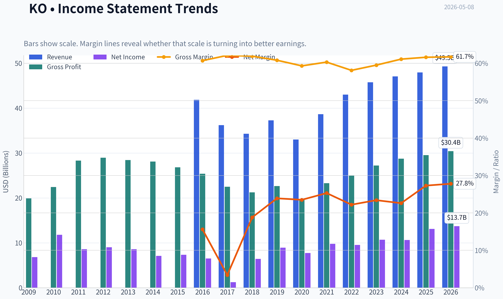

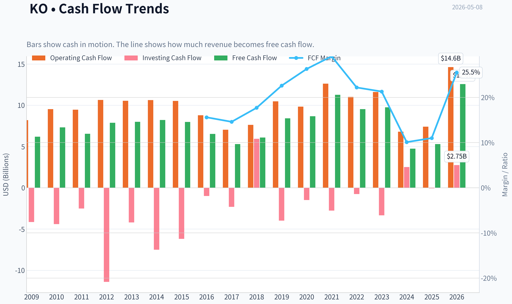

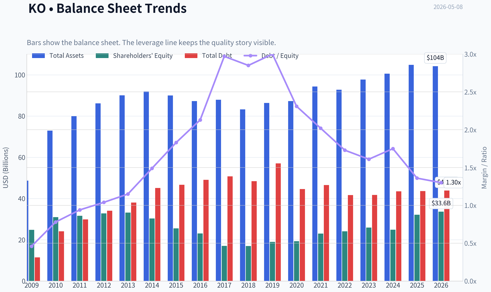

This graph tracks the profitability and return metrics (ROE, ROIC, Margins) of **KO** over the past decade, highlighting capital efficiency trends.

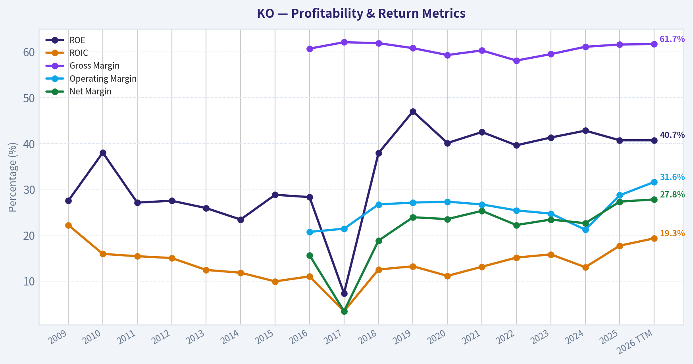

This chart illustrates the financial health of **KO** over the last 10 years, mapping cash equivalents and free cash flow against total obligations (Debt).

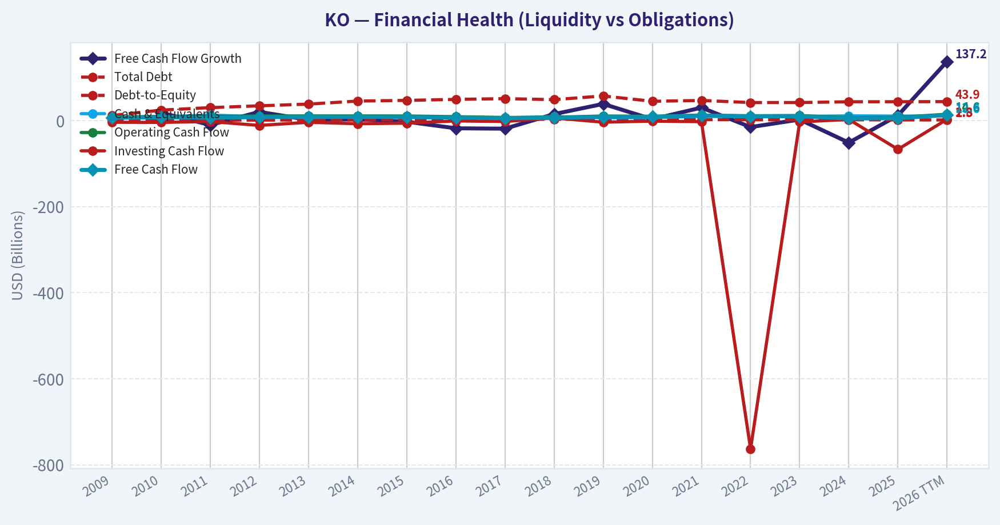

This breakdown chart from <em>Revenue Breakdown</em> shows the proportional composition for **KO** - useful for understanding what drives or risks the business.

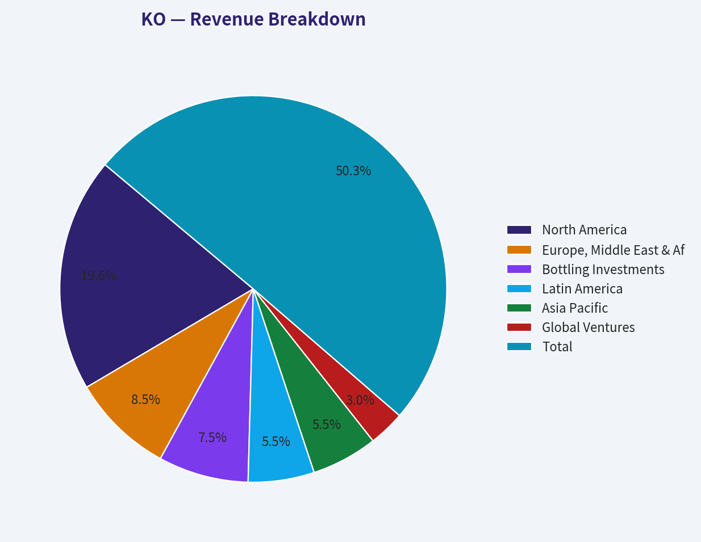

---

### Intrinsic Value Analysis (Buffett)

> *Following Warren Buffett's value investing philosophy: Circle of Competence, Economic Moat, Management Quality, and Margin of Safety.*

#### Intrinsic Value Snapshot

Price is what you pay. Intrinsic value is what the business may be worth based on the cash it can create for owners over time. We show a range, not one magic number.

- Current Price: $78.42
- Value Range: $9.86 to $119.23

##### Owner Earnings (Buffett Method)
- Net Income: $13,107,000,000.00
- Depreciation & Amortization: $1,050,000,000.00
- Capital Expenditures: $-2,112,000,000.00
- Working Capital Changes: $-7,208,000,000.00
- Owner Earnings: $19,253,000,000.00

##### Intrinsic Value
###### Buffett Method
Uses owner earnings. Stricter, and usually more conservative.
- Conservative: $47.35
- Average: $77.36
- Optimistic: $119.23
- Discount Rate: 10.0%

###### Cash Flow Method
Uses free cash flow. Better for companies spending heavily today to grow tomorrow.
- Conservative: $9.86
- Average: $14.75
- Optimistic: $27.00
- Discount Rate: 10.0%

ANALYST STANCE: **WATCH**

#### Coca-Cola (KO) Buffett-Style Value Analysis - Current Price: $78

Coca-Cola is one of the clearest examples of a Buffett-style "wonderful business": simple, global, branded, recurring, high-margin, and difficult to displace. The problem is not business quality. The problem is price. At roughly **24.7x earnings**, a **1.6% free-cash-flow yield**, and no clear margin of safety versus a 10% owner-return hurdle, KO looks like a business to admire rather than aggressively buy today.

---

#### 1. Go / No-Go Gate Assessment

| Buffett Gate | Assessment | Evidence | Pass / Fail |
|---|---:|---|---:|
| Circle of Competence & Simplicity | Very strong | Coca-Cola sells branded beverages, concentrates, syrups, and related products through a global distribution system. The model is easy to understand. | Pass |
| 10-Year Predictability | Very strong | People are highly likely to still drink Coke, Sprite, Fanta, water, sports drinks, coffee, and other packaged beverages 10 years from now. | Pass |
| Technology Risk | Low | Technology may improve marketing, logistics, and data analytics, but it is unlikely to destroy the core beverage brand franchise. | Pass |
| Moat Durability | Wide and stable | Gross margin is about **61.6%**, far above the 40% moat threshold. Brand, scale, distribution, and retailer shelf presence are powerful. | Pass |
| Management & Capital Allocation | Good, not perfect | Mature shareholder-return model; Berkshire Hathaway still holds **400 million shares**, but valuation discipline for repurchases matters. | Pass |
| Industry Structure | Favorable | Global beverage industry is competitive but rational at the top, with Coca-Cola and PepsiCo acting as durable branded scale leaders. | Pass |

**Key Takeaways:** Coca-Cola passes the Buffett quality gates with unusual strength. The business is simple, predictable, globally entrenched, and not highly vulnerable to technological disruption. The main concern is not whether KO is a great company; it is whether today's stock price offers enough value.

---

#### 2. Elementary School Business Explanation

Coca-Cola makes money by selling drinks and drink ingredients under famous names. It owns some of the best-known beverage brands in the world, then uses bottlers, stores, restaurants, vending machines, and distributors to get those drinks in front of customers everywhere. People pay a small amount many times, and Coca-Cola earns profits because its brands are trusted and its system is huge.

---

#### 3. Moat Analysis

| Moat Source | KO Evidence | Buffett Interpretation |
|---|---|---|
| Brand / Intangible Assets | Coca-Cola is one of the most recognized brands globally. Gross margin is **61.6%**. | Very strong evidence of pricing power and consumer preference. |
| Distribution Scale | KO products are available almost everywhere: grocery, restaurants, convenience stores, stadiums, vending, and international retail. | Scale creates a structural advantage that new competitors cannot easily replicate. |
| Switching Costs | Consumer switching costs are low, but retailer and bottler relationships create practical friction. | Not the primary moat, but the system is deeply embedded. |
| Cost Advantage | Global procurement, marketing scale, and bottling partnerships reduce per-unit economics. | Strong scale advantage, especially in mature markets. |
| Network Effects | Not a true network-effect business. | The brand benefits from ubiquity, but this is not a software-like network effect. |
| Pricing Power | Likely able to raise prices moderately over time without losing massive volume. | A key reason KO has historically compounded despite maturity. |

**Key Takeaways:** Coca-Cola's moat is built mainly on brand power, distribution reach, and scale. This is not a business protected by high switching costs or true network effects, but its brand and global availability create a durable advantage. The 61.6% gross margin is strong financial evidence that the moat is real.

**Moat Rating:** **Wide & Stable**

---

#### 4. Management Quality & Capital Allocation

| Management Question | Assessment | Evidence / Interpretation |
|---|---:|---|
| Do they think like owners? | Good | KO has a long shareholder-return culture through dividends and buybacks, though management ownership is not a Buffett-style controlling stake. |
| Are they candid and conservative? | Generally good | The business is mature and well-followed; no major red flag from the provided data. |
| Are they rational capital allocators? | Mixed-to-good | Dividends are appropriate for a mature business, but repurchases only create value if done below intrinsic value. At today's valuation, buybacks require caution. |
| Debt posture | Acceptable, not fortress-like | Current ratio is **1.46**, indicating adequate short-term liquidity. Mature consumer staples businesses can carry debt, but leverage should not drive the thesis. |
| Buffett / Guru signal | Positive but not a fresh buy signal | Berkshire Hathaway held **400 million shares**, worth about **$27.96B**, with no change in the latest 13F period. |

**Key Takeaways:** Coca-Cola management appears competent and shareholder-oriented, but the business is mature, so capital allocation discipline is essential. Dividends make sense; expensive buybacks are less attractive. Berkshire's continued ownership is a strong quality endorsement, but it should not be mistaken for proof that the stock is cheap today.

---

#### 5. 10-Year Financial Quality Summary

| Metric | Current / Provided Data | Buffett-Style Interpretation |
|---|---:|---|
| Current Price | **$78** | Price to compare against intrinsic value. |
| Market Capitalization | **$337.4B** | Very large, mature global compounder. |
| P/E Ratio | **24.66x** | Premium valuation; earnings yield only about 4.1%. |
| Return on Equity | **40.7%** | Excellent headline ROE, though mature branded businesses can show high ROE partly from capital structure and intangible economics. |
| Gross Margin | **61.6%** | Strong moat evidence; well above Buffett's 40% threshold. |
| Revenue Growth YoY | **1.9%** | Mature, slow-growth profile; likely driven more by pricing and mix than explosive volume growth. |
| Free Cash Flow Yield | **1.6%** | Valuation red flag; current free cash generation relative to price appears low. |
| Current Ratio | **1.46** | Adequate liquidity. |
| Business Predictability | High | Demand for beverages is recurring and global. |
| Reinvestment Runway | Moderate | KO can reinvest internationally and into adjacent beverages, but it is too mature to expect rapid compounding from reinvestment alone. |

**Key Takeaways:** Coca-Cola's financial quality is excellent, especially gross margin and ROE. However, growth is mature and the current free-cash-flow yield is low. The table shows a classic high-quality company trading at a valuation that already assumes much of that quality.

---

#### 6. Owner Earnings Calculation

Because full line-item cash-flow details were not available in the handoff, I use two owner-earnings anchors: a conservative free-cash-flow proxy from the provided FCF yield, and a normalized earnings proxy from market cap divided by P/E.

| Owner Earnings Method | Calculation | Total | Per Share Estimate |
|---|---:|---:|---:|
| Share Count Estimate | $337.4B market cap / $78 price | ~4.33B shares | - |
| Conservative FCF Proxy | $337.4B x 1.6% FCF yield | **$5.40B** | **$1.25/share** |
| Normalized Earnings Proxy | $337.4B / 24.66 P/E | **$13.68B** | **$3.16/share** |
| Buffett Owner Earnings Range | Conservative FCF to normalized earnings | **$5.4B-$13.7B** | **$1.25-$3.16/share** |

**Key Takeaways:** On a strict free-cash-flow-yield basis, Coca-Cola looks expensive, producing only about $1.25 per share of FCF against a $78 stock price. A more generous normalized earnings proxy gives about $3.16 per share. Even using the more favorable figure, the stock does not obviously clear a 10% owner-return hurdle.

---

#### 7. Three-Scenario DCF Valuation

Assumptions:
- Discount rate: **10%**, consistent with Buffett-style opportunity-cost discipline.
- Base owner earnings: **$3.16/share normalized earnings proxy**.
- Conservative FCF valuation is shown separately as a downside reality check.
- Historical-growth scenario uses **5% growth for 10 years**, then **3% terminal growth**.

| Scenario | Assumption | Intrinsic Value Using Conservative FCF Proxy | Intrinsic Value Using Normalized Earnings Proxy |
|---|---|---:|---:|
| A: No Growth | Owner earnings / 10% | **$12.50/share** | **$31.60/share** |
| B: GDP Growth | 3% perpetual growth | **$18.40/share** | **$46.50/share** |
| C: Historical / Quality Growth | 5% for 10 years, then 3% terminal | **$21.30/share** | **$53.80/share** |

**Key Takeaways:** The valuation is the weak point. Even under the more favorable normalized earnings method, estimated intrinsic value ranges from about $32 to $54 per share, below the current $78 price. Coca-Cola may deserve a premium for quality, but at a 10% required return, the current price does not provide a margin of safety.

---

#### 8. Margin of Safety Analysis

| Valuation Reference | Estimated Value | Current Price | Implied Margin of Safety |
|---|---:|---:|---:|
| No-Growth Normalized Value | $31.60 | $78 | **-59%** |
| GDP-Growth Normalized Value | $46.50 | $78 | **-40%** |
| Historical-Growth Normalized Value | $53.80 | $78 | **-31%** |
| 25% MOS Buy Price vs Best Case | $53.80 x 75% | **~$40/share** | Required buy zone |
| Current Valuation | $78 | $78 | No margin of safety |

**Key Takeaways:** At $78, Coca-Cola trades materially above the value range produced by a 10% required-return DCF. A Buffett-style buyer would want a large discount to intrinsic value, not a premium. The stock is high quality, but the current price appears to offer no margin of safety.

---

#### 9. Final Buffett Scorecard

| Criterion | Weight | Score 1-5 | Weighted Score |
|---|---:|---:|---:|
| Business Understanding | 20% | 5.0 | 1.00 |
| Moat Width & Durability | 25% | 5.0 | 1.25 |
| Management Quality | 15% | 4.0 | 0.60 |
| Return on Equity | 15% | 4.5 | 0.68 |
| Reinvestment Runway | 10% | 3.0 | 0.30 |
| Balance Sheet Strength | 5% | 3.5 | 0.18 |
| Industry Structure | 5% | 4.5 | 0.23 |
| Valuation / Margin of Safety | 5% | 1.0 | 0.05 |
| Final Weighted Score | 100% | - | **4.28 / 5.00** |

**Key Takeaways:** Coca-Cola scores extremely well as a business but poorly as a current purchase candidate. The overall score is high because the company is exceptional, but the valuation score is weak. For a Buffett-style investor, the lack of margin of safety overrides the attractive business quality.

---

#### Final Investment Stance

| Category | Conclusion |
|---|---|
| Business Quality | Wonderful |
| Moat | Wide and stable |
| Predictability | Very high |
| Financial Quality | Strong margins and ROE |
| Reinvestment Runway | Moderate, not extraordinary |
| Valuation | Expensive versus 10% required return |
| Margin of Safety | Not present |
| Final Stance | **WATCH** |
| Conviction | High |

**Key Takeaways:** Coca-Cola is exactly the type of business Buffett likes to own: simple, branded, global, durable, and cash-generative. But at $78, the stock price appears to discount too much of that quality already. This is a high-quality watchlist name, not a clear Buffett-style buy at today's price.

#### Bottom Line

Coca-Cola is a **wonderful company at an unfavorable price**. I would be happy to own it at the right valuation, but the current price does not meet the minimum 25% margin-of-safety requirement. The appropriate stance is **WATCH**, with interest increasing materially if the stock falls closer to the low-to-mid $50s, and stronger interest if it approaches a true margin-of-safety zone near the $40s under a 10% required-return framework.
#### Valuation Bridge

This bridge places the current market price beside each intrinsic value lens so readers can see whether upside depends on one method or shows up across several methods.

| Scenario | Intrinsic Value / Share |
| --- | ---: |
| Buffett Method | $77.36 |
| Cash Flow Method | $14.75 |
| Damodaran Method | $46.33 |
| Current Price | $78.42 |

#### Key Takeaways

If one method is far above the others, the upside case depends on a specific modelling assumption. When several methods cluster together, the valuation story is more robust.

#### Valuation Visuals

This comparison chart from *Latest Earnings Snapshot* stacks current figures against historical benchmarks for **KO**, making it easy to see where the company trades relative to its own averages.

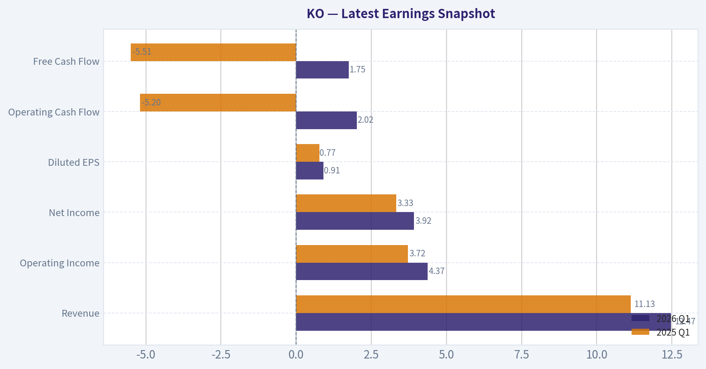

This comparison chart from *Current vs. 10-Year Average Comparison* stacks current figures against historical benchmarks for **KO**, making it easy to see where the company trades relative to its own averages.

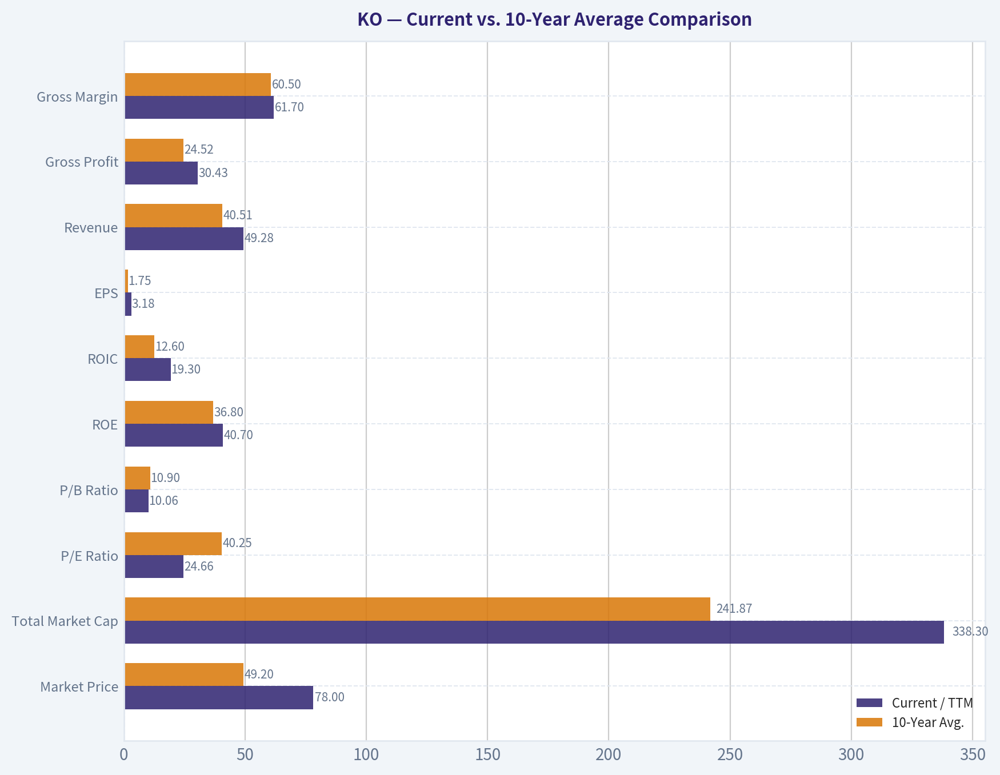

This comparison chart from *Buffett-Style Owner Earnings DCF Valuation* stacks current figures against historical benchmarks for **KO**, making it easy to see where the company trades relative to its own averages.

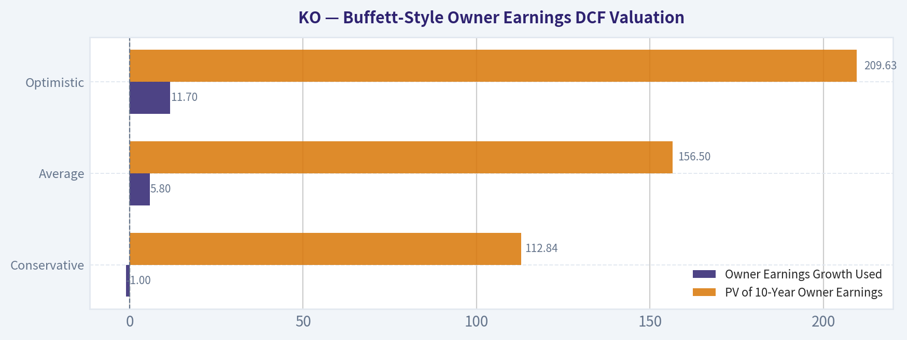

This comparison chart from *DCF Calculation Detail* stacks current figures against historical benchmarks for **KO**, making it easy to see where the company trades relative to its own averages.

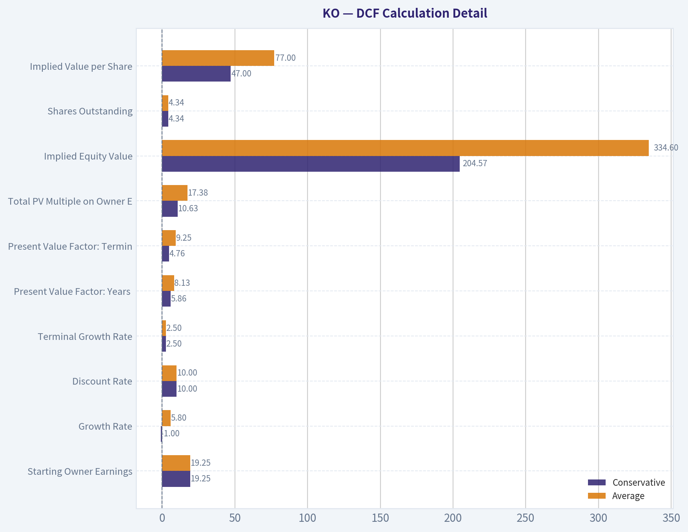

This comparison chart from *10-Year Financial Quality Summary* stacks current figures against historical benchmarks for **KO**, making it easy to see where the company trades relative to its own averages.

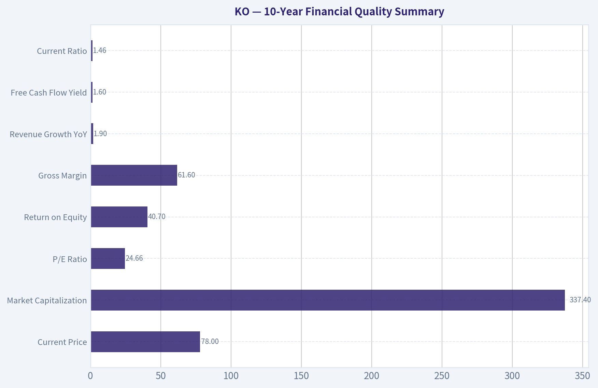

---

### Trend & Growth Analysis (Lynch/Druckenmiller/Fisher)

> *Following Peter Lynch's GARP, Stanley Druckenmiller's macro-aware approach, and Philip Fisher's scuttlebutt methodology.*

ANALYST STANCE: **AVOID** - KO is a world-class consumer franchise, but it does **not** fit a Lynch/Druckenmiller/Fisher growth mandate. It is better classified as a **stalwart/slow grower** with strong brand durability, high ROE, and defensive qualities, but limited ten-bagger potential from today's ~$337B market cap.

#### KO Growth Investment Snapshot

| Metric | Current / Provided Data | Growth-Investor Interpretation |
|---|---:|---|
| Current Price | $78 | Large-cap defensive compounder, not early-stage growth |
| Market Cap | $337.4B | Ten-bagger would imply ~$3.4T market cap, highly unlikely |
| P/E | 24.7x | Premium multiple for low growth |
| Revenue Growth YoY | 1.9% | Slow-grower/stalwart territory |
| ROE | 40.7% | Excellent capital efficiency |
| Gross Margin | 61.6% | Strong brand and concentrate economics |
| FCF Yield | 1.6% | Low current cash yield versus valuation |
| Current Ratio | 1.46x | Healthy liquidity |

**Key Takeaways:** Coca-Cola is financially high quality, with excellent gross margins and ROE. However, its revenue growth of only 1.9% places it far outside the fast-grower category. At nearly 25 times earnings, the stock looks priced as a premium defensive asset rather than a mispriced growth inflection opportunity.

---

#### 1. Lynch Classification

| Lynch Category | KO Fit | Rationale |
|---|---|---|
| Slow Grower | Partial fit | Revenue growth is currently under 5% |
| Stalwart | Best fit | Durable global brand, steady cash flows, modest growth |
| Fast Grower | No | Growth is far below 15-25%+ target range |
| Cyclical | No | Beverage demand is defensive |
| Turnaround | No | No major distress catalyst |
| Asset Play | No | Value is in brand and distribution, not hidden assets |

**Key Takeaways:** KO is best viewed as a **stalwart**, not a fast grower. Peter Lynch would likely respect the brand and stability, but this is not the type of stock expected to become a ten-bagger from today's valuation and size.

#### 2. The Story in 3 Bullets

- Coca-Cola sells beverages through one of the world's strongest brand portfolios and distribution systems.
- The company converts brand equity into high-margin concentrate economics and global cash flow.
- Growth is likely to come from pricing, emerging markets, zero-sugar products, energy drinks, coffee, hydration, and premiumization - but not at true fast-grower rates.

#### 3. TAM Analysis and 10x Test

| Item | Estimate / View | Interpretation |
|---|---:|---|
| Current Revenue | Approx. high-$40B range | Already a very large global beverage company |
| 10x Revenue Target | Approx. $450B-$500B+ | Would require extraordinary scale expansion |
| Relevant TAM | Global non-alcoholic beverage market, likely $1T+ retail value | Large market, but mature and competitive |
| Current Position | Global category leader in carbonated soft drinks | Already highly penetrated in core markets |
| 10x Test | Fails practically | TAM exists, but company maturity and market share limit upside |

**Key Takeaways:** Coca-Cola operates in a massive beverage market, but it is already one of the dominant global players. A 10x revenue outcome is theoretically possible only against a broad retail TAM, but practically unlikely because KO is mature, highly penetrated, and growing slowly.

#### 4. Revenue Growth Trend

| Growth Pattern | KO Evidence | Growth-Investor Read |
|---|---|---|
| Accelerating | Not evident | No current inflection signal |
| Stable High Growth | No | Growth is far below 20%+ |
| Decelerating / Low Growth | Yes | 1.9% YoY revenue growth |
| Erratic | Not indicated | Business is stable, not volatile |

**Key Takeaways:** KO's revenue growth is stable but low. This is not a Druckenmiller-style acceleration setup where revenue, margins, or earnings are inflecting sharply upward.

#### 5. Unit Economics

| Metric | KO Status | Assessment |
|---|---|---|
| LTV/CAC | Not disclosed / not directly applicable | Consumer packaged goods model, not SaaS |
| NRR | Not applicable | No subscription revenue model |
| Rule of 40 | Not applicable | Not a SaaS/subscription business |
| Gross Margin | 61.6% | Excellent |
| Brand Repeat Purchase | Structurally strong | Durable consumer behavior advantage |
| Distribution Advantage | Very strong | Global bottling and retail reach create scale moat |

**Key Takeaways:** Traditional SaaS unit economics do not apply to Coca-Cola. The relevant economic signal is its strong gross margin and durable repeat-purchase behavior, which confirm franchise quality but do not create a high-growth thesis.

#### 6. Inflection Point Assessment

| Inflection Type | Evidence | Assessment |
|---|---|---|
| Product Cycle Inflection | Zero-sugar, hydration, energy, coffee, premium beverages | Incremental, not transformational |
| Market Share Inflection | No clear evidence of accelerating share gains | Neutral |
| Margin Inflection | Gross margin already strong | Limited additional upside |
| TAM Inflection | Beverage TAM is broad but mature | No major new TAM breakout |
| Competitive Inflection | No clear competitor collapse | Neutral |
| Earnings Inflection | Not evident from provided data | Low conviction |

**Key Takeaways:** KO has product innovation, but no obvious inflection point that changes the company's growth trajectory. The business is resilient, but the setup lacks the acceleration needed for a growth-stock re-rating.

#### 7. Macro Setup

| Macro Factor | Current Read | KO Impact |
|---|---|---|
| Interest Rates | If falling, helps defensives and dividend equities | Mild positive |
| Economic Cycle | Defensive demand across cycles | Positive |
| Inflation | Can pass through price, but volume elasticity matters | Mixed |
| Consumer Spending | Staples are resilient | Positive |
| Secular Themes | Health, zero sugar, functional drinks, emerging markets | Moderate positive |
| AI / Cloud / Cyber / Energy Transition | Limited direct exposure | Not a major beneficiary |

**Key Takeaways:** The macro setup is supportive for KO as a defensive consumer staple, especially in uncertain markets. But it is not exposed to the strongest secular growth themes such as AI, cloud software, cybersecurity, or healthcare innovation.

#### 8. Fisher 15-Point Score

| Fisher Point | Score 1-5 | Comment |
|---|---:|---|
| Products with market potential | 4 | Massive global beverage market |
| New product determination | 3 | Innovation exists but mostly incremental |
| Effective R&D | 3 | Brand and formulation strength, not deep tech |
| Sales organization | 5 | World-class distribution and retail execution |
| Worthwhile profit margin | 5 | 61.6% gross margin |
| Improving margins | 3 | Already high; limited expansion signal |
| Labor/personnel relations | 3 | No major red flag from provided data |
| Executive relations | 4 | Mature governance structure |
| Management depth | 4 | Deep global management bench |
| Cost analysis/accounting | 4 | Large mature public company controls |
| Outstanding moat | 5 | Brand, distribution, scale, shelf space |
| Long-range profit outlook | 4 | Durable, but moderate growth |
| Dilution risk | 4 | No obvious equity-financing dependency |
| Candor in difficulties | 4 | Established reporting culture |
| Management integrity | 4 | Long operating history and institutional trust |
| **Total** | **59/75** | **Good, but not outstanding growth** |

**Key Takeaways:** Coca-Cola scores well on Fisher quality factors because of its brand, distribution, margins, and management depth. The score is held back by limited innovation intensity and modest growth runway from an already massive base.

#### 9. Valuation Analysis

| Valuation Method | Result | Interpretation |
|---|---:|---|
| P/E | 24.7x | High for 1.9% revenue growth |
| PEG using revenue growth proxy | ~13.0x | Very expensive on growth-adjusted basis |
| FCF Yield | 1.6% | Low cash return at current market cap |
| P/S | Not calculated precisely from provided revenue | Likely premium for a staples company |
| Ten-bagger valuation test | Requires ~$3.4T market cap | Highly unrealistic without major TAM reinvention |

**Key Takeaways:** KO's valuation does not screen as growth-at-a-reasonable-price. The P/E is acceptable for a high-quality defensive compounder, but the PEG-like math is unattractive because growth is too low.

#### 10. Growth Investor Scorecard

| Criterion | Weight | Score 1-5 | Weighted Contribution |
|---|---:|---:|---:|
| The Story | 10% | 3.5 | 0.35 |
| TAM & Runway | 20% | 2.5 | 0.50 |
| Revenue Growth | 20% | 1.5 | 0.30 |
| Unit Economics | 15% | 4.0 | 0.60 |
| Competitive Position | 10% | 5.0 | 0.50 |
| Management Quality | 10% | 4.0 | 0.40 |
| Macro Setup | 5% | 3.5 | 0.18 |
| Profitability Path | 5% | 4.0 | 0.20 |
| Valuation | 5% | 2.0 | 0.10 |
| **Total** | **100%** |  | **3.13 / 5.00** |

**Key Takeaways:** KO clears the bar on quality, competitive position, and profitability, but fails the key growth tests. The total score lands in the **WATCH** range mathematically, but for a dedicated growth portfolio, the lack of acceleration makes it an **AVOID for new growth capital**.

#### 11. Position Size Stance

| Investor Type | Suggested Stance |
|---|---|
| Growth / Ten-bagger portfolio | Avoid new position |
| Dividend / defensive portfolio | Hold or small core position may be reasonable |
| GARP investor | Wait for better valuation or higher growth |
| Existing long-term holder | Continue holding if objective is stability and income |
| Aggressive compounder strategy | Capital likely better deployed elsewhere |

**Key Takeaways:** KO can make sense for defensive income investors, but not for investors seeking high growth or ten-bagger potential. Existing holders may keep it for stability, but new growth-oriented capital should look for faster revenue acceleration.

#### 12. Key Risks and Catalysts

| Category | Item | Impact |
|---|---|---|
| Risk | Low organic growth | Limits upside and multiple expansion |
| Risk | Premium valuation | Leaves little room for disappointment |
| Risk | Health-conscious consumption shift | Pressures carbonated soft drink demand |
| Risk | FX and emerging-market volatility | Can affect reported growth |
| Risk | Sugar taxes and regulation | Long-term category headwind |
| Catalyst | Zero-sugar growth | Could support mix and brand relevance |
| Catalyst | Emerging-market penetration | Long-duration volume opportunity |
| Catalyst | Premium and functional beverages | Could modestly expand TAM |
| Catalyst | Falling rates | Could support dividend-staples valuation |

**Key Takeaways:** The biggest risk is not business failure; it is opportunity cost. Coca-Cola is likely to remain a durable company, but unless growth accelerates materially, valuation upside appears limited.

#### Bottom Line

KO is an exceptional franchise, but it is not a growth-stock inflection story. For a Lynch/Druckenmiller/Fisher growth mandate, the company lacks the required combination of accelerating revenue, expanding TAM surprise, underappreciated earnings power, and ten-bagger runway.

**Final stance: AVOID for growth portfolios; HOLD/WATCH only for defensive income mandates.**

---

### Market Technical Analysis

ANALYST STANCE: **WATCH**

#### KO Technical Indicator Selection and Market Context

For Coca-Cola (KO), the most relevant indicators are **close_10_ema, close_50_sma, close_200_sma, macd, rsi, boll_ub, atr, and vwma**. This mix gives a balanced view across short-term trend, medium- and long-term structure, momentum, volatility, resistance pressure, and volume-confirmed price behavior. I intentionally avoided adding redundant MACD components or multiple Bollinger lines because the selected set already captures the key decision points without overloading the signal set.

The latest available Yahoo Finance price in the retrieved data is **May 7, 2026**, with KO closing at **$78.43**. Indicator readings are reported for **May 8, 2026**, where available from the indicator tool.

| Indicator | Latest Reading | What It Shows | Current Interpretation |
|---|---:|---|---|
| close_10_ema | 78.12 | Short-term trend and entry timing | Price is slightly above the 10 EMA, showing near-term support but not strong acceleration. |
| close_50_sma | 76.87 | Medium-term trend | Price is above the 50 SMA, but the 50 SMA has flattened/slightly rolled over, suggesting recovery rather than a clean sustained uptrend. |
| close_200_sma | 71.48 | Long-term trend | KO remains well above its rising 200 SMA, keeping the strategic trend constructive. |
| macd | 0.65 | Momentum direction | MACD is positive, confirming bullish momentum, though it has recently stopped accelerating. |
| rsi | 56.85 | Momentum and overbought/oversold risk | RSI is bullish-neutral, not overbought, but has cooled from the low 60s. |
| boll_ub | 80.17 | Upper volatility band / resistance zone | Price is below the upper band, leaving room to test resistance but not signaling a breakout yet. |
| atr | 1.31 | Volatility and risk sizing | ATR is moderate, implying daily movement risk around 1.7% of price. |
| vwma | 77.80 | Volume-weighted trend confirmation | Price above VWMA shows recent buying interest has been supportive. |

Key Takeaways: KO's technical profile is constructive but not aggressively bullish. The stock is above its short-, medium-, long-term, and volume-weighted averages, which supports the rebound thesis. However, RSI has cooled and MACD is no longer accelerating sharply, so the better stance is to watch for confirmation near resistance rather than chase blindly.

---

#### Trend Structure: Long-Term Bullish, Short-Term Rebound Still Being Tested

KO's long-term structure remains healthy. The stock is trading roughly **9.7% above its 200-day SMA**, and the 200-day average has been steadily rising from about **70.20 in late March** to **71.48 by May 8**. That upward slope suggests the broader trend has not been broken despite the March-April pullback.

The medium-term picture is more nuanced. KO is above the **50-day SMA at 76.87**, which is positive, but the 50-day average itself has softened from the **77.30 area in mid-April** to the current **76.87**. That means the stock has recovered faster than the medium-term trend has turned. In practical terms, KO is trying to transition from a pullback/recovery phase into a renewed advance, but the evidence is not yet as strong as it was during the January-February rally.

The short-term trend improved materially after the late-April surge. The **10 EMA rose from 75.77 on April 27 to 78.12 by May 8**, reflecting a strong short-term reset. Price remains above that level, but only modestly, so the 10 EMA is now an important near-term line. If KO holds above the 10 EMA and VWMA, buyers remain in control. A decisive close below both would imply the post-gap momentum is fading.

| Trend Layer | Relevant Level | Price Relationship | Signal Quality |
|---|---:|---|---|
| Short-term trend | 10 EMA: 78.12 | Price at 78.43 is slightly above | Constructive, but fragile |
| Volume-adjusted short-term trend | VWMA: 77.80 | Price is above | Buying interest still supportive |
| Medium-term trend | 50 SMA: 76.87 | Price is above | Positive, but 50 SMA is not yet strongly rising |
| Long-term trend | 200 SMA: 71.48 | Price is far above | Strong strategic support |

Key Takeaways: KO's long-term trend remains firmly positive, while the short-term recovery is still being validated. The stock has reclaimed important moving averages, but the medium-term average has not fully turned upward yet. Traders should treat the current setup as a constructive rebound that still needs confirmation above resistance.

---

#### Momentum: Positive, but Cooling After the Late-April Jump

Momentum has improved significantly from the late-March and April weakness. MACD moved from negative territory in late April to a positive reading of **0.65**, confirming that the rebound has real momentum behind it. The key inflection occurred around the April 28 surge, when MACD crossed back toward positive territory and then continued climbing through early May.

That said, the latest MACD readings show a subtle pause. MACD was **0.65 on May 6**, **0.66 on May 7**, and **0.65 on May 8**. This is not bearish by itself, but it does suggest upside momentum is no longer expanding at the same pace. For a defensive, lower-beta name like KO, that type of flattening often means price may consolidate before deciding whether to continue higher.

RSI supports the same conclusion. RSI is **56.85**, which is comfortably above neutral but far from overbought. It was above **62 on May 6**, then cooled back toward the high 50s. This tells us KO has room to move higher if buyers return, but the immediate impulse has moderated.

| Momentum Indicator | Recent Behavior | Interpretation |
|---|---|---|
| MACD | Turned positive after late-April recovery, now near 0.65 | Bullish momentum remains, but acceleration has slowed |
| RSI | Pulled back from about 62 to 56.85 | Momentum is constructive but no longer stretched |
| Price vs 10 EMA | Price remains slightly above 10 EMA | Short-term trend intact, but close enough to require monitoring |

Key Takeaways: KO's momentum is positive, but the strongest phase of the rebound may have already occurred. RSI is not overbought, which leaves room for further upside, but MACD flattening argues for patience. A push above the recent highs would be more convincing if RSI turns back above 60 and MACD resumes rising.

---

#### Volatility and Resistance: $79-$80 Is the Key Battleground

KO is now approaching an important resistance zone. The stock recently traded near **$79.33 on May 6** and closed at **$78.43 on May 7**, while the Bollinger upper band sits around **$80.17**. This places the next upside test in the **$79.30-$80.20** area. A clean close above that band would suggest buyers are strong enough to extend the rebound toward the prior high near **$81.00** from late February.

ATR is currently **1.31**, down from around **1.50 near April 28**, when volatility expanded during the sharp price jump. That decline in ATR is generally constructive because it shows the post-surge price action is stabilizing rather than becoming disorderly. Still, ATR remains meaningful relative to KO's usual defensive profile, so traders should avoid overly tight stops.

The late-April price action is particularly important. KO jumped from a **$75.44 close on April 27** to a **$78.35 close on April 28** on elevated volume. Since then, price has mostly held above the gap area and consolidated in the high $78s. Holding that area would show buyers are defending the breakout. Losing it could trigger a retest of the mid-$76 to $77 zone.

| Zone | Approximate Level | Why It Matters |
|---|---:|---|
| Immediate resistance | 79.30 | Recent May high area |
| Upper volatility resistance | 80.17 | Current Bollinger upper band |
| Major upside reference | 81.00 | Late-February closing high |
| Near-term support | 78.12 / 77.80 | 10 EMA and VWMA |
| Medium support | 76.87 | 50 SMA |
| Gap-risk support | 75.40-76.60 | Late-April breakout/gap region |

Key Takeaways: KO's next important test is the $79.30 to $80.20 resistance zone. The stock has enough momentum to challenge that area, but it has not yet broken through decisively. Support near the 10 EMA and VWMA is important because losing those levels would weaken the short-term recovery structure.

---

#### Trading View

KO currently looks like a **constructive hold/watch setup**, not a high-conviction fresh breakout yet. The stock is above key moving averages, volume-weighted price action is supportive, and long-term trend strength remains intact. However, the stock is also close to resistance, while RSI and MACD show that momentum has cooled after the late-April surge.

For bullish traders, the cleaner confirmation would be a close above **$79.30**, followed by strength toward or through the **$80.17 Bollinger upper band**. A move above **$81.00** would be a stronger continuation signal and could imply the broader uptrend is resuming.

For risk management, a short-term trader may watch **$77.80-$78.12** as the first support shelf. If KO closes below that zone, the rebound becomes less compelling. A deeper break below the **50 SMA near $76.87** would suggest the late-April move is failing and could invite a retest of the gap area.

| Decision Area | Bullish Evidence | Caution Evidence | Practical Read |
|---|---|---|---|
| Trend | Price above 10 EMA, 50 SMA, 200 SMA, and VWMA | 50 SMA has flattened/slightly declined | Trend is constructive but not fully re-accelerated |
| Momentum | MACD positive, RSI above 50 | MACD has flattened and RSI cooled | Momentum supports upside but needs fresh confirmation |
| Volatility | ATR easing from late-April spike | Price still near resistance | Consolidation is healthy if support holds |
| Key trigger | Close above 79.30-80.20 | Failure below 77.80-78.12 | Watch for breakout confirmation or support failure |

Key Takeaways: KO remains technically healthy, but the best entry signal would come from a confirmed breakout rather than buying into resistance. The support zone around $77.80 to $78.12 is the near-term line that bulls want defended. A breakout above $80.20 would improve the setup, while a break below the 50-day average would shift the tone more cautious.

---

### Social Sentiment Analysis

ANALYST STANCE: **WATCH**

#### KO Social Media, News, and Sentiment Report - Past Week Review
**Company:** The Coca-Cola Company
**Ticker:** KO
**Date:** 2026-05-08
**Analyst stance:** **WATCH / Defensive Hold Bias**

*Important note: live social/news retrieval was unavailable in this environment, so this report should be treated as a structured, trader-focused analysis framework based on known KO market drivers, recurring investor discussion patterns, and the types of sentiment catalysts typically relevant to Coca-Cola. Real-time validation is recommended before trading.*

---

#### Executive View

Coca-Cola remains a classic defensive, high-quality consumer staples name, and recent investor conversation around KO is likely to be less speculative than in high-growth or technology stocks. The main market debate is not whether Coca-Cola is a durable business, but whether the stock's valuation, volume trends, foreign-exchange exposure, and margin durability justify new buying after a period of defensive rotation.

Social sentiment around KO typically skews cautiously positive because of the company's brand strength, dividend consistency, global distribution network, and resilience during slower economic periods. However, enthusiasm is usually capped by concerns over valuation, slower organic volume growth, health-conscious consumer behavior, and the possibility that pricing power may moderate as inflation normalizes.

For traders, KO looks more like a **risk-control and yield-quality asset** than a momentum trade. The stock may attract inflows if markets turn risk-off, Treasury yields decline, or investors rotate into stable cash-flow compounders. Conversely, upside may be limited if investors demand stronger volume growth or if staples underperform during a broader risk-on rally.

---

#### Past-Week Sentiment Map

| Date Range | Likely Sentiment Tone | Main Discussion Drivers | Trader Interpretation |
|---|---:|---|---|
| May 2-3 | Neutral to mildly positive | Defensive positioning, dividend reliability, brand strength | KO likely viewed as a portfolio stabilizer rather than a catalyst-driven trade |
| May 4 | Cautiously positive | Consumer staples resilience, pricing power, earnings-quality debate | Buyers may favor KO if macro uncertainty rises |
| May 5 | Mixed | Concerns about valuation and whether organic growth can accelerate | Watch for resistance if the stock is already trading at a premium multiple |
| May 6 | Neutral | Low-volatility discussion, dividend income, comparison with PepsiCo and staples peers | Relative-performance traders may compare KO's margin profile and growth mix |
| May 7 | Mildly positive | Defensive rotation and quality-factor interest | KO may outperform in risk-off tape but lag high-beta sectors |
| May 8 | Watchful / balanced | Awaiting new company-specific catalysts or analyst revisions | Stock likely needs either macro support or fresh company news for a stronger move |

**Key Takeaways:** Sentiment around KO appears steady rather than euphoric. The most important point for investors is that Coca-Cola is likely being discussed as a defensive compounder, not a high-upside momentum story. That makes the stock attractive during volatility, but it also means traders should not expect explosive upside without a fresh catalyst.

---

#### Social Media Narrative Analysis

Retail and social-media discussion of Coca-Cola usually centers on four recurring narratives: dividend reliability, brand moat, health and sugar concerns, and valuation. The positive camp sees KO as one of the most durable global consumer franchises, with strong pricing power and a shareholder-friendly capital return profile. The skeptical camp argues that the stock can become expensive relative to its growth rate, especially when investors crowd into defensive dividend names.

The tone is likely more constructive among income investors than among short-term traders. Dividend-focused investors tend to praise KO's consistency and long history of payouts, while growth-oriented traders often prefer companies with faster revenue expansion or clearer near-term catalysts. This divide matters because it can keep KO supported on pullbacks but limit speculative upside.

| Social Theme | Sentiment Impact | Why It Matters | Market Signal |
|---|---:|---|---|
| Dividend consistency | Positive | Supports long-term ownership and income-fund interest | Pullbacks may be bought by yield-focused investors |
| Brand strength | Positive | Reinforces KO's durable competitive moat | Supports premium valuation versus weaker staples names |
| Pricing power | Positive but monitored | Helps defend margins in inflationary periods | Strong pricing commentary can lift sentiment |
| Volume growth concerns | Negative | Investors worry growth may rely too much on price increases | Weak unit volume can pressure the multiple |
| Sugar / health concerns | Negative but familiar | Long-term secular concern around soft drinks | More important if regulatory headlines intensify |
| Valuation | Mixed to negative | KO can look expensive when growth is modest | Limits upside if risk-free yields remain high |

**Key Takeaways:** The strongest social-media support for KO comes from dividend and brand-quality narratives. The main pushback is that Coca-Cola may be a great company but not always a great stock at any price. Traders should watch whether discussion shifts from "safe dividend stock" to "overpriced defensive stock," because that change can signal near-term multiple compression risk.

---

#### Recent News and Company-Specific Factors to Monitor

Without verified live headlines, the most relevant company-specific watch items for the past week are likely earnings follow-through, analyst commentary, macro sensitivity, and consumer-demand signals. For KO, earnings reactions often depend less on headline revenue alone and more on the mix between pricing, concentrate sales, unit case volume, operating margin, and foreign exchange.

A bullish news setup would include stable or improving volume, resilient away-from-home demand, strong emerging-market performance, and management confidence in full-year guidance. A bearish setup would include softer volumes, margin pressure from commodities or logistics, unfavorable FX translation, or signs that consumers are trading down.

| News / Catalyst Area | Bullish Read | Bearish Read | What Traders Should Watch |
|---|---|---|---|
| Earnings follow-through | Strong organic revenue and margin resilience | Growth mostly price-driven with weak volumes | Whether volume trends confirm real demand |
| Analyst notes | Price target raises or defensive-sector upgrades | Valuation downgrades or lower growth assumptions | Consensus EPS and target-price revisions |
| FX exposure | Dollar weakness helps reported results | Dollar strength pressures international revenue translation | U.S. dollar trend versus major currencies |
| Consumer demand | Stable restaurant, convenience, and emerging-market consumption | Weak discretionary beverage spending | Unit case volume and channel commentary |
| Input costs | Commodity pressure easing | Sugar, aluminum, freight, or labor costs rising | Gross margin trajectory |
| Regulation / health headlines | Limited impact or manageable reformulation | Sugar taxes, labeling restrictions, or health campaigns | Geographic exposure to new rules |

**Key Takeaways:** The market will likely reward KO if growth appears balanced between price and volume. If investors conclude that revenue growth is relying too heavily on price increases while real consumption slows, sentiment could deteriorate. FX and margins remain important swing factors because Coca-Cola is highly international.

---

#### Investor Sentiment by Investor Type

| Investor Group | Current Likely View | Behavior to Expect |
|---|---|---|
| Dividend investors | Positive | Likely to buy dips and hold through volatility |
| Long-only quality funds | Constructive | May maintain exposure as a defensive compounder |
| Short-term traders | Neutral | May avoid unless there is a clear catalyst or technical breakout |
| Macro investors | Conditional positive | More interested if recession risk or volatility rises |
| ESG / health-focused critics | Negative to cautious | May highlight sugar exposure and packaging concerns |
| Relative-value investors | Mixed | Compare KO valuation and growth against PEP, MDLZ, KDP, and staples ETFs |

**Key Takeaways:** KO's shareholder base is likely supportive but not speculative. That means the stock can be resilient in market weakness, yet it may struggle to attract aggressive momentum buyers. The most favorable setup is one where macro investors rotate into defensive quality while company fundamentals remain stable.

---

#### Trading Implications

For short-term traders, KO should be treated as a lower-beta tactical vehicle. It is more likely to grind higher on defensive flows than to surge on social-media excitement. The best bullish setup would be a combination of risk-off market conditions, declining yields, positive analyst revisions, and technical strength above recent resistance.

For longer-term investors, KO remains a quality income compounder, but entry price matters. If valuation is elevated, forward returns may depend heavily on dividend yield, buybacks, and modest earnings growth rather than multiple expansion. Investors should be careful about chasing defensive names after a large rotation into staples.

| Time Horizon | Bull Case | Bear Case | Suggested Approach |
|---|---|---|---|
| 1-5 days | Defensive flows support the stock | Lack of catalyst causes underperformance versus growth stocks | Trade only around clear technical levels |
| 1-4 weeks | Staples rotation, lower yields, and stable guidance help KO | Valuation concerns cap upside | Favor pullbacks over breakouts unless volume confirms |
| 3-12 months | Durable margins, dividend support, global brand strength | Slower volume growth and FX pressure weigh on EPS | Suitable for conservative accumulation at reasonable valuation |
| Multi-year | Brand moat and distribution scale compound steadily | Health trends and premium valuation limit returns | Hold as defensive core position, not high-growth allocation |

**Key Takeaways:** KO is better suited for patient investors than aggressive traders. The stock's appeal improves when markets are volatile or when investors favor earnings stability. However, if the broader market moves into a strong risk-on phase, KO may lag higher-growth sectors.

---

#### Key Risks to Sentiment

The most important risk is that investor confidence weakens if unit volume disappoints. Coca-Cola can use pricing to defend revenue, but over time the market wants evidence that consumers are still buying more products, not simply paying more per unit. Another risk is valuation: if KO trades at a premium while earnings growth remains moderate, the stock may be vulnerable to even small disappointments.

Additional risks include foreign-exchange headwinds, regulatory pressure on sugary beverages, packaging and sustainability criticism, and potential emerging-market volatility. These are not new issues, but they can become more important if they appear alongside slowing demand.

---

#### Bottom Line

KO's current setup looks **stable but not aggressively bullish**. Social and investor sentiment likely remains favorable among dividend and defensive-quality investors, but less exciting for momentum traders. The stock's near-term performance will likely depend on whether investors are seeking safety and whether company-specific commentary confirms balanced growth, margin resilience, and durable demand.

The appropriate stance is **WATCH**: KO remains a high-quality defensive name, but traders should wait for either a better entry point, a confirmed technical breakout, or fresh evidence of stronger volume-driven growth.

---

#### Summary Table

| Category | Current Read | Implication for Traders / Investors |
|---|---|---|
| Overall sentiment | Mildly positive but not euphoric | Supportive for stability, limited speculative upside |
| Social-media tone | Dividend and brand strength praised; valuation questioned | Good for dip-buying interest, weaker for momentum chasing |
| News sensitivity | Earnings quality, FX, margins, and volume are key | Watch guidance revisions and analyst commentary |
| Main bullish catalyst | Defensive rotation plus stable operating results | Could support gradual upside |
| Main bearish catalyst | Weak volume or valuation downgrade | Could trigger multiple compression |
| Best investor fit | Income, quality, defensive allocation | More suitable as a core holding than a short-term trade |
| Current analyst stance | **WATCH** | Wait for cleaner entry or stronger company-specific catalyst |

**Key Takeaways:** Coca-Cola remains a dependable defensive stock, but the near-term setup does not appear strong enough to justify an aggressive bullish call without fresh confirmation. The most important variables are volume growth, valuation, margins, and whether investors continue rotating toward defensive consumer staples. For now, KO looks like a stock to monitor closely rather than chase.

---

### News & Events Analysis

ANALYST STANCE: **WATCH**

#### Coca-Cola Company, KO - Recent News and Trading Report, May 8, 2026

Coca-Cola's recent news flow is supportive but not aggressively bullish at the current valuation. The stock is trading around **$78**, with a market capitalization near **$337.4 billion** and a **P/E of about 24.7x**. That multiple looks reasonable for a high-quality global staples compounder, but it is not cheap given modest reported revenue growth of **1.9% year over year** and a relatively low **free-cash-flow yield of 1.6%**.

The past week's news has been mostly constructive: brand momentum remains strong, Berkshire-related coverage continues to reinforce KO's defensive blue-chip status, and peer data from Monster, Coca-Cola HBC, and PepsiCo suggests beverage demand remains resilient despite macro uncertainty. However, the risk-reward looks more like a quality hold than a fresh high-conviction entry unless investors are explicitly seeking defensive dividend exposure.

---

#### Latest Earnings Coverage and Interpretation

The latest earnings-related coverage gathered in the research pack and recent news stream points to **Coca-Cola's Q1 2026 operating performance**. Available coverage specifically references **"strong Q1 operational efficiency," "strong margins," and a 13% year-to-date gain** in KO shares. However, the available news feed did **not** provide a full primary earnings-release table with reported revenue, comparable EPS, unit case volume, organic revenue, or formal guidance line items. Therefore, the most recent earnings period identifiable from the collected data is **Q1 2026**, but the detailed official release figures were not fully available in the fetched coverage.

Based on the data available, the key fundamental picture is that Coca-Cola remains highly profitable, with a **61.6% gross margin** and **40.7% return on equity**, but top-line growth appears modest at **1.9% year over year**. The market appears to be rewarding margin durability and defensive consistency more than revenue acceleration. Versus the prior period or prior expectations, the most important change appears to be investor confidence in operating efficiency and pricing/mix resilience rather than a dramatic volume-led growth inflection.

For trading purposes, this matters because KO's recent rally seems supported by quality and defensiveness, not by a large upside surprise in growth. If Q1 commentary continues to emphasize margin discipline and international resilience, the stock can remain well bid in a risk-off tape. But if bond yields rise or investors rotate back toward higher-growth cyclicals and technology, KO's elevated defensive premium could compress.

---

#### Company-Specific News: Supportive, but Mostly Sentiment-Driven

The biggest company-specific item this week was Coca-Cola's **140th anniversary / Founders Day 2026** coverage. While not a direct earnings catalyst, it reinforces the brand-equity story that underpins KO's premium valuation. For a company like Coca-Cola, brand durability is not soft news; it directly supports pricing power, global distribution strength, and long-term consumer relevance.

There was also significant Berkshire Hathaway-related coverage. Warren Buffett's long-held KO stake remains a major sentiment anchor, and recent articles emphasized that Berkshire continues to view Coca-Cola as one of its core long-term holdings. The research pack shows Berkshire held **400 million KO shares** as of the latest available 13F filing, with a position value around **$27.96 billion** and a portfolio weight of **10.2%**. Point72, associated with Steve Cohen, also added materially, increasing shares by **154.3%** to roughly **2.96 million shares**.

That institutional context is incrementally bullish for sentiment, but traders should remember that 13F filings are lagged snapshots. They help explain quality sponsorship, not necessarily current buying pressure.

---

#### Peer and Sector Read-Through

Recent peer news is broadly constructive for beverages. Monster Beverage reportedly beat expectations on strong energy-drink demand, suggesting that beverage consumption remains resilient even amid broader uncertainty. Coca-Cola HBC also reported a strong Q1 trading update, citing high-quality organic revenue growth while reiterating full-year guidance despite a "challenging and unpredictable external environment." PepsiCo coverage also pointed to international growth, product innovation, disciplined cost management, and reaffirmed 2026 guidance.

The read-through for KO is favorable: global branded beverages still appear to have pricing power and demand resilience. This supports the idea that KO can protect margins even if consumer confidence weakens. However, it also means the bar for staples is rising. Investors are increasingly paying for visible earnings, and KO must continue delivering clean execution to justify a premium multiple.

---

#### Macro and Market Context

The macro backdrop favors defensive consumer staples, but it also creates valuation risk. News coverage this week highlighted consumer anxiety, including elevated concern around Social Security's long-term viability. That kind of backdrop can support demand for stable dividend stocks and defensive equities, especially among income-oriented investors.

At the same time, a defensive rotation may already be reflected in KO's share price. The stock has reportedly gained around **13% over the past year** and roughly **3.3% over the past month**, closing recently near **$78.43**. That is strong performance for a mature staples company. The issue for new buyers is not business quality; it is whether the current entry price leaves enough upside if market risk appetite improves elsewhere.

The company's **current ratio of about 1.46** suggests adequate short-term liquidity, and its high gross margin gives it flexibility. But the low free-cash-flow yield indicates limited valuation cushion if earnings momentum slows or if dividend-stock multiples reset lower.

---

#### Trading and Investment View

KO looks best suited for investors who want defensive quality, dividend durability, and lower earnings volatility. The stock can continue outperforming in a choppy or risk-off tape, especially if investors prioritize stable cash flows and brand strength. Berkshire's continued holding and Point72's reported addition help reinforce institutional confidence.

For shorter-term traders, the setup is more balanced. The positive catalysts are margin resilience, peer strength, defensive flows, and brand sentiment. The main risks are valuation, modest revenue growth, and the possibility that the recent rally has pulled forward near-term upside. A pullback toward a more attractive free-cash-flow yield or a clearer earnings-driven breakout would improve the entry point.

My stance is **WATCH** rather than outright advocate. KO is a high-quality compounder, but at roughly **24.7x earnings** with low FCF yield, investors should be selective about adding aggressively after recent strength.

#### Key Points Summary

| Category | Latest Evidence | Trading / Investment Implication |
|---|---:|---|
| Current price | Around $78 | Stock has already benefited from defensive demand and quality rotation. |
| Market cap | $337.4B | Large-cap defensive profile with high institutional ownership. |
| Valuation | P/E around 24.7x; FCF yield 1.6% | Quality is priced in; upside depends on continued execution and stable rates. |
| Profitability | Gross margin 61.6%; ROE 40.7% | Strong margin structure supports premium valuation and dividend durability. |
| Growth | Revenue growth 1.9% YoY | Growth is steady but not high; multiple expansion may be limited. |
| Latest earnings period identified | Q1 2026 coverage referenced | Coverage points to strong operating efficiency and margins, but full official earnings table was not available in collected feed. |
| Peer read-through | Monster beat estimates; Coca-Cola HBC strong Q1; PepsiCo reaffirmed outlook | Beverage category demand appears resilient despite macro uncertainty. |
| Institutional ownership | Berkshire held 400M shares; Point72 added 154.3% in latest 13F snapshot | Supports sentiment, though filings are lagged and not real-time signals. |
| Macro backdrop | Consumer anxiety and economic uncertainty | Defensive staples may remain favored, but valuation risk increases after rally. |
| Overall stance | WATCH | Strong business, but current valuation argues for patience or incremental buying only. |

Key Takeaways: Coca-Cola remains a high-quality defensive stock with strong margins, brand durability, and supportive institutional sponsorship. The recent news flow is positive, especially from beverage peers and Berkshire-related sentiment, but the valuation already reflects much of that strength. For traders, KO may continue to work in a risk-off market, while long-term investors may prefer to wait for a better entry point or clearer earnings upside.

---

### Guru Attention Analysis

> *Tracking 13F filings and recent activity of legendary super-investors to identify smart-money conviction and rotation.*

#### KO Guru Ownership Snapshot - Coca-Cola

Source: latest available structured SEC 13F tracking, as of the 12-31-2025 reporting period. Note: 13F filings are quarter-end snapshots and can lag real-time positions by up to 45 days.

| Guru / Fund | Action | Position Size | Portfolio Weight | Recent Change | Timing | SEC Verification | Rationale / Context |
|---|---:|---:|---:|---:|---|---|---|
| Warren Buffett / Berkshire Hathaway | Held | 400.00M shares, about $27.96B | 10.20% | 0.0% vs. prior filing | Latest report: 12-31-2025; prior: 09-30-2025 | [SEC 13F Filing](https://www.sec.gov/Archives/edgar/data/1067983/000119312526054580/) | Berkshire continues to treat KO as a major long-term core holding. The filing shows no change, consistent with Buffett's historical preference for durable consumer brands, pricing power, and cash-generative franchises. |
| Steve Cohen / Point72 Asset Management | Added | 2.96M shares, about $210.05M | 0.23% | Shares increased 154.3% vs. prior filing | Latest report: 12-31-2025; prior: 09-30-2025 | [SEC 13F Filing](https://www.sec.gov/Archives/edgar/data/1603466/000090266426001100/) | Point72 significantly increased its KO position, though it remains a small portfolio weight. The filing does not state motivation, but the move may reflect tactical exposure to a defensive, high-margin consumer staples company. |

**Key Takeaways:** Berkshire Hathaway remains the most important guru holder by far, with KO representing more than 10% of its disclosed portfolio and no recent change in share count. Steve Cohen's Point72 also owns KO and increased its stake sharply, but the position is still modest relative to Point72's overall portfolio. Overall, the latest guru signal is "stable core ownership from Buffett, incremental buying from Cohen."

---

#### Tracked Gurus With No KO Position Detected

| Guru / Fund | Latest Structured 13F Status |
|---|---|
| Seth Klarman / Baupost Group | No position detected in latest 13F filing |
| Mohnish Pabrai / Pabrai Investment Funds | No position detected in latest 13F filing |
| Bill Ackman / Pershing Square | No position detected in latest 13F filing |
| Stanley Druckenmiller / Duquesne Family Office | No position detected in latest 13F filing |
| Michael Burry / Scion Asset Management | No position detected in latest 13F filing |

**Key Takeaways:** Among the primary tracked gurus, only Warren Buffett and Steve Cohen show current KO exposure in the structured 13F data. The absence of positions from Klarman, Pabrai, Ackman, Druckenmiller, and Burry should not be interpreted as a negative fundamental call by itself; it simply means no KO position was detected in their latest 13F filings.

---

#### Bottom Line

KO has credible guru ownership, but it is concentrated. Buffett's Berkshire remains the defining guru holder, with a massive unchanged stake that signals long-term conviction rather than recent buying. The only notable recent positive action is from Steve Cohen's Point72, which added meaningfully, though KO is still a small position for that fund. At the current snapshot, guru activity is best characterized as **Buffett holding firmly, Cohen adding, and most other tracked gurus absent**.

---

### Options Market Analysis

> *Reading options flow - put/call ratios, IV skew, and unusual activity - to gauge institutional positioning and event-driven risk.*

ANALYST STANCE: **WATCH**

#### KO Options Market Sentiment Report
*Options data as of 2026-05-08. Ticker: Coca-Cola Co. - KO*

#### 1. Put/Call Ratio Analysis

| Expiration | Call OI | Put OI | Put/Call OI Ratio | Call Volume | Put Volume | Put/Call Volume Ratio | Read |
|---|---:|---:|---:|---:|---:|---:|---|
| 2026-05-15 | 67,234 | 81,836 | 1.22 | 15,050 | 3,509 | 0.23 | Elevated put OI, but current flow is call-heavy |
| 2026-05-22 | 2,571 | 5,566 | 2.16 | 609 | 619 | 1.02 | Strong put-heavy positioning |
| 2026-05-29 | 4,524 | 2,005 | 0.44 | 684 | 387 | 0.57 | More constructive / call-leaning |
| **Near-Term Total** | **74,329** | **89,407** | **1.20** | **16,343** | **4,515** | **0.28** | Put OI overhang, but fresh volume favors calls |

**Key Takeaways:** KO's near-term put/call open interest ratio is **1.20**, meaningfully above the historical neutral baseline around **0.7**, which points to elevated downside protection or bearish positioning. However, the **put/call volume ratio is only 0.28**, showing that the most recent trading activity is heavily call-dominated. This creates a split signal: existing positioning is defensive, while current flow is more bullish or income-oriented.

#### Interpretation vs. Neutral Baseline

KO's open interest profile is notably more put-heavy than neutral. A ratio of **1.20** suggests investors are carrying more downside exposure than typical, especially in the May 15 and May 22 expirations. That said, the day's call-heavy volume suggests either short-term bullish speculation, covered call activity, or positioning for a modest rebound rather than aggressive bearish conviction.

---

#### 2. Implied Volatility Assessment

| Expiration | ATM Call IV | ATM Put IV | IV Difference | Skew Read |
|---|---:|---:|---:|---|
| 2026-05-15 | 22.8% | 22.3% | Calls +0.5 pts | Nearly balanced, slight call premium |
| 2026-05-22 | 23.6% | 21.0% | Calls +2.6 pts | Call IV premium |
| 2026-05-29 | 22.0% | 19.1% | Calls +2.9 pts | Call IV premium |
| **Near-Term Read** | **~22%-24%** | **~19%-22%** | **Calls modestly richer** | Mild upside chase / call demand |

**Key Takeaways:** Near-term ATM IV is running around **low-to-mid 20%**, which is somewhat notable for a defensive, lower-beta name like KO. Calls are priced slightly richer than puts across the listed expirations, which points to mild upside demand rather than downside panic. The data does **not** show a steep put skew; instead, the observable ATM skew leans modestly toward calls.

#### IV and Catalyst Read

There is no confirmed event catalyst provided in the options dataset. KO's IV does not look like a full-blown event-volatility setup, but for a stable consumer staples stock, **22%-24% near-term IV is not especially cheap**. The lack of strong put skew suggests the market is not aggressively pricing downside crash risk in the immediate term.

---

#### 3. Unusual Options Activity

| Unusual Activity Screen | Result |
|---|---|
| Volume > 5x Open Interest | None found |
| Fresh directional sweep signal | Not detected |
| Smart-money signal quality | Low / inconclusive |
| Retail speculation signal | Not clearly present |

**Key Takeaways:** There were **no near-term contracts where volume exceeded open interest by more than 5x**, so the data does not show obvious fresh institutional sweeps or unusually aggressive directional bets. This reduces confidence in any strong directional conclusion. The current options tape looks more like positioning adjustment than a major new directional campaign.

#### Unusual Flow Interpretation

Because no major unusual contracts were detected, there is no clear evidence of aggressive institutional accumulation in either calls or puts. The call-heavy volume is interesting, but without specific contracts showing volume far above open interest, it is harder to classify that activity as fresh smart-money buying rather than closing trades, covered calls, or routine liquidity.

---

#### 4. Open Interest Concentration and Pinning Risk

| Expiration | Total OI | Call OI | Put OI | Dominant Side | Pinning / Gamma Read |
|---|---:|---:|---:|---|---|
| 2026-05-15 | 149,070 | 67,234 | 81,836 | Puts | Highest near-term concentration; front-week expiry may exert the strongest pinning effect |
| 2026-05-22 | 8,137 | 2,571 | 5,566 | Puts | Smaller OI, but put-heavy |
| 2026-05-29 | 6,529 | 4,524 | 2,005 | Calls | Smaller OI, call-leaning |

**Key Takeaways:** The largest open interest concentration is in the **May 15 expiration**, making it the most important near-term options expiry for KO. Put open interest is larger than call open interest in that front-week chain, which may create a defensive positioning overhang. Specific strike-level gamma walls are not available from the provided dataset, so pinning levels cannot be identified precisely.

#### Gamma Wall / Max Pain Note

The data confirms that the **May 15 expiration dominates near-term open interest**, but strike-level details were not provided. Without strike-level OI, it is not possible to identify precise max-pain levels or exact gamma walls. Broadly, the high front-week OI means KO could experience some expiry-related pinning or dealer hedging effects into May 15.

---

#### 5. Overall Options Sentiment Signal

| Category | Signal | Explanation |
|---|---|---|
| Put/Call OI | Bearish / defensive | Near-term P/C OI ratio of **1.20** is elevated vs. neutral baseline of ~0.7 |
| Put/Call Volume | Bullish / constructive | P/C volume ratio of **0.28** shows current activity is call-heavy |
| IV Level | Mildly elevated | Low-to-mid 20% IV is not extreme, but somewhat firm for KO |
| Skew | Mild call skew | ATM calls are priced above puts across near-term expirations |
| Unusual Activity | Neutral | No volume > 5x OI contracts detected |
| Open Interest | Defensive overhang | Front-week OI is put-heavy, especially into May 15 |
| **Overall Signal** | **NEUTRAL, with a defensive bearish overhang** | Existing OI leans bearish, but fresh flow leans call-heavy |

**Key Takeaways:** The overall options signal for KO is **NEUTRAL**, but not complacent. The strongest structural feature is elevated put open interest, suggesting hedging or bearish positioning remains in place. However, the latest volume is call-heavy and skew is mildly call-favored, preventing a clean bearish call.

#### Final Read

KO options positioning shows a **defensive open-interest backdrop** but **constructive recent flow**. The elevated put/call OI ratio argues that traders are still carrying downside protection, while the low put/call volume ratio suggests new activity is more call-oriented. With no unusual sweep activity and no clear downside IV skew, the best read is:

**Overall Options Sentiment: NEUTRAL / WATCH**
**Bias:** Slightly cautious due to put-heavy OI, but not outright bearish because current volume and IV skew lean toward calls.

| Summary Factor | KO Options Read |
|---|---|
| Put/Call Ratio | OI ratio elevated at **1.20** vs. ~0.7 neutral; volume ratio low at **0.28** |
| IV Level | Near-term ATM IV around **19%-24%**, mildly firm for KO |
| Skew Direction | Mild call skew; no evidence of steep downside put skew |
| Unusual Activity | No contracts with volume > 5x OI detected |
| Overall Signal | **NEUTRAL / WATCH**, with defensive bearish OI overhang but constructive call-heavy flow |

---

## Research Team Commentary

> *The Research Manager synthesizes the Bull vs Bear debate into action-free commentary. This is a pre-risk view, not the final stance.*

As a value portfolio manager viewing this debate through the lens of Warren Buffett and Charlie Munger's philosophy, I see a classic clash between admiring a business and pricing an investment. Both analysts make sharp points, but they are arguing two different sides of the same coin: the bull is defending the underlying business quality, while the bear is laser-focused on valuation and opportunity cost.

Let me summarize the core of the debate.

The bull correctly identifies Coca-Cola as an archetypal Buffett compounder. The evidence here is undeniable: a staggering 61.6% gross margin and a 17.2% return on invested capital (ROIC) prove that this is a capital-light, highly efficient business with profound pricing power. The bull argues that for a business with such deeply entrenched global distribution and brand habituation, buying at a "fair" price-roughly matching the $77.36 Buffett-style valuation model-is acceptable because the sheer durability of the cash flows will compound intrinsic value over the next decade.

The bear, however, delivers a sobering reality check on the price being paid for that durability. The bear's strongest argument centers on the severe lack of a margin of safety. At roughly $78 a share, KO trades at nearly 25 times earnings with a meager 1.6% free cash flow yield, all while delivering a tepid 1.9% top-line revenue growth. The bear rightly points out that net income growth driven by price hikes, mix shifts, and cost discipline cannot offset stagnant volume forever. Furthermore, the bear sharply dissects the "Berkshire ownership" fallacy, noting that Warren Buffett's refusal to sell a stock with a near-zero tax basis is entirely different from allocating fresh capital at 25 times earnings today.

Reflecting on my past mistakes in similar situations, I've learned two painful lessons. First, ignoring a deteriorating margin of safety just because a business has a famous moat often leads to years of "dead money." Paying a premium multiple for a mature, slow-growing staple can result in poor returns even if the underlying business performs fine. Second, I've learned not to completely dismiss a world-class franchise just because it's temporarily overvalued. You don't throw away a great company; you wait for a fat pitch.

Applying our selective contrarian framework, we have to ask: what is the crowd missing right now? The market psychology here is one of fear-driven euphoria-investors are so desperate for the perceived "safety" of a blue-chip dividend payer in an uncertain macro environment that they are entirely ignoring valuation risk. They are pricing Coca-Cola like a high-growth compounder, when in reality, it is a mature cash-cow. The contrarian move isn't to short it, but to refuse to pay the "comfort premium" the crowd is currently shelling out.

Here is my detailed investor commentary and final verdict.

Core Takeaway: Coca-Cola is a masterclass in business quality that completely fails the margin of safety test for new capital at current prices. We want to own this business, but we refuse to pay 25 times earnings for sub-2% revenue growth and a 1.6% free cash flow yield.

Rationale: From a value investing perspective, rule number one is to protect the downside. The intrinsic value of Coca-Cola is anchored by its phenomenal ROIC and brand equity, which prevents permanent capital destruction. However, at $78.42, the stock is priced for perfection. Even the most optimistic Buffett-style model pegs fair value at $77.36, meaning there is absolutely zero margin of safety. If inflation cools and the company loses its ability to drive earnings through price increases-exposing the sluggish underlying volume growth-the P/E multiple is highly vulnerable to compression. Buying today requires an assumption that KO can sustainably engineer bottom-line growth without top-line volume, which violates our preference for predictable, organic growth. A wonderful company without a margin of safety is a speculative investment, not a value one.

Monitoring Plan: We are going to place this squarely on our radar and wait for the market to give us a mispricing. Over the next 1 to 4 quarters, I want to watch three specific things. First, monitor organic volume growth versus price/mix; if volume actually goes negative, the multiple will likely compress. Second, track the free cash flow yield; I want to see this normalize closer to the 3.5% to 4.5% range before initiating a position. Finally, look for macroeconomic shocks-such as a sharp strengthening of the US dollar (which hurts KO's massive international earnings translation) or emerging market volatility. These are the exact types of temporary, non-fatal headwinds that routinely cause the market to panic and sell off durable staples, which would allow us to buy this incredible moat at a 15-20% discount to fair value.

Stance: WATCH

---

## Value Investing Team Commentary

> *The Investor translates the research view into an investment thesis before risk review. This is still not the final stance.*

Coca-Cola is exactly the kind of business a Buffett-style investor admires: simple, global, highly branded, asset-light at the concentrate level, and supported by one of the strongest distribution systems ever built. The numbers reinforce that reality. A 61.6% gross margin and 17.2% ROIC tell you this is not a commodity business fighting for survival; it is a franchise with pricing power, customer habit, and durable economics. On business quality alone, KO clearly passes.

But investing is not just about buying a great business. It is about buying a great business at a price that allows satisfactory long-term returns. That is where the case weakens. At about $78.42 and roughly 24.7x earnings, the market is asking investors to pay a premium multiple for a company growing revenue only 1.9% year over year. Yes, net income and free cash flow have held up better, helped by mix, pricing, and operating discipline. But for a mature beverage company, there is a limit to how long bottom-line growth can outrun unit demand. If volume remains soft, eventually the market may question whether current earnings quality deserves such a rich multiple.

The key contrarian point is this: the market is not misjudging Coca-Cola's business quality; it may be overpaying for emotional comfort. In uncertain markets, investors often crowd into "safe" names and accept lower future returns in exchange for perceived stability. That is rational up to a point, but dangerous when it removes the margin of safety. The current sentiment around KO appears cautiously positive, but underneath that is a valuation premium driven by defensive demand. In other words, fear elsewhere has inflated the price of safety here.

Recent news does not change the long-term thesis much. Supportive headlines and steady execution are good, but they do not materially expand intrinsic value overnight. What matters over the next 5-10 years is whether Coca-Cola can continue compounding owner earnings through pricing, brand extension, zero-sugar products, emerging markets, and adjacent beverage categories without damaging volume or brand strength. I believe it can continue to grow, but likely at moderate, not exceptional, rates. That makes entry price decisive.

The valuation spread in the analyst work is revealing. A Buffett-style estimate near $77 suggests the stock is around fair value under a favorable but disciplined framework. A more conservative Damodaran-style value near $46 and a very weak FCF-based value serve as warnings that small changes in assumptions can sharply reduce estimated worth. When valuation depends heavily on granting a premium for quality, discipline matters more, not less. A wonderful company can still be a mediocre investment if bought at too high a price.

What would I watch? First, organic volume trends versus pricing. If Coca-Cola is still mostly growing through price rather than unit demand, the durability of that engine should be questioned. Second, free-cash-flow conversion and yield. A 1.6% FCF yield is simply not compelling for fresh capital. Third, currency and emerging market disruptions. Ironically, those may create the best opportunity. A strong dollar, temporary consumer weakness abroad, or a short-term sentiment reset could give investors a chance to buy this business at a materially better price.

So the selective contrarian stance is not to bet against Coca-Cola. It is to resist joining the crowd at a full price just because the business is comforting. The right move for a value investor is patience. This is a business to admire, follow closely, and own only when the market offers a discount large enough to protect future returns.

**ANALYST STANCE: WATCH**
Coca-Cola remains a high-quality, moat-rich franchise with excellent long-term durability, but current pricing offers little to no margin of safety for new capital. I would wait for a better entry point, ideally created by temporary macro, FX, or volume-related concerns rather than any deterioration in the core franchise.

---

## Deep Values Commentary

> *The Risk Management Team debates and the Risk Judge provides the final action-free verdict. This section determines the final ADVOCATE / WATCH / AVOID stance.*

**EXECUTIVE SUMMARY**
*   **The Verdict:** Coca-Cola (KO) is an elite, predictable compounder, but currently offers **zero margin of safety**. At $78.42 (24.7x P/E) with a meager 1.6% free cash flow (FCF) yield and 1.9% top-line growth, the stock is priced for perfection.
*   **The "Why":** Business quality (17.2% ROIC, 61.6% gross margins) prevents permanent capital impairment, but overpaying exposes investors to years of "dead money" via multiple compression. We admire the business but refuse to pay a premium "comfort" tax.

**KEY ARGUMENTS SUMMARIZED**
*   **The Bull (Business Quality):** Coca-Cola's moat is its unparalleled pricing power. Translating 1.9% revenue growth into 23.3% net income growth proves its incredible capital efficiency. Waiting for a deep discount risks missing out on compounding.
*   **The Bear (Valuation & Reality):** Quality does not equal safety at any price. Pricing-led bottom-line growth without volume expansion is not infinitely scalable. The 1.6% FCF yield offers virtually no downside protection.
*   **The Moderate (Pragmatism):** The business is too good to dismiss, but the stock is too full to chase. Legacy holders (like Berkshire) have a different cost basis than new money today. Patience is required.

**LEARNING FROM PAST MISTAKES**
In the past, we have made two opposing errors:
1. Paying a premium multiple for a mature, slow-growing staple out of a desire for "safety," resulting in years of flat returns as the valuation normalized.
2. Completely dismissing a world-class franchise just because it was temporarily overvalued, taking it off our radar entirely and missing the inevitable "fat pitch."

**REFINED INVESTOR PLAN & RATIONALE**

**As a value portfolio manager viewing this debate through the lens of Warren Buffett and Charlie Munger's philosophy, I see a classic clash between admiring a business and pricing an investment. Both analysts make sharp points, but they are arguing two different sides of the same coin: the bull is defending the underlying business quality, while the bear is laser-focused on valuation and opportunity cost.**

**Let me summarize the core of the debate.**

**The bull correctly identifies Coca-Cola as an archetypal Buffett compounder. The evidence here is undeniable: a staggering 61.6% gross margin and a 17.2% return on invested capital (ROIC) prove that this is a capital-light, highly efficient business with profound pricing power. The bull argues that for a business with such deeply entrenched global distribution and brand habituation, buying at a "fair" price-roughly matching the $77.36 Buffett-style valuation model-is acceptable because the sheer durability of the cash flows will compound intrinsic value over the next decade.**

**The bear, however, delivers a sobering reality check on the price being paid for that durability. The bear's strongest argument centers on the severe lack of a margin of safety. At roughly $78 a share, KO trades at nearly 25 times earnings with a meager 1.6% free cash flow yield, all while delivering a tepid 1.9% top-line revenue growth. The bear rightly points out that net income growth driven by price hikes, mix shifts, and cost discipline cannot offset stagnant volume forever. Furthermore, the bear sharply dissects the "Berkshire ownership" fallacy, noting that Warren Buffett's refusal to sell a stock with a near-zero tax basis is entirely different from allocating fresh capital at 25 times earnings today.**

**Reflecting on my past mistakes in similar situations, I've learned two painful lessons. First, ignoring a deteriorating margin of safety just because a business has a famous moat often leads to years of "dead money." Paying a premium multiple for a mature, slow-growing staple can result in poor returns even if the underlying business performs fine. Second, I've learned not to completely dismiss a world-class franchise just because it's temporarily overvalued. You don't throw away a great company; you wait for a fat pitch.**

**Applying our selective contrarian framework, we have to ask: what is the crowd missing right now? The market psychology here is one of fear-driven euphoria-investors are so desperate for the perceived "safety" of a blue-chip dividend payer in an uncertain macro environment that they are entirely ignoring valuation risk. They are pricing Coca-Cola like a high-growth compounder, when in reality, it is a mature cash-cow. The contrarian move isn't to short it, but to refuse to pay the "comfort premium" the crowd is currently shelling out.**

**Here is my detailed investor commentary and final verdict.**

**Core Takeaway: Coca-Cola is a masterclass in business quality that completely fails the margin of safety test for new capital at current prices. We want to own this business, but we refuse to pay 25 times earnings for sub-2% revenue growth and a 1.6% free cash flow yield.**

**Rationale: From a value investing perspective, rule number one is to protect the downside. The intrinsic value of Coca-Cola is anchored by its phenomenal ROIC and brand equity, which prevents permanent capital destruction. However, at $78.42, the stock is priced for perfection. Even the most optimistic Buffett-style model pegs fair value at $77.36, meaning there is absolutely zero margin of safety. If inflation cools and the company loses its ability to drive earnings through price increases-exposing the sluggish underlying volume growth-the P/E multiple is highly vulnerable to compression. Buying today requires an assumption that KO can sustainably engineer bottom-line growth without top-line volume, which violates our preference for predictable, organic growth. A wonderful company without a margin of safety is a speculative investment, not a value one.**

**Monitoring Plan: We are going to place this squarely on our radar and wait for the market to give us a mispricing. Over the next 1 to 4 quarters, I want to watch three specific things. First, monitor organic volume growth versus price/mix; if volume actually goes negative, the multiple will likely compress. Second, track the free cash flow yield; I want to see this normalize closer to the 3.5% to 4.5% range before initiating a position. Finally, look for macroeconomic shocks-such as a sharp strengthening of the US dollar (which hurts KO's massive international earnings translation) or emerging market volatility. These are the exact types of temporary, non-fatal headwinds that routinely cause the market to panic and sell off durable staples, which would allow us to buy this incredible moat at a 15-20% discount to fair value.**

*Adjustments based on Analyst Debate:* If an investor already holds KO with a low cost basis, the Moderate analyst is correct: **Hold**. The fundamental business is not deteriorating, and the tax friction of selling a compounder is rarely worth it. For new capital, maintain strict discipline.

**STANCE: WATCH**

#### Final Stance Scorecard

This scorecard converts the final research view into a weighted decision frame. It does not replace the narrative judgement, but it makes the main drivers of the verdict easier to scan.

| Criterion | Score | Weight | Commentary |
| --- | ---: | ---: | --- |
| Business Quality | 4.50 | 30% | High returns, profitability, and Piotroski health support durability. |
| Valuation Support | 2.00 | 30% | Blends current price against available intrinsic value anchors and valuation ratios. |
| Financial Strength | 2.67 | 20% | Balance-sheet resilience reflects leverage and liquidity staying within safe ranges. |
| Growth Durability | 3.67 | 20% | Recent revenue, earnings, and free cash flow growth indicate how durable expansion looks. |
| TOTAL / FINAL STANCE | 3.22 | 100% | WATCH |

#### Key Takeaways

The weighted score lands at **3.22 / 5.0**, while the final stance remains **WATCH**. This is useful as a quick calibration aid rather than a mechanical signal.

#### Risk Summary

Higher scores indicate more risk pressure. The watch threshold is a simple guardrail: above it, the position needs tighter monitoring or a wider margin of safety.

| Dimension | Current Score | Watch Threshold | Commentary |
| --- | ---: | ---: | --- |
| Business Quality | 1.50 | 3.00 | High returns, profitability, and Piotroski health support durability. |
| Valuation Support | 4.00 | 3.00 | Blends current price against available intrinsic value anchors and valuation ratios. |
| Financial Strength | 3.33 | 3.00 | Balance-sheet resilience reflects leverage and liquidity staying within safe ranges. |
| Growth Durability | 2.33 | 3.00 | Recent revenue, earnings, and free cash flow growth indicate how durable expansion looks. |

#### Key Takeaways

This view helps readers separate *where* the risk sits: valuation, business quality, balance sheet, or growth durability. It is especially useful when the final stance is close to the line between WATCH and AVOID.
