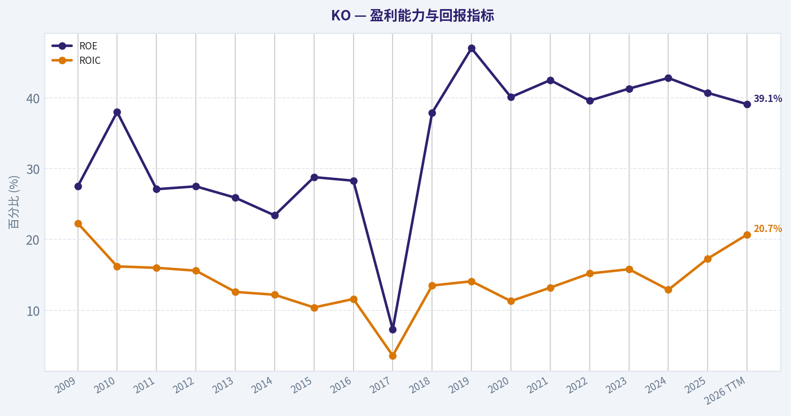
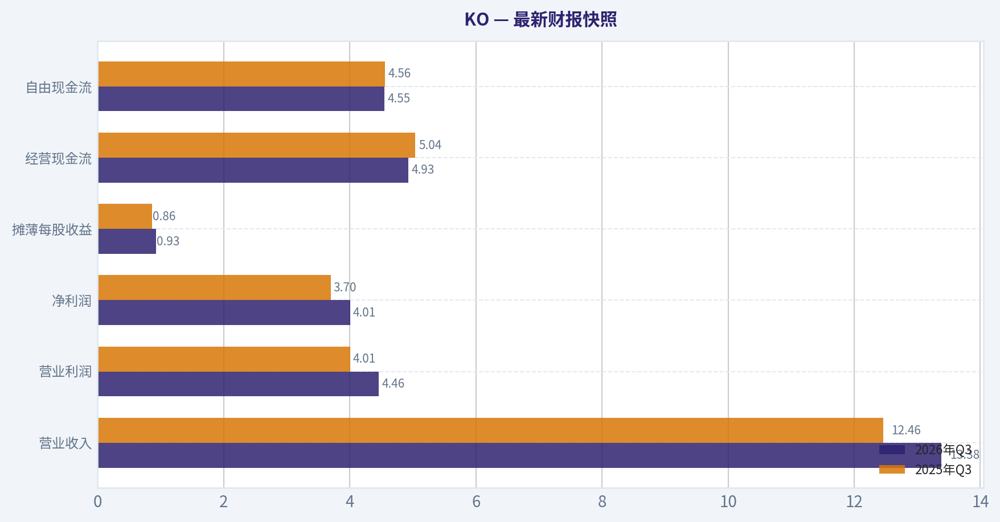
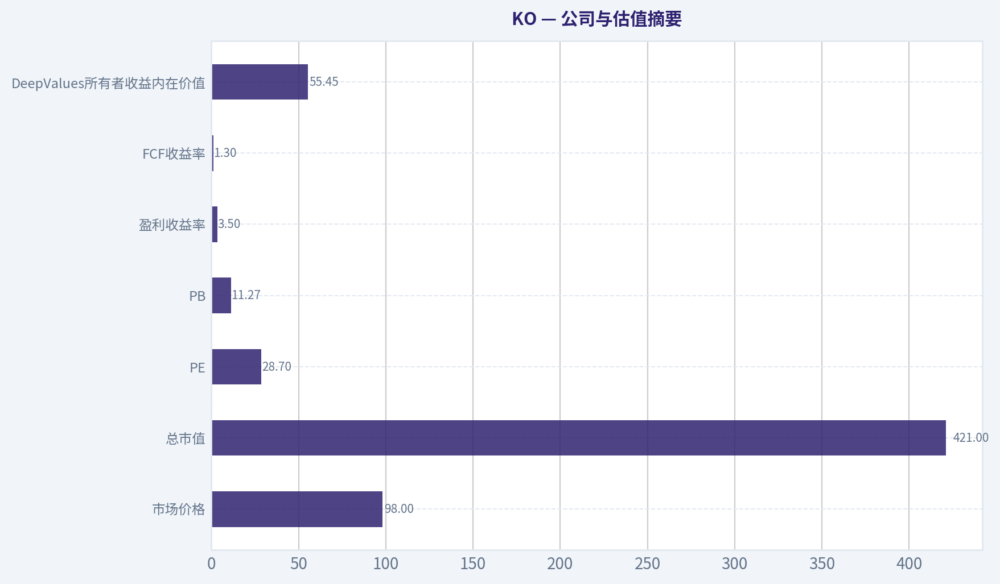
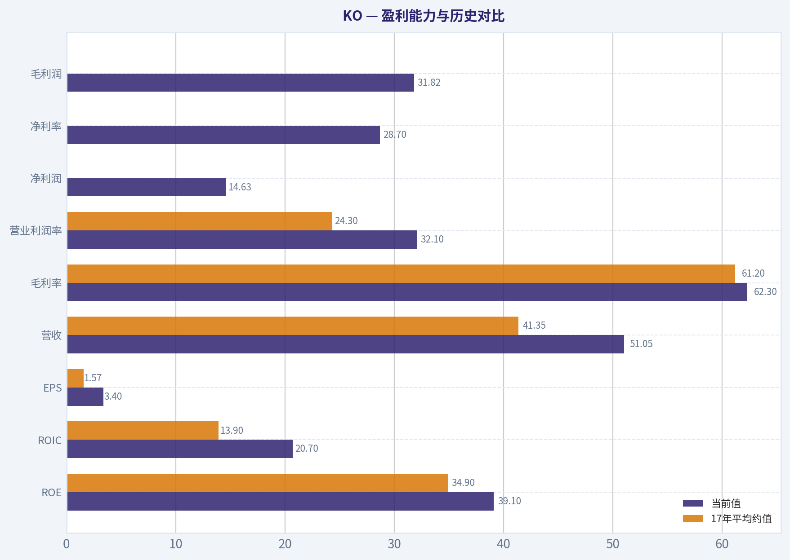
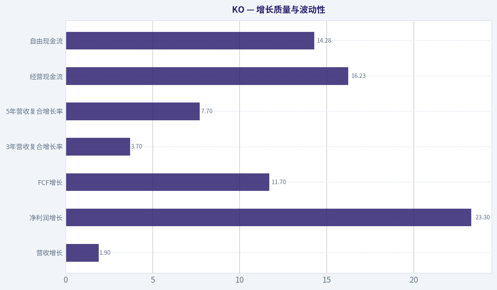
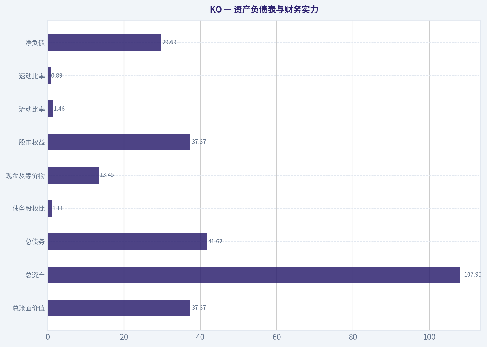
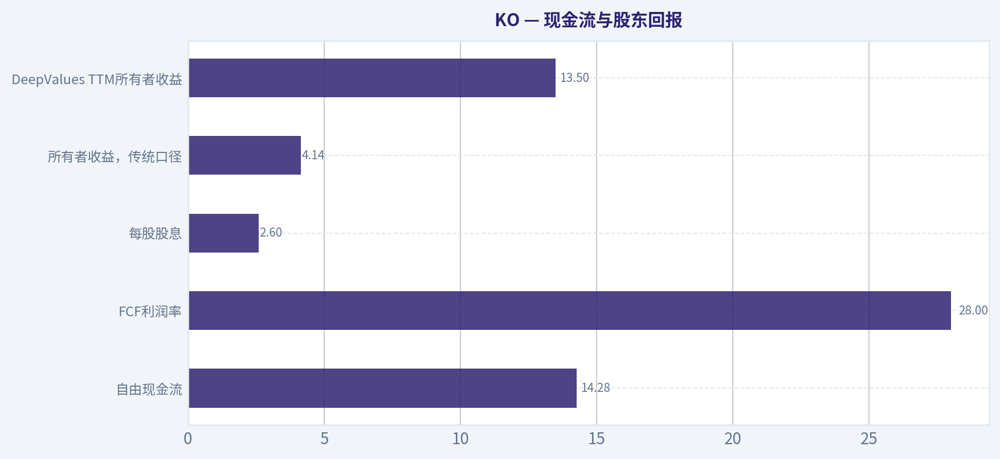
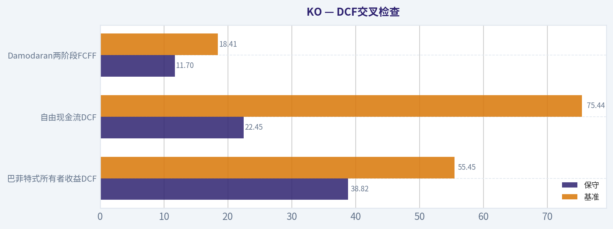

# KO 深度价值情报

**调研日期:** 2026-11-26

## 关键免责声明

*本报告由 Deep Value Intelligence（一个基于 AI 的多智能体投资分析框架）自动生成。 仅供教育和研究用途 - 非财务建议，非财务顾问。*

---

## 目录

1. 情报摘要
2. 分析师团队报告
   - 基本面分析
   - 价值分析 (巴菲特)
   - 成长性分析 (林奇/德鲁肯米勒/费雪)
   - 市场分析
   - 期权市场分析
3. 研究团队评论
4. 投资团队评论
5. Deep Values 团队洞察

---

## 情报摘要

### 核心观点与前提条件

**核心论点:** **结论：中性。**

**主要风险:**
- **结论：中性。**
- 原计划的WATCH判断应保留，但监测重点可进一步收敛为四组验证：
- **最终立场：中性**

**置信度:** 中

---

## 分析师团队报告

### 基本面分析

#### 最新财报快照

*以下数据基于最近一期已披露财报（2026年Q3），并尽量与上一年同期对比。*

| 指标 | 2026年Q3 | 2025年Q3 | 同比变化 |
| --- | ---: | ---: | ---: |
| 营业收入 | $13.38B | $12.46B | +7.4% |
| 营业利润 | $4.46B | $4.01B | +11.3% |
| 净利润 | $4.01B | $3.70B | +8.5% |
| 摊薄每股收益 | $0.93 | $0.86 | +8.1% |
| 经营现金流 | $4.93B | $5.04B | -2.3% |
| 自由现金流 | $4.55B | $4.56B | -0.3% |

关键结论：这张快照先把最新一期财报放在桌面上，再去看长周期分析。这样读者能更清楚地区分"公司长期质量"和"这次财报发生了什么"。

#### KO 17年财务指标

*以下数值均由原始数据确定性计算得出，并非 AI 估算。*

*发行人类型：operating company（Consumer Defensive / Beverages - Non - Alcoholic）。*

#### 17年财务指标
*年度行来自已披露财务报表，最后一行 TTM 由最近四个季度滚动计算得出。*

| 指标 | 2009 | 2010 | 2011 | 2012 | 2013 | 2014 | 2015 | 2016 | 2017 | 2018 | 2019 | 2020 | 2021 | 2022 | 2023 | 2024 | 2025 | 2026 TTM |
| --- | --- | --- | --- | --- | --- | --- | --- | --- | --- | --- | --- | --- | --- | --- | --- | --- | --- | --- |
| 市场价格 | $17 | $20 | $22 | $24 | $28 | $29 | $31 | $31 | $35 | $37 | $45 | $46 | $52 | $57 | $54 | $59 | $69 | $98 |
| 总市值 | $132.75B | $153.47B | $162.54B | $166.17B | $186.27B | $187.88B | $189.24B | $181.06B | $198.39B | $203.56B | $238.78B | $237.07B | $256.97B | $276.70B | $255.70B | $268.96B | $301.52B | $421.00B |
| 市盈率 | 19.45 | 13.00 | 18.91 | 18.40 | 21.74 | 26.39 | 25.72 | 27.83 | 158.21 | 31.57 | 26.74 | 30.64 | 26.32 | 29.05 | 23.86 | 25.31 | 23.00 | 28.70 |
| 市净率 | 5.35 | 4.95 | 5.14 | 5.07 | 5.62 | 6.20 | 7.41 | 7.85 | 11.62 | 11.99 | 12.58 | 12.28 | 11.17 | 11.48 | 9.86 | 10.82 | 9.37 | 11.27 |
| ROE | 27.5% | 38.0% | 27.1% | 27.5% | 25.9% | 23.4% | 28.8% | 28.3% | 7.3% | 37.9% | 47.0% | 40.1% | 42.5% | 39.6% | 41.3% | 42.8% | 40.7% | 39.1% |
| ROIC | 22.3% | 16.2% | 16.0% | 15.6% | 12.6% | 12.2% | 10.4% | 11.6% | 3.6% | 13.5% | 14.1% | 11.3% | 13.2% | 15.2% | 15.8% | 12.9% | 17.3% | 20.7% |
| 每股收益 | $0.88 | $1.57 | $1.18 | $1.29 | $1.28 | $1.11 | $1.20 | $1.10 | $0.22 | $1.19 | $1.69 | $1.51 | $1.96 | $1.96 | $2.28 | $2.34 | $3.04 | $3.40 |
| 营收 | $30.99B | $35.12B | $46.54B | $48.02B | $46.85B | $46.00B | $44.29B | $41.86B | $36.21B | $34.30B | $37.27B | $33.01B | $38.66B | $43.00B | $45.75B | $47.06B | $47.94B | $51.05B |
| 毛利润 | $19.90B | $22.43B | $28.33B | $28.96B | $28.43B | $28.11B | $26.81B | $25.40B | $22.49B | $21.23B | $22.65B | $19.58B | $23.30B | $25.00B | $27.23B | $28.74B | $29.54B | $31.82B |
| 毛利率 | 64.2% | 63.9% | 60.9% | 60.3% | 60.7% | 61.1% | 60.5% | 60.7% | 62.1% | 61.9% | 60.8% | 59.3% | 60.3% | 58.1% | 59.5% | 61.1% | 61.6% | 62.3% |
| 营业利润率 | 26.6% | 24.0% | 21.9% | 22.4% | 21.8% | 21.1% | 19.7% | 20.7% | 21.4% | 26.7% | 27.1% | 27.3% | 26.7% | 25.4% | 24.7% | 21.2% | 28.7% | 32.1% |
| 净利润 | $6.82B | $11.79B | $8.58B | $9.02B | $8.58B | $7.10B | $7.35B | $6.53B | $1.25B | $6.43B | $8.92B | $7.75B | $9.77B | $9.54B | $10.71B | $10.63B | $13.11B | $14.63B |
| 净利率 | 22.0% | 33.6% | 18.4% | 18.8% | 18.3% | 15.4% | 16.6% | 15.6% | 3.4% | 18.8% | 23.9% | 23.5% | 25.3% | 22.2% | 23.4% | 22.6% | 27.3% | 28.7% |
| 营收增长 | N/A | 13.3% | 32.5% | 3.2% | -2.4% | -1.8% | -3.7% | -5.5% | -13.5% | -5.3% | 8.6% | -11.4% | 17.1% | 11.3% | 6.4% | 2.9% | 1.9% | 6.5% |
| 净利润增长 | N/A | 72.7% | -27.2% | 5.1% | -4.8% | -17.3% | 3.6% | -11.2% | -80.9% | 415.5% | 38.6% | -13.2% | 26.1% | -2.3% | 12.3% | -0.8% | 23.3% | 11.6% |
| 自由现金流增长 | N/A | 18.1% | -10.4% | 20.0% | 1.6% | 2.7% | -2.9% | -18.1% | -19.0% | 14.9% | 38.5% | 3.0% | 29.9% | -15.3% | 2.2% | -51.4% | 11.7% | 169.7% |
| 总账面价值 | $24.80B | $31.00B | $31.64B | $32.79B | $33.17B | $30.32B | $25.55B | $23.06B | $17.07B | $16.98B | $18.98B | $19.30B | $23.00B | $24.11B | $25.94B | $24.86B | $32.17B | $37.37B |
| 总资产 | $48.67B | $72.92B | $79.97B | $86.17B | $90.06B | $91.97B | $90.00B | $87.27B | $87.90B | $83.22B | $86.38B | $87.30B | $94.35B | $92.76B | $97.70B | $100.55B | $104.82B | $107.95B |
| 总债务 | $11.43B | $22.85B | $27.83B | $32.52B | $37.03B | $41.57B | $44.02B | $45.54B | $47.44B | $43.44B | $53.76B | $44.98B | $46.07B | $41.52B | $42.06B | $44.52B | $45.49B | $41.62B |
| 债务股权比 | 0.46 | 0.74 | 0.88 | 0.99 | 1.12 | 1.37 | 1.72 | 1.97 | 2.78 | 2.56 | 2.83 | 2.33 | 2.00 | 1.72 | 1.62 | 1.79 | 1.41 | 1.11 |
| 现金及等价物 | $7.02B | $8.52B | $12.80B | $8.44B | $10.41B | $8.96B | $7.31B | $8.55B | $6.10B | $9.08B | $6.48B | $6.79B | $9.68B | $9.52B | $9.37B | $10.83B | $10.27B | $13.45B |
| 股东权益 | $24.80B | $31.00B | $31.64B | $32.79B | $33.17B | $30.32B | $25.55B | $23.06B | $17.07B | $16.98B | $18.98B | $19.30B | $23.00B | $24.11B | $25.94B | $24.86B | $32.17B | $37.37B |
| 经营现金流 | $8.19B | $9.53B | $9.47B | $10.64B | $10.54B | $10.62B | $10.53B | $8.79B | $7.04B | $7.63B | $10.47B | $9.84B | $12.62B | $11.02B | $11.60B | $6.80B | $7.41B | $16.23B |
| 投资现金流 | $-4.15B | $-4.41B | $-2.52B | $-11.40B | $-4.21B | $-7.51B | $-6.19B | $-1.00B | $-2.31B | $5.93B | $-3.98B | $-1.48B | $-2.77B | $-763.0M | $-3.35B | $2.52B | $-67.0M | $117.0M |
| 自由现金流 | $6.19B | $7.32B | $6.55B | $7.87B | $7.99B | $8.21B | $7.97B | $6.53B | $5.29B | $6.08B | $8.42B | $8.67B | $11.26B | $9.53B | $9.75B | $4.74B | $5.30B | $14.28B |
| 自由现金流利润率 | 20.0% | 20.8% | 14.1% | 16.4% | 17.1% | 17.8% | 18.0% | 15.6% | 14.6% | 17.7% | 22.6% | 26.3% | 29.1% | 22.2% | 21.3% | 10.1% | 11.0% | 28.0% |
| 每股分红 | $0.00 | $0.00 | $0.00 | $0.00 | $0.00 | $0.00 | $0.00 | $0.00 | $0.00 | $0.00 | $0.00 | $0.00 | $0.00 | $1.57 | $1.69 | $1.84 | $2.04 | $2.60 |

#### 盈利能力指标
- 净资产收益率 (ROE): 40.7%
- 投入资本回报率 (ROIC): 18.3%
- 总资产收益率 (ROA): 12.5%
- 毛利率: 61.6%
- 营业利润率: 28.7%
- 净利率: 27.3%

#### 流动性指标
- 流动比率: 1.46
- 速动比率: 0.89

#### 杠杆指标
- 债务股权比: 1.41
- 利息覆盖倍数: 8.32
- 净负债: $29.69B

#### 增长指标（同比）
- 营收增长: 1.9%
- 净利润增长: 23.3%
- 自由现金流增长: 11.7%
- 营收复合增长率（3年）: 3.7%
- 营收复合增长率（5年）: 7.7%

#### 估值指标
- 市盈率 (TTM): 28.79
- 预期市盈率: 27.62
- 市净率: 11.23
- 市销率: 8.22
- PEG 比率: 2.62
- 企业价值/EBITDA: 25.67
- 自由现金流收益率: 1.3%
- 盈利收益率: 3.5%

#### 所有者收益（巴菲特方法，代码计算）
- 净利润: $13.11B
- + 剔除的非现金、非经常性项目（可转债/衍生品/SAFE 公允价值变动、减值）: $1.04B
- + 折旧与摊销: $1.05B
- - 资本开支: $-2.11B
- + 营运资本（现金流量表口径；负数=占用现金）: $-7.21B
- = **所有者收益: $4.14B**

#### 内在价值（DeepValues 应用 - SEC 申报数据管道）
- **内在价值（DeepValues 应用，头条）: $55.45** - Owner Earnings (Buffett), 方法 buffett-1986-v2, 截至 2026-11-25 (FY2025)
  区间（保守-乐观）: $38.82 - $55.45
  相对价格的安全边际: -76.0% (价格 $97.59)
  应用使用的输入 (ttm_2026Q3): after-tax operating income $14.7B (operating income $15.3B, tax 18.1%) + D&A $1.0B - capex charge $2.2B (three-year average capex/revenue x trailing revenue; reported capex $1.9B) - working capital $0.0B = owner earnings $13.5B.
  Growth 5.7% fading to 2.5% terminal (min(owner-earnings CAGR, 5-year revenue CAGR), clamped [0, 10%]); discount rate 8.3% (30Y Treasury 5.30% + 3 pts (as of 2026-11-24)); net cash $-30.3B (cash $13.5B + marketable securities $0.0B - debt $41.6B); 4,314M shares.
- Owner Earnings (Buffett): $38.82 / $55.45 / $55.45 (保守 / 基准 / 乐观) ← headline
- Free cash flow DCF: $22.45 / $75.44 / $101.28 (保守 / 基准 / 乐观)
- Damodaran two-stage FCFF: $11.70 / $18.41 / $28.67 (保守 / 基准 / 乐观)
  这就是内在价值：引用它作为内在价值，并据此衡量安全边际。其他地方的 DVI 情景数字仅为辅助交叉检查，不是估值。

#### DVI 情景模型（辅助交叉检查 - 不是内在价值）
DVI 基于 Yahoo 数据的情景，仅作敏感性检查。请勿将其作为内在价值引用；内在价值是上方的 DeepValues 应用估值。
- 当前价格: $98
- DVI 情景值（按商业模式路由）: $45
  商业模式: operating company - weighted blend [Damodaran FCFF + reverse-DCF fair + owner-earnings DCF] (operating_company)
  模型区间（各 DCF 最小-最大）: $34 - $46
  相对价格的安全边际（头条）: -116.5%
  路由说明: General operating company: balanced blend of Damodaran FCFF and the owner-earnings DCF with a reverse-DCF sanity check.
- 巴菲特方法（所有者收益）:
  保守: $39
  平均: $46
  乐观: $86
- 现金流方法（FCF）:
  保守: $21
  平均: $34
  乐观: $67
- Damodaran FCFF（WACC + 利润率 + 再投资）:
  保守: $23
  平均: $40
  乐观: $57
  蒙特卡洛区间（P10-P90）：$27 - $57（中位数 $38）
  P(内在价值 > 当前价格)：0.1%
- 反向 DCF：当前价格隐含约 18.0%/年 的所有者收益增长（10年）；过去 3 年为 -21.0%，5 年为 -7.0%。

#### Piotroski F分数: 6/9
- 净利润为正: 通过
- 经营现金流为正: 通过
- 资产回报率改善: 通过
- 现金流大于净利润: 未通过
- 债务下降: 未通过
- 流动比率改善: 通过
- 未稀释股本: 通过
- 毛利率改善: 通过
- 资产周转率改善: 未通过

ANALYST STANCE: **看空**

#### 公司与估值摘要

可口可乐（KO）属于非酒精饮料消费防御型运营公司。确定性数据中的最新口径为2026年TTM，股价约98美元，总市值约4210亿美元；共享研究包中的实时口径为98美元、4198.2亿美元，差异主要来自时间点与股本口径。

| 指标 | 当前值 | 17年平均或参考值 | 解读 |
|---|---:|---:|---|
| 市场价格 | $98 | 约$38.59 | 当前约为长期平均的2.5倍，显著高于历史多数年份 |
| 总市值 | $421.0B | 约$242.7B | 规模与估值同步扩张 |
| PE | 28.70 | 约32.00；剔除2017异常值后约24.1 | 当前高于正常化历史平均 |
| PB | 11.27 | 约8.05 | 高于历史平均；品牌与无形资产使PB解释力有限 |
| 盈利收益率 | 3.5% | - | 与8%左右的长期无风险利率相比，估值补偿偏低 |
| FCF收益率 | 1.3% | - | 现金流收益率明显不足以支持较高估值 |
| DeepValues所有者收益内在价值 | $55.45 | 区间$38.82-$55.45 | 当前价格约为基准内在价值的1.77倍 |

关键结论：KO拥有高质量品牌资产，但当前估值已明显脱离历史正常化水平。PB受到品牌、无形资产和资本结构影响，不能机械地作为便宜或昂贵信号；本次判断主要依赖所有者收益、自由现金流和反向DCF。按DeepValues基准内在价值55.45美元计算，98美元并未体现足够安全边际。

#### 盈利能力与历史对比

| 指标 | 当前值 | 17年平均约值 | 当前相对历史表现 |
|---|---:|---:|---|
| ROE | 39.1% | 34.9% | 高于平均，仍处于优秀区间 |
| ROIC | 20.7% | 13.9% | 明显高于平均，资本效率改善 |
| EPS | $3.40 | $1.57 | 长期显著增长 |
| 营收 | $51.05B | $41.35B | 高于平均，但近年增速放缓 |
| 毛利率 | 62.3% | 61.2% | 略高于平均，品牌定价能力稳定 |
| 营业利润率 | 32.1% | 24.3% | 显著高于平均 |
| 净利润 | $14.63B | 约$8.5B | 高于平均，创历史高位 |
| 净利率 | 28.7% | 约20.9% | 显著高于平均 |
| 毛利润 | $31.82B | 约$25.7B | 高于平均 |

关键结论：KO当前的ROE、ROIC、营业利润率和净利率均处于十七年较强水平，说明品牌、渠道和定价能力仍然有效。值得注意的是，利润率改善速度明显快于营收增长，近期盈利扩张更多依赖价格、组合优化、成本控制和经营杠杆，而不是强劲的销量增长。

#### 增长质量与波动性

| 指标 | 当前值 | 历史特征 | 评价 |
|---|---:|---|---|
| 营收增长 | 1.9% | 十七年间多次负增长，长期增长不连续 | 当前属于低增长阶段 |
| 净利润增长 | 23.3% | 受2017年低基数及一次性因素影响，波动较大 | 当前较强，但不宜完整外推 |
| FCF增长 | 11.7% | 历史波动明显，2024年曾大幅下降 | 恢复性增长特征较强 |
| 3年营收复合增长率 | 3.7% | 温和增长 | 接近成熟消费品牌的长期特征 |
| 5年营收复合增长率 | 7.7% | 包含疫情后恢复、通胀和价格推动 | 高于当前单年增速 |
| 经营现金流 | $16.23B | 历史均值约$10.1B | 当前显著改善 |
| 自由现金流 | $14.28B | 历史均值约$7.9B | 当前为高位，但需观察持续性 |

关键结论：KO的增长并非线性复利，营收在2012至2018年经历较长调整，2020年也出现明显下降。最新净利润和自由现金流增长优于营收，体现经营效率改善，但也意味着当前增长中包含较强的利润率修复成分，未来继续维持同等增速需要更强的价格、销量和成本管理配合。

#### 资产负债表与财务实力

| 指标 | 当前值 | 17年平均约值 | 解读 |
|---|---:|---:|---|
| 总账面价值 | $37.37B | 约$25.1B | 近期回升，但仍受资本分配影响 |
| 总资产 | $107.95B | 约$89.5B | 资产规模长期扩张 |
| 总债务 | $41.62B | 约$40.6B | 绝对债务仍然较高 |
| 债务股权比 | 1.11 | 约1.69 | 较历史高位下降，但仍属偏高杠杆 |
| 现金及等价物 | $13.45B | 约$9.1B | 现金储备处于高位 |
| 股东权益 | $37.37B | 约$25.1B | 当前高于长期平均 |
| 流动比率 | 1.46 | - | 短期偿付能力尚可 |
| 速动比率 | 0.89 | - | 扣除存货后流动性略弱 |
| 净负债 | $29.69B | - | 债务超过现金，形成估值折减 |
| 利息覆盖倍数 | 8.32倍 | - | 利息偿付能力较强 |

关键结论：KO并不存在明显的短期偿债危机，现金水平、利息覆盖和稳定经营现金流构成了较强财务缓冲。可是，净负债约297亿美元，且总债务仍超过400亿美元；在高利率环境下，债务会压低股权自由现金流的安全边际。账面权益增长并不意味着资本结构风险已经消失。

#### 现金流与股东回报

| 指标 | 当前值 | 历史平均或趋势 | 解读 |
|---|---:|---:|---|
| 自由现金流 | $14.28B | 约$7.9B | 当前显著高于平均 |
| FCF利润率 | 28.0% | 约19.0% | 处于高位 |
| 每股股息 | $2.60 | 2022年前数据为零或缺失 | 分红记录显示持续提升 |
| 当前股息率 | 约2.65% | - | 收益率不高，主要依赖长期增长与稳定性 |
| 所有者收益，传统口径 | $4.14B | - | 营运资本现金占用显著压低结果 |
| DeepValues TTM所有者收益 | $13.5B | - | 采用税后经营利润、折旧摊销及正常化资本开支口径 |

关键结论：KO的现金流历史上总体可靠，但年度波动并不小，2024年自由现金流只有约47.4亿美元，随后恢复至142.8亿美元。传统所有者收益口径受到约72.1亿美元营运资本现金占用影响，明显低于DeepValues采用的正常化经营口径，因此估值对"正常营运资本需求"的假设非常敏感。

#### 当前估值与历史均值

| 估值维度 | 当前值 | 历史参考 | 偏离含义 |
|---|---:|---:|---|
| 股价 | $98 | 平均约$38.59 | 远高于长期价格均值，但价格均值本身受时间和通胀影响 |
| PE | 28.70倍 | 约32倍；正常化约24.1倍 | 高于剔除异常值后的正常水平 |
| PB | 11.27倍 | 约8.05倍 | 高于历史，但受品牌无形资产影响较大 |
| 市销率 | 8.22倍 | - | 对成熟饮料企业而言偏高 |
| EV/EBITDA | 25.67倍 | - | 体现市场为稳定性与品牌支付较高溢价 |
| PEG | 2.62倍 | - | 估值相对于增长速度偏高 |
| FCF收益率 | 1.3% | - | 对成熟、低营收增速企业而言缺乏估值缓冲 |
| 反向DCF隐含所有者收益增长 | 约18.0%年化，十年 | 近3年约-21%，近5年约-7% | 市场隐含增长明显高于近期历史表现 |

关键结论：PE表面上没有超过包含异常年份的十七年均值，但正常化后明显偏高；更具约束力的是1.3%的自由现金流收益率和约18%的反向DCF隐含增长。市场价格要求KO在未来多年实现远高于近期历史的所有者收益增长，这一假设缺乏足够的历史支持。

#### 沃伦·巴菲特式定性分析

**经济护城河**

KO的核心护城河包括全球品牌认知、庞大分销网络、餐饮和零售渠道覆盖、配方与品牌组合、广告规模效应，以及装瓶合作伙伴体系。饮料消费频率高、单次购买金额低，消费者转换成本虽不高，但品牌偏好和渠道可得性使龙头企业具有持续优势。

护城河的局限在于：消费者可以转向自有品牌、健康饮品、功能饮料、咖啡、能量饮料及低糖替代品。KO需要持续投入营销、产品创新和渠道管理，护城河并非完全不需要资本。

**财务实力**

ROIC达到20.7%，利息覆盖倍数8.32倍，现金13.45亿美元，说明经营本身拥有较强的现金创造和债务承受能力。债务股权比从历史高位下降至1.11，但净负债仍约297亿美元，债务对股东价值的影响不能忽略。

**盈利可预测性**

KO的收入在十七年间出现多次负增长，但净利润和利润率总体具有较强韧性。2017年净利润暴跌、2018年大幅反弹，表明会计项目和一次性事件能够显著影响利润。相比净利润，自由现金流更能反映真实回报，但其历史波动同样明显。

**管理层与资本配置**

管理层在品牌维护、价格传导、资产轻型化和利润率修复方面表现较好。ROE长期高于25%，当前接近40%，资本效率优秀。但高ROE部分来自较高杠杆和较低账面权益，不能全部视为经营质量提升。连续多年提高股息体现股东回报纪律，但分红也会减少内部再投资资源。

**业务质量**

毛利率长期约60%左右，最新营业利润率升至32.1%，显示商业模式具有较高的品牌溢价和经营杠杆。问题在于当前营收增长只有1.9%，与利润扩张之间存在较大差距。若价格上涨无法继续抵消销量疲弱、汇率压力和成本上升，利润率可能回归更正常水平。

#### 三情景巴菲特式所有者收益DCF

DeepValues的主模型采用TTM正常化所有者收益13.5亿美元、每股约43.14亿股、净负债约303亿美元、8.3%折现率和2.5%终值增长率。增长率从预测期初逐步下降至2.5%，而不是永久保持高增长。

计算框架为：

\[
\text{股权价值}
=
\sum_{t=1}^{10}\frac{OE_t}{(1+r)^t}
+
\frac{OE_{10}(1+g_T)}{(r-g_T)}\times\frac{1}{(1+r)^{10}}
-
\text{净债务}
\]

其中，\(OE_0=13.5B\)，\(r=8.3\%\)，\(g_T=2.5\%\)，净债务约30.3B，流通股约4.314B股。

| 情景 | 初始所有者收益增长假设 | 终值增长 | 折现率 | 估值结果 | 相对98美元的估值含义 |
|---|---:|---:|---:|---:|---|
| 保守 | 约3.0%，逐步降至2.5% | 2.5% | 8.3% | $38.82 | 价格约为估值的2.5倍 |
| 基准 | 5.7%，逐步降至2.5% | 2.5% | 8.3% | $55.45 | 价格约为估值的1.77倍 |
| 乐观 | 约7.0%，逐步降至2.5% | 2.5% | 8.3% | $55.45 | 即使改善增长，仍不足以覆盖当前估值 |

关键结论：DeepValues头条内在价值为55.45美元，保守至乐观区间为38.82至55.45美元。基准模型已经使用了5.7%的所有者收益增长，且这一增长率高于当前1.9%的营收增速；即便采用更乐观的增长情景，模型结果仍未达到98美元。

#### DCF交叉检查

| 模型 | 保守 | 基准 | 乐观 | 作用 |
|---|---:|---:|---:|---|
| 巴菲特式所有者收益DCF | $38.82 | $55.45 | $55.45 | 主要内在价值模型 |
| 自由现金流DCF | $22.45 | $75.44 | $101.28 | 对现金流定义和再投资假设敏感 |
| Damodaran两阶段FCFF | $11.70 | $18.41 | $28.67 | 对折现率、利润率和再投资率更谨慎 |
| DVI辅助情景模型 | - | 约$45.07 | - | 仅作辅助，不替代DeepValues内在价值 |
| 反向DCF | - | 约18.0%隐含年增长 | - | 检验当前价格需要的经营假设 |

关键结论：不同模型的结果区间很宽，说明估值对所有者收益正常化、资本开支和营运资本假设高度敏感。但所有者收益DCF、FCFF模型及辅助情景模型都没有稳定地支持98美元；只有较乐观的自由现金流情景可以接近或超过当前价格，而其前提是未来现金流持续明显高于历史平均。

#### 收入来源分布

确定性研究包没有提供2025年按品牌、产品线、地区或经营分部拆分的精确金额，因此以下仅列示可验证的合并口径，不对缺失分部进行推算。

| 收入来源 | 金额（十亿美元） | 占比 |
|---|---:|---:|
| 合并净营收，所有饮料及相关业务 | $47.94 | 100% |

关键结论：现有确定性数据只能确认KO的合并净营收，不能可靠拆分出汽水、无糖饮料、果汁、咖啡、运动饮料或地区分部金额。分析上应把KO视为多品牌、多地区的全球饮料平台，而不是把单一产品线的增长外推到整个公司。

#### 风险、机会与监测重点

| 类别 | 具体因素 | 对价值的影响 |
|---|---|---|
| 主要机会 | 全球品牌、渠道网络和高毛利模式 | 支持长期现金流稳定性 |
| 主要机会 | 价格组合优化、无糖及功能饮料扩张 | 有助于抵消成熟市场销量压力 |
| 主要机会 | 当前ROIC与营业利润率高于历史均值 | 说明经营效率仍有改善成果 |
| 主要风险 | 当前营收增长仅1.9% | 高估值缺乏强劲收入增长支撑 |
| 主要风险 | 反向DCF要求约18%所有者收益年增长 | 远高于近期历史增长表现 |
| 主要风险 | 净负债约297亿美元 | 降低股权现金流安全边际 |
| 主要风险 | 汇率、原材料、包装及运输成本 | 可能压缩利润率 |
| 主要风险 | 健康消费趋势和替代饮品竞争 | 可能削弱传统碳酸饮料需求 |
| 估值风险 | FCF收益率仅1.3%，PB约11倍 | 市场已计入较高质量与稳定性溢价 |
| 数据风险 | 2026 TTM经营现金流和FCF跳升 | 需要确认是否具有持续性 |

关键结论：KO的机会主要来自护城河和现金流韧性，风险主要来自价格已经提前反映了大量乐观预期。未来价值重估的关键不是品牌是否优秀，而是营收能否恢复更强增长、自由现金流能否持续在高位，以及利润率改善能否长期维持。

#### 关键投资判断

1. **企业质量较高，但估值质量不足。**
   ROE、ROIC、毛利率和营业利润率均证明KO是优秀经营企业，但优秀企业不必然对应合理价格。

2. **当前增长不足以自然支撑当前估值。**
   1.9%的营收增速与28.7倍PE、8.22倍市销率之间存在明显张力。利润增长主要来自利润率、价格和基数因素，不能简单视为持续的收入复利。

3. **护城河真实存在，但增长天花板也较清晰。**
   全球饮料品牌具有强大防御性，却属于成熟消费品行业。其长期价值更多来自稳定现金流和适度增长，而非高速扩张。

4. **债务风险可控，但不是可以忽略的因素。**
   利息覆盖倍数较强，债务下降趋势也好于历史高位；但净负债仍然较高，会直接降低股权内在价值。

5. **内在价值区间明显低于市场价格。**
   DeepValues基准值55.45美元，保守值38.82美元；当前98美元高于所有者收益模型的完整区间。即使自由现金流乐观情景达到101.28美元，也依赖比历史平均更强且更持续的现金流表现。

#### 最终立场

**看空**

该立场不是对公司经营质量的否定，而是对当前估值与经营基本面匹配度的判断。KO拥有显著品牌护城河、稳定利润率和较强现金流能力，但98美元对应的估值要求未来实现远高于近期历史的所有者收益增长。基于DeepValues 38.82至55.45美元的所有者收益估值区间、约45美元的辅助情景值，以及更谨慎FCFF模型的结果，现有证据不足以支持当前估值水平。

| 维度 | 结论 | 关键依据 |
|---|---|---|
| 商业模式 | 高质量 | 全球品牌、渠道网络、毛利率约62% |
| 盈利能力 | 强 | ROE39.1%、ROIC20.7%、营业利润率32.1% |
| 财务实力 | 稳健但有杠杆 | 现金13.45B、利息覆盖8.32倍、净负债29.69B |
| 增长质量 | 中等 | 营收增长1.9%，利润增长高于收入增长 |
| 现金流质量 | 较强但波动 | TTM FCF14.28B，历史曾明显下滑 |
| 估值水平 | 偏高 | PE28.7倍、FCF收益率1.3%、市销率8.22倍 |
| 内在价值 | 低于现价 | DeepValues基准$55.45，区间$38.82-$55.45 |
| 反向DCF | 要求苛刻 | 当前价格隐含约18%年化所有者收益增长 |
| 综合立场 | **看空** | 公司优秀，但当前价格缺乏足够估值安全边际 |

关键结论：KO的核心问题不是护城河消失，而是市场价格对未来增长和稳定性的要求过高。除非未来营收、自由现金流和所有者收益持续明显超出近期历史表现，否则当前估值与内在价值之间仍存在较大不匹配。

#### 基本面关键图表

本图追踪 **KO** 过去十年的盈利能力与回报指标（ROE、ROIC、利润率），突出呈现资本效率的变化趋势。

---

### 价值分析 (巴菲特)

> *基于沃伦·巴菲特的价值投资哲学：能力圈、经济护城河、管理层质量与安全边际。*

#### 内在价值快照

价格是你付的钱，内在价值是企业未来可能为股东创造的现金价值。我们给出一个区间，而不是假装只有一个神奇数字。

- 当前价格: $97.59
- 估值区间（两种 DCF 方法、保守到乐观）: $22.45 至 $101.28

##### 所有者收益（巴菲特方法）
- 净利润: $13,107,000,000.00
- 折旧与摊销: $1,050,000,000.00
- 资本支出: $-2,112,000,000.00
- 营运资金变化: $-7,208,000,000.00
- 所有者收益: $4,136,168,418.57

##### 内在价值
###### 所有者收益法
使用所有者收益，更严格，通常更保守。
- 保守: $38.82
- 平均: $55.45
- 乐观: $55.45
- 折现率: 8.3%

###### 自由现金流法
使用自由现金流，更适合今天投入很多、为未来增长铺路的公司。
- 保守: $22.45
- 平均: $75.44
- 乐观: $101.28
- 折现率: 9.1%

分析师立场：**中性**

#### 一、结论摘要

可口可乐拥有极强的品牌、全球分销体系和稳定的现金流，属于宽护城河、资本回报较高的消费品企业。问题在于，当前股价约 **98美元**，而 DeepValues 应用给出的基准内在价值为 **55.45美元**，估值明显透支了企业质量与长期稳定性。

---

#### 二、因素评分

| 因素 | 得分（5分制） | 核心证据 |
|---|---:|---|
| 圆能力与业务简单性 | 4.0 | 通过品牌饮料、浓缩液授权和全球分销体系赚钱，模式易于理解；行业成熟，长期可预测性较高 |
| 护城河 | 4.0 | 全球品牌、配方与营销资产、装瓶及渠道网络形成综合优势；毛利率61.6%显示定价和品牌能力 |
| 管理层与资本配置 | 4.0 | 伯克希尔披露持有4亿股，长期股东基础稳定；连续64年提高股息，资本回报记录突出 |
| 行业结构 | 4.0 | 全球软饮料行业由少数大型品牌主导，规模、渠道和营销投入形成较高进入壁垒 |

**关键结论：** 可口可乐的经营质量属于优秀消费品水平，护城河并未显示出明显削弱迹象。主要扣分来自增长较慢、净负债为负以及当前价格显著高于应用内在价值。

---

#### 三、护城河分析

| 护城河来源 | 评价 | 具体证据 |
|---|---|---|
| 品牌与无形资产 | 强 | 可口可乐是全球最具辨识度的消费品牌之一，毛利率达到61.6% |
| 定价能力 | 较强 | 营收仍保持1.9%的同比增长，在成熟饮料市场中体现出一定的价格传导能力 |
| 分销与渠道网络 | 强 | 浓缩液、装瓶商、餐饮渠道和零售终端构成全球化网络，新竞争者难以复制 |
| 规模成本优势 | 较强 | 全球采购、营销和分销规模能够摊薄单位成本 |
| 网络效应 | 中等 | 不是典型互联网网络效应，但消费者认知、渠道覆盖和装瓶体系具有相互强化作用 |
| 转换成本 | 中等 | 消费者转换成本低，但品牌习惯和渠道陈列形成了持续购买惯性 |

**关键结论：** 可口可乐的护城河主要来自品牌、规模和渠道，而不是高转换成本。该护城河更接近"宽且稳定"，但成熟市场使其增长速度通常低于高成长型企业。

---

#### 四、管理层与资本配置

管理层的资本配置表现具有以下特点：

- 连续 **64年提高股息**，说明现金回馈股东的纪律性较强。
- 伯克希尔截至2026年9月披露持有 **4亿股**，持股数量较前期没有变化，反映长期资本对企业质量的认可。
- 业务模式以品牌投资、产品组合扩张和全球分销为主，而非依赖高杠杆并购。
- 当前净现金为负，现金约135亿美元，债务约416亿美元；债务规模可管理，但资产负债表并非无债堡垒。
- 现有资料未显示财务重述或重大会计诚信问题。

管理层评分为 **4.0分**。其长期经营和股东回报记录优秀，但企业未来价值仍取决于成熟市场中的价格增长、产品创新以及对健康趋势的适应能力。

---

#### 五、财务摘要

| 指标 | 最新数据 |
|---|---:|
| 股价 | 98.00美元 |
| 总市值 | 4198.2亿美元 |
| 市盈率 | 28.79倍 |
| ROE | 40.7% |
| 毛利率 | 61.6% |
| 营收同比增长 | 1.9% |
| 自由现金流收益率 | 1.3% |
| 流动比率 | 1.46 |
| 经营利润 | 153亿美元 |
| 税后经营利润 | 147亿美元 |
| 现金及现金等价物 | 135亿美元 |
| 总债务 | 416亿美元 |
| 净现金 | -303亿美元 |
| 流通股数 | 43.14亿股 |

**关键结论：** 毛利率和ROE显示可口可乐具有强大的品牌经济性与资本效率，但1.9%的营收增长和仅1.3%的自由现金流收益率说明当前价格已经包含较高质量溢价。净负债约303亿美元，属于可管理但并非极度保守的资本结构。

---

#### 六、所有者收益计算

DeepValues 应用采用的最新所有者收益计算如下：

| 项目 | 金额 |
|---|---:|
| 税后经营利润 | 147亿美元 |
| 加：折旧与摊销 | 10亿美元 |
| 减：资本支出 | 22亿美元 |
| 减：营运资本增加 | 0亿美元 |
| 所有者收益 | 135亿美元 |
| 每股所有者收益 | 约3.13美元 |

计算公式为：

**所有者收益 = 147 + 10 - 22 - 0 = 135亿美元**

**关键结论：** 所有者收益为正且规模可观，资本支出负担相对适中。估值的核心矛盾不是现金创造能力不足，而是市场价格相对于每股所有者收益过高。

---

#### 七、三情景DCF估值

以下为辅助敏感性分析；DeepValues 应用的 **55.45美元**仍是本报告采用的主要内在价值。

| 情景 | 主要假设 | 每股估值 |
|---|---|---:|
| 情景A：零增长 | 所有者收益135亿美元，折现率10% | 31.30美元 |
| 情景B：GDP增长 | 永续增长3%，折现率10% | 约46.00美元 |
| 情景C：历史增长 | 采用历史增长率5.7%的50%至75%，即2.85%至4.28% | 约44.00至56.00美元 |
| DeepValues基准值 | 增长率由5.7%逐步降至2.5%，折现率8.3%，计入净负债 | **55.45美元** |

DeepValues应用的关键输入为：

- 所有者收益：135亿美元
- 初始增长率：5.7%
- 终端增长率：2.5%
- 折现率：8.3%
- 净现金：-303亿美元
- 股数：43.14亿股

**关键结论：** 三种独立情景大多落在约31至56美元之间，和98美元的市场价格存在明显差距。较低的折现率和较高的增长假设可以支持55.45美元左右的价值，但难以解释98美元所隐含的估值水平。

---

#### 八、内在价值与安全边际

| 项目 | 数值 |
|---|---:|
| 当前股价 | 98.00美元 |
| DeepValues基准内在价值 | 55.45美元 |
| 保守至乐观区间 | 38.82至55.45美元 |
| 应用显示的相对价格安全边际 | -76.0% |
| 按98美元与55.45美元直接比较 | 约低于价格43.4% |

应用显示的安全边际字段为 **-76.0%**；若按照"内在价值相对当前价格"的直接数学比较，55.45美元相当于当前价格的约56.6%，即内在价值低于价格约43.4%。

对于宽护城河、高ROE且高度可预测的企业，质量调整后的合理安全边际可以低于普通企业，但当前价格仍然没有体现出足够的估值缓冲。自由现金流收益率仅1.3%，也支持"高质量但价格偏高"的判断。

**关键结论：** 可口可乐的企业质量足以支持估值溢价，但目前的溢价幅度超过了保守DCF和DeepValues基准估值所能解释的范围。市场价格更接近对长期稳定性和品牌稀缺性的高额定价，而不是对当前现金流的保守定价。

---

#### 九、最终巴菲特评分卡

| 评价标准 | 权重 | 得分 | 加权得分 |
|---|---:|---:|---:|
| 护城河宽度与持久性 | 25% | 4.0 | 1.00 |
| 估值与安全边际 | 20% | 1.5 | 0.30 |
| 资本回报：ROIC相对WACC | 15% | 4.0 | 0.60 |
| 业务理解与可预测性 | 12% | 4.0 | 0.48 |
| 管理层与资本配置 | 12% | 4.0 | 0.48 |
| 再投资空间 | 8% | 3.0 | 0.24 |
| 资产负债表强度 | 4% | 3.0 | 0.12 |
| 行业结构 | 4% | 4.0 | 0.16 |
| **总分** | **100%** |  | **3.38** |

**Gate 5质量与偿债硬门槛：未触发。**

原因是企业仍有正的经营利润和所有者收益，营收保持增长，且没有证据表明利息覆盖能力跌入危机区间或企业进入财务困境。净负债是扣分项，但不是偿债危机信号。

**关键结论：** 3.38分落在"业务正确、价格需要更大估值支持"的区间。护城河、ROE和现金流质量较高，但估值分项显著拖累总分。

---

#### 十、投资观点与信心等级

**中性**

**信心等级：较高。**

可口可乐是一家优秀、易理解、长期可预测的消费品公司，具备品牌、规模和渠道三重优势。可是，98美元的市场价格明显高于55.45美元的应用内在价值，也高于多数保守DCF情景。综合判断是：**企业质量值得肯定，但现有估值缺乏充分安全边际，证据不足以支持当前价格水平。**
#### 估值桥

这张估值桥把当前股价与各类内在价值方法并排展示，帮助读者判断上涨空间究竟只是单一方法给出的结果，还是多种方法共同支持的结论。

| 项目 | 每股内在价值 |
| --- | ---: |
| 巴菲特方法 | $55.45 |
| 现金流方法 | $75.44 |
| Damodaran 方法 | $18.41 |
| 当前价格 | $97.59 |

#### 关键结论

如果只有一种方法显著高于其他方法，说明上行空间更依赖特定建模假设。若多种方法的估值接近，则说明估值逻辑更加稳健。

#### 估值图表

本对比图（来自「最新财报快照」）将 **KO** 的当前数据与历史基准并排呈现，直观反映公司相对自身历史均值的估值水平。

本对比图（来自「公司与估值摘要」）将 **KO** 的当前数据与历史基准并排呈现，直观反映公司相对自身历史均值的估值水平。

本对比图（来自「盈利能力与历史对比」）将 **KO** 的当前数据与历史基准并排呈现，直观反映公司相对自身历史均值的估值水平。

本对比图（来自「增长质量与波动性」）将 **KO** 的当前数据与历史基准并排呈现，直观反映公司相对自身历史均值的估值水平。

本对比图（来自「资产负债表与财务实力」）将 **KO** 的当前数据与历史基准并排呈现，直观反映公司相对自身历史均值的估值水平。

本对比图（来自「现金流与股东回报」）将 **KO** 的当前数据与历史基准并排呈现，直观反映公司相对自身历史均值的估值水平。

本对比图（来自「DCF交叉检查」）将 **KO** 的当前数据与历史基准并排呈现，直观反映公司相对自身历史均值的估值水平。

---

### 成长性分析 (林奇/德鲁肯米勒/费雪)

> *基于彼得·林奇的GARP成长投资法、斯坦利·德鲁肯米勒的宏观拐点分析法，以及菲利普·费雪的深度调研法。*

ANALYST STANCE: **看空**

#### 一、核心结论

KO 属于典型的**稳定型大盘消费股**，而非当前意义上的快速成长股。品牌、渠道和现金流质量优秀，但营收同比仅增长约 1.9%，与约 28.8 倍 PE 及约 4,198 亿美元市值并不匹配。

基于共享研究包，KO 当前股价约 98 美元，而 Buffett Owner Earnings 基准内在价值为 55.45 美元，价格约高于该估值 76%。因此，现有证据不支持当前估值继续隐含高成长预期。

#### 二、Lynch 分类

| 项目 | 判断 | 依据 |
|---|---|---|
| Lynch 分类 | 稳定型公司，接近慢速成长 | 营收增长约 1.9%，远低于快速成长股通常需要的 15%至25% |
| 品牌与渠道 | 极强 | 全球品牌认知、分销体系和产品组合构成长期竞争壁垒 |
| 成长驱动 | 有限 | 主要依靠提价、产品组合、国际市场和零糖饮料，而非高速行业扩张 |
| 十倍潜力 | 较低 | 从约 4200 亿美元市值再实现十倍，需要极高的长期现金流增长 |

**关键结论：** KO 的主要价值来自品牌、定价权和现金流稳定性，而不是高速收入扩张。按照 Lynch 的框架，它更接近"稳定型公司"，不符合当前研究任务对快速成长和十倍潜力的核心要求。

#### 三、三句话说明公司故事

1. KO 将全球饮料品牌、分销网络和广告资产转化为持续现金流。
2. 零糖饮料、即饮饮品、咖啡及新兴市场提供结构性增长机会。
3. 但在接近 4200 亿美元市值的基础上，收入增长必须明显提速，才能支撑当前估值。

#### 四、TAM 与十倍测试

| 项目 | 分析 |
|---|---|
| 当前营收 | 约 470 亿美元量级，具体最新口径未在共享包中完整披露 |
| 十倍营收 | 约 4700 亿美元 |
| 潜在市场 | 全球非酒精饮料市场规模庞大，但 KO 已是全球头部企业 |
| 十倍后市场份额 | 需要占据全球饮料市场极高份额，且可能接近多个成熟品类的集中上限 |
| TAM 增速 | 饮料总市场增长通常偏中低个位数；零糖、功能饮料和即饮咖啡增长更快 |
| TAM 结论 | 仍有扩张空间，但不足以自然支持收入十倍增长 |

**关键结论：** KO 的可服务市场足够大，短期不会因市场太小而受限，但"收入十倍且仍低于 20%市场份额"的测试并不理想。增长空间更多来自品类切换和市场份额争夺，而不是一个正在爆发的新兴大市场。

#### 五、收入增长与经营质量

| 指标 | 当前数据 | 评价 |
|---|---:|---|
| 营收同比增长 | 1.9% | 偏弱，尚未显示增长加速 |
| 毛利率 | 61.6% | 优秀，体现品牌和定价能力 |
| ROE | 40.7% | 很高，但受到品牌资产、资本结构及较低账面权益影响 |
| PE | 28.79 倍 | 对 1.9%收入增长而言偏高 |
| 自由现金流收益率 | 1.3% | 现金流稳定，但当前估值对应收益率较低 |
| 流动比率 | 1.46 | 短期偿付能力尚可 |
| 净债务 | 约 303 亿美元 | 杠杆可管理，但削弱股权估值安全边际 |

**关键结论：** 毛利率和 ROE 说明 KO 的商业质量很强，但收入增长只有 1.9%，尚未出现 Druckenmiller 所重视的加速拐点。当前最明显的矛盾是"优秀的企业质量"与"有限的增长速度"之间的估值不匹配。

#### 六、单位经济与 SaaS 指标适用性

| 指标 | 数据状态 | 判断 |
|---|---|---|
| LTV/CAC | 未披露 | KO 不是典型订阅制公司，公开资料通常不提供统一口径 |
| NRR | 不适用 | KO 主要通过零售、餐饮及分销渠道销售，不是 SaaS 收入模式 |
| 回收期 | 未披露 | 不适用于传统消费品的统一比较 |
| Rule of 40 | 不适用 | 该指标主要用于软件和订阅制企业 |
| 品牌复购 | 高 | 饮料具有高频消费属性，但消费者转换成本并不绝对 |
| 渠道效率 | 较强 | 规模化采购、营销和分销网络形成经营杠杆 |

**关键结论：** LTV/CAC、NRR 和 Rule of 40 不能直接用于 KO。对 KO 更重要的是单位包装利润、渠道覆盖、价格传导、销量趋势和新品成功率；这些数据目前没有显示出足以推动增长重新加速的明确证据。

#### 七、Inflection Point 评估

| 潜在拐点 | 当前观察 | 结论 |
|---|---|---|
| 产品周期 | 零糖、功能饮料、即饮咖啡等仍有机会 | 中性偏正面 |
| 市场份额 | 品牌强大，但成熟市场竞争激烈 | 尚无明显加速 |
| 利润率 | 毛利率达 61.6%，基础稳固 | 质量强，但进一步扩张空间有限 |
| TAM 扩张 | 新品类和新兴市场可扩大 TAM | 增量存在，但规模不足以改变整体增速 |
| 竞争格局 | 主要竞争者仍然强大 | 未见重大竞争者失速 |
| 管理层催化剂 | 长期执行稳定 | 缺少足够大的新增长引擎 |

**关键结论：** KO 目前更像是高质量经营的延续，而不是增长突然加速的拐点。若零糖、功能饮料或新兴市场能够连续多个季度显著提升有机收入增长，拐点判断才会改善。

#### 八、宏观环境

| 宏观因素 | 对 KO 的影响 |
|---|---|
| 高通胀 | 有利于强品牌进行价格传导，但可能压制销量 |
| 高利率 | 不利于高估值、低自由现金流收益率资产 |
| 防御性消费 | 对收入稳定性有帮助 |
| 美元走势 | 强美元可能压制海外收入换算 |
| 原材料成本 | 铝、糖、包装及物流成本会影响利润率 |
| 消费降级 | 低价饮料具有一定韧性，但不同地区表现分化 |

**关键结论：** KO 的防御属性在经济放缓时期较有价值，但当前高利率环境提高了估值折现率。宏观环境支持经营稳定性，却不足以支持明显的估值扩张。

#### 九、Fisher 十五项评分

| Fisher 项目 | 评分，满分 5 分 | 简要判断 |
|---|---:|---|
| 1. 市场潜力 | 4 | 全球饮料市场庞大，但公司规模已很大 |
| 2. 新产品决心 | 4 | 持续布局零糖、功能及即饮品类 |
| 3. 研发能力 | 3 | 消费品研发重要，但技术壁垒有限 |
| 4. 销售组织 | 5 | 全球销售和分销能力突出 |
| 5. 利润率 | 5 | 毛利率约 61.6% |
| 6. 利润率改善 | 3 | 经营杠杆有空间，但增长有限 |
| 7. 员工关系 | 4 | 大型成熟企业，整体稳定 |
| 8. 高管关系 | 4 | 管理连续性较好 |
| 9. 管理深度 | 5 | 全球化管理体系成熟 |
| 10. 成本与会计 | 4 | 大型上市公司披露体系完善 |
| 11. 特殊竞争优势 | 5 | 品牌、渠道、营销和规模优势显著 |
| 12. 长期利润前景 | 4 | 长期稳定，但高速增长概率有限 |
| 13. 股权稀释 | 4 | 未见重大持续稀释问题 |
| 14. 诚实披露 | 4 | 成熟公司，信息披露整体充分 |
| 15. 管理层诚信 | 4 | 长期经营记录较好 |
| **总分** | **61 / 75** | **良好，但不是高增长型卓越企业** |

**关键结论：** Fisher 评分为 61 分，说明 KO 是高质量、管理成熟、竞争优势深厚的公司。扣分主要来自成长空间、利润率进一步改善空间和研发壁垒，而不是治理或商业模式缺陷。

#### 十、估值分析

| 估值方法 | 结果 | 估值含义 |
|---|---:|---|
| PE | 28.79 倍 | 对 1.9%收入增长明显偏高 |
| 简单 PEG | 约 15.2 | 以当前收入增速代替盈利增速时，显示估值极不便宜 |
| 自由现金流收益率 | 1.3% | 当前市场定价隐含较低现金流回报 |
| Owner Earnings 保守情景 | 38.82 美元 | 明显低于当前股价 |
| Owner Earnings 基准情景 | 55.45 美元 | 明显低于当前股价 |
| Owner Earnings 乐观情景 | 55.45 美元 | 即使乐观情景也未超过基准估值 |
| 自由现金流 DCF 区间 | 22.45至101.28美元 | 对增长、折现率和现金流假设高度敏感 |
| Damodaran FCFF 区间 | 11.70至28.67美元 | 交叉模型结果更保守 |
| 辅助 DVI 情景 | 45.07美元 | 进一步显示当前定价偏高 |

**关键结论：** 不同模型均显示估值对假设非常敏感，但共享研究包中的核心 Owner Earnings 估值上限为 55.45 美元，显著低于约 98 美元股价。当前价格需要更高的长期增长或更低的折现率才能得到合理解释。

#### 十一、估值敏感性

| 情景 | 收入增长假设 | 利润率假设 | 折现率环境 | 估值倾向 |
|---|---|---|---|---|
| 悲观 | 0%至2% | 小幅承压 | 高利率持续 | 接近保守 Owner Earnings 或更低 |
| 基准 | 3%至5% | 基本稳定 | 利率逐步正常化 | 接近 55.45 美元基准估值 |
| 乐观 | 6%至8% | 明显改善 | 利率下降 | 需要新品类和销量共同加速 |
| 极乐观 | 8%以上 | 持续扩张 | 明显宽松 | 需要真正的产品及 TAM 拐点 |

**关键结论：** 估值对收入增长和折现率极为敏感。只有在收入增速从约 2%持续提升至中高个位数、同时利润率扩张且利率环境改善时，当前估值才更容易获得基本面支持；目前尚未看到这些条件同时成立。

#### 十二、关键风险与催化剂

| 类型 | 因素 | 影响 |
|---|---|---|
| 风险 | 收入长期低个位数增长 | 估值缺少盈利增长支撑 |
| 风险 | 高利率维持时间超预期 | 压低现金流资产估值 |
| 风险 | 健康消费趋势 | 含糖饮料销量及监管压力 |
| 风险 | 原材料与汇率波动 | 压缩利润率或影响海外收入 |
| 风险 | 新品替代不足 | 难以形成第二增长曲线 |
| 催化剂 | 零糖及功能饮料渗透率提升 | 促进销量和收入增长 |
| 催化剂 | 新兴市场人均消费增加 | 扩大长期 TAM |
| 催化剂 | 产品组合改善 | 支持价格和毛利率 |
| 催化剂 | 收入连续加速至中高个位数 | 改善成长股估值逻辑 |
| 催化剂 | 利率下降 | 减轻折现率压力 |

**关键结论：** 最大催化剂是连续、可验证的收入加速，而不是单季度价格上涨。最大风险则是 KO 继续维持稳定但低速增长，同时市场仍给予接近成长股的估值。

#### 十三、增长投资者评分卡

| 维度 | 权重 | 评分，满分 5 分 | 加权评价 |
|---|---:|---:|---:|
| Lynch 故事 | 10% | 4.0 | 简单清晰，但不是高速成长故事 |
| TAM 与跑道 | 20% | 3.0 | 市场大，但公司规模已大 |
| 收入增长 | 20% | 2.0 | 约 1.9%，未见加速 |
| 单位经济 | 15% | 3.5 | 品牌和渠道强，部分指标不可比 |
| 竞争地位 | 10% | 4.8 | 全球顶级品牌与渠道 |
| 管理质量 | 10% | 4.3 | 执行与管理深度较强 |
| 宏观环境 | 5% | 2.8 | 防御性较强，但高利率不利估值 |
| 盈利路径 | 5% | 4.5 | 盈利和现金流质量高 |
| 估值 | 5% | 1.5 | 对当前增速而言偏贵 |
| **总分** | **100%** | **约 3.2 / 5** | **中性 与 看空 边界，倾向 看空** |

**关键结论：** KO 的企业质量评分明显高于其成长性和估值评分。综合得分约 3.2 分，核心拖累是收入增速不足和估值缺乏安全边际，因此不符合高确信度成长投资筛选标准。

#### 十四、最终判断

KO 是一家**优秀但成熟的全球消费品牌公司**，具备强品牌、强渠道、高毛利率和稳定现金流。可是，当前数据没有显示收入处于加速拐点，且约 28.8 倍 PE、1.3%自由现金流收益率与约 1.9%收入增长之间存在明显错配。

沃伦·巴菲特在 2026 年第三季度仍披露持有 4 亿股 KO，说明长期品牌和现金流质量仍具吸引力；但该持仓信息是季度末披露，不能替代当前估值判断。综合 Lynch、Druckenmiller 和 Fisher 框架，KO 更符合"高质量稳定型公司"，而不是"当前具有十倍潜力的快速成长股"。

---

### 市场分析

ANALYST STANCE: **中性**

#### KO 技术面概览

本次分析对象为纽约证券交易所上市的 Coca-Cola Co（KO）。数据覆盖 2025 年 11 月 26 日至 2026 年 11 月 25 日；2026 年 11 月 26 日为非交易日，因此最新有效收盘价为 **97.59 美元**。需要说明的是，指标接口返回了日期但未返回具体指标数值，以下部分指标读数因此基于已取得的日线数据进行近似推导，不能视为接口原始读数。

过去一年，KO 收盘价由 70.99 美元升至 97.59 美元，涨幅约 **37.5%**。价格路径并非单边上行：年初曾从 71 美元附近回落至 65.99 美元，随后在 2 月至 5 月持续修复；6 月至 8 月出现两轮明显上冲，7 月下旬价格快速跳升至 87 美元以上，8 月进一步触及 91.44 美元。9 月价格回撤至 86 美元附近后，10 月至 11 月再次形成加速上行，并在 11 月 16 日创出阶段高点 **100.56 美元**。

最新价格较阶段高点回落约 3%，但仍明显处于过去一年高位区域。这说明中长期趋势尚未被破坏，不过 11 月中旬以后出现了连续数日的回落与反弹交替，短线由强趋势转向高位震荡的迹象更加明显。

#### 趋势指标：长期结构偏强，短期动能有所降温

从价格序列估算，KO 的 **50 日 SMA 约在 92 美元附近**，最新收盘价高于该水平约 6%；**200 日 SMA 约在 80 美元附近**，最新价格高出约 22%。这两个关系表明，中期趋势和长期趋势仍然向上，价格尚未回到主要趋势均线下方。

10 日 EMA 估算约在 97 美元附近，最新收盘价仅略高于该水平。与 10 月中旬至 11 月中旬价格持续远高于短期均线的状态相比，当前价格与短期均线的距离已经明显收窄，反映短线升势的斜率正在减弱。若价格继续围绕短期均线反复，市场可能进入整理阶段；若重新出现连续高收盘，则说明短线动能可能重新增强。

MACD 方面，基于 10 月以来的价格变化，MACD 仍大概率处于零轴上方，说明中期动能仍偏正。然而，11 月 16 日创下 100.56 美元后，价格回落至 96 美元附近，再反弹至 97.59 美元，表明 MACD 柱体可能从高位收缩。这里的含义不是趋势已经反转，而是上涨动能相对于前期高峰已经减弱，趋势延续需要新的价格和成交量确认。

#### 动量指标：尚未出现明显超买，但已接近偏强区间

根据最近约 14 个交易日的涨跌幅估算，RSI 大约处于 **60 至 65** 区间。该水平说明多头动能仍占优势，但尚未达到通常意义上的 70 以上极端超买区。

不过，RSI 的解读需要结合价格位置。KO 当前价格距离一年高点不远，而 RSI 没有同步回到前期高点附近，体现出一定的动量背离倾向：价格仍在高位，但单位涨幅和连续上行动能已经不如 11 月中旬。这个信号更接近"上涨趋势中的动能降温"，而不是明确的反转确认。

#### 波动率与布林带：高位波动增加，价格仍处于上半区

10 月以来，单日真实波动区间较年初明显扩大。特别是 11 月 5 日、11 月 19 日、11 月 23 日等交易日，成交量和日内振幅同步放大。ATR 估算大约在 **1.5 至 1.8 美元**，相当于股价的约 1.5% 至 1.8%，说明近期波动率处于相对活跃水平。

以近 20 个交易日估算，布林中轨约在 96 美元附近，上轨大约在 99 至 100 美元区域。最新收盘价 97.59 美元高于中轨，但低于前期上轨和阶段高点，说明价格仍位于波动区间上半部，却没有继续沿着上轨单边扩张。若布林带开始收窄，通常意味着短期波动可能暂时压缩；若价格重新突破上轨并伴随成交量放大，才更能说明新一轮趋势扩张正在形成。

#### 成交量与价格确认

KO 在 11 月 5 日成交量达到约 3,105 万股，11 月 23 日约 3,011 万股，明显高于近期多数交易日。这些放量日分别对应高位震荡和下跌压力，说明市场在 96 至 100 美元区域的换手较为充分。

从成交量加权价格角度看，近阶段 VWMA 估算低于最新收盘价，约位于 94 至 96 美元区间。价格仍高于成交量加权成本区域，支持中期趋势偏强的判断；但高位放量并未带来持续突破，表明上方存在一定的获利兑现或估值分歧压力。

#### 估值含义与综合判断

技术面整体呈现"长期偏强、短期降温、高位震荡"的结构。支持因素包括：价格明显高于 50 日和 200 日均线、RSI 仍处于强势但未极端超买区域、价格仍高于近阶段成交量加权水平。

限制因素包括：价格距离一年高点较近、MACD 动能可能收缩、11 月高位成交量放大但未形成持续突破，以及短线价格已经回到 10 日 EMA 附近。因此，当前证据支持 KO 的中长期价格趋势仍具韧性，但尚不足以证明高位价格对应的估值溢价正在继续扩大。综合立场为 **中性**，含义是趋势基础尚可，但估值对后续盈利与增长兑现的要求较高，技术面尚未提供足够强的新增确认。

| 观察维度 | 近似读数或事实 | 主要含义 | 对估值判断的影响 |
|---|---:|---|---|
| 最新收盘价 | 97.59 美元 | 处于一年高位区域，较 100.56 美元阶段高点低约 3% | 高位价格对增长兑现要求较高 |
| 一年价格变化 | 约 +37.5% | 中长期趋势显著向上，但累计涨幅较大 | 上行趋势强，估值安全边际可能收窄 |
| 50 日 SMA | 约 92 美元 | 价格高于中期均线，中期趋势偏强 | 支持趋势溢价，但不能单独证明估值合理 |
| 200 日 SMA | 约 80 美元 | 长期趋势保持向上 | 长期结构稳定，降低趋势转弱的证据强度 |
| 10 日 EMA | 约 97 美元 | 价格与短期均线接近，短线动能降温 | 短线继续扩张尚未得到充分确认 |
| RSI | 约 60-65 | 动能偏强但未达典型超买区 | 尚未显示极端拥挤，但上行空间需要新催化 |
| MACD | 预计仍在零轴上方，柱体可能收缩 | 中期动能为正，边际动能减弱 | 支持趋势延续，但不支持无条件扩大估值溢价 |
| 布林带与 ATR | 上轨约 99-100 美元；ATR 约 1.5-1.8 美元 | 价格处于波动区间上半部，近期波动率较高 | 高位波动和突破失败风险均有所增加 |
| 成交量与 VWMA | 高位放量；VWMA 约 94-96 美元 | 价格高于成交量加权区域，但上方换手明显 | 趋势仍有支撑，同时存在高位分歧 |

关键结论：KO 的长期和中期趋势仍然偏强，最新价格明显高于主要趋势均线，且 RSI 尚未进入极端超买区。但价格已接近一年高点，MACD 动能出现边际减弱，高位成交量放大后也没有形成持续突破，因此当前技术证据更支持"强趋势中的高位整理"，而不是新一轮加速行情已经得到确认。

---

### 期权市场分析

> *解读期权流向--认沽/认购比、隐含波动率偏斜与异常活跃合约--以判断机构定位与事件驱动风险。*

ANALYST STANCE: **看多**

#### KO 期权市场概览

数据截至 2026 年 11 月 26 日。近端样本覆盖 11 月 27 日、12 月 4 日和 12 月 11 日到期合约。整体成交主要集中于 11 月 27 日与 12 月 4 日，远期流动性明显下降。

#### 认沽/认购比率分析

| 到期日 | 认购未平仓量 | 认沽未平仓量 | 认购成交量 | 认沽成交量 | 未平仓量认沽/认购比 | 成交量认沽/认购比 |
|---|---:|---:|---:|---:|---:|---:|
| 2026-11-27 | 26,706 | 24,119 | 18,465 | 8,894 | 0.90 | 0.48 |
| 2026-12-04 | 8,102 | 5,677 | 12,691 | 3,028 | 0.70 | 0.24 |
| 2026-12-11 | 4,099 | 3,636 | 1,084 | 385 | 0.89 | 0.36 |
| **合计** | **38,907** | **33,432** | **32,240** | **12,307** | **0.86** | **0.38** |

**关键结论：**整体未平仓量认沽/认购比为 0.86，高于约 0.70 的历史中性基线，说明保护性认沽需求并不低。不过，成交量比仅为 0.38，近期新增交易明显偏向认购合约，形成"存量偏谨慎、增量偏乐观"的结构。该结构对短线方向的支持偏多，但并非极端看多。

#### 隐含波动率与偏斜

| 到期日 | 认购平值隐含波动率 | 认沽平值隐含波动率 | 认沽相对认购差值 | 解读 |
|---|---:|---:|---:|---|
| 2026-11-27 | 37.0% | 34.8% | -2.2 个百分点 | 临近到期，认购波动率更高 |
| 2026-12-04 | 25.6% | 31.9% | +6.3 个百分点 | 明显认沽偏斜 |
| 2026-12-11 | 23.3% | 26.2% | +2.9 个百分点 | 温和认沽偏斜 |

**关键结论：**除最近一个到期日外，认沽隐含波动率高于认购，说明市场仍为下行风险支付一定保护溢价。11 月 27 日认购波动率升至 37.0%，高于认沽的 34.8%，更像是临近到期的短线认购需求推升，而不是全面性的低风险乐观。数据未提供明确的财报、产品发布或宏观事件，因此无法确认是否存在特定催化剂导致波动率抬升。

#### 异常期权活动

| 到期日 | 类型 | 行权价 | 成交量 | 未平仓量 | 成交量/未平仓量 | 隐含波动率 | 初步含义 |
|---|---|---:|---:|---:|---:|---:|---|
| 2026-12-04 | 认购 | 99 美元 | 5,582 | 359 | 15.5 倍 | 20.9% | 大量新开认购或集中换手，方向偏多 |
| 2026-12-04 | 认购 | 101 美元 | 5,133 | 581 | 8.8 倍 | 20.9% | 远端看涨需求明显，方向偏多 |

**关键结论：**12 月 4 日 99 美元和 101 美元认购合约的成交量分别达到未平仓量的 15.5 倍和 8.8 倍，是最明确的异常信号。由于成交量远高于原有未平仓量，这些交易更可能包含新建立的方向性敞口，而非单纯存量平仓；但缺乏逐笔交易方向、买卖价位置和账户属性，不能确定其全部来自机构。数据未提供 KO 当前现价，因此无法严谨判断 99 美元和 101 美元相对现价属于价内、平值还是价外。

#### 未平仓量集中与潜在价格牵引

| 到期日 | 认购未平仓量 | 认沽未平仓量 | 合计未平仓量 | 主要观察 |
|---|---:|---:|---:|---|
| 2026-11-27 | 26,706 | 24,119 | 50,825 | 近端最大集中区，临近到期的价格牵引最强 |
| 2026-12-04 | 8,102 | 5,677 | 13,779 | 99 美元、101 美元认购活动突出 |
| 2026-12-11 | 4,099 | 3,636 | 7,735 | 总量较低，牵引作用相对有限 |

**关键结论：**未平仓量高度集中在 11 月 27 日到期合约，可能增强临近到期时的价格钉住效应或短线波动压缩。12 月 4 日的 99 美元和 101 美元认购构成潜在的上方伽马集中区域；若价格接近这些行权价，做市商对冲可能放大价格向该区域靠拢的倾向。由于缺少各行权价完整伽马和做市商净敞口数据，无法确认这些位置究竟是正伽马阻尼还是负伽马放大。

#### 综合期权情绪

| 观察维度 | 当前结果 | 方向含义 |
|---|---|---|
| 未平仓量认沽/认购比 | 0.86 | 高于 0.70 中性基线，存量保护需求偏高 |
| 成交量认沽/认购比 | 0.38 | 新近成交显著偏向认购 |
| 近端平值隐含波动率 | 23.3%-37.0% | 最近到期波动率较高，存在短线事件或到期效应 |
| 波动率偏斜 | 12 月认沽波动率高于认购 | 中期下行保护需求仍然存在 |
| 异常活动 | 99 美元、101 美元认购 | 明显的新增看涨交易信号 |
| 流动性 | 近端较集中，远期较薄 | 方向判断有一定依据，但容易受单一到期日交易影响 |
| **总体信号** | **BULLISH（偏多）** | 增量认购流和异常认购活动占主导 |

**关键结论：**综合信号为 **BULLISH（偏多）**，主要驱动来自认购成交量显著占优，以及 99 美元和 101 美元认购合约的大规模异常成交。需要保留的风险是，整体未平仓量认沽/认购比仍高于中性基线，且 12 月认沽波动率存在明显溢价，说明市场并未消除下行保护需求。该期权结构支持短线估值情绪偏乐观，但对中期方向的确定性有限。

---

## 研究团队评论

> *研究经理将多空辩论综合为中性评论。此为风险评审前的初步观点，并非最终立场。*

核心结论

Coca-Cola 仍是典型的宽护城河、高资本回报、现金流可预测的优质企业；争议不在业务质量，而在当前价格是否提供了足够的预期回报缓冲。以97.59美元、28.79倍PE计，市场已经充分认可其品牌、渠道、稳定性和股息纪录。现有证据表明估值需要中个位数现金流增长、稳定利润率及持续定价权共同支撑，但尚未达到明显依赖双位数增长或财务工程的程度。

因此，最合理的判断不是因估值较高而否定企业，也不是因企业优秀而忽略价格。当前更接近"优秀企业的充分定价"，而非具有明确安全边际的价值错配。

多头最有力的论据

KO的护城河是真实且多层次的。全球品牌认知、餐饮渠道、零售终端、瓶装商体系和广告规模相互强化，竞争者可以复制产品，却很难复制全球触达能力。61.6%的毛利率和18.3%的ROIC说明品牌与渠道确实转化为了经济利润，而不仅是无形声誉。

资产轻型浓缩液和品牌授权模式降低了资本密集度，提高了现金流转换潜力。64年连续提高股息也证明企业经历多个经济周期后，仍能维持现金创造和股东回报纪律。ROE达到40.7%虽受资本结构与回购影响，但ROIC仍提供了更可靠的质量验证。

增长不必完全依赖传统含糖汽水。零糖饮料、即饮咖啡、运动及功能性饮品、新兴市场人均消费提升，以及价格和包装组合，都可能推动每股盈利增速高于收入增速。市场隐含的并非双位数长期增长，而大致是中个位数现金流增长；这对KO并非不可实现。

多头也正确指出，P/B等账面指标不适合评估品牌型轻资产企业。伯克希尔长期持有4亿股能够佐证企业耐久性，但只能证明质量得到长期认可，不能证明当前价格存在折价。

空头最有力的论据

起始估值是核心限制。过去三年收入复合增长率只有3.7%，而PE接近29倍。若未来收入仍为低个位数增长，那么每股盈利达到约6%的持续增长，需要定价、产品组合、成本效率、利润率和回购同时发挥作用。这不是英雄式假设，但容错空间有限。

已有情景估值同样说明安全边际偏薄。在十年现金流增长约6%、贴现率7.5%、永续增长3%的假设下，内在价值才大致接近当前价格；若现金流增长降至4%至5%、贴现率升至8%，估值约为86至95美元。当前价格处于情景区间的中高位置，并未达到宽护城河企业通常仍希望看到的约10%至15%质量折价。

此外，定价权不能无限外推。提价若持续高于消费者收入增长，可能表现为销量、购买频率或市场份额走弱。零糖产品可以保护品牌相关性，但若主要来自传统产品内部迁移，对总体增量的贡献可能有限。咖啡、能量和功能性饮料的竞争格局也不同，原有碳酸饮料护城河未必能够完整复制。

健康监管、人工甜味剂争议、私有品牌、汇率、瓶装商经济状况和较高利率，均可能压低增长或估值倍数。它们不太像短期偿付危机，却足以令长期股东回报低于当前估值所隐含的水平。

综合评判

多头对企业质量的判断更有说服力，空头对价格纪律的判断则更重要。KO并不是低质量、结构性衰退或财务脆弱的企业，因此仅凭29倍PE得出极端负面结论并不恰当。但优质企业的稳定性已经被市场充分识别：过去一年股价上涨约37.5%，且仍接近阶段高位，显示防御性与品牌溢价已明显计入价格。

这里尤其需要吸取成熟品牌分析中的常见教训：不能把"护城河稳定"直接等同于"股票回报稳定"，也不能把价格驱动的收入增长机械外推十年。应当拆解每股盈利增长究竟来自销量、价格、组合、利润率还是股本减少。若未来增长主要依靠提价与回购，而非消费量和高回报新品扩张，当前倍数的合理性会明显减弱。

反过来，也不应犯"低增长即低质量"的错误。KO的现金流可预测性、品牌寿命和资本效率理应享受高于普通成熟企业的估值。问题只是目前没有明确的DeepValues内在价值数据，而现有情景分析也未显示足够折价。证据更支持"合理至偏贵"，而非"明显低估"或"显著泡沫"。

未来1至4个季度的监测重点

第一，观察有机收入的构成。重点不是总收入是否增长，而是单位箱销量、价格和产品组合各自贡献多少。若销量稳定、价格增长温和且市场份额不下降，定价权得到验证；若收入增长主要来自提价，同时销量持续收缩，估值基础会变弱。

第二，观察Coke Zero Sugar、功能性饮料、咖啡及新兴市场的增量属性。需要区分真实新增消费与传统含糖产品的内部替代，并关注新类别能否达到接近核心业务的利润率和渠道效率。

第三，观察毛利率、营业利润率和自由现金流转换率。原材料、包装、运输和营销成本是否能够被价格与效率消化，将决定61.6%的高毛利率能否持续。利润增长若长期依赖费用压缩而非健康收入增长，质量需要重新评估。

第四，拆解每股盈利增长。应分别跟踪经营利润、汇率、税率、利息费用和回购贡献。经营利润与自由现金流同步增长，比依靠股本减少推动每股数字更能支撑当前估值。

第五，关注资本配置和财务弹性，包括股息支付后的自由现金流、回购价格、净债务变化、利息覆盖能力以及未来债务再融资成本。没有迹象显示KO面临偿付危机，但较高利率可能同时影响融资成本和估值倍数。

第六，观察瓶装商体系的健康程度。瓶装商利润率、库存、促销投入和终端执行若出现压力，可能先于KO报表反映需求或渠道问题。

第七，持续更新反向DCF。若经营数据证明KO可以在不牺牲销量和利润率的情况下实现约6%或更高的长期自由现金流增长，当前估值会更有支撑；若增长趋近4%、贴现率维持高位，则现价隐含的回报缓冲仍然不足。

最终立场：中性

---

## 投资团队评论

> *投资经理将研究观点转化为投资论点，等待风险评审。此仍非最终立场。*

### 综合判断

KO是典型的高质量消费品企业，但"企业优秀"与"当前估值具有吸引力"是两个不同命题。品牌资产、全球分销网络、瓶装商体系、广告规模和产品组合共同构成了多层次护城河。61.6%的毛利率、18.3%的ROIC，以及跨越多个周期的现金流表现，说明其竞争优势能够转化为真实经济回报，而非仅停留在品牌认知层面。

64年连续提高股息体现了现金流纪律和资本配置稳定性。伯克希尔仍披露持有4亿股，也说明长期资本认可KO的耐久性。不过，这些事实主要支持"业务质量较高"，并不能直接证明97.59美元对应的估值存在折价。伯克希尔的历史持仓成本、税务因素和持有期限，也不能替代对当前内在价值的判断。

### 估值与反向DCF

接近29倍PE，对于收入增长仅为低个位数的成熟消费品企业而言，意味着市场已经给予其显著的稳定性溢价。KO不需要实现双位数增长才能维持估值，但需要持续兑现约中个位数的自由现金流增长，同时保持利润率、定价能力和资本回报。

在现金流长期增长约6%、贴现率7.5%、永续增长3%的情景下，内在价值大致接近现价；当增长降至4%至5%、贴现率升至8%时，估值区间则明显低于现价。由此可见，当前价格并非建立在极端乐观的增长假设上，但安全边际也相当有限。对于一家具备宽护城河的企业，这更接近"合理至偏贵"，而不是明显低估。

ROE高达40.7%需要谨慎解读，因为回购和资本结构会放大这一指标。ROIC为18.3%，更能说明品牌、渠道和经营资产确实创造了较高回报。未来估值能否得到进一步支撑，关键不在ROE继续上升，而在经营利润和自由现金流能否持续增长。

### 新闻与市场情绪的反向解读

过去一年股价上涨约37.5%，并接近阶段高点，说明市场已经重新强化了对防御性消费、品牌定价权和股息稳定性的认可。这个趋势本身并不代表泡沫，因为KO的业务质量确实高于普通低增长企业；但它也说明"安全资产"叙事已经部分反映在价格中。

期权数据呈现存量偏谨慎、增量偏乐观的结构：未平仓认沽/认购比为0.86，而成交量比为0.38。其含义更接近短期情绪改善，而非长期基本面出现重大重估。临近到期认购隐含波动率升高，可能反映短线资金追逐上涨动能，并不能证明未来现金流增长会加速。相反，其他期限认沽波动率仍高于认购，说明市场并未完全忽视估值回撤和防御性需求。

选择性逆向思考在这里应当双向进行。市场可能低估了KO通过零糖饮料、即饮咖啡、功能性饮品和新兴市场提升消费频率的能力，也可能低估了其在高通胀环境下维持价格与包装组合的能力。但市场同样可能高估了提价的可持续性，把价格增长误认为真实需求增长，并把回购推动的每股盈利增长误认为经营质量改善。

### 未来验证重点

最重要的观察指标不是名义收入，而是单位箱销量、价格、产品组合和市场份额的拆分。如果销量稳定、价格增长温和、市场份额保持，定价权仍然具有可信度；如果收入主要依赖提价而销量持续走弱，则当前估值的支撑会逐渐减弱。

此外，还需关注新产品是真正扩大消费场景，还是仅仅替代传统含糖饮料；毛利率和自由现金流转换率能否保持；经营利润是否与每股盈利同步增长；瓶装商的库存、利润率和终端执行是否健康；以及股息支付、回购和债务再融资后是否仍有足够财务弹性。

### 结论

KO的长期业务前景仍然稳健，护城河、资本回报和现金流可预测性足以避免对其作出结构性悲观判断。真正的风险在于起始估值压缩了未来回报的容错空间：只要增长接近4%至5%，或利率长期维持高位，当前价格隐含的回报缓冲就可能不足；只有当销量、产品创新和自由现金流共同支持约6%的长期增长时，现有估值才更具说服力。

**ANALYST STANCE: 中性**。证据支持KO是一家值得长期研究的优质企业，但现价更接近充分定价至偏贵，尚未显示出与其质量相匹配的明确估值折价。

---

## Deep Values 团队洞察

> *风险管理团队进行辩论，由风险裁判给出最终不含操作建议的裁定。本章节决定最终的「看多 / 中性 / 看空」立场。*

#### 最终立场评分卡

这张评分卡把最终研究结论转成加权决策框架。它不替代文字判断，但能让读者更快看清楚这次结论的核心驱动因素。

| 维度 | 评分 | 权重 | 说明 |
| --- | ---: | ---: | --- |
| 业务质量 | 4.50 | 30% | 高回报率、盈利能力与 Piotroski 评分共同支撑业务韧性。 |
| 估值支撑 | 1.67 | 30% | 综合当前股价相对内在价值锚点以及常用估值比率。 |
| 财务强度 | 2.67 | 20% | 资产负债表韧性主要取决于杠杆与流动性是否处于安全区间。 |
| 成长持续性 | 3.67 | 20% | 近期营收、利润与自由现金流增长共同反映增长是否可持续。 |
| 总分 / 最终立场 | 3.12 | 100% | 中性 |

#### 关键结论

加权总分为 **3.12 / 5.0**，最终立场为 **中性**。它更适合作为快速校准工具，而不是机械买卖信号。

#### 风险摘要

分数越高代表风险压力越大。观察阈值是一个简单的护栏：一旦高于该阈值，该维度对估值判断的影响更大，需要更大的安全边际。

| 维度 | 当前分数 | 观察阈值 | 说明 |
| --- | ---: | ---: | --- |
| 业务质量 | 1.50 | 3.00 | 高回报率、盈利能力与 Piotroski 评分共同支撑业务韧性。 |
| 估值支撑 | 4.33 | 3.00 | 综合当前股价相对内在价值锚点以及常用估值比率。 |
| 财务强度 | 3.33 | 3.00 | 资产负债表韧性主要取决于杠杆与流动性是否处于安全区间。 |
| 成长持续性 | 2.33 | 3.00 | 近期营收、利润与自由现金流增长共同反映增长是否可持续。 |

#### 关键结论

这张图帮助读者区分风险究竟来自哪里：估值、业务质量、资产负债表，还是增长持续性。尤其当最终结论处在「观望」与「回避」边缘时，这种拆解非常有帮助。
