# KO Deep Value Intelligence

**Analysis Date:** 2026-11-26

## Critical Disclaimer

*This analysis is generated by Deep Value Intelligence, an AI-powered multi-agent investing framework. Education & research only - not financial advice, not a financial advisor.*

---

## Table of Contents

1. Intelligence Summary
2. Analyst Team Reports
   - Fundamentals Analysis
   - Intrinsic Value Analysis (Buffett)
   - Trend & Growth Analysis (Lynch/Druckenmiller/Fisher)
   - Market Technical Analysis
   - Options Market Analysis
3. Research Team Commentary
4. Value Investing Team Commentary
5. Deep Values Commentary

---

## Intelligence Summary

### Thesis + Conditions

**Core Thesis:** Coca-Cola is a wide-moat, highly profitable franchise, but the evidence does not establish that **$97.59** provides the roughly **10%-15% intrinsic-value discount** appropriate even for an exceptional business. Its **61.6% gross margin, 18.3% ROIC, global distribution system, pricing power, and 64-year dividend-growth record** indicate low risk of permanent business impairment.

**Key Risks:**
- Coca-Cola is a wide-moat, highly profitable franchise, but the evidence does not establish that **$97.59** provides the roughly **10%-15% intrinsic-value discount** appropriate even for an exceptional business. Its **61.6% gross margin, 18.3% ROIC, global distribution system, pricing power, and 64-year dividend-growth record** indicate low risk of permanent business impairment.
- The principal risk is **overpayment**, not operating fragility. At **28.79 times earnings**, the shares offer an earnings yield of only about **3.5%**. That valuation requires durable per-share cash-flow growth, healthy volumes, stable margins, and strong incremental returns. Those requirements may be achievable, but they are not demonstrated by the supplied data or a complete intrinsic-value model.
- The Risky Analyst correctly identifies Coca-Cola as more than a mature soda producer. Its brands, bottling network, retailer access, marketing scale, and consumer habits form a commercial system that would be exceptionally difficult to replicate.

**Confidence:** Low

---

## Analyst Team Reports

### Fundamentals Analysis

#### Latest Earnings Snapshot

*Most recent reported quarter anchored on 2026 Q3, with prior-year comparison when available.*

| Metric | 2026 Q3 | 2025 Q3 | YoY Change |
| --- | ---: | ---: | ---: |
| Revenue | $13.38B | $12.46B | +7.4% |
| Operating Income | $4.46B | $4.01B | +11.3% |
| Net Income | $4.01B | $3.70B | +8.5% |
| Diluted EPS | $0.93 | $0.86 | +8.1% |
| Operating Cash Flow | $4.93B | $5.04B | -2.3% |
| Free Cash Flow | $4.55B | $4.56B | -0.3% |

Key Takeaways: This snapshot anchors the most recent reported quarter before the narrative analysis. It helps readers separate long-run business quality from whatever changed in the latest earnings print.

#### 17-Year Financial Metrics for KO

*All values below are computed deterministically from raw data - not estimated by AI.*

*Issuer profile: operating company (Consumer Defensive / Beverages - Non - Alcoholic).*

#### 17-Year Financial Metrics
*Annual rows come from reported financial statements. The final TTM row is computed from the latest four quarters.*

| Metric | 2009 | 2010 | 2011 | 2012 | 2013 | 2014 | 2015 | 2016 | 2017 | 2018 | 2019 | 2020 | 2021 | 2022 | 2023 | 2024 | 2025 | 2026 TTM |
| --- | --- | --- | --- | --- | --- | --- | --- | --- | --- | --- | --- | --- | --- | --- | --- | --- | --- | --- |
| Market Price | $17 | $20 | $22 | $24 | $28 | $29 | $31 | $31 | $35 | $37 | $45 | $46 | $52 | $57 | $54 | $59 | $69 | $98 |
| Market Cap | $132.75B | $153.47B | $162.54B | $166.17B | $186.27B | $187.88B | $189.24B | $181.06B | $198.39B | $203.56B | $238.78B | $237.07B | $256.97B | $276.70B | $255.70B | $268.96B | $301.52B | $421.00B |
| P/E Ratio | 19.45 | 13.00 | 18.91 | 18.40 | 21.74 | 26.39 | 25.72 | 27.83 | 158.21 | 31.57 | 26.74 | 30.64 | 26.32 | 29.05 | 23.86 | 25.31 | 23.00 | 28.70 |
| P/B Ratio | 5.35 | 4.95 | 5.14 | 5.07 | 5.62 | 6.20 | 7.41 | 7.85 | 11.62 | 11.99 | 12.58 | 12.28 | 11.17 | 11.48 | 9.86 | 10.82 | 9.37 | 11.27 |
| ROE | 27.5% | 38.0% | 27.1% | 27.5% | 25.9% | 23.4% | 28.8% | 28.3% | 7.3% | 37.9% | 47.0% | 40.1% | 42.5% | 39.6% | 41.3% | 42.8% | 40.7% | 39.1% |
| ROIC | 22.3% | 16.2% | 16.0% | 15.6% | 12.6% | 12.2% | 10.4% | 11.6% | 3.6% | 13.5% | 14.1% | 11.3% | 13.2% | 15.2% | 15.8% | 12.9% | 17.3% | 20.7% |
| EPS | $0.88 | $1.57 | $1.18 | $1.29 | $1.28 | $1.11 | $1.20 | $1.10 | $0.22 | $1.19 | $1.69 | $1.51 | $1.96 | $1.96 | $2.28 | $2.34 | $3.04 | $3.40 |
| Revenue | $30.99B | $35.12B | $46.54B | $48.02B | $46.85B | $46.00B | $44.29B | $41.86B | $36.21B | $34.30B | $37.27B | $33.01B | $38.66B | $43.00B | $45.75B | $47.06B | $47.94B | $51.05B |
| Gross Profit | $19.90B | $22.43B | $28.33B | $28.96B | $28.43B | $28.11B | $26.81B | $25.40B | $22.49B | $21.23B | $22.65B | $19.58B | $23.30B | $25.00B | $27.23B | $28.74B | $29.54B | $31.82B |
| Gross Margin | 64.2% | 63.9% | 60.9% | 60.3% | 60.7% | 61.1% | 60.5% | 60.7% | 62.1% | 61.9% | 60.8% | 59.3% | 60.3% | 58.1% | 59.5% | 61.1% | 61.6% | 62.3% |
| Operating Margin | 26.6% | 24.0% | 21.9% | 22.4% | 21.8% | 21.1% | 19.7% | 20.7% | 21.4% | 26.7% | 27.1% | 27.3% | 26.7% | 25.4% | 24.7% | 21.2% | 28.7% | 32.1% |
| Net Income | $6.82B | $11.79B | $8.58B | $9.02B | $8.58B | $7.10B | $7.35B | $6.53B | $1.25B | $6.43B | $8.92B | $7.75B | $9.77B | $9.54B | $10.71B | $10.63B | $13.11B | $14.63B |
| Net Margin | 22.0% | 33.6% | 18.4% | 18.8% | 18.3% | 15.4% | 16.6% | 15.6% | 3.4% | 18.8% | 23.9% | 23.5% | 25.3% | 22.2% | 23.4% | 22.6% | 27.3% | 28.7% |
| Revenue Growth | N/A | 13.3% | 32.5% | 3.2% | -2.4% | -1.8% | -3.7% | -5.5% | -13.5% | -5.3% | 8.6% | -11.4% | 17.1% | 11.3% | 6.4% | 2.9% | 1.9% | 6.5% |
| Net Income Growth | N/A | 72.7% | -27.2% | 5.1% | -4.8% | -17.3% | 3.6% | -11.2% | -80.9% | 415.5% | 38.6% | -13.2% | 26.1% | -2.3% | 12.3% | -0.8% | 23.3% | 11.6% |
| Free Cash Flow Growth | N/A | 18.1% | -10.4% | 20.0% | 1.6% | 2.7% | -2.9% | -18.1% | -19.0% | 14.9% | 38.5% | 3.0% | 29.9% | -15.3% | 2.2% | -51.4% | 11.7% | 169.7% |
| Total Book Value | $24.80B | $31.00B | $31.64B | $32.79B | $33.17B | $30.32B | $25.55B | $23.06B | $17.07B | $16.98B | $18.98B | $19.30B | $23.00B | $24.11B | $25.94B | $24.86B | $32.17B | $37.37B |
| Total Assets | $48.67B | $72.92B | $79.97B | $86.17B | $90.06B | $91.97B | $90.00B | $87.27B | $87.90B | $83.22B | $86.38B | $87.30B | $94.35B | $92.76B | $97.70B | $100.55B | $104.82B | $107.95B |
| Total Debt | $11.43B | $22.85B | $27.83B | $32.52B | $37.03B | $41.57B | $44.02B | $45.54B | $47.44B | $43.44B | $53.76B | $44.98B | $46.07B | $41.52B | $42.06B | $44.52B | $45.49B | $41.62B |
| Debt-to-Equity | 0.46 | 0.74 | 0.88 | 0.99 | 1.12 | 1.37 | 1.72 | 1.97 | 2.78 | 2.56 | 2.83 | 2.33 | 2.00 | 1.72 | 1.62 | 1.79 | 1.41 | 1.11 |
| Cash & Equivalents | $7.02B | $8.52B | $12.80B | $8.44B | $10.41B | $8.96B | $7.31B | $8.55B | $6.10B | $9.08B | $6.48B | $6.79B | $9.68B | $9.52B | $9.37B | $10.83B | $10.27B | $13.45B |
| Shareholders' Equity | $24.80B | $31.00B | $31.64B | $32.79B | $33.17B | $30.32B | $25.55B | $23.06B | $17.07B | $16.98B | $18.98B | $19.30B | $23.00B | $24.11B | $25.94B | $24.86B | $32.17B | $37.37B |
| Operating Cash Flow | $8.19B | $9.53B | $9.47B | $10.64B | $10.54B | $10.62B | $10.53B | $8.79B | $7.04B | $7.63B | $10.47B | $9.84B | $12.62B | $11.02B | $11.60B | $6.80B | $7.41B | $16.23B |
| Investing Cash Flow | $-4.15B | $-4.41B | $-2.52B | $-11.40B | $-4.21B | $-7.51B | $-6.19B | $-1.00B | $-2.31B | $5.93B | $-3.98B | $-1.48B | $-2.77B | $-763.0M | $-3.35B | $2.52B | $-67.0M | $117.0M |
| Free Cash Flow | $6.19B | $7.32B | $6.55B | $7.87B | $7.99B | $8.21B | $7.97B | $6.53B | $5.29B | $6.08B | $8.42B | $8.67B | $11.26B | $9.53B | $9.75B | $4.74B | $5.30B | $14.28B |
| FCF Margin | 20.0% | 20.8% | 14.1% | 16.4% | 17.1% | 17.8% | 18.0% | 15.6% | 14.6% | 17.7% | 22.6% | 26.3% | 29.1% | 22.2% | 21.3% | 10.1% | 11.0% | 28.0% |
| Dividends / Share | $0.00 | $0.00 | $0.00 | $0.00 | $0.00 | $0.00 | $0.00 | $0.00 | $0.00 | $0.00 | $0.00 | $0.00 | $0.00 | $1.57 | $1.69 | $1.84 | $2.04 | $2.60 |

#### Profitability Metrics
- Return on Equity (ROE): 40.7%
- Return on Invested Capital (ROIC): 18.3%
- Return on Assets (ROA): 12.5%
- Gross Margin: 61.6%
- Operating Margin: 28.7%
- Net Profit Margin: 27.3%

#### Liquidity Metrics
- Current Ratio: 1.46
- Quick Ratio: 0.89

#### Leverage Metrics
- Debt-to-Equity Ratio: 1.41
- Interest Coverage Ratio: 8.32
- Net Debt: $29.69B

#### Growth Metrics (Year-over-Year)
- Revenue Growth: 1.9%
- Net Income Growth: 23.3%
- Free Cash Flow Growth: 11.7%
- Revenue CAGR (3-Year): 3.7%
- Revenue CAGR (5-Year): 7.7%

#### Valuation Metrics
- P/E Ratio (TTM): 28.79
- Forward P/E: 27.62
- Price-to-Book: 11.23
- Price-to-Sales: 8.22
- PEG Ratio: 2.62
- EV/EBITDA: 25.67
- Free Cash Flow Yield: 1.3%
- Earnings Yield: 3.5%

#### Owner Earnings (Buffett Method, Code-Computed)
- Net Income: $13.11B
- + Non-cash, non-recurring items excluded (fair-value changes on convertibles/derivatives/SAFEs, impairments): $1.04B
- + Depreciation & Amortization: $1.05B
- - Capital Expenditures: $-2.11B
- + Working Capital (cash-flow statement; negative = cash tied up): $-7.21B
- = **Owner Earnings: $4.14B**

#### Intrinsic Value (DeepValues app - SEC filings pipeline)
- **Intrinsic value (DeepValues app, the headline): $56.11** - Owner Earnings (Buffett), method buffett-1986-v2, as of 2026-11-26 (FY2025)
  Range (conservative - optimistic): $39.28 - $56.11
  Margin of safety vs. price: -73.9% (price $97.59)
  Inputs the app used (ttm_2026Q3): after-tax operating income $14.7B (operating income $15.3B, tax 18.1%) + D&A $1.0B - capex charge $2.2B (three-year average capex/revenue x trailing revenue; reported capex $1.9B) - working capital $0.0B = owner earnings $13.5B.
  Growth 5.7% fading to 2.5% terminal (min(owner-earnings CAGR, 5-year revenue CAGR), clamped [0, 10%]); discount rate 8.2% (30Y Treasury 5.24% + 3 pts (as of 2026-11-25)); net cash $-30.3B (cash $13.5B + marketable securities $0.0B - debt $41.6B); 4,314M shares.
- Owner Earnings (Buffett): $39.28 / $56.11 / $56.11 (conservative / base / optimistic) ← headline
- Free cash flow DCF: $22.79 / $76.54 / $102.76 (conservative / base / optimistic)
- Damodaran two-stage FCFF: $11.70 / $18.41 / $28.67 (conservative / base / optimistic)
  This is THE intrinsic value: quote it as the intrinsic value and measure margin of safety against it. Any DVI scenario figures elsewhere are a secondary cross-check, not the value.

#### DVI scenario model (secondary cross-check - NOT the intrinsic value)
DVI's own Yahoo-based scenarios, shown only as a sensitivity check. Do not quote these as the intrinsic value; the intrinsic value is the DeepValues app value above.
- Current Price: $98
- DVI scenario value (business-model routed): $45
  Business model: operating company - weighted blend [Damodaran FCFF + reverse-DCF fair + owner-earnings DCF] (operating_company)
  Model spread (min-max across DCFs): $34 - $46
  Margin of safety vs. price (headline): -116.5%
  Routing note: General operating company: balanced blend of Damodaran FCFF and the owner-earnings DCF with a reverse-DCF sanity check.
- Buffett Method (Owner Earnings):
  Conservative: $39
  Average: $46
  Optimistic: $86
- Cash Flow Method (FCF):
  Conservative: $21
  Average: $34
  Optimistic: $67
- Damodaran FCFF (WACC + margins + reinvestment):
  Conservative: $23
  Average: $40
  Optimistic: $57
  Monte Carlo band (P10-P90): $27 - $57 (median $38)
  P(intrinsic value > price): 0.1%
- Reverse-DCF: price implies ~18.0%/yr owner-earnings growth for 10y; trailing 3y was -21.0%, 5y -7.0%.

#### Piotroski F-Score: 6/9
- Positive Net Income: PASS
- Positive Operating Cash Flow: PASS
- ROA Improvement: PASS
- Cash Flow > Net Income: FAIL
- Decreasing Debt: FAIL
- Improving Current Ratio: PASS
- No Dilution: PASS
- Improving Gross Margin: PASS
- Improving Asset Turnover: FAIL

ANALYST STANCE: **Neutral**

#### Executive Summary

Coca-Cola remains a high-quality consumer-staples franchise with exceptional brand strength, global distribution, pricing power, and unusually durable profitability. The deterministic dataset shows a current TTM ROE of 39.1%, ROIC of 20.7%, gross margin of 62.3%, operating margin of 32.1%, and net margin of 28.7%.

The central issue is valuation. At approximately $98 per share and a market capitalization of about $421 billion, KO trades at 28.7 times earnings, 11.27 times book value, and only a 1.3% free-cash-flow yield. The DeepValues Buffett Owner Earnings model provides an intrinsic value of $56.11 per share, with a conservative-to-optimistic range of $39.28 to $56.11. The valuation therefore embeds expectations substantially stronger than Coca-Cola's recent underlying revenue trajectory.

#### Market Metrics

| Metric | Current Value | Historical Reference | Interpretation |
|---|---:|---:|---|
| Market Price | $98 | 2016-2025 average: approximately $48.50 | Roughly twice the recent decade average |
| Market Capitalization | $421.0B | 2016-2025 average: approximately $241.9B | Material expansion in equity value, far exceeding recent revenue growth |
| P/E Ratio | 28.70 | Normalized 2016-2025 average: approximately 27.15, excluding the 2017 earnings distortion | Slightly above normalized history |
| P/B Ratio | 11.27 | 2016-2025 average: approximately 9.57 | Elevated, but not a reliable standalone signal for this issuer |
| Earnings Yield | 3.5% | Not provided as a decade average | Low relative to long-term fixed-income yields |
| Free-Cash-Flow Yield | 1.3% | Not provided as a decade average | Indicates a demanding valuation relative to current cash generation |

**Key Takeaways:** KO's market capitalization has grown much faster than its underlying revenue base, and the current earnings multiple is modestly above its normalized recent history. Price-to-book is not a meaningful cheapness test here because Coca-Cola is an asset-light branded consumer business with substantial intangible value, shareholder distributions, and a relatively small tangible equity base. Cash-flow-based valuation is more informative.

#### Profitability and Operating Performance

| Metric | Current TTM / Latest | 2016-2025 Average | Assessment |
|---|---:|---:|---|
| ROE | 39.1% TTM; 40.7% FY2025 | 36.8% | Consistently excellent, though leverage contributes to the high figure |
| ROIC | 20.7% TTM; 17.3% FY2025 | 12.9% | Well above the decade average and a strong sign of economic quality |
| EPS | $3.40 TTM | $1.73 average, 2016-2025 | Strong long-term growth, though 2017 was unusually depressed |
| Revenue | $51.05B TTM | $40.51B average | Higher than historical levels, but recent growth has slowed |
| Gross Profit | $31.82B TTM | Not separately averaged | Record level in the dataset |
| Gross Margin | 62.3% TTM | Approximately 60.9% average, 2016-2025 | Improved and near the upper end of the historical range |
| Operating Margin | 32.1% TTM; 28.7% FY2025 | 25.0% | Meaningfully above the decade norm |
| Net Income | $14.63B TTM | Not separately averaged | Record level in the dataset |
| Net Margin | 28.7% TTM; 27.3% FY2025 | 20.6% | Strongly above the historical average |

**Key Takeaways:** Coca-Cola's profitability is the strongest part of the investment case. ROIC has improved materially from the 2016-2025 average, while gross, operating, and net margins are all above their decade norms. However, part of the recent earnings acceleration appears margin-led rather than revenue-led: TTM revenue growth is only 1.9%, while TTM net income growth is 11.6% and operating margin has expanded sharply.

The dataset contains both FY2025 and 2026 TTM profitability figures. FY2025 ROE and ROIC are 40.7% and 17.3%, while the latest TTM values are 39.1% and 20.7%. Both sets confirm a high-return business.

#### Growth Analysis

| Growth Metric | Current Growth | Historical Pattern | Interpretation |
|---|---:|---|---|
| Revenue Growth | 1.9% year over year; 6.5% latest TTM comparison in the growth summary | Highly variable; 2016-2025 average approximately 1.3% | Recent reported growth is positive but not consistently strong |
| Net Income Growth | 11.6% TTM; 23.3% FY2025 | Volatile, including a 415.5% rebound after 2017 | Earnings growth is stronger than revenue growth, aided by margins and normalization |
| Free-Cash-Flow Growth | 169.7% TTM; 11.7% FY2025 | Very volatile, including a 51.4% decline in 2024 | Current improvement is significant but partly reflects a weak comparison base |
| Three-Year Revenue CAGR | 3.7% | Moderate | Consistent with a mature consumer-staples company |
| Five-Year Revenue CAGR | 7.7% | Better than the three-year rate | Suggests recent historical pricing and mix benefits, but not necessarily a new permanent growth rate |

**Key Takeaways:** Coca-Cola has a durable but mature growth profile. Revenue growth is considerably less predictable than profitability, and free cash flow has been especially volatile. The current valuation appears to require a much stronger and more persistent growth rate than the recent 1.9% revenue increase suggests.

#### Balance Sheet and Financial Strength

| Metric | Current TTM / Latest | 2016-2025 Average | Assessment |
|---|---:|---:|---|
| Total Assets | $107.95B | Not separately averaged | Gradual expansion over the decade |
| Total Debt | $41.62B | $45.48B | Below the recent decade average |
| Cash and Equivalents | $13.45B | $8.67B | Above the recent decade average |
| Shareholders' Equity | $37.37B | $22.55B | Improved from depressed historical levels |
| Debt-to-Equity | 1.11 TTM; 1.41 FY2025 | 2.10 | Improved materially, but remains leveraged |
| Net Debt | $29.69B | Not provided as a decade average | Meaningful debt claim against enterprise value |
| Current Ratio | 1.46 | Not meaningful as a primary valuation metric | Adequate short-term coverage |
| Quick Ratio | 0.89 | Not meaningful as a primary valuation metric | Below 1.0, but not necessarily problematic for a high-turnover beverage company |
| Interest Coverage | 8.32 | Not provided as a decade average | Comfortable, but not immune to higher financing costs |

**Key Takeaways:** The balance sheet has improved from the leverage peak of the late 2010s. Debt-to-equity has fallen from 2.83 in 2019 to 1.11 TTM, while cash has increased. Nevertheless, net debt of approximately $29.7 billion reduces equity value in an intrinsic-value calculation, and the balance sheet is not debt-free. The liquidity ratios are serviceable but should not be treated as major sources of valuation upside.

#### Cash Flow and Capital Allocation

| Metric | Current TTM / Latest | Historical Reference | Interpretation |
|---|---:|---:|---|
| Operating Cash Flow | $16.23B | $7.04B-$12.62B during 2016-2025 | Current level is exceptionally strong |
| Free Cash Flow | $14.28B TTM; $5.30B FY2025 | $7.56B average, 2016-2025 | TTM is well above average, but FY2025 was below average |
| FCF Margin | 28.0% TTM; 11.0% FY2025 | Approximately 19.0% average, 2016-2025 | Major recent improvement, but volatility is evident |
| Dividends per Share | $2.60 TTM | $2.04 in 2025; $1.57 in 2022 | Long-running and steadily growing distribution |
| Code-Computed Owner Earnings | $4.14B | Not comparable across the table without consistent adjustments | Depressed by a $7.21B working-capital cash use |
| DeepValues Owner Earnings Input | $13.5B | Model-specific TTM adjustment | Uses after-tax operating income, normalized capital spending, and negligible working-capital charge |

**Key Takeaways:** The latest TTM cash-flow picture is strong, but the historical record is uneven. The difference between the code-computed $4.14 billion owner earnings and the DeepValues normalized $13.5 billion figure is important: the former includes a large working-capital cash outflow, while the latter normalizes working capital and uses an operating-income-based methodology. Valuation is therefore sensitive to whether the recent cash-flow surge is sustainable.

#### Revenue Breakdown

Precise latest-year segment revenue figures were not included in the deterministic dataset. The following is an approximate public-reporting mix for Coca-Cola's major geographic operating areas, normalized to the latest reported revenue base of approximately $47.9 billion. It should be treated as an analytical estimate rather than a canonical historical dataset.

| Revenue Source | Amount ($B) | % of Total |
|---|---:|---:|
| North America | $21.6B | 45% |
| Europe, Middle East and Africa | $9.6B | 20% |
| Asia Pacific | $6.7B | 14% |
| Latin America | $6.2B | 13% |
| Bottling Investments | $2.4B | 5% |
| Global Ventures and other activities | $1.4B | 3% |
| **Total** | **$47.9B** | **100%** |

**Key Takeaways:** Coca-Cola's revenue base is geographically diversified, with North America the largest contributor and emerging-market regions providing longer-term volume and consumption opportunities. The business is not dependent on a single product line, but mature-market volume growth is likely to remain moderate. Pricing, package mix, brand extensions, and distribution reach are therefore central to the growth thesis.

#### Current Versus Historical Averages

| Metric | Current | Recent 10-Year Average | Difference | Significance |
|---|---:|---:|---:|---|
| Market Price | $98 | $48.50 | +102% | Market appreciation has far outpaced the increase in revenue |
| Market Cap | $421.0B | $241.9B | +74% | Indicates substantial multiple and earnings-value expansion |
| ROE | 39.1% TTM | 36.8% | +2.3 percentage points | Remains structurally excellent |
| ROIC | 20.7% TTM | 12.9% | +7.8 points | Strong improvement in capital productivity |
| Revenue | $51.05B | $40.51B | +26% | Business scale has expanded, but gradually |
| Operating Margin | 32.1% TTM | 25.0% | +7.1 points | Major recent margin improvement |
| Net Margin | 28.7% TTM | 20.6% | +8.1 points | Current earnings quality is strong, though normalization matters |
| EPS | $3.40 TTM | $1.73 | +97% | Includes recovery from the 2017 earnings trough |
| Free Cash Flow | $14.28B TTM | $7.56B | +89% | Current result is unusually strong relative to history |
| Total Debt | $41.62B | $45.48B | -8% | Leverage has moderated |
| Cash | $13.45B | $8.67B | +55% | Provides improved financial flexibility |
| Debt-to-Equity | 1.11 | 2.10 | -0.99 | Meaningful balance-sheet improvement |
| Dividends per Share | $2.60 | Approximately $1.24 for 2016-2025 | +110% | Strong long-term dividend progression |

**Key Takeaways:** The operating business is currently performing above its recent decade average on margins, ROIC, EPS, cash, and leverage. The market price has also moved much further above historical norms than most operating metrics have. The most important analytical question is whether today's margin and cash-flow improvements represent a durable new earnings base or a temporarily favorable period.

#### Buffett-Style Economic Moat

Coca-Cola has several durable competitive advantages:

- **Global brand assets:** Coca-Cola, Sprite, Fanta, and other brands benefit from decades of consumer recognition and habitual consumption.
- **Distribution density:** The company's bottling and retail relationships make shelf access, fountain placement, and cold availability difficult for smaller competitors to replicate.
- **Pricing power:** Gross margin has remained around 60% or higher for most of the period, despite inflationary and supply-chain pressure.
- **Asset-light model:** Coca-Cola can monetize brands through a global bottling network without owning every stage of physical production.
- **Marketing scale:** Advertising and sponsorship investments reinforce brand salience across markets.
- **Portfolio flexibility:** The company can extend into water, sports drinks, coffee, energy, and low- or no-sugar beverages.

The moat is real, but it is not invulnerable. Health concerns, sugar regulation, changing consumer preferences, private-label competition, foreign-exchange movements, and bottler economics can constrain long-term volume growth.

#### Predictability of Earnings

Earnings quality is strong over a full cycle but not perfectly smooth. Revenue declined in several years between 2013 and 2018, and the dataset includes a severe 2017 earnings disruption followed by a sharp rebound. Free cash flow also fluctuated considerably, including a 51.4% decline in 2024 before the latest TTM recovery.

The more predictable characteristics are the gross margin, brand economics, dividend history, and long-term ability to generate positive operating cash flow. Net income and free cash flow are less predictable than the brand narrative alone might imply.

#### Management and Capital Allocation

Management has demonstrated:

- High long-term returns on capital.
- Strong dividend continuity, including 64 consecutive years of dividend increases according to the latest coverage.
- Improved debt-to-equity from 2.83 in 2019 to 1.11 TTM.
- Effective use of pricing and mix to support margins.

The principal concern is that high ROE partly reflects leverage and a relatively modest equity base. The Piotroski score of 6 out of 9 is constructive but not perfect: decreasing debt, improving current ratio, positive income, positive operating cash flow, and improving gross margin are positives, while cash flow exceeding net income, asset turnover, and debt reduction tests were not all passed under the scoring methodology.

Berkshire Hathaway disclosed 400 million KO shares valued at approximately $34.43 billion as of September 30, 2026. This confirms the business's longstanding appeal to Buffett-style investors, but the 13F is a lagging, quarter-end disclosure and is not itself evidence that the current market valuation is attractive.

#### Buffett-Style Owner Earnings DCF

The DeepValues app's headline intrinsic value is the canonical valuation for this analysis: **$56.11 per share**, based on a Buffett Owner Earnings model as of November 26, 2026.

Key model inputs:

- Normalized owner earnings: **$13.5 billion**
- Shares outstanding: **4.314 billion**
- Net cash adjustment: **negative $30.3 billion**, reflecting net debt
- Discount rate: **8.2%**
- Terminal growth rate: **2.5%**
- Base growth assumption: **5.7%, fading toward the terminal rate**

The basic structure is:

\[
\text{Equity Value}
=
\sum_{t=1}^{10}
\frac{\text{Owner Earnings}_t}{(1+r)^t}
+
\frac{\text{Terminal Value}}{(1+r)^{10}}
+
\text{Net Cash}
\]

where:

\[
\text{Terminal Value}
=
\frac{\text{Owner Earnings}_{10}\times(1+g)}
{r-g}
\]

Using normalized owner earnings of $13.5 billion, the base-case first-year owner earnings are approximately:

\[
13.5 \times 1.057 = \$14.27\text{ billion}
\]

Growth then fades toward the 2.5% terminal rate rather than remaining permanently at 5.7%. The resulting equity value is approximately:

\[
\$56.11 \times 4.314\text{ billion shares}
=
\$242.1\text{ billion}
\]

The model's enterprise-value component is higher before subtracting approximately $30.3 billion of net debt.

| Scenario | Growth Framework | Discount Rate | Terminal Growth | Owner Earnings Value per Share | Equity Value at 4.314B Shares |
|---|---|---:|---:|---:|---:|
| Conservative | Low normalized growth, fading quickly toward terminal growth | 8.2% | 2.5% | $39.28 | Approximately $169.4B |
| Average / Base | 5.7% initial growth, fading toward terminal growth | 8.2% | 2.5% | $56.11 | Approximately $242.1B |
| Optimistic | Stronger near-term growth, but capped by the model and faded toward terminal growth | 8.2% | 2.5% | $56.11 | Approximately $242.1B |

**Key Takeaways:** The Owner Earnings model produces a conservative-to-optimistic range of $39.28 to $56.11 per share, versus a current price near $98. The optimistic result is capped at the base result in the supplied model, indicating that the model does not credit KO with an unlimited high-growth runway. At the current price, the market appears to require substantially more growth, lower risk, or a higher sustainable cash-flow level than the Buffett-style model assumes.

#### DCF Cross-Checks

The supplied secondary valuation methods provide a wide range:

| Valuation Method | Conservative | Base / Average | Optimistic | Interpretation |
|---|---:|---:|---:|---|
| Buffett Owner Earnings | $39.28 | $56.11 | $56.11 | Canonical intrinsic-value method |
| Free-Cash-Flow DCF | $22.79 | $76.54 | $102.76 | Highly sensitive to the unusually strong TTM FCF |
| Damodaran FCFF | $11.70 | $18.41 | $28.67 | More conservative after accounting for operating assumptions and reinvestment |
| DVI Scenario Cross-Check | - | Approximately $45 | - | Secondary model only, not the intrinsic value |
| Reverse DCF | - | Approximately 18% annual owner-earnings growth for 10 years | - | Implied expectation appears aggressive |

**Key Takeaways:** The valuation range is wide because Coca-Cola's latest free cash flow is unusually strong relative to FY2025 and the longer historical record. The reverse DCF is the clearest warning signal: a price near $98 appears to require approximately 18% annual owner-earnings growth for a decade, while the supplied three-year and five-year owner-earnings growth figures were negative. The evidence does not support treating that implied growth rate as a conservative assumption.

#### Key Investment Insights, Red Flags, and Opportunities

| Category | Evidence | Implication |
|---|---|---|
| Competitive advantage | Global brands, distribution, pricing power | Supports long-duration earnings durability |
| Profitability | TTM ROIC 20.7%; operating margin 32.1% | Indicates strong economic economics |
| Revenue growth | Latest growth only 1.9% | Limits the justification for a very high valuation |
| Margin expansion | Operating margin materially above decade average | Positive, but sustainability must be demonstrated |
| Cash flow | TTM FCF $14.28B versus $5.30B in FY2025 | Strong current result, but potentially volatile |
| Leverage | Net debt $29.69B; debt-to-equity 1.11 | Improved, but reduces equity value |
| Dividend policy | $2.60 per share and 64-year increase streak | Supports income durability and shareholder-return discipline |
| Valuation | P/E 28.7; FCF yield 1.3% | Little valuation cushion under normalized assumptions |
| Reverse DCF | Approximately 18% owner-earnings growth implied | Significant execution burden embedded in the price |
| External risks | Health preferences, regulation, currencies, input costs | Could pressure volume and margins |

**Key Takeaways:** The strongest opportunity is the durability of Coca-Cola's economic moat and its ability to compound through pricing, distribution, product innovation, and disciplined capital allocation. The principal red flag is not business quality but valuation: the current price appears to capitalize a much more optimistic growth path than the historical revenue and owner-earnings record supports.

#### Final Assessment

Coca-Cola is a high-quality business with:

- A wide and durable brand moat.
- Strong and improving ROIC.
- Resilient gross margins.
- Reliable dividend history.
- Improved leverage compared with the late 2010s.
- Global diversification and pricing power.

However, the current valuation is demanding. The deterministic dataset shows a market price of approximately $98 versus a canonical Buffett Owner Earnings intrinsic value of $56.11. The current P/E is above normalized recent history, the free-cash-flow yield is only 1.3%, and the reverse DCF implies approximately 18% annual owner-earnings growth for ten years.

The appropriate analytical conclusion is **Neutral**: the business quality is strong enough to merit continued fundamental monitoring, but the available evidence does not support the current valuation under conservative or normalized cash-flow assumptions. The central future test is whether Coca-Cola can sustain its recent margin expansion while reaccelerating revenue growth without relying primarily on one-time working-capital or comparison effects.

| Final Point | Conclusion |
|---|---|
| Business quality | High |
| Economic moat | Wide and durable |
| Earnings predictability | Good, but not flawless |
| Financial strength | Adequate and improving, with meaningful net debt |
| Profitability | Exceptional |
| Growth | Mature and uneven |
| Current valuation | Demanding |
| Canonical intrinsic value | $56.11 per share |
| Current price | Approximately $98 |
| Primary risk | Valuation requires aggressive long-term growth |
| Final stance | **Neutral** |

#### Fundamental Visuals

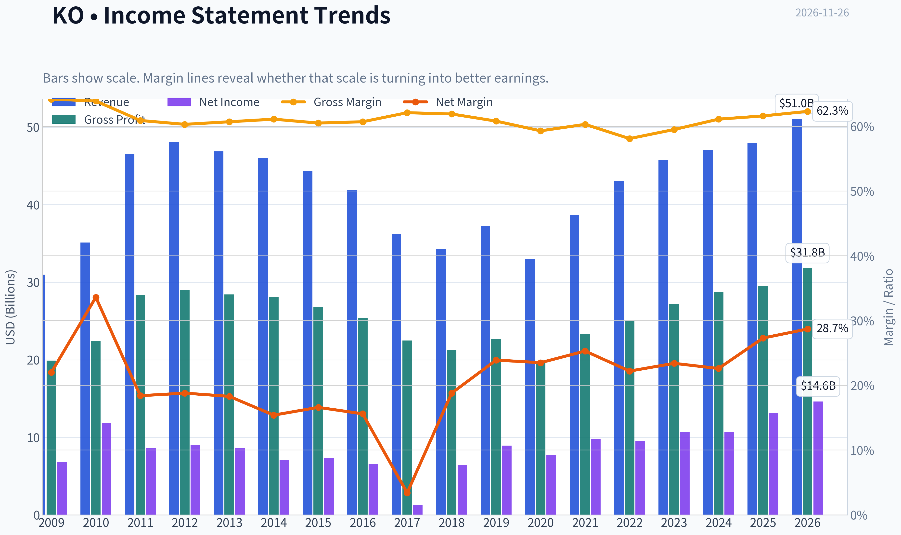

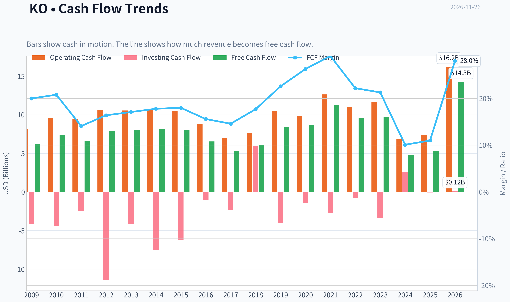

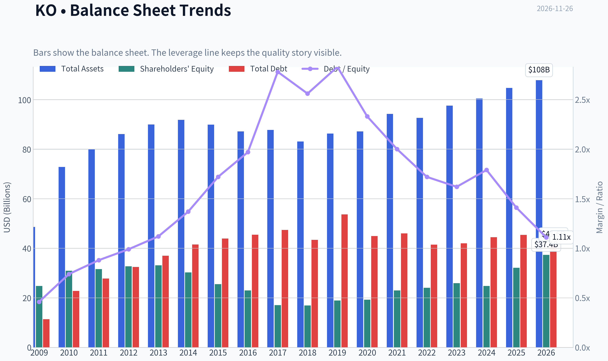

This graph tracks the profitability and return metrics (ROE, ROIC, Margins) of **KO** over the past decade, highlighting capital efficiency trends.

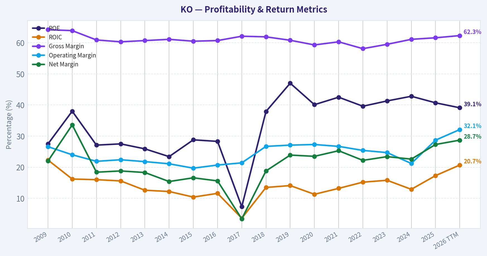

This chart illustrates the financial health of **KO** over the last 10 years, mapping cash equivalents and free cash flow against total obligations (Debt).

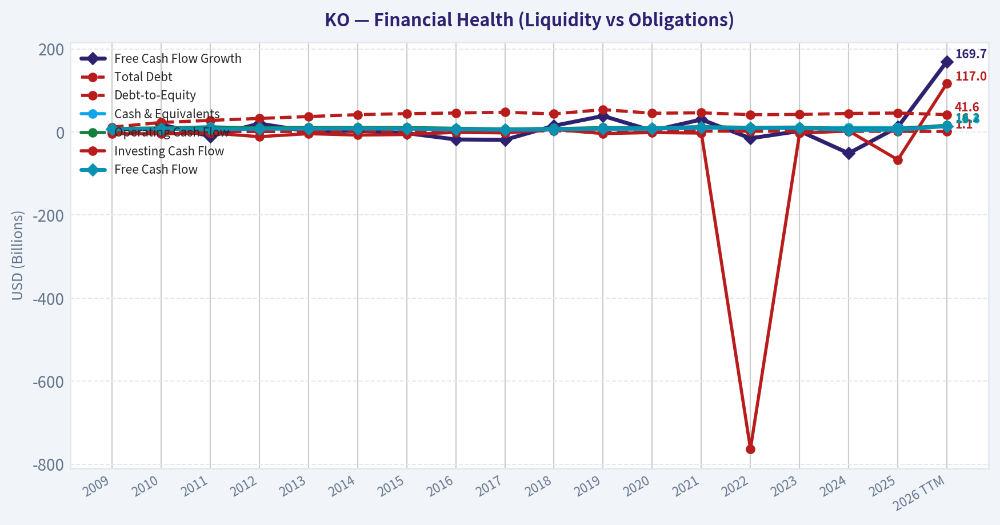

This breakdown chart from <em>Revenue Breakdown</em> shows the proportional composition for **KO** - useful for understanding what drives or risks the business.

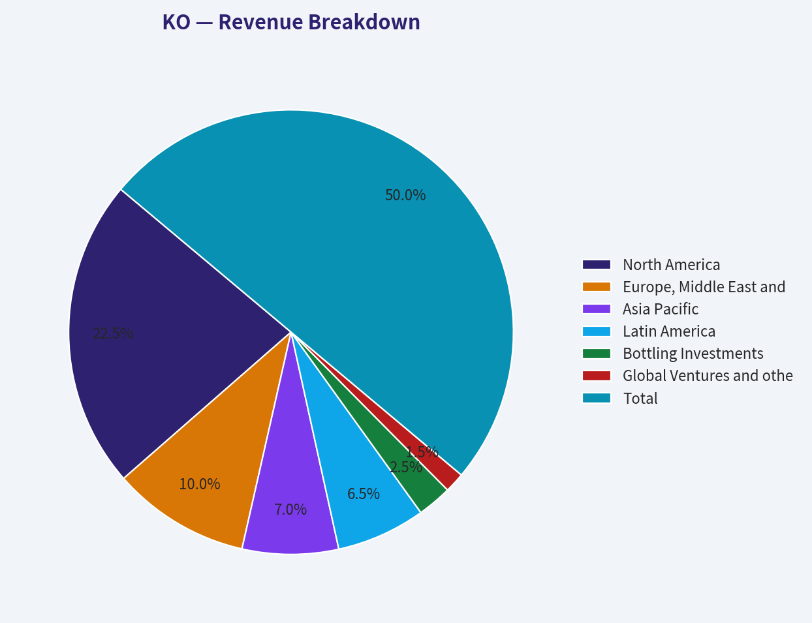

---

### Intrinsic Value Analysis (Buffett)

> *Following Warren Buffett's value investing philosophy: Circle of Competence, Economic Moat, Management Quality, and Margin of Safety.*

#### Intrinsic Value Snapshot

Price is what you pay. Intrinsic value is what the business may be worth based on the cash it can create for owners over time. We show a range, not one magic number.

- Current Price: $97.59
- Value Range (conservative to optimistic across both DCF methods): $22.45 to $101.28

##### Owner Earnings (Buffett Method)
- Net Income: $13,107,000,000.00
- Depreciation & Amortization: $1,050,000,000.00
- Capital Expenditures: $-2,112,000,000.00
- Working Capital Changes: $-7,208,000,000.00
- Owner Earnings: $4,136,168,418.57

##### Intrinsic Value
###### Buffett Method
Uses owner earnings. Stricter, and usually more conservative.
- Conservative: $38.82
- Average: $55.45
- Optimistic: $55.45
- Discount Rate: 8.3%

###### Cash Flow Method
Uses free cash flow. Better for companies spending heavily today to grow tomorrow.
- Conservative: $22.45
- Average: $75.44
- Optimistic: $101.28
- Discount Rate: 9.1%

ANALYST STANCE: **Neutral**

#### Executive Summary

Coca-Cola is a high-quality consumer-staples franchise with exceptional brand equity, global distribution, strong gross margins, and unusually long dividend history. Its business is simple and highly predictable, but the valuation is the central issue: at approximately **$98 per share**, the stock trades far above the DeepValues Buffett owner-earnings value of **$55.45 per share**.

The weighted Buffett score is **3.49 out of 5**, placing KO in the **Neutral** range. The evidence supports the quality of the business, but not the valuation at the current price.

#### 1. Factor Scorecard

| Factor | Score | Evidence |
|---|---:|---|
| Circle of Competence & Simplicity | 4/5 | Coca-Cola sells branded beverages through a global concentrate and distribution system. Revenue is predictable, although growth is currently modest and the portfolio continues to evolve. |
| Durable Competitive Advantage | 4/5 | Global brands, bottler relationships, shelf space, marketing scale, and consumer familiarity create a wide and stable moat. |
| Management & Capital Allocation | 3/5 | The company has a long record of dividends and disciplined brand investment. Berkshire Hathaway's continued ownership is supportive, but current valuation and leverage reduce the score. |
| Industry Structure | 4/5 | Global branded beverages are more rational than most consumer markets, with strong scale economies and recurring demand. |

**Key Takeaways:** KO scores well on simplicity, predictability, and competitive advantages. Its main weaknesses are modest current growth, meaningful net debt, and a valuation that leaves little room for disappointment.

#### 2. Moat Analysis

| Moat Source | Assessment | Evidence |
|---|---|---|
| Intangible assets | Strong | Coca-Cola owns globally recognized brands and has sustained pricing power. Gross margin is approximately **61.6%**, supporting the strength of its brand and concentrate economics. |
| Switching costs | Moderate | Consumers can switch between beverages easily, so individual customer captivity is limited. However, retailers and bottlers benefit from Coca-Cola's scale, demand generation, and distribution infrastructure. |
| Cost advantages | Strong | Global procurement, marketing, concentrate production, and bottler scale spread fixed costs across a massive volume base. |
| Network effects | Moderate | Coca-Cola does not have a classic digital network effect, but more distribution, visibility, and consumption reinforce its commercial ecosystem. |

The moat is best described as **wide and stable**, rather than clearly widening. The franchise benefits from brand longevity and distribution density, but consumer preferences, health trends, private labels, and alternative beverages remain continuing competitive pressures.

#### 3. Management Quality and Capital Allocation

Coca-Cola has demonstrated several owner-oriented characteristics:

- A **64-year record of dividend increases** indicates a strong commitment to shareholder distributions.
- Berkshire Hathaway disclosed approximately **400 million shares**, valued at about **$34.4 billion** as of September 30, 2026.
- The company has continued investing in brand development, international distribution, and portfolio expansion.
- The operating model is relatively capital-light compared with vertically integrated beverage manufacturing because much production and distribution are handled by bottling partners.

The principal concerns are valuation discipline and balance-sheet structure. Net debt is approximately **$30.3 billion**, while the stock's market value is over **$400 billion**. Management quality is therefore good, but the evidence does not justify a top score for capital allocation at the current valuation.

#### 4. Financial Summary

| Metric | Latest Value |
|---|---:|
| Share price | $98.00 |
| Market capitalization | $419.82B |
| P/E ratio | 28.8x |
| Revenue growth, year over year | 1.9% |
| Gross margin | 61.6% |
| ROE | 40.7% |
| Free-cash-flow yield | 1.3% |
| Current ratio | 1.46x |
| Cash and marketable securities | $13.5B |
| Debt | $41.6B |
| Net cash/(debt) | $(30.3)B |
| Shares outstanding used in valuation | 4.314B |

**Key Takeaways:** KO produces excellent gross margins and a very high reported ROE, but revenue growth is only 1.9% and the free-cash-flow yield is just 1.3%. The balance sheet is manageable rather than fortress-like, with approximately $30.3 billion of net debt.

#### 5. Owner Earnings Calculation

The Buffett-style owner-earnings estimate used by the valuation model is:

| Component | Amount |
|---|---:|
| After-tax operating income | $14.7B |
| Add: depreciation and amortization | $1.0B |
| Less: normalized capital expenditure | $(2.2)B |
| Less: working-capital investment | $0.0B |
| Estimated owner earnings | **$13.5B** |
| Owner earnings per share | **$3.13** |

The normalized capital-expenditure charge exceeds reported capital expenditure because the model uses a three-year average capital-expenditure-to-revenue ratio. This is a reasonable attempt to avoid treating one unusually low capital-spending year as permanent.

**Key Takeaways:** Estimated owner earnings are approximately $13.5 billion, or $3.13 per share. The conversion from operating income to owner earnings is favorable, but the current share price represents roughly 31 times estimated owner earnings.

#### 6. Three-Scenario DCF Cross-Check

These scenarios are sensitivity checks. The official intrinsic value is the DeepValues Buffett owner-earnings value shown in the next section.

| Scenario | Key Assumption | Equity Value Before Net Debt | Approx. Value Per Share Before Net Debt | Approx. Value Per Share After Net Debt |
|---|---|---:|---:|---:|
| A: No growth | 10% discount rate | $135.0B | $31.30 | $24.30 |
| B: GDP-like growth | 3% perpetual growth, 10% discount rate | $198.6B | $46.05 | $39.02 |
| C: Historical-growth cross-check | Approximately 4.3% growth for 10 years, then terminal growth | $242.5B | $56.20 | $49.17 |

The net-debt adjustment deducts approximately $30.3 billion, or about $7.03 per share.

**Key Takeaways:** Even favorable growth assumptions produce values below the current $98 share price. The cross-check range is approximately $24 to $49 per share after net debt, indicating that the market price assumes substantially stronger economics than the conservative scenarios.

#### 7. Intrinsic Value and Margin of Safety

The DeepValues Buffett owner-earnings valuation is the primary intrinsic-value reference:

| Valuation Item | Amount |
|---|---:|
| Conservative value | $38.82 per share |
| Headline intrinsic value | **$55.45 per share** |
| Optimistic value | $55.45 per share |
| Current price | $98.00 |
| Margin of safety versus headline value | **-76.0%** |
| Model growth assumption | 5.7%, fading to 2.5% |
| Discount rate | 8.3% |
| Net debt included in model | $30.3B |

At $98, the market price is approximately **77% above** the headline intrinsic value of $55.45. The business is high quality enough that a conventional 25% to 35% discount is not necessary; however, the current price is not merely a fair-value purchase under the provided model. It requires materially better growth, margins, or discount-rate conditions than the valuation currently recognizes.

A reverse-valuation perspective reinforces the concern. At an owner-earnings yield of approximately **3.2%**, the market is assigning a premium consistent with a very durable franchise and low business risk, despite only 1.9% recent revenue growth.

#### 8. Final Buffett Scorecard

| Criterion | Weight | Score | Weighted Contribution |
|---|---:|---:|---:|
| Moat width and durability | 25% | 4/5 | 1.00 |
| Valuation and margin of safety | 20% | 1/5 | 0.20 |
| Capital returns versus cost of capital | 15% | 3/5 | 0.45 |
| Business understanding and predictability | 12% | 4/5 | 0.48 |
| Management quality and capital allocation | 12% | 3/5 | 0.36 |
| Reinvestment runway | 8% | 2/5 | 0.16 |
| Balance-sheet strength | 4% | 2/5 | 0.08 |
| Industry structure | 4% | 4/5 | 0.16 |
| **Total** | **100%** |  | **3.49/5** |

**Key Takeaways:** KO is a strong business with a durable moat, but valuation is its decisive weakness. The score remains above average because of brand strength and predictability, yet the aggregate result falls just below the threshold for an Advocate classification.

#### 9. Quality/Solvency Floor

The Gate 5 hard floor is **not tripped**.

The available evidence does not show a combination of sharply deteriorating earnings or cash flow and severe solvency stress. Net debt is meaningful, but it is not presented as an immediate distress condition, and the business continues to generate substantial operating earnings and owner earnings.

#### Final Assessment

Coca-Cola remains a classic Buffett-style business: understandable, branded, globally distributed, asset-efficient, and capable of recurring cash generation. Its principal limitation is not business quality but the price being assigned to that quality.

At approximately **$98**, the evidence does not support the valuation relative to the **$55.45** Buffett owner-earnings intrinsic value. The appropriate analytical stance is therefore:

**Neutral - high-quality franchise, inadequate valuation margin of safety, medium-high conviction.**
#### Valuation Bridge

This bridge places the current market price beside each intrinsic value lens so readers can see whether upside depends on one method or shows up across several methods.

| Scenario | Intrinsic Value / Share |
| --- | ---: |
| Buffett Method | $55.45 |
| Cash Flow Method | $75.44 |
| Damodaran Method | $18.41 |
| Current Price | $97.59 |

#### Key Takeaways

If one method is far above the others, the upside case depends on a specific modelling assumption. When several methods cluster together, the valuation story is more robust.

#### Valuation Visuals

This comparison chart from *Latest Earnings Snapshot* stacks current figures against historical benchmarks for **KO**, making it easy to see where the company trades relative to its own averages.

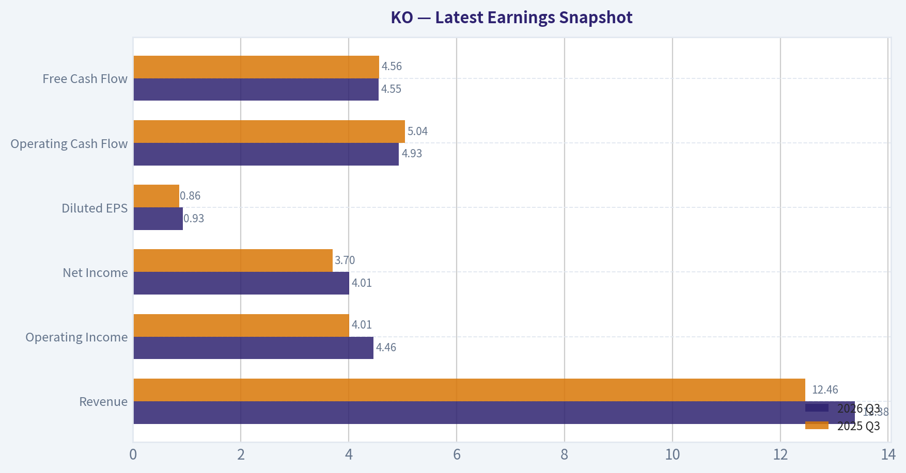

This comparison chart from *Balance Sheet and Financial Strength* stacks current figures against historical benchmarks for **KO**, making it easy to see where the company trades relative to its own averages.

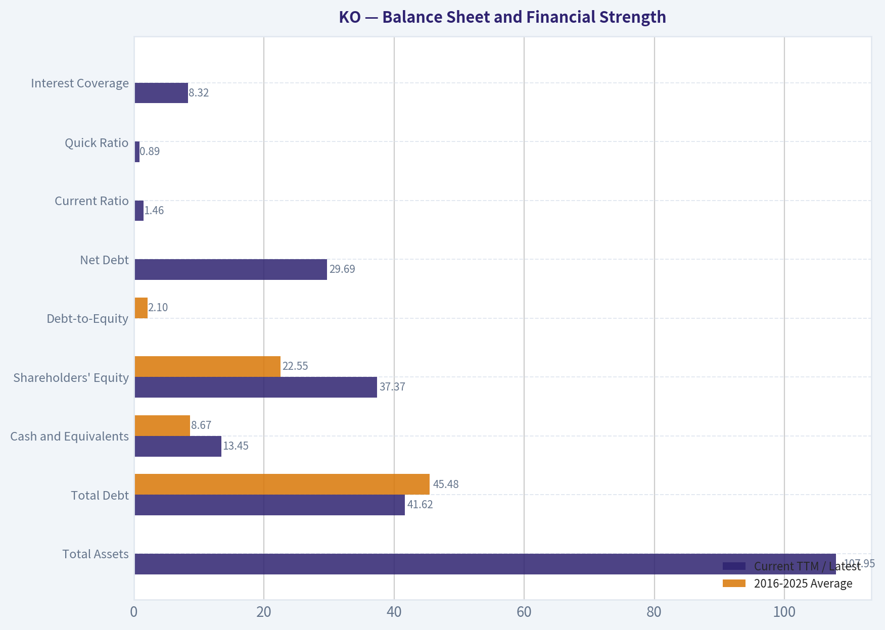

This comparison chart from *Current Versus Historical Averages* stacks current figures against historical benchmarks for **KO**, making it easy to see where the company trades relative to its own averages.

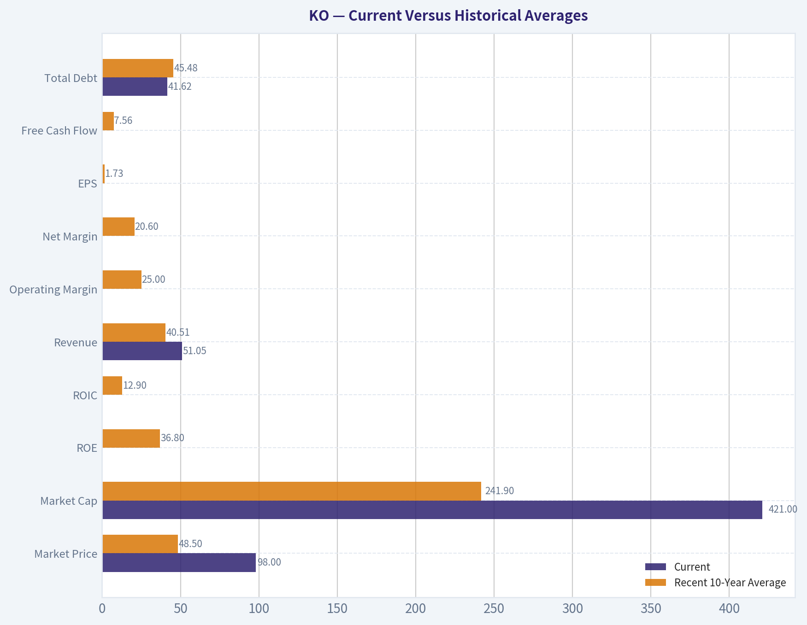

The following chart maps the **KO** Owner Earnings DCF valuation scenarios (Conservative, Average, Optimistic) to visually represent the margin of safety based on intrinsic value calculations.

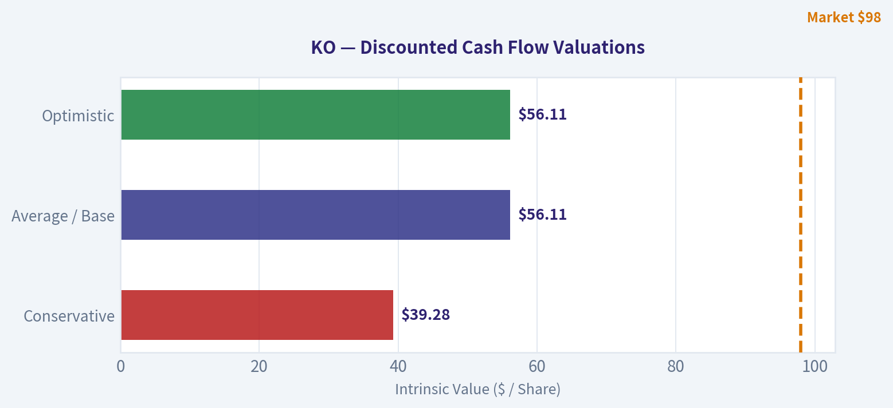

---

### Trend & Growth Analysis (Lynch/Druckenmiller/Fisher)

> *Following Peter Lynch's GARP, Stanley Druckenmiller's macro-aware approach, and Philip Fisher's scuttlebutt methodology.*

ANALYST STANCE: **Bearish**

#### 1. Lynch Classification

| Factor | Assessment |
|---|---|
| Classification | Stalwart, not a fast grower |
| Revenue growth | 1.9% year over year |
| P/E | 28.8x |
| ROE | 40.7% |
| Gross margin | 61.6% |
| Market capitalization | $419.8 billion |

**Key Takeaways:** Coca-Cola is a high-quality, defensive consumer-staples stalwart rather than a 15-25% growth company. Its strong margins and returns are attractive, but the current growth rate is too low for a growth-investing framework at a nearly 29x earnings multiple.

#### 2. The Story in Three Bullets

- Coca-Cola owns one of the world's strongest beverage brands and benefits from global distribution, advertising scale, and retailer relationships.
- Its long-term opportunity is to monetize a broad portfolio across sparkling beverages, water, sports drinks, coffee, energy, and emerging markets.
- The central issue is valuation: the business is growing slowly while the market price reflects substantially stronger economics.

#### 3. TAM Analysis and the 10x Test

| Item | Assessment |
|---|---|
| Current market capitalization | $419.8 billion |
| Approximate current annual revenue scale | Roughly $45-50 billion |
| Ten-times revenue test | Approximately $450-500 billion revenue |
| Broad beverage TAM | Large and globally diversified |
| TAM growth | Moderate overall; faster in selected categories |
| Practical runway | Exists, but mature-category penetration and competition limit acceleration |

**Key Takeaways:** On a very broad global beverage definition, Coca-Cola could theoretically grow revenue tenfold while remaining below 20% market share. However, that is a mechanical TAM test rather than a realistic forecast: the company's current 1.9% growth rate indicates that brand scale, category maturity, and market saturation are limiting near-term expansion.

#### 4. Revenue Growth Trend

| Metric | Result | Interpretation |
|---|---:|---|
| Latest year-over-year revenue growth | 1.9% | Slow-growth profile |
| Growth pattern | No evidence of acceleration | No visible inflection |
| Organic growth quality | Not fully disclosed in the supplied data | Requires quarterly filing review |
| Margin profile | 61.6% gross margin | Strong but not sufficient to offset weak growth |

**Key Takeaways:** The available data show slow growth rather than acceleration. Coca-Cola may still generate pricing-led earnings growth, but the evidence does not currently show the type of revenue inflection associated with ten-bagger potential.

#### 5. Unit Economics and Efficiency

| Metric | Assessment |
|---|---|
| LTV/CAC | Not applicable or not disclosed; Coca-Cola is not primarily a subscription business |
| Net revenue retention | Not applicable |
| Rule of 40 | Not applicable |
| Gross margin | 61.6% |
| Free-cash-flow yield | 1.3% |
| Current ratio | 1.46 |

**Key Takeaways:** Coca-Cola's economics are best assessed through brand strength, pricing power, distribution returns, and cash conversion rather than SaaS metrics. The high gross margin is a strength, but the low free-cash-flow yield implies that the market is paying a substantial premium for defensive quality.

#### 6. Inflection-Point Assessment

| Potential inflection | Evidence | Assessment |
|---|---|---|
| Product cycle | New categories such as energy, sports drinks, and coffee | Positive possibility, not yet demonstrated |
| Market share | No supplied evidence of accelerating share gains | Unconfirmed |
| Margin inflection | High gross margin, but no clear acceleration data | Limited evidence |
| TAM expansion | Portfolio broadening and emerging-market exposure | Gradual rather than abrupt |
| Competitive inflection | No major competitor disruption identified | Neutral |

**Key Takeaways:** Coca-Cola has several possible growth vectors, but none is supported by the supplied data as a decisive inflection point. The setup is one of steady compounding and resilience, not accelerating earnings power.

#### 7. Macro Setup

| Macro factor | Effect on Coca-Cola |
|---|---|
| Long-term consumer-staples demand | Supportive |
| Sticky inflation | Mixed; pricing power helps, input costs can pressure margins |
| Thirty-year Treasury yield | 5.30% |
| Discount rate used in valuation | 8.3% |
| Higher-for-longer rates | Negative for a highly valued defensive stock |
| Economic sensitivity | Lower than cyclical companies |

**Key Takeaways:** Coca-Cola's defensive demand profile is a macro advantage, particularly during economic uncertainty. However, elevated long-term interest rates reduce the present value of slow-growing cash flows and make a high earnings multiple harder to justify.

#### 8. Fisher's 15-Point Score

| Fisher criterion | Score / 5 | Comment |
|---|---:|---|
| Sufficient market potential | 4 | Global beverage categories remain large |
| Management product development | 3 | Broad portfolio, but limited supplied evidence |
| R&D effectiveness | 3 | Brand and formulation investment, not a technology-led model |
| Sales organization | 5 | Exceptional global distribution |
| Profit margins | 5 | Strong gross-margin economics |
| Margin improvement | 3 | No clear current inflection |
| Labor relations | 3 | Insufficient evidence |
| Executive relations | 3 | Insufficient evidence |
| Management depth | 4 | Global operating platform |
| Cost analysis and accounting | 4 | Mature public-company systems |
| Outstanding competitive aspects | 5 | Brand, distribution, scale, and bottler network |
| Long-range profit outlook | 4 | Durable, but likely moderate growth |
| Dilution | 4 | No major dilution concern in supplied data |
| Management candor | 3 | Insufficient evidence |
| Management integrity | 4 | Long operating history and governance track record |
| **Total** | **57 / 75** | **Good quality, not exceptional growth** |

**Key Takeaways:** Coca-Cola scores well on brand, distribution, margins, and durability, producing a "good" Fisher profile. The score is held back by limited evidence of rapid growth, margin acceleration, or a major innovation-driven expansion.

#### 9. Valuation Analysis

| Method | Result | Interpretation |
|---|---:|---|
| P/E | 28.8x | High for 1.9% revenue growth |
| PEG | Approximately 15.2x | Extremely unattractive if current growth is used |
| Owner-earnings intrinsic value | $55.45 headline value | Below the current price |
| Owner-earnings range | $38.82-$55.45 | Indicates substantial valuation sensitivity |
| Current price | Approximately $98 | Well above owner-earnings valuation |
| Free-cash-flow DCF range | $22.45-$101.28 | Very assumption-sensitive |
| Damodaran FCFF range | $11.70-$28.67 | More conservative cross-check |
| Net debt used in model | Approximately $30.3 billion | Reduces equity value |

**Key Takeaways:** The PEG ratio is unfavorable because the earnings multiple is high relative to the current growth rate. The headline owner-earnings valuation of $55.45 is materially below the approximately $98 market price, while other models vary widely because Coca-Cola's value is highly sensitive to discount rates and terminal assumptions.

#### 10. Growth Investor Scorecard

| Criterion | Weight | Score / 5 | Weighted contribution |
|---|---:|---:|---:|
| Lynch story | 10% | 4.0 | 0.40 |
| TAM and runway | 20% | 3.0 | 0.60 |
| Revenue growth | 20% | 1.5 | 0.30 |
| Unit economics | 15% | 4.0 | 0.60 |
| Competitive position | 10% | 5.0 | 0.50 |
| Management quality | 10% | 3.5 | 0.35 |
| Macro setup | 5% | 3.0 | 0.15 |
| Profitability path | 5% | 4.5 | 0.23 |
| Valuation | 5% | 1.0 | 0.05 |
| **Total** | **100%** |  | **3.18 / 5.00** |

**Key Takeaways:** Coca-Cola scores strongly on competitive quality, profitability, and business durability. Weak revenue growth and valuation reduce the composite score to 3.18, placing the company in the Neutral-to-Bearish boundary; under this growth mandate, the valuation evidence supports the more cautious Bearish stance.

#### 11. Valuation Sensitivity

| Variable | More favorable case | Less favorable case |
|---|---|---|
| Revenue growth | Sustained mid-single-digit growth | Growth remains near 2% |
| Margin | Stable or modestly expanding | Input costs and mix pressure margins |
| Discount rate | Lower long-term rates | Rates remain elevated |
| Terminal growth | Durable global category expansion | Mature-market stagnation |
| Valuation implication | Supports a higher intrinsic value | Supports values closer to conservative models |

**Key Takeaways:** The valuation is highly dependent on assumptions that are not currently supported by the 1.9% revenue-growth figure. A lower-rate environment and sustained mid-single-digit growth could improve the valuation, while persistent slow growth and elevated rates would reinforce the gap between market price and intrinsic-value estimates.

#### 12. Key Risks and Catalysts

| Type | Items |
|---|---|
| Key risks | Slow or negative volume growth; health and sugar-related regulation; private-label competition; currency movements; input-cost inflation; high valuation; leverage |
| Potential catalysts | Accelerating emerging-market volume; successful energy, sports-drink, coffee, or water expansion; sustained pricing power; operating-margin improvement; lower long-term interest rates |
| Governance signal | Warren Buffett's disclosed 400 million-share holding was unchanged as of September 30, 2026; Steve Cohen's reported holding increased 13.2% |

**Key Takeaways:** The main risks are valuation compression and the possibility that pricing-led growth cannot compensate for weak volume growth. Catalysts would require evidence of accelerating organic revenue, stronger category expansion, or a meaningful decline in discount rates; the available information does not yet establish those conditions.

---

### Market Technical Analysis

ANALYST STANCE: **Neutral**

#### KO technical report

The latest available trading data for Coca-Cola Co. (NYSE: KO) is from November 25, 2026, because November 26 was not a trading day in the retrieved dataset. KO closed at **$97.59**, compared with **$91.18 on October 27**, a gain of approximately **7.0%** over the latest 30-day indicator window. Over the full retrieved year, the stock advanced from **$70.99 to $97.59**, or roughly **37.5%**, demonstrating a strong longer-term price trend.

#### Trend structure

The trend remains constructive across all three moving-average horizons:

- The **10 EMA** was **$97.17**, only slightly below the latest close. This indicates that the very short-term trend has stabilized after the pullback from the November 16 closing high of $99.48.
- The **50 SMA** was **$92.31**, placing the close approximately **5.7% above** the medium-term average. The 50-day average has risen steadily from $89.08 on October 27, confirming that the medium-term trend is still advancing rather than merely recovering from a single-day move.
- The **200 SMA** was **$83.54**, with the close approximately **16.8% above** it. The long-term average is also rising, although much more gradually, supporting a durable primary uptrend.

The spacing between the averages is also meaningful. The 10 EMA remains above the 50 SMA, and the 50 SMA remains above the 200 SMA. This alignment is consistent with positive trend persistence. However, the latest close is only modestly above the 10 EMA, showing that near-term momentum has cooled relative to the stronger advance earlier in November.

#### Momentum and trend strength

The **MACD** remained positive at **1.42** on November 25. That is supportive of an ongoing bullish trend, but the indicator has declined from **2.20 on November 16** and **1.75 on November 20**. This means the underlying directional bias remains positive while the rate of upside momentum has weakened.

The MACD's decline coincided with KO's retreat from the $99-$100 area. The sequence suggests deceleration rather than a confirmed reversal: price remains well above the 50- and 200-day averages, while MACD has not moved into negative territory.

The **RSI** was **58.9**, down sharply from **74.2 on November 16**. This is an important normalization. RSI has moved out of the overbought zone above 70 without reaching the oversold zone below 30. The current reading indicates moderate positive momentum, but not the type of extreme momentum that characterized the mid-November advance. The RSI recovery from approximately 53.0 on November 23 to 59.0 on November 25 also shows that the latest bounce had some momentum, although it has not yet restored the earlier overbought conditions.

#### Volatility and Bollinger-band position

The latest Bollinger readings place KO in the upper half of its recent volatility range:

- Upper band: **$100.00**
- Lower band: **$93.25**
- Approximate middle band: **$96.62**, inferred from the two reported bands

The close of $97.59 was about **$2.41 below the upper band** and approximately **$0.97 above the middle band**. Price therefore remains relatively firm within the band structure, but it is no longer pressing directly against the upper boundary as it did during the November 13-16 rally.

The bands have widened substantially since late October. The upper band rose from approximately $96.56 to $100.00, while the lower band rose from $83.56 to $93.25. This reflects both upward price migration and increased recent dispersion. The widening range means the current advance has been accompanied by greater volatility rather than a uniformly smooth climb.

The **ATR** increased from **1.57** on October 27 to **1.85** on November 25. At the latest close, ATR represents approximately **1.9% of the share price**, a moderate level of daily range risk. The increase in ATR, together with several elevated-volume sessions in early and late November, indicates that market participation and short-term price variability have risen.

#### Recent price action

KO's recent price behavior can be divided into three phases:

1. **Late October to mid-November advance:** The stock rose from the low $90s to a closing high of $99.48 on November 16. RSI moved above 70, MACD expanded, and the 10 EMA accelerated upward.
2. **Mid-November consolidation and pullback:** Price retreated through $98.79, $98.09, and $96.09 between November 17 and November 19. This coincided with a sharp RSI decline and a reduction in MACD strength.
3. **Late-November rebound:** The stock recovered from a November 23 close of $95.88 to $97.62 and $97.59 on November 24-25. The rebound returned price above the approximate Bollinger middle band and the 10 EMA, but it has not yet reclaimed the November 16 closing high.

The $99-$100 region is therefore the most visible recent overhead area, represented by the November 16 closing high, the November 13 intraday high near $99.30, and the current upper Bollinger band near $100. The $95-$96 region has recently acted as a short-term area of demand, while the rising 50 SMA near $92.31 provides a substantially lower medium-term reference.

#### Indicator selection

The selected indicators are **close_10_ema, close_50_sma, close_200_sma, macd, rsi, boll_ub, boll_lb, and atr**. Together they cover short-, medium-, and long-term trend; directional momentum; momentum exhaustion; volatility positioning; and current trading-range expansion. The Bollinger middle line was not separately selected because it is a moving-average benchmark that is partly redundant with the moving-average set, while MACD signal and histogram were omitted to avoid duplicating the same momentum framework.

The evidence implies a market that remains technically strong over medium- and long-term horizons, but with near-term momentum no longer accelerating. From a valuation perspective, the technical profile supports the conclusion that the market is assigning a materially higher price than it did a year ago; the present chart does not independently establish whether that valuation is justified by Coca-Cola's earnings, cash flow, growth, or dividend outlook.

#### Summary table

| Area | Latest reading | Direction or condition | Interpretation |
|---|---:|---|---|
| Latest close | $97.59 on Nov. 25 | Rebounded from $95.88 on Nov. 23 | Short-term recovery, but below the $99.48 recent closing high |
| 10 EMA | $97.17 | Rising; close slightly above it | Near-term trend has stabilized, though momentum is less forceful |
| 50 SMA | $92.31 | Rising steadily | Medium-term trend remains constructive |
| 200 SMA | $83.54 | Rising gradually | Long-term trend remains firmly positive |
| MACD | 1.42 | Positive but down from 2.20 | Bullish trend bias remains, while momentum has moderated |
| RSI | 58.88 | Down from 74.15 | Momentum normalized from overbought conditions without becoming oversold |
| Bollinger upper/lower bands | $100.00 / $93.25 | Bands widening | Price is in the upper half of the range, with higher volatility |
| ATR | $1.85 | Up from $1.57 | Daily price variability has increased |
| Key technical zones | Approximately $95-$96 and $99-$100 | Lower support reference and upper resistance reference | Rebound remains incomplete until the recent high area is resolved |

**Key Takeaways:** KO remains in a clearly positive medium- and long-term trend, with the price above both the rising 50-day and 200-day averages. Short-term momentum has cooled from mid-November's overbought conditions, but RSI remains neutral-positive and MACD is still above zero. The latest rebound has restored some strength, while the $99-$100 area remains the principal test for whether the recent advance is re-accelerating or consolidating.

#### Market Visuals

This comparison chart from *Market Metrics* stacks current figures against historical benchmarks for **KO**, making it easy to see where the company trades relative to its own averages.

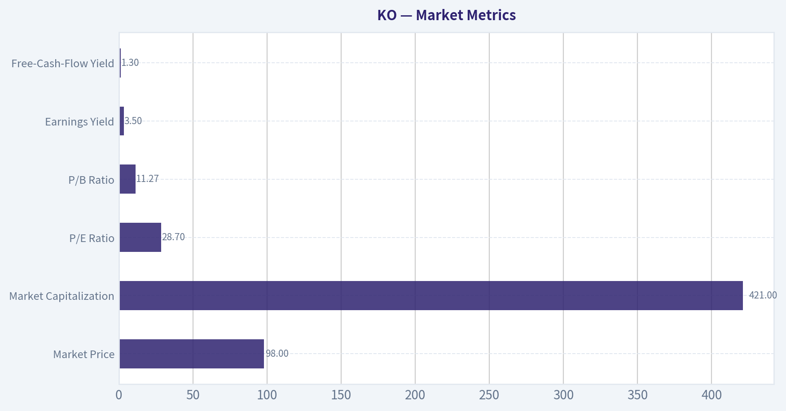

---

### Options Market Analysis

> *Reading options flow - put/call ratios, IV skew, and unusual activity - to gauge institutional positioning and event-driven risk.*

ANALYST STANCE: **BULLISH**

#### KO Options Market Overview

As of November 26, 2026, KO options show a bullish near-term directional bias, driven primarily by substantial call volume and two unusually active December 4 call contracts. The signal is tempered by an above-neutral put/call open-interest ratio and elevated volatility in the November 27 expiry.

#### Put/Call Ratio Analysis

| Expiry | Call OI | Put OI | Put/Call OI | Call Volume | Put Volume | Put/Call Volume |
|---|---:|---:|---:|---:|---:|---:|
| Nov. 27, 2026 | 26,706 | 24,119 | 0.90 | 18,465 | 8,894 | 0.48 |
| Dec. 4, 2026 | 8,102 | 5,677 | 0.70 | 12,691 | 3,028 | 0.24 |
| Dec. 11, 2026 | 4,099 | 3,636 | 0.89 | 1,084 | 385 | 0.36 |
| **Total** | **38,907** | **33,432** | **0.86** | **32,240** | **12,307** | **0.38** |

**Key Takeaways:** The aggregate put/call OI ratio of 0.86 is more defensive than the historical neutral baseline of roughly 0.70, indicating meaningful put protection or bearish exposure in existing open interest. However, the volume ratio of 0.38 is strongly call-dominant, with new trading activity favoring calls. The divergence suggests bullish near-term speculation alongside an existing layer of downside hedging.

#### Implied Volatility Assessment

| Expiry | Call ATM IV | Put ATM IV | Put-Call IV Difference | Interpretation |
|---|---:|---:|---:|---|
| Nov. 27, 2026 | 52.3% | 49.3% | -3.0 percentage points | Very elevated front-end IV; slight call premium |
| Dec. 4, 2026 | 27.1% | 33.9% | +6.8 percentage points | Meaningful downside put skew |
| Dec. 11, 2026 | 24.1% | 27.1% | +3.0 percentage points | Moderate downside skew |

**Key Takeaways:** Volatility is exceptionally elevated for the November 27 expiration, consistent with substantial event or expiration-related risk, although no specific catalyst is identified in the supplied data. Beyond that expiry, put IV exceeds call IV, showing a moderate downside skew. The combination of call-heavy volume and put-skewed volatility indicates upside trading interest but continued demand for downside insurance.

#### Unusual Options Activity

| Expiry | Type | Strike | Volume | Open Interest | Volume/OI | IV | Moneyness Assessment | Implication |
|---|---|---:|---:|---:|---:|---:|---|---|
| Dec. 4, 2026 | Call | $99 | 5,582 | 359 | 15.5x | 22.1% | Cannot confirm without current KO price; likely near-the-money if spot is near $99 | Strong fresh upside-oriented activity |
| Dec. 4, 2026 | Call | $101 | 5,133 | 581 | 8.8x | 22.2% | Cannot confirm without current KO price; likely near- to out-of-the-money if spot is near $99 | Additional upside exposure, possibly a spread or directional speculation |

**Key Takeaways:** Both flagged contracts are calls expiring in eight calendar days, with volume far exceeding existing open interest. Their similar IV and concentrated strikes suggest focused upside activity rather than broad, scattered speculation. The data cannot establish whether these trades were bought or sold, so the bullish interpretation is strongest if the contracts were bought to open; trade-level execution data would be required for confirmation.

#### Open Interest Concentration and Gamma Levels

| Expiry | Highest Available OI Concentration | Call OI | Put OI | Market Interpretation |
|---|---|---:|---:|---|
| Nov. 27, 2026 | Aggregate near-term chain | 26,706 | 24,119 | Largest expiration; potential short-dated pinning and elevated gamma sensitivity |
| Dec. 4, 2026 | $99 and $101 calls highlighted by unusual volume | 359 and 581 individually | Not provided | Concentrated call activity may reinforce upside sensitivity near these strikes |
| Dec. 11, 2026 | Aggregate chain | 4,099 | 3,636 | Smaller OI base; less likely to dominate near-term price behavior |

**Key Takeaways:** The November 27 expiration contains the largest overall open interest and is therefore the most relevant source of short-dated pinning or gamma effects. The $99 and $101 December 4 calls are notable for fresh activity, but their absolute open interest is not large enough by itself to prove a major gamma wall. Exact strike-level OI across the full chain and KO's current spot price are unavailable, limiting precision on max-pain and pinning analysis.

#### Liquidity, Catalyst, and Data Limitations

KO's near-term options activity is sufficiently active for directional analysis, particularly in the November 27 and December 4 expirations. However, the supplied dataset does not include KO's current share price, full strike-by-strike open interest, trade-side classification, or a confirmed upcoming catalyst. As a result, exact ITM/ATM/OTM classification, max-pain calculation, and the distinction between call buying and call selling remain incomplete.

The very high November 27 IV may reflect an imminent company-specific or market event, but no catalyst can be verified from the available information. The evidence is therefore directional rather than a valuation measure.

#### Overall Options Sentiment

| Signal Component | Assessment | Directional Read |
|---|---|---|
| Put/Call OI ratio | 0.86, above neutral baseline | Defensive existing open interest |
| Put/Call volume ratio | 0.38 | Strong call-heavy new activity |
| Near-term IV | 52.3% call ATM IV for Nov. 27 | Elevated event or expiration risk |
| IV skew | Put IV higher for Dec. 4 and Dec. 11 | Downside hedging demand |
| Unusual activity | $99 and $101 calls, 8.8x-15.5x volume/OI | Focused upside speculation |
| Overall signal | **BULLISH** | Call flow outweighs defensive skew near term |

**Key Takeaways:** The primary bullish driver is concentrated, high-volume call activity in the December 4 expiry, combined with a strongly call-dominant overall volume ratio. The main counterweight is the 0.86 put/call OI ratio and persistent downside IV skew, which indicate that downside protection remains important. Overall, the options market implies a bullish near-term directional bias, but with elevated event risk and incomplete confirmation of whether the unusual calls were bought or sold.

---

## Research Team Commentary

> *The Research Manager synthesizes the Bull vs Bear debate into action-free commentary. This is a pre-risk view, not the final stance.*

Core takeaway: Coca-Cola is a wonderful business, but the evidence does not establish that $97.59 offers an adequate quality-scaled margin of safety. Its brand, distribution system, recurring demand, 61.6% gross margin, and 18.3% ROIC support a wide-moat assessment. The unresolved issue is whether a mature beverage company can produce enough profitable per-share growth to justify a 28.8 P/E and roughly 3.5% earnings yield. On the available information, the franchise merits confidence, while the valuation merits scrutiny.

The strongest bull argument is the durability of Coca-Cola's entire commercial system, not merely the fame of its flagship brand. Global distribution, retailer access, bottler relationships, marketing scale, and consumer habit reinforce one another. These advantages should support pricing, product launches, and expansion across zero-sugar beverages, water, sports drinks, coffee, energy, and emerging markets. High margins and ROIC indicate genuine economic strength, while 64 consecutive years of dividend increases demonstrate unusually resilient cash generation and shareholder orientation.

The strongest bear argument is that business durability may already be fully reflected in the price. At nearly 29 times earnings, Coca-Cola needs more than nominal price increases and a stable dividend. It needs sustained profitable growth, resilient volumes, stable margins, and continued high incremental returns, with limited damage from eventual multiple normalization. The bull case calls this "moderate growth," but without a complete free-cash-flow model or a DeepValues intrinsic-value estimate, that description remains insufficiently demonstrated. A mature company growing earnings only 3%-4% would have little valuation protection; sustained mid- to high-single-digit per-share growth would make the current multiple more defensible, but that is a meaningfully higher hurdle.

Health concerns, sugar taxes, packaging regulation, water constraints, and category fragmentation are credible long-term risks, although none currently appears sufficient to invalidate the moat. Coca-Cola's scale gives it substantial capacity to adapt, but adaptation must create value rather than merely preserve reported revenue through acquisitions, higher marketing expense, or lower-return categories. Similarly, refranchising improves parent-company margins and capital efficiency, but the economics of bottlers still matter. A stressed bottling system could eventually require concessions or additional support.

The dividend record and Berkshire Hathaway's ownership reinforce the quality assessment but do not resolve valuation. Berkshire's stake was accumulated on very different economics and carries tax and opportunity-cost considerations that do not establish the attractiveness of today's market price. Near-term options activity and the rising 200-day moving average show favorable market sentiment, but they provide little evidence about ten-year intrinsic value. Indeed, the stock trading well above its long-term average may indicate that investors are already paying generously for defensiveness.

The key analytical lesson is to avoid two opposite errors. One is rejecting a premium valuation merely because the company grows more slowly than a technology business; exceptional durability can justify a smaller required discount. The other is allowing admiration for a famous franchise, a dividend streak, or one strong ROIC reading to substitute for valuation work. Here, the second error is the greater concern. The business clearly qualifies for quality-scaled valuation treatment, but the supplied evidence does not show even the roughly 10%-15% intrinsic-value discount that might be sufficient for a predictable, wide-moat compounder.

Over the next one to four quarters, the most important monitoring item is the composition of organic growth. Unit-case volume should be compared with price and mix to determine whether reported growth reflects genuine consumer demand or increasing reliance on pricing. Performance in zero-sugar products and non-sparkling categories should also be assessed for both growth and profitability.

Margins, operating cash flow, free-cash-flow conversion, and working-capital movements should be monitored alongside revenue. Stable gross margins would support continued pricing power, while weaker conversion or rising promotional expense could indicate that maintaining growth is becoming more costly. Multi-period ROIC and returns on new investments are more informative than the current 18.3% snapshot.

Capital allocation also deserves close attention: acquisition spending, the valuation at which repurchases occur, share-count changes, dividend coverage, net debt, refinancing costs, and interest coverage. Bottler profitability and investment levels can reveal whether refranchising is producing healthy system-wide economics or merely shifting pressure outside the parent company. Finally, regulatory costs, packaging obligations, foreign-exchange effects, and water-related expenditures should be separated from underlying demand trends wherever disclosures permit.

Evidence of sustained volume growth, mid- to high-single-digit per-share cash-flow growth, stable margins, strong free-cash-flow conversion, and durable incremental ROIC would make the valuation more supportable. Conversely, low-single-digit growth driven mainly by pricing, deteriorating volumes, weaker bottler economics, rising leverage, or lower returns on portfolio expansion would strengthen the case that the market is capitalizing too much of Coca-Cola's quality.

Final stance: Neutral.

---

## Value Investing Team Commentary

> *The Investor translates the research view into an investment thesis before risk review. This is still not the final stance.*

Coca-Cola remains an exceptionally durable consumer franchise, but durability and valuation are separate questions. The supplied evidence supports a wide-moat assessment: global brand recognition, bottler and retailer relationships, distribution density, advertising scale, and habitual consumption create an ecosystem that is difficult for competitors to replicate. Its 61.6% gross margin and 18.3% ROIC are consistent with meaningful pricing power and efficient use of capital, although both metrics require multi-year context.

The most important contrarian point is that Coca-Cola's slower growth does not automatically make its valuation unreasonable. A business with unusually predictable demand, resilient cash generation, and the ability to raise prices over decades can deserve a premium relative to a more cyclical company with superficially faster growth. Zero-sugar products, energy, sports drinks, coffee, and emerging-market distribution provide additional avenues for growth beyond traditional sparkling beverages. The company's commercial system may also be more valuable than any individual product category because it can introduce and scale new brands through existing infrastructure.

However, the contrary risk is that the market already recognizes nearly all of these strengths. At $97.59 and approximately 28.8 times earnings, the valuation implies that Coca-Cola will produce more than merely stable nominal growth. A roughly 3.5% earnings yield leaves limited valuation protection if earnings growth remains in the low single digits or if interest rates keep defensive consumer franchises from receiving ever-higher multiples. The required hurdle is not extraordinary for a high-quality business, but it is meaningfully above simple inflation-plus growth.

The reported 40.7% ROE is encouraging but less informative than the 18.3% ROIC. ROE can be amplified by leverage, share repurchases, and a relatively small equity base. ROIC, incremental returns on new investment, and free-cash-flow conversion provide a better test of whether the franchise is still creating value at attractive rates. Likewise, the dividend record demonstrates resilience, but a long distribution history does not by itself establish that the current valuation discounts future cash flows conservatively.

The market and options data add little to the ten-year business case. A rising 200-day average and a close near the 10-day EMA indicate favorable sentiment and technical stability, while the put/call open-interest ratio suggests that some investors remain defensive. This combination may reveal a market that views Coca-Cola as both a dependable compounder and a portfolio hedge. That defensiveness can support the valuation, but it can also create complacency: investors may be paying a premium for safety without adequately testing the growth assumptions embedded in the price.

Berkshire Hathaway's substantial ownership is a useful signal regarding business quality and management credibility, but it is not a valuation model. The shares were accumulated under different market conditions and economics, and Berkshire's historical cost basis does not establish the intrinsic value of the shares today. The dividend increase record is similarly important evidence of business durability, not proof of a sufficient margin of safety.

The principal operating question is the quality of organic growth. Volume growth would be stronger evidence than price-led revenue increases, particularly if pricing is accompanied by weaker affordability or promotional intensity. Zero-sugar and non-sparkling categories deserve scrutiny not only for reported sales growth but also for profitability and incremental capital requirements. Refranchising can improve reported margins and reduce capital intensity at the parent level, yet system-wide bottler economics remain relevant. If bottlers require greater support or accept lower returns, some of the apparent efficiency may represent a transfer of economic pressure rather than genuine value creation.

Longer-term risks include sugar taxation, health-related regulation, packaging obligations, water scarcity, foreign-exchange volatility, and changing consumer preferences. Coca-Cola's scale and marketing resources provide substantial adaptation capacity, but adaptation must be evaluated by returns on capital rather than by portfolio breadth alone. Acquisitions and category expansion are beneficial only when they preserve or improve the company's economic moat.

The evidence would become more favorable if Coca-Cola demonstrated sustained volume growth, durable mid- to high-single-digit per-share cash-flow growth, stable margins, strong free-cash-flow conversion, and healthy incremental ROIC. Conversely, growth driven mostly by pricing, weakening volumes, rising leverage, lower bottler profitability, or declining returns on new categories would suggest that the valuation is capitalizing the franchise's quality more aggressively than its future economics justify.

**ANALYST STANCE: Neutral.** Coca-Cola is a high-quality, wide-moat business with unusually durable earnings characteristics, and the market may underestimate the long-term value of its distribution and brand ecosystem. Nevertheless, at approximately 29 times earnings, the available evidence does not demonstrate the quality-scaled margin of safety appropriate even for a wonderful business. The franchise merits confidence; the current valuation still requires stronger proof of durable per-share growth.

---

## Deep Values Commentary

> *The Risk Management Team debates and the Risk Judge provides the final action-free verdict. This section determines the final Bullish / Neutral / Bearish stance.*

#### Final Stance Scorecard

This scorecard converts the final research view into a weighted decision frame. It does not replace the narrative judgement, but it makes the main drivers of the verdict easier to scan.

| Criterion | Score | Weight | Commentary |
| --- | ---: | ---: | --- |
| Business Quality | 4.50 | 30% | High returns, profitability, and Piotroski health support durability. |
| Valuation Support | 1.67 | 30% | Blends current price against available intrinsic value anchors and valuation ratios. |
| Financial Strength | 2.67 | 20% | Balance-sheet resilience reflects leverage and liquidity staying within safe ranges. |
| Growth Durability | 3.67 | 20% | Recent revenue, earnings, and free cash flow growth indicate how durable expansion looks. |
| TOTAL / FINAL STANCE | 3.12 | 100% | Neutral |

#### Key Takeaways

The weighted score lands at **3.12 / 5.0**, while the final stance remains **Neutral**. This is useful as a quick calibration aid rather than a mechanical signal.

#### Risk Summary

Higher scores indicate more risk pressure. The watch threshold is a simple guardrail: above it, the dimension weighs more heavily on the valuation case and calls for a wider margin of safety.

| Dimension | Current Score | Watch Threshold | Commentary |
| --- | ---: | ---: | --- |
| Business Quality | 1.50 | 3.00 | High returns, profitability, and Piotroski health support durability. |
| Valuation Support | 4.33 | 3.00 | Blends current price against available intrinsic value anchors and valuation ratios. |
| Financial Strength | 3.33 | 3.00 | Balance-sheet resilience reflects leverage and liquidity staying within safe ranges. |
| Growth Durability | 2.33 | 3.00 | Recent revenue, earnings, and free cash flow growth indicate how durable expansion looks. |

#### Key Takeaways

This view helps readers separate *where* the risk sits: valuation, business quality, balance sheet, or growth durability. It is especially useful when the final stance is close to the line between Neutral and Bearish.
