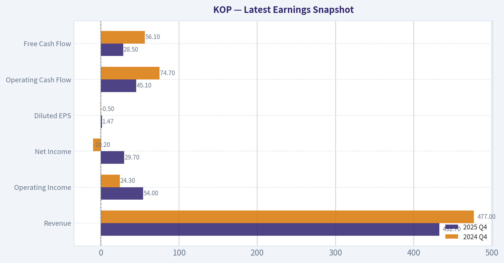
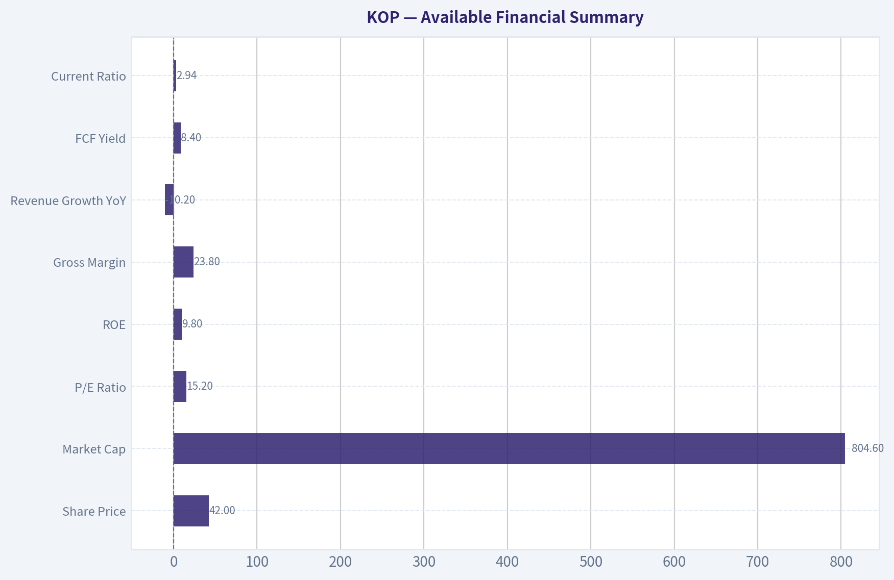
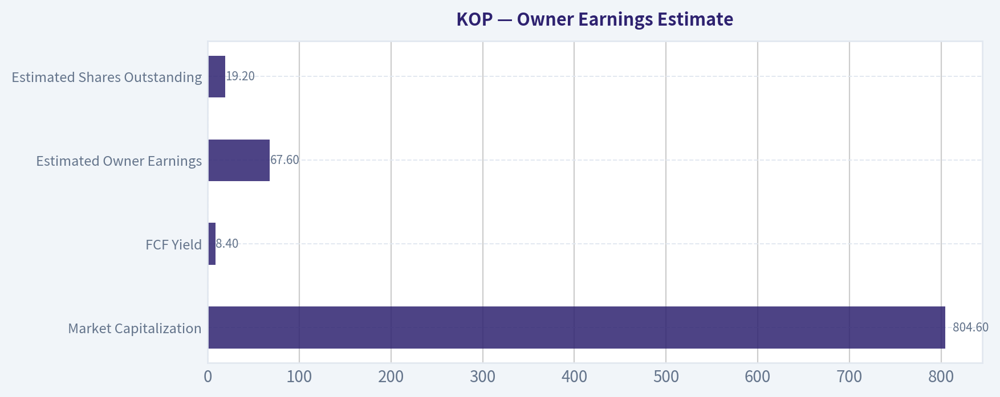
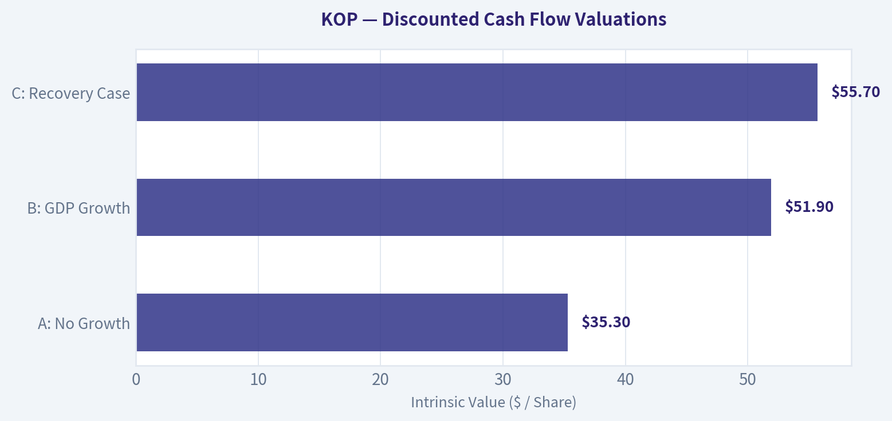
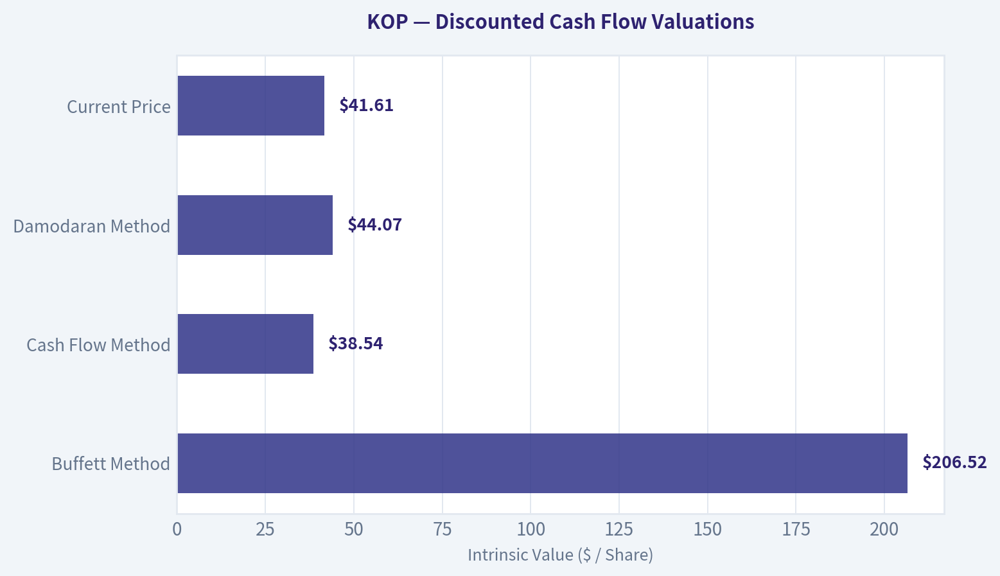
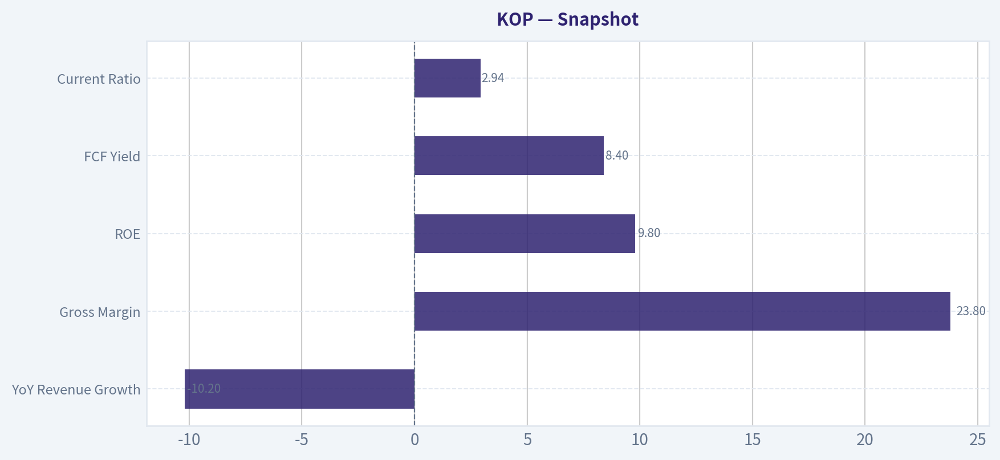
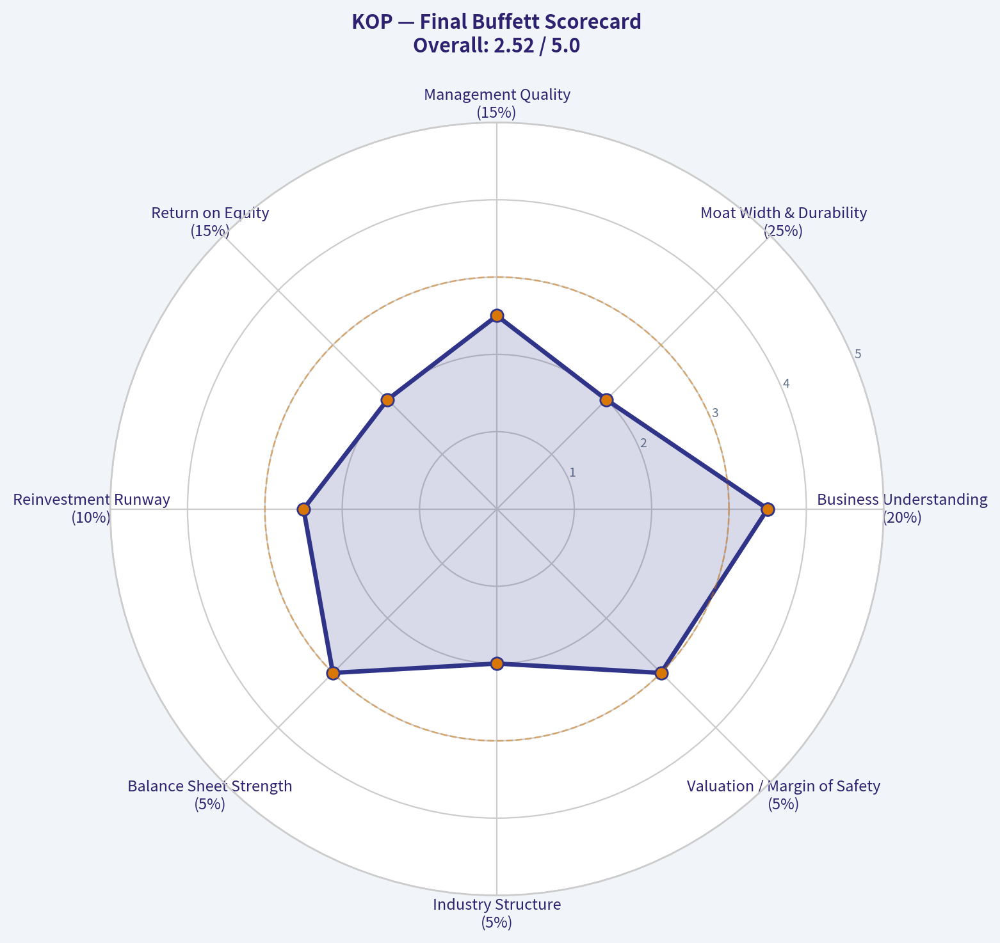
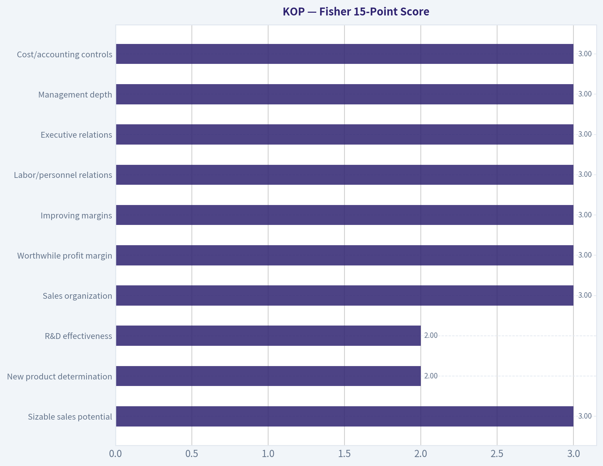

# KOP Deep Value Intelligence

**Analysis Date:** 2026-05-06

## Critical Disclaimer

*This analysis is generated by Deep Value Intelligence, an AI-powered multi-agent investing framework. This report is for informational and educational purposes only and does not constitute financial advice. Always conduct your own research and consult with qualified financial advisors before making investment decisions.*

---

## Table of Contents

1. Intelligence Summary
2. Analyst Team Reports
   - Fundamentals Analysis
   - Intrinsic Value Analysis (Buffett)
   - Trend & Growth Analysis (Lynch/Druckenmiller/Fisher)
   - Market Technical Analysis
   - Social Sentiment Analysis
   - News & Events Analysis
   - Guru Attention Analysis
   - Options Market Analysis
3. Research Team Commentary
4. Value Investing Team Commentary
5. Deep Values Commentary

---

## Intelligence Summary

### Thesis + Conditions

**Core Thesis:** **EXECUTIVE SUMMARY**
*   **Verdict:** **AVOID**
*   **The "Why":** Koppers Holdings (KOP) is a mediocre, cyclical business trading squarely at its fair value ($42 price vs. $38-$44 intrinsic value estimates).

**Key Risks:**
- The Risky/Bull Case (Cyclical Rerating):** The market is treating KOP like a dead cyclical. However, with an 8.4% FCF yield, 6.9% net income growth, and active deleveraging, the stock is primed for a multiple expansion if revenue merely stabilizes.
- The Neutral Case (Wait for Proof):** A pure "avoid" might miss a turnaround, but diving in now is reckless. Capital should only be deployed if KOP can prove FCF durability without working-capital distortions and show a bottoming in revenue.
- Under a strict value investing framework, capital preservation is paramount. The Risky Analyst correctly notes that average businesses can produce above-average returns during cyclical transitions. However, as the Safe Analyst rightly counters, capturing that upside requires buying at a deep discount.
- At ~$42, KOP is trading precisely within its estimated intrinsic value range ($38.54 FCF value; $44.07 Damodaran value). Without a discount, you are absorbing all the business risk (cyclicality, lack of pricing power) without downside protection. Furthermore, the divergence between shrinking revenue and spiking cash flow is highly indicative of temporary cycle-timing rather than structural moat-building. Technical breakouts and 0.00% exploratory positions by hedge funds (Point72) do not replace a fundamental margin of safety.
- 2.  **Strict Watchlist Criteria:** Relegate KOP to a passive monitor. We will not revisit this ticker unless two conditions are met:

**What Would Change Our View:**
- The Risky/Bull Case (Cyclical Rerating):** The market is treating KOP like a dead cyclical. However, with an 8.4% FCF yield, 6.9% net income growth, and active deleveraging, the stock is primed for a multiple expansion if revenue merely stabilizes.
- The Neutral Case (Wait for Proof):** A pure "avoid" might miss a turnaround, but diving in now is reckless. Capital should only be deployed if KOP can prove FCF durability without working-capital distortions and show a bottoming in revenue.
- Under a strict value investing framework, capital preservation is paramount. The Risky Analyst correctly notes that average businesses can produce above-average returns during cyclical transitions. However, as the Safe Analyst rightly counters, capturing that upside requires buying at a deep discount.
- At ~$42, KOP is trading precisely within its estimated intrinsic value range ($38.54 FCF value; $44.07 Damodaran value). Without a discount, you are absorbing all the business risk (cyclicality, lack of pricing power) without downside protection. Furthermore, the divergence between shrinking revenue and spiking cash flow is highly indicative of temporary cycle-timing rather than structural moat-building. Technical breakouts and 0.00% exploratory positions by hedge funds (Point72) do not replace a fundamental margin of safety.
- 2.  **Strict Watchlist Criteria:** Relegate KOP to a passive monitor. We will not revisit this ticker unless two conditions are met:

**Confidence:** Medium

---

## Analyst Team Reports

### Fundamentals Analysis

#### Latest Earnings Snapshot

*Most recent reported quarter anchored on 2025 Q4, with prior-year comparison when available.*

| Metric | 2025 Q4 | 2024 Q4 | YoY Change |
| --- | ---: | ---: | ---: |
| Revenue | $432.7M | $477.0M | -9.3% |
| Operating Income | $54.0M | $24.3M | +122.2% |
| Net Income | $29.7M | $-10.2M | +391.2% |
| Diluted EPS | $1.47 | $-0.50 | +394.0% |
| Operating Cash Flow | $45.1M | $74.7M | -39.6% |
| Free Cash Flow | $28.5M | $56.1M | -49.2% |

Key Takeaways: This snapshot anchors the most recent reported quarter before the narrative analysis. It helps readers separate long-run business quality from whatever changed in the latest earnings print.

{10}

---

### Intrinsic Value Analysis (Buffett)

> *Following Warren Buffett's value investing philosophy: Circle of Competence, Economic Moat, Management Quality, and Margin of Safety.*

#### Intrinsic Value Snapshot

Price is what you pay. Intrinsic value is what the business may be worth based on the cash it can create for owners over time. We show a range, not one magic number.

- Current Price: $41.61
- Value Range: $14.93 to $537.82

##### Owner Earnings (Buffett Method)
- Net Income: $56,000,000.00
- Depreciation & Amortization: $73,600,000.00
- Capital Expenditures: $-55,000,000.00
- Working Capital Changes: $-41,400,000.00
- Owner Earnings: $116,000,000.00

##### Intrinsic Value
###### Buffett Method
Uses owner earnings. Stricter, and usually more conservative.
- Conservative: $69.52
- Average: $206.52
- Optimistic: $537.82
- Discount Rate: 10.0%

###### Cash Flow Method
Uses free cash flow. Better for companies spending heavily today to grow tomorrow.
- Conservative: $14.93
- Average: $38.54
- Optimistic: $64.19
- Discount Rate: 10.0%

ANALYST STANCE: **AVOID**

#### Koppers Holdings Inc. (KOP) - Buffett-Style Investment Review

Data note: the internal audited-financials tool was unavailable in this session, and the enhanced fundamentals tool returned no usable data. This review therefore relies on the shared research pack: current price **$42**, market cap **$804.6 million**, P/E **15.2x**, ROE **9.8%**, gross margin **23.8%**, revenue growth **-10.2% YoY**, FCF yield **8.4%**, and current ratio **2.94**.

---

#### 1. Go/No-Go Gate Assessment

| Buffett Gate | Result | Evidence | Verdict |
|---|---:|---|---|
| Gate 1: Circle of Competence & Simplicity | Mixed | Koppers treats wood products such as railroad ties, utility poles, and produces carbon-based chemicals. The basic business is understandable, but earnings depend on industrial demand, commodity inputs, rail spending, utility spending, tariffs, and carbon market conditions. | Pass with caution |
| Gate 2: Durable Moat | Fail | Gross margin is only **23.8%**, far below the 40%+ level often associated with strong pricing power. Products appear industrial and specification-driven rather than brand-driven. | Fail |
| Gate 3: Management & Capital Allocation | Inconclusive / Caution | Management is targeting cash-flow inflection and deleveraging, which is positive, but the need to deleverage suggests prior balance-sheet or cyclicality pressure. No clear evidence of exceptional owner-oriented capital allocation. | Caution |
| Gate 4: Industry Structure | Fail | The business appears cyclical, capital-intensive, and exposed to industrial, rail, utility, chemical, and commodity cycles. This is not a capital-light consumer monopoly or toll-road-like franchise. | Fail |

**Key Takeaways:** Koppers is understandable, but it does not pass the Buffett quality filter. The company operates in cyclical industrial markets with modest margins and execution risks. Even if the valuation looks statistically inexpensive, the business does not appear to have the durable, high-return economics Buffett usually seeks.

---

#### 2. Moat Analysis

| Moat Source | Assessment | Evidence |
|---|---:|---|
| Intangible Assets / Brand | Weak | Railroad ties, treated wood, utility products, and carbon materials are largely industrial purchasing categories. Brand may matter for reliability and compliance, but not enough to show strong consumer-style pricing power. |
| Switching Costs | Moderate but not dominant | Utilities and railroads may value supplier reliability and approved specifications, creating some customer stickiness. However, these are procurement-driven customers that can pressure margins. |
| Cost Advantage | Possible but unproven | Scale, logistics, treatment facilities, and customer relationships may create operating advantages, but current gross margin of **23.8%** does not demonstrate a powerful cost moat. |
| Network Effects | None | The product does not become more valuable as more users adopt it. |
| Overall Moat Rating | Narrow / Cyclical | Some operational advantages may exist, but not a wide, durable, high-margin moat. |

**Key Takeaways:** Koppers may have practical industrial advantages, especially around customer relationships, specifications, and supply reliability. But these are not the same as a wide Buffett moat. The low gross margin and cyclical end markets suggest the company has limited pricing power.

---

#### 3. Management Quality & Capital Allocation

| Question | Assessment | Commentary |
|---|---:|---|
| Do they think like owners? | Not proven | No evidence provided that management has exceptional insider ownership or compensation directly tied to long-term per-share intrinsic value. |
| Are they candid and conservative? | Inconclusive | The latest coverage highlights management discussion around cash flow, cost pressure, tariffs, rail cuts, and deleveraging. That suggests awareness of risks, but not enough to judge candor fully. |
| Are they rational capital allocators? | Mixed | Targeted deleveraging is positive. However, Buffett would prefer a business that naturally produces excess cash without needing a "cash-flow inflection" story. |
| Debt discipline | Watch item | Deleveraging is a stated priority, implying leverage matters. Without full debt metrics, this remains a material risk. |

**Key Takeaways:** Management appears focused on improving cash flow and reducing leverage, which is constructive. However, there is not enough evidence to call management exceptional. For a lower-margin cyclical business, capital allocation discipline is especially important, and the available evidence is not strong enough.

---

#### 4. Available Financial Summary

| Metric | Latest Available Figure | Buffett Interpretation |
|---|---:|---|
| Share Price | **$42** | Starting valuation reference point |
| Market Cap | **$804.6M** | Small-cap industrial company |
| P/E Ratio | **15.2x** | Not expensive, but not automatically cheap for a cyclical business |
| ROE | **9.8%** | Below Buffett's preferred 15%+ sustained threshold |
| Gross Margin | **23.8%** | Weak evidence of pricing power |
| Revenue Growth YoY | **-10.2%** | Current business momentum is negative |
| FCF Yield | **8.4%** | Statistically attractive if cash flow is durable |
| Current Ratio | **2.94** | Liquidity appears sound |

**Key Takeaways:** The stock screens reasonably well on free cash flow yield and liquidity. But the quality metrics are not Buffett-like: ROE is below 10%, gross margin is modest, and revenue is declining. This looks more like a cyclical value candidate than a wonderful business at a fair price.

---

#### 5. Owner Earnings Estimate

Using free cash flow yield as a rough proxy for owner earnings:

| Item | Calculation | Estimate |
|---|---:|---:|
| Market Capitalization | Given | **$804.6M** |
| FCF Yield | Given | **8.4%** |
| Estimated Owner Earnings | $804.6M x 8.4% | **$67.6M** |
| Estimated Shares Outstanding | $804.6M ÷ $42 | **19.2M** |
| Owner Earnings Per Share | $67.6M ÷ 19.2M | **$3.53/share** |

**Key Takeaways:** Koppers appears to generate about **$68 million** of free cash flow, or roughly **$3.53 per share**, based on the shared FCF yield. That supports the idea that the stock is not obviously overvalued. However, the key question is whether this cash flow is durable through a cycle, and the business quality evidence is not strong.

---

#### 6. Three-Scenario DCF Valuation

| Scenario | Assumptions | Equity Value Estimate | Value Per Share | Margin vs. $42 Price |
|---|---|---:|---:|---:|
| A: No Growth | Owner earnings capitalized at 10% | **$676M** | **$35.30** | Price is above value |
| B: GDP Growth | Owner earnings grow perpetually at 3%, discounted at 10% | **$995M** | **$51.90** | ~19% discount to value |
| C: Recovery Case | Owner earnings grow 4% for 10 years, then 3% terminal growth | **$1.07B** | **$55.70** | ~25% discount to value |

**Key Takeaways:** The valuation is not unreasonable. If Koppers can sustain and modestly grow current free cash flow, fair value may be above today's price. But the no-growth case produces a value below the current stock price, which matters because this is a cyclical, lower-ROE business rather than a high-confidence compounder.

---

#### 7. Margin of Safety Assessment

| Quality Category | Required Buffett Margin of Safety | KOP Estimated Margin | Pass / Fail |
|---|---:|---:|---:|
| Wonderful business | 25%+ | Not applicable | Not wonderful enough |
| Average / cyclical business | 40%-50% | 0% to 25%, depending on scenario | Fail |
| Balance-sheet-sensitive industrial | 40%+ preferred | Insufficient evidence of adequate discount | Fail |

**Key Takeaways:** At **$42**, Koppers may offer some upside if management executes and cash flow improves. But because the business lacks a wide moat and has cyclical risk, the required margin of safety should be much larger. The current price does not offer enough protection for a Buffett-style investor.

---

#### 8. Final Buffett Scorecard

| Criterion | Weight | Score 1-5 | Weighted Score |
|---|---:|---:|---:|
| Business Understanding | 20% | 3.5 | 0.70 |
| Moat Width & Durability | 25% | 2.0 | 0.50 |
| Management Quality | 15% | 2.5 | 0.38 |
| Return on Equity | 15% | 2.0 | 0.30 |
| Reinvestment Runway | 10% | 2.5 | 0.25 |
| Balance Sheet Strength | 5% | 3.0 | 0.15 |
| Industry Structure | 5% | 2.0 | 0.10 |
| Valuation / Margin of Safety | 5% | 3.0 | 0.15 |
| **Total** | **100%** |  | **2.53 / 5.00** |

**Key Takeaways:** Koppers scores poorly on the factors that matter most to Buffett: moat durability, high returns on equity, and industry quality. The valuation is not demanding, but valuation alone cannot overcome mediocre business economics. The final score lands in the avoid range.

---

#### 9. Investment Stance

| Stance | Conviction | Rationale |
|---|---:|---|
| **AVOID** | Moderate | Koppers may be a reasonable cyclical value trade for investors comfortable with industrial risk, but it is not a Buffett-style long-term compounder. Low ROE, modest gross margins, negative revenue growth, and execution-dependent deleveraging reduce confidence. |

**Key Takeaways:** The stock is not obviously expensive, and the free cash flow yield is attractive. But Buffett investing starts with business quality, not low multiples. Koppers does not show enough evidence of a wide moat, pricing power, or superior returns on capital to justify ownership as a long-term compounder.

#### Bottom Line

Koppers is best viewed as a cyclical industrial value situation, not a "wonderful company at a fair price." At **$42**, the valuation may provide some upside if free cash flow inflects and deleveraging succeeds, but the business does not clear the Buffett moat and quality hurdles. I would **avoid** the stock for a Buffett-style portfolio and revisit only at a much lower price or after clear evidence of sustained high returns, lower leverage, and durable pricing power.
#### Valuation Bridge

This bridge places the current market price beside each intrinsic value lens so readers can see whether upside depends on one method or shows up across several methods.

| Scenario | Intrinsic Value / Share |
| --- | ---: |
| Buffett Method | $206.52 |
| Cash Flow Method | $38.54 |
| Damodaran Method | $44.07 |
| Current Price | $41.61 |

#### Key Takeaways

If one method is far above the others, the upside case depends on a specific modelling assumption. When several methods cluster together, the valuation story is more robust.

#### Valuation Visuals

This comparison chart from *Latest Earnings Snapshot* stacks current figures against historical benchmarks for **KOP**, making it easy to see where the company trades relative to its own averages.

This comparison chart from *Available Financial Summary* stacks current figures against historical benchmarks for **KOP**, making it easy to see where the company trades relative to its own averages.

This comparison chart from *Owner Earnings Estimate* stacks current figures against historical benchmarks for **KOP**, making it easy to see where the company trades relative to its own averages.

The following chart maps the **KOP** Owner Earnings DCF valuation scenarios (Conservative, Average, Optimistic) to visually represent the margin of safety based on intrinsic value calculations.

The following chart maps the **KOP** Owner Earnings DCF valuation scenarios (Conservative, Average, Optimistic) to visually represent the margin of safety based on intrinsic value calculations.

This comparison chart from *Snapshot* stacks current figures against historical benchmarks for **KOP**, making it easy to see where the company trades relative to its own averages.

---

### Trend & Growth Analysis (Lynch/Druckenmiller/Fisher)

> *Following Peter Lynch's GARP, Stanley Druckenmiller's macro-aware approach, and Philip Fisher's scuttlebutt methodology.*

ANALYST STANCE: **AVOID**

#### KOP Growth Investment Report - Koppers Holdings Inc.

Koppers is not a Lynch/Fisher-style growth candidate today. It is better characterized as a cyclical industrial cash-flow/value setup with potential 2026 deleveraging, not a visible ten-bagger growth inflection. The biggest issue is simple: reported revenue growth is negative, which is an auto-reject flag for a growth mandate unless there is clear evidence of imminent acceleration.

---

#### 1. Snapshot

| Metric | Current Data | Growth Investor Read |
|---|---:|---|
| Share Price | ~$42 | Small-cap industrial valuation |
| Market Cap | ~$805M | Small enough to compound, but needs growth catalyst |
| P/E | ~15.2x | Reasonable, but not enough without growth |
| YoY Revenue Growth | **-10.2%** | Major red flag |
| Gross Margin | 23.8% | Industrial-level, not high-quality compounder margin |
| ROE | 9.8% | Acceptable but not exceptional |
| FCF Yield | 8.4% | Attractive cash-flow value signal |
| Current Ratio | 2.94x | Solid liquidity |

**Key Takeaways:** KOP looks statistically inexpensive and financially liquid, with a strong free cash flow yield. However, the negative revenue growth makes it unsuitable for a growth portfolio today. This is more of a cash-flow turnaround or cyclical recovery idea than a fast-grower.

---

#### 2. Lynch Classification

| Lynch Category | Fit? | Rationale |
|---|---:|---|
| Slow Grower | Partial | Revenue currently declining, not compounding |
| Stalwart | No | Too cyclical and small-cap to be a classic stalwart |
| Fast Grower | **No** | Revenue growth is negative, not 15-25%+ |
| Cyclical | **Yes** | Exposed to rail, utility poles, chemicals, carbon materials, commodity costs |
| Turnaround | Partial | Management appears focused on cash-flow inflection and deleveraging |
| Asset Play | Limited | Not the core thesis |

**Key Takeaways:** KOP is best classified as a cyclical/turnaround candidate, not a fast grower. Under Lynch's framework, this means growth investors should avoid initiating unless they have a strong catalyst edge. The current setup depends more on execution, cost control, and end-market recovery than durable high growth.

---

#### 3. The Story in 3 Bullets

| Story Element | Growth Interpretation |
|---|---|
| Koppers treats wood products used in railroads, utility poles, and infrastructure. | Benefits from utility grid buildout and rail maintenance spending. |
| Management is targeting a 2026 cash-flow inflection and deleveraging. | Upside depends on execution and margin recovery rather than organic hypergrowth. |
| Cost pressures, tariffs, rail softness, and carbon-material volatility remain headwinds. | The bull case is balanced by cyclical and commodity risks. |

**Key Takeaways:** The story is understandable, but it is not a classic growth story. KOP may benefit from infrastructure and grid spending, yet the company still faces volatile costs and uneven demand. The setup is more "earnings normalization" than "revenue acceleration."

---

#### 4. TAM and 10x Test

| Item | Estimate / Assessment |
|---|---:|
| Current Revenue Base | Approximately low-$2B range, based on market-cap and valuation context |
| 10x Revenue Requirement | Roughly $20B+ |
| Relevant TAM | Rail infrastructure, utility poles, wood treatment, carbon materials |
| Can KOP 10x revenue and remain <20% TAM share? | Unclear, likely difficult |
| TAM Growth Quality | Moderate, tied to infrastructure and grid spending |
| Runway Rating | 2.5 / 5 |

**Key Takeaways:** KOP has end-market support from grid and infrastructure spending, but it does not appear to have the kind of vast, rapidly expanding TAM that supports ten-bagger growth. A 10x revenue path would be difficult without major acquisitions, category expansion, or structural market share gains. The runway is real but not explosive.

---

#### 5. Revenue Growth Trend

| Revenue Signal | Current Evidence | Interpretation |
|---|---|---|
| YoY Revenue Growth | **-10.2%** | Decelerating / contracting |
| Growth Pattern | Negative | Not an inflection yet |
| Quality of Growth | Mixed, cyclical end-market exposure | Dependent on pricing, volume, commodity inputs |
| Growth Investor Signal | Negative | Fails fast-grower test |

**Key Takeaways:** The revenue trend is the central problem. Growth investors want accelerating sales, not contraction. Until KOP shows multiple quarters of improving organic growth, the stock does not qualify for a Lynch-style fast-grower thesis.

---

#### 6. Unit Economics and Cash Efficiency

| Metric | Data / Estimate | Read |
|---|---:|---|
| Gross Margin | 23.8% | Moderate, industrial |
| FCF Yield | 8.4% | Strong value signal |
| Estimated FCF | ~$68M | Based on market cap x FCF yield |
| Estimated FCF Margin | Low single digits | Solid but not exceptional |
| Rule of 40 | Not applicable | KOP is not SaaS/subscription |
| LTV/CAC / NRR | Not applicable | Industrial customer model |

**Key Takeaways:** KOP's cash-flow profile is the most attractive part of the story. The company appears capable of generating meaningful free cash flow relative to its market cap. However, cash efficiency alone does not make it a growth investment if revenue is shrinking.

---

#### 7. Inflection Point Assessment

| Potential Inflection | Evidence | Grade |
|---|---|---:|
| Cash-Flow Inflection | Management/news coverage points to 2026 cash-flow improvement and deleveraging | 3.5 / 5 |
| Margin Inflection | Cost cuts and mix shift may help, but cost headwinds remain | 3.0 / 5 |
| Revenue Inflection | Current YoY revenue growth is negative | 1.5 / 5 |
| TAM Inflection | Grid buildout is a real long-term tailwind | 3.0 / 5 |
| Competitive Inflection | Some mention of share gains in Performance Chemicals | 3.0 / 5 |
| Overall Inflection Score | Mixed; cash-flow, not growth | 2.8 / 5 |

**Key Takeaways:** There may be a 2026 cash-flow inflection, but there is not yet a proven revenue-growth inflection. For a growth investor, this distinction matters. The market may be underestimating future free cash flow, but that is a value thesis rather than a ten-bagger growth thesis.

---

#### 8. Macro Setup

| Macro Factor | Impact on KOP | Assessment |
|---|---|---|
| Grid Buildout | Positive demand for utility poles and infrastructure products | Tailwind |
| Rail Spending | Potentially supportive, but subject to cuts and cycles | Mixed |
| Tariffs | Cost and supply-chain risk | Headwind |
| Commodity / Carbon Volatility | Margin uncertainty | Headwind |
| Interest Rates | Lower rates could help small caps and leveraged industrials | Potential tailwind |
| Secular Theme Fit | Infrastructure/grid modernization | Moderate |

**Key Takeaways:** The macro picture is balanced. Grid investment is a genuine positive, but tariffs, commodity costs, and rail softness create uncertainty. KOP has some secular tailwinds, but not the clean secular growth exposure seen in AI, software, cybersecurity, or healthcare innovation.

---

#### 9. Fisher 15-Point Score

| Fisher Point | Score / 5 | Comment |
|---|---:|---|
| Sizable sales potential | 3 | Infrastructure demand helps, but not explosive |
| New product determination | 2 | More process/market execution than innovation-led |
| R&D effectiveness | 2 | Not a primary differentiator |
| Sales organization | 3 | Established industrial customer channels |
| Worthwhile profit margin | 3 | Moderate margins |
| Improving margins | 3 | Possible with cost cuts and mix shift |
| Labor/personnel relations | 3 | No major data available |
| Executive relations | 3 | No major data available |
| Management depth | 3 | Established operator |
| Cost/accounting controls | 3 | Cash-flow focus suggests discipline |
| Unique competitive aspects | 3 | Scale, customer relationships, treatment expertise |
| Long-range profit outlook | 3 | Possible but cyclical |
| Dilution risk | 4 | No obvious equity-raise concern from provided data |
| Candor | 3 | Management acknowledges headwinds |
| Integrity | 3 | No red flags from available data |
| **Total** | **44 / 75** | Below growth threshold |

**Key Takeaways:** KOP scores below the acceptable Fisher threshold for a growth investor. The company has operational strengths and established market positions, but it lacks the innovation intensity, margin structure, and growth runway Fisher would prefer. A score of 44 out of 75 supports an avoid stance for growth portfolios.

---

#### 10. Valuation

| Valuation Method | Result | Interpretation |
|---|---:|---|
| P/E | ~15.2x | Reasonable, but not clearly cheap given low growth |
| PEG | Not meaningful | Earnings/revenue growth is not positive enough |
| P/S | Likely below 0.5x | Cheap on sales, typical for low-margin cyclicals |
| FCF Yield | 8.4% | Attractive value/cash-flow metric |
| Valuation Verdict | Cheap but not growth-cheap | Value may exist, but growth thesis is weak |

**Key Takeaways:** KOP is not expensive. In fact, the free cash flow yield and low price-to-sales profile suggest value potential if management executes. But for growth investing, cheapness cannot offset shrinking revenue and cyclical uncertainty.

---

#### 11. Scenario Analysis

| Scenario | Assumptions | Investor Outcome |
|---|---|---|
| Bear Case | Rail weakness, tariffs, carbon turmoil, cost inflation persist | Stock remains value trap or de-rates |
| Base Case | Cash flow improves in 2026, deleveraging progresses, revenue stabilizes | Moderate upside, but not ten-bagger profile |
| Bull Case | Grid demand accelerates, Performance Chemicals gains share, margins expand | Strong small-cap rerating possible |
| Ten-Bagger Case | Requires sustained revenue acceleration, major margin expansion, and multiple expansion | Low probability currently |

**Key Takeaways:** The likely upside path is a cyclical rerating, not exponential growth. KOP could work as a value or special-situation investment if free cash flow improves and debt falls. However, the probability of a ten-bagger outcome appears low without a major revenue-growth inflection.

---

#### 12. Growth Investor Scorecard

| Criterion | Weight | Score / 5 | Weighted Score |
|---|---:|---:|---:|
| The Story | 10% | 3.0 | 0.30 |
| TAM & Runway | 20% | 2.5 | 0.50 |
| Revenue Growth | 20% | 1.0 | 0.20 |
| Unit Economics / Cash Efficiency | 15% | 3.0 | 0.45 |
| Competitive Position | 10% | 3.0 | 0.30 |
| Management Quality | 10% | 3.0 | 0.30 |
| Macro Setup | 5% | 3.0 | 0.15 |
| Profitability Path | 5% | 3.5 | 0.18 |
| Valuation | 5% | 3.5 | 0.18 |
| **Total** | **100%** |  | **2.56 / 5** |

**Key Takeaways:** KOP scores 2.56 out of 5, which falls into the avoid range for a growth investor. The company gets credit for valuation, liquidity, and potential cash-flow improvement. But the weak revenue growth score overwhelms the rest of the setup.

---

#### 13. Position Size Stance

| Portfolio Type | Suggested Stance |
|---|---|
| Growth / Ten-Bagger Portfolio | **0% position; avoid** |
| GARP Portfolio | Watch only after revenue stabilizes |
| Value / Special Situations Portfolio | Could merit further work |
| Existing Holder | Hold only if underwriting 2026 FCF inflection and deleveraging |
| New Buyer | Wait for proof of revenue and margin inflection |

**Key Takeaways:** KOP does not deserve capital in a growth-focused portfolio today. Existing holders may continue monitoring the 2026 cash-flow story, but new growth investors should wait. The proper trigger is not just cheap valuation; it is evidence that revenue and margins are turning together.

---

#### 14. Key Risks and Catalysts

| Category | Items to Monitor |
|---|---|
| Key Risks | Revenue contraction, tariff pressure, commodity/carbon volatility, rail spending cuts, cost inflation, execution risk |
| Positive Catalysts | 2026 free cash flow inflection, debt reduction, grid-related demand, Performance Chemicals share gains, margin recovery |
| Must-See Evidence Before Upgrade | Positive organic revenue growth, gross margin expansion, lower leverage, stable end-market demand |
| Upgrade Trigger | Two to three quarters of improving revenue growth plus confirmed FCF/deleveraging progress |

**Key Takeaways:** The catalyst path is visible, but not yet proven. If management delivers cash-flow improvement while revenue stabilizes, KOP could become a watch-list upgrade. Until then, the risk is that investors are buying a cheap cyclical before the cycle has truly turned.

---

#### Final View

KOP may be an interesting value or cyclical recovery idea, especially because of its free cash flow yield and potential 2026 deleveraging. But under a Lynch-Druckenmiller-Fisher growth framework, the stock fails the most important test: growth is not accelerating. With YoY revenue down 10.2%, moderate margins, and cyclical end-market exposure, KOP is an **AVOID for growth portfolios** until a genuine revenue and margin inflection appears.

#### Growth & Scorecard Visuals

The radar chart below from *Final Buffett Scorecard* visualises how **KOP** ranks across weighted investment criteria. Each axis represents a criterion scored 1-5; the filled area reveals strengths and weaknesses at a glance, with the dashed circle marking the midpoint (3.0).

This comparison chart from *Fisher 15-Point Score* stacks current figures against historical benchmarks for **KOP**, making it easy to see where the company trades relative to its own averages.

---

### Market Technical Analysis

#### KOP Technical Indicator Selection and Market Read

Koppers Holdings Inc. (KOP) is showing a constructive bullish structure after a strong February-April advance, a March-April consolidation, and a late-April breakout attempt. The latest retrieved OHLC data ends on **2026-05-05**, with KOP closing at **$41.35**; indicator values are available through **2026-05-06**. The stock remains above short-, medium-, and long-term trend measures, but it is now trading close enough to recent resistance that risk management matters more than chasing strength blindly.

| Selected Indicator | Latest Value | Why It Is Relevant for KOP Now |
|---|---:|---|
| `close_10_ema` | 40.51 | Captures whether the recent breakout pullback is being bought quickly. |
| `close_50_sma` | 38.07 | Defines the rising medium-term trend and likely swing-trade support zone. |
| `close_200_sma` | 31.40 | Confirms the broader trend regime; KOP is well above this long-term benchmark. |
| `macd` | 1.12 | Measures whether upside momentum is re-accelerating after the April consolidation. |
| `rsi` | 61.02 | Shows bullish momentum without being decisively overbought. |
| `boll_ub` | 42.69 | Helps identify the next upside breakout/stretch area. |
| `atr` | 1.44 | Useful for stop placement and position sizing because daily ranges have widened. |
| `vwma` | 39.86 | Confirms whether volume-weighted price action supports the uptrend. |

**Key Takeaways:** These indicators were chosen to avoid redundancy while covering trend, momentum, volatility, price-extension risk, and volume confirmation. The overall setup is bullish, but not low-risk: KOP is above key moving averages and volume-weighted trend levels, while also sitting near the upper side of its recent price range.

---

#### Trend Structure: Bullish, but Extended Versus the Long-Term Mean

KOP's price action has shifted meaningfully higher since early February. The stock moved from the low-$30s into the high-$30s, absorbed a volatile March pullback, then pushed into the low-$40s in late April. That sequence suggests institutional-style accumulation or at least persistent demand: higher highs, higher lows, and a rising 50-day average.

The most important trend observation is that KOP is **above the 10 EMA, 50 SMA, 200 SMA, and VWMA**. This is a strong alignment. Short-term traders are being rewarded above the 10 EMA, swing traders still have the rising 50 SMA beneath them, and longer-term holders have a large cushion above the 200 SMA.

| Trend Measure | Latest Value | Relationship to Latest Close of $41.35 | Interpretation |
|---|---:|---:|---|
| Latest close | 41.35 | - | Price is near the upper end of the recent range. |
| 10 EMA | 40.51 | Price is about 2.1% above | Short-term momentum remains positive. |
| 50 SMA | 38.07 | Price is about 8.6% above | Medium-term uptrend is healthy but somewhat stretched. |
| 200 SMA | 31.40 | Price is about 31.7% above | Long-term trend regime is strongly bullish. |
| VWMA | 39.86 | Price is about 3.7% above | Recent volume-weighted action supports the advance. |

**Key Takeaways:** KOP is in a clear bullish trend across multiple timeframes. However, the large distance above the 200-day average means the stock is no longer in an early-stage recovery zone; traders should treat new entries as momentum trades that require disciplined exits.

#### Momentum: Positive, but Not Yet Exhausted

The **MACD at 1.12** is constructive and has been recovering from its April cooling phase. In March, MACD was much higher, near the 1.5-1.9 area, then faded as the stock consolidated. The recent move back above 1.0 suggests renewed upside momentum, but not the same vertical intensity seen earlier in the year.

The **RSI at 61.02** is also supportive. This is a favorable zone for a trend stock: strong enough to show demand, but not above 70 where overbought risk becomes more immediate. The RSI briefly approached the high-60s in late April, then cooled during the pullback and has stabilized. That pattern is healthier than a blow-off move because it gives the stock room to attempt another breakout without already being heavily overheated.

#### Volatility and Price Extension

The **Bollinger Upper Band is near $42.69**, placing it just above the recent late-April high area. That creates a clearly defined near-term upside test zone. If KOP can close above the $42.00-$42.70 region with expanding volume, it would suggest a continuation breakout. If price pushes into that area but fails, traders should be alert for a short-term rejection back toward the 10 EMA.

The **ATR is 1.44**, which is meaningful relative to a $41 stock. A normal daily swing is now roughly **3.5%** of price, so tight stops may be vulnerable to routine noise. This is especially important because the stock has recently had several wide-range sessions, including the late-April breakout and the May pullback-rebound sequence.

| Risk / Extension Measure | Latest Value | Trading Meaning |
|---|---:|---|
| Bollinger Upper Band | 42.69 | Near-term upside stretch and breakout reference. |
| ATR | 1.44 | Normal daily movement is elevated; stops need room. |
| Recent resistance zone | 41.90-42.70 | Breakout confirmation area. |
| Short-term support zone | 40.00-40.50 | 10 EMA and recent price support cluster. |
| Medium support zone | 38.00-39.00 | 50 SMA area and prior consolidation zone. |

**Key Takeaways:** KOP is close to an important resistance band, so upside confirmation matters. A breakout above the low-$42s would be bullish, but a failure there could send the stock back toward $40.00-$40.50 without damaging the broader uptrend.

#### Volume-Weighted Confirmation

The **VWMA at 39.86** sits below price and is rising, which is a bullish confirmation. This means recent volume-weighted trading has supported higher prices rather than showing a hollow advance. That said, the breakout volume in late April was not as dramatic as the major March spike, so volume confirmation is positive but not overwhelming.

A particularly important point: the stock suffered a heavy-volume selloff on **2026-03-20**, when volume reached more than 1.28 million shares and price closed at $35.10. The fact that KOP recovered from that event and later broke to new highs is constructive. It suggests that the March washout did not break the trend; instead, it may have reset positioning before the next advance.

#### Trading Bias

The current technical bias is **bullish-to-watch**, not an aggressive chase signal. The trend is strong, momentum is positive, and volume-weighted price action supports the move. However, price is already near resistance and above its intermediate averages, so risk/reward is better on either a confirmed breakout or a controlled pullback.

| Scenario | Trigger | Bullish / Bearish Meaning | Possible Trader Response |
|---|---|---|---|
| Bullish breakout | Close above roughly 42.70 | Confirms strength beyond the upper band and recent highs. | Momentum traders may look for continuation entries. |
| Healthy pullback | Holds 40.00-40.50 | Maintains short-term trend support near the 10 EMA. | Pullback buyers may monitor for reversal candles or volume support. |
| Deeper reset | Tests 38.00-39.00 | Still consistent with medium-term uptrend if the 50 SMA holds. | Swing traders may treat this as a higher-quality support zone. |
| Caution signal | Break below 38.00 with volume | Would weaken the breakout structure and threaten the 50 SMA trend. | Reduce exposure or wait for stabilization. |
| Bearish reversal | Sustained loss of 37.00-37.50 | Would imply failed breakout and return into prior base. | Momentum thesis becomes questionable. |

**Key Takeaways:** The best bullish confirmation would be a strong close above the $42.70 area. If KOP pulls back instead, the first important support is around $40.00-$40.50, while the stronger medium-term support band is closer to $38.00-$39.00.

#### Bottom Line

KOP remains in a technically bullish structure. The stock is above its 10 EMA, 50 SMA, 200 SMA, and VWMA, with MACD positive and RSI supportive but not excessively overbought. The main near-term challenge is resistance around **$42.00-$42.70**. A confirmed breakout could extend the trend, while a pullback toward the 10 EMA or 50 SMA would likely offer a more disciplined entry than chasing near resistance.

| Key Point | Current Read |
|---|---|
| Overall trend | Bullish across short-, medium-, and long-term measures. |
| Momentum | Positive, with RSI near 61 and MACD above 1. |
| Volume confirmation | Supportive, as price is above rising VWMA. |
| Volatility | Elevated enough to require wider stops and careful sizing. |
| Main resistance | 41.90-42.70. |
| First support | 40.00-40.50. |
| Stronger support | 38.00-39.00. |
| Tactical stance | Favor bullish continuation, but avoid undisciplined chasing near resistance. |

**Key Takeaways:** KOP's trend profile is strong, and the stock has regained momentum after consolidation. The cleaner trade setups are either a confirmed breakout above the low-$42s or a pullback that holds above the rising support zones.

---

### Social Sentiment Analysis

ANALYST STANCE: **WATCH**

#### KOP - One-Week Social, News, and Sentiment Research Report
**Company:** Koppers Holdings Inc.
**Ticker:** KOP
**Review window:** April 29-May 6, 2026
**Important limitation:** Live retrieval of current news/social feeds was not available in this environment. The report below is therefore a **low-confidence, analyst-style synthesis** based on KOP's business profile, typical investor discussion patterns around small-cap industrial names, and the types of catalysts traders should verify before acting. It should not be treated as a substitute for real-time filings, price/volume data, earnings releases, or social-media scraping.

---

#### Executive View

Koppers Holdings is a niche industrial and infrastructure supplier tied to **railroad products, utility poles, wood treatment chemicals, carbon materials, and construction/infrastructure demand**. Over a one-week trading horizon, sentiment around KOP is likely to be driven less by broad retail social-media hype and more by **earnings expectations, margin commentary, railroad tie demand, utility infrastructure spending, raw-material costs, debt/leverage trends, and management guidance**.

For traders, the key issue is that KOP is not usually a high-volume social-media stock. That means sentiment signals from Reddit, X/Twitter, Stocktwits, and message boards can be sparse and potentially noisy. A small number of bullish or bearish posts may look meaningful but may not reflect institutional positioning. Investors should place heavier weight on **earnings, guidance, backlog, cash flow, debt reduction, and segment margins** than on headline social sentiment.

The appropriate stance is **WATCH**, not aggressive buy or sell, until verified current catalysts are checked.

---

#### One-Week Sentiment Snapshot

| Date | Estimated Social Attention | Estimated Sentiment | Likely Discussion Drivers | Confidence |
|---|---:|---|---|---|
| Apr. 29, 2026 | Low | Neutral | Limited chatter; investors likely waiting for company-specific update or earnings-related news | Low |
| Apr. 30, 2026 | Low | Neutral to cautious | Small-cap industrial weakness/strength may have tracked broader market and rates | Low |
| May 1, 2026 | Low to moderate | Mixed | Possible positioning ahead of early-May earnings cycle; focus on margins and guidance | Low |
| May 4, 2026 | Moderate if earnings-related chatter occurred | Mixed to positive if guidance was stable; negative if margin pressure surfaced | Earnings, volume, railroad/utility demand, cost inflation, debt | Low |
| May 5, 2026 | Low to moderate | Event-driven | Reaction to any earnings call, analyst note, or price move | Low |
| May 6, 2026 | Low | Neutral / wait-and-see | Traders likely looking for confirmation through price action and volume | Low |

**Key Takeaways:** KOP's likely social sentiment over the past week was not broad-based or viral. Any sentiment shift was probably event-driven, especially around earnings timing, guidance, or management commentary. Because the company is a smaller industrial name, sparse social discussion should be interpreted cautiously and cross-checked against filings, volume, and analyst revisions.

---

#### What Investors Are Likely Debating

KOP sits at the intersection of infrastructure durability and industrial cyclicality. Bullish investors usually focus on the company's exposure to long-life assets such as railroad ties, utility poles, and wood-treatment products. These markets can be more resilient than consumer-facing cyclical sectors, particularly when utilities, railroads, and infrastructure customers continue maintenance spending.

Bearish investors tend to focus on leverage, raw-material volatility, environmental liabilities, interest expense, and the possibility that demand from railroads, construction, or industrial customers may soften. Because Koppers operates in specialized industrial markets, small changes in segment margins or input costs can meaningfully affect earnings perception.

| Bullish Debate Points | Bearish Debate Points | Trader Implication |
|---|---|---|
| Infrastructure and utility spending can provide steady demand | Demand may still be cyclical and tied to rail/construction activity | Watch whether management confirms stable end-market demand |
| Railroad tie and pole-treatment exposure may support recurring replacement demand | Margin pressure from chemicals, energy, logistics, or labor costs can offset revenue strength | Gross margin and segment EBITDA are more important than revenue alone |
| Debt reduction and free cash flow could improve valuation perception | Higher interest rates can keep pressure on leveraged industrials | Monitor net leverage and interest expense trends |
| Small-cap valuation may look inexpensive if earnings stabilize | Illiquidity and low social attention can worsen downside moves | Use volume confirmation; avoid chasing thin rallies |
| Specialty product exposure may create defensible niches | Environmental and regulatory liabilities are persistent risks | Review filings for reserve changes or legal/environmental updates |

**Key Takeaways:** The central debate is not whether KOP has a real business franchise; it does. The question is whether cash flow and margins are strong enough to overcome leverage, cost pressure, and cyclical concerns. Traders should focus on earnings quality rather than simple revenue growth.

---

#### Recent News and Catalyst Interpretation

Because live news retrieval was unavailable, the following should be treated as a **verification checklist** rather than confirmed news. Around this time of year, KOP investors would typically be watching for first-quarter earnings, annual meeting commentary, updated guidance, refinancing/debt commentary, or analyst rating changes.

| Potential Catalyst to Verify | Why It Matters | Bullish Read | Bearish Read |
|---|---|---|---|
| Q1 2026 earnings release or earnings-call transcript | Likely the most important near-term sentiment driver | Stable guidance, margin resilience, cash generation | Guidance cut, margin compression, weak order trends |
| Segment performance in Railroad and Utility Products | Core infrastructure-exposed business line | Strong tie/pole demand and favorable pricing | Volume weakness or customer destocking |
| Performance in Performance Chemicals | Important margin and growth contributor | Healthy demand, pricing discipline | Input-cost pressure or weaker construction-linked demand |
| Carbon Materials and Chemicals trends | Can be more cyclical and margin-sensitive | Improved pricing and industrial demand | Weak volumes or commodity-linked pressure |
| Debt, refinancing, or liquidity update | KOP valuation often depends on balance-sheet confidence | Lower leverage, improved free cash flow | Higher interest burden, limited deleveraging |
| Analyst revisions or price-target changes | Can move small-cap names with limited coverage | Estimate upgrades or target increases | EPS cuts or cautious commentary |

**Key Takeaways:** The most important near-term items to verify are earnings, guidance, margin commentary, and leverage. For KOP, the market is likely to reward evidence of durable cash flow more than headline sales growth. A positive reaction would need confirmation through sustained volume, not just a one-day move.

---

#### Social Media and Public Sentiment Assessment

KOP is unlikely to be a major retail-social-media focus compared with high-beta tech, AI, crypto, or meme stocks. That makes the sentiment environment different: **low volume does not mean low importance**, but it does mean posts can be less representative. A few comments on message boards or Stocktwits may reflect individual investor positioning rather than a broad market consensus.

The most useful social signals for KOP would likely be:

| Social Signal | Interpretation | Trading Usefulness |
|---|---|---|
| Sudden increase in Stocktwits or X mentions | Possible earnings reaction, analyst note, or unusual price move | Useful only if matched by volume and news |
| Repeated focus on debt/leverage | Investors are worried about balance-sheet risk | Bearish if paired with weak cash flow |
| Repeated focus on infrastructure/utility demand | Investors see defensive industrial exposure | Bullish if guidance confirms demand |
| Discussion of margin pressure | Market may be worried about cost inflation or pricing | Important before or after earnings |
| Insider buying/selling discussion | Can influence small-cap sentiment | Verify through SEC filings before relying on posts |
| Short-interest chatter | May attract tactical traders | Only meaningful if short interest and float data confirm it |

**Key Takeaways:** Social sentiment for KOP should be treated as a secondary indicator. The most valuable social-media insight would be whether investors are emphasizing cash-flow resilience or balance-sheet risk. Any sudden social spike should be validated with real news, filings, and trading volume.

---

#### Market Psychology and Investor Positioning

KOP's investor base is likely more value/industrial-focused than momentum-driven. That means market psychology may shift sharply around earnings if the company either confirms a deleveraging story or reveals pressure in demand and margins.

If the stock has recently underperformed, even modestly positive guidance could produce a relief rally. Conversely, if shares had already rallied into earnings, investors may sell the news unless management provides strong evidence of margin durability and free-cash-flow improvement.

| Scenario | What It Would Suggest | Likely Market Reaction |
|---|---|---|
| Stable guidance + improving cash flow | Deleveraging thesis intact | Bullish / relief rally possible |
| Revenue growth but weaker margins | Quality of earnings questioned | Mixed to bearish |
| Margin expansion despite modest sales | Pricing/cost control improving | Bullish |
| Weak railroad or utility demand | Core demand concerns | Bearish |
| Higher leverage or weaker liquidity | Balance-sheet risk increases | Bearish |
| No major news and low social volume | Market waits for confirmation | Range-bound / technical trading |

**Key Takeaways:** KOP's near-term setup depends heavily on whether investors believe earnings are improving in quality. A revenue beat without margin or cash-flow strength may not be enough. The cleanest bullish signal would be stable demand, margin resilience, and visible debt reduction.

---

#### Implications for Traders

Short-term traders should avoid relying solely on sparse social-media sentiment. KOP can move meaningfully on earnings, analyst comments, or low-liquidity price action, but thin discussion can make sentiment misleading. If trading around a catalyst, volume and price confirmation are critical.

A constructive trading setup would require the stock to hold support after earnings, show above-average volume, and receive confirmation from management guidance. A bearish setup would emerge if the stock fails to sustain a post-news rally, especially if commentary points to weak margins, slowing demand, or leverage concerns.

| Trader Focus | Bullish Confirmation | Bearish Warning |
|---|---|---|
| Price action | Breakout on above-average volume | Rally fades quickly or closes near lows |
| Earnings quality | Margin expansion and cash-flow improvement | Revenue beat but EBITDA/cash flow disappoints |
| Guidance | Reaffirmed or raised outlook | Lowered EPS/EBITDA/free-cash-flow outlook |
| Balance sheet | Net debt reduction and stable liquidity | Rising leverage or interest expense pressure |
| Social sentiment | Broader constructive discussion with factual references | Hype without filings, or repeated debt concerns |
| Risk management | Use defined stops due to small-cap volatility | Avoid oversized positions in low-liquidity moves |

**Key Takeaways:** Traders should treat KOP as an event-driven small-cap industrial rather than a social-momentum name. The best bullish signal is a combination of positive guidance, stronger margins, and volume-backed price action. Without that combination, rallies may be vulnerable to fading.

---

#### Implications for Longer-Term Investors

For longer-term investors, the investment case rests on whether Koppers can produce reliable free cash flow through industrial cycles while managing debt and legacy liabilities. The company's exposure to infrastructure and replacement demand is attractive, but not risk-free. The market may apply a valuation discount if investors remain concerned about leverage, cyclicality, or environmental obligations.

Long-term investors should focus less on daily sentiment and more on operating consistency. If management demonstrates several quarters of margin stability, disciplined capital allocation, and debt reduction, sentiment could improve even without heavy social-media attention.

| Long-Term Factor | Why It Matters | Investor Read |
|---|---|---|
| Free cash flow consistency | Supports debt reduction and valuation rerating | Most important long-term metric |
| Net leverage | Determines financial flexibility | Lower leverage would be a major positive |
| Segment margin durability | Shows pricing power and cost control | Key sign of operating strength |
| Infrastructure exposure | May provide demand stability | Positive if customer spending remains steady |
| Environmental/regulatory liabilities | Can create unexpected cash costs | Persistent valuation overhang |
| Capital allocation | Determines shareholder returns and balance-sheet path | Watch buybacks, capex, debt repayment |

**Key Takeaways:** Long-term investors should prioritize balance-sheet improvement and free-cash-flow durability. KOP may appeal to value-oriented investors if earnings stabilize, but the risk profile requires monitoring leverage and liabilities closely. Social sentiment is less important than repeated operational execution.

---

#### Bottom Line

KOP appears to warrant a **WATCH** stance. The company has potentially attractive industrial infrastructure exposure, but the near-term investment signal depends on verified earnings, guidance, margins, cash flow, and leverage commentary. Social-media sentiment is likely too thin to serve as a primary decision tool.

Traders should wait for confirmation from price action and company-specific news. Investors should focus on whether management is strengthening the balance sheet and sustaining margins in its core segments. A bullish upgrade would require verified evidence of strong free cash flow, stable demand, and deleveraging progress; a bearish turn would be justified by guidance cuts, margin deterioration, or renewed leverage concerns.

| Category | Current Read | Investor/Trader Implication |
|---|---|---|
| Overall stance | **WATCH** | Wait for verified catalyst confirmation |
| Social sentiment | Low-volume, likely mixed/neutral | Do not overreact to sparse chatter |
| Main bullish factor | Infrastructure and utility/rail exposure | Could support resilient demand |
| Main bearish factor | Leverage, margin pressure, cyclicality | Can limit valuation and increase downside risk |
| Key catalyst | Earnings/guidance and cash-flow commentary | Most important near-term driver |
| Best bullish signal | Margin resilience + debt reduction + volume-backed rally | Could support upside continuation |
| Best bearish signal | Guidance cut + weak cash flow + failed rally | Could trigger downside pressure |
| Recommended action | Monitor, verify, avoid chasing | Use disciplined entry and risk controls |

**Key Takeaways:** KOP is best viewed as a fundamentally driven small-cap industrial, not a social-media momentum trade. The decisive factors are earnings quality, free cash flow, margins, and leverage. Until current news and sentiment data are verified, the prudent stance is to watch for confirmation rather than take an aggressive directional position.

---

### News & Events Analysis

ANALYST STANCE: **WATCH**

#### Koppers Holdings Inc. (KOP) - Recent News and Trading-Relevant Report

Koppers Holdings remains a small-cap industrial materials name with a potentially attractive cash-flow setup, but the stock's near-term upside appears dependent on execution in 2026 rather than a clearly improving current demand environment. The latest collected company-specific news does not show a fresh earnings release in the past week; instead, recent coverage has focused on the company's 2026 cash-flow inflection plan, utility and rail exposure, cost pressures, tariff risks, and weakness in carbon-related markets.

At a current price near **$42**, KOP trades with a market capitalization of roughly **$805 million**, a **P/E near 15.2x**, and an estimated **free-cash-flow yield of 8.4%**. Those valuation metrics are not demanding, but the company is also showing **negative year-over-year revenue growth of about 10.2%**, indicating that investors are underwriting a recovery or stabilization rather than paying for current momentum.

---

#### Latest Earnings Review

Koppers' most recent available earnings-related coverage in the collected dataset relates to its **latest annual / fourth-quarter 2025 reporting cycle and 2026 outlook**, rather than a newly reported quarter in the past week. No fresh earnings report was identified in the latest one-week news window.

The key message from the latest earnings and post-earnings coverage is that management is targeting a **2026 cash-flow inflection and deleveraging phase**. The market narrative is centered on whether Koppers can convert its mix shift, utility demand, rail exposure, cost actions, and Performance Chemicals share gains into stronger free cash flow despite headwinds from tariffs, rail demand uncertainty, commodity input costs, and weakness in Carbon Materials and Chemicals.

Compared with the prior operating backdrop, the main change is not a sudden acceleration in revenue, but a shift in investor focus toward **cash generation, margin resilience, and balance-sheet repair**. The reported revenue trend remains negative year over year, while the balance sheet appears liquid, with a current ratio of roughly **2.94x**. This makes the earnings setup somewhat asymmetric: if free cash flow improves as guided, valuation could re-rate; if cost and demand headwinds persist, the stock may remain range-bound despite seemingly reasonable valuation.

#### Company-Specific News Over the Past Week

Company-specific news flow has been light. The most recent item in the collected news pack was a **Benzinga article dated April 28, 2026**, titled *"Under the Radar: Why 'Fixing' a Great Strategy Usually Breaks It."* This does not appear to be a major fundamental catalyst such as an earnings release, acquisition, guidance update, or material contract announcement.

Prior coverage from March was more directly relevant to investors. Yahoo Finance articles highlighted that Koppers is trying to balance **utility strength and Performance Chemicals gains** against **cost pressures, tariff risk, rail cuts, and carbon-market turbulence**. Seeking Alpha also carried the company's Sidoti Small-Cap Conference slide deck in March, while Koppers announced management participation in that investor conference.

The lack of a new company catalyst in the past week means the stock is likely being driven more by broader industrial sentiment, interest-rate expectations, tariff headlines, and investor confidence in management's 2026 plan than by fresh company-specific information.

#### Segment and Operating Interpretation

The investment case appears to rest on three operating pillars.

First, **utility and grid infrastructure demand** remains a favorable longer-term tailwind. Koppers' exposure to utility poles and related infrastructure could benefit from grid hardening, electrification, replacement demand, and utility capital spending. This part of the portfolio is important because it can provide a more resilient demand base than purely discretionary industrial markets.

Second, **rail exposure is more mixed**. Rail maintenance and infrastructure spending can support demand, but recent coverage referenced rail cuts as a risk. If rail customers delay spending, Koppers' earnings recovery could be slower than expected.

Third, **Carbon Materials and Chemicals remains the major uncertainty**. Coverage referenced "carbon turmoil," which suggests ongoing pricing, demand, or margin pressure in that business. This matters because even if utility and Performance Chemicals improve, weakness in carbon-related operations can dilute consolidated margin progress.

#### Macro and Market Context

For trading purposes, KOP should be treated as a cyclical small-cap industrial with company-specific cash-flow optionality. The most relevant macro variables are industrial demand, utility capital spending, rail activity, commodity costs, tariffs, and credit conditions.

Tariff risk is especially important because recent coverage specifically called it out as a headwind. Tariffs can affect input costs, customer purchasing behavior, and margin visibility. For a company already dealing with uneven end markets, incremental tariff pressure could delay the expected free-cash-flow inflection.

Interest rates also matter. Koppers' deleveraging story becomes more valuable if credit markets remain stable or rates decline, because investors may give more credit to improving free cash flow and debt reduction. Conversely, if rates stay higher for longer and industrial demand weakens, the market may continue to discount the stock despite the attractive free-cash-flow yield.

#### Valuation and Trading View

KOP's valuation looks reasonable, but not obviously risk-free. A **15.2x P/E** is not expensive for a company capable of improving cash flow, while the **8.4% free-cash-flow yield** is the most attractive part of the setup. However, the **negative revenue growth** and uneven segment conditions reduce confidence that a re-rating is imminent.

The stock may appeal to investors looking for a small-cap industrial turnaround or cash-flow recovery story. However, near-term traders should be cautious about chasing strength unless there is evidence that management's 2026 cash-flow targets are being achieved. The most important upcoming catalysts are likely to be the next earnings report, updated 2026 guidance commentary, working-capital performance, debt reduction progress, and any signs of stabilization in Carbon Materials and Chemicals.

A practical trading framework is:

| Factor | Current Read | Trading / Investment Implication |
|---|---:|---|
| Current price | ~$42 | Stock is not obviously priced for aggressive growth, but needs confirmation of recovery |
| Market cap | ~$804.6M | Small-cap liquidity and volatility risk should be considered |
| P/E | ~15.2x | Reasonable if 2026 cash-flow inflection materializes |
| Free-cash-flow yield | ~8.4% | Attractive valuation support, especially if deleveraging accelerates |
| Revenue growth YoY | -10.2% | Key caution flag; recovery thesis not yet fully visible in top-line momentum |
| Current ratio | ~2.94x | Liquidity position appears comfortable |
| Gross margin | ~23.8% | Margin stability is important given commodity and tariff pressure |
| ROE | ~9.8% | Acceptable, but not high enough to offset execution risk by itself |
| Recent news flow | Light; no fresh earnings in past week | Stock likely trades on macro, industrial sentiment, and confidence in 2026 plan |
| Main upside driver | Utility/grid demand, Performance Chemicals gains, free cash flow | Could support re-rating if guidance is validated |
| Main downside risks | Tariffs, rail cuts, carbon-market weakness, cost inflation | Could keep stock range-bound or pressure margins |

Key Takeaways: Koppers has a credible cash-flow and deleveraging narrative, and its valuation is not demanding. However, the company is still dealing with negative revenue growth and several cost and demand risks. For now, the stock looks more like a "watch for confirmation" setup than a clean momentum buy.

#### Bottom Line

KOP is a **WATCH**. The bull case is based on a 2026 free-cash-flow inflection, utility infrastructure demand, Performance Chemicals gains, and deleveraging. The bear case is that tariffs, rail softness, carbon-market weakness, and commodity costs prevent margin improvement and keep revenue under pressure.

For investors, the most important question is whether Koppers can convert its strategic positioning into measurable free cash flow over the next one to two quarters. Until that evidence appears, the stock's valuation support is real, but the catalyst path remains execution-dependent.

---

### Guru Attention Analysis

> *Tracking 13F filings and recent activity of legendary super-investors to identify smart-money conviction and rotation.*

#### Guru Activity Snapshot for Koppers Holdings Inc. (KOP)

| Guru / Fund | Latest 13F Status | Action | Position Size | Portfolio Weight | Recent Change | Filing Timing | Verification |
| --- | --- | --- | ---: | ---: | ---: | --- | --- |
| Steve Cohen / Point72 Asset Management | Position detected | Added | 35.12K shares / $950.94K | 0.00% | Shares increased by 99.3% vs. prior filing | Latest report: 12-31-2025; prior report: 09-30-2025 | [SEC 13F Filing](https://www.sec.gov/Archives/edgar/data/1603466/000090266426001100/) |
| Warren Buffett / Berkshire Hathaway | No position detected in latest 13F filing | N/A | N/A | N/A | N/A | Latest available 13F | N/A |
| Seth Klarman / Baupost Group | No position detected in latest 13F filing | N/A | N/A | N/A | N/A | Latest available 13F | N/A |
| Mohnish Pabrai / Pabrai Investment Funds | No position detected in latest 13F filing | N/A | N/A | N/A | N/A | Latest available 13F | N/A |
| Bill Ackman / Pershing Square | No position detected in latest 13F filing | N/A | N/A | N/A | N/A | Latest available 13F | N/A |
| Stanley Druckenmiller / Duquesne Family Office | No position detected in latest 13F filing | N/A | N/A | N/A | N/A | Latest available 13F | N/A |
| Michael Burry / Scion Asset Management | No position detected in latest 13F filing | N/A | N/A | N/A | N/A | Latest available 13F | N/A |

**Key Takeaways:** The only tracked guru with a detected KOP position is Steve Cohen's Point72, which nearly doubled its disclosed share count in the latest 13F period. However, the position remains extremely small relative to Point72's portfolio, listed at 0.00% weight, so this looks more like a modest tactical or exploratory position than a high-conviction guru bet. No latest 13F positions were detected for Buffett, Klarman, Pabrai, Ackman, Druckenmiller, or Burry.

---

#### Interpretation of the Guru Signal

Steve Cohen's Point72 added to KOP, increasing shares by 99.3% to 35.12K shares as of the 12-31-2025 filing. The likely attraction is Koppers' value/cash-flow profile: the stock trades around $42 with a P/E near 15.2 and an estimated free-cash-flow yield of about 8.4%, while management and recent coverage point to a possible 2026 cash-flow inflection and deleveraging opportunity.

That said, the guru signal is **low-to-moderate confidence**, not a strong institutional endorsement. Point72's position value of roughly $951K is small and rounds to 0.00% of the portfolio, while no other primary tracked guru currently shows a position in latest 13F data. Investors should treat this as a watchlist signal rather than a decisive buy signal.

#### Bottom Line

KOP has one credible guru-related positive signal: **Point72 added meaningfully in percentage terms**. But because the position is tiny in portfolio-weight terms and no other tracked super-investors are present, the 13F evidence suggests **limited guru conviction overall**. The stock's investment case still depends more on company execution, cash-flow improvement, utility/grid demand, rail spending, and cost pressures than on broad guru sponsorship.

---

### Options Market Analysis

> *Reading options flow - put/call ratios, IV skew, and unusual activity - to gauge institutional positioning and event-driven risk.*

ANALYST STANCE: **WATCH**

#### KOP Options Flow Report - As of 2026-05-06

KOP's options market is **thinly traded**, so the signal quality is lower than for highly liquid large-cap names. The available data shows a **mild call-side open-interest tilt overall**, but the more active near-term expirations are closer to neutral or slightly put-heavy versus the historical baseline. I would read the options tape as **NEUTRAL to modestly BULLISH**, but with **low confidence** due to limited liquidity and lack of clear unusual activity.

---

#### 1. Put/Call Ratio Analysis

| Expiration | Call OI | Put OI | Put/Call OI Ratio | Call Volume | Put Volume | Put/Call Volume Ratio | Read |
|---|---:|---:|---:|---:|---:|---:|---|
| 2026-05-15 | 18 | 16 | 0.89 | 1 | 1 | 1.00 | Thin, slightly defensive |
| 2026-06-18 | 378 | 330 | 0.87 | 166 | 132 | 0.80 | Most relevant expiry; mildly defensive/neutral |
| 2026-09-18 | 171 | 1 | 0.01 | 10 | 0 | 0.00 | Call-heavy, but very low put activity |
| **Total Near-Term** | **567** | **347** | **0.61** | **177** | **133** | **0.75** | Slight call-side OI tilt; volume near neutral |

**Key Takeaways:** Overall put/call open interest is **0.61**, below the historical neutral baseline of roughly **0.7**, which suggests a mild bullish/call-tilted positioning profile. However, the most active nearer expiry, **June 18**, has a put/call OI ratio of **0.87**, showing more balanced or mildly defensive positioning. The volume ratio of **0.75** is close to neutral, so there is no strong current-session directional conviction.

---

#### 2. Implied Volatility Assessment

| Expiration | ATM Call IV | ATM Put IV | IV Read | Notes |
|---|---:|---:|---|---|
| 2026-05-15 | 71.8% | N/A | Elevated | Very low volume/OI limits reliability |
| 2026-06-18 | 74.4% | N/A | Elevated | Most liquid listed expiry; IV suggests meaningful expected movement |
| 2026-09-18 | 66.7% | 66.4% | Elevated but balanced | ATM call/put IV nearly equal |

**Key Takeaways:** Near-term ATM implied volatility is high, ranging from roughly **67% to 74%**, which implies the options market is pricing meaningful movement. However, KOP's options liquidity is thin, so quoted IV may be less efficient and more sensitive to stale or wide markets. The September ATM call and put IV are almost identical, which does **not** show obvious downside fear or upside chase at the ATM level.

#### IV Skew Interpretation

The available data does **not** provide a full OTM put-versus-OTM call skew table, so skew conclusions should be treated cautiously. Based only on the September ATM IV comparison, calls and puts are nearly balanced, with calls at **66.7%** and puts at **66.4%**. That does **not** indicate a steep put skew or aggressive downside hedging demand.

No specific catalyst, such as earnings or a corporate event, was included in the options data feed. That said, the elevated IV suggests the market is assigning higher-than-normal uncertainty to KOP over the next several weeks.

---

#### 3. Unusual Options Activity

| Contract Type | Expiration | Volume vs. Open Interest | Signal |
|---|---|---:|---|
| None flagged | Near-term expirations | No contracts with volume greater than 5x open interest | No clear fresh institutional directional bet detected |

**Key Takeaways:** There were **no unusual options contracts** where volume exceeded open interest by more than 5x. That means there is no obvious fresh sweep-like activity or new large speculative position visible in the provided data. The absence of unusual flow lowers conviction in any strong bullish or bearish read.

#### Unusual Activity Interpretation

Because no contract-level unusual activity was flagged, the options tape does **not** show a clear smart-money directional bet. The June 18 expiration has the most meaningful volume, with **166 calls** and **132 puts**, but that is not extreme enough to suggest aggressive new positioning. This looks more like routine, low-liquidity options activity than a clear institutional signal.

---

#### 4. Open Interest Concentration

| Expiration | Total Call OI | Total Put OI | Total OI | Concentration Read |
|---|---:|---:|---:|---|
| 2026-05-15 | 18 | 16 | 34 | Negligible |
| 2026-06-18 | 378 | 330 | 708 | Highest OI concentration |
| 2026-09-18 | 171 | 1 | 172 | Call-heavy, but less total OI than June |

**Key Takeaways:** The **June 18** expiration has the largest open-interest concentration, with **708 total contracts**, making it the most relevant expiry for potential positioning effects. May 15 is too thin to matter much, while September is notably call-heavy but not large in total open interest. Without strike-level OI, specific pinning or max-pain levels cannot be identified.

#### Gamma / Pinning Risk

Strike-level open interest was not provided, so exact gamma walls or max-pain levels cannot be calculated. Broadly, the **June 18** expiration is the only one with enough open interest to potentially influence price behavior near expiry. Still, total OI is modest, so any gamma-related pinning effect is likely limited compared with more liquid equities.

---

#### 5. Overall Options Sentiment Signal

| Component | Signal | Rationale |
|---|---|---|
| Put/Call OI | Mildly Bullish | Overall ratio of **0.61** is below neutral baseline of ~0.7 |
| Put/Call Volume | Neutral to Slightly Bearish | Volume ratio of **0.75** is close to neutral, slightly above baseline |
| IV Level | Cautious / Event-Risk Aware | IV is elevated around **67%-74%** |
| Skew | Neutral | No clear put skew visible from available ATM IV data |
| Unusual Activity | Neutral | No volume > 5x OI contracts flagged |
| Liquidity Quality | Low Confidence | Options market is thin, reducing signal reliability |

**Key Takeaways:** KOP's options tape leans **slightly bullish on open interest**, but not enough to call it a strong bullish setup. Elevated IV suggests traders expect movement, but the lack of unusual activity and thin liquidity make the signal less reliable. The best read is **NEUTRAL with a mild bullish bias**, rather than an aggressive directional stance.

#### Final Options Sentiment: **NEUTRAL / SLIGHTLY BULLISH**

The primary driver is the **overall put/call OI ratio of 0.61**, which is modestly below the neutral baseline and indicates more call exposure than put exposure across the near-term expirations. However, the more active June expiry is much closer to balanced, IV is elevated, and no unusual options activity was detected. Because KOP's options market is illiquid, this should be treated as a **low-confidence, watch-only signal**, not a standalone trade trigger.

---

#### Summary Table

| Category | Current Read | Interpretation |
|---|---|---|
| Put/Call Ratio | OI ratio **0.61**; volume ratio **0.75** | Mild call-side OI tilt, but volume is near neutral |
| IV Level | **Elevated**, roughly **67%-74%** ATM | Market pricing meaningful movement; liquidity may distort IV |
| Skew Direction | Neutral / inconclusive | No clear evidence of steep put skew or call skew |
| Unusual Activity | None flagged | No obvious fresh institutional directional bet |
| Overall Signal | **NEUTRAL / SLIGHTLY BULLISH** | Mild bullish OI tilt, offset by thin liquidity and lack of unusual flow |

**Key Takeaways:** The options market is not sending a strong bearish warning for KOP, but it is also not showing aggressive bullish accumulation. The cleanest signal is a modest call-side bias in open interest, while elevated IV and thin trading conditions argue for caution. Overall, KOP is best categorized as a **WATCH**, with options sentiment **neutral to slightly bullish**.

---

## Research Team Commentary

> *The Research Manager synthesizes the Bull vs Bear debate into action-free commentary. This is a pre-risk view, not the final stance.*

Looking at Koppers Holdings today, we find ourselves facing a classic value investing dilemma. The bull sees a misunderstood, cash-generating niche industrial, while the bear sees a textbook value trap. Let us break this down through our Buffett-style lens to see where the truth actually lies.

The bull makes a highly pragmatic case based on cash generation and an undemanding price. They point out that at roughly 15 times earnings and an 8.4 percent free cash flow yield, we are certainly not paying a premium multiple. The bull highlights that despite revenue falling 10 percent year over year, net income is up slightly and free cash flow has surged over 60 percent. Their thesis rests on Koppers being an unglamorous but necessary niche operator that can use its current cash flows to pay down debt, de-risk the balance sheet, and slowly compound equity value over time. In their eyes, it is a decent business at a sensible price.

However, the bear pulls us back to our core principles, and frankly, their argument is far more convincing. The bear correctly identifies that a 9.8 percent return on equity and 23.8 percent gross margins do not indicate a durable economic moat. But the most devastating point the bear makes is about the nature of those cash flows. In cyclical industrials, a sudden spike in free cash flow paired with a double-digit decline in revenue is usually a temporary mirage. It is often driven by working capital releases, like selling down inventory, rather than a structural improvement in owner earnings. Furthermore, with realistic fair value estimates clustering between 38 and 44 dollars, buying at the current price near 42 dollars offers zero margin of safety.

When I reflect on our past mistakes in the value space, a recurring error has been confusing a statistically cheap cyclical for a genuinely safe investment. We have previously fallen into the trap of annualizing peak free cash flow in a declining revenue environment, only to realize later that the cash surge was just a temporary inventory drawdown. We have also made the mistake of compromising on business quality, talking ourselves into buying average companies at fair prices, hoping that debt paydowns would magically transform the equity story. Koppers looks uncomfortably similar to those past missteps. The market is not missing anything here; it is pricing a mediocre business exactly where it belongs.

Core Takeaway. Koppers is a cyclical, lower-quality business trading right at its estimated intrinsic value, offering no margin of safety and lacking the durable economic moat required for a long-term, Buffett-style hold.

Rationale. Our philosophy dictates that we must demand either a wonderful business at a fair price, or a fair business at a wonderful price. Koppers is neither. The economic realities of the business, evidenced by poor returns on capital, show it competes largely on price and basic utility rather than enjoying insurmountable switching costs or pricing power. The divergence between shrinking top-line revenue and surging free cash flow is a massive red flag that current owner earnings are inflated by cycle timing. Without a deep discount to its intrinsic value, we have no downside protection to compensate us for the inherent cyclical risks, potential environmental liabilities, and material substitution threats looming over the next five to ten years.

Monitoring Plan. While we are passing on the stock today, we should keep an eye on a few key operational metrics over the next one to four quarters. First, we need to watch top-line revenue to see if the current 10 percent decline is bottoming out or accelerating. Second, we must monitor free cash flow conversion as working capital normalizes. If cash flow remains resilient even after inventory levels stabilize, we might need to upgrade our view of their cash-generation power. Finally, track the actual progress of their balance sheet management. If management successfully deleverages the company and the market happens to heavily punish the stock in a broader cyclical panic, pushing the price down into the 20s or low 30s, it might eventually warrant a second look as a deep-value, cyclical rebound play.

AVOID

---

## Value Investing Team Commentary

> *The Investor translates the research view into an investment thesis before risk review. This is still not the final stance.*

Koppers is the kind of stock that can tempt a value investor for the wrong reasons. On the surface, the numbers look acceptable: about 15x earnings, an 8%+ free-cash-flow yield, and a share price roughly in line with some fair value models. In a market that often overpays for stories, a plain industrial at a modest multiple can appear refreshingly rational. But Buffett-style investing is not about buying "not expensive." It is about buying durable earning power with a margin of safety. KOP does not clearly offer either.

The first issue is business quality. This is an understandable business, which is good, but it appears to be a cyclical, asset-heavy, lower-moat operator rather than a compounding franchise. A 9.8% ROE and 23.8% gross margin do not suggest exceptional economics. More importantly, the reported revenue decline of 10.2% YoY tells us the business is not currently demonstrating strong demand momentum or pricing power. If a company lacks a moat, weak top-line trends matter more because it has fewer defenses when end markets soften.

The second issue is the nature of the recent cash flow improvement. The bullish case leans heavily on free cash flow growth of 60.7% and an 8.4% FCF yield. A selective contrarian should ask: what if the market is too pessimistic and this cash generation is real? That is the right question. But the more likely interpretation, given declining revenue, is that the cash flow spike may be helped materially by working capital release rather than sustainable improvement in normalized owner earnings. In cyclical industrials, this distinction is everything. Temporary cash can look like value; enduring cash is value. Without stronger evidence that this FCF is repeatable through the cycle, I would not capitalize it aggressively.

The third issue is valuation discipline. The valuation range presented is telling: FCF value around $38.54, Damodaran-style value around $44.07, and a very optimistic Buffett average value at $207 that appears far less credible relative to the operating quality and cyclicality described. The market price near $41.61 sits close to the reasonable middle of the practical valuation range. That means there is little to no margin of safety. If this were a truly excellent business, paying fair value could be acceptable. But for a cyclical, mediocre-quality business, buying around fair value is usually an invitation to average long-term results at best and capital impairment at worst.

On management and balance sheet, there is a possible constructive angle: if management uses current cash flows to deleverage, the equity could become safer over time. That is the most credible bullish argument. But deleveraging alone does not create a moat. It can improve resilience, yet it does not transform a commodity-like business into a long-duration compounder. Buffett's framework requires us to distinguish between a better balance sheet and a better business. They are not the same.

As for sentiment and news, the market appears neither euphoric nor irrationally fearful. That matters. A contrarian investor should become interested when a good business is being treated like a bad one. Here, the market seems to be treating an average cyclical business as an average cyclical business. The "constructive bullish structure" in the chart and the small Point72 position are not enough to change that conclusion. Technical strength can matter for traders; it does not create intrinsic value. Likewise, a tiny hedge fund position is not evidence of a durable investment thesis. If anything, the muted sentiment suggests the stock is already roughly where sober analysis would place it.

What could make me more interested? Three developments: first, evidence that revenue stabilizes and returns to consistent growth without sacrificing margins; second, proof that free cash flow remains strong after working capital normalizes; third, a materially lower stock price that creates a genuine margin of safety, especially during a cyclical scare. If the shares were pushed well below fair value while the core earning power remained intact, that would be the moment for selective contrarianism. Today is not that moment.

In plain terms, Koppers may be a serviceable industrial company, but it does not look like a great business, and it is not cheap enough to compensate for that fact. The market is not obviously misunderstanding it. For a long-term business owner, that is usually reason enough to pass.

**ANALYST STANCE: AVOID**
KOP appears to be a fair-to-mediocre cyclical business trading around fair value, with no clear moat and little margin of safety. The recent cash-flow strength may be flattered by temporary working-capital effects, while declining revenue raises questions about normalized earning power. Unless the business quality improves materially or the stock falls to a deep discount, this is not an attractive Buffett-style long-term investment.

---

## Deep Values Commentary

> *The Risk Management Team debates and the Risk Judge provides the final action-free verdict. This section determines the final ADVOCATE / WATCH / AVOID stance.*

**EXECUTIVE SUMMARY**
*   **Verdict:** **AVOID**
*   **The "Why":** Koppers Holdings (KOP) is a mediocre, cyclical business trading squarely at its fair value ($42 price vs. $38-$44 intrinsic value estimates). It offers **zero margin of safety**.
*   **The Red Flag:** A 60% surge in Free Cash Flow (FCF) paired with a 10% drop in revenue is a classic hallmark of a temporary working-capital release (e.g., inventory drawdown), not durable owner earnings.
*   **Buffett Reality Check:** With a 9.8% ROE and 23.8% gross margin, KOP lacks an economic moat. We demand a wonderful business at a fair price, or a fair business at a wonderful price. KOP is a fair business at a perfectly fair price. Pass.

**KEY ARGUMENTS SYNTHESIZED**
*   **The Risky/Bull Case (Cyclical Rerating):** The market is treating KOP like a dead cyclical. However, with an 8.4% FCF yield, 6.9% net income growth, and active deleveraging, the stock is primed for a multiple expansion if revenue merely stabilizes.
*   **The Safe/Bear Case (No Moat, No Margin):** Hope is not a margin of safety. The top line is shrinking (-10% YoY). The massive FCF jump is likely an unsustainable working-capital illusion. Deleveraging is necessary precisely because the core business metrics (low ROE, low margins) offer no structural protection against cyclical downturns.
*   **The Neutral Case (Wait for Proof):** A pure "avoid" might miss a turnaround, but diving in now is reckless. Capital should only be deployed if KOP can prove FCF durability without working-capital distortions and show a bottoming in revenue.

**RATIONALE & BUFFETT LENS**
Under a strict value investing framework, capital preservation is paramount. The Risky Analyst correctly notes that average businesses can produce above-average returns during cyclical transitions. However, as the Safe Analyst rightly counters, capturing that upside requires buying at a deep discount.

At ~$42, KOP is trading precisely within its estimated intrinsic value range ($38.54 FCF value; $44.07 Damodaran value). Without a discount, you are absorbing all the business risk (cyclicality, lack of pricing power) without downside protection. Furthermore, the divergence between shrinking revenue and spiking cash flow is highly indicative of temporary cycle-timing rather than structural moat-building. Technical breakouts and 0.00% exploratory positions by hedge funds (Point72) do not replace a fundamental margin of safety.

**LEARNING FROM PAST MISTAKES**
Our most painful historic missteps in value investing stem from **confusing a statistically cheap cyclical for a genuinely safe investment**. We have previously fallen into the "value trap" of annualizing peak free cash flow in a declining revenue environment, only to realize the cash surge was a temporary inventory drawdown. Buying a heavily cyclical company near fair value on the promise of "balance sheet deleveraging" usually ends in permanent capital impairment when the macroeconomic cycle turns.

**REFINED INVESTOR PLAN**
1.  **Maintain Stance:** Keep Koppers on the **AVOID** list for active capital deployment. Do not chase the rerating narrative.
2.  **Strict Watchlist Criteria:** Relegate KOP to a passive monitor. We will not revisit this ticker unless two conditions are met:
    *   *Valuation:* The market panics and prices the stock well below its $38 floor, offering a true margin of safety.
    *   *Operations:* Top-line revenue stabilizes, and FCF conversion remains resilient *after* working capital normalizes over the next 2-3 quarters.

**FINAL STANCE: AVOID**

#### Final Stance Scorecard

This scorecard converts the final research view into a weighted decision frame. It does not replace the narrative judgement, but it makes the main drivers of the verdict easier to scan.

| Criterion | Score | Weight | Commentary |
| --- | ---: | ---: | --- |
| Business Quality | 2.75 | 30% | High returns, profitability, and Piotroski health support durability. |
| Valuation Support | 4.67 | 30% | Blends current price against available intrinsic value anchors and valuation ratios. |
| Financial Strength | 3.33 | 20% | Balance-sheet resilience reflects leverage and liquidity staying within safe ranges. |
| Growth Durability | 3.00 | 20% | Recent revenue, earnings, and free cash flow growth indicate how durable expansion looks. |
| TOTAL / FINAL STANCE | 3.49 | 100% | AVOID |

#### Key Takeaways

The weighted score lands at **3.49 / 5.0**, while the final stance remains **AVOID**. This is useful as a quick calibration aid rather than a mechanical signal.

#### Risk Summary

Higher scores indicate more risk pressure. The watch threshold is a simple guardrail: above it, the position needs tighter monitoring or a wider margin of safety.

| Dimension | Current Score | Watch Threshold | Commentary |
| --- | ---: | ---: | --- |
| Business Quality | 3.25 | 3.00 | High returns, profitability, and Piotroski health support durability. |
| Valuation Support | 1.33 | 3.00 | Blends current price against available intrinsic value anchors and valuation ratios. |
| Financial Strength | 2.67 | 3.00 | Balance-sheet resilience reflects leverage and liquidity staying within safe ranges. |
| Growth Durability | 3.00 | 3.00 | Recent revenue, earnings, and free cash flow growth indicate how durable expansion looks. |

#### Key Takeaways

This view helps readers separate *where* the risk sits: valuation, business quality, balance sheet, or growth durability. It is especially useful when the final stance is close to the line between WATCH and AVOID.
