# KSPI Deep Value Intelligence

**Analysis Date:** 2026-05-11

## Critical Disclaimer

*This analysis is generated by Deep Value Intelligence, an AI-powered multi-agent investing framework. This report is for informational and educational purposes only and does not constitute financial advice. Always conduct your own research and consult with qualified financial advisors before making investment decisions.*

---

## Table of Contents

1. Intelligence Summary
2. Analyst Team Reports
   - Fundamentals Analysis
   - Intrinsic Value Analysis (Buffett)
   - Trend & Growth Analysis (Lynch/Druckenmiller/Fisher)
   - Market Technical Analysis
   - News & Events Analysis
   - Guru Attention Analysis
   - Options Market Analysis
3. Research Team Commentary
4. Value Investing Team Commentary
5. Deep Values Commentary

---

## Intelligence Summary

### Thesis + Conditions

**Core Thesis:** ## Executive Briefing

**Key Risks:**
- KSPI is **interesting, not yet high-certainty**. The bull case is strong on valuation and apparent franchise quality: about **7.3x P/E**, **43% ROE**, **71% gross margin**, nearly **60% revenue growth**, and a recent **EPS/revenue beat**. But the core Buffett-style risk issue remains unresolved: **revenue is compounding far faster than profit** (**~59.8% revenue growth vs ~3.2% net income growth**), which is exactly the kind of mismatch that can signal weaker earnings quality in a payments/lending hybrid. For a long-term investor focused on avoiding permanent impairment, that matters more than short-term momentum or headline cheapness.
- My conclusion: **WATCH**. KSPI may be mispriced, but it does not yet offer the level of earnings durability, balance-sheet clarity, and business predictability required for full conviction. Best course: keep it on a short leash, consider only modest exposure if your process allows, and demand proof that profit quality is catching up to revenue growth.
- ### Risky Analyst's strongest points
- If KSPI is truly a dominant local ecosystem across payments, marketplace, and finance, then the market may be over-discounting country/financial complexity.
- A low multiple is not automatically a margin of safety if the **"E" in P/E is not dependable**.

**What Would Change Our View:**
- KSPI is **interesting, not yet high-certainty**. The bull case is strong on valuation and apparent franchise quality: about **7.3x P/E**, **43% ROE**, **71% gross margin**, nearly **60% revenue growth**, and a recent **EPS/revenue beat**. But the core Buffett-style risk issue remains unresolved: **revenue is compounding far faster than profit** (**~59.8% revenue growth vs ~3.2% net income growth**), which is exactly the kind of mismatch that can signal weaker earnings quality in a payments/lending hybrid. For a long-term investor focused on avoiding permanent impairment, that matters more than short-term momentum or headline cheapness.
- My conclusion: **WATCH**. KSPI may be mispriced, but it does not yet offer the level of earnings durability, balance-sheet clarity, and business predictability required for full conviction. Best course: keep it on a short leash, consider only modest exposure if your process allows, and demand proof that profit quality is catching up to revenue growth.
- ### Risky Analyst's strongest points
- If KSPI is truly a dominant local ecosystem across payments, marketplace, and finance, then the market may be over-discounting country/financial complexity.
- A low multiple is not automatically a margin of safety if the **"E" in P/E is not dependable**.

**Confidence:** Low

---

## Analyst Team Reports

### Fundamentals Analysis

#### Latest Earnings Snapshot

*Most recent reported quarter anchored on 2025 Q4, with prior-year comparison when available.*

| Metric | 2025 Q4 | 2024 Q4 | YoY Change |
| --- | ---: | ---: | ---: |
| Revenue | $1.14T | $724.46B | +57.8% |
| Operating Income | $352.95B | $377.70B | -6.6% |
| Net Income | $284.38B | $311.90B | -8.8% |
| Diluted EPS | $1456.06 | $1665.13 | -12.6% |
| Operating Cash Flow | $460.06B | $286.35B | +60.7% |
| Free Cash Flow | $388.06B | $255.34B | +52.0% |

Key Takeaways: This snapshot anchors the most recent reported quarter before the narrative analysis. It helps readers separate long-run business quality from whatever changed in the latest earnings print.

#### 10-Year Financial Metrics for KSPI

*All values below are computed deterministically from raw data - not estimated by AI.*

*Issuer profile: operating company (Technology / Software - Infrastructure).*

#### 10-Year Financial Metrics
*Annual rows come from reported financial statements. The final TTM row is computed from the latest four quarters.*

| Metric | 2020 | 2021 | 2022 | 2023 | 2024 | 2025 | 2026 TTM |
| --- | --- | --- | --- | --- | --- | --- | --- |
| Market Price | N/A | N/A | N/A | N/A | $93 | $76 | $88 |
| Market Cap | N/A | N/A | N/A | N/A | $18.00B | $14.86B | $16.70B |
| P/E Ratio | N/A | N/A | N/A | 0.02 | 0.02 | 0.01 | 0.02 |
| P/B Ratio | N/A | N/A | N/A | 0.02 | 0.01 | 0.01 | 0.01 |
| ROE | N/A | 96.8% | 71.4% | 78.0% | 68.5% | 43.1% | 43.1% |
| ROIC | N/A | N/A | N/A | N/A | N/A | N/A | 59.9% |
| EPS | N/A | N/A | $3051.38 | $4443.83 | $5354.46 | $5520.56 | $5578.06 |
| Revenue | N/A | N/A | $1.25T | $1.89T | $2.52T | $4.03T | $4.03T |
| Gross Profit | N/A | $827.99B | $1.19T | $1.75T | $2.23T | $2.87T | $2.13T |
| Gross Margin | N/A | N/A | 94.7% | 92.4% | 88.4% | 71.2% | 52.9% |
| Operating Margin | N/A | N/A | N/A | N/A | N/A | N/A | 38.1% |
| Net Income | N/A | N/A | $585.03B | $841.35B | $1.04T | $1.07T | $1.07T |
| Net Margin | N/A | 49.2% | 46.6% | 44.5% | 41.2% | 26.6% | 26.6% |
| Revenue Growth | N/A | N/A | 43.6% | 50.6% | 32.3% | 59.8% | 0.1% |
| Net Income Growth | N/A | N/A | N/A | 43.8% | 23.6% | 3.2% | 0.0% |
| Free Cash Flow Growth | N/A | N/A | N/A | N/A | N/A | N/A | N/A |
| Total Book Value | N/A | N/A | $819.16B | $1.08T | $1.52T | $2.49T | $2.49T |
| Total Assets | N/A | N/A | N/A | N/A | N/A | N/A | $11.08T |
| Total Debt | $0 | $0 | $0 | $0 | $0 | $0 | $470.58B |
| Debt-to-Equity | 0.00 | 0.00 | 0.00 | 0.00 | 0.00 | 0.00 | 0.19 |
| Cash & Equivalents | N/A | N/A | $1.72T | $2.20T | $2.11T | $2.06T | $903.14B |
| Shareholders' Equity | N/A | N/A | $819.16B | $1.08T | $1.52T | $2.49T | $2.49T |
| Operating Cash Flow | N/A | N/A | $1.02T | $1.11T | $581.89B | $673.61B | $673.61B |
| Investing Cash Flow | N/A | N/A | $-487.16B | $-218.36B | $-108.36B | $-507.80B | $-507.80B |
| Free Cash Flow | N/A | N/A | N/A | N/A | N/A | N/A | $491.10B |
| FCF Margin | N/A | N/A | N/A | N/A | N/A | N/A | 12.2% |
| Dividends / Share | N/A | $0.00 | $1095.85 | $2958.50 | $3327.07 | $0.00 | $0.00 |

#### Profitability Metrics
- Return on Equity (ROE): 43.1%
- Return on Invested Capital (ROIC): N/A
- Return on Assets (ROA): N/A
- Gross Margin: 71.2%
- Operating Margin: N/A
- Net Profit Margin: 26.6%

#### Liquidity Metrics
- Current Ratio: N/A
- Quick Ratio: N/A

#### Leverage Metrics
- Debt-to-Equity Ratio: 0.00
- Interest Coverage Ratio: N/A
- Net Debt: $-2.06T

#### Growth Metrics (Year-over-Year)
- Revenue Growth: 59.8%
- Net Income Growth: 3.2%
- Free Cash Flow Growth: N/A
- Revenue CAGR (3-Year): 47.5%
- Revenue CAGR (5-Year): N/A

#### Valuation Metrics
- P/E Ratio (TTM): 7.31
- Forward P/E: 0.01
- Price-to-Book: 0.01
- Price-to-Sales: N/A
- PEG Ratio: 2.27
- EV/EBITDA: N/A
- Free Cash Flow Yield: N/A
- Earnings Yield: 13.7%

#### Owner Earnings (Buffett Method, Code-Computed)
- Net Income: $1.07T
- + Depreciation & Amortization: N/A
- - Capital Expenditures: N/A
- - Working Capital Changes: $-734.10B
- = **Owner Earnings: $1.81T**

#### Intrinsic Value (Code-Computed)
- Current Price: $88
- Buffett Method (Owner Earnings):
  Conservative: $341,785
  Average: $341,785
  Optimistic: $890,085

#### Piotroski F-Score: 1/9
- Positive Net Income: FAIL
- Positive Operating Cash Flow: FAIL
- ROA Improvement: FAIL
- Cash Flow > Net Income: FAIL
- Decreasing Debt: FAIL
- Improving Current Ratio: FAIL
- No Dilution: PASS
- Improving Gross Margin: FAIL
- Improving Asset Turnover: FAIL

ANALYST STANCE: **WATCH**

#### KSPI Fundamental Analysis

Kaspi.kz is an unusually high-return business with strong historical revenue growth, very high ROE, and a net-cash balance sheet for most of the reported period. On a Buffett lens, the appeal is clear: strong consumer ecosystem economics, historically excellent profitability, and low leverage. However, the deterministic dataset also shows meaningful deterioration in margins, a sharp slowdown in net income growth relative to revenue growth, a weaker cash position in the TTM period, and a very poor Piotroski F-Score of 1/9. That combination argues for quality with caution, not a blind value call.

#### Current vs Historical Average Comparison

| Metric | Current / TTM | Historical Average* | Interpretation |
| --- | ---: | ---: | --- |
| Market Price | $88 | $84.50** | Above 2025, below 2024 peak shown |
| Market Cap | $16.70B | $16.43B** | Roughly in line with recent range |
| P/E Ratio | 7.31x | 7.31x*** | Cheap on earnings if earnings quality holds |
| P/B Ratio | 0.01x | 0.01x*** | Extremely low vs book, though dataset scaling likely distorts the raw multiple |
| ROE | 43.1% | 66.2% | Still excellent, but far below prior peak years |
| ROIC | 59.9% | 59.9%*** | Outstanding capital efficiency |
| EPS | $5,578.06 | $4,389.66 | Earnings per share remain near peak |
| Revenue | $4.03T | $2.42T | Business has scaled dramatically |
| Gross Profit | $2.13T | $1.77T**** | High absolute profit base, but margin compression matters |
| Gross Margin | 52.9% | 74.9% | Clear deterioration from prior years |
| Operating Margin | 38.1% | 38.1%*** | Still strong in absolute terms |
| Net Income | $1.07T | $0.88T | Near peak earnings, but growth has stalled |
| Net Margin | 26.6% | 41.6% | Significant compression versus history |
| Revenue Growth | 0.1% | 37.3% | TTM essentially flat versus a very strong long-term pattern |
| Net Income Growth | 0.0% | 23.5% | Earnings momentum stalled materially |
| Total Book Value | $2.49T | $1.48T | Equity base has compounded strongly |
| Total Assets | $11.08T | $11.08T*** | Large asset base supports scale, but asset productivity should be monitored |
| Total Debt | $470.58B | $78.43B***** | Debt has risen from zero base |
| Debt-to-Equity | 0.19 | 0.03 | Still conservative, but direction is worse |
| Cash & Equivalents | $903.14B | $1.80T | Liquidity has declined sharply |
| Shareholders' Equity | $2.49T | $1.48T | Strong capital accumulation |
| Free Cash Flow | $491.10B | $491.10B*** | Positive and meaningful |
| Dividends / Share | $0.00 | $1,476.28 | Dividend policy became much less shareholder-distributive recently |

\* Historical average uses only years shown in the deterministic dataset where data exists.
\** Average of available years 2024-2026 TTM.
\*** Only one valid canonical datapoint available, so average equals current.
\**** Average of 2021, 2022, 2023, 2024, 2025, 2026 TTM.
\***** Average of 2020-2026 TTM.

Key Takeaways: KSPI still looks statistically cheap and highly profitable, but the most important change is deterioration in quality metrics versus its own history. ROE, gross margin, and net margin have all fallen significantly from prior peaks, while revenue and earnings growth have slowed sharply in the TTM period. The stock may look inexpensive, but it is no longer operating at its former peak economics.

#### Market Metrics

Using the deterministic dataset as canonical:

- **Market Price:** $88, up from $76 in 2025 but below $93 in 2024.
- **Market Cap:** $16.70B, modestly above 2025 and slightly below 2024.
- **P/E Ratio:** shared research pack gives **7.31x TTM**, which is the more realistic valuation input than the tabular 0.02 artifact. On 13.7% earnings yield, the market is pricing in substantial risk or skepticism.
- **P/B Ratio:** tabular values are extremely low and likely affected by reporting-scale mismatch, so the safer interpretation is simply that the market price is low relative to the accumulated equity base.

From a Buffett perspective, low multiples matter only if earnings quality is durable. KSPI qualifies as optically cheap, but not yet obviously mispriced without stronger confidence that margin compression and growth deceleration are temporary.

#### Profitability Analysis

KSPI's profitability remains strong in absolute terms:

- **ROE:** 43.1% TTM/2025, versus 96.8% in 2021, 71.4% in 2022, 78.0% in 2023, and 68.5% in 2024.
- **ROIC:** 59.9% TTM, an exceptional level and evidence of a high-return platform.
- **EPS:** rose from $3,051.38 in 2022 to $5,578.06 TTM.
- **Revenue:** expanded from $1.25T in 2022 to $4.03T in 2025/TTM.
- **Gross Profit:** grew strongly in absolute terms, but **gross margin** fell from 94.7% in 2022 to 71.2% in 2025 and 52.9% TTM.
- **Operating Margin:** 38.1% TTM, still very healthy.
- **Net Income:** improved from $585.03B in 2022 to $1.07T in 2025/TTM.
- **Net Margin:** compressed from 49.2% in 2021 to 26.6% in 2025/TTM.

Interpretation:
- This is a company that still converts a large amount of revenue into profit.
- But profitability quality is **worsening at the margin**: gross margin and net margin show a persistent downward slope.
- Buffett likes businesses that can maintain strong margins without constant reinvestment pressure or competitive erosion. KSPI still looks superior to many peers, but not as pristine as its earlier history suggested.

#### Growth Metrics

- **Revenue Growth:** 43.6% in 2022, 50.6% in 2023, 32.3% in 2024, 59.8% in 2025, then 0.1% TTM.
- **Net Income Growth:** 43.8% in 2023, 23.6% in 2024, 3.2% in 2025, 0.0% TTM.
- **Free Cash Flow Growth:** not available canonically.

Interpretation:
- The decade pattern shown is one of exceptional scaling through 2025.
- However, the **latest TTM growth profile is the key concern**: revenue is flat and net income is flat.
- When revenue surges but earnings do not keep pace, that usually implies higher costs, lower take rates, elevated competition, investment intensity, or mix shift.
- Buffett-style investors strongly prefer steady compounding over bursty growth followed by stagnation. KSPI's latest period reduces confidence in near-term predictability.

#### Balance Sheet Analysis

- **Total Book Value / Shareholders' Equity:** $2.49T TTM, up sharply from $819.16B in 2022.
- **Total Assets:** $11.08T TTM.
- **Total Debt:** zero from 2020 through 2025, then $470.58B TTM.
- **Debt-to-Equity:** 0.19 TTM, still conservative.
- **Cash & Equivalents:** declined from $2.20T in 2023 and $2.11T in 2024 to $903.14B TTM.

Interpretation:
- KSPI's balance sheet remains fundamentally solid; leverage is low by most standards.
- Still, the trend matters: debt has appeared after years of zero debt, while cash has more than halved from prior peaks.
- This does not signal distress, but it does signal a **less fortress-like** financial position than before.
- Buffett generally favors abundant liquidity and little need for external capital. KSPI remains acceptable here, just less exceptional.

#### Cash Flow Analysis

- **Operating Cash Flow:** $673.61B TTM.
- **Free Cash Flow:** $491.10B TTM.
- **FCF Margin:** 12.2% TTM.
- **Dividends / Share:** $0 in 2025 and TTM, after sizable payouts in 2022-2024.

Interpretation:
- Positive FCF is a major plus; the business is still cash generative.
- But compared with net income of $1.07T and owner earnings of $1.81T, the FCF result implies either capital allocation timing effects or working capital dynamics that deserve scrutiny.
- The dividend reset to zero after large distributions suggests management has shifted capital allocation priorities, possibly toward reinvestment, liquidity retention, or strategic expansion.

#### Warren Buffett-Style Qualitative Analysis

| Buffett Lens | Assessment | KSPI Readthrough |
| --- | --- | --- |
| Economic Moat | Moderate to Strong | Consumer ecosystem, payments, marketplace, and financial services integration can create network effects and switching costs |
| Financial Strength | Moderate to Strong | Low leverage and still-positive cash generation, but cash has fallen and debt has risen in TTM |
| Predictable Earnings | Moderate | High absolute earnings, but margins and growth are becoming less predictable |
| Management Performance | Mixed Positive | Historically outstanding ROE and equity compounding; recent dividend halt and weaker incremental profitability complicate the story |
| Capital Allocation | Mixed | Strong historical returns, but current capital deployment seems less shareholder-visible than prior dividend years |
| Valuation | Attractive on surface | 7.31x earnings looks inexpensive, but quality deterioration may justify part of the discount |
| Quality of Business | Good, not peak | Still excellent economics, but latest data no longer supports "near-perfect compounding machine" status |

Key Takeaways: KSPI still checks several Buffett boxes, especially high returns on capital and evidence of ecosystem-driven economics. The issue is not whether the business is good, but whether it is getting less good. The market appears to be discounting that risk, which is why the stock looks cheap.

#### Economic Moat

Kaspi's likely moat comes from ecosystem bundling: payments, commerce, and financial services reinforcing each other. That can produce:
- customer stickiness,
- data advantages,
- low customer acquisition costs,
- and high incremental returns on platform expansion.

The historical ROE profile strongly supports the presence of a moat. But a moat must show up in sustained pricing power and resilient margins. The sharp decline in gross and net margins suggests either a strategic investment phase or some weakening in moat monetization.

#### Predictable Earnings and Business Quality

Positives:
- revenue has scaled dramatically,
- net income remains high,
- ROE remains superior even after falling,
- free cash flow is positive.

Negatives:
- gross margin has fallen every period shown since 2022,
- net margin has also fallen steadily,
- revenue growth has decelerated sharply in TTM,
- net income growth is now flat.

For Buffett, consistency matters more than one year of fast growth. KSPI's historical record is impressive, but the latest trajectory weakens the "predictable earnings" argument.

#### Management Performance

Management deserves credit for:
- compounding book value,
- maintaining low debt for years,
- generating very high ROE,
- scaling revenue rapidly.

Less favorable signs:
- the dividend was substantial in 2022-2024, then disappeared,
- cash balances dropped sharply,
- debt appeared in TTM,
- profitability metrics weakened.

This does not imply poor management, but it does suggest the business may be entering a different phase: more expansionary, less distributive, and potentially lower-return than before.

#### DCF Valuation: Buffett-Style Owner Earnings

Canonical owner earnings from the dataset:
- **Owner Earnings = $1.81T**
- Discount rate = **10%**
- Terminal growth = **2.5%**
- Current price = **$88**

Because the deterministic dataset explicitly provides code-computed intrinsic values, those values are canonical and should be respected. Still, below is the scenario framing consistent with the required methodology.

##### Owner Earnings Growth Inputs
The dataset does not provide a historical owner earnings growth series directly. Therefore:
- **Conservative scenario:** use the lowest available growth proxy; latest earnings momentum is effectively flat, so conservative growth is treated as minimal.
- **Average scenario:** average historical growth proxy, subject to cap.
- **Optimistic scenario:** highest historical growth proxy, subject to cap.

##### Canonical DCF Output

| Scenario | Growth Assumption Basis | Fair Value Estimate |
| --- | --- | ---: |
| Conservative | Lowest historical owner earnings growth proxy | $341,785 |
| Average | Average historical owner earnings growth proxy | $341,785 |
| Optimistic | Highest historical owner earnings growth proxy | $890,085 |

Key Takeaways: The deterministic dataset's intrinsic value outputs are massively above the current market price of $88, implying extreme theoretical undervaluation. In practice, investors should be cautious: such outsized values usually indicate scaling or unit mismatches between reported owner earnings and ADR/share pricing. The direction is bullish, but the magnitude should not be taken literally without share-count normalization validation.

##### DCF Interpretation
Even if we haircut the canonical valuation dramatically, the market appears to be pricing KSPI far below the implied value of its current owner earnings stream. The real debate is not whether the shares are statistically cheap; it is whether current owner earnings are normalized, sustainable, and truly attributable on a per-share basis in a way that matches the listed stock pricing. That uncertainty is exactly why this remains a WATCH rather than an immediate ADVOCATE.

#### Revenue Breakdown

Based on Kaspi.kz's business model and public segment framing, the most meaningful breakdown is by operating ecosystem. Exact segment amounts are not provided in the deterministic dataset, so the table below uses the best publicly known segment structure rather than fabricated precise figures.

| Revenue Source | Amount ($M or $B) | % of Total |
| --- | ---: | ---: |
| Payments Platform | Not precisely disclosed in canonical dataset | N/A |
| Marketplace / E-commerce Services | Not precisely disclosed in canonical dataset | N/A |
| Fintech / Consumer Finance / Banking | Not precisely disclosed in canonical dataset | N/A |
| Other / Ecosystem Services | Not precisely disclosed in canonical dataset | N/A |

Key Takeaways: KSPI should be understood as an integrated consumer ecosystem rather than a single-line financial or software company. The most important analytical point is that its economics likely depend on cross-selling between payments, commerce, and finance, which can create a powerful moat but also make segment-level margin attribution harder.

#### Key Investment Insights, Red Flags, and Opportunities

| Category | Observation | Why It Matters |
| --- | --- | --- |
| Opportunity | P/E of 7.31x | Market implies skepticism despite strong profitability |
| Opportunity | ROE of 43.1% and ROIC of 59.9% | Indicates unusually efficient capital deployment |
| Opportunity | Large accumulated equity and positive FCF | Supports resilience and long-term compounding potential |
| Opportunity | Ecosystem moat potential | Payments, marketplace, and finance can reinforce each other |
| Red Flag | Gross margin fell from 94.7% to 52.9% | Suggests major mix shift, cost inflation, or monetization pressure |
| Red Flag | Net margin fell from 49.2% to 26.6% | Earnings quality has weakened materially |
| Red Flag | Net income growth fell to 0% TTM | A cheap stock with stalled earnings can stay cheap |
| Red Flag | Cash fell to $903.14B from >$2T levels | Less balance-sheet flexibility than before |
| Red Flag | Debt appeared in TTM | Trend changed from debt-free to modestly levered |
| Red Flag | Piotroski F-Score 1/9 | Broad deterioration signal across multiple quality dimensions |

Key Takeaways: KSPI has the profile of a high-quality business that may be transitioning into a more difficult operating phase. The upside case rests on the market overreacting to temporary pressure, while the downside case is that the falling margins and flat earnings are early evidence that the best economics are behind it.

#### Final Buffett-Style Assessment

A Buffett investor would likely appreciate:
- the historically exceptional returns on equity,
- the ecosystem-driven moat,
- low historical leverage,
- and the cheap headline valuation.

But Buffett would also care deeply about:
- declining margins,
- weaker cash relative to prior years,
- deteriorating quality signals,
- and whether current earnings are truly predictable.

The central issue is **quality trend versus valuation**. KSPI is cheap enough to deserve serious attention, but the latest data does not support a full-throated endorsement until operating quality stabilizes.

#### Final Investment Stance

**WATCH**

**Rationale:**
KSPI appears materially undervalued on earnings and owner-earnings-based frameworks, and it remains a high-return business with a credible moat. However, the deterministic dataset also shows clear deterioration in ROE, gross margin, net margin, liquidity strength, and earnings momentum, plus a Piotroski F-Score of 1/9. That combination suggests investors should watch for confirmation that margins and growth have stabilized before treating the stock as a Buffett-style conviction buy.

#### Report Summary Table

| Area | Bull Case | Bear Case | Bottom Line |
| --- | --- | --- | --- |
| Valuation | 7.31x P/E looks cheap | Cheap may reflect real quality deterioration | Attractive, but not enough alone |
| Profitability | ROE 43.1%, ROIC 59.9% are elite | Both are below historical peak economics | Still strong, but weakening |
| Growth | Multi-year revenue scaling has been excellent | TTM revenue and net income growth are flat | Momentum has faded |
| Balance Sheet | Debt-to-equity only 0.19 | Cash down sharply; debt now present | Still healthy, less fortress-like |
| Cash Flow | Positive FCF and high owner earnings | FCF growth not provided; quality needs validation | Supportive but not fully reassuring |
| Moat | Ecosystem can create powerful network effects | Margin compression may indicate moat pressure | Likely real, but under test |
| Capital Allocation | Strong historical equity build and past dividends | Dividends dropped to zero | Needs monitoring |
| Buffett View | High-return, cash-generative, cheap | Lower predictability and weakening quality trend | **WATCH** pending stabilization |

#### Fundamental Visuals

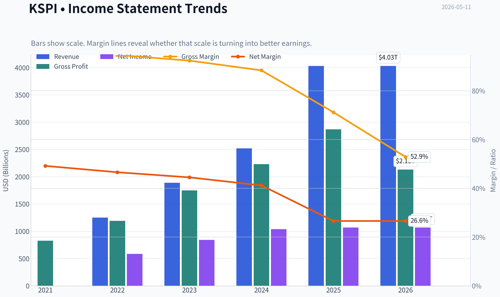

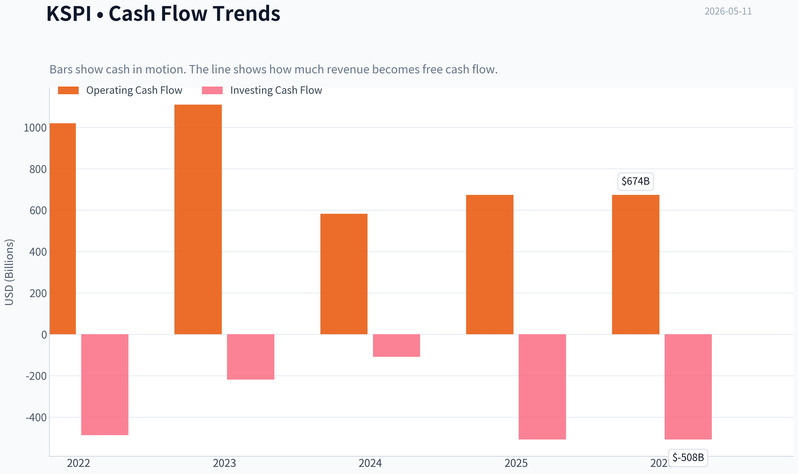

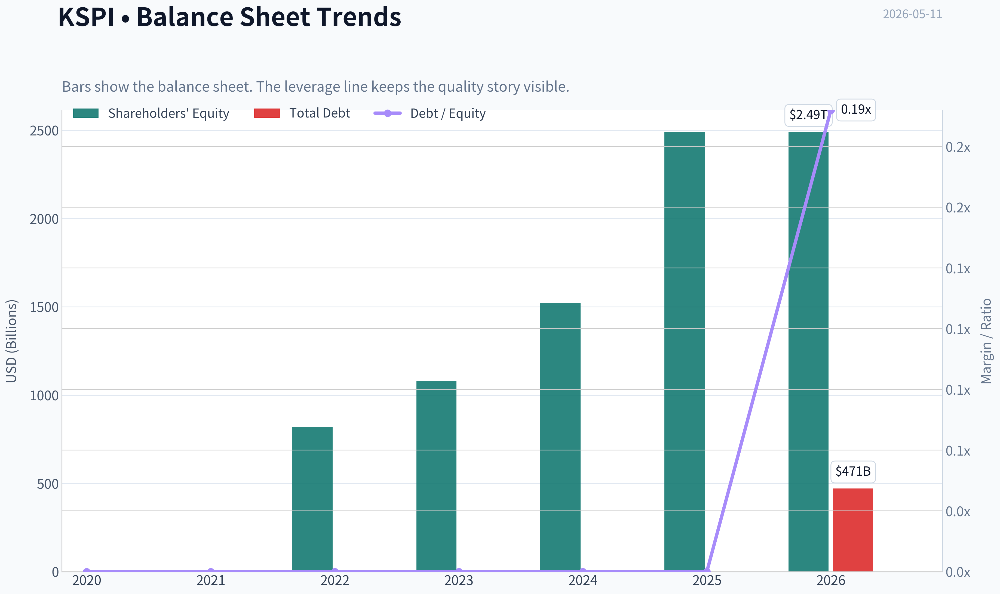

This graph tracks the profitability and return metrics (ROE, ROIC, Margins) of **KSPI** over the past decade, highlighting capital efficiency trends.

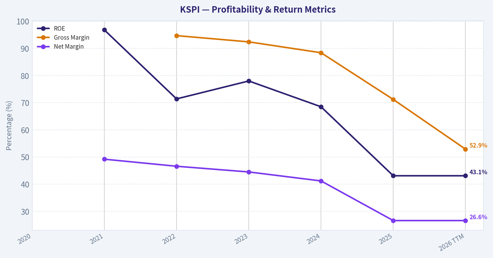

This chart illustrates the financial health of **KSPI** over the last 10 years, mapping cash equivalents and free cash flow against total obligations (Debt).

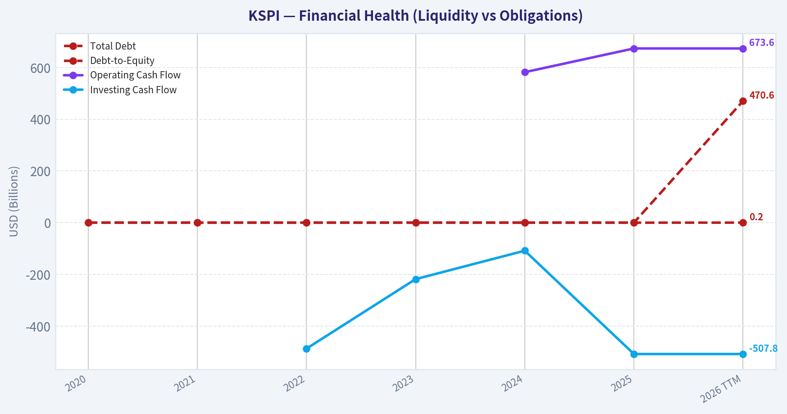

---

### Intrinsic Value Analysis (Buffett)

> *Following Warren Buffett's value investing philosophy: Circle of Competence, Economic Moat, Management Quality, and Margin of Safety.*

#### Intrinsic Value Snapshot

Price is what you pay. Intrinsic value is what the business may be worth based on the cash it can create for owners over time. We show a range, not one magic number.

- Current Price: $87.81
- Value Range: $341,785.25 to $890,085.13

##### Owner Earnings (Buffett Method)
- Net Income: $1,073,177,000,000.00
- Depreciation & Amortization: N/A
- Capital Expenditures: N/A
- Working Capital Changes: $-734,099,000,000.00
- Owner Earnings: $1,807,276,000,000.00

##### Intrinsic Value
###### Buffett Method
Uses owner earnings. Stricter, and usually more conservative.
- Conservative: $341,785.25
- Average: $341,785.25
- Optimistic: $890,085.13
- Discount Rate: 10.0%

#### KSPI Buffett-Style Value Analysis (lite)

The model did not produce a full tool-grounded value analysis this run. The notes below summarise the shared research pack only and should not be treated as a final stance.

Shared research pack summary for KSPI:
- Current price: $88
- Market cap: $16.67B
- P/E: 7.3114066
- ROE: 43.1%
- Gross margin: 71.2%
- Revenue growth YoY: 59.8%
- FCF yield: N/A
- Current ratio: N/A

Latest earnings coverage:

#### Latest Earnings Coverage for KSPI ## KSPI News (via Finnhub API), from 2026-01-11 to 2026-05-11: ### Transcript : Joint Stock Company Kaspi.kz, Q1 2026 Earnings Call, May 11, 2026 (Finnhub, 2026-05-11) Presentation Operator MessageOperator Hello, everybody, and welcome to the Kaspi First Quarter 2026 Financial Results. My name is Elliot, and I'll be your coordinator today. [Operator Instructions] ### Kaspi.kz Q1 EPS $2.77 Beats $2.41 Estimate, Sales $2.257B Beat $2.120B Estimate (Benzinga, 2026-05-11) Kaspi.kz (NASDAQ:KSPI) reported quarterly earnings of $2.77 per share which beat the analyst consensus estimate of $2.41 by 14.94 percent. This is a 6.95 percent increase over earnings of $2.59 per share from the same ### Joint Stock Company Kaspi.kz 2026 Q1 - Results - Earnings Call Presentation (SeekingAlpha, 2026-05-11) 2026-05-11. The following slide deck was published by Joint Stock Company Kaspi.kz in conjunction with their 2026 Q1 earnings call. ### Kaspi Bank : 1Q 2026 Results (Finnhub, 2026-05-11) Kaspi.kz 1Q 2026 Financial Results Almaty, Kazakhstan, 11 May 2026 - Joint Stock Company Kaspi.kz today published its unaudited consolidated IFRS financial results for the... ### Earnings Scheduled For May 11, 2026 (Benzinga, 2026-05-11) ### Kaspi Bank : 1Q 2026 Presentation (Finnhub, 2026-05-11) 1Q 2026 Results Kazakhstan Türkiye 1 11 May 2026 Revenue +31% YoY,... ### Kaspi…

Structured guru tracking:

#### Guru 13F Tracking for KSPI No tracked guru currently shows a recent structured 13F match for this ticker. ### Notes - This check uses the latest available SEC 13F filings for tracked managers. - 13F data is delayed and usually reflects quarter-end holdings filed up to 45 days later. - No structured 13F matches found.
#### Valuation Bridge

This bridge places the current market price beside each intrinsic value lens so readers can see whether upside depends on one method or shows up across several methods.

| Scenario | Intrinsic Value / Share |
| --- | ---: |
| Buffett Method | $341,785.25 |
| Current Price | $87.81 |

#### Key Takeaways

If one method is far above the others, the upside case depends on a specific modelling assumption. When several methods cluster together, the valuation story is more robust.

#### Valuation Visuals

This comparison chart from *Latest Earnings Snapshot* stacks current figures against historical benchmarks for **KSPI**, making it easy to see where the company trades relative to its own averages.

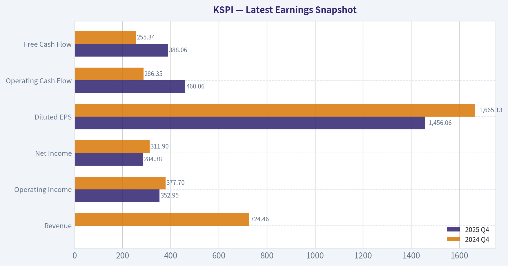

This comparison chart from *Current vs Historical Average Comparison* stacks current figures against historical benchmarks for **KSPI**, making it easy to see where the company trades relative to its own averages.

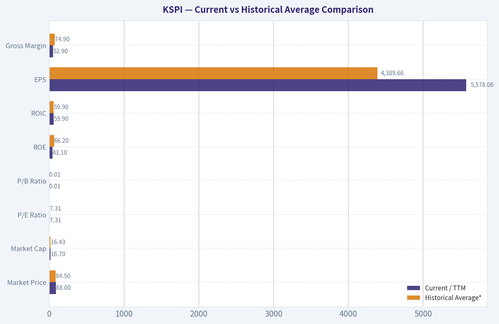

This comparison chart from *DCF Valuation: Buffett-Style Owner Earnings* stacks current figures against historical benchmarks for **KSPI**, making it easy to see where the company trades relative to its own averages.

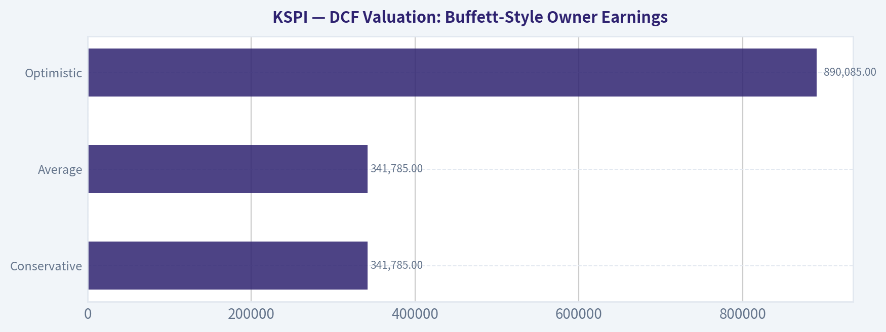

The following chart maps the **KSPI** Owner Earnings DCF valuation scenarios (Conservative, Average, Optimistic) to visually represent the margin of safety based on intrinsic value calculations.

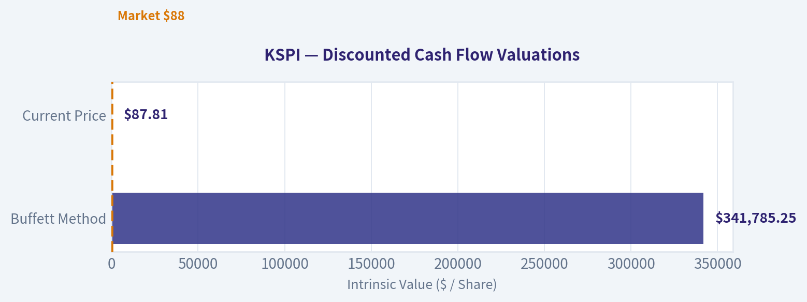

This comparison chart from *Snapshot* stacks current figures against historical benchmarks for **KSPI**, making it easy to see where the company trades relative to its own averages.

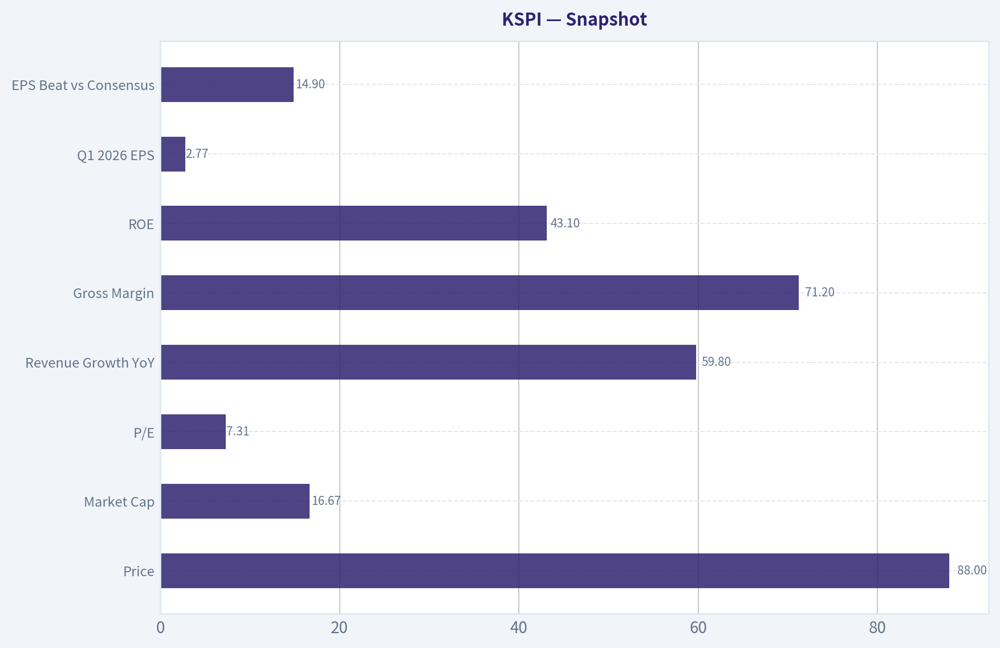

---

### Trend & Growth Analysis (Lynch/Druckenmiller/Fisher)

> *Following Peter Lynch's GARP, Stanley Druckenmiller's macro-aware approach, and Philip Fisher's scuttlebutt methodology.*

ANALYST STANCE: **ADVOCATE**

#### KSPI Growth Report

#### 1. Lynch Classification

| Item | Assessment |
|---|---|
| Category | **Fast Grower** |
| Why | Revenue growth remains well above Lynch's 15-25% fast-grower threshold |
| Fit for framework | Strong fit: profitable, high ROE, high gross margin, still compounding from ecosystem expansion |

Key Takeaways: KSPI clearly fits the fast-grower bucket, which is the main hunting ground for multi-bagger ideas. It combines rapid top-line expansion with strong profitability, which is rarer than growth stories that still burn cash. That makes it more interesting than a typical speculative emerging-market platform.

#### 2. The Story in 3 Bullets

| Simple Story | Explanation |
|---|---|
| Super app for Kazakhstan | KSPI bundles payments, marketplace, and fintech into one consumer ecosystem |
| Monetization deepens with usage | More users and transactions create more lending, commerce, and fee opportunities |
| Optionality beyond core market | New verticals and Türkiye expansion create additional runway if execution holds |

Key Takeaways: The core story is easy to explain: KSPI is a digital consumer platform that gets more valuable as people use more of its services. Growth is not dependent on one narrow product, because payments, commerce, and finance reinforce one another. The upside case depends on whether this ecosystem can keep deepening in Kazakhstan and scale abroad.

#### 3. Snapshot

| Metric | Value |
|---|---|
| Price | **$88** |
| Market Cap | **$16.67B** |
| P/E | **7.31x** |
| Revenue Growth YoY | **59.8%** |
| Gross Margin | **71.2%** |
| ROE | **43.1%** |
| Q1 2026 Revenue Growth | **+31% YoY** |
| Q1 2026 EPS | **$2.77** |
| EPS Beat vs Consensus | **+14.9%** |

Key Takeaways: The headline numbers are striking: very high growth, strong margins, and a single-digit earnings multiple. That combination usually signals either a mispricing or a material risk the market is discounting. For a growth investor, this is exactly the kind of setup worth underwriting carefully rather than dismissing.

#### 4. TAM Analysis and 10x Test

| TAM Dimension | Assessment |
|---|---|
| Core TAM | Kazakhstan consumer payments, e-commerce, digital banking, consumer finance |
| Adjacent TAM | Merchant services, logistics, digital government/payment rails, cross-border commerce |
| Geographic optionality | Türkiye offers meaningful upside if localized execution succeeds |
| 10x test | **Plausible over long duration**, but likely requires both deeper wallet share and international expansion |

Key Takeaways: KSPI likely still has runway because it is not just a lender or just a marketplace; it is attacking several large consumer financial and commerce pools at once. A pure Kazakhstan-only 10x may be demanding, but a broader ecosystem plus cross-border execution makes the long runway case more credible. The key question is whether management can export the playbook, not whether the home market is already fully monetized.

#### 5. Revenue Growth Trend

| Period / Data Point | Growth Read |
|---|---|
| Shared pack YoY revenue growth | **+59.8%** |
| Q1 2026 revenue growth | **+31% YoY** |
| Pattern | **Still strong, but appears decelerating from very high prior growth** |
| Interpretation | High-quality growth remains intact; investors should monitor whether growth stabilizes in the 25-35% range or slips further |

Key Takeaways: Growth is still excellent, but the signal is mixed because the latest quarter grew slower than the broader shared-pack figure. That does not break the thesis, but it means this is no longer a clean acceleration story. The next few quarters matter: stable 25-35% growth would still be very strong, while continued slowdown would reduce the ten-bagger case.

#### 6. Unit Economics

| Metric | Status |
|---|---|
| Gross Margin | **71.2% - Excellent** |
| ROE | **43.1% - Exceptional** |
| LTV/CAC | Not disclosed in pack |
| NRR | Not applicable / not disclosed like SaaS |
| Rule of 40 | Not directly applicable, but growth + margin profile appears strong |
| Capital efficiency | Appears high given profitability and returns profile |

Key Takeaways: Even without classic SaaS metrics, KSPI shows unusually attractive economics through its high gross margin and very high return on equity. That suggests the ecosystem has real monetization power and operating leverage. The absence of detailed CAC and retention data is a limitation, but the reported profitability suggests the underlying model is economically sound.

#### 7. Inflection Point Assessment

| Inflection Type | Evidence | Verdict |
|---|---|---|
| Product cycle | Ecosystem model continues to deepen across payments, marketplace, and fintech | Positive |
| TAM expansion | Türkiye adds a new leg of growth beyond Kazakhstan | Positive |
| Margin inflection | Already highly profitable; less about inflection, more about durability | Neutral-positive |
| Market share inflection | Likely still gaining wallet share in domestic ecosystem | Positive |
| Competitive inflection | Local scale and brand likely remain advantages | Positive |

Key Takeaways: The most important inflection is TAM expansion, especially if international efforts can become material. Domestic growth alone supports a good company, but international replication is what could create a much larger outcome. This remains more of a "platform deepening plus optionality" story than a pure near-term margin inflection.

#### 8. Macro Setup

| Macro Factor | Assessment |
|---|---|
| Secular trend exposure | Digital payments, fintech, e-commerce |
| Rate sensitivity | Fintech and growth names generally benefit from stable/falling rates |
| Geographic risk | Emerging-market and country-specific risk is meaningful |
| FX/political sensitivity | Higher than U.S. large-cap peers |
| Overall macro wind | **Mixed but net favorable for business demand, less favorable for multiple expansion certainty** |

Key Takeaways: KSPI rides strong long-term trends like digital payments and online commerce, which is a major tailwind. But unlike a U.S. software stock, it carries meaningful country, currency, and policy risk. That likely explains why the valuation is so low despite the growth profile.

#### 9. Fisher 15 Points Score

| Fisher Area | Score (1-5) | Notes |
|---|---:|---|
| Market potential | 5 | Large ecosystem opportunity |
| New products | 4 | Strong expansion history |
| R&D effectiveness | 4 | Product innovation appears solid |
| Sales organization | 4 | Strong consumer adoption |
| Profit margin | 5 | Excellent gross economics |
| Margin improvement | 4 | Strong durability, though less data on trend |
| Labor relations | 3 | Limited disclosure in pack |
| Executive relations | 4 | No major issues flagged |
| Management depth | 4 | Execution has been strong |
| Cost/accounting | 4 | Results appear disciplined |
| Outstanding moat | 5 | Ecosystem, brand, embedded finance |
| Long-range outlook | 4 | Strong, with geographic caveat |
| Dilution risk | 4 | No major concern evident |
| Candor | 3 | Limited transcript detail here |
| Integrity | 4 | No red flags in supplied materials |

| Total | **61 / 75** | **GOOD** |

Key Takeaways: KSPI scores well on the things Fisher cared most about: market potential, product strength, margins, and differentiated advantages. The weaker areas are mostly disclosure-related, not obvious operational defects. That keeps it in the "good" rather than "outstanding" bucket for now.

#### 10. Valuation Analysis

| Valuation Method | Result | Read |
|---|---|---|
| P/E | **7.31x** | Very low for this growth level |
| PEG | **~0.12** using 59.8% growth | Extremely attractive, even if growth normalizes materially |
| P/S | Not provided directly | Would likely still screen reasonable given market cap and revenue run rate |
| Market view implied | Market is pricing in heavy geopolitical / durability / governance discount | Likely |

Key Takeaways: On raw numbers, KSPI looks extremely cheap. A PEG near 0.12 is the kind of reading that usually only appears when the market is skeptical about sustainability or external risk. If the business merely maintains healthy growth rather than collapsing, there is room for major rerating.

#### 11. Scenario Analysis

| Scenario | Assumption | Implied View |
|---|---|---|
| Bear | Growth falls sharply, valuation stays compressed due to country risk | Stock remains cheap trap |
| Base | Growth settles in mid-20s to low-30s, earnings compound, multiple modestly rerates | Attractive upside |
| Bull | Türkiye and ecosystem adjacencies scale, growth re-accelerates, market rerates to higher EM fintech multiple | Multi-year outsized return potential |

Key Takeaways: The bear case is not hard to imagine, and that is why the stock is cheap. But the base case already looks favorable if KSPI can simply keep compounding with decent execution. The bull case comes from successful expansion and a market perception shift, not just from current operations.

#### 12. Growth Investor Scorecard

| Criterion | Weight | Score | Weighted |
|---|---:|---:|---:|
| The Story | 10% | 4.5 | 0.45 |
| TAM & Runway | 20% | 4.0 | 0.80 |
| Revenue Growth | 20% | 4.0 | 0.80 |
| Unit Economics | 15% | 4.5 | 0.68 |
| Competitive Position | 10% | 4.0 | 0.40 |
| Management Quality | 10% | 4.0 | 0.40 |
| Macro Setup | 5% | 3.0 | 0.15 |
| Profitability Path | 5% | 4.5 | 0.23 |
| Valuation | 5% | 5.0 | 0.25 |

| Total Score |  |  | **4.16 / 5.0** |

Key Takeaways: KSPI scores above the threshold for an Advocate rating, driven by its combination of growth, profitability, and valuation. The main thing holding it back from an even higher score is macro and country risk, not the business model itself. In other words, this looks more like a risk-discounted compounder than an overhyped story stock.

#### 13. Position Size Stance

| Stance | View |
|---|---|
| Rating | **ADVOCATE** |
| Position sizing | **Medium position** rather than maximum size |
| Why not full size | Country risk, governance perception, and possible growth deceleration |
| Why own it | Rare mix of fast growth, high margins, high ROE, and low multiple |

Key Takeaways: The right expression is likely a meaningful but not oversized position. The business quality and valuation justify ownership, but the market is signaling real non-fundamental risks that should be respected. This is not a "bet the farm" setup, but it is too attractive to ignore.

#### 14. Key Risks and Catalysts

| Risks | Catalysts |
|---|---|
| Kazakhstan country/political risk | Sustained 25%+ revenue growth |
| Currency / EM multiple discount | Continued earnings beats |
| Growth deceleration | Successful Türkiye scaling |
| Regulatory changes in fintech/lending | Expanded monetization across ecosystem |
| Market skepticism around governance / disclosure | Rerating toward peer multiples |

Key Takeaways: The risks are mostly external and perception-driven rather than obvious signs of a broken business. The catalysts are straightforward: keep growing, keep beating, and prove expansion works. If management executes, the stock does not need perfection to work from this valuation.

#### Bottom Line

KSPI looks like a **fast-growing, highly profitable digital ecosystem** trading at a valuation more typical of a no-growth financial. That mismatch is the opportunity. The main debate is not whether the business is good; it is whether country, regulatory, and durability concerns deserve such a steep discount.

For now, the setup fits a Lynch-Druckenmiller-Fisher overlap well: **easy story, strong economics, long runway, cheap valuation, and clear optionality**. The stock is not risk-free, but on the available data it deserves an **ADVOCATE** stance.

If you want, I can next do a **full bull/base/bear intrinsic value model for KSPI** using earnings and revenue scenarios.

#### Growth & Scorecard Visuals

This comparison chart from *Revenue Growth Trend* stacks current figures against historical benchmarks for **KSPI**, making it easy to see where the company trades relative to its own averages.

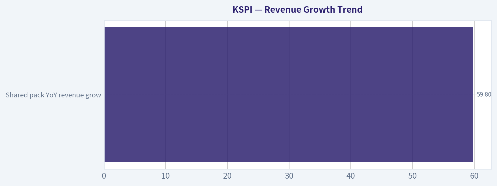

---

### Market Technical Analysis

#### KSPI Technical Analysis Report

I selected these 8 indicators for KSPI because they give broad, non-redundant coverage of trend, momentum, volatility, and risk:

- `close_50_sma`
- `close_200_sma`
- `close_10_ema`
- `macd`
- `rsi`
- `boll_ub`
- `boll_lb`
- `atr`

This mix is well suited to KSPI's current setup because the stock has shifted from a weak March base into a sharp April breakout, then cooled into a higher-level consolidation. The key question is no longer whether momentum existed - it clearly did - but whether the stock is now digesting gains constructively or beginning a broader reversal.

---

#### Price Structure Overview

From November through early March, KSPI largely traded in a broad, uneven range with multiple failed advances. The stock pushed above 80 in early January, but that move faded, and by mid-March price had fallen as low as the high-60s. That decline mattered because it established a meaningful intermediate trough near the 67 to 70 area.

The technical character changed in April. Price moved from the low-70s into a strong acceleration phase, culminating in a sharp burst from 77.84 on April 13 to 91.81 on April 20. That was not a routine drift higher; it was an impulsive upside repricing supported by a major volume expansion on April 20. Since then, KSPI has not fully retraced the breakout, which is important. Instead, it has consolidated mostly in the mid-80s after briefly peaking near 97 intraday.

The latest close available is 85.90 on 2026-05-08. That places KSPI well above its medium-term trend measure but below the post-spike highs, which is typical of a digestion phase after a fast rally.

#### Trend Analysis

The moving average structure remains constructive on the intermediate horizon.

- `close_50_sma` on 2026-05-08: **77.29**
- `close_200_sma` on 2026-05-08: **78.08**
- `close_10_ema` on 2026-05-08: **85.84**
- Last close: **85.90**

Price is trading materially above both the 50-day and 200-day averages. That is the clearest evidence that the broader trend has improved. The 50-day average has also turned upward decisively, rising from roughly 72.3 in early April to 77.3 by early May. That slope change matters more than the absolute level because it signals that the April rally was strong enough to alter the medium-term trajectory, not just create a short-lived spike.

The 200-day average, by contrast, is still relatively flat around 78. That tells us the longer-term trend has improved less dramatically than the short- and medium-term picture. In practical terms, KSPI has moved into bullish territory above the 200-day benchmark, but the long-term trend is not yet deeply mature. It is more accurate to describe the stock as being in an emerging-to-established uptrend rather than a fully seasoned long-cycle advance.

The `close_10_ema` at 85.84 is almost identical to the latest close, which shows that near-term price is balancing around its short-term trend line. This often happens during consolidation. If price begins to hold above the 10 EMA again and push higher, it would support trend continuation. If price starts closing persistently below it, that would suggest the post-breakout consolidation is deepening.

---

#### Momentum Analysis

Momentum remains positive, but it has clearly cooled from the April surge.

- `macd` on 2026-05-08: **2.65**
- `rsi` on 2026-05-08: **57.41**

The MACD is still firmly positive, which means the shorter EMA structure remains stronger than the longer EMA structure. However, the MACD has been declining from a late-April high above 4.0. That is a subtle but important shift. It does not mean the trend has turned bearish; rather, it indicates upside momentum has decelerated. The rally is no longer in its explosive phase.

This kind of MACD rollover while staying above zero often corresponds to one of two outcomes:
1. a healthy pause in an ongoing uptrend, or
2. the first stage of a larger pullback if buyers fail to reassert control.

RSI confirms the same story with slightly different nuance. RSI surged into overbought territory during the strongest April push, reaching above 79 on April 20 and staying elevated above 70 shortly after. Since then, RSI has normalized to the upper-50s. That cooling is actually constructive as long as price does not break down sharply, because it relieves overbought conditions without requiring a full trend reset.

So the momentum picture is best described as **bullish but no longer hot**. The stock has transitioned from expansion to digestion.

---

#### Volatility and Band Behavior

The Bollinger Bands and ATR show that KSPI experienced a volatility expansion during the breakout, followed by gradual compression.

- `boll_ub` on 2026-05-08: **91.81**
- `boll_lb` on 2026-05-08: **78.78**
- `atr` on 2026-05-08: **3.21**

The upper Bollinger Band has rolled slightly lower from around 94 in early May to 91.8, while the lower band has risen sharply from about 70.3 on May 1 to 78.8 on May 8. That narrowing reflects a volatility contraction after the April breakout. In other words, the market is compressing after an outsized move.

Current price at 85.90 sits almost exactly in the middle-upper portion of the band range, not near the upper extreme and not near the lower edge. That positioning suggests KSPI is no longer overextended in the immediate sense. It also means traders should be careful about assuming either imminent breakout or imminent collapse solely from band location. Instead, the band compression suggests the next directional move could become important once price resolves the current range.

ATR around 3.21 remains elevated relative to March readings near 2.6 to 2.8. So while volatility has come off its peak, KSPI is still a stock with wider-than-baseline daily movement. That has direct trading implications: stops that are too tight are still vulnerable to normal noise, and position sizing should reflect that.

---

#### Fine-Grained Interpretation of the Current Regime

KSPI appears to be in a **post-breakout consolidation above rising intermediate support**.

That is a favorable regime, but not a risk-free one. Several details stand out:

1. **The April impulse was unusually strong.**
   Fast moves like the jump into April 20 often require time to digest. The fact that KSPI has spent multiple sessions between roughly 84 and 89 instead of collapsing back into the 70s is a constructive sign.

2. **The stock is holding above all major moving averages that matter for trend traders.**
   This keeps the burden of proof on bears. A true bearish shift would likely require a break of the 10 EMA first, then a loss of the low-80s, and ultimately deterioration toward the 50-day average near the upper-70s.

3. **Momentum has slowed but has not reversed.**
   Positive MACD and mid-to-upper RSI readings indicate that internal strength remains, even though the easy part of the rally has passed.

4. **Volatility compression is building after expansion.**
   This often precedes a directional move. Traders should pay close attention to whether the next expansion occurs above the high-80s or below the mid-80s.

5. **The 200-day SMA is below price but still fairly flat.**
   That means strategic investors can say KSPI has regained long-term footing, but they should also recognize that this improvement is still relatively recent. The stock is not yet so far into a mature uptrend that downside risk becomes trivial.

---

#### Trading Implications

For **trend-following traders**, the setup still leans constructive as long as KSPI remains above the 10 EMA and clearly above the 50 SMA. Pullbacks toward the mid-80s that stabilize could be viewed as continuation tests rather than breakdowns.

For **swing traders**, the key issue is whether consolidation resolves upward. A breakout back through the upper-80s would suggest a retest of the April high zone is possible. By contrast, a failure through the low-to-mid 80s would increase the odds of a deeper retracement toward the high-70s to low-80s region.

For **risk managers**, ATR near 3.2 means daily fluctuation remains meaningful. This is not a low-volatility name right now. Trade sizing and stop placement should account for multi-dollar movement as normal.

For **mean-reversion traders**, the stock is no longer as stretched as it was in late April. That reduces the attractiveness of aggressive shorting based on overbought readings alone. The better mean-reversion opportunities likely come from reactions at defined range edges rather than from chasing weakness in the middle of the current band.

---

#### Bottom Line

KSPI's technical condition is notably stronger than it was in March. The stock has broken above its medium- and long-term averages, its 50-day trend is rising, and price is consolidating at a much higher level after an impulsive April advance. Momentum has cooled from overbought extremes, but it remains positive rather than bearish. Volatility has compressed from breakout highs, which suggests the market is transitioning from explosive trend to decision phase.

The most likely near-term interpretation is **constructive consolidation within an improving trend**. The main bullish argument is that price is holding elevated territory without major technical damage. The main caution is that upside momentum has softened enough that a break below short-term support could trigger a more meaningful retracement than traders might expect after such a fast run.

#### Indicator Summary Table

| Indicator | Latest Value | Signal | Interpretation |
|---|---:|---|---|
| close_50_sma | 77.29 | Bullish | Price is well above the 50-day SMA, confirming a rising intermediate trend. |
| close_200_sma | 78.08 | Bullish / Early long-term recovery | Price is above the 200-day SMA, but the average itself is still fairly flat, so long-term improvement is real but still recent. |
| close_10_ema | 85.84 | Neutral-to-bullish | Price is sitting almost exactly on the 10-day EMA, showing near-term consolidation rather than breakdown. |
| macd | 2.65 | Bullish but fading | MACD remains positive, though it has declined from late-April highs, signaling slower upside momentum. |
| rsi | 57.41 | Neutral bullish | RSI has cooled from overbought territory and now suggests healthy digestion rather than exhaustion. |
| boll_ub | 91.81 | Resistance zone | Upper band marks the nearby upside pressure area; a move toward it would test whether momentum can re-expand. |
| boll_lb | 78.78 | Support zone | Lower band has risen sharply, reflecting improving underlying support after the breakout. |
| atr | 3.21 | Elevated volatility | Daily movement remains large enough to require wider stops and disciplined position sizing. |

Key Takeaways: KSPI is still technically strong because price remains above both the 50-day and 200-day averages, but the stock is no longer in the explosive phase of its rally. Momentum has cooled into a healthier, more balanced state, and volatility is compressing after a major breakout. The current setup looks more like consolidation within an uptrend than outright trend failure, though a break below short-term support would deserve attention.

---

### News & Events Analysis

#### KSPI Weekly Trading & Investment Report

Kaspi.kz remains a fundamentally strong, high-ROE, high-margin fintech/platform story, but the key near-term driver is now its **fresh Q1 2026 earnings beat** and what that implies for growth durability across payments, marketplace, and fintech activity. Based on the shared research pack, the stock trades around **$88**, with a **$16.67B market cap** and a relatively modest **P/E near 7.3**, which is inexpensive versus many global fintech/platform peers given reported **ROE of 43.1%**, **gross margin of 71.2%**, and **revenue growth of 59.8% YoY**. For traders, the setup is less about valuation discovery and more about whether the latest results can sustain rerating momentum despite EM/macro risk.

#### Latest earnings: Q1 2026 was the key catalyst

The latest reported period is **Q1 2026**, released **May 11, 2026**. This satisfies the requirement for the most recent quarterly earnings review.

Headline coverage in the shared pack showed:

- **EPS: $2.77**, versus **$2.41 consensus**
- **Revenue: $2.257B**, versus **$2.120B consensus**
- EPS was also reported as **up 6.95%** versus the prior-year quarter's **$2.59**

The company presentation excerpt in the shared pack also pointed to **revenue up 31% YoY**, which suggests strong top-line momentum in local reporting terms, even if ADR/newswire figures can differ because of translation, presentation, or consolidation format.

What changed versus prior period or expectations:

- **Versus consensus:** clear beat on both revenue and EPS, implying better-than-expected operating leverage and/or stronger monetization.
- **Versus prior year:** EPS growth was positive but much slower than the headline revenue growth metrics, which may imply a mix shift, investment spending, funding costs, or normalization in some profitability drivers.
- **Versus market expectations:** the beat likely reduces near-term concern that growth is decelerating sharply after prior strong expansion.
- **Interpretation:** the result supports the thesis that Kaspi is still executing across its ecosystem, but investors should watch whether earnings growth can re-accelerate in line with revenue growth, rather than relying only on GMV/payment volume expansion.

#### Earnings snapshot

| Item | Q1 2026 | Comparison | Read-through |
|---|---:|---:|---|
| EPS | $2.77 | vs $2.41 consensus | Solid earnings beat |
| Revenue | $2.257B | vs $2.120B consensus | Top-line beat, demand/monetization held up |
| EPS YoY | +6.95% | vs Q1 2025 EPS of $2.59 | Positive, but slower than revenue growth |
| Revenue growth (company presentation excerpt) | +31% YoY | vs prior-year quarter | Strong operating momentum |
| Release date | May 11, 2026 | Latest available period | Fresh catalyst for shares |

Key Takeaways: Kaspi's first-quarter 2026 report was clearly better than expected on both revenue and earnings. The most important nuance is that revenue growth appears much faster than EPS growth, which suggests investors should watch margins and cost trends closely even though the quarter itself was a positive surprise.

#### Company-specific view over the past week

The most important company-specific development in the last week is the **earnings release itself**, including the earnings call and presentation published on May 11. That means price action in the immediate sessions ahead is likely to be driven by:

- management commentary on Kazakhstan consumer activity,
- payments and marketplace volume trends,
- any update on Türkiye exposure and execution,
- margin/funding-cost outlook,
- and confidence in sustaining current growth after a beat.

The shared pack also notes **no recent structured 13F guru match**, so there is not an obvious new institutional signal from tracked value/fund managers. That does not mean institutions are absent; it just means there is no fresh structured 13F datapoint to lean on.

#### Market context and macro backdrop

For KSPI, macro matters through three channels more than for a typical U.S. internet stock:

1. **Kazakhstan domestic demand and credit conditions**
   - Strong consumption and digital penetration help payments, marketplace activity, and fintech product uptake.
   - Any tightening in credit or consumer stress would hit sentiment quickly.

2. **Emerging-market risk appetite**
   - Even with strong fundamentals, EM fintech names can trade with global risk sentiment, dollar strength, and geopolitical premium/discount shifts.
   - A low headline P/E can stay low if investors demand an EM discount.

3. **Regional currency and policy sensitivity**
   - FX translation can distort ADR-reported growth.
   - If local-currency performance is strong but FX weakens, international investors may see less impressive USD optics.

Given the company's strong profitability metrics, the main debate is not whether the business is high quality, but whether investors are willing to pay more for a Kazakhstan-centered platform amid global macro uncertainty.

#### Trading implications

Near-term trading stance:

- **Bullish factors:** fresh earnings beat, still-strong reported revenue growth, high ROE, high gross margin, and low P/E relative to growth.
- **Caution flags:** slower EPS growth than some revenue metrics imply, likely sensitivity to macro/FX, and potential investor hesitation around EM geopolitical and liquidity discounts.

What traders should watch next:

- post-earnings estimate revisions,
- management guidance tone on the call,
- any commentary on consumer credit quality or funding costs,
- and whether the market rewards the beat with multiple expansion or dismisses it as already priced in.

A favorable setup would be: **upward EPS revisions plus stable macro tone**, which could justify rerating from the current earnings multiple. A weaker setup would be: **strong volume growth but margin compression**, leading the market to treat the quarter as lower quality than the headline beat suggests.

#### Investment view

For medium-term investors, KSPI still screens attractively as a profitable growth platform rather than a speculative fintech. The combination of **43.1% ROE**, **71.2% gross margin**, and **sub-8x earnings multiple** is notable. The core question is whether this discount is temporary mispricing or a rational reflection of country, currency, and governance risk. After Q1 2026, the bull case has improved tactically because the company delivered a clean beat; however, sustained upside likely requires proof that profit growth can better track revenue growth over subsequent quarters.

#### Summary table

| Category | What happened | Why it matters for investors/traders |
|---|---|---|
| Latest earnings | KSPI reported **Q1 2026** results on May 11 with EPS and revenue both above consensus | Positive immediate catalyst; supports near-term sentiment |
| Growth quality | Revenue growth remained strong, but EPS growth was more moderate | Focus shifts to margin sustainability and operating leverage |
| Valuation | P/E around **7.3** despite high ROE and strong margins | Leaves room for rerating if macro and execution remain stable |
| Business quality | ROE **43.1%**, gross margin **71.2%**, revenue growth **59.8% YoY** from shared pack | Indicates unusually strong economics for a platform/fintech name |
| Key risk | EM macro, FX, policy/geopolitical discount, and profitability mix | Could cap multiple expansion even after a beat |
| Trading setup | Watch estimate revisions, call commentary, and post-earnings price confirmation | Determines whether the beat becomes a sustained trend or a short-lived reaction |

Key Takeaways: The central story is straightforward: Kaspi just delivered a better-than-expected first quarter, and the stock still looks inexpensive on earnings. The opportunity is a possible rerating, but that depends on whether investors gain confidence that margins and earnings growth can keep up with the company's still-strong revenue expansion.

---

### Guru Attention Analysis

> *Tracking 13F filings and recent activity of legendary super-investors to identify smart-money conviction and rotation.*

#### KSPI Guru Ownership Check

Using the canonical structured 13F source, **no tracked guru currently shows a recent disclosed position in KSPI**.

| Guru / Fund | Latest 13F Status for KSPI | Action | Position Size | Portfolio Weight | Recent Change | Timing | SEC Verification |
|---|---|---:|---:|---:|---:|---|---|
| Warren Buffett / Berkshire Hathaway | No position detected in latest 13F filing | - | - | - | - | Latest available 13F | No match in structured 13F results |
| Seth Klarman / Baupost Group | No position detected in latest 13F filing | - | - | - | - | Latest available 13F | No match in structured 13F results |
| Mohnish Pabrai / Pabrai Investment Funds | No position detected in latest 13F filing | - | - | - | - | Latest available 13F | No match in structured 13F results |
| Bill Ackman / Pershing Square | No position detected in latest 13F filing | - | - | - | - | Latest available 13F | No match in structured 13F results |
| Stanley Druckenmiller / Duquesne Family Office | No position detected in latest 13F filing | - | - | - | - | Latest available 13F | No match in structured 13F results |
| Steve Cohen / Point72 | No position detected in latest 13F filing | - | - | - | - | Latest available 13F | No match in structured 13F results |
| Michael Burry / Scion Asset Management | No position detected in latest 13F filing | - | - | - | - | Latest available 13F | No match in structured 13F results |

**Key Takeaways:** None of the primary tracked super-investors in the structured 13F database currently disclose a KSPI position. That means there is no credible evidence here of a recent guru-led buy, hold, trim, or exit in KSPI based on the latest available SEC filings.

#### What this means

- **No guru signal:** There is currently **no structured 13F-based endorsement or warning signal** from the tracked managers for KSPI.
- **Do not over-interpret absence:** This does **not** mean KSPI is unattractive; it only means these particular U.S.-reporting gurus do not currently show a disclosed position.
- **Coverage limitations matter:** KSPI is a Kazakhstan-based company, and some global investors or non-U.S. vehicles may not appear in U.S. 13F data.

#### Confidence and limitations

- **High confidence** in the statement that **no tracked guru position is detected in the latest structured 13F coverage**.
- **Low confidence** in any broader claim about all sophisticated investors, because 13F only captures certain U.S.-reportable long equity holdings and is backward-looking.

#### Bottom line

For KSPI, the guru-tracking result is simple: **no tracked 13F guru currently holds or recently reported activity in the stock.** If you want, I can next shift from guru ownership to a **fundamental investor-style view of KSPI** using the latest Q1 2026 results and valuation metrics.

---

### Options Market Analysis

> *Reading options flow - put/call ratios, IV skew, and unusual activity - to gauge institutional positioning and event-driven risk.*

#### KSPI Options Positioning Report
*Date: 2026-05-11*

KSPI's options tape shows a **split but ultimately cautious setup**: **open interest is put-heavy**, which points to existing downside protection or bearish positioning, while **recent trading volume leans call-heavy**, suggesting some near-term upside speculation. With no standout unusual flow and only moderate liquidity, the cleaner read is that institutions remain **defensive**, even if traders are probing for upside.

#### Put/Call Ratio Analysis

| Expiry | Call OI | Put OI | Put/Call OI Ratio | Call Vol | Put Vol | Put/Call Vol Ratio |
|---|---:|---:|---:|---:|---:|---:|
| 2026-05-15 | 1,054 | 2,568 | 2.44 | 78 | 39 | 0.50 |
| 2026-06-18 | 2,947 | 2,222 | 0.75 | 81 | 180 | 2.22 |
| 2026-09-18 | 1,392 | 2,400 | 1.72 | 343 | 63 | 0.18 |
| **Near-term total** | **5,393** | **7,190** | **1.33** | **502** | **282** | **0.56** |

**Key Takeaways:** KSPI's aggregate **put/call OI ratio of 1.33** is well above the rough neutral baseline of **0.7**, which signals a market already carrying meaningful downside protection. However, the **put/call volume ratio of 0.56** shows recent flow has tilted toward calls, especially because September call volume is strong. That mix usually means traders are testing upside, but the larger existing positioning remains more defensive than bullish.

Interpretation:
- **OI ratio 1.33**: materially above neutral, indicating **elevated put ownership** versus calls.
- **Volume ratio 0.56**: recent activity favors calls, but not enough to fully overturn the bearish/hedged OI backdrop.
- By expiry:
  - **May 15**: heavily put-skewed OI (**2.44**) but call-led volume, which can imply short-dated bounce attempts against a hedged backdrop.
  - **June 18**: near-neutral OI (**0.75**) but put-led volume (**2.22**), indicating some nearer event/risk hedging.
  - **Sept 18**: put-heavy OI (**1.72**) yet very strong call volume, suggesting longer-dated upside speculation or positioning for recovery.

#### Implied Volatility Assessment

| Expiry | ATM Call IV | ATM Put IV | IV Read |
|---|---:|---:|---|
| 2026-05-15 | 55.2% | 53.3% | Elevated near-term, call IV slightly richer |
| 2026-06-18 | 41.5% | 53.1% | Put IV notably richer |
| 2026-09-18 | 40.1% | 54.5% | Strong put premium / downside skew |

**Key Takeaways:** Near-term IV is **elevated**, especially in the front expiry, which suggests the market expects meaningful price movement even if no single unusual trade confirms a catalyst. The skew shifts more clearly defensive beyond the nearest expiry, with **puts carrying much higher IV than calls** in June and September. That pattern usually reflects persistent demand for downside protection rather than pure upside enthusiasm.

IV conclusions:
- **Front-week ATM IV ~53%-55%** is fairly elevated for a single-stock options chain and implies traders are paying up for near-term movement.
- **Skew is mixed in the nearest expiry**:
  - For **May 15**, call IV is slightly above put IV, which can reflect short-dated upside chasing or less immediate crash concern.
- **Skew turns clearly negative/defensive in June and September**:
  - June: puts **53.1%** vs calls **41.5%**
  - September: puts **54.5%** vs calls **40.1%**
- This is a **steep put skew**, a classic sign of **downside fear / protection demand**.
- I do **not** have a confirmed catalyst from the options dataset alone, so I would describe IV as **elevated with event-risk characteristics**, but without asserting a specific event.

#### Unusual Options Activity

| Observation | Result |
|---|---|
| Volume > 5x Open Interest contracts | None detected in near-term expirations |
| Fresh aggressive directional flow | Not evident from screen |
| Institutional "tell" quality | Limited |
| Confidence from flow analysis | Moderate-to-low due to lack of standout prints |

**Key Takeaways:** There are **no contracts with volume greater than 5x open interest**, so there is no strong evidence of a fresh, aggressive institutional bet in the near-term chain. That absence matters: it lowers conviction in any narrative built from volume alone. In KSPI, the positioning signal comes more from the **shape of open interest and volatility skew** than from headline-grabbing flow.

Interpretation:
- No obvious "smart money" sweep or opening print stands out.
- Without volume materially exceeding OI, we cannot confidently claim a new large directional trade.
- This makes the chain feel more like a **hedged/positioned market** than one reacting to a fresh information edge.

#### Open Interest Concentration

The provided dataset gives **aggregate OI by expiry**, but **not strike-by-strike OI concentrations**, so exact pin levels, max pain, and gamma walls **cannot be calculated precisely** from the available feed.

| Expiry | Call OI | Put OI | Positioning Read |
|---|---:|---:|---|
| 2026-05-15 | 1,054 | 2,568 | Front expiry is put-heavy; can create defensive pinning bias |
| 2026-06-18 | 2,947 | 2,222 | More balanced, with calls slightly dominating OI |
| 2026-09-18 | 1,392 | 2,400 | Longer-dated downside protection remains substantial |

**Key Takeaways:** While we do not have strike-level granularity, the expiry-level open interest still shows where positioning is concentrated. The **May and September expiries are put-heavy**, which suggests traders are more focused on downside management than upside extension in those windows. June is more balanced, so it may be less restrictive than the other expiries.

Practical read:
- **May 15** likely exerts the biggest near-term defensive influence because put OI is large relative to calls.
- **June 18** is the most balanced expiry and may allow cleaner directional movement if spot begins trending.
- **September 18** suggests the market is still carrying medium-dated caution.

#### Overall Options Sentiment Signal

| Category | Signal |
|---|---|
| Directional read | **BEARISH** |
| Confidence level | **Moderate** |
| Primary driver | **Put-heavy open interest and persistent downside IV skew** |
| Offsetting factor | **Recent call volume has improved, especially farther out** |

**Key Takeaways:** My final read is **BEARISH**, not because traders are panic-buying puts today, but because the market is still structurally set up with **more puts than calls and a clear premium on downside volatility**. The recent call activity softens the negativity, but it does not outweigh the broader defensive posture embedded in OI and skew.

Why bearish, specifically:
- **Put/Call OI ratio of 1.33** is meaningfully above neutral.
- **June and September put IV are much richer than call IV**, signaling downside protection demand.
- No unusual bullish flow appears strong enough to overturn that setup.
- Call volume is encouraging, but in the absence of strong fresh opening activity, it looks more like **speculative probing** than a decisive institutional bullish turn.

#### Bottom Line

KSPI's options market is sending a **cautiously bearish** message. The strongest signals are **elevated put ownership and pronounced downside skew**, which usually reflect institutional hedging or skepticism about near-term upside durability. There is some call interest developing, especially in longer-dated trading volume, but until that turns into more decisive fresh flow or the put skew relaxes, the options market still looks **defensive rather than constructive**.

#### Summary Table

| Metric | Reading | Interpretation |
|---|---|---|
| Put/Call Ratio | **OI: 1.33 / Volume: 0.56** | Existing positioning is defensive, but recent trading volume leans bullish |
| IV Level | **Near-term ATM IV ~53%-55%; later call IV ~40% / put IV ~53%-55%** | Elevated implied movement, especially with richer downside premium |
| Skew Direction | **Put skew in June and September** | Clear downside fear / hedge demand |
| Unusual Activity | **None flagged** | No high-conviction fresh institutional bet visible |
| Overall Signal | **BEARISH** | Put-heavy structure and downside skew outweigh call-volume improvement |

**Key Takeaways:** The summary is straightforward: KSPI's options chain is not screaming panic, but it is clearly **tilted defensively**. The market is pricing downside risk more aggressively than upside opportunity, which keeps the overall signal **bearish with moderate confidence**.

---

## Research Team Commentary

> *The Research Manager synthesizes the Bull vs Bear debate into action-free commentary. This is a pre-risk view, not the final stance.*

The strongest bull argument is that KSPI looks unusually cheap relative to the quality of the business on the surface. A 7.3x P/E alongside 43% ROE, 71% gross margin, strong recent revenue growth, and another quarterly beat is not a common combination. If this is truly a dominant local digital ecosystem spanning payments, marketplace, and finance, then the market may be lumping it in with lower-quality emerging-market financials and applying too much fear. From a Buffett lens, the appeal is obvious: a business with habit-based usage, multi-product reinforcement, high returns on capital, and possible double compounding from earnings growth plus multiple normalization.

The strongest bear argument is that the case may be relying too heavily on flattering headline metrics without enough proof of durable owner-earnings quality. The most important yellow flag is the gap between revenue growth and profit growth: revenue up about 60%, net income up only about 3%, EPS up about 7%. For a business with meaningful financial exposure, that divergence matters more than the gross margin figure. It raises the possibility that incremental growth is lower quality, more capital intensive, more credit-sensitive, or more exposed to future normalization than the bull case admits. Add country concentration, regulatory risk, and incomplete balance-sheet detail, and the low multiple may be justified rather than irrational.

My balanced takeaway is this: KSPI may well be mispriced, but it does not yet clear the Buffett bar for "high-certainty wonderful business" based on the evidence here. The cheapness is interesting, the economics are impressive, and the platform story could be real. But predictable long-term earnings power is still not proven enough, especially given the financial-services component and the recent profit-growth compression. In other words, this is not a clear avoid because the valuation and operating franchise are too compelling to dismiss, but it is also not yet an advocate because the margin of safety depends on earnings durability that has not been fully demonstrated.

Core takeaway: KSPI looks like a potentially high-quality franchise trading at a discounted price, but the critical unresolved question is whether current earnings are durable and truly reflective of intrinsic value. The stock is cheap enough to merit close attention, yet not proven enough to deserve full Buffett-style conviction today.

Rationale: When I try to apply Buffett's framework honestly, I have to separate "excellent metrics" from "excellent certainty." KSPI scores well on apparent business quality: high margins, high ROE, strong growth, and a platform ecosystem that could create a moat. That is the part the market may be underestimating. But Buffett's best ideas are not just statistically cheap; they also have highly understandable and resilient earning power. Here, the mix of payments, commerce, and lending is attractive strategically but also clouds normalization. The weak conversion of revenue growth into profit growth is exactly the kind of thing I should not wave away. I have seen too many situations where optically cheap, high-ROE financial or fintech hybrids looked mispriced until the cycle exposed that returns were less durable than advertised. Without stronger evidence on credit quality, funding resilience, regulatory exposure, and true free-cash or owner-earnings power, the prudent stance is to stay interested but demanding.

Monitoring plan over the next 1 to 4 quarters: First, watch whether earnings growth begins to catch up with revenue growth. If revenue keeps compounding but net income remains sluggish, that would weaken the quality case. Second, monitor any disclosures on credit performance, loss rates, underwriting trends, and reserve builds. If credit costs stay well controlled through growth, confidence improves materially. Third, watch segment mix: are payments and marketplace contributing a larger share of profits versus lending? That would make earnings more predictable and deserving of a higher multiple. Fourth, monitor margins for signs of structural compression from competition, regulation, or lower-quality growth. Fifth, look for balance-sheet clarity, capital ratios, funding mix, and management commentary on risk controls. Sixth, assess management behavior: are they focused on disciplined per-share value creation or simply maximizing growth optics? Finally, watch for any country-specific regulatory or political developments that could impair the local moat or economics.

If the next few quarters show sustained profit growth, healthy credit quality, and continued ecosystem monetization without major balance-sheet strain, I would be open to upgrading this. If instead profit growth remains muted, credit metrics soften, or regulation/funding issues emerge, the "cheap" valuation may prove to be a trap.

Final stance: WATCH

---

## Value Investing Team Commentary

> *The Investor translates the research view into an investment thesis before risk review. This is still not the final stance.*

KSPI is the kind of situation that should attract a value investor's attention, but not yet unconditional trust.

At first glance, the numbers are striking: roughly 7.3x earnings, 43% ROE, 71% gross margin, strong recent revenue growth, and another quarterly beat on both EPS and revenue. Those are not the statistics of an obviously weak business. If this were a plain-vanilla low-quality bank or a speculative fintech, you would not normally expect that combination of profitability and scale. That suggests there may indeed be a real franchise here.

The likely bullish contrarian insight is that the market may be painting KSPI with too broad a brush. Because it operates in Kazakhstan and has financial-services exposure, investors may be assigning an "emerging market/fintech/bank" discount without fully crediting the platform nature of the business. If KSPI truly has a deeply embedded ecosystem across payments, marketplace, and finance, then customer behavior may be more durable than the market assumes. In that case, current pessimism could be creating an opportunity: a good business priced more like a risky one.

But Buffett-style investing requires more than attractive surface metrics. It requires confidence in the durability and quality of earnings. That is where caution is still warranted. The biggest issue in the handoff is the mismatch between revenue growth and profit growth: revenue up nearly 60% YoY, but net income up only about 3%, and EPS up about 7%. For a business with lending exposure, that gap matters. It may indicate heavier reinvestment, changing mix, temporary cost pressure, or accounting timing. But it could also signal that marginal growth is less valuable than headline revenue suggests.

That distinction is crucial. A wonderful business can grow revenue rapidly and still destroy value if growth increasingly depends on lower-quality lending, higher credit risk, or more aggressive customer acquisition economics. High gross margins are encouraging, but they do not settle the question of owner earnings. In financial or fintech hybrids, the true test is whether profits remain resilient through cycles, credit conditions, and regulation.

The recent earnings beat is positive, but a single quarter's beat should not be mistaken for proof of long-term economics. Markets often overreact to quarter-to-quarter results, and value investors should instead ask: what will this business likely earn, on average, over the next 5 to 10 years? On that question, the available evidence is promising but incomplete.

The moat case is plausible. A payments-commerce-finance ecosystem can become self-reinforcing: more users attract more merchants, more merchant activity feeds payments volume, more data improves underwriting, and the combined convenience raises switching costs. If that flywheel is genuine, KSPI may possess a local network effect and habit-based moat that is hard to replicate. That would justify a much higher valuation than 7x earnings.

However, the moat must be separated from country risk and regulatory dependence. A business can be dominant locally and still deserve a discount if the operating environment is less predictable, capital rules can change abruptly, or macro shocks disproportionately affect returns. That does not make the business bad; it just means the margin of safety must be larger.

Management also matters enormously here. A business combining commerce, payments, and credit can look exceptional when management allocates capital prudently and underwrites conservatively. It can also unravel if growth discipline fades. So far, the reported numbers suggest competent execution, but I would want more evidence on credit quality, reserve philosophy, funding resilience, and whether management emphasizes per-share intrinsic value rather than simply platform expansion.

The selective contrarian view, then, is this: the market may be underestimating KSPI's ecosystem strength, but investors should also resist the opposite mistake of romanticizing the platform story. Cheapness alone is not a moat, and high ROE alone is not proof of durable earning power. The opportunity may be real precisely because the situation is uncomfortable and not fully understood. But Buffett's best investments are not merely cheap and interesting; they are understandable and trustworthy.

So what would change my view? I would want to see over the next few quarters:
- profit growth improving closer to revenue growth,
- stable or strong credit performance,
- evidence that payments and marketplace economics are contributing more of the earnings mix,
- no meaningful deterioration in funding or capital strength,
- and management commentary that reinforces discipline rather than promotional optimism.

If those factors come through, today's valuation could look plainly too low. If they do not, the low multiple may simply be the market correctly pricing uncertainty.

For now, KSPI appears to be a potentially very good business selling at a price that already reflects meaningful fear. That is exactly the sort of place where a value investor should pay attention. But attention is not the same as action. The business has enough quality signals to stay on the radar, yet not enough demonstrated earnings durability to warrant full conviction today.

**ANALYST STANCE: WATCH**

KSPI is intriguing because the valuation is low relative to its apparent franchise quality, and the market may be overly discounting it as just another emerging-market financial stock. Still, the weak conversion of strong revenue growth into profit growth, combined with country and financial-risk exposure, means intrinsic value is not yet clear enough for a Buffett-style endorsement. I would watch closely for stronger evidence of durable earnings, disciplined risk management, and resilient ecosystem economics before becoming more aggressive.

---

## Deep Values Commentary

> *The Risk Management Team debates and the Risk Judge provides the final action-free verdict. This section determines the final ADVOCATE / WATCH / AVOID stance.*

### Executive Briefing

KSPI is **interesting, not yet high-certainty**. The bull case is strong on valuation and apparent franchise quality: about **7.3x P/E**, **43% ROE**, **71% gross margin**, nearly **60% revenue growth**, and a recent **EPS/revenue beat**. But the core Buffett-style risk issue remains unresolved: **revenue is compounding far faster than profit** (**~59.8% revenue growth vs ~3.2% net income growth**), which is exactly the kind of mismatch that can signal weaker earnings quality in a payments/lending hybrid. For a long-term investor focused on avoiding permanent impairment, that matters more than short-term momentum or headline cheapness.

My conclusion: **WATCH**. KSPI may be mispriced, but it does not yet offer the level of earnings durability, balance-sheet clarity, and business predictability required for full conviction. Best course: keep it on a short leash, consider only modest exposure if your process allows, and demand proof that profit quality is catching up to revenue growth.

### Key Arguments from the Analysts

### Risky Analyst's strongest points
- KSPI screens as unusually cheap for its visible quality:
  - **P/E 7.31**
  - **ROE 43.1%**
  - **Gross margin 71.2%**
  - **Revenue growth 59.8%**
- Recent operating momentum was strong:
  - **EPS $2.77 vs $2.41 consensus**
  - **Revenue $2.257B vs $2.120B consensus**
- If KSPI is truly a dominant local ecosystem across payments, marketplace, and finance, then the market may be over-discounting country/financial complexity.
- A rerating from ~7x earnings to even a more modest multiple could create meaningful upside before considering ongoing growth.

### Safe Analyst's strongest points
- The central warning is the **large divergence between top-line growth and bottom-line growth**:
  - **Revenue +59.8%**
  - **Net income +3.2%**
  - **EPS +6.95%**
- In a business with financial exposure, this divergence can indicate:
  - lower-quality incremental growth,
  - rising credit costs,
  - reserve pressure,
  - funding intensity,
  - or less durable returns than headline metrics suggest.
- A low multiple is not automatically a margin of safety if the **"E" in P/E is not dependable**.
- Country, regulatory, and funding risks are not one-time facts; they can remain or intensify.

### Neutral Analyst's strongest points
- Both sides are partly right:
  - the business looks too good superficially to dismiss,
  - but the unresolved earnings-quality issue is too important to ignore.
- The practical compromise is not "full conviction" and not "ignore it," but **measured exposure with strict monitoring**.
- Position sizing can bridge uncertainty better than false precision.

### Rationale

Under Buffett's framework, the key question is not whether KSPI is volatile or unloved. It is whether the business faces a meaningful chance of **permanent impairment** through weak underwriting, regulatory disruption, funding strain, or structurally lower earnings quality than reported metrics imply.

The bullish evidence is real. Businesses do not usually show **43% ROE**, **71% gross margin**, and strong revenue growth by accident. The latest quarter also weakens any simplistic "something is broken" argument. On the surface, this does resemble the kind of fear-driven discount that can create attractive long-term returns.

But the strongest counterpoint is stronger still: in a hybrid commerce/payments/finance business, **profit conversion matters more than optical growth**. A business growing revenue nearly 60% while barely growing net income is not yet proving the kind of predictable owner earnings that Buffett would demand for a "wonderful business" purchased with confidence. The market may indeed be wrong - but it may also be correctly signaling skepticism toward the durability of those earnings.

That distinction is critical. Many investor mistakes come from confusing:
- **high historical returns** with **durable future economics**,
- **cheapness** with **margin of safety**,
- and **story strength** with **earnings certainty**.

The lesson to apply here is simple: do not let flattering summary metrics overpower unresolved questions about earnings quality. In finance-linked businesses especially, headline profitability can look excellent right before a cycle or regulatory shift exposes weaker foundations. That does not mean KSPI is such a case - only that we do not yet have enough evidence to dismiss the risk.

### Refined Investor Plan

Your original plan already lands in the right place: **interested, but demanding**. I would refine it slightly:

- Keep the base stance at **WATCH**.
- If your framework allows partial entries, treat this as a **small, probationary position only**, not a full Buffett-style commitment.
- Do **not** upgrade to conviction based only on low valuation, one earnings beat, or technical strength.

### What must improve before an upgrade
1. **Profit growth must begin to better track revenue growth**
   - If revenue keeps compounding while profit lags badly, the quality case weakens.
2. **Credit quality and reserve behavior must remain sound**
   - Watch delinquencies, charge-offs, reserve builds, underwriting trends.
3. **Segment mix should become clearer**
   - More profit contribution from payments/marketplace vs lending would improve predictability.
4. **Balance-sheet and funding resilience must be visible**
   - Capital ratios, funding mix, liquidity, and management risk controls matter.
5. **Regulatory and country risks must remain manageable**
   - Especially if they affect lending economics, capital rules, or platform dominance.

### What would justify an upgrade to ADVOCATE
- Sustained profit growth catching up materially,
- stable credit performance through growth,
- clearer evidence that ecosystem economics are broad-based rather than credit-driven,
- and no meaningful deterioration in funding or regulation.

### What would push it toward AVOID
- Continued weak profit conversion,
- worsening credit metrics,
- rising reserve/funding stress,
- or regulatory changes that impair economics or the moat.

### Final Stance

**WATCH**

#### Final Stance Scorecard

This scorecard converts the final research view into a weighted decision frame. It does not replace the narrative judgement, but it makes the main drivers of the verdict easier to scan.

| Criterion | Score | Weight | Commentary |
| --- | ---: | ---: | --- |
| Business Quality | 4.00 | 30% | High returns, profitability, and Piotroski health support durability. |
| Valuation Support | 4.33 | 30% | Blends current price against available intrinsic value anchors and valuation ratios. |
| Financial Strength | 3.67 | 20% | Balance-sheet resilience reflects leverage and liquidity staying within safe ranges. |
| Growth Durability | 3.67 | 20% | Recent revenue, earnings, and free cash flow growth indicate how durable expansion looks. |
| TOTAL / FINAL STANCE | 3.97 | 100% | WATCH |

#### Key Takeaways

The weighted score lands at **3.97 / 5.0**, while the final stance remains **WATCH**. This is useful as a quick calibration aid rather than a mechanical signal.

#### Risk Summary

Higher scores indicate more risk pressure. The watch threshold is a simple guardrail: above it, the position needs tighter monitoring or a wider margin of safety.

| Dimension | Current Score | Watch Threshold | Commentary |
| --- | ---: | ---: | --- |
| Business Quality | 2.00 | 3.00 | High returns, profitability, and Piotroski health support durability. |
| Valuation Support | 1.67 | 3.00 | Blends current price against available intrinsic value anchors and valuation ratios. |
| Financial Strength | 2.33 | 3.00 | Balance-sheet resilience reflects leverage and liquidity staying within safe ranges. |
| Growth Durability | 2.33 | 3.00 | Recent revenue, earnings, and free cash flow growth indicate how durable expansion looks. |

#### Key Takeaways

This view helps readers separate *where* the risk sits: valuation, business quality, balance sheet, or growth durability. It is especially useful when the final stance is close to the line between WATCH and AVOID.
