# KSPI Deep Value Intelligence

**Analysis Date:** 2026-10-21

## Critical Disclaimer

*This analysis is generated by Deep Value Intelligence, an AI-powered multi-agent investing framework. Education & research only - not financial advice, not a financial advisor.*

---

## Table of Contents

1. Intelligence Summary
2. Analyst Team Reports
   - Fundamentals Analysis
   - Intrinsic Value Analysis (Buffett)
   - Trend & Growth Analysis (Lynch/Druckenmiller/Fisher)
   - Market Technical Analysis
   - Options Market Analysis
3. Research Team Commentary
4. Value Investing Team Commentary
5. Deep Values Commentary

---

## Intelligence Summary

### Thesis + Conditions

**Core Thesis:** ## Executive Briefing

**Key Risks:**
- Kaspi appears to be a profitable, high-return local ecosystem priced for substantial country, currency, credit, and governance risk. At **$93.51 and 8.52x earnings**, the market is not demanding heroic growth, while **41.5% ROE, 9.3% ROA, and 43.6% reported revenue growth** support the case for a genuine franchise rather than a merely cheap lender.
- ### Risky analyst: the valuation-growth mismatch supports immediate participation
- This analyst is right that demanding complete certainty would likely mean paying a higher price later. The earlier KSPI review showed that persistent emerging-market risks should influence sizing without automatically blocking participation.

**Confidence:** Low

---

## Analyst Team Reports

### Fundamentals Analysis

#### Latest Earnings Snapshot

*Most recent reported quarter anchored on 2026 Q2, with prior-year comparison when available.*

| Metric | 2026 Q2 | 2025 Q2 | YoY Change |
| --- | ---: | ---: | ---: |
| Revenue | $1.10T | $969.51B | +13.9% |
| Operating Income | $615.61B | $550.71B | +11.8% |
| Net Income | $256.73B | $257.33B | -0.2% |
| Diluted EPS | $1346.00 | $1343.00 | +0.2% |
| Operating Cash Flow | $711.42B | $449.65B | +58.2% |
| Free Cash Flow | $655.01B | $398.19B | +64.5% |

Key Takeaways: This snapshot anchors the most recent reported quarter before the narrative analysis. It helps readers separate long-run business quality from whatever changed in the latest earnings print.

#### 5-Year Financial Metrics for KSPI

*All values below are computed deterministically from raw data - not estimated by AI.*

*Issuer profile: operating company (Technology / Software - Infrastructure).*

#### 5-Year Financial Metrics
*Annual rows come from reported financial statements. The final TTM row is computed from the latest four quarters.*

| Metric | 2021 | 2022 | 2023 | 2024 | 2025 | 2026 TTM |
| --- | --- | --- | --- | --- | --- | --- |
| Market Price | N/A | N/A | N/A | $89 | $73 | $94 |
| Market Cap | N/A | N/A | N/A | $18.00B | $14.86B | $17.84B |
| P/E Ratio | N/A | N/A | N/A | 8.12 | 7.24 | 0.02 |
| P/B Ratio | N/A | N/A | N/A | 6.19 | 2.98 | 0.01 |
| ROE | 87.7% | 71.6% | 78.0% | 76.8% | 41.5% | 40.5% |
| ROIC | 263.4% | 354.2% | 396.5% | 160.0% | 80.8% | 54.1% |
| EPS | $5.24 | $6.59 | $9.66 | $10.93 | $10.11 | $5568.06 |
| Revenue | $2.09B | $2.78B | $4.22B | $5.44B | $7.81B | $4.40T |
| Gross Profit | $1.95B | $2.60B | $3.85B | $4.79B | $5.53B | $2.28T |
| Gross Margin | 93.6% | 93.5% | 91.3% | 88.0% | 70.9% | 51.8% |
| Operating Margin | 59.8% | 56.7% | 53.4% | 50.6% | 32.9% | 36.4% |
| Net Income | $1.02B | $1.28B | $1.86B | $2.23B | $2.07B | $1.07T |
| Net Margin | 48.8% | 46.0% | 44.0% | 41.1% | 26.5% | 24.3% |
| Revenue Growth | N/A | 33.1% | 52.0% | 28.9% | 43.6% | 56279.7% |
| Net Income Growth | N/A | 25.5% | 45.1% | 20.4% | -7.3% | 51562.4% |
| Free Cash Flow Growth | N/A | N/A | N/A | N/A | N/A | N/A |
| Total Book Value | $1.16B | $1.79B | $2.38B | $2.91B | $4.99B | $2.64T |
| Total Assets | N/A | $11.17B | $15.04B | $16.06B | $22.18B | $12.06T |
| Total Debt | N/A | N/A | N/A | N/A | N/A | $689.30B |
| Debt-to-Equity | N/A | N/A | N/A | N/A | N/A | 0.26 |
| Cash & Equivalents | $786.9M | $1.34B | $1.81B | $1.19B | $1.81B | $998.61B |
| Shareholders' Equity | $1.16B | $1.79B | $2.38B | $2.91B | $4.99B | $2.64T |
| Operating Cash Flow | $165.9M | $2.23B | $2.44B | $1.25B | $1.30B | $1.15T |
| Investing Cash Flow | $683.2M | $-1.06B | $-481.5M | $-232.8M | $-979.9M | $-920.14B |
| Free Cash Flow | N/A | N/A | N/A | N/A | N/A | $952.97B |
| FCF Margin | N/A | N/A | N/A | N/A | N/A | 21.6% |
| Dividends / Share | N/A | $1095.85 | $2958.50 | $3184.47 | $0.00 | $0.00 |

#### Profitability Metrics
- Return on Equity (ROE): 41.5%
- Return on Invested Capital (ROIC): N/A
- Return on Assets (ROA): 9.3%
- Gross Margin: 70.9%
- Operating Margin: 32.9%
- Net Profit Margin: 26.5%

#### Liquidity Metrics
- Current Ratio: N/A
- Quick Ratio: N/A

#### Leverage Metrics
- Debt-to-Equity Ratio: N/A
- Interest Coverage Ratio: 1.61
- Net Debt: N/A

#### Growth Metrics (Year-over-Year)
- Revenue Growth: 43.6%
- Net Income Growth: -7.3%
- Free Cash Flow Growth: N/A
- Revenue CAGR (3-Year): 41.2%
- Revenue CAGR (5-Year): N/A

#### Valuation Metrics
- P/E Ratio (TTM): 8.52
- Forward P/E: 0.01
- Price-to-Book: 3.56
- Price-to-Sales: N/A
- PEG Ratio: 0.20
- EV/EBITDA: N/A
- Free Cash Flow Yield: N/A
- Earnings Yield: 11.7%

#### Owner Earnings (Buffett Method, Code-Computed)
- Net Income: $2.07B
- + Depreciation & Amortization: N/A
- - Capital Expenditures: N/A
- - Working Capital Changes: $-734.10B
- = **Owner Earnings: $736.17B**

#### Intrinsic Value (Code-Computed)
- Current Price: $94
- **Headline Intrinsic Value (business-model routed): $648,559**
  Business model: operating company - weighted blend [Damodaran FCFF + owner-earnings DCF] (operating_company)
  Model spread (min-max across DCFs): $217,783 - $1.0M
  Margin of safety vs. price (headline): 100.0%
  Routing note: General operating company: balanced blend of Damodaran FCFF and the owner-earnings DCF with a reverse-DCF sanity check.
- Buffett Method (Owner Earnings):
  Conservative: $189,614
  Average: $217,783
  Optimistic: $217,783
- Damodaran FCFF (WACC + margins + reinvestment):
  Conservative: $972,504
  Average: $1.0M
  Optimistic: $1.8M
  Monte Carlo band (P10-P90): $872,587 - $1.9M (median $1.2M)
  P(intrinsic value > price): 100.0%
- Reverse-DCF: price implies ~-50.0%/yr owner-earnings growth for 10y; trailing 3y was N/A, 5y N/A.

#### Piotroski F-Score: 5/9
- Positive Net Income: PASS
- Positive Operating Cash Flow: PASS
- ROA Improvement: FAIL
- Cash Flow > Net Income: FAIL
- Decreasing Debt: PASS
- Improving Current Ratio: FAIL
- No Dilution: PASS
- Improving Gross Margin: FAIL
- Improving Asset Turnover: PASS

ANALYST STANCE: **WATCH**

#### Executive Summary

Kaspi.kz JSC (KSPI) combines a large Kazakhstan-based payments ecosystem with marketplace and fintech operations. The business has historically produced exceptional growth, very high returns on equity and invested capital, and strong operating margins. However, the deterministic dataset contains severe TTM data-quality inconsistencies: 2026 TTM revenue is shown as $4.40 trillion versus $7.81 billion in 2025, EPS is $5,568.06 versus $10.11, and the TTM P/E is 0.02 while the separately reported current P/E is 8.52.

The apparent valuation discount is therefore attractive only after normalization. P/B is not a reliable primary valuation tool for this asset-light technology and platform business. The investment case should instead rely on normalized earnings, owner earnings, cash generation, country risk, currency risk, and the sustainability of margins.

#### Market Metrics and Data Quality

| Metric | Latest reported value | Historical context / interpretation |
|---|---:|---|
| Market price | $94 | 2025 price was $73; current price is approximately 28.8% above 2025 |
| Market capitalization | $17.77B-$17.84B | 2025 market cap was $14.86B; current value is approximately 20% higher |
| P/E ratio | 8.52 in the valuation summary; 0.02 in deterministic TTM row | The 0.02 TTM value is inconsistent with EPS, earnings, and market capitalization and should not be used |
| P/B ratio | 3.56 in valuation summary; 0.01 in deterministic TTM row | The 0.01 value is clearly inconsistent; P/B is not a dependable anchor for an asset-light platform |
| Earnings yield | 11.7% | Consistent with a normalized P/E near 8.5 |
| PEG ratio | 0.20 | Appears optically cheap, but depends on unusually strong historical growth and should not be accepted without normalization |

**Key Takeaways:** KSPI appears inexpensive on the credible valuation summary, but the deterministic TTM valuation fields contain clear unit or calculation errors. The current $94 price is below the supplied model-based intrinsic values, but those model outputs are also contaminated by the same extreme TTM figures. A normalized earnings valuation is more reliable than mechanically accepting the reported P/E or P/B.

#### Profitability and Operating Performance

| Metric | Latest annual value, 2025 | 2026 TTM row | 2021-2025 average | Interpretation |
|---|---:|---:|---:|---|
| ROE | 41.5% | 40.5% | 71.1% | Still excellent, but materially below the earlier exceptional range |
| ROIC | 80.8% | 54.1% | 251.0% | Remains strong, though falling sharply as reported margins and returns normalize |
| Revenue | $7.81B | $4.40T, inconsistent | $4.47B | 2025 is the latest credible comparable figure |
| Gross profit | $5.53B | $2.28T, inconsistent | $3.74B | Gross profit expanded strongly through 2025 |
| Gross margin | 70.9% | 51.8% | 88.5% | Significant compression from 93.6% in 2021 |
| Operating margin | 32.9% | 36.4% | 50.7% | Still attractive, but well below the 2021-2023 levels |
| Net income | $2.07B | $1.07T, inconsistent | $1.69B | 2025 earnings declined despite revenue growth |
| Net margin | 26.5% | 24.3% | 41.1% | Profitability has structurally weakened from prior highs |
| EPS | $10.11 | $5,568.06, inconsistent | $8.51 for 2021-2025 | TTM EPS cannot be used without correcting units |

**Key Takeaways:** KSPI remains a highly profitable business, with 2025 ROE of 41.5%, ROIC of 80.8%, and operating margin of 32.9%. However, returns and margins have clearly deteriorated from their extraordinary 2021-2023 levels. The combination of falling margins and a 7.3% decline in 2025 net income is the most important fundamental warning sign.

#### Growth Metrics

| Metric | Latest credible value | 2021-2025 average or comparable | Assessment |
|---|---:|---:|---|
| Revenue growth | 43.6% in 2025 | 39.4% average for 2022-2025 | Growth remains exceptionally strong |
| Net income growth | -7.3% in 2025 | 20.9% average for 2022-2025 | Earnings are lagging revenue growth |
| Free cash flow growth | Not available | Not available | Insufficient consistent historical data |
| Revenue CAGR | 41.2% over the reported three-year period | N/A | Strong platform expansion |
| 2026 TTM revenue growth | 56,279.7% | Not meaningful | Clearly distorted by inconsistent TTM units |
| 2026 TTM net income growth | 51,562.4% | Not meaningful | Clearly distorted by inconsistent TTM units |

**Key Takeaways:** Revenue growth is the strongest part of the historical record, with a reported 41.2% three-year CAGR and 43.6% growth in 2025. The concern is operating leverage in reverse: revenue grew rapidly, but net income declined. This suggests pressure from financing costs, credit provisions, mix changes, investment spending, regulation, or currency effects.

#### Balance Sheet and Financial Strength

| Metric | Latest credible value | Historical comparison | Assessment |
|---|---:|---:|---|
| Total book value | $4.99B in 2025 | $1.16B in 2021; $2.91B in 2024 | Strong long-term increase |
| Total assets | $22.18B in 2025 | $11.17B in 2022; $16.06B in 2024 | Substantial balance-sheet expansion |
| Total debt | Not consistently available historically | 2026 TTM shows $689.30B, inconsistent | TTM debt figure is incompatible with the rest of the dataset |
| Debt-to-equity | Not available on a reliable historical basis | 2026 TTM shows 0.26 | Potentially moderate leverage, but requires statement-level verification |
| Cash and equivalents | $1.81B in 2025 | $786.9M in 2021; $1.19B in 2024 | Cash has increased over the period but is below 2025 balance-sheet scale |
| Shareholders' equity | $4.99B in 2025 | Equal to reported book value | Equity base has expanded materially |
| Current ratio / quick ratio | Not meaningful or unavailable | Not available | Do not infer liquidity from missing ratios |

**Key Takeaways:** The credible 2025 balance sheet shows meaningful asset and equity growth, with $1.81 billion of cash and $4.99 billion of shareholder equity. Debt data is not sufficiently consistent to make a strong leverage conclusion, and the reported TTM debt and asset figures appear to be scaled incorrectly. KSPI's financial strength is promising but requires verification from the latest audited filing.

#### Cash Flow and Capital Allocation

| Metric | Latest reported value | Historical comparison | Interpretation |
|---|---:|---:|---|
| Operating cash flow | $1.30B in 2025 | $165.9M in 2021; $2.23B in 2022; $2.44B in 2023 | Cash generation has been volatile |
| Free cash flow | $952.97B in 2026 TTM | No reliable 2021-2025 series | TTM value is clearly unit-contaminated |
| FCF margin | 21.6% in 2026 TTM | No reliable historical series | Cannot be treated as validated |
| Owner earnings | $736.17B code-computed | No reliable comparable series | Not usable at face value because of inconsistent units |
| Dividends per share | $0 in 2025 and 2026 TTM | Dividends were reported in 2022-2024 | Dividend policy appears to have changed materially |

**Key Takeaways:** Operating cash flow is positive but much less consistent than reported net income and revenue growth. The computed TTM free cash flow and owner earnings are unusable without resolving the apparent billion-versus-trillion scaling problem. The elimination of dividends after 2024 may reflect a shift toward reinvestment, capital preservation, or a change in reporting policy; it should be investigated rather than automatically viewed as positive or negative.

#### Revenue Breakdown

The supplied deterministic dataset does not provide exact segment revenue amounts. Kaspi.kz's economically meaningful revenue sources are its integrated payments, marketplace, and fintech businesses, but assigning dollar amounts or percentages without the company's latest segment note would create unsupported estimates.

| Revenue Source | Amount ($M or $B) | % of Total |
|---|---:|---:|
| Payments ecosystem | Not disclosed in supplied dataset | N/A |
| Marketplace / e-commerce | Not disclosed in supplied dataset | N/A |
| Fintech / financial services | Not disclosed in supplied dataset | N/A |
| Other and intersegment items | Not disclosed in supplied dataset | N/A |
| Total reported 2025 revenue | $7.81B | 100% |

**Key Takeaways:** Kaspi's central competitive feature is the combination of payments, commerce, and financial services in one ecosystem. The absence of verified segment amounts prevents a precise revenue concentration analysis. Investors should obtain the latest annual report to determine which segment is driving growth and whether higher-margin payments revenue is being diluted by lower-margin or more credit-intensive activities.

#### Current Versus Historical Average

The comparison below uses 2021-2025 annual data where available. The malformed 2026 TTM figures are shown only as a data-quality observation, not as a valid operating comparison.

| Metric | Current credible comparison | 2021-2025 average | Difference from average | Interpretation |
|---|---:|---:|---:|---|
| ROE | 41.5% in 2025 | 71.1% | -29.6 percentage points | Still excellent, but normalized sharply lower |
| ROIC | 80.8% in 2025 | 251.0% | -170.2 points | Remains strong but prior figures were extraordinary |
| Revenue | $7.81B in 2025 | $4.47B | +74.8% | Large scale expansion |
| Gross margin | 70.9% | 88.5% | -17.6 points | Important deterioration |
| Operating margin | 32.9% | 50.7% | -17.8 points | Substantial profitability compression |
| Net margin | 26.5% | 41.1% | -14.6 points | Earnings quality has weakened |
| Revenue growth | 43.6% in 2025 | 39.4% | +4.2 points | Growth remains above its recent average |
| Net income growth | -7.3% in 2025 | 20.9% | -28.2 points | Major deviation and principal warning |
| Book value | $4.99B | $2.65B | +88.6% | Strong cumulative equity growth |
| Cash | $1.81B | $1.39B | +30.4% | Improved absolute liquidity |
| Operating cash flow | $1.30B | $1.48B | -12.2% | Below the five-year average |

**Key Takeaways:** KSPI has grown substantially in scale, book value, and cash, but its profitability is below the historical norm. The sharpest negative deviations are in gross margin, operating margin, ROE, ROIC, and net income growth. This pattern is consistent with a high-growth platform entering a more competitive, more regulated, or more capital-intensive phase.

#### Buffett-Style Qualitative Analysis

**Economic moat.** Kaspi's moat is primarily ecosystem-based rather than asset-based. A large installed user base can make payments, shopping, and financial services more convenient when integrated into one application. Network effects, customer data, merchant relationships, brand familiarity, and switching friction can reinforce one another. However, the moat is geographically concentrated, and local regulatory or economic conditions can affect all three business lines simultaneously.

**Financial strength.** The 2025 balance sheet shows $1.81 billion of cash and $4.99 billion of equity, which is constructive. The principal limitation is unreliable debt and liquidity data. A financial-services platform can also carry economic leverage through lending and credit exposure that is not fully captured by a simple debt-to-equity ratio.

**Predictability of earnings.** Revenue growth has been remarkably strong, but earnings are less predictable. Net income rose each year from 2021 through 2024 before falling 7.3% in 2025. Margins also contracted every year from 2021 through 2025. Buffett would likely distinguish between predictable user and transaction growth and less predictable credit, regulatory, and currency outcomes.

**Management and capital allocation.** Management has expanded the platform rapidly and generated very high historical returns. The decision to pay dividends in 2022-2024 and report zero dividends in 2025-2026 suggests a changing capital-allocation framework. The key question is whether retained capital can earn returns closer to historical ROIC levels or whether incremental growth now requires materially more capital.

**Quality of business.** The business remains high quality by conventional profitability standards, but quality is not identical to growth. The decline in gross margin from 93.6% to 70.9%, operating margin from 59.8% to 32.9%, and net margin from 48.8% to 26.5% demands explanation. A durable moat can coexist with temporarily lower margins, but a persistent trend would reduce intrinsic value.

#### Buffett-Style Owner Earnings DCF

The supplied automated DCF produces values from approximately $189,614 to more than $1 million per share. Those figures are not economically credible alongside a $94 share price and are driven by malformed TTM values such as $4.40 trillion of revenue and $952.97 billion of free cash flow. They should be treated as a diagnostic signal, not as investable fair values.

For a sanity check, a normalized owner-earnings proxy of approximately $1.0-$1.3 billion is used. This is deliberately conservative because the dataset does not provide a clean, multi-year free-cash-flow history. Shares outstanding are approximated from market capitalization divided by price:

- Approximate shares: $17.77B ÷ $94 = approximately 189 million shares.
- Discount rate: 10%.
- Terminal growth: 2.5%.
- Forecast period: 10 years.
- Growth fades toward the 2.5% terminal rate.
- Valuation is equity value divided by approximately 189 million shares.

| Scenario | Starting normalized owner earnings | Near-term growth assumption | Terminal growth | Estimated equity value | Approximate value per share |
|---|---:|---|---:|---:|---:|
| Conservative | $1.0B-$1.1B | 3% initially, fading toward 2.5% | 2.5% | $14B-$19B | $75-$100 |
| Average | $1.2B-$1.3B | Approximately 8% initially, fading toward 2.5% | 2.5% | $23B-$30B | $120-$160 |
| Optimistic | $1.3B-$1.5B | Approximately 12%-15% initially, fading toward 2.5% | 2.5% | $30B-$40B | $160-$210 |

**Key Takeaways:** A normalized DCF suggests a wide fair-value range because the clean owner-earnings base is uncertain and margins have been falling. The conservative case places the stock near its current value, while the average and optimistic cases show substantial upside if the ecosystem can restore durable growth without further margin erosion. The valuation is therefore attractive only if the 2025 decline in profitability is cyclical or investment-related rather than structural.

#### Valuation Assessment

At $94, KSPI trades near 8.5 times the credible reported earnings measure and offers an earnings yield of approximately 11.7%. That is an attractive headline valuation for a company growing revenue above 40% annually. Nevertheless, the low multiple may reflect legitimate risk premiums:

- Kazakhstan and broader emerging-market exposure.
- Currency volatility and potential translation losses.
- Regulatory risk affecting payments, lending, and marketplace operations.
- Credit-cycle and consumer-default risk.
- Declining gross, operating, and net margins.
- Uncertain dividend policy.
- Incomplete and internally inconsistent TTM financial data.
- Potential accounting or reporting differences across jurisdictions.

P/B should not be used as the decisive valuation metric. KSPI is an asset-light technology and platform business, and book value does not fully capture its network effects, customer relationships, data assets, or software economics. Conversely, high ROE can be overstated when equity is relatively small or when leverage and financial-services exposures are embedded in the business model.

#### Key Investment Insights, Risks, and Opportunities

| Category | Insight |
|---|---|
| Opportunity | Revenue growth remains exceptional, with 2025 growth of 43.6% and reported three-year CAGR of 41.2% |
| Opportunity | Current valuation near 8.5 times earnings could provide a substantial margin of safety if earnings normalize |
| Opportunity | Integrated payments, marketplace, and fintech services can create powerful cross-selling and retention advantages |
| Opportunity | Historical ROE and ROIC demonstrate strong economics when margins and capital efficiency are favorable |
| Risk | Gross margin declined from 93.6% in 2021 to 70.9% in 2025 |
| Risk | Net income declined 7.3% in 2025 despite strong revenue growth |
| Risk | TTM revenue, EPS, free cash flow, debt, and book value contain obvious scaling inconsistencies |
| Risk | Country, currency, regulatory, and credit risks may justify a lower valuation multiple |
| Risk | Dividend payments fell to zero in the latest reported periods |
| Watch item | Determine whether margin pressure is caused by temporary reinvestment or permanent economics deterioration |
| Watch item | Verify debt, credit-loss provisions, cash flow, and segment profitability in the latest audited report |
| Watch item | Confirm whether the 8.52 P/E reflects normalized attributable earnings and the correct share count |

**Key Takeaways:** The investment opportunity is a potentially high-quality compounder selling at a value-oriented multiple. The main danger is confusing rapid revenue expansion with durable owner-earnings growth. Until the TTM data is reconciled and margin pressure is explained, the stock deserves monitoring rather than an aggressive purchase recommendation.

#### Final Investment Stance

**WATCH.**

KSPI has several characteristics Buffett would appreciate: a potentially durable ecosystem moat, strong historical returns on capital, rapid revenue growth, high absolute profitability, and a seemingly inexpensive normalized earnings valuation. However, the decline in margins and net income, geographic and regulatory concentration, uncertain capital allocation, and severe TTM data inconsistencies prevent a high-conviction **ADVOCATE** rating.

The stock could become an **ADVOCATE** candidate if subsequent filings confirm:

1. Normalized owner earnings near or above $1.2 billion.
2. Stabilization or recovery in operating and net margins.
3. Manageable credit losses and leverage.
4. Reliable cash conversion.
5. Continued ecosystem growth without excessive capital intensity.
6. Audited financial data that reconciles the current valuation metrics.

At approximately $94, the downside appears potentially limited under the conservative normalized DCF, but the margin of safety is not proven until the financial-data anomalies and profitability deterioration are resolved.

#### Final Key Points

| Area | Bottom line |
|---|---|
| Business quality | Strong ecosystem business with high historical returns and meaningful network effects |
| Growth | Excellent revenue growth, but earnings growth has weakened |
| Profitability | Still high, yet materially below the 2021-2023 peak |
| Balance sheet | 2025 cash and equity are constructive; debt data requires verification |
| Valuation | Potentially cheap at approximately 8.5 times credible earnings |
| DCF | Conservative range approximately $75-$100; average range approximately $120-$160; optimistic range approximately $160-$210 |
| Main risk | Margin compression, country risk, credit exposure, and unreliable TTM data |
| Main catalyst | Reconciled financial statements and stabilization of margins |
| Stance | **WATCH** |

**Key Takeaways:** KSPI is potentially undervalued, but the investment case depends on normalization rather than the raw TTM dataset. The business merits close monitoring because a combination of verified cash generation, stable margins, and continued ecosystem growth could create substantial upside. Until that evidence appears, a cautious watch stance is more appropriate than an aggressive value-investing endorsement.

#### Fundamental Visuals

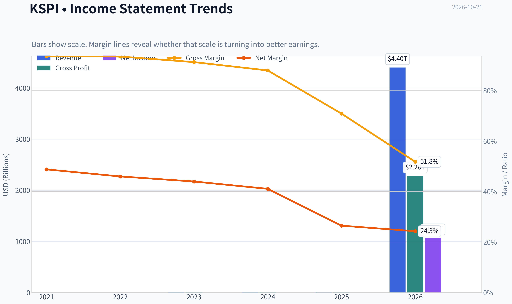

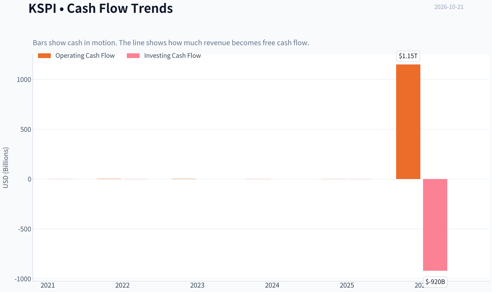

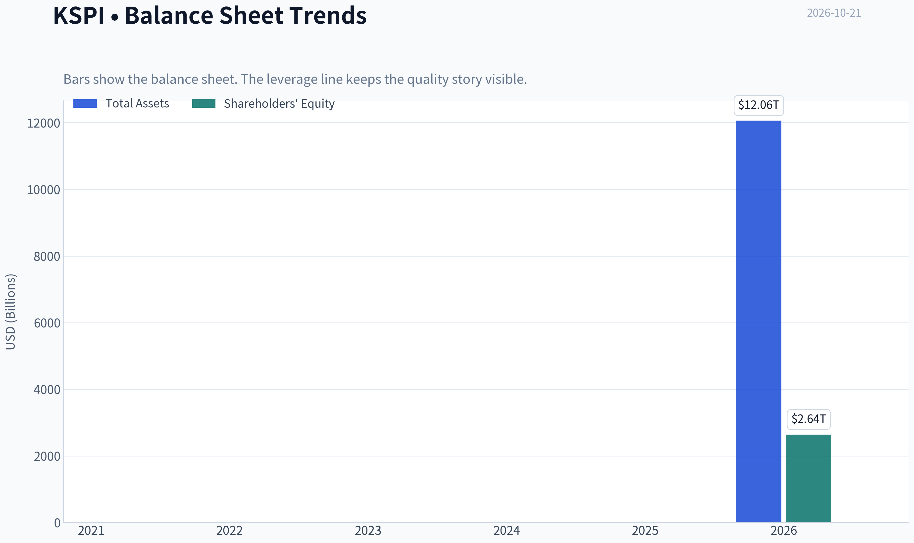

This graph tracks the profitability and return metrics (ROE, ROIC, Margins) of **KSPI** over the past decade, highlighting capital efficiency trends.

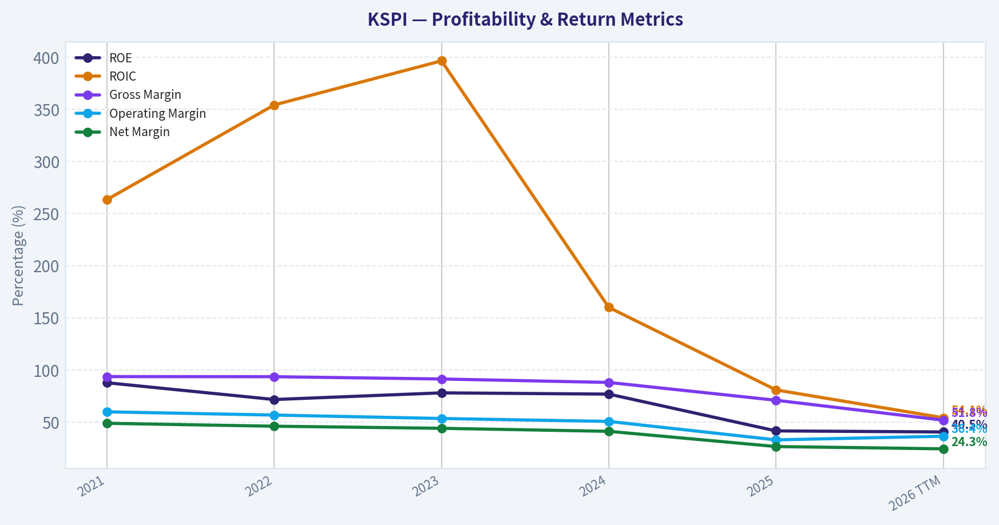

This chart illustrates the financial health of **KSPI** over the last 10 years, mapping cash equivalents and free cash flow against total obligations (Debt).

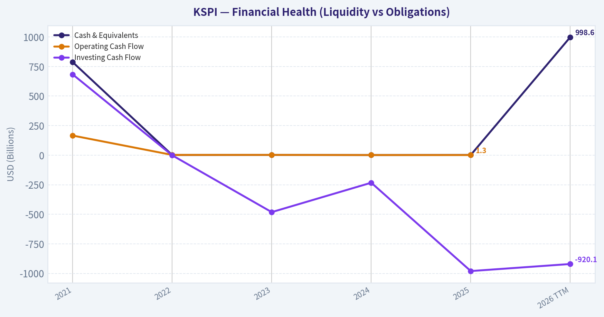

This comparison chart from *Profitability and Operating Performance* stacks current figures against historical benchmarks for **KSPI**, making it easy to see where the company trades relative to its own averages.

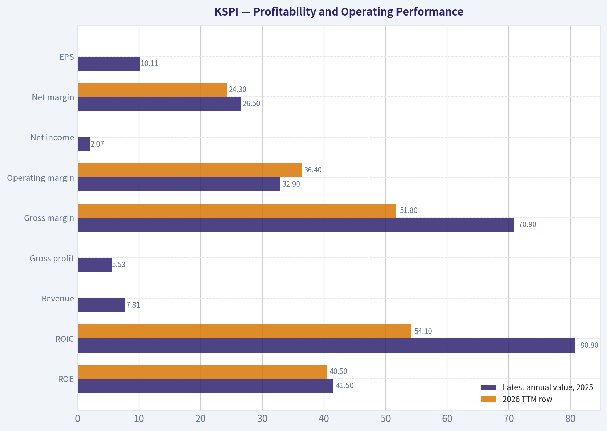

---

### Intrinsic Value Analysis (Buffett)

> *Following Warren Buffett's value investing philosophy: Circle of Competence, Economic Moat, Management Quality, and Margin of Safety.*

#### Intrinsic Value Snapshot

Price is what you pay. Intrinsic value is what the business may be worth based on the cash it can create for owners over time. We show a range, not one magic number.

- Current Price: $93.51
- Value Range (conservative to optimistic across both DCF methods): $189,613.75 to $217,783.01

##### Owner Earnings (Buffett Method)
- Net Income: $2,070,984,834.97
- Depreciation & Amortization: N/A
- Capital Expenditures: N/A
- Working Capital Changes: $-734,099,000,000.00
- Owner Earnings: $736,169,984,834.97

##### Intrinsic Value
###### Buffett Method
Uses owner earnings. Stricter, and usually more conservative.
- Conservative: $189,613.75
- Average: $217,783.01
- Optimistic: $217,783.01
- Discount Rate: 10.0%

ANALYST STANCE: **WATCH**

#### Executive Conclusion

Kaspi.kz is a potentially attractive digital-finance and commerce compounder: it combines payments, consumer finance, marketplace services, and a large local ecosystem. The reported **70.9% gross margin, 41.5% ROE, 43.6% year-over-year revenue growth, and 8.5x P/E** indicate strong economics and an unusually low valuation for a high-growth platform.

However, the investment case carries meaningful Kazakhstan country risk, regulatory and credit-cycle exposure, currency risk, and limited valuation transparency. The available intrinsic-value outputs are internally inconsistent in scale, so they should not be accepted at face value. At $94, KSPI merits deeper underwriting rather than an immediate purchase.

#### 1. Factor Scorecard

| Factor | Score | Assessment |
|---|---:|---|
| Business simplicity and predictability | 3.5/5 | The basic model is understandable: a super-app monetizing payments, lending, and commerce. Predictability is reduced by credit, regulatory, currency, and emerging-market risks. |
| Durable competitive advantage | 4.0/5 | Strong ecosystem effects, customer convenience, proprietary data, and embedded financial workflows create a credible moat. |
| Management and capital allocation | 3.0/5 | The platform appears well executed, but governance, shareholder alignment, related-party exposure, and capital-allocation transparency require close review. |
| Industry structure | 3.5/5 | Digital finance and marketplace economics can be attractive and scale efficiently, but local regulation and competition are important constraints. |

**Gate 5: Not tripped.** There is no evidence in the supplied data of both sharply deteriorating earnings or cash flow and a solvency red line such as sub-1x interest coverage. The principal risks are valuation-data quality, country exposure, and business-model cyclicality-not demonstrated financial distress.

#### 2. Moat Analysis

Kaspi's moat appears to come from several reinforcing features:

- **Network effects:** More users attract more merchants, lenders, and payment activity; greater selection and convenience attract more users.
- **Switching costs:** Consumers may use Kaspi for payments, shopping, transfers, and borrowing in one integrated application. Merchants benefit from access to an established customer base and transaction infrastructure.
- **Data advantage:** A broad transaction history can improve underwriting, personalization, fraud detection, and cross-selling.
- **Brand and ecosystem convenience:** A highly integrated local super-app can be difficult for a single-product competitor to replicate.
- **Operating leverage:** The 70.9% gross margin suggests that incremental digital activity can be economically attractive.

The moat is best characterized as **wide but exposed to regulatory and credit-cycle risk**, rather than unquestionably wide and stable. Its durability depends on maintaining underwriting discipline and preserving the trust of consumers, merchants, and regulators.

#### 3. Management Quality and Capital Allocation

| Dimension | Assessment | Score |
|---|---|---:|
| Owner orientation | The company's long-term success depends on per-share growth and disciplined platform reinvestment, but the supplied information does not establish unusually high insider ownership. | 3/5 |
| Candor and accounting quality | No restatement or accounting failure is identified in the supplied information. The complexity of a financial-platform business warrants conservative interpretation of reported earnings. | 3/5 |
| Reinvestment | Revenue growth of 43.6% indicates substantial reinvestment opportunity in payments, commerce, and financial services. | 4/5 |
| Capital allocation | The low P/E is attractive, but buybacks, dividends, acquisitions, and related-party transactions should be assessed before assigning a top score. | 3/5 |

Management receives a **3/5** overall: competent and operating in an attractive model, but not yet proven to the standard required for maximum confidence in a concentrated, long-duration holding.

#### 4. Financial Summary

| Metric | Latest reported figure |
|---|---:|
| Share price | $94 |
| Market capitalization | $17.77 billion |
| P/E ratio | 8.5x |
| Implied earnings per share | Approximately $11.03 |
| Revenue growth, year over year | 43.6% |
| Gross margin | 70.9% |
| Return on equity | 41.5% |
| FCF yield | Not available |
| Current ratio | Not meaningful or unavailable for this business profile |
| Headline intrinsic value | $648,558.54, inconsistent with the $94 share price and therefore not decision-grade |
| Reverse-DCF indication | Price implies approximately negative 50% annual growth over 10 years, an implausible result that signals model-scaling problems |

**Key Takeaways:** KSPI combines very strong reported growth, gross margin, and ROE with a low headline earnings multiple. The major analytical issue is not apparent operating weakness, but inconsistency in the supplied valuation outputs. The price and P/E data support a potentially attractive valuation, while the intrinsic-value figures require normalization before being used.

#### 5. Owner Earnings Calculation

Buffett-style owner earnings are calculated as:

| Component | Amount |
|---|---:|
| Net income | Not separately supplied |
| Depreciation and amortization | Not supplied |
| Less: maintenance capital expenditure | Not supplied |
| Less: working-capital investment | Not supplied |
| Owner earnings | Cannot be separated reliably from the supplied figures |

Because KSPI is a financial and platform business, reported free cash flow and maintenance capital expenditure need careful interpretation. Using earnings as a temporary proxy:

- Implied EPS from the 8.5x P/E: **approximately $11.03**
- Earnings yield: **approximately 11.7%**
- This is not a substitute for verified owner earnings, but it provides a conservative valuation anchor pending a full cash-flow bridge.

**Key Takeaways:** The earnings yield is attractive, but a proper owner-earnings calculation must distinguish growth investment, credit funding requirements, regulatory capital, and genuine maintenance spending. The current evidence supports using earnings as a provisional proxy, not treating them as fully distributable cash flow.

#### 6. Three-Scenario DCF Valuation

The following valuation uses implied EPS as a proxy because verified owner-earnings data is not supplied.

| Scenario | Assumption | Indicative value per share |
|---|---|---:|
| A. No growth | $11.03 / 10% | $110 |
| B. GDP-like growth | $11.03 x 1.03 / (10% - 3%) | $162 |
| C. Historical-growth case | Requires verified multi-year owner-earnings growth | Not calculated |
| Current market price | - | $94 |

The supplied research pack reports owner-earnings and FCFF values of **$217,783 and $1,025,487**, respectively, but those figures are incompatible with a $94 share price and a $17.77 billion market capitalization when interpreted as per-share values. They should be treated as scale or unit errors rather than usable intrinsic values.

#### 7. Margin of Safety

| Valuation reference | Value | Premium or discount to $94 |
|---|---:|---:|
| No-growth earnings proxy | $110 | 15% discount |
| 3% growth earnings proxy | $162 | 42% discount |
| Current price | $94 | - |
| Supplied headline intrinsic value | $648,558.54 | Not usable due to scale inconsistency |

**Key Takeaways:** Even the no-growth earnings proxy suggests modest undervaluation, while the 3% growth case suggests a substantial margin of safety. That apparent discount is partly offset by Kazakhstan, currency, regulatory, and credit risks. The valuation is attractive enough for research and watchlist inclusion, but not sufficiently verified for a high-conviction purchase.

#### 8. Final Buffett Scorecard

| Criterion | Weight | Score | Weighted score |
|---|---:|---:|---:|
| Moat width and durability | 25% | 4.0 | 1.00 |
| Valuation and margin of safety | 20% | 3.5 | 0.70 |
| Capital returns versus WACC | 15% | 4.0 | 0.60 |
| Business understanding and predictability | 12% | 3.5 | 0.42 |
| Management quality and capital allocation | 12% | 3.0 | 0.36 |
| Reinvestment runway | 8% | 4.0 | 0.32 |
| Balance-sheet strength | 4% | 3.0 | 0.12 |
| Industry structure | 4% | 3.5 | 0.14 |
| **Total** | **100%** | - | **3.66/5** |

#### 9. Investment Stance

**WATCH - Medium conviction.**

KSPI has many characteristics of a Buffett-style compounder: high returns on equity, exceptional gross margins, rapid growth, an integrated ecosystem, and a low earnings multiple. Its valuation appears reasonable to attractive even under conservative earnings-based assumptions.

The appropriate next step is not to reject the business, but to verify:

1. Multi-year operating cash flow and owner earnings.
2. Loan-loss provisions, delinquencies, and credit-cycle sensitivity.
3. Net debt, regulatory capital, and interest coverage.
4. Insider ownership and related-party transactions.
5. Currency exposure and the durability of the Kazakhstan franchise.
6. Whether the $94 price reflects a temporary country-risk discount or a structural concern.

If those checks confirm strong cash conversion and conservative underwriting, KSPI could move from **WATCH** to **ADVOCATE**. At present, the business quality is promising, but the country risk and inconsistent valuation data justify waiting for stronger financial verification.
#### Valuation Bridge

This bridge places the current market price beside each intrinsic value lens so readers can see whether upside depends on one method or shows up across several methods.

| Scenario | Intrinsic Value / Share |
| --- | ---: |
| Buffett Method | $217,783.01 |
| Damodaran Method | $1,025,487.13 |
| Current Price | $93.51 |

#### Key Takeaways

If one method is far above the others, the upside case depends on a specific modelling assumption. When several methods cluster together, the valuation story is more robust.

#### Valuation Visuals

This comparison chart from *Latest Earnings Snapshot* stacks current figures against historical benchmarks for **KSPI**, making it easy to see where the company trades relative to its own averages.

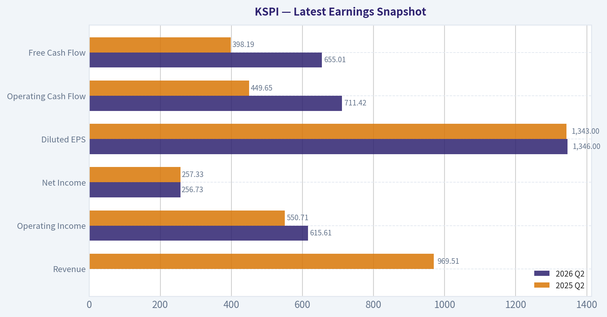

This comparison chart from *Current Versus Historical Average* stacks current figures against historical benchmarks for **KSPI**, making it easy to see where the company trades relative to its own averages.

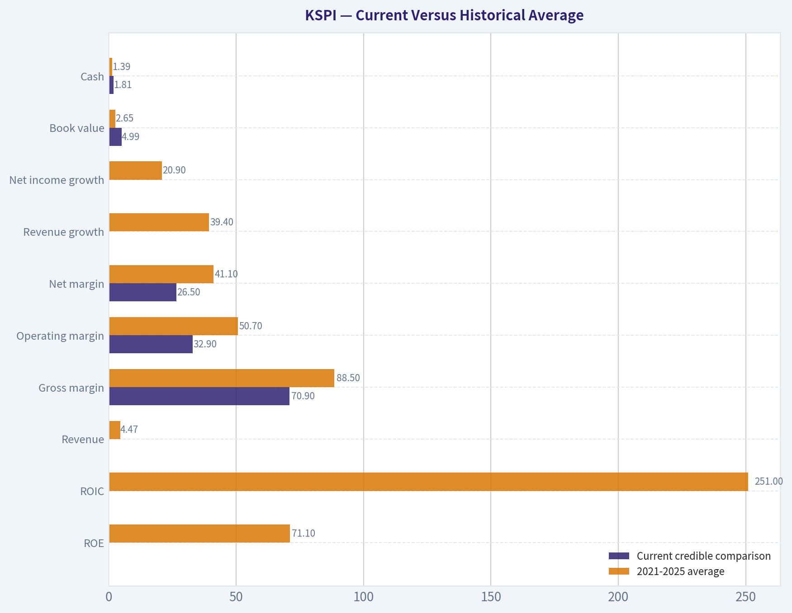

This comparison chart from *Financial Summary* stacks current figures against historical benchmarks for **KSPI**, making it easy to see where the company trades relative to its own averages.

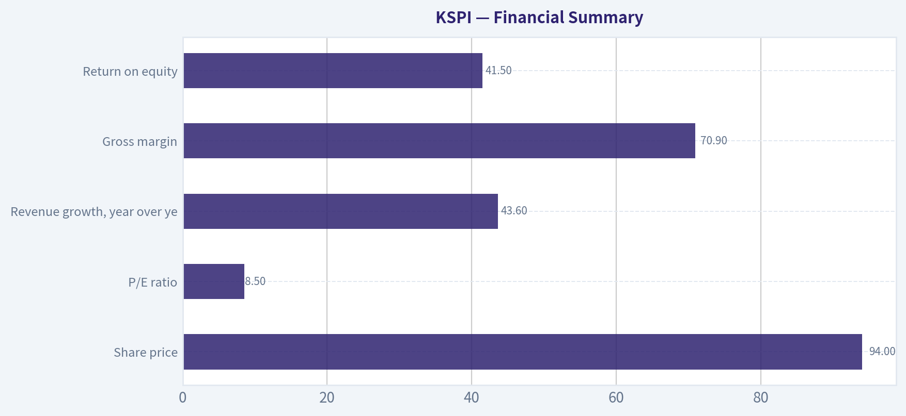

The following chart maps the **KSPI** Owner Earnings DCF valuation scenarios (Conservative, Average, Optimistic) to visually represent the margin of safety based on intrinsic value calculations.

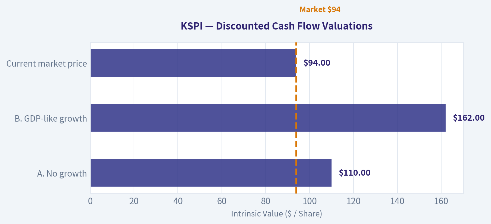

---

### Trend & Growth Analysis (Lynch/Druckenmiller/Fisher)

> *Following Peter Lynch's GARP, Stanley Druckenmiller's macro-aware approach, and Philip Fisher's scuttlebutt methodology.*

ANALYST STANCE: **ADVOCATE** - small position, high-risk growth value

#### 1. Lynch Classification

**Fast Grower with emerging-market and country-risk characteristics.**

KSPI combines digital payments, consumer finance, marketplace commerce, and financial services in Kazakhstan. Its reported **43.6% year-over-year revenue growth**, **70.9% gross margin**, and **8.5x P/E** place it squarely in the fast-growth-at-a-reasonable-price category, although the company's geographic concentration makes it riskier than a typical developed-market compounder.

#### 2. The Story in Three Bullets

- **Super-app ecosystem:** Kaspi connects payments, e-commerce, and fintech services in one highly integrated platform.
- **Strong operating economics:** High gross margin, 41.5% ROE, and rapid revenue growth suggest substantial network effects and operating leverage.
- **Low valuation versus growth:** At approximately 8.5 times earnings and 43.6% revenue growth, the stock is priced more like a mature or risky financial company than a fast-growing technology platform.

#### 3. Core Fundamental Snapshot

| Metric | KSPI |
|---|---:|
| Share price | $94 |
| Market capitalization | $17.77 billion |
| Revenue growth, latest YoY | 43.6% |
| Gross margin | 70.9% |
| ROE | 41.5% |
| P/E ratio | 8.5x |
| Approximate PEG ratio | 0.20 |
| FCF yield | Not available |
| Current ratio | Not available |

**Key Takeaways:** KSPI shows an unusually attractive combination of rapid growth, high gross margin, and low earnings valuation. The implied PEG ratio of approximately 0.20 is far below Lynch's 1.0 threshold for attractive growth. However, the missing free-cash-flow and balance-sheet data limits confidence in the headline valuation.

#### 4. TAM and the 10x Test

KSPI's addressable market is broader than Kazakhstan's traditional banking market because it participates in payments, lending, commerce, advertising, and digital financial services.

| 10x Test Component | Assessment |
|---|---|
| Current market capitalization | $17.77 billion |
| 10x market capitalization | $177.7 billion |
| Primary market | Kazakhstan |
| Expansion opportunity | Regional fintech, payments, commerce, and financial products |
| TAM growth | Likely favorable, but exact external TAM data unavailable |
| Can KSPI become 10x larger while remaining below 20% of TAM? | Possible only with meaningful regional expansion |

**Key Takeaways:** The domestic ecosystem provides a strong base, but Kazakhstan alone may not support a 10x equity outcome without substantial profit growth and regional expansion. The central long-term question is whether Kaspi can export its super-app model beyond its home market while preserving credit quality and regulatory access.

#### 5. Revenue Growth Trend

Only the latest growth figure was available in the research pack, so acceleration cannot be confirmed.

| Indicator | Observation | Interpretation |
|---|---:|---|
| Latest revenue growth | 43.6% YoY | Fast-growth profile |
| Prior comparable growth series | Not available | Acceleration cannot be verified |
| Gross margin | 70.9% | Strong monetization and platform economics |
| ROE | 41.5% | Strong capital productivity |

**Key Takeaways:** The current growth rate is excellent, but one period is insufficient to establish an accelerating trend. The November 9, 2026 third-quarter and nine-month results should be treated as an important confirmation point: sustained growth above 30%, stable credit quality, and continued margin strength would materially improve the thesis.

#### 6. Unit Economics and Profitability

| Metric | Status | Assessment |
|---|---|---|
| LTV/CAC | Not disclosed in available data | Cannot calculate |
| Net revenue retention | Not applicable or unavailable | Not a conventional SaaS model |
| Rule of 40 | Cannot calculate because FCF margin is unavailable | Incomplete |
| Gross margin | 70.9% | Strong |
| ROE | 41.5% | Strong |
| Earnings valuation | 8.5x P/E | Very inexpensive if earnings are durable |

**Key Takeaways:** KSPI's gross margin and ROE indicate attractive economics, but financial-platform analysis requires additional measures such as credit losses, net interest margin, loan growth, funding costs, and free cash flow. The low P/E could represent an opportunity, or it could be compensation for country, currency, regulatory, and financial-model risks.

#### 7. Inflection Point Assessment

**Potentially positive, but not yet fully confirmed.**

| Inflection Area | Current Assessment |
|---|---|
| Product cycle | Continued cross-selling across payments, commerce, and finance |
| Market share | Likely strong domestic position; exact trend unavailable |
| Margin | Already strong; further operating leverage possible |
| TAM | Could expand materially through regional fintech and commerce |
| Competitive position | Super-app integration and ecosystem effects are significant |
| Near-term confirmation event | Q3 and nine-month 2026 results on November 9 |

**Key Takeaways:** KSPI appears to have an established platform rather than an early product-cycle catalyst. The major potential inflection is geographic and ecosystem expansion: if new products and markets grow faster than the core business, earnings estimates may be too conservative. Conversely, slowing loan quality or regulatory pressure would undermine the thesis quickly.

#### 8. Macro Setup

- **Secular tailwind:** Digital payments, e-commerce, mobile banking, and fintech adoption.
- **Macro benefit:** Emerging-market digitalization can support strong nominal growth.
- **Macro risks:** Currency depreciation, higher local interest rates, consumer credit stress, geopolitical exposure, and Kazakhstan-specific regulation.
- **Druckenmiller view:** The company has strong micro momentum, but the macro overlay is less favorable than for a developed-market software company because financial conditions directly affect its lending and payments businesses.

#### 9. Fisher 15-Point Assessment

Scored provisionally because detailed management, customer, and operating disclosures were not available.

| Fisher Dimension | Score / 5 |
|---|---:|
| Market potential | 4 |
| New-product determination | 4 |
| R&D effectiveness | 3 |
| Sales organization | 4 |
| Profit margins | 5 |
| Margin improvement | 4 |
| Labor relations | 3 |
| Executive relations | 3 |
| Management depth | 3 |
| Cost analysis and accounting | 3 |
| Competitive advantages | 5 |
| Long-range profit outlook | 4 |
| Dilution risk | 3 |
| Management candor | 3 |
| Management integrity | 3 |
| **Total** | **54 / 75** |

**Key Takeaways:** KSPI scores strongest on market potential, margins, ecosystem advantages, and product breadth. The provisional score is held back by limited independently verified information on management depth, accounting transparency, employee relations, dilution, and long-term capital allocation. This is an average-to-good Fisher profile, not yet an outstanding one.

#### 10. Valuation Analysis

| Valuation Measure | Result | Interpretation |
|---|---:|---|
| P/E | 8.5x | Low for a 43.6% grower |
| PEG | Approximately 0.20 | Deeply attractive mathematically |
| P/S | Not available | Cannot calculate reliably |
| Headline intrinsic value | Data quality concern | Reported output is implausibly high relative to market value |
| Reverse DCF | Implies approximately -50% annual growth for 10 years | Suggests extreme pessimism, but likely model-sensitive |

**Key Takeaways:** The ordinary valuation data support a compelling value-growth setup, particularly the 8.5x P/E relative to reported growth. The supplied intrinsic-value and reverse-DCF outputs are not decision-grade because their assumptions or unit scaling appear unreliable; they should not be used to justify a precise price target. The investment case should instead rely on earnings durability and risk-adjusted scenario analysis.

**Illustrative scenario framework:**

| Scenario | Operating Assumption | Valuation View |
|---|---|---|
| Bear | Growth falls below 15%, credit losses or regulation worsen | P/E compresses toward 5-7x |
| Base | Growth remains 20-30%, ecosystem remains dominant | P/E re-rates toward 10-14x |
| Bull | Growth remains above 30%, regional expansion succeeds | P/E could re-rate toward 15-20x |

#### 11. Growth Investor Scorecard

| Criterion | Weight | Score / 5 |
|---|---:|---:|
| Lynch story | 10% | 4.5 |
| TAM and runway | 20% | 3.5 |
| Revenue growth | 20% | 4.5 |
| Unit economics | 15% | 3.5 |
| Competitive position | 10% | 4.5 |
| Management quality | 10% | 3.0 |
| Macro setup | 5% | 3.0 |
| Profitability path | 5% | 4.0 |
| Valuation | 5% | 4.5 |
| **Weighted score** | **100%** | **3.9 / 5** |

**Key Takeaways:** KSPI earns an **Advocate** score primarily because of its growth, valuation, margins, and ecosystem position. The score does not reach high conviction because of country concentration, incomplete cash-flow data, financial-sector risks, and uncertainty about the durability of growth outside Kazakhstan.

#### 12. Position Size, Risks, and Catalysts

**Position-size stance:** Initiate or maintain a **small-to-moderate position, approximately 1-3% of a diversified portfolio**. A larger position would require confirmation from upcoming results and better visibility into cash generation, credit losses, regulatory conditions, and regional expansion.

**Key catalysts:**

- Q3 and nine-month 2026 results on November 9.
- Sustained revenue growth above 30%.
- Stable or improving credit quality.
- Continued gross-margin strength and operating leverage.
- Successful regional expansion or additional high-margin financial products.
- Re-rating from a single-digit P/E toward a growth-platform multiple.

**Key risks:**

- Kazakhstan concentration and regulatory intervention.
- Currency depreciation or capital controls.
- Consumer-credit deterioration and rising loan losses.
- Dependence on a small number of ecosystem products.
- Geopolitical and ADR/listing risks.
- Insufficient disclosure for independent verification of free cash flow and unit economics.
- Growth deceleration that causes the market to value KSPI as a conventional bank rather than a technology platform.

#### Bottom Line

KSPI is a **high-growth, low-multiple fintech and commerce platform** with a potentially powerful ecosystem advantage. The valuation is unusually attractive if the reported 43.6% growth is durable, but the company deserves a risk discount because of Kazakhstan concentration and limited verified cash-flow information. **Advocate for a small position, with the November results serving as the next major thesis-validation event.**

---

### Market Technical Analysis

ANALYST STANCE: **WATCH**

#### KSPI Technical Analysis

KSPI is showing a **long-term bullish structure but a weakening intermediate-term trend**. The latest available closing price is **$92.94 on October 20, 2026**; the indicator report is dated October 21. Price remains well above the rising 200-day SMA, but it is below both the 10-day EMA and 50-day SMA, indicating that the recent pullback has not yet fully reversed.

#### Trend Structure

KSPI's **200-day SMA is approximately $83.12 and rising**, placing the stock about **11.8% above** its long-term trend benchmark. This is constructive: the broader advance from the spring and summer remains intact, and the stock has not entered a confirmed long-term bearish regime.

The intermediate picture is less favorable. The **50-day SMA is approximately $97.79**, while the 10-day EMA is approximately **$93.82**. At $92.94, KSPI is:

- About **0.9% below the 10-day EMA**
- About **5.0% below the 50-day SMA**
- About **11.8% above the 200-day SMA**

This alignment suggests a stock in a **short- to medium-term correction within a still-positive long-term trend**. The 10-day EMA has declined steadily from roughly $98.78 on September 21 to $93.82, while the 50-day SMA has continued rising because it is slower to react. A sustained close above the 10-day EMA would be the first sign of improving short-term momentum; reclaiming the $97.80 area would provide stronger evidence that the intermediate correction is ending.

#### Momentum and MACD

The MACD remains negative at approximately **-0.89**, which confirms that downside momentum still dominates on a medium-term basis. However, the MACD has improved from roughly **-1.44 on October 9** to its current level. This indicates that bearish momentum has moderated, even though it has not yet turned decisively bullish.

That distinction is important. The recent improvement in MACD may represent an early stabilization attempt rather than a confirmed trend reversal. Traders would generally want to see the MACD continue rising and preferably cross above its signal line, alongside a price move back above the 10-day EMA. A renewed decline in MACD would suggest that the September-October correction is continuing.

#### RSI and Potential Exhaustion

The RSI is approximately **45.4**, up from the low-40s earlier in the week but still below the neutral 50 level. This is a moderately weak reading rather than an oversold one.

The RSI does not currently indicate an extreme washout: it is well above 30 and far below 70. Therefore, the stock may have room to decline further if support fails. At the same time, the move from roughly 42.2 on October 19 to 45.4 suggests that selling pressure has eased modestly. A move above 50 would improve the momentum profile, while a fall toward or below 30 would indicate a more deeply oversold condition.

#### Bollinger Bands and Price Location

The current Bollinger Bands are approximately:

- Upper band: **$96.98**
- Middle band: approximately **$94.01**
- Lower band: **$91.04**

With KSPI near $92.94, price is below the middle band but still above the lower band. This places the stock in the lower half of its recent trading range, confirming short-term weakness without yet producing a clear downside volatility break.

The lower band near $91.04 is an important nearby reference. A close below that level, particularly if accompanied by expanding volatility, would increase the risk of a move toward the mid-to-high $80s. Conversely, a recovery above the middle band near $94.00 would suggest that the immediate selling pressure is fading. A move through the upper band near $97.00 would be more meaningful because it would also challenge the 50-day SMA.

The Bollinger range has narrowed compared with late September, while ATR has also declined. This suggests that volatility has moderated somewhat, although the stock is still moving enough to create meaningful short-term risk.

#### Volatility and Risk Management

ATR is approximately **$2.59**, equivalent to about **2.8% of the share price**. This means a normal daily trading range can be several dollars, so stops placed too close to the entry price may be vulnerable to ordinary noise.

For risk planning, one ATR below the latest close is approximately **$90.35**, while two ATRs below is approximately **$87.75**. These are not automatic stop levels, but they illustrate the scale of movement that could occur without necessarily representing an extreme event. A close below the lower Bollinger Band near $91.04 would be a more technically significant warning than an intraday dip alone.

#### Key Levels and Scenarios

The immediate technical picture is balanced but tilted cautiously bearish:

- **Near-term support:** approximately $91.00, corresponding to the lower Bollinger Band.
- **Secondary downside reference:** approximately $90.35, one ATR below the latest close.
- **Initial recovery hurdle:** approximately $93.80, the 10-day EMA.
- **Short-term trend confirmation:** approximately $94.00, the Bollinger middle band.
- **Major intermediate resistance:** approximately $97.80, the 50-day SMA.
- **Long-term trend support:** approximately $83.10, the 200-day SMA.

A bullish scenario would require KSPI to hold above roughly $91, reclaim the $93.80-$94.00 zone, and then challenge the $97.80 50-day SMA. A close above $97.80 would materially improve the intermediate-term outlook and could open the way toward the $100-$105 region, where prior September trading created overhead supply.

A bearish scenario would begin with a decisive close below $91.00. That would place price below the lower Bollinger Band and could expose the stock to a move toward the upper-$80s. The broader long-term trend would not be invalidated unless weakness extended substantially toward the rising 200-day SMA near $83.12.

#### Selected Indicators

The selected indicators are deliberately complementary: long-, medium-, and short-term trend measures; momentum; relative strength; volatility positioning; and risk range. MACD and RSI overlap somewhat in measuring momentum, but MACD captures directional momentum and trend acceleration, while RSI provides a bounded view of buying and selling pressure.

| Indicator | Latest reading | Interpretation | Trading relevance |
|---|---:|---|---|
| 10 EMA | $93.82 | Price is slightly below the short-term trend line | Reclaiming it would signal initial short-term improvement |
| 50 SMA | $97.79 | Price is materially below the intermediate trend benchmark | Major recovery hurdle and possible resistance |
| 200 SMA | $83.12 | Rising and well below price | Long-term trend remains constructive |
| MACD | -0.89 | Negative, but improving from early October lows | Bearish momentum is moderating but not reversed |
| RSI | 45.4 | Neutral-to-weak; not oversold | Limited evidence of exhaustion or a strong rebound |
| Bollinger Upper Band | $96.98 | Near the 50-day SMA | Breakout zone if price recovers |
| Bollinger Lower Band | $91.04 | Close to current price | Important near-term support and downside trigger |
| ATR | $2.59 | Daily volatility remains meaningful | Useful for position sizing and stop-distance planning |

Key Takeaways: KSPI remains above its rising 200-day SMA, so the long-term trend is still constructive. However, price is below the 10-day EMA and 50-day SMA, MACD remains negative, and RSI is below neutral, leaving the short- and medium-term picture cautious. The most important near-term test is whether the stock holds around $91 and reclaims the $93.80-$94.00 area; until then, a watch stance is preferable to treating the recent stabilization as a confirmed reversal.

#### Market Visuals

This comparison chart from *Market Metrics and Data Quality* stacks current figures against historical benchmarks for **KSPI**, making it easy to see where the company trades relative to its own averages.

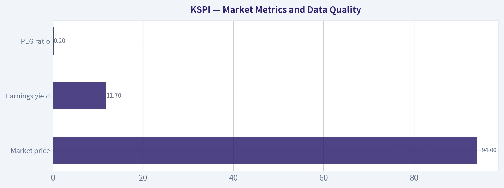

---

### Options Market Analysis

> *Reading options flow - put/call ratios, IV skew, and unusual activity - to gauge institutional positioning and event-driven risk.*

ANALYST STANCE: **BEARISH**

#### KSPI Options Market Overview

Data is as of October 21, 2026. The available chain covers the November 20, December 18, and March 19 expirations. The options market shows substantially more put open interest than call open interest, although recent trading volume is call-heavy.

| Expiration | Call OI | Put OI | Put/Call OI Ratio | Call Volume | Put Volume | Put/Call Volume Ratio |
|---|---:|---:|---:|---:|---:|---:|
| Nov. 20, 2026 | 221 | 823 | 3.72 | 29 | 53 | 1.83 |
| Dec. 18, 2026 | 960 | 2,803 | 2.92 | 151 | 26 | 0.17 |
| Mar. 19, 2027 | 882 | 426 | 0.48 | 154 | 25 | 0.16 |
| **Total** | **2,063** | **4,052** | **1.96** | **334** | **104** | **0.31** |

**Key Takeaways:** KSPI's aggregate put/call open-interest ratio is 1.96, well above the approximately 0.7 neutral baseline, indicating a defensive or bearish positioning bias. However, recent volume is dominated by calls, particularly in December and March, suggesting some bullish repositioning or call buying. The divergence means the large put inventory may represent established hedges, while current flow is more constructive.

#### Implied Volatility and Skew

| Expiration | Call ATM IV | Put ATM IV | Put IV Premium/(Discount) |
|---|---:|---:|---:|
| Nov. 20, 2026 | 42.7% | 51.1% | **+8.4 percentage points** |
| Dec. 18, 2026 | 47.2% | 50.3% | **+3.1 percentage points** |
| Mar. 19, 2027 | 42.0% | 39.9% | **-2.1 percentage points** |

**Key Takeaways:** Near-term puts carry a meaningful volatility premium over calls, especially in the November expiration, signaling greater demand for downside protection or concern about near-term downside risk. By March, the skew reverses modestly toward calls, consistent with a more constructive longer-term outlook. The data does not provide specific out-of-the-money strikes, so this is an ATM IV comparison rather than a complete OTM skew analysis.

There is no catalyst calendar in the supplied data, so it is not possible to determine whether the elevated near-term IV reflects earnings, a product event, or another known catalyst. November and December IV levels around 43% to 51% are substantial, but should not be labeled catalyst-driven without confirmation.

#### Unusual Options Activity

| Finding | Result |
|---|---|
| Contracts with volume greater than 5 times open interest | None identified |
| Fresh directional institutional signal | Not confirmed |
| Retail speculation signal | Not confirmed |
| Liquidity assessment | Thin to moderate; total listed activity is limited |

**Key Takeaways:** No individual contract met the data provider's threshold for unusual activity, so there is no clearly identifiable fresh sweep or aggressive institutional bet. The absence of unusual activity reduces confidence in making a strong short-term directional inference. The call-heavy volume should therefore be interpreted cautiously, as it may reflect routine trading, spread activity, or covered-call positioning rather than outright bullish speculation.

#### Open Interest Concentration and Potential Gamma Levels

| Expiration | Dominant OI Side | Total OI | Positioning Implication |
|---|---|---:|---|
| Nov. 20, 2026 | Puts | 1,044 | Near-term downside hedging or bearish exposure |
| Dec. 18, 2026 | Puts | 3,763 | Largest concentration; potential volatility and pinning focus |
| Mar. 19, 2027 | Calls | 1,308 | Longer-term bullish positioning |

**Key Takeaways:** December 18 has the largest overall open-interest concentration and is the most important expiration for potential pinning or gamma effects. The put-heavy December inventory could provide a downside hedge structure, but it may also create a gravitational level if those positions are concentrated near the current share price. Strike-level data was not supplied, so specific gamma walls, max-pain strikes, and exact support or resistance levels cannot be identified.

#### Overall Options Sentiment

The overall signal is **BEARISH**, but with **moderate-to-low conviction**.

The primary bearish driver is the 1.96 aggregate put/call open-interest ratio, combined with a pronounced near-term put IV premium. This indicates that the existing options structure is heavily defensive, particularly through November and December. Against that, current volume is strongly call-weighted and March open interest favors calls, suggesting a more bullish longer-term view or possible rotation into upside exposure.

Because there are no contracts showing volume greater than five times open interest, there is no strong evidence of fresh smart-money directional positioning. The most reasonable interpretation is **near-term defensive/bearish positioning with a more constructive longer-term component**. Thin options activity and the lack of strike-level data warrant reduced confidence.

#### Summary

| Category | Assessment |
|---|---|
| Put/Call Ratio | **Bearish by OI:** 1.96 overall versus approximately 0.7 neutral |
| IV Level | **Elevated/moderate:** roughly 40%-51% ATM IV |
| Skew Direction | **Near-term put skew; longer-term slight call skew** |
| Unusual Activity | **None detected**; no contract exceeded 5 times open interest |
| Overall Signal | **BEARISH**, with moderate-to-low conviction |

**Key Takeaways:** KSPI's options structure is defensive in the near term because puts dominate open interest and carry higher implied volatility than calls. Call-heavy recent volume and bullish March positioning prevent a high-conviction bearish rating, but there is no unusual activity strong enough to override the heavy near-term put structure.

---

## Research Team Commentary

> *The Research Manager synthesizes the Bull vs Bear debate into action-free commentary. This is a pre-risk view, not the final stance.*

Core takeaway: Kaspi appears to be a genuinely strong local platform trading at a valuation that already reflects substantial country, currency, credit, and governance risk. The exact margin of safety is less certain than the 8.5 times P/E suggests because distributable owner earnings are not provided, but the combination of ecosystem advantages, 41.5% ROE, 9.3% ROA, strong reported growth, and a modest implied-growth hurdle supports a constructive position. I would initiate a smaller-than-normal position rather than remain entirely on the sidelines.

The strongest bull argument is that Kaspi is not simply a low-multiple lender. Payments, commerce, transfers, merchant infrastructure, and financial services reinforce one another. Consumer and merchant density generates convenience, transaction data, cross-selling opportunities, and better underwriting. The switching costs are behavioral rather than contractual, but habitual engagement can still be a durable moat. A competitor would need to recreate both sides of the network, regulatory capabilities, merchant acceptance, and consumer trust.

The current economics reinforce that assessment. A 41.5% ROE might ordinarily raise leverage concerns, but the 9.3% ROA suggests that profitability is not merely financial engineering. The 70.9% gross margin is less informative for a financial-platform hybrid than for a software company, yet it still points toward attractive platform economics. Reported revenue growth of 43.6% is far above what the current valuation appears to require, although organic growth and acquisition effects need to be separated.

Valuation is the most persuasive reason to lean positive. At $93.51 and 8.52 times earnings, implied EPS is approximately $10.97. The bull's reverse DCF estimates that, after reducing this by 20% to approximate distributable earnings and applying a demanding 14% discount rate, the market requires only about 5% annual growth. An 8% growth case produces value around $114, or roughly 22% upside.

The bear is right that this calculation is not as conservative as it first appears. For a company with lending operations, owner earnings cannot be estimated reliably by applying an arbitrary conversion percentage to accounting income. Growth may require retained regulatory capital, loss reserves, liquidity, compliance spending, and funding support. Under a lower conversion rate and higher discount rate, the implied growth hurdle rises materially and intrinsic value could fall into the $55-$70 range.

That sensitivity is the central risk, but I would not treat the bear's combined assumptions as the most likely base case. They simultaneously assume substantially lower distributability, slower growth, a higher required return, and a lower terminal value. Those conditions are possible during a severe credit, currency, regulatory, or governance deterioration, but they are closer to a stress case than a neutral forecast. Even reducing conversion from 80% to 70% would probably leave the market requiring high-single-digit owner-earnings growth rather than heroic growth. Given the present franchise economics and reported growth, that looks achievable unless the underlying earnings are materially overearned.

The moat also deserves a balanced interpretation. Kaspi likely has a strong domestic network, but "wide and durable" is not fully proven. Consumers and merchants can multi-home, regulators can mandate interoperability or constrain fees, and competitors may gain access to similar data. Most importantly, a dense Kazakhstan network may not travel easily. International expansion could require rebuilding merchant density, logistics, brand trust, and underwriting data from scratch. The core business can be excellent while foreign reinvestment produces mediocre returns.

Country and currency risks are similarly real rather than cosmetic. Tenge-denominated growth can translate into much slower U.S.-dollar per-share growth. Regulation, sanctions spillover, capital controls, and weaker minority-shareholder protections justify both a higher discount rate and smaller position size. They do not, by themselves, make an 8.5-times multiple unattractive.

Short-term market evidence is mixed. The shares are approximately 5% below the 50-day average but remain nearly 12% above the 200-day average. That suggests a pullback within a still-improved longer-term structure rather than a confirmed breakdown. Heavy put open interest indicates caution, though recent call-heavy volume makes the options signal less one-sided. Neither should override intrinsic-value analysis. A failure of the 200-day trend accompanied by deteriorating estimates would matter more than options positioning alone.

The lesson from the earlier KSPI decision is important: persistent emerging-market, regulatory, and credit risks should not automatically force a WATCH rating when valuation and operating performance are favorable. Those risks are mostly background risks until the data show that they are worsening. The appropriate response is smaller sizing, staged purchases, and tighter monitoring-not necessarily complete inaction. The corresponding GRAB lesson prevents overcorrecting: headline growth and platform language are insufficient when valuation is demanding and cash economics are weak. KSPI differs because its valuation is compressed and its current profitability is already substantial.

My base valuation range is approximately $105-$120, with a stress range of roughly $60-$75. The base range provides about 12%-28% upside before future compounding. That is not enough for a full-sized position in an average emerging-market financial company, but it can be adequate for a high-return ecosystem with a credible local moat. The position should be sized to survive the stress case.

Over the next one to four quarters, I would monitor four areas closely. First, I want evidence that growth is creating per-share value: organic payment volume, marketplace activity, active consumers and merchants, take rates, and segment-level profits should remain healthy without escalating incentives. Second, credit quality must remain controlled through changes in loan growth, nonperforming loans, cost of risk, reserve coverage, and funding costs. Third, management should demonstrate that accounting earnings can become distributable value through capital adequacy, dividends or repurchases, limited dilution, and transparent cash and capital retention. Fourth, international or acquired operations must show improving unit economics without consuming disproportionate capital from the high-return domestic franchise.

The thesis would strengthen if owner-earnings conversion becomes clearer, credit metrics remain stable, U.S.-dollar per-share earnings grow, acquired operations improve, and the stock reclaims its 50-day average while holding above the 200-day average. It would weaken if revenue growth continues without comparable profit or capital generation, credit costs rise materially, the tenge erodes dollar returns, regulation compresses economics, or management pursues expansion despite poor incremental returns.

Kaspi is not sufficiently documented to deserve an unrestricted Buffett-style concentration, but the market price does not require perfection. The balance of business quality, current profitability, plausible growth, and valuation favors participation with disciplined sizing rather than another overly cautious pass.

ADVOCATE

---

## Value Investing Team Commentary

> *The Investor translates the research view into an investment thesis before risk review. This is still not the final stance.*

### Investment Commentary

Kaspi appears to be a high-quality but geographically concentrated platform whose market price reflects more than ordinary business risk. At **$93.51 and 8.52 times earnings**, investors are not being asked to pay a conventional technology-platform multiple despite reported revenue growth of **43.6%**, a **41.5% ROE**, and a **9.3% ROA**. That mismatch creates a credible opportunity, although the headline P/E overstates the certainty of the margin of safety.

### Business quality and moat

Kaspi's principal strength is the interaction among its payments, marketplace, merchant, and financial-services businesses. Each service makes the others more useful:

- More consumers attract merchants.
- More merchants improve consumer selection and convenience.
- More transactions create data for underwriting, fraud control, and personalization.
- Payments and financial services reduce friction throughout the ecosystem.

These are meaningful network effects, reinforced by habitual use and merchant integration. The switching costs are not absolute because users and merchants can maintain competing applications, but a rival must reproduce the ecosystem's liquidity, acceptance, trust, data, and regulatory infrastructure-not merely launch a similar app.

This likely constitutes a strong domestic moat. The important qualification is that the moat may be **local rather than readily exportable**. International expansion and acquired operations may require Kaspi to rebuild logistics, merchant density, brand trust, and underwriting knowledge. Investors should not automatically assign the domestic business's economics to foreign markets.

### Interpreting the reported profitability

The **41.5% ROE** is excellent, while the **9.3% ROA** suggests profitability is not solely the product of leverage. Nevertheless, Kaspi is partly a financial institution, so conventional platform metrics require care. The **70.9% gross margin** is less informative than it would be for a pure software company, while accounting earnings may not equal cash that can safely be distributed.

The missing variables are consequential:

- Regulatory capital requirements
- Loan-loss provisions and reserve coverage
- Nonperforming loan trends
- Funding costs and liquidity
- Capital consumed by loan growth
- Cash requirements of acquired and international operations

Consequently, the P/E ratio should not be treated as equivalent to a consumer platform's free-cash-flow multiple. Kaspi can be inexpensive without being quite as inexpensive as the headline number suggests.

### Valuation and margin of safety

Implied EPS is approximately **$10.97**. The proposed reverse-DCF exercise indicates that, using an 80% earnings-conversion assumption and a 14% required return, the price requires only around **5% annual growth**. That appears modest relative to reported growth and the strength of the domestic franchise.

The base valuation range of **$105-$120** implies approximately **12%-28% upside**, with a midpoint near $112.50 representing roughly 20% upside. That is attractive, but not an overwhelming discount given the country, currency, credit, governance, and capital-allocation risks. The valuation therefore supports a **smaller initial position**, not maximum concentration.

The **$60-$75 stress range** is also plausible under deteriorating credit, currency depreciation, lower distributable earnings, or poor acquisition economics. However, combining all these adverse assumptions at once is better viewed as a stress scenario than the most probable outcome. The current price appears to discount meaningful trouble even though the supplied operating figures do not yet demonstrate that such trouble is occurring.

For a business of this quality, a 10%-15% discount might ordinarily suffice. Kaspi deserves a larger required discount because the moat is geographically concentrated and owner-earnings conversion remains uncertain. The present estimated discount is enough to begin participating, but not enough to eliminate the need for disciplined sizing and staged purchases.

### Selective contrarian interpretation

The market's caution is understandable rather than irrational. Emerging-market financial platforms deserve lower multiples due to currency volatility, regulation, credit cyclicality, governance, and minority-shareholder risk. The opportunity arises if investors have moved from applying a justified discount to treating these risks as though deterioration is already inevitable.

The technical and options evidence reflects anxiety but does not establish a broken investment thesis:

- The shares are around **5% below the 50-day average**, signaling short-term weakness.
- They remain approximately **11.8% above the 200-day average**, suggesting that the longer-term recovery structure has not yet failed.
- Put open interest is elevated, but recent call-heavy volume makes the options signal mixed.
- Options positioning may reflect hedging as much as informed directional conviction.

This is where selective contrarianism is appropriate. Negative positioning can create an opportunity when valuation is compressed and business results remain sound. It should not be interpreted as a buy signal by itself. The more important question is whether credit quality, owner earnings, or the domestic ecosystem is deteriorating. The supplied evidence does not yet show that.

A move below the 200-day average would not by itself impair intrinsic value, but such a move combined with falling earnings estimates, worsening credit costs, or weak acquired-business economics would be meaningful. Conversely, reclaiming the 50-day average would improve sentiment but would be less important than evidence that earnings are distributable and expansion is earning adequate returns.

### Capital allocation and monitoring requirements

Management's next challenge is not simply generating more revenue. It is converting the franchise's economics into **U.S.-dollar per-share value**. Investors should monitor:

1. **Domestic ecosystem health:** active users and merchants, payment volume, marketplace activity, take rates, retention, and incentives.
2. **Credit quality:** nonperforming loans, cost of risk, reserve coverage, underwriting standards, and funding costs.
3. **Owner-earnings conversion:** regulatory capital needs, dividends, repurchases, dilution, and cash retained to support lending.
4. **International capital allocation:** acquired operations should improve their unit economics without draining capital from the superior domestic franchise.
5. **Currency effects:** rapid tenge growth matters less if depreciation prevents corresponding growth in dollar-denominated per-share value.
6. **Governance:** related-party transactions, disclosure quality, shareholder distributions, and acquisition discipline.

A sensible implementation would be to establish a partial position and add only as these questions are answered favorably. Price weakness caused solely by broad emerging-market fear could justify further purchases; weakness accompanied by deteriorating credit or poor capital allocation should not.

The thesis would be impaired if growth requires disproportionate capital retention, credit losses rise persistently, regulation structurally compresses take rates, international expansion earns poor returns, or management sacrifices the domestic franchise to pursue scale. Those developments-not ordinary price volatility-would justify reconsideration.

### Owner-oriented conclusion

Kaspi should not be mistaken for either a simple low-multiple bank or a risk-free technology compounder. It is a profitable financial-commerce ecosystem with a credible domestic moat, substantial growth, and genuine country-specific risks. At the present valuation, the market appears to require only moderate future growth while offering little credit for successful owner-earnings conversion or disciplined expansion.

The uncertainty warrants diversification and smaller sizing, but it does not justify remaining entirely on the sidelines. The more likely analytical error is demanding complete clarity before owning a strong franchise at a compressed valuation. Complete clarity, if it arrives, will probably come with a materially higher price.

**ANALYST STANCE: ADVOCATE** - Initiate a modest, staged position rather than a full allocation. The low valuation, strong profitability, and integrated ecosystem outweigh the current sentiment and technical caution, provided credit quality, distributable earnings, currency-adjusted per-share growth, and international capital allocation remain under close review.

---

## Deep Values Commentary

> *The Risk Management Team debates and the Risk Judge provides the final action-free verdict. This section determines the final ADVOCATE / WATCH / AVOID stance.*

#### Final Stance Scorecard

This scorecard converts the final research view into a weighted decision frame. It does not replace the narrative judgement, but it makes the main drivers of the verdict easier to scan.

| Criterion | Score | Weight | Commentary |
| --- | ---: | ---: | --- |
| Business Quality | 4.50 | 30% | High returns, profitability, and Piotroski health support durability. |
| Valuation Support | 4.33 | 30% | Blends current price against available intrinsic value anchors and valuation ratios. |
| Financial Strength | 3.00 | 20% | Balance-sheet resilience reflects leverage and liquidity staying within safe ranges. |
| Growth Durability | 3.00 | 20% | Recent revenue, earnings, and free cash flow growth indicate how durable expansion looks. |
| TOTAL / FINAL STANCE | 3.85 | 100% | ADVOCATE |

#### Key Takeaways

The weighted score lands at **3.85 / 5.0**, while the final stance remains **ADVOCATE**. This is useful as a quick calibration aid rather than a mechanical signal.

#### Risk Summary

Higher scores indicate more risk pressure. The watch threshold is a simple guardrail: above it, the position needs tighter monitoring or a wider margin of safety.

| Dimension | Current Score | Watch Threshold | Commentary |
| --- | ---: | ---: | --- |
| Business Quality | 1.50 | 3.00 | High returns, profitability, and Piotroski health support durability. |
| Valuation Support | 1.67 | 3.00 | Blends current price against available intrinsic value anchors and valuation ratios. |
| Financial Strength | 3.00 | 3.00 | Balance-sheet resilience reflects leverage and liquidity staying within safe ranges. |
| Growth Durability | 3.00 | 3.00 | Recent revenue, earnings, and free cash flow growth indicate how durable expansion looks. |

#### Key Takeaways

This view helps readers separate *where* the risk sits: valuation, business quality, balance sheet, or growth durability. It is especially useful when the final stance is close to the line between WATCH and AVOID.
