# KVYO Deep Value Intelligence

**Analysis Date:** 2026-07-31

## Critical Disclaimer

*This analysis is generated by Deep Value Intelligence, an AI-powered multi-agent investing framework. Solo istruzione e ricerca - non è consulenza finanziaria né un consulente finanziario.*

---

## Table of Contents

1. Intelligence Summary
2. Analyst Team Reports
   - Fundamentals Analysis
   - Intrinsic Value Analysis (Buffett)
   - Trend & Growth Analysis (Lynch/Druckenmiller/Fisher)
   - Market Technical Analysis
   - Options Market Analysis
3. Research Team Commentary
4. Value Investing Team Commentary
5. Deep Values Commentary

---

## Intelligence Summary

### Thesis + Conditions

**Core Thesis:** **Sintesi Esecutiva (Executive Summary)**
Klaviyo (KVYO) presenta il classico dilemma delle aziende tecnologiche in fase di transizione: un prodotto eccellente con metriche di crescita formidabili (ricavi +31,6%, margini lordi al 74,7%), ma una qualità finanziaria per gli azionisti ancora inaccettabile (ROIC a -53,6% e forte diluizione da compensi azionari - SBC). Applicando la lente del moderno *value investing*, la crescita non crea valore se finanziata distruggendo capitale.

**Key Risks:**
- Verdetto Finale:** WATCH.
- L'Analista Bull (Risky):** Sostiene che il ROIC negativo non sia distruzione di valore, ma un massiccio "land grab" (conquista del mercato). Con margini lordi al 75%, ogni dollaro speso in acquisizione clienti oggi si trasforma in profitti futuri. L'integrazione AI e il possesso dei dati proprietari ("first-party data") creano un solido vantaggio competitivo.
- L'Analista Bear (Safe):** Evidenzia che un ROIC del -53,6% è una catastrofe finanziaria e che i margini lordi sono un miraggio se consumati interamente da costi operativi e SBC. Sottolinea inoltre il massiccio "platform risk" legato alla dipendenza dall'ecosistema di Shopify.

**Confidence:** Medium

---

## Analyst Team Reports

### Fundamentals Analysis

#### Latest Earnings Snapshot

*Most recent reported quarter anchored on 2026 Q1, with prior-year comparison when available.*

| Metric | 2026 Q1 | 2025 Q1 | YoY Change |
| --- | ---: | ---: | ---: |
| Revenue | $358.0M | $279.8M | +27.9% |
| Operating Income | $1.7M | $-23.8M | +107.3% |
| Net Income | $9.0M | $-14.1M | +164.1% |
| Diluted EPS | $0.03 | $-0.05 | +160.0% |
| Operating Cash Flow | $34.3M | $14.4M | +138.7% |
| Free Cash Flow | $19.0M | $6.6M | +187.7% |

Key Takeaways: This snapshot anchors the most recent reported quarter before the narrative analysis. It helps readers separate long-run business quality from whatever changed in the latest earnings print.

#### 5-Year Financial Metrics for KVYO

*All values below are computed deterministically from raw data - not estimated by AI.*

*Issuer profile: operating company (Technology / Software - Application).*

#### 5-Year Financial Metrics
*Annual rows come from reported financial statements. The final TTM row is computed from the latest four quarters.*

| Metric | 2021 | 2022 | 2023 | 2024 | 2025 | 2026 TTM |
| --- | --- | --- | --- | --- | --- | --- |
| Market Price | N/A | N/A | $28 | $41 | $32 | $18 |
| Market Cap | N/A | N/A | $6.75B | $10.98B | $9.45B | $5.46B |
| P/E Ratio | N/A | N/A | -21.87 | -242.59 | -295.18 | -446.00 |
| P/B Ratio | N/A | N/A | 7.38 | 10.62 | 7.89 | 4.73 |
| ROE | 3.6% | 4.7% | -33.7% | -4.5% | -2.7% | -0.7% |
| ROIC | 4.6% | 2.8% | 53.3% | -52.7% | -48.6% | -27.5% |
| EPS | $-0.36 | $-0.21 | $-1.27 | $-0.17 | $-0.11 | $-0.04 |
| Revenue | $290.6M | $472.7M | $698.1M | $937.5M | $1.23B | $1.31B |
| Gross Profit | $205.9M | $344.7M | $520.2M | $716.2M | $921.5M | $978.3M |
| Gross Margin | 70.9% | 72.9% | 74.5% | 76.4% | 74.7% | 74.6% |
| Operating Margin | -27.3% | -11.6% | -47.4% | -9.0% | -5.5% | -3.2% |
| Net Income | $-79.4M | $-49.2M | $-308.2M | $-46.1M | $-31.8M | $-8.6M |
| Net Margin | -27.3% | -10.4% | -44.2% | -4.9% | -2.6% | -0.7% |
| Revenue Growth | N/A | 62.7% | 47.7% | 34.3% | 31.6% | 6.3% |
| Net Income Growth | N/A | -38.0% | 526.6% | -85.0% | -31.2% | -72.8% |
| Free Cash Flow Growth | N/A | 10.1% | -393.9% | 38.3% | 30.3% | -3.1% |
| Total Book Value | $-2.24B | $-1.04B | $914.8M | $1.03B | $1.20B | $1.15B |
| Total Assets | N/A | $629.1M | $1.09B | $1.27B | $1.58B | $1.52B |
| Total Debt | $0 | $0 | $0 | $0 | $0 | $117.2M |
| Debt-to-Equity | -0.00 | -0.00 | 0.00 | 0.00 | 0.00 | 0.10 |
| Cash & Equivalents | $327.9M | $385.8M | $738.6M | $881.5M | $1.06B | $984.6M |
| Shareholders' Equity | $-2.24B | $-1.04B | $914.8M | $1.03B | $1.20B | $1.15B |
| Operating Cash Flow | $-22.7M | $-23.6M | $119.4M | $166.0M | $218.0M | $237.9M |
| Investing Cash Flow | $-14.2M | $-18.7M | $-9.4M | $-17.2M | $-30.5M | $-38.5M |
| Free Cash Flow | $-35.8M | $-39.4M | $115.7M | $160.0M | $208.5M | $202.0M |
| FCF Margin | -12.3% | -8.3% | 16.6% | 17.1% | 16.9% | 15.4% |
| Dividends / Share | $0.00 | $0.00 | $0.00 | $0.00 | $0.00 | $0.00 |

#### Profitability Metrics
- Return on Equity (ROE): -2.7%
- Return on Invested Capital (ROIC): -53.6%
- Return on Assets (ROA): -2.0%
- Gross Margin: 74.7%
- Operating Margin: -5.5%
- Net Profit Margin: -2.6%

#### Liquidity Metrics
- Current Ratio: 4.27
- Quick Ratio: 3.99

#### Leverage Metrics
- Debt-to-Equity Ratio: 0.00
- Interest Coverage Ratio: N/A
- Net Debt: $-1.06B

#### Growth Metrics (Year-over-Year)
- Revenue Growth: 31.6%
- Net Income Growth: 31.2%
- Free Cash Flow Growth: 30.3%
- Revenue CAGR (3-Year): 37.7%
- Revenue CAGR (5-Year): N/A

#### Valuation Metrics
- P/E Ratio (TTM): N/A
- Forward P/E: 17.19
- Price-to-Book: 4.68
- Price-to-Sales: 4.07
- PEG Ratio: N/A
- EV/EBITDA: -153.22
- Free Cash Flow Yield: 3.9%
- Earnings Yield: N/A

#### Owner Earnings (Buffett Method, Code-Computed)
- Net Income: $-31.8M
- + Depreciation & Amortization: $18.6M
- - Capital Expenditures: $-9.5M
- - Working Capital Changes: $-37.6M
- = **Owner Earnings: $15.0M**

#### Intrinsic Value (Code-Computed)
- Current Price: $18
- Cash Flow Method (FCF):
  Conservative: $27
  Average: $27
  Optimistic: $32
- Damodaran FCFF (WACC + margins + reinvestment):
  Conservative: $-68
  Average: $-30
  Optimistic: $-42
  Monte Carlo band (P10-P90): $-81 - $-30 (median $-49)
  P(intrinsic value > price): 0.0%
- Reverse-DCF: price implies ~66.3%/yr owner-earnings growth for 10y; trailing 3y was N/A, 5y N/A.

#### Piotroski F-Score: 4/9
- Positive Net Income: FAIL
- Positive Operating Cash Flow: PASS
- ROA Improvement: PASS
- Cash Flow > Net Income: PASS
- Decreasing Debt: FAIL
- Improving Current Ratio: FAIL
- No Dilution: FAIL
- Improving Gross Margin: FAIL
- Improving Asset Turnover: PASS

ANALYST STANCE: **OSSERVARE**

#### KVYO - Analisi fondamentale in stile Warren Buffett
*Klaviyo, Inc. - prezzo corrente: $18; data analisi: 31 luglio 2026. Fonte canonica: dataset deterministico fornito.*

Klaviyo è un'azienda software applicativa, asset-light, focalizzata su CRM e marketing automation per brand B2C. Il profilo economico è interessante: ricavi in forte crescita storica, margine lordo da software di alta qualità, bilancio con ampia liquidità netta e free cash flow positivo. Tuttavia, non è ancora una classica "Buffett company": gli utili GAAP sono negativi, ROE e ROIC sono instabili, la crescita sta decelerando e la valutazione richiede ancora fiducia in una normalizzazione futura dei margini.

Il titolo a $18 incorpora una forte compressione rispetto ai livelli 2023-2025, ma non offre ancora un margine di sicurezza inequivocabile se si usa una disciplina Buffett severa basata su utili proprietari normalizzati, prevedibilità decennale e rendimento sul capitale durevole.

---

#### Ricavi - Breakdown più recente

| Revenue Source | Amount ($M or $B) | % of Total |
|---|---:|---:|
| Subscription platform / CRM software | ~$1.20B | ~97.5% |
| Professional services, onboarding e altri ricavi | ~$0.03B | ~2.5% |
| **Totale FY 2025** | **$1.23B** | **100.0%** |

Key Takeaways: Klaviyo è quasi interamente un business SaaS a ricavi ricorrenti o semi-ricorrenti, con servizi professionali marginali. Questo è positivo per la qualità del fatturato, perché il valore dell'azienda dipende soprattutto da retention, espansione dei clienti e pricing power della piattaforma, non da progetti una tantum.

---

#### Confronto valori correnti vs medie storiche disponibili

| Metrica | Valore corrente / TTM | Media storica disponibile | Lettura fondamentale |
|---|---:|---:|---|
| Market Price | $18 | ~$33.7 | Forte derating: prezzo circa il 46% sotto la media 2023-2025. |
| Market Cap | $5.46B | ~$9.06B | Capitalizzazione ridotta di circa il 40% rispetto alla media post-quotazione. |
| P/E Ratio | -446.0x | Negativo / non utile | Non significativo: gli utili GAAP sono negativi. |
| P/B Ratio | 4.73x | ~8.63x | In calo, ma poco significativo per software asset-light. |
| ROE | -0.7% | ~-6.5% | Miglioramento netto, ma ancora sotto zero. |
| ROIC | -27.5% | ~-8.1% | Ancora debole e volatile; non dimostra ancora reinvestimento di alta qualità. |
| EPS | -$0.04 | ~-$0.42 | Perdita per azione molto ridotta rispetto al passato. |
| Revenue | $1.31B | ~$725.8M | Scala quasi raddoppiata rispetto alla media storica. |
| Gross Profit | $978.3M | ~$541.7M | Crescita coerente con modello software ad alto margine. |
| Gross Margin | 74.6% | ~73.9% | Margine lordo stabile e superiore alla media. |
| Operating Margin | -3.2% | ~-20.2% | Forte miglioramento verso il pareggio operativo. |
| Net Income | -$8.6M | ~-$102.9M | Perdite drasticamente ridotte. |
| Net Margin | -0.7% | ~-17.9% | Vicina al break-even netto. |
| Revenue Growth | 6.3% TTM | ~44.1% annua 2022-2025 | Decelerazione molto rilevante. |
| Free Cash Flow | $202.0M | ~$81.8M | FCF strutturalmente migliorato dal 2023. |
| FCF Margin | 15.4% | ~5.9% | Conversione di cassa nettamente migliore della media. |
| Total Debt | $117.2M | $0 fino al 2025 | Nuovo debito, ma ancora modesto rispetto alla liquidità. |
| Cash & Equivalents | $984.6M | ~$678.8M | Posizione di cassa molto robusta. |
| Debt-to-Equity | 0.10x | ~0.00x | Leva ancora bassa. |
| Dividends / Share | $0.00 | $0.00 | Nessun dividendo; capitale reinvestito nel business. |

Key Takeaways: Il quadro mostra un'azienda migliorata sul piano dei margini e della generazione di cassa, ma con crescita in forte rallentamento rispetto alla storia recente. La valutazione di mercato è scesa molto, ma P/E e P/B non sono ancore affidabili: per Klaviyo conta soprattutto la capacità di trasformare crescita software in free cash flow duraturo.

---

#### Interpretazione delle metriche principali

**Market Price e Market Cap.** Il prezzo corrente di $18 è molto inferiore ai $28 del 2023, $41 del 2024 e $32 del 2025. La capitalizzazione TTM di circa $5.46B è scesa rispetto ai $10.98B del 2024 e ai $9.45B del 2025. Il mercato sta chiaramente prezzando minore entusiasmo sulla crescita futura, maggiore attenzione alla redditività e rischio di compressione dei multipli software.

**P/E Ratio.** Il P/E è negativo e quindi non significativo. Una società con net income negativo non può essere valutata seriamente con un multiplo sugli utili correnti. Per un investitore Buffett, questo è un limite importante: gli utili non sono ancora sufficientemente prevedibili.

**P/B Ratio.** Il P/B di 4.73x è inferiore alla media recente, ma per un'azienda software asset-light è una metrica poco utile. Il valore economico di Klaviyo non è nel book value tangibile, ma nel software, nei dati, nell'ecosistema clienti, nella retention e nella capacità di generare cassa. La valutazione va quindi ancorata al DCF e al free cash flow, non al patrimonio contabile.

**ROE e ROIC.** Il ROE TTM a -0.7% è molto migliorato rispetto al -33.7% del 2023, ma non è ancora positivo. Il ROIC resta negativo e molto volatile, segnale che la società non ha ancora dimostrato una capacità costante di trasformare capitale investito in ritorni economici elevati. Questo è uno dei principali motivi per cui il titolo resta da osservare, non ancora da accumulare con convinzione Buffett-style.

**Revenue, Gross Profit e Gross Margin.** I ricavi sono saliti da $290.6M nel 2021 a $1.31B TTM, una crescita notevole. Il margine lordo si mantiene intorno al 75%, caratteristica tipica di un buon business software. Questo è il principale elemento qualitativo positivo: se la crescita resta sana, c'è potenziale per significativa leva operativa.

**Operating Margin e Net Margin.** Il margine operativo è migliorato da -47.4% nel 2023 a -3.2% TTM. Anche il net margin è quasi al pareggio, da -44.2% nel 2023 a -0.7% TTM. La traiettoria è positiva, ma il business non ha ancora attraversato un ciclo completo con utili GAAP stabili.

**Free Cash Flow.** Il FCF è passato da valori negativi nel 2021-2022 a $115.7M nel 2023, $160.0M nel 2024, $208.5M nel 2025 e $202.0M TTM. Il FCF margin TTM del 15.4% è già buono. Tuttavia, il FCF growth TTM è -3.1%, quindi la qualità della cassa è buona ma la traiettoria recente non è più esplosiva.

**Bilancio.** La cassa di $984.6M contro debito di $117.2M implica liquidità netta di circa $867M. Questo riduce il rischio finanziario. Debt-to-equity di 0.10x è conservativo. La società non paga dividendi, scelta coerente con una software company ancora in fase di crescita.

---

#### Analisi qualitativa in stile Warren Buffett

| Area Buffett | Valutazione per KVYO | Implicazione |
|---|---|---|
| Economic Moat | Potenziale moat da piattaforma, dati cliente, integrazioni e switching cost. | Buono, ma ancora da provare su orizzonte lungo. |
| Durabilità del business | CRM B2C e marketing automation sono mercati strutturalmente rilevanti. | Positivo, ma settore competitivo e soggetto ad AI disruption. |
| Prevedibilità degli utili | Ricavi crescenti, ma utili GAAP negativi e ROIC volatile. | Non ancora ideale per Buffett. |
| Margini | Gross margin ~75%, operating margin in netto miglioramento. | Forte potenziale di leva operativa. |
| Bilancio | Ampia cassa netta e leva bassa. | Punto di forza significativo. |
| Capital allocation | Nessun dividendo; reinvestimento nella crescita. | Sensato, ma serve prova di ritorni sul capitale. |
| Valutazione | Prezzo sceso molto; DCF base vicino/sopra prezzo, ma non con ampio margine. | Interessante ma non "no-brainer". |

Key Takeaways: Klaviyo ha caratteristiche da buon business software, soprattutto margine lordo elevato, ricavi ricorrenti e bilancio forte. Tuttavia, Buffett richiederebbe maggiore evidenza di utili prevedibili, ROIC positivo e vantaggio competitivo già dimostrato nel tempo.

---

#### DCF Buffett-style su Owner Earnings normalizzati

Dato canonico: Owner Earnings calcolati dal modello = **$15.0M** per il 2025. Tuttavia, per una SaaS asset-light in forte transizione verso il break-even, questo dato è molto depresso e volatile rispetto al free cash flow TTM di **$202.0M**. Per la valutazione principale uso quindi **Owner Earnings normalizzati ~ FCF TTM = $202.0M**, mentre considero il dato stretto da $15.0M come segnale di cautela.

Assunzioni comuni:
- Owner Earnings normalizzati base: **$202.0M**
- Net cash: **$984.6M cash - $117.2M debt = $867.4M**
- Azioni stimate: **$5.46B market cap / $18 = ~303.3M**
- Tasso di sconto: **10%**
- Crescita terminale: **2.5%**
- Formula terminale: **TV = OE anno 10 x 1.025 / (10% - 2.5%)**
- Equity value = **PV Owner Earnings espliciti + PV Terminal Value + Net Cash**

| Scenario | Crescita esplicita assunta | PV OE 10 anni | PV Terminal Value | Equity Value stimato | Fair Value / azione |
|---|---:|---:|---:|---:|---:|
| Conservativo | 3% annuo costante | ~$1.43B | ~$1.43B | ~$3.73B | **~$12** |
| Medio | 18% iniziale, graduale fade verso 6% al 10° anno | ~$2.39B | ~$3.11B | ~$6.37B | **~$21** |
| Ottimistico | 30% iniziale, fade verso 8% al 10° anno | ~$3.68B | ~$5.80B | ~$10.35B | **~$34** |

Key Takeaways: A $18, il titolo appare sopra il valore conservativo ma sotto il valore medio e ben sotto quello ottimistico. La tesi d'investimento funziona solo se Klaviyo riesce a mantenere crescita elevata e a espandere i margini; se invece la crescita resta vicina al 3%-6%, il prezzo corrente non offre protezione sufficiente.

Il modello del research pack conferma una dispersione elevata: il modello FCF indica circa **$26.60** per azione, mentre il modello Damodaran FCFF produce valori negativi, con scenario medio intorno a **-$29.79**. Questa divergenza è importante: il mercato sta premiando il free cash flow attuale, ma un modello più rigoroso su reinvestimento, WACC e margini futuri diventa molto meno favorevole. Inoltre, il reverse-DCF indica che il prezzo implica circa **66.3% annuo di crescita degli owner earnings per 10 anni**, un'aspettativa estremamente aggressiva se si parte dagli owner earnings stretti di $15M.

---

#### Valutazione intrinseca e margine di sicurezza

| Metodo | Indicazione di valore | Lettura |
|---|---:|---|
| DCF conservativo normalizzato | ~$12/azione | Prezzo corrente non protetto in scenario lento. |
| DCF medio normalizzato | ~$21/azione | Modesto upside rispetto a $18. |
| DCF ottimistico normalizzato | ~$34/azione | Upside forte se crescita e margini sorprendono positivamente. |
| Modello FCF del pack | ~$26.60/azione | Supporta una tesi bullish moderata. |
| Damodaran FCFF del pack | Valori negativi | Avverte che il business non è ancora economicamente maturo. |
| Reverse-DCF | ~66.3% crescita OE implicita | Aspettativa molto esigente sugli owner earnings stretti. |

Key Takeaways: Klaviyo non è palesemente cara come nel 2024, ma non è nemmeno un affare Buffett con grande margine di sicurezza. Il valore dipende molto dall'ipotesi usata: con FCF normalizzato il titolo può valere più del prezzo corrente, ma con owner earnings stretti e modelli FCFF rigorosi la valutazione diventa fragile.

---

#### Opportunità principali

| Opportunità | Perché conta |
|---|---|
| Espansione dei margini | Operating margin passato da -47.4% nel 2023 a -3.2% TTM: il percorso verso profittabilità è reale. |
| Alto gross margin | Margine lordo intorno al 75% consente leva operativa se i costi crescono più lentamente dei ricavi. |
| Bilancio forte | Net cash di circa $867M offre flessibilità strategica e riduce rischio finanziario. |
| Ricavi ricorrenti SaaS | Base subscription dominante, potenzialmente prevedibile se retention e upsell restano forti. |
| Valutazione compressa | Prezzo molto sotto i livelli 2023-2025; il sentiment è già più prudente. |

Key Takeaways: L'opportunità è quella di comprare una piattaforma software di qualità mentre il mercato penalizza la decelerazione. Se Klaviyo trasforma la scala raggiunta in profitti e FCF crescenti, il prezzo corrente potrebbe rivelarsi interessante.

---

#### Red flags principali

| Rischio | Impatto potenziale |
|---|---|
| Utili GAAP ancora negativi | P/E non significativo e minore prevedibilità Buffett-style. |
| ROIC negativo e volatile | Non c'è ancora prova di ritorni sul capitale durevoli. |
| Decelerazione della crescita | Revenue growth TTM al 6.3% contro media storica sopra il 40%. |
| DCF molto sensibile | Valore cambia drasticamente tra scenario conservativo e ottimistico. |
| Competizione e AI disruption | Marketing automation e CRM sono aree molto competitive. |
| Piotroski F-Score 4/9 | Qualità finanziaria in miglioramento ma non ancora robusta. |
| Diluizione storica / struttura post-IPO | "No dilution" fallisce nel F-Score; attenzione alla stock-based compensation. |

Key Takeaways: Il rischio non è il bilancio, che è solido, ma la qualità degli utili futuri. Se la crescita rallenta più del previsto o la redditività non scala, il fair value può scendere sotto il prezzo corrente.

---

#### Stance finale: **OSSERVARE**

Klaviyo merita **OSSERVARE**, non ancora **COMPRARE/ADVOCATE**, perché combina un business software potenzialmente eccellente con una storia finanziaria ancora incompleta. I segnali positivi sono chiari: ricavi cresciuti molto, gross margin elevato, FCF positivo, quasi break-even netto e bilancio con cassa netta. Tuttavia, Buffett cercherebbe maggiore certezza su utili ricorrenti, ROE positivo, ROIC stabilmente alto e valutazione con margine di sicurezza più ampio.

A $18, il titolo è interessante per investitori growth-quality disposti ad accettare volatilità e execution risk. Per un investitore value disciplinato, il punto d'ingresso diventerebbe più convincente sotto il valore conservativo-normalizzato, oppure dopo alcuni trimestri di crescita sostenuta, margini operativi positivi e ROIC in miglioramento.

| Punto chiave | Giudizio |
|---|---|
| Qualità del business | Buona, con gross margin software e ricavi subscription. |
| Moat | Potenziale, non ancora pienamente dimostrato su ciclo lungo. |
| Bilancio | Forte: ampia cassa netta e leva bassa. |
| Redditività | In miglioramento, ma GAAP ancora negativa. |
| Crescita | Storicamente elevata, ma TTM in forte decelerazione. |
| Valutazione | Ragionevole nel caso medio, fragile nel caso conservativo. |
| Margine di sicurezza | Insufficiente per una posizione Buffett ad alta convinzione. |
| Stance | **OSSERVARE** |

Key Takeaways: Klaviyo è una società da monitorare attentamente, non da scartare. Il titolo può funzionare se il free cash flow cresce e i margini diventano strutturalmente positivi, ma oggi la combinazione di utili negativi, ROIC debole e crescita in rallentamento impedisce una raccomandazione più aggressiva.

#### Fundamental Visuals

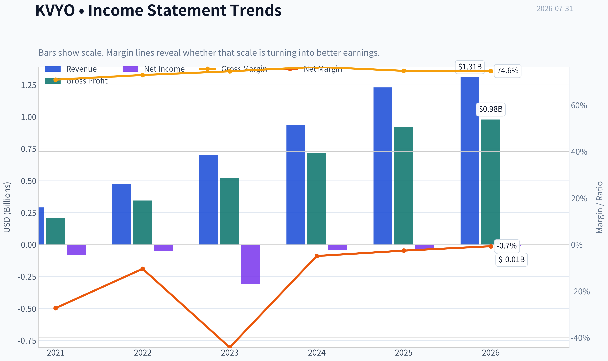

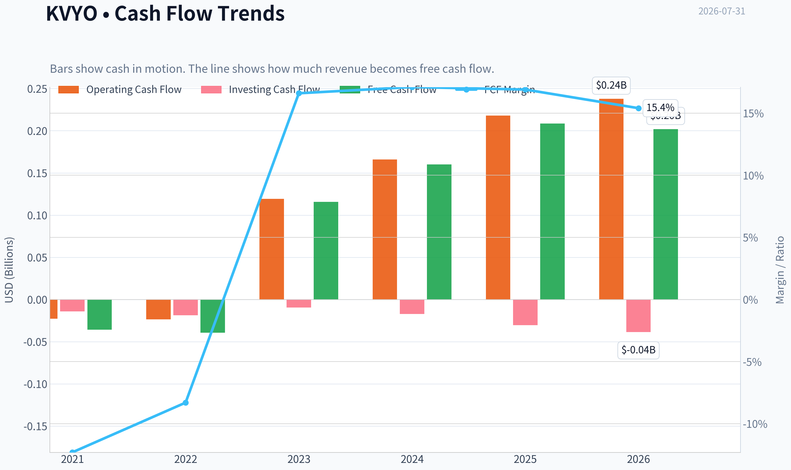

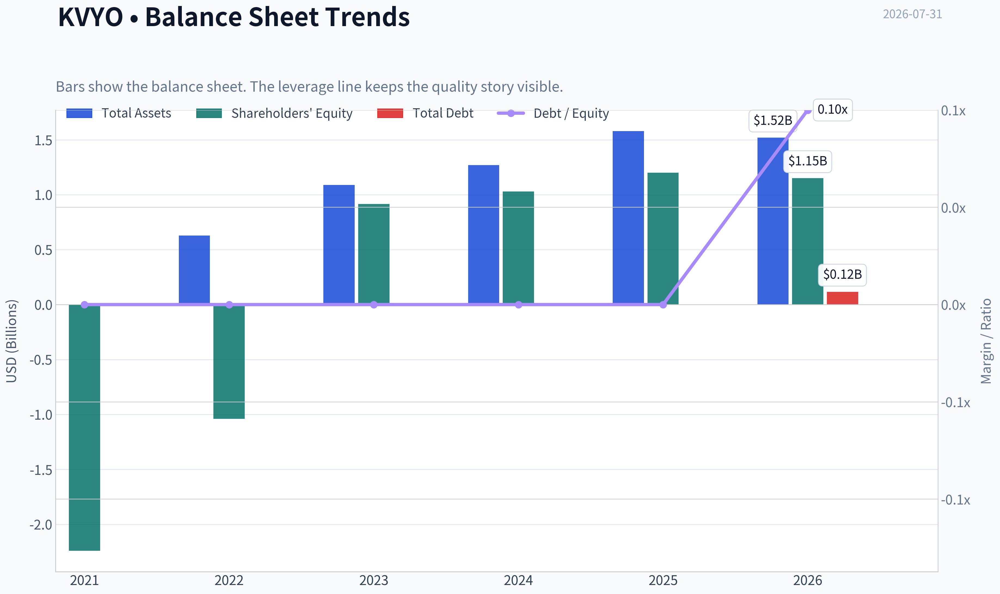

This graph tracks the profitability and return metrics (ROE, ROIC, Margins) of **KVYO** over the past decade, highlighting capital efficiency trends.

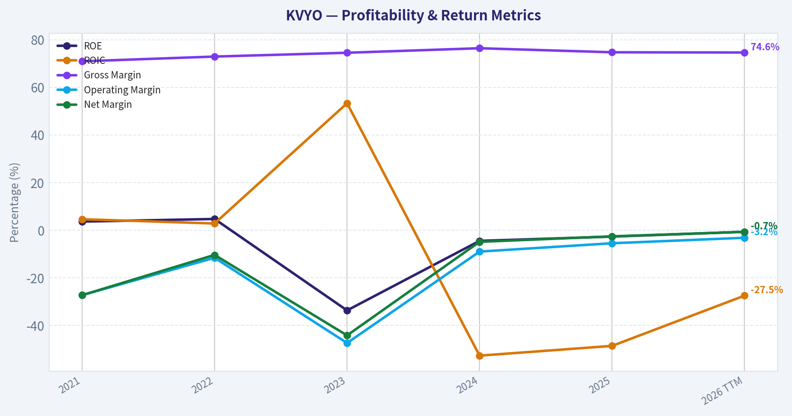

This chart illustrates the financial health of **KVYO** over the last 10 years, mapping cash equivalents and free cash flow against total obligations (Debt).

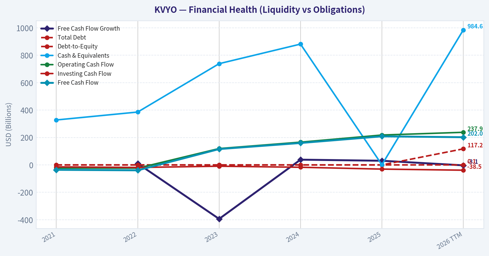

---

### Intrinsic Value Analysis (Buffett)

> *Following Warren Buffett's value investing philosophy: Circle of Competence, Economic Moat, Management Quality, and Margin of Safety.*

#### Intrinsic Value Snapshot

Price is what you pay. Intrinsic value is what the business may be worth based on the cash it can create for owners over time. We show a range, not one magic number.

- Current Price: $17.84
- Value Range (conservative to optimistic across both DCF methods): $26.60 to $32.13

##### Owner Earnings (Buffett Method)
- Net Income: $-31,768,000.00
- Depreciation & Amortization: $18,598,000.00
- Capital Expenditures: $-9,485,000.00
- Working Capital Changes: $-37,624,000.00
- Owner Earnings: $14,969,000.00

##### Intrinsic Value
###### Cash Flow Method
Uses free cash flow. Better for companies spending heavily today to grow tomorrow.
- Conservative: $26.60
- Average: $26.60
- Optimistic: $32.13
- Discount Rate: 10.0%

ANALYST STANCE: **OSSERVARE (WATCH)**

#### Tesi sintetica

Klaviyo è una piattaforma software per CRM e marketing automation B2C: aiuta marchi digitali ed e-commerce a raccogliere dati clienti, segmentare il pubblico e automatizzare campagne email, SMS e altri canali. Il business è comprensibile, asset-light, in forte crescita e con gross margin da software di qualità. Tuttavia, la redditività GAAP non è ancora pienamente dimostrata, la concorrenza è intensa e la valutazione richiede ancora una buona dose di fiducia nella crescita futura.

La conclusione Buffett-style è: **buon business, potenziale moat in formazione, prezzo non abbastanza ovvio da comprare aggressivamente oggi**.

---

#### 1. Factor Scorecard e Gate 5

| Fattore | Punteggio 0-5 | Valutazione |
|---|---:|---|
| 1. Circle of Competence & prevedibilità | 3.5 | Modello semplice: software CRM per clienti B2C, venduto in abbonamento. Prevedibilità buona ma non ancora decennale, perché la società è giovane e il mercato evolve rapidamente con AI e concorrenza. |
| 2. Moat / vantaggio competitivo | 3.4 | Gross margin molto alto, switching costs reali nei dati cliente e nei workflow, ma mercato competitivo contro Braze, HubSpot, Salesforce, Adobe, Mailchimp e strumenti AI emergenti. |
| 3. Management e allocazione capitale | 3.2 | Profilo positivo da società founder-led e orientata alla crescita; ancora da provare la disciplina di lungo periodo su stock-based compensation, diluizione e conversione in utili GAAP. |
| 4. Struttura del settore | 3.3 | Software B2C CRM con forte runway, ma competitivo e soggetto a compressione dei prezzi se l'automazione AI diventa più standardizzata. |
| Gate 5 - qualità/solvibilità | Non tripped | Nessun segnale di distress: FCF positivo, current ratio elevato e nessuna evidenza di incapacità di coprire gli obblighi finanziari. |

**Punti chiave:** Klaviyo supera il test di comprensibilità: vende software che aiuta i brand a comunicare meglio con i clienti. La qualità del business è promettente, ma il moat non è ancora "wide and proven". Il Gate 5 non è attivato: non siamo davanti a una società in stress finanziario.

---

#### 2. Moat Analysis

| Fonte di moat | Evidenza | Valutazione |
|---|---|---|
| Intangible assets / brand | Gross margin 74.7%, reputazione forte presso e-commerce e brand digitali, integrazione storica con ecosistemi commerce come Shopify. | Buona, ma non paragonabile a un brand consumer insostituibile. |
| Switching costs | Dati clienti, segmentazioni, automazioni, template, metriche e integrazioni diventano parte del workflow operativo del merchant. | Reali e importanti, soprattutto per clienti con database e campagne complesse. |
| Cost advantage | Asset-light e scalabile; margini lordi elevati indicano buona leva software. | Buono, ma non esclusivo: altri player SaaS hanno economie simili. |
| Network effects | Alcuni benefici da benchmark, dati aggregati e integrazioni, ma non un vero network effect dominante. | Limitato. |
| Pricing power | Probabile capacità di prezzo moderata presso clienti con ROI misurabile; più debole presso piccoli merchant sensibili al costo. | Moderata. |

**Punti chiave:** Il moat principale di Klaviyo deriva da switching costs e dati proprietari dei clienti, non da un monopolio naturale. Il gross margin sopra il 70% è un segnale forte di economia software, ma la concorrenza resta seria. Il moat è meglio descritto come **narrow-to-medium e in costruzione**, non ancora wide.

---

#### 3. Management Quality Assessment

| Area | Giudizio |
|---|---|
| Mentalità da proprietari | Positiva: Klaviyo mantiene cultura da founder-led software company, con orientamento alla crescita di lungo periodo. |
| Trasparenza | Adeguata per società pubblica recente; da monitorare la chiarezza su retention, net revenue retention, stock-based compensation e margini normalizzati. |
| Allocazione capitale | Reinvestimento aggressivo in prodotto, go-to-market e AI/automation; razionale se il ritorno sul capitale incrementale resta alto. |
| Rischi principali | Diluizione da stock compensation, passaggio CFO nel 2026, mancata conversione della crescita in utili GAAP sostenibili. |
| Buyback/dividendi | Non prioritari; corretto reinvestire finché il runway resta ampio. |

**Punti chiave:** Il management sembra coerente con una società software in fase di espansione, ma Buffett chiederebbe prova di disciplina per molti anni. La creazione di valore dipenderà dalla capacità di trasformare crescita e gross margin in FCF per azione, non solo in ricavi. La stock-based compensation è il punto da sorvegliare più attentamente.

---

#### 4. Financial Summary

| Metrica | Valore attuale / più recente | Lettura Buffett-style |
|---|---:|---|
| Prezzo azione | $18.00 | Prezzo di mercato di riferimento. |
| Market cap | $5.34B | Valutazione già significativa per una società ancora in fase di maturazione reddituale. |
| P/E | N/A | Utili GAAP non ancora stabilmente positivi. |
| ROE | -2.7% | Redditività contabile ancora debole. |
| Gross margin | 74.7% | Molto forte; indica economia software di qualità. |
| Revenue growth YoY | 31.6% | Crescita elevata, coerente con un business con runway. |
| FCF yield | 3.9% | FCF positivo, ma non ancora a livello "cheap" su base conservativa. |
| Current ratio | 4.27x | Bilancio liquido e prudente. |
| Intrinsic value - modello FCF | $26.60 | Implica upside significativo se il FCF è sostenibile e cresce. |
| Intrinsic value - modello FCFF punitivo | -$29.79 | Evidenzia forte sensibilità della valutazione a ipotesi di margini, reinvestimento e normalizzazione. |
| Reverse-DCF | ~66.3% crescita annua implicita per 10 anni | Segnale di attenzione: il mercato richiede un'esecuzione molto forte. |

**Punti chiave:** I numeri mostrano una società con qualità economica evidente nel gross margin e nella crescita. Tuttavia, ROE negativo e P/E non significativo indicano che la redditività GAAP non è ancora pienamente consolidata. Il punto centrale è se Klaviyo potrà convertire la crescita in FCF per azione senza eccessiva diluizione.

---

#### 5. Owner Earnings Calculation

Uso il FCF come proxy prudente degli owner earnings, perché per una società software asset-light il capex fisico è meno rilevante e la vera questione è la conversione del reddito operativo in cassa.

| Voce | Calcolo / Valore |
|---|---:|
| Market cap | $5.34B |
| FCF yield | 3.9% |
| FCF stimato | ~$208M |
| Owner earnings proxy | ~$208M |
| Azioni stimate | ~$5.34B / $18 = ~296.7M |
| Owner earnings per share | ~$0.70 |

**Punti chiave:** Klaviyo genera già free cash flow positivo, un segnale importante per una società software giovane. A $18 per azione, il mercato paga circa 25-26 volte gli owner earnings stimati. Questo non è irragionevole per un software business di qualità, ma richiede crescita sostenuta.

---

#### 6. Three-Scenario DCF Valuation

Assunzioni: owner earnings iniziali circa $208M, discount rate 10%, azioni stimate circa 296.7M.

| Scenario | Assunzioni | Valore equity stimato | Valore per azione |
|---|---|---:|---:|
| A. No Growth | Owner earnings / 10% | ~$2.08B | ~$7.02 |
| B. Crescita GDP | Crescita perpetua 3% | ~$3.06B | ~$10.31 |
| C. Crescita storica normalizzata | 10% per 10 anni, poi 3% terminale | ~$5.15B | ~$17.37 |
| Cross-check modello FCF | Valutazione FCF esterna | - | $26.60 |

**Punti chiave:** La valutazione è molto sensibile alla crescita. Senza crescita, Klaviyo vale molto meno del prezzo attuale; con crescita moderata ma sostenuta si avvicina al prezzo di mercato. Il modello FCF più favorevole suggerisce upside, ma il DCF interno conservativo dice che il prezzo attuale è vicino al fair value.

---

#### 7. Margin of Safety Analysis

| Riferimento di valore | Valore per azione | Upside / downside vs $18 | Interpretazione |
|---|---:|---:|---|
| DCF No Growth | $7.02 | -61% | Nessun margine se la crescita rallenta drasticamente. |
| DCF GDP Growth | $10.31 | -43% | Ancora sotto il prezzo attuale. |
| DCF crescita 10% normalizzata | $17.37 | -3% | Quasi fair value, ma senza margine evidente. |
| Modello FCF | $26.60 | +48% | Offre margine adeguato se FCF e crescita sono sostenibili. |
| Reverse-DCF | Crescita implicita ~66.3% annua | Esigente | Il prezzo incorpora aspettative elevate sotto alcune ipotesi. |

**Punti chiave:** Per una società di qualità media-alta ma non ancora "wide moat", servirebbe idealmente un margine di sicurezza del 25-35%. Questo margine appare solo nel modello FCF più favorevole, non negli scenari più conservativi. Per questo il titolo è interessante, ma non abbastanza ovvio da meritare un acquisto aggressivo.

---

#### 8. Final Buffett Scorecard

| Criterio | Peso | Punteggio 0-5 | Contributo ponderato |
|---|---:|---:|---:|
| Moat Width & Durability | 25% | 3.4 | 0.85 |
| Valutazione / Margin of Safety | 20% | 2.6 | 0.52 |
| Capital Returns - ROIC vs WACC | 15% | 2.5 | 0.38 |
| Business Understanding & Predictability | 12% | 3.5 | 0.42 |
| Management Quality & Capital Allocation | 12% | 3.2 | 0.38 |
| Reinvestment Runway | 8% | 4.2 | 0.34 |
| Balance Sheet Strength | 4% | 4.5 | 0.18 |
| Industry Structure | 4% | 3.3 | 0.13 |
| **Totale** | **100%** | - | **3.20 / 5.00** |

**Punti chiave:** Il punteggio finale colloca Klaviyo nella fascia "WATCH". La qualità del business e il runway sono reali, ma la valutazione e la redditività ancora non pienamente dimostrata impediscono una stance più forte. Buffett probabilmente aspetterebbe o un prezzo migliore, o più anni di prova su FCF per azione e ROIC.

---

#### 9. Investment Stance

| Stance | Conviction | Prezzo attuale | Giudizio |
|---|---|---:|---|
| **OSSERVARE (WATCH)** | Media | $18.00 | Business attraente, ma margine di sicurezza non abbastanza robusto. |

**Punti chiave:** Klaviyo è una società da seguire con attenzione, non da scartare. Il business ha caratteristiche da possibile compounder software: alta crescita, gross margin elevato, switching costs e bilancio sano. La disciplina Buffett suggerisce però di attendere una valutazione più favorevole o una prova più chiara di redditività GAAP, FCF per azione e ritorni sul capitale sostenibili.

#### Conclusione operativa

**OSSERVARE.** Diventerei più costruttivo se una delle due condizioni si verificasse:
1. il prezzo scendesse abbastanza da offrire un margine di sicurezza più chiaro, idealmente sotto area **$14-15** a parità di fondamentali; oppure
2. Klaviyo dimostrasse per più periodi che la crescita sopra il 25-30% può convivere con FCF margin in espansione, diluizione contenuta e ROIC positivo.

A $18, Klaviyo è un buon business a un prezzo circa equo, non ancora un meraviglioso business a prezzo chiaramente conveniente.
#### Valuation Bridge

This bridge places the current market price beside each intrinsic value lens so readers can see whether upside depends on one method or shows up across several methods.

| Scenario | Intrinsic Value / Share |
| --- | ---: |
| Cash Flow Method | $26.60 |
| Damodaran Method | $-29.79 |
| Current Price | $17.84 |

#### Key Takeaways

If one method is far above the others, the upside case depends on a specific modelling assumption. When several methods cluster together, the valuation story is more robust.

#### Valuation Visuals

This comparison chart from *Latest Earnings Snapshot* stacks current figures against historical benchmarks for **KVYO**, making it easy to see where the company trades relative to its own averages.

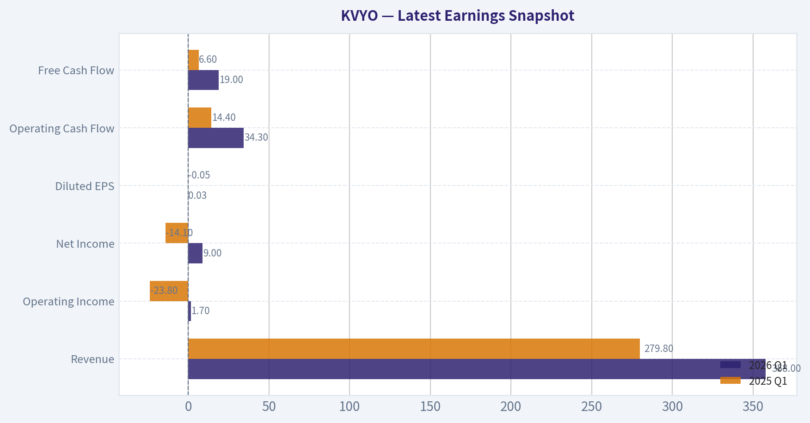

This comparison chart from *Confronto valori correnti vs medie storiche disponibili* stacks current figures against historical benchmarks for **KVYO**, making it easy to see where the company trades relative to its own averages.

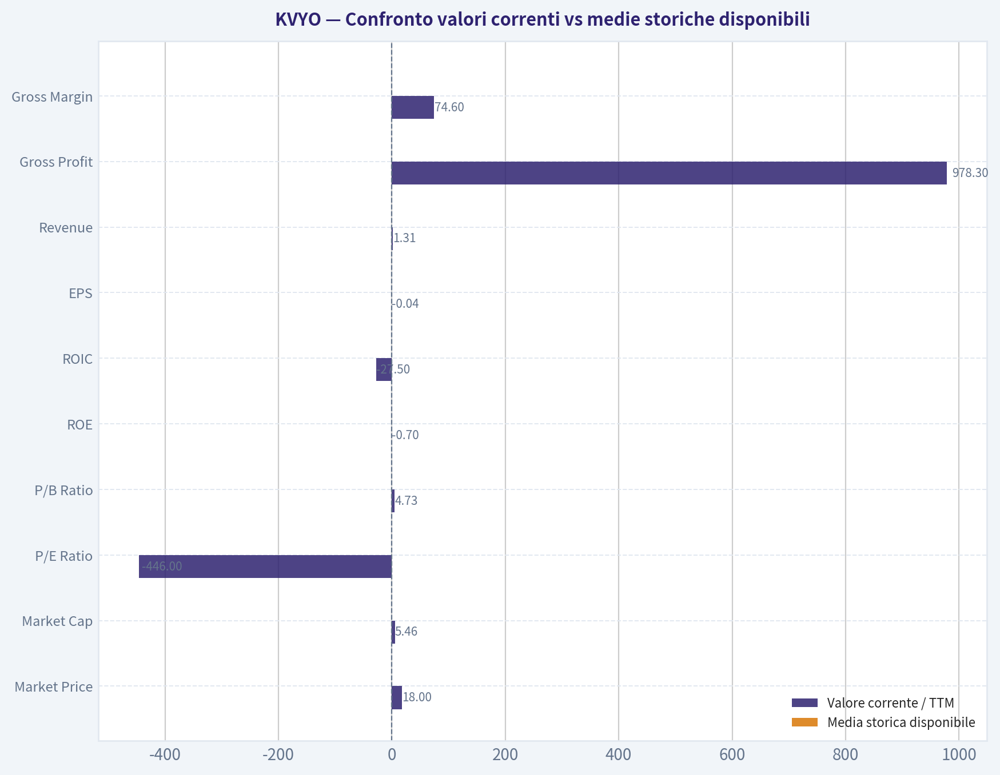

This comparison chart from *Financial Summary* stacks current figures against historical benchmarks for **KVYO**, making it easy to see where the company trades relative to its own averages.

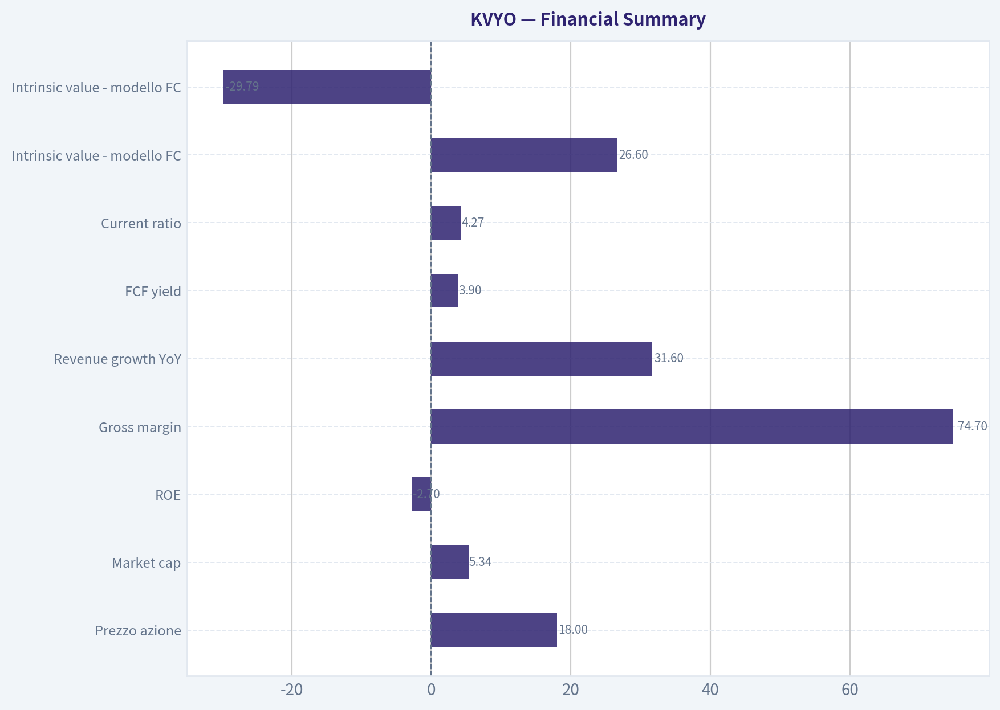

This comparison chart from *Owner Earnings Calculation* stacks current figures against historical benchmarks for **KVYO**, making it easy to see where the company trades relative to its own averages.

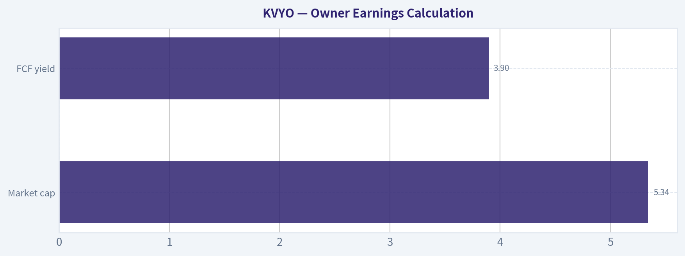

This comparison chart from *Margin of Safety Analysis* stacks current figures against historical benchmarks for **KVYO**, making it easy to see where the company trades relative to its own averages.

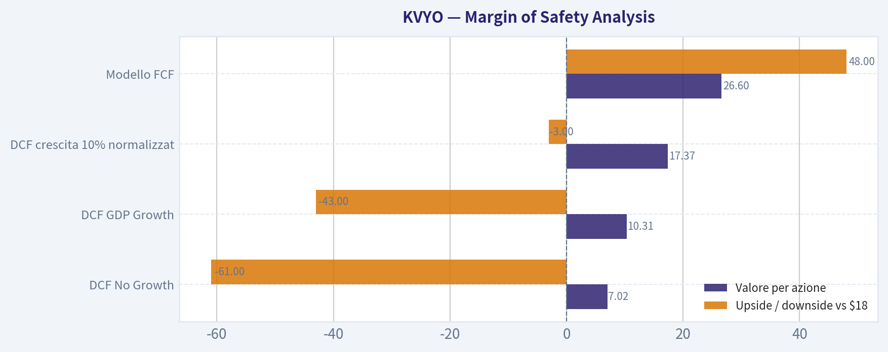

---

### Trend & Growth Analysis (Lynch/Druckenmiller/Fisher)

> *Following Peter Lynch's GARP, Stanley Druckenmiller's macro-aware approach, and Philip Fisher's scuttlebutt methodology.*

ANALYST STANCE: **SOSTENERE**

#### KVYO - Klaviyo: tesi growth sintetica

Klaviyo è un fornitore di software CRM e marketing automation per brand consumer, nato con forte esposizione all'e-commerce e oggi in espansione verso un più ampio sistema operativo per la relazione diretta con il cliente. La società combina dati proprietari dei clienti, automazione marketing, messaggistica e AI per aiutare i brand a vendere di più tramite email, SMS e canali digitali.

| Dato chiave | Valore |
|---|---:|
| Prezzo attuale | $18 |
| Capitalizzazione di mercato | $5,34B |
| Crescita ricavi YoY | 31,6% |
| Gross margin | 74,7% |
| FCF yield | 3,9% |
| ROE | -2,7% |
| Current ratio | 4,27x |
| P/E | N/A |
| Modello FCF, valore indicativo | $26,60 |
| Reverse DCF indicativo | prezzo implica circa 66,3% annuo per 10 anni |

**Key Takeaways:** Klaviyo mostra un profilo da software growth di qualità: crescita sopra il 30%, gross margin elevato e FCF già positivo. La valutazione non appare estrema su base FCF yield e multiplo dei ricavi stimato, ma il reverse DCF segnala che il mercato sta comunque prezzando aspettative elevate e difficili da sostenere per molti anni.

---

#### 1. Classificazione Lynch

| Categoria Lynch | Valutazione per KVYO |
|---|---|
| Slow Grower | No |
| Stalwart | No |
| Fast Grower | Sì |
| Cyclical | No, anche se sensibile alla spesa e-commerce e marketing |
| Turnaround | No |
| Asset Play | No |

**Key Takeaways:** Klaviyo rientra chiaramente nella categoria "Fast Grower" di Peter Lynch. La crescita dei ricavi al 31,6% è ben sopra la soglia dei titoli stalwart e pone l'azienda in territorio da potenziale multi-bagger, purché la crescita resti sostenibile e la valutazione non incorpori già tutto il futuro upside.

#### 2. La storia in 3 punti

- Klaviyo aiuta i brand consumer a vendere di più usando i dati proprietari dei clienti per inviare comunicazioni personalizzate via email, SMS e canali digitali.
- Il passaggio da pubblicità pagata su piattaforme terze a relazioni dirette con il cliente favorisce strumenti di CRM, automazione e retention.
- L'AI può aumentare il valore della piattaforma automatizzando segmentazione, contenuti, campagne e ottimizzazione del customer lifetime value.

#### 3. TAM e 10x test

| Voce | Stima / Lettura |
|---|---:|
| Ricavi attuali stimati, indicativi | circa $1,2B-$1,4B |
| Ricavi necessari per 10x | circa $12B-$14B |
| TAM rilevante | B2C CRM, marketing automation, CDP, messaging, AI commerce |
| TAM stimato di lungo periodo | probabilmente $60B-$100B+ se si include CRM consumer esteso |
| Quota implicita a 10x | circa 12%-23%, secondo TAM considerato |
| Esito 10x test | Superato, ma richiede espansione oltre il solo e-commerce SMB |

**Key Takeaways:** Il runway è interessante perché Klaviyo può crescere oltre il nucleo storico dell'e-commerce, spostandosi verso CRM consumer, dati, AI e automazione omnicanale. Il 10x test è plausibile se il mercato indirizzabile viene definito in modo ampio; sarebbe più difficile se l'azienda restasse confinata al marketing automation per merchant e-commerce.

#### 4. Trend di crescita dei ricavi

| Metrica | Lettura |
|---|---|
| Crescita ricavi YoY attuale | 31,6% |
| Pattern | Crescita alta, da monitorare per eventuale decelerazione |
| Qualità della crescita | Probabilmente guidata da espansione clienti, upsell e penetrazione software |
| Interpretazione Lynch/Druckenmiller | Fast Grower con possibile inflection AI/CRM, ma serve conferma multi-trimestre |

**Key Takeaways:** La crescita al 31,6% è sufficientemente alta da rendere Klaviyo un titolo da crescita primaria. Il punto critico non è se l'azienda stia crescendo, ma se riuscirà a mantenere un ritmo sopra il 25% mentre scala oltre il miliardo di ricavi.

#### 5. Unit economics e Rule of 40

| Metrica | Valore / Stima | Giudizio |
|---|---:|---|
| LTV/CAC | Non disponibile nel pacchetto dati | Da verificare |
| NRR | Non disponibile nel pacchetto dati | Da verificare |
| Gross margin | 74,7% | Forte |
| FCF yield | 3,9% | Buono per un grower |
| FCF stimato da market cap | circa $208M |
| FCF margin stimato | circa 15%-17%, usando ricavi indicativi |
| Rule of 40 stimata | circa 47%-49% | Sana crescita efficiente |

**Key Takeaways:** Anche senza LTV/CAC e NRR puntuali, i proxy sono positivi: gross margin alto e FCF positivo suggeriscono un modello software scalabile. La Rule of 40 stimata sopra 40 è un segnale importante: Klaviyo non sta comprando crescita a qualsiasi costo, ma sembra già generare cassa mentre cresce rapidamente.

---

#### 6. Inflection point assessment

| Tipo di inflection | Evidenza | Valutazione |
|---|---|---|
| Product cycle | AI, automazione CRM, espansione da email/SMS a piattaforma B2C più ampia | Positiva |
| Market share | Crescita >30% suggerisce share gain o espansione categoria | Positiva |
| Margin inflection | FCF positivo e gross margin 74,7% | Positiva |
| TAM inflection | CRM consumer e first-party data diventano più importanti | Positiva |
| Competitive inflection | Competizione forte da HubSpot, Salesforce, Adobe, Shopify ecosystem | Mista |

**Key Takeaways:** L'inflection più interessante è il passaggio da tool di marketing e-commerce a piattaforma dati e CRM per brand consumer. Se Klaviyo dimostra di poter espandere il wallet share dei clienti e spostarsi upmarket, il mercato potrebbe sottostimare gli utili e il FCF dei prossimi 2-3 anni.

#### 7. Setup macro

| Fattore macro | Impatto su KVYO |
|---|---|
| Tassi d'interesse | Tassi in calo sarebbero positivi per multipli growth |
| Spesa marketing | Sensibile a cicli economici e budget dei merchant |
| E-commerce | Trend secolare favorevole, ma non lineare |
| AI | Vento secolare favorevole, ma anche rischio competitivo |
| Software SaaS | Valutazioni ancora selettive; premiati i nomi con FCF reale |

**Key Takeaways:** Il contesto macro è moderatamente favorevole: software efficiente, AI e first-party data sono temi secolari robusti. Il rischio è che una contrazione della spesa marketing o una rotazione fuori dal software riduca il multiplo anche se i fondamentali restano solidi.

#### 8. Fisher 15 Points

| Punto Fisher | Punteggio 1-5 | Commento |
|---|---:|---|
| 1. Mercato con potenziale vendite | 5 | CRM e marketing automation hanno runway ampio |
| 2. Determinazione a sviluppare nuovi prodotti | 4 | Espansione AI e piattaforma B2C |
| 3. R&D efficace | 4 | Software data-driven, ma serve prova continua |
| 4. Sales organization | 4 | Crescita >30% indica buon go-to-market |
| 5. Margini profittevoli | 4 | Gross margin elevato, utile netto ancora non maturo |
| 6. Margini in miglioramento | 4 | FCF positivo suggerisce leva operativa |
| 7. Relazioni con personale | 3 | Dati insufficienti |
| 8. Relazioni executive | 3 | Cambio CFO da monitorare |
| 9. Profondità manageriale | 3 | Azienda giovane quotata |
| 10. Controllo costi/accounting | 4 | Current ratio forte e FCF positivo |
| 11. Moat | 4 | Dati clienti, workflow, switching cost |
| 12. Outlook profitti lungo termine | 4 | Buona scalabilità software |
| 13. Rischio diluizione | 3 | Da monitorare stock-based compensation |
| 14. Candore management | 3 | Non valutabile pienamente dal pacchetto |
| 15. Integrità management | 3 | Nessun red flag materiale nel pacchetto |
| **Totale** | **55/75** | **Buono** |

**Key Takeaways:** Il Fisher score è buono, non ancora eccezionale. Klaviyo ha mercato, prodotto e margini lordi da società di alta qualità, ma servono più prove sulla profondità manageriale, sulla sostenibilità dell'upmarket motion e sull'effettiva forza del moat contro grandi piattaforme software.

#### 9. Valutazione

| Metodo | Lettura |
|---|---|
| PEG | Non applicabile, P/E N/A |
| P/S stimato | circa 4x-4,5x, usando ricavi indicativi $1,2B-$1,4B |
| FCF yield | 3,9%, interessante per crescita >30% |
| Modello FCF | valore indicativo $26,60 vs prezzo $18 |
| Headline intrinsic value | negativo e poco utile per un grower con modelli sensibili agli input |
| Reverse DCF | richiede crescita molto elevata di lungo periodo, segnale di cautela |

**Key Takeaways:** La valutazione appare ragionevole rispetto a molte società SaaS con crescita sopra il 30%, soprattutto grazie al FCF yield positivo. Tuttavia, il reverse DCF è un campanello d'allarme: per giustificare pienamente il prezzo con modelli conservativi, Klaviyo deve continuare a crescere rapidamente e convertire questa crescita in FCF duraturo.

#### 10. Scenario analysis

| Scenario | Ipotesi 3-5 anni | Esito potenziale |
|---|---|---|
| Bear | Crescita scende sotto 20%, competizione comprime multipli, FCF margin stabile ma non accelera | Rendimento debole o negativo |
| Base | Crescita 22%-28%, FCF margin verso 18%-22%, multiplo ricavi 5x-6x | Upside moderato-buono |
| Bull | Crescita resta >30%, AI/CRM espande TAM, FCF margin >25%, multiplo 7x-9x | Potenziale multi-bagger, non ancora 10x immediato |

**Key Takeaways:** La tesi non richiede necessariamente perfezione: anche uno scenario base può offrire buon upside se Klaviyo mantiene crescita sopra il 20% e aumenta la leva operativa. Lo scenario bull diventa molto potente solo se l'azienda dimostra che non è più un semplice tool e-commerce, ma una piattaforma CRM B2C strategica.

#### 11. Growth Investor Scorecard

| Criterio | Peso | Punteggio 1-5 | Contributo |
|---|---:|---:|---:|
| Story Lynch | 10% | 4,0 | 0,40 |
| TAM e runway | 20% | 4,0 | 0,80 |
| Crescita ricavi | 20% | 4,2 | 0,84 |
| Unit economics | 15% | 3,8 | 0,57 |
| Posizione competitiva | 10% | 3,5 | 0,35 |
| Management quality | 10% | 3,2 | 0,32 |
| Macro setup | 5% | 3,5 | 0,18 |
| Percorso a profittabilità | 5% | 4,0 | 0,20 |
| Valutazione | 5% | 3,7 | 0,19 |
| **Totale** | **100%** |  | **3,85/5,00** |

**Key Takeaways:** Il punteggio complessivo di 3,85 colloca Klaviyo in area "Sostenere", non ancora in area massima convinzione. La combinazione di crescita, margini lordi, FCF e runway è attraente; le principali riserve riguardano competizione, dati mancanti su NRR e LTV/CAC, e aspettative implicite elevate.

---

#### 12. Stance e position sizing

| Voce | Indicazione |
|---|---|
| Stance | **SOSTENERE** |
| Tipo posizione | Posizione growth controllata |
| Size iniziale suggerita | 3%-5% per portafoglio growth concentrato |
| Aggiungere se | Crescita resta >25%, Rule of 40 >40, NRR solido, margini FCF in espansione |
| Ridurre se | Crescita scende sotto 20% senza chiara riaccelerazione o competizione comprime pricing |
| Orizzonte | 3-5 anni minimo |

**Key Takeaways:** Klaviyo merita una posizione, ma non una size massima finché non si confermano NRR, upmarket traction e sostenibilità della crescita. Il profilo è adatto a un investitore growth paziente disposto a sopportare volatilità nel software.

#### 13. Rischi e catalizzatori

| Rischi principali | Catalizzatori principali |
|---|---|
| Decelerazione dei ricavi sotto 20%-25% | Trimestri con crescita >30% e guidance rialzata |
| Competizione da Salesforce, Adobe, HubSpot, Shopify e nuovi strumenti AI | Espansione AI che aumenta ARPU e retention |
| Dipendenza da merchant e-commerce e budget marketing | Crescita clienti enterprise e multi-prodotto |
| Stock-based compensation e possibile diluizione | FCF margin in aumento |
| Cambio CFO da monitorare | Interesse istituzionale, incluso incremento Point72/Steve Cohen secondo 13F |
| Reverse DCF esigente | Re-rating se il mercato riconosce Klaviyo come CRM B2C strategico |

**Key Takeaways:** Il rischio chiave è che Klaviyo venga valutata come piattaforma strategica ma si comporti ancora come software verticale legato all'e-commerce. Il catalizzatore più importante sarebbe la prova che l'azienda può crescere upmarket, monetizzare AI e mantenere FCF positivo senza sacrificare il tasso di crescita.

#### Conclusione

Klaviyo è un **Fast Grower di buona qualità** con crescita superiore al 30%, gross margin elevato, FCF positivo e un TAM che può espandersi grazie ad AI, first-party data e CRM consumer. La tesi da ten-bagger non è ancora pienamente dimostrata, ma il setup da multi-bagger è reale se l'azienda mantiene crescita sopra il 25% e amplia il proprio ruolo da marketing automation a piattaforma B2C CRM. Stance: **SOSTENERE**, con posizione controllata e aggiunte solo su conferme operative.

#### Growth & Scorecard Visuals

This comparison chart from *Factor Scorecard e Gate 5* stacks current figures against historical benchmarks for **KVYO**, making it easy to see where the company trades relative to its own averages.

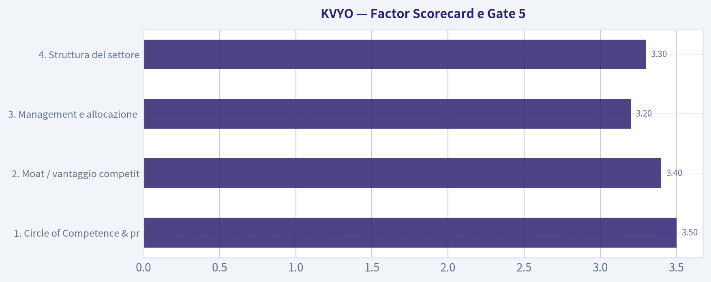

---

### Market Technical Analysis

ANALYST STANCE: **OSSERVARE**

#### KVYO - quadro tecnico al 31 luglio 2026

KVYO mostra un recupero tattico credibile dopo il minimo di giugno, ma il titolo non ha ancora riconquistato una struttura rialzista primaria. Il movimento da circa 12,86 dollari di fine giugno fino all'area 19-20 dollari di fine luglio segnala una forte rotazione di breve periodo; tuttavia, il prezzo resta ancora sotto la media mobile a 200 giorni, che continua a scendere. Per questo motivo il profilo è più adatto a monitoraggio attivo o trading tattico che a un segnale direzionale pienamente confermato.

Ho selezionato questi 8 indicatori perché coprono trend breve, medio e lungo, momentum, volatilità e conferma tramite volumi senza eccessiva ridondanza: **close_10_ema, close_50_sma, close_200_sma, macd, macds, rsi, atr, vwma**.

| Indicatore | Valore più recente disponibile | Lettura tecnica | Implicazione operativa |
|---|---:|---|---|
| Prezzo di chiusura | 18,35 | Sopra EMA 10, SMA 50 e VWMA, ma sotto SMA 200 | Recupero di breve, trend primario ancora fragile |
| close_10_ema | 17,81 | Prezzo sopra la media veloce | Momentum breve ancora positivo |
| close_50_sma | 15,85 | Prezzo nettamente sopra la media intermedia | Miglioramento del trend secondario |
| close_200_sma | 21,44 | Prezzo ancora sotto la media lunga | Struttura primaria ribassista/non confermata |
| MACD | 0,64 | Sopra lo zero | Momentum positivo |
| MACD Signal | 0,57 | MACD ancora sopra il segnale | Segnale rialzista, ma in lieve perdita di spinta |
| RSI | 55,05 | Zona neutrale-positiva | Non ipercomprato, spazio teorico per rialzo |
| ATR | 1,12 | Volatilità elevata, circa 6% del prezzo | Necessaria gestione prudente del rischio |
| VWMA | 17,79 | Prezzo sopra VWMA | Conferma moderata dai volumi |

**Key Takeaways:** KVYO è migliorata sensibilmente nel breve periodo: il prezzo è sopra la EMA a 10 giorni, la SMA a 50 giorni e la VWMA. Il problema principale è che resta sotto la SMA a 200 giorni, quindi il recupero non è ancora una vera inversione primaria. Il momentum è positivo ma meno brillante rispetto al picco del 29 luglio, mentre la volatilità rimane alta.

#### Lettura del trend

La struttura di lungo periodo resta danneggiata. Nell'ultimo anno KVYO è passata da aree superiori a 30 dollari a un minimo vicino a 12,86 dollari in giugno, con una discesa molto ampia e accompagnata da volumi elevati in più fasi. La media mobile a 200 giorni è ancora inclinata verso il basso, scesa da circa 24,51 a inizio giugno a circa 21,41 a fine luglio. Questo indica che il mercato sta ancora "digerendo" la precedente fase ribassista.

Il quadro di medio periodo, però, è più costruttivo. La SMA a 50 giorni ha smesso di scendere e ha iniziato a risalire da metà luglio, passando da circa 15,37 a 15,92. Il fatto che il prezzo sia ora sopra questa media suggerisce che i compratori hanno ripreso controllo nel timeframe intermedio. Finché KVYO rimane sopra l'area 15,50-16,00, il recupero resta tecnicamente valido.

Nel breve periodo, la EMA a 10 giorni è salita con decisione da circa 14,1 a fine giugno a 17,8 a fine luglio. Questo conferma la forza del rimbalzo, ma la candela del 30 luglio, con chiusura a 18,35 dopo un massimo recente a 19,80 il giorno precedente, segnala una prima presa di profitto. Non è ancora una rottura ribassista, ma suggerisce che l'area 19,40-20,00 è diventata una resistenza importante.

#### Momentum e qualità del rimbalzo

Il MACD è passato da valori negativi profondi in giugno a valori positivi in luglio. Questo è uno dei segnali più incoraggianti: il momentum non è più solo un rimbalzo tecnico da ipervenduto, ma ha effettivamente superato la linea dello zero. Inoltre, il MACD rimane sopra la linea di segnale, quindi la configurazione resta rialzista.

La sfumatura importante è che il MACD ha iniziato a stabilizzarsi: il valore del 31 luglio è 0,64, leggermente sotto il recente massimo di 0,66 del 29 luglio. Questo non è un segnale di vendita automatico, ma indica che l'accelerazione rialzista si è ridotta dopo il movimento verso 19-20 dollari. In pratica, il titolo potrebbe aver bisogno di consolidare prima di tentare un nuovo breakout.

L'RSI a 55 è coerente con questa lettura. Non segnala ipercomprato, quindi non c'è un eccesso speculativo evidente. Tuttavia, il calo dell'RSI da circa 66 a 55 in pochi giorni mostra che la pressione d'acquisto si è raffreddata. Un ritorno dell'RSI sopra 60 con prezzo sopra 19,50 sarebbe un segnale di rinnovata forza; una discesa sotto 50 aumenterebbe invece il rischio di consolidamento più profondo.

#### Volumi e volatilità

La VWMA a 17,79 è vicina alla EMA a 10 giorni e sotto il prezzo di chiusura. Questo è positivo, perché indica che il recupero recente non è avvenuto solo su scambi deboli: il prezzo medio ponderato per i volumi si è alzato in modo visibile. I forti volumi del 28-29 luglio rafforzano l'idea che l'area 18-19 dollari abbia attirato interesse istituzionale o quantomeno partecipazione significativa.

La volatilità, però, è ancora un elemento di rischio. L'ATR a 1,12 equivale a circa il 6% del prezzo: per KVYO, movimenti giornalieri ampi restano normali. Questo significa che stop troppo stretti rischiano di essere colpiti dal rumore, mentre posizioni troppo grandi possono esporre a oscillazioni scomode. Un trader tattico dovrebbe dimensionare la posizione tenendo conto di questa ampiezza.

#### Livelli tecnici rilevanti

| Zona di prezzo | Ruolo tecnico | Perché conta |
|---:|---|---|
| 19,40-20,00 | Resistenza immediata | Area del massimo recente e possibile zona di presa di profitto |
| 21,40-21,50 | Resistenza primaria | Vicinanza alla SMA a 200 giorni |
| 17,80-17,90 | Supporto dinamico breve | Confluenza tra EMA 10 e VWMA |
| 15,50-16,00 | Supporto intermedio | Area della SMA 50 e base del recupero di luglio |
| 12,80-13,50 | Supporto maggiore | Zona dei minimi di giugno |

**Key Takeaways:** Il titolo deve superare 19,40-20,00 per dimostrare che il rimbalzo può continuare. La vera conferma di inversione arriverebbe solo sopra la SMA a 200 giorni, intorno a 21,40-21,50. Al ribasso, la perdita di 17,80 indebolirebbe il breve periodo, mentre una discesa sotto 15,50-16,00 comprometterebbe il miglioramento di medio periodo.

#### Scenario operativo

| Scenario | Condizione da osservare | Interpretazione | Possibile approccio |
|---|---|---|---|
| Rialzista tattico | Chiusura sopra 19,80-20,00 con volumi sostenuti | Il mercato assorbe le prese di profitto e prova a estendere il rimbalzo | Entrate graduali, target verso 21,40-21,50 |
| Conferma rialzista primaria | Recupero stabile sopra 21,50 | Rottura della SMA 200 e miglioramento strutturale | Maggiore fiducia nel trend, ma attendere tenuta del livello |
| Consolidamento sano | Prezzo tra 17,80 e 19,80 | Pausa dopo forte rialzo di luglio | Monitorare RSI e MACD per nuova accelerazione |
| Indebolimento | Chiusura sotto 17,80 | Perdita di EMA 10 e VWMA | Ridurre esposizione tattica o attendere nuova base |
| Rischio ribassista | Chiusura sotto 15,50-16,00 | Fallimento del recupero sopra la SMA 50 | Scenario da evitare finché non si ricostruisce supporto |

**Key Takeaways:** Il miglior scenario per KVYO sarebbe un consolidamento sopra 17,80 seguito da breakout sopra 20 dollari. La zona più importante da conquistare resta però 21,50, perché lì passa la media a 200 giorni. Sotto 17,80 il recupero perderebbe qualità, mentre sotto 16 dollari tornerebbe dominante il rischio ribassista.

#### Sintesi finale

| Categoria | Valutazione | Commento |
|---|---|---|
| Trend breve | Positivo | Prezzo sopra EMA 10 e VWMA |
| Trend medio | In miglioramento | Prezzo sopra SMA 50, che ha iniziato a risalire |
| Trend lungo | Ancora debole | Prezzo sotto SMA 200 discendente |
| Momentum | Moderatamente positivo | MACD sopra segnale e sopra zero, ma in lieve rallentamento |
| RSI | Costruttivo ma non forte | A 55, neutrale-positivo e lontano da ipercomprato |
| Volatilità | Alta | ATR circa 6% del prezzo, richiede prudenza |
| Volumi | Discretamente favorevoli | VWMA in salita e prezzo sopra VWMA |
| Stance | **OSSERVARE** | Recupero interessante, ma manca conferma sopra 20 e poi 21,50 |

**Key Takeaways:** KVYO merita attenzione perché il recupero di luglio è reale e sostenuto da segnali tecnici migliorati. Tuttavia, il titolo non ha ancora superato le resistenze che trasformerebbero il rimbalzo in inversione di lungo periodo. La stance più equilibrata è **OSSERVARE**, con possibile interesse operativo solo su tenuta sopra 17,80 e breakout sopra 20 dollari.

---

### Options Market Analysis

> *Reading options flow - put/call ratios, IV skew, and unusual activity - to gauge institutional positioning and event-driven risk.*

ANALYST STANCE: **OSSERVARE**

#### KVYO - Lettura del mercato opzioni al 31 luglio 2026

#### 1. Analisi Put/Call Ratio

| Scadenza | Call OI | Put OI | Put/Call OI | Volume Call | Volume Put | Put/Call Volume | Lettura |
|---|---:|---:|---:|---:|---:|---:|---|
| 21 ago 2026 | 12.763 | 3.230 | 0,25 | 192 | 543 | 2,83 | OI molto call-heavy, ma volume giornaliero dominato dai put |
| 18 set 2026 | 1.004 | 591 | 0,59 | 158 | 51 | 0,32 | Moderatamente rialzista / call-biased |
| 16 ott 2026 | 6.160 | 3.547 | 0,58 | 411 | 411 | 1,00 | Bilanciato sul volume, OI ancora call-biased |
| **Totale vicino termine** | **19.927** | **7.368** | **0,37** | **761** | **1.005** | **1,32** | OI rialzista, flusso giornaliero più difensivo |

**Key Takeaways:** L'open interest complessivo è fortemente inclinato verso le call: il Put/Call OI ratio di 0,37 è molto sotto la baseline neutrale di circa 0,70, segnalando posizionamento strutturalmente più rialzista. Tuttavia, il volume giornaliero mostra un Put/Call Volume ratio di 1,32, quindi nelle ultime transazioni c'è stata più attività sui put. La lettura migliore è: base di posizionamento rialzista, ma con copertura o protezione tattica nel brevissimo termine, soprattutto sulla scadenza di agosto.

---

#### 2. Valutazione della volatilità implicita

| Scadenza | IV ATM Call | IV ATM Put | Differenziale Call-Put | Lettura IV |
|---|---:|---:|---:|---|
| 21 ago 2026 | 105,3% | 94,1% | +11,2 punti | IV molto elevata, premio lato call |
| 18 set 2026 | 86,5% | 78,3% | +8,2 punti | IV ancora alta, call più care dei put |
| 16 ott 2026 | 81,6% | 72,7% | +8,9 punti | Volatilità elevata ma in calo con la durata |

**Key Takeaways:** La volatilità implicita su KVYO è elevata, con IV ATM sopra l'80% su tutte le scadenze osservate e oltre il 100% sulle call di agosto. Inoltre, le call ATM presentano IV superiore ai put ATM, il che suggerisce domanda relativa per upside o pricing più aggressivo sul lato rialzista. Non sono disponibili dati dettagliati su IV di put OTM contro call OTM, quindi la skew vera e propria non può essere confermata strike per strike.

La struttura IV mostra un profilo decrescente nel tempo: agosto è la scadenza più "carica", poi settembre e ottobre scendono gradualmente. Questo può indicare attesa di movimento nel breve termine, potenzialmente legata a rischio evento, earnings o flusso speculativo; senza calendario catalyst nel dataset, va trattato come segnale di rischio/prezzo elevato, non come conferma di evento specifico.

---

#### 3. Attività insolita sulle opzioni

| Criterio | Risultato |
|---|---|
| Contratti con volume > 5x open interest | Nessuno rilevato |
| Evidenza di nuove scommesse direzionali aggressive | Non confermata |
| Qualità del segnale da unusual activity | Bassa / assente |
| Implicazione | Il flusso non mostra sweep o aperture fresche chiaramente istituzionali nelle scadenze vicine |

**Key Takeaways:** Non risultano contratti con volume superiore a 5 volte l'open interest, quindi non emerge una singola posizione nuova e anomala da seguire. Il volume put elevato sulla scadenza di agosto è rilevante a livello aggregato, ma non si può attribuire con certezza a una specifica operazione "smart money". Questo riduce la forza del segnale direzionale immediato.

---

#### 4. Concentrazione dell'open interest e possibili livelli gravitazionali

| Area | Dato osservato | Interpretazione |
|---|---:|---|
| Scadenza con maggiore Call OI | 21 ago 2026: 12.763 call | Scadenza chiave per posizionamento rialzista / possibile pinning |
| Scadenza con maggiore Put OI | 16 ott 2026: 3.547 put | Protezione più distribuita sul medio breve termine |
| Maggiore concentrazione totale OI | 21 ago 2026 | Agosto è la scadenza più importante per rischio gamma vicino termine |
| Gamma wall strike-specifici | Non disponibili nel dataset | Impossibile identificare livelli di strike precisi |

**Key Takeaways:** La scadenza del 21 agosto concentra la quota più significativa di call open interest ed è quindi la più importante per possibili effetti di pinning o accelerazione gamma. Tuttavia, mancano i dati per strike, quindi non è possibile indicare livelli precisi di "gamma wall" o max pain. L'informazione utile è temporale: agosto appare la scadenza dominante per il rischio opzioni.

---

#### 5. Sintesi del sentiment opzioni

Il segnale complessivo delle opzioni su KVYO è **moderatamente BULLISH**, ma con una copertura tattica di breve periodo.

Il driver principale è il Put/Call OI ratio complessivo di **0,37**, molto inferiore alla baseline neutrale di circa **0,70**, che indica un posizionamento aperto decisamente più orientato alle call. Anche l'IV ATM delle call è sistematicamente superiore a quella dei put, suggerendo che il mercato sta assegnando un premio relativo all'upside o alla partecipazione rialzista.

La cautela deriva però dal volume giornaliero: il Put/Call Volume ratio aggregato è **1,32**, e sulla scadenza del 21 agosto sale a **2,83**. Questo segnala che, pur dentro un contesto di OI rialzista, il flusso più recente ha visto domanda di put, potenzialmente come copertura prima di un evento o come protezione dopo un movimento del titolo. L'assenza di unusual activity contract-specifica impedisce di classificare il movimento come forte segnale istituzionale.

#### Segnale finale

| Categoria | Valutazione |
|---|---|
| Put/Call Ratio | OI fortemente call-biased; volume recente più put-heavy |
| Livello IV | Elevato, soprattutto sulla scadenza di agosto |
| Direzione skew | Premio relativo sulle call ATM; skew OTM non disponibile |
| Attività insolita | Nessun contratto con volume > 5x OI |
| **Segnale complessivo** | **BULLISH moderato, con cautela tattica** |

**Key Takeaways:** KVYO mostra un'impostazione opzioni più rialzista che ribassista, grazie alla forte dominanza delle call nell'open interest. Tuttavia, l'aumento del volume put nel breve termine suggerisce copertura o prudenza, non euforia pulita. La lettura operativa è: sentiment positivo, ma non abbastanza forte da ignorare il rischio di volatilità elevata e protezione downside nel brevissimo periodo.

---

## Research Team Commentary

> *The Research Manager synthesizes the Bull vs Bear debate into action-free commentary. This is a pre-risk view, not the final stance.*

Valutando questo dibattito su Klaviyo attraverso la lente del value investing moderno in stile Warren Buffett, ci troviamo di fronte a un caso classico: la tensione tra una narrativa di crescita affascinante e la dura realtà dei fondamentali economici.

Da una parte, l'analista Bull presenta argomentazioni valide sulla qualità del prodotto. In un mondo post-restrizioni sulla privacy di Apple, i dati di prima parte sono il nuovo petrolio digitale. Con un margine lordo vicino al 75% e una crescita del fatturato di quasi il 32%, il Bull ci invita a chiudere un occhio sulle perdite contabili, considerandole investimenti intelligenti per costruire un "moat" attorno all'ecosistema dell'e-commerce. Dall'altra parte, l'analista Bear colpisce duro proprio dove un investitore value deve prestare maggiore attenzione: un catastrofico Ritorno sul Capitale Investito (ROIC) del -53,6%, il forte rischio di dipendenza dalla piattaforma Shopify e la costante diluizione dovuta alle compensazioni in azioni (SBC) per i dipendenti.

Ripensando ai miei errori passati, in particolare alle analisi su Sea Limited e Novo Nordisk, ho imparato alcune lezioni cruciali che devo applicare qui. Primo, abbiamo verificato l'identità del ticker (KVYO), quindi stiamo parlando dell'azienda giusta. Secondo, dobbiamo separare rigorosamente l'orizzonte di trading da quello di investimento. Il titolo ha mostrato un bel rimbalzo tattico dai minimi di giugno, ma rimane sotto la media mobile a 200 giorni. Dal punto di vista del trading, potrebbe esserci spazio per un consolidamento o un'estensione del rimbalzo, ma dal punto di vista degli investimenti a lungo termine, i fondamentali non ci autorizzano a forzare un ingresso. Terzo, ho imparato a esigere prove tangibili sulla qualità degli utili e sui flussi di cassa, evitando di cadere nella trappola di giustificare un business solo perché cresce rapidamente o ha un prezzo apparentemente sceso dai massimi storici.

Il mio verdetto, ovvero il core takeaway di questa analisi, è che Klaviyo offre un prodotto eccellente, ma non è ancora un business eccellente per gli azionisti. La tesi dell'analista Bear è decisamente più allineata alla nostra disciplina.

La logica dietro questa conclusione si basa sul fatto che la crescita non costituisce un vantaggio competitivo se distrugge valore. Un margine lordo del 75% è inutile per un proprietario se viene interamente consumato da costi operativi ed enormi compensi azionari che diluiscono le quote. Nel value investing moderno non evitiamo i titoli tecnologici ad alta crescita, ma esigiamo che mostrino un percorso credibile verso "owner earnings" reali, proprio come ha fatto Apple. Inoltre, applicando il modello del reverse-DCF, il prezzo attuale intorno ai 17-18 dollari richiede che l'azienda mantenga tassi di crescita eroici per un decennio, espandendo contemporaneamente i margini in modo drastico. Questo significa che oggi non c'è alcun margine di sicurezza. Stiamo pagando per uno scenario perfetto in un settore iper-competitivo dove i costi di passaggio per le piccole e medie imprese non sono così insormontabili come si crede, specialmente se Shopify decidesse un domani di privilegiare i propri strumenti interni.

Per i prossimi uno o quattro trimestri, applicherò un piano di monitoraggio molto specifico prima di riconsiderare una posizione. Innanzitutto, voglio vedere il ROIC muoversi decisamente verso la neutralità; un -53% è inaccettabile. In secondo luogo, monitorerò il Free Cash Flow reale, rigorosamente calcolato al netto delle diluizioni per le stock option dei dipendenti, per assicurarmi che la redditività non sia un miraggio contabile. Terzo, osserverò le dinamiche contrattuali e di integrazione con Shopify per valutare se il rischio di piattaforma si sta mitigando. Infine, sotto il profilo tecnico, attenderò che il mercato confermi questo potenziale "inflection point" portando il prezzo stabilmente sopra la media a 200 giorni con volumi crescenti, trasformando un semplice rimbalzo in un trend di accumulo istituzionale confermato.

Fino a quando la leva operativa non si tradurrà in cassa reale per gli azionisti, forzare un acquisto ora sarebbe speculazione, non investimento.

Stance: WATCH

---

## Value Investing Team Commentary

> *The Investor translates the research view into an investment thesis before risk review. This is still not the final stance.*

To evaluate Klaviyo (KVYO) through the lens of a Warren Buffett-style value investor, we must distinguish between a **wonderful product** and a **wonderful business**. Buffett's philosophy, particularly his evolution toward high-quality, asset-light compounders (like Apple or American Express), requires us to look past the surface-level allure of 30% revenue growth and examine the underlying economic engine.

### 1. The Business Quality: A "Toll Booth" on Shaky Ground?
Klaviyo possesses one hallmark of a great business: **high gross margins (74.7%)**. This suggests that once the software is built, the incremental cost of serving a new customer is negligible. In the post-IDFA (Apple privacy changes) world, Klaviyo's focus on "owned" first-party data is a powerful value proposition. It acts as a digital "toll booth" for e-commerce brands wanting to reach their customers without paying the "Meta/Google tax."

However, a Buffett-style moat requires **durability**. Klaviyo's heavy reliance on the Shopify ecosystem is a structural vulnerability. While the partnership is currently symbiotic, Shopify has a history of "eating its children" by internalizing successful third-party features. Without true platform independence, Klaviyo's moat is a "castle built on someone else's land."

### 2. Capital Allocation and the ROIC Red Flag
The most jarring metric is the **ROIC of -53.6%**. Buffett famously stated that "growth is always a component in the calculation of value," but only if that growth is achieved at high rates of return. A business growing at 32% while incinerating capital at a -53% rate is not creating value; it is destroying it.

Furthermore, the "Value Analyst" correctly identifies the issue of **Stock-Based Compensation (SBC)**. For a value investor, SBC is a real cash expense that dilutes the "owner's" stake. If we adjusted the reported "profitability" for the dilutive impact of these grants, the "Owner Earnings" would likely look even more unattractive. We invest with managers who treat shareholders as partners; excessive dilution suggests a management team prioritizing employee retention and growth at any cost over per-share intrinsic value.

### 3. Selective Contrarian Thinking: The "Growth Mirage"
The market sentiment is currently buoyed by a "tactical recovery" and the "AI narrative." The contrarian insight here is that **the market is pricing Klaviyo as a SaaS compounder before it has proven it can actually compound.**

- **What the market is missing:** Investors are applauding the 31% growth, but they may be ignoring the "Sisyphus effect" of high churn in the SMB (Small and Medium Business) sector. Small e-commerce brands are notoriously fragile. If the macro environment softens, Klaviyo's "growth" could evaporate as its customer base shrinks, revealing that the "switching costs" for a small Shopify store are much lower than those for an enterprise-level Coca-Cola or American Express.
- **The Reverse-DCF Reality Check:** At $17.84, a reverse-DCF suggests the market is pricing in sustained 20%+ growth with aggressive margin expansion for the next decade. There is **zero margin of safety** here for execution errors or competitive incursions.

### 4. Technical and Sentiment Context
The "Market Analyst" notes a tactical recovery but highlights that the stock remains below its 200-day moving average. From a value perspective, we don't care about the 200-day average for its own sake, but we do care about what it reveals: **institutional skepticism.** Until the "big money" sees a path to GAAP profitability and positive ROIC, the stock will likely face overhead resistance. We do not "buy the dip" in a business that is still fundamentally broken in its capital allocation.

### Final Business Owner Perspective
I would rather buy a "fair business at a wonderful price" or a "wonderful business at a fair price." Klaviyo currently presents as a **fair-to-good business at a speculative price.** To move from the sidelines to the "Buy" column, I need to see:
1.  **Positive ROIC:** Proof that every dollar reinvested generates more than a dollar of market value.
2.  **Platform Diversification:** Evidence that they can thrive outside the Shopify "walled garden."
3.  **Owner Earnings:** Real cash flow after accounting for the "hidden" cost of share dilution.

ANALYST STANCE: **WATCH**

Klaviyo is a high-performing product, but as an investment, it lacks the "Margin of Safety" and "Durable Competitive Advantage" required for a Buffett-style commitment. The -53% ROIC is a disqualifying metric for a long-term owner until a clear inflection point toward capital efficiency is reached. We will remain disciplined and wait for the "fat pitch"-either a much lower price or a much better business.

---

## Deep Values Commentary

> *The Risk Management Team debates and the Risk Judge provides the final action-free verdict. This section determines the final ADVOCATE / WATCH / AVOID stance.*

#### Final Stance Scorecard

This scorecard converts the final research view into a weighted decision frame. It does not replace the narrative judgement, but it makes the main drivers of the verdict easier to scan.

| Criterion | Score | Weight | Commentary |
| --- | ---: | ---: | --- |
| Business Quality | 2.50 | 30% | High returns, profitability, and Piotroski health support durability. |
| Valuation Support | 2.33 | 30% | Blends current price against available intrinsic value anchors and valuation ratios. |
| Financial Strength | 5.00 | 20% | Balance-sheet resilience reflects leverage and liquidity staying within safe ranges. |
| Growth Durability | 5.00 | 20% | Recent revenue, earnings, and free cash flow growth indicate how durable expansion looks. |
| TOTAL / FINAL STANCE | 3.45 | 100% | WATCH |

#### Key Takeaways

The weighted score lands at **3.45 / 5.0**, while the final stance remains **WATCH**. This is useful as a quick calibration aid rather than a mechanical signal.

#### Risk Summary

Higher scores indicate more risk pressure. The watch threshold is a simple guardrail: above it, the position needs tighter monitoring or a wider margin of safety.

| Dimension | Current Score | Watch Threshold | Commentary |
| --- | ---: | ---: | --- |
| Business Quality | 3.50 | 3.00 | High returns, profitability, and Piotroski health support durability. |
| Valuation Support | 3.67 | 3.00 | Blends current price against available intrinsic value anchors and valuation ratios. |
| Financial Strength | 1.00 | 3.00 | Balance-sheet resilience reflects leverage and liquidity staying within safe ranges. |
| Growth Durability | 1.00 | 3.00 | Recent revenue, earnings, and free cash flow growth indicate how durable expansion looks. |

#### Key Takeaways

This view helps readers separate *where* the risk sits: valuation, business quality, balance sheet, or growth durability. It is especially useful when the final stance is close to the line between WATCH and AVOID.
