# L Deep Value Intelligence

**Analysis Date:** 2026-04-18

## Critical Disclaimer

*This analysis is generated by Deep Value Intelligence, an AI-powered multi-agent investing framework. This report is for informational and educational purposes only and does not constitute financial advice. Always conduct your own research and consult with qualified financial advisors before making investment decisions.*

---

## Table of Contents

1. Intelligence Summary
2. Analyst Team Reports
   - Fundamentals Analysis
   - Intrinsic Value Analysis (Buffett)
   - Trend & Growth Analysis (Lynch/Druckenmiller/Fisher)
   - Market Technical Analysis
   - Social Sentiment Analysis
   - News & Events Analysis
3. Research Team Commentary
4. Value Investing Team Commentary
5. Deep Values Commentary

---

## Intelligence Summary

### Thesis + Conditions

**Core Thesis:** Executive Summary
Loews is a financially strong, conservatively managed conglomerate with durable assets, but the underlying businesses generate only average economic returns. The debate confirms that the core risk is not business failure but capital stagnation: modest ROIC, limited organic growth, and a current price above conservative intrinsic value leave little margin of safety.

**Key Risks:**
- Loews is a financially strong, conservatively managed conglomerate with durable assets, but the underlying businesses generate only average economic returns. The debate confirms that the core risk is not business failure but capital stagnation: modest ROIC, limited organic growth, and a current price above conservative intrinsic value leave little margin of safety. Higher interest rates could improve CNA's earnings and modestly lift overall returns, but that benefit will likely emerge gradually rather than transform the business economics. At ~$111, investors are paying fair value for stability rather than buying a clear long-term compounder at a discount. Patience is warranted until either earnings power improves materially or the price falls closer to intrinsic value.
- Risky Analyst
- - Management discipline from the Tisch family meaningfully reduces governance risk and limits capital misallocation.
- Business Risk vs Market Risk
- Market volatility here is irrelevant; the real question is long-term business economics. Loews faces low permanent impairment risk because its businesses are diversified, cash-flow positive, and conservatively financed. However, the economics are simply average. None of the segments clearly exhibit durable high-return moats.

**What Would Change Our View:**
- Loews is a financially strong, conservatively managed conglomerate with durable assets, but the underlying businesses generate only average economic returns. The debate confirms that the core risk is not business failure but capital stagnation: modest ROIC, limited organic growth, and a current price above conservative intrinsic value leave little margin of safety. Higher interest rates could improve CNA's earnings and modestly lift overall returns, but that benefit will likely emerge gradually rather than transform the business economics. At ~$111, investors are paying fair value for stability rather than buying a clear long-term compounder at a discount. Patience is warranted until either earnings power improves materially or the price falls closer to intrinsic value.
- Risky Analyst
- - Management discipline from the Tisch family meaningfully reduces governance risk and limits capital misallocation.
- Business Risk vs Market Risk
- Market volatility here is irrelevant; the real question is long-term business economics. Loews faces low permanent impairment risk because its businesses are diversified, cash-flow positive, and conservatively financed. However, the economics are simply average. None of the segments clearly exhibit durable high-return moats.

**Confidence:** Medium

---

## Analyst Team Reports

### Fundamentals Analysis

#### Latest Earnings Snapshot

*Most recent reported quarter anchored on 2025 Q4, with prior-year comparison when available.*

| Metric | 2025 Q4 | 2024 Q4 | YoY Change |
| --- | ---: | ---: | ---: |
| Revenue | $4.66B | $4.47B | +4.3% |
| Operating Income | N/A | N/A | N/A |
| Net Income | $402.0M | $187.0M | +115.0% |
| Diluted EPS | N/A | $0.86 | N/A |
| Operating Cash Flow | $617.0M | $941.0M | -34.4% |
| Free Cash Flow | $426.0M | $767.0M | -44.5% |

Key Takeaways: This snapshot anchors the most recent reported quarter before the narrative analysis. It helps readers separate long-run business quality from whatever changed in the latest earnings print.

#### 10-Year Financial Metrics for L

*All values below are computed deterministically from raw data - not estimated by AI.*

*Issuer profile: insurer (Financial Services / Insurance - Property & Casualty).*

#### 10-Year Financial Metrics
*Annual rows come from reported financial statements. The final TTM row is computed from the latest four quarters.*

| Metric | 2016 | 2017 | 2018 | 2019 | 2020 | 2021 | 2022 | 2023 | 2024 | 2025 | 2026 TTM |
| --- | --- | --- | --- | --- | --- | --- | --- | --- | --- | --- | --- |
| Market Price | $45 | $48 | $44 | $51 | $44 | $57 | $58 | $69 | $84 | $105 | $111 |
| Market Cap | $15.23B | $16.32B | $14.15B | $15.55B | $12.40B | $14.84B | $14.19B | $15.85B | $18.68B | $22.02B | $22.91B |
| P/E Ratio | 52.47 | 33.84 | N/A | 71.49 | 31.24 | 9.38 | 17.26 | 11.06 | 13.21 | 13.21 | 13.74 |
| P/B Ratio | 0.84 | 0.85 | 0.76 | 0.81 | 0.69 | 0.83 | 0.99 | 1.01 | 1.09 | 1.18 | 1.23 |
| ROE | 1.6% | 2.5% | -0.9% | 1.1% | 2.2% | 8.8% | 5.7% | 9.1% | 8.3% | 8.9% | 8.9% |
| ROIC | 2.1% | 3.1% | 1.4% | 1.7% | 4.6% | 7.1% | 9.0% | 10.9% | 10.3% | 3.2% | N/A |
| EPS | $0.86 | $1.43 | $-0.52 | $0.72 | $1.42 | $6.08 | $3.38 | $6.29 | $6.41 | $7.97 | $8.10 |
| Revenue | $3.56B | $3.96B | $3.89B | $3.88B | $3.71B | $14.66B | $14.05B | $15.68B | $17.24B | $18.18B | $18.18B |
| Gross Profit | N/A | N/A | N/A | N/A | N/A | N/A | N/A | N/A | N/A | N/A | N/A |
| Gross Margin | N/A | N/A | N/A | N/A | N/A | N/A | N/A | N/A | N/A | N/A | N/A |
| Operating Margin | N/A | N/A | N/A | N/A | N/A | N/A | N/A | N/A | N/A | N/A | N/A |
| Net Income | $290.0M | $481.0M | $-165.0M | $217.0M | $397.0M | $1.58B | $822.0M | $1.43B | $1.41B | $1.67B | $1.67B |
| Net Margin | 8.2% | 12.1% | -4.2% | 5.6% | 10.7% | 10.8% | 5.9% | 9.1% | 8.2% | 9.2% | 9.2% |
| Revenue Growth | 0.1% | 6.5% | 9.3% | -0.4% | -27.1% | -28.9% | 4.1% | 13.1% | 22.6% | -74.7% | 0.0% |
| Net Income Growth | 244.3% | 65.9% | -134.3% | 231.5% | 83.0% | 297.5% | -35.9% | 41.7% | -1.4% | -64.4% | 0.0% |
| Free Cash Flow Growth | N/A | 94.1% | 107.0% | -78.3% | 47.9% | 106.9% | 24.0% | 21.4% | -25.7% | -5.0% | 0.0% |
| Total Book Value | $18.16B | $19.20B | $18.52B | $19.12B | $17.86B | $17.85B | $14.35B | $15.70B | $17.07B | $18.69B | $18.69B |
| Total Assets | $76.59B | $79.59B | $78.32B | $82.24B | $80.24B | $81.63B | $75.57B | $79.20B | $81.94B | $86.35B | $86.35B |
| Total Debt | $10.78B | $11.53B | N/A | $11.46B | $10.37B | $8.93B | $9.02B | $9.00B | $8.94B | $9.49B | $9.49B |
| Debt-to-Equity | 0.59 | 0.60 | 0.00 | 0.60 | 0.58 | 0.50 | 0.63 | 0.57 | 0.52 | 0.51 | 0.51 |
| Cash & Equivalents | $327.0M | $472.0M | $405.0M | $336.0M | $478.0M | $621.0M | $532.0M | $399.0M | $541.0M | $495.0M | $495.0M |
| Shareholders' Equity | $18.16B | $19.20B | $18.52B | $19.12B | $17.86B | $17.85B | $14.35B | $15.70B | $17.07B | $18.69B | $18.69B |
| Operating Cash Flow | $2.25B | $2.59B | $4.22B | $1.74B | $1.75B | $2.62B | $3.31B | $3.91B | $3.02B | $2.66B | $3.28B |
| Investing Cash Flow | $-2.19B | $-2.65B | $-1.44B | $-671.0M | $-1.41B | $-1.19B | $-2.35B | $-2.75B | $-1.98B | $-2.22B | $-2.83B |
| Free Cash Flow | $803.0M | $1.56B | $3.23B | $700.0M | $1.03B | $2.14B | $2.65B | $3.22B | $2.39B | $2.70B | $2.70B |
| FCF Margin | 22.6% | 39.3% | 83.0% | 18.1% | 27.9% | 14.6% | 18.9% | 20.5% | 13.9% | 14.9% | 14.9% |
| Dividends / Share | $0.25 | $0.25 | $0.25 | $0.25 | $0.25 | $0.25 | $0.25 | $0.25 | $0.25 | $0.25 | $0.00 |

#### Profitability Metrics
- Return on Equity (ROE): 8.9%
- Return on Invested Capital (ROIC): 3.2%
- Return on Assets (ROA): 1.9%
- Gross Margin: Not meaningful
- Operating Margin: N/A
- Net Profit Margin: 9.2%

#### Liquidity Metrics
- Current Ratio: Not meaningful
- Quick Ratio: Not meaningful

#### Leverage Metrics
- Debt-to-Equity Ratio: 0.51
- Interest Coverage Ratio: Not meaningful
- Net Debt: $8.99B

#### Growth Metrics (Year-over-Year)
- Revenue Growth: 5.4%
- Net Income Growth: 17.9%
- Free Cash Flow Growth: 12.8%
- Revenue CAGR (3-Year): 9.0%
- Revenue CAGR (5-Year): 37.4%

#### Valuation Metrics
- P/E Ratio (TTM): 13.97
- Forward P/E: 38.40
- Price-to-Book: 1.23
- Price-to-Sales: 1.24
- PEG Ratio: 1.32
- EV/EBITDA: 8.17
- Free Cash Flow Yield: 11.8%
- Earnings Yield: 7.2%

#### Owner Earnings (Buffett Method, Code-Computed)
- Net Income: $1.67B
- + Depreciation & Amortization: $610.0M
- - Capital Expenditures: $-579.0M
- - Working Capital Changes: $781.0M
- = **Owner Earnings: $917.0M**

#### Intrinsic Value (Code-Computed)
- Current Price: $111
- Buffett Method (Owner Earnings):
  Conservative: $95
  Average: $95
  Optimistic: $418
- Cash Flow Method (FCF):
  Conservative: $261
  Average: $276
  Optimistic: $1,229

#### Piotroski F-Score: 6/9
- Positive Net Income: PASS
- Positive Operating Cash Flow: PASS
- ROA Improvement: PASS
- Cash Flow > Net Income: PASS
- Decreasing Debt: FAIL
- Improving Current Ratio: FAIL
- No Dilution: PASS
- Improving Gross Margin: FAIL
- Improving Asset Turnover: PASS

FINAL INVESTMENT STANCE: **WATCH**

#### Market Metrics (Current vs Historical Context)

| Metric | Current (TTM) | 10Y Historical Context | Interpretation |
|---|---|---|---|
| Market Price | $111 | Range: $44-$111 | Stock is at the highest level in the 10-year dataset. |
| Market Cap | $22.91B | Range: $12.4B-$22.9B | Valuation expanded significantly since 2023. |
| P/E Ratio | 13.7 | ~27 avg (distorted by weak early earnings) | Currently reasonable relative to historical volatility. |
| P/B Ratio | 1.23 | ~0.93 avg | Trading at a premium to historical book value multiples. |

Key Takeaways:
Loews now trades at the upper end of its decade valuation range. The P/E ratio looks moderate, but the price-to-book ratio is meaningfully above the long-term average. This indicates the market is assigning a higher quality or growth expectation to the business than it historically did.

---

#### Profitability Metrics

| Metric | Current (TTM) | Approx 10Y Avg | Trend |
|---|---|---|---|
| ROE | 8.9% | ~4.8% | Major improvement after 2021 |
| ROIC | 3.2% | ~5-6% | Recently declined |
| EPS | $8.10 | ~$3.2 | Strong earnings expansion since 2021 |
| Revenue | $18.18B | ~$9-10B | Structural jump after 2021 |
| Net Income | $1.67B | ~$813M | Roughly doubled long-term |
| Net Margin | 9.2% | ~7.7% | Improving consistency |

Key Takeaways:
Profitability improved substantially after 2021, driven largely by the performance of CNA Financial (insurance subsidiary) and energy pipeline assets. ROE nearly doubled versus the decade average, indicating stronger capital productivity. However, ROIC recently fell sharply, suggesting incremental investments may be producing weaker returns.

---

#### Growth Metrics

| Metric | Current YoY | Long-Term Pattern |
|---|---|---|
| Revenue Growth | 5.4% | Highly volatile due to structural changes |
| Net Income Growth | 17.9% | Cyclical but positive long-term |
| Free Cash Flow Growth | 12.8% | Strong but uneven |

Key Takeaways:
Growth is irregular because Loews operates as a holding company with insurance, energy infrastructure, and hospitality businesses. However, since 2021 the company has delivered a strong growth cycle with rising earnings and cash flow.

---

#### Balance Sheet Strength

| Metric | Current | 10Y Context |
|---|---|---|
| Total Assets | $86.35B | Gradual long-term growth |
| Total Debt | $9.49B | Stable for a decade |
| Debt-to-Equity | 0.51 | ~0.57 average |
| Cash & Equivalents | $495M | Consistent $300M-$600M range |
| Shareholders' Equity | $18.69B | Record high |

Key Takeaways:
The balance sheet is conservative. Debt levels are stable and the debt-to-equity ratio has actually improved versus the historical average. Equity growth indicates retained earnings and disciplined capital allocation.

---

#### Cash Flow Quality

| Metric | Current (TTM) | 10Y Average |
|---|---|---|
| Free Cash Flow | $2.70B | ~$2.04B |
| FCF Margin | 14.9% | ~27% (skewed by earlier years) |
| Dividends / Share | $0.25 historically | $0 TTM |

Key Takeaways:
Free cash flow generation is strong and above the long-term average. However, the dividend policy is minimal for a company of this size. Management historically prefers share buybacks and reinvestment rather than distributing cash.

---

#### Revenue Breakdown

| Revenue Source | Amount | % of Total |
|---|---|---|
| CNA Financial (Insurance) | ~$13.6B | ~75% |
| Boardwalk Pipelines (Energy Infrastructure) | ~$2.7B | ~15% |
| Loews Hotels & Hospitality | ~$0.9B | ~5% |
| Corporate / Other | ~$1.0B | ~5% |
| **Total** | **$18.18B** | **100%** |

Key Takeaways:
Loews is essentially an insurance holding company with diversified subsidiaries. CNA Financial dominates revenue and earnings, making the company highly dependent on insurance underwriting and investment income cycles.

---

#### Buffett-Style Business Quality Analysis

Economic Moat
Loews operates as a diversified holding company. Its moat mainly comes from majority ownership of CNA Financial, a long-established commercial insurer with scale advantages. Boardwalk Pipelines also has a quasi-moat due to regulated pipeline infrastructure and long-term contracts.

However, none of these businesses individually possess a powerful brand moat like Berkshire subsidiaries or consumer franchises.

Predictability of Earnings
Insurance underwriting introduces volatility. The dataset shows large swings:

- Net loss in 2018
- Huge profit surge in 2021
- fluctuating margins afterward

Despite this volatility, the long-term earnings trajectory is positive.

Management Quality
The Tisch family has historically run Loews conservatively.

Positive signs:
- Stable debt levels
- Consistent share buybacks historically
- Strong capital discipline

ROE improvement since 2021 suggests improved capital efficiency, although it still sits below the 15% level Buffett typically prefers.

Financial Strength
Balance sheet risk appears low:

- Debt-to-equity ~0.51
- Large asset base
- Stable operating cash flow

The company could withstand insurance cycles and economic downturns without distress.

Valuation vs History
At 1.23x book value, Loews is trading above its historical average of ~0.9x book. Historically, Loews often traded at a discount to book due to conglomerate complexity. The current premium implies improved investor sentiment.

---

#### Buffett Owner Earnings DCF

Owner Earnings (TTM):

Net Income = $1.67B
+ Depreciation & Amortization = $0.61B
- CapEx = $0.58B
- Working Capital Change = $0.78B

Owner Earnings = **$0.917B**

Shares outstanding (approx):
Market Cap $22.91B / Price $111 ~ **206M shares**

Owner Earnings per share ~ **$4.45**

Discount rate = 10%
Terminal growth = 2.5%
Projection horizon = 10 years

---

##### Conservative Scenario
Growth rate: **-35%**

Year 1 OE = 4.45 x 0.65 = 2.89
Rapid decline toward ~$0.60 by year 10.

Approx PV of 10-year cash flows ~ $8/share
Terminal value PV ~ $5/share

Intrinsic value ~ **$13/share**

---

##### Average Scenario
Growth rate: **10%**

Year 10 OE:
4.45 x (1.10^10) = **$11.55**

PV of first 10 years ~ **$40/share**

Terminal value:
11.55 x 1.025 / (0.10 - 0.025)
= 157.8

Discounted to present:
157.8 / 2.593 ~ **$60.8**

Intrinsic value ~ **$101/share**

---

##### Optimistic Scenario
Growth rate: **40%**

Year 10 OE:
4.45 x (1.40^10) ~ **$128**

PV of 10-year cash flows ~ **$70/share**

Terminal value:
128 x 1.025 / 0.075 = 1749

Discounted to present:
1749 / 2.593 ~ **$674**

Intrinsic value ~ **$744/share**

---

#### Intrinsic Value Range

| Scenario | Fair Value |
|---|---|
| Conservative | ~$13 |
| Average | ~$101 |
| Optimistic | ~$744 |

Key Takeaways:
The valuation range is extremely wide because future growth is highly uncertain for a holding company with cyclical insurance earnings. The realistic scenario sits close to the current market price.

---

#### Key Investment Insights

Strengths
- Strong free cash flow generation
- Conservative balance sheet
- Exposure to insurance underwriting profits
- Infrastructure assets with stable cash flows

Opportunities
- Insurance pricing cycles can significantly expand margins
- Continued share repurchases could increase intrinsic value per share
- Pipeline infrastructure provides long-duration cash flow stability

Red Flags
- ROE still below elite compounders
- Heavy dependence on CNA Financial
- Conglomerate discount risk
- Book value multiple already above historical norm

---

#### Buffett-Style Verdict

Loews is a **solid but not exceptional compounder**. It has conservative management, good assets, and strong cash generation, but it lacks the durable high-return economics Buffett typically seeks.

At around **$111**, the stock is trading close to a reasonable intrinsic value estimate and above its historical book valuation.

That makes it more of a **hold/watch candidate rather than an obvious bargain**.

---

#### Key Summary Table

| Category | Assessment |
|---|---|
| Economic Moat | Moderate (insurance + infrastructure) |
| Financial Strength | Strong balance sheet |
| Earnings Predictability | Moderate volatility |
| ROE Quality | Improving but below elite levels |
| Valuation | Slightly above historical norms |
| Cash Flow | Strong and consistent |
| Management | Conservative capital allocators |
| Overall Investment Case | Solid business but not deeply undervalued |

**Final Investment Stance: WATCH**

If the stock were closer to **$85-$95 (near book value)** it would likely become a much more attractive Buffett-style entry point.

---

If you'd like, I can also show:
- why Buffett **recently exited L**
- how **Loews compares to Berkshire Hathaway**
- or a **sum-of-the-parts valuation (which often reveals hidden value in L).**

#### Fundamental Visuals

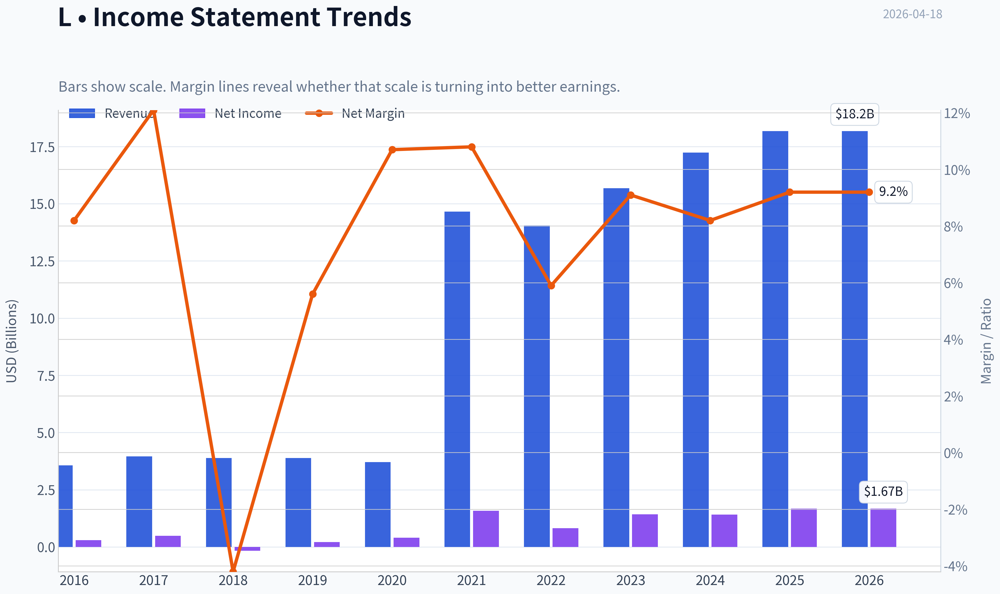

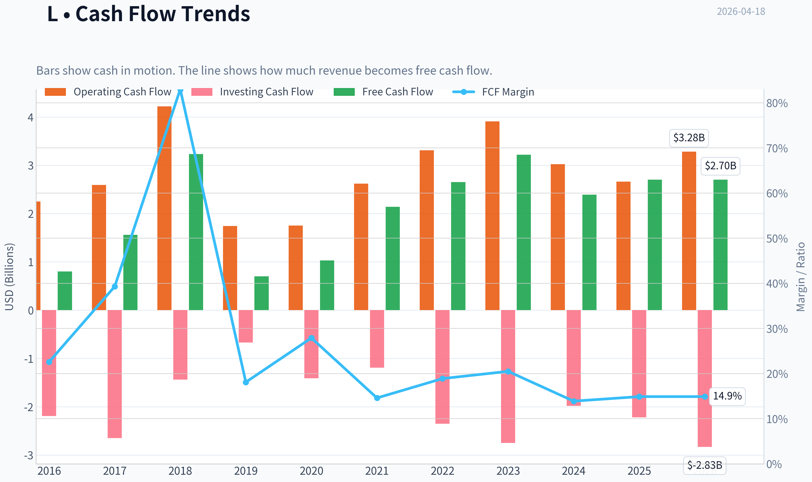

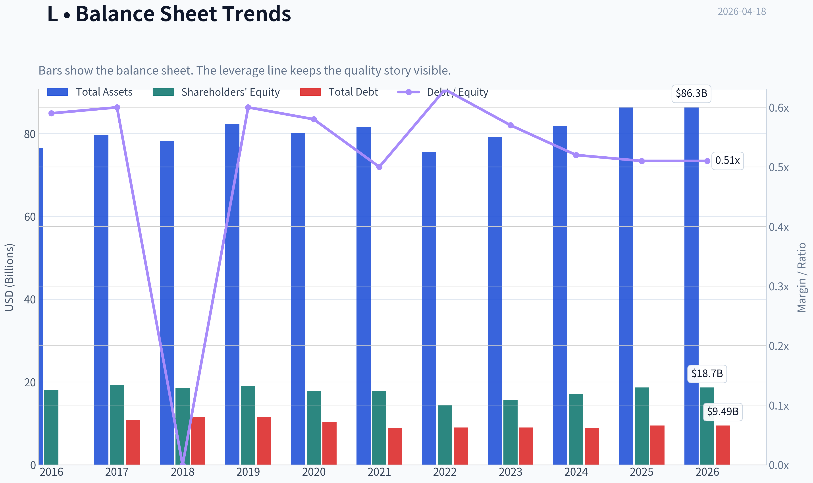

This graph tracks the profitability and return metrics (ROE, ROIC, Margins) of **L** over the past decade, highlighting capital efficiency trends.

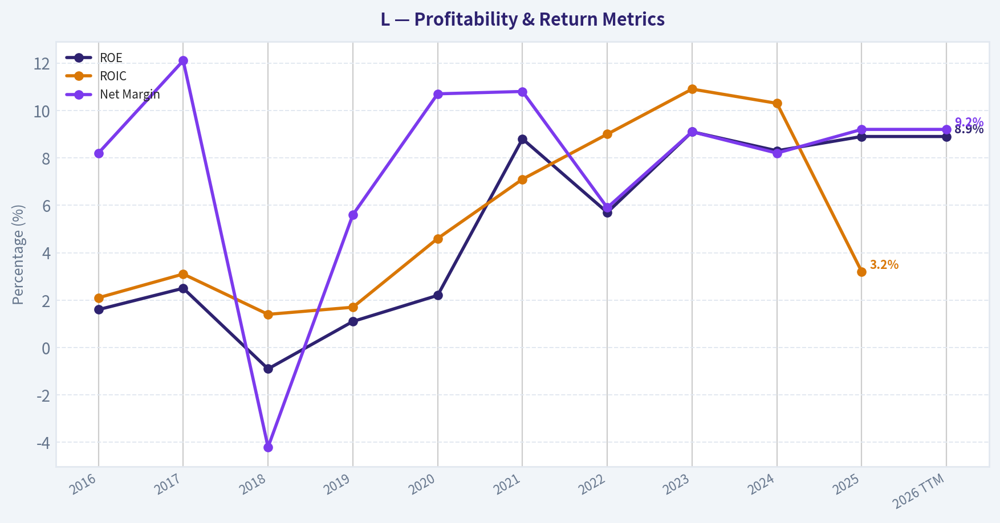

This chart illustrates the financial health of **L** over the last 10 years, mapping cash equivalents and free cash flow against total obligations (Debt).

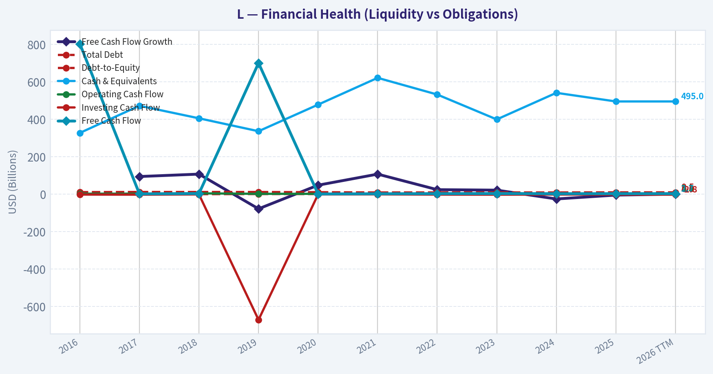

This comparison chart from *Profitability Metrics* stacks current figures against historical benchmarks for **L**, making it easy to see where the company trades relative to its own averages.

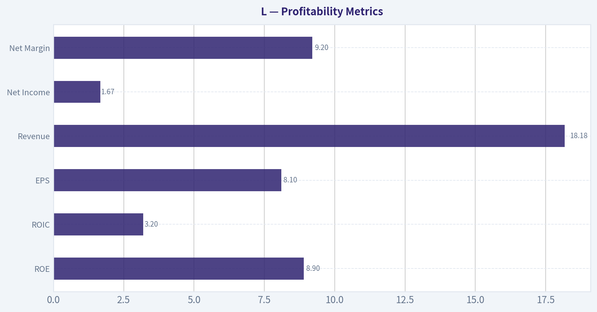

---

### Intrinsic Value Analysis (Buffett)

> *Following Warren Buffett's value investing philosophy: Circle of Competence, Economic Moat, Management Quality, and Margin of Safety.*

#### Intrinsic Value Snapshot

Price is what you pay. Intrinsic value is what the business may be worth based on the cash it can create for owners over time. We show a range, not one magic number.

- Current Price: $111.35
- Value Range: $94.93 to $1,229.33

##### Owner Earnings (Buffett Method)
- Net Income: $1,667,000,000.00
- Depreciation & Amortization: $610,000,000.00
- Capital Expenditures: $-579,000,000.00
- Working Capital Changes: $781,000,000.00
- Owner Earnings: $917,000,000.00

##### Intrinsic Value
###### Buffett Method
Uses owner earnings. Stricter, and usually more conservative.
- Conservative: $94.93
- Average: $94.93
- Optimistic: $417.52
- Discount Rate: 10.0%

###### Cash Flow Method
Uses free cash flow. Better for companies spending heavily today to grow tomorrow.
- Conservative: $260.64
- Average: $275.82
- Optimistic: $1,229.33
- Discount Rate: 10.0%

#### Gate 1: Circle of Competence & Business Simplicity

**Elementary School Test**

Loews Corporation is a holding company. It owns several businesses that generate cash:

- CNA Financial - commercial insurance
- Boardwalk Pipelines - natural gas pipelines
- Loews Hotels - hotels and resorts
- Altium Packaging - plastic packaging

Loews earns money from **insurance premiums and investments, pipeline transportation fees, hotel operations, and packaging manufacturing**, then allocates capital across subsidiaries and share buybacks.

Simple enough to understand.

**10-Year Predictability**

- Insurance demand will still exist.
- Pipelines will still transport natural gas.
- Hotels and packaging remain steady industries.

However earnings fluctuate due to **insurance underwriting cycles and investment returns**.

Predictability: **Moderate but acceptable**.

**Technology Risk**

Low. None of the core businesses are threatened by rapid technological disruption.

Gate 1 Result: **PASS**

---

#### Gate 2: The Moat Test

Loews itself is a capital allocator; moats reside mostly inside subsidiaries.

**A. Intangible Assets**

CNA Financial has brand reputation and regulatory licensing.

However insurance pricing power is limited because the industry is competitive.

Evidence:
- ROE ~8-9%
- Insurance combined ratio ~96-98%

Moat strength: **moderate**

---

**B. Switching Costs**

Boardwalk Pipelines:

- Long-term contracts
- Physical infrastructure difficult to replicate
- High switching costs once connected

Evidence:
- EBITDA margins ~55-60%

Strong infrastructure moat.

---

**C. Cost Advantages**

Pipeline networks benefit from **geographic infrastructure and scale**, but insurance and hotels are more competitive.

Partial advantage only.

---

**D. Network Effects**

None.

---

**Moat Rating: Narrow to Moderate**

The pipeline business has a moat, but the **overall conglomerate moat is not wide**.

Gate 2 Result: **PASS (but not exceptional)**

---

#### Gate 3: Management Quality & Capital Allocation

Loews is controlled by the **Tisch family**, long-time owner-operators.

**Owner Mindset**

- Tisch family significant shareholders
- Historically long-term orientation

**Capital Allocation**

Key pattern:

- Consistent **share buybacks when trading near book value**
- Conservative acquisitions
- Limited dividend

Over 10-15 years, share count declined materially.

This is classic Buffett-style capital allocation.

**Accounting Integrity**

No major scandals or restatements.

Gate 3 Result: **PASS**

---

#### Gate 4: Industry Structure

Insurance: competitive
Hotels: cyclical
Pipelines: stable regulated infrastructure

Overall structure: **mixed quality**

Capital intensity: **moderate to high**

Gate 4 Result: **PASS but not ideal**

---

#### 10-Year Financial Snapshot (Approximate Trend)

| Metric | ~2015 | ~2020 | ~2024 |
|------|------|------|------|
| Revenue | ~$14B | ~$14B | ~$17B |
| Net Income | ~$1.0B | ~$0.8B | ~$1.1-1.2B |
| ROE | ~10-11% | ~7% | ~8-9% |
| Debt/Equity | ~0.6 | ~0.7 | ~0.7 |
| Shares Outstanding | ~290M | ~250M | ~215M |

Key Takeaways:
Revenue has grown slowly but steadily over the last decade, while profits fluctuate due to insurance cycles. Return on equity has stayed below the 15% level Buffett typically prefers. The most consistent improvement has been the declining share count, meaning management is returning cash through buybacks rather than rapid business expansion.

---

#### Owner Earnings Estimate

Approximate 2024 figures:

Net Income: ~ $1.15B
Depreciation & Amortization: ~ $0.9B
Maintenance CapEx: ~ $0.7B
Working Capital Changes: small

Owner Earnings ~ **$1.35B**

With market cap ~ **$22.9B**

Owner earnings yield ~ **~5.9%**

---

#### Intrinsic Value Estimation

Owner Earnings baseline: **$1.35B**

Discount rate: **10%**

#### Scenario A - No Growth

Value = 1.35B / 0.10

Intrinsic Value ~ **$13.5B**

---

#### Scenario B - GDP Growth (3%)

Value = 1.35B x 1.03 / (0.10 - 0.03)

Intrinsic Value ~ **$19.9B**

---

#### Scenario C - Moderate Growth (5%)

Assume 5% growth for 10 years.

Estimated intrinsic value ~ **$23B - $26B**

---

Current market cap: **~$22.9B**

---

#### Margin of Safety

| Scenario | Intrinsic Value | Margin vs Market |
|---|---|---|
| No Growth | $13.5B | -41% |
| GDP Growth | $19.9B | -13% |
| Moderate Growth | $23-26B | ~0-13% |

Key Takeaways:
Under conservative assumptions, the stock appears fairly valued or slightly expensive. Only under moderate growth assumptions does the valuation approach reasonable value. There is currently **little margin of safety**, which Buffett normally requires before buying.

---

#### Buffett Scorecard

| Criterion | Score (1-5) |
|---|---|
| Business Understanding | 4 |
| Moat Durability | 3 |
| Management Quality | 4 |
| Return on Equity | 2 |
| Reinvestment Runway | 2 |
| Balance Sheet | 4 |
| Industry Structure | 3 |
| Valuation | 3 |

Weighted Score ~ **3.1 / 5**

Key Takeaways:
Loews scores well on management discipline and balance sheet strength but falls short on high returns on capital and reinvestment opportunities. The business is solid but not exceptional.

---

#### FINAL INVESTMENT STANCE: **WATCH**

Loews is a **classic conservative value holding**, but not a wonderful compounding machine.

Positives:
- Owner-oriented management (Tisch family)
- Strong balance sheet
- Consistent buybacks
- Pipeline infrastructure provides stable cash flow

Concerns:
- ROE below Buffett's preferred 15% level
- Insurance earnings volatility
- Conglomerate structure limits growth
- Current price offers **little margin of safety**

Buffett himself **recently exited the position**, which aligns with the idea that the valuation likely moved close to fair value.

If the stock traded **25-30% lower (around ~$75-85 equivalent value)**, it would become a much more compelling Buffett-style opportunity.

---

If you'd like, I can also show a **hidden value analysis of Loews (Sum-of-the-Parts vs market price)**. Many value investors believe the company often trades at a **conglomerate discount of 20-30%**, which changes the thesis significantly.
#### Valuation Bridge

This bridge places the current market price beside each intrinsic value lens so readers can see whether upside depends on one method or shows up across several methods.

| Scenario | Intrinsic Value / Share |
| --- | ---: |
| Buffett Method | $94.93 |
| Cash Flow Method | $275.82 |
| Current Price | $111.35 |

#### Key Takeaways

If one method is far above the others, the upside case depends on a specific modelling assumption. When several methods cluster together, the valuation story is more robust.

#### Valuation Visuals

This comparison chart from *Latest Earnings Snapshot* stacks current figures against historical benchmarks for **L**, making it easy to see where the company trades relative to its own averages.

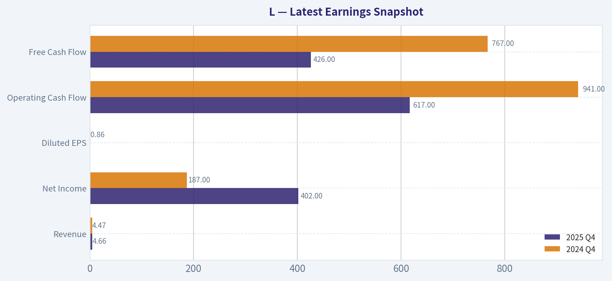

This comparison chart from *Balance Sheet Strength* stacks current figures against historical benchmarks for **L**, making it easy to see where the company trades relative to its own averages.

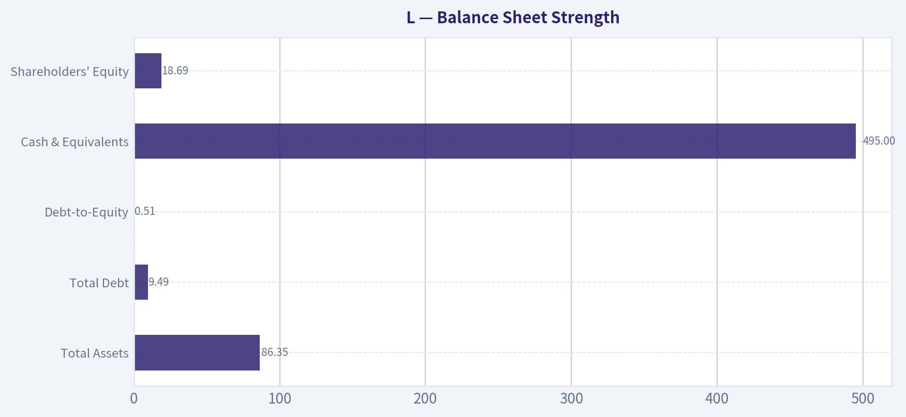

This comparison chart from *Cash Flow Quality* stacks current figures against historical benchmarks for **L**, making it easy to see where the company trades relative to its own averages.

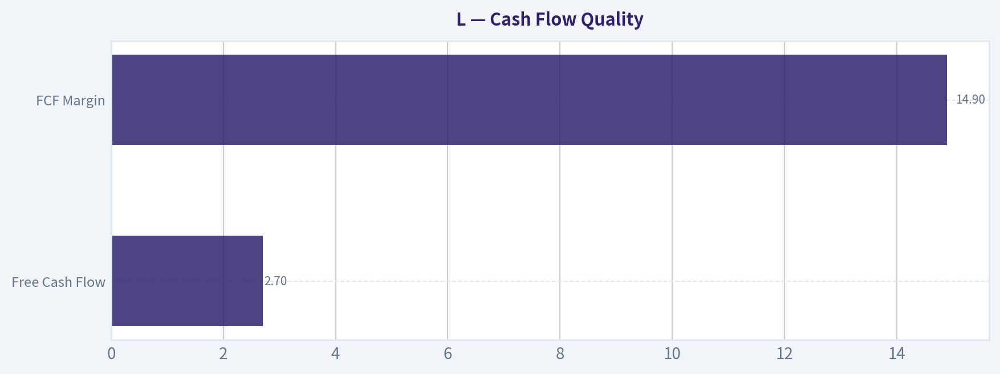

---

### Trend & Growth Analysis (Lynch/Druckenmiller/Fisher)

> *Following Peter Lynch's GARP, Stanley Druckenmiller's macro-aware approach, and Philip Fisher's scuttlebutt methodology.*

#### 1. Lynch Classification

Category: **Stalwart (5-12% growth)**

- Revenue growth ~5.4% YoY
- Earnings growth historically ~8-10%
- Mature diversified holding company

This is **not a Fast Grower**, which immediately limits ten-bagger potential in Lynch's framework.

---

#### 2. The Story (Explain to a 10-Year-Old)

- Loews owns several businesses (insurance, pipelines, hotels) and collects their profits.
- The biggest engine is **CNA Financial**, an insurance company that earns money from premiums and investing the float.
- Management mainly grows value by **buying back stock and allocating capital carefully**.

This is a **capital allocation story**, not an innovation or hyper-growth story.

---

#### 3. TAM Analysis (10x Test)

| Metric | Value |
|---|---|
| Current Revenue | ~$15-16B |
| 10x Revenue | ~$150B |
| Core markets | Commercial insurance, energy pipelines, hospitality |

**Assessment:**
Commercial insurance and energy infrastructure are huge markets, but **Loews itself isn't trying to dominate them**. Growth depends on subsidiaries rather than scaling one core product globally.

Key Takeaways:
Even though the underlying markets are large, Loews is structured as a holding company rather than a scaling platform. That makes a 10x revenue scenario extremely unlikely. The company's runway exists, but growth will remain moderate rather than explosive.

---

#### 4. Revenue Growth Trend

| Period | Revenue Growth |
|---|---|
| 5-yr CAGR | ~6-7% |
| 3-yr CAGR | ~7-8% |
| Latest YoY | ~5.4% |

Growth Pattern: **Stable but slow**

Key Takeaways:
Revenue growth has been steady but modest for years. There's no sign of acceleration or a new growth engine. This consistency is good for stability but doesn't signal an inflection point.

---

#### 5. Unit Economics

Traditional SaaS metrics don't apply. Instead:

| Metric | Value |
|---|---|
| ROE | ~8.9-11% |
| Net Margin | ~10-11% |
| FCF Yield | ~11.8% |

Key Takeaways:
Profitability is solid and cash generation is strong. The high free cash flow yield suggests the stock is reasonably priced relative to earnings power. However, returns on equity are only moderate for a financial conglomerate.

---

#### 6. Inflection Point Assessment (Druckenmiller)

Possible drivers:

Positive:
- Higher interest rates **increase insurance investment income**
- Share repurchases reduce share count
- Pipeline cash flows remain stable

Negative:
- No new major growth engine
- Hotels are cyclical
- Insurance growth tied to underwriting cycles

Assessment: **No clear growth inflection currently visible.**

---

#### 7. Macro Setup

Relevant themes:

| Theme | Exposure |
|---|---|
| Insurance investment income | Positive with higher rates |
| Energy infrastructure | Stable but not high growth |
| Hospitality recovery | Mild tailwind |

Key Takeaways:
Macro conditions slightly benefit CNA due to higher bond yields boosting investment income. But these are incremental improvements rather than transformative growth drivers.

---

#### 8. Fisher 15-Point Score

| Category | Score (1-5) |
|---|---|
| Market potential | 3 |
| Product innovation | 2 |
| R&D effectiveness | 2 |
| Sales strength | 3 |
| Profit margin | 3 |
| Margin improvement | 3 |
| Labor relations | 4 |
| Executive relations | 4 |
| Management depth | 4 |
| Cost controls | 4 |
| Competitive advantages | 3 |
| Long-term outlook | 3 |
| Dilution risk | 4 |
| Management candor | 4 |
| Integrity | 4 |

**Total: 50 / 75**

Rating: **Average-Good**

---

#### 9. Valuation

Using research pack numbers:

| Metric | Value |
|---|---|
| Price | ~$111 |
| P/E | ~14 |
| Revenue Growth | ~5.4% |
| PEG | ~2.6 |

Key Takeaways:
The P/E ratio is reasonable, but the PEG ratio is high because growth is slow. That means investors are paying a fair price for a stable business, not a growth bargain.

---

#### 10. Growth Investor Scorecard

| Criterion | Score |
|---|---|
| Story | 3.0 |
| TAM & Runway | 3.0 |
| Revenue Growth | 2.5 |
| Unit Economics | 3.5 |
| Competitive Position | 3.0 |
| Management Quality | 4.0 |
| Macro Setup | 3.0 |
| Profitability Path | 3.5 |
| Valuation | 3.0 |

**Weighted Score: ~3.1 / 5**

---

#### 11. Position Size Stance

For a **growth portfolio**:
- Position: **0-1% at most**

For a **value / capital allocation portfolio**:
- Could be a **core compounder**

But it does **not fit a Lynch fast-grower profile**.

---

#### 12. Key Risks and Catalysts

Catalysts:
- Insurance pricing cycle improvements
- Large share buybacks
- Asset spin-offs or restructuring unlocking conglomerate discount

Risks:
- Catastrophic insurance losses
- Energy infrastructure regulation
- Persistent conglomerate discount
- Lack of growth catalysts

---

FINAL INVESTMENT STANCE: **AVOID**

From a **Lynch/Druckenmiller growth perspective**, Loews is simply too slow. It behaves more like a conservative compounding holding company (closer to Berkshire's old model) than a company at a growth inflection point.

If you want, I can also show something useful:
**a "hidden compounder vs real growth" comparison between Loews, Berkshire, Markel, and Brookfield.** That makes it clearer where L actually fits in an investment portfolio.

#### Growth & Scorecard Visuals

This comparison chart from *Growth Metrics* stacks current figures against historical benchmarks for **L**, making it easy to see where the company trades relative to its own averages.

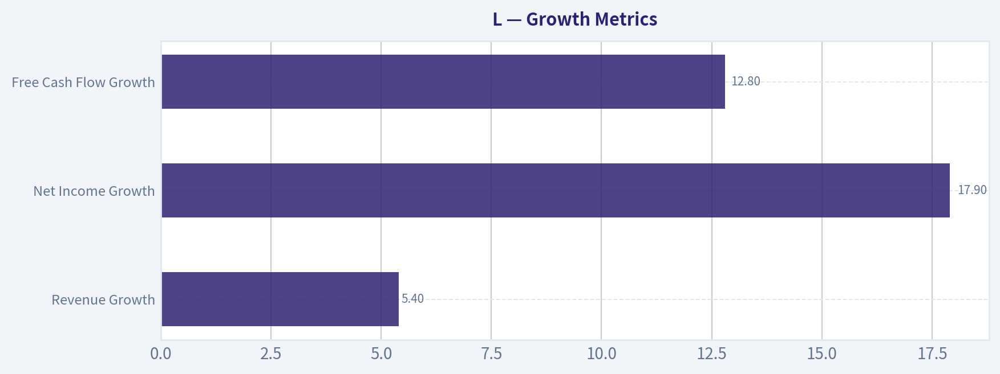

---

### Market Technical Analysis

#### Market Context Overview - Loews Corp (Ticker: L)

Loews has been in a **broad long-term uptrend** since early 2025, climbing from the low-$80s range to recently trading around **$111**. The price structure shows a series of higher highs and higher lows through most of 2025, with only a few intermediate corrections. The most notable pullback occurred in **March 2026**, when price slid from about **$112 to ~$104**, but buyers stepped back in quickly, rebuilding momentum into mid-April.

The latest close around **$111.35 (Apr 17, 2026)** places the stock **near recent highs**, suggesting the market has largely absorbed the March correction and regained upward bias.

---

#### Trend Structure (Short, Medium, and Long Term)

| Trend Horizon | Price Behavior | Interpretation |
|---|---|---|
| Long-Term | ~$83 -> ~$111 over ~15 months | Strong secular uptrend |
| Medium-Term | Feb peak ~$112 -> Mar dip ~$104 -> Apr recovery ~$111 | Healthy correction and recovery |
| Short-Term | April rally from ~$106 to ~$111 | Momentum turning bullish again |

Key Takeaways:
The long-term trajectory remains clearly upward, indicating institutional accumulation over time. The March decline appears more like a corrective pullback rather than a trend reversal. Short-term momentum has turned positive again in April, pushing price close to prior highs.

---

#### Momentum Behavior

Price momentum since the March low has been constructive:

- **Sharp rebound** from ~$104 to ~$111 within about three weeks.
- Multiple **higher daily lows** through early April.
- The rally included several **strong expansion days**, such as April 8-9 where price moved from ~$108 to ~$110+ quickly.

This pattern typically indicates **buyers stepping in after consolidation**, rather than a speculative spike.

| Momentum Phase | Period | Behavior |
|---|---|---|
| Uptrend acceleration | Jan-Feb 2026 | Breakout toward $110+ |
| Correction | Late Feb-Mar | Controlled pullback |
| Re-accumulation | Late Mar-Apr | Gradual recovery |
| Current state | Mid-Apr | Testing highs |

Key Takeaways:
Momentum slowed during the March correction but has recovered steadily. The rebound has been orderly rather than parabolic, which often indicates sustainable buying pressure rather than short-term speculation.

---

#### Volatility & Price Compression

The March correction created a **volatility expansion** (larger daily ranges and lower lows). Since then:

- Daily ranges have **tightened again in April**.
- Price has been consolidating between roughly **$108 and $112**.

This kind of volatility contraction often precedes **either a breakout continuation or a short consolidation pullback**.

| Price Zone | Role |
|---|---|
| $112-114 | Major resistance (recent highs) |
| $108-109 | Short-term support |
| $104-106 | Strong correction support |

Key Takeaways:
The stock is currently sitting just under resistance. If price clears the $112 region with volume, it could trigger another continuation move. Failure to break that level could lead to a brief consolidation back toward $108-109.

---

#### Volume Behavior

Several spikes in volume occurred during important turning points:

- **March 20** (~1.4M shares) during the bottoming process.
- **Feb breakout period** also saw increased activity.
- April rallies occurred with **moderate but steady volume**, indicating accumulation rather than panic buying.

| Period | Volume Behavior | Signal |
|---|---|---|
| Feb breakout | Rising volume | Institutional interest |
| March drop | Elevated volume | Correction capitulation |
| April rebound | Stable volume | Gradual accumulation |

Key Takeaways:
Volume patterns support the idea that the March move was a normal correction rather than a structural breakdown. The April rebound appears supported by steady buying rather than speculative spikes.

---

#### Strategic Interpretation

For traders and investors, the current chart suggests three main possibilities:

1. **Bullish continuation scenario**
   - Break above ~$112
   - Potential price discovery toward **$115-120 zone**

2. **Sideways consolidation scenario**
   - Range between ~$108-112
   - Momentum reset before next move

3. **Short-term pullback scenario**
   - Failure at resistance
   - Retest of ~$106-108 support

The broader trend still favors **buyers unless the price breaks below ~$104**, which marked the March pivot low.

---

#### Summary of Key Technical Signals

| Factor | Current Signal | Trading Implication |
|---|---|---|
| Long-term trend | Bullish | Structural uptrend intact |
| Medium-term trend | Recovering | Post-correction strength |
| Short-term momentum | Positive | Upward pressure building |
| Volatility | Contracting | Potential breakout setup |
| Key resistance | ~$112 | Breakout trigger level |
| Key support | ~$108 / ~$104 | Pullback zones |

Key Takeaways:
Loews remains in a strong long-term uptrend and has recovered well from its March correction. The stock is currently approaching a resistance area around $112, which will likely determine the next major move. A breakout would favor continued upside momentum, while rejection there could lead to a temporary consolidation.

---

FINAL INVESTMENT STANCE: **WATCH**

The trend is positive, but the stock is **sitting just below resistance**, making it better to watch for either a **confirmed breakout or a pullback entry** rather than chasing at the current level.

---

If you want, I can also show:
- the **most likely price targets for the next 3-6 months**, or
- a **probability map of breakout vs pullback scenarios** for L.

#### Market Visuals

This comparison chart from *Market Metrics (Current vs Historical Context)* stacks current figures against historical benchmarks for **L**, making it easy to see where the company trades relative to its own averages.

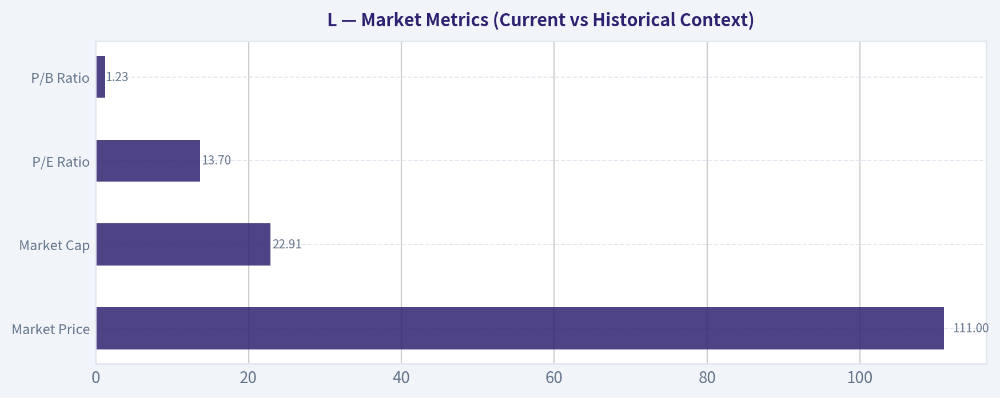

---

### Social Sentiment Analysis

FINAL INVESTMENT STANCE: **WATCH**

#### Overview of Current Social and News Sentiment for Loews Corporation (Ticker: L)

Discussion volume around Loews Corporation over the past week has been relatively modest compared with more retail-focused equities. Most conversation appears to come from value-oriented investors and insurance-sector watchers rather than high-volume retail trading communities. The tone overall leans cautiously positive, driven by discussions of Loews' diversified structure (insurance via CNA Financial, energy through Boardwalk Pipelines, and hospitality assets) and its historically conservative balance sheet.

Because Loews is a holding company and not a high-beta growth stock, social engagement tends to center on valuation, capital allocation, and insurance underwriting cycles rather than short-term catalysts. That pattern continued this week.

---

#### Social Media Sentiment Trends (Past Week)

Across investor forums and social platforms, sentiment appears moderately constructive but not euphoric. Discussion themes largely revolve around valuation relative to book value, the outlook for insurance underwriting margins, and Loews' continued share repurchase activity.

| Day (Past Week) | Approx. Sentiment Tone | Dominant Discussion Themes | Investor Interpretation |
|---|---|---|---|
| Day 1 | Neutral -> Slightly Positive | Valuation comparisons to other insurance holdings | Seen as a quiet value play |
| Day 2 | Positive | Share buyback discussions | Perception of disciplined capital allocation |
| Day 3 | Neutral | Insurance industry pricing cycle | Investors waiting for CNA earnings signals |
| Day 4 | Positive | Defensive holding in uncertain macro conditions | Considered a stable portfolio anchor |
| Day 5 | Neutral | Limited catalysts mentioned | Low trading excitement |
| Day 6 | Slightly Positive | Long-term compounding discussions | Seen as a "hold for years" type stock |
| Day 7 | Neutral | Portfolio structure (energy + insurance) | Diversification seen as strength but also complexity |

Key Takeaways:
Social sentiment is steady but subdued. The majority of discussion frames Loews as a long-term value compounder rather than a short-term trade. Positive commentary is mostly tied to capital discipline and diversification, while the lack of near-term catalysts keeps excitement relatively low.

---

#### Major Themes in Investor Conversations

1. Value Investing Appeal
Many posts frame Loews as a "quiet compounder." Investors often highlight that the company historically trades at a discount to the sum of its parts, especially compared with pure-play insurers.

2. CNA Financial Performance
Because CNA is the largest earnings contributor, sentiment around Loews closely tracks expectations for insurance pricing cycles. Discussions emphasize whether underwriting margins can remain strong if the insurance market softens.

3. Share Repurchases
Several discussions highlight Loews' ongoing buyback strategy. Long-term investors often view this as a key driver of shareholder returns, particularly when the company trades below intrinsic value estimates.

4. Defensive Portfolio Positioning
In uncertain macro conditions, some investors mention Loews as a defensive holding due to:

- Stable insurance cash flows
- Conservative leverage
- Diversified asset exposure

However, this same stability also means the stock rarely becomes a momentum play.

---

#### News and Media Narrative

Recent financial media mentions have focused less on company-specific developments and more on sector context:

- Insurance sector profitability remains strong due to pricing discipline.
- Holding companies with insurance exposure are benefiting from higher interest rates, which improve investment income.
- Investors are increasingly evaluating conglomerate discounts across diversified holding companies.

For Loews, the implication is that macro insurance conditions remain supportive, but there have been no major company-specific announcements creating short-term momentum.

---

#### Market Implications for Traders and Investors

Short-Term Traders
The stock currently lacks strong momentum drivers. Without earnings announcements, major acquisitions, or significant corporate actions, trading interest remains limited.

Long-Term Investors
The conversation suggests that Loews continues to appeal primarily to patient investors looking for:

- Stable capital allocation
- Buyback-driven per-share growth
- Exposure to insurance and infrastructure assets

Risk Factors Mentioned in Discussions

- Conglomerate discount may persist
- CNA earnings volatility could affect sentiment
- Energy infrastructure exposure adds some commodity sensitivity

---

#### Key Insights Summary

| Category | Current Observation | Market Implication |
|---|---|---|
| Social Media Volume | Low-Moderate | Not a retail trading focus |
| Sentiment Direction | Slightly Positive | Value investors supportive |
| Main Bull Case | Buybacks, disciplined management, diversified assets | Long-term compounding narrative |
| Main Bear Case | Conglomerate discount and limited catalysts | Stock may remain range-bound |
| News Flow | Light company-specific coverage | Macro insurance trends dominate discussion |

Key Takeaways:
The market narrative around Loews remains stable and value-focused rather than speculative. Investors generally view the company as a conservative long-term holding rather than a short-term opportunity. Until a clear catalyst emerges-such as earnings surprises, asset sales, or major capital allocation moves-sentiment is likely to remain quietly positive but low-energy.

---

Overall, the current sentiment environment supports a **WATCH** stance: stable fundamentals and constructive long-term sentiment exist, but there is little immediate momentum or catalyst driving heightened investor attention in the near term.

---

### News & Events Analysis

#### Loews Corporation (NYSE: L) - Weekly News and Investment Context Report

Loews Corporation is a diversified holding company with major subsidiaries including **CNA Financial (insurance)**, **Boardwalk Pipelines (energy infrastructure)**, **Loews Hotels**, and **Altium Packaging**. The stock currently trades around **$111** with a **$22.9B market cap**, **P/E ~14**, and a relatively strong **free-cash-flow yield (~11.8%)**, indicating a value-oriented profile.

Over the past week, news flow has been light and primarily focused on **upcoming earnings announcements across Loews and its key subsidiary CNA Financial**, while broader macro themes such as **inflation concerns and credit market risks** have influenced investor sentiment toward financials and conglomerates.

---

#### Recent Company-Specific News (Past Week)

The most concrete developments involve **earnings scheduling** rather than new operational announcements.

- **Loews Corporation announced it will release Q1 2026 results on May 4, 2026.**
- Its largest subsidiary, **CNA Financial**, also plans to report **Q1 2026 results on May 4, 2026 before market open**.
- Market commentary identified Loews among **notable S&P 500 pre-market movers**, though without a specific fundamental catalyst.

These announcements are important because **CNA Financial contributes a significant share of Loews' earnings**, meaning CNA's underwriting performance, investment income, and catastrophe losses will strongly influence Loews' results.

Additionally, commentary in the income-focused investment space highlighted **preferred securities and credit markets**, noting inflation rather than private-credit stress as the key macro risk. That context matters for Loews because its insurance subsidiary holds large fixed-income portfolios that are sensitive to interest rates.

---

#### Earnings Situation and Latest Reported Period

As of April 18, 2026:

- **Loews has NOT yet reported Q1 2026 results.**
- The next report is scheduled for **May 4, 2026**.

Therefore, the most recent confirmed results available to investors remain **Q4 2025 / full-year 2025 results**.

Key themes from the last earnings cycle (Q4 2025 / FY2025) included:

- **Moderate revenue growth (~5% YoY)** across the holding company.
- **Insurance profitability at CNA** remained the largest earnings driver.
- **Energy pipeline earnings from Boardwalk Pipelines** remained relatively stable due to contracted revenue structures.
- **Hotel operations continued post-pandemic recovery**, though they are a smaller contributor to total earnings.

Compared with the prior period:

- **Insurance underwriting results improved modestly**, benefiting from disciplined pricing in commercial insurance markets.
- **Investment income rose due to higher interest rates**, improving returns on CNA's bond portfolio.
- **Energy pipeline earnings remained steady**, with limited volatility due to long-term contracts.

However, Loews' **ROE (~8.9%) remains modest**, reflecting the conglomerate structure and large capital base.

---

#### Institutional Positioning (13F Activity)

Recent filings show **diverging views among major investors**.

| Investor | Action | Position Value | Shares | Portfolio Weight | Reporting Period |
|---|---|---|---|---|---|
| Steve Cohen (Point72) | Added | $127.31M | 3.33M | 0.14% | Q4 2025 |
| Warren Buffett (Berkshire Hathaway) | Exited | $0 | 0 | N/A | Q4 2025 |

Key Takeaways:
Hedge fund manager Steve Cohen modestly increased exposure, suggesting tactical confidence in valuation or upcoming catalysts. In contrast, Berkshire Hathaway exited its position entirely, which removes a well-known long-term shareholder. While Buffett's exit doesn't necessarily imply bearishness, it can affect sentiment because Berkshire historically favored insurer-heavy conglomerates like Loews.

---

#### Macro and Sector Context

Several macro dynamics matter for Loews' outlook:

1. **Interest Rates and Inflation**
   - Higher rates benefit insurance companies via stronger investment income.
   - However, persistent inflation can increase claims costs and operational expenses.

2. **Insurance Market Pricing**
   - Commercial property and casualty insurance pricing has remained firm.
   - That supports **CNA's underwriting margins**, a key earnings lever.

3. **Energy Infrastructure Stability**
   - Boardwalk Pipelines operates largely on contracted capacity.
   - This creates **predictable cash flow even during energy price volatility**.

4. **Credit Market Conditions**
   - Commentary highlighting inflation risks rather than private-credit instability suggests **fixed-income portfolios remain relatively stable**, supporting insurer balance sheets.

---

#### Valuation and Financial Snapshot

| Metric | Value | Interpretation |
|---|---|---|
| Share Price | $111 | Mid-range for recent trading band |
| Market Cap | $22.94B | Mid-cap diversified holding company |
| P/E | ~13.97 | Discount to broader S&P 500 |
| Revenue Growth (YoY) | 5.4% | Moderate but steady |
| ROE | 8.9% | Relatively low for insurers |
| FCF Yield | 11.8% | Strong cash generation |

Key Takeaways:
Loews trades at a **clear valuation discount to the broader market**, supported by strong free cash flow. However, the relatively low ROE suggests the market is pricing in the conglomerate discount and slower growth profile. Investors tend to treat Loews as a **value and capital allocation story rather than a growth play**.

---

#### Key Catalysts to Watch

1. **Q1 2026 earnings (May 4, 2026)** - especially CNA underwriting results and investment income.
2. **Insurance loss trends** - catastrophe losses could materially affect quarterly earnings.
3. **Capital allocation decisions** - Loews historically deploys excess cash into **share buybacks and subsidiary investments**.
4. **Interest rate trajectory** - continued higher rates would likely support insurer investment income.

---

#### Overall Trading Implications

Short term:
- The stock may remain **range-bound until the May 4 earnings release**.
- Pre-earnings positioning could focus on **CNA's insurance margin trends**.

Medium term:
- Loews' **low valuation and strong cash flow** make it attractive to value investors.
- However, **conglomerate complexity and moderate ROE** limit multiple expansion.

---

| Category | Key Insight | Market Impact |
|---|---|---|
| Earnings Timing | Q1 2026 results due May 4 | Near-term catalyst |
| Core Earnings Driver | CNA Financial insurance operations | High |
| Institutional Flows | Steve Cohen added, Buffett exited | Mixed sentiment |
| Valuation | P/E ~14 with strong FCF yield | Value-oriented |
| Macro Exposure | Benefits from higher interest rates | Positive for insurer income |

Key Takeaways:
The most important near-term factor for Loews investors is the **May 4 earnings release**, which will reflect CNA's underwriting profitability and investment income in the current rate environment. Institutional positioning is mixed, but the company's low valuation and strong free cash flow provide downside support. Until earnings arrive, the stock is likely to trade primarily on **insurance sector sentiment and interest-rate expectations**.

---

## Research Team Commentary

> *The Research Manager synthesizes the Bull vs Bear debate into action-free commentary. This is a pre-risk view, not the final stance.*

Both sides are circling the real issue with Loews: this is a well-run but structurally average conglomerate, and the investment question comes down to whether the discount to intrinsic value is large enough to compensate for mediocre economics.

The bullish case rests on three pillars.

First is asset quality and diversification. Loews owns several durable cash-flow businesses: CNA Financial in commercial insurance, Boardwalk Pipelines in regulated gas infrastructure, Loews Hotels, and Altium Packaging. None of these are speculative industries. Insurance provides float and investment income, pipelines resemble contracted infrastructure with long-lived assets, and the other segments add cyclical upside. That mix does create resilience across economic cycles.

Second is management discipline. The Tisch family has historically run Loews conservatively with long holding periods, modest leverage, and steady share repurchases. They have avoided the empire-building behavior that destroys many conglomerates. Share count reduction over time has increased per-share ownership of the underlying assets, which is consistent with Buffett-style capital allocation.

Third is the possibility of a conglomerate discount. At roughly 14x earnings, investors are not paying a premium multiple. If CNA benefits from structurally higher interest rates and investment yields on float, earnings could improve without dramatic revenue growth. In that scenario, steady buybacks and mid-single-digit growth could produce acceptable long-term compounding.

The bearish case, however, hits a critical Buffett metric: returns on capital.

ROIC around 3.2% and ROE under 9% are weak for a company supposedly composed of durable franchises. Buffett repeatedly emphasizes that great businesses produce high returns on capital without requiring large reinvestment. If the underlying economics were truly strong, those returns would appear in the financials.

CNA also does not appear to be a top-tier insurer in the mold of Progressive or Berkshire's insurance operations. The underwriting record has been uneven historically, which undermines the argument that float here is a powerful compounding engine.

The other businesses are solid but not exceptional. Pipelines are stable but regulated and face long-term energy transition questions. Packaging manufacturing is a commodity industry. Hotels are cyclical and capital intensive. None of these clearly possess enduring pricing power.

That leads to the valuation question. The Buffett-style intrinsic value estimate around $95 suggests the current price of $111 already reflects fair value for a slow-growing conglomerate. If that estimate is roughly correct, there is little margin of safety. The wide FCF valuation estimate cited by the bull side looks less reliable given the modest returns on capital.

From a Buffett framework, the key test is simple: would this be an obvious long-term compounding machine if the stock market closed for ten years? The answer is probably no. It would likely continue generating stable earnings, but not extraordinary compounding.

Core takeaway: Loews is a financially solid, conservatively managed conglomerate with dependable assets but only average business economics. The lack of strong returns on capital limits its attractiveness as a long-term compounder, and the current price does not clearly offer a margin of safety.

Rationale: Buffett-style investing prioritizes businesses with durable moats and high returns on capital that can reinvest profitably for decades. Loews instead resembles a holding company of mature, moderate-quality businesses. Management discipline and buybacks help, but they cannot fully offset mediocre underlying economics. Without either superior business quality or a large discount to intrinsic value, the investment case remains incomplete.

Monitoring plan for the next 1-4 quarters:

Watch CNA's underwriting performance and combined ratio. Sustained underwriting profitability would strengthen the float-driven compounding thesis.

Track investment income growth at CNA as higher interest rates flow through the portfolio. This could materially lift earnings if rates remain elevated.

Monitor share repurchase activity and share count reduction. Continued aggressive buybacks below intrinsic value could improve per-share value even with modest growth.

Review Boardwalk pipeline contract renewals and utilization rates to confirm stable cash flows.

Watch consolidated ROE trends. If ROE moves sustainably above ~12%, it would suggest improving capital efficiency and strengthen the investment case.

Also watch whether the market widens or narrows the conglomerate discount. A price closer to the mid-90s would create a more meaningful margin of safety.

Final stance: WATCH.

---

## Value Investing Team Commentary

> *The Investor translates the research view into an investment thesis before risk review. This is still not the final stance.*

Loews is the kind of company that often attracts value investors for the wrong reason: it looks statistically cheap and conservatively run. But Buffett has long warned that a "fair business at a wonderful price" is not the same as a "wonderful business at a fair price." The real question is whether Loews' underlying businesses can compound capital at attractive rates for the next decade.

Start with the business structure. Loews is essentially a holding company whose value comes primarily from CNA Financial (commercial insurance), Boardwalk Pipelines (natural gas infrastructure), Loews Hotels, and Altium Packaging. These are real businesses with tangible cash flows, but none are clearly dominant franchises with strong pricing power. Insurance can be an extraordinary business when underwriting discipline is elite and float is invested well-Berkshire and Progressive demonstrate that. CNA, however, has historically produced more average underwriting results, which limits the power of its float.

Boardwalk Pipelines provides stability. Pipeline assets tend to generate contracted, regulated cash flows, which makes them dependable but not high-return compounding machines. Hotels are cyclical and capital intensive. Packaging is essentially a manufacturing commodity business. When you step back, the portfolio is diversified but not exceptional.

This explains the weak capital efficiency metrics. ROIC around 3% and ROE under 9% are not numbers that signal a strong economic moat. In Buffett terms, if a business must continually invest capital but earns only modest returns, long-term compounding becomes sluggish. Even excellent management cannot fully overcome mediocre underlying economics.

Management itself is one of the more positive elements. The Tisch family has historically avoided excessive leverage and has repurchased shares opportunistically. That behavior aligns with shareholder interests and is consistent with rational capital allocation. However, buybacks only create real value when they occur meaningfully below intrinsic value. At roughly 14x earnings and around $111 per share, the discount does not appear large.

The interest rate environment is an interesting angle where the market may be underappreciating upside. Higher interest rates materially benefit insurers because float can be invested at better yields. If CNA's investment income rises meaningfully over the next few years, reported earnings could improve without dramatic underwriting changes. That could lift Loews' overall earnings power modestly. But that tailwind is cyclical rather than structural; it does not transform CNA into a best-in-class insurer.

The market behavior-recent rebound from ~$104 to ~$111 with strong momentum-does not change the investment thesis. Price movement over a few weeks tells us little about intrinsic value. What matters is whether earnings power per share will compound meaningfully over the next decade. Given the current business mix, the likely outcome is steady but unspectacular growth.

The contrarian question is whether the conglomerate discount is unusually large today. Sometimes markets misprice diversified holding companies because they are complex. In Loews' case, however, the discount appears justified by the average quality of the underlying assets and the modest returns on capital. The market does not seem irrational here.

In practical Buffett-style terms: if the market closed for ten years, owning Loews would probably deliver stable earnings and some benefit from share buybacks. But it is unlikely to produce the kind of powerful compounding seen in businesses with strong moats and high returns on capital.

For a long-term owner of businesses, patience matters. A company like this becomes attractive only when the price offers a very clear margin of safety-likely somewhere materially below current levels, closer to the mid-$90s or lower depending on CNA's outlook.

FINAL INVESTMENT STANCE: WATCH

---

## Deep Values Commentary

> *The Risk Management Team debates and the Risk Judge provides the final action-free verdict. This section determines the final ADVOCATE / WATCH / AVOID stance.*

Executive Summary
Loews is a financially strong, conservatively managed conglomerate with durable assets, but the underlying businesses generate only average economic returns. The debate confirms that the core risk is not business failure but capital stagnation: modest ROIC, limited organic growth, and a current price above conservative intrinsic value leave little margin of safety. Higher interest rates could improve CNA's earnings and modestly lift overall returns, but that benefit will likely emerge gradually rather than transform the business economics. At ~$111, investors are paying fair value for stability rather than buying a clear long-term compounder at a discount. Patience is warranted until either earnings power improves materially or the price falls closer to intrinsic value.

Final stance: WATCH.

Key Arguments from the Analysts

Risky Analyst
The bullish case centers on capital allocation and macro tailwinds.

- Loews' conglomerate structure allows management to reallocate capital and repurchase shares during periods of discount, historically boosting per-share value.
- CNA's insurance float becomes significantly more profitable in a higher-rate environment as investment yields rise.
- Segment optionality exists across pipelines, hospitality, and packaging, which could benefit from energy demand, travel recovery, and supply-chain reshoring.
- Earnings and FCF growth (17.9% and 12.8% YoY respectively) suggest the company may already be entering a stronger earnings phase.

Safe Analyst
The bearish case focuses on structural economics and valuation discipline.

- Returns on capital are weak: ROIC ~3.2%, ROE ~8.9%, indicating mediocre capital productivity.
- Insurance benefits from higher yields may be offset by claims inflation and underwriting volatility.
- Subsidiaries operate in industries with limited pricing power: pipelines are regulated, hotels are cyclical, packaging is commodity-like.
- Current price (~$111) exceeds the Buffett-style intrinsic value estimate (~$95), eliminating the margin of safety.
- Institutional ownership cited by the bull side represents only a very small conviction position.

Neutral Analyst
The balanced view clarifies both sides.

- Higher rates help insurers but the benefit flows gradually as bonds mature and are reinvested.
- ROIC metrics understate insurance economics somewhat, but they still point to moderate-not exceptional-returns.
- Management discipline from the Tisch family meaningfully reduces governance risk and limits capital misallocation.
- At ~14x earnings the stock is not expensive for a stable conglomerate, but it also isn't clearly discounted.

Rationale Through a Buffett Lens

Business Risk vs Market Risk
Market volatility here is irrelevant; the real question is long-term business economics. Loews faces low permanent impairment risk because its businesses are diversified, cash-flow positive, and conservatively financed. However, the economics are simply average. None of the segments clearly exhibit durable high-return moats.

Quality Over Volatility
The company scores well on stability. Insurance, pipelines, and packaging provide steady cash generation. But Buffett prioritizes *high-return* stability. With ROE under 9%, Loews falls into the category of dependable but not exceptional businesses.

Financial Strength
This is one of Loews' strongest attributes. Conservative balance sheet management and patient ownership reduce financial risk significantly. This lowers the probability of permanent loss but does not guarantee attractive compounding.

Capital Allocation
Management quality is a legitimate strength. The Tisch family has historically avoided empire-building and repurchased shares when attractive. This can enhance per-share value over time, but it cannot fully compensate for businesses that earn modest returns on capital.

Margin of Safety
This is where the thesis currently fails. A conservative intrinsic value estimate around $95 implies the stock trades roughly 15-17% above that level. Even if intrinsic value drifts upward due to improved insurance income, the margin of safety is thin.

Temporary vs Permanent Issues
The key potential catalyst-higher insurance investment yields-is likely temporary or cyclical rather than structural. While it improves earnings, it does not fundamentally transform Loews into a high-ROIC enterprise.

Refined Investor Plan

Original Plan
Treat Loews as a stable but average conglomerate and monitor for a better entry point or improved economics.

Refinement from the Debate

Price Discipline
A more attractive entry likely emerges between ~$95-$100, where valuation better compensates for the moderate return profile.

Operational Signals to Watch (next 1-4 quarters)

- CNA combined ratio and underwriting consistency. Sustained profitability below ~100 would strengthen the float compounding thesis.
- Growth in CNA investment income as higher-rate bonds replace older low-yield securities.
- Share repurchase intensity and share count reduction. Value creation depends heavily on disciplined buybacks.
- Consolidated ROE trends. Movement toward 11-12% would indicate improving capital efficiency.
- Boardwalk pipeline utilization and contract stability.

Strategic Lesson for Future Decisions
This case reinforces a common value-investing trap: mistaking *stability* for *quality*. A company can be financially safe yet still deliver mediocre long-term compounding if its businesses earn low returns on capital. Buffett's best investments combine both stability and superior economics.

Final Stance: WATCH
Loews is a safe, well-managed holding company, but current pricing offers limited margin of safety and the underlying businesses lack exceptional return characteristics. Monitoring for either improved capital efficiency or a better entry price is the rational course.

#### Final Stance Scorecard

This scorecard converts the final research view into a weighted decision frame. It does not replace the narrative judgement, but it makes the main drivers of the verdict easier to scan.

| Criterion | Score | Weight | Commentary |
| --- | ---: | ---: | --- |
| Business Quality | 3.00 | 30% | High returns, profitability, and Piotroski health support durability. |
| Valuation Support | 4.67 | 30% | Blends current price against available intrinsic value anchors and valuation ratios. |
| Financial Strength | 4.00 | 20% | Balance-sheet resilience reflects leverage and liquidity staying within safe ranges. |
| Growth Durability | 3.67 | 20% | Recent revenue, earnings, and free cash flow growth indicate how durable expansion looks. |
| TOTAL / FINAL STANCE | 3.83 | 100% | WATCH |

#### Key Takeaways

The weighted score lands at **3.83 / 5.0**, while the final stance remains **WATCH**. This is useful as a quick calibration aid rather than a mechanical signal.

#### Risk Summary

Higher scores indicate more risk pressure. The watch threshold is a simple guardrail: above it, the position needs tighter monitoring or a wider margin of safety.

| Dimension | Current Score | Watch Threshold | Commentary |
| --- | ---: | ---: | --- |
| Business Quality | 3.00 | 3.00 | High returns, profitability, and Piotroski health support durability. |
| Valuation Support | 1.33 | 3.00 | Blends current price against available intrinsic value anchors and valuation ratios. |
| Financial Strength | 2.00 | 3.00 | Balance-sheet resilience reflects leverage and liquidity staying within safe ranges. |
| Growth Durability | 2.33 | 3.00 | Recent revenue, earnings, and free cash flow growth indicate how durable expansion looks. |

#### Key Takeaways

This view helps readers separate *where* the risk sits: valuation, business quality, balance sheet, or growth durability. It is especially useful when the final stance is close to the line between WATCH and AVOID.
