# LEN Deep Value Intelligence

**Analysis Date:** 2026-10-10

## Critical Disclaimer

*This analysis is generated by Deep Value Intelligence, an AI-powered multi-agent investing framework. Education & research only - not financial advice, not a financial advisor.*

---

## Table of Contents

1. Intelligence Summary
2. Analyst Team Reports
   - Fundamentals Analysis
   - Intrinsic Value Analysis (Buffett)
   - Trend & Growth Analysis (Lynch/Druckenmiller/Fisher)
   - Market Technical Analysis
   - Options Market Analysis
3. Research Team Commentary
4. Value Investing Team Commentary
5. Deep Values Commentary

---

## Intelligence Summary

### Thesis + Conditions

**Core Thesis:** # Executive Briefing

**Key Risks:**
- The bull case is credible: scale, land sourcing, procurement, and mortgage capabilities could drive market-share gains when housing conditions normalize. However, approximately 14% upside to the supplied $87 value is roughly balanced by 15% downside to $65. For a business of this quality and cyclicality, that is not attractive asymmetry.
- Maintain the original WATCH plan, but do not use lower prices as automatic buying triggers. The most attractive valuation zone remains approximately **$57-$65**, subject to balance-sheet and land-exposure diligence. A higher-price purchase could become reasonable if orders, margins, cash conversion, and ROIC improve enough to raise conservatively estimated intrinsic value.
- # Risk Judge's Assessment

**Confidence:** Low

---

## Analyst Team Reports

### Fundamentals Analysis

#### Latest Earnings Snapshot

*Most recent reported quarter anchored on 2026 Q3, with prior-year comparison when available.*

| Metric | 2026 Q3 | 2025 Q3 | YoY Change |
| --- | ---: | ---: | ---: |
| Revenue | N/A | $8.81B | N/A |
| Operating Income | N/A | $721.2M | N/A |
| Net Income | N/A | $591.0M | N/A |
| Diluted EPS | $1.19 | $2.29 | -48.0% |
| Operating Cash Flow | $-284.4M | $-1.10B | +74.0% |
| Free Cash Flow | $-303.2M | $-1.11B | +72.7% |

Key Takeaways: This snapshot anchors the most recent reported quarter before the narrative analysis. It helps readers separate long-run business quality from whatever changed in the latest earnings print.

#### 17-Year Financial Metrics for LEN

*All values below are computed deterministically from raw data - not estimated by AI.*

*Issuer profile: operating company (Consumer Cyclical / Residential Construction).*

#### 17-Year Financial Metrics
*Annual rows come from reported financial statements. The final TTM row is computed from the latest four quarters.*

| Metric | 2009 | 2010 | 2011 | 2012 | 2013 | 2014 | 2015 | 2016 | 2017 | 2018 | 2019 | 2020 | 2021 | 2022 | 2023 | 2024 | 2025 |
| --- | --- | --- | --- | --- | --- | --- | --- | --- | --- | --- | --- | --- | --- | --- | --- | --- | --- |
| Market Price | $10 | $13 | $15 | $32 | $30 | $40 | $43 | $36 | $54 | $37 | $52 | $67 | $94 | $80 | $118 | $162 | $128 |
| Market Cap | $2.06B | $2.73B | $3.42B | $7.92B | $7.69B | $10.26B | $11.48B | $9.53B | $14.41B | $12.76B | $18.39B | $22.72B | $31.18B | $24.64B | $35.08B | $45.92B | $33.84B |
| P/E Ratio | -4.92 | 28.35 | 36.51 | 11.64 | 15.83 | 16.06 | 14.38 | 10.49 | 17.98 | 7.60 | 10.06 | 9.35 | 7.13 | 5.41 | 9.02 | 11.80 | 16.45 |
| P/B Ratio | 0.84 | 1.05 | 1.27 | 2.32 | 1.84 | 2.13 | 2.03 | 1.36 | 1.83 | 0.88 | 1.15 | 1.26 | 1.50 | 1.02 | 1.32 | 1.65 | 1.54 |
| ROE | -17.1% | 3.7% | 3.4% | 19.9% | 11.5% | 13.2% | 14.2% | 13.0% | 10.3% | 11.6% | 11.6% | 13.7% | 21.3% | 19.1% | 14.8% | 14.1% | 9.5% |
| ROIC | -51.5% | 10.9% | 8.2% | 14.3% | 9.6% | 10.3% | 11.7% | 18.0% | 14.2% | 18.9% | 9.9% | 12.1% | 22.1% | 25.0% | 20.2% | 16.9% | 8.2% |
| EPS | $-2.10 | $0.44 | $0.42 | $2.73 | $1.90 | $2.48 | $3.02 | $3.45 | $3.03 | $4.89 | $5.17 | $7.14 | $13.12 | $14.73 | $13.04 | $13.76 | $7.81 |
| Revenue | $3.12B | $3.07B | $3.10B | $4.11B | $5.94B | $7.78B | $9.47B | $10.95B | $12.65B | $20.57B | $22.26B | $22.49B | $27.13B | $33.67B | $34.23B | $35.44B | $34.19B |
| Gross Profit | N/A | N/A | N/A | N/A | N/A | N/A | N/A | N/A | N/A | N/A | N/A | N/A | N/A | N/A | N/A | N/A | N/A |
| Gross Margin | N/A | N/A | N/A | N/A | N/A | N/A | N/A | N/A | N/A | N/A | N/A | N/A | N/A | N/A | N/A | N/A | N/A |
| Operating Margin | -20.6% | 6.1% | 6.2% | 8.5% | 14.0% | 14.7% | 15.1% | 14.3% | 11.7% | 12.0% | 12.5% | 15.5% | 21.4% | 17.9% | 15.2% | 14.6% | 8.2% |
| Net Income | $-417.1M | $95.3M | $92.2M | $679.1M | $479.7M | $638.9M | $802.9M | $911.8M | $810.5M | $1.70B | $1.85B | $2.47B | $4.43B | $4.61B | $3.94B | $3.93B | $2.08B |
| Net Margin | -13.4% | 3.1% | 3.0% | 16.5% | 8.1% | 8.2% | 8.5% | 8.3% | 6.4% | 8.2% | 8.3% | 11.0% | 16.3% | 13.7% | 11.5% | 11.1% | 6.1% |
| Revenue Growth | N/A | -1.5% | 0.7% | 32.6% | 44.6% | 31.1% | 21.8% | 15.6% | 15.5% | 62.7% | 8.2% | 1.0% | 20.6% | 24.1% | 1.7% | 3.5% | -3.5% |
| Net Income Growth | N/A | -122.8% | -3.2% | 636.6% | -29.4% | 33.2% | 25.7% | 13.6% | -11.1% | 109.2% | 9.0% | 33.3% | 79.7% | 4.2% | -14.6% | -0.2% | -47.2% |
| Free Cash Flow Growth | N/A | N/A | N/A | N/A | N/A | -0.7% | -37.0% | -184.4% | 101.8% | 79.3% | -10.6% | 195.0% | -40.1% | 30.0% | 58.3% | -56.1% | -98.7% |
| Total Book Value | $2.44B | $2.61B | $2.70B | $3.41B | $4.17B | $4.83B | $5.65B | $7.03B | $7.87B | $14.58B | $15.95B | $17.99B | $20.82B | $24.10B | $26.58B | $27.87B | $21.96B |
| Total Assets | $7.31B | $8.79B | $9.15B | $10.36B | $11.24B | $12.92B | $14.42B | $15.36B | $18.75B | $28.57B | $29.36B | $29.94B | $33.21B | $37.98B | $39.23B | $41.31B | $34.43B |
| Total Debt | $0 | $0 | $3.36B | $4.01B | $4.19B | $4.69B | $5.03B | $0 | $0 | $0 | $9.57B | $7.42B | $0 | $0 | $0 | $4.19B | $5.87B |
| Debt-to-Equity | 0.00 | 0.00 | 1.25 | 1.17 | 1.01 | 0.97 | 0.89 | 0.00 | 0.00 | 0.00 | 0.60 | 0.41 | 0.00 | 0.00 | 0.00 | 0.15 | 0.27 |
| Cash & Equivalents | $1.46B | $1.39B | $1.16B | $1.31B | $970.5M | $1.28B | $1.16B | $1.33B | $2.65B | $1.56B | $1.45B | $2.86B | $2.96B | $4.82B | $6.57B | $4.91B | $3.76B |
| Shareholders' Equity | $2.44B | $2.61B | $2.70B | $3.41B | $4.17B | $4.83B | $5.65B | $7.03B | $7.87B | $14.58B | $15.95B | $17.99B | $20.82B | $24.10B | $26.58B | $27.87B | $21.96B |
| Operating Cash Flow | $420.8M | $274.2M | $-259.1M | $-424.6M | $-807.7M | $-788.5M | $-419.6M | $507.8M | $982.4M | $1.69B | $1.48B | $4.19B | $2.53B | $3.27B | $5.18B | $2.40B | $216.8M |
| Investing Cash Flow | $-275.1M | $-673.4M | $-136.2M | $245.3M | $689.2M | $438.4M | $-98.4M | $-85.8M | $-845.1M | $-594.0M | $19.6M | $-280.2M | $-105.1M | $-128.3M | $-177.0M | $-302.6M | $221.6M |
| Free Cash Flow | N/A | N/A | N/A | N/A | $-817.1M | $-811.1M | $-511.0M | $431.4M | $870.6M | $1.56B | $1.40B | $4.12B | $2.47B | $3.21B | $5.08B | $2.23B | $28.2M |
| FCF Margin | N/A | N/A | N/A | N/A | -13.8% | -10.4% | -5.4% | 3.9% | 6.9% | 7.6% | 6.3% | 18.3% | 9.1% | 9.5% | 14.8% | 6.3% | 0.1% |
| Dividends / Share | $0.00 | $0.00 | $0.00 | $0.00 | $0.00 | $0.00 | $0.00 | $0.00 | $0.00 | $0.00 | $0.00 | $0.00 | $0.00 | $1.42 | $1.44 | $1.94 | $1.98 |

#### Profitability Metrics
- Return on Equity (ROE): 9.5%
- Return on Invested Capital (ROIC): 8.8%
- Return on Assets (ROA): 6.0%
- Gross Margin: N/A
- Operating Margin: 8.2%
- Net Profit Margin: 6.1%

#### Liquidity Metrics
- Current Ratio: N/A
- Quick Ratio: N/A

#### Leverage Metrics
- Debt-to-Equity Ratio: 0.27
- Interest Coverage Ratio: N/A
- Net Debt: $2.08B

#### Growth Metrics (Year-over-Year)
- Revenue Growth: -3.5%
- Net Income Growth: -47.2%
- Free Cash Flow Growth: -98.7%
- Revenue CAGR (3-Year): 0.5%
- Revenue CAGR (5-Year): 8.7%

#### Valuation Metrics
- P/E Ratio (TTM): 14.52
- Forward P/E: 14.59
- Price-to-Book: 0.85
- Price-to-Sales: 0.57
- PEG Ratio: 11.30
- EV/EBITDA: 11.69
- Free Cash Flow Yield: 0.2%
- Earnings Yield: 6.9%

#### Owner Earnings (Buffett Method, Code-Computed)
- Net Income: $2.08B
- + Depreciation & Amortization: $134.3M
- - Capital Expenditures: $-188.6M
- - Working Capital Changes: $-2.39B
- = **Owner Earnings: $4.47B**

#### Intrinsic Value (Code-Computed)
- Current Price: $77
- **Headline Intrinsic Value (business-model routed): $346**
  Business model: cyclical - weighted blend [Damodaran FCFF + reverse-DCF fair + owner-earnings DCF] (cyclical)
  Model spread (min-max across DCFs): $259 - $586
  Margin of safety vs. price (headline): 77.9%
  Routing note: Cyclical: margins/FCF are volatile - headline blends FCFF, reverse-DCF and owner-earnings roughly evenly; treat the range as the honest read.
- Buffett Method (Owner Earnings):
  Conservative: $121
  Average: $586
  Optimistic: $1,297
- Cash Flow Method (FCF):
  Conservative: $-8
  Average: $-8
  Optimistic: $2
- Damodaran FCFF (WACC + margins + reinvestment):
  Conservative: $85
  Average: $259
  Optimistic: $390
  Monte Carlo band (P10-P90): $123 - $304 (median $195)
  P(intrinsic value > price): 99.2%
- Reverse-DCF: price implies ~-23.8%/yr owner-earnings growth for 10y; trailing 3y was -13.8%, 5y 13.3%.

#### Piotroski F-Score: 3/9
- Positive Net Income: PASS
- Positive Operating Cash Flow: PASS
- ROA Improvement: FAIL
- Cash Flow > Net Income: FAIL
- Decreasing Debt: FAIL
- Improving Current Ratio: FAIL
- No Dilution: FAIL
- Improving Gross Margin: FAIL
- Improving Asset Turnover: PASS

ANALYST STANCE: **WATCH**

#### Executive Summary

Lennar Corporation (LEN) is a large U.S. residential construction company whose valuation has fallen sharply with the housing cycle. At the current price of **$77**, Lennar trades at approximately **14.5 times earnings**, versus a roughly **14.3 times average P/E across profitable historical years**. The apparent valuation discount is therefore more visible in price-to-book and depressed-cycle expectations than in the P/E ratio.

The company retains meaningful strengths: a large operating scale, substantial land and housing inventory, a historically strong balance sheet, and a record of high profitability during favorable housing conditions. However, the latest figures show a material deterioration in earnings quality: revenue declined 3.5%, net income fell 47.2%, free cash flow fell 98.7%, ROE declined to 9.5%, and the Piotroski F-Score was only 3 out of 9.

The deterministic intrinsic-value models produce a very wide range of **$259 to $586 per share**, with a headline value of approximately **$346**. That result is heavily affected by Lennar's cyclical working-capital movements. A more conservative, normalized cash-flow analysis produces substantially lower values. Therefore, LEN appears potentially undervalued, but the evidence supports a **WATCH** stance rather than an outright purchase recommendation until normalized cash generation and housing demand improve.

#### Current Market and Profitability Metrics

| Metric | Current Value | Historical Context |
|---|---:|---|
| Market price | $77 | Below the 2025 listed price of $128 and well below the 2024 peak of $162 |
| Market capitalization | $18.24B | Below the 2025 listed market cap of $33.84B |
| P/E ratio | 14.52x | Close to the approximately 14.25x average of profitable historical years |
| P/B ratio | 0.85x | Below the historical average of approximately 1.43x; more relevant for Lennar than for an asset-light software company, but still affected by housing-cycle inventory values |
| ROE | 9.5% | Below the approximately 11.1% full-period average and well below the 14%-21% levels achieved from 2012-2024 |
| ROIC | 8.8% current summary; 8.2% in 2025 row | Below the approximately 10.5% full-period average and far below 20%-25% in 2021-2023 |
| EPS | $7.81 | Down substantially from $13.76 in 2024 and $14.73 in 2022 |
| Revenue | $34.19B | Slightly below the 2024 record of $35.44B but still near historical highs |
| Operating margin | 8.2% | Below the approximately 11.0% historical average and far below the 14%-21% levels of stronger years |
| Net income | $2.08B | Below the approximately $1.71B full-period average only because the average includes the 2009 loss; materially below the 2021-2024 average |
| Net margin | 6.1% | Below the approximately 8.1% historical average and sharply below the 11%-16% margins of 2020-2024 |

**Key Takeaways:** Lennar's revenue remains large, but profitability has reverted toward weaker historical levels. The P/E ratio does not show a major discount to normal profitable-year valuation, while the low P/B ratio indicates that the market is assigning little value to future housing-cycle recovery. The key issue is not whether Lennar is profitable today, but whether current profits are near a cyclical trough or a structurally lower level.

#### Growth and Cash-Flow Metrics

| Metric | Current Value | Historical Comparison |
|---|---:|---|
| Revenue growth | -3.5% | Below the approximately 17% average growth rate across the reported period; reflects housing-cycle deceleration |
| Net income growth | -47.2% | One of the weakest results in the dataset; only the 2009-2010 collapse and some post-cycle years were worse |
| Free cash flow growth | -98.7% | Extremely weak and consistent with a major working-capital reversal |
| Three-year revenue CAGR | 0.5% | Indicates near-term stagnation |
| Five-year revenue CAGR | 8.7% | Still respectable because of the strong 2020-2022 housing period |
| Free cash flow | $28.2M | Down from $2.23B in 2024 and $5.08B in 2023 |
| FCF margin | 0.1% | Far below the approximately 6%-7% levels achieved in many profitable years |
| Dividends per share | $1.98 | Up modestly from $1.94 in 2024 and $1.42 in 2022 |

**Key Takeaways:** Earnings growth and free cash flow have deteriorated much faster than revenue. This is typical of a homebuilder, where inventory purchases, land development, customer deposits, and closing activity can cause large swings in cash flow. The dividend remains modest and appears less important to the investment case than balance-sheet preservation and repurchases.

#### Balance Sheet and Financial Strength

| Metric | Current Value | Historical Context |
|---|---:|---|
| Total book value | $21.96B | Down from $27.87B in 2024 and $26.58B in 2023 |
| Total assets | $34.43B | Down from the 2024 peak of $41.31B |
| Total debt | $5.87B | Higher than $4.19B in 2024 but below several earlier highly leveraged periods |
| Debt-to-equity | 0.27x | Below the approximately 0.45x full-period average; materially better than 1.0x-plus leverage in 2011-2015 |
| Cash and equivalents | $3.76B | Below $4.91B in 2024 and $6.57B in 2023, but still substantial |
| Shareholders' equity | $21.96B | Equal to reported book value and below the 2024 peak |
| Net debt | $2.08B | Moderate relative to Lennar's asset base and operating scale |
| Current ratio / quick ratio | Not available | Not used because the deterministic dataset does not provide reliable values |

**Key Takeaways:** Lennar's balance sheet is considerably stronger than during earlier leveraged periods, but it has weakened from the 2023-2024 peak. Cash has declined while debt has increased, and equity has fallen, suggesting a combination of inventory adjustments, distributions, buybacks, or cyclical balance-sheet contraction. Financial strength is a positive, but not an unconditional one.

#### Current Versus Historical Averages

The averages below are calculated from the historical rows supplied in the deterministic dataset. P/E uses profitable years only because the 2009 negative P/E is not economically interpretable.

| Metric | Current | Historical Average | Current Versus Average |
|---|---:|---:|---|
| P/E | 14.52x | 14.25x | Approximately normal |
| ROE | 9.5% | 11.1% | Below average |
| ROIC | 8.2%-8.8% | 10.5% | Below average |
| Revenue | $34.19B | $17.07B | Approximately 2.0x average |
| Operating margin | 8.2% | 11.0% | Below average |
| Net margin | 6.1% | Approximately 8.1% | Below average |
| Cash | $3.76B | Approximately $2.65B | Above long-term average |
| Debt-to-equity | 0.27x | Approximately 0.45x | Better than average |
| Free cash flow | $28.2M | Highly volatile | Far below normal positive-cycle levels |
| Dividend per share | $1.98 | Approximately $0.52 | Higher than the long-run average due to recent initiation and increases |

**Key Takeaways:** Lennar is currently a much larger company than its long-term average, with a better-than-average leverage ratio but weaker-than-average returns and margins. The most extreme deviation is free cash flow, which has nearly disappeared despite revenue remaining close to its peak. This creates substantial upside if the cash-flow weakness is temporary, but also creates valuation risk if the decline reflects lower normalized profitability.

#### Revenue Breakdown

The deterministic dataset does not provide a current segment-level revenue table. The following is an indicative breakdown based on Lennar's publicly reported business structure and the company's overwhelmingly homebuilding-oriented revenue base. Exact percentages should be confirmed against the latest annual filing.

| Revenue Source | Amount ($B) | % of Total |
|---|---:|---:|
| Homebuilding: residential home sales | Approximately $32.5B | Approximately 95% |
| Financial services: mortgage, title, and closing services | Approximately $1.0B | Approximately 3% |
| Multifamily, land, and other activities | Approximately $0.7B | Approximately 2% |
| Total | Approximately $34.2B | 100% |

**Key Takeaways:** Lennar is economically dominated by residential homebuilding, so mortgage rates, employment, household formation, land costs, incentives, and regional housing supply are the primary drivers. Financial services provide useful vertical integration but are not large enough to diversify the company materially. The business should therefore be analyzed as a cyclical homebuilder rather than as a diversified financial or real-estate platform.

#### Buffett-Style Business Quality Assessment

**Economic moat.** Lennar's moat is moderate rather than exceptional. Scale, land positions, purchasing power, brand recognition, standardized construction processes, and mortgage/title integration provide advantages over smaller builders. However, homes are largely regional and competitively supplied, and customers can switch between builders. The moat is strongest in land acquisition, local scale, and execution-not in customer lock-in or pricing power.

**Durability.** The long-term demand case is supported by U.S. housing shortages, household formation, and the age of the existing housing stock. The near-term business remains cyclical because affordability is highly sensitive to mortgage rates. Lennar can protect volume through incentives and price adjustments, but doing so can reduce margins.

**Predictable earnings.** Earnings are not highly predictable. Revenue increased from $3.12B in 2009 to more than $34B recently, but year-to-year earnings growth was highly volatile. Net income declined 47.2% in the latest period, while FCF declined 98.7%. Buffett generally prefers businesses whose earnings remain strong through cycles; Lennar does not fully meet that standard.

**Management and capital allocation.** Management has expanded the company significantly and maintained debt at manageable levels relative to the company's asset base. Dividend payments have increased since 2022. However, the Piotroski score of 3/9 flags weak current operating momentum, lower returns, weaker cash conversion, rising debt, and possible dilution or capital-allocation concerns. Management deserves credit for scale and balance-sheet discipline, but current results do not demonstrate peak capital-allocation efficiency.

**Financial strength.** Debt-to-equity of 0.27x and $3.76B of cash are favorable. Net debt of $2.08B is manageable relative to Lennar's revenue and asset base. The principal risk is not immediate solvency; it is that inventory and land commitments consume cash during a prolonged housing downturn.

#### Valuation Assessment

The current P/E of 14.52x is approximately normal relative to Lennar's profitable-year average. This means the stock is not obviously cheap based solely on reported earnings. The apparent bargain depends on a recovery in margins, housing demand, and free cash flow.

P/B is approximately 0.85x based on current market capitalization and book value. Unlike an asset-light technology company, book value has some relevance for a homebuilder because land and inventory are central assets. Nevertheless, book value is not a perfect liquidation value: land can be worth more or less than carrying value, and cycle-related inventory decisions can distort returns. P/B should therefore support, rather than replace, cash-flow analysis.

The model pack reports:

- Headline intrinsic value: approximately **$346 per share**
- Damodaran FCFF: **$85 conservative, $259 average, $390 optimistic**
- Owner Earnings DCF: **$121 conservative, $586 average, $1,297 optimistic**
- Model range: approximately **$259 to $586**
- Headline margin of safety: approximately **77.9%**
- Reverse DCF: the current price implies approximately **-23.8% annual owner-earnings growth for ten years**

The reverse-DCF result indicates that the market is pricing an extremely severe decline in owner earnings. However, the owner-earnings estimate of $4.47B includes a **$2.39B working-capital benefit**, which may reflect a temporary release of inventory or other cyclical balance-sheet movements rather than sustainable annual cash generation. This explains the enormous spread between the owner-earnings model and the conventional FCF model.

#### Three-Scenario Buffett-Style Owner Earnings DCF

The following hand-built DCF is intended as a sanity check. It uses approximately **237 million shares**, derived from the $18.24B market capitalization divided by the $77 share price. Because the latest owner-earnings figure is inflated by working-capital movements, the calculation uses a normalized starting owner-earnings base of **$2.5B**, rather than mechanically treating the entire $4.47B as recurring.

Assumptions:

- Discount rate: 10%
- Terminal growth rate: 2.5%
- Forecast horizon: 10 years
- Owner earnings base: $2.5B normalized
- Growth rates fade toward the 2.5% terminal rate
- Equity value equals discounted forecast cash flows divided by approximately 237 million shares

| Scenario | Initial Growth Assumption | Terminal Growth | Indicative DCF Value per Share | Interpretation |
|---|---:|---:|---:|---|
| Conservative | 0% for near term, fading to 2.5% | 2.5% | Approximately $120-$145 | Prolonged weak housing cycle and limited real growth |
| Average | 5% near term, fading to 2.5% | 2.5% | Approximately $165-$210 | Gradual normalization of margins and cash conversion |
| Optimistic | 8% near term, fading to 2.5% | 2.5% | Approximately $200-$260 | Housing recovery, stronger closings, and restoration of historical margins |

**Key Takeaways:** A normalized owner-earnings DCF produces a more cautious valuation than the unadjusted model because the latest $4.47B owner-earnings figure benefits from a large working-capital release. The hand DCF still suggests upside under a housing recovery, but it does not support treating the $586 average owner-earnings output as a high-confidence fair value. The most defensible valuation range is broad, approximately $120 to $260 on normalized cash flow, with the higher model-based values requiring a strong cyclical recovery.

The pack's unadjusted owner-earnings outputs can be reconciled as follows:

| Model | Conservative | Average | Optimistic |
|---|---:|---:|---:|
| Owner Earnings DCF | $121 | $586 | $1,297 |
| FCF-based model | -$8 | -$8 | $2 |
| Damodaran FCFF | $85 | $259 | $390 |
| Headline blended intrinsic value | \multicolumn{3}{c|}{Approximately $346} |

**Key Takeaways:** The model dispersion is itself an important investment signal. Owner earnings appear very high because working capital temporarily boosts cash generation, while reported FCF is nearly zero. The FCFF model, with its explicit treatment of margins and reinvestment, is a more conservative anchor for a cyclical homebuilder.

#### Key Investment Insights

**Opportunities**

- The current price appears to discount a severe earnings and cash-flow deterioration.
- Lennar has considerable scale and remains near peak historical revenue levels despite the downturn.
- Debt-to-equity is low relative to several earlier periods.
- Housing shortages and household formation provide a long-term demand foundation.
- A decline in mortgage rates or improved affordability could produce significant operating leverage.
- The low P/B ratio and depressed market capitalization provide upside if land and inventory values remain sound.
- Berkshire Hathaway's disclosed accumulation is a positive external signal, although 13F data is delayed and does not establish fair value.

**Red flags**

- FCF has declined to only $28.2M, a 0.1% margin.
- Net income has fallen 47.2%, and operating margin has dropped to 8.2%.
- ROE and ROIC are below historical norms.
- Cash has declined while debt has increased from 2024 levels.
- The Piotroski F-Score of 3/9 indicates deteriorating financial momentum.
- Homebuilders can suffer rapid margin compression when incentives rise or land becomes less productive.
- The $4.47B owner-earnings figure is not necessarily recurring because of the $2.39B working-capital contribution.
- The company is highly exposed to mortgage rates, consumer confidence, employment, and regional housing conditions.
- P/E may appear reasonable precisely because earnings may still be above normalized trough or mid-cycle levels.

#### Final Investment Stance

**WATCH**

LEN has a potentially attractive long-term setup, but the current evidence does not yet provide the predictable earnings and cash-flow consistency required for a strong Buffett-style **ADVOCATE** rating. The balance sheet is reasonably sound, the company has meaningful scale, and the market appears to be pricing a very severe housing downturn. Nevertheless, current valuation is only approximately normal on P/E, free cash flow is nearly absent, and the headline owner-earnings valuation is highly sensitive to a temporary working-capital release.

A more favorable rating would require evidence that:

1. Free cash flow is returning toward at least $1B-$2B on a sustainable basis.
2. Operating margins stabilize above approximately 10%.
3. ROE begins moving back toward the historical 12%-15% range.
4. Debt and inventory remain controlled during the housing slowdown.
5. Mortgage-rate pressure eases without requiring excessive buyer incentives.

At $77, LEN is worth monitoring closely and may suit investors comfortable with cyclical value situations. The margin of safety is potentially large, but it is not yet sufficiently reliable to overcome the company's weak current cash conversion and earnings predictability.

| Category | Assessment | Investment Implication |
|---|---|---|
| Valuation | Potentially attractive, but highly model-sensitive | Upside depends on normalization |
| Earnings quality | Weakening materially | Avoid extrapolating recent owner earnings |
| Balance sheet | Reasonably strong but deteriorating from peak | Provides downside protection, not immunity |
| Economic moat | Moderate | Scale and land position help, but competition remains |
| Growth | Long-term housing demand positive; near-term growth negative | Cyclical recovery is required |
| Cash generation | Currently very weak | Primary issue to monitor |
| Management | Strong scale execution, mixed recent indicators | Needs to demonstrate disciplined cycle management |
| Buffett fit | Moderate-quality cyclical, not a predictable compounder | Suitable for a watchlist, not a clear core holding |
| Final stance | **WATCH** | Wait for cash-flow and margin confirmation |

#### Fundamental Visuals

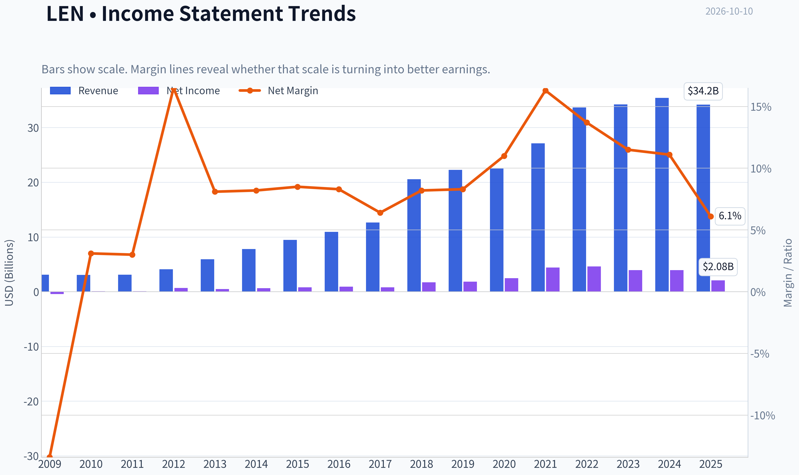

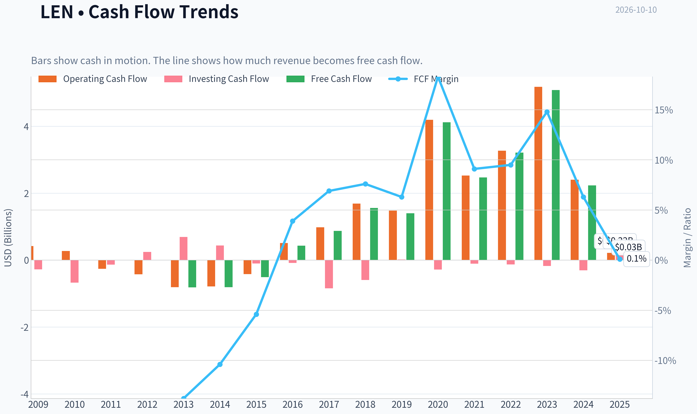

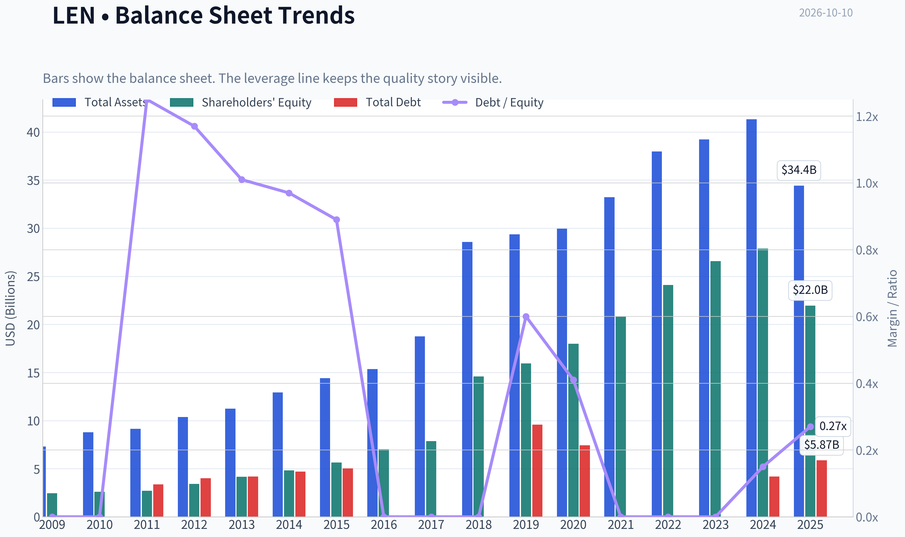

This graph tracks the profitability and return metrics (ROE, ROIC, Margins) of **LEN** over the past decade, highlighting capital efficiency trends.

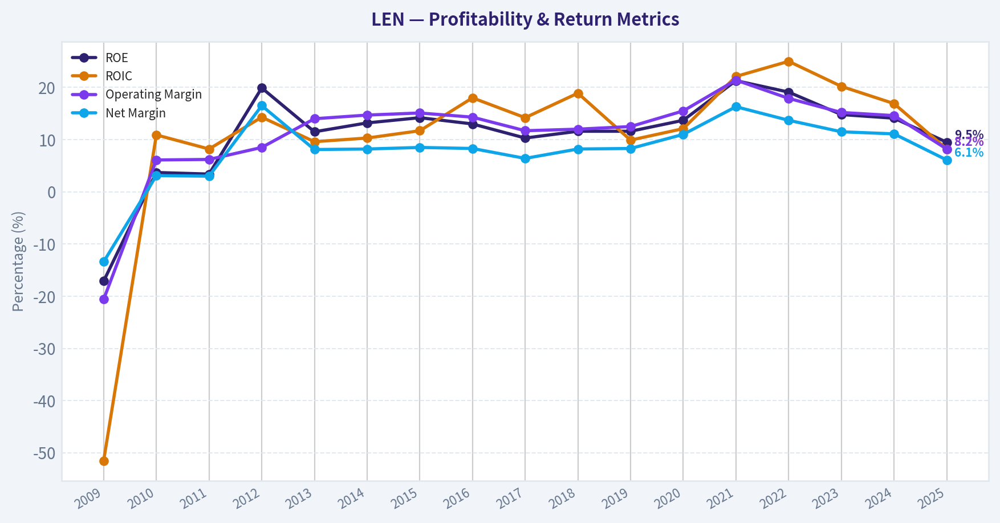

This chart illustrates the financial health of **LEN** over the last 10 years, mapping cash equivalents and free cash flow against total obligations (Debt).

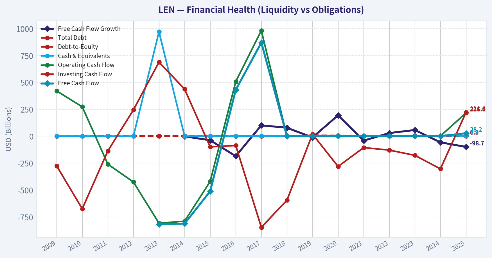

This comparison chart from *Current Market and Profitability Metrics* stacks current figures against historical benchmarks for **LEN**, making it easy to see where the company trades relative to its own averages.

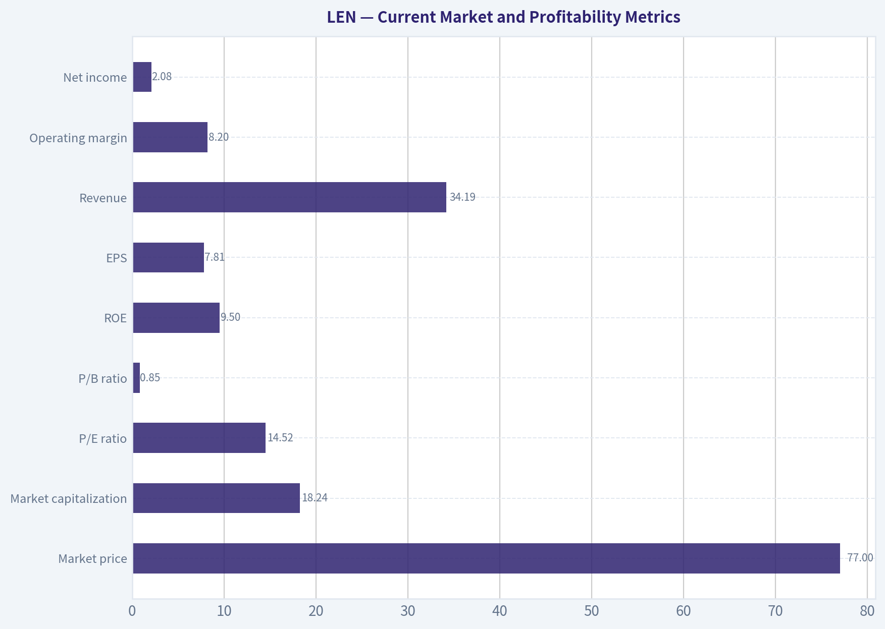

---

### Intrinsic Value Analysis (Buffett)

> *Following Warren Buffett's value investing philosophy: Circle of Competence, Economic Moat, Management Quality, and Margin of Safety.*

#### Intrinsic Value Snapshot

Price is what you pay. Intrinsic value is what the business may be worth based on the cash it can create for owners over time. We show a range, not one magic number.

- Current Price: $76.69
- Value Range (conservative to optimistic across both DCF methods): $-7.76 to $1,297.42

##### Owner Earnings (Buffett Method)
- Net Income: $2,078,179,000.00
- Depreciation & Amortization: $134,310,000.00
- Capital Expenditures: $-188,629,000.00
- Working Capital Changes: $-2,386,910,000.00
- Owner Earnings: $4,465,089,000.00

##### Intrinsic Value
###### Buffett Method
Uses owner earnings. Stricter, and usually more conservative.
- Conservative: $120.75
- Average: $586.12
- Optimistic: $1,297.42
- Discount Rate: 10.0%

###### Cash Flow Method
Uses free cash flow. Better for companies spending heavily today to grow tomorrow.
- Conservative: $-7.76
- Average: $-7.55
- Optimistic: $1.98
- Discount Rate: 10.0%

ANALYST STANCE: **WATCH**

#### Executive Conclusion

Lennar is a large-scale homebuilder with meaningful land, purchasing, and operating scale advantages. However, it remains a cyclical business whose earnings, inventory investment, cash flow, and valuation can change sharply with mortgage rates and housing demand.

At $77 per share, Lennar appears inexpensive against the research pack's blended intrinsic value of $346.49. Yet the valuation models are extremely dispersed, ranging from negative FCF-based value to $586 per share. That dispersion signals that normalized earnings-not reported trailing cash flow-drive the thesis. The business is worth watching, but the present evidence does not justify a high-conviction purchase.

#### 1. Factor Scorecard

| Factor | Score | Evidence |
|---|---:|---|
| Circle of competence and simplicity | 3/5 | The model is understandable: acquire land, build homes, and sell them. Long-term results remain highly sensitive to rates, affordability, land cycles, and regional housing conditions. |
| Durable competitive advantage | 3/5 | Scale, purchasing power, land development expertise, brand recognition, and distribution provide advantages, but homebuilding remains competitive and cyclical. |
| Management and capital allocation | 4/5 | Lennar has historically demonstrated substantial operating experience and shareholder orientation. Berkshire Hathaway's purchases provide a favorable external signal, though 13F data is backward-looking. |
| Industry structure | 3/5 | Scale benefits exist, but the industry is fragmented, economically cyclical, and exposed to interest rates, labor, materials, and local housing markets. |

**Gate 5 hard floor:** **Not tripped.** There is no evidence here of the combination of sharply deteriorating fundamentals and a solvency red line such as sub-1x interest coverage or distress-level solvency.

**Key Takeaways:** Lennar is understandable and financially viable, but not highly predictable. Its advantages are real yet less durable than those of a dominant consumer brand or asset-light platform.

#### 2. Moat Analysis

**Scale and cost advantages.** Lennar's size can improve purchasing economics, construction processes, marketing, and land-development capabilities. These advantages matter particularly when smaller builders struggle with financing or operational complexity.

**Land and local expertise.** Control of desirable land positions and knowledge of local zoning, permitting, and demand can create economic value. However, land is not a permanently protected asset: competitors can acquire land, and poorly timed land purchases can destroy returns.

**Brand and distribution.** Lennar benefits from national recognition and a broad sales platform. Its brand is useful, but homebuyers generally compare price, location, financing, incentives, and product features. That limits pricing power.

**Switching costs and network effects.** These are weak. Homebuyers can compare builders, and Lennar does not possess the customer captivity typical of enterprise software or payment networks.

**Moat rating: Narrow to moderate, 3/5.** Lennar's moat is primarily scale, execution, and market access rather than strong pricing power or customer lock-in.

#### 3. Management Quality Assessment

Lennar's management appears experienced in navigating housing cycles and operating a large national platform. The company has also pursued structural simplification and scale, which can improve per-share economics over time.

The main concern is that capital allocation in homebuilding is difficult to evaluate using a single year's earnings or free cash flow. Land and inventory purchases can be excellent investments during an upcycle but become significant cash drains when demand weakens. Management deserves credit for operating discipline, but investors must judge returns across a full housing cycle.

Berkshire Hathaway's disclosed accumulation is a positive signal, but it should not be treated as proof of intrinsic value. Berkshire may have a different time horizon, cost basis, liquidity profile, and assessment of housing-cycle normalization.

#### 4. Financial Summary

| Metric | Latest available figure |
|---|---:|
| Share price | $77.00 |
| Market capitalization | $18.24 billion |
| P/E ratio | 14.5x |
| Return on equity | 9.5% |
| Revenue growth, year over year | -3.5% |
| FCF yield | 0.2% |
| Headline intrinsic value | $346.49 |
| Reverse-DCF implied 10-year growth | -23.8% annually |
| Trailing 3-year growth | -13.8% annually |
| Trailing 5-year growth | 13.3% annually |

**Key Takeaways:** Lennar is priced at a moderate earnings multiple, but its 9.5% ROE and 0.2% FCF yield do not yet demonstrate exceptional current economics. The negative recent revenue and earnings trend reflects housing-cycle pressure, while the five-year growth figure illustrates how strongly the business can rebound over a full cycle.

#### 5. Owner Earnings Calculation

Buffett-style owner earnings are:

**Net income + depreciation and amortization - maintenance capital expenditures - working-capital increases.**

The reported P/E implies approximate earnings of:

| Calculation | Result |
|---|---:|
| Share price | $77.00 |
| P/E | 14.52x |
| Implied earnings per share | $5.30 |
| Conservative normalized owner-earnings proxy | Approximately $5.30 per share |
| Conservative no-growth value at 10% | Approximately $53 per share |

This proxy treats normalized earnings as a starting point rather than assuming that all reported free cash flow is distributable. That distinction is important for a homebuilder: inventory purchases can depress current FCF even when they represent future production capacity, while aggressive land investment can also make reported earnings look better than near-term cash economics.

The research pack's owner-earnings model produces **$586.12 per share**, while its FCF model produces **negative $7.55 per share**. Such a wide spread means that the investment case depends heavily on how normalized maintenance investment and the housing cycle are modeled.

#### 6. Three-Scenario DCF Valuation

Using approximately $5.30 per share as a conservative normalized owner-earnings proxy:

| Scenario | Assumption | Estimated value per share |
|---|---|---:|
| A. No growth | $5.30 owner earnings ÷ 10% discount rate | $53 |
| B. GDP-like growth | 3% perpetual growth | $78 |
| C. Historical-growth case | 6.65% growth, based on 50% of the trailing five-year rate, subject to cyclicality | Approximately $165 |
| Research-pack blended value | Damodaran FCFF, reverse DCF, and owner-earnings blend | $346 |

**Key Takeaways:** A conservative DCF produces values from roughly $53 to $165 per share, while the research-pack blended model is much higher at $346. The gap is not a minor modeling difference; it reflects the challenge of separating sustainable owner earnings from cyclical housing profits and inventory investment.

#### 7. Margin of Safety Analysis

At $77 per share, the research-pack headline value of $346.49 implies a **77.9% margin of safety**. The reverse DCF also indicates that the market price implies approximately **negative 23.8% annual growth over ten years**, an unusually pessimistic assumption.

However, the three-model spread is exceptionally wide:

| Valuation reference | Value per share | Discount or premium to $77 |
|---|---:|---:|
| FCF model | -$7.55 | Not economically meaningful |
| Damodaran FCFF | $258.98 | 70% discount |
| Owner-earnings model | $586.12 | 87% discount |
| Blended headline value | $346.49 | 78% discount |
| Conservative no-growth proxy | $53 | 45% premium to price |
| Conservative GDP-growth proxy | $78 | Approximately fair value |

**Key Takeaways:** The headline valuation suggests a large bargain, but conservative cash-flow scenarios range from below the current price to moderately above it. Because Lennar is cyclical and the valuation inputs are unstable, a 78% headline margin of safety should not be accepted at face value.

#### 8. Final Buffett Scorecard

| Criterion | Weight | Score | Weighted contribution |
|---|---:|---:|---:|
| Moat width and durability | 25% | 3.0 | 0.75 |
| Valuation and margin of safety | 20% | 3.0 | 0.60 |
| Capital returns versus WACC | 15% | 2.5 | 0.38 |
| Business understanding and predictability | 12% | 2.5 | 0.30 |
| Management quality and capital allocation | 12% | 4.0 | 0.48 |
| Reinvestment runway | 8% | 3.0 | 0.24 |
| Balance-sheet strength | 4% | 3.0 | 0.12 |
| Industry structure | 4% | 3.0 | 0.12 |
| **Total** | **100%** |  | **2.99 / 5.00** |

**Key Takeaways:** Management and scale are Lennar's strongest attributes. The score is held back by modest current ROE, weak reported FCF yield, limited customer lock-in, and substantial housing-cycle uncertainty.

#### 9. Investment Stance

**WATCH - Moderate conviction.**

Lennar could become attractive if:

- mortgage rates decline or housing affordability improves;
- earnings stabilize without excessive incentives;
- free cash flow normalizes across a full housing cycle;
- ROE returns sustainably above 15%; and
- the company continues repurchasing shares at genuinely depressed prices.

At $77, the stock may already discount considerable pessimism, and Berkshire's buying adds credibility to the long-term housing thesis. Nevertheless, the business does not yet meet the standard of a highly predictable, wide-moat compounder. A stronger entry case would come from either clearer evidence of normalized owner earnings or a lower price that provides a meaningful margin of safety against the conservative DCF range.
#### Valuation Bridge

This bridge places the current market price beside each intrinsic value lens so readers can see whether upside depends on one method or shows up across several methods.

| Scenario | Intrinsic Value / Share |
| --- | ---: |
| Buffett Method | $586.12 |
| Cash Flow Method | $-7.55 |
| Damodaran Method | $258.98 |
| Current Price | $76.69 |

#### Key Takeaways

If one method is far above the others, the upside case depends on a specific modelling assumption. When several methods cluster together, the valuation story is more robust.

#### Valuation Visuals

This comparison chart from *Latest Earnings Snapshot* stacks current figures against historical benchmarks for **LEN**, making it easy to see where the company trades relative to its own averages.

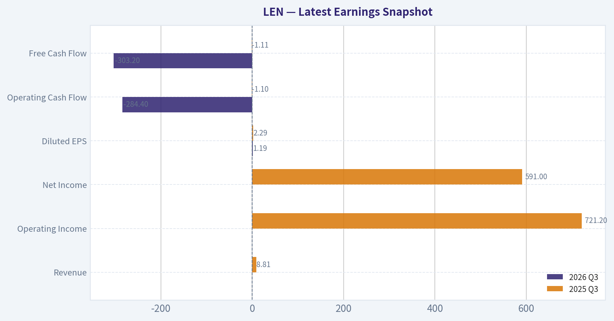

This comparison chart from *Balance Sheet and Financial Strength* stacks current figures against historical benchmarks for **LEN**, making it easy to see where the company trades relative to its own averages.

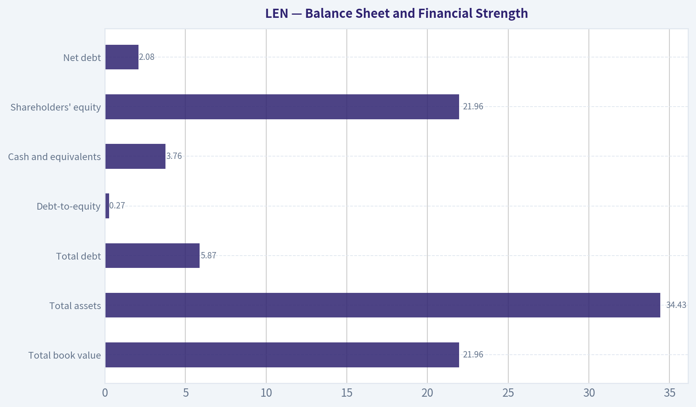

This comparison chart from *Current Versus Historical Averages* stacks current figures against historical benchmarks for **LEN**, making it easy to see where the company trades relative to its own averages.

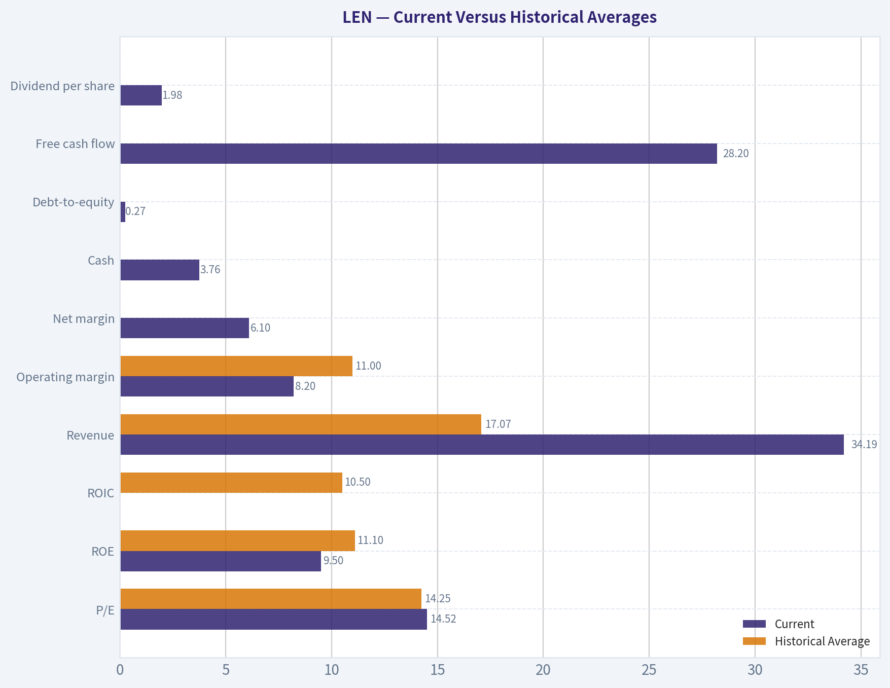

This comparison chart from *Three-Scenario Buffett-Style Owner Earnings DCF* stacks current figures against historical benchmarks for **LEN**, making it easy to see where the company trades relative to its own averages.

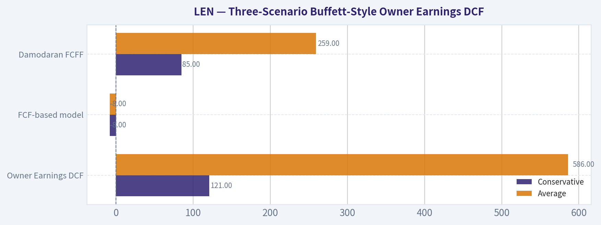

---

### Trend & Growth Analysis (Lynch/Druckenmiller/Fisher)

> *Following Peter Lynch's GARP, Stanley Druckenmiller's macro-aware approach, and Philip Fisher's scuttlebutt methodology.*

ANALYST STANCE: **WATCH**

#### 1. Lynch Classification

| Category | Assessment |
|---|---|
| Classification | Cyclical |
| Growth profile | Revenue declining 3.5% year over year |
| Growth-investing fit | Weak today; housing-cycle recovery could create a future inflection |
| Current price | $77 |
| Market capitalization | $18.24 billion |

**Key Takeaways:** Lennar is primarily a cyclical homebuilder, not a proven fast grower. The current setup is defined by weak housing conditions and falling revenue rather than accelerating company-specific growth.

#### 2. The Story in Three Bullets

- Lennar builds homes in markets with a long-term structural housing shortage and favorable demographic demand.
- Scale, land holdings, mortgage-related offerings, and operating efficiency can support share gains during a housing recovery.
- The near-term thesis depends more on mortgage rates and housing-cycle normalization than on current earnings acceleration.

#### 3. TAM and 10x Test

Lennar's long-term opportunity is the U.S. housing market, supported by household formation, underbuilding, and limited existing-home inventory. However, a homebuilder's practical TAM is constrained by land availability, regional exposure, construction capacity, and mortgage affordability.

| Test | Assessment |
|---|---|
| Current revenue | Not provided in the research pack |
| 10x revenue test | Cannot be quantified precisely without current revenue |
| Long-term housing demand | Structurally attractive |
| Near-term housing demand | Under pressure from elevated mortgage rates |
| TAM growth | Moderate over the cycle, not a 15%+ secular growth market |
| Runway | Meaningful, but cyclical and capital intensive |

**Key Takeaways:** Lennar has a large addressable market, but housing demand does not automatically translate into near-term sales growth. The TAM is durable rather than explosively expanding, so a ten-bagger would likely require substantial share gains plus a favorable multi-year housing cycle.

#### 4. Revenue Growth Trend

| Metric | Result | Interpretation |
|---|---:|---|
| Revenue growth year over year | -3.5% | Declining |
| Recent housing backdrop | Deteriorating | Demand and affordability headwinds |
| Growth pattern | Not accelerating | No confirmed inflection |
| Cyclicality | High | Results can change materially with rates and demand |

**Key Takeaways:** Current revenue growth is negative, and there is no evidence in the supplied data of a reacceleration. One weak period would not invalidate the thesis, but the housing deterioration makes this a cycle-timing decision rather than a straightforward growth investment.

#### 5. Unit Economics and Financial Quality

| Metric | Result | Assessment |
|---|---:|---|
| LTV/CAC | Not disclosed | Not applicable in the standard SaaS sense |
| Net revenue retention | Not applicable | Product is not subscription-based |
| Rule of 40 | Not applicable | Not a SaaS business |
| Return on equity | 9.5% | Modest |
| Free-cash-flow yield | 0.2% | Weak at the current point in the cycle |
| Gross margin | Not available | Cannot assess trend |
| Current ratio | Not available | Liquidity analysis incomplete |

**Key Takeaways:** The standard subscription metrics do not apply to Lennar. The more relevant signals are return on capital, cash generation, inventory discipline, and cycle-adjusted margins; the available ROE and FCF-yield figures do not yet demonstrate exceptional economics.

#### 6. Inflection-Point Assessment

| Potential inflection | Current evidence | Status |
|---|---|---|
| Product cycle | No major product catalyst identified | Neutral |
| Market-share gains | Scale is a potential advantage | Unconfirmed |
| Margin inflection | No margin data supplied | Unconfirmed |
| TAM expansion | Housing shortage remains supportive | Positive structurally |
| Competitive inflection | No major competitor failure identified | Neutral |
| Macro inflection | Mortgage rates near multi-year highs | Negative currently |

**Key Takeaways:** Lennar has a possible future macro inflection if mortgage rates fall and housing supply remains constrained. That catalyst is not visible yet, so the stock does not currently meet the preferred Druckenmiller standard of accelerating fundamentals ahead of recognition.

#### 7. Macro Setup

| Macro factor | Impact on LEN |
|---|---|
| Mortgage rates | Major headwind while elevated |
| Housing affordability | Negative |
| U.S. housing undersupply | Long-term tailwind |
| Household formation | Long-term tailwind |
| Economic cycle | Housing appears pressured rather than in an early-recovery phase |
| Interest-rate sensitivity | High |
| Berkshire accumulation | Positive sentiment signal, but not a substitute for operating acceleration |

**Key Takeaways:** The secular housing shortage is favorable, but the immediate macro wind is against Lennar. Berkshire's purchases provide validation of valuation and asset quality, yet 13F data is delayed and does not establish a near-term earnings catalyst.

#### 8. Fisher 15-Point Score

This is a preliminary score based only on the supplied financial and news information; a full Fisher assessment would require management interviews, competitor checks, and detailed filings.

| Fisher area | Score / 5 |
|---|---:|
| Market potential | 4 |
| New-product determination | 3 |
| R&D effectiveness | 2 |
| Sales organization | 4 |
| Profit margins | 3 |
| Margin improvement | 2 |
| Labor relations | 3 |
| Executive relations | 3 |
| Management depth | 4 |
| Cost accounting | 4 |
| Outstanding competitive aspects | 4 |
| Long-range profit outlook | 4 |
| Dilution risk | 4 |
| Management candor | 3 |
| Management integrity | 4 |
| **Total** | **51 / 75** |

**Key Takeaways:** Lennar scores as an average-to-good industrial operator, with strengths in scale, sales execution, management depth, and market position. It does not score like a Fisher-quality compounder because the business is cyclical, capital intensive, and currently lacks demonstrated margin and revenue momentum.

#### 9. Valuation Analysis

| Valuation measure | Result | Interpretation |
|---|---:|---|
| P/E | 14.5x | Reasonable on reported earnings, but earnings are cyclical |
| PEG | Not meaningful | Revenue is declining and normalized earnings growth is uncertain |
| Free-cash-flow yield | 0.2% | Little current cash-flow support |
| Headline intrinsic value | $346.49 | Highly model-sensitive |
| Owner-earnings DCF | $586.12 | Optimistic sensitivity |
| Damodaran FCFF | $258.98 | Optimistic but lower |
| FCF model | -$7.55 | Highlights weak current cash generation |
| Headline margin of safety | 77.9% | Should not be accepted at face value |
| Reverse-DCF implication | Approximately -23.8% annual growth for 10 years | Indicates pessimistic market expectations |

**Key Takeaways:** Lennar appears inexpensive on P/E, but the valuation range is exceptionally wide because homebuilder cash flows are cyclical and inventory-dependent. The large headline discount is not sufficient by itself; the negative FCF-model result warns that normalized cash generation must be verified before treating LEN as a deep-value opportunity.

**Scenario framework:** A credible valuation case should use cycle-adjusted earnings rather than peak earnings. The bear case is prolonged high rates, lower orders, inventory write-downs, and weaker margins; the base case is stabilization followed by a gradual housing recovery; the bull case is falling rates, constrained supply, stronger orders, and operating leverage. No precise price targets are justified without normalized earnings, backlog, gross margin, and inventory data.

#### 10. Growth Investor Scorecard

| Criterion | Weight | Score / 5 | Weighted contribution |
|---|---:|---:|---:|
| Lynch story | 10% | 3.0 | 0.30 |
| TAM and runway | 20% | 3.5 | 0.70 |
| Revenue growth | 20% | 2.0 | 0.40 |
| Unit economics | 15% | 2.5 | 0.38 |
| Competitive position | 10% | 4.0 | 0.40 |
| Management quality | 10% | 3.5 | 0.35 |
| Macro setup | 5% | 2.0 | 0.10 |
| Profitability path | 5% | 3.0 | 0.15 |
| Valuation | 5% | 3.5 | 0.18 |
| **Total** | **100%** |  | **2.96 / 5.00** |

**Key Takeaways:** The score falls just below the 3.0 threshold for a WATCH-quality setup. Lennar's valuation and competitive position are attractive, but declining revenue, weak current free cash flow, and unfavorable housing macro conditions prevent an ADVOCATE rating.

#### 11. Position Size Stance

| Investor type | Position stance |
|---|---|
| Growth investor seeking 15%-25% recurring growth | Avoid initiating |
| Value investor with housing-cycle expertise | Small watch position only |
| Existing shareholder | Hold/watch rather than automatically sell |
| High-conviction concentrated portfolio | Wait for operating confirmation |
| Suggested maximum before confirmation | 0%-2% exploratory position |

**Key Takeaways:** LEN is better treated as a watchlist cyclical than as a core growth holding. A position becomes more attractive if revenue orders stabilize, gross margins bottom, cash generation improves, and mortgage-rate pressure eases.

#### 12. Key Risks and Catalysts

| Catalysts | Risks |
|---|---|
| Falling mortgage rates | Rates remain elevated |
| Housing orders reaccelerate | Further order cancellations |
| Persistent housing undersupply | Affordability deterioration |
| Gross-margin stabilization | Incentive-driven margin compression |
| Stronger free-cash-flow conversion | Inventory write-downs |
| Share gains during recovery | Regional housing weakness |
| Continued disciplined land investment | Earnings peak-cycle illusion |

**Key Takeaways:** The main catalyst is a housing and interest-rate inflection, not a new technology or product cycle. The main risk is that apparently low P/E valuation reflects temporarily elevated earnings while cash generation and housing demand continue weakening.

#### Conclusion

LEN is a financially credible, scaled homebuilder trading at a seemingly reasonable earnings multiple, but it is not presently a fast-growth or ten-bagger setup under the Lynch, Druckenmiller, and Fisher frameworks. The appropriate stance is **WATCH** until there is evidence of a housing-cycle bottom: improving orders, stabilizing margins, stronger free cash flow, and a more supportive rate environment.

#### Growth & Scorecard Visuals

This comparison chart from *Growth and Cash-Flow Metrics* stacks current figures against historical benchmarks for **LEN**, making it easy to see where the company trades relative to its own averages.

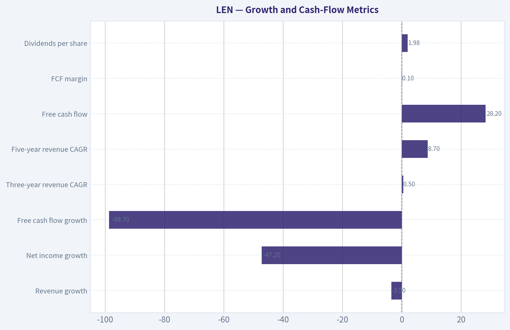

---

### Market Technical Analysis

ANALYST STANCE: **WATCH**

#### LEN technical overview

LEN closed at **$76.69 on October 9, 2026**, after a sharp decline from approximately **$93 in late June** and **$82.52 on September 22**. The recent structure remains bearish: price is below the short-, medium-, and long-term moving averages, momentum is negative, and volatility has increased. However, the stock is also trading near the lower portion of its recent Bollinger range, so downside may be increasingly vulnerable to a short-term relief bounce.

The technical picture favors **caution rather than aggressive dip-buying**. A durable recovery would require reclaiming several overhead resistance levels and improving momentum confirmation.

#### Selected indicators and latest readings

| Indicator | Latest reading | Interpretation |
|---|---:|---|
| Close | $76.69 | Down 1.2% from October 8; near the lower end of the recent range |
| 10 EMA | $78.04 | Price is below the short-term trend average, indicating weak near-term momentum |
| 50 SMA | $82.35 | Price is about 6.9% below the medium-term average |
| 200 SMA | $92.14 | Price is about 16.8% below the long-term benchmark |
| MACD | -1.44 | Bearish momentum remains in force |
| RSI | 42.69 | Weak-to-neutral momentum, but not technically oversold |
| Bollinger upper band | $84.05 | Important resistance and mean-reversion target |
| Bollinger lower band | $74.23 | Nearby downside reference and potential short-term support |
| ATR | $3.04 | Daily volatility is substantial, roughly 4.0% of the share price |

Key Takeaways: LEN remains below every major moving-average reference, confirming a broad bearish trend. RSI is weak but not below 30, so the stock does not yet show a classic oversold signal. The lower Bollinger Band near $74.23 is the nearest technical support, while the $78 to $82 area contains several layers of resistance.

#### Trend and price structure

The moving-average configuration is decisively negative. The **10 EMA at $78.04** is below the **50 SMA at $82.35**, and the 50 SMA is well below the **200 SMA at $92.14**. More importantly, all three averages are sloping downward:

- The 10 EMA declined from approximately **$86.09 on August 24** to $78.04.
- The 50 SMA declined from approximately **$85.83** to $82.35.
- The 200 SMA declined from approximately **$98.37** to $92.14.

This is not merely a one-day breakdown. It reflects persistent deterioration across short-, medium-, and long-term horizons. The 200 SMA is particularly important because price has remained substantially below it since the spring decline. A recovery toward $92 would therefore represent a significant trend repair rather than a routine bounce.

Recent price action also shows a pattern of lower highs and lower lows. The rebound from the September 18 low near $75.94 reached only $82.52 on September 22, followed by renewed weakness. The October 5 low of $73.27 briefly pushed below the lower Bollinger Band, but the subsequent recovery has been limited and has not reclaimed the 10 EMA.

#### Momentum analysis

The **MACD is -1.44**, which confirms that bearish momentum is still dominant. The indicator improved substantially from roughly **-2.05 on September 21** to **-0.60 on October 2**, coinciding with the rebound toward $82.52. However, that improvement reversed as price weakened again, with MACD falling to approximately **-1.44 by October 9**.

This sequence is important: the September recovery did not establish a sustained bullish momentum reversal. Instead, MACD improved during the bounce and then deteriorated as the stock failed near the $82 area. Until MACD begins rising consistently and preferably crosses above its signal line, rallies should be treated as potential countertrend moves rather than confirmed trend changes.

The **RSI at 42.69** provides a more nuanced signal. It is below the neutral 50 level, indicating that sellers retain the momentum advantage, but it is well above the traditional oversold threshold of 30. RSI reached approximately 34.5 on October 5, showing short-term pressure, but the rebound toward 42.7 suggests some selling exhaustion without establishing strong buying momentum. A move above 50 would improve the near-term outlook; a drop below 30 would indicate more pronounced downside momentum but could also increase the probability of a technical bounce.

#### Bollinger Bands and volatility

The latest Bollinger range is approximately **$74.23 to $84.05**, with an inferred middle band near **$79.14**. LEN closed below the middle band and only modestly above the lower band. This positioning indicates weak price location within the recent range.

The October 5 selloff reached $73.27, slightly below the lower band at that time, followed by a rebound. That reaction suggests buyers are attempting to defend the low-$74 area. Nevertheless, a single move back inside the bands does not establish a reversal. If the stock closes decisively below $74.23, the next downside risk would be a retest of the October 5 low near $73.27, followed by the possibility of further price discovery if that low fails.

On the upside, the middle band near $79.14 is the first mean-reversion hurdle. A close above the middle band would improve the short-term setup, but stronger confirmation would require reclaiming the 10 EMA near $78.04 and then the 50 SMA near $82.35. The upper band near $84.05 represents a more ambitious rebound target and likely resistance zone.

ATR has risen to **$3.04**, compared with approximately $2.4 to $2.7 during much of September. This means daily price swings are large relative to the share price. Traders should avoid placing stops so close that normal volatility triggers them, while also reducing position size to keep dollar risk controlled. A one-ATR move is roughly 4% of the stock price, so even apparently modest positions can experience substantial short-term fluctuations.

#### Volume and confirmation considerations

Trading activity increased materially during the recent decline. Volume reached approximately **8.9 million shares on October 1**, **9.0 million on October 2**, and **10.7 million on October 5**, compared with many earlier sessions closer to 2 to 3 million shares. Elevated volume during a breakdown generally indicates that the move has meaningful participation rather than being caused only by thin trading.

There was also heavy volume during the September 16-18 decline, including approximately **11.8 million shares on September 18**. This repeated pattern of high-volume selling suggests distribution and raises the risk that overhead supply will appear when the stock rallies back toward $80 to $83.

A more constructive signal would require an advancing session with clearly above-average volume, followed by successful closes above the 10 EMA and the Bollinger middle band. Without that confirmation, a low-volume bounce could simply represent short covering or temporary relief buying.

#### Trading implications

For bearish or defensive traders, the trend remains favorable to waiting for failed rebounds rather than chasing weakness. The principal resistance levels are approximately:

- **$78.04:** 10 EMA and immediate short-term trend resistance.
- **$79.14:** Bollinger middle band and likely mean-reversion test.
- **$82.35:** 50 SMA and a more important medium-term resistance level.
- **$84.05:** Upper Bollinger Band and potential rebound ceiling.
- **$92.14:** 200 SMA and major long-term trend resistance.

For bullish traders, the low-$74 area offers a potential tactical bounce zone, but the setup lacks sufficient confirmation for a high-conviction trend reversal. A more favorable risk-reward profile would come from either a clear bullish reversal near $74, accompanied by improving RSI and MACD, or a confirmed reclaim of the $79 to $82 resistance cluster.

A close below approximately **$74.23**, particularly on strong volume, would weaken the short-term support thesis. Conversely, sustained closes above **$79.14** followed by a move through **$82.35** would indicate that selling pressure is easing and could open a path toward the mid-$80s.

#### Overall assessment

LEN is in a **broad bearish trend with elevated volatility and only tentative signs of short-term stabilization**. The stock is near potential support, but RSI is not oversold, MACD remains negative, price is below all major moving averages, and recent high-volume selling argues against assuming that the decline is complete.

The most prudent classification is **WATCH**. Traders should monitor whether $74 to $75 holds and whether price can reclaim $79.14, $78.04, and then $82.35 with improving momentum. Until those conditions develop, rallies remain technically suspect, while a break below the October 5 low would signal renewed downside risk.

#### Key levels and decision framework

| Area | Level | Significance | What would improve the signal |
|---|---:|---|---|
| Immediate support | $74.23 | Lower Bollinger Band | Repeated defenses and bullish reversal candles |
| Recent swing low | $73.27 | October 5 intraday low | Hold above this level on declining volume |
| Short-term resistance | $78.04 | 10 EMA | Close above it with improving RSI |
| Mean-reversion resistance | About $79.14 | Bollinger middle band | Sustained closes above the band |
| Medium-term resistance | $82.35 | 50 SMA | Breakout supported by strong volume |
| Higher resistance | $84.05 | Upper Bollinger Band | Continued momentum and positive MACD |
| Risk parameter | $3.04 ATR | Typical daily price movement | Use for position sizing and stop placement |

Key Takeaways: The critical near-term range is roughly $73.27 to $82.35. Holding the low-$74 area could produce a tradable bounce, but a genuine trend improvement requires reclaiming the $79 to $82 resistance zone with stronger momentum and volume confirmation. A decisive break below $73.27 would substantially weaken the bullish rebound case.

---

### Options Market Analysis

> *Reading options flow - put/call ratios, IV skew, and unusual activity - to gauge institutional positioning and event-driven risk.*

#### LEN Options Flow Report

**Data as of October 10, 2026.** The options market shows a defensive, put-heavy stance across the nearest expirations, although one unusually large short-dated call trade provides a bullish counter-signal. Confidence is moderate because the available data does not include LEN's current share price, full strike-level open-interest distribution, or historical IV percentiles.

#### Put/Call Ratio Analysis

| Expiration | Days to Expiry | Call OI | Put OI | Put/Call OI | Call Volume | Put Volume | Put/Call Volume |
|---|---:|---:|---:|---:|---:|---:|---:|
| Oct. 16, 2026 | 6 | 17,271 | 19,858 | 1.15 | 2,728 | 4,786 | 1.75 |
| Oct. 23, 2026 | 13 | 852 | 1,412 | 1.66 | 188 | 363 | 1.93 |
| Oct. 30, 2026 | 20 | 1,517 | 1,358 | 0.90 | 254 | 274 | 1.08 |
| **Total** | - | **19,640** | **22,628** | **1.15** | **3,170** | **5,423** | **1.71** |

**Key Takeaways:** LEN's aggregate put/call OI ratio of 1.15 is meaningfully above the approximate neutral baseline of 0.70. The volume ratio of 1.71 is even more defensive, indicating heavier current put activity than call activity. The strongest imbalance is in the October 23 expiration, although that expiration has relatively low absolute liquidity.

#### Implied Volatility Assessment

| Expiration | Call ATM IV | Put ATM IV | Put Minus Call IV | Interpretation |
|---|---:|---:|---:|---|
| Oct. 16, 2026 | 43.0% | 46.4% | +3.4 percentage points | Downside protection commands a premium |
| Oct. 23, 2026 | 42.7% | 45.6% | +2.9 points | Moderate put skew |
| Oct. 30, 2026 | 49.5% | 47.3% | -2.2 points | Slight call-side premium |

Near-term ATM IV is approximately **43% to 46%** for the first two expirations, rising to roughly **47% to 50%** in the October 30 expiration. This is not necessarily extreme without a longer-term IV history, but it indicates meaningful event or movement pricing.

The supplied data reports ATM IV rather than true out-of-the-money skew. Therefore, the put-minus-call differences should be treated as a directional proxy, not a complete OTM skew analysis. No known catalyst is identified in the data; earnings or another corporate event should be checked separately before interpreting the elevated October 30 volatility.

**Key Takeaways:** The first two expirations show a clear downside-volatility premium, consistent with demand for protection or bearish speculation. October 30 is different, with calls carrying slightly higher ATM IV, suggesting potential event-related upside interest or a less defensive volatility structure. Overall, the near-term volatility signal remains cautious rather than aggressively bullish.

#### Unusual Options Activity

| Expiration | Type | Strike | Volume | Open Interest | Volume/OI | IV | Days to Expiry | Moneyness |
|---|---|---:|---:|---:|---:|---:|---:|---|
| Oct. 16, 2026 | Call | $77 | 631 | 25 | 25.2x | 41.3% | 6 | Cannot determine without current share price |

The October 16 $77 call is the only contract flagged as unusual under the dataset's criteria of volume greater than five times open interest and volume above 500 contracts. Its 25.2-times volume-to-open-interest ratio strongly suggests substantial new activity rather than routine trading in an established position.

Because the current LEN share price was not provided, the $77 strike cannot reliably be classified as ITM, ATM, or OTM. The trade is directionally bullish if purchased to open, but the data does not identify whether trades occurred at the bid or ask, so it could also represent call selling, a spread, or speculative retail activity. The very short six-day horizon makes it a high-conviction-looking but high-risk trade.

**Key Takeaways:** The unusual $77 call is a notable bullish exception to the broader put-heavy flow. Its exceptionally high volume relative to open interest points to fresh positioning, but the lack of trade-side data prevents a definitive conclusion that institutions were buying calls. This contract raises the possibility of a short-term upside bet, but it does not overturn the broader defensive signal by itself.

#### Open Interest Concentration and Potential Gamma Levels

| Expiration | Total Call OI | Total Put OI | Combined OI | Relative Concentration |
|---|---:|---:|---:|---|
| Oct. 16, 2026 | 17,271 | 19,858 | 37,129 | Very high |
| Oct. 23, 2026 | 852 | 1,412 | 2,264 | Low |
| Oct. 30, 2026 | 1,517 | 1,358 | 2,875 | Low to moderate |

The October 16 expiration contains approximately **37,129 contracts of combined open interest**, over 88% of the reported open interest across the three expirations. This creates the greatest potential for short-term pinning or dealer-gamma effects around heavily traded strikes.

However, the available output does not provide the complete strike-by-strike OI distribution or dealer gamma exposure. As a result, specific gamma walls, maximum-pain levels, and price-gravity strikes cannot be identified with confidence. The $77 call is a high-volume strike, but its very small existing open interest means it is not yet a major established OI wall.

**Key Takeaways:** LEN's options positioning is overwhelmingly concentrated in the October 16 expiration, making that date the most important for near-term hedging and possible pinning behavior. Specific support or resistance strikes cannot be confirmed without the full option chain. The large put OI total suggests downside hedging may influence price behavior, but it does not establish a precise maximum-pain level.

#### Overall Options Sentiment

**Signal: BEARISH, with a short-term bullish counter-signal.**

The primary driver is the combination of:

- Aggregate put/call OI of **1.15**, well above the approximate neutral level of 0.70.
- Put/call volume of **1.71**, indicating stronger current put activity.
- Put IV premiums of roughly **3 volatility points** in the nearest two expirations.
- Heavy concentration of open interest in the October 16 expiration, where puts outnumber calls.

The unusual October 16 $77 call prevents the reading from being decisively bearish. It may represent a fresh upside bet, but its direction cannot be verified from volume and open interest alone. The most appropriate interpretation is **defensive bearish positioning with isolated short-term upside speculation**.

This is an options-positioning signal, not a valuation forecast. Confidence is reduced by the absence of current share price, full strike-level OI, trade-side information, and a confirmed catalyst calendar.

#### Summary

| Category | Assessment |
|---|---|
| Put/Call Ratio | Bearish: 1.15 OI ratio and 1.71 volume ratio, both above neutral |
| IV Level | Moderate to elevated near-term IV, approximately 43%-50%; no historical percentile available |
| Skew Direction | Put-skewed in the first two expirations; slight call skew in October 30 |
| Unusual Activity | Fresh-looking October 16 $77 call activity, 631 volume versus 25 OI, but trade direction unconfirmed |
| Overall Signal | **BEARISH**, tempered by one potentially bullish short-dated call position |

**Key Takeaways:** LEN's overall options market is positioned defensively, with puts dominating both open interest and trading volume. The strongest bullish evidence is the unusually active October 16 $77 call, but it is insufficient to offset the broader put demand and downside IV premium. The final read is bearish with moderate confidence and a meaningful short-term upside-risk caveat.

---

## Research Team Commentary

> *The Research Manager synthesizes the Bull vs Bear debate into action-free commentary. This is a pre-risk view, not the final stance.*

Core Takeaway: Lennar is an advantaged homebuilder, but at $76.69 it is not sufficiently discounted for its cyclicality, capital intensity, and currently modest returns on capital. The housing-shortage and market-share arguments are credible, yet the valuation depends on unverified cash conversion and an eventual affordability recovery. I would not initiate a position here, but the company remains worth monitoring rather than permanently avoiding.

The strongest bull argument is that Lennar's scale, land-sourcing capabilities, procurement advantages, and integrated mortgage operations should allow it to take share from weaker builders. Long-term housing undersupply and demographic demand also provide a favorable industry backdrop. At 14.5 times earnings, the market is not pricing Lennar as an elite compounder, and the bull's reverse DCF suggests the shares require roughly 4%-6% annual growth in normalized cash earnings. That hurdle is plausible if mortgage affordability improves, incentives recede, capital efficiency rises, and repurchases contribute to per-share growth.

The contrarian opportunity is that current pessimism may be extrapolating today's affordability constraints indefinitely. Mortgage rates do not have to return to historical lows for conditions to improve; moderate rate relief, income growth, smaller homes, or slower home-price appreciation could restore some purchasing power. Lennar's financial and operating scale may also let it gain share during a prolonged downturn.

The strongest bear argument, however, is that plausible upside is not the same as a Buffett-style margin of safety. Revenue is declining 3.5%, ROIC is only 8.8%, and ROE is 9.5%. Those are not the economics of a predictable, wide-moat compounder deserving a small valuation discount. Lennar's advantages are meaningful, but they primarily provide scale and resilience rather than strong pricing power. Buyers still make decisions based heavily on location, monthly payment, floor plan, and incentives.

The valuation is especially sensitive to assumptions. The bull's approximately $87 base value offers only 14% upside, while its $65 bear value implies roughly 15% downside. Its more conservative 4% growth scenario produces a value near $75, essentially the current price. Moreover, the analysis assumes 90% normalized cash conversion despite lacking full-cycle cash-flow, land-spending, and working-capital evidence. If conversion is closer to 75%, or if the appropriate required return is 11%-12% rather than 10%, much of the apparent upside disappears.

That matters because Buffett's smaller 10%-15% required discount is appropriate for unusually predictable, high-ROIC businesses. Lennar is a cyclical, capital-intensive company with an uncertain earnings base and meaningful dependence on external normalization. It should generally require a 25%-35% discount to conservatively estimated value. Even accepting the $87 base value, that discipline would indicate a more attractive range of roughly $57-$65. The bear's proposed high-$50s to low-$60s entry area is therefore reasonable.

The housing-shortage narrative also needs qualification. Housing need is not the same as qualified, profitable demand. High mortgage payments, taxes, insurance, and maintenance costs can prevent household formation from translating into profitable transactions. Lennar can preserve deliveries through rate buydowns and other incentives, but market share acquired through lower unit economics does not necessarily create shareholder value. The key question is whether incremental growth earns returns comfortably above the cost of capital.

Management quality and financial strength remain insufficiently documented. Lennar may have sensible capital-allocation options, including controlling rather than owning more land and repurchasing undervalued shares, but the packet does not provide enough information about net debt, maturities, land commitments, inventory aging, impairments, or repurchase prices to award management a premium. With current ROIC near 9%, evidence of better capital efficiency is essential.

The market evidence reinforces patience. At $76.69, the shares remain below the declining 10-day EMA of approximately $78.04, the 50-day SMA of $82.35, and the 200-day SMA of $92.14. Put/call open interest of 1.15, put/call volume of 1.71, and elevated put implied volatility show defensive positioning. This bearish sentiment could eventually become contrarian fuel, but there is no evidence yet that the market has begun validating the recovery thesis.

The lesson from prior mistakes is to align the decision with the evidence at the actual decision price. A good long-term industry position should not override weak returns on capital, a thin valuation cushion, and a broken trend. Conversely, bearish technicals alone do not establish permanent impairment. The appropriate response is therefore a no-buy WATCH with a bearish tactical bias-not an aggressive long and not a claim that Lennar is distressed.

Rationale: Lennar appears to be a solid operator in a difficult industry rather than a wonderful business available at a fair price. The shares may be approximately fairly valued if normalized cash earnings grow 4%-6%, but that outcome depends on several interlocking assumptions: affordability improves, incentives moderate, cash conversion is strong, land investment remains disciplined, and ROIC rises. With downside and upside roughly symmetric in the supplied valuation range, investors are not being adequately compensated for that uncertainty. A lower price or stronger operating evidence is needed.

Monitoring Plan: Over the next one to four quarters, I would first track orders, deliveries, cancellation rates, and revenue to determine whether demand is stabilizing. The quality of stabilization matters more than headline volume: deliveries supported by progressively larger mortgage buydowns or discounts would weaken the thesis.

Second, monitor homebuilding gross margin, incentive expense, average selling prices, and selling costs. Stable volumes accompanied by lower incentives and firmer margins would support normalized earnings power. Continued margin compression despite incentives would suggest that affordability pressure is more structural.

Third, examine operating cash flow after adjusting for land purchases, inventory changes, and working-capital releases. The bull valuation needs evidence that normalized cash conversion can approach its assumed 90%. Repeated cash generation materially below earnings would move conservative value toward the low-to-mid $60s.

Fourth, track ROIC and asset turns. A sustainable increase from 8.8% into the low double digits, supported by better inventory turns rather than leverage, would materially strengthen the investment case. ROIC remaining near the cost of capital even as housing conditions improve would undermine the compounding thesis.

Fifth, review net debt, debt maturities, owned versus controlled land, option deposits, inventory aging, and impairments. Greater use of land options and strong liquidity would reduce cyclical downside. Rising commitments, impairments, or leverage would require a still larger margin of safety.

Finally, watch price confirmation without confusing it with intrinsic value. A sustained move above the declining 10-day EMA would be an initial stabilization signal; reclaiming the 50-day average around $82 would be more meaningful. A move toward the high-$50s to low-$60s without balance-sheet deterioration could create the valuation margin of safety currently missing. Alternatively, improving operations and rising ROIC could justify reconsideration at a somewhat higher price.

Final stance: WATCH

---

## Value Investing Team Commentary

> *The Investor translates the research view into an investment thesis before risk review. This is still not the final stance.*

### Investment Commentary

Lennar appears to be an above-average operator in a fundamentally difficult industry. Its scale, supplier relationships, land-sourcing capabilities, national footprint, and mortgage operations should help it survive downturns and take share from weaker competitors. Long-term housing undersupply is also real. However, these strengths create resilience and cost advantages-not the pricing power, recurring revenue, or predictable returns characteristic of a truly exceptional compounder.

### Business quality and moat

The central limitation is that homebuilding remains cyclical, capital-intensive, and heavily dependent on mortgage affordability. Consumers generally choose homes based on location, monthly payment, design, and incentives rather than builder brand. Lennar can preserve volume through mortgage-rate buydowns and discounts, but doing so may transfer much of the value of its scale to the buyer.

Current returns support this more restrained assessment:

- Revenue growth: **-3.5%**
- ROIC: **8.8%**
- ROE: **9.5%**
- ROA: **6.0%**

An 8.8% ROIC may be only modestly above-or potentially near-the company's cost of capital, depending on the assumptions used. Lennar must demonstrate that its land-light strategy, inventory turnover, and operating scale can raise returns into the low double digits without relying on additional leverage or unusually favorable housing conditions.

### Valuation and margin of safety

At **$76.69** and approximately **14.5 times earnings**, Lennar is not obviously expensive. But a reasonable multiple is not synonymous with a sufficient margin of safety. Reported earnings may not accurately represent full-cycle owner earnings because land purchases, inventory changes, incentives, impairments, and working-capital releases can materially affect cash generation.

The supplied valuation range is revealing:

- Bull/base value: approximately **$87**
- Conservative 4% growth value: approximately **$75**
- Bear value: approximately **$65**

The upside to $87 is about 14%, while the downside to $65 is about 15%. That is an unattractive asymmetry for a cyclical business whose valuation relies on affordability improvement, strong cash conversion, disciplined land investment, and recovering returns on capital.

A 10%-15% discount might be adequate for a highly predictable, wide-moat compounder. Lennar deserves a larger **25%-35% margin of safety** because its earnings base is cyclical and capital requirements are uncertain. Applying that discount to an $87 estimate produces an attractive range of roughly **$57-$65**. A purchase toward the low end of that range would be especially compelling if the balance sheet remained sound and impairments stayed controlled.

The assumed 90% normalized cash conversion deserves particular scrutiny. Homebuilder cash flow can appear strong when inventory and land investment decline, but that cash generation may not be repeatable when growth resumes. Before relying on the $87 valuation, investors need full-cycle evidence covering operating cash flow, land spending, inventory investment, option deposits, and impairments.

### Selective contrarian interpretation

The market's pessimism is understandable:

- The shares are below declining short-, medium-, and long-term moving averages.
- Put/call open interest of **1.15** indicates defensive positioning.
- Put/call volume of **1.71** reflects elevated near-term demand for puts.
- Put implied volatility carries a roughly three-point premium in nearby expirations.

This sentiment could become an opportunity, but bearish positioning alone does not make the shares undervalued. Options data can reflect hedging as much as outright speculation, and technical weakness does not establish intrinsic value. For a long-term investor, these indicators are useful mainly as evidence that near-term expectations remain weak.

The contrarian bull case is that investors may be extrapolating today's affordability problem too far into the future. Housing conditions do not require a return to ultra-low mortgage rates. Moderate rate relief, wage growth, slower home-price appreciation, smaller floor plans, and improved insurance or tax affordability could support demand. Lennar may then gain share while smaller builders struggle to obtain financing or source land.

The counterpoint is that the housing shortage represents potential need, not necessarily qualified and profitable demand. Lennar can generate deliveries by subsidizing monthly payments, but rising market share accompanied by declining gross margins and weak ROIC would not constitute value creation. The most important question is not how many homes Lennar sells, but how much incremental owner earnings it generates relative to the capital committed.

Thus, the contrarian opportunity is **conditional**, not present merely because sentiment is bearish. The best setup would combine depressed sentiment and a price in the high-$50s to low-$60s with a strong balance sheet, controlled land exposure, and no structural deterioration. Alternatively, Lennar could earn a higher justified purchase price by demonstrating improved margins, normalized cash conversion, and sustained low-double-digit ROIC.

### Management and capital allocation

Lennar's land-control strategy could reduce cyclicality if it meaningfully shifts exposure from owned land to controlled lots. Repurchases may also create value, but only when made materially below conservative intrinsic value. The supplied information is insufficient to award management a premium because it lacks:

- Net debt and liquidity details
- Debt maturities
- Owned versus controlled land exposure
- Land-option commitments and deposit risk
- Inventory aging and impairments
- Historical repurchase prices
- Full-cycle free-cash-flow conversion

These are essential facts for a homebuilder. A low accounting multiple can be deceptive if inventory is impaired, land commitments are inflexible, or cash flow depends on shrinking the business.

### What would change the conclusion?

The investment case would improve if Lennar demonstrated several of the following:

1. Orders and cancellation rates stabilize without larger incentives.
2. Homebuilding gross margins stop declining.
3. Cash generation remains strong after normalizing land and inventory movements.
4. ROIC rises from 8.8% into the low double digits.
5. Owned land exposure and leverage remain conservative.
6. Mortgage affordability improves without a corresponding surge in land and construction costs.
7. The price declines toward approximately **$57-$65** without balance-sheet deterioration.

A recovery above the 50-day moving average near $82 could indicate improving market expectations, but it would not by itself make the shares undervalued. Conversely, a decline into the low $60s should be investigated rather than bought automatically; the reason for the decline must be temporary rather than evidence of impaired earnings power or financial stress.

### Bottom line

Lennar is a solid operator with credible scale advantages and a favorable long-term housing backdrop. Nevertheless, its current returns on capital are modest, its cash earnings are difficult to normalize, and the shares offer limited upside relative to the supplied downside case. Bearish sentiment may eventually provide a contrarian entry, but the current price does not adequately compensate investors for housing-cycle, affordability, margin, and capital-intensity risks.

**ANALYST STANCE: WATCH** - Lennar is worth monitoring, but not purchasing at $76.69. A price in roughly the $57-$65 range could provide an appropriate cyclical margin of safety if the balance sheet and operating franchise remain intact. Alternatively, sustained margin stabilization, stronger cash conversion, and low-double-digit ROIC could justify reconsideration at a higher price.

---

## Deep Values Commentary

> *The Risk Management Team debates and the Risk Judge provides the final action-free verdict. This section determines the final ADVOCATE / WATCH / AVOID stance.*

#### Final Stance Scorecard

This scorecard converts the final research view into a weighted decision frame. It does not replace the narrative judgement, but it makes the main drivers of the verdict easier to scan.

| Criterion | Score | Weight | Commentary |
| --- | ---: | ---: | --- |
| Business Quality | 3.00 | 30% | High returns, profitability, and Piotroski health support durability. |
| Valuation Support | 3.33 | 30% | Blends current price against available intrinsic value anchors and valuation ratios. |
| Financial Strength | 3.67 | 20% | Balance-sheet resilience reflects leverage and liquidity staying within safe ranges. |
| Growth Durability | 1.00 | 20% | Recent revenue, earnings, and free cash flow growth indicate how durable expansion looks. |
| TOTAL / FINAL STANCE | 2.83 | 100% | WATCH |

#### Key Takeaways

The weighted score lands at **2.83 / 5.0**, while the final stance remains **WATCH**. This is useful as a quick calibration aid rather than a mechanical signal.

#### Risk Summary

Higher scores indicate more risk pressure. The watch threshold is a simple guardrail: above it, the position needs tighter monitoring or a wider margin of safety.

| Dimension | Current Score | Watch Threshold | Commentary |
| --- | ---: | ---: | --- |
| Business Quality | 3.00 | 3.00 | High returns, profitability, and Piotroski health support durability. |
| Valuation Support | 2.67 | 3.00 | Blends current price against available intrinsic value anchors and valuation ratios. |
| Financial Strength | 2.33 | 3.00 | Balance-sheet resilience reflects leverage and liquidity staying within safe ranges. |
| Growth Durability | 5.00 | 3.00 | Recent revenue, earnings, and free cash flow growth indicate how durable expansion looks. |

#### Key Takeaways

This view helps readers separate *where* the risk sits: valuation, business quality, balance sheet, or growth durability. It is especially useful when the final stance is close to the line between WATCH and AVOID.
