# LEN Deep Value Intelligence

**Analysis Date:** 2026-11-17

## Critical Disclaimer

*This analysis is generated by Deep Value Intelligence, an AI-powered multi-agent investing framework. Education & research only - not financial advice, not a financial advisor.*

---

## Table of Contents

1. Intelligence Summary
2. Analyst Team Reports
   - Fundamentals Analysis
   - Intrinsic Value Analysis (Buffett)
   - Trend & Growth Analysis (Lynch/Druckenmiller/Fisher)
   - Market Technical Analysis
   - Options Market Analysis
3. Research Team Commentary
4. Value Investing Team Commentary
5. Deep Values Commentary

---

## Intelligence Summary

### Thesis + Conditions

**Core Thesis:** **Verdict:** Lennar is a credible, scaled homebuilder, but **$83.79 does not offer a sufficiently clear margin of safety** for a cyclical, capital-intensive business with declining revenue and weak current cash conversion. **Opportunity:** Housing undersupply, purchasing scale, geographic diversification, and eventual mortgage-rate relief could drive a meaningful recovery in orders, margins, and cash flow.

**Key Risks:**
- **Risk:** The market is being asked to capitalize that recovery before Lennar has demonstrated improving owner earnings. At **15.9x earnings**, with **ROIC of 8.8%, ROE of 9.5%, revenue down 3.5%, and almost no free cash flow**, the expected return is not yet compelling.
- **Action:** Keep Lennar on an active watchlist. Prefer either a materially lower price or confirmation that orders, incentives, inventory turns, free cash flow, and ROIC are improving together.
- Potential operating leverage if orders and closings recover

**Confidence:** Low

---

## Analyst Team Reports

### Fundamentals Analysis

#### Latest Earnings Snapshot

*Most recent reported quarter anchored on 2026 Q3, with prior-year comparison when available.*

| Metric | 2026 Q3 | 2025 Q3 | YoY Change |
| --- | ---: | ---: | ---: |
| Revenue | $8.05B | $8.81B | -8.7% |
| Operating Income | $480.7M | $721.2M | -33.4% |
| Net Income | $283.9M | $591.0M | -52.0% |
| Diluted EPS | $1.19 | $2.29 | -48.0% |
| Operating Cash Flow | $-104.3M | $-158.6M | +34.2% |
| Free Cash Flow | $-96.3M | $-190.8M | +49.5% |

Key Takeaways: This snapshot anchors the most recent reported quarter before the narrative analysis. It helps readers separate long-run business quality from whatever changed in the latest earnings print.

#### 17-Year Financial Metrics for LEN

*All values below are computed deterministically from raw data - not estimated by AI.*

*Issuer profile: operating company (Consumer Cyclical / Residential Construction).*

#### 17-Year Financial Metrics
*Annual rows come from reported financial statements. The final TTM row is computed from the latest four quarters.*

| Metric | 2009 | 2010 | 2011 | 2012 | 2013 | 2014 | 2015 | 2016 | 2017 | 2018 | 2019 | 2020 | 2021 | 2022 | 2023 | 2024 | 2025 | 2026 TTM |
| --- | --- | --- | --- | --- | --- | --- | --- | --- | --- | --- | --- | --- | --- | --- | --- | --- | --- | --- |
| Market Price | $10 | $13 | $15 | $32 | $30 | $40 | $43 | $36 | $54 | $37 | $52 | $67 | $94 | $80 | $118 | $162 | $128 | $84 |
| Market Cap | $2.16B | $2.87B | $3.59B | $8.32B | $8.08B | $10.78B | $11.86B | $9.85B | $14.89B | $13.18B | $18.99B | $23.47B | $32.21B | $24.64B | $35.08B | $45.92B | $33.84B | $19.92B |
| P/E Ratio | -5.17 | 29.78 | 38.35 | 12.23 | 16.63 | 16.87 | 14.85 | 10.84 | 18.57 | 7.85 | 10.39 | 9.66 | 7.36 | 5.41 | 9.02 | 11.80 | 16.45 | 15.84 |
| P/B Ratio | 0.88 | 1.10 | 1.33 | 2.44 | 1.94 | 2.23 | 2.10 | 1.40 | 1.89 | 0.90 | 1.19 | 1.30 | 1.55 | 1.02 | 1.32 | 1.65 | 1.54 | 0.92 |
| ROE | -17.1% | 3.7% | 3.4% | 19.9% | 11.5% | 13.2% | 14.2% | 13.0% | 10.3% | 11.6% | 11.6% | 13.7% | 21.3% | 19.1% | 14.8% | 14.1% | 9.5% | 6.1% |
| ROIC | -51.5% | 10.9% | 8.2% | 14.3% | 9.6% | 10.3% | 11.7% | 18.0% | 14.2% | 18.9% | 9.9% | 12.1% | 22.1% | 25.0% | 20.2% | 16.9% | 8.2% | 5.1% |
| EPS | $-2.00 | $0.42 | $0.40 | $2.60 | $1.81 | $2.36 | $2.92 | $3.34 | $2.93 | $4.73 | $5.01 | $6.92 | $12.70 | $14.73 | $13.04 | $13.76 | $7.81 | $5.29 |
| Revenue | $3.12B | $3.07B | $3.10B | $4.11B | $5.94B | $7.78B | $9.47B | $10.95B | $12.65B | $20.57B | $22.26B | $22.49B | $27.13B | $33.67B | $34.23B | $35.44B | $34.19B | $31.97B |
| Gross Profit | N/A | N/A | N/A | N/A | N/A | N/A | N/A | N/A | N/A | N/A | N/A | N/A | N/A | N/A | N/A | N/A | N/A | $2.39B |
| Gross Margin | N/A | N/A | N/A | N/A | N/A | N/A | N/A | N/A | N/A | N/A | N/A | N/A | N/A | N/A | N/A | N/A | N/A | 7.5% |
| Operating Margin | -20.6% | 6.1% | 6.2% | 8.5% | 14.0% | 14.7% | 15.1% | 14.3% | 11.7% | 12.0% | 12.5% | 15.5% | 21.4% | 17.9% | 15.2% | 14.6% | 8.2% | 5.6% |
| Net Income | $-417.1M | $95.3M | $92.2M | $679.1M | $479.7M | $638.9M | $802.9M | $911.8M | $810.5M | $1.70B | $1.85B | $2.47B | $4.43B | $4.61B | $3.94B | $3.93B | $2.08B | $1.31B |
| Net Margin | -13.4% | 3.1% | 3.0% | 16.5% | 8.1% | 8.2% | 8.5% | 8.3% | 6.4% | 8.2% | 8.3% | 11.0% | 16.3% | 13.7% | 11.5% | 11.1% | 6.1% | 4.1% |
| Revenue Growth | N/A | -1.5% | 0.7% | 32.6% | 44.6% | 31.1% | 21.8% | 15.6% | 15.5% | 62.7% | 8.2% | 1.0% | 20.6% | 24.1% | 1.7% | 3.5% | -3.5% | -6.5% |
| Net Income Growth | N/A | -122.8% | -3.2% | 636.6% | -29.4% | 33.2% | 25.7% | 13.6% | -11.1% | 109.2% | 9.0% | 33.3% | 79.7% | 4.2% | -14.6% | -0.2% | -47.2% | -37.0% |
| Free Cash Flow Growth | N/A | N/A | N/A | N/A | N/A | -0.7% | -37.0% | -184.4% | 101.8% | 79.3% | -10.6% | 195.0% | -40.1% | 30.0% | 58.3% | -56.1% | -98.7% | 2778.6% |
| Total Book Value | $2.44B | $2.61B | $2.70B | $3.41B | $4.17B | $4.83B | $5.65B | $7.03B | $7.87B | $14.58B | $15.95B | $17.99B | $20.82B | $24.10B | $26.58B | $27.87B | $21.96B | $21.56B |
| Total Assets | $7.31B | $8.79B | $9.15B | $10.36B | $11.24B | $12.92B | $14.42B | $15.36B | $18.75B | $28.57B | $29.36B | $29.94B | $33.21B | $37.98B | $39.23B | $41.31B | $34.43B | $33.38B |
| Total Debt | $0 | $0 | $3.36B | $4.01B | $4.19B | $4.69B | $5.03B | $0 | $0 | $0 | $9.57B | $7.42B | $0 | $0 | $0 | $4.19B | $5.87B | $5.88B |
| Debt-to-Equity | 0.00 | 0.00 | 1.25 | 1.17 | 1.01 | 0.97 | 0.89 | 0.00 | 0.00 | 0.00 | 0.60 | 0.41 | 0.00 | 0.00 | 0.00 | 0.15 | 0.27 | 0.27 |
| Cash & Equivalents | $1.46B | $1.39B | $1.16B | $1.31B | $970.5M | $1.28B | $1.16B | $1.33B | $2.65B | $1.56B | $1.45B | $2.86B | $2.96B | $4.82B | $6.57B | $4.91B | $3.76B | $1.43B |
| Shareholders' Equity | $2.44B | $2.61B | $2.70B | $3.41B | $4.17B | $4.83B | $5.65B | $7.03B | $7.87B | $14.58B | $15.95B | $17.99B | $20.82B | $24.10B | $26.58B | $27.87B | $21.96B | $21.56B |
| Operating Cash Flow | $420.8M | $274.2M | $-259.1M | $-424.6M | $-807.7M | $-788.5M | $-419.6M | $507.8M | $982.4M | $1.69B | $1.48B | $4.19B | $2.53B | $3.27B | $5.18B | $2.40B | $216.8M | $937.3M |
| Investing Cash Flow | $-275.1M | $-673.4M | $-136.2M | $245.3M | $689.2M | $438.4M | $-98.4M | $-85.8M | $-845.1M | $-594.0M | $19.6M | $-280.2M | $-105.1M | $-128.3M | $-177.0M | $-302.6M | $221.6M | $160.3M |
| Free Cash Flow | N/A | N/A | N/A | N/A | $-817.1M | $-811.1M | $-511.0M | $431.4M | $870.6M | $1.56B | $1.40B | $4.12B | $2.47B | $3.21B | $5.08B | $2.23B | $28.2M | $811.3M |
| FCF Margin | N/A | N/A | N/A | N/A | -13.8% | -10.4% | -5.4% | 3.9% | 6.9% | 7.6% | 6.3% | 18.3% | 9.1% | 9.5% | 14.8% | 6.3% | 0.1% | 2.5% |
| Dividends / Share | $0.00 | $0.00 | $0.00 | $0.00 | $0.00 | $0.00 | $0.00 | $0.00 | $0.00 | $0.00 | $0.00 | $0.00 | $0.00 | $1.42 | $1.44 | $1.94 | $1.98 | $2.07 |

#### Profitability Metrics
- Return on Equity (ROE): 9.5%
- Return on Invested Capital (ROIC): 8.8%
- Return on Assets (ROA): 6.0%
- Gross Margin: N/A
- Operating Margin: 8.2%
- Net Profit Margin: 6.1%

#### Liquidity Metrics
- Current Ratio: N/A
- Quick Ratio: N/A

#### Leverage Metrics
- Debt-to-Equity Ratio: 0.27
- Interest Coverage Ratio: N/A
- Net Debt: $2.08B

#### Growth Metrics (Year-over-Year)
- Revenue Growth: -3.5%
- Net Income Growth: -47.2%
- Free Cash Flow Growth: -98.7%
- Revenue CAGR (3-Year): 0.5%
- Revenue CAGR (5-Year): 8.7%

#### Valuation Metrics
- P/E Ratio (TTM): 15.87
- Forward P/E: 16.05
- Price-to-Book: 0.92
- Price-to-Sales: 0.62
- PEG Ratio: 11.30
- EV/EBITDA: 12.61
- Free Cash Flow Yield: 0.1%
- Earnings Yield: 6.3%

#### Owner Earnings (Buffett Method, Code-Computed)
- Net Income: $2.08B
- + Depreciation & Amortization: $134.3M
- - Capital Expenditures: $-188.6M
- - Working Capital Changes: $-2.39B
- = **Owner Earnings: $4.47B**

#### Intrinsic Value (Code-Computed)
- Current Price: $84
- **Headline Intrinsic Value (business-model routed): $235**
  Business model: cyclical - weighted blend [Damodaran FCFF + reverse-DCF fair + owner-earnings DCF] (cyclical)
  Model spread (min-max across DCFs): $216 - $364
  Margin of safety vs. price (headline): 64.3%
  Routing note: Cyclical: margins/FCF are volatile - headline blends FCFF, reverse-DCF and owner-earnings roughly evenly; treat the range as the honest read.
- Buffett Method (Owner Earnings):
  Conservative: $64
  Average: $364
  Optimistic: $823
- Cash Flow Method (FCF):
  Conservative: $-10
  Average: $-3
  Optimistic: $301
- Damodaran FCFF (WACC + margins + reinvestment):
  Conservative: $65
  Average: $216
  Optimistic: $330
  Monte Carlo band (P10-P90): $96 - $251 (median $160)
  P(intrinsic value > price): 94.3%
- Reverse-DCF: price implies ~-7.6%/yr owner-earnings growth for 10y; trailing 3y was -13.8%, 5y 13.3%.

#### Piotroski F-Score: 3/9
- Positive Net Income: PASS
- Positive Operating Cash Flow: PASS
- ROA Improvement: FAIL
- Cash Flow > Net Income: FAIL
- Decreasing Debt: FAIL
- Improving Current Ratio: FAIL
- No Dilution: FAIL
- Improving Gross Margin: FAIL
- Improving Asset Turnover: PASS

ANALYST STANCE: **Neutral**

#### Executive Summary

Lennar is a large, nationally scaled homebuilder with substantial land, inventory, balance-sheet capacity, and a historically strong earnings record after the housing crisis. However, the latest TTM data show a clear cyclical downturn: revenue is declining, net income has fallen 37%, ROE has dropped to 6.1%, ROIC to 5.1%, operating margin to 5.6%, and free cash flow remains weak relative to historical peaks.

At $84 per share, Lennar trades below its historical price-to-book average and well below the research pack's blended intrinsic-value estimate of approximately $235. Nevertheless, the apparent discount is partly offset by sharply reduced profitability, weak cash conversion, elevated inventory-cycle risk, and legal and governance uncertainty surrounding the Millrose spin-off. The appropriate conclusion is **Neutral**, not an unconditional buy: the stock may offer substantial upside if normalized housing profitability returns, but investors should demand evidence of improving margins, cash flow, and returns on capital.

#### Current Metrics Versus Historical Averages

The following comparison uses the 2009-2026 TTM deterministic dataset. Historical averages are approximate calculations from the reported rows; P/E excludes the 2009 negative-earnings observation where appropriate.

| Metric | Current / 2026 TTM | Approx. Historical Average | Current Interpretation |
|---|---:|---:|---|
| Market Price | $84 | $60.8 | Above long-term average, but well below the 2024-2025 peak |
| Market Cap | $19.92B | ~$18.2B | Near long-term average despite much larger operating scale |
| P/E | 15.84x | ~14.7x positive-earnings average | Slightly above history because earnings are currently depressed |
| P/B | 0.92x | ~1.47x | Below history; relevant for a tangible-asset-heavy builder, but land and inventory values remain cyclical |
| ROE | 6.1% | ~9.8% | Materially below normal profitability |
| ROIC | 5.1% | ~10.6% | Roughly half the long-term average |
| Revenue | $31.97B | ~$19.1B | Well above history, reflecting substantial scale expansion |
| Net Income | $1.31B | ~$1.78B | Below average and down sharply from peak years |
| Operating Margin | 5.6% | ~11.0% | Near-term margin compression is severe |
| Net Margin | 4.1% | ~8.2% | Approximately half the historical norm |
| Revenue Growth | -6.5% | Positive over most expansion years | Current contraction reflects housing-cycle pressure |
| Net Income Growth | -37.0% | Highly volatile | Significant cyclical deterioration |
| Total Assets | $33.38B | ~$23.9B | Larger asset base, but currently generating lower returns |
| Total Debt | $5.88B | ~$2.9B | Above average and recently increasing |
| Debt-to-Equity | 0.27x | ~0.44x | Below the full-period average because the history includes highly leveraged years |
| Cash & Equivalents | $1.43B | ~$2.7B | Meaningfully below normal liquidity |
| Free Cash Flow | $811.3M | ~$1.5B | Below average and weak relative to reported earnings |
| Dividends per Share | $2.07 | ~$0.60 | Dividend policy has become more meaningful since 2022 |

**Key Takeaways:** Lennar is materially larger than it was historically, but current returns and margins are well below normal. The stock looks inexpensive on book value, yet the P/E is not especially low because earnings have already weakened. The most important deviation is not the low P/B; it is the sharp deterioration in ROIC, operating margin, net income, and cash generation.

#### Market Metrics and Valuation

The current market price is $84, with a market capitalization of approximately $19.92 billion. The TTM P/E ratio is 15.84x, compared with a positive-earnings historical average of roughly 14.7x. This means the stock is not obviously cheap on current earnings despite the lower share price: the denominator, earnings, has contracted substantially.

The price-to-book ratio is 0.92x versus an approximate historical average of 1.47x. Unlike an asset-light software or platform business, book value is more relevant for Lennar because the company owns land, homes under construction, and other tangible operating assets. However, book value should not be treated as a guaranteed liquidation value. Land and inventory can lose value or require price concessions during a housing downturn, while accounting book values may not immediately reflect economic carrying costs.

The current price is also only about 0.62 times sales and carries an earnings yield of approximately 6.3%. The research pack's blended intrinsic-value estimate is $234.84, with a model range of approximately $216 to $364 across Damodaran FCFF, reverse-DCF, and Owner Earnings approaches. The pack's Monte Carlo FCFF range is more conservative at $96 to $251, with a median of $160.

#### Profitability and Earnings Quality

| Metric | 2026 TTM | Historical Pattern | Assessment |
|---|---:|---|---|
| EPS | $5.29 | Peaked at $14.73 in 2022 | Current EPS is roughly 64% below peak |
| Revenue | $31.97B | Expanded from $3.12B in 2009 | Strong long-term scale growth, recent contraction |
| Gross Profit | $2.39B | Historical gross-profit data unavailable | TTM gross margin is 7.5% |
| Operating Margin | 5.6% | Historical average roughly 11% | Significant compression from 14%-21% peak-era levels |
| Net Income | $1.31B | Peaked at $4.61B in 2022 | Current earnings are below the long-term average |
| Net Margin | 4.1% | Historical average roughly 8.2% | Profitability has approximately halved |
| ROE | 6.1% | Historical average approximately 9.8% | Below the company's normal earning power |
| ROIC | 5.1% | Historical average approximately 10.6% | Weak capital productivity and poor cycle positioning |
| Owner Earnings | $4.47B | Distorted by working-capital release | Must be normalized because it greatly exceeds reported FCF |

**Key Takeaways:** Lennar's revenue scale remains strong, but profitability has reverted sharply toward cyclical trough conditions. The difference between $4.47 billion of calculated Owner Earnings and $811 million of reported free cash flow is unusually large and reflects a $2.39 billion working-capital effect. That divergence makes normalized cash flow more important than simply capitalizing the latest Owner Earnings figure.

EPS has fallen from $13.76 in 2024 and $7.81 in 2025 to $5.29 TTM. Operating margin has declined from 14.6% in 2024 to 8.2% in 2025 and 5.6% TTM. This is a meaningful warning because homebuilding economics are highly sensitive to mortgage rates, incentives, construction costs, cancellation rates, and land-cycle timing.

#### Growth Trends

Lennar's long-term growth is impressive. Revenue increased from $3.12 billion in 2009 to $31.97 billion TTM, representing roughly a tenfold increase. The five-year revenue CAGR is approximately 8.7%, while the three-year CAGR is only about 0.5%, showing that recent growth has stalled.

The latest revenue decline is 6.5% on the deterministic TTM row. Net income is down 37.0%, and the dataset reports a highly volatile 2,778.6% FCF growth rate because the prior-year FCF base was unusually close to zero. That FCF growth rate should not be interpreted as a durable improvement.

The reverse-DCF analysis indicates that the current stock price implies approximately negative 7.6% annual Owner Earnings growth over the next decade. That is a very pessimistic market expectation, although it may reflect investor concern that the current earnings downturn is more persistent than a normal housing cycle.

#### Balance Sheet and Financial Strength

| Balance-Sheet Metric | 2026 TTM | Historical Comparison | Interpretation |
|---|---:|---|---|
| Total Book Value | $21.56B | Up substantially from $2.44B in 2009 | Large tangible asset base |
| Total Assets | $33.38B | Above the long-term average | Scale has expanded materially |
| Total Debt | $5.88B | Above recent zero-debt periods | Leverage has increased since 2023 |
| Debt-to-Equity | 0.27x | Below the full-period average | Moderate accounting leverage |
| Cash & Equivalents | $1.43B | Below approximate average of $2.7B | Liquidity cushion has weakened |
| Net Debt | $2.08B | Positive net debt position | Manageable, but less conservative than peak cash years |
| Shareholders' Equity | $21.56B | Near the recent high but below 2024 | Equity remains substantial |
| Piotroski F-Score | 3/9 | Weak current quality signal | Several operating and balance-sheet indicators are deteriorating |

**Key Takeaways:** Lennar's balance sheet is not highly leveraged by historical homebuilding standards, but it is less liquid than it was in 2022-2024. Debt has increased while cash has fallen, and the Piotroski score of 3 out of 9 signals weak current financial momentum. The balance sheet provides resilience, but it does not eliminate the risk of inventory write-downs, slower turns, or lower returns on a larger asset base.

Lennar has historically operated through periods of very different leverage, including years with zero reported debt and earlier periods with debt-to-equity above 1.0x. The current 0.27x ratio is manageable, but investors should monitor debt-funded land acquisition and inventory growth carefully.

#### Cash Flow and Capital Allocation

Free cash flow was $811.3 million TTM, equivalent to an FCF margin of 2.5%. This is far below the 9%-18% margins achieved during stronger periods. FCF was only $28.2 million in 2025, so the latest increase is real but not yet evidence of normalized cash generation.

The Owner Earnings calculation is:

- Net income: $2.08 billion
- Plus depreciation and amortization: $134.3 million
- Less capital expenditures: $188.6 million
- Less working-capital changes: negative $2.39 billion adjustment
- Computed Owner Earnings: $4.47 billion

The result is substantially higher than reported FCF because the working-capital calculation captures a major cash release. For a homebuilder, working capital can reverse sharply when homes are delivered and inventories decline. That can produce temporarily high cash flow without representing sustainable through-cycle earnings power.

Dividends have increased from zero through 2021 to $2.07 per share TTM. The dividend is attractive relative to the current price, but investors should treat it as cyclical rather than bond-like. Maintaining the dividend during a prolonged housing downturn could compete with land investment and balance-sheet preservation.

#### Revenue Breakdown

Precise current segment amounts are not included in the deterministic dataset. The following is a directional estimate based on Lennar's publicly reported business mix, using the $31.97 billion TTM revenue figure as the base. Homebuilding is overwhelmingly the principal source of revenue; financial services and other activities are comparatively small.

| Revenue Source | Amount ($B, approximate) | % of Total |
|---|---:|---:|
| Homebuilding: home sales and related homebuilding revenue | $30.7B | 96% |
| Financial services: mortgage, title, and closing-related activities | $0.9B | 3% |
| Multifamily, land, and other activities | $0.4B | 1% |
| **Total** | **$32.0B** | **100%** |

**Key Takeaways:** Lennar is fundamentally a homebuilding business, so housing demand, mortgage affordability, land costs, construction expenses, and selling incentives dominate the investment case. Financial services provide some vertical integration but are not large enough to diversify the company materially. The business should therefore be valued as a cyclical residential-construction company rather than as a diversified conglomerate.

#### Buffett-Style Economic Moat and Business Quality

**Economic moat:** Lennar's moat is moderate rather than exceptional. Its advantages include national scale, purchasing power, land-acquisition expertise, brand recognition, distribution, standardized processes, and access to mortgage and title services. Scale can support lower construction costs and more efficient land development.

However, homebuilding is structurally competitive. Local builders can compete effectively, housing products are not highly differentiated, and customers are sensitive to price and mortgage rates. Lennar's moat is therefore based more on scale and execution than on pricing power.

**Durability:** Housing demand is durable over long periods because population growth, household formation, and replacement demand create a persistent need for homes. The timing and profitability of demand are not durable: rates, employment, credit availability, local supply, and land prices can produce substantial earnings swings.

**Predictable earnings:** The decade shows strong long-term growth but poor annual predictability. Net income growth ranged from large declines to triple-digit increases. FCF was negative in several earlier years and highly volatile even recently. Lennar is not a classic steady compounder; it is a cyclical business that can generate significant normalized earnings across a full cycle.

**Management and capital allocation:** Management has expanded revenue and book value dramatically, while maintaining relatively modest current leverage. The dividend increase is shareholder-friendly. Against that, the decline in ROIC, weaker cash conversion, recent debt increase, and Piotroski score of 3 indicate that current capital allocation is occurring in a more difficult operating environment.

The Millrose spin-off litigation reported in the latest coverage introduces an additional governance and disclosure risk. The lawsuit allegations are not proof of wrongdoing, but they warrant careful review of transaction disclosures, related operating metrics, and management's explanation of the spin-off's economic effects.

#### Three-Scenario Buffett-Style Owner Earnings DCF

The research pack's model-based intrinsic values should be treated as the primary anchor because Lennar is cyclical and current cash flow is distorted. The hand DCF is therefore a sanity check rather than a replacement for the routed valuation model.

Approximate diluted shares outstanding are derived from market capitalization divided by share price:

\[
19.92\text{B} \div \$84 \approx 237.1\text{ million shares}
\]

A Buffett-style valuation uses:

\[
\text{Equity Value} =
\sum_{t=1}^{10}\frac{OE_t}{(1+r)^t}
+
\frac{OE_{10}(1+g_T)}{(r-g_T)(1+r)^{10}}
\]

where:

- \(OE_t\) is normalized Owner Earnings,
- \(r\) is the discount rate,
- \(g_T\) is the terminal growth rate,
- \(r = 10\%\),
- \(g_T = 2.5\%\).

Because reported Owner Earnings of $4.47 billion is unusually high relative to $811 million of FCF, the scenarios use different normalized earning bases and fade growth toward the terminal rate.

| Scenario | Normalized Starting Owner Earnings | Explicit Growth Assumption | Terminal Growth | Model Fair Value per Share | Interpretation |
|---|---:|---|---:|---:|---|
| Conservative | Approximately $1.0B | Low single-digit recovery, fading quickly | 2.5% | $64 | Prolonged housing weakness and weak cash conversion |
| Average | Approximately $3.0B | Mid-to-high single-digit recovery, fading toward terminal growth | 2.5% | $364 | Normalized cycle recovery and restoration of stronger margins |
| Optimistic | Approximately $4.5B | Strong near-term recovery, fading over the forecast period | 2.5% | $823 | Full normalization plus a favorable housing and land cycle |

**Key Takeaways:** The Owner Earnings model has an extremely wide range because Lennar's current cash flow and normalized earnings are difficult to reconcile. The conservative value of $64 is below the current price, while the average and optimistic outputs are dramatically higher. This spread argues for margin-of-safety discipline and argues against treating the $364 average case as a precise target.

The broader research pack provides a more balanced valuation framework:

- Owner Earnings model: $64 conservative, $364 average, $823 optimistic.
- Damodaran FCFF: $65 conservative, $216 average, $330 optimistic.
- FCF method: negative values in the conservative and average cases because current FCF is weak; $301 in the optimistic case.
- Blended headline intrinsic value: approximately $235.
- Monte Carlo FCFF band: $96 to $251, with a median of $160.
- Current price: $84.

The blended $235 estimate implies approximately 64% upside, but the lower end of the model range is close to or below the current price. The most defensible valuation conclusion is therefore a broad normalized value range of roughly **$96 to $251**, with a central estimate around **$160-$235**, rather than reliance on the unusually high $364 Owner Earnings midpoint.

#### Key Investment Insights

**Opportunities**

- The current price appears to discount a prolonged earnings decline, with the reverse-DCF implying approximately negative 7.6% annual Owner Earnings growth for ten years.
- P/B of 0.92x is below Lennar's historical average and is more relevant here than it would be for an asset-light technology company.
- The company has substantial scale, a large tangible asset base, and a long record of surviving housing cycles.
- Revenue remains close to record levels despite the current downturn.
- A recovery in mortgage affordability, housing starts, pricing, or incentives could produce substantial operating leverage.
- Berkshire Hathaway reportedly increased its Lennar position, which supports the argument that some value-oriented investors view the current price as attractive; however, 13F data are delayed and do not guarantee future performance.

**Red Flags**

- ROE of 6.1% and ROIC of 5.1% are substantially below historical norms.
- Operating margin has fallen to 5.6% from mid-teens levels in stronger years.
- Net income is down 37% TTM and EPS has fallen to $5.29 from $13.76 in 2024.
- Cash has declined to $1.43 billion while debt has increased to $5.88 billion.
- FCF margin is only 2.5%, and reported FCF remains far below calculated Owner Earnings.
- Piotroski F-Score is only 3/9.
- Homebuilding inventory and land values can deteriorate quickly in a weak market.
- The Millrose spin-off class action lawsuit creates litigation, disclosure, and governance uncertainty.
- The current 15.84x P/E is not especially cheap if depressed earnings persist.

#### Final Assessment

Lennar has many characteristics that a Buffett-style investor could appreciate: substantial scale, tangible assets, a long operating history, a manageable current debt-to-equity ratio, a meaningful dividend, and potentially large upside if earnings normalize. The market also appears to be pricing in a very negative earnings path.

The central issue is whether current earnings weakness is a temporary housing-cycle trough or the beginning of a longer period of structurally lower returns. The deterioration in ROIC, cash conversion, margins, and liquidity means that the stock is not a low-risk bargain despite its low P/B ratio.

At $84, Lennar is attractive enough for a watchlist and potentially for a staged position by investors comfortable with housing cyclicality. A stronger buy case would require evidence that operating margins are stabilizing, FCF is converging toward normalized earnings, debt is not rising faster than operating capacity, and the Millrose-related legal questions are contained.

**Final stance: Neutral.** The valuation offers meaningful upside under normalized-cycle assumptions, but the current fundamental trend is too weak for an unqualified **Bullish** rating.

#### Report Summary

| Area | Assessment | Investor Implication |
|---|---|---|
| Valuation | Potentially discounted; blended intrinsic value about $235 | Attractive if earnings normalize |
| Current earnings | Weak and declining | Do not rely on current P/E alone |
| Economic moat | Moderate scale and execution advantages | Durable but not pricing-power driven |
| Balance sheet | Manageable leverage, reduced liquidity | Financially resilient but less conservative |
| Cash flow | Volatile; current FCF weak versus Owner Earnings | Normalize across the housing cycle |
| Profitability | ROE and ROIC well below historical norms | Key recovery indicators to monitor |
| Dividend | $2.07 per share and rising | Positive, but cyclical rather than guaranteed |
| Main risks | Housing downturn, inventory, rates, litigation, cash conversion | Require a margin of safety |
| Main catalyst | Housing recovery and margin normalization | Could create substantial operating leverage |
| Final stance | **Neutral** | Attractive upside, but wait for fundamental confirmation |

**Key Takeaways:** Lennar offers a potentially large valuation gap, but the investment thesis depends on normalization rather than current operating strength. The best evidence for a higher-conviction purchase would be improving ROIC, operating margins, FCF, and liquidity. Until those indicators improve, the stock is better viewed as a cyclical value opportunity requiring patience than as a straightforward high-quality compounder.

#### Fundamental Visuals

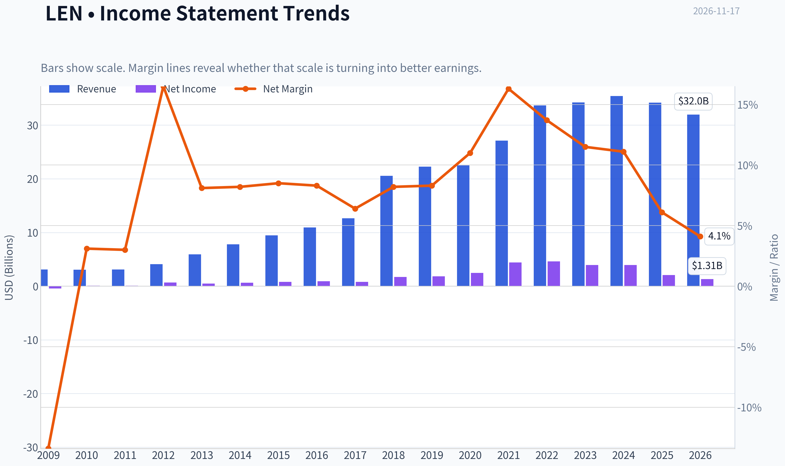

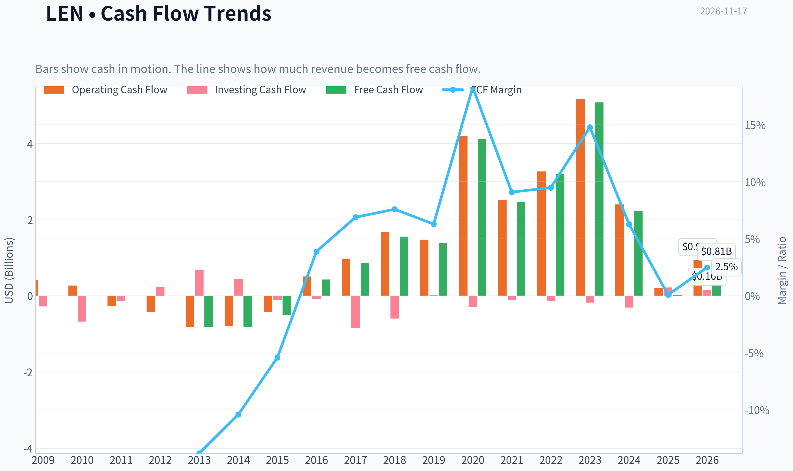

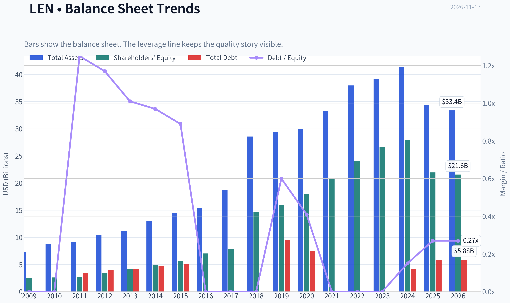

This graph tracks the profitability and return metrics (ROE, ROIC, Margins) of **LEN** over the past decade, highlighting capital efficiency trends.

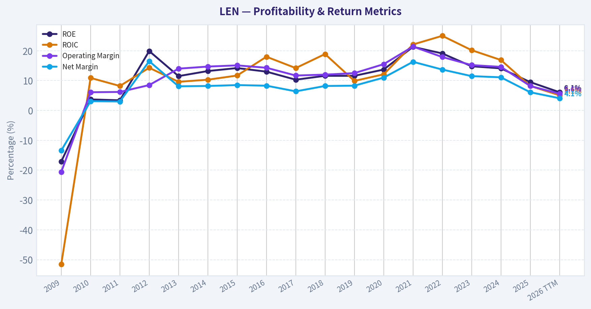

This chart illustrates the financial health of **LEN** over the last 10 years, mapping cash equivalents and free cash flow against total obligations (Debt).

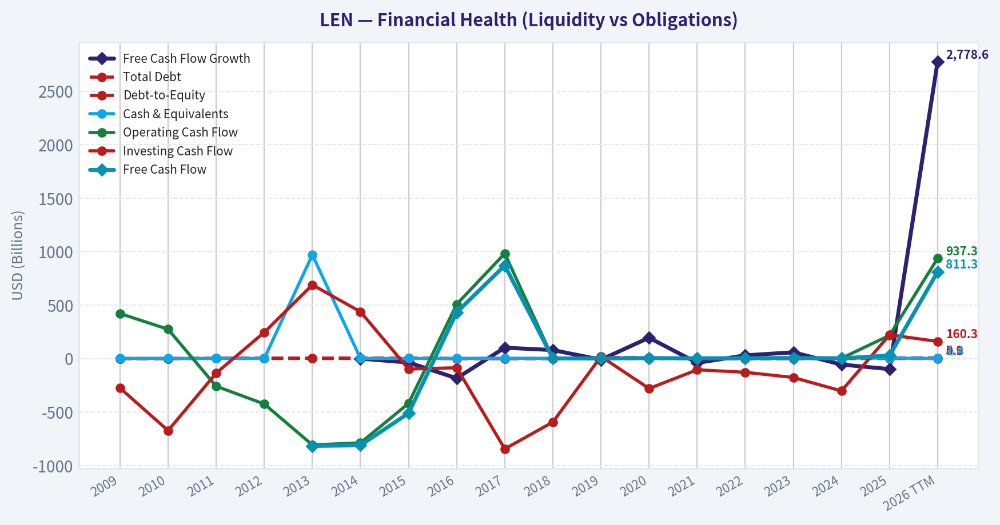

This comparison chart from *Profitability and Earnings Quality* stacks current figures against historical benchmarks for **LEN**, making it easy to see where the company trades relative to its own averages.

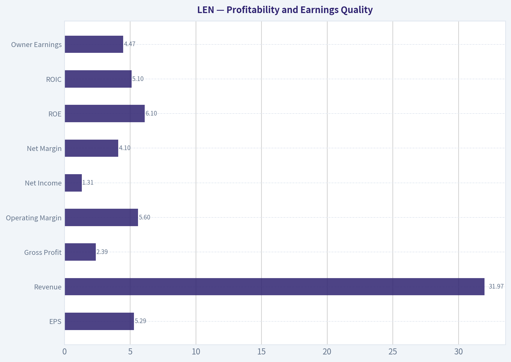

This breakdown chart from <em>Revenue Breakdown</em> shows the proportional composition for **LEN** - useful for understanding what drives or risks the business.

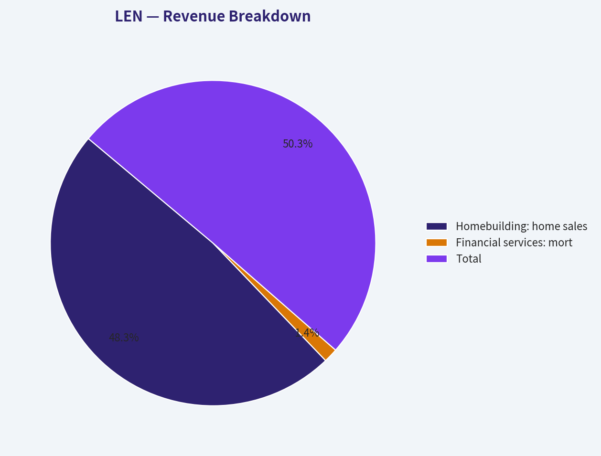

---

### Intrinsic Value Analysis (Buffett)

> *Following Warren Buffett's value investing philosophy: Circle of Competence, Economic Moat, Management Quality, and Margin of Safety.*

#### Intrinsic Value Snapshot

Price is what you pay. Intrinsic value is what the business may be worth based on the cash it can create for owners over time. We show a range, not one magic number.

- Current Price: $83.79
- Value Range (conservative to optimistic across both DCF methods): $-9.87 to $822.70

##### Owner Earnings (Buffett Method)
- Net Income: $2,078,179,000.00
- Depreciation & Amortization: $134,310,000.00
- Capital Expenditures: $-188,629,000.00
- Working Capital Changes: $-2,386,910,000.00
- Owner Earnings: $4,465,089,000.00

##### Intrinsic Value
###### Buffett Method
Uses owner earnings. Stricter, and usually more conservative.
- Conservative: $64.27
- Average: $364.23
- Optimistic: $822.70
- Discount Rate: 10.0%

###### Cash Flow Method
Uses free cash flow. Better for companies spending heavily today to grow tomorrow.
- Conservative: $-9.87
- Average: $-3.19
- Optimistic: $300.94
- Discount Rate: 10.0%

ANALYST STANCE: **Neutral**

#### Executive View

Lennar is a large-scale homebuilder with meaningful advantages in land sourcing, purchasing scale, distribution, and operating experience. However, homebuilding remains cyclical, capital-intensive, and highly sensitive to mortgage rates, housing affordability, employment, and land-cycle timing.

At $84 per share, Lennar appears inexpensive against the research pack's blended intrinsic value of $234.84. The discount is attractive, but current free cash flow is exceptionally weak, revenue is declining, ROE is below Buffett-quality levels, and a new lawsuit related to the Millrose spin-off increases governance and reporting risk. This is a potentially mispriced cyclical asset, not yet a clearly predictable compounder.

#### Factor Scorecard

| Factor | Score | Evidence |
|---|---:|---|
| 1. Business simplicity and predictability | 3/5 | Simple model-acquire land, build homes, and sell them-but results fluctuate materially with rates, affordability, inventory, and housing cycles. |
| 2. Durable competitive advantage | 3/5 | Scale, purchasing power, land expertise, brand, and distribution provide a narrow moat, but homes are largely products with limited customer captivity. |
| 3. Management and capital allocation | 3/5 | Long operating history and disciplined scale are positives. The Millrose-related lawsuit and questions around reported operating metrics require scrutiny. |
| 4. Industry structure | 3/5 | Large national builders benefit from scale and industry consolidation, but housing remains cyclical and land-intensive. |
| **Gate 5: quality and solvency floor** | **Not tripped** | Available evidence does not establish both deteriorating fundamentals and a solvency red line such as sub-1x interest coverage or distress-level solvency. |

**Key Takeaways:** Lennar is understandable and financially viable, but it does not have the high predictability or exceptional returns of a classic Buffett compounder. The investment case depends heavily on normalized housing-cycle earnings rather than current free cash flow.

#### Financial Snapshot

| Metric | Latest figure |
|---|---:|
| Share price | $84 |
| Market capitalization | $19.93 billion |
| P/E | 15.9x |
| ROE | 9.5% |
| Revenue growth, year over year | -3.5% |
| FCF yield | 0.1% |
| Implied earnings per share | Approximately $5.29 |
| Headline intrinsic value | $234.84 |
| Headline margin of safety | 64.3% |

**Key Takeaways:** The P/E is moderate, but the very low free-cash-flow yield is a major warning that current earnings are not translating into distributable cash. ROE of 9.5% is acceptable for a cyclical builder but well below the sustained 15% to 20% level associated with wonderful businesses.

#### Moat Analysis

| Moat source | Assessment | Evidence |
|---|---|---|
| Scale and cost advantage | Moderate | Lennar's size supports bulk purchasing, standardized construction, financing access, and overhead leverage. |
| Land and operating know-how | Moderate | Local market knowledge, entitlement expertise, and land relationships can be difficult for smaller entrants to replicate. |
| Brand and distribution | Moderate | Lennar has national recognition and broad sales channels, but homebuyers generally compare price, location, financing, and features. |
| Switching costs | Weak | A buyer can usually choose another builder before closing; customer captivity is limited. |
| Network effects | Weak | The product does not become materially more valuable simply because more customers use Lennar. |
| Pricing power | Limited and cyclical | Builders can adjust incentives, product mix, and prices, but mortgage rates and affordability constrain durable pricing power. |

**Key Takeaways:** Lennar's moat is primarily based on scale, execution, and land-cycle expertise rather than brand captivity or network effects. The moat is best classified as narrow and stable, with potential to widen modestly through consolidation and operational scale.

#### Management and Capital Allocation

Management has demonstrated the ability to operate at national scale and navigate housing cycles. Lennar's large platform can create operating leverage when volumes recover, and the company has historically benefited from disciplined construction and inventory management.

The main concerns are capital-cycle judgment and transparency. Homebuilders can appear profitable while cash is absorbed by land purchases and inventory expansion. The Millrose spin-off lawsuit alleges that the structure may have supported or distorted reported home-sale metrics; allegations are not proof of wrongdoing, but they warrant a higher valuation discount until clarified.

Berkshire Hathaway reportedly increased its Lennar position substantially during the third quarter of 2026. That is a favorable signal, but a 13F position is not proof that the business is a high-quality compounder or that the current price is risk-free.

#### Financial Trend and Cash-Flow Reality

| Measure | Interpretation |
|---|---|
| Revenue growth | Down 3.5% year over year, indicating current-cycle pressure. |
| ROE | 9.5%, below a strong long-term compounding threshold. |
| FCF yield | 0.1%, indicating that working capital and land investment are consuming nearly all reported cash generation. |
| Earnings yield | Approximately 6.3%, based on the 15.9x P/E. |
| Cash-flow quality | Weak on the latest snapshot because reported earnings substantially exceed free cash flow. |

**Key Takeaways:** The central financial issue is not the P/E; it is the gap between earnings and cash generation. For Lennar, a weak FCF year may reflect deliberate land investment rather than permanent impairment, but the investor must normalize the cycle instead of treating current earnings as steady owner earnings.

#### Owner Earnings Calculation

The proper calculation is:

`Owner earnings = net income + depreciation and amortization - maintenance capital expenditures - working-capital investment`

The latest research snapshot does not provide the separate net income, depreciation, maintenance-capex, and working-capital figures needed for a clean reported owner-earnings calculation. As a conservative earnings proxy, current EPS is approximately $5.29 per share, derived from the $84 price divided by the 15.87x P/E. This proxy should not be treated as normalized owner earnings because the current FCF yield is only 0.1%.

| Owner-earnings approach | Per-share figure | Reliability |
|---|---:|---|
| Current EPS proxy | ~$5.29 | Moderate for earnings, low for owner earnings |
| Current FCF proxy | ~$0.08 | Very low because the business is in a heavy investment or working-capital phase |
| Research-pack owner-earnings valuation output | $364.23 valuation | Highly sensitive to normalization assumptions |

**Key Takeaways:** Lennar's valuation depends on normalized cash generation, not the latest year's free cash flow. The $364.23 owner-earnings model output is substantially more optimistic than the FCF-based output and should therefore be stress-tested rather than accepted at face value.

#### Three-Scenario DCF Valuation

Using current EPS of approximately $5.29 per share as an earnings proxy-not as a definitive owner-earnings measure-produces the following simplified scenarios:

| Scenario | Assumption | Estimated value per share |
|---|---|---:|
| A. No growth | $5.29 proxy divided by a 10% discount rate | $52.90 |
| B. GDP growth | 3% annual growth with a 10% discount rate | $77.86 |
| C. Historical-growth proxy | 6.65% growth, equal to 50% of the reported five-year growth rate, for 10 years | ~$209 |
| Research-pack blended valuation | Damodaran FCFF, reverse DCF, and owner-earnings blend | $234.84 |

**Key Takeaways:** Conservative earnings-based DCF scenarios range from below the current price to substantially above it. The valuation is therefore highly dependent on whether Lennar's current earnings represent trough conditions and whether future cash conversion improves.

#### Valuation and Margin of Safety

| Valuation reference | Value | Premium or discount versus $84 |
|---|---:|---:|
| No-growth proxy DCF | $52.90 | 58% premium to value |
| 3% growth proxy DCF | $77.86 | 8% premium to value |
| Historical-growth proxy DCF | ~$209 | 60% discount |
| Damodaran FCFF model | $216.03 | 61% discount |
| Blended headline intrinsic value | $234.84 | 64% discount |
| Owner-earnings model | $364.23 | 77% discount |
| FCF model | -$3.19 | Not economically meaningful as a standalone normalized valuation |

The reverse DCF reportedly implies approximately negative 7.6% annual earnings growth for ten years at the current price. That is a very pessimistic expectation and provides a potential margin of safety if Lennar can merely normalize rather than grow aggressively.

However, the three-model valuation spread-from negative FCF value to $364.23-shows unusually high sensitivity to assumptions. A quality-scaled margin of safety is present against the FCFF and blended estimates, but not against the conservative no-growth or 3% growth cases.

#### Final Buffett Scorecard

| Criterion | Weight | Score | Weighted contribution |
|---|---:|---:|---:|
| Moat width and durability | 25% | 3.0 | 0.75 |
| Valuation and margin of safety | 20% | 3.5 | 0.70 |
| Capital returns: ROIC versus WACC | 15% | 2.5 | 0.38 |
| Business understanding and predictability | 12% | 3.0 | 0.36 |
| Management and capital allocation | 12% | 3.0 | 0.36 |
| Reinvestment runway | 8% | 3.5 | 0.28 |
| Balance-sheet strength | 4% | 3.0 | 0.12 |
| Industry structure | 4% | 3.0 | 0.12 |
| **Total** | **100%** |  | **3.07 / 5.00** |

**Key Takeaways:** Lennar scores well on valuation and reinvestment opportunity but only moderately on moat, predictability, capital returns, and management confidence. The overall score falls in the Watch range because the apparent discount is offset by cyclical earnings, weak current cash conversion, and elevated reporting uncertainty.

#### Investment Stance

**Neutral - Moderate conviction.**

At $84, Lennar is priced as though long-term earnings will contract materially, while several normalized valuation methods indicate substantial upside. That makes the stock interesting for investors comfortable with housing cycles and land-inventory risk.

It is not yet an outright Advocate because:

- current free cash flow is almost nonexistent;
- ROE is only 9.5%;
- homebuilding earnings are inherently cyclical;
- valuation outputs have an unusually wide range; and
- the Millrose-related lawsuit creates additional governance and disclosure risk.

A more attractive setup would combine clearer evidence of normalized free-cash-flow conversion, stable or improving housing demand, and resolution of the Millrose allegations. If those conditions improve without a substantial price increase, Lennar could move from Watch to Advocate.
#### Valuation Bridge

This bridge places the current market price beside each intrinsic value lens so readers can see whether upside depends on one method or shows up across several methods.

| Scenario | Intrinsic Value / Share |
| --- | ---: |
| Buffett Method | $364.23 |
| Cash Flow Method | $-3.19 |
| Damodaran Method | $216.03 |
| Current Price | $83.79 |

#### Key Takeaways

If one method is far above the others, the upside case depends on a specific modelling assumption. When several methods cluster together, the valuation story is more robust.

#### Valuation Visuals

This comparison chart from *Latest Earnings Snapshot* stacks current figures against historical benchmarks for **LEN**, making it easy to see where the company trades relative to its own averages.

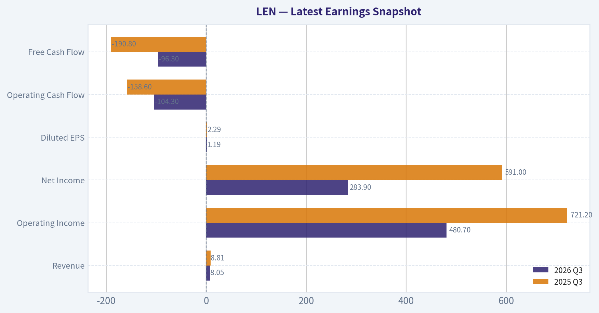

This comparison chart from *Current Metrics Versus Historical Averages* stacks current figures against historical benchmarks for **LEN**, making it easy to see where the company trades relative to its own averages.

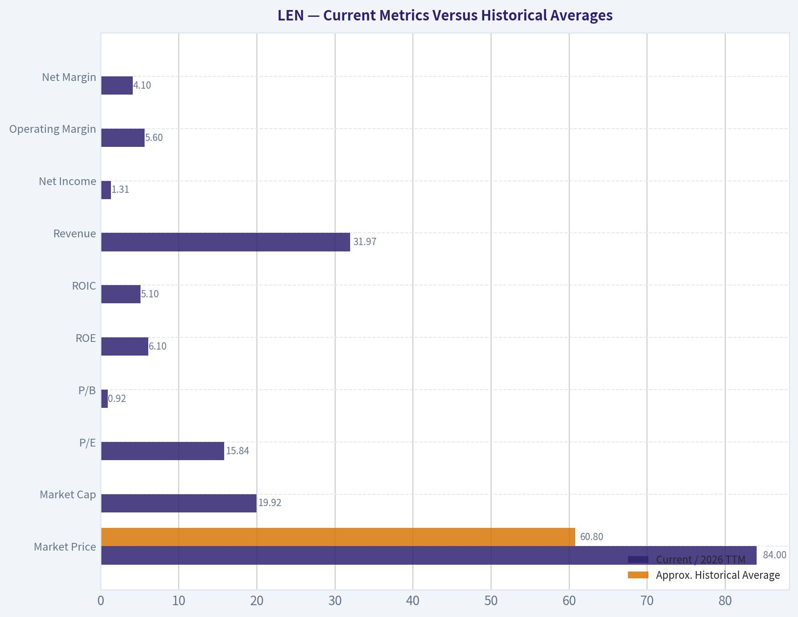

This comparison chart from *Balance Sheet and Financial Strength* stacks current figures against historical benchmarks for **LEN**, making it easy to see where the company trades relative to its own averages.

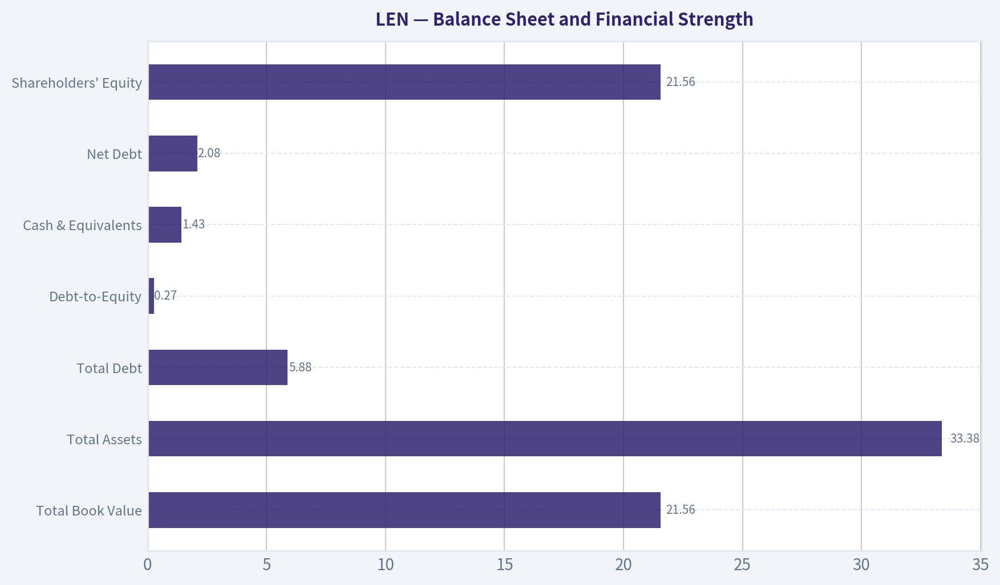

The following chart maps the **LEN** Owner Earnings DCF valuation scenarios (Conservative, Average, Optimistic) to visually represent the margin of safety based on intrinsic value calculations.

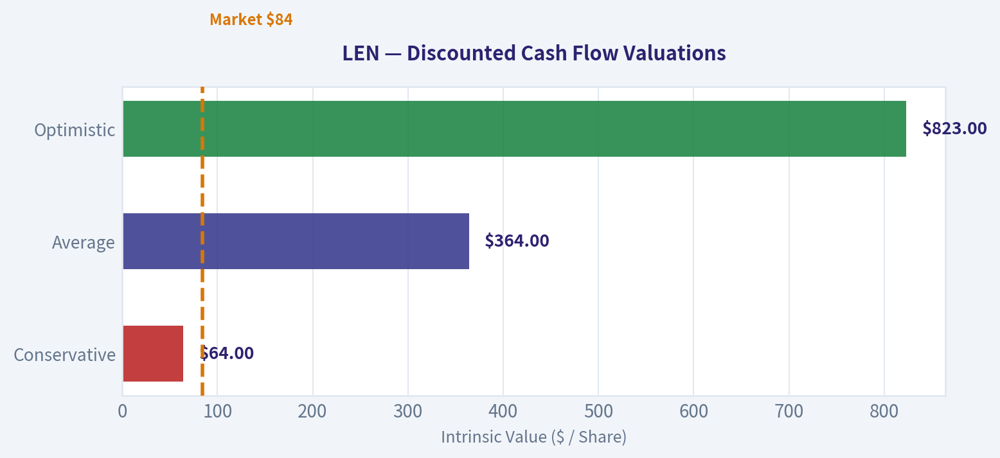

---

### Trend & Growth Analysis (Lynch/Druckenmiller/Fisher)

> *Following Peter Lynch's GARP, Stanley Druckenmiller's macro-aware approach, and Philip Fisher's scuttlebutt methodology.*

ANALYST STANCE: **Neutral**

#### Executive View

Lennar is a **cyclical homebuilder**, not a classic fast-growth compounder. The valuation appears inexpensive relative to normalized earnings and headline intrinsic-value estimates, but current revenue is declining, free-cash-flow yield is almost zero, and the Millrose spin-off lawsuit introduces governance and reporting risk. LEN is more suitable for a **cycle-recovery or value position** than a ten-bagger growth investment.

| Metric | Current reading | Interpretation |
|---|---:|---|
| Share price | $84 | Current market price |
| Market capitalization | $19.93 billion | Large enough that a 10x outcome requires substantial housing-cycle and earnings expansion |
| P/E | 15.9x | Reasonable on current earnings, but earnings are cyclical |
| Revenue growth | -3.5% year over year | Current contraction; not a fast-grower signal |
| ROE | 9.5% | Modest for a cyclical capital-intensive business |
| FCF yield | 0.1% | Very weak cash conversion at present |
| Headline intrinsic value | $234.84 | Highly model-sensitive; should not be treated as a precise target |
| Guru activity | Berkshire added 98.3% quarter over quarter | Positive validation, but 13F data is delayed |

**Key Takeaways:** LEN is statistically inexpensive, but the low free-cash-flow yield and negative revenue growth weaken the investment case. Berkshire's purchase is a useful signal of perceived value, not proof of near-term operating acceleration. The headline intrinsic value has significant uncertainty because the business is cyclical.

#### 1. Lynch Classification

**Category: Cyclical.**

Lennar's results are driven by mortgage rates, employment, consumer confidence, land costs, incentives, and housing supply. It does not currently qualify as a Lynch fast grower because revenue is declining and there is no evidence in the supplied data of accelerating sales, margins, or cash flow.

#### 2. The Story in Three Bullets

- Lennar builds homes in markets where long-term housing shortages can support demand and pricing.
- Lower mortgage rates, if sustained, could unlock deferred demand and produce an earnings recovery.
- Scale, land holdings, brand recognition, and purchasing power can support attractive normalized returns through the housing cycle.

The counter-story is equally important: Lennar remains exposed to affordability pressure, mortgage rates, construction costs, incentives, and potentially impaired trust around the Millrose transaction.

#### 3. TAM and 10x Test

| Test | Assessment |
|---|---|
| Current market capitalization | $19.93 billion |
| Market cap at 10x | Approximately $199.3 billion |
| Revenue required for a 10x outcome | Not determinable from the supplied data |
| Housing TAM | Large and structurally supported by housing undersupply |
| Can LEN 10x while remaining below 20% share? | Potentially yes at the industry level, but not demonstrated by current growth data |
| TAM growth quality | Long-term favorable, near-term cyclical and rate-sensitive |

**Key Takeaways:** The housing market is large enough to support substantial expansion, but a 10x equity outcome would require many years of strong earnings growth, superior capital allocation, or a major industry re-rating. The current data does not establish that Lennar is taking share at an accelerating rate. The TAM is attractive, but the company's cycle exposure matters more than TAM alone.

#### 4. Revenue Growth Trend

| Period or indicator | Result | Signal |
|---|---:|---|
| Latest year-over-year revenue growth | -3.5% | Contracting |
| Three-year revenue trend implied by research pack | -13.8% | Weak and volatile |
| Five-year revenue trend implied by research pack | 13.3% | Longer-term growth, but cyclical |
| Current acceleration evidence | None provided | Not confirmed |
| Current classification | Cyclical slowdown or trough-sensitive period | Requires re-acceleration |

**Key Takeaways:** The latest revenue trend is negative, not accelerating. The longer-term five-year trend is better, but it does not overcome the evidence of current softness. A more constructive stance would require several quarters of improving orders, deliveries, pricing, margins, and cash flow.

#### 5. Unit Economics and Operating Quality

| Metric | Reading | Assessment |
|---|---:|---|
| LTV/CAC | Not disclosed in supplied data | Not applicable in the SaaS sense |
| Net revenue retention | Not applicable | Homebuilder metric |
| Rule of 40 | Not applicable | Not a subscription business |
| ROE | 9.5% | Modest |
| FCF yield | 0.1% | Current cash generation is weak |
| Gross margin | Not available | Cannot confirm margin trend |
| Operating leverage | Not confirmed | Needs evidence from future results |

**Key Takeaways:** Traditional SaaS unit economics do not apply to Lennar. The relevant measures are gross margin, orders, cancellation rates, incentives, backlog profitability, inventory turns, land returns, and free cash flow. Current ROE is only moderate and the near-zero FCF yield is a material weakness.

#### 6. Inflection-Point Assessment

| Potential inflection | Current evidence | Status |
|---|---|---|
| Product cycle | No meaningful product-cycle catalyst | Unconfirmed |
| Market-share inflection | No supplied evidence of accelerating share gains | Unconfirmed |
| Margin inflection | Gross-margin data unavailable | Unconfirmed |
| TAM inflection | Housing shortage is supportive | Structural positive, not company-specific |
| Rate inflection | Lower mortgage rates could help demand | Macro-dependent |
| Competitive inflection | No clear competitor distress identified | Unconfirmed |
| Corporate restructuring | Millrose spin-off completed, but now disputed in litigation | Mixed |

**Key Takeaways:** The most credible future inflection is a housing-demand recovery caused by lower mortgage rates and improved affordability. It has not yet been demonstrated in the operating data provided. The Millrose-related legal controversy is a counterweight because it may limit investor confidence even if housing fundamentals improve.

#### 7. Macro Setup

Lennar is highly sensitive to the macro environment.

- **Positive:** Structural housing undersupply, potential rate relief, and delayed household formation can support demand.
- **Negative:** High mortgage rates, affordability constraints, recession risk, and construction-cost inflation.
- **Druckenmiller assessment:** The macro setup is **conditional rather than clearly favorable**. A sustained decline in rates would improve the setup; renewed rate increases would damage it.
- **Current cycle classification:** Late-cycle or housing-reset conditions, rather than an obvious early-recovery environment.

#### 8. Fisher 15-Point Score

Because the supplied data lacks detailed management interviews, customer checks, employee information, and operating disclosures, this is a provisional score rather than a full scuttlebutt assessment.

| Fisher criterion group | Score |
|---|---:|
| Market potential and long-term sales opportunity | 4/5 |
| Product and R&D orientation | 2/5 |
| Sales organization and execution | 3/5 |
| Profit margins and margin outlook | 3/5 |
| Labor, executive relations, and management depth | 3/5 |
| Accounting, cost control, and capital allocation | 3/5 |
| Competitive advantages and scale | 4/5 |
| Long-range profit outlook | 3/5 |
| Dilution risk | 4/5 |
| Candor and integrity considerations | 2/5 |
| **Provisional total** | **31/50, approximately 47/75** |

**Key Takeaways:** Lennar benefits from scale, a large market, and possible long-term housing demand. However, the provisional Fisher score is only average because the supplied information does not establish superior innovation, management candor, or sustained margin improvement. The Millrose lawsuit specifically lowers confidence in the management and disclosure categories.

#### 9. Valuation Analysis

| Valuation method | Result | Interpretation |
|---|---:|---|
| P/E | 15.9x | Reasonable if earnings are near normalized levels |
| PEG | Not meaningful | Revenue is declining; no reliable growth rate for PEG |
| Price-to-sales | Not calculable | Revenue figure not supplied |
| Headline intrinsic value | $234.84 | Indicates substantial upside, but model-sensitive |
| Owner-earnings value | $364.23 | Very optimistic relative to current FCF |
| FCF-based value | -$3.19 | Not economically useful because current FCF is near zero or negative |
| Damodaran FCFF value | $216.03 | Also indicates potential undervaluation |
| Reverse DCF | Price implies approximately -7.6% annual growth over 10 years | Market expectations appear conservative |

**Key Takeaways:** LEN looks inexpensive on P/E and reverse-DCF assumptions, but the valuation range is unusually wide. The spread between owner-earnings, FCFF, and FCF models shows that normalized earnings assumptions dominate the result. This is a potential value opportunity, not a clean PEG-based growth purchase.

#### 10. Growth Investor Scorecard

| Criterion | Weight | Score / 5 | Weighted contribution |
|---|---:|---:|---:|
| Lynch story | 10% | 3.0 | 0.30 |
| TAM and runway | 20% | 4.0 | 0.80 |
| Revenue growth | 20% | 2.0 | 0.40 |
| Unit economics | 15% | 2.5 | 0.38 |
| Competitive position | 10% | 3.5 | 0.35 |
| Management quality | 10% | 2.5 | 0.25 |
| Macro setup | 5% | 3.0 | 0.15 |
| Profitability path | 5% | 3.0 | 0.15 |
| Valuation | 5% | 4.0 | 0.20 |
| **Total** | **100%** |  | **2.98 / 5.00** |

**Key Takeaways:** LEN scores below the 3.0 threshold for a growth-investor buy recommendation, primarily because revenue is contracting and current cash generation is weak. Its strongest attributes are valuation, scale, and housing-market runway. Its main weaknesses are cyclicality, uncertain near-term earnings direction, and the Millrose litigation overhang.

#### 11. Position-Size Stance

**Position stance: Watchlist or small starter position only.**

- Growth portfolio: **0% to 1% initially**, pending evidence of operating re-acceleration.
- Value or cyclical-recovery portfolio: **1% to 3%**, provided the investor accepts housing and rate risk.
- Do not size it as a ten-bagger candidate until revenue, orders, margins, and free cash flow show a clear positive inflection.

#### 12. Key Catalysts and Risks

| Catalysts | Risks |
|---|---|
| Sustained mortgage-rate decline | Rates remain high or rise |
| Improving affordability and housing demand | Cancellations and buyer incentives increase |
| Stronger orders and backlog conversion | Revenue and margins continue to deteriorate |
| Gross-margin stabilization or expansion | Construction and land costs remain elevated |
| Positive resolution of Millrose litigation | Class-action liability and reputational damage |
| Continued Berkshire accumulation | Guru activity is delayed and may not reflect current views |
| Share repurchases at depressed valuation | Weak FCF limits capital returns |

**Key Takeaways:** The primary catalyst is a housing-cycle recovery supported by lower rates and improving affordability. The primary risks are prolonged housing weakness, poor cash conversion, and legal or disclosure uncertainty related to Millrose. The stock is attractive enough to monitor closely, but the evidence does not yet support an aggressive growth-investor position.

#### Bottom Line

LEN is a **potentially undervalued cyclical**, not currently a high-confidence fast grower. The stock becomes more compelling if revenue re-accelerates, free cash flow normalizes, gross margins stabilize, and the Millrose legal issue is contained. Until then, the appropriate stance is **Neutral**, with a small position at most for investors specifically seeking housing-cycle exposure.

---

### Market Technical Analysis

ANALYST STANCE: **Neutral**

#### LEN technical overview

LEN closed at **$83.79 on November 16, 2026**, with November 17 not yet represented as a completed trading session in the retrieved data. The stock has staged a meaningful rebound from its early-October low near **$73.96**, but the larger trend remains technically fragile: price is above its medium-term average while still below its declining long-term benchmark.

The selected indicators are:

- **Close 50 SMA** - medium-term trend and support/resistance.
- **Close 200 SMA** - long-term trend regime.
- **Close 10 EMA** - short-term price momentum.
- **MACD** - directional momentum and trend-transition analysis.
- **RSI** - momentum strength and overbought/oversold context.
- **Bollinger Upper Band** - upside extension and breakout context.
- **Bollinger Lower Band** - downside risk and potential support.
- **ATR** - volatility-adjusted risk management.

This combination intentionally covers trend, momentum, volatility, and risk without adding redundant indicators.

#### Trend structure

LEN's **50-day SMA was approximately $81.37 on November 16**, while the stock closed at $83.79. Price therefore remained about **3.0% above the 50-day average**, which is constructive for the intermediate-term picture. The 50-day SMA has gradually risen from approximately $80.70 in late October to $81.37, indicating that the recent recovery has improved the medium-term trend rather than merely producing a one-day bounce.

However, the **200-day SMA was approximately $88.95 on November 13** and has been declining steadily from above $91 in late October. LEN is therefore roughly **5.8% below its long-term average**. This creates an important distinction: the stock is recovering within a still-negative long-term regime. The area around **$89 to $90** is likely to act as substantial overhead resistance because it combines the declining 200-day SMA with the recent November swing highs.

The short-term average also shows weakening momentum. The **10-day EMA was $86.30 on November 13**, already above the $83.79 closing price from November 16. Although the latest 10-day EMA value was not populated by the indicator feed, the recent price decline suggests that the short-term average was likely still above the market. A sustained move back above the 10-day EMA would be an early sign that buyers are regaining control; failure to do so would keep the near-term bias cautious.

#### Momentum analysis

The MACD remained positive, at approximately **1.61 on November 13**, but it had fallen sharply from **3.06 on November 9**. This is a significant loss of momentum. A positive MACD means the broader short-to-intermediate-term price relationship was still constructive at that point, but the declining value indicates that the rebound was losing force.

This deterioration is consistent with the price action: LEN advanced strongly from the October low into early November, reaching above $92, but then pulled back toward the low-$80s. The MACD has not yet clearly turned negative, so the data do not confirm a renewed major downtrend by themselves. Nevertheless, the rapid contraction in MACD momentum warns against treating the earlier recovery as a confirmed trend reversal.

RSI was approximately **48.5 on November 13**, down from **61.9 on November 9** and nearly 69 on November 2. RSI is now close to neutral and below 50, showing that bullish momentum has largely faded without reaching an oversold condition. This is neither a strong capitulation signal nor an overbought setup. In practical terms, LEN still has room to decline before a classic oversold reading develops, but a move back above 50 would improve the short-term momentum profile.

#### Bollinger Bands and price location

The Bollinger readings show that LEN was not at an extreme downside level on November 16. The lower band was approximately **$77.96**, placing the close at $83.79 about **$5.83 above lower-band support**. On November 13, the upper band was approximately $94.32 and the lower band approximately $76.42, implying a broad and volatile trading envelope.

The stock's current position appears to be in the lower-to-middle portion of that envelope rather than at the lower band itself. This suggests two possible interpretations:

1. **Bearish interpretation:** the stock has lost its upside momentum and could retest the lower band or the $80 area if selling resumes.
2. **Recovery interpretation:** the stock is consolidating after a sharp rebound, and a successful defense of $80 to $82 could establish a higher low.

A decisive close above the likely short-term resistance zone around **$86 to $88** would improve the setup. A break above **$89 to $90** would be more meaningful because it would challenge the declining 200-day SMA. Conversely, a close below approximately **$78**, near the recent lower Bollinger Band, would indicate that downside pressure is expanding again.

#### Volatility and risk

ATR was approximately **$3.54 on November 13**, up from about $2.97 in late October. Relative to the $83.79 share price, this represents roughly **4.2% of the stock price per average daily range**, which is elevated enough to make tight stop-losses vulnerable to ordinary price fluctuations.

The recent trading history supports this caution. LEN has experienced several daily swings of four to six dollars, including sharp reversals in early November. Traders should therefore size positions conservatively and consider volatility-adjusted stops rather than placing stops immediately below obvious intraday lows.

For a short-term bullish trade, a reasonable technical framework would require price to hold the **$81 to $82 area**, recover the short-term average near the mid-$80s, and then challenge **$88 to $90**. A failure near $86 to $90 followed by a break below $81 would weaken the setup. A move below $78 would materially increase the risk of a retest of the mid-$70s.

#### Trading interpretation

The technical picture is best characterized as a **medium-term recovery inside a still-bearish long-term structure**. The rising 50-day SMA and price above that average are constructive, but the declining 200-day SMA, fading MACD, and neutral-to-soft RSI prevent a strong bullish classification.

Aggressive traders may monitor the $81 to $82 region for evidence of support, but confirmation is preferable because RSI is not oversold and MACD momentum is deteriorating. A more reliable bullish signal would be a sustained move above the $86 to $88 zone, followed by a test of $89 to $90 with improving MACD and RSI. Until that occurs, rallies toward the long-term average may represent resistance rather than a confirmed trend reversal.

| Indicator | Latest reported reading | Technical interpretation | Key levels or signal |
|---|---:|---|---|
| LEN close | $83.79 on Nov. 16 | Above the 50-day average but below the long-term trend benchmark | Support near $81-$82; deeper support near $78 |
| 50-day SMA | $81.37 | Rising gradually; medium-term trend has improved | Price is about 3% above the SMA |
| 200-day SMA | About $88.95 on Nov. 13 | Declining and above price; long-term regime remains weak | Resistance around $89-$90 |
| 10-day EMA | $86.30 on Nov. 13 | Short-term momentum has weakened as price moved below the EMA | Recovery above $86-$87 would improve momentum |
| MACD | 1.61 on Nov. 13 | Still positive, but down sharply from 3.06 on Nov. 9 | Positive momentum is fading; watch for a bearish crossover |
| RSI | 48.50 on Nov. 13 | Neutral-to-soft; neither oversold nor overbought | Above 50 would improve the short-term signal |
| Bollinger lower band | $77.96 on Nov. 16 | Price remains above lower-band support but is in the lower half of the range | Break below $78 would signal renewed downside pressure |
| ATR | $3.54 on Nov. 13 | Elevated volatility; ordinary daily moves are substantial | Use wider, volatility-adjusted stops and smaller position sizes |
| Overall assessment | Watch | Recovery attempt lacks long-term confirmation | Bullish confirmation above $88-$90; bearish deterioration below $78 |

**Key Takeaways:** LEN is holding above its rising 50-day average, but it remains below a declining 200-day average, so the stock is recovering within a broader weak trend. Momentum has cooled significantly: MACD is still positive but falling, while RSI is neutral near 48.5 rather than oversold. Traders should watch $81 to $82 for support, $86 to $88 for initial upside confirmation, and $89 to $90 for a more important long-term trend test.

---

### Options Market Analysis

> *Reading options flow - put/call ratios, IV skew, and unusual activity - to gauge institutional positioning and event-driven risk.*

#### LEN Options Market Report

*Data as of November 17, 2026. The chain is extremely thin, so confidence in the signal is low.*

#### Put/Call Ratio Analysis

| Expiration | Call OI | Put OI | Put/Call OI | Call Volume | Put Volume | Put/Call Volume |
|---|---:|---:|---:|---:|---:|---:|
| Nov. 20, 2026 | 5 | 60 | 12.00 | 762 | 411 | 0.54 |
| Nov. 27, 2026 | 0 | 0 | N/A | 119 | 274 | 2.30 |
| Dec. 4, 2026 | 0 | 0 | N/A | 714 | 94 | 0.13 |
| **Total** | **5** | **60** | **12.00** | **1,595** | **779** | **0.49** |

**Key Takeaways:** LEN's aggregate put/call open-interest ratio is extremely elevated at 12.0 versus the approximately 0.7 neutral baseline. However, total open interest is only 65 contracts, making that ratio statistically fragile. Trading volume is more call-heavy overall, led by the December 4 expiration, suggesting short-term speculative call demand rather than broad-based defensive positioning.

The sharp divergence between open interest and volume may reflect stale puts, closing activity, or a newly developing bullish trade. It should not be treated as a strong institutional signal without larger open-interest confirmation.

#### Implied Volatility Assessment

| Expiration | Call ATM IV | Put ATM IV | Put Premium to Call IV |
|---|---:|---:|---:|
| Nov. 20, 2026 | 2.8% | 3.5% | +0.7 percentage points |
| Nov. 27, 2026 | 1.6% | 2.1% | +0.5 percentage points |
| Dec. 4, 2026 | 1.2% | 2.0% | +0.8 percentage points |

**Key Takeaways:** Near-term implied volatility is very low, ranging from 1.2% to 3.5%, indicating limited priced-in movement or an unusually illiquid chain. Puts consistently carry higher ATM IV than calls, indicating a modest downside skew. The data does not show an elevated volatility setup typical of a major catalyst, although no earnings or corporate-event calendar was provided.

The supplied data does not include specific out-of-the-money strikes, so a full OTM put-versus-call skew analysis is not possible. The ATM comparison nevertheless points to mild downside protection demand, not severe downside fear.

#### Unusual Options Activity

| Finding | Interpretation |
|---|---|
| No contracts exceeded 5 times open interest | No qualifying fresh unusual activity was detected |
| Largest call-volume areas | Nov. 20: 762 contracts; Dec. 4: 714 contracts |
| Largest put-volume area | Nov. 20: 411 contracts; Nov. 27: 274 contracts |

**Key Takeaways:** No individual contract met the tool's threshold for unusual activity, so there is no clearly identifiable sweep or fresh institutional directional bet. The high volume relative to total open interest is notable, but without contract-level strikes, prices, and execution details, it cannot reliably be classified as smart-money positioning. The volume appears more consistent with short-dated speculative or potentially closing activity than a confirmed institutional campaign.

#### Open Interest Concentration and Gamma Levels

| Item | Observation |
|---|---|
| Highest put OI | Nov. 20, 2026 expiration, 60 contracts |
| Highest call OI | Nov. 20, 2026 expiration, 5 contracts |
| Highest total OI concentration | Nov. 20, 2026 |
| Gamma walls / pinning strikes | Cannot be determined; strike-level OI was not supplied |

**Key Takeaways:** Open interest is concentrated almost entirely in the November 20 expiration, and almost all of it is in puts. That could create a short-term hedging or expiration-related influence, but the absolute size is too small to establish a meaningful gamma wall. Strike-level data is required to identify max-pain, dealer gamma exposure, or likely price-pinning levels.

#### Overall Options Sentiment

**Signal: NEUTRAL, with a slight bullish volume bias and low confidence.**

The strongest bullish evidence is the aggregate 0.49 put/call volume ratio, including substantial call volume in the December 4 expiration. The strongest bearish evidence is the 12.0 put/call open-interest ratio and the persistent put IV premium, but both are weakened by the very small open-interest base and low absolute implied volatility.

Overall, the chain does not support a high-conviction bullish or bearish conclusion. If forced to choose a directional lean, the current flow is **mildly bullish on new trading volume**, while existing positioning remains put-heavy. The ticker should be treated as illiquid from an options-analysis perspective, and confidence is low.

#### Summary

| Category | Assessment |
|---|---|
| Put/Call Ratio | OI ratio 12.0, extremely put-heavy but based on only 65 total contracts; volume ratio 0.49, call-heavy |
| IV Level | Very low; near-term ATM IV ranges from 1.2% to 3.5% |
| Skew Direction | Mild put skew; puts trade at a 0.5-0.8 percentage-point ATM IV premium |
| Unusual Activity | No contract exceeded 5 times open interest; no confirmed unusual institutional trade |
| Overall Signal | **NEUTRAL**, with a slight bullish volume bias and low confidence |

**Key Takeaways:** LEN's options market shows a conflict between very put-heavy existing open interest and call-heavy recent volume. Volatility is unusually low, and there is no contract-level unusual activity or strike concentration strong enough to validate a directional institutional view. The most defensible conclusion is neutral with a modest bullish lean, subject to substantial illiquidity risk.

---

## Research Team Commentary

> *The Research Manager synthesizes the Bull vs Bear debate into action-free commentary. This is a pre-risk view, not the final stance.*

Core takeaway: Lennar is a credible large-scale homebuilder, but the current price does not provide enough margin of safety for its cyclicality, capital intensity, and weak cash conversion. The structural housing shortage and Lennar's scale make the company worth following, yet at $83.79-about 15.9 times reported earnings-the market already appears to assume at least a satisfactory housing normalization. With free cash flow close to zero, ROIC at 8.8%, and revenue declining 3.5%, that recovery has not been demonstrated. This is a watchlist situation rather than a Buffett-style purchase today.

The strongest bull argument is that Lennar has genuine operating advantages. Its scale supports purchasing power, access to capital, geographic diversification, and the ability to spread overhead across a large number of communities. Entitled land and local market knowledge can also be difficult to replicate quickly. Combined with long-term housing undersupply, these strengths could produce attractive earnings if affordability improves and deferred demand returns. The stock does not require technology-like growth; modest normalized growth could support a value above the current price.

The bull is also right that a homebuilder's free cash flow should not be interpreted like that of an asset-light company. Land development and construction consume cash before closings occur, so one period of weak cash flow does not establish permanent impairment. Falling mortgage rates could improve orders, inventory turnover, and cash conversion simultaneously.

The strongest bear argument is that industry demand and shareholder value are not the same thing. Housing shortages can raise land, labor, insurance, and material costs, while affordability pressure forces builders to offer rate buydowns and other incentives. Much of the economic benefit can accrue to landowners, suppliers, lenders, or buyers rather than shareholders. Lennar's scale is an advantage, but it is not the kind of customer captivity, recurring revenue, or pricing power that deserves a narrow 10%-15% margin of safety.

The current economics reinforce that concern. An 8.8% ROIC and 9.5% ROE are ordinary results and may be only modestly above, or potentially near, the company's cost of capital. Nearly nonexistent free cash flow makes the 15.9-times P/E less reassuring because the approximately $5.28 of implied EPS has not yet translated into comparable owner earnings. At this price, the earnings yield is roughly 6.3%, which is not compelling compensation for a rate-sensitive, inventory-heavy cyclical unless returns and cash conversion improve.

Neither side has established a sufficiently rigorous intrinsic-value estimate. The bull's $95-$100 range assumes normalized earnings, better returns, and a successful recovery without presenting a full cash-flow model. The bear's much lower values depend on substantial owner-earnings haircuts that are also not yet proven. The correct conclusion is therefore uncertainty, not false precision. What can be said is that $83.79 is not a distressed price and does not appear to offer the 25%-35% discount normally appropriate for an average-quality cyclical business. A smaller discount would be acceptable only after Lennar demonstrates meaningfully better and more durable economics.

The absence of detailed balance-sheet information is another reason not to advance beyond Neutral. There is no evidence here of genuine financial distress, so Bearish would be too severe. But net debt, debt maturities, land commitments, inventory aging, speculative construction, and interest coverage must be reviewed before treating weak cash flow as harmless working-capital investment. Inventory is central to homebuilding, so conventional quick-ratio analysis would add little; the relevant issue is whether inventory can be monetized without severe incentives or impairments.

The options ratio does not alter the analysis. A put/call open-interest ratio of 12 sounds bearish, but only 65 contracts are outstanding, making the signal statistically fragile. The supplied moving-average references lack actual levels and therefore offer no actionable evidence. Even with complete data, technical indicators would affect entry timing rather than intrinsic value.

From a contrarian perspective, pessimism could become an opportunity if the market is extrapolating a temporary affordability shock while Lennar retains balance-sheet flexibility and disciplined land exposure. But being contrarian merely because housing is unpopular would repeat a common mistake: paying in advance for a cyclical recovery. The better lesson from past situations is to separate a plausible catalyst from demonstrated owner earnings. Lower mortgage rates are a catalyst; they are not, by themselves, the investment thesis.

The rationale for waiting is straightforward. Lennar may be a better-than-average operator in an economically necessary industry, but it is not currently showing wide-moat returns or dependable cash generation. The stock could perform well if orders recover, incentives recede, and inventory converts to cash. At today's valuation, however, investors are accepting much of that execution risk without a clearly conservative entry price. The risk/reward is not poor enough to abandon the company, but it is not favorable enough to advocate buying it.

Over the next one to four quarters, I would monitor new orders, backlog conversion, cancellation rates, and community absorption to determine whether demand is improving without excessive concessions. Average selling prices and incentives-especially mortgage-rate buydowns-should be evaluated together, since higher volume accompanied by worsening incentives may not create value. Gross margin and operating margin should stabilize or improve rather than merely benefit from accounting timing.

Cash conversion is the central test. Operating cash flow and free cash flow should begin converging toward reported earnings as homes close and inventory turns improve. Inventory growth should not materially outpace orders or closings, and aging speculative inventory should remain controlled. Land spending and optioned-versus-owned land exposure will indicate whether management is preserving flexibility or making a leveraged macroeconomic bet.

ROIC should move decisively above its current 8.8%, preferably into sustained double digits, while ROE improves without being manufactured through additional leverage. Net debt, liquidity, maturities, interest coverage, land commitments, and any inventory impairments also need confirmation. Share repurchases would be constructive only if funded from genuine surplus cash and executed below a conservative estimate of intrinsic value.

The thesis would strengthen if orders and cash flow improve while incentives decline, margins hold, inventory turns accelerate, and ROIC rises without balance-sheet deterioration. It would weaken if volume requires heavier incentives, inventory and debt rise, cash flow remains disconnected from earnings, or land impairments emerge. Alternatively, a materially lower share price could create the required margin of safety even before all operating metrics recover.

Final stance: Neutral

---

## Value Investing Team Commentary

> *The Investor translates the research view into an investment thesis before risk review. This is still not the final stance.*

Lennar is a credible, scaled homebuilder, but the current investment case depends more on a cyclical recovery than on demonstrated compounding economics.

At $83.79 and approximately 15.9 times reported earnings, the stock offers an earnings yield near 6.3%. That valuation is not obviously expensive for a normalized housing recovery, but it is not sufficiently conservative for a capital-intensive, rate-sensitive business generating little current free cash flow. With revenue down 3.5%, ROIC at 8.8%, and ROE at 9.5%, Lennar has not yet demonstrated the durable, high-return economics that would justify a relatively narrow margin of safety.

The central analytical issue is the difference between accounting earnings and owner earnings. Weak free cash flow is not automatically a defect in homebuilding: land development and construction require substantial investment before homes are sold, and cash flow can improve sharply when inventory converts into closings. However, that explanation must eventually be validated. If reported earnings persist while inventory, land spending, debt, and buyer incentives continue rising, the earnings may be less economically valuable than the P/E suggests.

Lennar does possess meaningful advantages. Its scale can improve purchasing power, overhead absorption, financing access, geographic diversification, and execution. Long-term housing undersupply provides a favorable demand backdrop, and lower mortgage rates could release deferred demand. Yet these advantages are not equivalent to a recurring-revenue moat. Housing demand can be strong while returns remain mediocre because landowners, labor, suppliers, lenders, and customers absorb much of the industry's economic surplus. Mortgage-rate buydowns and price incentives may also preserve volume at the expense of margins.

The market's apparent pessimism deserves attention, but not blind contrarianism. A low or unpopular valuation could become attractive if investors are extrapolating a temporary affordability shock and Lennar is positioned to emerge with stronger market share and better cash conversion. Conversely, buying simply because housing is structurally undersupplied would risk paying in advance for a recovery that has not yet appeared in orders, margins, or returns. Lower rates are a potential catalyst-not proof of intrinsic value.

The options data adds essentially nothing to the thesis. A put/call open-interest ratio of 12 appears highly bearish, but with only 65 contracts, it is too small and fragile to interpret reliably. Similarly, moving-average references without actual levels should not influence the fundamental decision.

A conservative reverse-DCF interpretation suggests that the current price likely assumes at least a satisfactory normalization of earnings and cash generation. That may be achievable, but the supplied data does not establish enough growth, margin durability, or capital efficiency to underwrite it confidently. For an average-quality cyclical company, a 25%-35% discount to conservative normalized value would ordinarily be preferable. Lennar does not appear to offer that discount at present.

The most important monitoring points are:

- New orders, cancellation rates, and community absorption
- Average selling prices alongside incentives and mortgage-rate buydowns
- Backlog conversion and gross-margin stabilization
- Inventory growth relative to orders and closings
- Operating cash flow and free cash flow conversion
- Land spending, optioned versus owned land, and inventory aging
- Net debt, maturities, interest coverage, and impairment risk
- ROIC moving sustainably above 10% without relying on greater leverage

The thesis would improve materially if Lennar produces stronger orders with declining incentives, converts earnings into cash, controls inventory, and raises ROIC without balance-sheet deterioration. A substantially lower share price could also create a favorable entry point even before the operating recovery is complete. Conversely, rising inventory, heavier incentives, persistent cash-flow weakness, or land impairments would indicate that reported earnings are overstating economic profitability.

**ANALYST STANCE: Neutral** - Lennar is worth following as a scaled operator in an undersupplied housing market, but the present price does not provide enough margin of safety for its cyclicality, capital intensity, and unproven cash conversion. A purchase would become more attractive after either a meaningful valuation decline or clear evidence of improving owner earnings and sustained double-digit returns.

---

## Deep Values Commentary

> *The Risk Management Team debates and the Risk Judge provides the final action-free verdict. This section determines the final Bullish / Neutral / Bearish stance.*

#### Final Stance Scorecard

This scorecard converts the final research view into a weighted decision frame. It does not replace the narrative judgement, but it makes the main drivers of the verdict easier to scan.

| Criterion | Score | Weight | Commentary |
| --- | ---: | ---: | --- |
| Business Quality | 3.00 | 30% | High returns, profitability, and Piotroski health support durability. |
| Valuation Support | 3.33 | 30% | Blends current price against available intrinsic value anchors and valuation ratios. |
| Financial Strength | 3.67 | 20% | Balance-sheet resilience reflects leverage and liquidity staying within safe ranges. |
| Growth Durability | 1.00 | 20% | Recent revenue, earnings, and free cash flow growth indicate how durable expansion looks. |
| TOTAL / FINAL STANCE | 2.83 | 100% | Bearish |

#### Key Takeaways

The weighted score lands at **2.83 / 5.0**, while the final stance remains **Bearish**. This is useful as a quick calibration aid rather than a mechanical signal.

#### Risk Summary

Higher scores indicate more risk pressure. The watch threshold is a simple guardrail: above it, the position needs tighter monitoring or a wider margin of safety.

| Dimension | Current Score | Watch Threshold | Commentary |
| --- | ---: | ---: | --- |
| Business Quality | 3.00 | 3.00 | High returns, profitability, and Piotroski health support durability. |
| Valuation Support | 2.67 | 3.00 | Blends current price against available intrinsic value anchors and valuation ratios. |
| Financial Strength | 2.33 | 3.00 | Balance-sheet resilience reflects leverage and liquidity staying within safe ranges. |
| Growth Durability | 5.00 | 3.00 | Recent revenue, earnings, and free cash flow growth indicate how durable expansion looks. |

#### Key Takeaways

This view helps readers separate *where* the risk sits: valuation, business quality, balance sheet, or growth durability. It is especially useful when the final stance is close to the line between Neutral and Bearish.
