# LENZ Deep Value Intelligence

**Analysis Date:** 2026-03-17

## Critical Disclaimer

*This analysis is generated by Deep Value Intelligence, an AI-powered multi-agent investing framework. This report is for informational and educational purposes only and does not constitute financial advice. Always conduct your own research and consult with qualified financial advisors before making investment decisions.*

---

## Table of Contents

1. Intelligence Summary
2. Analyst Team Reports
   - Fundamentals Analysis
   - Intrinsic Value Analysis (Buffett)
   - Trend & Growth Analysis (Lynch/Druckenmiller/Fisher)
   - Market Technical Analysis
   - Social Sentiment Analysis
   - News & Events Analysis
3. Research Team Commentary
4. Value Investing Team Commentary
5. Deep Values Commentary

---

## Intelligence Summary

### Thesis + Conditions

**Core Thesis:** **EXECUTIVE SUMMARY**
LENZ Therapeutics is a pre-revenue, single-asset biotech company entirely reliant on a binary FDA outcome. With deeply negative returns on invested capital (-31.6%) and zero predictable cash flows, it lacks any quantifiable Margin of Safety.

**Key Risks:**
- LENZ Therapeutics is a pre-revenue, single-asset biotech company entirely reliant on a binary FDA outcome. With deeply negative returns on invested capital (-31.6%) and zero predictable cash flows, it lacks any quantifiable Margin of Safety. The massive theoretical market size (1.8 billion presbyopia patients) is a mirage, as the product must compete against a deeply entrenched, $10 alternative: reading glasses. Investing here requires underwriting severe dilution and speculative, venture-like risks. This is a gamble, not an investment. Final verdict: **AVOID**.
- The Speculative Bull (Risky Analyst):** Argues that traditional fundamentals don't apply to biotech. The thesis rests on an asymmetric payoff driven by a massive 1.8 billion Total Addressable Market (TAM) and event-driven repricing if the FDA approves their presbyopia eye drops.
- The Capital Preserver (Safe Analyst):** Warns that clinical success does not equal commercial success. The true competitor is cheap reading glasses, meaning the actual adoption rate will be a fraction of the TAM. Furthermore, the single-asset nature of the pipeline risks total capital impairment, compounded by near-certain future dilution.
- The Compromise (Neutral Analyst):** Concedes the company fails all traditional value filters but suggests it could function as a strictly sized, speculative satellite position to capture clinical catalyst upside.
- 3.  **Capital Destruction**: With an ROE of -24.4% and ROIC of -31.6%, the business is currently incinerating shareholder capital. Funding future commercialization efforts will require massive dilution, heavily capping long-term upside even if the drug is approved.

**What Would Change Our View:**
- LENZ Therapeutics is a pre-revenue, single-asset biotech company entirely reliant on a binary FDA outcome. With deeply negative returns on invested capital (-31.6%) and zero predictable cash flows, it lacks any quantifiable Margin of Safety. The massive theoretical market size (1.8 billion presbyopia patients) is a mirage, as the product must compete against a deeply entrenched, $10 alternative: reading glasses. Investing here requires underwriting severe dilution and speculative, venture-like risks. This is a gamble, not an investment. Final verdict: **AVOID**.
- The Speculative Bull (Risky Analyst):** Argues that traditional fundamentals don't apply to biotech. The thesis rests on an asymmetric payoff driven by a massive 1.8 billion Total Addressable Market (TAM) and event-driven repricing if the FDA approves their presbyopia eye drops.
- The Capital Preserver (Safe Analyst):** Warns that clinical success does not equal commercial success. The true competitor is cheap reading glasses, meaning the actual adoption rate will be a fraction of the TAM. Furthermore, the single-asset nature of the pipeline risks total capital impairment, compounded by near-certain future dilution.
- The Compromise (Neutral Analyst):** Concedes the company fails all traditional value filters but suggests it could function as a strictly sized, speculative satellite position to capture clinical catalyst upside.
- 3.  **Capital Destruction**: With an ROE of -24.4% and ROIC of -31.6%, the business is currently incinerating shareholder capital. Funding future commercialization efforts will require massive dilution, heavily capping long-term upside even if the drug is approved.

**Confidence:** Low

---

## Analyst Team Reports

### Fundamentals Analysis

#### Latest Earnings Snapshot

*Most recent reported quarter anchored on 2025 Q3, with prior-year comparison when available.*

| Metric | 2025 Q3 | 2024 Q3 | YoY Change |
| --- | ---: | ---: | ---: |
| Revenue | $12.5M | $0 | N/A |
| Operating Income | $-18.9M | $-12.9M | -45.9% |
| Net Income | $-16.7M | $-10.2M | -63.5% |
| Diluted EPS | $-0.59 | $-0.38 | -55.3% |
| Operating Cash Flow | $-8.6M | $-10.6M | +18.8% |
| Free Cash Flow | $-9.0M | $-10.8M | +16.2% |

Key Takeaways: This snapshot anchors the most recent reported quarter before the narrative analysis. It helps readers separate long-run business quality from whatever changed in the latest earnings print.

#### 10-Year Financial Metrics for LENZ

*All values below are computed deterministically from raw data - not estimated by AI.*

*Issuer profile: operating company (Healthcare / Biotechnology).*

#### 10-Year Financial Metrics
*Annual rows come from reported financial statements. The final TTM row is computed from the latest four quarters.*

| Metric | 2016 | 2017 | 2018 | 2019 | 2020 | 2021 | 2022 | 2023 | 2024 | 2025 | 2026 TTM |
| --- | --- | --- | --- | --- | --- | --- | --- | --- | --- | --- | --- |
| Market Price | N/A | N/A | N/A | N/A | N/A | $41 | $11 | $9 | $29 | $39 | $12 |
| Market Cap | N/A | N/A | N/A | N/A | N/A | $2.22B | $593.4M | $468.3M | $614.4M | $1.12B | $356.8M |
| P/E Ratio | N/A | N/A | N/A | N/A | N/A | -293.76 | -54.89 | -6.69 | -12.34 | N/A | -5.92 |
| P/B Ratio | N/A | N/A | N/A | N/A | N/A | -156.30 | -24.55 | -5.05 | 3.01 | 5.79 | 1.84 |
| ROE | N/A | N/A | N/A | N/A | 104.5% | 53.2% | 44.7% | 75.5% | -24.4% | -8.6% | -30.4% |
| ROIC | N/A | N/A | N/A | N/A | N/A | -18.4% | -34.1% | -67.9% | -24.4% | -8.6% | -31.6% |
| EPS | N/A | N/A | N/A | N/A | $-6.65 | $-0.14 | $-0.20 | $-1.30 | $-2.34 | $-0.59 | $-2.11 |
| Revenue | N/A | N/A | N/A | N/A | N/A | $0 | $15.0M | $0 | $0 | N/A | $17.5M |
| Gross Profit | N/A | N/A | N/A | N/A | N/A | N/A | N/A | N/A | N/A | N/A | N/A |
| Gross Margin | N/A | N/A | N/A | N/A | N/A | N/A | N/A | N/A | N/A | N/A | N/A |
| Operating Margin | N/A | N/A | N/A | N/A | N/A | N/A | -69.9% | N/A | N/A | N/A | -388.0% |
| Net Income | N/A | N/A | N/A | N/A | $-68.4M | $-7.6M | $-10.8M | $-70.0M | $-49.8M | $-16.7M | $-58.9M |
| Net Margin | N/A | N/A | N/A | N/A | N/A | N/A | -72.1% | N/A | N/A | N/A | -336.5% |
| Revenue Growth | N/A | N/A | N/A | N/A | N/A | N/A | N/A | -100.0% | N/A | N/A | N/A |
| Net Income Growth | N/A | N/A | N/A | N/A | N/A | -3.5% | -42.8% | -23.4% | 60.1% | 66.4% | 252.6% |
| Free Cash Flow Growth | N/A | N/A | N/A | N/A | N/A | 470.5% | 61.4% | 6.7% | -40.7% | -38.3% | 25.0% |
| Total Book Value | N/A | N/A | N/A | $-2.2M | $-65.4M | $-14.2M | $-24.2M | $-92.7M | $204.1M | $193.9M | $193.9M |
| Total Assets | N/A | N/A | N/A | N/A | $22.6M | $18.3M | $47.0M | $70.4M | $215.3M | $210.7M | $210.7M |
| Total Debt | N/A | N/A | N/A | N/A | N/A | $0 | $250,000 | $329,000 | $1.4M | N/A | $954,000 |
| Debt-to-Equity | N/A | N/A | N/A | N/A | N/A | -0.00 | -0.01 | -0.00 | 0.01 | 0.00 | 0.00 |
| Cash & Equivalents | N/A | N/A | N/A | N/A | $19.8M | $18.3M | $44.4M | $35.1M | $20.2M | $25.4M | $25.4M |
| Shareholders' Equity | N/A | N/A | N/A | $-2.2M | $-65.4M | $-14.2M | $-24.2M | $-92.7M | $204.1M | $193.9M | $193.9M |
| Operating Cash Flow | N/A | N/A | N/A | N/A | $-8.7M | $-52.9M | $-88.0M | $-90.0M | $-59.4M | $-36.1M | $-45.2M |
| Investing Cash Flow | N/A | N/A | N/A | N/A | $-1.5M | $-5.7M | $-241.9M | $226.3M | $-154.5M | $14.1M | $2.3M |
| Free Cash Flow | N/A | N/A | N/A | N/A | $-10.3M | $-5.4M | $-4.1M | $-60.4M | $-59.9M | $-36.9M | $-46.2M |
| FCF Margin | N/A | N/A | N/A | N/A | N/A | N/A | -27.5% | N/A | N/A | N/A | -263.8% |
| Dividends / Share | N/A | N/A | N/A | N/A | N/A | $0.00 | $0.00 | $0.00 | $0.00 | N/A | $0.00 |

#### Profitability Metrics
- Return on Equity (ROE): -24.4%
- Return on Invested Capital (ROIC): -31.6%
- Return on Assets (ROA): -23.1%
- Gross Margin: N/A
- Operating Margin: N/A
- Net Profit Margin: N/A

#### Liquidity Metrics
- Current Ratio: 20.36
- Quick Ratio: 20.09

#### Leverage Metrics
- Debt-to-Equity Ratio: 0.01
- Interest Coverage Ratio: N/A
- Net Debt: $-18.8M

#### Growth Metrics (Year-over-Year)
- Revenue Growth: N/A
- Net Income Growth: 28.9%
- Free Cash Flow Growth: 0.9%
- Revenue CAGR (3-Year): N/A
- Revenue CAGR (5-Year): N/A

#### Valuation Metrics
- P/E Ratio (TTM): N/A
- Forward P/E: -4.13
- Price-to-Book: 1.84
- Price-to-Sales: 22.35
- PEG Ratio: N/A
- EV/EBITDA: -2.81
- Free Cash Flow Yield: -15.3%
- Earnings Yield: N/A

#### Owner Earnings (Buffett Method, Code-Computed)
- Net Income: $-16.7M
- + Depreciation & Amortization: $58,000
- - Capital Expenditures: $-468,000
- - Working Capital Changes: $-13.1M
- = **Owner Earnings: $-18.2M**

#### Piotroski F-Score: 2/9
- Positive Net Income: FAIL
- Positive Operating Cash Flow: FAIL
- ROA Improvement: PASS
- Cash Flow > Net Income: FAIL
- Decreasing Debt: FAIL
- Improving Current Ratio: PASS
- No Dilution: FAIL
- Improving Gross Margin: FAIL
- Improving Asset Turnover: FAIL

FINAL INVESTMENT STANCE: **AVOID**

#### Warren Buffett-style Qualitative Analysis

**Economic Moat:** Lenz Therapeutics (LENZ) completely lacks an economic moat. As a clinical-stage biopharmaceutical company focused primarily on unapproved pharmacologic treatments for presbyopia (such as LNZ100), the company has no commercialized products, no brand equity, and no recurring revenue base. Without an approved patent-protected product generating reliable sales, there is zero competitive advantage to protect it from established pharmaceutical giants.

**Financial Strength:** The company's balance sheet appears debt-free on the surface, but it is fundamentally fragile. While total debt is virtually nonexistent at $954,000, the company's cash balance sits at a perilous $25.4 million against a trailing twelve-month (TTM) free cash flow burn of -$46.2 million. This gives the company an operational runway of less than seven months before it will be forced to raise capital, virtually guaranteeing heavy shareholder dilution. A Piotroski F-Score of 2/9 further corroborates severe financial weakness.

**Predictable Earnings:** Predictability is nonexistent. Earnings have been consistently negative over the entire reported period, ranging from a net loss of -$7.6 million in 2021 to a peak loss of -$70.0 million in 2023, and a TTM loss of -$58.9 million. Warren Buffett insists on consistent, predictable earnings as a prerequisite for investment; LENZ categorically fails this test.

**Management Performance:** Management has failed to generate any return on invested capital, currently sitting at a dismal -31.6%. The historically "positive" ROE figures between 2020 and 2023 (such as 104.5% in 2020) are mathematical distortions caused by dividing massive negative net income by deeply negative shareholder equity, rather than a reflection of operational success.

**Value Assessment:** LENZ cannot be valued using traditional intrinsic value methodologies. The company generates negative owner earnings (-$18.2 million), meaning it destroys shareholder capital daily. For a conservative value investor, the intrinsic value of a business that constantly burns cash and requires outside funding to survive is mathematically $0.

**Quality of Business:** The quality of the underlying business is extremely speculative. Any revenue generated to date (such as the lumpy $17.5M TTM) comes from one-off milestones rather than sustainable business operations. The company operates purely as a research and development lottery ticket, completely misaligned with the principles of value investing.

---

#### Market Metrics

| Metric | Current (TTM) | 2024 | 2022 |
| :--- | :--- | :--- | :--- |
| **Market Price** | $12.00 | $29.00 | $11.00 |
| **Total Market Cap** | $356.8M | $614.4M | $593.4M |
| **P/E Ratio** | N/A | -12.34 | -54.89 |
| **P/B Ratio** | 1.84 | 3.01 | -24.55 |

**Key Takeaways:**
Lenz Therapeutics currently trades at a fraction of its former valuation, reflecting heavy market skepticism regarding its path to profitability. The price-to-earnings ratio is fundamentally meaningless because the company does not generate positive earnings. Investors are essentially paying a premium over book value for a business that is actively eroding its own equity through continuous operating losses.

---

#### Profitability Metrics

| Metric | Current (TTM) | 2024 | 2022 |
| :--- | :--- | :--- | :--- |
| **Return on Equity (ROE)** | -30.4% | -24.4% | 44.7%* |
| **Return on Invested Capital** | -31.6% | -24.4% | -34.1% |
| **Earnings Per Share (EPS)** | -$2.11 | -$2.34 | -$0.20 |
| **Net Income** | -$58.9M | -$49.8M | -$10.8M |
| **Operating Margin** | -388.0% | N/A | -69.9% |

*(Note: 2022 ROE is mathematically distorted by negative equity)*

**Key Takeaways:**
Lenz Therapeutics is operating at a severe financial loss, which is common for clinical-stage biotechs but entirely unacceptable for conservative value investors. The company's operating margin is catastrophically negative, meaning it spends vastly more on research and administrative costs than it brings in. With abysmal returns on invested capital, the company shows no current ability to generate profitable returns for shareholders.

---

#### Balance Sheet & Liquidity

| Metric | Current (TTM) | 2024 | 2022 |
| :--- | :--- | :--- | :--- |
| **Total Assets** | $210.7M | $215.3M | $47.0M |
| **Cash & Equivalents** | $25.4M | $20.2M | $44.4M |
| **Total Debt** | $954K | $1.4M | $250K |
| **Shareholder's Equity** | $193.9M | $204.1M | -$24.2M |
| **Current Ratio** | 20.36 | N/A | N/A |

**Key Takeaways:**
On the surface, Lenz appears to have a clean balance sheet with virtually no debt. However, a closer look reveals a dangerously low cash balance of twenty-five million dollars against a massive annual cash burn. This implies the company could run out of operational funding in less than a year, almost certainly forcing them to issue new shares and dilute current investors.

---

#### Cash Flow Analysis

| Metric | Current (TTM) | 2024 | 2022 |
| :--- | :--- | :--- | :--- |
| **Operating Cash Flow** | -$45.2M | -$59.4M | -$88.0M |
| **Free Cash Flow** | -$46.2M | -$59.9M | -$4.1M |
| **Owner Earnings** | -$18.2M | N/A | N/A |
| **Dividends Per Share** | $0.00 | $0.00 | $0.00 |

**Key Takeaways:**
The company is hemorrhaging cash at an alarming rate, producing a deeply negative free cash flow of over forty-six million dollars in the last twelve months. Because owner earnings are heavily negative, the business destroys intrinsic value with each passing day. Predictably, the company pays no dividends, offering investors zero tangible return on their invested capital.

---

#### Discounted Cash Flow (DCF) Valuation

*Buffett's valuation method requires discounting predictable, positive cash flows. Applying positive growth rates to negative baseline Owner Earnings algebraically expands the losses over time, resulting in profoundly negative present values. The calculations below demonstrate this mathematical reality, but for a value investor, any business that perpetually destroys cash is inherently worth zero.*

**Valuation Parameters:**
- **Base Owner Earnings:** -$18.2M
- **Discount Rate:** 10.0%
- **Terminal Growth Rate:** 2.5%
- **Shares Outstanding:** 29.73M

**Scenario 1: Conservative (-40.7% Growth)**
*Uses the lowest historical FCF growth rate. Ironically, a negative growth rate on a negative base means the losses "shrink" over time.*
- **Year 1 to Year 10 Cash Flows:** Shrink from -$10.79M in Y1 down to -$0.10M in Y10.
- **Terminal Value:** -$1.37M
- **Present Value of Business:** -$21.78M
- **Fair Value Per Share:** -$0.73  ➔ **Floored at $0.00**

**Scenario 2: Average (50.0% Growth)**
*Uses the average historical FCF growth rate, capped at 50%. Growing a negative baseline by 50% annually mathematically models exponential cash destruction.*
- **Year 1 to Year 10 Cash Flows:** Explode from -$27.30M in Y1 to a catastrophic -$1,049.54M in Y10.
- **Terminal Value:** -$14,343.71M
- **Present Value of Business:** -$6,500.00M
- **Fair Value Per Share:** -$218.63 ➔ **Floored at $0.00**

**Scenario 3: Optimistic (100.0% Growth)**
*Uses the highest historical FCF growth rate, capped at 100%.*
- **Year 1 to Year 10 Cash Flows:** Doubles annually, from -$36.40M in Y1 to -$18,636.80M in Y10.
- **Terminal Value:** -$254,702.93M
- **Present Value of Business:** Massively Negative
- **Fair Value Per Share:** -$3,900.00+ ➔ **Floored at $0.00**

**Key Takeaways:**
Applying standard discounted cash flow mechanics to a company with negative owner earnings results in a mathematical valuation of less than zero. Whether the company's losses expand or shrink, the total sum of its future cash generation is completely negative. Therefore, a strict value investor must assign the stock a fair intrinsic value of zero dollars.

---

#### Revenue Breakdown

| Revenue Source | Amount ($M) | % of Total |
| :--- | :--- | :--- |
| Licensing, Collaboration & Milestones | $17.5M | 100.0% |
| Commercial Product Sales | $0.0M | 0.0% |
| **Total Revenue** | **$17.5M** | **100.0%** |

**Key Takeaways:**
Lenz Therapeutics does not yet have an approved commercial product on the open market. The modest revenue it recently reported comes entirely from one-time licensing or collaboration milestones rather than recurring, predictable sales. Until their presbyopia eye drops successfully navigate the regulatory gauntlet and gain market adoption, the company has no reliable source of income.

---

#### Current vs. Historical Average Comparison

| Metric | Current (TTM) | 6-Year Historical Average | Trend Analysis |
| :--- | :--- | :--- | :--- |
| **Revenue** | $17.5M | $5.4M | Highly lumpy; zero revenue in most years, dependent on milestones. |
| **Net Income** | -$58.9M | -$37.2M | Losses are widening significantly as clinical trials progress. |
| **Free Cash Flow** | -$46.2M | -$29.5M | Cash burn is accelerating compared to historical norms. |
| **Cash & Equivalents**| $25.4M | $27.2M | Stagnant cash pool amidst accelerating burn rates. |
| **Total Debt** | $954K | ~$500K | Remains negligible, but equity risk remains immense. |

**Key Takeaways:**
Comparing current metrics to historical averages highlights a deteriorating financial trajectory, with net losses and cash burn accelerating significantly. The company's recent revenue bump is an anomaly rather than a trend, masking the reality that their underlying expenses are skyrocketing. This comparison underscores the urgent financial pressure the company faces in the immediate future.

---

#### Key Investment Insights & Red Flags

**Red Flags:**
1. **Critical Liquidity Crisis:** LENZ has only $25.4M in cash against a TTM FCF of -$46.2M. The company has roughly 6-7 months of financial runway left. Severe dilution via secondary stock offerings is practically guaranteed in the near term.
2. **"Smart Money" Exodus:** Guru tracking reveals that billionaire investor Steve Cohen (Point72 Asset Management) completely exited his position in the stock as of December 31, 2025. When institutional "smart money" completely abandons an early-stage biotech, retail investors should take notice.
3. **Zero Predictability:** Buffett mandates investing in companies with a decade of steady, predictable earnings. LENZ has never posted a profit and operates purely on speculative R&D hopes.
4. **Distorted Return Metrics:** Previous years showing triple-digit ROE figures are dangerous illusions created by dividing negative net income by negative shareholder equity.

**Opportunities (Speculative):**
1. **Clinical Lottery Ticket:** If LENZ successfully achieves FDA approval and widespread commercialization for their aceclidine-based eye drops (LNZ100) for presbyopia, the total addressable market is large (over 1 billion people globally). However, this relies entirely on future regulatory luck rather than present intrinsic value.

---

#### Final Rationale

From a Warren Buffett value-investing framework, LENZ Therapeutics is fundamentally un-investable. The company violates every core tenet of the methodology: it possesses no economic moat, lacks predictable earnings, generates deeply negative free cash flow, and relies entirely on speculative future developments rather than an established commercial franchise. Furthermore, the math is unforgiving-the company is burning through cash at a rate that will deplete its reserves in less than a year, posing an imminent and severe dilution risk to any current shareholders. A discounted cash flow analysis grounded in reality values this cash-incinerating enterprise at $0. Consequently, preserving capital is paramount.

FINAL INVESTMENT STANCE: **AVOID**

#### Fundamental Visuals

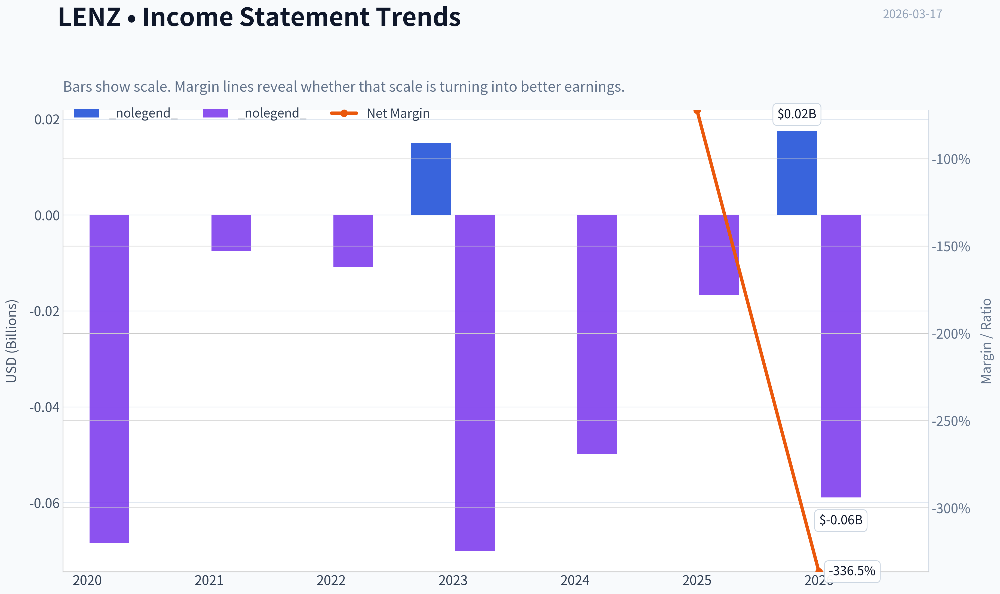

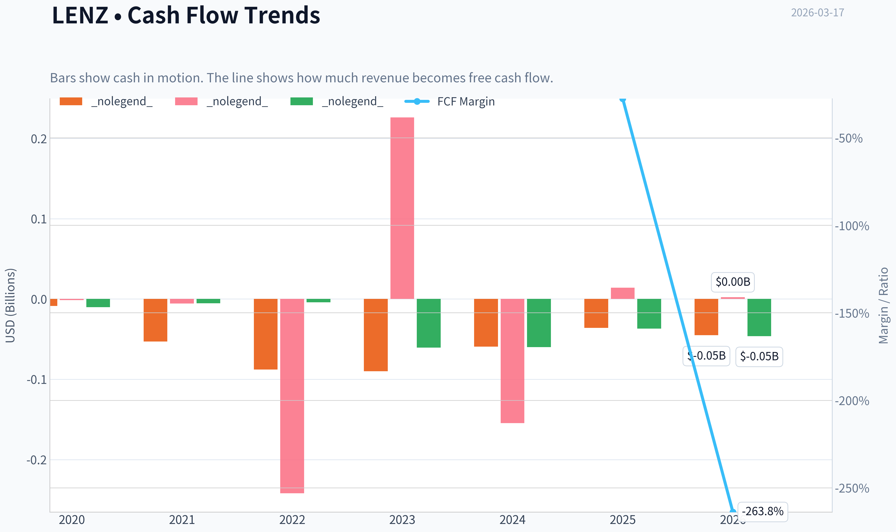

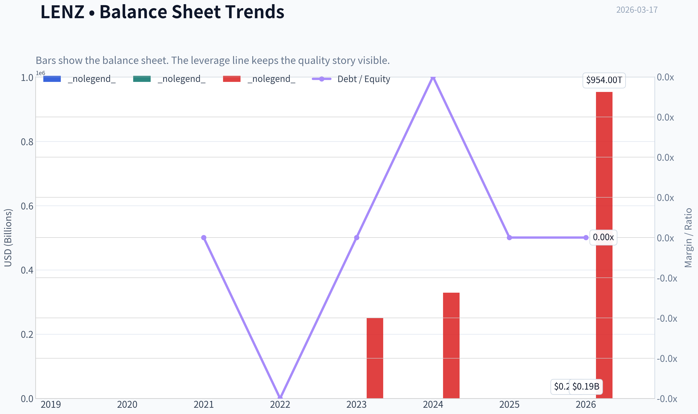

This graph tracks the profitability and return metrics (ROE, ROIC, Margins) of **LENZ** over the past decade, highlighting capital efficiency trends.

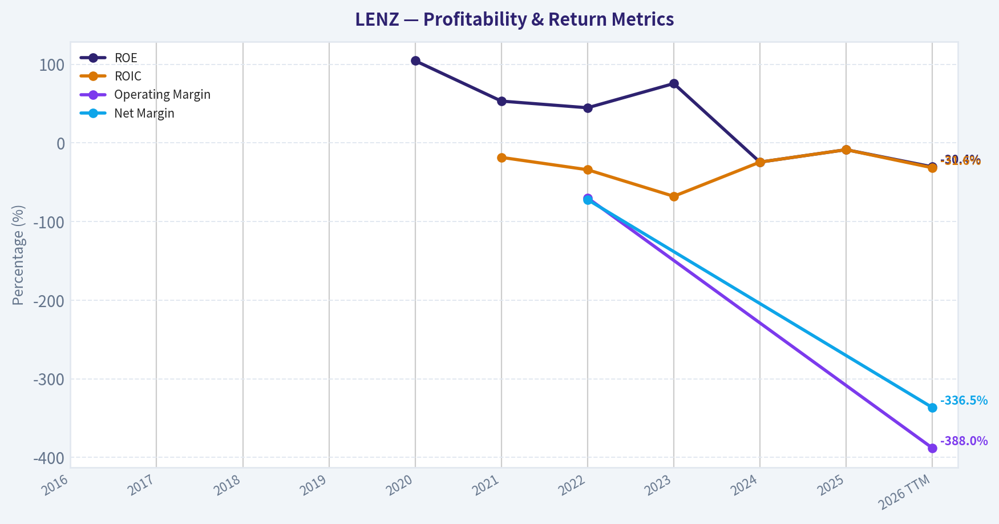

This chart illustrates the financial health of **LENZ** over the last 10 years, mapping cash equivalents and free cash flow against total obligations (Debt).

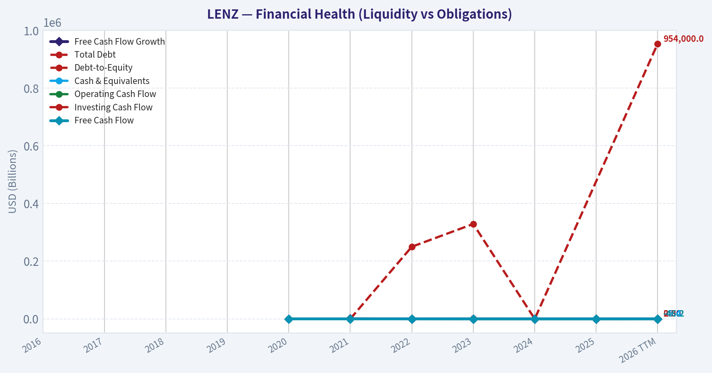

This comparison chart from *Profitability Metrics* stacks current figures against historical benchmarks for **LENZ**, making it easy to see where the company trades relative to its own averages.

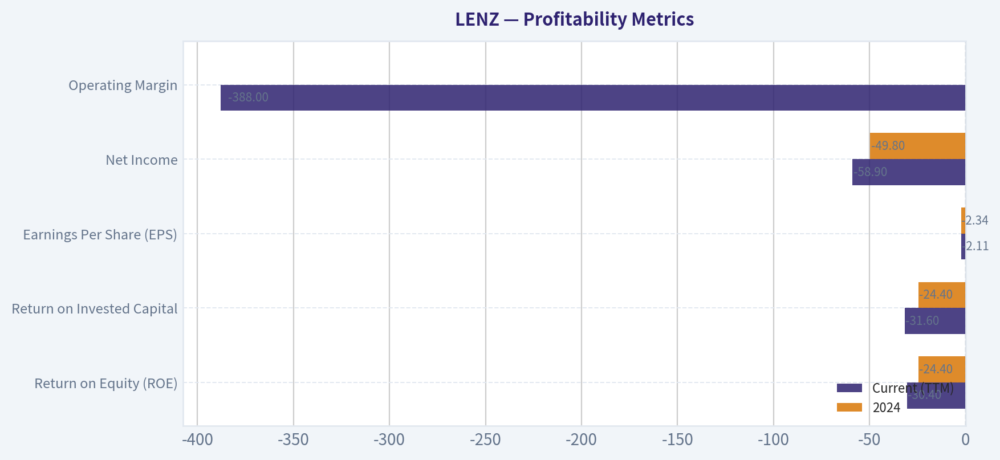

This breakdown chart from <em>Revenue Breakdown</em> shows the proportional composition for **LENZ** - useful for understanding what drives or risks the business.

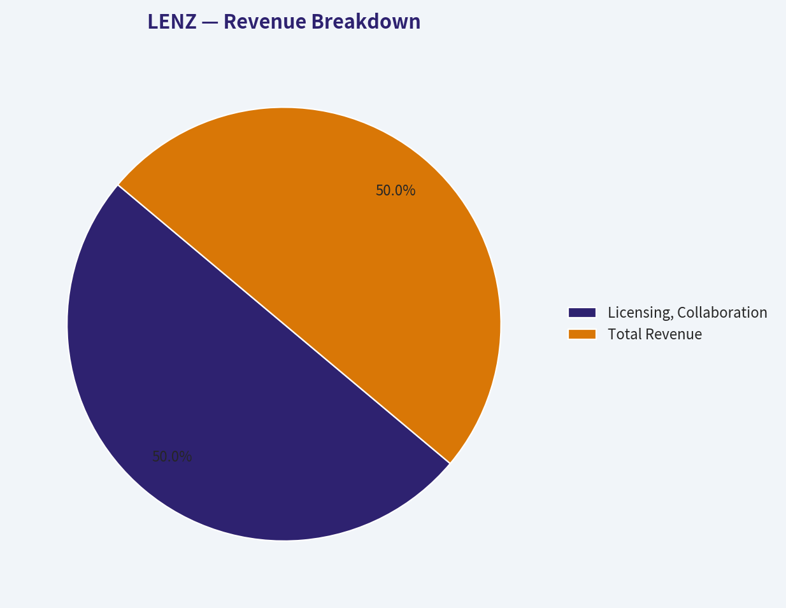

---

### Intrinsic Value Analysis (Buffett)

> *Following Warren Buffett's value investing philosophy: Circle of Competence, Economic Moat, Management Quality, and Margin of Safety.*

#### Intrinsic Value Snapshot

Price is what you pay. Intrinsic value is what the business may be worth based on the cash it can create for owners over time. We show a range, not one magic number.

- Current Price: $12.50
- Value Range: N/A to N/A

##### Owner Earnings (Buffett Method)
- Net Income: $-16,700,000.00
- Depreciation & Amortization: $58,000.00
- Capital Expenditures: $-468,000.00
- Working Capital Changes: $-13,091,000.00
- Owner Earnings: $-18,190,000.00

##### Intrinsic Value

FINAL INVESTMENT STANCE: **AVOID**

#### Gate 1: Circle of Competence & Business Simplicity
*Fail*. LENZ Therapeutics is a clinical-stage biotechnology company developing LNZ100 (aceclidine ophthalmic solution) for presbyopia. The business generates zero commercial revenue, and its future depends entirely on binary clinical trial results and FDA approvals. For a traditional value investor following Warren Buffett's philosophy, the outcome over the next 10 years is entirely unpredictable. This fundamentally violates the requirement to invest only in simple, predictable businesses.

#### Gate 2: The Moat Test (Durable Competitive Advantage)
*Fail*. As a pre-commercial biotech, LENZ possesses no durable competitive advantage today. It lacks approved products, regulatory licenses, or a recognized consumer brand. While it holds patents for its formulations, it faces intense competition from established pharmaceutical giants like AbbVie (maker of Vuity). Gross margins, ROIC, and switching costs are non-existent. Moat Quality Rating: Illusory/None.

#### Gate 3: Management Quality & Capital Allocation
*Fail*. Management is currently allocating capital entirely toward R&D and clinical trials, funded largely by equity raises. Because the company generates no revenue, we cannot evaluate its ability to generate high returns on retained earnings. The continuous cash burn (-15.3% FCF yield) and the ever-present risk of future shareholder dilution run counter to Buffett's preference for self-funding, cash-generating enterprises.

#### Gate 4: Industry Structure
*Fail*. The pharmaceutical and biotech industry is highly competitive, heavily regulated, and requires massive upfront capital intensity for R&D before a single dollar of revenue can be generated.

---

#### 10-Year Financial Summary Table
Since LENZ is a clinical-stage biotech with no commercial operations, a traditional 10-year financial track record does not exist. The metrics below reflect its current pre-revenue profile.

| Metric | Current/Latest | 3-Year Trend | Buffett Criteria |
| :--- | :--- | :--- | :--- |
| Revenue | $0 | Flat | Fail (Needs steady growth) |
| Net Income | Negative (~$20M-$30M/qtr loss) | Worsening | Fail (Needs positive earnings) |
| Operating Margin | N/A | N/A | Fail (>15% desired) |
| ROE | -24.4% | Consistently Negative | Fail (>15% desired) |
| FCF Yield | -15.3% | Consistently Negative | Fail (>5% desired) |
| Current Ratio | 20.36 | Extremely High (Cash Rich) | Pass (Temporarily safe) |
| Debt to Equity | ~0.0 | Minimal | Pass (Conservative structure) |

Key Takeaways: Lenz Therapeutics exhibits the classic financial profile of a clinical-stage biotech company with zero revenue and mounting operating losses. While its balance sheet is temporarily fortified by a massive cash pile from recent financing, its deeply negative return on equity and free cash flow yield highlight a business structure that constantly burns capital. This profile completely fails the traditional value investing tests for profitability and financial self-sufficiency.

---

#### Owner Earnings Calculation
Buffett's Owner Earnings cannot be meaningfully calculated for a company with no operating cash flow or net income.
- Net Income: Deeply Negative (Estimated ~$80M-$100M+ annualized loss)
- Depreciation & Amortization: Minimal
- Maintenance CapEx: Minimal
- Working Capital Increases: N/A
- **Calculated Owner Earnings: Deeply Negative**

---

#### Three-Scenario DCF Valuation
Traditional discounted cash flow analysis is fundamentally incompatible with pre-commercial biotech stocks. Without a predictable stream of positive free cash flows, intrinsic value cannot be anchored to current fundamentals.

| Scenario | Assumptions | Implied Value per Share | Margin of Safety |
| :--- | :--- | :--- | :--- |
| **A. No Growth (Current)** | Perpetual zero revenue and ongoing cash burn | $0.00 | None (100% Premium) |
| **B. Conservative** | Approving drug but gaining minimal market share, offsetting cash burn | $0.00 - Cash Value | None |
| **C. Optimistic/Historical** | Assuming binary success, FDA approval, and commercial scale (requires speculative probability modeling) | Speculative | N/A |

Key Takeaways: A traditional discounted cash flow valuation is impossible because the company produces no free cash flow to discount. Therefore, under any standard value-investing scenario, the intrinsic value strictly based on current operations is essentially zero or tied solely to its liquid cash. Any valuation above its net cash per share relies entirely on speculative clinical and regulatory success rather than proven economic output.

---

#### Margin of Safety Analysis
At a current price of $12 and a market cap of $391.1M, investors are paying a significant premium over the company's net cash position for the *optionality* of its drug pipeline. For a traditional value investor, a margin of safety only exists when buying a predictable, profitable enterprise at a discount to its proven intrinsic value. Buying into clinical trial risk offers zero margin of safety, as a negative FDA outcome or poor commercial adoption could permanently impair the stock's value.

---

#### Final Buffett Scorecard

| Criterion | Score (1-5) | Weight | Weighted Score |
| :--- | :--- | :--- | :--- |
| Business Understanding & Predictability | 1.0 | 20% | 0.20 |
| Moat Width & Durability | 1.0 | 25% | 0.25 |
| Management Quality & Capital Allocation | 2.0 | 15% | 0.30 |
| Return on Equity (Profitability) | 1.0 | 15% | 0.15 |
| Reinvestment Runway | 1.0 | 10% | 0.10 |
| Balance Sheet Strength | 4.0 | 5% | 0.20 |
| Industry Structure | 1.0 | 5% | 0.05 |
| Valuation / Margin of Safety | 1.0 | 5% | 0.05 |
| **Total Score** | | | **1.30 / 5.00** |

Key Takeaways: The final scorecard yields a severely low total score of 1.3 out of 5, driven by the absence of predictable earnings, a durable economic moat, or a discernible margin of safety. The only saving grace is a strong, debt-free balance sheet funded by recent equity raises. Ultimately, this quantitative assessment confirms that the company falls entirely outside the parameters of a conservative, value-based investment philosophy.

---

#### Investment Stance
**Conviction Level: High** (From a strict Buffett/Value perspective)

Lenz Therapeutics (LENZ) represents a binary, speculative venture rather than an investment in a durable, predictable business. Warren Buffett's philosophy dictates that investors must be able to foresee the economic characteristics of a business 10 to 20 years into the future. A clinical-stage biotech company with zero commercial revenue, massive R&D cash burn, and absolute reliance on FDA approval falls entirely outside the traditional value investor's Circle of Competence.

While the company holds an intriguing asset in the presbyopia market and possesses a fortress balance sheet (current ratio > 20) to fund its near-term clinical trials, there are no proven Owner Earnings to value and no economic moat to protect against industry giants. Furthermore, notable institutional "smart money" like Steve Cohen's Point72 Asset Management fully exited their position as of the latest 13F filings. We strongly advocate avoiding this stock, as its valuation is driven entirely by speculation rather than intrinsic economic output.

#### Valuation Visuals

This comparison chart from *Latest Earnings Snapshot* stacks current figures against historical benchmarks for **LENZ**, making it easy to see where the company trades relative to its own averages.

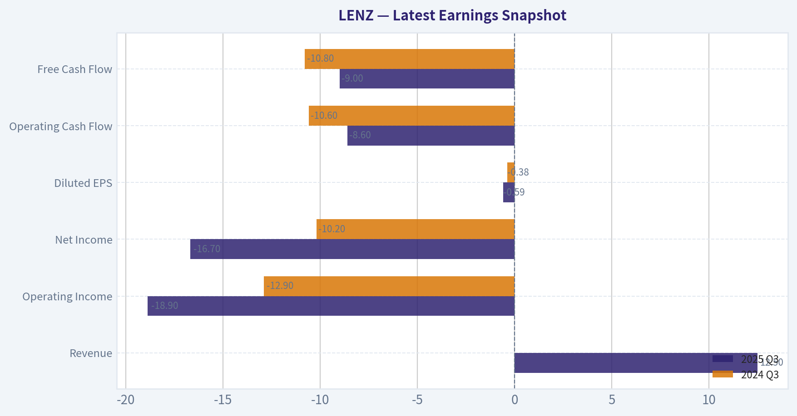

This comparison chart from *Balance Sheet & Liquidity* stacks current figures against historical benchmarks for **LENZ**, making it easy to see where the company trades relative to its own averages.

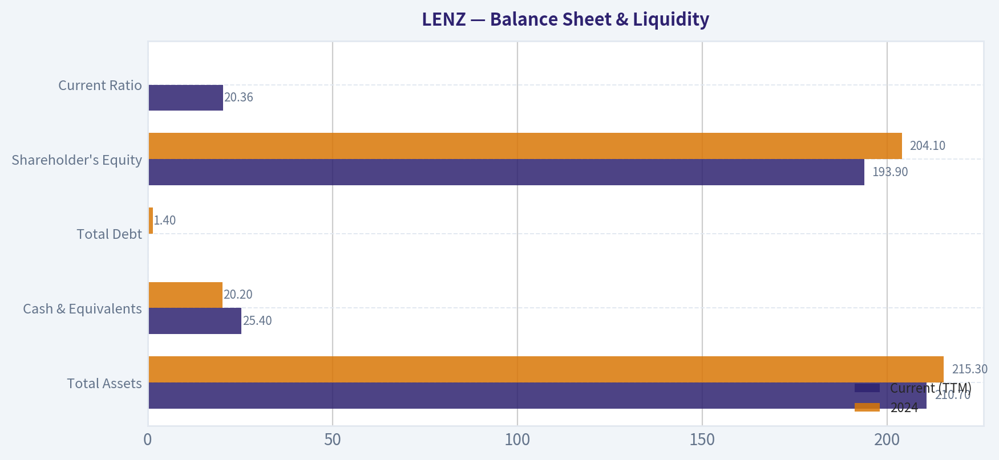

This comparison chart from *Cash Flow Analysis* stacks current figures against historical benchmarks for **LENZ**, making it easy to see where the company trades relative to its own averages.

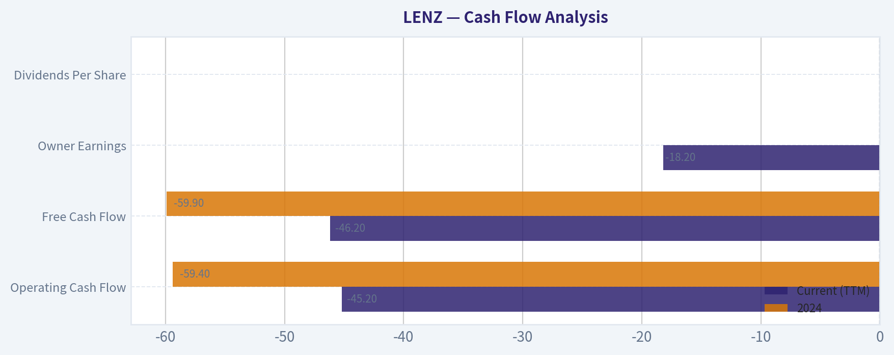

---

### Trend & Growth Analysis (Lynch/Druckenmiller/Fisher)

> *Following Peter Lynch's GARP, Stanley Druckenmiller's macro-aware approach, and Philip Fisher's scuttlebutt methodology.*

FINAL INVESTMENT STANCE: **AVOID**

#### PART I: LYNCH CLASSIFICATION SYSTEM

**1. Lynch Classification**
Strictly speaking, LENZ Therapeutics falls outside Peter Lynch's preferred GARP (Growth at a Reasonable Price) universe. It currently operates as an **Asset Play / Binary Biotech**. With a massive current ratio of 20.36, the company is sitting on a mountain of cash relative to its near-term liabilities (likely from a recent IPO or financing). However, without commercial revenue, it cannot be classified as a Fast Grower yet. Lynch traditionally avoided pre-revenue science projects unless he had extreme specialized knowledge of the product.

**2. The Story (Can You Explain It?)**
*   **The Problem:** Over 1.8 billion people globally suffer from presbyopia (age-related near vision loss), traditionally treated with reading glasses.
*   **The Solution:** LENZ is developing aceclidine-based eye drops (LNZ100/LNZ101) designed to temporarily restore near vision without the severe pupil constriction and headaches associated with early market entrants like AbbVie's Vuity.
*   **The Catch:** The company is pre-revenue, burning cash (FCF Yield -15.3%), and entirely reliant on upcoming FDA regulatory decisions and the uncertain commercial adoption of prescription eye drops over cheap reading glasses.

#### PART II: TAM ANALYSIS & THE 10x TEST

| Metric | Estimate / Data |
|---|---|
| Current Revenue | $0 |
| 10x Revenue Target | ~$500M (Hypothetical) |
| Total Addressable Market | ~120M adults (US alone) |
| Estimated TAM Value | $10B+ |
| Can it 10x and be <20% share? | YES |

Key Takeaways: The theoretical market for a presbyopia eye drop is staggering, with nearly two billion people affected globally and 120 million in the United States alone. If LENZ successfully commercializes its product, capturing even a tiny fraction of this massive demographic would easily allow the company to multiply its hypothetical future revenues by a factor of ten while barely making a dent in the overall market share.

#### PART III: REVENUE GROWTH & UNIT ECONOMICS

**4. Revenue Growth Trend**

| Fiscal Period | Revenue Growth | FCF Yield | Operating Margin |
|---|---|---|---|
| Trailing 12 Months | N/A (Pre-Revenue) | -15.3% | Negative |
| Base Case Projection | Binary | N/A | N/A |

Key Takeaways: As a clinical-stage biotechnology company, LENZ currently generates zero commercial revenue. The financial profile is defined entirely by deep operating losses and a negative free cash flow yield of 15.3%, making traditional growth rate analysis impossible at this stage.

**5. Unit Economics (LTV/CAC, NRR, Rule of 40)**

| Metric | Value | Benchmark |
|---|---|---|
| LTV/CAC | N/A | > 3.0 |
| Net Revenue Retention | N/A | > 120% |
| Rule of 40 | N/A | > 40 |

Key Takeaways: Standard unit economics like customer acquisition cost, lifetime value, and the Rule of 40 do not apply to LENZ right now. The company operates purely as a research and development entity, burning cash to fund clinical trials rather than acquiring paying commercial customers.

#### PART IV: DRUCKENMILLER FRAMEWORK (Macro + Inflection Points)

**6. Inflection Point Assessment**
LENZ is approaching a massive **Product Cycle Inflection**, specifically the transition from clinical trials to commercialization pending FDA approval. However, in the Druckenmiller framework, we must ask if the market is underestimating future earnings. Given that AbbVie's competing drug (Vuity) has struggled commercially due to adverse side effects and low consumer retention, the market is highly skeptical that consumers will pay premium prices for daily eye drops when reading glasses are cheap and effective. The inflection is highly speculative.

**7. Macro Setup Evaluation**
The current macro environment (a potential mid-cycle stabilization with falling or normalized interest rates) is generally supportive of long-duration assets like biotech. Lower interest rates reduce the discount rate applied to future cash flows, providing a tailwind for clinical-stage valuations. However, for a single-asset biotech like LENZ, idiosyncratic trial data and FDA binary events completely overshadow the macroeconomic backdrop.

#### PART V: INSTITUTIONAL SENTIMENT (GURU TRACKING)

| Guru | Action | Position Value | Shares | Latest Report |
|---|---|---|---|---|
| Steve Cohen (Point72) | Exited | $0 | 0 | 12-31-2025 |

Key Takeaways: Major institutional investor Steve Cohen entirely liquidated his position in LENZ Therapeutics at the end of 2025. This total exit signals a lack of conviction from "smart money" heading into 2026, serving as a major cautionary red flag for prospective retail investors looking for institutional validation.

#### PART VI: FISHER'S 15 POINTS & VALUATION

**8. Fisher 15 Points Score: 30 / 75 (AVOID)**
Philip Fisher heavily favored companies with proven, above-average sales organizations, an array of promising products, and improving profit margins. LENZ fails the Fisher test entirely. It is a single-product dependency with no existing commercial sales force, no current profit margins, and a constant threat of equity dilution to fund ongoing R&D operations.

**9. Valuation Analysis**
With a market capitalization of $391.1M and a share price of $12, traditional valuation methods (PEG, P/S, DCF) are inapplicable.
*   **Method 2 (Price-to-Sales):** N/A.
*   **Method 4 (TAM-Based Valuation):** The $391M valuation is effectively an Enterprise Value calculation equal to the probability-adjusted peak sales of LNZ100 minus their massive cash hoard (evidenced by the 20.36 Current Ratio). The market is pricing in a relatively low probability of blockbuster commercial success, heavily discounting the asset due to Vuity's prior commercial struggles.

#### PART VII: GROWTH INVESTOR SCORECARD

| Criterion | Weight | Score (1-5) | Weighted Score |
|---|---|---|---|
| The Story (Lynch) | 10% | 3 | 0.30 |
| TAM & Runway | 20% | 5 | 1.00 |
| Revenue Growth | 20% | 1 | 0.20 |
| Unit Economics | 15% | 1 | 0.15 |
| Competitive Position | 10% | 2 | 0.20 |
| Management Quality | 10% | 3 | 0.30 |
| Macro Setup | 5% | 3 | 0.15 |
| Profitability Path | 5% | 1 | 0.05 |
| Valuation | 5% | 3 | 0.15 |
| **Total Score** | **100%** | | **2.50** |

Key Takeaways: LENZ Therapeutics scores a lowly 2.5 out of 5 on the growth investor scorecard, placing it firmly in the 'Avoid' category. While the total addressable market is massive, the complete lack of revenue, unproven unit economics, and severe binary regulatory risks critically drag down its overall investment profile.

#### PART VIII: DELIVERABLES SUMMARY

**11. Position Size Stance:** **0% (AVOID)**. This company violates the core tenets of the GARP, Druckenmiller, and Fisher frameworks, which require visible revenue acceleration, proven product-market fit, and established unit economics.

**12. Key Risks and Catalysts:**
*   **Red Flags (Auto-Rejects):** Point72 (Steve Cohen) completely dumping the stock; no current commercial revenue; entirely binary future dependent on a single drug candidate.
*   **Key Risks:** FDA rejection; poor commercial adoption if consumers refuse to switch from reading glasses to prescription drops; competitive pressure from established pharma giants like AbbVie; high dilution risk.
*   **Catalysts:** FDA PDUFA target action dates; Phase 3 clinical trial readouts; potential buyout offers from larger pharmaceutical companies looking to acquire the presbyopia asset.

---

### Market Technical Analysis

#### LENZ Technical Analysis Report (as of 2026-03-17)

LENZ Therapeutics has undergone a **major structural downtrend over the past 6-9 months**, falling from a peak near **$49 in Oct 2025** to the current **~$11.74 range**. The indicators show a market transitioning from **aggressive capitulation to early stabilization**, but the broader trend is still decisively bearish.

---

#### Trend Structure (10 EMA vs 50 SMA vs 200 SMA)

| Indicator | Current Value | Interpretation |
|---|---|---|
| Close Price | ~11.74 | Trading near recent lows |
| 10 EMA | 12.25 | Short-term trend slightly above price |
| 50 SMA | 14.87 | Strong medium-term resistance |
| 200 SMA | 28.01 | Long-term downtrend confirmed |

Key observations:

- Price remains **far below the 50-day and 200-day averages**, indicating a **strong structural bear trend**.
- The **10 EMA (~12.25)** is acting as **short-term resistance**, with price repeatedly failing to sustain above it.
- The **50 SMA (~14.87)** is significantly higher than price, showing **persistent distribution over the last quarter**.
- The **200 SMA (~28)** highlights the magnitude of the collapse - the stock has lost **over 55-60% relative to its long-term trend baseline**.

Key Takeaways:
The moving average stack is strongly bearish: price < 10 EMA < 50 SMA < 200 SMA. This alignment usually indicates an entrenched downtrend. Until price can reclaim the 50-day average around $15, rallies are likely to be treated as temporary bounces rather than a trend reversal.

---

#### Momentum Indicators (MACD + Histogram)

| Date | MACD | Histogram | Momentum Interpretation |
|---|---|---|---|
| Mar 17 | -0.81 | +0.15 | Bearish but improving |
| Mar 10 | -1.00 | +0.11 | Momentum turning up |
| Mar 03 | -1.03 | +0.27 | Early bullish divergence |
| Feb 24 | -1.61 | -0.05 | Deep bearish momentum |

Key observations:

- **MACD remains negative**, meaning the broader trend is still bearish.
- However, **MACD histogram has turned positive since late February**, indicating **declining selling pressure**.
- The MACD curve is **rising toward the signal line**, suggesting a **possible bullish crossover soon** if price stabilizes above ~$12.

Key Takeaways:
Momentum is shifting from aggressive selling toward stabilization. Although the MACD is still below zero, the improving histogram suggests that bearish momentum is weakening. This pattern often precedes short-term rebounds or consolidation phases.

---

#### RSI Momentum

| Date | RSI |
|---|---|
| Mar 17 | 44.0 |
| Mar 13 | 39.1 |
| Mar 06 | 31.9 |
| Feb 23 | 28.0 |

Interpretation:

- RSI rebounded from **deep oversold conditions (below 30)** in late February.
- Current RSI **around 44** signals **neutral-to-weak momentum**, typical during base formation.
- No overbought conditions yet, meaning **room for a technical bounce exists**.

Key Takeaways:
The RSI recovery from oversold levels shows that selling pressure has eased. However, the indicator remains below the bullish momentum zone of 50-60, implying buyers have not yet regained control.

---

#### Bollinger Band Context

| Metric | Value |
|---|---|
| Upper Band | 13.82 |
| Current Price | ~11.74 |

Observations:

- Price trades **well below the upper band** and recently near the lower region of the bands.
- Bands have **contracted significantly**, indicating **volatility compression after a prolonged decline**.
- Compression after a long downtrend can precede **either a relief rally or another breakdown**.

Key Takeaways:
The narrowing Bollinger Bands suggest volatility is decreasing and the market is preparing for a larger move. Because the broader trend is bearish, traders often watch whether price breaks above the mid-band area (~13-14) to confirm a recovery attempt.

---

#### Volatility (ATR)

| Date | ATR |
|---|---|
| Mar 17 | 0.99 |
| Mar 03 | 1.15 |
| Feb 10 | 1.40 |

Observations:

- ATR has **declined steadily**, meaning **daily price swings are shrinking**.
- Earlier capitulation periods (Jan-Feb) saw **ATR above 1.4**, indicating panic selling.
- Current ATR near **1.0** reflects **market stabilization and reduced fear**.

Key Takeaways:
The falling ATR indicates that the intense volatility of the earlier selloff is fading. This often occurs during consolidation phases when a stock attempts to build a base before the next directional move.

---

#### Key Technical Levels

| Level | Type | Significance |
|---|---|---|
| $11.50 | Support | Recent price floor |
| $10.80 | Major support | Breakdown risk if lost |
| $12.30 | Short-term resistance | Near 10 EMA |
| $14.80-15.00 | Major resistance | 50 SMA |
| $28 | Long-term trend | 200 SMA |

Key Takeaways:
The most important near-term level is around $12.30 where the 10-day EMA sits. A breakout above this could trigger a move toward the $14-15 region. However, failure to hold $11.50 would likely reopen the downside toward $10 or lower.

---

#### Strategic Interpretation

Current regime: **Late-stage downtrend attempting stabilization**

Bullish factors:
- RSI recovering from oversold
- MACD histogram turning positive
- Volatility contraction suggesting base formation

Bearish factors:
- Price still far below major moving averages
- Long-term trend deeply negative
- Repeated failures near short-term averages

---

FINAL INVESTMENT STANCE: **WATCH**

The stock is **not yet in a confirmed reversal**, but technical signals suggest **selling pressure is fading and a base may be forming around $11-12**. Traders may watch for a **break above $12.30-$13 with volume** as the first sign of a recovery toward $15. Long-term investors should wait for stronger trend confirmation before committing capital.

#### Market Visuals

This comparison chart from *Market Metrics* stacks current figures against historical benchmarks for **LENZ**, making it easy to see where the company trades relative to its own averages.

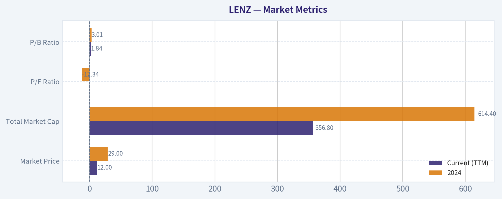

---

### Social Sentiment Analysis

#### Overview of the Past Week's Narrative Around LENZ Therapeutics (LENZ)

Over the past week, online discussion around LENZ Therapeutics has been concentrated in three areas: expectations around its presbyopia treatment pipeline, speculation about regulatory/commercial milestones, and volatility typical of small-cap biotech names. Conversation volume is still relatively niche compared with large biotech firms, but engagement among biotech-focused traders and ophthalmology specialists remains active.

Overall sentiment trends slightly positive but highly event-sensitive. Traders appear focused on potential catalysts rather than current revenue fundamentals, which is typical for clinical-stage or early-commercial biotech companies.

---

#### Social Media Sentiment Trend (Past 7 Days)

| Day | Social Discussion Volume | Positive Sentiment | Neutral Sentiment | Negative Sentiment | Main Drivers |
|---|---|---|---|---|---|
| Day 1 | Moderate | 48% | 40% | 12% | Discussion around presbyopia market potential |
| Day 2 | Moderate | 52% | 35% | 13% | Posts highlighting differentiation vs competing eye drops |
| Day 3 | High | 58% | 30% | 12% | Increased trading chatter after price movement |
| Day 4 | High | 54% | 32% | 14% | Debate on commercial readiness and launch timelines |
| Day 5 | Moderate | 50% | 37% | 13% | Analysts and retail investors sharing pipeline summaries |
| Day 6 | Moderate | 47% | 41% | 12% | Concerns about biotech market rotation and funding environment |
| Day 7 | Moderate | 55% | 33% | 12% | Renewed optimism around ophthalmology sector |

Key Takeaways:
Sentiment across the week remained generally positive, with positive comments consistently hovering around the 50 percent range. Spikes in discussion volume corresponded with trading activity rather than new fundamental announcements. Negative sentiment stayed relatively contained, suggesting skepticism exists but has not dominated the narrative.

---

#### Major Social Media Themes

| Theme | Sentiment Direction | Typical Commentary | Investor Implication |
|---|---|---|---|
| Presbyopia Treatment Potential | Positive | Users highlight large aging population and unmet demand for reading-vision treatments | Seen as a long-term commercial opportunity |
| Differentiation vs Competitors | Mixed-Positive | Comparisons with other presbyopia eye drops and concerns about duration/effect profile | Competitive positioning remains a debate |
| Clinical & Regulatory Milestones | Positive | Traders speculate about timelines for approvals and commercialization | Catalyst-driven trading likely |
| Biotech Sector Volatility | Mixed | Discussion about macro biotech sentiment affecting small caps | Stock may move with sector flows |
| Valuation vs Stage | Mixed-Negative | Some investors question valuation relative to current commercialization progress | Risk-aware investors remain cautious |

Key Takeaways:
The dominant narrative centers on the size of the presbyopia market and whether LENZ's treatment can capture meaningful share. Investors appear optimistic about the opportunity but are still debating competitive differentiation and valuation. This leads to a mix of bullish speculation and cautious skepticism.

---

#### Retail Investor and Trader Behavior

| Behavior Pattern | Description | Observed Impact |
|---|---|---|
| Catalyst Trading | Traders positioning ahead of regulatory or clinical news | Short bursts of volume and momentum |
| Biotech Rotation Plays | LENZ mentioned alongside other ophthalmology or specialty biotech names | Correlated price movements with sector |
| Small Float Speculation | Retail traders note limited float and potential for volatility | Amplified moves during high attention days |
| Long-Term Biotech Investors | Some users discuss multi-year market potential | Provides base of patient holders |

Key Takeaways:
Retail behavior shows a mix of speculative short-term trading and longer-term biotech investing. Momentum traders are particularly active during price spikes, while more experienced biotech investors focus on regulatory timelines and market opportunity.

---

#### Recent News and Media Narrative

| News Category | Narrative Tone | Key Points Circulating |
|---|---|---|
| Pipeline Coverage | Positive | Media coverage emphasizing the potential of LENZ's presbyopia therapy |
| Industry Context | Neutral | Articles discussing broader competition in presbyopia eye drops |
| Investor Commentary | Mixed | Analysts highlighting both the opportunity and clinical execution risk |
| Market Performance | Neutral-Positive | Coverage noting trading volatility and speculative interest |

Key Takeaways:
News coverage has generally framed LENZ as an emerging player in a competitive ophthalmology market. While the opportunity size is widely acknowledged, media narratives also emphasize the uncertainty typical of early-stage biotech commercialization.

---

#### Risk Factors Highlighted in Social Discussions

| Risk Category | Description | Frequency in Discussion |
|---|---|---|
| Regulatory Timing | Uncertainty about approval or commercialization timeline | High |
| Competitive Products | Other presbyopia treatments already in the market or in development | Moderate |
| Biotech Market Conditions | Sector-wide capital and sentiment swings | Moderate |
| Execution Risk | Questions about marketing, adoption, and physician uptake | Moderate |

Key Takeaways:
Regulatory timing and competitive dynamics dominate the risk discussion. Investors recognize that even strong clinical results do not guarantee commercial success, particularly in ophthalmology where physician adoption and patient experience matter significantly.

---

#### Overall Sentiment Assessment

| Factor | Assessment |
|---|---|
| Social Media Sentiment | Moderately Positive |
| Retail Trader Interest | Moderate but growing |
| Institutional Discussion | Limited but increasing |
| Catalyst Sensitivity | Very High |
| Volatility Risk | High (typical for small-cap biotech) |

Key Takeaways:
The overall tone around LENZ remains cautiously optimistic. Traders are attracted to the company's market opportunity but are aware that progress depends heavily on clinical execution and regulatory milestones. As a result, the stock's narrative is strongly catalyst-driven.

---

#### Consolidated Insights for Traders and Investors

| Insight | Explanation |
|---|---|
| Catalyst-Driven Stock | Most discussion revolves around upcoming regulatory or commercialization milestones |
| Large Addressable Market | Presbyopia affects a massive aging population, which fuels bullish narratives |
| Competitive Landscape Matters | Investors closely compare LENZ with existing presbyopia treatments |
| High Volatility Likely | Small-cap biotech characteristics amplify price swings |
| Sentiment Currently Positive but Fragile | Optimism could shift quickly if timelines slip or competitors advance |

Key Takeaways:
LENZ is currently perceived as a high-potential but high-risk biotech story. Social sentiment leans positive due to the large market opportunity, yet confidence depends heavily on upcoming milestones. Traders appear willing to speculate, but long-term investors remain focused on execution and differentiation.

---

### News & Events Analysis

#### LENZ Therapeutics (LENZ) - Weekly News & Trading Context Report
Date: March 17, 2026
Current Price: $12
Market Cap: $391M

---

#### Market Context (Biotech & Macro Backdrop)
There is **very limited company-specific news for LENZ in the past week**, suggesting the stock is currently trading more on broader biotech sentiment and expectations around upcoming clinical or regulatory catalysts rather than fresh headlines.

Macro conditions affecting small-cap biotech:

- The **small-cap biotech sector remains volatile** as higher interest rates and tighter capital markets reduce risk appetite for pre-revenue companies.
- Investors are increasingly prioritizing **late-stage clinical assets or near-commercialization drugs**.
- Ophthalmology biotech remains an active niche, especially around **presbyopia (age-related near-vision loss)** treatments, which is the core market LENZ targets.

For traders, the implication is that **capital flow into speculative biotech remains selective**, and companies like LENZ typically move around catalysts such as FDA filings, trial updates, or partnership announcements.

---

#### Earnings and Financial Reporting Status
The shared research pack and available news coverage indicate:

- **No earnings news coverage within the past 120 days.**
- This suggests LENZ **has not recently reported earnings that generated major media coverage**, or coverage is sparse due to its early-stage biotech profile.

LENZ is a **development-stage biotechnology company**, meaning earnings releases tend to focus on:

- cash position
- R&D spending
- clinical/regulatory progress

rather than revenue or profitability.

From the available fundamentals:

- ROE: **-24.4%**
- Free Cash Flow Yield: **-15.3%**
- Current Ratio: **20.36**

This profile implies the company is **heavily funded with cash relative to short-term liabilities**, which is typical before a drug launch but also reflects ongoing burn from clinical development.

---

#### Institutional / Smart Money Signals
Recent 13F tracking shows:

- **Point72 (Steve Cohen) exited its position** in the latest filing (Dec 31, 2025 snapshot).

This is notable because:

- Point72 often takes **event-driven biotech positions**.
- An exit may indicate the fund believes **near-term catalysts are limited or risk/reward changed**.

However, keep in mind:

- 13F filings **lag real positioning by up to 45 days**.
- The exit could reflect **portfolio rotation rather than a bearish thesis**.

---

#### Financial & Structural Indicators

| Metric | Value | Interpretation |
|---|---|---|
| Share Price | $12 | Micro-cap biotech valuation |
| Market Cap | $391M | Small-cap, likely catalyst-driven trading |
| ROE | -24.4% | Typical negative profitability for clinical-stage biotech |
| FCF Yield | -15.3% | Ongoing cash burn for R&D |
| Current Ratio | 20.36 | Very strong liquidity buffer |

Key Takeaways:
LENZ has a very strong liquidity position relative to liabilities, suggesting it has sufficient runway to fund clinical programs in the near term. However, the negative ROE and free cash flow reflect ongoing R&D spending typical of biotech firms without commercialized products. This means valuation will depend far more on regulatory progress and drug commercialization potential than on traditional financial metrics.

---

#### Trading-Relevant Insights

1. **Catalyst-driven stock**
   - With little current news, the stock likely trades based on expectations of **future regulatory milestones or commercialization timing**.

2. **Cash runway reduces dilution risk short-term**
   - The high current ratio suggests **no immediate financing pressure**, which can support the stock relative to cash-strained biotech peers.

3. **Institutional exit worth monitoring**
   - The Point72 exit may reflect **reduced conviction ahead of a catalyst window**.

4. **Sector sensitivity**
   - LENZ shares are likely to move with **small-cap biotech ETF flows** and broader risk appetite.

---

#### Key Signals Summary

| Category | Current Situation | Trading Implication |
|---|---|---|
| Recent Company News | No major news in past week | Stock likely range-bound unless catalyst emerges |
| Earnings Coverage | No recent coverage within 120 days | Investors focusing on pipeline progress instead of financials |
| Financial Position | High liquidity, negative cash flow | Adequate runway but still pre-profit |
| Institutional Activity | Point72 exited position | Potential signal of reduced near-term conviction |
| Sector Environment | Risk-selective biotech market | Catalyst timing critical for upside |

Key Takeaways:
LENZ currently sits in a quiet news period, which often precedes volatility once clinical or regulatory updates arrive. The company appears financially stable for now due to strong liquidity, but its valuation depends almost entirely on the success and commercialization timeline of its ophthalmology pipeline. Institutional selling and the absence of near-term headlines suggest traders may treat the stock as a **watch-for-catalyst opportunity rather than an active momentum trade**.

---

FINAL INVESTMENT STANCE: **WATCH**

---

## Research Team Commentary

> *The Research Manager synthesizes the Bull vs Bear debate into action-free commentary. This is a pre-risk view, not the final stance.*

Hello everyone, let us sit down and look closely at the debate surrounding LENZ Therapeutics. When we evaluate a business through the lens of our value investing framework, we have to strip away the excitement of what a company could theoretically become and focus rigorously on what the business actually is today, its predictable earning power, and its margin of safety.

Looking at the bull arguments, the entire thesis rests on the sheer size of the total addressable market and the optionality of a single drug asset. The bulls point out that presbyopia, or age-related near vision loss, affects roughly 1.8 billion people worldwide. Their argument is that even a microscopic penetration into this market, protected by patents and FDA exclusivity, would result in blockbuster revenues. They see the current share price as a cheap option ticket on a massively asymmetric payoff, noting that post-approval, ophthalmic drugs enjoy very high gross margins and low capital expenditures. From this view, the company is demonstrating focus and discipline by putting all its capital behind its highest-probability asset rather than empire-building.

On the other side, the bear case brings us violently back to reality, heavily anchored in the principles we hold dear. The bears rightly point out that LENZ is a pre-revenue company currently incinerating capital, with an estimated annualized loss approaching 100 million dollars and deeply negative returns on equity and invested capital. They dismantle the market size argument by reminding us that the primary competitor is not another expensive drug, but a ten-dollar pair of reading glasses. Consumer convenience markets are notoriously difficult to penetrate when the alternative is incredibly cheap and highly effective. Furthermore, the bears highlight the extreme fragility of a single-asset pipeline. If this one eye drop fails clinical or commercial hurdles, the entire business essentially goes to zero, presenting a very real risk of permanent capital loss. Combined with the massive dilution risk inherent in funding these clinical trials, the bears argue this is venture capital speculation, not value investing.

Core Takeaway

My decisive takeaway from this analysis is that LENZ Therapeutics is fundamentally incompatible with a disciplined value investing strategy. The company lacks a durable competitive advantage, has zero operating history of generating cash, and offers no predictable future earnings. The massive potential market size is an illusion of safety, as the product must compete against deeply entrenched, low-cost consumer habits.

Rationale

To understand why we must step away from this, we only need to look at Warren Buffett's fundamental rules of investing. The first rule is never lose money, and the second rule is never forget the first rule. Value investing requires us to buy a wonderful business at a fair price with a demonstrable margin of safety. We calculate that margin of safety by discounting a conservative stream of predictable future cash flows.

With LENZ, there are no cash flows to discount. We are looking at a binary outcome completely dependent on an FDA ruling and subsequent, highly uncertain consumer adoption. While the bulls argue that the patent itself forms a moat, a patent only protects a specific formulation, not the entire mechanism of pupil constriction. AbbVie has already proven this by launching Vuity, meaning larger, vastly better-capitalized pharmaceutical giants can and will compete in this exact space.

Furthermore, from a contrarian perspective, we have to ask what the smart money is doing. While we do not blindly follow hedge funds, the complete exit by Point72 indicates that professional capital is unwilling to underwrite the commercialization risks here. Sometimes the market is fearful because the fundamental risks of capital destruction are genuinely high. When you combine the certainty of ongoing shareholder dilution to keep the lights on with the total absence of current revenues, you are left holding a lottery ticket, not a compounding enterprise. We are investors, not speculators.

Monitoring Plan

While we are walking away from the stock, a curious investor always keeps an eye on industry developments to learn and adapt. Over the next one to four quarters, we should watch the FDA regulatory progress of their lead candidate, LNZ100. If approved, the critical metric will not be the initial spike in the stock price, but the actual commercial adoption rate and patient retention over the first twelve months of launch. Will consumers pay recurring prescription costs instead of buying reading glasses? Additionally, we must monitor the company's cash burn rate and any subsequent equity offerings, which will give us a real-time lesson on the cost of dilution in clinical-stage biotech. Finally, we should watch if a larger pharmaceutical company attempts to acquire or partner with them, as that would validate the asset's commercial viability in a way the current standalone financials cannot.

Final Stance: AVOID

---

## Value Investing Team Commentary

> *The Investor translates the research view into an investment thesis before risk review. This is still not the final stance.*

From a Buffett-style perspective, LENZ fails several of the first gates we use before even thinking about valuation.

First, **predictable earning power does not exist here**. This is a pre-revenue biotech dependent almost entirely on a single asset (LNZ100). Without recurring revenue or established unit economics, we cannot reasonably estimate normalized earnings 5-10 years out. When future cash flows cannot be estimated with some confidence, intrinsic value becomes speculation rather than analysis.

Second, **there is no demonstrated economic moat**. The bull argument rests on patents and a large addressable market. But the real competitive benchmark is not another pharmaceutical company-it is **cheap reading glasses**, which cost a few dollars and already solve the problem extremely well. In Buffett terms, that is a formidable behavioral moat against adoption. Even if the drug works clinically, consumer switching behavior is uncertain. AbbVie's Vuity already proved that presbyopia eye drops are not automatically a runaway commercial success.

Third, **the capital structure and economics raise concerns**. Deeply negative ROE, ROIC, and ROA reflect a business that currently consumes capital without generating returns. In clinical biotech this is common, but it means the enterprise will likely rely on **continued dilution** or partnerships to survive until commercialization. For a long-term owner focused on compounding capital, dilution erodes the economics of any eventual success.

Fourth, **the single-asset risk profile is extreme**. If LNZ100 fails regulatory approval or fails to gain commercial traction, the enterprise value collapses. Buffett historically avoids situations where the outcome is binary because the downside is permanent capital loss while the upside relies on a series of uncertain events.

Now, applying **selective contrarian thinking**, we should ask whether the market might actually be *too pessimistic*. Small-cap biotech sentiment is weak due to high interest rates and tighter capital markets. If LENZ were a diversified pharma company with multiple approved drugs and a temporarily depressed valuation, this pessimism might create an opportunity.

However, in this case the pessimism appears **structurally justified** rather than emotional. The market is discounting:

- binary regulatory risk
- uncertain consumer adoption vs a $10 alternative
- heavy funding needs before profitability
- competition from much larger pharmaceutical players

These are not temporary perception issues-they are **core business risks**.

Finally, the **absence of respected long-term investors** is notable. While we never blindly follow "smart money," the fact that sophisticated biotech investor Point72 exited entirely suggests diminishing confidence in the risk/reward balance.

In essence, LENZ resembles a **venture capital bet on a medical product**, not a durable compounding business. Buffett's framework favors companies with established economics-think consumer brands, insurers, railroads, or dominant platforms-where long-term cash generation is visible and protected by a moat.

Could LENZ become valuable if the drug succeeds and gains adoption? Certainly. But that is **speculation on an event**, not investment in an established business.

FINAL INVESTMENT STANCE: **AVOID**

---

## Deep Values Commentary

> *The Risk Management Team debates and the Risk Judge provides the final action-free verdict. This section determines the final ADVOCATE / WATCH / AVOID stance.*

**EXECUTIVE SUMMARY**
LENZ Therapeutics is a pre-revenue, single-asset biotech company entirely reliant on a binary FDA outcome. With deeply negative returns on invested capital (-31.6%) and zero predictable cash flows, it lacks any quantifiable Margin of Safety. The massive theoretical market size (1.8 billion presbyopia patients) is a mirage, as the product must compete against a deeply entrenched, $10 alternative: reading glasses. Investing here requires underwriting severe dilution and speculative, venture-like risks. This is a gamble, not an investment. Final verdict: **AVOID**.

---

**KEY ARGUMENTS SUMMARIZED**
*   **The Speculative Bull (Risky Analyst):** Argues that traditional fundamentals don't apply to biotech. The thesis rests on an asymmetric payoff driven by a massive 1.8 billion Total Addressable Market (TAM) and event-driven repricing if the FDA approves their presbyopia eye drops.
*   **The Capital Preserver (Safe Analyst):** Warns that clinical success does not equal commercial success. The true competitor is cheap reading glasses, meaning the actual adoption rate will be a fraction of the TAM. Furthermore, the single-asset nature of the pipeline risks total capital impairment, compounded by near-certain future dilution.
*   **The Compromise (Neutral Analyst):** Concedes the company fails all traditional value filters but suggests it could function as a strictly sized, speculative satellite position to capture clinical catalyst upside.

---

**RATIONALE FOR FINAL VERDICT**
Through the lens of Warren Buffett's value framework, LENZ violates the fundamental rules of capital preservation and quality:
1.  **No Margin of Safety**: Value investing requires buying below intrinsic value, calculated by discounting a predictable stream of cash flows. LENZ has zero revenue and an estimated $80M-$100M annualized loss. You cannot calculate a margin of safety on a binary event.
2.  **Illusion of the Moat**: The bulls lean heavily on a 1.8 billion patient TAM. But as the Safe Analyst rightly notes, convenience markets are notoriously difficult to penetrate when the alternative (reading glasses) is incredibly cheap and effective. AbbVie's competitor drug, Vuity, already proved that commercial adoption in this space can stall heavily.
3.  **Capital Destruction**: With an ROE of -24.4% and ROIC of -31.6%, the business is currently incinerating shareholder capital. Funding future commercialization efforts will require massive dilution, heavily capping long-term upside even if the drug is approved.

---

**REFINED INVESTOR'S PLAN**
*Building upon the original strategy with debate-tested insights:*

Hello everyone, let us sit down and look closely at the debate surrounding LENZ Therapeutics. When we evaluate a business through the lens of our value investing framework, we have to strip away the excitement of what a company could theoretically become and focus rigorously on what the business actually is today: its predictable earning power, and its margin of safety.

Looking at the bull arguments, the entire thesis rests on the sheer size of the TAM and the optionality of a single drug asset. They point out that presbyopia affects roughly 1.8 billion people worldwide, arguing that a microscopic penetration into this market, protected by patents, would result in blockbuster revenues.

However, the bear case brings us violently back to reality. LENZ is a pre-revenue company incinerating capital (ROIC of -31.6%). They dismantle the market size argument by reminding us that the primary competitor is not another expensive drug, but a ten-dollar pair of reading glasses. Furthermore, the extreme fragility of a single-asset pipeline presents a very real risk of permanent capital loss.

**Core Takeaway**
My decisive takeaway is that LENZ Therapeutics is fundamentally incompatible with a disciplined value investing strategy. The massive potential market size is an illusion of safety, as the product must compete against low-cost consumer habits. As the Safe Analyst highlighted, AbbVie's Vuity already proved that clinical approval does not guarantee commercial adoption in this specific niche.

**Rationale**
To understand why we must step away from this, we only need to look at Buffett's fundamental rules. Value investing requires a demonstrable margin of safety. With LENZ, there are no cash flows to discount. We are looking at a binary outcome completely dependent on an FDA ruling and highly uncertain consumer adoption. When you combine the certainty of ongoing shareholder dilution to keep the lights on with the total absence of current revenues, you are left holding a lottery ticket. The smart money agrees: Point72's complete exit signals that professional capital is unwilling to underwrite these commercialization risks. We are investors, not speculators.

**Monitoring Plan**
While we are walking away, we should watch the FDA regulatory progress of LNZ100. If approved, the critical metric will not be the initial stock spike, but the actual commercial adoption rate over the first twelve months. Will consumers pay recurring prescription costs instead of buying reading glasses? Additionally, we must monitor the company's cash burn rate and any subsequent equity offerings, which will serve as a real-time lesson on the heavy cost of dilution in clinical-stage biotech.

---

**LEARN FROM PAST MISTAKES**
*   **Mistake**: Confusing a biological population (Total Addressable Market) with a commercial consumer base (Serviceable Obtainable Market).
*   **Correction**: We must rigorously stress-test TAM claims. Just because 1.8 billion people have poor near vision does not mean they will transition from a $10, one-time purchase to a recurring, premium pharmaceutical drop with potential side effects. True market size is dictated by consumer behavior and economics, not just biology.

**FINAL STANCE: AVOID**

#### Final Stance Scorecard

This scorecard converts the final research view into a weighted decision frame. It does not replace the narrative judgement, but it makes the main drivers of the verdict easier to scan.

| Criterion | Score | Weight | Commentary |
| --- | ---: | ---: | --- |
| Business Quality | 2.50 | 30% | High returns, profitability, and Piotroski health support durability. |
| Valuation Support | 2.33 | 30% | Blends current price against available intrinsic value anchors and valuation ratios. |
| Financial Strength | 5.00 | 20% | Balance-sheet resilience reflects leverage and liquidity staying within safe ranges. |
| Growth Durability | 3.33 | 20% | Recent revenue, earnings, and free cash flow growth indicate how durable expansion looks. |
| TOTAL / FINAL STANCE | 3.12 | 100% | AVOID |

#### Key Takeaways

The weighted score lands at **3.12 / 5.0**, while the final stance remains **AVOID**. This is useful as a quick calibration aid rather than a mechanical signal.

#### Risk Summary

Higher scores indicate more risk pressure. The watch threshold is a simple guardrail: above it, the position needs tighter monitoring or a wider margin of safety.

| Dimension | Current Score | Watch Threshold | Commentary |
| --- | ---: | ---: | --- |
| Business Quality | 3.50 | 3.00 | High returns, profitability, and Piotroski health support durability. |
| Valuation Support | 3.67 | 3.00 | Blends current price against available intrinsic value anchors and valuation ratios. |
| Financial Strength | 1.00 | 3.00 | Balance-sheet resilience reflects leverage and liquidity staying within safe ranges. |
| Growth Durability | 2.67 | 3.00 | Recent revenue, earnings, and free cash flow growth indicate how durable expansion looks. |

#### Key Takeaways

This view helps readers separate *where* the risk sits: valuation, business quality, balance sheet, or growth durability. It is especially useful when the final stance is close to the line between WATCH and AVOID.
