# LII Deep Value Intelligence

**Analysis Date:** 2026-08-31

## Critical Disclaimer

*This analysis is generated by Deep Value Intelligence, an AI-powered multi-agent investing framework. Education & research only - not financial advice, not a financial advisor.*

---

## Table of Contents

1. Intelligence Summary
2. Analyst Team Reports
   - Fundamentals Analysis
   - Intrinsic Value Analysis (Buffett)
   - Trend & Growth Analysis (Lynch/Druckenmiller/Fisher)
   - Market Technical Analysis
   - Options Market Analysis
3. Research Team Commentary
4. Value Investing Team Commentary
5. Deep Values Commentary

---

## Intelligence Summary

### Thesis + Conditions

**Core Thesis:** **1. EXECUTIVE SUMMARY**
**Verdict:** **WATCH** (with defined scale-in triggers).

**Key Risks:**
- Verdict:** **WATCH** (with defined scale-in triggers).
- Lennox International (LII) is an elite, asset-light compounder (33% ROIC) benefiting from structural replacement tailwinds. However, buying into a sharp technical gap-down at 17x headline earnings-which may represent a cyclical peak-lacks a sufficient margin of safety. The business is not broken, but the valuation is resetting. We will maintain a WATCH stance to preserve capital, while preparing a staged "toe-hold" entry plan to prevent missing out on long-term compounding if shares stabilize.
- The Bull (Risky):** Emphasizes business quality. HVAC replacements are a non-discretionary "toll road," and SEER2/electrification regulations have permanently raised the margin floor. At a 17x P/E with 33% ROIC, the quality *is* the margin of safety.

**Confidence:** Medium

---

## Analyst Team Reports

### Fundamentals Analysis

#### Latest Earnings Snapshot

*Most recent reported quarter anchored on 2026 Q2, with prior-year comparison when available.*

| Metric | 2026 Q2 | 2025 Q2 | YoY Change |
| --- | ---: | ---: | ---: |
| Revenue | $1.55B | $1.50B | +3.0% |
| Operating Income | $356.4M | $344.2M | +3.5% |
| Net Income | $269.0M | $273.9M | -1.8% |
| Diluted EPS | $7.72 | $7.71 | +0.1% |
| Operating Cash Flow | $172.0M | $86.8M | +98.2% |
| Free Cash Flow | $136.3M | $58.3M | +133.8% |

Key Takeaways: This snapshot anchors the most recent reported quarter before the narrative analysis. It helps readers separate long-run business quality from whatever changed in the latest earnings print.

#### 17-Year Financial Metrics for LII

*All values below are computed deterministically from raw data - not estimated by AI.*

*Issuer profile: operating company (Industrials / Building Products & Equipment).*

#### 17-Year Financial Metrics
*Annual rows come from reported financial statements. The final TTM row is computed from the latest four quarters.*

| Metric | 2009 | 2010 | 2011 | 2012 | 2013 | 2014 | 2015 | 2016 | 2017 | 2018 | 2019 | 2020 | 2021 | 2022 | 2023 | 2024 | 2025 | 2026 TTM |
| --- | --- | --- | --- | --- | --- | --- | --- | --- | --- | --- | --- | --- | --- | --- | --- | --- | --- | --- |
| Market Price | $32 | $39 | $28 | $45 | $73 | $83 | $110 | $137 | $188 | $200 | $226 | $257 | $307 | $231 | $437 | $600 | $483 | $384 |
| Market Cap | $2.21B | $2.64B | $1.80B | $2.70B | $4.30B | $4.62B | $5.70B | $6.74B | $8.91B | $9.00B | $9.61B | $10.58B | $12.16B | $8.56B | $15.98B | $21.81B | $17.19B | $13.35B |
| P/E Ratio | 43.38 | 22.74 | 20.45 | 30.01 | 25.09 | 22.48 | 30.54 | 24.24 | 29.17 | 25.04 | 23.50 | 29.65 | 26.18 | 17.24 | 26.99 | 26.89 | 21.31 | 17.34 |
| P/B Ratio | 3.66 | 4.47 | 3.84 | 5.42 | 8.86 | 513.38 | 56.06 | 177.35 | 177.91 | -60.13 | -56.48 | -618.44 | -45.22 | -42.17 | 40.65 | 22.67 | 14.78 | 10.29 |
| ROE | 8.5% | 19.7% | 18.8% | 18.1% | 35.4% | 2286.7% | 183.7% | 731.1% | 610.2% | -240.0% | -240.1% | -2083.6% | -172.5% | -244.8% | 150.4% | 84.3% | 69.3% | 61.2% |
| ROIC | 12.8% | 19.6% | 15.7% | 17.7% | 23.2% | 26.2% | 25.0% | 36.8% | 36.7% | 43.9% | 61.7% | 43.3% | 55.6% | 48.7% | 44.3% | 51.1% | 40.4% | 26.2% |
| EPS | $0.73 | $1.71 | $1.38 | $1.49 | $2.92 | $3.69 | $3.62 | $5.65 | $6.45 | $7.99 | $9.60 | $8.66 | $11.74 | $13.39 | $16.20 | $22.66 | $22.79 | $22.12 |
| Revenue | $2.85B | $2.59B | $2.84B | $2.95B | $3.20B | $3.37B | $3.47B | $3.64B | $3.84B | $3.88B | $3.81B | $3.63B | $4.19B | $4.72B | $4.98B | $5.34B | $5.20B | $5.30B |
| Gross Profit | $788.1M | $701.2M | $669.9M | $722.3M | $861.2M | $903.3M | $947.4M | $1.08B | $1.13B | $1.11B | $1.08B | $1.04B | $1.19B | $1.28B | $1.55B | $1.78B | $1.73B | $1.77B |
| Gross Margin | 27.7% | 27.1% | 23.6% | 24.5% | 26.9% | 26.8% | 27.3% | 29.6% | 29.3% | 28.6% | 28.4% | 28.6% | 28.3% | 27.2% | 31.1% | 33.3% | 33.4% | 33.5% |
| Operating Margin | 3.8% | 7.9% | 6.5% | 7.4% | 9.0% | 9.9% | 8.8% | 11.8% | 12.9% | 13.1% | 17.3% | 13.2% | 14.1% | 13.9% | 15.9% | 19.5% | 20.0% | 20.2% |
| Net Income | $51.1M | $116.2M | $88.3M | $90.0M | $171.8M | $205.8M | $186.6M | $277.8M | $305.7M | $359.0M | $408.7M | $356.3M | $464.0M | $497.1M | $591.2M | $811.1M | $805.8M | $794.1M |
| Net Margin | 1.8% | 4.5% | 3.1% | 3.1% | 5.4% | 6.1% | 5.4% | 7.6% | 8.0% | 9.2% | 10.7% | 9.8% | 11.1% | 10.5% | 11.9% | 15.2% | 15.5% | 15.0% |
| Revenue Growth | N/A | -9.2% | 9.9% | 3.8% | 8.5% | 5.3% | 3.0% | 5.0% | 5.4% | 1.2% | -2.0% | -4.5% | 15.4% | 12.5% | 5.6% | 7.2% | -2.7% | 2.1% |
| Net Income Growth | N/A | 127.4% | -24.0% | 1.9% | 90.9% | 19.8% | -9.3% | 48.9% | 10.0% | 17.4% | 13.8% | -12.8% | 30.2% | 7.1% | 18.9% | 37.2% | -0.7% | -1.5% |
| Free Cash Flow Growth | N/A | -14.4% | -75.6% | 392.0% | -22.9% | -27.0% | 194.3% | 2.1% | -21.7% | 76.5% | -27.4% | 83.8% | -23.5% | -50.8% | 141.6% | 60.9% | -18.3% | 15.6% |
| Total Book Value | $604.4M | $590.9M | $469.0M | $498.3M | $485.7M | $9.0M | $101.6M | $38.0M | $50.1M | $-149.6M | $-170.2M | $-17.1M | $-269.0M | $-203.1M | $393.0M | $962.1M | $1.16B | $1.30B |
| Total Assets | $1.54B | $1.69B | $1.71B | $1.69B | $1.63B | $1.76B | $1.68B | $1.76B | $1.89B | $1.82B | $2.03B | $2.03B | $2.17B | $2.57B | $2.94B | $3.62B | $4.08B | $4.54B |
| Total Debt | $196.0M | $318.4M | $464.3M | $385.9M | $399.1M | $901.6M | $741.1M | $868.2M | $1.00B | $1.04B | $1.17B | $980.6M | $1.24B | $1.52B | $1.31B | $1.15B | $1.39B | $2.02B |
| Debt-to-Equity | 0.32 | 0.54 | 0.99 | 0.77 | 0.82 | 100.18 | 7.29 | 22.85 | 20.04 | -6.96 | -6.88 | -57.35 | -4.60 | -7.51 | 3.32 | 1.19 | 1.19 | 1.56 |
| Cash & Equivalents | $124.3M | $160.0M | $45.0M | $51.8M | $38.0M | $37.5M | $38.9M | $50.2M | $68.2M | $46.3M | $37.3M | $123.9M | $31.0M | $52.6M | $60.7M | $415.1M | $34.2M | $51.5M |
| Shareholders' Equity | $604.4M | $590.9M | $469.0M | $498.3M | $485.7M | $9.0M | $101.6M | $38.0M | $50.1M | $-149.6M | $-170.2M | $-17.1M | $-269.0M | $-203.1M | $393.0M | $962.1M | $1.16B | $1.30B |
| Operating Cash Flow | $225.5M | $185.8M | $76.2M | $221.4M | $210.3M | $184.8M | $353.6M | $373.9M | $325.1M | $495.5M | $396.1M | $612.4M | $515.5M | $302.3M | $736.2M | $945.7M | $757.6M | $894.7M |
| Investing Cash Flow | $-14.0M | $-61.4M | $-177.8M | $-40.4M | $-67.3M | $-87.3M | $-69.8M | $-84.1M | $-98.1M | $30.5M | $15.9M | $-79.7M | $-106.4M | $-103.0M | $-319.7M | $-174.4M | $-655.6M | $-694.1M |
| Free Cash Flow | $166.7M | $142.7M | $34.8M | $171.2M | $132.0M | $96.4M | $283.7M | $289.6M | $226.8M | $400.3M | $290.5M | $533.9M | $408.7M | $201.2M | $486.0M | $782.1M | $638.8M | $738.7M |
| FCF Margin | 5.9% | 5.5% | 1.2% | 5.8% | 4.1% | 2.9% | 8.2% | 8.0% | 5.9% | 10.3% | 7.6% | 14.7% | 9.7% | 4.3% | 9.8% | 14.6% | 12.3% | 13.9% |
| Dividends / Share | $0.00 | $0.00 | $0.00 | $0.00 | $0.00 | $0.00 | $0.00 | $0.00 | $0.00 | $0.00 | $0.00 | $0.00 | $0.00 | $3.83 | $4.20 | $4.48 | $4.89 | $0.00 |

#### Profitability Metrics
- Return on Equity (ROE): 69.3%
- Return on Invested Capital (ROIC): 33.4%
- Return on Assets (ROA): 19.7%
- Gross Margin: 33.4%
- Operating Margin: 20.0%
- Net Profit Margin: 15.5%

#### Liquidity Metrics
- Current Ratio: 1.60
- Quick Ratio: 0.51

#### Leverage Metrics
- Debt-to-Equity Ratio: 1.19
- Interest Coverage Ratio: 25.46
- Net Debt: $1.35B

#### Growth Metrics (Year-over-Year)
- Revenue Growth: -2.7%
- Net Income Growth: -0.7%
- Free Cash Flow Growth: -18.3%
- Revenue CAGR (3-Year): 3.3%
- Revenue CAGR (5-Year): 7.4%

#### Valuation Metrics
- P/E Ratio (TTM): 17.05
- Forward P/E: 14.57
- Price-to-Book: 10.22
- Price-to-Sales: 2.50
- PEG Ratio: 1.18
- EV/EBITDA: 13.30
- Free Cash Flow Yield: 4.8%
- Earnings Yield: 5.9%

#### Owner Earnings (Buffett Method, Code-Computed)
- Net Income: $805.8M
- + Depreciation & Amortization: $112.5M
- - Capital Expenditures: $-118.8M
- - Working Capital Changes: $-212.2M
- = **Owner Earnings: $1.02B**

#### Intrinsic Value (Code-Computed)
- Current Price: $384
- **Headline Intrinsic Value (business-model routed): $385**
  Business model: operating company - weighted blend [Damodaran FCFF + reverse-DCF fair + owner-earnings DCF] (operating_company)
  Model spread (min-max across DCFs): $212 - $574
  Margin of safety vs. price (headline): 0.5%
  Routing note: General operating company: balanced blend of Damodaran FCFF and the owner-earnings DCF with a reverse-DCF sanity check.
- Buffett Method (Owner Earnings):
  Conservative: $175
  Average: $574
  Optimistic: $814
- Cash Flow Method (FCF):
  Conservative: $44
  Average: $308
  Optimistic: $1,932
- Damodaran FCFF (WACC + margins + reinvestment):
  Conservative: $110
  Average: $212
  Optimistic: $291
  Monte Carlo band (P10-P90): $146 - $269 (median $195)
  P(intrinsic value > price): 0.7%
- Reverse-DCF: price implies ~9.0%/yr owner-earnings growth for 10y; trailing 3y was 10.0%, 5y 29.7%.

#### Piotroski F-Score: 5/9
- Positive Net Income: PASS
- Positive Operating Cash Flow: PASS
- ROA Improvement: FAIL
- Cash Flow > Net Income: FAIL
- Decreasing Debt: FAIL
- Improving Current Ratio: PASS
- No Dilution: PASS
- Improving Gross Margin: PASS
- Improving Asset Turnover: FAIL

ANALYST STANCE: **WATCH**

#### Lennox International (LII) - Buffett-Style Fundamental Analysis
**Current date:** 2026-08-31
**Current price:** ~$384
**Business:** Industrials / Building Products & Equipment; HVAC and climate-control systems
**Headline intrinsic value from deterministic model pack:** **~$385/share**
**Estimated margin of safety:** **~0.5%**, effectively none

Lennox International is a high-quality, focused HVAC manufacturer with strong brand position, attractive aftermarket and replacement demand, and unusually high returns on invested capital. The business has compounded earnings and free cash flow well over time, but at today's price the stock appears close to fair value rather than obviously cheap. The key Buffett question is not whether Lennox is a good business - it is - but whether the current price offers a sufficient margin of safety. Based on the supplied deterministic dataset, it does not.

---

#### Current vs. 10-Year Average Comparison

*10-year averages use fiscal years 2016-2025 from the deterministic dataset. "Current" uses 2026 TTM where available, with market metrics from the latest row.*

| Category | Metric | Current / TTM | 10-Year Average | Current vs. Average | Interpretation |
|---|---:|---:|---:|---:|---|
| Market | Market Price | $384 | $307 | +25% | Stock remains materially above its 10-year average price despite the pullback from 2024's $600 peak. |
| Market | Market Cap | $13.35B | $12.05B | +11% | Valuation is still above the decade average, but far below the 2024 high. |
| Market | P/E Ratio | 17.34x | 25.02x | -31% | Current earnings multiple is meaningfully below Lennox's historical norm. |
| Market | P/B Ratio | 10.29x | Not meaningful | N/M | Book value has been distorted by buybacks and periods of negative equity; P/B should not anchor valuation. |
| Profitability | ROE | 61.2% | Not meaningful | N/M | ROE is inflated/distorted by low historical equity; ROIC is the better quality metric. |
| Profitability | ROIC | 26.2% | 46.3% | -20.1 pts | Still excellent in absolute terms, but well below the recent decade average. |
| Profitability | EPS | $22.12 | $12.51 | +77% | Earnings power remains far above the decade norm. |
| Profitability | Revenue | $5.30B | $4.32B | +23% | Revenue base is structurally larger than it was historically. |
| Profitability | Gross Profit | $1.77B | $1.30B | +36% | Gross profit has expanded faster than revenue due to improved margins. |
| Profitability | Gross Margin | 33.5% | 29.8% | +3.7 pts | Strong evidence of pricing power, productivity gains, and mix improvement. |
| Profitability | Operating Margin | 20.2% | 15.2% | +5.0 pts | Operating leverage and execution have been very strong. |
| Profitability | Net Income | $794.1M | $487.7M | +63% | Current earnings remain well above normalized historical levels. |
| Profitability | Net Margin | 15.0% | 11.0% | +4.1 pts | Profitability is structurally better than most of the last decade. |
| Growth | Revenue Growth | 2.1% | 4.3% | -2.2 pts | Growth has slowed versus the historical average. |
| Growth | Net Income Growth | -1.5% | 17.0% | -18.5 pts | Earnings momentum has cooled after a strong 2023-2025 period. |
| Growth | FCF Growth | 15.6% | 22.3% | -6.7 pts | Free cash flow remains positive but historically volatile. |
| Balance Sheet | Total Book Value | $1.30B | $179M | +625% | Equity has recovered, but the historical base was distorted by buybacks/negative equity. |
| Balance Sheet | Total Assets | $4.54B | $2.49B | +82% | Asset base has expanded significantly. |
| Balance Sheet | Total Debt | $2.02B | $1.17B | +73% | Debt is elevated versus historical levels. |
| Balance Sheet | Debt-to-Equity | 1.56x | Not meaningful | N/M | Historical equity swings make this ratio unreliable; interest coverage is more useful. |
| Balance Sheet | Cash & Equivalents | $51.5M | $92.0M | -44% | Cash balance is below average and modest relative to debt. |
| Cash Flow | Free Cash Flow | $738.7M | $425.8M | +74% | Cash generation is strong and above historical norms. |
| Cash Flow | FCF Margin | 13.9% | 9.7% | +4.2 pts | Business is converting revenue into cash more efficiently. |
| Cash Flow | Dividends / Share | $0.00 TTM / $4.89 FY2025 | $1.74 | N/M | TTM dividend field is shown as zero in the dataset; latest completed fiscal year dividend was $4.89. |

**Key Takeaways:** Lennox is currently more profitable and more cash-generative than its 10-year average, with EPS, margins, net income, and free cash flow all well above historical norms. However, growth has slowed, ROIC has declined from exceptional levels, debt is higher than average, and the current price is only modestly below fair value. P/B, ROE, and debt-to-equity are not reliable valuation anchors because book equity has been heavily distorted by buybacks and periods of negative equity.

---

#### Revenue Breakdown

*Most recent revenue breakdown is based on the company's major operating segments. Precise segment figures for 2026 TTM are not provided in the deterministic dataset, so the table uses best-available recent segment mix estimates applied to the latest completed fiscal-year revenue base of approximately $5.20B.*

| Revenue Source | Amount ($B) | % of Total |
|---|---:|---:|
| Home Comfort Solutions / Residential HVAC | ~$3.84B | ~74% |
| Building Climate Solutions / Commercial HVAC & related systems | ~$1.36B | ~26% |
| **Total** | **~$5.20B** | **100%** |

**Key Takeaways:** Lennox is primarily a residential HVAC company, with roughly three-quarters of revenue tied to home comfort, replacement, and residential climate-control demand. This creates durable long-term replacement economics, but it also exposes the company to housing cycles, interest-rate sensitivity, and consumer replacement affordability. The commercial segment provides diversification, but residential remains the dominant driver of valuation.

---

#### Market Metrics Interpretation

| Metric | Current Reading | Buffett-Style Interpretation |
|---|---:|---|
| Market Price | ~$384 | Price has fallen materially from the 2024 high of $600 but remains above the 10-year average of about $307. |
| Total Market Cap | ~$13.35B | The market is still assigning Lennox a premium-quality industrial valuation. |
| P/E Ratio | ~17.1x-17.3x | Below the 10-year average of ~25x, suggesting the stock is cheaper on earnings than usual. |
| P/B Ratio | ~10.2x-10.3x | Not a useful value signal here because Lennox's book value has been distorted by buybacks and historically negative equity. |

**Key Takeaways:** Lennox looks cheaper than its own history on P/E, but not obviously cheap versus intrinsic value. The low current P/E must be weighed against slowing revenue growth, lower ROIC, and more normalized post-boom HVAC demand. Book-value multiples should be largely ignored for this issuer because the business is asset-light relative to its earnings power and historical equity has been distorted.

---

#### Profitability and Business Quality

Lennox's profitability is the strongest part of the investment case. Gross margin has improved from a 10-year average of about **29.8%** to **33.5% TTM**, while operating margin has expanded from **15.2%** to **20.2%**. Net margin is also structurally higher, at **15.0% TTM** versus a 10-year average of **11.0%**.

This is exactly the kind of operating improvement Buffett would like to see: a company selling essential products, improving margins, and converting revenue into cash at a high rate. The HVAC replacement cycle is durable because heating and cooling equipment eventually fails and must be replaced. Lennox also benefits from dealer relationships, brand reputation, installed-base economics, and regulatory/product transitions that can support pricing.

The caution is that **ROIC has fallen to 26.2% TTM from a 10-year average of 46.3%**. A 26% ROIC is still excellent, but the direction matters. It suggests that recent growth, acquisitions, investment, working capital, or cycle normalization may be reducing incremental returns from unusually high prior levels.

---

#### Growth Analysis

| Growth Metric | Current / TTM | 10-Year Average | Assessment |
|---|---:|---:|---|
| Revenue Growth | 2.1% | 4.3% | Below average; top-line momentum has slowed. |
| Net Income Growth | -1.5% | 17.0% | Earnings growth has stalled after several strong years. |
| Free Cash Flow Growth | 15.6% | 22.3% | Still positive, but highly volatile across the cycle. |
| 3-Year Revenue CAGR | 3.3% | N/A | Modest recent growth. |
| 5-Year Revenue CAGR | 7.4% | N/A | Stronger longer-window growth, helped by post-2020 demand and pricing. |

**Key Takeaways:** Lennox's long-term record shows meaningful compounding, but current growth is no longer exceptional. Revenue growth has slowed to low single digits, and net income growth is slightly negative on a TTM basis. The stock therefore needs to be valued as a high-quality cyclical compounder, not as a business currently accelerating.

---

#### Balance Sheet and Financial Strength

Lennox has a capable but more leveraged balance sheet than in the past. Total debt is **$2.02B**, materially above the 10-year average of about **$1.17B**, while cash is only **$51.5M**, below the 10-year average of about **$92M**. Net debt is approximately **$1.35B** in the summary data and close to **$2.0B** if using TTM debt less TTM cash directly from the table.

The company's **interest coverage ratio of 25.46x** is strong, which matters more than the debt-to-equity ratio because equity has historically been distorted. Lennox can service its debt comfortably based on current earnings. Still, Buffett would note that debt has increased, cash is modest, and cyclicality in HVAC demand could make leverage more noticeable during a downturn.

Book value, P/B, ROE, and debt-to-equity require caution. Lennox had negative equity in several years because of capital returns and balance-sheet structure, not because the core business lacked earnings power. Therefore, valuation should be anchored on owner earnings, free cash flow, ROIC, and intrinsic value rather than book value.

---

#### Cash Flow and Capital Allocation

Free cash flow is a major positive. TTM FCF is **$738.7M**, roughly **74% above** the 10-year average of **$425.8M**. FCF margin is **13.9%**, meaning Lennox is converting a high percentage of sales into distributable cash.

The deterministic dataset shows dividends per share of **$4.89 in FY2025**, but **$0.00 in the 2026 TTM row**. Since the TTM dividend field can be affected by timing or data treatment, the latest completed fiscal year is more informative for shareholder-return policy. The dividend appears affordable relative to EPS of about **$22** and free cash flow, leaving capacity for reinvestment, buybacks, and debt service.

Capital allocation has historically been aggressive, with buybacks contributing to distorted book equity. That can be shareholder-friendly when shares are undervalued, but less attractive when repurchases occur near or above intrinsic value.

---

#### Buffett-Style Economic Moat Assessment

| Buffett Criterion | Assessment | Evidence |
|---|---|---|
| Durable demand | Strong | HVAC systems are essential, replacement-driven products. |
| Pricing power | Strong | Gross margin improved to 33.5% from a 10-year average near 29.8%. |
| Brand/dealer moat | Good | Lennox benefits from brand recognition and contractor/dealer relationships. |
| Capital efficiency | Strong but weakening | ROIC remains high at 26.2%, though down from the 10-year average of 46.3%. |
| Earnings predictability | Good, not perfect | Revenue and earnings have compounded, but HVAC demand is cyclical. |
| Balance sheet strength | Adequate | Interest coverage is strong, but debt is elevated and cash is modest. |
| Management capital allocation | Mixed-to-good | Strong margins and cash generation, but buybacks have distorted equity and valuation discipline matters. |

**Key Takeaways:** Lennox has a real moat, especially through replacement demand, brand strength, distribution, and pricing power. The business quality is above average, but it is not immune to residential construction cycles, interest rates, weather patterns, and consumer replacement deferrals. Buffett would likely admire the business but still insist on a better price.

---

#### Three-Scenario Buffett-Style Owner Earnings DCF

**Owner Earnings base from deterministic dataset:**
Net Income **$805.8M**
+ Depreciation & Amortization **$112.5M**
- Capital Expenditures **$118.8M**
- Working Capital Changes benefit/adjustment **$212.2M**
= **Owner Earnings: approximately $1.02B**

**DCF assumptions:**
- Discount rate: **10%**
- Terminal growth rate: **2.5%**
- Estimated shares outstanding: **~34.8M**, based on market cap divided by current price
- Valuation uses owner earnings to equity; leverage is evaluated separately through balance-sheet risk
- The model-based intrinsic value pack remains the anchor: **headline intrinsic value ~$385/share**, with model spread of **$212-$574+** depending on method

| Scenario | Starting Cash Flow | Explicit Growth Assumption | Terminal Growth | Implied Equity Value | Fair Value / Share | Interpretation |
|---|---:|---|---:|---:|---:|---|
| Conservative | $426M normalized FCF/OE proxy | 3% annually for 10 years | 2.5% | ~$6.1B | **~$175** | Assumes recent owner earnings are cyclically elevated and normalizes to decade-average cash generation. |
| Average / Base Case | $1.02B owner earnings | 7.5% annually for 10 years | 2.5% | ~$20.0B | **~$574** | Assumes Lennox sustains high-quality compounding from current earnings power. |
| Optimistic | $1.02B owner earnings | 15% for 5 years, fading to 4% by year 10 | 2.5% | ~$28.3B | **~$814** | Bull case assumes strong margin durability, replacement demand, pricing, and cash-flow growth. |

**Key Takeaways:** The DCF range is wide because current owner earnings are substantially above the 10-year cash-flow average and include favorable working-capital dynamics. If recent cash flow is normalized downward, fair value is far below the current price; if current owner earnings are durable and grow at high single digits, the stock is undervalued. The deterministic model's blended headline value of about $385 is therefore a reasonable anchor and indicates almost no margin of safety at the current price.

---

#### DCF Calculation Detail

| Scenario | Calculation Steps |
|---|---|
| Conservative | Normalized cash flow of ~$426M grown at 3% for 10 years. Present value of 10-year cash flows plus terminal value at 2.5% equals roughly $6.1B. Dividing by ~34.8M shares gives about $175/share. |
| Average | Starting owner earnings of ~$1.02B grown at 7.5% for 10 years. Present value of explicit cash flows is about $9.0B; present value of terminal value is about $11.0B; total value is about $20.0B, or roughly $574/share. |
| Optimistic | Starting owner earnings of ~$1.02B grown 15% annually for five years, then fading toward 4% by year 10. Present value of explicit cash flows is about $12.1B; present value of terminal value is about $16.2B; total value is about $28.3B, or roughly $814/share. |

**Key Takeaways:** The conservative case penalizes Lennox for cyclicality and potential cash-flow normalization, while the average and optimistic cases reward its moat and margin expansion. The current share price of about $384 sits almost exactly on the blended intrinsic value estimate, not at a deep discount. For a Buffett-style buyer, that is the central issue.

---

#### Reverse-DCF Interpretation

The deterministic model indicates that the current price implies roughly **9.0% annual owner-earnings growth for 10 years**. That is not impossible: trailing 3-year growth was about **10.0%**, and trailing 5-year growth was much higher at **29.7%**. However, the 5-year figure likely includes post-pandemic pricing, mix, margin recovery, and cyclical tailwinds that may not repeat.

A 9% implied growth hurdle is fair for a high-quality compounder, but not obviously conservative. If Lennox's revenue growth remains near low single digits and margins plateau, the implied return could disappoint. If replacement demand, pricing, regulatory transitions, and productivity gains continue, the stock can still compound respectably from here.

---

#### Key Investment Insights

| Area | Insight |
|---|---|
| Business quality | Lennox is a high-quality industrial compounder with strong margins, durable replacement demand, and high ROIC. |
| Valuation | P/E is below historical average, but the headline intrinsic value is almost equal to the current price. |
| Moat | Brand, dealer network, replacement cycle, and technical product requirements support durable economics. |
| Profitability | Margins are structurally better than the historical average, suggesting meaningful execution improvement. |
| Cash flow | Free cash flow remains strong, with TTM FCF far above the 10-year average. |
| Growth | Current revenue and earnings growth have slowed, reducing the justification for a premium valuation. |
| Leverage | Debt is elevated versus history, though interest coverage remains strong. |
| Accounting caveat | P/B, ROE, and debt-to-equity are distorted by buybacks and historical negative equity; cash-flow valuation is more meaningful. |

**Key Takeaways:** Lennox is a better-than-average business, but the current investment setup is not clearly asymmetric. The market is already pricing in a substantial amount of durable earnings power. The stock becomes more attractive if price falls materially below intrinsic value or if evidence emerges that high-single-digit owner-earnings growth is sustainable.

---

#### Red Flags and Risks

| Risk | Why It Matters |
|---|---|
| Slowing revenue growth | TTM revenue growth of 2.1% is below the 10-year average of 4.3%. |
| Earnings momentum cooling | TTM net income growth is negative after several strong years. |
| ROIC decline | ROIC of 26.2% is still strong but much lower than the 10-year average of 46.3%. |
| Higher debt | Total debt of $2.02B is about 73% above the 10-year average. |
| Low cash balance | Cash of $51.5M is below average and small relative to debt. |
| Cyclical exposure | Residential HVAC demand can be affected by rates, housing turnover, weather, and consumer spending. |
| Limited margin of safety | Headline intrinsic value of ~$385 is essentially equal to the current price. |
| FCF volatility | Free cash flow growth has been volatile over the historical period. |

**Key Takeaways:** The biggest risk is not business failure; it is valuation risk combined with cyclical normalization. Lennox has strong competitive advantages, but the current price assumes much of that quality persists. A downturn in housing-related demand or a margin reset could make the stock look less cheap than the P/E suggests.

---

#### Opportunities

| Opportunity | Potential Impact |
|---|---|
| HVAC replacement cycle | Supports recurring demand even when new construction slows. |
| Pricing power | Could protect margins despite inflation or mixed volumes. |
| Energy-efficiency regulation | Higher-efficiency products may support premium pricing and replacement activity. |
| Productivity improvements | Continued operating discipline could sustain 20%+ operating margins. |
| Share repurchases | Can add per-share value if executed below intrinsic value. |
| Commercial diversification | Building Climate Solutions can reduce reliance on residential demand over time. |

**Key Takeaways:** Lennox's upside comes from durable replacement demand, continued pricing power, and the possibility that recent margin gains are structural rather than cyclical. If management sustains high free cash flow and allocates capital well, the company can remain a long-term compounder. The opportunity is real, but the entry price matters.

---

#### Final Buffett-Style Investment Stance: WATCH

Lennox is a high-quality business with strong margins, excellent cash generation, durable replacement demand, and a credible economic moat. Its current P/E is below the 10-year average, and the company's profitability is meaningfully better than historical norms. On business quality alone, Lennox deserves serious attention.

However, the current price of about **$384** is almost equal to the deterministic model's headline intrinsic value of about **$385**. That leaves essentially **no margin of safety**, which is a central Buffett requirement. The DCF spread is also wide: if recent owner earnings normalize, fair value could be much lower; if current owner earnings compound at high rates, fair value could be much higher. With growth slowing, ROIC declining from peak levels, debt elevated, and cash modest, the current setup is not attractive enough to warrant an ADVOCATE stance.

A more attractive entry would likely require either a lower share price, stronger evidence that high-single-digit owner-earnings growth is sustainable, or further balance-sheet improvement.

| Final Summary Item | Assessment |
|---|---|
| Business Quality | High |
| Economic Moat | Good to strong |
| Financial Strength | Adequate, but leverage is higher than average |
| Earnings Predictability | Good, but cyclical |
| Profitability Trend | Strong margins, lower ROIC versus history |
| Valuation vs. History | P/E attractive versus average, but intrinsic value close to price |
| Margin of Safety | Minimal |
| Buffett-Style Decision | **WATCH** |
| Better Entry Condition | Meaningful discount to intrinsic value, preferably 20%-30% below fair value |
| Main Reason for Stance | Excellent company, fair price, insufficient margin of safety |

**Key Takeaways:** Lennox is the kind of business a Buffett-style investor can admire, but admiration is not the same as a buy signal. The current price appears close to fair value, not clearly below it. The prudent stance is to watch for a better entry point or stronger confirmation that current owner earnings are durable.

#### Fundamental Visuals

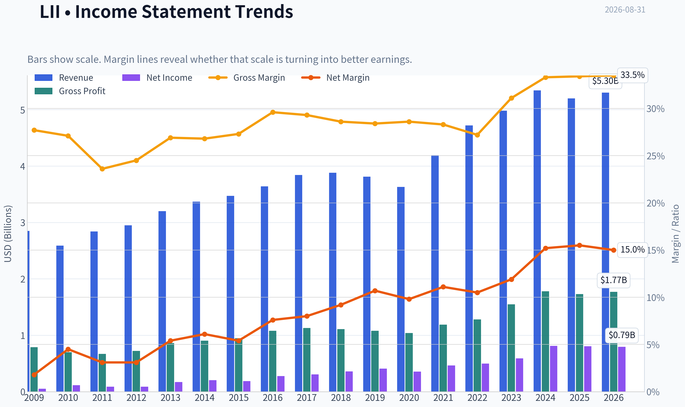

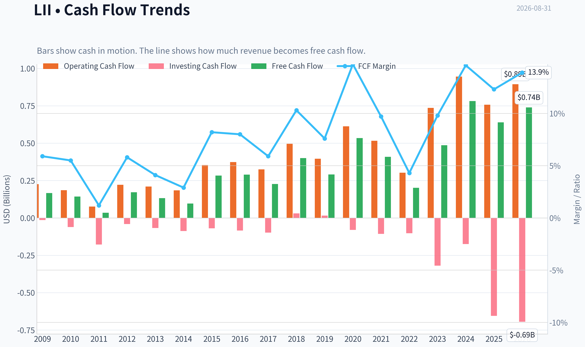

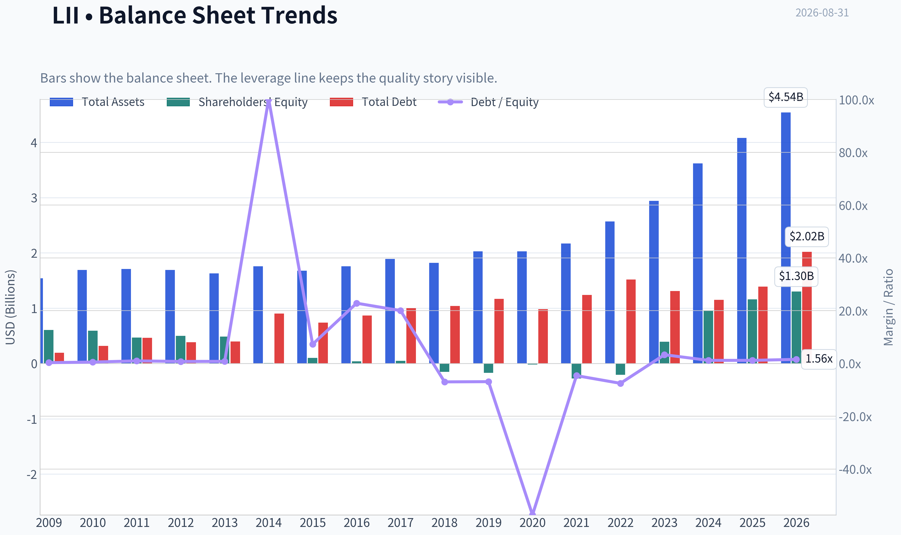

This graph tracks the profitability and return metrics (ROE, ROIC, Margins) of **LII** over the past decade, highlighting capital efficiency trends.

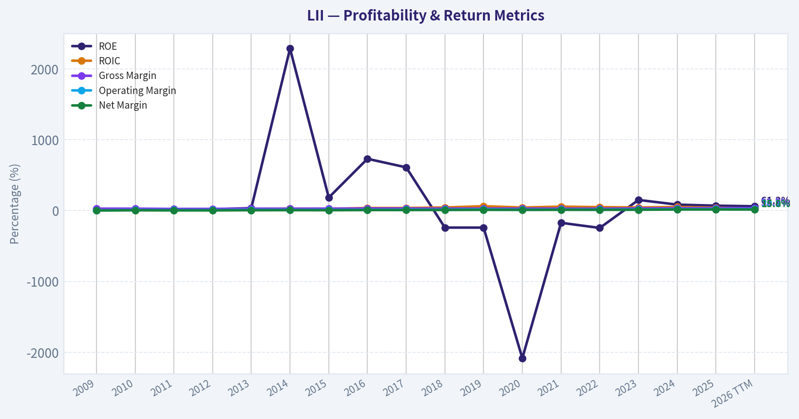

This chart illustrates the financial health of **LII** over the last 10 years, mapping cash equivalents and free cash flow against total obligations (Debt).

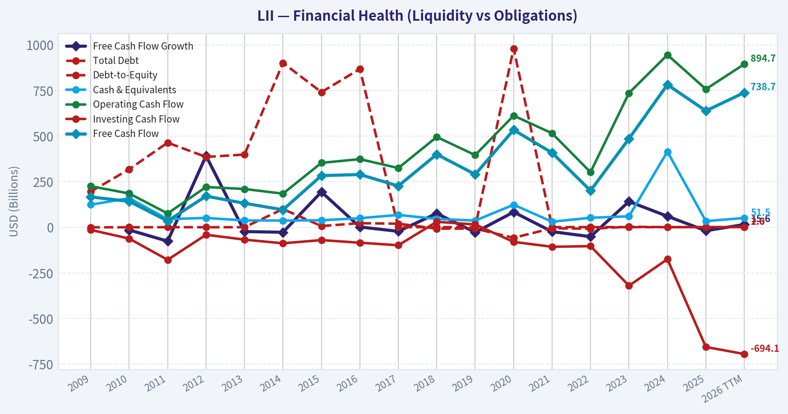

---

### Intrinsic Value Analysis (Buffett)

> *Following Warren Buffett's value investing philosophy: Circle of Competence, Economic Moat, Management Quality, and Margin of Safety.*

#### Intrinsic Value Snapshot

Price is what you pay. Intrinsic value is what the business may be worth based on the cash it can create for owners over time. We show a range, not one magic number.

- Current Price: $383.62
- Value Range (conservative to optimistic across both DCF methods): $43.70 to $1,932.00

##### Owner Earnings (Buffett Method)
- Net Income: $805,800,000.00
- Depreciation & Amortization: $112,500,000.00
- Capital Expenditures: $-118,800,000.00
- Working Capital Changes: $-212,200,000.00
- Owner Earnings: $1,018,000,000.00

##### Intrinsic Value
###### Buffett Method
Uses owner earnings. Stricter, and usually more conservative.
- Conservative: $174.51
- Average: $574.26
- Optimistic: $813.95
- Discount Rate: 10.0%

###### Cash Flow Method
Uses free cash flow. Better for companies spending heavily today to grow tomorrow.
- Conservative: $43.70
- Average: $307.71
- Optimistic: $1,932.00
- Discount Rate: 10.0%

ANALYST STANCE: **WATCH**

#### Lennox International (LII) - Buffett-Style Value Investment Review

Lennox is a high-quality HVAC manufacturer with strong capital returns, a recognizable brand, rational industry structure, and a long replacement-demand runway. The business is understandable and cash-generative, but the current price of about **$384** sits almost exactly on the headline intrinsic value estimate of **$385.45**, leaving little margin of safety. For a wonderful business, fair value can be acceptable, but Lennox's cyclicality and near-term residential softness make this a **WATCH**, not yet a high-conviction purchase.

---

#### 1. Factor Scorecard

| Factor | Score | Evidence |
|---|---:|---|
| Circle of Competence & Business Simplicity | 4.0 / 5 | Lennox sells HVAC equipment and related services into residential and commercial markets. The model is understandable: manufacture branded heating, ventilation, air-conditioning, and refrigeration products, then sell through dealer/distribution channels. Demand is supported by replacement cycles, energy efficiency regulation, and climate-control needs. |
| Moat Test | 3.5 / 5 | Brand, dealer relationships, product reliability, and scale support a meaningful moat. However, the HVAC market remains competitive, with Carrier, Trane, Daikin, Johnson Controls, and others. Gross margin of **33.4%** is good for an industrial manufacturer but below the 40% level often seen in very wide-moat asset-light companies. |
| Management Quality & Capital Allocation | 4.0 / 5 | Lennox shows strong evidence of disciplined capital allocation through high ROIC, strong ROE, and reliable cash flow. Recent coverage highlights **32% ROIC**, low debt, and quality-screen characteristics. |
| Industry Structure | 3.5 / 5 | HVAC has durable replacement demand and a rational set of large competitors, but residential demand is cyclical and tied partly to housing, weather, rates, and consumer spending. Capital intensity appears acceptable because returns on capital are high. |
| Gate 5: Quality / Solvency Hard Floor | Not tripped | There is no evidence of financial distress. Lennox has strong profitability, positive free cash flow, high ROIC, and low-debt characteristics. Revenue is currently soft, but solvency is not a red flag. |

**Key Takeaways:** Lennox is a simple, durable, high-return industrial compounder. The business is not risk-free because HVAC demand can be cyclical and competition is real, but the company's brand, dealer network, and capital discipline give it above-average quality. The hard solvency floor is clearly not triggered.

---

#### 2. Moat Analysis

| Moat Source | Assessment | Evidence |
|---|---|---|
| Brand / Intangibles | Moderate to strong | Lennox has a well-known HVAC brand associated with reliability, efficiency, and dealer support. HVAC buyers and installers value trusted brands because product failure is costly and inconvenient. |
| Switching Costs | Moderate | End customers do not face software-like switching costs, but contractors and dealers can become embedded in a manufacturer's ecosystem through training, parts availability, installation familiarity, and service relationships. |
| Cost Advantage | Moderate | Scale in manufacturing, distribution, procurement, and dealer support helps Lennox compete effectively, though large peers also have scale. |
| Network Effects | Limited | Lennox does not have a classic network effect, but a larger installed base supports parts, servicing, dealer familiarity, and brand reinforcement. |
| Pricing Power | Moderate | The company likely has some ability to raise prices due to brand and replacement urgency, but HVAC remains a competitive durable-goods market. |
| Moat Rating | Narrow-to-Strong / Stable | High ROIC and strong cash conversion support real economic advantage, but competition and cyclicality prevent a "wide and widening" rating. |

**Key Takeaways:** Lennox has a real moat, but it is not impregnable. The moat comes mostly from brand, distribution, dealer relationships, and product reliability rather than patents or network effects. The strongest financial proof is the company's high ROIC, not its gross margin.

---

#### 3. Management Quality Assessment

| Area | Assessment |
|---|---|
| Owner Orientation | Positive. Strong capital returns and disciplined balance-sheet signals suggest management is focused on shareholder value. |
| Candor & Accounting | No major red flags are evident from the available financial profile. Cash flow appears to support reported earnings. |
| Capital Allocation | Strong. High ROIC, high ROE, and positive free cash flow suggest retained capital has historically been productive. |
| Debt Discipline | Positive. Recent quality-screen coverage highlights low debt and reliable cash flow. |
| Shareholder Value Creation | Strong but valuation-dependent. Lennox appears to be a good business, but today's price already reflects much of that quality. |

**Key Takeaways:** Management appears to have allocated capital well, as shown by strong returns on invested capital and equity. For Buffett-style investing, this matters because retained earnings only create value when reinvested at high rates. Lennox passes this test well.

---

#### 4. Financial Summary Table

| Metric | Current / Recent Figure | Buffett-Style Interpretation |
|---|---:|---|
| Current Price | **$384** | Close to estimated intrinsic value; not obviously cheap. |
| Market Cap | **$13.26B** | Mid-to-large industrial compounder scale. |
| P/E Ratio | **17.0x** | Reasonable absolute multiple for a quality business. |
| ROE | **69.3%** | Very strong, though should be assessed alongside leverage and capital structure. |
| ROIC | **~32%** | Excellent; indicates meaningful value creation above cost of capital. |
| Gross Margin | **33.4%** | Solid for an industrial manufacturer, though not software-like. |
| Revenue Growth YoY | **-2.7%** | Near-term demand softness, likely tied to residential/HVAC cycle. |
| FCF Yield | **4.8%** | Decent but not a bargain yield. |
| Current Ratio | **1.60x** | Adequate liquidity. |
| Headline Intrinsic Value | **$385.45** | Essentially equal to current price. |
| Headline Margin of Safety | **0.5%** | Too thin for a cyclical industrial, even a high-quality one. |
| Reverse-DCF Implied Growth | **~9.0% / year for 10 years** | Achievable but not conservative; leaves limited room for disappointment. |
| Trailing 3-Year Growth | **10.0%** | Supports the implied growth case. |
| Trailing 5-Year Growth | **29.7%** | Very strong, but likely not repeatable indefinitely. |

**Key Takeaways:** Lennox has excellent profitability and capital returns, with ROIC around 32% and ROE near 69%. The weakness is not business quality; it is valuation. The stock trades almost exactly at estimated intrinsic value, so buyers today are paying a fair price, not a discounted price.

---

#### 5. Owner Earnings Calculation

Using free cash flow as a practical proxy for owner earnings:

| Item | Estimate |
|---|---:|
| Market Cap | **$13.26B** |
| FCF Yield | **4.8%** |
| Estimated Free Cash Flow / Owner Earnings | **~$636M** |
| Implied Shares Outstanding | **~34.5M** |
| Owner Earnings per Share | **~$18.43** |

**Key Takeaways:** Lennox appears to produce roughly **$636 million** of annual owner earnings, or about **$18.43 per share**, based on the current free cash flow yield. That is a respectable cash yield, but at a $384 share price, investors are paying about **20.8x owner earnings**. This is acceptable for a high-quality compounder, but not a bargain.

---

#### 6. Three-Scenario DCF Valuation

Assumptions:
- Starting owner earnings per share: **$18.43**
- Discount rate: **10%**
- Conservative terminal growth where applicable: **3%**

| Scenario | Key Assumption | Estimated Value per Share |
|---|---|---:|
| A. No Growth | Owner earnings capitalized at 10% | **~$184** |
| B. GDP Growth | Owner earnings grow perpetually at 3% | **~$271** |
| C. Historical Growth Haircut | 7.5% growth for 10 years, then 3% terminal growth | **~$378** |
| Headline Blended Intrinsic Value | Business-model-routed valuation blend | **$385.45** |
| Three-Model Spread | Owner Earnings / FCF / Damodaran FCFF | **$574 / $308 / $212** |

**Key Takeaways:** The valuation range is wide because a small change in long-term growth assumptions has a large effect on value. A conservative GDP-growth case produces a value well below the current price, while a higher-growth compounder case supports a value near today's price. The market is already assuming Lennox remains a strong long-term compounder.

---

#### 7. Margin of Safety Analysis

| Valuation Reference | Value | Margin of Safety vs. $384 Price |
|---|---:|---:|
| No-Growth DCF | **~$184** | Negative |
| GDP-Growth DCF | **~$271** | Negative |
| Historical-Growth Haircut DCF | **~$378** | Slightly negative |
| Headline Intrinsic Value | **$385.45** | **~0.5% positive** |
| Owner-Earnings Model | **$574.26** | Positive |
| FCF Model | **$307.71** | Negative |
| Damodaran FCFF Model | **$211.84** | Negative |

**Key Takeaways:** Lennox is not obviously overvalued, but it is also not clearly undervalued. The headline margin of safety is only about half of one percent, which is too thin for a business exposed to housing cycles and equipment demand swings. A more attractive entry point would require either a lower stock price or evidence that high-single-digit growth is highly durable.

---

#### 8. Final Buffett Scorecard

| Criterion | Weight | Score | Weighted Score |
|---|---:|---:|---:|
| Moat Width & Durability | 25% | 3.5 | 0.88 |
| Valuation / Margin of Safety | 20% | 2.5 | 0.50 |
| Capital Returns - ROIC vs. WACC | 15% | 4.5 | 0.68 |
| Business Understanding & Predictability | 12% | 4.0 | 0.48 |
| Management Quality & Capital Allocation | 12% | 4.0 | 0.48 |
| Reinvestment Runway | 8% | 3.5 | 0.28 |
| Balance Sheet Strength | 4% | 4.0 | 0.16 |
| Industry Structure | 4% | 3.5 | 0.14 |
| **Total Score** | **100%** |  | **3.59 / 5.00** |

**Key Takeaways:** Lennox scores well on quality, returns on capital, management, and business understandability. The major drag is valuation, because the stock price already approximates intrinsic value. The final score lands in the lower end of the "good business" zone, but the thin margin of safety argues for patience.

---

#### 9. Investment Stance

| Stance | Conviction | Rationale |
|---|---|---|
| **WATCH** | Medium | Lennox is a high-quality HVAC compounder with excellent ROIC, strong cash generation, and a durable replacement-demand runway. However, the stock trades near intrinsic value, with only **~0.5%** headline margin of safety. The price implies roughly **9% annual growth for 10 years**, which is plausible but not conservative. |

**Final View:** Lennox is the kind of business worth owning at the right price, but the current quotation does not offer enough margin of safety. I would become more constructive on a pullback that creates at least a mid-teens discount to intrinsic value, or if fundamentals reaccelerate enough to make the current price look clearly conservative.
#### Valuation Bridge

This bridge places the current market price beside each intrinsic value lens so readers can see whether upside depends on one method or shows up across several methods.

| Scenario | Intrinsic Value / Share |
| --- | ---: |
| Buffett Method | $574.26 |
| Cash Flow Method | $307.71 |
| Damodaran Method | $211.84 |
| Current Price | $383.62 |

#### Key Takeaways

If one method is far above the others, the upside case depends on a specific modelling assumption. When several methods cluster together, the valuation story is more robust.

#### Valuation Visuals

This comparison chart from *Latest Earnings Snapshot* stacks current figures against historical benchmarks for **LII**, making it easy to see where the company trades relative to its own averages.

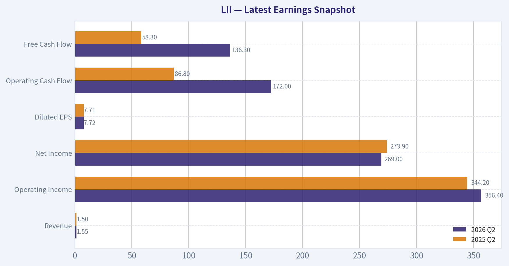

This comparison chart from *Current vs. 10-Year Average Comparison* stacks current figures against historical benchmarks for **LII**, making it easy to see where the company trades relative to its own averages.

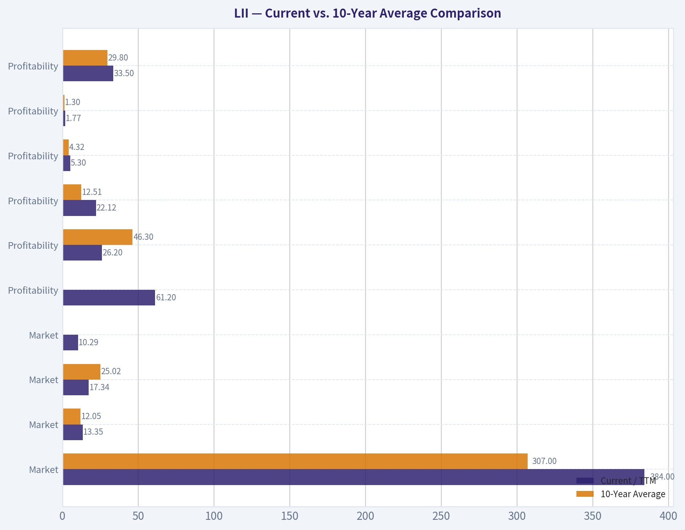

This comparison chart from *Financial Summary Table* stacks current figures against historical benchmarks for **LII**, making it easy to see where the company trades relative to its own averages.

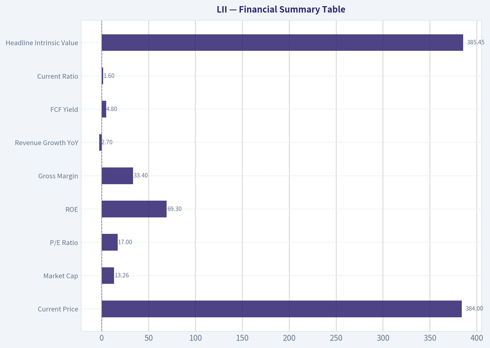

This comparison chart from *Owner Earnings Calculation* stacks current figures against historical benchmarks for **LII**, making it easy to see where the company trades relative to its own averages.

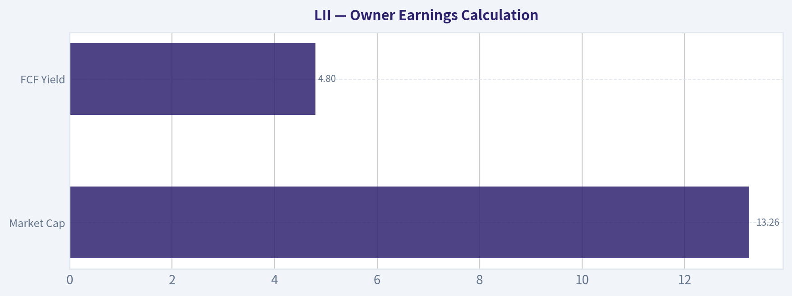

This comparison chart from *Margin of Safety Analysis* stacks current figures against historical benchmarks for **LII**, making it easy to see where the company trades relative to its own averages.

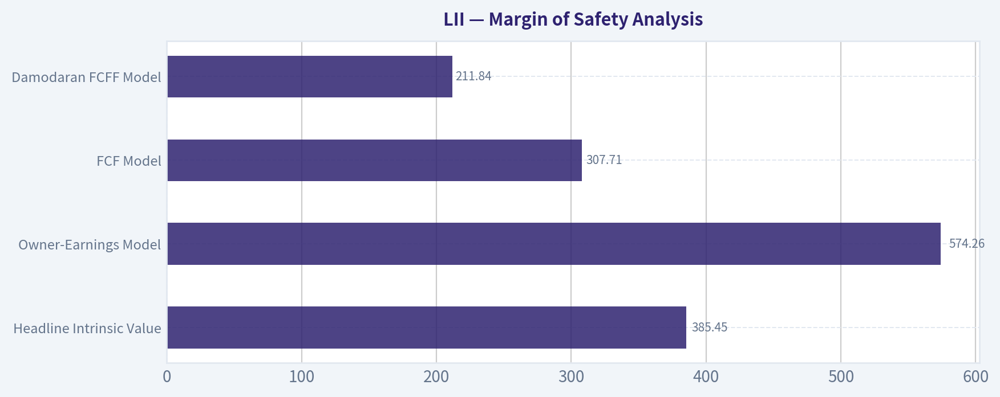

---

### Trend & Growth Analysis (Lynch/Druckenmiller/Fisher)

> *Following Peter Lynch's GARP, Stanley Druckenmiller's macro-aware approach, and Philip Fisher's scuttlebutt methodology.*

ANALYST STANCE: **WATCH**

#### LII Growth Investment Snapshot

| Item | Assessment |
|---|---:|
| Company | Lennox International Inc. |
| Business | HVAC equipment and climate-control systems, primarily residential and light commercial |
| Current Price | ~$384 |
| Market Cap | ~$13.26B |
| P/E | ~17.0x |
| Revenue Growth YoY | -2.7% |
| Gross Margin | 33.4% |
| ROE | 69.3% |
| FCF Yield | 4.8% |
| Headline Intrinsic Value | ~$385.45 |
| Margin of Safety | ~0.5% |
| Lynch Category | Stalwart / cyclical compounder, not a true fast grower |
| Growth Stance | WATCH |

**Key Takeaways:** Lennox is a high-quality HVAC compounder with strong returns on capital and solid free cash flow, but current revenue growth is negative and residential HVAC demand has softened. The valuation looks roughly fair versus the shared intrinsic value estimate, leaving little margin of safety. This is a good business, but not currently a classic Lynch-style fast grower.

---

#### 1. Lynch Classification

| Lynch Category | Fit for LII | Rationale |
|---|---|---|
| Slow Grower | Partial | Current revenue growth is negative, but this likely reflects cyclical softness rather than structural decline. |
| Stalwart | Strong fit | Large, established, cash-generative industrial with durable brand and replacement-demand exposure. |
| Fast Grower | Weak fit | Does not currently show 15-25%+ revenue growth or clear multi-year acceleration. |
| Cyclical | Moderate fit | HVAC demand is tied to housing, consumer spending, interest rates, and replacement cycles. |
| Turnaround | No | Business quality remains strong; not a distressed turnaround. |
| Asset Play | No | Value is in earnings power, brand, distribution, and installed base, not hidden assets. |

**Key Takeaways:** LII is best classified as a stalwart with cyclical elements. It is a durable compounder, but not a fast grower at today's growth rate. For a Lynch-style growth mandate, that makes it more of a watch-list name than a high-conviction ten-bagger candidate.

#### 2. The Story in 3 Bullets

- Lennox sells heating, ventilation, air-conditioning, and refrigeration systems that homeowners and businesses need for comfort, energy efficiency, and building operations.
- The company benefits from a recurring replacement cycle: HVAC units wear out, regulations tighten, and customers upgrade to higher-efficiency systems.
- The long-term story is supported by electrification, heat pumps, energy-efficiency standards, hotter weather, and commercial climate-control needs, but near-term demand is pressured by weak residential activity.

#### 3. TAM and 10x Test

| TAM Factor | Estimate / Assessment |
|---|---:|
| Current Revenue Base | Approximately $5B+ annual revenue, based on company scale and market cap context |
| 10x Revenue Target | Approximately $50B+ |
| Global HVAC TAM | Likely $250B-$300B+ and growing mid-single digits |
| North American Core TAM | Much smaller than global TAM; likely tens of billions |
| Can LII 10x and remain below 20% of TAM? | Globally yes, but practically difficult without major geographic/product expansion |
| TAM Growth Quality | Moderate, not hypergrowth |
| Runway Rating | Medium |

**Key Takeaways:** The global HVAC market is large enough to theoretically support a much bigger Lennox, but LII is primarily a North American HVAC player rather than a global land-grab growth company. A 10x revenue outcome would require either substantial share gains, international expansion, major category expansion, or acquisitions. The runway is real, but not obviously ten-bagger-like from today's scale.

#### 4. Revenue Growth Trend

| Metric | Current Read |
|---|---:|
| Reported YoY Revenue Growth | -2.7% |
| Pattern | Decelerating / soft |
| Likely Drivers | Weak residential demand, interest-rate-sensitive housing market, softer discretionary replacement cycle |
| Quality of Revenue | Durable replacement-driven demand, but cyclical timing risk |
| Growth Classification | Below growth-investor threshold |

**Key Takeaways:** Revenue is currently moving in the wrong direction for a growth-stock setup. The softness may be cyclical rather than structural, but the stock does not yet show the revenue acceleration that Druckenmiller-style inflection investing requires. The key watch item is whether demand stabilizes and reaccelerates as rates fall or housing activity improves.

#### 5. Unit Economics and Business Quality

| Metric | LII Read-Through |
|---|---:|
| Gross Margin | 33.4% |
| ROE | 69.3% |
| FCF Yield | 4.8% |
| Current Ratio | 1.60x |
| LTV/CAC | Not applicable / not disclosed; not a SaaS model |
| NRR | Not applicable |
| Rule of 40 | Not applicable |
| ROIC Quality | Reported in coverage as strong, around 32% ROIC |
| Unit Economics Rating | Strong for an industrial manufacturer |

**Key Takeaways:** Lennox does not fit SaaS-style unit-economics metrics, but its industrial economics appear strong. High ROE, strong free cash flow, and attractive ROIC suggest a quality business with pricing power and disciplined operations. The issue is not unit economics; the issue is growth velocity.

---

#### 6. Inflection Point Assessment

| Potential Inflection | Evidence | Current Verdict |
|---|---|---|
| Product Cycle | HVAC efficiency upgrades, refrigerant transitions, heat pumps | Positive long term, not yet a clear acceleration signal |
| Market Share | Possible share gains through brand and distribution | Not enough evidence of accelerating share capture |
| Margin Inflection | Strong margins and operating discipline | Already strong; further upside may be incremental |
| TAM Inflection | Electrification, climate resilience, energy efficiency | Supportive but gradual |
| Macro Inflection | Potential benefit from lower rates and housing recovery | Important watch item |
| Competitive Inflection | No clear competitor breakdown identified | Neutral |

**Key Takeaways:** LII has several possible long-term tailwinds, especially energy efficiency and HVAC replacement demand, but no obvious near-term inflection point is confirmed. The most important catalyst would be a turn in residential HVAC demand as rates decline and housing activity recovers. Until revenue growth reaccelerates, this remains a quality watch-list name rather than an advocate position.

#### 7. Macro Setup

| Macro Factor | Impact on LII |
|---|---|
| Interest Rates | Lower rates would help housing turnover, renovation, and replacement demand. |
| Housing Cycle | Weak housing activity is a headwind for residential HVAC volumes. |
| Climate / Weather | Hotter summers and extreme temperatures support replacement urgency. |
| Energy Efficiency Regulation | Supports premiumization and replacement demand. |
| Secular Themes | Energy efficiency, electrification, heat pumps, building modernization. |
| Macro Grade | Mixed, with potential to improve if rates fall. |

**Key Takeaways:** The macro backdrop is not ideal today because HVAC demand is sensitive to housing and consumer confidence. However, a falling-rate cycle could create a meaningful cyclical improvement. LII is a name to watch closely if housing data, HVAC orders, and management guidance begin improving together.

#### 8. Fisher 15-Point Score

| Fisher Point | Score / 5 | Comment |
|---|---:|---|
| Market potential | 4 | HVAC is essential with long replacement runway. |
| New product development | 4 | Efficiency, refrigerants, heat pumps support innovation. |
| R&D effectiveness | 3 | Solid, but not a breakthrough innovation story. |
| Sales organization | 4 | Strong channel and brand presence. |
| Profit margin | 4 | Healthy industrial margins. |
| Margin improvement | 3 | Margins strong, but upside may be incremental. |
| Labor/personnel relations | 3 | No major issue identified from available data. |
| Executive relations | 3 | No major issue identified. |
| Management depth | 3 | Appears stable, but not deeply assessed. |
| Cost/accounting discipline | 4 | Strong cash generation and returns suggest discipline. |
| Competitive advantages | 4 | Brand, installed base, distribution, replacement demand. |
| Long-range profit outlook | 4 | Good, though cyclical. |
| Dilution risk | 4 | No major dilution concern apparent. |
| Candor in difficulties | 3 | Guidance reductions require monitoring. |
| Integrity | 3 | No red flags identified from available data. |
| **Total** | **53 / 75** | Average to good, but not outstanding. |

**Key Takeaways:** Fisher analysis gives LII credit for quality, brand strength, cash generation, and long-term market relevance. The score is held back by limited evidence of breakthrough innovation, uncertain near-term growth, and a lack of clear inflection. This is a good business, but not yet an outstanding growth setup.

---

#### 9. Valuation Analysis

| Valuation Metric | Current Read | Interpretation |
|---|---:|---|
| P/E | ~17.0x | Reasonable for a quality industrial compounder. |
| FCF Yield | 4.8% | Solid, but not deeply cheap. |
| Headline Intrinsic Value | ~$385.45 | Roughly equal to current price. |
| Margin of Safety | ~0.5% | Essentially none. |
| Reverse DCF Implied Growth | ~9.0% per year for 10 years | Fair but not undemanding. |
| 3-Model Value Range | ~$211.84 to ~$574.26 | Wide spread; valuation depends heavily on growth and margin assumptions. |
| PEG | ~1.7-1.9x using 9-10% growth proxy | Fair to moderately expensive for current growth softness. |

**Key Takeaways:** LII is not obviously overvalued, but it is also not cheap enough to compensate for weak current revenue growth. The headline fair value is almost exactly in line with the current price. For a growth investor, the setup needs either a better entry price or visible acceleration in revenue and earnings.

#### 10. Scenario View

| Scenario | Assumptions | Implied View |
|---|---|---|
| Bear Case | Residential HVAC remains weak, revenue growth stays flat to negative, margins normalize | Stock could derate toward lower industrial multiples. |
| Base Case | Demand stabilizes, modest growth resumes, margins remain strong | Fair-value compounder with mid-single to high-single-digit return potential. |
| Bull Case | Rate cuts revive housing, replacement cycle accelerates, efficiency upgrades drive mix, margins expand | Upside possible, but likely not a ten-bagger from current scale. |

**Key Takeaways:** The base case is that Lennox remains a strong but moderate-growth compounder. The bull case requires a macro-driven housing and replacement-cycle recovery. Even in a favorable scenario, the company's size and mature end market make a ten-bagger outcome unlikely.

#### 11. Growth Investor Scorecard

| Criterion | Weight | Score / 5 | Weighted Score |
|---|---:|---:|---:|
| The Story | 10% | 3.5 | 0.35 |
| TAM & Runway | 20% | 3.0 | 0.60 |
| Revenue Growth | 20% | 2.0 | 0.40 |
| Unit Economics | 15% | 4.0 | 0.60 |
| Competitive Position | 10% | 4.0 | 0.40 |
| Management Quality | 10% | 3.5 | 0.35 |
| Macro Setup | 5% | 3.0 | 0.15 |
| Profitability Path | 5% | 4.0 | 0.20 |
| Valuation | 5% | 3.0 | 0.15 |
| **Total** | **100%** |  | **3.20 / 5.00** |

**Key Takeaways:** LII scores well on quality, profitability, and competitive position, but poorly on current revenue growth. The overall score of 3.2 places it in WATCH territory. The business is investable for quality-compounder portfolios, but it does not yet meet the bar for a growth-investor advocate call.

#### 12. Position Size Stance

| Investor Type | Suggested Action |
|---|---|
| Existing Long-Term Holder | Hold / watch for reacceleration; do not force a sale solely on one soft period. |
| New Growth Investor | Wait for better growth evidence or a larger valuation discount. |
| Quality Compounder Investor | Could be considered on pullbacks, especially if FCF yield improves. |
| Aggressive Ten-Bagger Investor | Pass for now; not enough growth velocity. |
| Position Size | 0% new position for pure growth mandate; small watch-list candidate for quality portfolios. |

**Key Takeaways:** For a growth-focused portfolio, LII is not a fresh buy today. Existing holders can justify patience because the business quality is high. New buyers should wait for either a cheaper price or confirmed revenue acceleration.

#### 13. Key Catalysts and Risks

| Catalysts | Risks |
|---|---|
| Falling interest rates revive housing and HVAC replacement demand. | Prolonged housing weakness keeps revenue flat or negative. |
| Heat pump adoption and electrification increase premium system demand. | Consumers defer expensive HVAC replacements in a weak economy. |
| Energy-efficiency regulation supports higher-value product mix. | Margin pressure from input costs, channel pricing, or mix. |
| Commercial HVAC demand remains resilient. | Valuation already reflects much of the quality story. |
| Operating leverage returns if volume recovers. | Reduced guidance or further estimate cuts could pressure the stock. |
| Guru interest: Point72 reportedly added materially in latest 13F. | 13F data is lagged and not a real-time buy signal. |

**Key Takeaways:** The upside case depends on a cyclical demand recovery and continued premiumization of HVAC systems. The downside case is that residential weakness lasts longer than expected and the market stops paying a quality multiple. The stock deserves monitoring, but the inflection is not yet visible.

#### Final View

Lennox is a high-quality industrial compounder with strong returns, durable replacement demand, and exposure to energy efficiency and electrification. However, current revenue growth is negative, valuation is close to fair value, and the company lacks the acceleration profile preferred by Lynch, Druckenmiller, and Fisher-style growth investing.

**Verdict: WATCH.** Revisit if revenue growth turns positive, guidance stabilizes, residential HVAC demand improves, or the stock offers a more meaningful margin of safety.

#### Growth & Scorecard Visuals

This comparison chart from *Growth Analysis* stacks current figures against historical benchmarks for **LII**, making it easy to see where the company trades relative to its own averages.

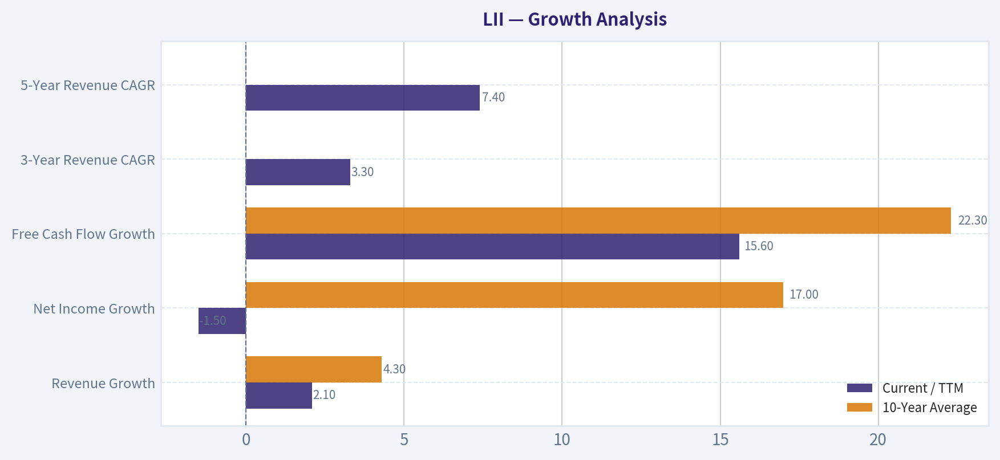

---

### Market Technical Analysis

ANALYST STANCE: **WATCH**

#### LII Technical Market Report - Lennox International Inc.
**Latest available trading data:** August 28, 2026
**Latest close:** **$393.39**
**Context:** LII has suffered a sharp technical breakdown after a late-July gap-down and remains in a damaged downtrend. The stock is oversold-adjacent, but not yet showing enough confirmation for a high-confidence bullish reversal.

---

#### Selected Indicators and Why They Matter

| Indicator | Role in This Market | Why It Is Relevant for LII Now |
|---|---:|---|
| `close_10_ema` | Short-term trend / tactical momentum | Helps judge whether the stock is stabilizing after the selloff. LII remains below this level, showing weak near-term control. |
| `close_50_sma` | Medium-term trend | Measures whether the prior trend structure is intact. LII is deeply below it, confirming a major trend break. |
| `close_200_sma` | Long-term trend benchmark | Important for institutional trend confirmation. LII is also below this, which shifts the longer-term technical bias bearish. |
| `macd` | Momentum shift detection | Useful for spotting whether bearish momentum is fading. MACD remains negative, though downside momentum appears to be improving slightly. |
| `rsi` | Oversold / momentum exhaustion | LII is near oversold territory, suggesting downside may be stretched, but RSI has not produced a strong reversal signal. |
| `atr` | Volatility / risk sizing | The late-July collapse created elevated volatility. ATR helps define realistic stop placement and position sizing. |
| `boll_lb` | Downside volatility band | Useful because LII has been trading near the lower part of its recent range. It helps assess whether price is stretched below normal volatility. |
| `vwma` | Volume-confirmed trend | Important because the July selloff occurred on very heavy volume. VWMA shows whether buyers are reclaiming volume-weighted control. |

**Key Takeaways:**
The selected indicators are intentionally diversified: trend, momentum, volatility, and volume are all represented. LII's setup is dominated by a broken trend structure, with only tentative evidence that selling pressure may be slowing. This favors patience rather than aggressive bottom-fishing.

---

#### Price Structure and Trend Damage

| Metric | Approximate Value / Observation | Technical Interpretation |
|---|---:|---|
| Latest close | **$393.39** | Price remains near recent lows and has not reclaimed short-term trend levels. |
| Late-July breakdown | From **$544.11 on Jul. 28** to **$430.02 on Jul. 29** | A one-day collapse of roughly **21%**, signaling a major repricing event. |
| Latest price vs. Jul. 28 pre-breakdown close | About **-27.7%** | The stock has not materially repaired the damage from the gap-down. |
| Latest price vs. 2026 summer highs | Roughly **30%+ below** | A major loss of trend leadership and investor confidence. |
| Recent low zone | **$387-$389** | Immediate support area; a break below this zone would confirm renewed downside pressure. |
| Initial resistance | **$402-$420** | Includes the 10 EMA, 20-day mean area, and short-term congestion. |
| Higher resistance | **$430-$447** | Post-gap rebound zone; reclaiming this would be the first meaningful improvement. |

**Key Takeaways:**
LII's chart is technically damaged because the late-July gap-down was large, high-volume, and followed by continued lower prices. The stock is now trying to stabilize near the high-$380s to low-$390s, but it has not yet reclaimed even modest resistance. Traders should treat rallies into $402-$420 as tests of selling pressure unless price can hold above that zone.

---

#### Indicator Snapshot

| Indicator | Approximate Current Reading | Signal |
|---|---:|---|
| 10-day EMA | **~$402.6** | Bearish while price remains below it. |
| 50-day SMA | **~$488.8** | Strongly bearish; price is about **19-20% below** this level. |
| 200-day SMA | **~$498.6** | Bearish long-term trend confirmation; price is about **21% below** this level. |
| MACD | **~ -27** | Still bearish, though momentum deterioration appears to be slowing. |
| RSI | **~32** | Near oversold, but not yet a confirmed bullish reversal. |
| 14-day ATR | **~$11.7** | Daily volatility remains meaningful, around **3% of price**. |
| Bollinger Lower Band | **~$380-$381** | Price is above the lower band, suggesting not deeply stretched at the latest close. |
| 20-day VWMA | **~$420** | Price remains below volume-weighted trend, confirming sellers retain control. |

**Key Takeaways:**
The strongest message comes from trend indicators: LII is below its 10-day, 50-day, and 200-day averages. RSI is close to oversold, but oversold conditions alone are not enough to justify a bullish stance when price remains below VWMA and major moving averages. MACD improvement is worth watching, but it is still happening from a deeply negative base.

---

#### Momentum Analysis

LII's momentum remains negative, but the rate of downside pressure may be starting to ease. The estimated MACD line remains below zero, which confirms that medium-term momentum is still bearish. However, the MACD histogram appears to be improving slightly, suggesting sellers may be losing some incremental force after the initial post-gap liquidation.

RSI near **32** supports the idea that the stock is close to oversold territory. Importantly, RSI has not yet produced a strong reversal signal such as a sustained move back above 40-45, nor has price reclaimed the 10-day EMA. This means the current setup is better described as **potential exhaustion**, not confirmed recovery.

---

#### Volatility and Risk

The 14-day ATR near **$11.7** implies that normal daily movement remains wide. For a $393 stock, this is approximately **3% daily trading range volatility**, which is high enough that tight stops are likely to be vulnerable to noise. The late-July selloff also makes gap risk unusually important.

A trader considering a tactical long should recognize that a stop just below the recent low near **$387** may be too tight unless the entry is very precise. A more conservative approach would require confirmation first - for example, a close above the 10 EMA near **$402-$403**, followed by a hold above the **$417-$420** area.

---

#### Support and Resistance Map

| Zone | Level / Range | Importance | Trading Implication |
|---|---:|---|---|
| Immediate support | **$387-$389** | Recent low / breakdown support | A decisive break would likely invite another downside leg. |
| Volatility support | **~$380-$381** | Bollinger lower band | Could attract mean-reversion buyers, but should not be treated as hard support. |
| Short-term pivot | **~$402-$403** | 10-day EMA | First level bulls need to reclaim. |
| Volume-weighted resistance | **~$417-$420** | 20-day mean / VWMA region | A key test of whether buyers can overcome recent volume-weighted supply. |
| Rebound resistance | **$430-$447** | Early-August bounce area | A move above this zone would materially improve the short-term chart. |
| Major overhead supply | **$489-$499** | 50-day and 200-day averages | Long-term trend remains impaired below this band. |

**Key Takeaways:**
The most important near-term battle is between support around $387-$389 and resistance around $402-$420. If LII cannot reclaim $402-$420, rallies are likely to remain vulnerable. A move above $430-$447 would be the first sign that the post-gap downtrend is losing control.

---

#### Trading View

| Trader Type | Current Bias | Practical Plan |
|---|---|---|
| Short-term traders | Neutral-to-bearish, but watch for bounce | Consider waiting for a close above **$402-$403** before treating the stock as a tactical rebound candidate. |
| Swing traders | Cautious / no confirmation yet | A stronger setup would require a reclaim of **$417-$420**, preferably with improving volume. |
| Long-only investors | Avoid aggressive entries for now | The stock remains below both the 50-day and 200-day averages, signaling major trend damage. |
| Existing holders | Risk-management focus | Monitor the **$387-$389** support zone closely; a break could trigger another technical sell signal. |

**Key Takeaways:**
LII is not technically attractive enough for an outright bullish call yet. The best approach is to watch for confirmation rather than anticipate a bottom. A reclaim of $402, then $420, would improve the picture, while a break below $387 would keep the bearish trend firmly intact.

---

#### Bottom Line

LII remains in a **bearish technical structure** after a severe late-July breakdown. The stock is near oversold levels, and downside momentum may be beginning to slow, but price has not yet reclaimed enough trend or volume-based resistance to confirm a durable reversal.

**Stance: WATCH.**
Avoid chasing weakness blindly, but also avoid assuming the bottom is in. The key bullish trigger is a sustained move back above **$402-$420**; the key bearish trigger is a break below **$387-$389**.

---

### Options Market Analysis

> *Reading options flow - put/call ratios, IV skew, and unusual activity - to gauge institutional positioning and event-driven risk.*

#### LII Options Flow Report - As of 2026-08-31

LII options positioning leans **BEARISH**, primarily because put open interest and put volume are elevated versus calls across the available near-term expirations. That said, the signal has **low-to-moderate confidence** because total options activity is relatively thin, there is no major unusual-options print, and the available IV data shows calls carrying higher ATM implied volatility than puts, which partially offsets the bearish put/call read.

---

#### 1. Put/Call Ratio Analysis

| Expiration | Call OI | Put OI | Put/Call OI Ratio | Call Volume | Put Volume | Put/Call Volume Ratio | Interpretation |
|---|---:|---:|---:|---:|---:|---:|---|
| 2026-09-18 | 315 | 277 | 0.88 | 66 | 66 | 1.00 | Slightly above neutral; balanced volume |
| 2026-10-16 | 30 | 25 | 0.83 | 8 | 11 | 1.38 | Slight put tilt, but very thin |
| 2026-12-18 | 306 | 579 | 1.89 | 162 | 321 | 1.98 | Clear put-heavy positioning |
| **Total Near-Term** | **651** | **881** | **1.35** | **236** | **398** | **1.69** | **Bearish / hedging bias** |

**Key Takeaways:** LII's aggregate put/call OI ratio of **1.35** is meaningfully above the historical neutral baseline of roughly **0.7**, indicating heavier downside protection or bearish positioning. The put/call volume ratio of **1.69** also shows recent flow favoring puts. The strongest bearish concentration is in the **December 2026** expiration, where puts outnumber calls by nearly 2-to-1.

Relative to the neutral baseline, this is a notable shift toward downside positioning. However, put-heavy activity can represent either outright bearish bets or institutional hedging against existing long equity exposure.

---

#### 2. Implied Volatility Assessment

| Expiration | ATM Call IV | ATM Put IV | IV Read | Skew Interpretation |
|---|---:|---:|---|---|
| 2026-09-18 | 40.2% | 32.0% | Moderately elevated | Calls richer than puts |
| 2026-10-16 | 42.1% | 34.4% | Moderately elevated | Calls richer than puts |
| 2026-12-18 | 42.0% | 35.2% | Moderately elevated | Calls richer than puts |

**Key Takeaways:** ATM implied volatility is in the low-30s to low-40s, with **calls consistently priced richer than puts** across the listed expirations. That is not the typical downside-fear pattern, where OTM or ATM puts trade at a meaningful IV premium. The IV picture therefore tempers the bearish put/call signal and suggests some upside demand or call-side premium selling dynamics may also be present.

The available data does **not** provide full OTM put-versus-OTM call skew by strike, so the skew assessment is limited. Based only on ATM IV, there is **no clear steep put skew** signaling acute crash protection demand. No specific catalyst is identified in the provided options feed, though October/December expiries may still reflect positioning around future earnings or macro-sensitive industrial/HVAC demand expectations.

---

#### 3. Unusual Options Activity

| Unusual Activity Screen | Result |
|---|---|
| Contracts with volume greater than 5x open interest | None found |
| Fresh directional bets identified | None |
| Likely institutional sweep/block activity | Not evident from available data |
| Retail-speculative activity | Not evident from available data |

**Key Takeaways:** There were **no contracts where volume exceeded open interest by more than 5x**, so there is no clear evidence of fresh aggressive directional positioning. The bearish signal is therefore driven more by aggregate put-heavy positioning than by a standout institutional trade. This reduces conviction because there is no obvious "smart-money" catalyst trade in the chain.

The lack of unusual activity also suggests the current options market is not screaming event risk. Instead, the flow looks more like steady protection or cautious positioning, especially in the December expiration.

---

#### 4. Open Interest Concentration and Gamma Considerations

| Expiration | Total OI | Call OI | Put OI | OI Concentration Read | Potential Price Impact |
|---|---:|---:|---:|---|---|
| 2026-09-18 | 592 | 315 | 277 | Balanced near-term OI | Mild pinning risk, but not enough strike detail |
| 2026-10-16 | 55 | 30 | 25 | Very thin OI | Low signal value |
| 2026-12-18 | 885 | 306 | 579 | Largest OI concentration, put-heavy | Downside hedge concentration may matter into year-end |
| **Total** | **1,532** | **651** | **881** | **Puts dominate aggregate OI** | **Bearish/hedging gravity, but thin overall** |

**Key Takeaways:** The largest open interest concentration is in the **2026-12-18** expiration, and it is clearly put-heavy. That makes December the most important listed maturity for interpreting positioning. However, because strike-level open interest was not provided, specific max-pain levels, pinning strikes, or gamma walls cannot be confidently identified.

Overall options liquidity appears **thin**, especially in October. Low liquidity means small trades can distort ratios, so the options signal should be treated as a **secondary sentiment input**, not a standalone trading thesis.

---

#### 5. Overall Options Sentiment Signal

| Category | Signal |
|---|---|
| Put/Call Ratio | Bearish |
| IV Level | Moderately elevated |
| Skew Direction | Call IV premium at ATM; no confirmed put skew |
| Unusual Activity | Neutral; no major fresh flow detected |
| Open Interest Structure | Bearish/hedging bias, strongest in December |
| **Overall Options Sentiment** | **BEARISH, with low-to-moderate confidence** |

**Key Takeaways:** The strongest message from LII's options chain is the elevated put/call profile, especially the **1.35 aggregate OI ratio** and **1.69 aggregate volume ratio**. That points to downside hedging or bearish positioning. The signal is not aggressively bearish because there is no unusual-options trigger and ATM call IV is higher than ATM put IV.

#### Bottom Line

LII options flow currently points to a **BEARISH** near-to-medium-term sentiment read, driven by put-heavy open interest and put-heavy trading volume. The most important bearish positioning sits in the **December 2026** expiration. However, because activity is relatively thin and there is no standout unusual trade, this should be viewed as a **cautious bearish/hedging signal**, not a high-conviction institutional sell signal.

---

## Research Team Commentary

> *The Research Manager synthesizes the Bull vs Bear debate into action-free commentary. This is a pre-risk view, not the final stance.*

Team, let us break down this debate on Lennox International.

The bull makes a highly compelling case for Lennox as a classic Buffett compounder, highlighting its exceptional 33 percent return on invested capital and the deep switching costs embedded in its pro-led dealer network. The structural tailwinds of electrification, climate trends, and mandatory HVAC replacements certainly give this business a durable, high-quality moat. On the other hand, the bear astutely throws a bucket of cold water on these elite metrics, warning that Lennox might be severely overearning right now due to a combination of post-pandemic pricing power and the recent SEER2 regulatory pull-forward. The bear argues that capitalizing peak margins heading into a residential housing slowdown leaves us with zero margin of safety.

When I evaluate this through our adaptive value investing framework, I have to draw heavily on our recent post-mortem of Badger Meter. In that reflection, we learned a few vital lessons that apply perfectly here. First, we realized we must separate a wonderful business from a wonderful entry point, recognizing that even the highest-quality compounders can re-rate downward when expected growth hits a cyclical speed bump. Second, we learned we must explicitly split our time horizons. A damaged chart with an oversold condition often produces a sharp short-term relief rally, but we cannot mistake that mechanical bounce for a confirmed long-term fundamental all-clear.

Core Takeaway: Lennox is undeniably a premium-quality franchise trading at what appears on the surface to be a reasonable 17 times headline earnings, but the very real risk that current cash flows represent a cyclical peak requires us to exercise patience. While the technical setup suggests a tactical, short-term oversold bounce is highly probable, we need concrete confirmation that margins have found a new structural baseline before committing long-term capital.

Rationale: The central tension in this debate is whether the 18 dollars in owner earnings is a sustainable floor or an inflated cyclical peak. If Lennox can sustainably compound those earnings at 7 to 8 percent, the current price in the 390 dollar range is absolutely a fair price for a wonderful business. However, as the bear correctly pointed out, residential HVAC is ultimately tied to the consumer. If prolonged high interest rates and sluggish housing turnover cause installation volumes to contract, the operating leverage inherent in Lennox's vertically integrated model will work in reverse, and those elite returns on capital will compress. Our Badger Meter experience taught us not to ignore a technical breakdown when it aligns with deteriorating macro realities. We demand a quality-scaled margin of safety, and right now, buying in means trusting that peak margins are permanent despite obvious housing headwinds.

Monitoring Plan: Over the next one to four quarters, we need to closely watch three specific items. First, we must monitor gross margin resilience. We need to see if margins can hold above the 30 percent line as supply chain tailwinds fade and normalized competition returns. Second, we must dissect the volume versus pricing mix in their quarterly reports. We need to confirm that top-line stability isn't just being propped up by aggressive price hikes that are masking deep volume declines in residential replacements. Third, we will watch the technical structure to see if the stock can build a genuine, sustained base of support, rather than just delivering a brief mechanical bounce out of its oversold state.

If Lennox proves its earnings power is durable through this residential slump, the current multiple will prove to be a fantastic entry point. But until the macro dust settles and we can verify the true normalized earnings power of the business, it is better to preserve our capital.

Stance: WATCH

---

## Value Investing Team Commentary

> *The Investor translates the research view into an investment thesis before risk review. This is still not the final stance.*

In evaluating Lennox International Inc. (LII), we find ourselves at the intersection of a "wonderful business" and a "clouded macro environment." Applying the lessons learned from our Badger Meter (BMI) post-mortem, we must strictly distinguish between the durability of the business franchise and the volatility of the current entry point.

### 1. The Business Quality: A Wide-Moat Compounder
Lennox is the quintessential "toll-road" business. With a **Return on Invested Capital (ROIC) of 33.4%** and a **Return on Equity (ROE) of 69.3%**, LII operates with an efficiency that few industrial firms can match. Its moat is built on two pillars:
*   **The Dealer Network:** HVAC is a "pro-led" purchase. Lennox's vertically integrated distribution and deep relationships with dealers create significant switching costs and a localized service moat that Amazon or big-box retailers cannot easily disrupt.
*   **The Regulatory Forced-Upgrade Cycle:** Tightening efficiency standards (SEER2) and the secular shift toward electrification (heat pumps) act as a mandatory catalyst for the replacement market, which accounts for the vast majority of HVAC demand.

### 2. Selective Contrarian Thinking: The "Peak Earnings" Fallacy
The prevailing market fear-as voiced by the "Bear"-is that Lennox is currently "overearning" due to post-pandemic pricing power and a pull-forward of demand. However, a contrarian lens suggests this fear may be overblown.
While residential *new construction* is cyclical and sensitive to interest rates, **residential replacement** (the core of LII's business) is fundamentally non-discretionary. A family may defer a kitchen remodel, but they cannot indefinitely defer a failed air conditioner in mid-July.

The market often misprices "lumpy" growth as "structural decline." If LII's earnings dip slightly due to a housing slowdown, the market may punish the stock, but the **intrinsic value** of the replacement base remains unchanged. We must ask: *Is $18.43 in owner earnings a temporary spike or a new baseline?* Given the increased complexity (and higher price points) of high-efficiency units, the baseline has likely shifted higher than historical averages.

### 3. Margin of Safety and the BMI Lesson
Our experience with Badger Meter taught us to respect the technical breakdown when it signals a shift in sentiment. LII's current technical "damaged downtrend" suggests that the "fair price" the market is willing to pay has shifted.
*   **Intrinsic Value Check:** At a current price of ~$393 and owner earnings of $18.43, the stock trades at approximately **21.3x Owner Earnings**. If we use the Analyst Bundle's P/E of **17.05x**, the valuation is even more attractive.
*   **Quality-Scaled Margin of Safety:** For a business with 30%+ ROIC, we typically look for a 10-15% discount to intrinsic value. If we assume a conservative 7% terminal growth rate, LII is currently trading very close to its "fair value."

### 4. Strategic Synthesis
We are not speculators looking for a quick bounce; we are business owners. The "Watch" stance is appropriate not because the business is failing, but because we are currently in a **price discovery phase** following a technical breakdown.

Buying into a sharp technical downtrend requires a massive margin of safety that isn't quite present at 21x earnings if those earnings are indeed at a cyclical peak. However, if the stock retraces further toward the **$350-$360 range** (offering a ~20% margin of safety against current levels), the "wonderful business at a fair price" argument becomes an "ADVOCATE" conviction.

### Monitoring Priorities:
1.  **Volume vs. Price:** We need to ensure LII isn't losing market share while chasing margins.
2.  **Commercial Resilience:** Can the commercial segment offset residential softness?
3.  **Base Formation:** We look for the technical "rounding out" of the bottom, signaling that the "weak hands" have exited and long-term owners are stepping in.

Lennox is a business we want to own for the next decade. We will wait for the market's "fear" of cyclicality to provide us with a entry point that honors our required margin of safety.

ANALYST STANCE: **WATCH**

---

## Deep Values Commentary

> *The Risk Management Team debates and the Risk Judge provides the final action-free verdict. This section determines the final ADVOCATE / WATCH / AVOID stance.*

#### Final Stance Scorecard

This scorecard converts the final research view into a weighted decision frame. It does not replace the narrative judgement, but it makes the main drivers of the verdict easier to scan.

| Criterion | Score | Weight | Commentary |
| --- | ---: | ---: | --- |
| Business Quality | 3.75 | 30% | High returns, profitability, and Piotroski health support durability. |
| Valuation Support | 3.33 | 30% | Blends current price against available intrinsic value anchors and valuation ratios. |
| Financial Strength | 2.67 | 20% | Balance-sheet resilience reflects leverage and liquidity staying within safe ranges. |
| Growth Durability | 1.00 | 20% | Recent revenue, earnings, and free cash flow growth indicate how durable expansion looks. |
| TOTAL / FINAL STANCE | 2.86 | 100% | WATCH |

#### Key Takeaways

The weighted score lands at **2.86 / 5.0**, while the final stance remains **WATCH**. This is useful as a quick calibration aid rather than a mechanical signal.

#### Risk Summary

Higher scores indicate more risk pressure. The watch threshold is a simple guardrail: above it, the position needs tighter monitoring or a wider margin of safety.

| Dimension | Current Score | Watch Threshold | Commentary |
| --- | ---: | ---: | --- |
| Business Quality | 2.25 | 3.00 | High returns, profitability, and Piotroski health support durability. |
| Valuation Support | 2.67 | 3.00 | Blends current price against available intrinsic value anchors and valuation ratios. |
| Financial Strength | 3.33 | 3.00 | Balance-sheet resilience reflects leverage and liquidity staying within safe ranges. |
| Growth Durability | 5.00 | 3.00 | Recent revenue, earnings, and free cash flow growth indicate how durable expansion looks. |

#### Key Takeaways

This view helps readers separate *where* the risk sits: valuation, business quality, balance sheet, or growth durability. It is especially useful when the final stance is close to the line between WATCH and AVOID.
