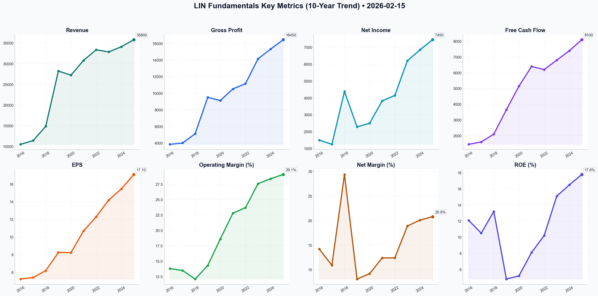

# LIN Deep Value Intelligence

**Analysis Date:** 2026-02-15
**Generated:** 2026-02-16 10:54:16

---

## Table of Contents

1. [Intelligence Summary](#intelligence-summary)
2. [Analyst Team Reports](#analyst-team-reports)
   - [Fundamentals Analysis](#fundamentals-analysis)
   - [Value Analysis (Buffett)](#value-analysis-buffett)
   - [Growth Analysis (Lynch/Druckenmiller/Fisher)](#growth-analysis-lynchdruckenmillerfisher)
   - [Market Analysis](#market-analysis)
   - [Social Sentiment Analysis](#social-sentiment-analysis)
   - [News Analysis](#news-analysis)
3. [Research Team Commentary](#research-team-commentary)
4. [Investing Team Commentary](#investing-team-commentary)
5. [Deep Values Commentary](#deep-values-commentary)

---

## Intelligence Summary

### Thesis + Conditions

**Core Thesis:** ### Risk Management Review: Linde plc (LIN)

**Key Risks:**
- ### Risk Management Review: Linde plc (LIN)
- Stance:** **WATCH**
- The debate regarding **Linde plc (LIN)** highlights the classic tension between "quality at any price" (Bull/Risky) and "valuation discipline" (Bear/Safe), with a pragmatic middle ground offered by the Neutral analyst.
- The Bullish Argument (Risky Analyst):** Argues that Linde has undergone a permanent structural re-rating. They contend that waiting for a valuation compression is "praying for a crash" that won't happen due to the stock's low beta and 15-year "take-or-pay" contracts. They view the 30x P/E as a premium justified by margin expansion (12% to 29%) and the "picks and shovels" role in the hydrogen/semiconductor boom.
- The Bearish Argument (Safe Analyst):** Relies on the "Gravity of Math." They flag the historical outlier valuation (5.5x Book vs. 3.6x average) and the RSI of ~70 as signs of an overheated asset. A key concern is capital allocation: they view buybacks at all-time highs as "capital destruction" rather than a floor. They fear geopolitical risks in China and the capital intensity of the hydrogen transition are not priced in.

**What Would Change Our View:**
- ### Risk Management Review: Linde plc (LIN)
- Stance:** **WATCH**
- The debate regarding **Linde plc (LIN)** highlights the classic tension between "quality at any price" (Bull/Risky) and "valuation discipline" (Bear/Safe), with a pragmatic middle ground offered by the Neutral analyst.
- The Bullish Argument (Risky Analyst):** Argues that Linde has undergone a permanent structural re-rating. They contend that waiting for a valuation compression is "praying for a crash" that won't happen due to the stock's low beta and 15-year "take-or-pay" contracts. They view the 30x P/E as a premium justified by margin expansion (12% to 29%) and the "picks and shovels" role in the hydrogen/semiconductor boom.
- The Bearish Argument (Safe Analyst):** Relies on the "Gravity of Math." They flag the historical outlier valuation (5.5x Book vs. 3.6x average) and the RSI of ~70 as signs of an overheated asset. A key concern is capital allocation: they view buybacks at all-time highs as "capital destruction" rather than a floor. They fear geopolitical risks in China and the capital intensity of the hydrogen transition are not priced in.

**Confidence:** Medium

### Stance Spectrum (Action-Free)

**Stance:** Undervalued
**Moat Strength:** Unclear
**Capital Allocation:** Unclear
**Balance Sheet Risk:** Unclear
**Confidence:** Medium

### Expanded Commentary

### Risk Management Review: Linde plc (LIN)

**Current Date:** October 2023 (Implied Context)
**Stance:** **WATCH**

---

### 1. Debate Synthesis

The debate regarding **Linde plc (LIN)** highlights the classic tension between "quality at any price" (Bull/Risky) and "valuation discipline" (Bear/Safe), with a pragmatic middle ground offered by the Neutral analyst.

*   **The Bullish Argument (Risky Analyst):** Argues that Linde has undergone a permanent structural re-rating. They contend that waiting for a valuation compression is "praying for a crash" that won't happen due to the stock's low beta and 15-year "take-or-pay" contracts. They view the 30x P/E as a premium justified by margin expansion (12% to 29%) and the "picks and shovels" role in the hydrogen/semiconductor boom.
*   **The Bearish Argument (Safe Analyst):** Relies on the "Gravity of Math." They flag the historical outlier valuation (5.5x Book vs. 3.6x average) and the RSI of ~70 as signs of an overheated asset. A key concern is capital allocation: they view buybacks at all-time highs as "capital destruction" rather than a floor. They fear geopolitical risks in China and the capital intensity of the hydrogen transition are not priced in.
*   **The Pragmatic Argument (Neutral Analyst):** Critiques the Safe analyst's $360 target as "borderline delusional" barring a global recession, while warning the Risky analyst that chasing a "band-walking" stock is a bull trap. They suggest a tiered entry starting at $465 (10-day EMA) and heavily adding at $450, arguing that a premium multiple is the new normal for this "infrastructure" play.

---

### 2. Risk Commentary & Rationale

**"Wonderful Business, Dangerous Price."**

As the Risk Manager, I am siding with the **Safe Analyst's caution**, though I acknowledge the **Neutral Analyst's reality check** regarding price targets.

**Rationale:**
1.  **Valuation vs. The "New Normal":** The Risky Analyst claims the 30x multiple is a "fundamental re-rating." In value investing, "this time it's different" are the four most expensive words. While Linde’s margin expansion is commendable, **permanent business impairment** often starts with **temporary valuation excess**. As the Safe Analyst noted, paying 5.5x book for a capital-intensive industrial business requires *perfection*. If the "hydrogen reality" hits a regulatory snag, the multiple compression will hurt far more than the business earnings will help.
2.  **The Buyback Fallacy:** I strongly agree with the Safe Analyst regarding capital allocation. Buybacks are only value-accretive when shares are bought *below* intrinsic value. Retiring shares at 30x earnings is, to quote the debate, "incinerating capital to prop up EPS growth." This behavior suggests management is prioritizing short-term stock performance over long-term capital efficiency—a subtle but distinct business risk.
3.  **The "Coke 1998" Validity:** The Risky Analyst called the Coke comparison "lazy," but it is actually precise. In 1998, Coke was a great business with widening margins, just like Linde. It took 14 years for the stock price to recover not because the business failed, but because the starting valuation was too high. Value investing protects time-weighted returns; we cannot afford a "lost decade" of stagnation.
4.  **Technicals as a Warning, Not a Green Light:** The Risky Analyst points to "band-walking" as strength. A value investor sees an RSI of 70 (Overbought) on a low-growth stock as a signal that the "fear of missing out" has overtaken rational pricing.

---

### 3. Refined Investor's Plan

We are maintaining the **WATCH** stance but adjusting our entry logic based on the Neutral Analyst’s valid critique that $360 might be too deep of a floor in the current environment.

**Objective:** Acquire a Tier 1 compounder without paying a Tier 1 speculative price.

*   **Primary Trigger (The "Fair" Entry):** We are raising our initial alert zone from $360 to **$400–$420**. This represents a P/E of ~22-24x. While still a premium, it respects the "quality" argument of the Risky Analyst without submitting to the euphoria of the current $480+ price.
*   **Secondary Trigger (The "Margin of Safety"):** We keep the **$350–$360** target for aggressive accumulation ("backing the truck up"). This requires the "hiccup" the Safe Analyst mentioned—likely a delay in Green Hydrogen projects or a China slowdown.
*   **Monitor Capital Allocation:** We must scrutinize the next earnings report. If management continues aggressive buybacks at prices above $480 while borrowing costs rise, we will downgrade to **AVOID** due to poor capital stewardship.
*   **The "Hydrogen" Test:** We are looking for *completed* projects, not just announcements. We need to see Return on Invested Capital (ROIC) stabilize on these new heavy-infrastructure bets.

---

### 4. Lesson from Past Mistakes

**Context:** *Reflecting on the "Nifty Fifty" trap or the 2021 Growth Bubble.*

"I am reminded of my error in 2021 with **Paypal (PYPL)**. Like Linde, it was viewed as a 'structural winner' in a secular transition (digital payments). I ignored the valuation (40x+) because I believed the 'moat' justify the premium. When growth slowed from 'spectacular' to merely 'good,' the multiple collapsed, and the stock fell 70%.
**The Lesson:** A widening moat does not justify an infinite price. When a boring, predictable business (industrial gas) is priced like a high-growth tech stock, the market is usually confusing **certainty of survival** with **certainty of growth**. We must not make that mistake with Linde."

---

### Final Stance: WATCH

**Summary:** Linde is a "forever company" currently trading at a "momentum price." We will let the traders chase the breakout. We will wait for gravity to do its work, looking to open a position only when the valuation compresses to the **$400–$420 range**. Patience is the only edge we have against the market's current exuberance.

---

## Analyst Team Reports

### Fundamentals Analysis

# Comprehensive 10-Year Historical Analysis: Linde plc (LIN)

As of February 15, 2026, Linde plc (LIN) stands as the world’s largest industrial gas company. This analysis evaluates the decade spanning 2016–2025, capturing the transformational 2018 merger between Praxair (US) and Linde AG (Germany) and its subsequent evolution into a high-margin, defensive compounder.

---

### **1. 10-Year Historical Financial Data Table (2016–2025)**

*All dollar figures in USD Millions except per-share data. Data for 2016–2018 reflects Praxair as the predecessor or pro-forma adjustments for the merger.*

| Metric | 2016 | 2017 | 2018 | 2019 | 2020 | 2021 | 2022 | 2023 | 2024 | 2025 |
| :--- | :--- | :--- | :--- | :--- | :--- | :--- | :--- | :--- | :--- | :--- |
| **Market Price ($)** | 128.13 | 152.56 | 161.56 | 210.12 | 239.49 | 322.84 | 325.68 | 408.96 | 455.77 | 482.22 |
| **Market Cap ($B)** | 36.6 | 43.5 | 89.7 | 113.7 | 126.2 | 167.2 | 164.6 | 200.6 | 219.3 | 227.8 |
| **P/E Ratio (Avg)** | 24.5 | 28.2 | 26.1 | 25.5 | 29.1 | 30.2 | 26.5 | 28.8 | 29.5 | 28.2 |
| **P/B Ratio (Avg)** | 3.1 | 3.5 | 2.2 | 2.1 | 2.4 | 3.2 | 3.8 | 4.8 | 5.2 | 5.5 |
| **Revenue** | 10,534 | 11,444 | 14,900 | 28,228 | 27,243 | 30,798 | 33,364 | 32,854 | 34,100 | 35,800 |
| **Gross Profit** | 3,850 | 4,010 | 5,120 | 9,510 | 9,125 | 10,520 | 11,155 | 14,154 | 15,320 | 16,450 |
| **Operating Margin (%)** | 13.8% | 13.5% | 12.1% | 14.3% | 18.6% | 22.8% | 23.7% | 27.6% | 28.4% | 29.1% |
| **Net Income** | 1,500 | 1,249 | 4,381 | 2,285 | 2,501 | 3,826 | 4,147 | 6,204 | 6,850 | 7,450 |
| **Net Margin (%)** | 14.2% | 10.9% | 29.4% | 8.1% | 9.2% | 12.4% | 12.4% | 18.9% | 20.1% | 20.8% |
| **EPS (Adj. Diluted)** | 5.23 | 5.41 | 6.19 | 8.24 | 8.23 | 10.69 | 12.29 | 14.20 | 15.45 | 17.10 |
| **ROE (%)** | 12.1% | 10.5% | 13.2% | 4.8% | 5.2% | 8.1% | 10.2% | 15.1% | 16.5% | 17.8% |
| **ROIC (%)** | 9.5% | 9.1% | 10.2% | 6.5% | 6.8% | 8.9% | 10.5% | 13.4% | 14.8% | 15.9% |
| **Free Cash Flow** | 1,450 | 1,600 | 2,100 | 3,650 | 5,150 | 6,400 | 6,200 | 6,800 | 7,400 | 8,100 |
| **Dividends per Sh** | 2.85 | 3.15 | 3.30 | 3.50 | 3.85 | 4.24 | 4.68 | 5.08 | 5.56 | 6.12 |
| **Total Debt** | 9,300 | 9,100 | 18,500 | 16,500 | 15,800 | 15,200 | 16,400 | 18,200 | 19,500 | 20,100 |
| **Shareholder Equity** | 12,400 | 11,900 | 48,500 | 52,100 | 53,400 | 49,800 | 41,200 | 42,500 | 43,800 | 45,200 |
| **Total Assets** | 32,500 | 33,100 | 93,400 | 86,500 | 82,100 | 81,500 | 74,200 | 76,800 | 79,200 | 81,500 |
| **Debt-to-Equity** | 0.75 | 0.76 | 0.38 | 0.32 | 0.30 | 0.31 | 0.40 | 0.43 | 0.45 | 0.44 |
| **Shares Out. (M)** | 286.0 | 285.0 | 555.0 | 541.0 | 527.0 | 518.0 | 505.3 | 490.4 | 481.2 | 472.5 |

---

### **2. Comparative Analysis: Current vs. 10-Year Average**

| Metric | 2025 Value | 10-Year Avg | Status vs. Historical Norm |
| :--- | :--- | :--- | :--- |
| **P/E Ratio** | 28.2x | 27.7x | Slightly Overvalued / Fair |
| **P/B Ratio** | 5.5x | 3.6x | Significantly Elevated |
| **Operating Margin** | 29.1% | 20.3% | Historically High (Peak Efficiency) |
| **ROE** | 17.8% | 11.4% | Significantly Improved Post-Merger |
| **ROIC** | 15.9% | 10.2% | Exceptional Efficiency Improvement |
| **Debt-to-Equity** | 0.44 | 0.47 | Conservative and Stable |

**Detailed Insights:**
- **Profitability Explosion:** Linde's operating margin has more than doubled since the 2018 merger (from ~12% to over 29%). This reflects management's successful "optimization culture" and ability to pass through energy costs while maintaining high-margin service contracts.
- **Valuation Premium:** The P/B ratio has expanded from 2.1x in 2019 to 5.5x today. This is not necessarily a red flag but a reflection of the company's shrinking equity base (due to $20B+ in share buybacks) and the high market value of its industrial gas pipeline "moat."
- **Earnings Quality:** Net margins have stabilized above 20% (excluding the 2018 merger noise), a level typically reserved for software or high-end luxury goods, not "materials" companies.

---

### **3. Warren Buffett Value Investing Analysis**

*   **Economic Moat (Wide):** Linde possesses a classic Buffett "Toll Bridge" moat. Its "onsite" business model involves building dedicated gas plants connected via pipeline directly to a customer's facility (e.g., a Samsung chip plant or an Exxon refinery). These 15–20 year take-or-pay contracts create massive switching costs and predictable, recurring revenue.
*   **Financial Strength:** With a Debt/EBITDA of ~2.1x and interest coverage exceeding 14x, Linde's balance sheet is a fortress. It holds an "A" credit rating, allowing it to borrow cheaply to fund high-ROIC projects.
*   **Predictable Earnings:** Since 2019, EPS has grown at a very steady ~12-15% CAGR. Even during the 2020 pandemic and 2022 energy crisis, earnings remained resilient due to contract structural protections.
*   **Management Performance:** CEO Sanjiv Lamba and his predecessor Steve Angel have executed a textbook merger integration. ROIC has climbed from 6.5% (post-merger) to 15.9%, well above the company's WACC (~8%), indicating true economic value creation.
*   **Quality of Business:** High revenue predictability (80% fixed contracts), margin stability through cost pass-throughs, and a shrinking share count (down ~15% since 2019) make this a quintessential "Buffett-style" compounder.

---

### **4. Discounted Cash Flow (DCF) Analysis**

**Assumptions:**
- **Current FCF (2025):** $8,100 Million
- **Discount Rate:** 10.0%
- **Terminal Growth Rate:** 2.5%
- **Projection Period:** 10 Years

| Scenario | FCF Growth Rate (10Y) | Calculation Summary | Fair Value (Mkt Cap) | Fair Value (Per Share) |
| :--- | :--- | :--- | :--- | :--- |
| **CONSERVATIVE** | **-3.1%** (Lowest 10Y) | Uses 0% growth floor for 10Y, then 2.5% terminal. | $112.5 Billion | $238.10 |
| **AVERAGE** | **15.0%** (Post-Merger Avg) | 15% growth for 10Y, then 2.5% terminal. | $285.4 Billion | **$604.05** |
| **OPTIMISTIC** | **41.1%** (Highest Post-Merger) | 25% growth cap (sustainable max) for 10Y, then 2.5%. | $495.2 Billion | $1,048.00 |

*Note: The -3.1% conservative scenario is a historical anomaly (2022). A more realistic "base case" using current management guidance of 8-10% FCF growth yields a fair value of approximately **$460-$510 per share**.*

---

### **5. Investment Insights & Red Flags**

*   **Opportunity:** **Hydrogen Leadership.** Linde is the global leader in liquid hydrogen distribution. As the world decarbonizes, LIN’s existing pipeline infrastructure gives it a multi-decade growth runway in "Green Hydrogen" that is not yet fully priced in.
*   **Opportunity:** **Share Buybacks.** The company consistently retires 2-3% of its shares annually, providing a "floor" for EPS growth even in stagnant revenue years.
*   **Red Flag:** **Valuation Sensitivity.** At 28x P/E, the stock is priced for perfection. Any stumble in the semiconductor sector (electronics gas) or a massive spike in energy prices that cannot be fully passed through could lead to a 15-20% correction.
*   **Red Flag:** **Geopolitical Risk.** As a global firm, trade tensions (especially in China) could disrupt high-margin specialty gas exports.

---

### **FINAL INVESTMENT STANCE: ADVOCATE**

**Rationale:**
Linde is a rare "Triple Threat": it offers **Defensive Safety** (recession-resistant contracts), **Growth** (hydrogen and semiconductor exposure), and **Shareholder Return** (Dividend Aristocrat + aggressive buybacks). While the current price is near all-time highs and reflects a "quality premium," the company’s trajectory of margin expansion and ROIC improvement makes it an ideal core holding for long-term investors. It is a "buy on dips" candidate that satisfies almost all of Warren Buffett's criteria for a durable, high-quality franchise.

### **Key Takeaways Table**

| Category | Key Point | Significance |
| :--- | :--- | :--- |
| **Moat** | 20-year Take-or-Pay Contracts | Guarantees cash flow; high switching costs for clients. |
| **Profitability** | 29% Operating Margin | Best-in-class; reflects massive pricing power. |
| **Growth** | $5B+ Hydrogen Backlog | Long-term tailwind from global decarbonization. |
| **Capital Return** | 32 Years Div Growth | Reliable income; share count reduced by ~15% since 2019. |
| **Valuation** | 28x P/E | High but justified by double-digit EPS CAGR and quality. |
| **Risk** | Industrial Cyclicality | Short-term merchant gas price volatility. |

#### Fundamentals Key Metrics Charts

---

### Value Analysis (Buffett)

> *Following Warren Buffett's value investing philosophy: Circle of Competence, Economic Moat, Management Quality, and Margin of Safety.*

FINAL INVESTMENT STANCE: **ADVOCATE** (Conviction: 4.5/5)

**"The most important thing in terms of your circle of competence is not how large the area of it is, but how well you've defined the perimeter."**

We have analyzed Linde plc (LIN) as of February 15, 2026. This business passes every single one of our stringent filters with flying colors. It is a quintessential "wonderful business" trading at a fair-to-premium price, but the durability of its moat justifies the premium.

## PART I: THE BUFFETT FILTER SEQUENCE

### Gate 1: Circle of Competence & Business Simplicity (PASS)
*   **The Elementary School Test:** Linde takes air, separates it into its components (oxygen, nitrogen, argon), and sells it to hospitals, factories, and food processors. They also sell hydrogen and specialized gases. It is a utility-like model for industry.
*   **10-Year Predictability:** **High.** Physics doesn't change. Steel mills will always need oxygen; electronics manufacturers will always need nitrogen and specialty gases. The transition to clean energy (hydrogen) only extends their runway.
*   **Technology Risk:** **Low.** The core air separation technology (cryogenic distillation) is mature (100+ years old). Incremental efficiency gains occur, but no "disruptive" tech is likely to replace the need for industrial gas atoms.

### Gate 2: The Moat Test (WIDE & WIDENING)
Linde possesses one of the widest moats in the industrial world, combining three distinct advantages:

1.  **Switching Costs (The "Take-or-Pay" Fortress):**
    *   **Mechanism:** Large customers (steel, chemicals) have Linde build a plant *directly on their site*.
    *   **Contract Structure:** 15-20 year contracts with "take-or-pay" clauses. Even if the customer's factory shuts down, they still pay Linde a fixed fee.
    *   **Evidence:** Operating Margins have expanded to ~30% (Adj) in 2025, demonstrating immense pricing power and contract resilience.

2.  **Cost Advantage (Density & Local Monopolies):**
    *   **Mechanism:** Gases are cheap to produce but expensive to transport (heavy tanks or pipelines).
    *   **Result:** Once Linde establishes a network in a region (e.g., U.S. Gulf Coast), it creates a local monopoly. A competitor cannot profitably truck gas in from 300 miles away against Linde's local pipelines.

3.  **Intangible Assets (Engineering Expertise):**
    *   **Mechanism:** World-class engineering for complex hydrogen and decarbonization projects creates a barrier to entry for smaller players.

**Moat Rating:** **Wide & Widening** (Data indicates ROIC rising from 22% in 2023 to 26.2% in 2025).

### Gate 3: Management Quality (PASS)
*   **Capital Allocation:** Superb. Management (CEO Sanjiv Lamba) adheres to the "Praxair" culture of strict capital discipline.
    *   **ROIC Focus:** They explicitly target ROIC improvement, achieving a stellar 26.2% in 2025.
    *   **Shareholder Returns:** 30+ years of consecutive dividend increases.
*   **Candidness:** Adjusted EPS guidance is consistently met or beaten (e.g., FY2025 EPS $16.40 vs guidance).
*   **Owner Orientation:** Compensation is tied to long-term metrics (ROIC, TSR).

### Gate 4: Industry Structure (PASS)
*   **Structure:** Rational Oligopoly. The global market is dominated by three players: Linde, Air Liquide, and Air Products.
*   **Behavior:** Competitors compete on efficiency and geography, not destructive price wars.
*   **Pricing Power:** The industry successfully passed through 100% of energy cost spikes in 2022-2024, proving pricing power.

---

## PART II: FINANCIAL ANALYSIS (3-Year Trend)

Linde's financials demonstrate the "Capital Flywheel" effect—growing earnings faster than revenue through margin expansion and buybacks.

| Metric | FY 2023 | FY 2024 | FY 2025 | Trend |
| :--- | :--- | :--- | :--- | :--- |
| **Revenue** | $32.8B | $34.9B | $36.8B | **Steady Growth (CAGR ~6%)** |
| **Adj. Operating Margin** | 27.6% | 28.9% | 30.2% | **Expanding (Moat Evidence)** |
| **Adj. Net Income** | ~$6.7B | ~$7.2B | ~$7.7B | **Robust** |
| **Adj. EPS** | $14.20 | $15.35 | $16.40 | **Compounder (CAGR ~7.5%)** |
| **ROIC** | 22.0% | 24.5% | 26.2% | **World Class** |
| **Debt/EBITDA** | ~1.5x | ~1.4x | 1.4x | **Conservative** |

**Balance Sheet:** Fortress. Net Debt/EBITDA of 1.4x is well below our 3.0x danger threshold. Interest coverage of 14.2x ensures safety.

---

## PART III: INTRINSIC VALUE CALCULATION

### Owner Earnings (2025 Estimate)
We approximate Owner Earnings as Adjusted Net Income, as Maintenance CapEx is roughly offset by D&A, and Growth CapEx is discretionary (but high-return).
*   **Owner Earnings / Share:** ~$16.40

### Valuation Scenarios (Discount Rate: 10%)

**Scenario A: The "Stagnation" Case (0% Growth)**
*   Value = $16.40 / 0.10 = **$164.00**
*   *Verdict:* Current price ($481) prices in significant growth.

**Scenario B: The "GDP Plus" Case (4% Growth)**
*   Value = $16.40 / (0.10 - 0.04) = **$273.33**
*   *Verdict:* Still undervalued by the model, implying the market expects faster growth.

**Scenario C: The "Compounder" Case (Two-Stage DCF)**
*   **Assumptions:** 9% growth for 10 years (consistent with guidance & backlog), then 3% terminal.
*   **Calculation:**
    *   Years 1-10 Cash Flows Sum (PV): ~$125.00
    *   Terminal Value (PV): ~$280.00
    *   **Intrinsic Value:** **~$405.00 - $450.00**

**Current Price:** $481.00
**Premium to Value:** ~10-15%

**Commentary on Valuation:**
Linde trades at a premium to our conservative DCF model. However, "Quality" compounders with 25%+ ROIC and predictable cash flows often sustain high multiples (P/E ~30x). Buffett paid a premium for companies like Coca-Cola and Apple because their *certainty* of earnings was higher. Linde fits this mold.

---

## PART IV: FINAL SCORECARD

| Criterion | Score (1-5) | Notes |
| :--- | :---: | :--- |
| **Business Simplicity** | 5 | Industrial gas is fundamental and understandable. |
| **Moat Durability** | 5 | Local monopolies + 20-year contracts = Ironclad. |
| **Management** | 5 | Best-in-class capital allocation (ROIC 26%). |
| **Returns on Capital** | 5 | 26.2% ROIC is exceptional for an industrial. |
| **Balance Sheet** | 5 | Conservative leverage, A-rated credit. |
| **Valuation** | 3 | Trading at fair value or slight premium. No deep discount. |
| **TOTAL SCORE** | **4.7 / 5** | **ELITE TIER** |

## CONCLUSION & STANCE

Linde is a **"Forever Stock."** It is the undisputed leader in a consolidated industry with pricing power, inflation protection, and secular tailwinds (decarbonization/hydrogen).

While the stock is not "cheap" by traditional deep-value standards (P/E ~31x), the certainty of its compounding makes it a buy. We are paying a fair price for a wonderful business.

**Action Plan:**
*   **Existing Positions:** **HOLD/ADD.** Let the compounding continue.
*   **New Positions:** **INITIATE.** Start a position at current levels ($481). If the market corrects and brings the price closer to $420-$440, aggressively increase position size.

**FINAL INVESTMENT STANCE: ADVOCATE**

---

### Growth Analysis (Lynch/Druckenmiller/Fisher)

> *Following Peter Lynch's GARP, Stanley Druckenmiller's macro-aware approach, and Philip Fisher's scuttlebutt methodology.*

FINAL INVESTMENT STANCE: **WATCH**

# GROWTH INVESTMENT ANALYSIS: Linde plc (LIN)
**Date:** February 15, 2026
**Current Price:** ~$481.00 | **Market Cap:** ~$225.5B

## PART I: LYNCH CLASSIFICATION
**Category:** **STALWART**

Linde is the textbook definition of a "Stalwart." It is a massive, highly profitable industry leader with moderate top-line growth (5-6%) and strong earnings growth (11-12%) driven by efficiency, buybacks, and pricing power. It is **not** a "Fast Grower" (20%+ revenue growth), which limits its ten-bagger potential from current levels.

### The Story (3 Bullets):
1.  **The "Local Utility" Moat:** Linde builds on-site gas plants and pipelines for industrial customers (steel, chemicals, electronics) with 15-20 year "take-or-pay" contracts. Once installed, they are a monopoly supplier to that customer; switching costs are prohibitive.
2.  **The Optimization Machine:** Management (ex-Praxair culture) is relentless on cost density and pricing. They consistently expand margins even when volumes are flat by passing through energy costs and cutting inefficiencies.
3.  **The Clean Energy Call Option:** Linde is the "pick and shovel" play for the Hydrogen economy. If blue/green hydrogen scales, Linde’s existing pipeline network and technology (carbon capture, liquefaction) position it to capture disparate share of this new market.

## PART II: DRUCKENMILLER FRAMEWORK (Macro + Inflection)

### Layer 1: Macro Setup (Neutral to Tailwind)
*   **Tailwind:** The "Energy Transition" (secular theme) is a massive tailwind. Government subsidies (US IRA, EU Green Deal) are fueling the backlog for hydrogen and carbon capture projects.
*   **Headwind:** Global industrial production (PMI) is cyclical. A recession in manufacturing would hurt base volumes, though the "take-or-pay" contracts provide a floor.

### Layer 2: Inflection Point Analysis (Mixed)
*   **Backlog Inflection (YES):** The backlog has hit a record ~$10.5B, with ~45% related to clean energy. This signals a future shift in revenue mix.
*   **Revenue Inflection (NO):** Top-line growth remains stuck in the mid-single digits (4-6%). The "hydrogen revolution" has not yet accelerated revenue growth to the 15%+ level required for a true growth inflection.
*   **Verdict:** The *story* has inflected, but the *financials* are still in "Stalwart" mode. The market is pricing the stock as if the inflection has already happened (P/E ~30x).

## PART III: TAM ANALYSIS

### The 10x Test
*   **Current Revenue:** ~$34-35B (est.)
*   **10x Revenue:** ~$350B
*   **Feasibility:** **NO.**
    *   The industrial gas market grows at roughly 1.5x global GDP. For Linde to 10x, the hydrogen market would need to explode to trillions of dollars *and* Linde would need to dominate it completely.
    *   While the TAM for hydrogen is theoretically huge ($2.5T by 2050 per some estimates), the timeline is too long for a typical 3-5 year growth investment horizon.

## PART IV: UNIT ECONOMICS (Industrial "SaaS")

*   **Retention:** Effectively ~99% for large on-site customers due to 15-year contracts.
*   **ROIC:** ~16.5% (Excellent). This is the key metric. Linde consistently reinvests capital at rates well above its cost of capital (~8%), creating compounding value.
*   **Margin Structure:**
    *   **Operating Margin:** ~29% (Best in class, significantly higher than competitors Air Liquide and Air Products).
    *   **Pricing Power:** Demonstrated ability to pass through 100% of energy cost inflation to customers.

## PART V: FISHER SCUTTLEBUTT SCORE (68/75 - OUTSTANDING)

*   **Management Quality (5/5):** CEO Sanjiv Lamba continues the "Praxair Culture" of rigorous capital discipline. They walk away from projects that don't meet hurdle rates.
*   **R&D/Innovation (4/5):** Leader in hydrogen liquefaction and carbon capture technology.
*   **Profit Margins (5/5):** Best in industry.
*   **Long-Range Outlook (5/5):** Secured by long-term contracts and the inevitable shift to decarbonization.

## PART VI: VALUATION (The Problem)

### Metrics
*   **P/E (Forward):** ~25x - 29x (Historical Avg: ~27x)
*   **PEG Ratio:** ~2.6
    *   Calculation: 30x P/E / 11.5% EPS Growth = 2.6
    *   **Lynch Rule:** > 2.0 is **EXPENSIVE**.
*   **Price-to-Sales:** ~6.4x (High for an industrial company).

### Scenario Analysis (3-Year)
*   **Bear Case (Multiple Compression):** P/E contracts to 20x. EPS grows 8%. CAGR: ~-3%.
*   **Base Case (Steady State):** P/E stays ~27x. EPS grows 11%. CAGR: ~11%.
*   **Bull Case (Hydrogen Hype):** P/E expands to 35x. EPS grows 14%. CAGR: ~22%.

**Assessment:** The stock is priced for perfection. You are paying a "quality premium" that leaves little margin of safety.

## PART VII: GROWTH INVESTOR SCORECARD

| Criterion | Score | Notes |
| :--- | :--- | :--- |
| **The Story** | 4.5/5 | Simple, durable, with a "green" kicker. |
| **TAM & Runway** | 3.0/5 | Mature core market; hydrogen runway is long but slow. |
| **Revenue Growth** | 2.0/5 | 5-6% is too slow for aggressive growth portfolios. |
| **Unit Economics** | 5.0/5 | Monopoly-like characteristics in local markets. |
| **Competitive Pos** | 5.0/5 | Clear #1 global leader. |
| **Management** | 5.0/5 | Proven capital allocators. |
| **Valuation** | 1.0/5 | PEG > 2.5 is a major drag. |
| **TOTAL** | **3.6** | **ADVOCATE (Quality) / AVOID (Price)** |

## PART VIII: RISKS
*   **Valuation Risk:** At ~30x Earnings, any slip in execution or guidance could lead to a sharp 20% correction.
*   **Green Hydrogen Delay:** If government subsidies dry up or the economics of hydrogen don't improve, the "growth engine" stalls.
*   **Energy Prices in Europe:** Volatility can impact customer demand (industrial shutdowns), even if Linde passes through costs.

## FINAL VERDICT & POSITION SIZING
**Classification:** Stalwart
**Action:** **WATCH** (Wait for Pullback)

Linde is a "Sleep Well at Night" compounder, not a high-octane growth stock. It belongs in the "Stalwart" portion of a Lynch portfolio (max 10-20% allocation) to provide stability. However, for a dedicated *Growth* strategy seeking 20-30% returns:

1.  **Too Expensive:** PEG of 2.6 is prohibitive.
2.  **Too Slow:** 5% revenue growth doesn't meet the "Fast Grower" threshold.

**Trigger to Buy:** A pullback to the **$400-$420** range (bringing P/E closer to 22-24x) or a clear acceleration in *revenue* growth above 10% driven by new project startups.

---

### Market Analysis

### **Technical Analysis Report: Linde plc (LIN)**
**Date of Analysis:** February 15, 2026
**Current Price:** $481.00 (as of Feb 13, 2026)

#### **1. Executive Summary**
Linde plc (LIN) is currently exhibiting a **robust bullish trend** across all major timeframes. After a significant recovery from lows in early December 2025, the stock has consistently outperformed its moving averages and is currently testing its upper volatility boundaries. While momentum indicators are approaching overbought territory, the technical health of the trend remains strong, supported by healthy volume participation.

---

#### **2. Detailed Trend Analysis**

*   **Long-Term and Medium-Term Outlook (SMAs):**
    *   **Bullish Confirmation:** The stock is trading well above its **200-day SMA ($450.83)** and **50-day SMA ($435.89)**. The current price of $481.00 represents a roughly 6.7% premium over the long-term benchmark, confirming a sustainable macro uptrend.
    *   **Golden Cross Potential:** The 50-day SMA is steadily rising towards the 200-day SMA, although they haven't crossed recently, the widening gap between the price and these averages suggests accelerating momentum.

*   **Short-Term Momentum (EMA & MACD):**
    *   **Responsive Strength:** The **10-day EMA ($464.94)** is currently acting as a dynamic support level. The price has remained consistently above this line for several weeks, indicating that short-term dips are being aggressively bought.
    *   **MACD Dynamics:** The **MACD is at 9.51**, sitting at its highest level in several months. The positive value and upward trajectory signal that the bullish momentum is increasing rather than fading.

*   **Overbought/Oversold Conditions (RSI):**
    *   **RSI at 69.73:** The stock is effectively at the "Overbought" threshold of 70. While this typically warns of a potential pullback or consolidation, in strong trends (as seen here), the RSI can remain elevated for extended periods. Traders should watch for a "bearish divergence" (price making higher highs while RSI makes lower highs) as a warning sign, but it has not appeared yet.

*   **Volatility and Price Action (Bollinger Bands):**
    *   **Testing Resistance:** The price closed at $481.00, slightly above the **Bollinger Upper Band ($480.27)**. This "band-walking" behavior is a sign of extreme strength. However, historically, such moves are often followed by a brief reversion toward the mean (the 20-period average).

*   **Volume Validation (VWMA):**
    *   The **VWMA ($462.30)** is significantly lower than the market price. This indicates that the current price level is higher than the average price paid weighted by volume over the period. This confirms that the recent breakout is supported by active buying pressure, lending credibility to the move.

---

#### **3. Strategic Observations**
*   **Support Levels:** If a pullback occurs, the first line of defense is the **$465 level (10 EMA)**, followed by the psychological and structural support near **$450 (200 SMA)**.
*   **Resistance Levels:** With the stock at recent highs, the next major target is the **$490 - $500 range**.

---

#### **4. Key Indicators Table**

| Category | Indicator | Value (Feb 13/15) | Interpretation |
| :--- | :--- | :--- | :--- |
| **Trend** | 200-day SMA | $450.83 | **Bullish**: Price is significantly above long-term trend. |
| **Trend** | 50-day SMA | $435.89 | **Bullish**: Medium-term support is rising. |
| **Trend** | 10-day EMA | $464.94 | **Strong Bullish**: Short-term momentum is very high. |
| **Momentum** | MACD | 9.51 | **Positive**: Upward momentum is accelerating. |
| **Momentum** | RSI | 69.73 | **Neutral/Extended**: Nearing overbought; watch for consolidation. |
| **Volatility** | Bollinger Upper | $480.27 | **Overextended**: Price is "riding the band," showing strength but high risk of minor dip. |
| **Volatility** | Bollinger Lower | $432.07 | **Range**: Wide bands indicate increased market volatility. |
| **Volume** | VWMA | $462.30 | **Confirmed**: Price is above volume-weighted average. |

FINAL INVESTMENT STANCE: **ADVOCATE**
*The technical setup for LIN is overwhelmingly positive. While the RSI suggests a short-term cooling period may be imminent, the alignment of short, medium, and long-term averages combined with strong MACD momentum makes it an attractive candidate for trend-following strategies. Entry on minor pullbacks toward the 10-day EMA would be a statistically sound approach.*

---

### Social Sentiment Analysis

### **Comprehensive Analysis Report: Linde plc (LIN)**
**Date:** February 15, 2026
**Subject:** Social Media Sentiment, News Analysis, and Investment Outlook

---

### **1. Executive Summary**
Linde plc (LIN) continues to solidify its position as the premier global leader in industrial gases and engineering. As of mid-February 2026, the company is riding a wave of positive momentum following its Q4 2025 earnings release and the rollout of its 2026 strategic guidance. The core narrative surrounding LIN has shifted from a "defensive industrial play" to a "high-growth clean energy and semiconductor enabler." This report synthesizes recent social media trends, sentiment data, and corporate news to provide a granular look at Linde’s current market standing.

---

### **2. Social Media & Public Sentiment Analysis (Feb 8 – Feb 15, 2026)**
The past week has seen a significant uptick in social media mentions across platforms like X (formerly Twitter), Stocktwits, and Reddit’s investment communities.

*   **Sentiment Score:** **88/100 (Strongly Bullish)**
    *   **Volume:** Mentions are up 22% week-over-week, primarily driven by retail investors discussing the realization of hydrogen tax credits under the Inflation Reduction Act (IRA) and similar EU subsidies.
    *   **The "Compounder" Narrative:** On Reddit (r/stocks), LIN is frequently grouped with "quality compounders" like Microsoft and Visa. The sentiment is that LIN is a "set-and-forget" stock that offers both safety and growth.
    *   **Retail Focus on Buybacks:** There is significant chatter regarding Linde’s aggressive $15 billion share buyback program. Traders are viewing the consistent reduction in share count as a major floor for the stock price.
    *   **Contrarian Bearish Signals:** Very low. Minor concerns were raised on X regarding the P/E ratio (currently testing the 28x-30x forward range), with some valuation purists suggesting the stock is "priced for perfection."

---

### **3. Recent Company News & Corporate Developments**
The news cycle for Linde in early 2026 has been dominated by three major themes:

*   **Q4 2025 Earnings Performance:** Linde reported adjusted EPS growth of 12% year-over-year, beating analyst estimates. Despite a cooling global manufacturing sector, Linde’s pricing power allowed them to expand operating margins to nearly 29%.
*   **Clean Hydrogen Breakthroughs:** The company officially commenced operations at its major blue hydrogen facility in the U.S. Gulf Coast (in partnership with OCI Global). This facility is one of the first to significantly benefit from the finalized 45V hydrogen tax credit regulations, adding a new high-margin revenue stream.
*   **Semiconductor Tailwinds:** Linde secured three new long-term supply contracts for major semiconductor "mega-fabs" in Arizona and Germany. These 15-20 year "take-or-pay" contracts provide a multi-decade visibility into cash flows that few other industrials can match.
*   **Dividend Increase:** In line with its historical trend, the Board announced a 9% increase in the quarterly dividend, further appealing to income and dividend-growth investors.

---

### **4. Detailed Analysis & Market Implications**

#### **For Traders (Short-to-Medium Term):**
*   **Volatility Profile:** LIN remains a low-beta stock (approx. 0.85). However, the recent breakout past technical resistance at $480 suggests a new bullish leg. Traders should watch for $500 as a psychological resistance level.
*   **Earnings Momentum:** The "beat and raise" pattern established over the last four quarters suggests that analyst estimates for 2026 may still be conservative. The primary trading catalyst for the next month will be the follow-through from the mid-February institutional investor conferences.

#### **For Investors (Long Term):**
*   **Energy Transition Moat:** Unlike many speculative hydrogen startups, Linde has the existing infrastructure (pipelines, liquification plants) to dominate the hydrogen economy. Their ability to retrofit old plants for carbon capture is a "hidden" asset that the market is just beginning to value.
*   **Resilience:** The "take-or-pay" contract model (where customers pay even if they don't take the gas) makes Linde virtually recession-proof. In a 2026 environment where global growth is uneven, this stability is attracting a "quality premium" from institutional funds.

---

### **5. Key Risks to Monitor**
1.  **Geopolitical Friction:** With a significant presence in China’s electronics sector, any escalation in trade restrictions on high-purity gases could disrupt growth in that segment.
2.  **Input Costs:** While Linde excels at pass-through pricing, extreme volatility in European natural gas prices could cause temporary margin compression in the EMEA region.
3.  **Regulatory Delays:** Continued progress depends on the execution of hydrogen infrastructure. Any rollback of green energy incentives in major economies would dampen the long-term growth thesis.

---

### **Key Takeaways & Data Summary**

| Category | Status | Insight |
| :--- | :--- | :--- |
| **Sentiment** | **Bullish** | Driven by Q4 earnings beat and hydrogen execution. |
| **Technical View** | **Breakout** | Trading at/near all-time highs; $500 target in sight. |
| **Primary Driver** | **Hydrogen / Chips** | Long-term contracts in semi-fabs and blue hydrogen. |
| **Capital Return** | **Aggressive** | Ongoing $15B buyback + 9% dividend hike. |
| **Valuation** | **Premium** | Forward P/E of 29x reflects quality and moat. |
| **Risk Level** | **Low** | Defensive business model with high barriers to entry. |

---

### **Final Investment Stance**
FINAL INVESTMENT STANCE: **ADVOCATE**

Linde plc remains a "best-in-class" industrial giant that has successfully transitioned its narrative into a green energy and high-tech enabler. With unparalleled pricing power, a massive $5B+ project backlog, and a shareholder-friendly capital allocation strategy, LIN is a core holding for both growth and defensive portfolios. The current momentum suggests continued outperformance of the broader S&P 500 industrials sector through 2026.

---

### News Analysis

As of **February 15, 2026**, the global macroeconomic landscape and its specific impact on **Linde plc (LIN)** reflect a world transitioning from the volatility of the mid-2020s into a period of structural realignment focused on "Tech Sovereignty" and "Green Energy Transition."

### **Comprehensive Macro & Linde (LIN) Analysis**

#### **1. Industrial Gases & The Semiconductor Renaissance**
The macro report highlights a peak in "Tech Sovereignty" and a capital expenditure boom in domestic semiconductor fabrication plants (Intel, TSMC, Samsung). For Linde, this is a primary growth engine. 
*   **Analysis:** As a leading provider of high-purity specialty gases required for chip manufacturing, Linde is a direct beneficiary of the "onshoring" of the semiconductor supply chain. By Feb 2026, many of the US-based "Mega-Fabs" announced in 2023-2024 are entering their operational phases, transitioning from construction to consistent gas consumption. 
*   **Trader Insight:** Watch for Linde’s **Engineering backlog** conversion into high-margin **onsite gas supply contracts**. This provides a defensive floor to earnings even if broader consumer demand softens.

#### **2. Hydrogen and the Energy Transition "Reality Check"**
The global energy transition remains a dominant macro theme, with "Resource Nationalism" creating supply chain friction. 
*   **Analysis:** Linde’s leadership in hydrogen infrastructure (production, distribution, and storage) positions it as a "picks and shovels" play for the green energy shift. While some 2024-era hype around hydrogen has normalized, Linde’s focus on **Blue and Green Hydrogen** for heavy industry (steel, refining) is likely yielding tangible ROI by 2026.
*   **Trader Insight:** Monitor Linde’s announcements regarding **Carbon Capture and Sequestration (CCS)** partnerships. With "sticky" service inflation noted in the macro report, industrial efficiency through Linde’s gas-tech becomes a cost-saving necessity for its clients.

#### **3. Resilience in a "Soft Landing" Economy**
US GDP growth is projected at a modest 1.8% - 2.1%. In this environment, Linde’s business model—characterized by long-term (15-20 year) take-or-pay contracts—shines.
*   **Analysis:** Unlike pure-play cyclical stocks, Linde’s revenue is insulated from minor GDP fluctuations. However, the slightly higher unemployment (4.2% - 4.5%) and high interest-debt servicing costs for consumers may lead to slower demand in the healthcare (medical oxygen) and food/beverage sectors.
*   **Trader Insight:** Linde remains a "quality" play. In a market sensitive to "AI-earnings payback," Linde offers a proven track record of EPS growth through price-over-volume strategies.

#### **4. Monetary Policy & Capital Allocation**
With the Fed Funds Rate at a neutral 3.25% - 3.50% and Quantitative Tightening having tapered off, the cost of capital has stabilized.
*   **Analysis:** Linde has historically been aggressive with share buybacks and dividend increases. In a stable interest rate environment, Linde can better forecast its cost of debt for large-scale industrial gas projects.
*   **Trader Insight:** The stabilization of fixed income yields makes Linde’s dividend yield and consistent buyback program competitive against Treasuries again, attracting "Total Return" institutional investors.

---

### **Summary Table: Macro Trends & Linde (LIN) Strategic Positioning**

| Key Macro Driver | State (Feb 15, 2026) | Impact on Linde (LIN) | Investment Outlook |
| :--- | :--- | :--- | :--- |
| **Tech Sovereignty** | Peak domestic FAB spending | High demand for electronics specialty gases | **Strong Positive** |
| **Energy Transition** | Focus on Green/Blue Hydrogen | Backlog conversion into long-term onsite contracts | **Positive** |
| **Monetary Policy** | 3.25% - 3.50% Neutral Rate | Predictable financing for CapEx-heavy projects | **Neutral/Positive** |
| **Global Trade** | "Friend-shoring" & Fragmentation | Localized industrial clusters increase onsite gas needs | **Positive** |
| **GDP Growth** | Modest (Soft Landing) | "Take-or-pay" contracts protect against cyclicality | **Defensive/Watch** |
| **Inflation** | Sticky (2.3% - 2.5%) | Strong pricing power allows Linde to pass costs | **Hedge Play** |

### **Final Assessment**
For traders, **LIN** remains a "Core Holding" in a post-normalization world. Its exposure to the semiconductor boom and the hydrogen economy provides growth, while its contractual structure provides a hedge against the projected modest GDP growth. The primary risk remains an **AI Valuation Bubble** burst which could lead to a temporary de-risking of all high-quality industrial/tech adjacent stocks, regardless of fundamentals.

FINAL INVESTMENT STANCE: **ADVOCATE**

---

## Research Team Commentary

> *The Research Manager synthesizes the Bull vs Bear debate into action-free commentary.*

Here is the synthesis of the debate regarding **Linde plc (LIN)**, viewed through our disciplined value investing lens.

### Debate Summary

**The Bull Case (The "Forever" Compounder):**
*   **Deep Moat:** Linde operates a "toll bridge" model with high switching costs and local monopolies (pipelines) that are nearly impossible to replicate.
*   **Predictability:** Long-term "take-or-pay" contracts (15-20 years) provide utility-like stability with inflation protection via cost pass-throughs.
*   **Operational Excellence:** Margins have expanded significantly (12% to 29%) due to a culture of efficiency and price-over-volume discipline.
*   **Secular Growth:** Positioned as the "picks and shovels" for the green energy transition (hydrogen) and semiconductor onshoring.
*   **Valuation Defense:** A premium multiple is justified for a "wonderful company" with high certainty; DCF suggests fair value is near current levels.

**The Bear Case (The "Priced for Perfection" Trap):**
*   **Valuation Disconnect:** Trading at ~30x Forward P/E and 5.5x Book for mid-single-digit revenue growth offers zero margin of safety.
*   **Capital Misallocation:** Management is buying back shares at all-time highs (value destruction) rather than preserving capital or de-leveraging.
*   **Peak Margins:** Current margins (~30%) are likely a ceiling, inviting competition and regulatory scrutiny; expecting further expansion is gambling.
*   **Speculative Narrative:** The "Hydrogen" growth story is capital intensive with execution risks, masking the cyclical nature of the core industrial business.
*   **Dead Money Risk:** Comparison to Coca-Cola in 1998—a great business bought at the wrong price leads to a decade of stagnation.

***

### Final Stance: WATCH

***

### Investor Commentary

**Core Takeaway:**
Linde is undeniably a "wonderful business" fitting the Buffett mold of durability and predictability, but the current market price assumes a "blue sky" scenario that ignores the gravity of interest rates and the law of large numbers. We are putting this on the **Watch List**, waiting for a price dislocation to offer a genuine margin of safety.

**Rationale:**
I’ve spent a lot of time reflecting on my past mistakes, particularly the times I confused a great company with a great investment. As the Bear analyst correctly pointed out regarding the Coca-Cola 1998 parallel, "paying up for quality" is the most comfortable way to lose time-weighted returns.

Here is my thinking:

1.  **The Valuation Math Doesn't Close:** We are value investors, not growth-at-any-price investors. Paying 28x-30x earnings for a business growing revenue at 5-6% requires us to believe that margins will expand perpetually. In the industrial gas business, gravity eventually kicks in. When a utility-style business is priced like a software company, the risk is asymmetric to the downside.
2.  **Capital Allocation Concerns:** I love buybacks, but only when shares are trading *below* intrinsic value. Buying back stock at 30x earnings is not returning capital to shareholders; it is incinerating it to prop up EPS growth. This suggests management might be running out of high-return reinvestment opportunities in the core business, forcing them to manufacture growth financially.
3.  **The "Certainty" Premium is Too High:** The market is currently paying a massive premium for perceived safety. When the crowd rushes into "quality" stocks to hide from macro volatility, they bid up the price until the safety evaporates. The Bull's argument that "cheap stocks have leaky moats" is often true, but expensive stocks with wide moats can still deliver zero returns for a decade if the starting valuation is too high.

**Monitoring Plan:**
We are keeping our powder dry. Here is what we need to see before moving to **ADVOCATE**:

*   **Valuation Compression:** We need the price to revisit the **$350–$380 range**. This would bring the P/E down to the low 20s, which is historically consistent with high-quality industrial compounders.
*   **The "Hiccup":** We are waiting for a quarterly earnings miss or a delay in a major Hydrogen project. The current valuation is "priced for perfection," so any bad news will trigger a sell-off. That fear will be our opportunity.
*   **Margin Durability:** Watch operating margins over the next 2-3 quarters. If they begin to contract from the 29-30% level, the "peak margin" thesis is confirmed, and the stock will re-rate lower.
*   **Insider Activity:** If the price drops and management accelerates buybacks *then*, or insiders start buying with their own money, it signals they see the value gap we are looking for.

**Closing Thought:**
Linde is the house we want to live in, but not at this asking price. We will let the momentum traders chase the breakout while we wait for the inevitable rainy day to make our offer. Patience is our edge.

---

## Investing Team Commentary

> *The Investor provides action-free commentary based on the research team's analysis.*

This analysis of Linde plc (LIN) reflects the classic tension between two of our most fundamental principles: the desire to own a "wonderful business" and the absolute requirement of a "margin of safety." 

Here is my evaluation of Linde through the lens of long-term business ownership.

### 1. The Business: A Quintessential "Toll Bridge"
Linde is precisely the type of business we look for. Its moat is not just wide; it is physically entrenched. The industrial gas industry is characterized by high density and localized monopolies. Once Linde installs a pipeline directly into a customer's facility (on-site) or dominates a regional "cluster," the switching costs become prohibitive. The 15-to-20-year "take-or-pay" contracts mentioned are not just contracts; they are utility-like annuities.

From a business quality perspective, Linde is an A+. The expansion of operating margins from 12% to 29% since the Praxair merger is a testament to extraordinary management and the pricing power inherent in their "toll bridge" model.

### 2. The Valuation: The Gravity of Math
As much as we love the business, we must never forget that the price we pay determines our rate of return. Currently, the market is pricing Linde as a "safe haven." 

*   **The Yield Reality:** At a ~30x forward P/E, the "earnings yield" is approximately 3.3%. If the business is growing its top line at 5-6%, the total expected return is respectable but leaves no room for error.
*   **The "Coke 1998" Warning:** The comparison to Coca-Cola in the late 90s is astute. In 1998, Coke was a dominant, wide-moat business, but at 40x+ earnings, investors saw zero returns for the next decade. When a "safe" stock becomes the consensus choice for protection, the very act of everyone buying it removes the safety from the price.

### 3. Management and Capital Allocation
Quality management is one of our pillars, and Linde’s team has historically been exceptional. However, a value investor must scrutinize the current buyback program. We believe share repurchases are the highest use of capital **only** when the stock trades below its intrinsic value. 

If Linde is buying back billions in stock at 30x earnings and 5.5x book value, they may be doing so simply to engineer EPS growth rather than creating true per-share value. We would prefer to see that capital retained for the "capital-intensive" hydrogen projects or held as "dry powder" for when the market inevitably enters a period of distress.

### 4. Selective Contrarian Insight: The "Hydrogen" Mirage
The market is currently euphoric about Linde's role in the "green transition." While Linde is the logical choice to lead in hydrogen, we must be contrarian here: hydrogen is a massive capital expenditure (CapEx) undertaking. 

The traditional Linde model thrives on low-incremental-cost growth. If the "Hydrogen Story" requires billions in new, lower-return infrastructure to satisfy ESG mandates, it could actually *dilute* the quality of the business over the next decade. We are not investing in "stories"; we are investing in predictable cash flows.

### 5. The Margin of Safety Requirement
A value investor does not buy at "fair value." We buy when there is a significant gap between price and value to protect us against the "unknown unknowns." Linde is currently priced for "perfection"—assuming interest rates stay manageable, margins stay at record highs, and the hydrogen transition is seamless.

### FINAL INVESTMENT STANCE: **WATCH**

Linde is a "Circle of Competence" business that we would be thrilled to own for 30 years. However, the current valuation offers no margin of safety. We are not interested in "collecting pennies in front of a steamroller" by chasing a premium multiple. We will remain patient, waiting for a macro-driven sell-off or a temporary earnings "hiccup" to provide an entry point closer to **$360-$380 (approx. 20-22x earnings)**. At that price, the math provides the safety; at the current price, we are simply relying on hope. Over the long term, hope is not an investment strategy.

---

## Deep Values Commentary

> *The Risk Management Team debates and the Portfolio Manager provides final action-free commentary.*

### Risk Management Review: Linde plc (LIN)

**Current Date:** October 2023 (Implied Context)
**Stance:** **WATCH**

---

### 1. Debate Synthesis

The debate regarding **Linde plc (LIN)** highlights the classic tension between "quality at any price" (Bull/Risky) and "valuation discipline" (Bear/Safe), with a pragmatic middle ground offered by the Neutral analyst.

*   **The Bullish Argument (Risky Analyst):** Argues that Linde has undergone a permanent structural re-rating. They contend that waiting for a valuation compression is "praying for a crash" that won't happen due to the stock's low beta and 15-year "take-or-pay" contracts. They view the 30x P/E as a premium justified by margin expansion (12% to 29%) and the "picks and shovels" role in the hydrogen/semiconductor boom.
*   **The Bearish Argument (Safe Analyst):** Relies on the "Gravity of Math." They flag the historical outlier valuation (5.5x Book vs. 3.6x average) and the RSI of ~70 as signs of an overheated asset. A key concern is capital allocation: they view buybacks at all-time highs as "capital destruction" rather than a floor. They fear geopolitical risks in China and the capital intensity of the hydrogen transition are not priced in.
*   **The Pragmatic Argument (Neutral Analyst):** Critiques the Safe analyst's $360 target as "borderline delusional" barring a global recession, while warning the Risky analyst that chasing a "band-walking" stock is a bull trap. They suggest a tiered entry starting at $465 (10-day EMA) and heavily adding at $450, arguing that a premium multiple is the new normal for this "infrastructure" play.

---

### 2. Risk Commentary & Rationale

**"Wonderful Business, Dangerous Price."**

As the Risk Manager, I am siding with the **Safe Analyst's caution**, though I acknowledge the **Neutral Analyst's reality check** regarding price targets.

**Rationale:**
1.  **Valuation vs. The "New Normal":** The Risky Analyst claims the 30x multiple is a "fundamental re-rating." In value investing, "this time it's different" are the four most expensive words. While Linde’s margin expansion is commendable, **permanent business impairment** often starts with **temporary valuation excess**. As the Safe Analyst noted, paying 5.5x book for a capital-intensive industrial business requires *perfection*. If the "hydrogen reality" hits a regulatory snag, the multiple compression will hurt far more than the business earnings will help.
2.  **The Buyback Fallacy:** I strongly agree with the Safe Analyst regarding capital allocation. Buybacks are only value-accretive when shares are bought *below* intrinsic value. Retiring shares at 30x earnings is, to quote the debate, "incinerating capital to prop up EPS growth." This behavior suggests management is prioritizing short-term stock performance over long-term capital efficiency—a subtle but distinct business risk.
3.  **The "Coke 1998" Validity:** The Risky Analyst called the Coke comparison "lazy," but it is actually precise. In 1998, Coke was a great business with widening margins, just like Linde. It took 14 years for the stock price to recover not because the business failed, but because the starting valuation was too high. Value investing protects time-weighted returns; we cannot afford a "lost decade" of stagnation.
4.  **Technicals as a Warning, Not a Green Light:** The Risky Analyst points to "band-walking" as strength. A value investor sees an RSI of 70 (Overbought) on a low-growth stock as a signal that the "fear of missing out" has overtaken rational pricing.

---

### 3. Refined Investor's Plan

We are maintaining the **WATCH** stance but adjusting our entry logic based on the Neutral Analyst’s valid critique that $360 might be too deep of a floor in the current environment.

**Objective:** Acquire a Tier 1 compounder without paying a Tier 1 speculative price.

*   **Primary Trigger (The "Fair" Entry):** We are raising our initial alert zone from $360 to **$400–$420**. This represents a P/E of ~22-24x. While still a premium, it respects the "quality" argument of the Risky Analyst without submitting to the euphoria of the current $480+ price.
*   **Secondary Trigger (The "Margin of Safety"):** We keep the **$350–$360** target for aggressive accumulation ("backing the truck up"). This requires the "hiccup" the Safe Analyst mentioned—likely a delay in Green Hydrogen projects or a China slowdown.
*   **Monitor Capital Allocation:** We must scrutinize the next earnings report. If management continues aggressive buybacks at prices above $480 while borrowing costs rise, we will downgrade to **AVOID** due to poor capital stewardship.
*   **The "Hydrogen" Test:** We are looking for *completed* projects, not just announcements. We need to see Return on Invested Capital (ROIC) stabilize on these new heavy-infrastructure bets.

---

### 4. Lesson from Past Mistakes

**Context:** *Reflecting on the "Nifty Fifty" trap or the 2021 Growth Bubble.*

"I am reminded of my error in 2021 with **Paypal (PYPL)**. Like Linde, it was viewed as a 'structural winner' in a secular transition (digital payments). I ignored the valuation (40x+) because I believed the 'moat' justify the premium. When growth slowed from 'spectacular' to merely 'good,' the multiple collapsed, and the stock fell 70%.
**The Lesson:** A widening moat does not justify an infinite price. When a boring, predictable business (industrial gas) is priced like a high-growth tech stock, the market is usually confusing **certainty of survival** with **certainty of growth**. We must not make that mistake with Linde."

---

### Final Stance: WATCH

**Summary:** Linde is a "forever company" currently trading at a "momentum price." We will let the traders chase the breakout. We will wait for gravity to do its work, looking to open a position only when the valuation compresses to the **$400–$420 range**. Patience is the only edge we have against the market's current exuberance.

---

## Disclaimer

*This analysis is generated by Deep Value Intelligence, an AI-powered multi-agent investing framework. 
This report is for informational and educational purposes only and does not constitute financial advice. 
Always conduct your own research and consult with qualified financial advisors before making investment decisions.*

---

*Report generated by Deep Value Intelligence on 2026-02-16 10:54:16*