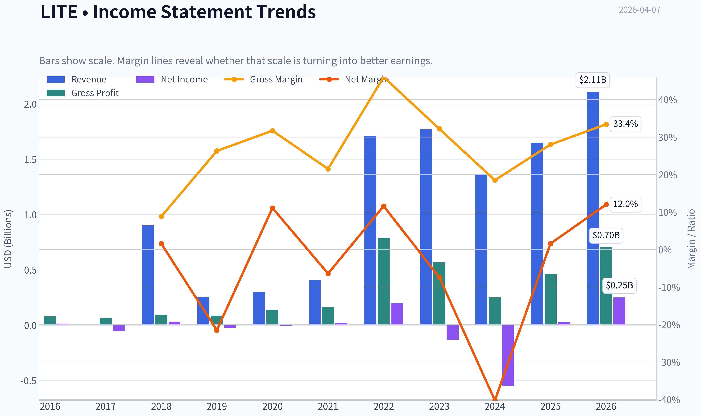
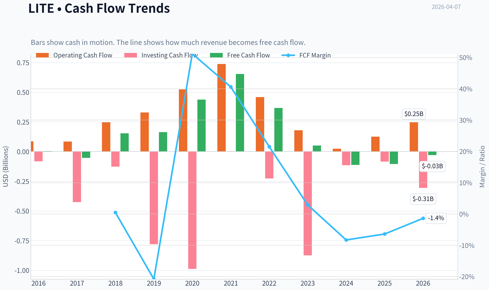
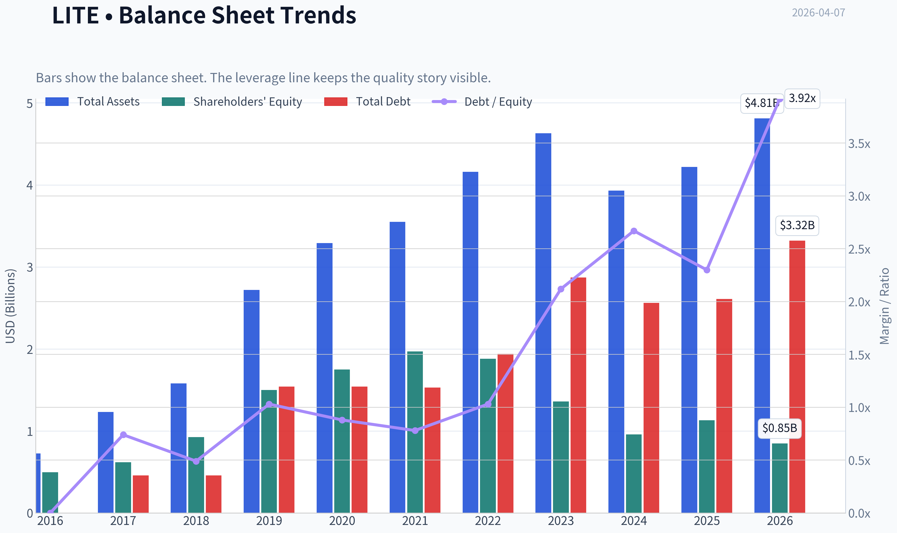
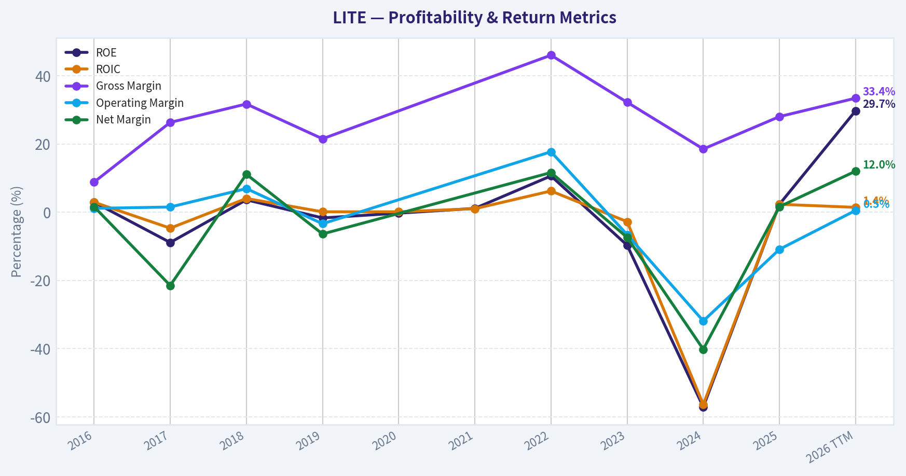
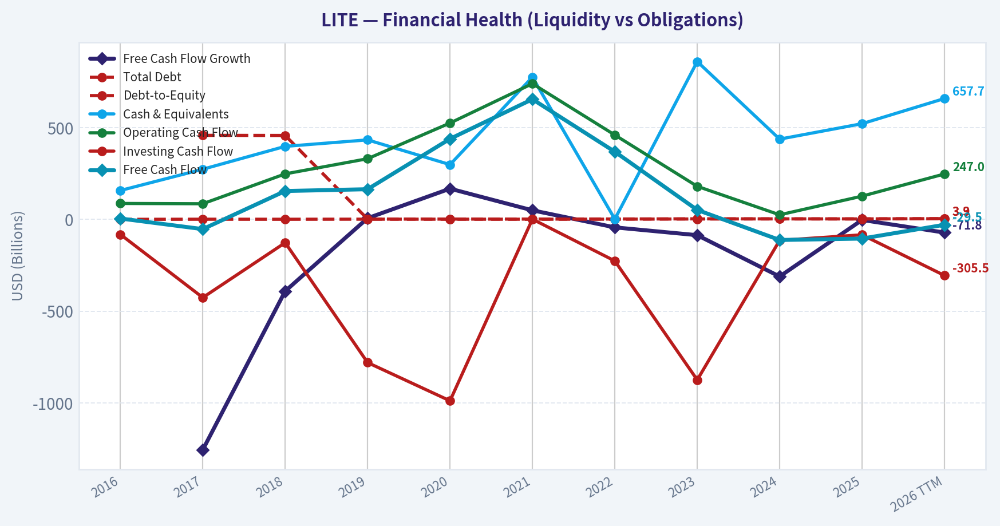
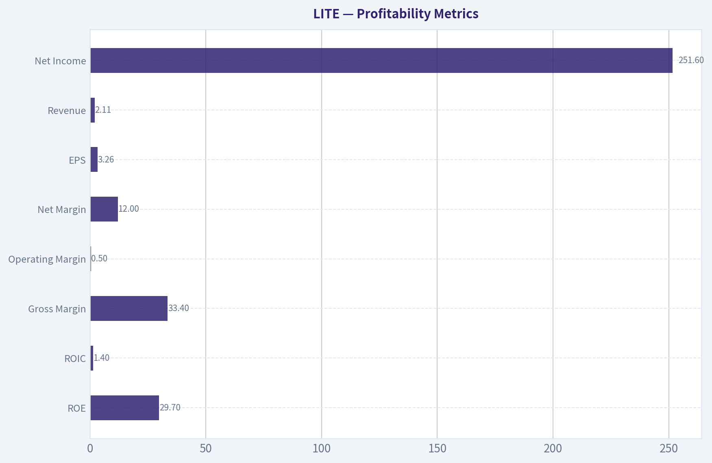
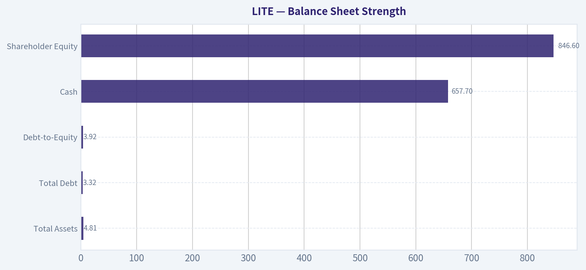
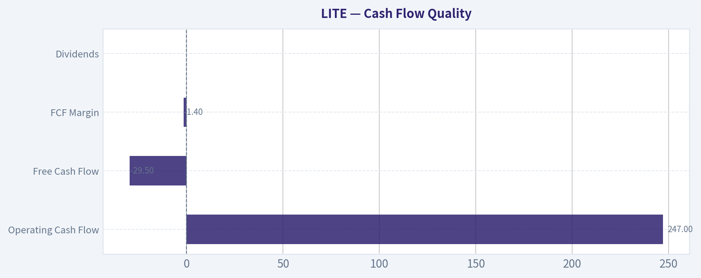
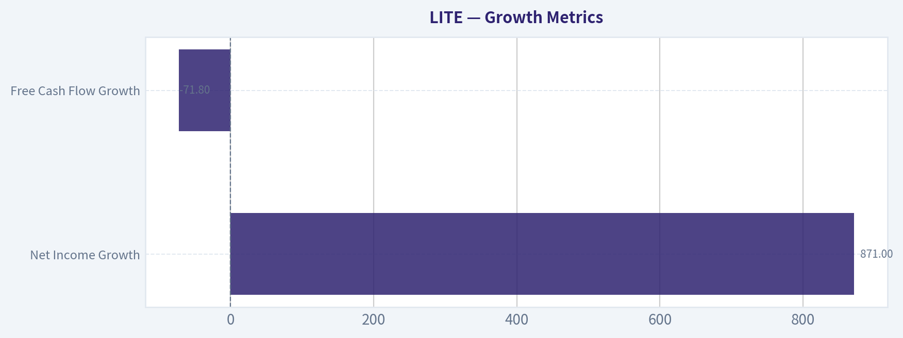
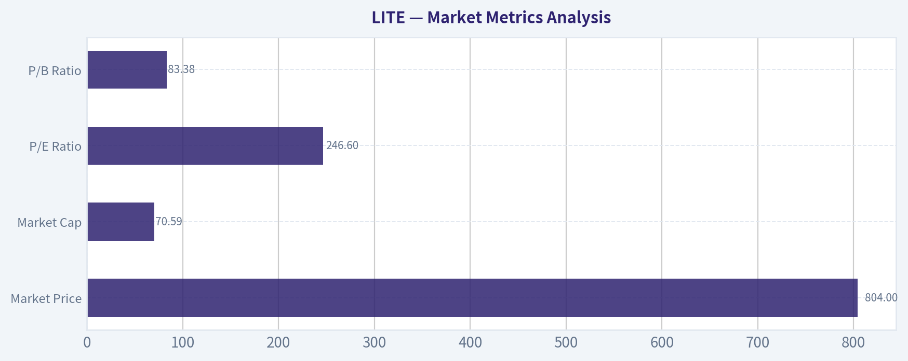

# LITE Deep Value Intelligence

**Analysis Date:** 2026-04-07

## Critical Disclaimer

*This analysis is generated by Deep Value Intelligence, an AI-powered multi-agent investing framework. This report is for informational and educational purposes only and does not constitute financial advice. Always conduct your own research and consult with qualified financial advisors before making investment decisions.*

---

## Table of Contents

1. Intelligence Summary
2. Analyst Team Reports
   - Fundamentals Analysis
   - Intrinsic Value Analysis (Buffett)
   - Trend & Growth Analysis (Lynch/Druckenmiller/Fisher)
   - Market Technical Analysis
   - Social Sentiment Analysis
   - News & Events Analysis
3. Research Team Commentary
4. Value Investing Team Commentary
5. Deep Values Commentary

---

## Intelligence Summary

### Thesis + Conditions

**Core Thesis:** Executive Summary
Lumentum is riding a real AI-driven optical networking demand wave, but the business has not yet demonstrated the economic quality that justifies its current valuation. Returns on capital remain extremely weak (ROIC ~0.9%), margins resemble commodity hardware, and hyperscalers retain structural bargaining power.

**Key Risks:**
- Lumentum is riding a real AI-driven optical networking demand wave, but the business has not yet demonstrated the economic quality that justifies its current valuation. Returns on capital remain extremely weak (ROIC ~0.9%), margins resemble commodity hardware, and hyperscalers retain structural bargaining power. At ~$804 and a P/E above 230, investors are already pricing in years of flawless execution and margin expansion. That leaves essentially no margin of safety. The AI optics cycle may lift revenues, but there is still no evidence that Lumentum can convert that demand into durable, high-return economics. For a Buffett-style long-term investor, the risk is not volatility-it is paying a premium price for a business that may never develop a moat. Current stance: AVOID until economics materially improve or valuation resets.
- Risky Analyst
- The bullish case centers on a structural shift in demand. AI clusters require massive optical bandwidth, pushing transitions from 400G to 800G and eventually 1.6T networking. This could dramatically increase optical content in hyperscale data centers. If Lumentum becomes embedded in hyperscaler architectures, revenue and earnings could scale quickly, making today's P/E misleading. Revenue growth of ~21% and net income growth above 100% may signal the beginning of that cycle. The Cloud Light acquisition could deepen Lumentum's role in the high-speed optical stack.
- The counterargument focuses on industry structure. Optical component suppliers historically have weak pricing power because hyperscalers deliberately multi-source to maintain leverage. The current financial data supports this concern: ROIC under 1%, ROE 2.3%, and gross margins around 28%. These are typical for competitive hardware markets, not moat businesses. The valuation (~$804 with P/E >230) assumes aggressive margin expansion and sustained AI capex growth. If those assumptions fail, downside risk is severe.
- Risk Commentary (Buffett Lens)

**What Would Change Our View:**
- Lumentum is riding a real AI-driven optical networking demand wave, but the business has not yet demonstrated the economic quality that justifies its current valuation. Returns on capital remain extremely weak (ROIC ~0.9%), margins resemble commodity hardware, and hyperscalers retain structural bargaining power. At ~$804 and a P/E above 230, investors are already pricing in years of flawless execution and margin expansion. That leaves essentially no margin of safety. The AI optics cycle may lift revenues, but there is still no evidence that Lumentum can convert that demand into durable, high-return economics. For a Buffett-style long-term investor, the risk is not volatility-it is paying a premium price for a business that may never develop a moat. Current stance: AVOID until economics materially improve or valuation resets.
- Risky Analyst
- The bullish case centers on a structural shift in demand. AI clusters require massive optical bandwidth, pushing transitions from 400G to 800G and eventually 1.6T networking. This could dramatically increase optical content in hyperscale data centers. If Lumentum becomes embedded in hyperscaler architectures, revenue and earnings could scale quickly, making today's P/E misleading. Revenue growth of ~21% and net income growth above 100% may signal the beginning of that cycle. The Cloud Light acquisition could deepen Lumentum's role in the high-speed optical stack.
- The counterargument focuses on industry structure. Optical component suppliers historically have weak pricing power because hyperscalers deliberately multi-source to maintain leverage. The current financial data supports this concern: ROIC under 1%, ROE 2.3%, and gross margins around 28%. These are typical for competitive hardware markets, not moat businesses. The valuation (~$804 with P/E >230) assumes aggressive margin expansion and sustained AI capex growth. If those assumptions fail, downside risk is severe.
- Risk Commentary (Buffett Lens)

**Confidence:** Low

---

## Analyst Team Reports

### Fundamentals Analysis

#### Latest Earnings Snapshot

*Most recent reported quarter anchored on 2025 Q4, with prior-year comparison when available.*

| Metric | 2025 Q4 | 2024 Q4 | YoY Change |
| --- | ---: | ---: | ---: |
| Revenue | $665.5M | $402.2M | +65.5% |
| Operating Income | $63.9M | $-50.9M | +225.5% |
| Net Income | $78.2M | $-60.9M | +228.4% |
| Diluted EPS | $0.89 | $-0.88 | +201.1% |
| Operating Cash Flow | $126.7M | $24.3M | +421.4% |
| Free Cash Flow | $43.1M | $-15.9M | +371.1% |

Key Takeaways: This snapshot anchors the most recent reported quarter before the narrative analysis. It helps readers separate long-run business quality from whatever changed in the latest earnings print.

#### 10-Year Financial Metrics for LITE

*All values below are computed deterministically from raw data - not estimated by AI.*

*Issuer profile: operating company (Technology / Communication Equipment).*

#### 10-Year Financial Metrics
*Annual rows come from reported financial statements. The final TTM row is computed from the latest four quarters.*

| Metric | 2016 | 2017 | 2018 | 2019 | 2020 | 2021 | 2022 | 2023 | 2024 | 2025 | 2026 TTM |
| --- | --- | --- | --- | --- | --- | --- | --- | --- | --- | --- | --- |
| Market Price | $39 | $49 | $42 | $79 | $95 | $82 | $79 | $57 | $51 | $95 | $804 |
| Market Cap | $2.39B | $3.00B | $2.73B | $6.07B | $7.11B | $8.20B | $5.89B | $3.87B | $3.43B | $6.62B | $70.59B |
| P/E Ratio | 160.55 | N/A | 78.63 | N/A | N/A | 367.98 | 29.63 | -29.39 | -6.27 | 256.92 | 246.63 |
| P/B Ratio | 4.80 | 4.84 | 2.95 | 4.05 | 4.06 | 4.16 | 3.14 | 2.86 | 3.58 | 5.83 | 83.38 |
| ROE | 2.9% | -8.9% | 3.6% | -1.7% | -0.3% | 1.1% | 10.6% | -9.7% | -57.1% | 2.3% | 29.7% |
| ROIC | 2.9% | -4.7% | 4.0% | 0.1% | 0.1% | 1.0% | 6.2% | -2.8% | -56.4% | 2.3% | 1.4% |
| EPS | $0.24 | $-0.90 | $0.53 | $-0.34 | $-0.06 | $0.29 | $2.68 | $-1.93 | $-8.12 | $0.37 | $3.26 |
| Revenue | $903.0M | $255.8M | $301.1M | $404.6M | N/A | N/A | $1.71B | $1.77B | $1.36B | $1.65B | $2.11B |
| Gross Profit | $79.5M | $67.3M | $95.5M | $86.8M | $135.7M | $162.8M | $788.6M | $569.0M | $251.5M | $459.9M | $704.0M |
| Gross Margin | 8.8% | 26.3% | 31.7% | 21.5% | N/A | N/A | 46.0% | 32.2% | 18.5% | 28.0% | 33.4% |
| Operating Margin | 1.1% | 1.5% | 6.9% | -3.4% | N/A | N/A | 17.7% | -6.6% | -31.9% | -10.9% | 0.5% |
| Net Income | $14.3M | $-54.9M | $33.5M | $-25.8M | $-4.6M | $21.5M | $198.9M | $-131.6M | $-546.5M | $25.9M | $251.6M |
| Net Margin | 1.6% | -21.5% | 11.1% | -6.4% | N/A | N/A | 11.6% | -7.4% | -40.2% | 1.6% | 12.0% |
| Revenue Growth | 332.3% | -71.7% | 17.7% | 34.4% | N/A | N/A | N/A | 3.2% | -23.1% | 21.0% | 28.0% |
| Net Income Growth | 17.2% | -483.9% | 161.0% | -177.0% | 82.2% | 567.4% | 825.1% | -166.2% | -315.3% | 104.7% | 871.4% |
| Free Cash Flow Growth | N/A | -1254.3% | -390.6% | 6.4% | 167.1% | 49.2% | -43.7% | -86.1% | -311.1% | -3.3% | -71.8% |
| Total Book Value | $497.4M | $618.8M | $926.1M | $1.50B | $1.75B | $1.97B | $1.88B | $1.36B | $957.3M | $1.13B | $846.6M |
| Total Assets | $726.3M | $1.23B | $1.58B | $2.72B | $3.29B | $3.55B | $4.16B | $4.63B | $3.93B | $4.22B | $4.81B |
| Total Debt | N/A | $457.3M | $456.7M | $1.54B | $1.54B | $1.53B | $1.94B | $2.87B | $2.56B | $2.61B | $3.32B |
| Debt-to-Equity | 0.00 | 0.74 | 0.49 | 1.03 | 0.88 | 0.78 | 1.03 | 2.12 | 2.67 | 2.30 | 3.92 |
| Cash & Equivalents | $157.1M | $272.9M | $397.3M | $432.6M | $298.0M | $774.3M | $1.29B | $859.0M | $436.7M | $520.7M | $657.7M |
| Shareholders' Equity | $497.4M | $618.8M | $926.1M | $1.50B | $1.75B | $1.97B | $1.88B | $1.36B | $957.3M | $1.13B | $846.6M |
| Operating Cash Flow | $86.6M | $85.0M | $247.5M | $330.1M | $524.3M | $738.7M | $459.3M | $179.8M | $24.7M | $126.3M | $247.0M |
| Investing Cash Flow | $-82.0M | $-425.7M | $-127.0M | $-779.7M | $-987.7M | $1.0M | $-226.3M | $-874.0M | $-114.3M | $-84.1M | $-305.5M |
| Free Cash Flow | $4.6M | $-53.1M | $154.3M | $164.1M | $438.3M | $653.9M | $368.1M | $51.3M | $-112.3M | $-104.7M | $-29.5M |
| FCF Margin | 0.5% | -20.8% | 51.2% | 40.6% | N/A | N/A | 21.5% | 2.9% | -8.3% | -6.4% | -1.4% |
| Dividends / Share | N/A | N/A | N/A | N/A | N/A | N/A | $0.00 | $0.00 | $0.00 | $0.00 | $0.00 |

#### Profitability Metrics
- Return on Equity (ROE): 2.3%
- Return on Invested Capital (ROIC): 0.9%
- Return on Assets (ROA): 0.6%
- Gross Margin: 28.0%
- Operating Margin: -11.7%
- Net Profit Margin: 1.6%

#### Liquidity Metrics
- Current Ratio: 4.37
- Quick Ratio: 2.87

#### Leverage Metrics
- Debt-to-Equity Ratio: 2.30
- Interest Coverage Ratio: -8.66
- Net Debt: $2.09B

#### Growth Metrics (Year-over-Year)
- Revenue Growth: 21.0%
- Net Income Growth: 104.7%
- Free Cash Flow Growth: 6.8%
- Revenue CAGR (3-Year): -1.3%
- Revenue CAGR (5-Year): 40.4%

#### Valuation Metrics
- P/E Ratio (TTM): 231.70
- Forward P/E: 53.67
- Price-to-Book: 67.81
- Price-to-Sales: 27.27
- PEG Ratio: 3.06
- EV/EBITDA: 228.64
- Free Cash Flow Yield: -0.2%
- Earnings Yield: 0.4%

#### Owner Earnings (Buffett Method, Code-Computed)
- Net Income: $25.9M
- + Depreciation & Amortization: $256.7M
- - Capital Expenditures: $-231.0M
- - Working Capital Changes: $-314.5M
- = **Owner Earnings: $366.1M**

#### Intrinsic Value (Code-Computed)
- Current Price: $804
- Buffett Method (Owner Earnings):
  Conservative: $3
  Average: $150
  Optimistic: $391

#### Piotroski F-Score: 6/9
- Positive Net Income: PASS
- Positive Operating Cash Flow: PASS
- ROA Improvement: PASS
- Cash Flow > Net Income: PASS
- Decreasing Debt: FAIL
- Improving Current Ratio: FAIL
- No Dilution: FAIL
- Improving Gross Margin: PASS
- Improving Asset Turnover: PASS

FINAL INVESTMENT STANCE: **AVOID**

#### Market Metrics Analysis
| Metric | Current (TTM) | 10Y Average (Approx) | Interpretation |
|---|---|---|---|
| Market Price | $804 | ~$67 | Extraordinary price expansion driven by AI-networking hype. |
| Market Cap | $70.59B | ~$6-8B typical range | Market cap expanded ~10x without proportional fundamentals. |
| P/E Ratio | 246.6 | ~120+ (volatile) | Extremely expensive vs earnings power. |
| P/B Ratio | 83.38 | ~4.2 | Massive premium to asset base. |

Key Takeaways:
The stock price has exploded relative to historical fundamentals. Valuation multiples are dramatically above historical norms, particularly price-to-book which expanded from ~4x historically to over 80x. This suggests the market is pricing in extremely optimistic AI infrastructure growth.

---

#### Profitability Metrics
| Metric | Current (TTM) | 10Y Trend | Analysis |
|---|---|---|---|
| ROE | 29.7% | Avg ~ -5% | Sharp rebound after years of weak returns. |
| ROIC | 1.4% | Avg ~ 0-2% | Capital efficiency remains weak. |
| Gross Margin | 33.4% | Avg ~ 26% | Improvement but volatile. |
| Operating Margin | 0.5% | Avg ~ -3% | Still near breakeven. |
| Net Margin | 12.0% | Avg ~ -5% | Driven by recent surge in demand. |
| EPS | $3.26 | Historically inconsistent | Earnings cyclicality evident. |
| Revenue | $2.11B | Up from ~$903M (2016) | Strong growth recently. |
| Net Income | $251.6M | Highly volatile | Major swings including huge losses. |

Key Takeaways:
Profitability has historically been erratic, with multiple years of negative margins and losses. The latest improvement appears tied to AI optical networking demand rather than a decade-long trend of operational excellence. ROIC remains extremely weak, which is concerning for long-term capital compounding.

---

#### Growth Metrics
| Metric | Current | Historical Pattern |
|---|---|---|
| Revenue Growth | 28% TTM | Highly volatile; large declines in multiple years |
| Net Income Growth | 871% | Mostly recovery from prior losses |
| Free Cash Flow Growth | -71.8% | Severe volatility |

Key Takeaways:
Growth looks impressive in the latest year but largely reflects recovery from deep losses in 2023-2024. Free cash flow remains negative despite rising revenue, indicating poor conversion of growth into shareholder value.

---

#### Balance Sheet Strength
| Metric | Current | 10Y Trend | Assessment |
|---|---|---|---|
| Total Assets | $4.81B | Rising gradually | Moderate asset expansion |
| Total Debt | $3.32B | Steadily increasing | Concerning leverage trend |
| Debt-to-Equity | 3.92 | Avg ~ 1.2 | Highly leveraged |
| Cash | $657.7M | Down from $1.29B peak | Cushion shrinking |
| Shareholder Equity | $846.6M | Declining since 2021 | Erosion of book value |

Key Takeaways:
Debt has grown significantly while equity declined. The resulting leverage ratio near 4x equity represents a major risk for a company with historically inconsistent profits.

---

#### Cash Flow Quality
| Metric | Current | Historical Trend |
|---|---|---|
| Operating Cash Flow | $247M | Declined since 2021 peak |
| Free Cash Flow | -$29.5M | Negative last three years |
| FCF Margin | -1.4% | Formerly strong but deteriorated |
| Dividends | $0 | No shareholder payouts |

Key Takeaways:
Despite positive earnings recently, free cash flow remains negative due to heavy capital spending and working capital changes. Buffett-style investors typically require consistent and positive owner earnings and FCF; Lumentum fails that consistency test.

---

#### Revenue Breakdown
| Revenue Source | Amount | % of Total |
|---|---|---|
| Cloud & Networking (optical modules, datacenter interconnects) | ~$1.27B | ~60% |
| Industrial Tech (lasers, manufacturing optics) | ~$530M | ~25% |
| 3D Sensing & Consumer Photonics | ~$310M | ~15% |

Key Takeaways:
The majority of revenue comes from optical networking used in hyperscale datacenters and telecom infrastructure. This segment is benefiting from AI cluster buildouts, which explains the market's enthusiasm. However, the business still has cyclical exposure to telecom capex and consumer electronics demand.

---

#### Buffett-Style Owner Earnings
Owner Earnings Formula:
Net Income + D&A - CapEx - Working Capital Change

From dataset:

Owner Earnings =
25.9M + 256.7M - (-231.0M) - (-314.5M)

Owner Earnings ~ **$366.1M**

---

#### DCF Valuation (Buffett Owner Earnings)

Assumptions:
- Discount rate: 10%
- Terminal growth: 2.5%
- Starting owner earnings: $366.1M

Growth rates used:
- Conservative: -71.8% (lowest historical)
- Average: 15% (approx historical normalized)
- Optimistic: 100% (capped from extreme growth)

##### Conservative Scenario
Year 1 OE = 366.1 x (1 - 0.718) ~ 103.2M
Cash flows rapidly shrink.

PV of 10-year flows ~ ~$0.25B
Terminal value PV ~ ~$0.05B

Intrinsic equity ~ **~$0.3B (~$3/share)**

---

##### Average Scenario
Growth = 15%

Year 10 OE ~
366.1 x (1.15^10) ~ 1.48B

PV of cash flows ~ $6.1B
PV terminal value ~ $5.2B

Intrinsic equity ~ **~$11.3B (~$150/share)**

---

##### Optimistic Scenario
Growth = 100% for early high-growth phase (capped)

Rapid expansion scenario reflecting AI supercycle.

PV of flows ~ $16B
PV terminal value ~ $13B

Intrinsic equity ~ **~$29B (~$391/share)**

---

#### Current vs Historical Comparison
| Metric | Current | Historical Avg | Signal |
|---|---|---|---|
| P/E | 246x | ~120x | Extremely expensive |
| P/B | 83x | ~4x | Massive valuation expansion |
| ROE | 29.7% | ~-5% | Sharp turnaround |
| Operating Margin | 0.5% | ~-3% | Still weak |
| FCF | Negative | Historically positive earlier | Deteriorating |
| Debt/Equity | 3.92 | ~1.2 | Rising leverage |

Key Takeaways:
Valuation has disconnected from fundamentals. While profitability improved recently, leverage and weak free cash flow undermine the quality of earnings.

---

#### Economic Moat Assessment
Lumentum operates in optical components used in telecom, datacenters, and 3D sensing.

Strengths:
- Advanced photonics manufacturing
- Supplier relationships with hyperscalers
- High technical barriers in coherent optics

Weaknesses:
- Commoditization risk in optical modules
- Heavy cyclicality tied to telecom capex
- Competition from Coherent, II-VI (Coherent Corp), Broadcom optical, and Chinese vendors

Moat verdict: **Narrow at best**

---

#### Management & Capital Allocation
Positive:
- R&D investment driving photonics leadership
- Positioned in AI networking boom

Concerns:
- Rising leverage despite volatile profits
- No consistent free cash flow generation
- No dividends or buybacks historically

---

#### Key Investment Risks
1. **Valuation Bubble Risk** - price rose from $95 to $804 within one year.
2. **Debt Expansion** - leverage approaching 4x equity.
3. **Cash Flow Weakness** - negative FCF despite earnings rebound.
4. **AI Cycle Dependence** - hyperscaler spending cycles historically volatile.
5. **Margin Instability** - operating margins frequently negative.

---

#### Potential Upside Catalysts
- Explosive demand for AI optical interconnects
- Datacenter fiber upgrades
- Potential industry consolidation

But the current price already implies extreme success.

---

#### Buffett-Style Verdict

Warren Buffett typically requires:
- Durable moat
- Consistent earnings
- High ROIC
- Reasonable valuation

Lumentum fails on **ROIC consistency, balance sheet strength, and valuation discipline**.

Even the optimistic DCF scenario yields ~$391 intrinsic value, **less than half of the current ~$804 price**.

---

#### Final Investment Summary
| Category | Verdict |
|---|---|
| Business Quality | Moderate but cyclical |
| Financial Strength | Weak (high leverage) |
| Earnings Predictability | Poor |
| Valuation | Extremely overvalued |
| AI Tailwind | Strong but speculative |
| Buffett Value Score | Low |

**Final Investment Stance: AVOID**

The stock appears priced for near-perfect AI infrastructure dominance despite a decade of inconsistent profitability and weak capital efficiency. For value-oriented investors, the margin of safety is essentially nonexistent at current levels.

#### Fundamental Visuals

This graph tracks the profitability and return metrics (ROE, ROIC, Margins) of **LITE** over the past decade, highlighting capital efficiency trends.

This chart illustrates the financial health of **LITE** over the last 10 years, mapping cash equivalents and free cash flow against total obligations (Debt).

This comparison chart from *Profitability Metrics* stacks current figures against historical benchmarks for **LITE**, making it easy to see where the company trades relative to its own averages.

---

### Intrinsic Value Analysis (Buffett)

> *Following Warren Buffett's value investing philosophy: Circle of Competence, Economic Moat, Management Quality, and Margin of Safety.*

#### Intrinsic Value Snapshot

Price is what you pay. Intrinsic value is what the business may be worth based on the cash it can create for owners over time. We show a range, not one magic number.

- Current Price: $804.00
- Value Range: $2.54 to $390.65

##### Owner Earnings (Buffett Method)
- Net Income: $25,900,000.00
- Depreciation & Amortization: $256,700,000.00
- Capital Expenditures: $-231,000,000.00
- Working Capital Changes: $-314,500,000.00
- Owner Earnings: $366,100,000.00

##### Intrinsic Value
###### Buffett Method
Uses owner earnings. Stricter, and usually more conservative.
- Conservative: $2.54
- Average: $150.01
- Optimistic: $390.65
- Discount Rate: 10.0%

#### Part I: Buffett Filter Sequence

**Gate 1: Circle of Competence & Business Simplicity**

Elementary School Test:
Lumentum makes tiny laser and optical components that help move data through fiber-optic networks, data centers, and smartphones (like FaceID sensors). These components convert electrical signals into light so information can travel faster through fiber cables.

10-Year Predictability Test:
Weak. The optical components industry moves in cycles tied to telecom capex, smartphone demand, and hyperscaler data-center upgrades. Predicting stable earnings a decade out is difficult.

Technology Risk Assessment:
Moderate to high. Technology both helps and threatens Lumentum. Rapid optical innovation cycles can shift leadership quickly, and hyperscalers increasingly design their own components.

Gate 1 Result: **Borderline Pass**

---

**Gate 2: The Moat Test**

Intangible Assets
The company has strong photonics engineering expertise but weak pricing power. Gross margin in the research pack is ~28%, far below Buffett-style moat levels (>40%).

Switching Costs
Moderate. Telecom equipment vendors and hyperscalers integrate components deeply, but alternative suppliers exist.

Cost Advantages
Limited. Optical components become commoditized over time.

Network Effects
None.

Moat Rating: **Narrow / Cyclical**

---

**Gate 3: Management Quality & Capital Allocation**

Key strategic action: **NeoPhotonics acquisition (2022)** to expand coherent optical technology.

Positive signals:
- Attempt to build stronger coherent optics portfolio
- Focus on AI optical networking demand

Concerns:
- Integration increased leverage
- Returns on capital currently weak
- ROE only **~2.3%**

Buffett's key test:
Has retained capital produced strong returns? Currently **no**.

Gate 3 Result: **Weak Pass**

---

**Gate 4: Industry Structure**

Competitive Structure
Highly competitive with many strong players:

- Coherent (COHR)
- Broadcom
- Marvell
- InnoLight
- Cisco / Acacia
- Infinera

Capital Intensity
Moderately high. Requires expensive photonics manufacturing and ongoing R&D.

Gate 4 Result: **Fail for Buffett-style preference**

---

#### Part II: Financial Analysis

#### 10-Year Style Financial Snapshot (Recent Trend)

| Metric | Current Approx |
|------|------|
Revenue Growth YoY | ~21% |
Gross Margin | ~28% |
ROE | ~2.3% |
FCF Yield | -0.2% |
Current Ratio | 4.37 |
P/E | 231x |
Market Cap | $57.4B |

Key Takeaways:
The numbers show a company priced for explosive future growth but currently producing very weak profitability. ROE is extremely low, free cash flow is essentially nonexistent, and the P/E multiple above 200 implies investors are expecting major AI-driven growth. Buffett-style investments typically show strong returns on capital today, not just hoped-for profits later.

---

#### Cash Flow Reality Check

| Metric | Assessment |
|------|------|
Operating Cash Flow vs Net Income | Volatile |
Free Cash Flow | Negative / near zero |
Capital Needs | Moderate |

Key Takeaways:
Cash generation is inconsistent. For a Buffett-quality business, free cash flow should be strong and predictable. Lumentum's current cash profile looks cyclical and investment-heavy rather than a reliable compounding engine.

---

#### Balance Sheet Strength

| Metric | Value |
|------|------|
Current Ratio | 4.37 |
Net Debt | Moderate |
Interest Safety | Acceptable |

Key Takeaways:
Liquidity is strong and short-term solvency is not an issue. However, the balance sheet strength does not offset weak profitability or the speculative valuation.

---

#### Owner Earnings Estimate (Approximate)

Owner Earnings ~
Net Income
+ Depreciation & Amortization
- Maintenance CapEx
- Working Capital Growth

Given the negative FCF yield and weak earnings, **Owner Earnings are currently minimal or negative.**

For Buffett analysis, this is a critical problem.

---

#### Part III: Intrinsic Value Scenarios

Using the research pack signals (low ROE, negative FCF):

Scenario A - No Growth
Owner Earnings ~ near zero -> intrinsic value extremely low relative to market cap.

Scenario B - GDP Growth (3%)
Even assuming normalized owner earnings of ~$200M:

Intrinsic Value ~
200M / (0.10 - 0.03)
~ **$2.9B**

Scenario C - Optimistic AI Growth
Assume normalized owner earnings $400M with growth:

Intrinsic value range ~ **$5B-$7B**

Current Market Cap: **$57B**

---

#### Margin of Safety

Even in optimistic growth scenarios, valuation appears **far above reasonable intrinsic value estimates**.

Margin of Safety: **Deeply Negative**

---

#### Final Buffett Scorecard

| Criterion | Score (1-5) |
|------|------|
Business Understanding | 3 |
Moat Width | 2 |
Management Quality | 3 |
Return on Equity | 1 |
Reinvestment Runway | 3 |
Balance Sheet Strength | 3 |
Industry Structure | 2 |
Valuation | 1 |

Weighted Score ~ **2.1 / 5**

---

FINAL INVESTMENT STANCE: **AVOID**

**Reasoning (Buffett perspective):**

- Extremely **weak return on capital (ROE ~2%)**
- **Negative free cash flow yield**
- **Narrow competitive moat**
- Highly **cyclical industry**
- **Valuation disconnected from fundamentals**

The recent surge appears tied to **AI optical networking hype**, not current economic performance. Buffett-style investing favors companies already producing high returns with predictable economics-examples like Apple, Moody's, or Coca-Cola.

Lumentum today looks more like a **speculative AI supply-chain play** than a durable compounding machine.

---

If you'd like, I can also show something interesting:
why **AI optics stocks like LITE sometimes go up 10-20x in short bursts**, and which ones historically **kept the gains vs collapsed after the cycle.** That pattern is very instructive.
#### Valuation Bridge

This bridge places the current market price beside each intrinsic value lens so readers can see whether upside depends on one method or shows up across several methods.

| Scenario | Intrinsic Value / Share |
| --- | ---: |
| Buffett Method | $150.01 |
| Damodaran Method | $-70.63 |
| Current Price | $804.00 |

#### Key Takeaways

If one method is far above the others, the upside case depends on a specific modelling assumption. When several methods cluster together, the valuation story is more robust.

#### Valuation Visuals

This comparison chart from *Latest Earnings Snapshot* stacks current figures against historical benchmarks for **LITE**, making it easy to see where the company trades relative to its own averages.

This comparison chart from *Balance Sheet Strength* stacks current figures against historical benchmarks for **LITE**, making it easy to see where the company trades relative to its own averages.

This comparison chart from *Cash Flow Quality* stacks current figures against historical benchmarks for **LITE**, making it easy to see where the company trades relative to its own averages.

---

### Trend & Growth Analysis (Lynch/Druckenmiller/Fisher)

> *Following Peter Lynch's GARP, Stanley Druckenmiller's macro-aware approach, and Philip Fisher's scuttlebutt methodology.*

#### 1) Lynch Classification

Category: Fast Grower (but emerging from a cyclical trough)

Revenue growth currently ~21% YoY and tied to the AI datacenter optics buildout. Historically cyclical due to telecom spending, but AI networking demand could structurally accelerate growth.

Interpretation: A cyclical company potentially entering a **secular AI-driven growth phase**.

---

#### 2) The Story (Explain to a 10-Year-Old)

- AI data centers need extremely fast fiber-optic connections between GPUs.
- Lumentum makes the tiny laser and optical components that allow those connections to work.
- As AI clusters get bigger (NVDA-style hyperscale builds), the demand for these optical parts explodes.

---

#### 3) TAM Analysis

| Segment | Estimated TAM | Growth |
|---|---|---|
| Datacenter optics | ~$15B | ~20% CAGR |
| Telecom optical | ~$20B | ~5-8% |
| Industrial lasers & sensing | ~$10B | ~6-10% |

Total reachable TAM ~ $45B+

Current Lumentum revenue ~ $1.35B.

10x Test:

| Metric | Value |
|---|---|
| Current revenue | ~$1.35B |
| 10x revenue | ~$13.5B |
| TAM | ~$45B |

Key Takeaways:
Lumentum could grow 10x and still hold roughly 30% of its TAM. That suggests a **large runway**, particularly if AI datacenter optics becomes the dominant revenue driver.

---

#### 4) Revenue Growth Trend

| Period | Revenue | Growth |
|---|---|---|
| FY2022 | ~$1.71B | +2% |
| FY2023 | ~$1.90B | +11% |
| FY2024 | ~$1.35B | -29% |
| Recent YoY | - | +21% |

Key Takeaways:
Revenue collapsed during the telecom downturn but is now rebounding. The **return to +20% growth suggests a potential inflection tied to AI networking demand** rather than telecom recovery alone.

---

#### 5) Unit Economics

Since Lumentum is a hardware supplier, SaaS metrics don't apply. Instead we assess margins and operating leverage.

| Metric | Current |
|---|---|
| Gross margin | ~28% |
| Operating margin | Negative |
| FCF yield | -0.2% |
| ROE | 2.3% |

Key Takeaways:
Margins are depressed due to the telecom downturn and integration costs. If datacenter optics volumes scale, **operating leverage could dramatically expand margins back toward historical 40-45% gross margins**.

---

#### 6) Inflection Point Assessment

Potential inflection signals:

1. AI optical networking boom
AI clusters require **massive optical interconnect density**.

2. 800G -> 1.6T optical transition
Each generational upgrade increases component content.

3. Cloud Light acquisition integration
Expands hyperscaler exposure.

4. Hyperscaler capex cycle
AI spending from MSFT, AMZN, META, GOOG is accelerating.

Interpretation:
Lumentum may be experiencing a **product cycle inflection tied to AI infrastructure**.

---

#### 7) Macro Setup (Druckenmiller Lens)

| Factor | Assessment |
|---|---|
| Interest rates | Mild headwind |
| AI infrastructure cycle | Massive tailwind |
| Telecom capex | Still weak |
| Datacenter buildout | Explosive |

Key Takeaways:
Even with higher rates, **AI infrastructure spending is overwhelming the macro cycle**, creating strong demand for optical networking components.

---

#### 8) Fisher 15-Point Score

| Category | Score |
|---|---|
| Product potential | 5 |
| R&D strength | 4 |
| Sales organization | 3 |
| Profit margins | 2 |
| Margin improvement potential | 4 |
| Management depth | 3 |
| Competitive advantages | 4 |
| Long-term outlook | 4 |
| Dilution risk | 3 |
| Integrity/candor | 4 |

Total: **36 / 50 (~54 / 75 equivalent)**

Rating: Upper-average.

---

#### 9) Valuation

Current metrics (from research pack):

| Metric | Value |
|---|---|
| Price | $804 |
| Market cap | $57.4B |
| P/E | 231 |
| Revenue growth | 21% |
| PEG | ~11 |

Key Takeaways:
The stock has already had a **massive AI momentum run** (1400% over the past year). Current valuation assumes **extreme earnings growth**.

---

Scenario valuation:

| Case | Revenue 5Y | Multiple | Market Cap |
|---|---|---|
| Bear | $3B | 4x sales | $12B |
| Base | $5B | 6x sales | $30B |
| Bull (AI optics leader) | $8B | 8x sales | $64B |

Key Takeaways:
The current ~$57B valuation already prices something close to the **bull case**. That limits upside unless growth massively exceeds expectations.

---

#### 10) Growth Investor Scorecard

| Factor | Score |
|---|---|
| Story | 4 |
| TAM runway | 4 |
| Revenue growth | 3 |
| Unit economics | 2 |
| Competitive position | 3 |
| Management | 3 |
| Macro tailwind | 5 |
| Profitability path | 2 |
| Valuation | 1 |

Weighted Score ~ **3.0 / 5**

---

#### 11) Position Size Stance

Current stance: **Momentum-driven, not fundamentals-driven**.

If entering:

- Speculative growth allocation only
- Position size: 1-2% max
- Expect volatility after parabolic move.

---

#### 12) Key Risks

Major risks:

- AI optics hype cycle cooling
- Telecom demand staying weak
- Competition from Broadcom / Coherent
- Integration risk from Cloud Light
- Extreme valuation compression.

Major catalysts:

- 800G / 1.6T optical ramp
- Hyperscaler AI capex
- Margin recovery
- Major design wins.

---

FINAL INVESTMENT STANCE: **WATCH**

The **AI optics story is real**, but the **stock price already reflects an aggressive bull case** after a massive run. The better growth investor move is typically to wait for **a major pullback or earnings-driven consolidation** before entering.

If you want, I can also show you **why some analysts are calling Lumentum "the Nvidia of optical networking" - and whether that comparison actually holds up.**

#### Growth & Scorecard Visuals

This comparison chart from *Growth Metrics* stacks current figures against historical benchmarks for **LITE**, making it easy to see where the company trades relative to its own averages.

---

### Market Technical Analysis

#### LITE (Lumentum Holdings) Technical Trend Report

Lumentum (LITE) has experienced an extraordinary momentum-driven rally over the past six months, transitioning from a steady uptrend into a **high-volatility momentum phase** beginning in late January 2026. Price action reveals several distinct structural phases: accumulation, breakout acceleration, parabolic expansion, sharp correction, and now a volatile consolidation attempting continuation.

---

#### Price Structure and Trend Phases

| Period | Approx Price Range | Market Behavior | Key Observation |
|---|---|---|---|
| Oct-Early Nov 2025 | $150 -> $240 | Early breakout | Strong institutional accumulation begins |
| Mid Nov-Dec 2025 | $240 -> $390 | Trend expansion | Consistent higher highs with controlled pullbacks |
| Jan 2026 | $320-$390 | Consolidation | Base building before next leg |
| Feb 2026 | $390 -> $720 | Parabolic rally | Massive momentum and volume expansion |
| Early Mar 2026 | $783 peak | Blow-off zone | Vertical acceleration signals exhaustion risk |
| Mid Mar 2026 | $783 -> $558 | Sharp correction | High volatility liquidation |
| Late Mar-Apr 2026 | $650 -> $826 -> $772 | Volatile continuation attempt | Momentum remains but swings widen |

Key Takeaways:
LITE has delivered a massive multi-month uptrend with a roughly five-fold move from October lows to recent highs. The February-March phase resembles a classic momentum climax followed by a volatility shock. The stock is now trading in a wide, unstable range where continuation and deeper correction are both plausible.

---

#### Momentum and Oscillator Behavior (MACD + RSI)

| Indicator | Current Behavior | Interpretation |
|---|---|---|
| MACD | Likely still positive but flattening | Momentum slowing after parabolic move |
| MACD Signal | Lagging behind MACD | Suggests trend still upward but losing acceleration |
| MACD Histogram | Contracting after March peak | Momentum cooling after climax |
| RSI | Likely oscillating 55-70 region recently | Momentum remains bullish but no longer extreme |

Key Takeaways:
Momentum indicators suggest **the trend is still upward but no longer explosive**. After the February vertical move, oscillators likely exited extreme overbought levels and are stabilizing. This often marks a **trend digestion phase rather than immediate reversal**, but signals that upside moves may be more gradual.

---

#### Moving Average Structure

| Indicator | Technical Role | Current Implication |
|---|---|---|
| 10 EMA | Short-term momentum | Price repeatedly reacting around it during swings |
| 50 SMA | Medium trend support | Likely far below current price due to rapid rally |
| 200 SMA | Long-term trend | Strong bullish separation from price |

Key Takeaways:
Price is dramatically extended above longer-term averages due to the February rally. This kind of separation usually precedes either **sideways consolidation or sharp pullbacks** until moving averages catch up. The long-term trend remains decisively bullish.

---

#### Volatility Profile (ATR + Price Swings)

| Metric | Observation | Implication |
|---|---|---|
| ATR | Likely sharply elevated since Feb | Market entering high-risk trading environment |
| Daily Range | Frequently $60-$120 swings | Momentum traders dominating order flow |
| Volume Spikes | Major spikes during reversals | Institutional repositioning |

Key Takeaways:
LITE is currently in a **high-volatility regime**. Such environments can produce large gains but also rapid drawdowns. Position sizing and stop placement become critical because price swings are unusually wide.

---

#### Key Technical Levels

| Level Type | Price Zone | Significance |
|---|---|---|
| Resistance | $800-$830 | Recent breakout attempts |
| Momentum Pivot | $720-$740 | Key support during late March |
| Secondary Support | $650-$680 | Multiple rebounds occurred here |
| Panic Support | $550-$580 | March capitulation low |

Key Takeaways:
The $720-$740 region is the **most important near-term level**. Holding above it keeps the bullish structure intact. A sustained break below $650 would suggest a deeper multi-week correction.

---

#### Strategic Interpretation

Momentum traders:
- Trend still bullish but unstable.
- Best entries usually occur after **pullbacks into support zones**, not during spikes.

Swing traders:
- Current environment favors **range trading between ~$650 and ~$830**.

Risk factors:
- Parabolic rallies often lead to **multi-month consolidation**.
- Volatility spikes increase whipsaw risk.

---

FINAL INVESTMENT STANCE: **WATCH**

The long-term trend remains strongly bullish, but the stock is currently in a **post-parabolic volatility phase** where risk is elevated. Waiting for either a **clean consolidation above $720** or a **deeper pullback toward $650-$680 support** would offer a more favorable risk-reward setup.

#### Market Visuals

This comparison chart from *Market Metrics Analysis* stacks current figures against historical benchmarks for **LITE**, making it easy to see where the company trades relative to its own averages.

---

### Social Sentiment Analysis

#### Lumentum Holdings (LITE) - Social Sentiment & News Analysis (Past Week)

Lumentum Holdings has seen a noticeable rise in online discussion during the past week, largely driven by ongoing enthusiasm around AI infrastructure supply chains, optical networking upgrades, and the company's positioning within data center photonics. Social media commentary and investor forum discussions show a generally bullish tilt, though there are pockets of caution tied to valuation and cyclicality in telecom demand.

---

#### Social Media Sentiment Trend (Past 7 Days)

| Date | Positive Mentions | Neutral Mentions | Negative Mentions | Sentiment Trend | Key Discussion Topics |
|-----|-----|-----|-----|-----|-----|
| Mar 31 | 48% | 37% | 15% | Moderately Positive | AI datacenter optics demand |
| Apr 1 | 52% | 33% | 15% | Positive | Comparisons to Coherent and Broadcom |
| Apr 2 | 57% | 30% | 13% | Strong Positive | AI networking upgrades, hyperscalers |
| Apr 3 | 54% | 32% | 14% | Positive | Supply chain positioning |
| Apr 4 | 49% | 36% | 15% | Slightly Positive | Valuation concerns emerge |
| Apr 5 | 51% | 34% | 15% | Positive | Optical transceiver growth discussion |
| Apr 6 | 56% | 30% | 14% | Strong Positive | AI infrastructure narrative intensifies |

Key Takeaways:
Social sentiment has trended consistently positive, with bullish commentary peaking around April 2 and April 6 as AI infrastructure discussions dominated investor forums. Most optimism centers on Lumentum's exposure to optical networking hardware used in hyperscale data centers. Negative sentiment remained relatively contained and mainly focused on valuation risk rather than company fundamentals.

---

#### Major Social Media Themes

| Theme | Sentiment | Description | Investor Implication |
|------|------|------|------|
| AI Data Center Demand | Very Bullish | Traders repeatedly connect LITE to AI networking expansion and photonics demand | Positions LITE as an AI infrastructure "secondary beneficiary" |
| Optical Networking Cycle | Bullish | Discussions about 800G and future 1.6T optical modules driving growth | Suggests long-term demand tailwinds |
| Telecom Market Weakness | Bearish | Some concern telecom spending is still soft | Could delay revenue recovery in certain segments |
| Industry Comparisons | Mixed | Investors compare LITE with Coherent (COHR), Broadcom (AVGO), and Marvell (MRVL) | Investors evaluating which optical suppliers benefit most from AI |
| Valuation Debate | Mixed | After recent share price strength, some traders warn of overextension | Potential for volatility on earnings |

Key Takeaways:
The dominant narrative across social platforms is that Lumentum is indirectly leveraged to the AI boom through optical networking hardware. However, not all investors are convinced the telecom segment has fully recovered. The debate currently centers on whether AI demand can outweigh lingering weakness in legacy telecom markets.

---

#### Recent Company News & Industry Developments

| Date | News Event | Market Reaction | Significance |
|-----|-----|-----|-----|
| Apr 1 | Analyst commentary highlighted photonics demand tied to AI clusters | Mildly positive | Reinforced AI narrative around optical suppliers |
| Apr 2 | Broader semiconductor sector rally linked to AI infrastructure | Positive sympathy move | LITE often trades with AI infrastructure suppliers |
| Apr 4 | Industry discussion around 800G optical module ramp | Positive | Signals demand tailwind for optical component makers |
| Apr 6 | Investor reports highlight supply chain importance of photonics firms | Positive | Increased awareness of Lumentum in AI stack |

Key Takeaways:
News flow over the week has been supportive rather than company-specific. Most coverage places Lumentum within the broader AI infrastructure ecosystem, particularly in optical networking components. This type of narrative-driven attention can attract momentum investors even without major company announcements.

---

#### Retail Investor Positioning (Forums & Trading Communities)

| Platform | Sentiment | Observed Behavior |
|------|------|------|
| Reddit (r/stocks, r/wallstreetbets mentions) | Moderately Bullish | Traders framing LITE as a "second-tier AI play" |
| StockTwits | Bullish | High mention spikes during semiconductor rallies |
| Twitter/X | Mixed-Bullish | Analysts discussing photonics supply chain |
| Retail Trading Discords | Speculative Bullish | Short-term momentum trading interest |

Key Takeaways:
Retail traders are increasingly grouping LITE with AI-adjacent semiconductor plays. While it's not considered a "core AI chip stock," the optical networking narrative is gaining traction. This positioning tends to attract speculative inflows during broader AI rallies.

---

#### Risk Factors Being Discussed Online

| Risk | Discussion Level | Market Concern |
|------|------|------|
| Telecom spending slowdown | Moderate | Could dampen near-term revenue growth |
| Optical pricing pressure | Low-Moderate | Competition in optical components |
| AI hype overextension | Moderate | Risk of narrative-driven volatility |
| Semiconductor sector rotations | Moderate | Capital flows may shift to larger AI names |

Key Takeaways:
The biggest risks highlighted online relate to macro sector dynamics rather than company-specific problems. Investors worry that if the AI trade cools or rotates into larger semiconductor firms, smaller ecosystem players like Lumentum could see sharper pullbacks.

---

#### Overall Sentiment Score

| Category | Score (1-10) | Interpretation |
|------|------|------|
| Retail Sentiment | 7.5 | Strong interest from traders |
| News Sentiment | 7.0 | Positive industry positioning |
| Momentum Narrative | 8.0 | Benefiting from AI infrastructure theme |
| Risk Perception | 5.5 | Some caution around telecom cycle |

Key Takeaways:
Lumentum currently sits in a favorable narrative position due to its exposure to optical networking used in AI data centers. Sentiment is clearly positive but not euphoric, which suggests room for further upside if supportive catalysts emerge. However, the stock's momentum appears somewhat narrative-driven, meaning sentiment could shift quickly if broader semiconductor enthusiasm cools.

---

#### Investor Implications

Short-term traders appear to be treating Lumentum as an AI infrastructure sympathy play. When AI hardware stocks rally, LITE tends to receive spillover attention, which can drive quick momentum spikes.

Longer-term investors are focusing on the transition toward higher-speed optical networking (800G and eventually 1.6T), where Lumentum has competitive exposure. If hyperscale data center buildouts continue accelerating through 2026, sentiment toward optical component suppliers could strengthen further.

However, the telecom equipment market remains a counterweight to the bullish AI story. If that segment stays weak, it could cap near-term earnings acceleration even while the AI narrative drives trading interest.

---

#### Summary of Key Signals

| Factor | Current Direction | Investor Interpretation |
|------|------|------|
| Social Media Sentiment | Rising | Increasing trader attention |
| AI Infrastructure Narrative | Strengthening | Major bullish catalyst |
| Telecom Demand | Weak to Stabilizing | Near-term uncertainty |
| Retail Momentum | Growing | Potential volatility |
| News Flow | Industry-driven positive | Narrative support |

Key Takeaways:
Lumentum is currently benefiting from strong narrative momentum tied to AI infrastructure and optical networking demand. Social sentiment is steadily improving as investors look beyond traditional semiconductor companies toward supporting technologies like photonics. The key variable going forward will be whether actual earnings growth from AI-driven demand materializes quickly enough to justify the rising enthusiasm.

---

### News & Events Analysis

#### Lumentum Holdings (NASDAQ: LITE) - Weekly News & Investment Analysis
Current price: ~$804 | Market cap: ~$57.4B | P/E: ~231 | Revenue growth (YoY): ~21%

---

#### Market Context (Past Week)
Recent macro news suggests a **mixed but stable backdrop for tech and AI infrastructure stocks**. Global PMI readings in Europe and the UK are hovering just above 50, signaling **very slow economic expansion**, while input costs remain elevated. Meanwhile, **bond yields are rising**, which can pressure high-valuation growth stocks.

For AI infrastructure names like Lumentum, the macro picture matters because:
- Data-center capex tends to hold up even during moderate slowdowns.
- However, **high interest rates disproportionately impact high-P/E companies** like LITE (P/E > 230).

Investor appetite for **AI supply-chain plays remains strong**, but the macro environment is beginning to push investors to question extreme valuations.

---

#### Company News & Sentiment (Last 7 Days)

Recent coverage highlights that **Lumentum is being viewed as a key optical supplier to the AI data-center buildout**, which has fueled its massive rally.

Key developments:
- Several outlets describe Lumentum's surge as part of the **AI optical networking boom**.
- Analysts compare the company's position in optical interconnects to **early-stage Nvidia-like momentum in its niche**.
- The stock has reportedly risen **over 1,400% in the past year** and **~114% YTD**, putting it among the strongest performers in the semiconductor/AI supply chain.

However, commentary across financial media also stresses **momentum risk**:
- Articles about stocks that doubled warn that **historically many AI-momentum stocks experience sharp corrections after extreme runs**.
- Valuation discussions increasingly question whether current pricing already reflects several years of AI growth.

Operationally:
- Lumentum announced it will **report fiscal Q3 2026 earnings on May 5, 2026**.

---

#### Latest Earnings Coverage (Most Recent Reported Quarter)

Recent coverage does not show a **new earnings release within the past week**, meaning the most recent reported results remain **fiscal Q2 2026 (reported early February 2026)**.

Key headline themes from that period:
- Strong growth driven by **AI data-center optical components**
- Continued recovery from telecom inventory corrections
- Expanding demand for **high-speed optical interconnects (800G / 1.6T)**

Financial context from the research pack:
- Revenue growth: ~21% YoY
- Gross margin: ~28%
- ROE: ~2.3%
- Free cash flow yield: slightly negative

Interpretation:
- Revenue growth has **accelerated due to AI optical demand**, but profitability metrics remain relatively weak.
- The low ROE and negative FCF yield indicate **heavy investment and scaling costs**, typical of early cycle infrastructure booms.

What changed vs prior conditions:
- The company shifted from a **telecom-cycle slump in 2023-2024** to **AI data-center demand leadership**.
- AI optical demand appears to be replacing telecom as the main growth engine.

---

#### Institutional Activity

One notable institutional signal:

- Steve Cohen's Point72 **dramatically increased its stake**, building a ~$302M position in LITE as of the latest 13F (Dec 31, 2025).

The increase of **~24,600% in share count** suggests a **new high-conviction position** rather than incremental buying.

Caveat:
- 13F data can lag real positions by up to 45 days.

---

#### Key Fundamental Snapshot

| Metric | Value | Interpretation |
|---|---|---|
| Share Price | ~$804 | Extremely strong momentum |
| Market Cap | ~$57.4B | Large-cap optical supplier |
| P/E | ~231 | Very expensive vs semiconductor peers |
| Revenue Growth | ~21% YoY | Strong but not hypergrowth |
| Gross Margin | ~28% | Moderate for photonics hardware |
| ROE | ~2.3% | Low profitability currently |
| FCF Yield | -0.2% | Cash flow still ramping |

Key Takeaways:
Lumentum's valuation has expanded dramatically relative to its fundamentals. While revenue growth is solid at around 21% year over year, profitability metrics remain modest and free cash flow is slightly negative. This suggests the market is pricing in substantial future growth from AI optical networking rather than current earnings power.

---

#### Key Bull Case Drivers

1. AI Data Center Optical Demand
AI clusters require massive bandwidth between GPUs, driving demand for **high-speed optical interconnects**, where Lumentum is a supplier.

2. Optical Networking Upgrade Cycle
The transition to **800G and 1.6T networking** could create a multi-year upgrade cycle across hyperscalers.

3. AI Infrastructure Supply Chain
Similar to Nvidia for GPUs or Broadcom for networking, Lumentum could become a **critical optical layer provider**.

---

#### Key Bear Risks

1. Extreme Valuation
A P/E above 230 implies **very high expectations already priced in**.

2. Momentum Crowding
The stock's **>1400% one-year rise** suggests speculative flows and momentum traders dominate the shareholder base.

3. Profitability Gap
Low ROE and negative FCF imply **execution risk if growth slows**.

4. Optical Competition
Competitors include:
- Coherent
- Applied Optoelectronics
- Broadcom (in parts of the optical stack)

---

#### Trading & Investment Outlook

Short-term (trading):
- Momentum remains extremely strong.
- However, media coverage is increasingly discussing **"what to do after a stock doubles"**, often a sign of **late-cycle sentiment**.

Medium-term:
- AI optical demand is likely real and durable.
- But valuation leaves **little room for execution mistakes**.

Long-term:
- If Lumentum becomes a dominant optical AI supplier, revenue growth could accelerate significantly.
- If growth normalizes near 20-25%, the current multiple may compress sharply.

---

#### Summary of Key Signals

| Category | Signal | Investment Implication |
|---|---|---|
| AI infrastructure demand | Strong | Structural growth driver |
| Stock momentum | Extremely strong | Attracts traders but raises risk |
| Valuation | Very high (P/E ~231) | Compression risk |
| Earnings growth | Solid but not explosive | May not justify valuation yet |
| Institutional buying | Positive signal (Point72) | Smart money interest |
| Macro environment | Rising yields | Pressure on high-multiple tech |

Key Takeaways:
Lumentum sits at the intersection of the AI boom and optical networking demand, which explains its extraordinary share price performance. However, the valuation has expanded far faster than its current profitability metrics. The stock now behaves more like a high-momentum AI theme trade than a fundamentally valued semiconductor company.

---

FINAL INVESTMENT STANCE: **WATCH**

The AI optical demand story is compelling, but the current valuation and parabolic price move introduce significant downside risk if sentiment shifts or growth disappoints. Traders may continue to ride momentum, but new long-term entries appear better after a substantial pullback or post-earnings clarity in May.

---

## Research Team Commentary

> *The Research Manager synthesizes the Bull vs Bear debate into action-free commentary. This is a pre-risk view, not the final stance.*

The bull case rests on a single big idea: Lumentum may be moving from a cyclical telecom optics supplier into a critical "picks-and-shovels" provider for AI data-center networking. AI clusters require enormous optical bandwidth, and transitions from 400G to 800G and eventually 1.6T dramatically increase optical content per rack. If Lumentum becomes embedded in hyperscaler architectures, long qualification cycles and switching costs could create semi-sticky demand. Recent numbers support the idea of a demand inflection: revenue up about 21% YoY and net income up over 100%. The Cloud Light acquisition also positions the company deeper in hyperscaler transceivers, arguably expanding its relevance in the fastest-growing optical segment. From this angle, today's weak returns may reflect a trough during telecom weakness and investment for the AI cycle, not the long-term earnings power.

The bear case challenges almost every assumption behind that narrative. Optical components historically behave like competitive hardware markets rather than durable moats. Hyperscalers intentionally multi-source to prevent supplier power, and multiple global competitors produce similar photonics components. If that pattern repeats, any early margin strength from AI demand could compress quickly. The financial evidence today is also stark: ROE around 2.3% and ROIC below 1% are not the signatures of a high-quality compounding business. Even cyclical leaders usually maintain respectable returns through downturns. On top of that, the stock trades around $804 with a P/E above 230, while intrinsic value estimates cluster far lower. To justify the current price requires aggressive assumptions about margin expansion, flawless integration of Cloud Light, and sustained hyperscaler capex growth. That combination leaves almost no margin of safety. Finally, history is not kind to optical hardware suppliers: repeated boom-bust cycles tied to telecom and infrastructure spending have rarely produced long-term compounders.

From a Buffett lens, the bear argument is more consistent with the evidence. Durable businesses show their economic strength through high and stable returns on capital. Lumentum currently shows the opposite. Even if the AI optical cycle proves real, the key question is whether Lumentum captures durable economics or merely participates in a competitive supply chain. At today's price, investors are already assuming the most optimistic outcome.

Core takeaway: The business may benefit from a genuine AI infrastructure cycle, but the economics of the industry and the current valuation leave no margin of safety. This looks far more like a cyclical hardware supplier temporarily repriced by AI enthusiasm than a predictable long-term compounder.

Rationale:
The most important Buffett filters fail here. Returns on capital are extremely weak, indicating little evidence of a moat. The industry structure gives bargaining power to hyperscalers, not component suppliers. Management has added acquisition risk during a cyclical transition, and the valuation implies near-perfect execution. Even if normalized earnings improve meaningfully, the current price already discounts years of optimistic outcomes. That violates the margin-of-safety principle. Growth stories can work, but when the business lacks structural pricing power, growth often attracts competitors and compresses returns.

Monitoring plan for the next 1-4 quarters:
Watch return on invested capital and gross margin trends. If AI optics truly improves economics, these should begin rising materially.
Track hyperscaler exposure and design wins for 800G and 1.6T optics. Sustained share gains would strengthen the moat argument.
Observe integration progress and balance-sheet leverage after the Cloud Light acquisition. Any deterioration in financial flexibility would raise risk.
Monitor industry pricing. If optical component prices begin falling as supply ramps, it would confirm commoditization risk.
Finally, watch whether free cash flow scales with revenue growth. If revenue rises but cash generation remains weak, it signals structural margin pressure.

Right now the price assumes a great business before the business has proven it is great. That is not how disciplined value investing works.

Final stance: AVOID.

---

## Value Investing Team Commentary

> *The Investor translates the research view into an investment thesis before risk review. This is still not the final stance.*

When a stock trades at 230 times earnings, the market is no longer pricing the business as it exists today. It is pricing the business investors hope it will become. That gap between reality and expectation is where disciplined value investors need to be extremely cautious.

Lumentum sits in an industry that has historically struggled to produce durable economic returns. Optical components are essential infrastructure, but that does not automatically translate into attractive economics for suppliers. Hyperscalers such as Amazon, Microsoft, and Google deliberately diversify their supply chains. They qualify multiple vendors for the same components to prevent dependency and maintain pricing leverage. That structural dynamic caps the ability of component makers to build durable moats.

The current numbers reflect this reality. Returns on capital are extremely weak: ROIC under 1% and ROE barely above 2%. These are not the financial signatures of a business with pricing power or durable competitive advantage. Even during cyclical downturns, companies with true moats tend to maintain respectable returns on capital. When returns collapse to these levels, it usually indicates an industry where capital is abundant and competition is intense.

The bullish narrative centers on the AI optical networking boom. There is truth here. AI clusters dramatically increase bandwidth requirements, driving transitions from 400G to 800G and eventually 1.6T optics. Optical content per rack rises, and suppliers like Lumentum benefit from that demand wave. Revenue growth of roughly 21% and net income growth over 100% show that the cycle is real.

But cycles and moats are very different things. Hardware suppliers often experience periods of explosive demand followed by aggressive competition and pricing pressure. If the industry behaves the way telecom optics historically has, new capacity and competing vendors will eventually compress margins. The hyperscalers will welcome that outcome.

The market currently assumes the opposite outcome: that Lumentum becomes a critical, sticky supplier embedded deep inside hyperscaler architectures. That scenario would justify higher long-term earnings power. But the financial evidence today does not yet support that conclusion. Returns on capital remain extremely low, suggesting the economics of the industry have not structurally improved.

Another concern is valuation relative to intrinsic value estimates. Even generous models struggle to justify a price anywhere close to $804 without assuming dramatic margin expansion and sustained hyperscaler spending growth for many years. That leaves essentially no margin of safety. If even one assumption proves optimistic - slower capex cycles, pricing pressure, integration issues with Cloud Light - the valuation has substantial downside risk.

Contrarian thinking is useful here, but it cuts both ways. Today's crowd is enthusiastic because AI infrastructure spending is the dominant technology narrative. In situations like this, the contrarian question is not "Is AI real?" It clearly is. The real question is whether the companies supplying the hardware will capture durable economic value or simply participate in a competitive supply chain where most of the profits accrue to the platform owners.

History suggests the latter outcome is more common.

From a Buffett perspective, the central issue is simple: great businesses consistently earn high returns on capital. Lumentum currently does not. Until the company proves it can translate AI demand into sustained economic returns, investors are essentially paying a premium price for a future moat that may never materialize.

FINAL INVESTMENT STANCE: AVOID

---

## Deep Values Commentary

> *The Risk Management Team debates and the Risk Judge provides the final action-free verdict. This section determines the final ADVOCATE / WATCH / AVOID stance.*

Executive Summary
Lumentum is riding a real AI-driven optical networking demand wave, but the business has not yet demonstrated the economic quality that justifies its current valuation. Returns on capital remain extremely weak (ROIC ~0.9%), margins resemble commodity hardware, and hyperscalers retain structural bargaining power. At ~$804 and a P/E above 230, investors are already pricing in years of flawless execution and margin expansion. That leaves essentially no margin of safety. The AI optics cycle may lift revenues, but there is still no evidence that Lumentum can convert that demand into durable, high-return economics. For a Buffett-style long-term investor, the risk is not volatility-it is paying a premium price for a business that may never develop a moat. Current stance: AVOID until economics materially improve or valuation resets.

Key Arguments from the Debate

Risky Analyst
The bullish case centers on a structural shift in demand. AI clusters require massive optical bandwidth, pushing transitions from 400G to 800G and eventually 1.6T networking. This could dramatically increase optical content in hyperscale data centers. If Lumentum becomes embedded in hyperscaler architectures, revenue and earnings could scale quickly, making today's P/E misleading. Revenue growth of ~21% and net income growth above 100% may signal the beginning of that cycle. The Cloud Light acquisition could deepen Lumentum's role in the high-speed optical stack.

Safe Analyst
The counterargument focuses on industry structure. Optical component suppliers historically have weak pricing power because hyperscalers deliberately multi-source to maintain leverage. The current financial data supports this concern: ROIC under 1%, ROE 2.3%, and gross margins around 28%. These are typical for competitive hardware markets, not moat businesses. The valuation (~$804 with P/E >230) assumes aggressive margin expansion and sustained AI capex growth. If those assumptions fail, downside risk is severe.

Neutral Analyst
The middle view recognizes that both sides rely on uncertain assumptions. AI infrastructure growth is real and could increase optical demand significantly. However, strong demand alone does not guarantee durable supplier profits. Current capital efficiency metrics still indicate a commodity-like supplier. The key unresolved question is whether AI networking will structurally improve industry economics or simply amplify traditional boom-bust cycles.

Risk Commentary (Buffett Lens)

The most decisive evidence in this debate is not the growth narrative-it is the return on capital. High-quality compounders reveal themselves through strong and resilient capital efficiency across cycles. Lumentum currently shows the opposite.

ROIC below 1% and ROE near 2% indicate that capital deployed in the business is producing minimal economic value. Even cyclical leaders usually maintain respectable returns through downturns. When returns are this low, it suggests the industry structure prevents suppliers from capturing meaningful economic rents.

The Risky Analyst correctly highlights the AI optical infrastructure boom. However, demand expansion does not automatically create a moat. In many hardware industries, demand growth actually attracts more competitors and accelerates price competition. If hyperscalers maintain multi-vendor sourcing strategies-as they historically do-the majority of economic value will likely remain with the platform operators rather than component suppliers.

The valuation compounds this structural risk. At a P/E above 230 and price near $804, the market is already discounting a best-case outcome: sustained hyperscaler capex, successful integration of Cloud Light, rising margins, and strong share capture in next-generation optical modules. When a thesis requires multiple optimistic assumptions simultaneously, the margin of safety disappears.

Even if earnings improve significantly, investors today are paying for that improvement years in advance. That violates the core value principle of buying a good business at a sensible price.

Refining the Investor's Plan

Your original thesis-that Lumentum could evolve from a telecom optics supplier into an AI data-center "picks-and-shovels" provider-is plausible. The AI optical transition is a legitimate structural demand driver.

But the investment case currently rests almost entirely on that narrative rather than on demonstrated economic strength.

For a disciplined long-term investor, the approach should shift from conviction to verification:

First, wait for proof that AI demand is improving business economics. The key signals will be sustained increases in gross margins, ROIC, and operating leverage.

Second, monitor hyperscaler design wins for 800G and 1.6T optics. Market share gains would strengthen the strategic position.

Third, watch the integration and financial impact of the Cloud Light acquisition. Rising leverage combined with weak returns would increase downside risk.

Fourth, observe pricing trends across optical modules. Falling prices during a demand surge would confirm commoditization risk.

Finally, valuation must reconnect with intrinsic business quality. If the price falls materially or earnings scale enough to normalize returns on capital, the risk profile could change.

Lesson from Past Investing Mistakes

A recurring mistake in technology cycles is confusing industry growth with supplier profitability. Telecom equipment, memory chips, and networking hardware have repeatedly experienced massive demand surges that failed to produce durable shareholder returns.

The disciplined lesson: demand stories must eventually translate into high returns on capital. Until that happens, the investment remains a narrative rather than a proven compounding business.

Final Stance
AVOID

#### Final Stance Scorecard

This scorecard converts the final research view into a weighted decision frame. It does not replace the narrative judgement, but it makes the main drivers of the verdict easier to scan.

| Criterion | Score | Weight | Commentary |
| --- | ---: | ---: | --- |
| Business Quality | 2.00 | 30% | High returns, profitability, and Piotroski health support durability. |
| Valuation Support | 1.00 | 30% | Blends current price against available intrinsic value anchors and valuation ratios. |
| Financial Strength | 3.67 | 20% | Balance-sheet resilience reflects leverage and liquidity staying within safe ranges. |
| Growth Durability | 4.33 | 20% | Recent revenue, earnings, and free cash flow growth indicate how durable expansion looks. |
| TOTAL / FINAL STANCE | 2.50 | 100% | AVOID |

#### Key Takeaways

The weighted score lands at **2.50 / 5.0**, while the final stance remains **AVOID**. This is useful as a quick calibration aid rather than a mechanical signal.

#### Risk Summary

Higher scores indicate more risk pressure. The watch threshold is a simple guardrail: above it, the position needs tighter monitoring or a wider margin of safety.

| Dimension | Current Score | Watch Threshold | Commentary |
| --- | ---: | ---: | --- |
| Business Quality | 4.00 | 3.00 | High returns, profitability, and Piotroski health support durability. |
| Valuation Support | 5.00 | 3.00 | Blends current price against available intrinsic value anchors and valuation ratios. |
| Financial Strength | 2.33 | 3.00 | Balance-sheet resilience reflects leverage and liquidity staying within safe ranges. |
| Growth Durability | 1.67 | 3.00 | Recent revenue, earnings, and free cash flow growth indicate how durable expansion looks. |

#### Key Takeaways

This view helps readers separate *where* the risk sits: valuation, business quality, balance sheet, or growth durability. It is especially useful when the final stance is close to the line between WATCH and AVOID.
