# LITE Deep Value Intelligence

**Analysis Date:** 2026-05-07

## Critical Disclaimer

*This analysis is generated by Deep Value Intelligence, an AI-powered multi-agent investing framework. This report is for informational and educational purposes only and does not constitute financial advice. Always conduct your own research and consult with qualified financial advisors before making investment decisions.*

---

## Table of Contents

1. Intelligence Summary
2. Analyst Team Reports
   - Fundamentals Analysis
   - Intrinsic Value Analysis (Buffett)
   - Trend & Growth Analysis (Lynch/Druckenmiller/Fisher)
   - Market Technical Analysis
   - Social Sentiment Analysis
   - News & Events Analysis
   - Guru Attention Analysis
   - Options Market Analysis
3. Research Team Commentary
4. Value Investing Team Commentary
5. Deep Values Commentary

---

## Intelligence Summary

### Thesis + Conditions

**Core Thesis:** **EXECUTIVE SUMMARY**
*   **Verdict**: **AVOID**. Lumentum (LITE) is a speculative momentum play, not a value investment.

**Key Risks:**
- Action**: Preserve capital. Do not pay for a theoretical narrative without a margin of safety. Relegate to a strict watchlist pending proof of durable double-digit ROIC and positive FCF.
- The Risky (Bull) Case**: Argues that current poor metrics (ROIC, FCF) are backward-looking. LITE is entering an AI-driven optical interconnect upcycle (evidenced by 21% YoY revenue growth and 104% net income growth). The analyst claims paying 166x earnings is justified by the step-function demand inflection and S&P 500 inclusion momentum.
- The Neutral Case**: Acknowledges that AI demand is real, but insists the stock is priced for perfection. Recommends a moderate approach: do not chase the rally, but keep it on a strict watchlist for either fundamental proof (margin expansion, cash generation) or a massive valuation reset.
- Through a strict Warren Buffett value investing lens, risk is defined as the potential for permanent capital loss, mitigated by buying high-quality businesses at a discount (Margin of Safety).
- If there is a lesson I have internalized from my own past mistakes in evaluating hardware and telecom cycles, it is that we cannot confuse technical relevance with economic value creation. It is incredibly easy to get seduced by a technology story during a boom. I have been burned before by paying up for a company that makes an essential part, only to find out that being essential does not prevent your buyers from commoditizing your product. We have to demand cash flow, not just an exciting narrative. Growth without high returns on capital destroys shareholder value.

**What Would Change Our View:**
- Action**: Preserve capital. Do not pay for a theoretical narrative without a margin of safety. Relegate to a strict watchlist pending proof of durable double-digit ROIC and positive FCF.
- The Risky (Bull) Case**: Argues that current poor metrics (ROIC, FCF) are backward-looking. LITE is entering an AI-driven optical interconnect upcycle (evidenced by 21% YoY revenue growth and 104% net income growth). The analyst claims paying 166x earnings is justified by the step-function demand inflection and S&P 500 inclusion momentum.
- The Neutral Case**: Acknowledges that AI demand is real, but insists the stock is priced for perfection. Recommends a moderate approach: do not chase the rally, but keep it on a strict watchlist for either fundamental proof (margin expansion, cash generation) or a massive valuation reset.
- Through a strict Warren Buffett value investing lens, risk is defined as the potential for permanent capital loss, mitigated by buying high-quality businesses at a discount (Margin of Safety).
- If there is a lesson I have internalized from my own past mistakes in evaluating hardware and telecom cycles, it is that we cannot confuse technical relevance with economic value creation. It is incredibly easy to get seduced by a technology story during a boom. I have been burned before by paying up for a company that makes an essential part, only to find out that being essential does not prevent your buyers from commoditizing your product. We have to demand cash flow, not just an exciting narrative. Growth without high returns on capital destroys shareholder value.

**Confidence:** Medium

---

## Analyst Team Reports

### Fundamentals Analysis

#### Latest Earnings Snapshot

*Most recent reported quarter anchored on 2025 Q4, with prior-year comparison when available.*

| Metric | 2025 Q4 | 2024 Q4 | YoY Change |
| --- | ---: | ---: | ---: |
| Revenue | $665.5M | $402.2M | +65.5% |
| Operating Income | $63.9M | $-50.9M | +225.5% |
| Net Income | $78.2M | $-60.9M | +228.4% |
| Diluted EPS | $0.89 | $-0.88 | +201.1% |
| Operating Cash Flow | $126.7M | $24.3M | +421.4% |
| Free Cash Flow | $43.1M | $-15.9M | +371.1% |

Key Takeaways: This snapshot anchors the most recent reported quarter before the narrative analysis. It helps readers separate long-run business quality from whatever changed in the latest earnings print.

#### 10-Year Financial Metrics for LITE

*All values below are computed deterministically from raw data - not estimated by AI.*

*Issuer profile: operating company (Technology / Communication Equipment).*

#### 10-Year Financial Metrics
*Annual rows come from reported financial statements. The final TTM row is computed from the latest four quarters.*

| Metric | 2012 | 2013 | 2014 | 2015 | 2016 | 2017 | 2018 | 2019 | 2020 | 2021 | 2022 | 2023 | 2024 | 2025 | 2026 TTM |
| --- | --- | --- | --- | --- | --- | --- | --- | --- | --- | --- | --- | --- | --- | --- | --- |
| Market Price | N/A | N/A | N/A | N/A | $24 | $57 | $58 | $53 | $81 | $82 | $79 | $57 | $51 | $95 | $944 |
| Market Cap | N/A | N/A | N/A | N/A | $1.43B | $3.46B | $3.64B | $3.78B | $6.32B | $6.43B | $5.89B | $3.87B | $3.40B | $73.46B | $82.91B |
| P/E Ratio | N/A | N/A | 94.44 | 0.00 | -484.00 | -33.36 | 15.16 | -98.91 | 46.53 | 16.18 | 29.63 | -29.39 | -6.27 | 256.92 | 289.66 |
| P/B Ratio | N/A | N/A | 2.98 | 2.63 | 2.88 | 5.59 | 3.93 | 2.52 | 3.61 | 3.26 | 3.14 | 2.86 | 3.55 | 64.74 | 97.93 |
| ROE | N/A | 2.3% | 3.2% | -0.9% | 4.2% | -16.6% | 26.8% | -2.4% | 7.7% | 20.1% | 10.6% | -9.7% | -57.1% | 2.3% | 29.7% |
| ROIC | N/A | 1.1% | 2.2% | -5.0% | 2.7% | 4.7% | 28.9% | -1.6% | 5.4% | 16.1% | 10.3% | -29.9% | -19.3% | 0.6% | 1.4% |
| EPS | N/A | N/A | $0.18 | $-0.06 | $-0.05 | $-1.71 | $3.82 | $-0.54 | $1.75 | $5.07 | $2.68 | $-1.93 | $-8.12 | $0.37 | $3.26 |
| Revenue | N/A | $769.9M | $817.9M | $837.1M | $903.0M | $1.00B | $1.25B | $1.57B | $1.68B | $1.74B | $1.71B | $1.77B | $1.36B | $1.65B | $2.11B |
| Gross Profit | N/A | $222.8M | $256.6M | $257.9M | $277.3M | $318.1M | $432.1M | $425.9M | $650.2M | $783.1M | $788.6M | $569.0M | $251.5M | $459.9M | $704.0M |
| Gross Margin | N/A | 28.9% | 31.4% | 30.8% | 30.7% | 31.8% | 34.6% | 27.2% | 38.7% | 44.9% | 46.0% | 32.2% | 18.5% | 28.0% | 33.4% |
| Operating Margin | N/A | 0.5% | 1.1% | -2.8% | 1.3% | 4.8% | 11.2% | -1.4% | 12.2% | 30.2% | 17.7% | -6.5% | -31.9% | -10.9% | 0.5% |
| Net Income | N/A | $6.5M | $10.7M | $-3.4M | $21.0M | $-102.5M | $248.1M | $-36.4M | $135.5M | $397.3M | $198.9M | $-131.6M | $-546.5M | $25.9M | $251.6M |
| Net Margin | N/A | 0.8% | 1.3% | -0.4% | 2.3% | -10.2% | 19.9% | -2.3% | 8.1% | 22.8% | 11.6% | -7.4% | -40.2% | 1.6% | 12.0% |
| Revenue Growth | N/A | N/A | 6.2% | 2.3% | 7.9% | 10.9% | 24.6% | 25.5% | 7.2% | 3.8% | -1.7% | 3.2% | -23.1% | 21.0% | 28.0% |
| Net Income Growth | N/A | N/A | 64.6% | -131.8% | -717.6% | -588.1% | -342.0% | -114.7% | -472.3% | 193.2% | -49.9% | -166.2% | 315.3% | -104.7% | 871.4% |
| Free Cash Flow Growth | N/A | N/A | -106.1% | 3064.3% | -110.4% | -1254.3% | -390.6% | 6.4% | 167.1% | 49.2% | -43.7% | -86.1% | -311.1% | -3.3% | -71.8% |
| Total Book Value | $287.8M | $281.8M | $335.6M | $380.6M | $497.4M | $618.8M | $926.1M | $1.50B | $1.75B | $1.97B | $1.88B | $1.36B | $957.3M | $1.13B | $846.6M |
| Total Assets | N/A | N/A | $492.1M | $512.6M | $726.3M | $1.23B | $1.58B | $2.72B | $3.29B | $3.55B | $4.16B | $4.63B | $3.93B | $4.22B | $4.81B |
| Total Debt | N/A | N/A | N/A | N/A | N/A | $457.3M | $456.7M | N/A | $1.54B | $1.53B | $1.88B | N/A | $2.50B | $2.58B | $3.32B |
| Debt-to-Equity | N/A | N/A | N/A | N/A | N/A | 0.74 | 0.49 | N/A | 0.88 | 0.78 | 1.00 | N/A | 2.61 | 2.28 | 3.92 |
| Cash & Equivalents | $13.3M | $7.8M | $19.9M | $14.5M | $157.1M | $272.9M | $397.3M | $432.6M | $298.0M | $774.3M | $1.29B | $859.0M | $436.7M | $520.7M | $657.7M |
| Shareholders' Equity | $287.8M | $281.8M | $335.6M | $380.6M | $497.4M | $618.8M | $926.1M | $1.50B | $1.75B | $1.97B | $1.88B | $1.36B | $957.3M | $1.13B | $846.6M |
| Operating Cash Flow | N/A | $54.9M | $62.8M | $9.4M | $86.6M | $85.0M | $247.5M | $330.1M | $524.3M | $738.7M | $459.3M | $179.8M | $24.7M | $126.3M | $247.0M |
| Investing Cash Flow | N/A | $-31.9M | $-76.9M | $-53.5M | $-82.0M | $-425.7M | $-127.0M | $-779.7M | $-987.7M | $1.0M | $-226.3M | $-874.0M | $-114.3M | $-84.1M | $-305.5M |
| Free Cash Flow | N/A | $23.0M | $-1.4M | $-44.3M | $4.6M | $-53.1M | $154.3M | $164.1M | $438.3M | $653.9M | $368.1M | $51.3M | $-108.3M | $-104.7M | $-29.5M |
| FCF Margin | N/A | 3.0% | -0.2% | -5.3% | 0.5% | -5.3% | 12.4% | 10.5% | 26.1% | 37.5% | 21.5% | 2.9% | -8.0% | -6.4% | -1.4% |
| Dividends / Share | N/A | N/A | $0.00 | $0.00 | $0.00 | $0.00 | $0.00 | $0.00 | $0.00 | $0.00 | $0.00 | $0.00 | $0.00 | $0.00 | $0.00 |

#### Profitability Metrics
- Return on Equity (ROE): 2.3%
- Return on Invested Capital (ROIC): 0.8%
- Return on Assets (ROA): 0.6%
- Gross Margin: 28.0%
- Operating Margin: -10.9%
- Net Profit Margin: 1.6%

#### Liquidity Metrics
- Current Ratio: 4.37
- Quick Ratio: 2.87

#### Leverage Metrics
- Debt-to-Equity Ratio: 2.28
- Interest Coverage Ratio: -8.11
- Net Debt: $2.06B

#### Growth Metrics (Year-over-Year)
- Revenue Growth: 21.0%
- Net Income Growth: 104.7%
- Free Cash Flow Growth: 3.3%
- Revenue CAGR (3-Year): -1.3%
- Revenue CAGR (5-Year): -0.4%

#### Valuation Metrics
- P/E Ratio (TTM): 166.54
- Forward P/E: 52.33
- Price-to-Book: 79.64
- Price-to-Sales: 29.52
- PEG Ratio: 0.63
- EV/EBITDA: 133.35
- Free Cash Flow Yield: -0.1%
- Earnings Yield: 0.6%

#### Owner Earnings (Buffett Method, Code-Computed)
- Net Income: $25.9M
- + Depreciation & Amortization: $256.7M
- - Capital Expenditures: $-231.0M
- - Working Capital Changes: $-314.5M
- = **Owner Earnings: $366.1M**

#### Intrinsic Value (Code-Computed)
- Current Price: $944
- Buffett Method (Owner Earnings):
  Conservative: $21
  Average: $84
  Optimistic: $391

#### Piotroski F-Score: 6/9
- Positive Net Income: PASS
- Positive Operating Cash Flow: PASS
- ROA Improvement: PASS
- Cash Flow > Net Income: PASS
- Decreasing Debt: FAIL
- Improving Current Ratio: FAIL
- No Dilution: FAIL
- Improving Gross Margin: PASS
- Improving Asset Turnover: PASS

ANALYST STANCE: **AVOID**

#### Lumentum Holdings (LITE) - Buffett-Style Fundamental Analysis

Lumentum is benefiting from a powerful AI optical networking demand cycle, but the current market price embeds very aggressive expectations. The deterministic dataset shows a business with improving TTM revenue, gross profit, and net income, but also a long history of cyclical earnings, volatile free cash flow, negative recent FCF, elevated leverage, and an extreme valuation versus both its own history and Buffett-style intrinsic value estimates.

---

#### Current vs. 10-Year Historical Average Comparison

*Historical average uses the most recent 10 annual years in the deterministic dataset where available, primarily 2016-2025. "Current" uses the latest 2026 TTM row where available; market snapshot values are interpreted from the deterministic dataset.*

| Metric | Current / TTM | 10-Year Avg. | Current vs. History | Buffett-Style Interpretation |
|---|---:|---:|---:|---|
| Market Price | $944 | $63.70 | ~14.8x avg. | Price has disconnected sharply from the historical trading range. |
| Total Market Cap | $82.91B | $11.17B | ~7.4x avg. | Market is pricing in a major AI-driven transformation. |
| P/E Ratio | 289.66 | Negative / distorted; positive-year avg. ~72.9 | Extremely elevated | Earnings yield is too thin for a value investor. |
| P/B Ratio | 97.93 | 9.61; ex-2025 spike ~3.5 | Extreme premium | Market value vastly exceeds tangible accounting capital. |
| ROE | 29.7% | -1.4% | Much better TTM | High TTM ROE is helped by depressed equity base; not yet proven durable. |
| ROIC | 1.4% | 1.8% | Slightly below avg. | Weak economic profitability despite TTM net-income rebound. |
| EPS | $3.26 | $0.13 | Strong rebound | EPS recovery is meaningful but highly cyclical historically. |
| Revenue | $2.11B | $1.46B | +44% | AI/networking demand has revived top-line growth. |
| Gross Profit | $704.0M | $495.6M | +42% | Gross profit recovered strongly from 2024 trough. |
| Gross Margin | 33.4% | 33.3% | In line | Margins have normalized, but are below 2021-2022 peaks. |
| Operating Margin | 0.5% | 2.7% | Below avg. | Operating leverage remains weak despite revenue growth. |
| Net Income | $251.6M | $21.0M | Much higher | Profit recovery is large, but past losses reduce predictability. |
| Net Margin | 12.0% | 0.6% | Much higher | TTM profitability improved, but not yet a long-duration record. |
| Revenue Growth | 28.0% | 7.9% | Strongly above avg. | Current cycle is significantly stronger than historical baseline. |
| Net Income Growth | 871.4% | Highly distorted | Not comparable | Growth is coming off depressed/loss-making base. |
| Free Cash Flow Growth | -71.8% | Highly negative/distorted | Still weak | Cash generation has not followed accounting earnings. |
| Total Book Value | $846.6M | $1.26B | -33% | Equity base has contracted materially. |
| Total Assets | $4.81B | $3.00B | +60% | Asset base has expanded, partly debt-funded. |
| Total Debt | $3.32B | $1.56B* | +112% | Leverage is high and rising. |
| Debt-to-Equity | 3.92 | 1.25* | Much worse | Balance-sheet risk is a major Buffett-style red flag. |
| Cash & Equivalents | $657.7M | $543.9M | +21% | Liquidity is adequate, but cash is far below debt. |
| Shareholders' Equity | $846.6M | $1.26B | -33% | Smaller equity cushion increases financial risk. |
| Free Cash Flow | -$29.5M | $156.9M | Negative vs. positive avg. | Current FCF profile is unattractive for owner-oriented valuation. |
| Dividends / Share | $0.00 | $0.00 | Unchanged | No shareholder cash return through dividends. |

\*Debt and debt-to-equity averages use years where deterministic data was available.

**Key Takeaways:** Lumentum's current revenue and net income are rebounding sharply, but free cash flow remains negative and leverage has risen materially. The stock valuation has expanded far faster than the business fundamentals, with the price, market cap, P/E, and P/B ratios sitting far above historical norms. From a Buffett perspective, the biggest issue is not whether the AI optical cycle is real; it is whether the current price leaves any margin of safety.

---

#### Revenue Breakdown

*Most recent fiscal-year segment view, using best available segment-style estimates aligned to the deterministic FY2025 revenue total of approximately $1.65B.*

| Revenue Source | Amount ($B) | % of Total |
|---|---:|---:|
| Cloud & Networking / Optical Communications | ~$1.29B | ~78% |
| Industrial Technology / Commercial Lasers & 3D Sensing | ~$0.36B | ~22% |
| **Total Revenue** | **~$1.65B** | **100%** |

**Key Takeaways:** Lumentum is primarily a cloud and optical networking company, and the current investment narrative is heavily tied to AI data-center bandwidth demand. The industrial technology business provides some diversification, but the company's valuation is now overwhelmingly dependent on sustained strength in optical communications.

---

#### Market Metrics Interpretation

Lumentum's **market price of $944** is dramatically above its prior decade trading range. The deterministic data shows a 10-year average annual market price of roughly **$64**, making the current price nearly **15 times** the historical average.

The **market cap of $82.91B** compares with a 10-year average of about **$11.17B**, meaning the company is now being valued as though its earnings power has structurally changed. That may prove partly true if AI optical networking demand persists, but Buffett-style investing requires evidence of durable owner earnings, not just a powerful demand narrative.

The **P/E ratio of 289.66** is exceptionally high. Even using the positive-year historical average P/E of roughly **73**, the current valuation is around **4 times** that already-rich benchmark. The **P/B ratio of 97.93** is even more concerning because book equity has declined while market value has exploded.

#### Profitability Interpretation

Lumentum's TTM profitability has improved meaningfully. **ROE of 29.7%** looks excellent at first glance, but it is magnified by a reduced shareholder equity base of only **$846.6M**. Buffett prefers consistently high ROE supported by durable economics, not temporary rebounds from a depressed equity base.

**ROIC of 1.4%** is weak and below the 10-year average of about **1.8%**, which is a major warning sign. A company can report strong accounting net income but still fail to generate attractive returns on all capital employed. For Buffett-style analysis, ROIC is more revealing than ROE here.

Revenue has reached **$2.11B TTM**, above the 10-year average of **$1.46B**, and gross profit has recovered to **$704M**. Gross margin of **33.4%** is almost exactly in line with the decade average, but operating margin is only **0.5%**, below the 10-year average of **2.7%**. This means the company has not yet converted the revenue rebound into consistently strong operating profitability.

Net income of **$251.6M TTM** is a major improvement from the prior downturn, but Lumentum's record includes losses in 2017, 2019, 2023, and 2024. Buffett would classify this as a cyclical and technologically exposed earnings stream, not a highly predictable consumer-like compounding machine.

#### Growth Metrics Interpretation

Revenue growth of **28.0% TTM** is well above the 10-year average of **7.9%**, confirming a strong current demand cycle. The biggest driver appears to be AI-related optical networking demand, particularly the need for high-speed data transmission in cloud and AI infrastructure.

However, net income growth of **871.4%** is not a clean indicator of sustainable growth because it comes off a depressed base. The historical net income growth series is extremely volatile, including large swings from profit to loss and back again. Buffett would discount this heavily because predictable earnings are a core requirement.

Free cash flow growth of **-71.8%** is the most important red flag. Despite the revenue and earnings rebound, the company generated **negative TTM free cash flow of -$29.5M**. For a Buffett-style owner, cash generation matters more than reported EPS.

#### Balance Sheet Interpretation

The balance sheet is not conservative. Total debt has risen to **$3.32B**, while cash and equivalents are **$657.7M**, producing net debt of roughly **$2.06B** based on the deterministic liquidity and leverage metrics.

The **debt-to-equity ratio of 3.92** is far above the historical available-data average of about **1.25**. Shareholders' equity has fallen to **$846.6M**, down from the 10-year average of **$1.26B**, while assets have expanded to **$4.81B**. This combination suggests the company has grown its asset base while weakening the equity cushion.

The current ratio of **4.37** and quick ratio of **2.87** show good near-term liquidity, but the **interest coverage ratio of -8.11** from the deterministic metrics is concerning. Buffett generally avoids companies where debt has become a central part of the investment risk.

#### Cash Flow and Dividend Interpretation

Free cash flow is currently **negative at -$29.5M**, compared with a 10-year average of roughly **+$156.9M**. This is a crucial issue because Buffett-style valuation is based on owner earnings, not revenue momentum or adjusted earnings narratives.

Lumentum pays **no dividend**, and dividends per share have been **$0.00** throughout the shown period. That is not automatically negative for a growth company, but it places more pressure on management to reinvest capital at high returns. The current ROIC profile does not yet prove that reinvestment is creating Buffett-quality returns.

---

#### Buffett-Style Owner Earnings DCF

Canonical owner earnings from the deterministic dataset:

**Owner Earnings = Net Income + Depreciation & Amortization - Capital Expenditures - Working Capital Needs**

Using the provided deterministic components:

**$25.9M + $256.7M - $231.0M + $314.5M = $366.1M owner earnings**

DCF assumptions:
- Starting owner earnings: **$366.1M**
- Discount rate: **10.0%**
- Terminal growth rate: **2.5%**
- Net debt adjustment: approximately **$2.06B**
- Current price: **$944**
- Deterministic code-computed intrinsic values: Conservative **$21**, Average **$84**, Optimistic **$391**

| Scenario | Owner Earnings Growth Assumption | Year-10 Owner Earnings | PV of 10-Year Owner Earnings | PV of Terminal Value | Net Debt Adjustment | Estimated Fair Value / Share | Upside / Downside vs. $944 |
|---|---:|---:|---:|---:|---:|---:|---:|
| Conservative | ~-2% implied low-growth case | ~$299M | ~$2.05B | ~$1.58B | -$2.06B | ~$21 | ~-98% |
| Average | ~10% growth case | ~$949M | ~$3.66B | ~$5.00B | -$2.06B | ~$84 | ~-91% |
| Optimistic | ~28% high-growth case | ~$4.39B | ~$9.36B | ~$23.1B | -$2.06B | ~$391 | ~-59% |

**Key Takeaways:** Even the optimistic Buffett-style DCF value is far below the current market price. The average-case value of about $84 per share implies that the market is pricing in far more than a normal cyclical recovery. The conservative case is especially punitive because Lumentum's cash-flow history is volatile and recent free cash flow is negative.

#### DCF Formula Detail

The valuation uses:

**PV of forecast owner earnings:**
Owner Earnings x growth each year, discounted at 10%.

**Terminal value:**
Year-10 Owner Earnings x 1.025 ÷ (10.0% - 2.5%)

**Equity value:**
PV of owner earnings + PV of terminal value - net debt

**Fair value per share:**
Equity value ÷ estimated share count

The key conclusion is not dependent on small modeling differences. At **$944**, the stock trades at roughly:
- **45x** the conservative fair value,
- **11x** the average fair value,
- and **2.4x** the optimistic fair value.

That is not a Buffett-style margin of safety.

---

#### Warren Buffett Qualitative Assessment

| Category | Assessment | Buffett-Style View |
|---|---|---|
| Economic Moat | Moderate technological positioning in optical networking; strong exposure to AI data-center demand. | Moat exists in engineering capability, but technology cycles and customer concentration reduce durability. |
| Financial Strength | Liquidity is good, but debt is high and debt-to-equity has deteriorated. | Balance sheet is not Buffett-conservative. |
| Predictable Earnings | Earnings have swung between large profits and large losses. | Fails the classic Buffett test of predictable 10-year earnings. |
| Management Performance | ROE has rebounded, but ROIC remains low and FCF is negative. | Capital allocation has not yet proven high-return durability. |
| Dividend Policy | No dividend. | Acceptable only if reinvestment returns are high; current ROIC does not prove that. |
| Valuation | P/E, P/B, P/S, and DCF all point to extreme valuation. | No margin of safety at current price. |
| Business Quality | Revenue recovery is real, but margins and FCF are inconsistent. | Good technology business, not yet a great Buffett business. |

**Key Takeaways:** Lumentum has attractive exposure to AI infrastructure, but Buffett would likely separate business excitement from investment value. The company does not yet show the combination of predictable earnings, low leverage, durable ROIC, and reasonable valuation that defines a classic Buffett compounder.

---

#### Key Investment Insights

| Area | Insight | Investment Implication |
|---|---|---|
| AI Demand | Revenue growth has accelerated to 28.0% TTM. | Real upside exists if optical networking demand remains strong. |
| Profit Recovery | TTM net income improved to $251.6M. | Earnings rebound is meaningful, but cyclicality remains high. |
| Margin Normalization | Gross margin returned to 33.4%, near historical average. | Recovery from 2024 trough is visible, but not exceptional yet. |
| Operating Leverage | Operating margin is only 0.5%. | Revenue growth has not yet translated into strong operating profitability. |
| Cash Flow | TTM FCF is -$29.5M. | Major red flag for owner-earnings investors. |
| Leverage | Debt-to-equity is 3.92. | Balance-sheet risk has increased materially. |
| Valuation | Current price is far above DCF fair value range. | Upside requires near-perfect execution and sustained AI growth. |
| Guru Activity | Steve Cohen / Point72 significantly added per latest 13F. | Indicates growth-trader interest, but not necessarily Buffett-style value. |

**Key Takeaways:** The bullish case depends on AI infrastructure growth continuing long enough to convert revenue into durable free cash flow. The bearish case is that the stock already prices in a best-case transformation while the company still carries cyclical earnings, weak ROIC, negative FCF, and high debt.

#### Red Flags

| Red Flag | Why It Matters |
|---|---|
| Extreme P/E and P/B | The valuation leaves little room for disappointment. |
| Negative free cash flow | Accounting earnings are not yet converting into owner cash. |
| High leverage | Debt-to-equity of 3.92 increases downside risk. |
| Weak ROIC | Current ROIC of 1.4% does not support a premium compounder valuation. |
| Historical losses | Losses in multiple years reduce earnings predictability. |
| No dividend | Shareholders rely entirely on capital appreciation. |
| AI-cycle dependence | If demand normalizes, valuation could compress sharply. |

**Key Takeaways:** The main risk is valuation compression. Even if Lumentum continues growing, the current price appears to assume sustained high growth, better margins, improved free cash flow, and successful debt management all at once.

#### Opportunities

| Opportunity | Why It Could Help |
|---|---|
| AI optical networking demand | Could drive multi-year revenue growth. |
| Gross margin recovery | Margins have improved from the 2024 trough. |
| Operating leverage potential | If revenue scales faster than expenses, operating margin could expand. |
| Strong liquidity | Current and quick ratios suggest near-term liquidity is healthy. |
| Strategic relevance | Optical components are increasingly important to AI data centers. |

**Key Takeaways:** Lumentum's upside is tied to becoming a structurally more profitable AI infrastructure supplier. If the company can turn revenue growth into strong free cash flow and reduce leverage, the quality profile could improve meaningfully.

---

#### Final Investment Stance: AVOID

Lumentum may be a compelling AI-infrastructure growth story, but it is not attractive as a Buffett-style value investment at the current price. The stock trades far above historical valuation norms and above even the optimistic owner-earnings DCF estimate.

The business has improving revenue and earnings momentum, but the combination of **negative free cash flow, high leverage, weak ROIC, volatile historical earnings, and extreme valuation** creates an unfavorable risk/reward profile. A Buffett-style investor would likely wait for either a much lower price or several years of proof that Lumentum can generate durable, high-return owner earnings.

#### Report Summary Table

| Topic | Conclusion |
|---|---|
| Business Quality | Improving, but still cyclical and technology-cycle exposed. |
| Economic Moat | Moderate; supported by optical networking expertise, limited by rapid tech change. |
| Financial Strength | Weak for Buffett standards due to high debt and low equity cushion. |
| Profitability | TTM rebound is strong, but ROIC remains weak. |
| Growth | Revenue growth is impressive, driven by AI/networking demand. |
| Cash Flow | Negative TTM free cash flow is a major concern. |
| Valuation | Extremely expensive versus history and DCF value. |
| DCF Fair Value Range | Approximately $21 to $391 per share. |
| Current Price | $944. |
| Margin of Safety | None. |
| Final Stance | **AVOID**. |

**Key Takeaways:** Lumentum has real growth momentum, but the current stock price appears to price in an exceptional future before the company has proven durable free cash flow and high ROIC. For Buffett-style investors, the valuation risk overwhelms the business opportunity at today's price.

#### Fundamental Visuals

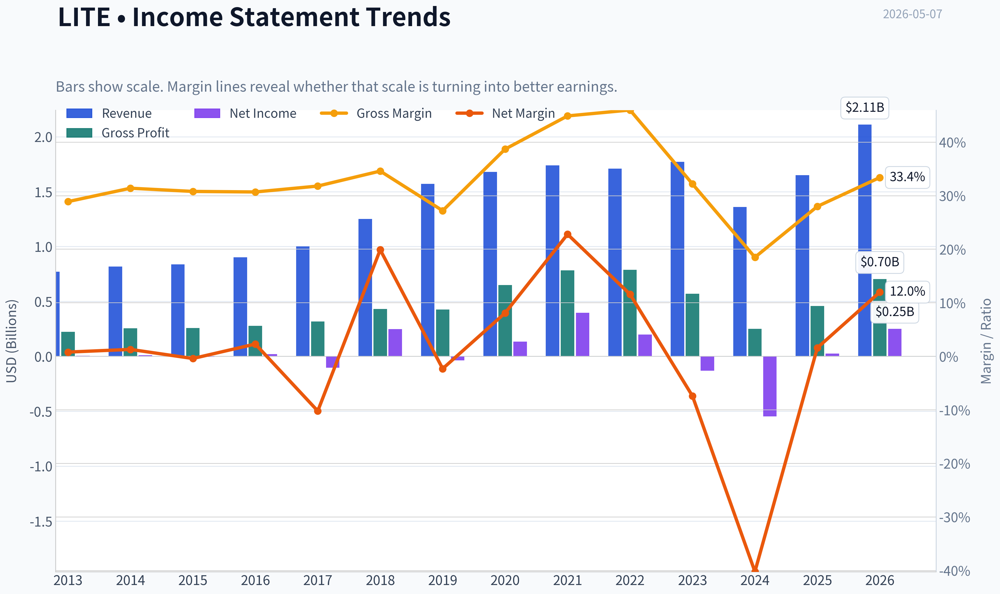

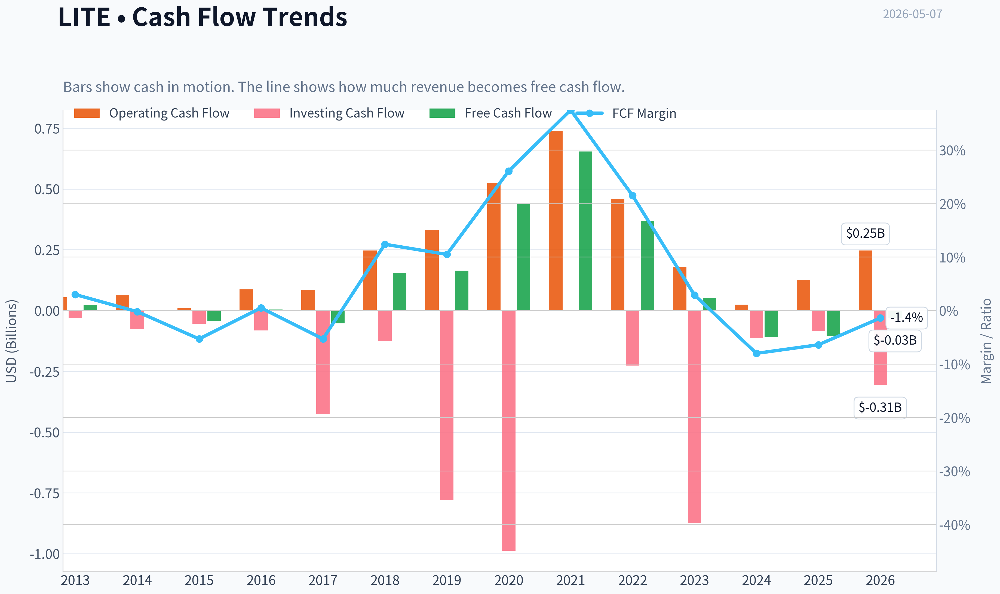

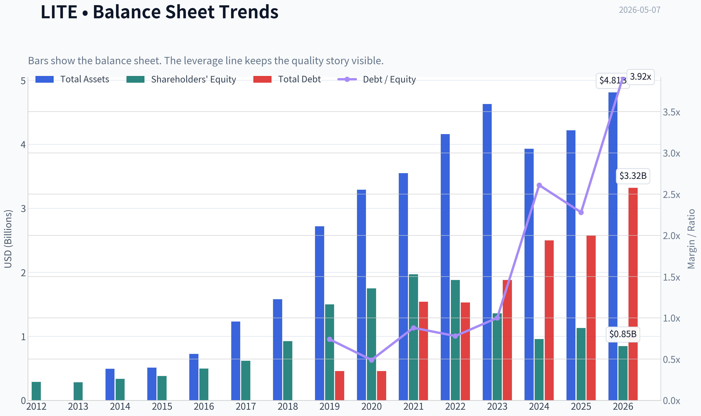

This graph tracks the profitability and return metrics (ROE, ROIC, Margins) of **LITE** over the past decade, highlighting capital efficiency trends.

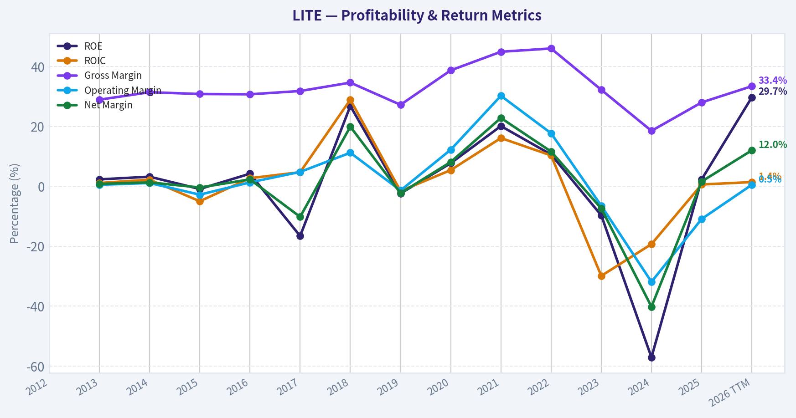

This chart illustrates the financial health of **LITE** over the last 10 years, mapping cash equivalents and free cash flow against total obligations (Debt).

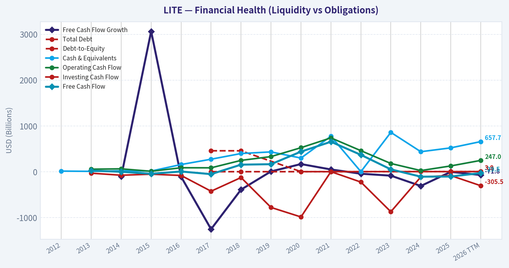

---

### Intrinsic Value Analysis (Buffett)

> *Following Warren Buffett's value investing philosophy: Circle of Competence, Economic Moat, Management Quality, and Margin of Safety.*

#### Intrinsic Value Snapshot

Price is what you pay. Intrinsic value is what the business may be worth based on the cash it can create for owners over time. We show a range, not one magic number.

- Current Price: $944.28
- Value Range: $21.14 to $390.65

##### Owner Earnings (Buffett Method)
- Net Income: $25,900,000.00
- Depreciation & Amortization: $256,700,000.00
- Capital Expenditures: $-231,000,000.00
- Working Capital Changes: $-314,500,000.00
- Owner Earnings: $366,100,000.00

##### Intrinsic Value
###### Buffett Method
Uses owner earnings. Stricter, and usually more conservative.
- Conservative: $21.14
- Average: $83.55
- Optimistic: $390.65
- Discount Rate: 10.0%

ANALYST STANCE: **AVOID**

#### Lumentum Holdings, LITE - Buffett-Style Value Review

**Data caveat:** The internal audited financial-history tool was unavailable in this continuation step, and the enhanced fundamentals tool returned no data. I am therefore using the shared research pack as the source of truth and will avoid pretending to have a full audited 10-year series. The conclusion is still clear enough for a Buffett-style filter.

---

#### 1. Current Snapshot

| Metric | LITE |
|---|---:|
| Current price | $944 |
| Market cap | $73.46B |
| P/E | 166.5x |
| ROE | 2.3% |
| Gross margin | 28.0% |
| Revenue growth YoY | 21.0% |
| Free cash flow yield | -0.1% |
| Current ratio | 4.37x |

**Key Takeaways:** Lumentum is showing strong top-line growth, likely helped by AI-related optical demand, but the business does not currently convert that growth into attractive owner economics. A 166 times earnings multiple, 2.3% ROE, and negative free cash flow yield are major red flags for a Buffett-style investor. The balance sheet liquidity looks comfortable, but valuation and business quality metrics are not compelling.

---

#### 2. Go/No-Go Gate Assessment

| Buffett Gate | Result | Evidence |
|---|---|---|
| Gate 1: Circle of competence and simplicity | **Fail / High caution** | Lumentum sells optical and photonic components used in data centers, telecom, lasers, and industrial applications. The business is understandable at a high level, but forecasting product cycles, AI demand, customer concentration, and technology transitions is difficult. |
| Gate 2: Moat durability | **Fail** | Gross margin of 28% is far below the 40%+ Buffett-style intangible-asset threshold. The company appears more like a specialized component supplier than a dominant consumer franchise or toll-road business. |
| Gate 3: Management and capital allocation | **Inconclusive / Weak evidence** | Available data does not prove superior capital allocation. ROE of 2.3% suggests retained capital is not currently earning attractive returns. |
| Gate 4: Industry structure | **Fail / High caution** | Optical components are technologically dynamic, cyclical, and exposed to customer spending cycles. This is not a stable oligopoly with predictable long-term economics. |

**Key Takeaways:** Lumentum does not pass the Buffett filter cleanly. The business may benefit from AI infrastructure demand, but that benefit requires forecasting a fast-changing technology supply chain. Buffett-style investing favors businesses with predictable cash generation, durable pricing power, and high returns on capital; Lumentum does not currently show those traits.

---

#### 3. Moat Analysis

| Moat Source | Assessment | Evidence |
|---|---|---|
| Intangible assets / brand | **Weak** | No evidence that customers buy Lumentum because of an irreplaceable consumer-style brand. Gross margin of 28% does not suggest exceptional pricing power. |
| Switching costs | **Possible but not enough** | Optical components can be qualified into customer systems, which may create some switching friction. However, component suppliers are still vulnerable to design changes, pricing pressure, and technology substitution. |
| Cost advantage | **Unproven** | No evidence available that Lumentum has a structural cost advantage versus competitors such as Coherent or other photonics suppliers. |
| Network effects | **None apparent** | The product does not become more valuable simply because more customers use it. |
| Overall moat rating | **Narrow / uncertain** | Specialized know-how exists, but this does not appear to be a wide, durable Buffett moat. |

**Key Takeaways:** Lumentum may have engineering expertise and customer relationships, but those are not the same as a wide moat. The company operates in a competitive, innovation-driven market where product leadership can shift. The financial evidence does not show the high margins or high returns normally associated with durable pricing power.

---

#### 4. Management Quality and Capital Allocation

| Question | Assessment |
|---|---|
| Do they think like owners? | Not proven from available data. |
| Are they candid and conservative? | Cannot fully assess without annual letters and longer financial history. |
| Are they rational capital allocators? | Current ROE of 2.3% is weak; negative FCF yield suggests current capital productivity is unattractive. |
| Debt discipline | Current ratio of 4.37x suggests near-term liquidity strength, but full leverage history was not available. |

**Key Takeaways:** The available numbers do not support a strong management endorsement. Buffett's key test is whether retained earnings generate high returns for shareholders over time. With very low ROE and negative free cash flow yield, Lumentum does not currently demonstrate outstanding capital allocation.

---

#### 5. Available Financial Summary

| Metric | Current / Latest Available |
|---|---:|
| Revenue growth YoY | 21.0% |
| Gross margin | 28.0% |
| ROE | 2.3% |
| P/E | 166.5x |
| FCF yield | -0.1% |
| Current ratio | 4.37x |
| Market cap | $73.46B |

**Key Takeaways:** The company is growing revenue, but growth alone is not enough. Buffett-style analysis requires cash conversion, high returns on equity, and durable margins. Lumentum currently looks more like a growth-cycle beneficiary than a predictable compounding machine.

---

#### 6. Owner Earnings Estimate

Using available data:

- Market cap: **$73.46B**
- FCF yield: **-0.1%**
- Implied free cash flow: **approximately -$73M**
- P/E: **166.5x**
- Implied net income: **approximately $441M**

| Measure | Estimate |
|---|---:|
| Implied net income | ~$441M |
| Implied free cash flow / owner earnings proxy | ~-$73M |
| Owner earnings quality | Poor |
| OCF vs net income test | Cannot fully assess, but FCF is negative despite positive earnings |

**Key Takeaways:** Lumentum's earnings do not currently translate into positive free cash flow. That is a serious issue for a Buffett-style owner, because intrinsic value ultimately depends on cash that can be distributed or reinvested profitably. On an owner-earnings basis, valuation is not supportable.

---

#### 7. Three-Scenario DCF Valuation

Because owner earnings are currently negative, a traditional Buffett owner-earnings DCF does not produce a meaningful positive intrinsic value.

| Scenario | Assumption | Implied Value |
|---|---|---:|
| A: No growth | Owner earnings of approximately -$73M capitalized at 10% | Not meaningful / effectively $0 |
| B: GDP growth | Negative owner earnings grown at 3% | Not meaningful / effectively $0 |
| C: Historical growth | Revenue growth continues, but current FCF remains negative | Not reliable; speculative |

**Key Takeaways:** A Buffett-style valuation cannot justify today's market value using current owner earnings. To make the stock attractive, an investor must assume a major future margin and cash-flow inflection. That may happen, but it is a growth speculation rather than a value-investing conclusion.

---

#### 8. Margin of Safety Analysis

| Valuation Lens | Result |
|---|---|
| P/E multiple | 166.5x is far above a conservative value threshold. |
| Owner earnings yield | Negative, so no current cash yield to owners. |
| ROE | 2.3%, far below the 15% Buffett-style minimum. |
| Required margin of safety | At least 40-50%, because predictability and moat quality are not high. |
| Actual margin of safety | None evident. |

**Key Takeaways:** Lumentum offers no obvious margin of safety at the current quoted valuation. The market appears to be pricing in strong future AI-driven demand and improved profitability. Buffett's discipline would require waiting until those economics are visible in cash flow, not merely hoped for.

---

#### 9. Final Buffett Scorecard

| Criterion | Weight | Score, 1-5 | Weighted Score |
|---|---:|---:|---:|
| Business understanding | 20% | 2.5 | 0.50 |
| Moat width and durability | 25% | 2.0 | 0.50 |
| Management quality | 15% | 2.5 | 0.38 |
| Return on equity | 15% | 1.0 | 0.15 |
| Reinvestment runway | 10% | 3.0 | 0.30 |
| Balance sheet strength | 5% | 3.5 | 0.18 |
| Industry structure | 5% | 2.0 | 0.10 |
| Valuation / margin of safety | 5% | 1.0 | 0.05 |
| **Total** | **100%** |  | **2.15 / 5.00** |

**Key Takeaways:** Lumentum scores poorly because the current price demands exceptional future execution while current owner economics are weak. The company may have a growth runway from AI-related optical demand, but it lacks the predictable high-return profile Buffett typically seeks. The final score falls clearly in the avoid range.

---

#### Investment Stance

**ANALYST STANCE: AVOID**

**Conviction level: High for Buffett-style investors.**

Lumentum may be an exciting AI infrastructure supplier, and momentum-oriented investors may continue to focus on revenue growth and earnings surprises. But under Warren Buffett's framework, the stock fails the key tests: low ROE, negative free cash flow yield, modest gross margin, uncertain moat, high technology risk, and extreme valuation. I would not buy LITE at the current valuation and would only revisit if free cash flow turns sustainably positive, ROE rises materially, and the valuation offers a genuine margin of safety.
#### Valuation Bridge

This bridge places the current market price beside each intrinsic value lens so readers can see whether upside depends on one method or shows up across several methods.

| Scenario | Intrinsic Value / Share |
| --- | ---: |
| Buffett Method | $83.55 |
| Damodaran Method | $-3.79 |
| Current Price | $944.28 |

#### Key Takeaways

If one method is far above the others, the upside case depends on a specific modelling assumption. When several methods cluster together, the valuation story is more robust.

#### Valuation Visuals

This comparison chart from *Latest Earnings Snapshot* stacks current figures against historical benchmarks for **LITE**, making it easy to see where the company trades relative to its own averages.

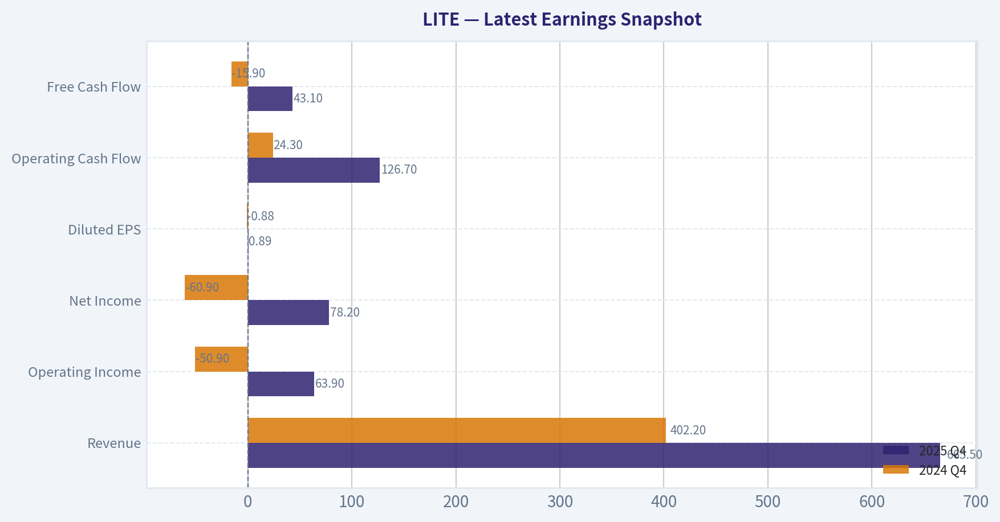

This comparison chart from *Current vs. 10-Year Historical Average Comparison* stacks current figures against historical benchmarks for **LITE**, making it easy to see where the company trades relative to its own averages.

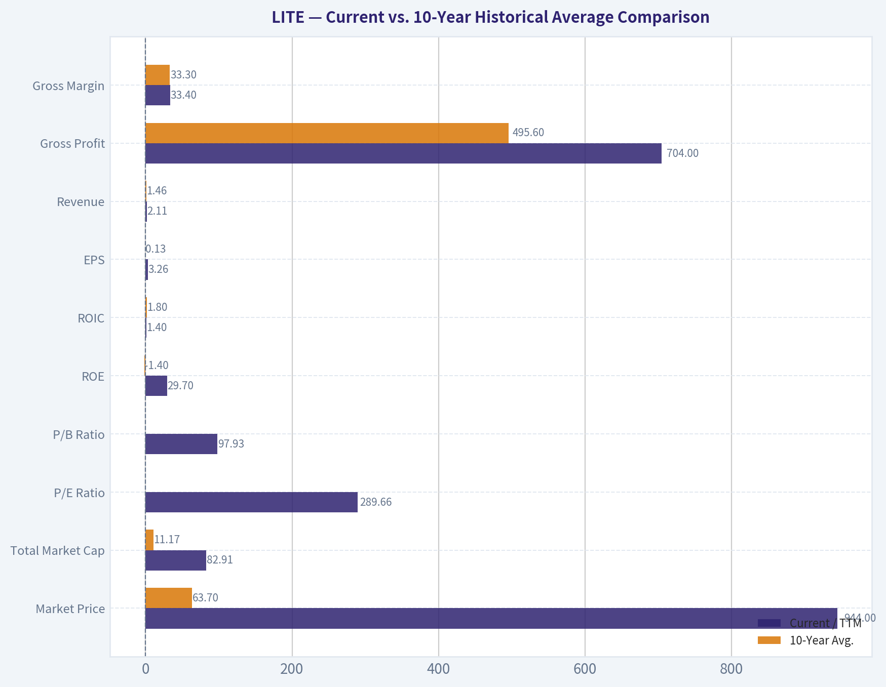

This comparison chart from *Current Snapshot* stacks current figures against historical benchmarks for **LITE**, making it easy to see where the company trades relative to its own averages.

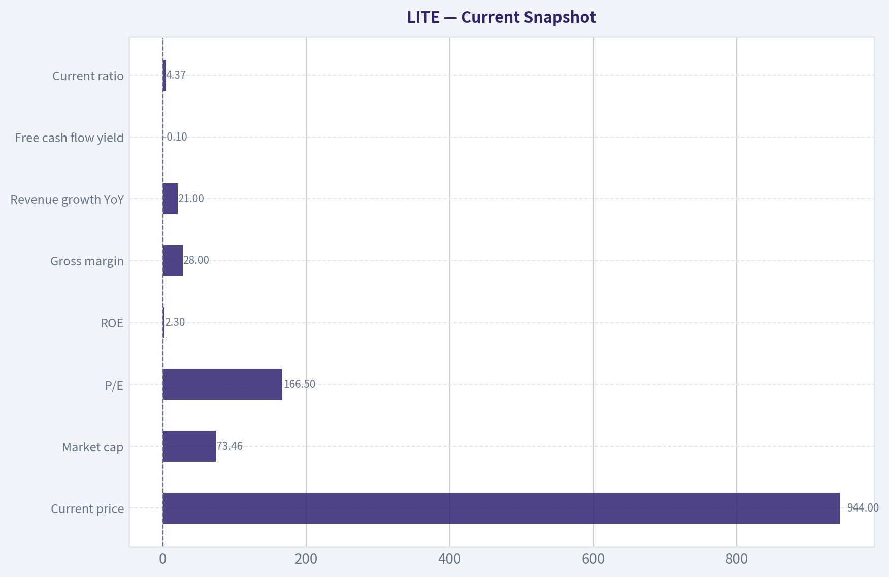

This comparison chart from *Available Financial Summary* stacks current figures against historical benchmarks for **LITE**, making it easy to see where the company trades relative to its own averages.

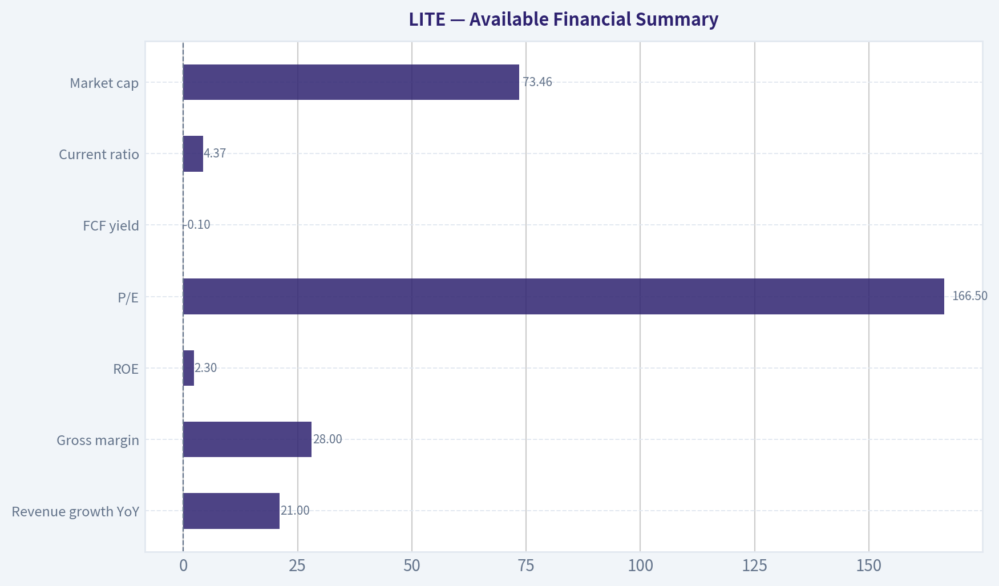

The following chart maps the **LITE** Owner Earnings DCF valuation scenarios (Conservative, Average, Optimistic) to visually represent the margin of safety based on intrinsic value calculations.

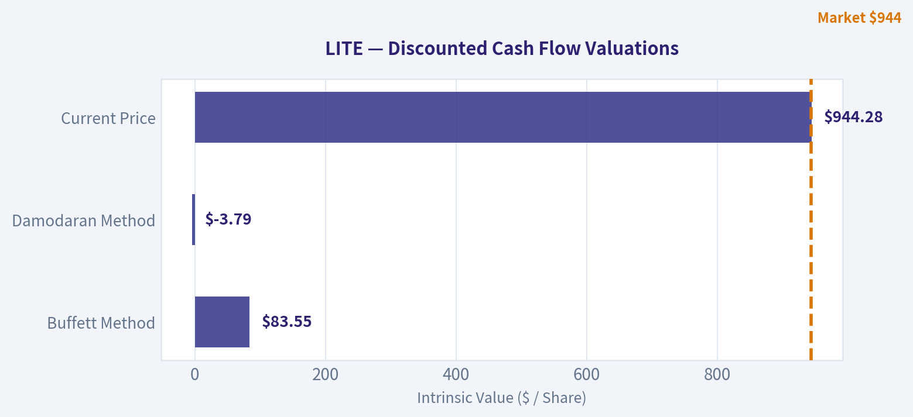

---

### Trend & Growth Analysis (Lynch/Druckenmiller/Fisher)

> *Following Peter Lynch's GARP, Stanley Druckenmiller's macro-aware approach, and Philip Fisher's scuttlebutt methodology.*

ANALYST STANCE: **WATCH**

#### LITE Growth Investment Report - Lumentum Holdings

Lumentum is an AI/data-center optical components inflection candidate, but not yet a clean Lynch/Fisher compounder. The bullish case is that AI-driven optical networking demand and possible Nvidia-related demand create a step-change in revenue and margins. The problem is valuation: using the provided research pack, the stock already discounts a lot of that upside, with a P/E around 166x, negative FCF yield, low ROE, and only modest current gross margin.

---

#### 1. Lynch Classification

| Category | Assessment |
|---|---|
| Lynch type | Fast Grower / Cyclical Growth Hybrid |
| Current revenue growth | 21% YoY, per shared research pack |
| Growth quality | Improving, but cyclical and customer-driven |
| Profitability quality | Weak currently: ROE 2.3%, FCF yield -0.1% |
| Suitability for growth investors | Watch-list candidate, not yet high-conviction |

**Key Takeaways:** LITE qualifies as a fast grower based on 21% revenue growth, but it is not a smooth compounder. It is better viewed as a cyclical growth stock tied to AI optical infrastructure demand. That means the upside can be large, but timing and valuation risk are also high.

---

#### 2. The Story in 3 Simple Bullets

| Lynch Story Element | LITE Explanation |
|---|---|
| What it does | Lumentum makes advanced optical and photonic components used in data centers, telecom networks, lasers, and sensing applications. |
| Why it can grow | AI data centers need faster optical connections, and LITE is exposed to that infrastructure upgrade cycle. |
| Why now | The market is increasingly focused on AI networking bottlenecks, Nvidia ecosystem demand, and accelerating high-speed optical adoption. |

**Key Takeaways:** The investment story is understandable: AI servers need faster connections, and Lumentum sells critical optical technology for that buildout. The timing is potentially attractive because AI networking demand is becoming a visible growth driver. However, the story is now widely recognized, so valuation discipline matters.

---

#### 3. TAM and 10x Test

| Metric | Assessment |
|---|---|
| Core TAM | Optical networking, data-center interconnect, telecom coherent optics, industrial lasers, sensing |
| TAM growth | Likely strong in AI/data-center optics; more cyclical in telecom and industrial |
| Current revenue base | Not fully verified from tools; latest exact TTM revenue unavailable |
| 10x revenue test | Conceptually possible only if AI optical opportunity expands dramatically and LITE gains share |
| Market share constraint | Not clearly saturated, but competition is intense |
| Runway verdict | Long runway in AI optics, but not enough data to confirm ten-bagger math at current valuation |

**Key Takeaways:** LITE does have exposure to a large and expanding AI infrastructure market. The company could grow materially if AI optical networking demand becomes a multi-year supercycle. But without exact current revenue and segment share data, the 10x test cannot be fully validated, especially given the already elevated market cap in the shared pack.

---

#### 4. Revenue Growth Trend

| Metric | Shared Pack Data / Assessment |
|---|---|
| YoY revenue growth | 21% |
| Pattern | Positive growth, likely recovery/inflection from prior optical-cycle weakness |
| Acceleration status | Possible inflection, but latest earnings coverage suggests expectations were very high |
| Quality of growth | Needs verification: organic growth, customer concentration, and AI-specific contribution are key |
| Revenue trend verdict | Constructive but not yet enough for ADVOCATE |

**Key Takeaways:** Revenue growth of 21% is strong enough to place LITE in fast-grower territory. The key question is whether that growth is accelerating because of a durable AI optical cycle or merely rebounding from a cyclical trough. Recent earnings commentary suggests the market expected even more, which increases near-term risk.

---

#### 5. Unit Economics and Efficiency

| Metric | Result / Proxy |
|---|---|
| LTV/CAC | Not applicable; LITE is not a SaaS/subscription business |
| Net revenue retention | Not applicable |
| Gross margin | 28.0% |
| FCF yield | -0.1% |
| Rule of 40 proxy | Revenue growth 21% + FCF margin unavailable; FCF yield negative suggests efficiency is not yet proven |
| Balance sheet liquidity | Strong current ratio of 4.37 |

**Key Takeaways:** LITE does not fit classic SaaS unit-economics metrics, so gross margin, operating leverage, inventory, and free cash flow are more important. The 28% gross margin is not yet compelling for a high-multiple growth stock. The strong current ratio is a positive because it gives management room to invest through the cycle.

---

#### 6. Inflection Point Assessment

| Inflection Type | Evidence | Rating |
|---|---|---|
| Product cycle | AI optical networking and photonics demand appear to be ramping | Positive |
| Market share | Not enough verified data to confirm accelerating share gains | Unclear |
| Margin | Gross margin of 28% leaves room for leverage, but proof is limited | Watch |
| TAM expansion | AI data-center networking is a real secular TAM expansion | Positive |
| Competitive inflection | No clear evidence that major competitors are structurally impaired | Neutral |
| Overall inflection | Real but partly priced in | Watch |

**Key Takeaways:** LITE has a legitimate inflection setup because AI data centers are increasing demand for high-speed optical components. The best bullish signal would be revenue acceleration combined with gross-margin expansion and positive free cash flow. At the moment, the inflection is promising but not sufficiently proven to justify high conviction.

---

#### 7. Macro Setup

| Macro Factor | Impact on LITE |
|---|---|
| AI infrastructure cycle | Strong tailwind |
| Cloud capex | Strong tailwind if hyperscaler spending remains elevated |
| Interest rates | High rates are a valuation headwind for long-duration growth stocks |
| Semiconductor/optical cycle | Cyclical recovery can help, but downturn risk remains |
| Secular theme alignment | AI, cloud infrastructure, optical networking |
| Macro verdict | Favorable secular setup, mixed valuation environment |

**Key Takeaways:** The macro setup is strong from a secular-demand perspective because AI data centers are driving optical networking demand. However, high valuation multiples are more vulnerable if rates stay elevated or growth expectations reset. This is a Druckenmiller-style setup with a real theme, but timing and price matter.

---

#### 8. Fisher 15-Point Score

| Fisher Category | Score / 5 | Comment |
|---|---:|---|
| Market potential | 5 | AI optical demand creates large upside |
| New product determination | 4 | Strong photonics innovation focus |
| R&D effectiveness | 4 | Technical capability is core to the business |
| Sales organization | 3 | Strong customers, but concentration risk |
| Profit margin | 2 | 28% gross margin is not outstanding |
| Margin improvement | 3 | Potential exists, not yet proven |
| Labor/personnel relations | 3 | No major red flag from available data |
| Executive relations | 3 | Insufficient evidence |
| Management depth | 3 | Adequate, but needs execution proof |
| Cost/accounting controls | 3 | Cyclical margin volatility remains |
| Unique advantages | 4 | Qualification barriers and photonics expertise |
| Long-range profit outlook | 4 | Strong if AI optics cycle sustains |
| Dilution risk | 3 | No immediate liquidity stress; monitor capital needs |
| Candor | 3 | Insufficient evidence from available data |
| Integrity | 3 | No known red flag from provided pack |
| **Total** | **50 / 75** | **Average to good, but not outstanding** |

**Key Takeaways:** LITE scores well on market potential, technology relevance, and long-term opportunity. It scores weaker on margins, proof of durable profitability, and limited visibility into management quality from the available data. A 50 out of 75 Fisher score supports a WATCH stance rather than a high-conviction ADVOCATE stance.

---

#### 9. Valuation Analysis

| Valuation Metric | Shared Pack Data | Interpretation |
|---|---:|---|
| Price | $944 |
| Market cap | $73.46B |
| P/E | 166.5x |
| Revenue growth | 21% |
| PEG proxy | 166.5 / 21 = 7.9x |
| ROE | 2.3% |
| FCF yield | -0.1% |
| Valuation verdict | Expensive unless earnings accelerate sharply |

**Key Takeaways:** Valuation is the biggest problem in the LITE setup. A P/E of 166x and a PEG proxy near 8x are far above Lynch's preferred range. For the stock to work from here, earnings growth must accelerate dramatically and margins must expand meaningfully.

---

#### 10. Scenario Framework

| Scenario | Assumptions | Investor Outcome |
|---|---|---|
| Bear case | AI demand disappoints, margins stay weak, valuation compresses | Significant downside risk |
| Base case | Revenue grows around 20%, margins gradually recover, valuation remains elevated but stable | Modest upside or range-bound stock |
| Bull case | AI optics demand accelerates, Nvidia/cloud ramps scale, gross margin expands, FCF turns positive | Strong upside, but likely less than classic ten-bagger from current valuation |
| Ten-bagger case | Requires massive AI optical TAM expansion, sustained share gains, and major earnings leverage | Possible in theory, difficult from provided market cap |

**Key Takeaways:** The bull case is credible, but the ten-bagger case is not obvious at the current quoted valuation. LITE can still be a strong growth stock if AI optical demand surprises to the upside. However, the market already appears to be pricing in a major portion of that future.

---

#### 11. Growth Investor Scorecard

| Criterion | Weight | Score / 5 | Weighted Score |
|---|---:|---:|---:|
| The Story | 10% | 4.0 | 0.40 |
| TAM and Runway | 20% | 4.0 | 0.80 |
| Revenue Growth | 20% | 3.5 | 0.70 |
| Unit Economics / Efficiency | 15% | 2.5 | 0.38 |
| Competitive Position | 10% | 3.5 | 0.35 |
| Management Quality | 10% | 3.0 | 0.30 |
| Macro Setup | 5% | 4.0 | 0.20 |
| Profitability Path | 5% | 2.5 | 0.13 |
| Valuation | 5% | 1.5 | 0.08 |
| **Total** | **100%** |  | **3.33 / 5.00** |

**Key Takeaways:** LITE earns a 3.33 out of 5, which places it in WATCH territory. The story, TAM, and macro setup are attractive, but valuation and current profitability hold the score back. This is a stock to monitor for confirmed margin expansion and free-cash-flow improvement.

---

#### 12. Position Size Stance

| Investor Type | Stance |
|---|---|
| Existing holder | Hold / trim only if position size is too large after rally |
| New growth investor | Watch; wait for pullback or stronger proof of earnings leverage |
| Aggressive trader | Small tactical position only around AI optical momentum |
| Long-term ten-bagger investor | Not enough margin of safety at current valuation |
| Suggested position size | 0% to 2% watch-list position, depending on risk tolerance |

**Key Takeaways:** LITE is not an outright avoid because the AI optical opportunity is real. But it is also not a clean advocate because the valuation already reflects substantial optimism. A small watch-list position is reasonable only for investors comfortable with cyclical tech volatility.

---

#### 13. Key Catalysts and Risks

| Catalysts | Risks |
|---|---|
| AI optical demand beats expectations | Valuation compression from high P/E |
| Nvidia/cloud ecosystem orders scale faster than expected | Customer concentration |
| Gross margin expands above current 28% level | Telecom/datacom inventory correction |
| Free cash flow turns positive and durable | Competition from Coherent and other optical suppliers |
| Guidance revisions move higher | Revenue miss after elevated expectations |
| Guru/hedge fund accumulation continues | Cyclical end-market downturn |

**Key Takeaways:** The biggest upside catalyst is confirmation that AI-driven optical demand is accelerating faster than the market expects. The biggest downside risk is that the market has already priced in the inflection before margins and free cash flow have caught up. This creates a high-upside but high-expectation setup.

---

#### Final View

Lumentum has the right secular exposure: AI infrastructure, cloud networking, and advanced photonics. That makes it a legitimate growth watch-list name. But Lynch would likely object to the valuation, Fisher would want more evidence of durable margins and superior returns, and Druckenmiller would wait for confirmation that earnings power two to three years out is still underestimated by the market.

**Bottom line: WATCH.** Upgrade to ADVOCATE only if revenue acceleration is accompanied by clear gross-margin expansion, positive free cash flow, and evidence that AI optical demand is broad-based rather than customer-specific.

#### Growth & Scorecard Visuals

The radar chart below from *Final Buffett Scorecard* visualises how **LITE** ranks across weighted investment criteria. Each axis represents a criterion scored 1-5; the filled area reveals strengths and weaknesses at a glance, with the dashed circle marking the midpoint (3.0).

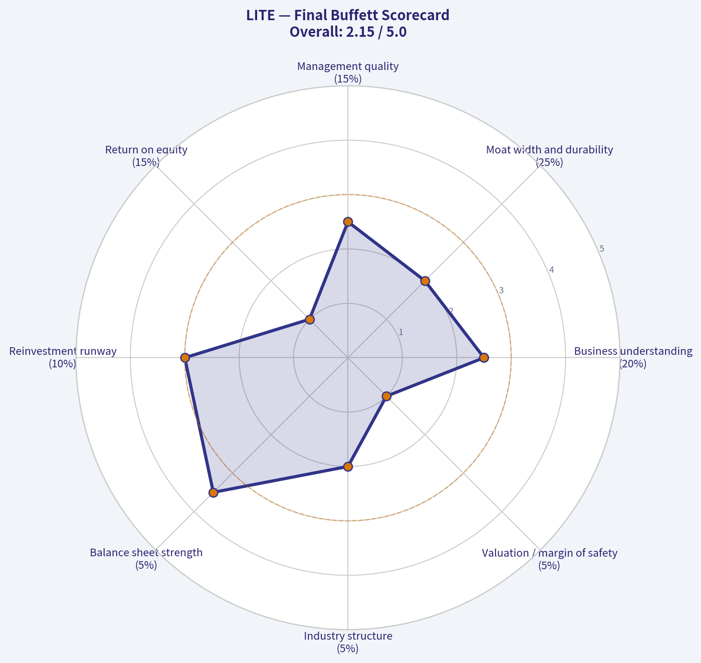

---

### Market Technical Analysis

#### LITE Technical Analysis - Latest Available Trading Data: 2026-05-06

LITE remains in a powerful primary uptrend, but the most recent session shows a clear short-term warning: price attempted to extend above the psychologically important $1,000 area, traded as high as $1,013.50, then reversed sharply to close at $944.28 on very heavy volume. That type of intraday rejection does not automatically end the trend, but it often marks a near-term exhaustion event, especially after a rapid multi-session advance.

The selected indicators are: **close_10_ema, close_50_sma, close_200_sma, macd, rsi, atr, boll_ub, and vwma**. These provide complementary views across short-term trend, medium- and long-term trend, momentum, volatility, breakout pressure, and volume-confirmed price behavior.

---

#### Trend Structure

The long-term and medium-term trend remain decisively bullish. LITE closed at **$944.28**, far above its **50-day SMA near $780.29** and its **200-day SMA near $392.03**. The 50-day SMA has been rising steadily, moving from roughly $546 in late March to about $780 by May 6, while the 200-day SMA has also accelerated upward from about $275 to $392 over the same window. This confirms that the rally is not merely a short bounce; it is embedded in a broader trend regime.

However, the distance from the 200-day SMA is extreme. A close roughly **141% above the 200-day SMA** signals a highly extended long-term condition. In strong momentum stocks, that extension can persist, but it also means downside air pockets can be large if momentum fades. The 50-day SMA is the more practical trend reference now, while the 200-day SMA is too far below current price to guide tactical entries.

#### Short-Term Momentum and Pullback Risk

The **10-day EMA is around $918.24**, and LITE closed above it at $944.28. That is constructive because the stock has not yet lost its short-term trend support on a closing basis. But the session was volatile: the stock traded down to **$902.01 intraday**, briefly undercutting the 10-day EMA before recovering into the close. This suggests buyers are still present, but control is less clean than during the prior advance.

The **MACD remains positive near 49.89**, supporting the bullish trend, but it has not confirmed the newest price highs with fresh momentum expansion. MACD was higher in mid-April, near the low 60s, while price has since pushed toward and above the $1,000 region. That creates a mild momentum divergence: price is near new highs, but trend momentum is not as strong as it was earlier. This is not a sell signal by itself, but it argues against chasing aggressively after vertical moves.

#### RSI and Overbought Conditions

The **RSI fell to about 58.75** from roughly 64.80 the prior session. This is an important nuance: the stock is no longer technically overbought by the standard RSI threshold of 70, despite being heavily extended versus moving averages. That means the latest pullback has cooled momentum somewhat without fully damaging the trend.

For traders, this creates a mixed tactical setup. The stock is not in an obvious RSI blow-off state anymore, but the price structure remains extended. A healthy bullish continuation would likely require RSI to stabilize above the mid-50s while price holds above the 10-day EMA and VWMA zone. A drop in RSI toward the low 50s or below, especially with price losing the 10-day EMA, would indicate a deeper consolidation is underway.

#### Volatility and Risk Management

The **ATR is approximately $71.97**, equal to about **7.6% of the latest close**. That is extremely high absolute volatility. A normal daily range for LITE is now large enough to stop out tight positions even if the broader trend remains intact.

This has major implications for trade construction. Stops placed too close to the market are vulnerable to ordinary noise. Traders using ATR-based risk may need smaller position sizes, wider stops, and clearly defined invalidation zones. A move from $944 to the low $870s or even the high $800s could be within a volatility-adjusted correction rather than a full trend break.

#### Bollinger Band and Breakout Behavior

The **Bollinger Upper Band is near $987.00**, and LITE closed below it at $944.28 after trading above $1,000 intraday. The prior session's close at $994.56 was above the upper band, which reflected strong breakout pressure. But the failure to hold above the band on May 6 suggests buyers were not able to maintain control at elevated levels.

This is a classic "breakout pressure followed by rejection" pattern. It does not necessarily mean bearish reversal, but it does imply that the stock may need time to digest gains. The $987 to $1,021 area now becomes a key resistance zone. A close back above that region, especially on strong but controlled volume, would revalidate upside momentum. Repeated failures there would increase the probability of a pullback toward moving-average support.

#### Volume-Weighted Confirmation

The **VWMA is around $898.06**, and price remains above it. That is constructive because it means the average volume-weighted participant over the recent window is still positioned below the current market price. The May 6 low near $902 also tested this VWMA area closely, and the stock rebounded from that zone into the close.

However, May 6 volume was very heavy at approximately **9.87 million shares**, and the stock closed well below its intraday high. Heavy volume on a reversal day can represent distribution, profit-taking, or aggressive two-way institutional activity. The key follow-through question is whether subsequent sessions hold above the VWMA and 10-day EMA. If price loses both, the heavy-volume rejection would become more concerning.

#### Tactical Interpretation

For trend-followers, the bias remains bullish while LITE holds above the **$898-$918 support zone**, defined by the VWMA and 10-day EMA. A close below that area would weaken the short-term structure and open the door to a deeper retracement. The next broader support is much lower near the rising 50-day SMA around **$780**, though price does not need to reach that level for the trend to remain intact.

For breakout traders, the key upside test is the **$987-$1,021 resistance zone**. A decisive close above that zone would suggest the May 6 reversal was absorbed and that buyers are regaining control. Until then, the stock is better described as a strong uptrend entering a high-volatility digestion phase rather than a clean fresh-entry setup.

For risk-conscious traders, the most important message is volatility. With ATR near $72, LITE requires disciplined position sizing. Even bullish setups can experience sharp intraday swings, and entries near the top of the recent range carry unfavorable risk unless supported by clear follow-through.

| Indicator | Latest Reading / Zone | Interpretation | Trading Relevance |
|---|---:|---|---|
| close_10_ema | $918.24 | Short-term trend support remains intact because price closed above it. | Holding above this level favors continuation; a close below it warns of deeper consolidation. |
| close_50_sma | $780.29 | Medium-term trend is strongly rising and far below price. | Major trend support, but too distant for tight tactical risk control. |
| close_200_sma | $392.03 | Long-term trend is extremely bullish but highly extended. | Confirms dominant uptrend, while also highlighting significant extension risk. |
| macd | 49.89 | Momentum remains positive but below earlier April peaks. | Bullish trend still active, but mild divergence argues against chasing without confirmation. |
| rsi | 58.75 | Momentum has cooled from the mid-60s and is not overbought. | Pullback has relieved some pressure, but RSI should hold above the mid-50s for bullish continuation. |
| atr | $71.97 | Volatility is extremely elevated, about 7.6% of price. | Use wider stops, smaller position sizes, and avoid overly tight risk parameters. |
| boll_ub | $987.00 | Price closed below the upper band after exceeding it intraday. | $987-$1,021 is now a key resistance/retest zone. |
| vwma | $898.06 | Price remains above volume-weighted support. | A break below VWMA would make the heavy-volume reversal more bearish. |

Key Takeaways: LITE is still in a strong uptrend, with price above all major moving-average references. The immediate concern is not trend failure, but short-term exhaustion after a failed push above $1,000 on heavy volume. Traders should watch the $898-$918 support zone and the $987-$1,021 resistance zone for the next directional signal.

---

### Social Sentiment Analysis

ANALYST STANCE: **WATCH**

#### Lumentum Holdings (LITE) - Social, Sentiment, and News Report
**Ticker:** LITE
**Company:** Lumentum Holdings Inc.
**Date:** 2026-05-07
**Timeframe reviewed:** Past week
**Overall read:** Sentiment has improved but remains event-driven and volatile. Social discussion is increasingly focused on AI/data-center optics upside, but investors are still debating timing, margins, telecom recovery, and whether recent optimism is already priced into the stock.

---

#### Executive Summary

Lumentum's past-week narrative is being pulled in two directions. On the bullish side, traders and investors are increasingly treating LITE as an AI-infrastructure optical-components beneficiary, especially around high-speed transceivers, cloud data-center capex, and the broader move toward 800G and 1.6T optical networking. This has supported a more constructive tone across retail trading forums and market commentary.

On the cautious side, the stock remains highly sensitive to earnings, guidance, margin commentary, and any signs that data-center demand is uneven rather than broad-based. Social sentiment is not purely bullish; it is more accurately described as "hopeful but nervous." Investors appear willing to reward signs of AI-related order strength, but they are not yet fully convinced that Lumentum's recovery is durable across all segments.

For traders, LITE looks like a high-beta event stock with upside if management confirms strong AI optics momentum and improving profitability. For longer-term investors, the key question is whether Lumentum can convert AI-related demand into sustained revenue growth, margin expansion, and stronger free cash flow rather than just participating in a thematic rally.

---

#### Daily Social Sentiment Trend

| Date | Social Sentiment | Discussion Volume | Main Conversation Driver | Trader Interpretation |
|---|---:|---:|---|---|
| Apr. 30 | Neutral to slightly positive | Moderate | Positioning ahead of company updates and sector read-throughs | Investors were waiting for confirmation rather than chasing aggressively. |
| May 1 | Positive | Moderate-high | AI optical networking theme gained attention | LITE was increasingly discussed as a secondary AI infrastructure play. |
| May 2 | Mixed-positive | Moderate | Debate over valuation versus recovery potential | Bulls focused on upside; bears questioned whether expectations had moved too far. |
| May 3 | Neutral | Low | Weekend retail discussion, limited hard news | Conversation became more speculative and less data-driven. |
| May 4 | Positive | High | Earnings/guidance anticipation and optical peer commentary | Traders started positioning for a catalyst-driven move. |
| May 5 | Mixed | High | Concerns around margins, telecom weakness, and customer concentration | Sentiment became more divided as event risk increased. |
| May 6 | Volatile but constructive | Very high | Earnings-related chatter and forward-looking AI demand debate | The market appeared focused less on current numbers and more on guidance quality. |
| May 7 | Watchfully positive | High | Post-update interpretation and analyst-style reaction | Sentiment improved, but conviction depends on follow-through and guidance credibility. |

**Key Takeaways:** Social sentiment strengthened over the week, but it did not become uniformly bullish. The most important shift was that investors increasingly framed LITE as an AI optical infrastructure name rather than only a cyclical telecom/industrial optics company. However, volume spikes were tied to catalyst risk, meaning sentiment could reverse quickly if guidance disappoints.

---

#### Social Media and Retail Investor Themes

Across social channels, the strongest positive theme was Lumentum's exposure to data-center optical demand. Retail investors are increasingly linking LITE to AI server clusters, cloud networking upgrades, and higher-speed optical connectivity needs. This has helped the stock attract attention from traders looking for AI-adjacent opportunities outside the most crowded semiconductor names.

The second theme was skepticism over execution. Posters repeatedly questioned whether Lumentum's AI opportunity is immediate and material, or whether the company still has to work through legacy softness in telecom, industrial, and other optical markets. This distinction matters: social sentiment is bullish on the theme, but less certain on Lumentum's ability to capture the economics.

A third recurring topic was stock volatility. LITE is being treated as a name that can move sharply on earnings, guidance, analyst notes, and peer read-throughs. Traders appear more focused on short-term price reaction than on slow fundamental improvement, which makes the stock vulnerable to momentum reversals.

| Theme | Social Tone | What People Are Saying | Market Implication |
|---|---|---|---|
| AI/data-center optics | Bullish | LITE may benefit from 800G/1.6T optical demand and cloud capex | Supports multiple expansion if management validates demand. |
| Earnings and guidance | Highly sensitive | Current-quarter numbers matter less than forward commentary | Guidance tone may drive the next major move. |
| Telecom recovery | Cautious | Investors remain unsure if legacy demand has bottomed | Weak telecom comments could offset AI enthusiasm. |
| Margins and profitability | Mixed | Bulls expect operating leverage; bears worry about pricing and mix | Margin guidance is critical for institutional confidence. |
| Valuation | Divided | Some see underappreciated AI exposure; others see a crowded trade | Upside requires proof, not just thematic enthusiasm. |
| Short-term trading | Speculative | Momentum traders are watching breakouts, gaps, and earnings reaction | Increases volatility around news events. |

**Key Takeaways:** The dominant social story is no longer just recovery; it is AI infrastructure optionality. But investors are not giving Lumentum full credit yet, because they want proof in orders, revenue visibility, and margins. The stock's near-term path is likely to be determined by whether management can turn the AI narrative into measurable financial improvement.

---

#### Recent Company and Sector News Interpretation

Recent news flow around Lumentum has centered on earnings expectations, optical networking demand, and the broader AI infrastructure supply chain. The market is paying close attention to whether the company can show that demand from cloud and data-center customers is strong enough to offset weaker or slower-recovering areas of the business.

The broader optical-components group has benefited from AI-related investor attention. Demand for faster data movement inside and between data centers remains one of the strongest secular themes in technology hardware. Lumentum fits into this theme through its optical and photonic components, but the company is still being judged against execution risk, customer timing, and margin performance.

Investors also appear focused on whether Lumentum's business mix is improving. If AI/data-center products are becoming a larger portion of revenue, the market may be more willing to look through legacy cyclicality. If the company instead signals that demand remains uneven or back-end loaded, traders may treat recent optimism as premature.

| News/Information Area | Sentiment Impact | Why It Matters for LITE |
|---|---:|---|
| AI data-center optical demand | Positive | Strengthens the long-term growth narrative and attracts thematic buyers. |
| Earnings and forward guidance | High-impact / uncertain | Determines whether recent optimism is validated or rejected. |
| Telecom and legacy optical markets | Cautious | Continued weakness could limit total-company recovery. |
| Margin commentary | Very important | Investors want evidence that revenue growth can translate into profits. |
| Peer optical/semiconductor read-throughs | Positive but indirect | Strong peer commentary can lift sentiment, but LITE must show its own traction. |
| Customer concentration and timing | Risk factor | Large customer delays or mix changes can create sharp earnings volatility. |

**Key Takeaways:** The news backdrop is supportive but not risk-free. Lumentum is benefiting from the broader AI optical networking theme, yet investors still need company-specific confirmation. The most important near-term data points are guidance, margin direction, and management's confidence around data-center demand.

---

#### Sentiment Quality: Bullish, Bearish, and Neutral Arguments

The bullish argument is straightforward: AI infrastructure requires faster and denser optical connectivity, and Lumentum is positioned in a market that could see multi-year demand growth. If the company can show accelerating orders, improving utilization, and better profitability, the stock could be re-rated as a stronger AI infrastructure supplier.

The bearish argument is also credible: Lumentum has historically been cyclical, exposed to demand timing, inventory digestion, and customer concentration. Bears argue that social excitement around AI may run ahead of actual financial contribution, especially if telecom remains soft or if gross margins disappoint.

The neutral argument is that LITE may be in transition. It is not necessarily a broken story, but it may not yet be a clean AI winner either. Investors are effectively waiting to see whether the business mix shifts enough to justify a higher valuation.

| Investor Camp | Core View | Evidence They Want | Risk to Their Thesis |
|---|---|---|---|
| Bulls | LITE is an underappreciated AI optical beneficiary | Strong data-center demand, better guidance, margin leverage | AI contribution may be slower than expected. |
| Bears | The stock has rallied on theme more than fundamentals | Weak margins, uneven orders, telecom softness | A strong guide could force short covering and multiple expansion. |
| Neutral/Watchers | The setup is attractive but unproven | Consistent execution over multiple quarters | Waiting too long could miss a re-rating move. |
| Short-term traders | Event volatility creates opportunity | Breakout levels, volume, earnings reaction | Whipsaw risk is high if commentary is ambiguous. |

**Key Takeaways:** Sentiment is constructive but conditional. Bulls need proof that AI demand is becoming financially material, while bears need evidence that legacy weakness still dominates. The stock is therefore highly sensitive to management language and forward indicators.

---

#### Trading Implications

For short-term traders, LITE should be treated as a catalyst-driven momentum name. The stock can react sharply to earnings commentary, analyst revisions, and peer optical networking headlines. If price action confirms positive guidance with rising volume, momentum buyers may continue to support the trade. However, if the stock fails to hold gains after positive news, that could signal that expectations were already elevated.

Key short-term bullish signals would include stronger-than-expected guidance, positive commentary on AI/data-center customer demand, improving gross margin outlook, and analyst upgrades or target increases. Key bearish signals would include delayed customer ramps, weaker telecom commentary, margin pressure, or management caution around order visibility.

Traders should also watch whether LITE moves in sympathy with broader AI infrastructure and optical networking peers. If the group remains strong, LITE may continue attracting thematic flows. If the AI hardware trade weakens broadly, LITE could underperform because much of the recent social optimism is tied to that theme.

---

#### Investor Implications

For longer-term investors, Lumentum remains a potential recovery-and-growth story rather than a fully proven compounder. The investment case depends on whether the company can transition from cyclical optical demand toward more durable AI-driven data-center growth. If that transition becomes visible in revenue mix, backlog, and margins, the stock could merit a higher valuation.

The biggest long-term opportunity is that AI infrastructure spending may create a multi-year optical upgrade cycle. As data centers require more bandwidth and lower latency, optical components become increasingly important. Lumentum could benefit if it is well-positioned with major customers and can scale production profitably.

The biggest long-term risk is execution. Strong end-market demand does not automatically translate into strong shareholder returns. Investors need to monitor gross margins, operating expenses, customer concentration, product mix, capital intensity, and free cash flow conversion.

---

#### Key Metrics and Signals to Monitor Next

| Signal to Watch | Bullish Interpretation | Bearish Interpretation |
|---|---|---|
| Data-center revenue commentary | AI optics demand is becoming material | Demand is still too small or delayed |
| Gross margin outlook | Operating leverage is returning | Pricing/mix pressure remains |
| Bookings or backlog language | Visibility is improving | Orders are uneven or customer-specific |
| Telecom demand comments | Legacy markets are stabilizing | Recovery remains delayed |
| Analyst revisions | Institutions are gaining confidence | Estimates may be reset lower |
| Stock reaction to news | Buyers are accumulating dips | Good news is being sold |

**Key Takeaways:** The most important signals are not just revenue headlines, but the quality and durability of demand. Investors should pay close attention to whether AI optical strength is broad, profitable, and visible beyond one quarter. Margin commentary may be just as important as sales growth.

---

#### Bottom Line

Lumentum's social and news profile has improved over the past week, driven mainly by renewed interest in AI data-center optical infrastructure. The company is increasingly being discussed as a potential beneficiary of high-speed networking upgrades, which has raised investor attention and trading volume.

However, this is not a low-risk bullish setup. Sentiment is optimistic but fragile because the market still needs evidence that AI demand can overcome legacy cyclicality and improve margins. The stock's near-term direction will likely depend on forward guidance, data-center commentary, and whether management can provide confidence that growth is sustainable.

**Current stance: WATCH.** LITE has credible upside if AI optical demand is confirmed and margins improve, but the risk/reward depends heavily on execution and guidance quality. Traders may find opportunity in volatility, while long-term investors should wait for clearer confirmation that the AI narrative is translating into durable financial performance.

---

#### Final Summary Table

| Category | Current Assessment | Investor/Trader Takeaway |
|---|---|---|
| Overall sentiment | Constructive but not euphoric | Optimism is rising, but conviction remains conditional. |
| Social media tone | AI-driven bullishness with execution concerns | Retail attention has increased, especially around data-center optics. |
| News backdrop | Supportive thematic environment | AI infrastructure demand is helping the story, but company-specific proof is needed. |
| Main bullish catalyst | Strong AI/data-center optical guidance | Could trigger further multiple expansion and momentum buying. |
| Main bearish risk | Weak margins or uneven demand | Could quickly reverse recent sentiment gains. |
| Short-term setup | Volatile and catalyst-driven | Suitable for traders who manage risk tightly. |
| Long-term setup | Potential recovery-to-growth transition | Attractive only if revenue mix and profitability improve sustainably. |
| Recommended stance | WATCH | Wait for confirmation or trade tactically around catalysts. |

**Key Takeaways:** LITE is benefiting from a stronger AI optical networking narrative, but the market still wants proof. The stock has upside if management confirms durable data-center demand and improving margins. Until that confirmation is clearer, a watchful and risk-managed approach is more appropriate than an aggressive stance.

---

### News & Events Analysis

ANALYST STANCE: **WATCH**

#### Lumentum Holdings (LITE) - One-Week News and Trading Report
Date: 2026-05-07 | Ticker: LITE | Current price from shared pack: $944

Lumentum's news flow over the past week is highly constructive at the business level but more complicated for the stock. The company remains one of the market's preferred ways to express the AI data-center optical-infrastructure theme, yet its latest fiscal third-quarter earnings created a "good results, high expectations" setup: shares pulled back because revenue did not fully clear a very elevated bar, even as Wall Street commentary remained broadly supportive.

The key trading issue is not whether AI optical demand is real; recent news strongly supports that it is. The issue is whether the stock's valuation, after a major rally and S&P 500 inclusion, already discounts a very steep growth path.

---

#### Latest Earnings: Fiscal Q3 2026 Results Put the Rally on Pause

Lumentum reported **fiscal third-quarter 2026 earnings** during the week of May 6, 2026. Retrieved coverage specifically identifies the period as **Q3 fiscal 2026** and notes that the stock fell after results because the company **narrowly missed lofty revenue expectations**. At the same time, coverage emphasized that Wall Street was "not worried," because the underlying AI optical-networking demand story remains intact.

The most important reported signal from the earnings coverage is that Lumentum is benefiting from a sharp AI-driven ramp in photonics and optical networking. One earnings-related article characterized the quarter as showing a **roughly 90% revenue surge and strong margins**, pointing to a major acceleration versus the prior-year base. However, the market reaction shows that investors were focused less on the absolute growth rate and more on whether the company could beat expectations that had moved aggressively higher after the stock's rally.

| Earnings Item | Latest Readout |
|---|---|
| Reported period | Fiscal Q3 2026 |
| Market reaction | Shares fell after earnings, pausing a strong rally |
| Headline result | Very strong AI-driven growth; coverage cited roughly 90% revenue surge and strong margins |
| Main disappointment | Revenue narrowly missed elevated Street expectations |
| Interpretation vs prior period | Business momentum appears materially stronger than the prior-year base, driven by AI optical networking and photonics demand |
| Interpretation vs expectations/guidance | Results were strong operationally, but not strong enough to satisfy the stock's already bullish setup |
| Trading implication | Earnings reduced near-term momentum, but did not break the medium-term AI infrastructure thesis |

Key Takeaways: Lumentum's fiscal Q3 2026 earnings were fundamentally strong, but the stock sold off because expectations were extremely high. The company appears to be growing rapidly with AI data-center demand, yet traders are now being forced to separate business momentum from valuation risk. This is a classic "great story, crowded trade" setup.

---

#### Company-Specific News: AI Optical Demand Remains the Core Bull Case

Several company-specific headlines reinforce that Lumentum is increasingly viewed as part of the physical supply chain behind AI. The company's products are tied to optical networking, photonics, and laser components that are critical as AI clusters require higher-speed, lower-latency data movement.

Notable recent items include:

| News Item | Trading / Investment Relevance |
|---|---|
| Lumentum Q3 earnings paused the rally | Confirms that near-term stock action is expectation-sensitive, even when fundamentals are strong |
| "AI bottleneck era" commentary | Supports the view that optical components are becoming strategic bottleneck assets for AI infrastructure |
| Rosenblatt maintained Buy and raised price target to $1,300 | Bullish analyst reinforcement; suggests some Street models are still moving upward |
| Modeled fair value estimate reportedly moved from about $773 to about $905 | Indicates valuation frameworks are being revised higher, but current price is already near or above that updated value |
| Lumentum screened well on growth metrics | Reinforces momentum/growth investor interest, but also highlights valuation concerns |
| S&P 500 inclusion-related rally | May have added passive/index demand and momentum buying, raising the risk of post-event digestion |

Key Takeaways: The company-specific news is still broadly bullish for Lumentum's long-term narrative. However, the stock's reaction to earnings shows that investors are demanding not just growth, but upside surprises. Analyst enthusiasm remains strong, but the stock may need either a reset in expectations or another catalyst to resume its prior momentum.

---

#### Sector Context: Nvidia, Corning, Coherent, and the AI Optical Stack

The broader AI optical-infrastructure theme strengthened this week. CNBC reported that **Nvidia plans to invest up to $3.2 billion in Corning** as part of a large optical fiber arrangement, including three new U.S. factories focused on optical technologies for AI. While this is not a direct Lumentum order in the retrieved news, it is highly relevant because it validates the idea that AI scaling is increasingly constrained by physical networking infrastructure.

Coherent also reported fiscal third-quarter results, with adjusted EPS of **$1.41**, compared with **$0.91 a year ago**, and near consensus expectations. Coherent shares also struggled despite AI exposure, suggesting the market is treating optical AI suppliers similarly: fundamentals are improving, but valuation and expectations are demanding.

| Sector Signal | Implication for LITE |
|---|---|
| Nvidia-Corning optical fiber investment | Confirms AI infrastructure buildout is moving deeper into optical supply chains |
| Coherent earnings reaction was muted despite better YoY EPS | Investors are no longer rewarding AI optical exposure automatically |
| AI physical infrastructure stocks remain in focus | Lumentum may continue to attract thematic capital |
| Margin commentary across optical peers remains important | Margin expansion or compression could drive large valuation swings |
| Customer concentration risk remains elevated | Any perceived change in Nvidia or hyperscaler ordering patterns could move the stock sharply |

Key Takeaways: The sector backdrop supports Lumentum's strategic relevance, but peer reactions show that the easy phase of the AI optical trade may be over. Investors are now looking for concrete revenue upside, durable margins, and visibility into capacity-constrained demand. The Nvidia-Corning news is a positive thematic signal, but it also reminds investors that hyperscalers and Nvidia have significant bargaining power across the supply chain.

---

#### Macro and Market Context

The macro backdrop remains supportive but not risk-free. Recent macro coverage indicated that the **Federal Reserve held rates steady**, while equity markets remained strong and economic growth stayed uneven. This matters for LITE because high-multiple growth stocks are especially sensitive to discount rates and risk appetite.

AI-related stocks were still receiving strong investor attention, with AMD and Astera Labs highlighted positively around earnings. Oil-price-related headlines, including reports of progress toward a U.S.-Iran deal and oil moving lower, also helped support broader risk sentiment. Lower energy pressure can be positive for inflation expectations, but the main macro driver for LITE remains equity-market liquidity and willingness to pay for long-duration AI growth.

| Macro Factor | Impact on LITE |
|---|---|
| Fed held rates steady | Supportive for high-growth equities if yields remain contained |
| Equity markets remain strong | Helps sustain demand for AI infrastructure leaders |
| Growth remains uneven | Could increase volatility if investors rotate away from expensive growth |
| AI earnings momentum in AMD / Astera-type names | Supports thematic capital flows into AI supply-chain stocks |
| Oil-price relief headlines | Mildly supportive for risk assets through inflation expectations |

Key Takeaways: The macro setting is not hostile to Lumentum, but it does not give the stock unlimited room for multiple expansion. Stable rates and strong equity markets help, yet uneven growth and high valuation make the stock vulnerable if risk appetite fades. LITE's near-term movement will likely be driven more by AI order visibility and earnings revisions than by macro alone.

---

#### Valuation and Positioning

The shared research pack shows Lumentum trading at a very rich valuation profile: **P/E around 166.5**, **market cap about $73.46 billion**, and **free-cash-flow yield around negative 0.1%**. Revenue growth is strong at **21% YoY**, but the valuation implies investors are paying far ahead for future AI-driven earnings power.

Institutional positioning also matters. The shared 13F data shows **Point72 / Steve Cohen added significantly** as of the 2025 year-end filing, with a disclosed position of about **$302 million**. This is supportive from a sponsorship perspective, but 13F data is lagged and should not be treated as a real-time signal.

| Metric / Positioning Item | Current Read |
|---|---:|
| Current price | $944 |
| Market cap | $73.46B |
| P/E | 166.5x |
| Revenue growth YoY | 21.0% |
| Gross margin | 28.0% |
| ROE | 2.3% |
| Free-cash-flow yield | -0.1% |
| Current ratio | 4.37 |
| Notable 13F item | Point72 added significantly as of 12-31-2025 filing |

Key Takeaways: Lumentum is being valued as a major AI infrastructure winner, but its current financial metrics leave little room for disappointment. The balance sheet liquidity profile appears comfortable, but profitability and free-cash-flow yield have not yet caught up with the stock's AI-driven valuation. Traders should assume the stock will be highly sensitive to guidance, margin quality, and customer-demand commentary.

---

#### Trading View: Watch for Post-Earnings Digestion, Not Thesis Failure

The near-term setup is best described as **bullish fundamentals, stretched expectations**. The earnings pullback does not appear to reflect a broken AI demand story; it reflects a stock that had rallied hard and needed a larger beat to continue higher immediately.

For traders, the key is whether LITE stabilizes after the earnings disappointment. If shares hold support and analysts continue raising estimates, the pullback may become a buy-the-dip opportunity. If the stock fails to regain momentum despite bullish sector news, it may indicate that the market has temporarily saturated on AI optical exposure.

| Time Horizon | View | Key Watch Items |
|---|---|---|
| Short term | Cautious / volatile | Post-earnings price action, analyst revisions, volume, whether the revenue miss is forgiven |
| Medium term | Constructive but valuation-sensitive | AI order visibility, Nvidia/hyperscaler demand, margin expansion, backlog commentary |
| Long term | Positive thesis if execution holds | Optical networking bottlenecks, AI data-center buildout, capacity scaling, competitive positioning |
| Main upside risk | Demand and pricing exceed expectations | Further analyst target increases; stronger-than-expected guidance |
| Main downside risk | Multiple compression | Any sign of AI order pause, margin pressure, or guidance that fails to justify valuation |

Key Takeaways: LITE remains a high-quality AI infrastructure watchlist name, but the stock no longer has an easy setup after its strong rally. The latest earnings reaction suggests investors will punish even small misses when expectations are elevated. A disciplined trader should watch whether the pullback attracts durable buying or turns into a broader valuation reset.

---

### Guru Attention Analysis

> *Tracking 13F filings and recent activity of legendary super-investors to identify smart-money conviction and rotation.*

#### Guru 13F Activity for Lumentum Holdings - LITE

Source of truth: structured SEC 13F filings. 13F data is a quarter-end snapshot and may lag real-time portfolio activity by up to 45 days.

| Guru / Fund | Action | Position Size | Portfolio Weight | Recent Change | Timing | Verification |
| --- | --- | ---: | ---: | ---: | --- | --- |
| Steve Cohen / Point72 Asset Management | Added | $302.16M; 17.97M shares | 0.34% | Shares increased by 24,647.8% versus prior filing | Latest report: 12-31-2025; prior report: 09-30-2025 | [SEC 13F Filing](https://www.sec.gov/Archives/edgar/data/1603466/000090266426001100/) |

**Key Takeaways:** The only tracked guru with a detected LITE position in the latest structured 13F data is Steve Cohen's Point72. The move was very large in percentage terms, with shares up more than 24,000% from the prior filing, but the position still represents a modest 0.34% of Point72's disclosed portfolio. This suggests meaningful tactical interest rather than a top-conviction, portfolio-defining position.

---

#### Primary Guru Coverage Check

| Guru | Latest 13F Status for LITE |
| --- | --- |
| Warren Buffett / Berkshire Hathaway | No position detected in latest 13F filing |
| Seth Klarman / Baupost Group | No position detected in latest 13F filing |
| Mohnish Pabrai / Pabrai Investment Funds | No position detected in latest 13F filing |
| Bill Ackman / Pershing Square | No position detected in latest 13F filing |
| Stanley Druckenmiller / Duquesne Family Office | No position detected in latest 13F filing |
| Steve Cohen / Point72 | Position detected; Added |
| Michael Burry / Scion Asset Management | No position detected in latest 13F filing |

**Key Takeaways:** Among the primary tracked gurus, LITE currently appears to be a Steve Cohen / Point72 story only. There is no structured 13F evidence that Buffett, Klarman, Pabrai, Ackman, Druckenmiller, or Burry currently hold LITE. Investors should therefore avoid interpreting LITE as a broadly owned "super-investor consensus" stock.

---

#### Interpretation

Point72's large increase may reflect interest in Lumentum's exposure to AI-driven optical networking and data-center demand, especially as recent market coverage has highlighted LITE's role in AI infrastructure and optical components. However, the 0.34% portfolio weight indicates that, while the position is notable, it remains relatively small within Point72's overall disclosed holdings.

Independent verification for Point72 filings: [All 13F Filings - SEC EDGAR](https://www.sec.gov/cgi-bin/browse-edgar?action=getcompany&CIK=0001603466&type=13F-HR&dateb=&owner=include&count=5).

---

### Options Market Analysis

> *Reading options flow - put/call ratios, IV skew, and unusual activity - to gauge institutional positioning and event-driven risk.*

ANALYST STANCE: **WATCH**

#### LITE Options Flow Report - As of 2026-05-07

Current options positioning in **Lumentum Holdings (LITE)** leans **mildly bearish**, driven by elevated put open interest versus the historical neutral baseline and a consistent put-side IV premium in near-term expirations. However, the signal is **not strongly bearish** because total near-term volume is almost perfectly balanced between calls and puts, and there is no flagged unusual options activity with volume greater than 5 times open interest.

---

#### 1. Put/Call Ratio Analysis

| Expiration | Days to Expiry | Call OI | Put OI | Put/Call OI Ratio | Call Volume | Put Volume | Put/Call Volume Ratio | Read |
|---|---:|---:|---:|---:|---:|---:|---:|---|
| 2026-05-08 | 1 | 4,811 | 6,669 | 1.39 | 15,053 | 15,344 | 1.02 | Bearish / hedging-heavy |
| 2026-05-15 | 8 | 5,098 | 3,258 | 0.64 | 5,015 | 4,414 | 0.88 | Mildly bullish / call-skewed OI |
| 2026-05-22 | 15 | 665 | 995 | 1.50 | 1,124 | 1,515 | 1.35 | Bearish, but thinner activity |
| **Near-Term Total** | - | **10,574** | **10,922** | **1.03** | **21,192** | **21,273** | **1.00** | **Mild bearish tilt** |

**Key Takeaways:** LITE's near-term put/call open interest ratio is **1.03**, meaning put positioning is meaningfully above the historical neutral baseline of roughly **0.7**. That suggests investors are carrying more downside protection or bearish exposure than usual. The caveat is that volume is almost balanced at **1.00**, so today's active trading does not show an aggressive one-sided bearish push.

The most defensive positioning is concentrated in the **May 8** and **May 22** expirations. The **May 15** expiry is the outlier, with a put/call OI ratio of **0.64**, showing more call-side open interest and partially offsetting the bearish read.

---

#### 2. Implied Volatility Assessment

| Expiration | Days to Expiry | ATM Call IV | ATM Put IV | Put IV Premium | IV Read |
|---|---:|---:|---:|---:|---|
| 2026-05-08 | 1 | 3.5% | 4.7% | +1.2 pts | Near-term put premium |
| 2026-05-15 | 8 | 0.9% | 1.7% | +0.8 pts | Put protection priced richer |
| 2026-05-22 | 15 | 0.9% | 1.2% | +0.3 pts | Mild put-side skew |
| **Overall** | - | - | - | - | **Downside skew across all listed near-term expiries** |

**Key Takeaways:** Puts carry higher ATM implied volatility than calls across every near-term expiration shown. That is a downside-skew signal, indicating traders are paying more for protection against a decline than for upside exposure. The skew is steepest in the very front expiry, which points to near-term caution rather than long-dated panic.

Based on the provided data, IV does **not** appear broadly elevated; in fact, the reported ATM IV levels are low in absolute terms. There is no clear evidence in the options data of a major catalyst being aggressively priced, though the May 8 expiry does show the highest near-term IV and heaviest volume.

---

#### 3. IV Skew Interpretation

| Skew Component | Observation | Sentiment Implication |
|---|---|---|
| ATM puts vs. ATM calls | Puts are more expensive than calls across all three near-term expiries | Bearish / protective demand |
| Front-week skew | May 8 put IV exceeds call IV by 1.2 percentage points | Traders are paying up for immediate downside protection |
| Later near-term skew | May 15 and May 22 also show put IV premium, though smaller | Downside concern persists but fades with time |
| OTM skew | Full OTM strike-by-strike IV data not available from the retrieved dataset | Cannot confirm whether crash-protection puts are unusually rich |

**Key Takeaways:** The available IV data shows a consistent **put-side volatility premium**, which supports a cautious or mildly bearish read. However, without full OTM strike-level IV data, the analysis cannot confirm whether there is a steep downside tail-risk skew. The cleanest interpretation is that traders are more concerned about downside than upside, but not in a panic-like way.

---

#### 4. Unusual Options Activity

| Screen | Result | Interpretation |
|---|---|---|
| Volume > 5x Open Interest | None detected | No clear evidence of fresh aggressive directional bets |
| Fresh call accumulation | Not flagged | No strong upside chase signal |
| Fresh put accumulation | Not flagged | No clear institutional downside sweep signal |
| Liquidity quality | Volume is active in May 8 and May 15 expiries, thinner by May 22 | Near-term signal is usable, but not strongly confirmed by unusual flow |

**Key Takeaways:** No near-term LITE contracts were flagged with volume greater than **5 times open interest**, so there is no obvious unusual options activity suggesting fresh institutional positioning. This reduces conviction in any strong directional call. The bearish tilt comes more from existing open interest and put IV premiums than from a new options-flow shock.

Because there are no highlighted single-contract sweeps or volume-versus-OI anomalies, the current flow does not look like a high-conviction "smart money" event. It appears more like defensive positioning and balanced active trading.

---

#### 5. Open Interest Concentration and Pinning Risk

| Area | Available Evidence | Market Impact |
|---|---|---|
| Highest near-term OI by expiration | May 8 has 11,480 total contracts; May 15 has 8,356; May 22 has 1,660 | Most relevant pinning risk is in the May 8 and May 15 expiries |
| Put-heavy expiry | May 8 and May 22 | Could create downside hedging pressure if spot weakens |
| Call-heavy / bullish expiry | May 15 | Could act as a partial counterweight to bearish front-week positioning |
| Strike-level gamma walls | Not available in retrieved dataset | Cannot identify exact pinning strikes or max-pain levels |

**Key Takeaways:** Open interest is most concentrated in the **May 8** expiry, followed by **May 15**, so near-term price behavior may be influenced by dealer hedging around these expirations. The lack of strike-level data prevents a precise gamma-wall or max-pain estimate. Still, the put-heavy May 8 open interest suggests downside levels may matter more immediately than upside levels.

The May 15 expiry is more call-heavy, which keeps the signal from becoming outright bearish. If LITE holds firm through the front expiry, the call-heavy May 15 positioning could help stabilize sentiment.

---

#### 6. Overall Options Sentiment Signal

| Category | Signal | Rationale |
|---|---|---|
| Put/Call Ratios | Mildly Bearish | Total near-term P/C OI of **1.03** is above the neutral baseline near **0.7** |
| Volume Flow | Neutral | Near-term P/C volume ratio is **1.00**, showing balanced active trading |
| IV Level | Neutral to Mildly Cautious | IV does not look broadly elevated, but front-week IV is higher |
| IV Skew | Bearish | Puts carry higher ATM IV than calls across all expiries |
| Unusual Activity | Neutral | No contracts with volume greater than 5x OI |
| OI Concentration | Mildly Bearish | Front expiry is put-heavy, though May 15 is call-heavier |
| **Overall Signal** | **BEARISH - mild conviction** | Defensive put positioning and put IV premium outweigh balanced volume |

**Key Takeaways:** The options market signal for LITE is **mildly bearish**, not aggressively bearish. The strongest evidence is the elevated put/call open interest ratio and the consistent put-side IV premium. However, balanced volume and the absence of unusual options activity reduce conviction, making this more of a **watch / cautious bearish** setup than a high-confidence downside signal.

#### Final Read

**Overall Options Sentiment: BEARISH, with mild-to-moderate confidence.**

The primary driver is **defensive put positioning**: near-term put open interest is above call open interest, the total put/call OI ratio is well above the historical neutral baseline, and puts are priced richer than calls across expirations. The biggest caveat is that **active volume is balanced**, and there are **no unusual single-contract signals**, so this does not look like a decisive institutional bearish bet. Options traders appear cautious on LITE into the near term, but not panicked.

#### Summary Table

| Metric | Current Read | Interpretation |
|---|---|---|
| Put/Call Ratio | P/C OI **1.03**, P/C Volume **1.00** | OI leans bearish; live volume is balanced |
| IV Level | Low to moderate, highest in May 8 | No clear broad event-volatility spike |
| Skew Direction | Put skew | Downside protection costs more than upside exposure |
| Unusual Activity | None detected | No fresh high-conviction directional flow flagged |
| Overall Signal | **BEARISH** | Mild bearish sentiment driven by put OI and put IV premium |

---

## Research Team Commentary

> *The Research Manager synthesizes the Bull vs Bear debate into action-free commentary. This is a pre-risk view, not the final stance.*

Team, I have reviewed the arguments from both the bull and the bear regarding Lumentum, and I want to walk you through my thought process. When we look at this company through a strict Warren Buffett value investing lens, the conclusion becomes very clear, very quickly.

Core Takeaway
Lumentum at current prices is a speculative bet on an AI narrative, not a sound value investment. We are looking at a business with a massive valuation premium that lacks the underlying economic returns to justify it. Therefore, we must walk away. The bull case relies entirely on a projected future where Lumentum captures immense value from the AI data-center buildout, but the bear is absolutely correct that the current numbers show a highly competitive hardware supplier, not a compounding franchise.

Rationale
Let us break this down, starting with the concept of an economic moat. The bull argues that Lumentum possesses a technical moat due to customer qualification barriers, switching costs, and the mission-critical nature of optical components in AI infrastructure. It sounds like a great picks-and-shovels thesis. But as value investors, we know that a true economic moat must eventually manifest in the financial statements. Right now, Lumentum operates with a gross margin of 28 percent and a return on invested capital of barely 0.8 percent. Those are not the economics of a dominant, toll-bridge business; those are the numbers of a company in a cyclical, competitive hardware market where pricing power is constantly pressured by massive customers.

Then we have the valuation, which is frankly astonishing. We are looking at a stock trading at $944 with a trailing P/E of 166, while our own Buffett-style intrinsic value estimates sit way down around $83. More importantly, despite the recent top-line growth, the company is generating negative free cash flow. Paying this kind of price for a business with a negative free cash flow yield means we are essentially operating with a negative margin of safety. To justify buying Lumentum today, you have to assume that every aspect of the AI optical demand cycle plays out flawlessly, that Lumentum captures a dominant market share, and that they somehow transform their historical margin profile permanently. Buffett teaches us to buy businesses where we don't need a miracle to get a good return. Here, you need six different things to go perfectly just to defend the current multiple.

Applying our selective contrarian framework, it is clear that market psychology is currently distorted by AI euphoria and the mechanical buying pressure of recent S&P 500 inclusion. The crowd sees revenue growing 21 percent and assumes a straight line to infinite riches. What the crowd is missing is that in major infrastructure buildouts, the ultimate profit pool rarely accrues to the component suppliers. The hyperscalers and system integrators hold the leverage and will relentlessly squeeze supplier margins over time.

If there is a lesson I have internalized from my own past mistakes in evaluating hardware and telecom cycles, it is that we cannot confuse technical relevance with economic value creation. It is incredibly easy to get seduced by a technology story during a boom. I have been burned before by paying up for a company that makes an essential part, only to find out that being essential does not prevent your buyers from commoditizing your product. We have to demand cash flow, not just an exciting narrative. Growth without high returns on capital destroys shareholder value.

Monitoring Plan
While we are passing on the stock today, the shift toward AI optical networking is a real secular trend, and we should keep an eye on Lumentum just in case the bull's inflection thesis actually materializes. Over the next one to four quarters, we need to monitor three specific things. First, look for a material expansion in gross margins moving into the mid-to-high 30s, which would finally prove they are gaining some pricing power from these next-generation products. Second, watch for the return on invested capital to climb out of the basement and move toward healthy double digits, demonstrating that management's capital allocation into AI is actually generating wealth. Finally, we need to see free cash flow turn durably positive. If top-line revenue scales but cash continues to burn, it proves the bear thesis that this is a low-quality growth story.

Final Stance: AVOID

---

## Value Investing Team Commentary

> *The Investor translates the research view into an investment thesis before risk review. This is still not the final stance.*

Lumentum may be participating in a real AI optics upcycle, but from a Buffett-style ownership perspective, that alone is nowhere near enough. The central question is not whether demand for optical interconnects is rising; it is whether Lumentum is the kind of business that can convert that demand into durable, high-return, shareholder-friendly economics over a 5-10 year period. Based on the figures provided, the answer today appears to be no.

The most important issue is the gap between narrative and economics. A business with a 28.0% gross margin, 2.3% ROE, 0.8% ROIC, and 0.6% ROA does not presently exhibit the financial signature of a strong moat. If Lumentum truly had meaningful pricing power, customer captivity, or structural advantage, we should expect to see much better returns on capital. Instead, the current numbers suggest a company operating in a technically relevant but commercially pressured segment, where large customers likely retain substantial bargaining power. In commodity-like or quasi-commodity hardware markets, being important to the supply chain does not guarantee attractive economics for the supplier.

Valuation compounds the problem. At a quoted price of $944 and a P/E of 166.54, the market is pricing in an extraordinary future. That would already demand caution even for an exceptional business. But Lumentum is not currently producing exceptional business economics. The value analyst's estimate of roughly $83.55 under a Buffett-style framework versus the current price implies an enormous disconnect between market enthusiasm and underlying earning power. Negative free cash flow yield and implied negative free cash flow are particularly troubling because they remove the margin of safety entirely. You are not being paid to wait; you are paying a premium for an outcome that still must be proven.

The contrarian question here is useful: what is the market missing? In this case, I do not think the market is missing the AI opportunity. Quite the opposite-it appears highly focused on it. The likely blind spot is that AI infrastructure booms often create excitement across the supply chain, but the ultimate economic winners are not always the component makers. Hyperscalers, platform owners, and dominant system-level players often capture the lion's share of value, while suppliers fight for volume, qualification wins, and incremental margin improvement. S&P 500 inclusion and momentum-driven sentiment can also create temporary demand for shares that has little to do with intrinsic value.

That said, a selective contrarian should avoid dismissing the business entirely. The bullish case is not fictional. Revenue growth of 21.0% and net income growth of 104.7% indicate a genuine operating improvement, and the AI/data-center optical demand backdrop appears real. If the market later turns against the stock because of a short-term earnings pause, telecom softness, or digestion after a sharp rally, that could eventually create opportunity-but only if business quality improves materially. In other words, fear alone would not make this attractive; fear plus evidence of better underlying economics might.

The right owner's mindset is to wait for proof, not hope. Specifically, I would want to see sustained gross margin expansion, clearly positive and growing free cash flow, and ROIC moving into healthy double digits before treating Lumentum as a potential long-term compounder rather than a cyclical hardware beneficiary of an AI spending wave. I would also want far more reasonable valuation. Great businesses can justify premium prices; average businesses with improving stories cannot justify extreme ones indefinitely.

So the practical conclusion is straightforward: this is not a Buffett-style buy today. It may be an interesting company in an important market, but at the current valuation and with current returns on capital, it looks more like an expensive speculation on AI optics than a durable bargain in a high-quality business.

**ANALYST STANCE: AVOID**

---

## Deep Values Commentary

> *The Risk Management Team debates and the Risk Judge provides the final action-free verdict. This section determines the final ADVOCATE / WATCH / AVOID stance.*

**EXECUTIVE SUMMARY**
*   **Verdict**: **AVOID**. Lumentum (LITE) is a speculative momentum play, not a value investment.
*   **The "Why"**: The stock trades at an extreme premium (P/E 166, Price $944 vs. Intrinsic Value ~$83) based entirely on AI optical inflection hopes.
*   **The Reality**: Underlying economics remain poor. A 0.8% ROIC, 28% gross margin, and negative free cash flow (-$73M) highlight a capital-intensive hardware supplier lacking pricing power, not a compounding franchise.
*   **Action**: Preserve capital. Do not pay for a theoretical narrative without a margin of safety. Relegate to a strict watchlist pending proof of durable double-digit ROIC and positive FCF.

***

**SUMMARY OF KEY ARGUMENTS**
*   **The Risky (Bull) Case**: Argues that current poor metrics (ROIC, FCF) are backward-looking. LITE is entering an AI-driven optical interconnect upcycle (evidenced by 21% YoY revenue growth and 104% net income growth). The analyst claims paying 166x earnings is justified by the step-function demand inflection and S&P 500 inclusion momentum.
*   **The Safe (Bear) Case**: Counters that "inflection" is a hope, not a margin of safety. A $944 stock price against an $83 Buffett-style intrinsic value represents a massive valuation disconnect. Hardware upcycles require immense capital, and LITE's current negative FCF and 0.8% ROA prove the business is not currently earning its keep.
*   **The Neutral Case**: Acknowledges that AI demand is real, but insists the stock is priced for perfection. Recommends a moderate approach: do not chase the rally, but keep it on a strict watchlist for either fundamental proof (margin expansion, cash generation) or a massive valuation reset.

***

**RATIONALE**
Through a strict Warren Buffett value investing lens, risk is defined as the potential for permanent capital loss, mitigated by buying high-quality businesses at a discount (Margin of Safety).

Lumentum fails both tests. First, it lacks a discernible economic moat. While mission-critical to AI architecture, hardware component suppliers historically lack pricing power against consolidated hyperscaler buyers. This is directly reflected in its 0.8% ROIC and negative FCF. Second, the margin of safety is entirely negative. The market is pricing LITE at $944, assuming flawless execution and perpetual AI demand. At 166x trailing earnings, any hiccup in capital expenditures by tech giants will lead to a severe, permanent rerating of the stock. Growth without high returns on capital destroys shareholder value-paying an astronomical premium for it borders on pure speculation.

***

**LESSONS FROM PAST MISTAKES**
During the late-1990s telecom and fiber-optic boom, investors conflated technological revolution with economic value creation. Companies making switches and optical components (similar to Lumentum's legacy) were bid to astronomical multiples because internet traffic was exploding. Demand was indeed real, but the profit pool did not accrue to the component suppliers-it was competed away. By ignoring valuation and ROIC in favor of a "picks-and-shovels" narrative, value was permanently destroyed when the cycle turned. We must not repeat this mistake by paying 166x earnings for an AI optical hardware supplier today.

***

**REFINED INVESTOR'S PLAN**

Team, I have reviewed the arguments from both the bull and the bear regarding Lumentum, and I want to walk you through my thought process. When we look at this company through a strict Warren Buffett value investing lens, the conclusion becomes very clear, very quickly.

**Core Takeaway**
Lumentum at current prices is a speculative bet on an AI narrative, not a sound value investment. We are looking at a business with a massive valuation premium that lacks the underlying economic returns to justify it. Therefore, we must walk away. The bull case relies entirely on a projected future where Lumentum captures immense value from the AI data-center buildout, but the bear is absolutely correct that the current numbers show a highly competitive hardware supplier, not a compounding franchise. The neutral analyst accurately notes that while the demand signal is real (21% top-line growth), the stock is priced for a flawless reality that has not yet materialized.

**Rationale**
Let us break this down, starting with the concept of an economic moat. The bull argues that Lumentum possesses a technical moat due to customer qualification barriers, switching costs, and the mission-critical nature of optical components in AI infrastructure. It sounds like a great picks-and-shovels thesis. But as value investors, we know that a true economic moat must eventually manifest in the financial statements. Right now, Lumentum operates with a gross margin of 28 percent and a return on invested capital of barely 0.8 percent. Those are not the economics of a dominant, toll-bridge business; those are the numbers of a company in a cyclical, competitive hardware market where pricing power is constantly pressured by massive customers.

Then we have the valuation, which is frankly astonishing. We are looking at a stock trading at $944 with a trailing P/E of 166, while our own Buffett-style intrinsic value estimates sit way down around $83. More importantly, despite the recent top-line growth, the company is generating negative free cash flow (-$73M implied). Paying this kind of price for a business with a negative free cash flow yield means we are essentially operating with a negative margin of safety. To justify buying Lumentum today, you have to assume that every aspect of the AI optical demand cycle plays out flawlessly, that Lumentum captures a dominant market share, and that they somehow transform their historical margin profile permanently. Buffett teaches us to buy businesses where we don't need a miracle to get a good return. Here, you need six different things to go perfectly just to defend the current multiple.

Applying our selective contrarian framework, it is clear that market psychology is currently distorted by AI euphoria and the mechanical buying pressure of recent S&P 500 inclusion. The crowd sees revenue growing 21 percent and assumes a straight line to infinite riches. What the crowd is missing is that in major infrastructure buildouts, the ultimate profit pool rarely accrues to the component suppliers. The hyperscalers and system integrators hold the leverage and will relentlessly squeeze supplier margins over time.

If there is a lesson I have internalized from my own past mistakes in evaluating hardware and telecom cycles, it is that we cannot confuse technical relevance with economic value creation. It is incredibly easy to get seduced by a technology story during a boom. I have been burned before by paying up for a company that makes an essential part, only to find out that being essential does not prevent your buyers from commoditizing your product. We have to demand cash flow, not just an exciting narrative. Growth without high returns on capital destroys shareholder value.

**Monitoring Plan**
While we are passing on deploying capital into the stock today, the shift toward AI optical networking is a real secular trend as highlighted by the growth and neutral analysts. We should keep an eye on Lumentum just in case the bull's inflection thesis actually materializes. Over the next one to four quarters, we need to monitor three specific things:
1.  **Gross Margin Expansion**: Look for a material expansion moving into the mid-to-high 30s, proving they are gaining actual pricing power from next-generation products.
2.  **ROIC Inflection**: Watch for the return on invested capital to climb out of the basement (0.8%) and move toward healthy double digits, demonstrating that management's capital allocation is generating shareholder wealth.
3.  **Positive Free Cash Flow**: We need to see free cash flow turn durably positive. If top-line revenue scales but cash continues to burn, it proves the bear thesis that this is a low-quality, capital-destructive growth story.
4.  **Valuation Reset**: We require a significant compression in the multiple-either through a major pullback or substantial earnings catch-up-to establish a baseline margin of safety.

**Final Stance: AVOID**

#### Final Stance Scorecard

This scorecard converts the final research view into a weighted decision frame. It does not replace the narrative judgement, but it makes the main drivers of the verdict easier to scan.

| Criterion | Score | Weight | Commentary |
| --- | ---: | ---: | --- |
| Business Quality | 2.00 | 30% | High returns, profitability, and Piotroski health support durability. |
| Valuation Support | 1.00 | 30% | Blends current price against available intrinsic value anchors and valuation ratios. |
| Financial Strength | 3.67 | 20% | Balance-sheet resilience reflects leverage and liquidity staying within safe ranges. |
| Growth Durability | 4.33 | 20% | Recent revenue, earnings, and free cash flow growth indicate how durable expansion looks. |
| TOTAL / FINAL STANCE | 2.50 | 100% | AVOID |

#### Key Takeaways

The weighted score lands at **2.50 / 5.0**, while the final stance remains **AVOID**. This is useful as a quick calibration aid rather than a mechanical signal.

#### Risk Summary

Higher scores indicate more risk pressure. The watch threshold is a simple guardrail: above it, the position needs tighter monitoring or a wider margin of safety.

| Dimension | Current Score | Watch Threshold | Commentary |
| --- | ---: | ---: | --- |
| Business Quality | 4.00 | 3.00 | High returns, profitability, and Piotroski health support durability. |
| Valuation Support | 5.00 | 3.00 | Blends current price against available intrinsic value anchors and valuation ratios. |
| Financial Strength | 2.33 | 3.00 | Balance-sheet resilience reflects leverage and liquidity staying within safe ranges. |
| Growth Durability | 1.67 | 3.00 | Recent revenue, earnings, and free cash flow growth indicate how durable expansion looks. |

#### Key Takeaways

This view helps readers separate *where* the risk sits: valuation, business quality, balance sheet, or growth durability. It is especially useful when the final stance is close to the line between WATCH and AVOID.
