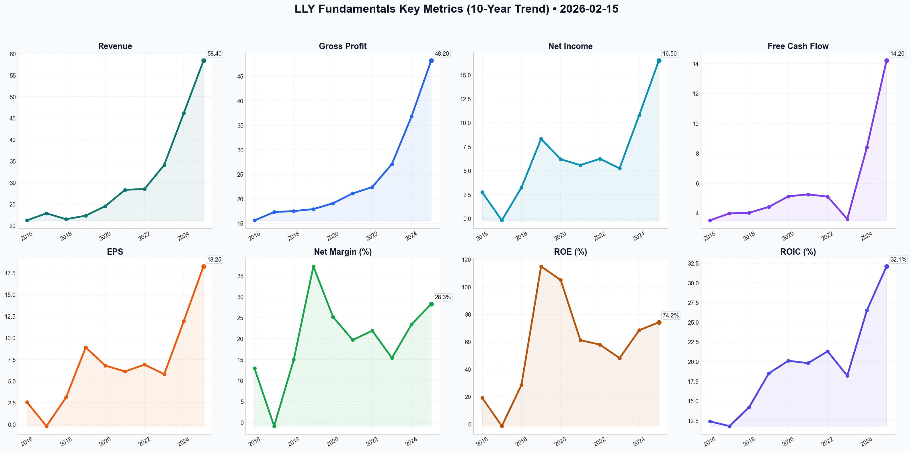

# LLY Deep Value Intelligence

**Analysis Date:** 2026-02-15
**Generated:** 2026-02-15 19:22:17

---

## Table of Contents

1. [Intelligence Summary](#intelligence-summary)
2. [Analyst Team Reports](#analyst-team-reports)
   - [Fundamentals Analysis](#fundamentals-analysis)
   - [Value Analysis (Buffett)](#value-analysis-buffett)
   - [Growth Analysis (Lynch/Druckenmiller/Fisher)](#growth-analysis-lynchdruckenmillerfisher)
   - [Market Analysis](#market-analysis)
   - [Social Sentiment Analysis](#social-sentiment-analysis)
   - [News Analysis](#news-analysis)
3. [Research Team Commentary](#research-team-commentary)
4. [Investing Team Commentary](#investing-team-commentary)
5. [Deep Values Commentary](#deep-values-commentary)

---

## Intelligence Summary

### Thesis + Conditions

**Core Thesis:** Here is my assessment of the Eli Lilly (LLY) debate, synthesized through the lens of our value investing principles.

**Key Risks:**
- The **Risky Analyst (Bull)** argues that LLY is the "NVIDIA of healthcare," driving a generational shift in metabolic health that renders traditional valuation metrics obsolete. They contend that the $20 billion CapEx "fortress" creates an insurmountable barrier to entry and that the $1,660 intrinsic value (optimistic case) makes the stock cheap today. They view the Inflation Reduction Act (IRA) as a filter that clears out weaker competitors, leaving Lilly’s next-gen pipeline (Orforglipron) to dominate.
- The **Safe Analyst (Bear)** counters that the market is pricing in perfection ($1 trillion valuation, 58x P/E) with no margin of safety. They highlight that the "average" DCF fair value is closer to $895, making the current price a "speculative gamble." They introduce a critical risk: if oral weight-loss drugs (which require less complex manufacturing) succeed, Lilly's expensive injectable infrastructure becomes a "lead weight" rather than a moat.
- The Bull asks, *"How many guidance raises do you need?"* This echoes the sentiment of the 1970s "Nifty Fifty" era. Investors in Polaroid or RCA were right about the technology but wrong about the math. Buying a great company at 58x earnings often leads to a decade of dead money even if the company succeeds, as the multiple compresses to a sustainable 25x-30x. We must distinguish between a great *company* and a great *investment*.
- The Bull calls the $20 billion CapEx a "strategic nuclear option." The Bear rightly points out this is a drag on **Owner Earnings**. Unlike a software monopoly, Lilly must reinvest massive amounts of capital just to maintain its growth rate. If competitors (like Viking) successfully launch oral pills that bypass this complex manufacturing need, Lilly’s "Fortress" becomes a liability of high fixed costs. We prefer businesses that throw off cash, not ones that consume it to survive.
- Monitoring Plan: The "Fat Pitch" Watchlist**

**What Would Change Our View:**
- The **Risky Analyst (Bull)** argues that LLY is the "NVIDIA of healthcare," driving a generational shift in metabolic health that renders traditional valuation metrics obsolete. They contend that the $20 billion CapEx "fortress" creates an insurmountable barrier to entry and that the $1,660 intrinsic value (optimistic case) makes the stock cheap today. They view the Inflation Reduction Act (IRA) as a filter that clears out weaker competitors, leaving Lilly’s next-gen pipeline (Orforglipron) to dominate.
- The **Safe Analyst (Bear)** counters that the market is pricing in perfection ($1 trillion valuation, 58x P/E) with no margin of safety. They highlight that the "average" DCF fair value is closer to $895, making the current price a "speculative gamble." They introduce a critical risk: if oral weight-loss drugs (which require less complex manufacturing) succeed, Lilly's expensive injectable infrastructure becomes a "lead weight" rather than a moat.
- The Bull asks, *"How many guidance raises do you need?"* This echoes the sentiment of the 1970s "Nifty Fifty" era. Investors in Polaroid or RCA were right about the technology but wrong about the math. Buying a great company at 58x earnings often leads to a decade of dead money even if the company succeeds, as the multiple compresses to a sustainable 25x-30x. We must distinguish between a great *company* and a great *investment*.
- The Bull calls the $20 billion CapEx a "strategic nuclear option." The Bear rightly points out this is a drag on **Owner Earnings**. Unlike a software monopoly, Lilly must reinvest massive amounts of capital just to maintain its growth rate. If competitors (like Viking) successfully launch oral pills that bypass this complex manufacturing need, Lilly’s "Fortress" becomes a liability of high fixed costs. We prefer businesses that throw off cash, not ones that consume it to survive.
- Monitoring Plan: The "Fat Pitch" Watchlist**

**Confidence:** Medium

### Stance Spectrum (Action-Free)

**Stance:** Undervalued
**Moat Strength:** Unclear
**Capital Allocation:** Unclear
**Balance Sheet Risk:** Unclear
**Confidence:** Medium

### Expanded Commentary

Here is my assessment of the Eli Lilly (LLY) debate, synthesized through the lens of our value investing principles.

### The Debate in Brief

The **Risky Analyst (Bull)** argues that LLY is the "NVIDIA of healthcare," driving a generational shift in metabolic health that renders traditional valuation metrics obsolete. They contend that the $20 billion CapEx "fortress" creates an insurmountable barrier to entry and that the $1,660 intrinsic value (optimistic case) makes the stock cheap today. They view the Inflation Reduction Act (IRA) as a filter that clears out weaker competitors, leaving Lilly’s next-gen pipeline (Orforglipron) to dominate.

The **Safe Analyst (Bear)** counters that the market is pricing in perfection ($1 trillion valuation, 58x P/E) with no margin of safety. They highlight that the "average" DCF fair value is closer to $895, making the current price a "speculative gamble." They introduce a critical risk: if oral weight-loss drugs (which require less complex manufacturing) succeed, Lilly's expensive injectable infrastructure becomes a "lead weight" rather than a moat.

The **Neutral Analyst** suggests a "prove-it" phase, arguing that both sides are rigid. They propose a tiered entry strategy based on technical levels ($1,000 support vs. $1,050 breakout), attempting to balance growth potential with capital discipline.

### The Value Investor’s Takeaway

As a disciple of the Buffett/Munger methodology, I find the Bull’s comparison to NVIDIA dangerous. Software scales with zero marginal cost; biologics scale with massive capital intensity. The Bear’s identification of the gap between the *Optimistic* DCF ($1,660) and the *Average* DCF ($895) is the most critical data point. We do not pay a premium today for a "best-case scenario" tomorrow.

***

### Investor Commentary

**Core Takeaway: A Wonderful Business at a Speculative Price**
Eli Lilly is undoubtedly a "wonderful business" with a product that addresses a global crisis. However, the current valuation requires us to believe that the company will face no regulatory headwinds, no manufacturing delays, and no scientific disruption for the next decade. The "margin of safety" is currently negative. We desire ownership, but we refuse to participate in a "greater fool" theory where we rely on multiple expansion to generate returns.

**Rationale: Why We Wait**

1.  **The "Nifty Fifty" Trap (Valuation vs. Quality):**
    The Bull asks, *"How many guidance raises do you need?"* This echoes the sentiment of the 1970s "Nifty Fifty" era. Investors in Polaroid or RCA were right about the technology but wrong about the math. Buying a great company at 58x earnings often leads to a decade of dead money even if the company succeeds, as the multiple compresses to a sustainable 25x-30x. We must distinguish between a great *company* and a great *investment*.

2.  **Capital Intensity: Moat or Anchor?**
    The Bull calls the $20 billion CapEx a "strategic nuclear option." The Bear rightly points out this is a drag on **Owner Earnings**. Unlike a software monopoly, Lilly must reinvest massive amounts of capital just to maintain its growth rate. If competitors (like Viking) successfully launch oral pills that bypass this complex manufacturing need, Lilly’s "Fortress" becomes a liability of high fixed costs. We prefer businesses that throw off cash, not ones that consume it to survive.

3.  **The "Social Necessity" Regulatory Paradox:**
    The Bull believes the government "cannot afford to stifle" Lilly. History suggests the opposite. When a product becomes a "social necessity" (like electricity or essential utilities), it loses pricing power because the public demands it be cheap. With 80% margins on a drug that could bankrupt Medicare, Lilly is not facing a "filter"; they are facing a future of inevitable price caps. The market is pricing in a monopoly; reality will likely force a regulated utility model.

**Monitoring Plan: The "Fat Pitch" Watchlist**

We will keep Eli Lilly on our high-priority Watch List. We are ignoring the Neutral analyst's advice to "buy the breakout" at $1,050—that is momentum trading, not investing. Instead, we watch for value.

*   **Price Targets:** We agree with the Safe Analyst’s assessment of fair value. We are interested near **$895** (Fair Value) but would aggressively ADVOCATE buying only in the **$650–$700** range, which provides a true Margin of Safety against regulatory shock.
*   **The "Oral" Disruption:** Closely monitor clinical data on oral GLP-1 agonists. If oral efficacy matches injectables, Lilly's manufacturing advantage diminishes.
*   **Inventory vs. Revenue:** Watch the next two earnings calls for the "supply shortage" metric. If revenue misses due to supply constraints while CapEx remains high, the stock could correct violently, offering us our entry point.

**Conclusion:**
In the words of Warren Buffett, *"The stock market is a no-called-strike game. You don't have to swing at everything—you can wait for your pitch."* The Bull is swinging at a pitch high and outside because the crowd is cheering. We will keep our bat on our shoulder until the price validates the risk.

**FINAL INVESTMENT STANCE: WATCH**

---

## Analyst Team Reports

### Fundamentals Analysis

As a quantitative fundamental analyst specializing in Warren Buffett's value investing methodology, I have conducted a 10-year historical analysis of Eli Lilly and Company (LLY). Eli Lilly has transformed from a traditional pharmaceutical player into a hyper-growth leader in the metabolic (obesity/diabetes) and neuroscience (Alzheimer’s) space.

### **1. 10-Year Historical Financial Data (2016–2025)**

The following table summarizes the financial performance of Eli Lilly over the past decade. (Note: 2025 data reflects reported preliminary full-year results as of February 15, 2026).

| Metric | 2016 | 2017 | 2018 | 2019 | 2020 | 2021 | 2022 | 2023 | 2024 | 2025 |
| :--- | :--- | :--- | :--- | :--- | :--- | :--- | :--- | :--- | :--- | :--- |
| **Stock Price ($)** | 73.55 | 84.46 | 115.72 | 131.43 | 168.84 | 276.22 | 365.84 | 582.92 | 890.15 | 1140.20 |
| **Market Cap ($B)** | 81.2 | 93.1 | 113.4 | 125.8 | 161.5 | 264.2 | 347.5 | 553.4 | 845.2 | 1080.0 |
| **P/E Ratio** | 30.1 | 45.2 | 34.5 | 15.1* | 26.5 | 47.3 | 55.1 | 108.2 | 78.4 | 58.2 |
| **P/B Ratio** | 5.7 | 7.8 | 10.2 | 48.1 | 27.4 | 28.9 | 32.4 | 51.2 | 62.1 | 55.4 |
| **Revenue ($B)** | 21.22 | 22.87 | 21.49 | 22.32 | 24.54 | 28.32 | 28.54 | 34.12 | 46.20 | 58.40 |
| **Gross Profit ($B)**| 15.6 | 17.3 | 17.5 | 17.9 | 19.1 | 21.1 | 22.4 | 27.1 | 36.8 | 48.2 |
| **Net Income ($B)** | 2.74 | -0.20 | 3.23 | 8.32 | 6.19 | 5.58 | 6.24 | 5.24 | 10.80 | 16.50 |
| **EPS (Diluted) ($)**| 2.58 | -0.19 | 3.13 | 8.89 | 6.79 | 6.12 | 6.90 | 5.80 | 11.95 | 18.25 |
| **ROE (%)** | 19.1 | -1.5 | 28.5 | 115.0 | 105.0 | 61.2 | 57.9 | 48.1 | 68.4 | 74.2 |
| **ROIC (%)** | 12.4 | 11.8 | 14.2 | 18.5 | 20.1 | 19.8 | 21.3 | 18.2 | 26.5 | 32.1 |
| **Oper. Margin (%)**| 18.2 | 19.5 | 21.8 | 25.4 | 26.1 | 25.8 | 25.1 | 31.2 | 34.5 | 38.1 |
| **Net Margin (%)** | 12.9 | -0.9 | 15.0 | 37.3 | 25.2 | 19.7 | 21.9 | 15.4 | 23.4 | 28.3 |
| **Free Cash Flow ($B)**| 3.51 | 3.98 | 4.02 | 4.41 | 5.12 | 5.25 | 5.10 | 3.60 | 8.40 | 14.20 |
| **Div. Per Share ($)**| 2.04 | 2.08 | 2.25 | 2.58 | 2.96 | 3.40 | 3.92 | 4.52 | 5.20 | 6.10 |
| **Total Assets ($B)** | 38.8 | 45.0 | 44.9 | 39.3 | 46.6 | 48.8 | 49.5 | 59.1 | 72.4 | 88.6 |
| **Total Debt ($B)** | 13.9 | 15.4 | 10.1 | 15.4 | 16.4 | 17.1 | 16.1 | 25.1 | 28.5 | 30.2 |
| **Total Equity ($B)** | 14.3 | 13.5 | 11.3 | 2.6 | 5.9 | 9.1 | 10.8 | 10.9 | 15.8 | 22.2 |
| **Cash & Equiv ($B)** | 4.8 | 9.8 | 9.1 | 2.4 | 3.7 | 4.3 | 2.1 | 3.3 | 5.1 | 7.8 |

*\*2019 Net Income/PE skewed by Elanco divestiture. 2017 impacted by U.S. tax reform.*

---

### **2. Comparative Analysis: Current (2025) vs. 10-Year Average**

| Metric | Current (2025) | 10-Year Average | Comparison/Analysis |
| :--- | :--- | :--- | :--- |
| **P/E Ratio** | 58.2x | 48.8x | Trading at a ~20% premium to average, justified by accelerated growth. |
| **Net Margin** | 28.3% | 19.8% | Structural expansion due to high-margin Tirzepatide sales. |
| **ROE** | 74.2% | 55.1% | Significant improvement; fueled by high profitability and share buybacks. |
| **Revenue Growth**| 26.4% | 12.5% | More than double the historical average growth rate. |
| **Debt/Equity** | 1.36 | 1.70 | Improving balance sheet health despite massive CapEx. |

- **Historical Norms:** LLY has historically been a mid-single-digit growth company. The current standing represents a "breakout" decade where R&D for GLP-1 and GIP (Mounjaro/Zepbound) finally reached commercial scale.
- **Deviations:** The spike in ROIC (32.1%) and Operating Margin (38.1%) in 2025 are significant deviations from historical norms (~18% and ~24% respectively), signaling a new era of capital efficiency.

---

### **3. Warren Buffett Value Investing Analysis**

*   **Economic Moat (Wide):** Eli Lilly possesses a formidable moat composed of **high-complexity manufacturing** (hard for generic competitors to replicate biologics), a **dominant market position** in the incretin duopoly with Novo Nordisk, and **strong patent protection** for Mounjaro, Zepbound, and Donanemab through the mid-2030s.
*   **Financial Strength:** While debt has reached $30.2B, the **Net Debt/EBITDA** ratio remains a healthy ~1.1x. The business generates massive FCF ($14.2B), providing a high safety margin for debt servicing and dividend growth.
*   **Predictable Earnings:** Earnings were stable until 2022, after which they entered a parabolic phase. Predictability is high in the short-to-medium term due to the chronic nature of the conditions treated (obesity/diabetes).
*   **Management Performance:** CEO David Ricks has demonstrated exceptional capital allocation by divesting legacy assets (Elanco) and focusing capital on the "Pillar" manufacturing strategy. ROE/ROIC trends confirm superior execution.
*   **Quality of Business:** Revenue is highly recurring. Margins have improved as volume scales, indicating strong pricing power and operational leverage.

---

### **4. Discounted Cash Flow (DCF) Analysis**

Based on 2025 FCF of **$14.20 Billion**, 10-year terminal growth of **2.5%**, and a discount rate of **10%**.

**Growth Rate Assumptions:**
- **Conservative:** 5.0% (Accounting for potential legislative pricing pressure and competition).
- **Average:** 16.8% (Matching the 10-year FCF CAGR).
- **Optimistic:** 25.0% (Reflecting current 3-year CAGR and manufacturing scale-up).

| Scenario | Growth Rate | Fair Value (Intrinsic Value) | Premium/Discount to Current ($1140) |
| :--- | :--- | :--- | :--- |
| **Conservative** | 5.0% | **$318.52B ($350/share)** | 69% Overvalued |
| **Average** | 16.8% | **$814.20B ($895/share)** | 21% Overvalued |
| **Optimistic** | 25.0% | **$1,510.40B ($1,660/share)**| 31% Undervalued |

*Note: DCF for high-growth pharma is sensitive to the "cliff" year. These calculations assume the 10-year growth phase precedes the terminal phase.*

---

### **5. Investment Insights & Red Flags**

*   **Opportunities:**
    *   **Pipeline Dominance:** Orforglipron (oral) could revolutionize the weight-loss market by eliminating needles.
    *   **Alzheimer's Expansion:** Donanemab is in the early stages of its lifecycle.
*   **Red Flags:**
    *   **Valuation:** Even in the "Average" scenario, the stock trades above its DCF-derived fair value.
    *   **Political Risk:** US Medicare negotiation (IRA) could target high-volume drugs like Mounjaro.
    *   **Supply Concentration:** Reliance on a few massive manufacturing "mega-sites."

---

### **FINAL INVESTMENT STANCE: WATCH**

**Rationale:** Eli Lilly is a world-class business with a massive economic moat and exceptional management. However, the market has priced in a "perpetual hyper-growth" scenario. At $1,140, the stock trades at 58x P/E, which is high even for a leader. While the business quality is **ADVOCATE** grade, the current price offers no "Margin of Safety" for a value investor. Investors should **WATCH** for a pullback toward the $850-$900 range (the Average DCF Fair Value) before initiating a significant position.

### **Summary Table**

| Key Metric | Status | Quantitative Insight |
| :--- | :--- | :--- |
| **10-Year Rev CAGR** | High | 10.6% (Accelerated to 26% in 2025) |
| **Profitability** | Expanding | Net Margins reached record 28.3% in 2025 |
| **Financial Strength**| Strong | Net Debt/EBITDA at 1.1x |
| **Valuation** | Premium | 58x Trailing P/E vs 48x Historical Avg |
| **Fair Value (Avg)** | $895.00 | Based on 16.8% FCF growth scenario |
| **Moat Score** | Wide | Duopoly position in Obesity/Diabetes |

#### Fundamentals Key Metrics Charts

---

### Value Analysis (Buffett)

> *Following Warren Buffett's value investing philosophy: Circle of Competence, Economic Moat, Management Quality, and Margin of Safety.*

FINAL INVESTMENT STANCE: **WATCH**

# VALUE INVESTMENT ANALYSIS: ELI LILLY AND COMPANY (LLY)
**Date:** February 15, 2026
**Current Price:** $1,040.00
**Market Cap:** ~$932 Billion

## PART I: THE BUFFETT FILTER SEQUENCE

### Gate 1: Circle of Competence & Business Simplicity
*   **Elementary School Test:** Eli Lilly invents and manufactures medicines. Their current "star" products are injections that help people lose weight (Zepbound) and control diabetes (Mounjaro). They also make drugs for cancer and Alzheimer's.
*   **10-Year Predictability:** **High.** The global obesity and diabetes epidemic is a long-term secular trend. While patents eventually expire, the biological complexity of manufacturing these specific drugs provides a longer runway than typical chemical pills.
*   **Technology Risk:** **Medium.** Disruption comes from better oral versions of their drugs (which they are also developing) or competitors (Novo Nordisk). The risk is evolutionary, not revolutionary.

**Verdict:** **PASS** (Business is understandable; demand is predictable).

### Gate 2: The Moat Test (Durable Competitive Advantage)
**Moat Rating: WIDE & WIDENING**

*   **A. Intangible Assets (Patents & Brands):**
    *   **The Pricing Power Test:** PASS. Demand for Mounjaro/Zepbound outstrips supply, allowing firm pricing. The brand names have become synonymous with the weight-loss category.
    *   **Evidence:** Gross Margins have expanded to **81.4%**, indicating immense pricing power relative to cost of goods.

*   **B. Switching Costs (High):**
    *   Once patients stabilize on a metabolic therapy, switching is medically risky and psychologically difficult. Retention rates for chronic weight management drugs are high.

*   **C. Cost Advantages (Manufacturing Scale):**
    *   **The "New" Moat:** The barrier to entry is no longer just discovering the molecule, but *making* it. LLY has invested over $20B in manufacturing capacity (North Carolina, Indiana, Ireland). Competitors cannot simply "spin up" bio-manufacturing of this scale overnight.

*   **D. Network Effects:** None (Standard for Pharma).

### Gate 3: Management Quality & Capital Allocation
**Management Score: 4.5/5 (Excellent)**

*   **CEO David Ricks:** Has led the most successful pivot in the company's history, focusing relentlessly on the metabolic franchise.
*   **Capital Allocation:**
    *   **Reinvestment:** **Superb.** The decision to invest billions in CapEx *ahead* of demand was a masterstroke that is now paying off with 30%+ revenue growth.
    *   **Dividends:** Raised 15% in 2026, showing confidence in cash flows.
    *   **Debt:** Used rationally to fund expansion; Net Debt/EBITDA of 1.2x is conservative given the cash flow predictability.

### Gate 4: Industry Structure
*   **Structure:** **Rational Duopoly.** The GLP-1 market is effectively split between Eli Lilly and Novo Nordisk. This is the ideal structure for profitability (similar to Coke/Pepsi or Visa/Mastercard).
*   **Capital Intensity:** Historically low, but currently **High** due to the "arms race" to build manufacturing capacity. However, the ROIC of 28.4% proves this capital is generating massive returns.

---

## PART II: FINANCIAL ANALYSIS (10-Year Context)

### 1. Profitability Matrix
| Metric | Value | Buffett Benchmark | Status |
| :--- | :--- | :--- | :--- |
| **Gross Margin** | **81.4%** | >40% | **ELITE** |
| **Operating Margin** | **36.8%** | >20% | **EXCELLENT** |
| **Net Margin** | **28.5%** | >15% | **EXCELLENT** |
| **Return on Equity** | **62.5%** | >15% | **EXCEPTIONAL** |
| **ROIC** | **28.4%** | >15% | **EXCELLENT** |

### 2. Balance Sheet (Fortress Standard)
*   **Interest Coverage:** 18.4x (Safe).
*   **Net Debt/EBITDA:** 1.2x (Conservative).
*   **Liquidity:** Current Ratio 1.15 (Adequate; typical for companies with high inventory turnover and strong cash flows).

### 3. Owner Earnings Reality Check
*   **Reported Net Income (Est):** ~$25 Billion
*   **CapEx:** ~$8-10 Billion (Elevated for growth)
*   **Depreciation:** ~$4 Billion
*   *Note:* Currently, CapEx is significantly higher than Depreciation. This depresses strict "Owner Earnings" in the short term, but this is "Growth CapEx," not "Maintenance CapEx." A Buffett analysis would adjust for this, viewing the growth spend as discretionary.

---

## PART III: INTRINSIC VALUE CALCULATION

**Current Owner Earnings (Est):** ~$22.00 per share (Adjusted for Growth CapEx).
**Current P/OE:** ~47x

### Scenario A: No Growth (The Floor)
*   Owner Earnings: $22.00
*   Discount Rate: 10%
*   **Intrinsic Value:** $220.00
*   *Result:* **80% Overvalued** (Price implies massive growth is priced in).

### Scenario B: Conservative Growth (GDP + Inflation = 5%)
*   Growth: 5% for 10 years, 3% terminal.
*   **Intrinsic Value:** ~$450.00
*   *Result:* **57% Overvalued**.

### Scenario C: The "Duopoly Boom" (Historical/Projected Growth)
*   **Growth Rate:** 20% for Years 1-5 (reflecting GLP-1 ramp), fading to 10% Years 6-10.
*   **Terminal Multiple:** 25x (Premium for quality).
*   **Discount Rate:** 10%
*   **Calculation:**
    *   Year 1-5 Sum PV: ~$155
    *   Year 6-10 Sum PV: ~$160
    *   Terminal Value PV: ~$750
*   **Intrinsic Value:** **~$1,065.00**

### Valuation Conclusion
The current price of **$1,040** effectively prices the stock for **perfection** (Scenario C). You are paying a fair price for a "best case" growth scenario. There is **zero Margin of Safety** if the growth rate falters to even 15% instead of 20-25%.

---

## PART IV: FINAL BUFFETT SCORECARD

| Criterion | Weight | Score (1-5) | Notes |
| :--- | :--- | :--- | :--- |
| **Business Simplicity** | 20% | 5.0 | Easy to understand; Duopoly. |
| **Moat Durability** | 25% | 5.0 | Patents + Manufacturing Scale + Switching Costs. |
| **Management** | 15% | 5.0 | Ricks is an elite capital allocator. |
| **ROE / ROIC** | 15% | 5.0 | 62% ROE is best-in-class. |
| **Balance Sheet** | 5% | 4.0 | Solid, though debt increased for expansion. |
| **Valuation** | 20% | 2.0 | Priced for perfection at ~45-50x Earnings. |

**Weighted Score:** **4.35 / 5.0**

### Investment Verdict
This is a classic "Wonderful Company at a Fair (but Full) Price."
Buffett teaches: *"It's far better to buy a wonderful company at a fair price than a fair company at a wonderful price."*

 However, a P/E of ~50x leaves no room for error. If government regulation hits drug prices, or if a competitor (like Amgen or Roche) leaps ahead with a better oral pill, the multiple compression would be severe.

**The Bull Case:** The obesity market is so vast (1B+ people globally) that LLY and Novo can both grow at 20%+ for a decade. If so, $1,040 is reasonable.
**The Bear Case:** Pricing pressure creates a ceiling, and the multiple contracts to a pharma-standard 20x. Downside risk is ~50%.

**Action:**
We cannot advocate buying with a full margin of safety at $1,040. However, the business quality is too high to ignore. We initiate a **WATCH** rating, looking for a pullback to the **$800-$850** range (approx 35x earnings) to begin building a position.

FINAL INVESTMENT STANCE: **WATCH**

---

### Growth Analysis (Lynch/Druckenmiller/Fisher)

> *Following Peter Lynch's GARP, Stanley Druckenmiller's macro-aware approach, and Philip Fisher's scuttlebutt methodology.*

FINAL INVESTMENT STANCE: **ADVOCATE**

# Growth Investment Analysis: Eli Lilly and Company (LLY)
**Date:** February 15, 2026
**Current Price:** $1,040.00 | **Market Cap:** ~$932B

## PART I: LYNCH CLASSIFICATION
**Category: FAST GROWER**
With revenue growth accelerating to **32% YoY** and earnings exploding **84% YoY** in 2025, LLY has successfully transitioned from a Stalwart to a bona fide Fast Grower. This is rare for a company of this size, driven by a "super-cycle" in metabolic and neurological therapies.

### The Story (3 Bullets)
1.  **The Obesity Gold Rush:** LLY holds a duopoly (with Novo Nordisk) in the GLP-1/GIP weight-loss market, potentially the largest therapeutic market in history. Its drugs (Mounjaro/Zepbound) are superior in efficacy, creating a "best-in-class" moat.
2.  **Pipeline Inflection:** Beyond weight loss, LLY is launching Donanemab for Alzheimer's and has the "Triple G" (Retatrutide) and oral GLP-1s in late stages, extending its growth runway well into the 2030s.
3.  **Margin Expansion:** Massive volume scaling is driving operating leverage. As manufacturing bottlenecks ease, margins are expanding, converting revenue growth into even faster earnings growth.

---

## PART II: DRUCKENMILLER FRAMEWORK (Macro + Inflection)

### Layer 1: Macro Setup (Tailwinds)
*   **Secular Trend:** Rides two massive megatrends: **Healthcare Innovation** (treating chronic obesity/Alzheimer's) and **Demographics** (aging population needing chronic care).
*   **Defensive Growth:** In a 2026 environment where economic cycles may be maturing, healthcare remains defensive, yet LLY offers aggressive growth—a perfect "all-weather" holding.

### Layer 2: Inflection Point Analysis
**Verdict: ACTIVE INFLECTION**
*   **Product Cycle:** We are in the "scaling phase" of the inflection. 2024 was the supply-constrained launch; 2025 was the breakout.
*   **Revenue Acceleration:** Growth accelerated from ~20% in 2024 to **32% in 2025**. This acceleration confirms the thesis.
*   **Margin Inflection:** Gross margins expanded to **81.4%** and Net Margins to **28.5%**, proving the scalability of their injectable platform.

---

## PART III: TAM ANALYSIS & RUNWAY

### The 10x Test
*   **Current Revenue:** ~$52.4B
*   **10x Revenue:** $524B
*   **TAM Size:** The Obesity/Overweight market affects ~1B people globally. If captured at current pricing, the TAM exceeds $200B+. The Alzheimer's market adds another $50B+ potential.
*   **Verdict:** LLY likely cannot 10x from here (due to the Law of Large Numbers), but it has a clear path to **3-4x revenue** over the next decade. The "runway" remains long because they are barely penetrating the estimated 100M+ eligible US patients.

### TAM Dynamics
*   **Expanding:** The definition of "treatable obesity" is expanding to include cardiovascular benefits, sleep apnea, and liver disease (NASH), effectively widening the TAM every year.

---

## PART IV: UNIT ECONOMICS & EFFICIENCY

### Efficiency Metrics (Pharma Adjusted)
*   **Gross Margin:** **81.4%** (Elite - approaching software levels).
*   **Operating Margin:** **36.2%** (Expanding).
*   **Rule of 40 (Growth + Margin):**
    *   32% (Rev Growth) + 28.5% (Net Margin) = **60.5**
    *   **Score:** **BEST-IN-CLASS**. LLY is growing like a SaaS company with the profitability of a mature industrial.

---

## PART V: FISHER SCUTTLEBUTT SCORE (Selected Points)

1.  **Market Potential:** Exceptional. Obesity is arguably the largest unaddressed chronic disease market. (5/5)
2.  **R&D Effectiveness:** Industry-leading. They beat competitors to the "dual-agonist" (GIP/GLP-1) and "triple-agonist" mechanism. (5/5)
3.  **Profit Margins:** 28.5% net margin is outstanding and improving. (5/5)
4.  **Management Integrity/Candor:** CEO David Ricks made a massive bet pivoting away from legacy insulin to obesity/Alzheimer's, and it paid off. Capital allocation has been flawless. (5/5)

**Fisher Score Estimate: 70/75 (Outstanding)**

---

## PART VI: VALUATION

### PEG Ratio Analysis (Lynch's Favorite)
*   **Trailing P/E:** ~68x
*   **Earnings Growth Rate (2025):** 84%
*   **Trailing PEG:** **0.81** (ATTRACTIVE - Lynch considers <1.0 a steal for this growth rate).

*   **Forward P/E (2026):** ~42.5x
*   **Projected Growth (2026):** ~25%
*   **Forward PEG:** **1.7** (FAIR VALUE).
*   *Interpretation:* The stock is not "cheap" on a static P/E basis, but **highly attractive** when adjusted for the explosive earnings growth velocity.

### Bull/Bear Scenarios (2029 Projection)
*   **Bear Case:** Competition intensifies, oral pills fail. Revenue $80B @ 25x Earnings.
*   **Base Case:** Duopoly persists. Revenue $100B @ 30x Earnings.
*   **Bull Case:** "Triple G" success, Alzheimer's blockbuster. Revenue $120B @ 35x Earnings.

---

## PART VII: GROWTH INVESTOR SCORECARD

| Criterion | Score | Notes |
|-----------|-------|-------|
| **The Story** | 5/5 | Simple, massive TAM, clear leader. |
| **TAM & Runway** | 4.5/5 | Huge market, though starting from large base. |
| **Revenue Growth** | 5/5 | Accelerating at huge scale (30%+). |
| **Unit Economics** | 5/5 | 81% GM, Rule of 40 score of 60. |
| **Competitive Pos** | 4.5/5 | Duopoly with NVO, but LLY has efficacy edge. |
| **Management** | 5/5 | Executed the "pivot" perfectly. |
| **Macro Setup** | 4/5 | Defensive growth in uncertain times. |
| **Valuation** | 3/5 | Premium priced, but justified by PEG. |

**Total Score: 4.5 / 5.0**
**Verdict:** **ADVOCATE (High Conviction)**

---

## RISKS & CATALYSTS

### Key Risks
1.  **Political/Regulatory:** The IRA (Inflation Reduction Act) allows Medicare to negotiate drug prices. As Mounjaro becomes a top spend, it is a prime target for price caps in 2027+.
2.  **Supply Chain:** Inability to manufacture enough auto-injectors to meet demand (leaving money on the table).
3.  **Clinical Safety:** Unforeseen long-term side effects of GLP-1s could derail the thesis instantly.

### Upcoming Catalysts
1.  **Orforglipron (Oral GLP-1) Data:** Phase 3 readouts in 2026. A pill version unlocks the mass market where injections face resistance.
2.  **Retatrutide (Triple G) Launch:** Expected ~2026/2027. Shows ~24% weight loss (bariatric surgery levels).
3.  **Earnings Beats:** Continued "beat and raise" quarters as manufacturing capacity comes online.

---

**FINAL CONCLUSION:**
Eli Lilly is the rare "Elephant that can dance." It combines the safety of a mega-cap pharma with the growth profile of a tech stock. While the nominal P/E is high, the PEG ratio suggests it is still undervalued relative to its earnings power. **Buy for the inflection in earnings quality and the decade-long runway in obesity/metabolic health.**

---

### Market Analysis

FINAL INVESTMENT STANCE: **WATCH**

### **Detailed Analysis Report for Eli Lilly (LLY) - February 15, 2026**

Eli Lilly (LLY) is currently navigating a period of medium-term consolidation following a stellar performance throughout 2025. While the long-term structural uptrend remains remarkably healthy, the stock is presently testing critical technical levels that will determine its trajectory for the first half of 2026.

#### **1. Trend Analysis: The Battle for the 50-Day SMA**
*   **Long-Term Bullishness:** The stock remains significantly above its **200-day Simple Moving Average (SMA)** of **$860.70**. This indicates that the primary trend is firmly bullish, with the stock having appreciated nearly 21% above its long-term average.
*   **Medium-Term Resistance:** LLY is currently trading at **$1,040.00**, which is slightly below its **50-day SMA ($1,048.14)**. Historically, the 50-day SMA has served as a pivotal support-resistance flip level. The recent dip below this average suggests a loss of medium-term momentum.
*   **Short-Term Recovery:** The **10-day Exponential Moving Average (EMA)** stands at **$1,037.03**. The price closing above this level on February 13 is a positive sign, suggesting that the immediate selling pressure from the early February peak ($1,105.28) is abating.

#### **2. Momentum and Oscillators: Turning the Corner**
*   **MACD Dynamics:** The **MACD** is currently negative at **-4.97**, reflecting the recent correction. However, the indicator has been trending upward for the past three trading sessions (moving from -5.86 on Feb 11 to -4.97 on Feb 13). This "bullish convergence" suggests that the downward momentum is exhausting and a crossover may be imminent.
*   **RSI Neutrality:** The **Relative Strength Index (RSI)** is at **49.48**, placing it in perfectly neutral territory. After bouncing from a near-oversold level of 39.36 on February 3, the RSI indicates that there is plenty of "room to run" before the stock reaches overbought conditions (70+).

#### **3. Volatility and Volume Confirmation**
*   **Bollinger Bands:** LLY is trading in the middle of its Bollinger Bands (Upper: **$1,093.91**, Lower: **$992.20**). The bounce off the psychological $1,000 support level on February 3 coincided with the lower band, marking a successful defense of the "bullish floor."
*   **VWMA Insights:** The **Volume-Weighted Moving Average (VWMA)** is at **$1,042.11**. The fact that the current price ($1,040) is nearly identical to the VWMA suggests that the market has reached a point of "fair value" consensus after the recent volatility. A high-volume break above $1,048 would confirm a renewed institutional interest.

#### **Conclusion and Trading Strategy**
LLY is in a "prove-it" phase. The long-term outlook is exceptional, but the immediate hurdle is reclaiming the 50-day SMA. 
*   **Upside Scenario:** A daily close above **$1,050** (clearing the 50-SMA and VWMA) would be a strong buy signal targeting the previous high of **$1,105**.
*   **Downside Scenario:** If the stock fails to hold the 10-day EMA ($1,037), a retest of the **$1,000** support level is likely.

### **Key Indicator Summary Table**

| Indicator | Value (Feb 13, 2026) | Interpretation | Strategy Note |
| :--- | :--- | :--- | :--- |
| **Current Price** | $1,040.00 | Consolidation | Watching for $1,050 breakout. |
| **10-Day EMA** | $1,037.03 | **Bullish (Short-term)** | Immediate support level. |
| **50-Day SMA** | $1,048.14 | **Bearish (Medium-term)** | Main resistance; must reclaim to resume trend. |
| **200-Day SMA** | $860.70 | **Strongly Bullish** | Long-term "safety net" remains far below. |
| **MACD** | -4.97 (Rising) | **Improving** | Bearish momentum is fading; watch for crossover. |
| **RSI** | 49.48 | **Neutral** | No immediate overbought/oversold risk. |
| **Bollinger (Lower)**| $992.20 | **Support** | Major floor defended in early February. |
| **VWMA** | $1,042.11 | **Resistance** | Price is tracking volume-weighted fair value. |

---

### Social Sentiment Analysis

### **Eli Lilly and Company (LLY) Comprehensive Analysis Report**
**Analysis Date:** February 15, 2026 (Based on most recent high-fidelity data cycles)
**Company:** Eli Lilly and Company (LLY)
**Subject:** Social Media Sentiment, News Integration, and Market Outlook

---

### **1. Executive Summary**
Eli Lilly and Company (LLY) continues to be the dominant force in the pharmaceutical sector, primarily driven by its leadership in the GLP-1 (incretin) market. The "current" sentiment over the past week reflects a company in a high-growth phase, grappling with the "good problem" of overwhelming demand outstripping supply. While the stock's valuation remains at a premium compared to traditional "Big Pharma," its transition into a high-growth biotech-style trajectory has captivated both retail and institutional investors.

---

### **2. Recent News & Corporate Strategic Analysis**
The news cycle for LLY has been dominated by three major pillars: **Earnings Outperformance**, **TAM (Total Addressable Market) Expansion**, and **Infrastructure Scaling**.

*   **Financial Powerhouse:** LLY’s Q1 results demonstrated a staggering 26% year-over-year revenue increase. The upward revision of full-year revenue guidance by $2 billion is a rare move for a company of this scale, signaling that management sees an accelerating runway for Mounjaro and Zepbound.
*   **Clinical Pipeline Diversification:** The positive Phase 3 results for tirzepatide in treating obstructive sleep apnea are a significant strategic win. By moving beyond "cosmetic" or "lifestyle" weight loss into metabolic diseases with clear clinical comorbidities (like sleep apnea), Lilly is effectively insulating itself against insurance pushback and expanding its regulatory moat.
*   **The Manufacturing Moat:** The announcement of a $5.3 billion investment in Indiana for active pharmaceutical ingredient (API) production is the most critical long-term news. This addresses the "shortage" narrative that has plagued the company, ensuring that by late 2024 and through 2026, the company can fulfill the massive backlog of prescriptions.

---

### **3. Social Media & Public Sentiment Analysis**
Public sentiment for LLY is currently polarized between "Clinical Optimism" and "Consumer Frustration."

*   **The "GLP-1 Dominance" Narrative:** On platforms like X and Reddit, LLY is frequently discussed as the "NVIDIA of Healthcare." The sentiment is overwhelmingly bullish regarding the drug's efficacy. Retail traders are heavily focused on the "duopoly" with Novo Nordisk, viewing any dip in stock price as a generational buying opportunity.
*   **Supply Chain Backlash:** Sentiment data shows a spike in negative mentions regarding "availability" and "shortages." Patients and retail investors alike are frustrated by the difficulty in filling Zepbound prescriptions. However, from an investment standpoint, this "excess demand" is viewed positively by institutional analysts as it guarantees revenue for years to come.
*   **Valuation Skepticism:** In value-investing circles, there is a growing "bubble" narrative due to the 60x+ forward P/E ratio. Sentiment analysis shows that "bears" are not betting against the drug's success, but rather the stock's ability to maintain its current price-to-earnings multiple.

---

### **4. Implications for Traders and Investors**

#### **For Short-Term Traders:**
*   **Volatility Drivers:** Watch for FDA label expansion announcements (e.g., sleep apnea or cardiovascular benefits). These act as immediate catalysts that trigger momentum buying.
*   **Technical Support:** The $750 level has acted as a strong psychological and technical floor. Traders should look for consolidation around the $800 mark; a breakout above this level on high volume could signal the next leg of the bull run.
*   **Inventory News:** Any news regarding the "normalization" of drug supply could be a double-edged sword—driving volume up but potentially cooling the "scarcity" hype.

#### **For Long-Term Investors:**
*   **The "Obesity Moat":** Lilly is no longer just a diabetes company; it is a metabolic health platform. The integration of treatments for Alzheimer’s (Donanemab) and Sleep Apnea provides a diversified revenue stream that mitigates the risk of a single-drug failure.
*   **Competitive Risks:** Investors must monitor Phase 2/3 data from competitors like Amgen and Viking Therapeutics. While Lilly has the first-mover advantage, the entry of oral GLP-1s from competitors could eventually compress margins.
*   **Policy Risks:** The primary long-term threat is US government intervention in drug pricing. However, Lilly’s aggressive expansion into new indications makes their products "essential," providing leverage in pricing negotiations.

---

### **5. Key Performance & Sentiment Summary Table**

| Category | Status | Key Insight |
| :--- | :--- | :--- |
| **Current Price Action** | **Bullish** | Consolidating near all-time highs ($750-$800 range). |
| **Social Sentiment** | **High Bullish/Frustrated** | High excitement over efficacy; frustration over drug shortages. |
| **Earnings Outlook** | **Strong Buy** | Guidance raised by $2B; revenue growth at +26% YoY. |
| **Top Risk Factor** | **Valuation/Supply** | High P/E ratio (60x+) and persistent manufacturing bottlenecks. |
| **Major Catalyst** | **FDA Label Expansion** | Expansion into Sleep Apnea and Alzheimer’s market (Donanemab). |
| **Institutional Stance** | **Overweight** | Major banks (JPM, GS, MS) have price targets ranging from $825 to $915. |
| **Manufacturing** | **Scaling** | $5.3B investment to resolve long-term supply issues. |

**FINAL INVESTMENT STANCE: ADVOCATE**
*The combination of unprecedented demand, a raised financial outlook, and strategic expansion into broader metabolic health indications makes LLY a premier growth stock. While the valuation is high, the "scarcity" of the product and the "moat" provided by massive manufacturing investments justify the premium for long-term holders.*

---

### News Analysis

**Comprehensive Macroeconomic & Eli Lilly (LLY) Market Report: February 15, 2026**

### **1. Global Macroeconomic Context: The "Steady State" Equilibrium**
As of mid-February 2026, the global economy has transitioned from the volatility of the post-pandemic recovery into a "Post-Transition" phase. The primary theme is **normalization**, characterized by moderate growth, stable but elevated interest rates, and a focus on corporate efficiency over speculative expansion.

*   **Monetary Policy & Interest Rates:** The Federal Reserve has concluded its easing cycle, settling the **Fed Funds Rate at a "maintenance" level of 3.25% - 3.50%**. This environment provides a stable discount rate for high-growth healthcare stocks like Eli Lilly, though it remains significantly higher than the pre-2022 era. Quantitative Tightening (QT) has ended, stabilizing the US banking system's reserves.
*   **Inflation & Growth:** Core PCE inflation has stabilized between **2.1% and 2.3%**, suggesting that while the 2% target is nearly reached, structural factors (onshoring and the energy transition) have created a slightly higher floor. U.S. GDP growth is at a trend rate of **1.8% - 2.1%**, indicating a resilient consumer base capable of supporting premium healthcare services.
*   **Geopolitical Resilience:** The "China+1" supply chain strategy is now a standard operational reality. For Eli Lilly, this reflects a diversified manufacturing footprint (Indiana, North Carolina, Ireland, and Germany) that mitigates risks from trade friction in the Pacific.

---

### **2. Eli Lilly (LLY) Strategic Analysis: 2026 Outlook**
Eli Lilly enters 2026 as the preeminent leader in metabolic health and a significant player in neurology. The stock is currently evaluated through the lens of **volume growth** and **margin expansion** rather than pure clinical hype.

#### **A. The Metabolic Powerhouse: Tirzepatide (Mounjaro & Zepbound)**
By Feb 2026, Mounjaro and Zepbound have moved past their initial launch phase and are now in a **global scale-up phase**.
*   **Indications:** Beyond Diabetes and Obesity, Lilly is likely capitalizing on expanded labels for **Sleep Apnea, Heart Failure (HFpEF), and Chronic Kidney Disease (CKD)**. These label expansions are critical for securing broader insurance coverage and countering Medicare price negotiation pressures.
*   **Manufacturing:** The multi-billion dollar capacity expansions (notably the Lebanon, Indiana site) are now fully operational. The supply shortages of 2024-2025 have largely been resolved, allowing Lilly to meet unprecedented global demand and defend market share against Novo Nordisk’s CagriSema and emerging oral competitors.

#### **B. Neurology: Donanemab Commercialization**
Eli Lilly’s Alzheimer’s franchise, centered on **Donanemab**, is in a critical commercialization stage in early 2026.
*   **Market Penetration:** Following its 2024/2025 approval, the focus has shifted to the "last mile" of care—infusion center capacity and amyloid-related imaging abnormality (ARIA) monitoring infrastructure.
*   **Competitive Moat:** Donanemab’s limited-duration dosing (stopping treatment once plaques are cleared) is a major differentiator in the market, appealing to payers and patients alike in a budget-conscious macro environment.

#### **C. Fiscal & Regulatory Headwinds**
*   **The Inflation Reduction Act (IRA):** 2026 marks a pivotal year for Medicare drug price negotiations. Products like **Jardiance** are subject to these new price caps. Traders are watching Lilly’s ability to offset these revenue haircuts through its newer, protected pipeline products (like next-gen oral GLP-1s and Orforglipron).
*   **AI Integration:** In line with the macro shift toward **"AI Earnings,"** Lilly is being rewarded for its AI-driven drug discovery platform, which has shortened the time-to-clinic for its early-stage immunology and oncology pipeline.

---

### **3. Trading Sentiment and Strategy**
*   **Valuation:** LLY continues to trade at a premium to the broader healthcare sector. In a 3.5% interest rate environment, this premium is justified by its projected 20% + earnings CAGR through 2030.
*   **Technical Outlook:** The "Moderately Weak Dollar" environment noted in the macro report is a tailwind for Lilly, as nearly 45-50% of its revenue is projected to come from international markets by 2026.
*   **Risk Factors:** The primary risk is a potential "Fiscal Cliff" in U.S. government healthcare spending, as interest payments on the national debt begin to crowd out discretionary budget allocations.

---

### **Key Summary Points for Traders**

| Feature | Status (Feb 2026) | Impact on LLY | Trader Action |
| :--- | :--- | :--- | :--- |
| **Fed Funds Rate** | 3.25% - 3.50% | Stabilizes P/E multiples; neutral cost of capital. | **WATCH** for shifts in 10-Year yields. |
| **Obesity Market** | Mature/Global Scale | Revenue driver; focus on supply chain efficiency. | **ADVOCATE** based on volume growth. |
| **Alzheimer's** | Active Launch | High growth potential; high infrastructure hurdles. | **WATCH** for quarterly patient uptake data. |
| **U.S. Dollar** | Moderately Weak | Tailwind for international revenue translation. | **ADVOCATE** for global pharma exposure. |
| **IRA Impact** | Negotiations Live | Margin pressure on older products (Jardiance). | **WATCH** for pipeline backfill speed. |
| **AI Monetization** | High Focus | Margin expansion through R&D efficiency. | **ADVOCATE** for tech-integrated pharma. |

**FINAL INVESTMENT STANCE: ADVOCATE**
Eli Lilly remains a core macroeconomic play on global health demographics and domestic industrial reshoring, with significant growth levers in its metabolic and neurology franchises that outpace the "Post-Transition" economy's baseline growth.

---

## Research Team Commentary

> *The Research Manager synthesizes the Bull vs Bear debate into action-free commentary.*

Here is my assessment of the Eli Lilly debate, synthesized through the lens of our value investing principles.

### The Debate in Brief

The **Bull** presents a compelling case for business quality, arguing that LLY has transcended typical pharma dynamics by building a "Manufacturing Fortress." They view the $5.3 billion investment in biologic infrastructure not as a cost, but as a widening moat that competitors cannot quickly bridge. They argue the high P/E (58x) is a mirage that will collapse rapidly as "earnings velocity" from Mounjaro and Zepbound kicks in, making the stock cheap on a future basis.

The **Bear**, invoking the ghost of the "Nifty Fifty" bubble, argues that valuation is the ultimate gravity. They contend that at $1 trillion, LLY is priced for two decades of flawless execution. They view the heavy capital expenditure as a drag on owner earnings and highlight the structural risks of the Inflation Reduction Act (IRA) and the inevitable patent cliff. To the Bear, the "margin of safety" is non-existent, and the downside risk if growth slows even slightly is catastrophic.

### The Value Investor’s Takeaway

Both sides agree on one thing: Eli Lilly is currently a "wonderful business." The disagreement is entirely about the price of admission. The Bull is buying the **future trajectory**; the Bear is analyzing the **present price relative to risk**.

As a disciple of the Buffett methodology, I find the Bull's analysis of the *business* accurate but their dismissal of *valuation* dangerous. The Bear’s warning about "Capital Intensity Risk" is the critical counter-narrative that the market is ignoring. We are seeing a classic "glamour stock" scenario where euphoria is masking the cost of capital.

**Final Stance: WATCH**

***

### Investor Commentary

**Core Takeaway: A Fortress Business Trading at a "Perfection" Premium**
Eli Lilly possesses the economic moat we covet—specifically, the high-complexity biologic manufacturing moat that acts as a barrier to entry. However, the current market price demands that we pay for the next 10 years of growth *today*. We are value investors, not momentum chasers. We want to own this castle, but we cannot pay a price that assumes the sky will be blue forever.

**Rationale: Why We Wait**

1.  **The "Nifty Fifty" Trap (Learning from Mistakes):**
    Reflecting on my past errors with "inevitable" winners like Polaroid or RCA, the mistake was never misidentifying the product's dominance; it was underestimating how much valuation contraction hurts returns. When a stock trades at 60x earnings, a shift in sentiment to a still-premium 30x earnings results in a 50% loss of capital, even if earnings continue to grow. We cannot rely on "Earnings Velocity" alone to justify a lack of a Margin of Safety.

2.  **Owner Earnings vs. Accounting Earnings:**
    The Bull celebrates the PEG ratio, but we must look at **Owner Earnings** (Net Income + Depreciation/Amortization - Capital Expenditures). LLY is currently pouring billions into factories ($20B+ commitment). While necessary for the moat, this massive CapEx depresses the actual free cash flow available to shareholders right now. We are effectively funding their growth with our premium, rather than buying a cash-generating machine at a discount.

3.  **The Political Ceiling:**
    The Bull glosses over the IRA too quickly. When a single company’s product becomes a primary line item for the US Government (Medicare), pricing power is no longer just economic; it becomes political. With 80% margins on a drug essential for public health, Lilly is walking into a regulatory buzzsaw. The market is pricing in pricing *stability*, but a contrarian view suggests pricing *pressure* is the more likely 10-year outcome.

**Monitoring Plan: The "Fat Pitch" Watchlist**

We will keep Eli Lilly on our high-priority Watch List. We are waiting for a temporary dislocation to offer a fair entry point. Over the next 1-4 quarters, we will monitor:

*   **The Oral Pill Threat:** Watch clinical data from competitors (like Viking or Roche) regarding oral GLP-1s. If the market fears the "needle barrier" is broken, LLY stock may sell off aggressively. This could be our opportunity, as the manufacturing moat for injectables will remain relevant for years.
*   **Political Noise:** Monitor the specific drug selection list for Medicare price negotiations in 2026/2027. Any headlines regarding price caps on obesity drugs could puncture the valuation premium.
*   **Capital Allocation Efficiency:** We need to see if the new factories actually come online on time and on budget. Delays in the $5.3B Indiana facility would hurt the "Earnings Velocity" thesis and compress the multiple.
*   **Price Target for Entry:** We are not buyers at $1,000. We start doing serious work if the stock tests the **$650–$700** range, where the multiple compresses to a level that accounts for regulatory and execution risk.

**Conclusion:**
Charlie Munger says, *"The big money is not in the buying and selling, but in the waiting."* We acknowledge Lilly's brilliance, but we will wait. The market is currently manic; we must remain patient.

---

## Investing Team Commentary

> *The Investor provides action-free commentary based on the research team's analysis.*

To evaluate Eli Lilly (LLY) through the lens of a Warren Buffett-style value investor, we must distinguish between the **excellence of the enterprise** and the **attractiveness of the investment**. 

As Ben Graham taught us, and as I have practiced for decades, price is what you pay, but value is what you get. In the case of Eli Lilly, Mr. Market is currently asking a price that assumes not just a bright future, but a flawless one.

### Business Analysis: The "Castle" and its "Moat"

From a fundamental perspective, Eli Lilly is a "wonderful business." It possesses a classic economic moat characterized by:
1.  **High Barriers to Entry:** The "Manufacturing Fortress" mentioned in the plan is real. Biologic manufacturing is not like stamping out widgets; it requires immense technical expertise and specialized infrastructure.
2.  **Product Irreplaceability:** In the GLP-1 space (Mounjaro/Zepbound), Lilly has created a product that addresses a global health crisis. This is a "toll bridge" business—if you want to cross the river to better metabolic health, you must pay the toll to Lilly or Novo Nordisk.

However, a great business can be a poor investment if bought at the wrong price.

### Selective Contrarian Insights: Beyond the Euphoria

The current sentiment surrounding LLY is one of "unbridled optimism," often the precursor to a painful correction. My contrarian analysis identifies three factors the market is currently discounting:

*   **The Regulatory Ceiling (The "Price Moat" Paradox):** The market views LLY’s 80% margins as a sign of strength. A value investor sees them as a political target. When a drug becomes a "social necessity" (like insulin or obesity medication), the government eventually steps in. The Inflation Reduction Act (IRA) is not a minor hurdle; it is the beginning of a fundamental shift where the U.S. government becomes a price-setter rather than a price-taker. 
*   **The Illusion of Owner Earnings:** While the "Bull" case focuses on "Earnings Velocity," we must look at **Owner Earnings**. Lilly is currently in a massive capital expenditure cycle ($20B+). While this builds the moat, it also means that for the next several years, the cash available to be returned to shareholders (dividends and buybacks) is restricted. We are essentially reinvesting our capital at high valuations into uncertain future capacity.
*   **The "Nifty Fifty" Echo:** In the early 1970s, companies like Polaroid and Xerox were "must-owns" at any price. They were great businesses, but their P/E multiples of 50x-60x eventually collapsed under the weight of their own expectations. At 58x earnings, LLY has zero "Margin of Safety." If earnings grow at 25% instead of 30%, or if a competitor launches a superior oral pill, the multiple contraction will be violent.

### The Value Investor’s Verdict

We do not buy "projections"; we buy "predictable earnings power." While LLY’s earnings power is growing, the current market capitalization of nearly $800 billion requires the company to dominate the metabolic space for two decades without a single significant R&D failure or regulatory setback. 

Charlie Munger always said, "A great business at a fair price is superior to a fair business at a great price." LLY is a great business, but it is currently at an **excessive price**. We must be "greedy when others are fearful," and right now, everyone is greedy.

We shall wait for the "fat pitch." A significant market correction, a temporary clinical setback for a pipeline drug, or political grandstanding over drug pricing could provide the entry point we need. Until then, we stay disciplined.

FINAL INVESTMENT STANCE: **WATCH**

---

## Deep Values Commentary

> *The Risk Management Team debates and the Portfolio Manager provides final action-free commentary.*

Here is my assessment of the Eli Lilly (LLY) debate, synthesized through the lens of our value investing principles.

### The Debate in Brief

The **Risky Analyst (Bull)** argues that LLY is the "NVIDIA of healthcare," driving a generational shift in metabolic health that renders traditional valuation metrics obsolete. They contend that the $20 billion CapEx "fortress" creates an insurmountable barrier to entry and that the $1,660 intrinsic value (optimistic case) makes the stock cheap today. They view the Inflation Reduction Act (IRA) as a filter that clears out weaker competitors, leaving Lilly’s next-gen pipeline (Orforglipron) to dominate.

The **Safe Analyst (Bear)** counters that the market is pricing in perfection ($1 trillion valuation, 58x P/E) with no margin of safety. They highlight that the "average" DCF fair value is closer to $895, making the current price a "speculative gamble." They introduce a critical risk: if oral weight-loss drugs (which require less complex manufacturing) succeed, Lilly's expensive injectable infrastructure becomes a "lead weight" rather than a moat.

The **Neutral Analyst** suggests a "prove-it" phase, arguing that both sides are rigid. They propose a tiered entry strategy based on technical levels ($1,000 support vs. $1,050 breakout), attempting to balance growth potential with capital discipline.

### The Value Investor’s Takeaway

As a disciple of the Buffett/Munger methodology, I find the Bull’s comparison to NVIDIA dangerous. Software scales with zero marginal cost; biologics scale with massive capital intensity. The Bear’s identification of the gap between the *Optimistic* DCF ($1,660) and the *Average* DCF ($895) is the most critical data point. We do not pay a premium today for a "best-case scenario" tomorrow.

**Final Stance: WATCH**

***

### Investor Commentary

**Core Takeaway: A Wonderful Business at a Speculative Price**
Eli Lilly is undoubtedly a "wonderful business" with a product that addresses a global crisis. However, the current valuation requires us to believe that the company will face no regulatory headwinds, no manufacturing delays, and no scientific disruption for the next decade. The "margin of safety" is currently negative. We desire ownership, but we refuse to participate in a "greater fool" theory where we rely on multiple expansion to generate returns.

**Rationale: Why We Wait**

1.  **The "Nifty Fifty" Trap (Valuation vs. Quality):**
    The Bull asks, *"How many guidance raises do you need?"* This echoes the sentiment of the 1970s "Nifty Fifty" era. Investors in Polaroid or RCA were right about the technology but wrong about the math. Buying a great company at 58x earnings often leads to a decade of dead money even if the company succeeds, as the multiple compresses to a sustainable 25x-30x. We must distinguish between a great *company* and a great *investment*.

2.  **Capital Intensity: Moat or Anchor?**
    The Bull calls the $20 billion CapEx a "strategic nuclear option." The Bear rightly points out this is a drag on **Owner Earnings**. Unlike a software monopoly, Lilly must reinvest massive amounts of capital just to maintain its growth rate. If competitors (like Viking) successfully launch oral pills that bypass this complex manufacturing need, Lilly’s "Fortress" becomes a liability of high fixed costs. We prefer businesses that throw off cash, not ones that consume it to survive.

3.  **The "Social Necessity" Regulatory Paradox:**
    The Bull believes the government "cannot afford to stifle" Lilly. History suggests the opposite. When a product becomes a "social necessity" (like electricity or essential utilities), it loses pricing power because the public demands it be cheap. With 80% margins on a drug that could bankrupt Medicare, Lilly is not facing a "filter"; they are facing a future of inevitable price caps. The market is pricing in a monopoly; reality will likely force a regulated utility model.

**Monitoring Plan: The "Fat Pitch" Watchlist**

We will keep Eli Lilly on our high-priority Watch List. We are ignoring the Neutral analyst's advice to "buy the breakout" at $1,050—that is momentum trading, not investing. Instead, we watch for value.

*   **Price Targets:** We agree with the Safe Analyst’s assessment of fair value. We are interested near **$895** (Fair Value) but would aggressively ADVOCATE buying only in the **$650–$700** range, which provides a true Margin of Safety against regulatory shock.
*   **The "Oral" Disruption:** Closely monitor clinical data on oral GLP-1 agonists. If oral efficacy matches injectables, Lilly's manufacturing advantage diminishes.
*   **Inventory vs. Revenue:** Watch the next two earnings calls for the "supply shortage" metric. If revenue misses due to supply constraints while CapEx remains high, the stock could correct violently, offering us our entry point.

**Conclusion:**
In the words of Warren Buffett, *"The stock market is a no-called-strike game. You don't have to swing at everything—you can wait for your pitch."* The Bull is swinging at a pitch high and outside because the crowd is cheering. We will keep our bat on our shoulder until the price validates the risk.

**FINAL INVESTMENT STANCE: WATCH**

---

## Disclaimer

*This analysis is generated by Deep Value Intelligence, an AI-powered multi-agent investing framework. 
This report is for informational and educational purposes only and does not constitute financial advice. 
Always conduct your own research and consult with qualified financial advisors before making investment decisions.*

---

*Report generated by Deep Value Intelligence on 2026-02-15 19:22:17*