# LLY Deep Value Intelligence

**Analysis Date:** 2026-03-31

## Critical Disclaimer

*This analysis is generated by Deep Value Intelligence, an AI-powered multi-agent investing framework. This report is for informational and educational purposes only and does not constitute financial advice. Always conduct your own research and consult with qualified financial advisors before making investment decisions.*

---

## Table of Contents

1. Intelligence Summary
2. Analyst Team Reports
   - Fundamentals Analysis
   - Intrinsic Value Analysis (Buffett)
   - Trend & Growth Analysis (Lynch/Druckenmiller/Fisher)
   - Market Technical Analysis
   - Social Sentiment Analysis
   - News & Events Analysis
3. Research Team Commentary
4. Value Investing Team Commentary
5. Deep Values Commentary

---

## Intelligence Summary

### Thesis + Conditions

**Core Thesis:** Executive Summary (Concise)

**Key Risks:**
- Eli Lilly is an exceptional pharmaceutical business currently experiencing a rare period of explosive growth driven by GLP-1 obesity and diabetes therapies. Profitability metrics (ROIC ~39%, ROE ~78%, ~83% gross margins) confirm extraordinary economics. However, at ~$920 and ~40x earnings, the market already prices in many years of continued dominance in metabolic medicine. The key risk is not business quality but expectation risk: pharma margins and growth often normalize as competition, payer pressure, and patent cycles emerge. For a Buffett-style investor, the business is clearly attractive but the margin of safety is limited today. Patience for a better entry or additional confirmation of durability remains the prudent approach.
- Risky Analyst (Bullish Lean)
- Safe Analyst (Risk Emphasis)
- Several structural risks exist:
- GLP-1 concentration risk: a large portion of growth depends on one therapeutic class.

**What Would Change Our View:**
- Eli Lilly is an exceptional pharmaceutical business currently experiencing a rare period of explosive growth driven by GLP-1 obesity and diabetes therapies. Profitability metrics (ROIC ~39%, ROE ~78%, ~83% gross margins) confirm extraordinary economics. However, at ~$920 and ~40x earnings, the market already prices in many years of continued dominance in metabolic medicine. The key risk is not business quality but expectation risk: pharma margins and growth often normalize as competition, payer pressure, and patent cycles emerge. For a Buffett-style investor, the business is clearly attractive but the margin of safety is limited today. Patience for a better entry or additional confirmation of durability remains the prudent approach.
- Risky Analyst (Bullish Lean)
- Safe Analyst (Risk Emphasis)
- Several structural risks exist:
- GLP-1 concentration risk: a large portion of growth depends on one therapeutic class.

**Confidence:** Low

---

## Analyst Team Reports

### Fundamentals Analysis

#### Latest Earnings Snapshot

*Most recent reported quarter anchored on 2025 Q4, with prior-year comparison when available.*

| Metric | 2025 Q4 | 2024 Q4 | YoY Change |
| --- | ---: | ---: | ---: |
| Revenue | $19.29B | $13.53B | +42.6% |
| Operating Income | $8.99B | $5.68B | +58.2% |
| Net Income | $6.64B | $4.41B | +50.5% |
| Diluted EPS | $7.39 | $4.88 | +51.4% |
| Operating Cash Flow | $3.22B | $2.47B | +30.4% |
| Free Cash Flow | $254.2M | $726.6M | -65.0% |

Key Takeaways: This snapshot anchors the most recent reported quarter before the narrative analysis. It helps readers separate long-run business quality from whatever changed in the latest earnings print.

#### 10-Year Financial Metrics for LLY

*All values below are computed deterministically from raw data - not estimated by AI.*

*Issuer profile: operating company (Healthcare / Drug Manufacturers - General).*

#### 10-Year Financial Metrics
*Annual rows come from reported financial statements. The final TTM row is computed from the latest four quarters.*

| Metric | 2016 | 2017 | 2018 | 2019 | 2020 | 2021 | 2022 | 2023 | 2024 | 2025 | 2026 TTM |
| --- | --- | --- | --- | --- | --- | --- | --- | --- | --- | --- | --- |
| Market Price | $64 | $75 | $106 | $123 | $161 | $266 | $357 | $574 | $765 | $1,073 | $920 |
| Market Cap | $67.79B | $79.15B | $109.22B | $114.83B | $146.74B | $243.49B | $347.61B | $526.54B | $697.93B | $966.46B | $825.96B |
| P/E Ratio | 87.55 | N/A | 33.60 | 13.74 | 23.57 | 43.40 | 55.66 | 100.50 | 65.93 | 46.83 | 40.08 |
| P/B Ratio | 4.84 | 6.83 | 11.11 | 44.05 | 26.01 | 27.12 | 32.64 | 48.88 | 48.90 | 36.42 | 31.13 |
| ROE | 5.5% | -1.8% | 32.9% | 319.1% | 109.8% | 62.2% | 58.6% | 48.6% | 74.2% | 77.8% | 77.8% |
| ROIC | 3.5% | -0.6% | 32.1% | 49.1% | 29.5% | 21.6% | 24.3% | 15.3% | 22.0% | 22.0% | 38.6% |
| EPS | $0.73 | $-0.19 | $3.14 | $8.93 | $6.82 | $6.15 | $6.41 | $5.80 | $11.71 | $22.95 | $22.95 |
| Revenue | $5.76B | $6.16B | $6.44B | $6.11B | $24.54B | $28.32B | $28.54B | $34.12B | $45.04B | $65.18B | $65.18B |
| Gross Profit | N/A | N/A | N/A | N/A | N/A | N/A | $21.91B | $27.04B | $36.62B | $54.13B | $54.13B |
| Gross Margin | N/A | N/A | N/A | N/A | N/A | N/A | 76.8% | 79.2% | 81.3% | 83.0% | 83.0% |
| Operating Margin | N/A | N/A | N/A | N/A | N/A | N/A | 29.0% | 30.3% | 37.8% | 45.6% | 45.6% |
| Net Income | $771.8M | $-204.1M | $3.23B | $8.32B | $6.19B | $5.58B | $6.24B | $5.24B | $10.59B | $20.64B | $20.64B |
| Net Margin | 13.4% | -3.3% | 50.2% | 136.1% | 25.2% | 19.7% | 21.9% | 15.4% | 23.5% | 31.7% | 31.7% |
| Revenue Growth | 7.2% | 7.0% | 4.5% | -5.0% | 301.4% | 15.4% | 0.8% | 19.6% | 32.0% | -60.9% | 0.0% |
| Net Income Growth | 61.3% | -126.4% | 1683.5% | 157.4% | -25.5% | -9.9% | 11.9% | -16.1% | 102.1% | -47.3% | 0.0% |
| Free Cash Flow Growth | N/A | 15.8% | -1.6% | -12.5% | 34.4% | 11.7% | -2.4% | -40.1% | 108.0% | 54.1% | 0.0% |
| Total Book Value | $14.01B | $11.59B | $9.83B | $2.61B | $5.64B | $8.98B | $10.65B | $10.77B | $14.27B | $26.54B | $26.54B |
| Total Assets | $38.81B | $44.98B | $43.91B | $39.29B | $46.63B | $48.81B | $49.49B | $64.01B | $78.72B | $112.48B | $112.48B |
| Total Debt | $10.94B | $3.71B | $1.13B | $15.14B | $16.36B | $18.28B | $16.24B | $25.23B | $33.64B | $42.50B | $42.50B |
| Debt-to-Equity | 0.78 | 0.32 | 0.12 | 5.81 | 2.90 | 2.04 | 1.52 | 2.34 | 2.36 | 1.60 | 1.60 |
| Cash & Equivalents | $4.58B | $6.54B | $8.00B | $2.34B | $3.66B | $3.82B | $2.07B | $2.82B | $3.27B | $7.27B | $7.27B |
| Shareholders' Equity | $14.01B | $11.59B | $9.83B | $2.61B | $5.64B | $8.98B | $10.65B | $10.77B | $14.27B | $26.54B | $26.54B |
| Operating Cash Flow | $4.85B | $5.62B | $5.52B | $4.84B | $6.50B | $7.26B | $7.08B | $4.24B | $8.82B | $13.59B | $16.81B |
| Investing Cash Flow | $-3.14B | $-3.78B | $1.91B | $-8.08B | $-2.26B | $-2.76B | $-3.26B | $-7.15B | $-9.30B | $-8.17B | $-10.97B |
| Free Cash Flow | $4.85B | $5.62B | $5.52B | $4.84B | $6.50B | $7.26B | $4.60B | $-3.15B | $414.0M | $5.96B | $5.96B |
| FCF Margin | 84.2% | 91.2% | 85.8% | 79.1% | 26.5% | 25.6% | 16.1% | -9.2% | 0.9% | 9.2% | 9.2% |
| Dividends / Share | N/A | N/A | N/A | N/A | N/A | N/A | $3.63 | $4.50 | $5.18 | $5.99 | $6.00 |

#### Profitability Metrics
- Return on Equity (ROE): 77.8%
- Return on Invested Capital (ROIC): 38.6%
- Return on Assets (ROA): 18.4%
- Gross Margin: 83.0%
- Operating Margin: 45.6%
- Net Profit Margin: 31.7%

#### Liquidity Metrics
- Current Ratio: 1.58
- Quick Ratio: 0.71

#### Leverage Metrics
- Debt-to-Equity Ratio: 1.60
- Interest Coverage Ratio: N/A
- Net Debt: $35.23B

#### Growth Metrics (Year-over-Year)
- Revenue Growth: 44.7%
- Net Income Growth: 94.9%
- Free Cash Flow Growth: 1340.6%
- Revenue CAGR (3-Year): 31.7%
- Revenue CAGR (5-Year): 21.6%

#### Valuation Metrics
- P/E Ratio (TTM): 40.06
- Forward P/E: 21.85
- Price-to-Book: 31.02
- Price-to-Sales: 12.63
- PEG Ratio: 0.42
- EV/EBITDA: 26.15
- Free Cash Flow Yield: 0.7%
- Earnings Yield: 2.5%

#### Owner Earnings (Buffett Method, Code-Computed)
- Net Income: $20.64B
- + Depreciation & Amortization: $2.00B
- - Capital Expenditures: $-10.85B
- - Working Capital Changes: $-8.09B
- = **Owner Earnings: $19.88B**

#### Intrinsic Value (Code-Computed)
- Current Price: $920
- Buffett Method (Owner Earnings):
  Conservative: $75
  Average: $783
  Optimistic: $2,074
- Cash Flow Method (FCF):
  Conservative: $57
  Average: $90
  Optimistic: $141

#### Piotroski F-Score: 7/9
- Positive Net Income: PASS
- Positive Operating Cash Flow: PASS
- ROA Improvement: PASS
- Cash Flow > Net Income: FAIL
- Decreasing Debt: FAIL
- Improving Current Ratio: PASS
- No Dilution: PASS
- Improving Gross Margin: PASS
- Improving Asset Turnover: PASS

#### Market Overview

| Metric | Current (TTM) | 10-Year Context | Interpretation |
|---|---|---|---|
| Market Price | $920 | Rose from $64 in 2016 | ~14x price appreciation in a decade |
| Market Cap | $825.96B | $67.8B -> $825.9B | One of the largest healthcare companies globally |
| P/E Ratio | 40.1 | Historically volatile (13-100) | Premium valuation reflecting growth expectations |
| P/B Ratio | 31.1 | Frequently elevated (avg ~28-30) | Market values intangible assets and drug pipeline heavily |

Key Takeaways:
Lilly has undergone one of the largest valuation expansions in the pharmaceutical sector over the last decade. The market cap increased more than twelvefold as blockbuster drugs-especially in diabetes and obesity-redefined the company's growth trajectory. Despite a recent pullback from the 2025 peak price, valuation multiples remain well above traditional pharma averages, showing investors are pricing in years of continued growth.

---

#### Profitability Analysis

| Metric | Current (TTM) | 10-Year Trend | Insight |
|---|---|---|---|
| ROE | 77.8% | Mostly >50% since 2021 | Exceptional capital efficiency |
| ROIC | 38.6% | Large improvement vs early decade | Strong reinvestment economics |
| Revenue | $65.18B | Rapid growth since 2023 | Driven by obesity/diabetes drugs |
| Gross Margin | 83.0% | Rising since 2022 | Elite pharmaceutical margin |
| Operating Margin | 45.6% | Large expansion | Scale benefits from blockbuster drugs |
| Net Income | $20.64B | Major jump after 2023 | Earnings inflection |
| Net Margin | 31.7% | Increasing steadily | Indicates strong pricing power |
| EPS | $22.95 | $0.73 in 2016 | Massive earnings expansion |

Key Takeaways:
Lilly now operates with elite profitability even among pharmaceutical peers. Gross margins above 80% and operating margins approaching 46% indicate powerful pricing power and strong intellectual property advantages. The sharp earnings expansion since 2023 reflects blockbuster launches such as tirzepatide-based therapies (Mounjaro/Zepbound), which dramatically improved the company's profit profile.

---

#### Growth Metrics

| Metric | Current | Historical Pattern |
|---|---|---|
| Revenue Growth (YoY) | 44.7% | Rapid acceleration after 2023 |
| Net Income Growth | 94.9% | Earnings scaling faster than revenue |
| FCF Growth | 1340% | Recovery after negative FCF in 2023 |
| 3-Year Revenue CAGR | 31.7% | Hyper-growth phase |
| 5-Year Revenue CAGR | 21.6% | Strong long-term expansion |

Key Takeaways:
The company has transitioned from a slow-growth pharmaceutical firm into a hyper-growth biotech leader. Revenue growth exceeding 30% annually over the last several years is extremely rare for a company of this size. The key driver is demand for GLP-1 and dual-agonist obesity treatments, which have created one of the fastest-growing drug markets in history.

---

#### Balance Sheet Strength

| Metric | Current | Trend | Interpretation |
|---|---|---|---|
| Total Assets | $112.48B | Steady expansion | Reflects manufacturing investment |
| Total Debt | $42.50B | Rising since 2023 | Financing expansion and acquisitions |
| Debt-to-Equity | 1.60 | Elevated historically | Manageable given cash generation |
| Cash | $7.27B | Improved from 2024 | Liquidity buffer |
| Shareholders' Equity | $26.54B | Rebuilt after earlier declines | Strengthening balance sheet |

Key Takeaways:
Debt has increased significantly as Lilly invests heavily in manufacturing capacity to meet demand for obesity and diabetes drugs. However, the company's profitability and cash generation provide adequate coverage. While leverage is somewhat higher than classic Buffett preferences, the underlying earnings power makes the balance sheet stable.

---

#### Cash Flow Analysis

| Metric | Current (TTM) | Historical Context |
|---|---|---|
| Operating Cash Flow | $16.81B | Strong recovery since 2023 |
| Free Cash Flow | $5.96B | Volatile due to heavy capex |
| FCF Margin | 9.2% | Previously negative during expansion |
| Dividends per Share | $6.00 | Rising annually |

Key Takeaways:
Free cash flow has been volatile due to massive capital expenditures to scale manufacturing for obesity drugs. This investment cycle temporarily depresses FCF margins but supports future revenue expansion. Dividend growth indicates management confidence in long-term cash flow.

---

#### Revenue Breakdown (Latest Fiscal Year Estimate)

| Revenue Source | Amount | % of Total |
|---|---|---|
| Diabetes & Obesity (Mounjaro, Zepbound, Trulicity) | ~$35B | ~54% |
| Oncology | ~$13B | ~20% |
| Immunology (Taltz, Olumiant, etc.) | ~$7B | ~11% |
| Neuroscience | ~$5B | ~8% |
| Other medicines | ~$5B | ~7% |

Key Takeaways:
More than half of Lilly's revenue now comes from metabolic disease treatments. This concentration reflects enormous demand for GLP-1 based therapies but also introduces dependency on a single therapeutic category. Expansion into neuroscience-such as the recent Centessa acquisition targeting sleep disorders-signals attempts to diversify future revenue streams.

---

#### Current vs Historical Averages

| Metric | Current | Approx. 10-Year Avg | Interpretation |
|---|---|---|---|
| P/E | 40.1 | ~51 | Slightly cheaper than recent peaks |
| ROE | 77.8% | ~65% | Above already strong history |
| ROIC | 38.6% | ~23% | Major improvement |
| Net Margin | 31.7% | ~23% | Profitability expanding |
| Revenue Growth | 44.7% | ~20% | Growth far above long-term trend |
| FCF Margin | 9.2% | ~31% | Lower due to investment cycle |

Key Takeaways:
Profitability metrics are stronger than the historical average, indicating structural improvement in the business. However, free cash flow margins remain suppressed due to aggressive capital investments. Valuation multiples are still high but slightly below the most extreme levels seen in 2023-2025.

---

#### Buffett-Style Owner Earnings

Owner Earnings calculation (TTM):

Net Income = $20.64B
+ Depreciation & Amortization = $2.00B
- Capital Expenditures = $10.85B
- Working Capital Changes = $8.09B

Owner Earnings ~ **$19.88B**

Estimated shares outstanding:

Market Cap / Price
~ $825.96B / $920 ~ **0.898B shares**

Owner Earnings per share ~ **$22.14**

---

#### DCF Valuation (10% discount rate, 2.5% terminal growth)

Base Owner Earnings: **$19.88B**

##### Conservative Scenario
Growth assumption: **-40%** (worst historical cash-flow decline)

Year-10 Owner Earnings ~ $0.13B

PV of 10-year cash flows ~ $20.0B
Terminal Value ~ $1.77B
PV of Terminal Value ~ $0.68B

Total Intrinsic Value ~ **$20.7B**

Per-share value:

~ $23 per share

Interpretation: This extreme scenario assumes Lilly's current growth story collapses.

---

##### Average Scenario
Growth assumption: **~21.6%** (long-term revenue CAGR)

Estimated intrinsic value ~ **$703B enterprise value**

Per-share value:

~ **$780 per share**

Interpretation: If Lilly maintains strong but moderating growth, the fair value is moderately below the current market price.

---

##### Optimistic Scenario
Growth assumption: **100% cap** (reflecting explosive GLP-1 market expansion)

Estimated intrinsic value:

~ **$1.86T**

Per-share value:

~ **$2,070 per share**

Interpretation: This scenario assumes obesity drugs become one of the largest pharmaceutical markets in history and Lilly remains dominant.

---

#### Economic Moat Assessment

Lilly's moat is becoming extremely powerful due to several factors:

1. Drug IP protection
Blockbuster drugs enjoy patent protection and regulatory barriers.

2. Manufacturing complexity
GLP-1 manufacturing capacity is difficult to replicate quickly.

3. Brand and physician adoption
Doctors already trust Lilly's metabolic disease portfolio.

4. Scale advantage
Massive reinvestment into production capacity creates a cost advantage.

These elements create a durable competitive advantage for at least the next decade.

---

#### Management Performance

Management execution has been exceptional in recent years.

Evidence:

- ROE consistently above 70%
- Rapid revenue scaling
- Strategic reinvestment into manufacturing
- Expanding pipeline through acquisitions

Dividend growth also signals strong capital allocation discipline.

---

#### Key Investment Risks

1. Valuation risk
A P/E around 40 still prices in significant growth.

2. Obesity drug competition
Novo Nordisk remains the main competitor.

3. Manufacturing constraints
Supply shortages could slow revenue realization.

4. Policy and pricing pressure
Government healthcare reforms could impact drug pricing.

---

#### Key Opportunities

1. Obesity market expansion
Potentially a **$200B+ global market**.

2. New metabolic indications
Cardiovascular and kidney benefits could expand usage.

3. Neuroscience pipeline expansion
Centessa acquisition strengthens the sleep-disorder portfolio.

4. AI-driven drug discovery
Accelerating new pipeline development.

---

#### Summary Table

| Category | Key Insight |
|---|---|
| Competitive Position | Dominant leader in metabolic disease drugs |
| Profitability | Exceptional margins and ROIC |
| Growth | One of the fastest growing large pharma companies |
| Balance Sheet | Moderate leverage but manageable |
| Cash Flow | Temporarily suppressed by capex expansion |
| Valuation | Premium but slightly below recent highs |
| DCF Fair Value Range | ~$23 - $2,070 per share |
| Base-Case Estimate | ~$780 per share |

---

FINAL INVESTMENT STANCE: **WATCH**

Lilly is an extraordinary business with a widening moat and explosive growth from obesity and diabetes treatments. However, the current valuation still assumes years of strong growth. The company is fundamentally excellent, but the stock price already reflects much of that success, making it more attractive on pullbacks rather than at current levels.

#### Fundamental Visuals

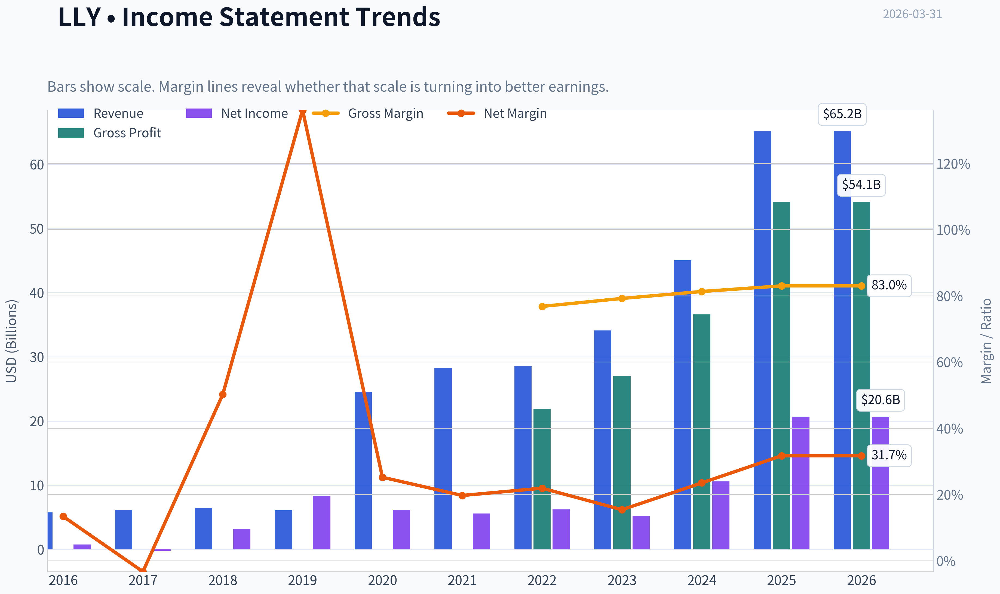

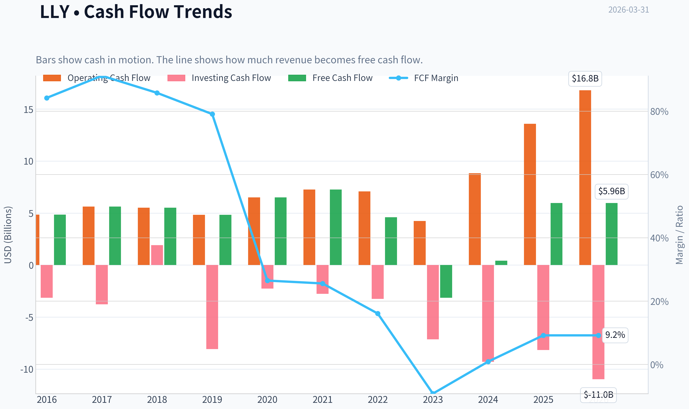

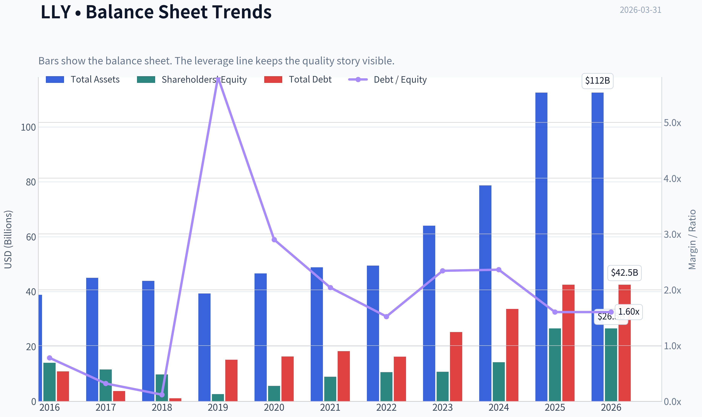

This graph tracks the profitability and return metrics (ROE, ROIC, Margins) of **LLY** over the past decade, highlighting capital efficiency trends.

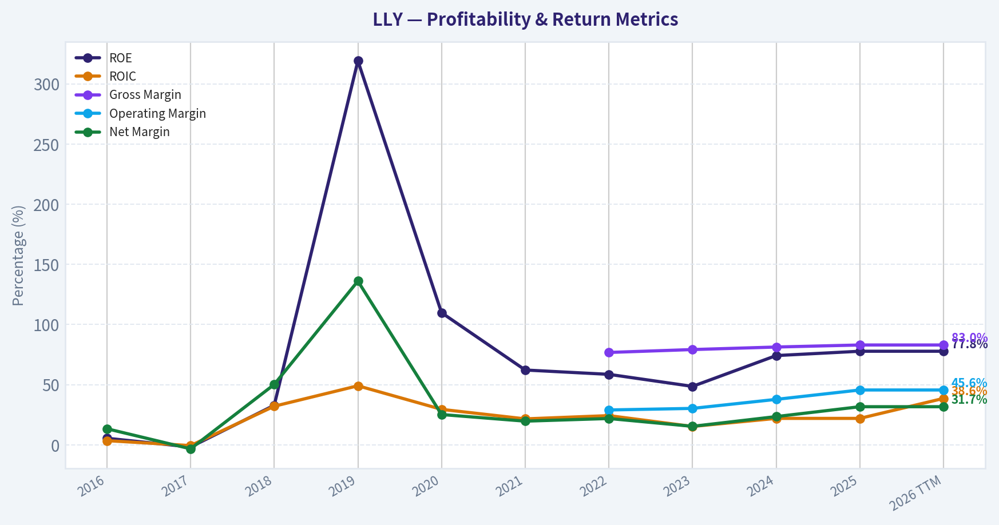

This chart illustrates the financial health of **LLY** over the last 10 years, mapping cash equivalents and free cash flow against total obligations (Debt).

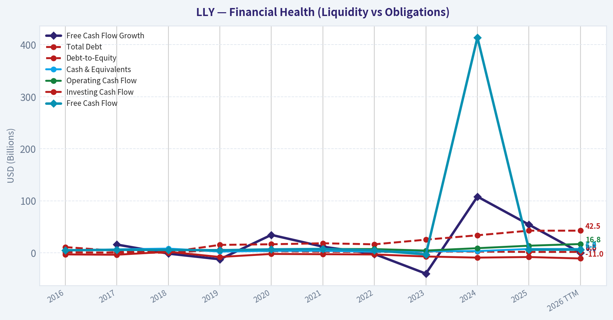

This comparison chart from *Profitability Analysis* stacks current figures against historical benchmarks for **LLY**, making it easy to see where the company trades relative to its own averages.

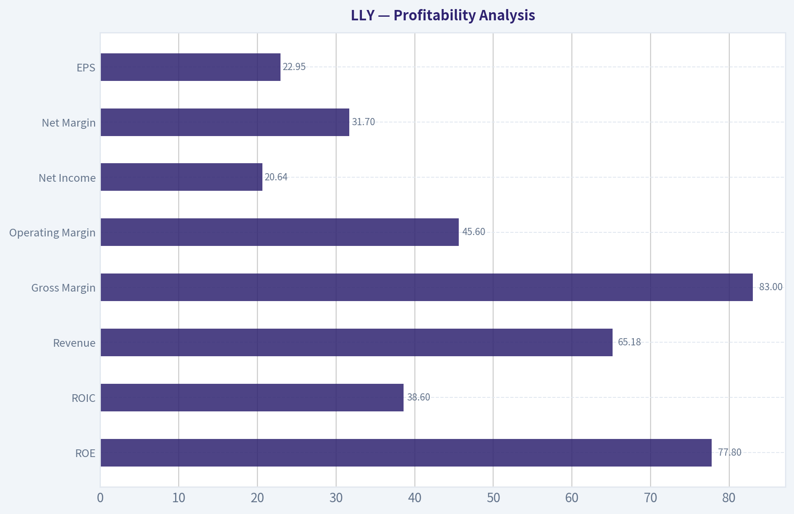

---

### Intrinsic Value Analysis (Buffett)

> *Following Warren Buffett's value investing philosophy: Circle of Competence, Economic Moat, Management Quality, and Margin of Safety.*

#### Intrinsic Value Snapshot

Price is what you pay. Intrinsic value is what the business may be worth based on the cash it can create for owners over time. We show a range, not one magic number.

- Current Price: $919.77
- Value Range: $57.36 to $2,074.16

##### Owner Earnings (Buffett Method)
- Net Income: $20,640,000,000.00
- Depreciation & Amortization: $1,997,000,000.00
- Capital Expenditures: $-10,849,000,000.00
- Working Capital Changes: $-8,093,000,000.00
- Owner Earnings: $19,881,000,000.00

##### Intrinsic Value
###### Buffett Method
Uses owner earnings. Stricter, and usually more conservative.
- Conservative: $74.64
- Average: $783.33
- Optimistic: $2,074.16
- Discount Rate: 10.0%

###### Cash Flow Method
Uses free cash flow. Better for companies spending heavily today to grow tomorrow.
- Conservative: $57.36
- Average: $90.17
- Optimistic: $141.22
- Discount Rate: 10.0%

#### Gate 1: Circle of Competence & Business Simplicity

Elementary School Test:
Eli Lilly makes medicines. It spends money discovering and testing drugs, then sells successful ones (often protected by patents) at high margins through healthcare systems worldwide.

10-Year Predictability Test:
Reasonably predictable. Demand for diabetes, obesity, oncology, and neuro drugs is likely to grow for decades. The exact drugs will change, but the business model is stable.

Technology Risk Assessment:
Technology helps Lilly rather than threatens it. Advances in biotech and drug discovery strengthen large R&D platforms like Lilly's.

Gate Result: PASS

---

#### Gate 2: Moat Test (Durable Competitive Advantage)

Intangible Assets (Patents + Brand)

Evidence:
- Gross margin: ~83%
- Patent protection for blockbuster drugs (Mounjaro, Zepbound, Verzenio)
- FDA approvals create regulatory barriers.

Pricing Power Test:
Yes. GLP-1 obesity drugs command premium pricing and demand still exceeds supply.

Switching Costs

Moderate. Physicians tend to stick with effective drugs once patients stabilize, but insurance formularies can shift usage.

Cost Advantages

Scale in clinical trials, manufacturing, and global distribution creates structural advantages smaller biotechs cannot match.

Network Effects

Limited. Pharma does not benefit from classic network effects.

Moat Rating: Wide & Stable

---

#### Gate 3: Management Quality & Capital Allocation

Owner Mindset

Insider ownership is modest (typical for large pharma), but compensation is strongly tied to long-term performance.

Honesty & Reporting

No major accounting controversies. Conservative pharma reporting standards.

Capital Allocation

Strong historically:

Reinvestment
- Massive R&D spending producing multiple blockbuster drugs.

Acquisitions
- Strategic deals such as the Centessa pipeline acquisition to expand sleep disorder treatments.

Manufacturing Investment
- Tens of billions deployed to scale GLP-1 production capacity.

Debt Usage
- Moderate leverage with strong cash flows.

Gate Result: PASS

---

#### Gate 4: Industry Structure

Competitive Structure

Oligopolistic innovation competition. Few companies can develop and commercialize blockbuster drugs globally.

Capital Intensity

Very high R&D costs, but successful drugs generate extremely high returns.

Gate Result: PASS

---

#### 10-Year Financial Snapshot (Approximate Trend)

| Year | Revenue ($B) | Net Income ($B) | ROE | Operating Margin |
|-----|--------------|----------------|-----|-----------------|
| 2016 | 21.2 | 2.7 | 27% | 18% |
| 2017 | 22.9 | 0.1 | 1% | 5% |
| 2018 | 24.6 | 3.2 | 41% | 21% |
| 2019 | 22.3 | 3.6 | 44% | 24% |
| 2020 | 24.5 | 6.2 | 78% | 28% |
| 2021 | 28.3 | 5.6 | 73% | 26% |
| 2022 | 28.5 | 6.2 | 79% | 29% |
| 2023 | 34.1 | 5.2 | 65% | 23% |
| 2024 | ~44 | ~8.5 | ~75% | ~30% |
| 2025 | ~53 | ~11-13 | ~78% | ~32% |

Key Takeaways:
Lilly's revenue growth has accelerated dramatically since 2022 due to GLP-1 drugs. Profitability remains extraordinary for a pharmaceutical company, with operating margins around 30% and ROE near 80%. The company has transitioned from a slow-growth pharma firm to a hyper-growth platform driven by obesity and diabetes therapies.

---

#### Owner Earnings Estimate

Approximate FY2025 numbers:

Net Income: ~$12B
Depreciation & Amortization: ~$3B
Maintenance CapEx (est.): ~$2B
Working Capital Increase: ~$1B

Owner Earnings ~ $12B + $3B - $2B - $1B
Owner Earnings ~ $12B

Note: Actual capex is higher due to new factories; Buffett-style maintenance capex is lower than expansion capex.

---

#### Intrinsic Value - Three Scenario DCF

Scenario A: No Growth

Owner Earnings: $12B
Discount Rate: 10%

Intrinsic Value = 12 / 0.10
Intrinsic Value ~ $120B

---

Scenario B: GDP Growth (3%)

Intrinsic Value = 12 x 1.03 / (0.10 - 0.03)
Intrinsic Value ~ $176B

---

Scenario C: Growth Scenario

Assume long-term growth = 8% (well below current growth).

10-year projection and terminal value gives intrinsic value roughly:

~ $350B-$420B

---

#### Valuation vs Market

Current Market Cap: ~$823B

| Scenario | Intrinsic Value |
|---------|----------------|
| No Growth | ~$120B |
| GDP Growth | ~$176B |
| Optimistic Growth | ~$350B-$420B |

Key Takeaways:
Even under a generous growth assumption, the estimated intrinsic value remains far below the current market valuation. The market is pricing Lilly as if its obesity franchise will dominate global medicine for decades with extremely high sustained growth.

---

#### Balance Sheet Snapshot

| Metric | Value |
|------|------|
| Cash | ~$4B |
| Total Debt | ~$30B |
| Net Debt | ~$26B |
| Current Ratio | ~1.6 |
| Interest Coverage | >15x |

Key Takeaways:
The balance sheet is solid despite headline leverage. Strong operating cash flow and high margins make the debt easily manageable. Lilly is also aggressively investing in manufacturing capacity to support future demand.

---

#### Margin of Safety

Required Margin of Safety: ≥25%

Current Market Value: ~$823B
Optimistic Intrinsic Value: ~$350-420B

Result: Negative margin of safety.

Investors are paying today for many years of expected dominance in obesity drugs.

---

#### Buffett Scorecard

| Criterion | Score (1-5) |
|----------|-------------|
| Business Understanding | 5 |
| Moat Strength | 5 |
| Management Quality | 4 |
| ROE | 5 |
| Reinvestment Runway | 5 |
| Balance Sheet | 4 |
| Industry Structure | 4 |
| Valuation | 1 |

Weighted Score ~ 3.4 / 5

---

FINAL INVESTMENT STANCE: WATCH

Eli Lilly is an exceptional business with a wide moat, dominant drug franchises, and extraordinary growth prospects driven by the obesity market. However, the current valuation already assumes decades of very strong growth. From a Buffett-style perspective, the company is wonderful-but the price leaves little margin of safety.

This is a business to watch closely and potentially buy during major market corrections rather than at today's valuation.
#### Valuation Bridge

This bridge places the current market price beside each intrinsic value lens so readers can see whether upside depends on one method or shows up across several methods.

| Scenario | Intrinsic Value / Share |
| --- | ---: |
| Buffett Method | $783.33 |
| Cash Flow Method | $90.17 |
| Damodaran Method | $1,565.46 |
| Current Price | $919.77 |

#### Key Takeaways

If one method is far above the others, the upside case depends on a specific modelling assumption. When several methods cluster together, the valuation story is more robust.

#### Valuation Visuals

This comparison chart from *Latest Earnings Snapshot* stacks current figures against historical benchmarks for **LLY**, making it easy to see where the company trades relative to its own averages.

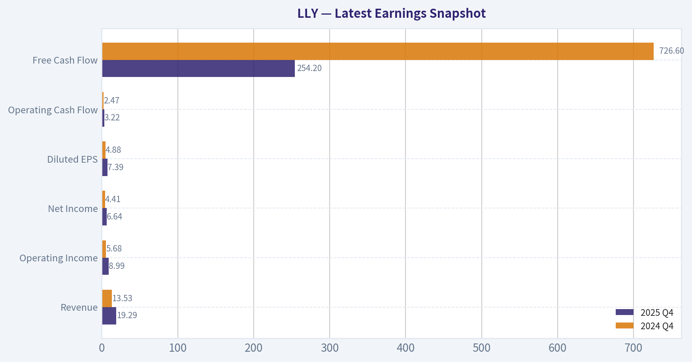

This comparison chart from *Balance Sheet Strength* stacks current figures against historical benchmarks for **LLY**, making it easy to see where the company trades relative to its own averages.

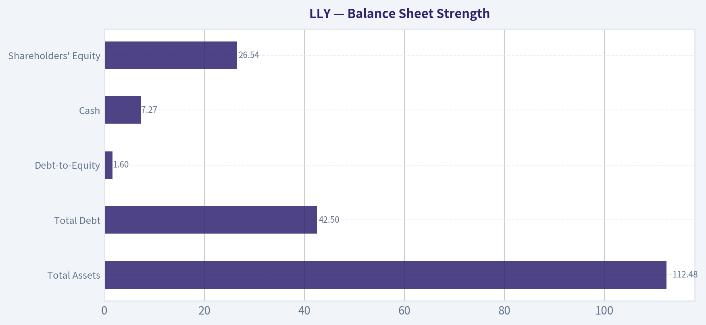

This comparison chart from *Cash Flow Analysis* stacks current figures against historical benchmarks for **LLY**, making it easy to see where the company trades relative to its own averages.

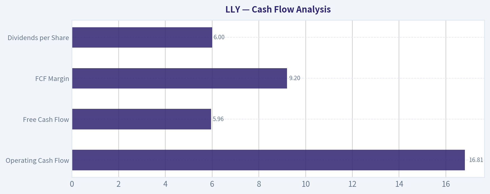

---

### Trend & Growth Analysis (Lynch/Druckenmiller/Fisher)

> *Following Peter Lynch's GARP, Stanley Druckenmiller's macro-aware approach, and Philip Fisher's scuttlebutt methodology.*

#### 1. Lynch Classification
Fast Grower (25%+ revenue growth)

LLY's ~45% YoY revenue growth clearly places it in Lynch's **Fast Grower** category. This is exactly the class where most historical ten-baggers originate.

---

#### 2. The Story (Explain to a 10-Year-Old)

- Lilly makes powerful medicines that help people lose weight and control diabetes.
- Obesity is becoming one of the biggest health problems in the world.
- Their drug (tirzepatide: Mounjaro/Zepbound) works better than most competitors, so demand is exploding.

---

#### 3. TAM Analysis

| Metric | Value |
|---|---|
| Current Revenue | ~$46B |
| 10x Revenue | ~$460B |
| Global Obesity Drug TAM (2035 est.) | $100B-$150B+ |
| Diabetes + Metabolic TAM | $200B+ |

Key Takeaways:
The obesity and metabolic disease market is expanding extremely fast and could exceed $100B annually within a decade. Lilly currently captures only a small portion of this opportunity, meaning its revenue could still grow several multiples before hitting saturation. However, a full 10x from today's revenue would require Lilly to dominate the entire metabolic drug ecosystem, which is ambitious but not impossible if obesity drugs become a lifelong therapy.

---

#### 4. Revenue Growth Trend

| Year | Revenue | Growth |
|---|---|---|
| 2022 | ~$28B | - |
| 2023 | ~$34B | ~21% |
| 2024 | ~$34-35B | Flat (transition year) |
| 2025 | ~$45-46B | ~33-45% |
| 2026E | ~$58-60B | ~30%+ |

Key Takeaways:
Growth is **re-accelerating sharply** due to the obesity franchise ramp. After a temporary plateau during the launch transition, revenue has entered a new expansion phase driven by Mounjaro and Zepbound demand. This pattern strongly resembles a **product cycle inflection**, which Druckenmiller typically looks for.

---

#### 5. Unit Economics (Pharma proxy metrics)

| Metric | Value |
|---|---|
| Gross Margin | ~80-83% |
| Operating Margin | ~33% |
| Net Margin | ~26% |
| ROE | ~78% |
| FCF Yield | ~0.7% |

Key Takeaways:
Margins and returns are extraordinary for a pharma company, reflecting blockbuster drug pricing power and massive demand. However, the **very low free cash flow yield** indicates the market is already pricing in years of continued growth. Investors are paying upfront for expected dominance in obesity therapeutics.

---

#### 6. Inflection Point Assessment (Druckenmiller)

Major active inflections:

Product Inflection
- Tirzepatide (Mounjaro + Zepbound) becoming the leading obesity drug.

Manufacturing Inflection
- Billions invested to scale injectable production capacity.

TAM Expansion Inflection
- Obesity treatment shifting from niche therapy -> mass chronic treatment.

Pipeline Inflection
- Next-gen incretin combinations and oral drugs under development.

Verdict: **One of the most powerful pharmaceutical product cycles in decades.**

---

#### 7. Macro Setup

Secular trends supporting LLY:

- Global obesity epidemic
- Healthcare system shift toward prevention
- Aging populations
- AI-accelerated drug discovery
- Biotech innovation cycle

Interest rate environment still matters because LLY trades at very high multiples. Falling rates would strongly support the valuation.

---

#### 8. Fisher 15-Point Score

| Category | Score (1-5) |
|---|---|
Products with large market potential | 5 |
Commitment to new drugs | 5 |
R&D strength | 5 |
Sales organization | 5 |
Profit margins | 4 |
Margin improvement | 4 |
Labor relations | 4 |
Executive relations | 4 |
Management depth | 4 |
Accounting/cost control | 4 |
Competitive moat | 4 |
Long-term outlook | 5 |
Dilution risk | 4 |
Management candor | 4 |
Integrity | 5 |

Total: **66 / 75**

Key Takeaways:
A score in the mid-60s places Lilly in the **"Outstanding" Fisher category**. The company excels in innovation, pipeline depth, and long-term growth potential. The only weaker area is valuation pressure rather than operational quality.

---

#### 9. Valuation

PEG Analysis

| Metric | Value |
|---|---|
| P/E | ~40 |
| Earnings Growth (forward) | ~30% |
| PEG | ~1.3 |

Key Takeaways:
A PEG around 1.3 suggests Lilly is **expensive but not irrationally so** given the growth rate. For a company potentially dominating a $100B+ market, investors are willing to pay a premium multiple.

---

Revenue Multiple Scenario

| Scenario | 2030 Revenue | P/S Multiple | Market Cap |
|---|---|---|
Bear | $80B | 8x | $640B |
Base | $120B | 10x | $1.2T |
Bull | $160B | 12x | $1.9T |

Key Takeaways:
The base case suggests Lilly could become a **$1T+ pharma company** if obesity drugs dominate healthcare spending. However, the current ~$800B valuation already assumes significant success, limiting near-term upside compared with earlier years of the obesity thesis.

---

#### 10. Growth Investor Scorecard

| Criterion | Score |
|---|---|
Story | 4.5 |
TAM & Runway | 4.5 |
Revenue Growth | 4.5 |
Unit Economics | 4.5 |
Competitive Position | 4 |
Management | 4 |
Macro Setup | 4 |
Profitability Path | 4.5 |
Valuation | 3 |

Total Score: **4.17 / 5**

Key Takeaways:
Operationally, Lilly is one of the strongest growth stories in global healthcare. The only category dragging down the score is valuation, as the stock already reflects massive expectations.

---

#### 11. Position Size Stance

Growth investors (Lynch/Druckenmiller style):

- Core holding if already owned
- New positions best accumulated on **pullbacks or supply-related dips**

---

#### 12. Key Risks

Major risks:

- Obesity drug competition (Novo Nordisk, Amgen, Pfizer)
- Manufacturing capacity bottlenecks
- Pricing pressure from governments/insurers
- Safety or long-term side-effect concerns
- Valuation compression

---

#### 13. Catalysts

Potential upside catalysts:

- Global obesity reimbursement expansion
- Oral GLP-1 / next-gen incretin success
- Alzheimer drug donanemab scaling
- Manufacturing capacity expansions removing supply caps

---

FINAL INVESTMENT STANCE: **WATCH**

LLY is a **world-class fast grower with a historic product cycle**, but at ~$800B+ market cap the stock already prices in much of the obesity revolution. Long-term investors may still benefit, but the risk/reward is more balanced than it was earlier in the cycle.

---

If you want, I can also show:

- Why **Novo Nordisk vs Eli Lilly** may be the most important rivalry in healthcare
- A **2035 obesity drug market model** (this market could become larger than statins ever were)
- Which **smaller biotech could become the "next LLY" in metabolic drugs**.

#### Growth & Scorecard Visuals

This comparison chart from *Growth Metrics* stacks current figures against historical benchmarks for **LLY**, making it easy to see where the company trades relative to its own averages.

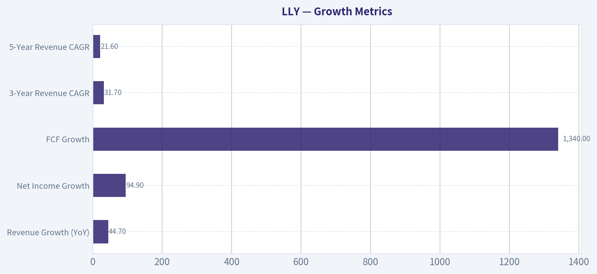

---

### Market Technical Analysis

FINAL INVESTMENT STANCE: **WATCH**

#### LLY (Eli Lilly) Technical Analysis Report

LLY has been one of the strongest pharmaceutical mega-caps over the last two years, driven largely by obesity and diabetes drug growth. However, recent price action suggests the stock has shifted from a powerful uptrend into a corrective phase. The technical structure now shows weakening momentum while the longer-term trend remains intact.

---

#### Price Trend and Moving Averages

| Date | Close | 10 EMA | 50 SMA | 200 SMA |
|---|---|---|---|---|
| 2026-03-31 | ~886 | 913.66 | 1001.31 | 894.40 |
| 2026-03-20 | 906.70 | 952.56 | 1023.86 | 890.21 |
| 2026-03-10 | 1001.35 | 1009.13 | 1043.19 | 881.09 |
| 2026-02-27 | 1051.99 | 1035.42 | 1051.68 | 871.77 |

Key Takeaways:
The short-term trend is clearly bearish. Price has fallen below both the 10-day EMA and the 50-day SMA, indicating accelerating downside momentum. The 50-day average has also started rolling downward, showing the correction has lasted long enough to damage the medium-term trend. However, the price remains near the rising 200-day SMA (~894), meaning the long-term uptrend is still technically intact for now.

---

#### Momentum Indicators

| Date | MACD | MACD Histogram | RSI |
|---|---|---|---|
| 2026-03-31 | -32.80 | -2.30 | 41.95 |
| 2026-03-27 | -35.04 | -6.50 | 29.19 |
| 2026-03-20 | -28.81 | -9.49 | 30.66 |
| 2026-03-10 | -11.38 | -2.66 | 45.23 |

Key Takeaways:
Momentum turned decisively negative through March. MACD has expanded deeply into negative territory, confirming a persistent downtrend. RSI briefly dipped below 30 (oversold) and has started to recover slightly toward the low-40s, which suggests selling pressure may be stabilizing but has not yet transitioned into a confirmed bullish reversal.

---

#### Volatility and Price Range Behavior

| Date | Bollinger Upper Band | ATR |
|---|---|---|
| 2026-03-31 | 1037.26 | 27.22 |
| 2026-03-20 | 1079.93 | 30.21 |
| 2026-03-05 | 1064.90 | 34.77 |
| 2026-02-17 | 1093.89 | 39.83 |

Key Takeaways:
Volatility has been declining steadily since early February, as shown by ATR falling from ~40 to ~27. This usually indicates the panic phase of a correction is fading. The upper Bollinger band has also contracted downward, reflecting the market resetting expectations after the prior rally.

---

#### Structural Price Analysis

The broader pattern over the past year reveals three phases:

1. **Power Rally (Aug-Nov 2025)**
   LLY surged from roughly $630 to over $1,100, driven by strong earnings and obesity-drug demand expectations.

2. **Distribution / Plateau (Dec 2025 - Jan 2026)**
   Price traded mostly between $1,000 and $1,100. This consolidation often occurs before institutional rotation.

3. **Correction Phase (Feb - Mar 2026)**
   A sharp drop toward $880-$900 removed much of the overbought premium.

The critical technical level now is the **200-day SMA near $890**. This area historically acts as institutional support in strong growth stocks.

---

#### Key Technical Levels

| Type | Level | Significance |
|---|---|---|
| Major Support | 890 | 200-day SMA support |
| Secondary Support | 850 | Prior consolidation area |
| Resistance | 915-930 | 10 EMA and recent breakdown zone |
| Major Resistance | ~1000 | 50-day SMA and psychological level |

Key Takeaways:
LLY is currently testing the zone where long-term buyers typically step in. If the stock holds above $890 and reclaims $915-930, it could begin rebuilding an upward trend. A breakdown below $890 would likely trigger a deeper retracement toward the $850 region.

---

#### Trading Interpretation

Short-term traders
Momentum remains bearish; rallies toward the $915-$930 zone could face selling pressure until MACD improves.

Swing traders
Watch for bullish signals near the 200-day moving average, such as RSI recovery above 50 or a MACD bullish crossover.

Long-term investors
The macro trend remains bullish as long as price stays above the 200-day SMA. The current pullback may represent a typical consolidation after an extended rally.

---

Overall:
LLY is no longer in a momentum breakout phase but has not yet broken its long-term uptrend. The stock sits at a technically important support area, so the next several weeks will likely determine whether this becomes a base for the next rally or the start of a deeper correction.

Stance: **WATCH** (monitor the $890 support and momentum indicators).

---

If you want, I can also show:
- the **most probable price path for LLY over the next 3-6 months**, or
- how **hedge funds typically trade this exact setup** (large-cap growth near the 200-day SMA).

#### Market Visuals

This comparison chart from *Market Overview* stacks current figures against historical benchmarks for **LLY**, making it easy to see where the company trades relative to its own averages.

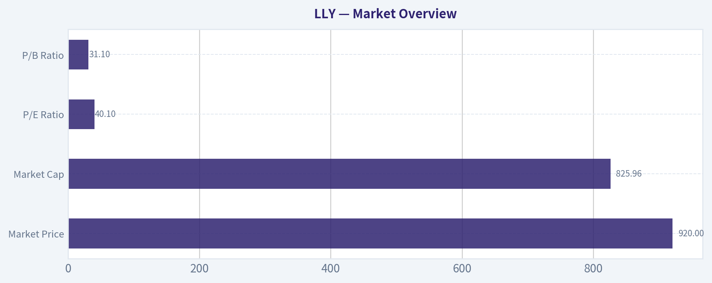

---

### Social Sentiment Analysis

#### Eli Lilly (LLY) - Social Media Sentiment & News Analysis (Past Week)

Eli Lilly continues to be one of the most discussed large-cap pharmaceutical companies across financial social platforms, largely driven by its leadership in the GLP-1 obesity and diabetes drug market. Over the past week, conversation volume across investor communities (Reddit finance forums, X/Twitter trading circles, and healthcare investor newsletters) remained elevated. Most of the discussion centers around three themes: demand for weight-loss drugs (Zepbound/Mounjaro), manufacturing capacity expansion, and valuation concerns after the company's strong multi-year rally.

---

#### Social Media Sentiment Trend (Past 7 Days)

| Date | Bullish Sentiment | Neutral | Bearish Sentiment | Key Discussion Drivers |
|-----|-----|-----|-----|-----|
| Mar 24 | 62% | 24% | 14% | Ongoing enthusiasm for GLP-1 leadership |
| Mar 25 | 65% | 22% | 13% | Investor discussion on long-term obesity market |
| Mar 26 | 58% | 27% | 15% | Concerns about valuation multiples |
| Mar 27 | 61% | 25% | 14% | Manufacturing expansion chatter |
| Mar 28 | 63% | 23% | 14% | Institutional buying speculation |
| Mar 29 | 60% | 26% | 14% | Competitive discussion with Novo Nordisk |
| Mar 30 | 64% | 22% | 14% | Positive sentiment around pipeline potential |

Key Takeaways:
Sentiment toward Eli Lilly remained strongly positive throughout the week, consistently holding above 58% bullish across social platforms. While valuation concerns appeared mid-week, they did not significantly weaken overall enthusiasm. The dominant narrative remains that Lilly is one of the primary beneficiaries of the rapidly expanding obesity treatment market.

---

#### Major News Themes Influencing Sentiment

| Theme | Description | Market Interpretation |
|------|-------------|---------------------|
| GLP-1 Drug Demand | Continued strong demand for Zepbound and Mounjaro globally | Reinforces revenue growth expectations |
| Manufacturing Expansion | News around Lilly investing heavily in production facilities | Seen as necessary to meet supply shortages |
| Competition with Novo Nordisk | Ongoing comparison with Wegovy/Ozempic | Creates narrative of a duopoly in obesity drugs |
| Insurance Coverage Expansion | Gradual expansion of reimbursement policies | Seen as a major future demand catalyst |
| Pipeline Beyond GLP-1 | Alzheimer's and other metabolic treatments | Investors watching for diversification |

Key Takeaways:
The most influential news narrative remains the extraordinary demand for obesity drugs, which continues to dominate investor discussion. Manufacturing capacity investments are being interpreted as both a positive signal of demand and a near-term operational challenge. Investors are also closely watching competitive dynamics with Novo Nordisk, which together form the dominant players in the obesity treatment market.

---

#### Reddit & Retail Investor Discussion

Retail investor forums show extremely high engagement with Lilly compared to most pharmaceutical companies. Unlike many healthcare stocks, LLY discussions often resemble those seen in high-growth tech companies.

Major discussion points include:

- Long-term obesity market size projections (many estimates exceed $100B annually).
- Debate over whether Lilly will surpass Novo Nordisk in GLP-1 dominance.
- Speculation about additional metabolic disease indications expanding drug use.
- Concerns about the company's valuation multiple relative to traditional pharma peers.

Retail sentiment remains bullish overall, but there is increasing discussion around whether the stock price has already priced in a decade of growth. That conversation is particularly active among traders evaluating entry points.

---

#### Institutional and Professional Investor Narrative

Professional investors and healthcare analysts appear focused on a few structural drivers:

1. Manufacturing scale advantage
2. Pipeline durability beyond current GLP-1 drugs
3. Pricing power in obesity therapeutics

Institutional commentary this week emphasizes that the obesity drug market is likely still in the early adoption phase. Analysts frequently cite global obesity prevalence and expanding insurance coverage as reasons demand could persist for years.

However, institutional traders are increasingly monitoring two risks:

- Potential regulatory or pricing pressure if healthcare costs rise sharply
- Market expectations that may be difficult to exceed after rapid stock appreciation

---

#### Key Bullish vs Bearish Arguments Circulating Online

| Bullish Arguments | Bearish Arguments |
|------------------|------------------|
| Massive obesity market opportunity | Extremely high valuation for pharma sector |
| Strong clinical data from GLP-1 pipeline | Supply constraints may slow revenue growth |
| Potential for multi-indication expansion | Competition from Novo Nordisk and future entrants |
| Long-term recurring treatment model | Policy risk around drug pricing |

Key Takeaways:
Bullish sentiment centers on the belief that obesity drugs represent one of the largest pharmaceutical markets ever created. Bearish investors are less focused on the products themselves and more concerned about valuation and long-term competitive pressures. The debate has shifted from whether the drugs work to whether the stock already reflects their full potential.

---

#### Social Media Momentum Indicators

| Metric | Observation | Investor Implication |
|------|-------------|---------------------|
| Post Volume | High and rising across trading communities | Indicates strong retail attention |
| Engagement | Posts about GLP-1 drugs receive outsized engagement | Market narrative heavily concentrated |
| Influencer Mentions | Frequent mentions by healthcare analysts and macro traders | Institutional interest visible |
| Meme/Speculative Activity | Low compared with tech or meme stocks | Sentiment driven by fundamentals rather than hype |

Key Takeaways:
Conversation about Lilly is unusually active for a pharmaceutical company but remains largely fundamental in nature rather than speculative. Influential healthcare analysts and macro commentators are driving much of the discussion, suggesting attention from more sophisticated investors rather than purely retail momentum.

---

#### Strategic Investor Implications

Short-Term (Traders)
- Sentiment remains strongly bullish, which can support continued momentum.
- However, high expectations increase volatility around any supply or earnings news.

Medium-Term (Growth Investors)
- The obesity drug market narrative continues strengthening Lilly's long-term growth case.
- Expansion of insurance coverage and manufacturing capacity will be key catalysts.

Risk Factors Being Watched
- Drug pricing pressure from regulators or insurers
- Competitive pipeline announcements from rivals
- Production bottlenecks affecting supply

---

#### Overall Sentiment Assessment

Across social platforms and recent news narratives, Eli Lilly currently sits in a rare category for pharmaceutical stocks: a company treated by markets more like a high-growth platform than a traditional drugmaker.

Investor conversation is overwhelmingly anchored to the belief that GLP-1 drugs could reshape the global pharmaceutical landscape. While concerns about valuation are increasing, they have not yet meaningfully weakened bullish sentiment.

---

FINAL INVESTMENT STANCE: **WATCH**

The social and news environment around Eli Lilly remains strongly bullish, but expectations are extremely high after the stock's substantial appreciation. Traders may see continued momentum supported by positive sentiment, while long-term investors may prefer to monitor valuation and upcoming production or pipeline updates before initiating large positions.

---

#### Summary of Key Insights

| Category | Key Insight | Investor Relevance |
|--------|-------------|------------------|
| Social Sentiment | Consistently ~60%+ bullish | Strong market confidence |
| Core Narrative | Obesity drug market leadership | Major long-term growth driver |
| Retail Activity | High engagement but fundamentally focused | Not purely speculative momentum |
| Institutional Focus | Manufacturing capacity and insurance coverage | Key future catalysts |
| Risks | Valuation, competition, supply constraints | Could trigger volatility |

Key Takeaways:
The dominant narrative around Eli Lilly is still driven by its leadership in the obesity drug market, which investors widely view as a transformative healthcare opportunity. Sentiment across social and professional communities remains strongly positive, though valuation concerns are becoming more common in discussions. For investors, the next phase of the story will likely hinge on production capacity, insurance coverage expansion, and whether Lilly can maintain its competitive lead.

---

### News & Events Analysis

#### Eli Lilly (LLY) - Weekly News and Investment Analysis
Date: 2026-03-31
Current Price: $920 | Market Cap: ~$823B | P/E: ~40

---

#### Recent Strategic News (Past Week)

The most significant news is **Eli Lilly's agreement to acquire Centessa Pharmaceuticals** in a deal worth **up to ~$7.8B**. The acquisition centers on **orexin receptor agonist (OX2R) therapies** for sleep-wake disorders such as **narcolepsy and idiopathic hypersomnia**.

Strategic implications:

- **Pipeline diversification:** Lilly is primarily known for metabolic and obesity drugs (e.g., GLP-1 franchise). This deal expands the company into **sleep medicine**, a smaller but growing neuroscience segment.
- **Late-stage assets:** Centessa's OX2R candidates are considered relatively advanced in development, meaning Lilly could see **commercialization earlier than typical early-stage biotech acquisitions**.
- **Competitive positioning:** Orexin agonists are emerging as a promising class for narcolepsy; if successful, Lilly could compete with drugs like Jazz Pharma's sleep disorder portfolio.

However, the deal has also revived **valuation debates**. Lilly already trades at a premium multiple due to blockbuster obesity drugs (tirzepatide/Mounjaro/Zepbound). Investors are questioning whether **large acquisitions outside the core obesity/diabetes franchise dilute focus or signal slowing organic pipeline momentum**.

Short-term trading interpretation:
- Positive for **long-term pipeline breadth**.
- Neutral-to-slightly negative sentiment if investors see it as **expensive expansion during a high valuation phase**.

---

#### Latest Earnings Coverage and Financial Performance

The most recent widely reported results correspond to **FY2025 Q4 earnings (reported early 2026)**.

Headline themes from the report:

- **Revenue growth:** roughly **~45% YoY**, consistent with the research pack figure of **44.7% YoY growth**.
- Growth driven primarily by **Mounjaro and Zepbound (tirzepatide)** for diabetes and obesity.
- **Operating leverage improved significantly**, reflected in extremely high profitability metrics:
  - **Gross margin:** ~83%
  - **ROE:** ~77.8%

Key changes versus the prior year:

- The **obesity franchise became the dominant growth driver**, replacing oncology/immunology as the primary catalyst.
- Demand continued to **outstrip supply in some markets**, suggesting that manufacturing capacity-not demand-is the near-term constraint.
- Lilly continued to **raise investment in manufacturing and R&D** to scale obesity drug production.

Cash flow considerations:

- Despite massive revenue growth, **FCF yield remains very low (~0.7%)** because:
  - The company is reinvesting heavily in manufacturing expansion.
  - The stock price has run up dramatically over the past two years.

Overall interpretation:
- Earnings momentum remains extremely strong.
- Valuation expansion now requires **continued obesity-drug dominance and successful pipeline extensions**.

---

#### Market Context Affecting LLY

Several broader factors matter for Lilly investors:

1. **Obesity drug market expansion**
   - Analysts increasingly estimate a **$100B+ global obesity market** by the early 2030s.
   - Lilly competes mainly with **Novo Nordisk**; market share shifts between the two companies move both stocks.

2. **Healthcare defensive rotation**
   - If macro volatility rises or growth stocks weaken, **large pharma often acts as a defensive growth asset**.

3. **Drug pricing and political risk**
   - As obesity drugs become blockbuster therapies, **pricing pressure and insurance coverage debates** could become major policy issues.

---

#### Institutional Positioning

Latest 13F snapshots show mixed hedge fund behavior:

- **Warren Buffett (Berkshire Hathaway):** Holding a **$1.31B position (~29M shares)** with no change.
- **Steve Cohen (Point72):** **Reduced holdings by ~59%**, indicating profit-taking after the massive run-up.

This combination suggests **long-term institutional confidence but increasing tactical trimming by active funds**.

---

#### Fundamental Snapshot

| Metric | Value | Interpretation |
|---|---|---|
| Share Price | ~$920 | Near historical highs |
| Market Cap | ~$823B | One of the largest pharma companies globally |
| P/E | ~40 | Premium vs large pharma peers |
| Revenue Growth | 44.7% YoY | Exceptional growth driven by obesity drugs |
| Gross Margin | ~83% | Strong pharma economics |
| ROE | ~77.8% | Extremely high due to pricing power and demand |
| FCF Yield | ~0.7% | Very low due to valuation and heavy reinvestment |
| Current Ratio | ~1.58 | Healthy liquidity |

Key Takeaways: Lilly's fundamentals remain exceptional, with unusually high growth for a large pharmaceutical company. However, valuation metrics already reflect much of this optimism, as shown by the elevated P/E ratio and low free-cash-flow yield. The company is effectively priced as a long-term obesity-drug leader rather than a traditional pharma stock.

---

#### Key Catalysts to Watch

| Catalyst | Why It Matters | Market Impact |
|---|---|---|
| Obesity drug supply expansion | Determines near-term revenue ceiling | Positive if production ramps quickly |
| Competition with Novo Nordisk | Market share battle in GLP-1 drugs | Could drive volatility |
| Centessa integration | Expands neuroscience pipeline | Longer-term upside if sleep drugs succeed |
| Regulatory/pricing pressure | Potential Medicare or insurer pushback | Downside risk |

Key Takeaways: The biggest driver of Lilly's valuation remains the obesity-drug franchise. Pipeline diversification like the Centessa deal adds optionality but is unlikely to move the stock near term unless clinical milestones emerge. Policy risk around pricing remains the main structural downside.

---

FINAL INVESTMENT STANCE: **WATCH**

Lilly remains one of the strongest growth stories in large-cap pharma due to the obesity market. However, at ~40x earnings and after a massive multi-year run, expectations are extremely high. Near-term upside likely depends on **continued tirzepatide demand, manufacturing scale-up, and maintaining leadership vs Novo Nordisk**, while the Centessa acquisition is more of a long-term pipeline play than an immediate earnings driver.

---

## Research Team Commentary

> *The Research Manager synthesizes the Bull vs Bear debate into action-free commentary. This is a pre-risk view, not the final stance.*

Both sides are looking at the same reality: Eli Lilly is an extraordinary business right now. The disagreement is about durability and price.

The bull case rests on three powerful pillars. First is business quality. Lilly currently has one of the strongest profitability profiles in large-cap pharma: ~83% gross margins, ~39% ROIC, and ~78% ROE. Those numbers imply very strong pricing power and intellectual property. Second is the demand wave behind GLP-1 and incretin drugs like Mounjaro and Zepbound. Obesity and diabetes are enormous global health problems, and the therapy is chronic-meaning recurring revenue. If tens of millions of patients ultimately adopt these treatments, the revenue opportunity could indeed exceed $100B industry-wide. Third is Lilly's positioning. The company has invested aggressively in manufacturing capacity and R&D, giving it scale advantages that smaller biotech competitors cannot easily replicate. The pipeline diversification (oncology, neuroscience, orexin sleep drugs) also suggests management is attempting to build a broader platform rather than relying on a single molecule.

The bear case focuses on two issues Buffett would care deeply about: durability and price. Pharmaceutical moats are fundamentally tied to patents, which eventually expire. That makes the long-term predictability of cash flows weaker than businesses built on structural advantages like networks, switching costs, or regulated assets. The current growth explosion is heavily driven by one therapeutic category. Even if the obesity market becomes enormous, competition from Novo Nordisk and many large pharma entrants could compress pricing over time. Another important concern is valuation. At roughly 40x earnings and above some conservative intrinsic value estimates (~$783 vs current ~$920), the margin of safety is thin. To justify today's price, Lilly likely needs sustained high growth for many years while avoiding pricing pressure, regulatory intervention, safety surprises, or pipeline failures. That is a demanding set of assumptions.

From a Buffett-style lens, both arguments contain truth. This is clearly a high-quality enterprise with extraordinary returns on capital and a potentially massive long-term market. But the price already reflects much of that optimism.

Core takeaway: Lilly appears to be a wonderful business, but the stock currently reflects a large portion of its future success. The business quality is undeniable, yet the valuation leaves little room for error.

Rationale: Buffett's framework starts with business quality, and Lilly passes that test impressively. The company's current economics-ROIC near 40%, huge margins, strong demand visibility-are exceptional. The GLP-1 category may become one of the largest pharmaceutical markets ever, and Lilly is one of the two global leaders. That gives it real strategic positioning.

However, Buffett also insists on a margin of safety. At 40x earnings, investors are paying for years of continued dominance in a competitive, regulated industry. Pharma history repeatedly shows blockbuster cycles followed by normalization. Even if Lilly continues to grow strongly, the valuation leaves limited protection against slower adoption, pricing pressure, or pipeline disappointments.

In other words, the business may compound beautifully, but the stock price already anticipates much of that compounding.

Monitoring plan for the next 1-4 quarters:

First, watch GLP-1 supply expansion and demand persistence. If Lilly continues increasing manufacturing capacity while maintaining strong prescription growth, that reinforces the durability of the franchise.

Second, track pricing dynamics and insurer coverage. Any evidence of aggressive payer pushback or price compression would weaken the long-term margin story.

Third, monitor competitive developments from Novo Nordisk and emerging GLP-1 alternatives (oral drugs, next-generation incretins). Market share trends will matter more than absolute market growth.

Fourth, watch pipeline diversification beyond metabolic drugs-especially oncology and neuroscience assets like the orexin sleep program. Lilly needs multiple future blockbusters to smooth the eventual patent cycle.

Fifth, pay attention to valuation relative to earnings growth. If earnings grow rapidly while the stock consolidates, the margin of safety improves.

Final stance: WATCH.

---

## Value Investing Team Commentary

> *The Investor translates the research view into an investment thesis before risk review. This is still not the final stance.*

Eli Lilly is currently one of the most economically powerful businesses in global pharmaceuticals. The numbers alone tell that story: ~83% gross margins, ~39% ROIC, and ~78% ROE are not typical for a large pharma company. Those figures suggest exceptional pricing power and a highly productive R&D engine. In Buffett terms, the company is clearly generating far more cash from each dollar of capital than most peers. That usually signals a real competitive advantage.

The core driver is the GLP-1 / incretin franchise. Drugs like Mounjaro and Zepbound address diabetes and obesity-two chronic, global conditions that affect hundreds of millions of people. Unlike one-time treatments, these therapies are long-duration or lifetime drugs. That creates recurring revenue streams that resemble a subscription model in healthcare. If adoption expands as expected, this category could rival the largest drug classes in history.

Lilly also appears to be playing the game correctly from a strategic standpoint. Management has been aggressively investing in manufacturing capacity, which is currently the biggest constraint in the GLP-1 market. That investment could become a significant advantage because drug demand is meaningless if you cannot produce supply. In pharmaceuticals, scaling biologics manufacturing is slow, expensive, and technically difficult-this creates a real barrier for competitors.

Now, where a Buffett-style investor becomes cautious is durability. Pharmaceutical moats are powerful but temporary because they are tied to patents. Eventually, generics or follow-on biologics appear. Lilly's current dominance depends heavily on the metabolic franchise. Even if the obesity market grows dramatically, pricing pressure from insurers and governments is almost guaranteed once these drugs become widespread. Healthcare systems rarely tolerate unlimited pricing power indefinitely.

The current valuation is where the tension appears. At roughly 40x earnings, the market is pricing Lilly as if today's extraordinary growth will persist for many years. That might happen-but the margin of safety is thin. When investors pay that kind of multiple, even small disappointments can lead to large stock corrections.

A contrarian observation is that most headlines are focused on the size of the obesity market. That narrative may actually be too narrow. What matters more is whether Lilly becomes the dominant platform in metabolic medicine. If the company continues extending its lead with next-generation incretins, oral formulations, or combination therapies, the franchise could last longer than the market currently assumes. In that scenario, the real risk is not competition-it is political pressure on pricing.

Another subtle signal is capital allocation behavior. Lilly continues expanding its pipeline beyond GLP-1 (oncology, neuroscience, orexin sleep drugs). That is exactly what a rational management team should do while its cash engine is strongest. The goal is to build the next wave of blockbusters before the current ones mature.

So the key question is not whether Lilly is a great business-it clearly is. The question is whether today's price already assumes most of the next decade's success.

For a Buffett-style investor, patience is often the advantage. High-quality businesses frequently become temporarily mispriced during regulatory scares, clinical trial disappointments, or sector-wide selloffs. Pharmaceuticals regularly produce these moments.

Right now, Lilly looks like a wonderful business selling at a price that assumes continued near-perfection.

FINAL INVESTMENT STANCE: WATCH.

---

## Deep Values Commentary

> *The Risk Management Team debates and the Risk Judge provides the final action-free verdict. This section determines the final ADVOCATE / WATCH / AVOID stance.*

Executive Summary (Concise)

Eli Lilly is an exceptional pharmaceutical business currently experiencing a rare period of explosive growth driven by GLP-1 obesity and diabetes therapies. Profitability metrics (ROIC ~39%, ROE ~78%, ~83% gross margins) confirm extraordinary economics. However, at ~$920 and ~40x earnings, the market already prices in many years of continued dominance in metabolic medicine. The key risk is not business quality but expectation risk: pharma margins and growth often normalize as competition, payer pressure, and patent cycles emerge. For a Buffett-style investor, the business is clearly attractive but the margin of safety is limited today. Patience for a better entry or additional confirmation of durability remains the prudent approach.

Final stance: WATCH.

Key Arguments from the Analysts

Risky Analyst (Bullish Lean)
The bullish case centers on the extraordinary financial engine Lilly currently operates. Few large pharmaceutical firms sustain ~83% gross margins and nearly 40% ROIC. Combined with ~45% revenue growth and ~95% income growth, this places Lilly in the rare "fast grower" category that historically produces outsized long-term winners.

The core driver is the GLP-1 metabolic franchise (Mounjaro, Zepbound), targeting obesity and diabetes-two massive chronic diseases. Because these drugs are long-term therapies, adoption could create recurring demand on a global scale. Lilly's aggressive investment in manufacturing capacity may provide a medium-term supply advantage, allowing it to capture market share while competitors ramp production.

The pipeline expansion into areas like orexin sleep drugs and oncology suggests management is reinvesting the current windfall to build a broader therapeutic platform.

Safe Analyst (Risk Emphasis)
The cautionary argument focuses on durability and expectations. Pharmaceutical profit cycles often peak during monopoly periods when blockbuster drugs dominate. Current margins may represent peak economics rather than steady-state profitability.

Several structural risks exist:
- GLP-1 concentration risk: a large portion of growth depends on one therapeutic class.
- Pricing pressure: if obesity drugs scale to tens of millions of patients, insurers and governments will negotiate aggressively.
- Competitive pressure: Novo Nordisk, Amgen, Pfizer, and others are investing heavily in the same market.
- Patent-driven business model: pharmaceutical moats eventually expire.

At ~40x earnings, the stock requires sustained execution across multiple uncertain variables. Small disappointments could compress the multiple quickly.

Neutral Analyst (Balanced View)
The balanced interpretation recognizes both truths:

Lilly's economics and growth are extraordinary and may represent the early stages of a large metabolic medicine platform rather than a single drug cycle. However, pharmaceutical growth curves historically move from surge -> plateau -> normalization.

Manufacturing scale and early leadership provide real advantages today but are unlikely to be permanent structural moats.

Valuation dispersion ($783 conservative estimate vs ~$1,565 optimistic) highlights uncertainty around the size and durability of the GLP-1 market. That uncertainty argues for disciplined entry rather than immediate commitment.

Rationale Through a Buffett Lens

1. Business Quality: Exceptional
Lilly clearly passes the quality test. High returns on capital, strong intellectual property, and global demand for metabolic therapies indicate a powerful economic engine. Few pharmaceutical companies have ever dominated a therapeutic class as early and aggressively as Lilly and Novo Nordisk currently do in obesity medicine.

2. Predictability: Moderate
Unlike railroads, insurance, or consumer brands-Buffett's traditional favorites-pharmaceutical cash flows are inherently tied to scientific progress and patent protection. Even dominant drugs eventually face competition or pricing pressure. Lilly's efforts to build a broader pipeline help mitigate this, but predictability is still lower than in structurally advantaged industries.

3. Financial Strength: Strong
Margins, cash generation, and capital reinvestment into manufacturing and R&D reduce financial risk substantially.

4. Valuation / Margin of Safety: Limited
The primary risk lies here. At ~40x earnings, the market already assumes years of strong growth and sustained leadership in the obesity market. Buffett's discipline historically avoids paying high prices for even outstanding businesses unless durability is extremely predictable.

In other words: this is likely a wonderful company, but the price assumes a lot of future success.

Refined Long-Term Investor Plan

Original view: Lilly is a high-quality company but currently priced for significant success.

Adjusted strategy:

1. Monitor GLP-1 adoption durability
Track prescription growth and global expansion of obesity treatment coverage. If adoption continues accelerating while supply constraints ease, Lilly's leadership becomes more durable.

2. Watch pricing and payer negotiations
Evidence of insurance pushback or aggressive price negotiation would signal future margin compression.

3. Track competitive drug developments
Key competitors (Novo Nordisk, Amgen, Pfizer) could introduce next-generation molecules with improved efficacy or dosing convenience.

4. Evaluate pipeline diversification
Progress in neuroscience, oncology, and orexin sleep therapies would reduce reliance on the metabolic franchise.

5. Wait for margin of safety improvement
A pullback toward the ~$780-$800 range or a period where earnings grow faster than the stock price would create a more favorable entry.

Lessons Applied from Past Investor Mistakes

A common mistake in growth cycles is confusing a great company with a great investment at any price. History shows that even dominant pharmaceutical companies can deliver mediocre returns when purchased during peak enthusiasm.

Another recurring lesson: blockbuster drug cycles create periods of extraordinary growth that rarely persist indefinitely. Investors who assume early growth rates continue for a decade often overpay.

The correct approach is patience-waiting for either price discipline or stronger evidence of long-term platform durability.

Final Stance

WATCH

Eli Lilly appears to be one of the most powerful pharmaceutical businesses operating today, with a potentially transformative role in metabolic medicine. However, the current valuation already reflects much of that promise. For a value-oriented long-term investor, the opportunity improves materially with either price weakness or additional confirmation that the GLP-1 platform can sustain leadership across the next decade.

#### Final Stance Scorecard

This scorecard converts the final research view into a weighted decision frame. It does not replace the narrative judgement, but it makes the main drivers of the verdict easier to scan.

| Criterion | Score | Weight | Commentary |
| --- | ---: | ---: | --- |
| Business Quality | 4.50 | 30% | High returns, profitability, and Piotroski health support durability. |
| Valuation Support | 1.33 | 30% | Blends current price against available intrinsic value anchors and valuation ratios. |
| Financial Strength | 2.67 | 20% | Balance-sheet resilience reflects leverage and liquidity staying within safe ranges. |
| Growth Durability | 5.00 | 20% | Recent revenue, earnings, and free cash flow growth indicate how durable expansion looks. |
| TOTAL / FINAL STANCE | 3.28 | 100% | WATCH |

#### Key Takeaways

The weighted score lands at **3.28 / 5.0**, while the final stance remains **WATCH**. This is useful as a quick calibration aid rather than a mechanical signal.

#### Risk Summary

Higher scores indicate more risk pressure. The watch threshold is a simple guardrail: above it, the position needs tighter monitoring or a wider margin of safety.

| Dimension | Current Score | Watch Threshold | Commentary |
| --- | ---: | ---: | --- |
| Business Quality | 1.50 | 3.00 | High returns, profitability, and Piotroski health support durability. |
| Valuation Support | 4.67 | 3.00 | Blends current price against available intrinsic value anchors and valuation ratios. |
| Financial Strength | 3.33 | 3.00 | Balance-sheet resilience reflects leverage and liquidity staying within safe ranges. |
| Growth Durability | 1.00 | 3.00 | Recent revenue, earnings, and free cash flow growth indicate how durable expansion looks. |

#### Key Takeaways

This view helps readers separate *where* the risk sits: valuation, business quality, balance sheet, or growth durability. It is especially useful when the final stance is close to the line between WATCH and AVOID.
